# Nelson Pediatric Textbook of Rare Diseases: Genomic Etiologies and Genetic Diagnosis (1st Edition)
## Vikkypaedia Rare Disease Learner Course — Complete High-Fidelity Textbook Markdown

<!-- p.1 -->

<!-- p.2 -->

##### **_Nelson_** 

## PEDIATRIC TEXTBOOK OF RARE DISEASES 

Genomic Etiologies and Genetic Diagnosis

<!-- p.3 -->

<!-- p.4 -->

### **_Nelson_** 

# PEDIATRIC TEXTBOOK OF RARE DISEASES 

###### Genomic Etiologies and Genetic Diagnosis 

###### Robert M. Kliegman, MD 

Professor and Chair Emeritus Department of Pediatrics - Medical College of Wisconsin Nelson Undiagnosed and Rare Disease Program Children’s Wisconsin Milwaukee, Wisconsin 

###### Francesc Palau, MD, PhD 

CSIC Research Professor of Pathophysiology and Human Genetics Adjunct Professor of Pediatrics University of Barcelona School of Medicine and Health Sciences SJD Distinguished Investigator Sant Joan de Déu Research Institute and CIBERER Sant Joan de Déu Children’s Hospital Editor-in-Chief, _Orphanet Journal of Rare Diseases_ Barcelona, Spain 

###### Donald G. Basel, MD 

Section Chief and Professor, Pediatrics (Genetics) Associate Director, Undiagnosed and Rare Diseases Genomic Sciences and Precision Medicine Center Medical Director, Genetics Center, Children’s Wisconsin Co-Program Director, Neurofibromatosis and RASopathy, 

Children’s Wisconsin Milwaukee, Wisconsin 

###### JAMES VERBSKY, MD, PhD 

Professor, Pediatrics (Rheumatology) and Microbiology and Immunology Medical College of Wisconsin/Children’s Wisconsin Medical Director, Clinical Immunology Research Laboratory Medical Director, Clinical and Translational Research Milwaukee, Wisconsin 

###### CARLOS A. BACINO, MD, FACMG 

Professor Vice Chair Clinical Affairs Department of Molecular and Human Genetics Baylor College of Medicine Chief, Genetics Service Texas Children’s Hospital Houston, Texas 

###### ANNE SLAVOTINEK, MBBS, PhD 

Director, Division of Human Genetics Professor of Pediatrics, Medical Genetics Cincinnati Children’s Hospital Medical Center University of Cincinnati College of Medicine Cincinnati, Ohio 

###### ANDREA GROPMAN, MD 

Professor of Pediatrics and Neurology George Washington School of Medicine and Health Sciences Division Chief, Neurodevelopmental Pediatrics and Neurogenetics Children’s National Hospital Washington, DC 

###### SHAMIMA RAHMAN, MA, BMBCh, FRCP, FRCPCH, PhD 

Professor of Paediatric Metabolic Medicine UCL Great Ormond Street Institute of Child Health University College London Honorary Consultant Metabolic Department Great Ormond Street Hospital London, United Kingdom 

**_Planning Editor_** BRETT J. BORDINI, MD Professor of Pediatrics – Medical College of Wisconsin, Section of Hospital Medicine Nelson Service for Undiagnosed and Rare Diseases, Children’s Wisconsin, Milwaukee, Wisconsin

<!-- p.5 -->

Elsevier 1818 Market Street, Suite 3323 Philadelphia, PA 19103-2899 

NELSON PEDIATRIC TEXTBOOK OF RARE DISEASES: GENOMIC ETIOLOGIES AND GENETIC DIAGNOSIS 

ISBN: 978-0-443-11511-0 

Copyright © 2027 by Elsevier Inc. All rights are reserved, including those for text and data mining, AI training, and similar technologies. 

For accessibility purposes, images in electronic versions of this book are accompanied by alt-text descriptions provided by Elsevier. For more information, see https://www.elsevier.com/about/accessibility. 

Books and Journals published by Elsevier comply with applicable product safety requirements. For any product safety concerns or queries, please contact our authorized representative, Elsevier B.V., at productsafety@elsevier.com 

Publisher’s note: Elsevier takes a neutral position with respect to territorial disputes or jurisdictional claims in its published content, including in maps and institutional affiliations. 

No part of this publication may be reproduced or transmitted in any form or by any means, electronic or mechanical, including photocopying, recording, or any information storage and retrieval system, without permission in writing from the publisher. Details on how to seek permission, further information about the Publisher’s permissions policies and our arrangements with organizations such as the Copyright Clearance Center and the Copyright Licensing Agency, can be found at our website: www.elsevier.com/permissions. 

This book and the individual contributions contained in it are protected under copyright by the Publisher (other than as may be noted herein). 

###### **Notice** 

Practitioners and researchers must always rely on their own experience and knowledge in evaluating and using any information, methods, compounds or experiments described herein. Because of rapid advances in the medical sciences, in particular, independent verification of diagnoses and drug dosages should be made. To the fullest extent of the law, no responsibility is assumed by Elsevier, authors, editors or contributors for any injury and/or damage to persons or property as a matter of products liability, negligence or otherwise, or from any use or operation of any methods, products, instructions, or ideas contained in the material herein. 

_Publisher:_ Sarah E. Barth _Senior Content Development Specialist:_ Himanshi Chauhan _Publishing Services Manager:_ Catherine Jackson _Senior Project Manager:_ Daniel Fitzgerald _Designer:_ Renee Duenow Printed in India at Thomson Press India Private LTD Faridabad EOU 100 % EOU, 18/35, Delhi-Mathura Road, Faridabad, Haryana – 121007 India 

Last digit is the print number: 9 8 7 6 5 4 3 2 1 

<!-- p.6 -->

_This book is dedicated to_ 

_all our patients living with undiagnosed and rare diseases. We share their frustration of having an undiagnosed disease and the joy of ending their diagnostic odyssey._ 

_We hope this book helps other people living with undiagnosed and rare diseases end their odyssey too._

<!-- p.7 -->

#### Contributors 

###### **David Adams, MD, PhD** 

Co-Director, Deputy Director for Clinical Genomics Undiagnosed Diseases Program, Intramural Research 

Program National Human Genome Research Institute, National Institutes of Health Bethesda, Maryland 

###### **Rafael Artuch, MD, PhD** 

Chief, Senior Investigator Department of Biochemistry, Inborn Error of Metabolism Section 

Sant Joan de Déu Research Institute and CIBER on Rare Diseases 

Barcelona, Spain 

###### **Fowzan S. Alkuraya, MD** 

Professor Human Genetics Alfaisal University and KFSHRC Riyadh, Saudi Arabia 

###### **Alexis Arzimanoglou, MD, PhD** 

Professor of Child Neurology Department of Pediatric Neurology Sant Joan de Déu Children’s Hospital Esplugues de Llobregat, Barcelona, Spain 

###### **Marion Almes, MD** 

Attending Physician Pediatric Liver Unit Bicêtre Hospital, Assistance Publique-Hôpitaux de Paris, 

Paris-Saclay University Le Kremlin-Bicêtre, France Genetic Cholestasis Research Team Inserm UMR_S 1193 Orsay, France 

###### **Laia Alsina, MD, PhD** 

Head of the Pediatric Clinical Immunology and Primary Immunodeficiencies Clinical Immunology Department Hospital Sant Joan de Déu (HSJD) Barcelona, Spain 

###### **Melanie Anderson, MD** 

Pediatric Pulmonary Medicine Cincinnati Children’s Hospital Medical Center Cincinnati, Ohio 

###### **Emma Austenfeld, MPH, MD** 

Assistant Professor of Pediatrics Pediatric Rheumatology Department of Pediatrics Medical College of Wisconsin Milwaukee, Wisconsin 

###### **Miguel Barajas, MD** 

Assistant Professor of Pediatrics Department of Pediatrics University of Illinois at Chicago Chicago, Illinois 

###### **Donald G. Basel, MD** 

Section Chief and Professor, Pediatrics (Genetics) Associate Director, Undiagnosed and Rare Diseases Genomic Sciences and Precision Medicine Center Medical Director, Genetics Center, Children’s Wisconsin Co-Program Director, Neurofibromatosis and RASopathy, Children’s Wisconsin Milwaukee, Wisconsin 

###### **Pedro Arango Sancho, MD** 

Head of Teaching, Research and Innovation Pediatric Nephrology and Renal Transplant Service Hospital Sant Joan de Déu Barcelona, Spain 

###### **Yagmur Bayindir, MD, MSc** 

Clinical Researcher Department of Pediatrics and Rheumatology Hacettepe University Sıhhiye, Ankara, Turkey 

###### **Herminia Argente-Escrig, MD, PhD** 

Attending Physician Department of Neurology Hospital Arnau de Vilanova Valencia, Spain 

###### **Gareth Baynam, MBBS, DCH, FRACP, PhD, A/FAIDH** 

Medical Director, Program Director Undiagnosed Diseases Program Perth Children’s Hospital, Western Australian Register of Developmental Anomalies, King Edward Memorial Hospital 

Western Australia 

**vi**

<!-- p.8 -->

**vii** 

**Contributors** 

###### **Daniel Beacher, MD** 

Assistant Professor of Pediatrics Pediatric Cardiology Medical College of Wisconsin Milwaukee, Wisconsin 

###### **Gregory Burg, MD** 

Pediatric Pulmonary Medicine Cincinnati Children’s Hospital Medical Center Department of Pediatrics University of Cincinnati College of Medicine Cincinnati, Ohio 

###### **Raymond Belanger Deloge, MS, CGC** 

Rosamund Stone Zander Translational Neuroscience Center Boston Children’s Hospital Boston, Massachusetts 

###### **Leslie G. Biesecker, MD** 

Director, Center for Precision Health Research National Human Genome Research Institute National Institutes of Health Bethesda, Maryland 

###### **Geetanjali Bora, MD** 

Assistant Professor Division of Pediatric Gastroenterology Children’s National Medical Center Washington, DC 

###### **Brett J. Bordini, MD** 

Professor of Pediatrics – Medical College of Wisconsin Section of Hospital Medicine Nelson Service for Undiagnosed and Rare Diseases Children’s Wisconsin Milwaukee, Wisconsin 

###### **Susana Boronat, MD, PhD** 

Attending Pediatric Neurologist and Clinical Geneticist Department of Genetics Hospital de la Santa Creu i Sant Pau Barcelona, Spain 

###### **Tracy Briggs, BSc (Hons), MB ChB, MRCPCH, PhD** 

Division of Evolution, Infection and Genomics School of Biological Sciences Faculty of Biology Medicine and Health The University of Manchester Department of Genomic Medicine St Mary’s Hospital Manchester Foundation Trust Lydia Becker Institute of Immunology and Inflammation Faculty of Biology, Medicine and Health Manchester Academic Health Science Centre The University of Manchester Manchester, England, United Kingdom 

###### **Jacinta Bustamante, MD, PhD** 

Human Genetics of Infectious Diseases Imagine Institute University of Paris Paris, France 

###### **Jaume Campistol Plana, DM, PhD** 

Neuropediatrician Department of Neurology Hospital Sant Joan de Déu Barcelona, Spain 

###### **Paula Casano Sancho, MD** 

Physician Associate Professor Paediatric Endocrinology SJD Barcelona Children’s Hospital Esplugues de Llobregat, Barcelona, Spain 

###### **Jaume Català-Mora, MD, PhD** 

Consultant and Attending Ophthalmologist Retinal and Inherited Retinal Dystrophies Unit Department of Ophtalmology Sant Joan de Déu Children’s Hospital Barcelona, Spain 

###### **Alice Y. Chan, MD, PhD** 

Department of Pediatrics Division of Pediatric Allergy, Immunology, and BMT and Division of Pediatric Rheumatology University of California, San Francisco San Francisco, California 

###### **Yvonne E. Chiu, MD** 

Professor Department of Dermatology and Pediatrics Division of Pediatric Dermatology Medical College of Wisconsin Milwaukee, Wisconsin 

###### **Christopher Chu, MD** 

Pediatric Gastroenterologist Department of Medicine Boston University School of Medicine Boston, Massachusetts

<!-- p.9 -->

**viii Contributors** 

###### **Antonio Condino-Neto, MD, PhD** 

Professor of Immunology Department of Immunology Institute of Biomedical Sciences, University of Sao Paulo, Instituto Jo Clemente, and Immunogenic Laboratories São Paulo, SP, Brazil 

###### **Jordi Costa-Colomer, MD** 

Attending Pediatrician Pediatric Pulmonology Department Sant Joan de Déu Children’s Hospital Barcelona, Spain 

###### **Carlos Estevez-Fraga, MD, PhD** 

Senior Clinical Research Fellow Department of Neurodegenerative Disease UCL Queen Square Institute of Neurology University College London London, United Kingdom 

**Guerau Fernandez, PhD** Clinical Scientist and Bioinformatician Department of Genetic Medicine and Pediatric Institute of Rare Diseases (IPER) Sant Joan de Déu Children’s Hospital Barcelona, Spain 

###### **Pascale De Lonlay, MD, PhD** 

Nord-Est-Ile-de-France Neuromuscular Reference Center FHU PHENIX, France Neurology Department Raymond Poincaré University Hospital Garches, France APHP, U 1179 INSERM Université Versailles Saint Quentin en Yvelines Paris-Saclay, France Centre de Référence des Maladies Héréditaires du Métabolisme Assistance Publique-Hôpitaux de Paris (AP-HP) Hôpital Universitaire Necker-Enfants-Malades Institut Imagine, G2M, MetabERN Université Paris Cité INSERM, Institut Necker-Enfants Malades Paris, France 

###### **Nada Derar, MD** 

Clinical Geneticist Department of Genetics Yale University School of Medicine New Haven, Connecticut 

###### **Jesús Díaz-Cascajosa, MD** 

Attending Ophthalmologist Pediatric Retinal Unit Department of Ophthalmology Sant Joan de Déu Children’s Hospital Barcelona, Spain 

###### **Christopher J.A. Duncan, BMedSci (Hons), MBChB (Hons), MRCP, DPhil (Oxon)** 

Consultant in Infectious Diseases Immunity and Inflammation Theme Clinical and Translational Research Institute Newcastle upon Tyne, England, United Kingdom 

###### **Samuel Engle, DO** 

Assistant Professor of Pediatrics Pediatric Endocrinology Medical College of Wisconsin Milwaukee, Wisconsin 

###### **Carlos Ferreira, MD** 

Medical Genetics Branch National Human Genome Research Institute Bethesda, Maryland 

**Joseph T. Flynn, MD, MS** University of Washington School of Medicine Seattle Children’s Hospital Seattle, Washington 

**Zeenat Gaibee, DM Gastro** Pediatric Gastroenterologist Department of Paediatric Gastroenterology The Hospital for Sick Children University of Toronto Toronto, Ontario, Canada 

**Victor M. García Nieto, MD, PhD** Medical Doctor Pediatric Nephrology Section Hospital Universitario Nuestra Señora de Candelaria Santa Cruz de Tenerife, Spain 

**Pedro J. Garcia-Ruiz, MD, PhD** Neurology Consultant Movement Disorders Unit Neurology Department Fundación Jimenez Diaz Associate Professor of Neurology Autonomous University of Madrid Madrid, Spain 

###### **Antoine Gardin, MD, PhD** 

Assistant Professor of Pediatrics Pediatric Liver Unit Bicêtre Hospital, Assistance Publique-Hôpitaux de Paris, Paris-Saclay University Le Kremlin-Bicêtre, France Integrare Research Unit UMR_S 951, Genethon Evry, France

<!-- p.10 -->

**ix** 

**Contributors** 

###### **Gabrielle C. Geddes, MD** 

Pediatric Medical Geneticist Department of Medical and Molecular Genetics Indiana University School of Medicine Indianapolis, Indiana 

**Joely R. Gendler, BA** Clinical Research Coordinator Ann & Robert H. Lurie Children’s Hospital Chicago, Illinois 

###### **Matilde Gil Villena, MD** 

Physician Pediatric Nephrology Section Hospital Universitario Nuestra Señora de Candelaria Santa Cruz de Tenerife, Spain 

###### **Bernat Gomez Herrera, MD** 

Researcher Department of Pediatric Nephrology Hospital Sant Joan de Déu, Barcelona Sant Andreu de la Barca, Barcelona, Spain 

###### **Emmanuel Gonzales, MD, PhD** 

Professor of Pediatrics Paris-Saclay University School of Medicine Bicêtre Hospital, Assistance Publique-Hôpitaux de Paris, Paris-Saclay University Le Kremlin-Bicêtre, France Genetic Cholestasis Research Team Inserm UMR_S 1193 Orsay, France 

###### **Mariana Pimentel Gouveia-Pereira, MD** 

Research Assistant Department of Pediatrics Federal University of São Paulo Medical School – UNIFESP São Paulo, SP, Brazil 

###### **Christina L. Grant, MD, PhD** 

Lysosomal Storage Program Director Division of Genetics and Metabolism Children’s National Hospital Washington, DC 

###### **Siri Atma W. Greeley, MD, PhD** 

Associate Professor of Pediatrics and Medicine Section of Pediatric and Adult Endocrinology University of Chicago Chicago, Illinois 

###### **Allison Gregory, MS, CGC** 

Genetic Counselor Molecular and Medical Genetics Oregon Health & Science University Portland, Oregon 

###### **Anete Sevciovic Grumach, MD, MSc, PhD** 

Clinical Immunology Medical School Centro Universitario FMABC (CEUFMABC) São Paulo, SP, Brazil 

###### **Naiomi Gunaratne-Breaux, MD** 

Associate Professor of Pediatrics and Medicine Section of Pediatric and Adult Endocrinology, Diabetes and Metabolism University of Chicago Chicago, Illinois 

###### **Susan J. Hayflick, MD, PhD** 

Professor and Chair Molecular and Medical Genetics Professor Department of Pediatrics Professor Department of Neurology Oregon Health & Science University Portland, Oregon 

###### **Friedhelm Hildebrandt, MD** 

Chief Division of Nephrology Boston Children’s Hospital William E. Harmon Professor Harvard Medical School Boston, Massachusetts 

###### **Janet Hoenicka, PhD** 

Senior Investigator and Director Laboratory of Neurogenetics and Molecular Medicine Center for Genomic Sciences in Medicine Sant Joan de Déu Research Institute and CIBER on Rare Diseases (CIBERER) Barcelona, Spain 

###### **Gabriella Ana Horvath, MD, PhD** 

Associate Professor Department of Pediatrics University of British Columbia Vancouver, British Columbia, Canada 

###### **Emmanuel Jacquemin, MD, PhD** 

Professor Assistance Publique-Hôpitaux de Paris, Faculty of Medicine Paris–Saclay 

Pediatric Hepatology and Pediatric Liver Transplantation Unit National Reference Centre for Biliary Atresia and Genetic Cholestasis Saclay, France

<!-- p.11 -->

**x Contributors** 

**Yong-Hui Jiang, MD, PhD** Professor and Chief Department of Genetics Dorys McConnell Duberg Professor of Neuroscience Yale University School of Medicine New Haven, Conneceticut 

**Amandeep Jutla, MD** Child and Adolescent Psychiatrist Psychiatric Institute Columbia University New York, New York 

**Margaret A. Kenna, MD, MPH** Professor of Otolaryngology Head and Neck Surgery Harvard Medical School Attending Physician Boston Children’s Hospital Sarah Fuller Chair for Hearing Loss and Hearing Restoration Department of Otolaryngology and Communication Enhancement Boston, Massachusetts 

###### **Kim M. Keppler-Noreuil, MD** 

Professor of Pediatrics Division of Genetics and Metabolism University of Wisconsin School of Medicine and Public Health Madison, Wisconsin 

**Anna Yasmine Kirkorian, MD** Chief Division of Dermatology Children’s National Hospital Associate Professor of Dermatology and Pediatrics Department of Dermatology George Washington University School of Medicine & Health Sciences Washington, DC 

###### **Pascal Laforêt, MD, PhD** 

Nord-Est-Ile-de-France Neuromuscular Reference Center FHU PHENIX, France Neurology Department Raymond Poincaré University Hospital Garches, France APHP, U 1179 INSERM Université Versailles Saint Quentin en Yvelines Paris-Saclay, France Centre de Référence des Maladies Héréditaires du Métabolisme Assistance Publique-Hôpitaux de Paris (AP-HP) Hôpital Universitaire Necker-Enfants-Malades Institut Imagine, G2M, MetabERN Université Paris Cité INSERM, Institut Necker-Enfants Malades Paris, France 

###### **Mariela Larrandaburu, MD, MSc, PhD** 

Program Director Genomic Medicine Rare Disease and Congenital Anomaly Integral Program Catholic University of Uruguay Montevideo, Uruguay 

###### **Katharina Lemberg, MD** 

Department of Pediatrics Division of Nephrology Boston Children’s Hospital Harvard Medical School Boston, Massachusetts 

###### **Álvaro Madrid Aris, MD** 

Pediatric Nephrologist Head Department of Pediatric Nephrology Hospital Sant Joan de Déu Barcelona, Spain 

###### **Paul J. Maglione, MD, PhD** 

**Peter M. Krawitz, MD, PhD** Physician Institute of Genomics Statistics and Bioinformatics Bonn University Hospital Bonn, Germany 

Assistant Professor Pulmonary, Allergy, Sleep, and Critical Care Medicine Boston University School of Medicine Boston, Massachusetts 

###### **Pilar Magoulas, MS, CGC** 

**Subra Kugathasan, MD** Professor of Pediatrics and Human Genetics Pediatrics Emory University School of Medicine Atlanta, Georgia 

Department of Molecular and Human Genetics Baylor College of Medicine Texas Children’s Hospital Houston, Texas 

###### **Fransiska Lieve Malfait, MD, PhD** 

Professor Center for Medical Genetics Ghent University Hospital Ghent, Belgium

<!-- p.12 -->

**xi** 

**Contributors** 

###### **Helen Malherbe, BSc (Hons), MSc, PhD** 

Associate Professor Centre for Metabolomics North-West University Gauteng, South Africa 

###### **Anna Marcé-Grau, PhD** 

Research Associate Pediatric Neurology Group Vall d’Hebron Research Institute Reference Laboratory Genetics Hospitalet de Llobregat Barcelona, Spain 

###### **Maria Molina-Molina, MD, PhD** 

Adjunct Professor of Medicine University of Barcelona Head Interstitial Lung Disease Unit Bellvitge University Hospital Hospitalet de Llobregat Barcelona, Spain 

###### **Shahida Moosa, MD, PhD, FCMG** 

Division of Molecular Biology Human Genetics Stellenbosch University Cape Town, South Africa 

###### **Juan Carlos Martinez-Castrillo, MD, PhD** 

Neurology Consultant Movement Disorders Unit Neurology Department Ramón y Cajal University Hospital Associate Professor of Neurology Alcalá University Alcalá de Henares, Madrid, Spain 

###### **Emma Matthews, MBChB, FRCP** 

###### Doctor 

Atkinson Morley Neuromuscular Centre St George’s University Hospitals NHS Foundation Trust Reader of Neurology Neurosciences and Cell Biology Research Institute St George’s University of London London, United Kingdom 

###### **Karen M. McDowell, MD** 

Pediatric Pulmonologist Pulmonology University of Cincinnati College of Medicine Cincinnati, Ohio 

###### **Robert McFarland, MBBS, PhD, MRCP, MRCPH** 

Co-Lead Director Consultant Paediatric Neurology Newcastle University Newcastle upon Tyne, England, United Kingdom 

###### **Eva Morava, MD, PhD** 

Professor of Medical Genetics Clinical Genomics Mayo Clinic Rochester, Minnesota 

###### **Antonio Moreno-Galdó, MD, PhD** 

Associate Professor of Pediatrics Autonomous University of Barcelona Chief, Pediatric Allergy and Pulmonology Section Department of Pediatrics Vall d’Hebron Hospital Universitari, Vall d’Hebron Barcelona Hospital Campus Center for Biomedical Network Research on Rare Diseases (CIBERER), Instituto de Salud Carlos III Barcelona, Spain 

###### **Isabella Moroni, MD** 

Child Neurologist Head of Simple Unit of Metabolic, Degenerative, and Neuromuscular Diseases Department of Pediatric Neuroscience Fondazione IRCCS Istituto Neurologico Carlo Besta Milan, Italy 

###### **Jordi Muchart, MD** 

Clinical Lead, Pediatric Neuroradiology Diagnostic Imaging Department Sant Joan de Déu (SJD) Children’s Hospital, University of Barcelona (UB) Barcelona, Spain 

###### **Yosuke Miyashita, MD, MPH** 

Assistant Professor Pediatrics University of Pittsburgh School of Medicine Pittsburgh, Pennsylvania

<!-- p.13 -->

**xii Contributors** 

### **Aleixo Muise, MD, PhD, FRCPC** 

Canada Research Chair (Tier 1) in Pediatric Inflammatory Bowel Disease Clinician-Scientist, Division of Gastroenterology, Hepatology and Nutrition Co-Director, SickKids IBD Centre Senior Scientist, Program in Cell Biology, Research Institute, Hospital for Sick Children Professor of Biochemistry, Institute of Medical Sciences, and Pediatrics University of Toronto Toronto, Ontario, Canada 

### **Bimota Nambam, MBBS, MD** 

Assistant Professor Pediatric Endocrinology Johns Hopkins University Baltimore, Maryland 

### **Carmencita D. Padilla, MD, MAHPS** 

Professor Department of Pediatrics University of the Philippines Manila, Philippines 

### **Francesc Palau, MD, PhD** 

CSIC Research Professor of Pathophysiology and Human Genetics Adjunct Professor of Pediatrics University of Barcelona School of Medicine and Health Sciences SJD Distinguished Investigator Sant Joan de Déu Research Institute and CIBERER Sant Joan de Déu Children’s Hospital Editor-in-Chief, _Orphanet Journal of Rare Diseases_ Barcelona, Spain 

### **Davide Pareyson, MD** 

### **Giliane Nanchen, MD** 

Istituto di Ricerche Farmacologiche Mario Negri IRCCS Clinical Research Center for Rare Diseases Aldo e Cele Daccò and Centro Anna Maria Astori Science and Technology Park Kilometro Rosso Bergamo, Italy Service of Nephrology and Hypertension Department of Medicine Lausanne University Hospital and University of Lausanne Lausanne, Switzerland 

### **James J. Nocton, MD** 

Professor of Pediatrics Pediatric Rheumatology Department of Pediatrics Medical College of Wisconsin Milwaukee, Wisconsin 

### **Marina Noris, PhD** 

Neurologist 

Head of Rare Neurological Diseases Unit Department of Clinical Neurosciences Fondazione IRCCS Istituto Neurologico Carlo Besta Milan, Italy 

### **Belén Pérez-Dueñas, MD, PhD** 

Adjunct Professor Department of Pediatrics Autonomous University of Barcelona Attending Pediatrician and Neurologist Department of Pediatric Neurology Vall d’Hebron University Hospital Barcelona, Spain 

**Susan L. Perlman, MD** Clinical Professor of Neurology David Geffen School of Medicine at UCLA Los Angeles, California 

Head 

Laboratory of Immunology and Genetics of Rare Diseases Molecular Medicine Nario Negri Institute Ranica, Bergamo, Italy 

### **Rachel Phelan, MD, MPH** 

Associate Professor of Pediatrics Division of Hematology/Oncology/BMT Medical College of Wisconsin Milwaukee, Wisconsin 

### **Laia Nou Fontanet, MD** 

Attending Pediatrician Department of Pediatric Neurology Sant Joan de Déu Children’s Hospital Esplugues de Llobregat, Barcelona, Spain 

### **Seza Ozen, MD** 

Professor Department of Pediatrics Divison of Pediatric Rheumatology Hacettepe University Faculty of Medicine Ankara, Turkey 

### **Roser Pons, MD, PhD** 

Associate Professor First Department of Pediatrics National and Kapodistrian University of Athens Attending Neurologist Agia Sofia Children’s Hospital Athens, Greece

<!-- p.14 -->

**Contributors xiii** 

### **Shamima Rahman, MA, BMBCh, FRCP, FRCPCH, PhD** 

Professor of Paediatric Metabolic Medicine UCL Great Ormond Street Institute of Child Health University College London Honorary Consultant Metabolic Department Great Ormond Street Hospital London, United Kingdom 

### **Chathruckan Rajendra, MD** 

Assistant Professor in Pediatrics Department of Pediatrics Emory University School of Medicine and Children’s Healthcare of Atlanta Atlanta, Georgia 

### **Casey M. Rand, MSDS** 

Ann & Robert H. Lurie Children’s Hospital Chicago, Illinois 

### **Giuseppe Remuzzi, MD, FRCP, Prof** 

Director Pharmacology Mario Negri Institute for Pharmacological Research IRCCS Ranica, Bergamo, Italy 

### **Miriam Rigoldi, MD** 

Medical Geneticist Specialization in Medical Genetics Mario Negri Institute for Pharmacological Research IRCCS Bergamo, Italy 

### **Tamanna Roshan Lal, MB ChB** 

Chief Medical Officer Uncommon Cures Children’s National Hospital Washington, DC 

### **Sharmistha Rudra, MD** 

Assistant Professor in Pediatrics Department of Pediatrics Emory University School of Medicine and Children’s Healthcare of Atlanta Atlanta, Georgia 

### **Daisy Rymen, MD, PhD** 

Metabolic Center Department of Paediatrics University Hospitals Leuven Department of Development and Regeneration Faculty of Medicine KU Leuven Leuven, Belgium 

### **Diana Salinas Chaparro, MSc, EGC-97** 

Genetic Counselor Genetics and Pediatric Oncology SJD Barcelona Children’s Hospital Esplugues de Llobregat, Barcelona, Spain 

### **Hector Salvador Hernandez, MD** 

Pediatric Oncologist Oncology and Haematology Department Hospital Sant Joan de Déu Barcelona Esplugues de Llobregat, Barcelona, Spain 

### **Barbara Rivera Polo, PhD** 

Principal Investigator Hereditary Cancer Program IDIBELL L’Hospitalet de Llobregat, Barcelona, Spain 

### **Carolina Sanchez Aranda, MD, PhD** 

Psychiatry Department of Pediatrics Federal University of São Paulo Medical School – UNIFESP São Paulo, SP, Brazil 

### **Lance H. Rodan, MD** 

Assistant Professor Pediatrics, Genetics and Genomics Harvard Medical School, Boston Children’s Hospital Attending Physician Department of Neurology Boston Children’s Hospital Boston, Massachusetts 

### **Chaim M. Roifman, CM, MD, FRCPC, FCACB** 

Director, Canadian Centre for Primary Immunodeficiency Professor of Pediatrics and Immunology, University of Toronto Distinguished Professor, Immunodeficiency Canada Clinician Scientist, Division of Immunology and Allergy, Department of Pediatrics Research Institute, The Hospital for Sick Children Toronto, Ontario, Canada 

### **Desmond Arthur Schatz, MD** 

Professor Department of Pediatrics University of Florida Gainesville, Florida 

### **Teresa Sevilla, MD, PhD** 

Adjunct Professor of Neurology University of Valencia Attending Physician Department of Neurology Hospital Universitari i Politècnic La Fe Valencia, Spain

<!-- p.15 -->

**xiv Contributors** 

### **A. Eliot Shearer, MD, PhD** 

Assistant Professor of Otolaryngology Head and Neck Surgery Harvard Medical School Attending Physician Boston Children’s Hospital Department of Otolaryngology and Communication Enhancement Boston, Massachusetts 

### **Cassie L. Shipp, MD** 

Clinical Fellow Department of Pulmonary Medicine Cincinnati Children’s Hospital Cincinnati, Ohio 

### **Anoop Singh, MD** 

Associate Professor Department of Pediatric Cardiology Medical College of Wisconsin Milwaukee, Wisconsin 

### **Rafael Sivera, MD, PhD** 

Attending Physician Department of Neurology Hospital Universitari i Politècnic La Fe Valencia, Spain 

### **Anne Slavotinek, MBBS, PhD** 

Director, Division of Human Genetics Professor of Pediatrics, Medical Genetics Cincinnati Children’s Hospital Medical Center University of Cincinnati College of Medicine Cincinnati, Ohio 

### **Manu Sood, MBBS, FRCPCH, MD, MSc** 

Professor and Department Head Department of Pediatrics University of Illinois College of Medicine Peoria, Illinois 

### **José Manuel Soria, BSc, PhD** 

Director 

Genomics of Complex Diseases Sant Pau Biomedical Research Institute and Center 

for Biomedical Network Research on Rare Diseases (CIBERER) 

Hospital Santa Creu i Sant Pau Barcelona, Spain 

### **Joan Carles Souto, MD, PhD** 

### **Kathleen Sullivan, MD, MSc, PhD** 

Chief of the Division of Allergy and Immunology Professor of Pediatrics Children’s Hospital of Philadelphia (CHOP) Philadelphia, Pennsylvania 

### **Andrea Superti-Furga, MD** 

Full Professor, Board Certified Pediatrics Professor Division of Genetic Medicine Lausanne University Hospital Lausanne, Switzerland 

### **V. Reid Sutton, MD** 

Professor Department of Molecular and Human Genetics Baylor College of Medicine and Texas Children’s Hospital Houston, Texas 

**Shailja Tibrewal, MBBS, MS** Senior Surgeon Pediatric Ophthalmology, Strabismus and Neuro-Ophthalmology Dr. Shroff’s Charity Eye Hospital Daryaganj, New Delhi, India 

### **Troy R. Torgerson, MD, PhD** 

Director Experimental Immunology Allen Institute for Immunology Affiliate Clinical Professor Department of Pediatrics University of Washington Seattle, Washington 

### **Alba Torrent-Vernetta, MD** 

Attending Pediatrician Pediatric Allergy and Pulmonology Section Department of Pediatrics Vall d’Hebron Hospital Universitari, Vall d’Hebron Barcelona Hospital Campus Center for Biomedical Network Research on Rare Diseases (CIBERER) Instituto de Salud Carlos III Barcelona, Spain 

### **Cherie A. Torres-Silva, MD, MPH, Med** 

Associate Professor of Pediatrics Department of Pediatrics University of Cincinnati College of Medicine Cincinnati, Ohio 

Attending Physician and Consultant Department of Hematology and Center for Biomedical Network Research on Rare Diseases (CIBERER) Hospital Santa Creu i Sant Pau Barcelona, Spain

<!-- p.16 -->

**Contributors** 

**xv** 

### **Christopher Towe, MD** 

Pediatric Pulmonary Medicine Cincinnati Children’s Hospital Medical Center Department of Pediatrics University of Cincinnati College of Medicine Cincinnati, Ohio 

### **Matthew Whitehead, MD** 

Radiologist Department of Radiology Children’s Hospital of Philadelphia Philadelphia, Pennsylvania 

### **Kirkland A. Wilson, MD, PhD** 

### **Sheila Unger, MD** 

Geneticist Medical Genetics University of Lausanne Unicentre Lausanne, Switzerland 

### **Julia Upton, BSc, MD, MPH** 

Associate Professor Paediatrics The Hospital for Sick Children Toronto, Ontario, Canada 

Physician-Scientist Metabolism Children’s National Hospital National Human Genome Research Institute Washington, DC 

**William E. Winter, MD** Emeritus Professor Departments of Pathology, Immunology and Laboratory Medicine; Pediatrics; and Molecular Genetics & Microbiology University of Florida Gainesville, Florida 

### **Jeremy Veenstra-VanderWeele, MD** 

Columbia University New York State Psychiatric Institute New York, New York 

### **Joan Lluís Vives Corrons, MD, PhD** 

Professor Director Department of Biological Haematology University of Barcelona Barcelona, Spain 

### **Stephanie M. Ware, MD, PhD** 

Professor Department of Pediatrics and Medical and Molecular 

Genetics Indiana University School of Medicine Indianapolis, Indiana 

**Peter Witters, Prof. Dr.** Professor Department of Paediatric Gastroenterology, Hepatology and Nutrition University Hospitals Leuven Leuven, Belgium 

**Peter M. Wolfgram, MD** Specialist in Endocrinology, Pediatric and Pediatrics Department of Pediatrics Division of Pediatrics Endocrinology Medical College of Wisconsin Milwaukee, Wisconsin 

### **Molly J. Youssef, MD** 

Departments of Dermatology and Pediatrics Mayo Clinic Rochester, Minnesota 

### **Debra E. Weese-Mayer, MD** 

Chief, Division of Pediatric Autonomic Medicine Pediatric Autonomic Medicine Ann & Robert H. Lurie Children’s Hospital of Chicago 

and Stanley Manne Children’s Research Institute Chicago, Illinois

<!-- p.17 -->

# Preface 

People living with undiagnosed diseases often suffer from misdiagnoses, delayed diagnoses, and at times no definitive diagnoses. Most, if not all, of these patients have a rare disease! Patients and their families are often on a diagnostic odyssey seeking answers from multiple specialists and institutions. Individual specialists and even individual subspecialists are often challenged by people living with a rare disease. In addition, practitioners are often faced with a plethora of confusing and complex diagnostic tests that often do not result in a diagnostic answer. 

This book is a member of the _Nelson Textbook of Pediatrics_ family, with all the quality and meticulousness that would be expected of a Nelson publication, and offers greater, indepth information about rare diseases including details about the phenotype, etiology, pathophysiology, differential diagnosis, accurate diagnostic testing, and, in a growing number of disorders, specific therapy. 

The authors of each chapter are experts in their specific disease topics, while the editors have experience in the investigation, diagnosis, and management of undiagnosed and rare diseases at a national and international level. Many have developed collaborative multidisciplinary teams to identify the patients’ undiagnosed and rare diseases. 

This book is a valuable resource for the specialists and subspecialists who care for people living with a rare disease to help their patients end their diagnostic odyssey. It will also be useful to the primary care practitioners who seek more detailed information about their patients living with a rare disease. There are many general pediatric textbooks, but there is a paucity of books that have an in-depth approach to rare diseases. This book hopes to fill that void. 

**xvi**

<!-- p.18 -->

# Acknowledgments 

The editors have deep respect and great appreciation for all the outstanding contributions from our authors. Their knowledge as well as their scientific and clinical experiences have translated into extremely useful text, tables, and figures for the readership. 

We appreciate the assistance of Kristen Helm and Himanshi Chauhan for their publishing expertise. We are thankful to work with Dan Fitzgerald, who has worked with us on a chapter-to-chapter basis to enhance the material 

presented in the book. We also thank Sarah Barth and the leadership at Elsevier who recognized the importance of a rare disease textbook. 

And of utmost importance, we are grateful to Carolyn Redman for her editorial partnership throughout the process of starting a brand-new book, coordinating the authors’ and editors’ work, and adding important editorial improvements to the text. 

**xvii**

<!-- p.19 -->

# Contents 

## **Section I Introductory Chapters** 

- **1 Finding the Rare Among the Common: Diagnosis, Diagnostic Error, and When to Suspect a Rare Disease, 3** 

_Brett J. Bordini, Donald G. Basel_ 

## **Section III Neuro-Sensory Disorders** 

- **12 Rare Causes of Autistic Spectrum-Like Disorders and Syndromes With Autistic-Like Behaviors, 281** 

_Amandeep Jutla, Jeremy Veenstra-VanderWeele_ 

- **2 Diagnostic Methods: Genomics, Omics, Biomarkers, Imaging, and Other Technologies, 13** 

_Francesc Palau, Guerau Fernandez, Janet Hoenicka, Rafael Artuch, Jordi Muchart_ 

- **3 The Approach to Rare Diseases: From Local to Global, 41** 

_David Adams, Gareth Baynam, Mariela Larrandaburu, Helen Malherbe, Carmencita D. Padilla, Francesc Palau_ 

### **13 Neurodegeneration With Brain Iron Accumulation, 303** 

_Allison Gregory, Susan J. Hayflick_ 

### **14 Disorders of Movement, 315** 

_Hereditary Ataxias: Susan L. Perlman Hereditary Choreas: Carlos Estevez-Fraga, Juan Carlos Martinez-Castrillo, Pedro J. Garcia-Ruiz Hereditary Dystonia: Belén Pérez-Dueñas, Anna Marcé-Grau, Roser Pons_ 

## **Section II Developmental Structural Disorders** 

### **4 Epigenetics, Genomic Imprinting, and Imprinting Disorders, 57** 

_Nada Derar, Yong-Hui Jiang_ 

- **5 Dysmorphology and Phenotyping, 73** _Shahida Moosa, Peter M. Krawitz_ 

- **6 Ciliary Signaling and Dysmorphology, 91** _Fowzan S. Alkuraya_ 

- **7 Ciliopathies: Clinical Presentations and Syndromes, 101** 

_Katharina Lemberg, Friedhelm Hildebrandt_ 

- **8 Mosaic Overgrowth Syndromes, 121** 

_Leslie G. Biesecker_ 

### **9 Ectodermal Dysplasia, 135** _Pilar Magoulas, Raymond Belanger Deloge, V. Reid Sutton_ 

- **10 Heritable Disorders of Connective Tissue, 155** _Fransiska Lieve Malfait_ 

- **15 Fever-Associated Seizures and Epilepsies, 353** _Laia Nou Fontanet, Jaume Campistol Plana, Alexis Arzimanoglou_ 

### **16 Nonfebrile Epilepsy Syndromes Including Epileptic Encephalopathies, 373** 

_Susana Boronat_ 

- **17 Hereditary Motor-Sensory Neuropathies or Charcot-Marie-Tooth Disease and Related Neuropathies, 393** 

_Davide Pareyson, Isabella Moroni_ 

### **18 Sensory and Autonomic Neuropathies Including Familial Dysautonomia and Small Fiber Neuropathies, 415** 

_Teresa Sevilla, Rafael Sivera, Herminia Argente-Escrig_ 

- **19 Metabolic Myopathies, 433** _Pascal Laforêt, Pascale De Lonlay_ 

### **20 Skeletal Muscle Channelopathies: Periodic Paralyses and Nondystrophic Myotonias, 455** 

_Emma Matthews_ 

### **11 Genetic Disorders of Bone, 207** 

_Andrea Superti-Furga, Sheila Unger, Carlos Ferreira_ 

**xviii**

<!-- p.20 -->

**xix** 

**Contents** 

- **21 Congenital Blindness, 473** _Shailja Tibrewal, Anne Slavotinek_ 

- **22 Late-Onset Blindness, 507** 

## **Section VI Renal Disorders** 

- **35 Congenital Nephrotic Syndromes, 767** _Bernat Gomez Herrera, Álvaro Madrid Aris_ 

_Jaume Català-Mora, Jesús Díaz-Cascajosa_ 

### **36 Bartter and Gitelman Syndromes, 785** 

- **23 Sensorineural Hearing Loss, 529** _A. Eliot Shearer, Margaret A. Kenna_ 

## **Section IV Cardiopulmonary Disorders** 

_Victor M. García Nieto, Pedro Arango Sancho, Matilde Gil Villena_ 

- **37 Monogenic Etiologies of Hypertension, 809** 

_Yosuke Miyashita, Joseph T. Flynn_ 

### **24 Interstitial Lung Diseases of Childhood, 539** 

_Jordi Costa-Colomer, Antonio Moreno-Galdó, Alba Torrent-Vernetta, Maria Molina-Molina_ 

- **25 Primary Ciliary Dyskinesia, 561** _Cherie A. Torres-Silva, Karen M. McDowell, Cassie L. Shipp_ 

### **38 Genetic Etiologies of Hemolytic Uremic Syndrome, 823** 

_Marina Noris, Miriam Rigoldi, Giliane Nanchen, Giuseppe Remuzzi_ 

## **Section VII Endocrine Disorders** 

- **26 Pulmonary Alveolar Proteinosis, 577** _Melanie Anderson, Gregory Burg, Christopher Towe_ 

### **27 Respiratory and Autonomic Disorders of Infancy, Childhood, and Adulthood (RADICA): Congenital Central Hypoventilation Syndrome (CCHS) and Rapid-Onset Obesity With Hypothalamic Dysfunction, Hypoventilation, and Autonomic Dysregulation (ROHHAD), 589** 

_Joely R. Gendler, Casey M. Rand, Debra E. Weese-Mayer_ 

- **28 Pediatric Cardiomyopathies, 609** 

_Stephanie M. Ware, Gabrielle C. Geddes_ 

### **29 Congenital/Familial Arrhythmia Syndromes, 633** 

_Anoop Singh, Daniel Beacher_ 

- **30 Vascular and Lymphatic Malformations, 655** _Anna Yasmine Kirkorian, Kim M. Keppler-Noreuil_ 

## **Section V Gastrointestinal and Hepatic Disorders** 

### **31 Very Early Onset Inflammatory Bowel Disease and Congenital Diarrheal Disorders, 689** 

_Sharmistha Rudra, Chathruckan Rajendra, Subra Kugathasan_ 

- **32 Pediatric Intestinal Pseudo-Obstruction, 709** _Geetanjali Bora, Manu Sood_ 

### **33 Rare Inborn Defects Causing Malabsorption, 725** 

_Zeenat Gaibee, Aleixo Muise, Julia Upton_ 

### **34 Genetic Etiologies of Neonatal and Infantile Cholestasis, 747** 

_Antoine Gardin, Marion Almes, Emmanuel Gonzales, Emmanuel Jacquemin_ 

### **39 Autoimmune Polyglandular Syndromes and Other Disorders Associated With Immune-Related Endocrinopathies, 841** 

_Bimota Nambam, William E. Winter, Desmond Arthur Schatz_ 

- **40 Cancer Predisposition Syndromes in** 

### **Children, 863** 

_Paula Casano Sancho, Barbara Rivera Polo, Diana Salinas Chaparro, Hector Salvador Hernandez_ 

- **41 Precocious and Delayed Puberty, 885** 

_Peter M. Wolfgram, Samuel Engle_ 

### **42 Monogenic Diabetes: MODY and Other Rare Genetic Etiologies, 907** _Siri Atma W. Greeley, Naiomi Gunaratne-Breaux_ 

## **Section VIII Metabolic Disorders** 

### **43 An Approach to Inborn Errors of Metabolism, 931** 

_Lance H. Rodan_ 

- **44 Genetic Disorders of Neurotransmitters, 979** 

_Gabriella Ana Horvath_ 

### **45 Metabolic Crisis With Inborn Errors of Metabolism, 993** 

_Kirkland A. Wilson, Matthew Whitehead_ 

### **46 Differentiating Features of Storage Diseases, 1017** 

_Tamanna Roshan Lal, Christina L. Grant, Miguel Barajas_ 

### **47 Congenital Disorders of Glycosylation, 1047** 

_Daisy Rymen, Peter Witters, Eva Morava_ 

### **48 Mitochondrial Disorders, 1069** 

_Shamima Rahman, Robert McFarland_

<!-- p.21 -->

**xx Contents** 

## **Section IX Hematologic Disorders** 

- **49 Nonimmune Hemolytic Anemias, 1091** _Joan Lluís Vives Corrons_ 

- **50 Lymphoproliferative Disorders, 1113** _Emma Austenfeld, James J. Nocton_ 

- **51 Hereditary Bone Marrow Failure Syndromes, 1143** 

_Rachel Phelan_ 

- **52 Hereditary Etiologies of Thrombosis, 1161** _José Manuel Soria, Joan Carles Souto_ 

## **Section X Immune/Inflammatory Disorders** 

- **53 When to Consider a Primary Immune Deficiency Disorder: Pathogens Associated With Specific Immune Defects, 1177** 

_Mariana Pimentel Gouveia-Pereira,_ 

_Carolina Sanchez Aranda, Antonio Condino-Neto_ 

- **54 Primary T Cell Immunodeficiencies, 1203** _Chaim M. Roifman_ 

### **55 Innate Defects in Host Defenses Against Infections, 1227** 

_Laia Alsina, Jacinta Bustamante_ 

### **56 Rare and Unusual Etiologies of Atopic Diseases (Eczema, Urticaria), 1245** 

_Molly J. Youssef, Yvonne E. Chiu_ 

### **57 Hereditary Autoinflammatory Disorders, 1257** 

_Yagmur Bayindir, Seza Ozen_ 

- **58 Type I Interferonopathies, 1281** _Christopher J.A. Duncan, Tracy Briggs_ 

- **59 Disorders of Immune Regulation, 1297** _Alice Y. Chan, Troy R. Torgerson_ 

- **60 Complement Deficiencies, 1309** 

_Anete Sevciovic Grumach, Kathleen Sullivan_ 

### **61 Antibody Deficiencies, 1319** _Christopher Chu, Paul J. Maglione_ 

**Index, 1331**

---

<!-- p.22 -->

## SECTION **I** 

#### Introductory Chapters 

1. Finding the Rare Among the Common: Diagnosis, Diagnostic Error, and When to Suspect a Rare Disease, 3 

2. Diagnostic Methods: Genomics, Omics, Biomarkers, Imaging, and Other Technologies, 13 

3. The Approach to Rare Diseases: From Local to Global, 41

<!-- p.23 -->

<!-- p.24 -->

# 1 

### Finding the Rare Among the Common Diagnosis, Diagnostic Error, and When to Suspect a Rare Disease 

**BRETT J. BORDINI, DONALD G. BASEL** 

The field of rare disorders is relatively nascent, having only formally organized and evolved over the last several decades, yet literary descriptions of rare disorders can be found across the globe dating back thousands of years. Over the last 100 to 200 years, advances in microbiology and environmental sciences improved the management of many acquired rare conditions, while only more recently have developments in genomic sciences and precision medicine led to better recognition, diagnosis, and treatment of rare heritable disorders. Much of this advancement in the care of rare heritable disorders has historically relied on the networking, organization, and advocacy of patients and families, as well as researchers and clinicians with interests in rare disorders. This grassroots approach has proven fruitful, leading to the development of broad national and international consortia dedicated to undiagnosed and rare diseases. Through the rare disease community, many unmet needs in diagnosis, disease-specific therapies, and broader societal support have been identified. 

There are more individuals with rare disorders across the globe than there are with many individual common disorders. Definitions of rarity vary throughout the world (see Chapter 3); in the United States, a disorder is considered rare if it affects fewer than 200,000 individuals. Collectively, more than 7,000 identified rare disorders affect nearly 6% of the population or up to 450 million individuals globally, with significant associated physical, emotional, social, and financial burdens. Up to 80% of rare diseases have or are presumed to have a genetic etiology; approximately half affect the pediatric population. These factors of heritability and oftentimes early onset compound to create significant and prolonged stressors across the lifespan. The economic impact of rare diseases is substantial, with annual direct and indirect medical expenditures estimated at approximately $8 trillion (USD) globally. The cost of rare disease diagnosis and care far exceed those for many common disorders; 

attaining a diagnosis and implementing specific treatment plans can lower these costs significantly. Despite these demonstrable costs and benefits, rare disorders have historically had far fewer resources allocated to their diagnosis and management. Over 95% of rare diseases lack specific disease-directed therapies; research for rare disorders has often required incentivization. 

_Diagnosis is essential to improving individual and broader societal outcomes for people affected by rare disorders._ Providing an accurate diagnosis permits rational treatment plans to be developed even in the absence of targeted therapies, as non-beneficial aspects of management can be eliminated, thus reducing the risk of iatrogenic harm and minimizing the amount of time invested in daily cares. Diagnosis informs reproductive counseling and prognostication, enrollment in clinical or research protocols, and connection with other individuals affected by the same or related disorders. Diagnosis can be challenging for rare and common disorders alike; there are unique challenges in diagnosing rare disorders. While some have pathognomonic presentations that allow for rapid diagnosis, most rare disorders—by virtue of infrequency, heterogeneity, subtlety, capacity to mimic more common disorders, or lack of established methods for diagnosis—are inherently more prone to _diagnostic error_ and are more likely to be affected by limitations in _diagnostic access_ . 

##### **Diagnosis and Diagnostic Error** 

Fundamental to the practice of medicine is diagnosis, the process of uncovering the cause of a patient’s health-related concerns. The diagnostic process is _iterative_ , typically proceeding stepwise from an undifferentiated symptom or concern to an established cause and appropriately tailored plan of care. Arriving at a diagnosis first begins with establishing the **history** of the patient’s primary concern and

<!-- p.25 -->

placing that concern in the context of the patient’s personal, family, social, and environmental histories to determine what internal or exogenous factors may be contributing. **Physical examination** then provides important phenotypic information; both the presence and absence of key findings inform the list of diagnoses under consideration (i.e., the differential diagnosis) and guide diagnostic testing strategies. The interpretation of the history, physical examination, and diagnostic testing results is best conceptualized not as a process of dichotomously ruling in or ruling out certain conditions, but rather as a method of determining the relative significance of each component in establishing the likelihood of a particular diagnosis. While this iterative approach to diagnosis is meant to ensure consistency and comprehensiveness, diagnosis is also _dynamic_ , wherein sudden changes in clinical status or the uncovering of new historical information may significantly alter the diagnostic formulation or the urgency of the evaluation. 

Diagnosis is also _collaborative_ , valuing input from not only the patient and primary clinician, but also from family, caregivers, community partners such as teachers who know the patient well, and all members of the healthcare team. This **team-based approach** to diagnosis incorporates diverse points of view and expands the collective knowledge base, often outperforming the diagnostic accuracy of individual experienced diagnosticians. Even when diagnostic evaluations are occurring asynchronously and in fragmented specialty care settings, open communication and close collaboration among disciplines minimize delays and redundancies in testing. 

Despite these historically well-established approaches to diagnosis, the process has the potential for error, in both rare and common disorders alike. **Diagnostic error** is _the failure to (a) establish an accurate and timely explanation of the patient’s health problem(s) or (b) communicate that explanation to the patient._ Diagnostic error can be defined from a variety of perspectives. The _type_ of error, for example, can consist of a missed, delayed, or wrong diagnosis. Many patients with rare disorders experience diagnostic error, especially from diagnostic delays. The _root causes_ of diagnostic error are diverse; they can be broadly categorized as _no-fault_ , wherein disorders present with atypical features or diagnosis is hindered secondary to a patient being unwilling or otherwise unable to participate in the evaluation; _systemsrelated_ , wherein organizational or technical factors such as the unavailability of a particular subspecialty service or testing modality obscure diagnosis; or _cognitive_ , wherein faulty clinician knowledge, data gathering, or medical reasoning produces errors. The majority of diagnostic errors are solely or at least partially attributable to cognitive errors on the part of diagnosticians; most cognitive errors are related to the ways in which various forms of cognitive bias can be introduced into diagnostic reasoning. 

The individual diagnosing clinician, when presented with patient concerns, typically engages one of two cognitive processing systems to assess available information and arrive at a diagnosis, either a **system 1 process** that is rapid, 

intuitive, and based in pattern recognition and rules of thumb termed _heuristics_ , or a more deliberate and analytical **system 2 process** that is based in hypothesis generation and counterfactual reasoning. This **dual process theory** suggests that most clinicians, under most circumstances, employ a system 1 process with relatively high diagnostic accuracy for most common medical concerns. However, these same system 1 processes are prone to fail when patient presentations are complex, multisystem, slowly evolving, or undifferentiated, instead becoming a form of **cognitive bias** that can lead to diagnostic error. 

Cognitive biases impacting medical reasoning can be classified as _heuristic failure_ , _errors of attribution_ , or _contextrelated biases._ With **heuristic failure** , the same rules of thumb and quick pattern recognition that clinicians employ to arrive at a diagnosis fail to account for the entire scope of patient information or fail to adapt to new information as it becomes available and instead bias the clarity of medical reasoning. While heuristics can fail in a variety of ways (Table 1.1), several are particularly relevant to individuals with rare diseases. **Anchoring** occurs when a clinician locks into a diagnosis based on the initial presenting features, failing to adjust diagnostic impressions when new clinical information presents itself. **Confirmation bias** occurs when clinicians seek out or respond only to evidence that affirms diagnostic impressions, to the neglect of contradictory evidence. **Diagnostic momentum** , wherein diagnostic labels are copied forward over time without being questioned, despite those labels oftentimes being outdated, incomplete, or even inaccurate, can be a significant source of cognitive bias for patients with rare disorders, especially when electronic medical records allow the perpetuation of diagnostic labels to be a more passive process. 

Cognitive bias related to **errors of attribution** occurs when perceived characteristics of patients, family members, or members of the medical evaluation team are given undue weight in the diagnostic formulation, or when the emotional state of the clinician influences cognition (Table 1.2). Important examples in the evaluation of rare disorders include the **appeal to authority** , wherein senior, supervising, or otherwise expert recommendations are treated as authoritative, independent of whether evidence supports those recommendations. Statements such as “I’ve never seen this disease present in that way,” when coming from a senior, experienced clinician, can be given undue emphasis and remove certain diagnoses from consideration. **Normalcy biases** may occur when clinicians de-emphasize the importance of certain results by labeling them as “slightly” or “mildly” abnormal, rather than treating them as objective data points to be interpreted within the context of the patient’s physiology and pathophysiology, particularly if influenced by a conscious or subconscious desire for a patient to have a benign explanation for abnormal findings. Patients with a history of mental health concerns, or with symptoms that do not immediately suggest organic pathology, can be labeled as having symptoms secondary to a functional diagnosis when organic pathology may be the sole cause.

<!-- p.26 -->

#### **TABLE 1.1** Cognitive Bias es Related to Heuristic Failure

|Bias|Definition|
|---|---|
|Anchoring|Locking into a diagnosis based on initial presenting features, failing to adjust diagnostic impressions when new information becomes available.|
|Confirmation bias|Looking for and accepting only evidence that confirms a diagnostic impression, rejecting or not seeking contradictory evidence.|
|Diagnostic momentum|Perpetuating a diagnostic label over time, usually by multiple providers both within and across health care systems, despite the label being incomplete or inaccurate.|
|Premature closure|Accepting the first plausible diagnosis prior to obtaining confirmatory evidence or considering all available evidence.|
|Unpacking principle|Failing to explore primary evidence or data in its entirety and subsequently failing to uncover important facts or findings, such as accepting a biopsy report or imaging study report without reviewing the actual specimen or image.|
|From Bordini BJ, Stephany jpeds.2017.02.065.|A, Kliegman R. Overcoming Diagnostic Errors in Medical Practice._J Pediatr._2017;185:19-25.e1.https://doi.org/10.1016/j.|

#### **TABLE 1.2** Cognitive Bia ses Related to Errors of Attribution

|Bias|Definition|
|---|---|
|Appeal to authority|Deferring to authoritative recommendations from senior, supervising, or “expert” clinicians, independent of the evidentiary support for such recommendations.|
|Countertransference|Being influenced by positive or negative subjective feelings toward a specific patient.|
|Normalcy bias|Minimizing or overemphasizing the significance of a finding or result, often based on subjective feelings about a patient or a desired outcome; the use of “slightly” to describe abnormal results.|
|Mental health bias|Maintaining biases about people with presumed mental health concerns; assuming that symptoms in individuals with a history of mental health concerns are due to a functional disorder when organic pathology may be the sole cause|
|From Bordini BJ, Stephany jpeds.2017.02.065.|A, Kliegman R. Overcoming Diagnostic Errors in Medical Practice._J Pediatr._2017;185:19-25.e1.https://doi.org/10.1016/j.|

In **context-related biases** , the setting of the diagnostic evaluation influences how clinicians perceive and process the information used in medical reasoning (Table 1.3). At the level of the individual clinician, context can introduce bias by consciously or subconsciously causing clinicians to de-emphasize relevant information and amplify impertinent information. Important examples of context-related biases include the **availability bias** , in which comparisons to other recent patients influence the diagnostic reasoning for the current patient. For example, an infant in respiratory distress secondary to decompensated heart failure in the setting of unrecognized congenital heart disease may be erroneously diagnosed with bronchiolitis when presenting to the emergency department in the middle of a busy viral season. The **framing effect** introduces bias when the setting or manner in which a patient is presented influences how information is perceived. A patient with abdominal pain may have different differential diagnoses generated for their pain depending on whether they are evaluated in an 

emergency department, a primary care office, a gynecology clinic, or a gastroenterology clinic. Individuals with rare diseases who are evaluated in fragmented specialty settings are often susceptible to their clinicians **thinking in silo** , in which concerns are considered only within the spectrum of pathophysiology relevant to that specialty. Under these circumstances, no one individual clinician appreciates the comprehensive sum of the patient’s symptoms and findings, and a unifying diagnosis is not considered. 

For individuals with rare diseases who present acutely or critically ill, efforts to stabilize abnormal vital signs or laboratory parameters may succeed despite the lack of an accurate diagnosis, leading to an **outcome bias** and **hindsight bias** in which clinicians overestimate the efficacy of their diagnostic reasoning and therapeutic interventions. In these circumstances, the underlying illness has neither been identified nor specifically treated and the possibility of ongoing disease is no longer appreciated. Common examples include the failure to consider or comprehensively evaluate

<!-- p.27 -->

###### **TABLE 1.3 Cognitive Biases Related to Errors of Context** 

|Bias|Definition|
|---|---|
|Availability bias|Basing decisions on the most recent patient with similar symptoms, preferentially recalling recent and more common diseases.|
|Base-rate neglect|Over-or underestimating the prevalence of a disease, typically overestimating the prevalence of common diseases and underestimating the prevalence of rare diseases.|
|Framing effect|Being influenced by how or by whom a problem is described, or by the setting in which the evaluation takes place.|
|Frequency bias|Believing that common things happen commonly and are usually benign in general practice.|
|Hindsight bias|Reinforcing diagnostic errors once a diagnosis is discovered in spite of these errors. May lead to a clinician overestimating the efficacy of his or her clinical reasoning and may reinforce ineffective techniques.|
|Posterior probability error|Considering the likelihood of a particular diagnosis in light of a patient’s prior or chronic illnesses. New headaches in a patient with a history of migraines may in fact be a tumor.|
|Sutton’s slip|Ignoring alternate explanations for “obvious” diagnoses (Sutton’s law is that one should first consider the obvious).|
|Thinking in silo|Restricting diagnostic considerations to a particular specialty or organ system. Each discipline has a set of diseases within its comfort zone, which reduces diagnostic flexibility or team-based communication.|
|Zebra retreat|Lacking conviction to pursue rare disorders even when suggested by evidence.|

From Bordini BJ, Stephany A, Kliegman R. Overcoming Diagnostic Errors in Medical Practice. _J Pediatr._ 2017;185:19-25.e1. https://doi.org/10.1016/j. jpeds.2017.02.065. 

for secondary causes of hypertension or chronic headache, leading disorders such as pheochromocytoma or a ruptured arachnoid cyst not to be diagnosed in a timely fashion. Furthermore, patients may improve in spite of medical intervention and not because of it, leading to the risk of clinicians reinforcing erroneous reasoning under the assumption that it was correct and directly correlated with clinical improvement. 

Further compounding these diagnostic challenges are the dynamically interacting components of the **sociotechnical systems** in which clinicians diagnose and the ways in which they can confound diagnosis. The individual clinician does not operate in isolation but rather is one of many people in the healthcare environment _work system_ interacting with a variety of tools and technologies in a rapidly changing physical space to execute patient care-related tasks, including but not limited to diagnosis. External variables—like patient volume, ambient noise, the requirement to don and doff personal protective equipment, and the relative usability of electronic health record interfaces, for example—act together with internal variables like sleep deprivation, hunger, and divided attention to produce an aggregate cognitive burden that can either positively or negatively affect the clarity and efficacy of diagnostic reasoning such that the same clinical information presented to the same clinician under different circumstances can result in vastly divergent diagnostic impressions (Fig. 1.1). 

To address these diagnostic reasoning challenges, several individual and systems-focused solutions exist. Efforts have 

included incorporating the cognitive psychology of diagnosis into medical education to drive greater awareness and use of system 2 cognitive processes; implementing cognitive forcing functions such as **diagnostic time-outs** to check for sources of bias in the diagnostic formulation (Table 1.4); organizing healthcare teams to promote more collaborative approaches to diagnosis; structuring healthcare systems to minimize disruptive environmental and technical factors; building decision support tools into electronic health records; and using human factors-based approaches that optimize the diverse sociotechnical elements of the healthcare environment. Despite these aids, diagnostic errors are frequent, impacting up to 30% of adult intensive care unit deaths and up to 20% of pediatric intensive care unit deaths, and resulting in significant morbidity and mortality across the entire healthcare spectrum. Rare disorders present additional challenges to diagnosis by virtue of their rarity. 

##### **Rare Diseases and the Diagnostic Odyssey** 

Rare disorders face unique barriers to timely and accurate diagnosis, including limited clinician recognition and knowledge. Certain rare disease phenotypes are well characterized and are rapidly recognized when presenting with typical manifestations; others are readily diagnosed based on newborn screening results or an established family history. Depending on the disorder, however, features may vary widely due to factors such as variable expression or may evolve over time in ways that confound diagnosis.

<!-- p.28 -->

- **Fig. 1.1** The diagnostic process as it occurs within the larger sociotechnical healthcare work system. The patient and diagnosing clinician exist as part of a larger system containing other members of the diagnostic team, all interacting with various technologies and tools in a dynamically changing environment working toward completion of the common task of diagnosis. Changes in any of these variables can positively or negatively impact the outcome. (Balogh, E.P., Miller, B.T., Ball, J.R., 2015. _Improving Diagnosis in Health Care_ . National Academies Press, Washington, DC.) 

###### **TABLE Examples of Diagnostic Time-Out Checklists for (A) General Medical Practice and (B) Rare Disease 1.4 Evaluations** 

###### **TABLE** 

###### **A. General Medical Diagnostic Time-Out Checklist** 

- Name the clinical concern or diagnostic dilemma 

- Remove diagnostic labels and instead list out signs and symptoms 

- Ask—“Do we currently have a leading diagnosis?” If so, 

   - What clinical data cannot be explained with the provisional diagnosis? 

   - What are the “cannot miss” or “worst case scenario” diagnoses? 

- Broaden the differential using an anatomic or age-based approach 

- Decide on next steps: 

   - Obtain further history and repeat physical exam 

   - Review labs and actual images (not just the reports) 

   - Discuss with other team members (subspecialists, consultants, nurses) and family 

   - Obtain further labs and imaging 

###### **B. Rare Disease Evaluation Diagnostic Time-Out Checklist** 

1. Have we gathered sufficient information upon which to base our analysis? 

2. Have we unpacked that information and processed it in an objective and bias-free manner? 

3. What is the ultimate phenotype suggested by the patient’s complaints and findings? 

4. Does that phenotype suggest one underlying disease process or multiple disease processes occurring simultaneously? 

5. Have we generated plausible hypotheses regarding the pathophysiology of these complaints and findings? 

6. Have we implemented a directed diagnostic testing strategy using sufficiently sensitive and specific diagnostic assays that will allow us to discern among these diagnostic hypotheses in a Bayesian probabilistic fashion, as opposed to a dichotomous, “rule in, rule out” fashion? 

7. Have we checked for additional sources of bias? 

8. Have we considered alternate diagnoses sufficiently, and in particular, “do-not-miss” diagnoses? 

From Yale S, Cohen S, Bordini BJ. Diagnostic time-outs to improve diagnosis. _Crit Care Clin._ 2022;38(2):185-194. And from Bordini BJ, Kliegman RM, Basel D, Nocton J. Undiagnosed and rare diseases in perinatal medicine: lessons in context and cognitive diagnostic error. _Clin Perinatol._ 2020;47(1):1-14.

<!-- p.29 -->

In these instances, this **ascertainment bias** arises when an individual’s findings fall outside the spectrum of features that were present in the patient cohorts upon which disease descriptions were initially based, leading that individual’s findings to appear inconsistent with the supposedly established phenotype. Other rare disorders remain undiagnosed for extended periods of time, though not by virtue of a lack of clinician familiarity with symptoms, but rather because the disease has yet to be identified. In other instances, symptoms closely mimic more common disorders, obscuring diagnosis. Not all patients with unexplained symptoms have a rare disease. Some have atypical manifestations of a common disorder, while others may have more than one underlying common disease process occurring simultaneously, with the resultant constellation of symptoms confounding diagnosis. 

Regardless of how symptoms manifest, one theme is common: individuals with rare disorders often find themselves on a **diagnostic odyssey** , the journey of developing symptoms, seeking evaluation, experiencing symptom evolution, and seeking further evaluation, all in the attempt to obtain an accurate diagnosis. The diagnostic odyssey can last months, years, or even decades, and can be thought of as occurring in several distinct phases (Fig. 1.2). First, as symptoms develop, individuals or their families start to notice the findings that will ultimately be recognized as manifestations of the underlying disease. When those symptoms persist, most individuals first seek evaluation from their primary care provider, where routine testing may fail to yield conclusive evidence of an underlying disorder, or where a diagnosis may be established. If evaluation with the primary care provider fails to reveal a diagnosis, individuals are typically referred to a specialist based on the involved organ system suggested by the symptoms. For some, specialty evaluation results in a diagnosis, and the odyssey ends. For others, referrals to additional specialists—some of whom may be explicitly focused on evaluating for rare disorders or may have deep knowledge or experience diagnosing and treating rare conditions without necessarily 

being considered rare disease experts—are required, but there can be many delays, detours, and disruptions along the path to diagnosis, and despite best intentions, individuals may remain undiagnosed after months or even years of evaluation. 

In addition to limitations in clinician recognition and knowledge of rare diseases, as well as the confounding effects of diagnostic error, the diagnostic odyssey may be prolonged due to impaired access to diagnosis. **Diagnostic access** is the ability to be evaluated in a healthcare environment with the requisite knowledge, experience, and resources capable of producing a timely, accurate, and satisfactory explanation for patient signs and symptoms. Impaired diagnostic access can broadly be divided into three categories. First, some individuals may experience impaired diagnostic access because they remain in **diagnostic stasis** , engaging in a plan of symptom management that may result in the ability to function day-to-day, but without a specific diagnosis and properly tailored management plan. These individuals may persist without a satisfactory diagnosis because their symptomatic management plan is sufficient to allow them to continue living their daily lives, despite ultimately being suboptimal or improperly matched to their true disease process. These individuals remain within the primary and specialty care intervals of the diagnostic odyssey and fail to be referred for further evaluation of a possible rare disease. _These patients have a rare disease, but do not necessarily know it._ 

In contrast, there are patients who know they are on a diagnostic odyssey, who are referred for rare disease evaluation, but who still experience impaired diagnostic access because they are not accepted for, are unable to participate in, or are in resource-limited settings that preclude the evaluation. Some may be unable to do so because their health, personal circumstances, or other social determinants of health limit the ability to be evaluated. Some may not have access to rare disease specialists in their geographic region. Others may not meet program selection criteria. Fortunately, many larger-scale rare disease evaluation 

Diagnostic odyssey 

|Patie First symptom|nt interval P First presentation/ clinical appearance|rimary care interv First investigation, primary care responsible for the patient|al Seco Dia First referral to secondary care|ndary care int gnostic interv First specialist visit|erval Ter al First referral to rare disease center|tiary care inte First rare disease specialist visit|rval Molecular, functional, or otherwise confirmed diagnosis|
|---|---|---|---|---|---|---|---|

**Fig. 1.2** The diagnostic odyssey, from first appearance of symptoms to confirmed diagnosis.  (Adapted from Soomers V, Husson O, Young R, Desar I, Van der Graaf W. The sarcoma diagnostic interval: a systematic review on length, contributing factors and patient outcomes. _ESMO Open_ . 2020 Feb;5[1]:e000592. 

doi: 10.1136/esmoopen-2019-000592. PMID: 32079621; PMCID: PMC7046415.)

<!-- p.30 -->

programs provide assistance with travel, lodging, and evaluation costs to ameliorate these barriers (see Chapter 3). Furthermore, many rare disease programs have developed virtual referral networks or have increased their capacity to engage in distance-based consultation. Nonetheless, many patients on a diagnostic odyssey are still unable to satisfactorily obtain timely or comprehensive evaluation. 

There are patients with rare or undiagnosed diseases who present acutely or critically ill and require emergent care due to physiological instability. Depending on the severity of their illness and the healthcare setting in which they are being treated, they may not have adequate access to a team of expert diagnosticians that can mobilize rapidly around them, where they are, and evaluate them directly at the bedside. The lack of such resources presents an additional point of impaired diagnostic access. 

Adequate diagnostic access consists of the relative availability of disease-specific knowledge to patients and clinicians, as well as the affordability or availability of advanced diagnostic modalities. However, access to information and advanced diagnostic technologies alone is not enough. With increasing parity in terms of access to diagnostic technology, many primary care or specialty clinicians can order advanced diagnostic testing for their patients when facing a diagnostic dilemma. Patients often present for evaluation to a rare disease specialist already having obtained at least one or more gene panels, if not having genetic sequencing already completed, and yet persisting without a diagnosis. Next-generation molecular genetic technologies, if not paired with high-quality phenotypic data, may not only fail to attain diagnosis, but can also confound the diagnostic formulation. As such, the final critical component of diagnostic access is the availability of a coordinated and collaborative team of clinicians that can recognize the possibility of a rare disease and provide high-quality and refined phenotyping to inform the ordering and interpretation of advanced diagnostic modalities such as genomic sequencing. Despite best efforts with access to advanced diagnostics, approximately two-thirds of patients remain undiagnosed because there are still a number of disease states in which the molecular etiology is unknown and there are insufficient biomarkers to assist in making a clinical diagnosis. 

##### **When to Suspect a Rare Disease** 

Medical education is structured to provide clinicians with the ability to readily recognize the key historical and physical features of common disorders and to seek common explanations for patient concerns. While rare disorders are often included in discussions of symptomatology and pathophysiology, such discussions usually highlight the relative infrequency with which rare disorders are encountered, an approach exemplified by the medical education aphorism “ _When you hear hoofbeats, think of horses, not zebras_ ,” wherein horses represent more commonly occurring conditions and zebras represent rare disorders. Medical 

trainees are frequently taught to synthesize differential diagnoses through some form of mnemonic which nearly invariably contains an _other_ category of less commonly encountered conditions, an approach that risks implicitly de-emphasizing their consideration. Even though rare diseases are seldom the primary diagnosis, they _should_ be considered when elements of the story do not fit the narrative of the presumed diagnosis or when patients fail to respond to therapy in an expected fashion. 

Suspicion of a rare disorder may arise at any time. Some rare disorders do present with pathognomonic historical, physical, laboratory, or imaging findings that allow for rapid diagnosis. In other circumstances, an established family history lends clarity to testing and management strategies for other family members. Other times, however, rare disorders present elusively or mimic more common disorders. The challenge lies in developing a properly calibrated sense of when patient features fall outside the spectrum of common disorders and instead suggest the possibility of a rare disease and the need to engage in more deliberate analytical diagnostic strategies. 

There are several critical windows across the lifespan during which rare disorders may be more likely to present. Prenatal genetic testing or ultrasounds may reveal concerning findings; newborn screening results may return abnormal; early growth or developmental delays may become evident; previously acquired developmental skills may regress; childhood illnesses may be abnormally prolonged, more severe, or more frequent; and developmental hormonal changes, such as puberty or menopause, may trigger clinical suspicions. Other times, the onset of a rare disease may be sporadic, sudden, or severe. Individuals who present with acute-onset, unexplained critical illness, or those who have recurrent episodes of significant biochemical or neurological abnormalities without clear provoking triggers readily warrant consideration of a rare disease. Alternately, the progression of a rare disease may be subtle and slow; for example, neurological regression in the setting of a presumably static developmental disorder may suggest a progressive condition that was previously mimicking a diagnosis of an entity such as cerebral palsy. 

##### **Clinical Approaches to Rare Disease Diagnosis** 

Given the wide heterogeneity of rare disorders, a single, unified, prescriptive approach to their diagnosis is not possible. Instead, there are several critical factors that when optimized can increase the likelihood that a rare diagnosis will be considered and evaluated in a timely fashion. First among these factors is _recognition_ . While medical education and rare disease advocacy efforts can increase awareness of specific disorders or classes of rare disease, with over 7,000 identified individual rare disorders, it is infeasible for any one clinician or team of clinicians to develop and maintain a comprehensive knowledge base of all rare disorders. Rather, these efforts of increasing awareness are best paired

<!-- p.31 -->

with efforts designed to enhance **diagnostic calibration** , the sense of concordance between diagnostic confidence and diagnostic accuracy. A well-calibrated diagnostician is more likely to recognize when patient features do not align with a presumptive diagnosis and pursue alternate diagnoses and more analytic diagnostic reasoning. The same approaches designed to mitigate the risks of cognitive bias and cognitive diagnostic error, when applied to individual clinicians or evaluation teams, can enhance diagnostic calibration. Beyond the level of the individual clinician or evaluation team, rare disease recognition can be optimized via the incorporation of data sciences into clinical enterprises. Artificial intelligence paired with natural language processing in electronic health records can produce phenotype candidates based on selection and filtering criteria designed to recognize features that suggest the possibility of a rare disease. 

Beyond recognition, rare disease diagnosis is optimized when referrals are streamlined and inequities in access are addressed. Many individuals with rare diseases experience diagnostic delays and impaired diagnostic access due to insufficient rare disease-focused workforce resources prolonging the time to evaluation. Incentivizing and promoting rare disease specialization, while providing enhanced support for primary care providers to recognize and refer patients with possible rare diseases, can shorten these delays. Beyond the scope of diagnostic access lie the more universal topics of healthcare access and health disparities. Increasing representation of community stakeholders in discussions of rare disease resource allocation and advocating for rare disease efforts in broader policymaking decisions can more precisely match rare disease care to the communities that are underserved. The development of local rare disease evaluation teams within community-based and academic medical centers, along with the creation of regional, national, and international collaborative rare disease consortia, can mitigate these disparities further (see Chapter 3). 

The next factor in optimizing rare disease diagnosis is ensuring that rare disease evaluations result in the generation of high-quality phenotypes. As access to advanced diagnostic modalities increases, improved diagnostic yields will become increasingly dependent on **high-quality phenotyping** , wherein a detailed list of objective physical and laboratory findings, semi-objective symptoms and findings, and subjective symptoms is generated and paired with data analysis tools that generate probability-matched descriptive terms using standardized systems such as the **human phenotype ontology** . These phenotypes can be used to generate not only a differential diagnosis, but also a **differential pathophysiology,** the list of potential underlying pathophysiological mechanisms that link seemingly unrelated findings together in a unifying diagnosis. High-quality phenotypes can also be matched with quantifiable laboratory data and genomic data to generate decision support tools which aim to limit bias and diagnostic error, as well as reduce the time to accurate diagnosis, thereby reducing the odyssey for patients impacted by a rare disease diagnosis. 

Rare disease diagnosis is optimized when high-quality phenotypic data are paired with the appropriate diagnostic modalities. Next-generation sequencing-based approaches have diagnostic yields no greater than 50% and are more commonly around 30%. While phenotypic refinement and periodic sequencing reanalysis improve the diagnostic yield, many individuals remain undiagnosed after sequencing and may benefit from more advanced diagnostic modalities such as long-read sequencing, transcriptomics, metabolomics, methylation studies, pan-genome referencing, matchmaking, functional studies (see Chapter 2), as well as the consideration of non-genetic disease. 

##### **Bibliography** 

- Adams DR, van Karnebeek CDM, Agullo SB, et al. Addressing diagnostic gaps and priorities of the global rare diseases community: recommendations from the IRDiRC Diagnostics Scientific Committee. _Eur J Med Genet_ . 2024;70:104951. 

- Andreu P, Karam J, Child C, Chiesi G, Cioffi G. _The Burden of Rare Diseases: An Economic Evaluation_ . 2022. https://chiesirarediseases. com/assets/pdf/chiesiglobalrarediseases.whitepaper-feb.-2022_ production-proof.pdf 

- Auvin S, Irwin J, Abi-Aad P, Battersby A. The problem of rarity: estimation of prevalence in rare disease. _Value Health_ . 2018;21(5): 501-507. 

- Batshaw ML, Groft SC, Krischer JP. Research into rare diseases of childhood. _JAMA_ . 2014;311(17):1729-1730. 

- Bauskis A, Strange C, Molster C, Fisher C. The diagnostic odyssey: insights from parents of children living with an undiagnosed condition. _Orphanet J Rare Dis_ . 2022;17:233. 

- Baynam G, Walters M, Claes P, et al. Phenotyping: targeting genotype’s rich cousin for diagnosis. _J Paediatr Child Health_ . 2015; 51(4):381-386. 

- Benito-Lozano J, Arias-Merino G, Gómez-Martínez M, et al. Diagnostic process in rare diseases: determinants associated with diagnostic delay. _Int J Environ Res Public Health_ . 2022;19(11):6456. 

- Black N, Martineau F, Manacorda T. _Diagnostic Odyssey for Rare Diseases: Exploration of Potential Indicators_ . Policy Innovation Research Unit (PIRU); 2015. Accessed March 9, 2020. http:// www.piru.ac.uk/assets/files/Rare%20diseases 

- Bordini BJ. Undiagnosed and rare diseases in critical care: the role of diagnostic access. _Crit Care Clin_ . 2022;38(2):159-171. 

- Boycott KM, Rath A, Chong JX, et al. International cooperation to enable the diagnosis of all rare genetic diseases. _Am J Hum Genet_ . 2017;100(5):695-705. 

- Boycott KM, Vanstone MR, Bulman DE, MacKenzie AE. Raredisease genetics in the era of next-generation sequencing: discovery to translation. _Nat Rev Genet_ . 2013;14(10):681-691. 

- Carayon P, Wooldridge A, Hoonakker P, Hundt AS, Kelly MM. SEIPS 3.0: Human-centered design of the patient journey for patient safety. _Appl Ergon_ . 2020;84:103033. 

- Cassam Q. Diagnostic error, overconfidence and self-knowledge. _Palgrave Commun_ . 2017;3:17025. 

- Committee on Diagnostic Error in Health Care, Board on Health Care Services, Institute of Medicine, The National Academies of Sciences, Engineering, and Medicine, Balogh EP, Miller BT, Ball JR, eds. _Improving Diagnosis in Health Care_ . National Academies Press (US); 2015. Accessed September 22, 2020. http://www.ncbi. nlm.nih.gov/books/NBK338596/

<!-- p.32 -->

- Cope H, Spillmann R, Rosenfeld JA, et al. Missed diagnoses: clinically relevant lessons learned through medical mysteries solved by the Undiagnosed Diseases Network. _Mol Genet Genomic Med_ . 2020;8(10):e1397. 

- Dooms MM. Rare diseases and orphan drugs: 500 years ago. _Orphanet J Rare Dis_ . 2015;10(1):161. 

- EURORDIS. _Survey of the Delay in Diagnosis for 8 Rare Diseases in Europe (EurordisCare2)_ . EURORDIS; 2007. 

- Ferreira CR. The burden of rare diseases. _Am J Med Genet_ . 2019; 179(6):885-892. 

- Fraiman YS, Wojcik MH. The influence of social determinants of health on the genetic diagnostic odyssey: who remains undiagnosed, why, and to what effect? _Pediatr Res_ . 2021;89(2):295-300. 

- Fuchs K, Atabiev BCh, Witzmann F, Gresky J. Towards a definition of Ancient Rare Diseases (ARD): Presenting a complex case of probable Legg-Calvé-Perthes Disease from the North Caucasian Bronze Age (2200-1650 cal BCE). _Orphanet J Rare Dis_ . 2021;32:61-73. 

- Gahl WA, Markello TC, Toro C, et al. The National Institutes of Health Undiagnosed Diseases Program: insights into rare diseases. _Genet Med_ . 2012;14(1):51-59. 

- Gahl WA, Tifft CJ. The NIH Undiagnosed Diseases Program: lessons learned. _JAMA_ . 2011;305(18):1904-1905. 

- Gainotti S, Mascalzoni D, Bros-Facer V, et al. Meeting patients’ right to the correct diagnosis: ongoing international initiatives on undiagnosed rare diseases and ethical and social issues. _Int J Environ Res Public Health_ . 2018;15(10):2072. 

- Haendel M, Vasilevsky N, Unni D, et al. How many rare diseases are there? _Nat Rev Drug Discov_ . 2020;19(2):77-78. 

- Hennekam RCM, Biesecker LG. Next-generation sequencing demands next-generation phenotyping. _Hum Mutat_ . 2012;33(5): 884-886. 

- Hukeľová Z, Krošláková M. Klippel-Feil syndrome cases from Slovakia. _Int J Paleopathol_ . 2021;33:188-195. 

- Jacobsen JOB, Kelly C, Cipriani V, et al. Phenotype-driven approaches to enhance variant prioritization and diagnosis of rare disease. _Hum Mutat_ . 2022;43(8):1071-1081. 

- Kaufmann P, Pariser AR, Austin C. From scientific discovery to treatments for rare diseases—the view from the National Center for Advancing Translational Sciences—Office of Rare Diseases Research. _Orphanet J Rare Dis_ . 2018;13(1):196. 

- LeBlanc K, Kelley EG, Nagy A, et al. Rare disease patient matchmaking: development and outcomes of an internet case-finding strategy in the Undiagnosed Diseases Network. _Orphanet J Rare Dis_ . 2021;16(1):210. 

- Macnamara EF, D’Souza P, Tifft CJ. The undiagnosed diseases program: approach to diagnosis. _Transl Sci Rare Dis_ . 2020;4(3-4): 179-188. 

- Marwaha S, Knowles JW, Ashley EA. A guide for the diagnosis of rare and undiagnosed disease: beyond the exome. _Genome Med_ . 2022;14(1):23. 

- Miller D. The diagnostic odyssey: our family’s story. _Am J Hum Genet_ . 2021;108(2):217-218. 

- Nguengang Wakap S, Lambert DM, Olry A, et al. Estimating cumulative point prevalence of rare diseases: analysis of the Orphanet database. _Eur J Hum Genet_ . 2020;28(2):165-173. 

- Omorodion J, Dowsett L, Clark R, et al. Delayed diagnosis and racial bias in children with genetic conditions. _Am J Med Genet A_ . 2022;188(4):1118-1123. 

- P. Fishler K, Euteneuer JC, Brunelli L. Ethical considerations for equitable access to genomic sequencing for critically ill neonates in the United States. _Int J Neonatal Screen_ . 2022;8(1):22. 

- Palau F. _Enfermedades Raras: Ciencia y Realidad de La Rareza En Medicina_ . Catarata; 2020. 

- Report: Economic Burden of Rare Diseases Is 10 Times Higher Than Mass Market Diseases. AJMC; 2022. Accessed May 22, 2023. https://www.ajmc.com/view/report-economic-burden-of-rarediseases-is-10-times-higher-than-mass-market-diseases 

- Richards J, Korgenski EK, Srivastava R, Bonkowsky JL. Costs of the diagnostic odyssey in children with inherited leukodystrophies. _Neurology_ . 2015;85(13):1167-1170. 

- Richter T, Nestler-Parr S, Babela R, et al. Rare disease terminology and definitions—A systematic global review: report of the ISPOR Rare Disease Special Interest Group. _Value Health_ . 2015;18(6): 906-914. 

- Sawyer SL, Hartley T, Dyment DA, et al. Utility of whole-exome sequencing for those near the end of the diagnostic odyssey: time to address gaps in care. _Clin Genet_ . 2016;89(3):275-284. 

- Schoch K, Esteves C, Bican A, et al. Clinical sites of the Undiagnosed Diseases Network: unique contributions to genomic medicine and science. _Genet Med_ . 2021;23(2):259-271. 

- Splinter K, Adams DR, Bacino CA, et al. Effect of genetic diagnosis on patients with previously undiagnosed disease. _N Engl J Med_ . 2018;379(22):2131-2139. 

- Thompson R, Papakonstantinou Ntalis A, Beltran S, et al. Increasing phenotypic annotation improves the diagnostic rate of exome sequencing in a rare neuromuscular disorder. _Hum Mutat_ . 2019;40(10):1797-1812. 

- Titelbaum AR, Fresh S, McNeil BE, Ibarra Asencios B. Three cases of brachydactyly type E from two commingled tombs at the Late Intermediate period—Late Horizon site of Marcajirca, Ancash, Peru. _Int J Paleopathol_ . 2021;33:146-157. 

- Undiagnosed Diseases Network (UDN). Genome.gov. September 14, 2022. Accessed May 25, 2023. https://www.genome.gov/ Funded-Programs-Projects/Undiagnosed-Diseases-Network 

- Wu AC, McMahon P, Lu C. Ending the Diagnostic Odyssey: is whole genome sequencing the answer? _JAMA Pediatr_ . 2020;174(9): 821-822. 

- Yang G, Cintina I, Pariser A, Oehrlein E, Sullivan J, Kennedy A. The national economic burden of rare disease in the United States in 2019. _Orphanet J Rare Dis_ . 2022;17(1):163. 

- Zurynski Y, Deverell M, Dalkeith T, et al. Australian children living with rare diseases: experiences of diagnosis and perceived consequences of diagnostic delays. _Orphanet J Rare Dis_ . 2017;12:68.

<!-- p.33 -->

---

<!-- p.34 -->

# 2 Diagnostic Methods Genomics, Omics, Biomarkers, Imaging, and Other Technologies 

**FRANCESC PALAU, GUERAU FERNANDEZ, JANET HOENICKA, RAFAEL ARTUCH, JORDI MUCHART** 

Medical diagnosis is necessary for adequate clinical management of people living with a rare disease. It is also the gateway for applying the appropriate treatment for each patient and developing new therapies, whether they are curative or allow to modify the natural history of the disease and improve the patient’s quality of life. This process can be very complex for patients whose symptoms suggest a rare disease and who have been searching for the appropriate diagnosis for some time. Clinical suspicion, based on symptoms and signs, often requires the analysis of biomarkers to confirm or rule out a diagnosis. Many rare diseases, especially inherited metabolic diseases, have detectable biochemical biomarkers in accessible specimens such as blood (plasma, serum, cells), urine, saliva, or cerebrospinal fluid (CSF). Markers from radiological or diagnostic imaging tests offer an accurate diagnosis of the disease or an organic structural alteration relevant to the clinical and therapeutic management of the patient. However, many rare diseases do not have biomarkers or imaging markers to reach an etiological diagnosis or to assess the individual’s physiological state and response to treatment. Incorporating genomics and other omics approaches into the clinical setting promises to reverse these difficulties and improve the ability to obtain a diagnosis. 

Knowledge of the human genome and its comparison between individuals has revealed that humans differ in at least 0.1% of the nucleotide sequence of their genome. These genetic variants can be polymorphic if present in more than 1% of the population, or they can be rare and low frequency. Variations in the human genome can be found in genes that code for proteins, those that code for noncoding RNA, and in regulatory regions; most are found in noncoding, intragenic, or especially intergenic regions. In clinical terms, much attention has focused on those variations that affect the protein-coding regions and are presumed to be mostly disease-causing. 

## **Genetic and Genomic Testing in Precision Molecular Diagnosis** 

Human cells have two dialoguing genomes: the nuclear genome (nDNA) and the mitochondrial genome (mtDNA). The complete haploid nDNA has approximately 3.3 billion nucleotides or base pairs (bp), containing approximately 21,300 protein-coding genes and at least 25,000 noncoding RNA genes. The mtDNA has approximately 16.5 kb encoding 37 genes. Genetic variants range from changes affecting a single nucleotide base pair to those involving several kilobases (kb) or megabases (Mb) and even an entire chromosome (Table 2.1). In the diagnostic process, studying these variants requires applying genetic and genomic tests with different levels of resolution. 

Genetic diagnosis is the process of attempting to confirm or rule out a suspected clinical diagnosis by applying genetic tests and methods (Fig. 2.1). To achieve the genetic diagnosis, the chromosomes, the genome, or specific genes (sometimes also the gene product or function) are investigated to detect or exclude an alteration possibly associated with a genetic disorder. The genetic analysis looks for variations of the DNA sequences (also of the RNA) in the _germinal_ line or _somatic_ lines (e.g., tumors or postzygotic mosaics in affected tissues). When investigating the genome to find out variants that may be the cause of a rare genetic disease, three issues must be considered: (i) the level of resolution sought based on the suspected diagnosis, (ii) the type of genetic variant to be analyzed, either structural variant (SV) or single nucleotide variant (SNV), and (iii) what genetic test or method must be applied to achieve the diagnosis (Table 2.2). 

### **Genetic and Genomic Testing for Chromosomal and Genome Abnormalities** 

The study of **chromosomes** is carried out through (i) karyotyping, which uses specific stains such as Giemsa staining to

<!-- p.35 -->

##### **TABLE** 

#### **2.1 Types of Genomic and Genetic Variants** 

|Genetic|||
|---|---|---|
|Resolution Level|Genetic Variants|Definition|
|Chromosome|Deletion|Loss of a sequence of DNA and chromatin from a chromosome observed in the karyotype|
||Duplication|Gain of a sequence of DNA and chromatin (duplicated) from a chromosome observed in the karyotype|
||Insertion|DNA material inserted in a chromosome from another chromosome or exogenous source|
||Translocation|Transfer of a segment of one chromosome to another chromosome|
|Genome|Structural variants (SV) and cop|y number variants (CNV):|
||• Microdeletion|Chromosomal deletion usually less than 3 Mb (below microscope resolution)|
||• Microduplication|Chromosomal duplication usually less than 3 Mb|
||• Other SVs|Small insertions, other rearrangements|
|DNA nucleotide sequence|Single Nucleotide Variant (SNV)|A single base pair change of the DNA sequence. When the allelic variant is polymorphic, it is usually referred to as single nucleotide polymorphism (SNP)|
||Variable Number of Tandem Repeat (VNTR)|Minisatellite DNA sequences of tandem arrangement of variable number of copies, which are highly polymorphic|
||Short Tandem Repeat (STR)|Microsatellite polymorphic locus consisting of variable tandem repeats, mainly (TG)n dinucleotides, but also trinucleotides or tetranucleotides|

**Fig. 2.1** Genetic and genomic tests. Diagnostic rates (green) and resolution levels (red) are indicated for each test. _bp,_ Base pair; _CMA,_ chromosomal microarray; _Kb,_ kilobases; _LRS,_ long read sequencing; _Mb,_ megabases; _MLPA,_ multiplex ligation probe amplification; _SRS,_ short read sequencing; _SNV,_ single nucleotide variant.

<!-- p.36 -->

|**TABLE** **2.2**|
|---|

#### **Genetic and Genomic Tests, Genetic Variants Detected, and Resolution Level** 

|||Gen|etic Variants|||
|---|---|---|---|---|---|
|Genetic Test|Chromosomal Abnormalities and Rearrangements|Genome Structural Variants (SV) and Copy Number Variants (CNV)|Single Nucleotide Variants (SNV)|Dynamic Variants (STRs)|Resolution Level|
|Karyotype (G-banding)|+|+/−|−|−|Chromosomes (5–10 Mb)|
|FISH|+|+|−|−|Locus-specific on chromosomes|
|MLPA|−|+|−|−|Locus-specific (10–50 specific zones, usually exons)|
|Chromosomal microarrays (CMA): CGH array and SNP-array|+|+|−|−|Genome, except repetitive zones (aCGH 60K: 50–100 kb)|
|TP-PCR and capillary electrophoresis|−|−|−|+|Gene (number of microsatellite repeats)|
|Sanger (dideoxy) DNA sequencing|−|−|+|+/−|Gene (bp)|
|Gene panels and clinical exome (CES, Mendelian panel)|−|−|+|−|Exome of disease genes (bp) [most included in OMIM]|
|Whole exome sequencing (WES)|−|+/−|+|−|Complete exome (bp)|
|Whole genome sequencing (WGS)|−|+|+|+/−|Complete genome (bp)|

_bp,_ Base pairs; _CGH-array,_ comparative genomic hybridization array; _CMA,_ chromosomal microarrays; _CNVs,_ copy number variants; _FISH,_ fluorescent in situ hybridization; _kb,_ kilobases; _Mb,_ megabases; _MLPA,_ multiplex ligation probe amplification; _OMIM,_ Online Mendelian Inheritance in Man; _SNP-array,_ single nucleotide polymorphisms array; _SNVs,_ single nucleotide variants; _STRs,_ single tandem repeats or microsatellites; _SVs,_ structural variants. 

recognize the banding pattern of the different chromosomes in metaphase or prometaphase during cell division (Fig. 2.2A and B); (ii) chromosomal microarray analysis (CMA) (Fig. 2.2C), and (iii) recognition of a particular chromosomal locus with fluorochrome-labeled molecular probes using fluorescent in situ hybridization (FISH) (Fig. 2.2D). The karyotype can determine the presence of numerical (complete or partial aneuploidies such as trisomy and monosomy) and structural (balanced translocations, Robertsonian translocations, inversions, insertions) chromosomal abnormalities. 

**CMA** is designed to detect large-scale genome and chromosome rearrangements. The CMA or molecular karyotype provides information about SVs, either deletions or duplications of genomic regions, whose size varies between 100 kb and three or more Mb. The technology is based on hybridization between the patient’s DNA under study and multiple probes fixed on a solid support (chip), with distribution along the set of chromosomes, allowing a scan of each chromosome. In **comparative genomic hybridization (CGH) array** , relative copy number losses 

and gains can be detected by hybridizing the patient’s DNA with control DNA on such microarrays, which contain genome-distributed probes representative of each chromosome (Fig. 2.2C and Fig. 2.3). A reduction of the patient’s signal indicates the presence of a _segmental deletion_ , whereas the signal overrepresentation suggests the presence of a _duplication_ . Another type of CMA uses single oligonucleotide polymorphism (SNP) arrays that contain the two alleles of multiple SNVs distributed along the chromosomes and allows detection of uniparental disomy. 

**In situ hybridization** studies use probes that hybridize to _specific_ satellite sequences of the centromeres of the chromosomes in both metaphase and nucleus interphase, which can be helpful to determine the presence of trisomy or monosomy, such as trisomy 21 of Down syndrome or monosomy X of Turner syndrome. **Locus-specific molecular probes** are a diagnostic tool for recognizing microdeletions, such as 22q11.2 deletion syndrome with its phenotypic variants (e.g., DiGeorge syndrome, velocardiofacial syndrome [Fig. 2.2D]), Williams syndrome due to 7q11.23 microdeletion, or Prader-Willi and Angelman

<!-- p.37 -->

**Fig. 2.2** Cytogenetic analysis of a syndromic patient with a chromosomal anomaly that affects chromosomes 4 and 11. The patient has a duplication at 4p14 and deletion at 11q25 due to meiotic abnormal segregation of the paternal reciprocal translocation between chromosome 4p and 11q. (A) G-banding karyotype of the patient with 46 chromosomes is observed, a derivative chromosome 11 _(arrow)_ that contains duplicated material from paternal chromosome 4p and is missing chromosomal 11q material. (B) Paternal G-banding karyotype, 46 chromosomes, and a reciprocal translocation between chromosomes 4p14 and 11q25. (C) The patient’s CMA shows partial 4p14 duplication (left panel) and 11q25 deletion (right panel). (D) FISH study on a patient with 22q11.2 deletion syndrome: single locus probe TUPLE1 is absent in one of the chromosomes 22 (green); chromosome 22 is labeled with a specific probe (red). (Images courtesy of C. Hernando and E. Cuatrecasas, Sant Joan de Déu Children’s Hospital.) 

syndromes as the consequence of a 15q11.2 microdeletion. Locus-targeted FISH probes are also used to detect oncogenic amplifications and translocations in rare cancers, such as childhood acute lymphoblastic leukemia. Prenatal diagnosis of chromosomal aneuploidies is performed through noninvasive prenatal testing (NIPT) of circulating fetal DNA in the mother’s blood by applying massive DNA sequencing technology. 

**Optical genome mapping** has advanced ways to analyze SVs, labeling DNA molecules with fluorochromes and subsequently linearizing them into nanochannel arrays to detect submicroscopic rearrangements. 

### **Genetic Testing for Moderateto Small-Scale Gene Variants** 

Structural variation affects moderate to small genomic regions, between 50 bp to several kb in length, in most cases 

within a gene. Two classes of these genomic variants are distinguished: (i) intragenic deletion or duplication involving one to several exons that may affect protein domains or generate a frameshift in the open reading frame of the gene, and (ii) dynamic repeat expansions within exons, introns, or the 5′ or 3′ untranslated regions of the gene. 

**Intragenic deletions and duplications** are typically analyzed by multiplex ligation-dependent probe amplification (MLPA), which allows exons to be amplified quantitatively. This technique allows the detection of intragenic CNVs in patients homozygous for autosomal recessive traits or affected males hemizygous for recessive X-linked variants but also heterozygous parents (Fig. 2.4). Another option to analyze gene dose is the _quantification of PCR products_ . Real-time PCR quantifies copies of the amplified gene segment. Still, it requires normalization with reference standards of a well-defined gene that does not show any structural variant, either deletion or duplication. Digital

<!-- p.38 -->

A B 

**Fig. 2.3** Chromosomal microarray analysis of genomic rearrangements or contiguous gene syndromes. Both panels show, from left to right, the ideogram of the chromosome, the genomic alteration in low resolution and the alteration in higher resolution, with an indication of the genes involved. (A) Microdeletion of approximately 593 kb on chromosome 16p11.2, associated with 16p11.2 deletion syndrome (MIM #611913), and (B) microduplication of 1.4 Mb causing the CMT1A form of Charcot-Marie-Tooth neuropathy (MIM #118220), which affects the expression of the myelin gene _PMP22_ . (Images courtesy of C. Hernando and A. Alcalá, Sant Joan de Déu Children’s Hospital.) 

PCR, however, offers precise and absolute quantification of the product without normalization. 

**Unstable repeat expansions** , also known as dynamic variants, represent genetic variants of a single trinucleotide repeat sequence or, less frequently, other small repeats that are the cause of several monogenic disorders, most of them related to the nervous system (Fig. 2.5A). _Short expansions_ , such as exonic CAG triplet-repeats that are translated into polyglutamine tracts (Fig. 2.5B) (i.e., Huntington disease and some spinocerebellar ataxias), are generally analyzed by PCR amplification with 5′ fluorophore-labeled primers, capillary electrophoresis, and fragment analysis. _Large expansions_ , such as those associated with myotonic dystrophy, fragile X syndrome, and Friedreich ataxia, are detected by triplet-repeat-primer PCR (TP-PCR) (Fig. 2.5C). When precise quantification of the expansion is required, long 

PCR or Southern blotting are appropriate methods to apply (Fig. 2.5D). Southern blotting is the oldest molecular method to detect polymorphic or rare DNA variants; it is needed to investigate the 3.3 kb D4Z4 repeats at locus 4q35 for molecular diagnosis in **facioscapulohumeral muscular dystrophy type 1 (FSHD1)** . The disease results from a heterozygous contraction of the D4Z4 repeat units in the subtelomeric region of chromosome 4q35 (Fig. 2.6). 

### **Genetic and Genomic Testing for DNA Single Nucleotide Variants** 

Analysis of point or few nucleotide genetic variants is performed by linear reading of the nucleotide bases of both DNA strands. The DNA sequencing (DNA-seq) method depends on the objective of interest and the automated

<!-- p.39 -->

**Fig. 2.4** Analysis of exon deletions and duplications by MLPA of the _DMD_ gene. (A) The mother’s study shows that she has a 50% amplification of exons 46 to 50, which confirms who is a carrier of the deletion. (B) The son affected by Duchenne muscular dystrophy showing the outframe deletion of exons 46 to 50. (Images courtesy of L. Martorell, Sant Joan de Déu Children’s Hospital.) 

technology available. The development of massive parallel sequencing or next-generation sequencing (NGS), with different technologies and chemistries, has made it possible to read the genome, allowing many genes to be sequenced at once. There are two broad approaches for DNA-seq: (i) sequencing of PCR-amplified DNA that produces _short-read sequences (SRS)_ (Fig. 2.7A) and direct sequencing of a single DNA molecule (nonamplified) with long-read sequences (LRS); (ii) the classic Sanger sequencing method (dideoxy), which allows detecting variants in small amplicons or PCR products separately and consecutively (e.g., exons, gene fragments) (Fig. 2.7B). Regardless of the sequencing method, the description of the SNVs follows the same reference genome (Table 2.3) and the same terminology to indicate the change of the gene and product (Table 2.4). 

**Next-generation sequencing** technology can be used to detect variants by interrogating _gene panels_ encompassing a spectrum from under a hundred to several thousand proteincoding genes, the set of gene exons in the genome _(whole exome sequencing, WES)_ , or the entire genome _(whole genome sequencing, WGS)_ . Gene panels are generally designed to detect protein-coding variants of genes related to a specific group of diseases or phenotypes (e.g., lists of genes in the Genomics England PanelApp, such as intellectual disability or muscular dystrophies, at https://panelapp.genomicsengland.co.uk/panels/). A large non-phenotypically targeted panel are the clinical or Mendelian exome panels (CES) 

containing between 5,000 and 7,000 genes already associated with clinical disorders and MIM number (http://www.omim. org). In general for undiagnosed patients, WES/WGS performs better than targeted gene panels. 

One of the challenges of genome sequencing by NGS technology is the large number of variants detected and the need to establish the pathogenicity of candidate causative variants. Pathogenicity assessment requires limiting the eligible variants after filtering according to frequency (distinguishing rare variants, common variants, and polymorphisms), genetic inheritance, interspecies evolutionary conservation (genomic constraint), and pathological precedents and reports (Table 2.5). After narrowing down the candidate variant by applying these filters, predicting the pathogenicity of a variant requires additional criteria. The American College of Medical Genetics and Genomics (ACMG) and the Association of Molecular Pathology (AMP) Committee reported guidelines and recommendations for categorizing the pathological effect of the variant and the combination of criteria to define such pathogenicity (Fig. 2.8). The categories and their specific standard terminology are “pathogenic,” “likely pathogenic,” “uncertain significance,” “likely benign,” and “benign” to describe identified variants in genes (Fig. 2.9). Notably, pathogenicity predictors have limitations. New efforts are needed to understand the biology of genetic variation and its effects on disease pathophysiology to improve the diagnostic capacity of genomic analysis.

<!-- p.40 -->

**Fig. 2.5** Dynamic variants due to expansion of microsatellite sequences. (A) Representative diagram of the genetic bases of neurological diseases caused by repeat expansions, some of them associated with genetic anticipation. The diseases are indicated according to the microsatellite sequence and its location in the gene. (B) Analysis of CAG exon expansion in Huntington disease (HD): left panel, capillary electrophoresis analysis of an HD patient heterozygous for 15 (normal allele) and 41 (pathogenic allele) CAG trinucleotide repeats (control individual is heterozygous for 13 and 14 CAG repeats); right panel, familial CAG repeat analysis using PCR DNA amplification, acrylamide gel electrophoresis, and silver nitrate staining: patient HD is heterozygous for alleles of 20 CAG (normal) and 47 CAG (pathogenic expansion), while the father is compound heterozygous (15 and 30 CAG repeats) and the mother is homozygous for the 20 CAG repeats allele; the 47 CAG allele is interpreted as a _de novo_ expanded variant, probably originating from the paternal 30 CAG allele (false paternity and motherhood were excluded). (C) Analysis of the _DMPK_ gene by TP-PCR of three DNA samples; (D) Southern blot study of the _DMPK_ CTG expansion in a family with myotonic dystrophy type 1 (DM1), segregating the CTG expansion associated with genetic expansion: from left to right, lane 1, grandfather (early cataracts); lane 2, mother (classic DM1), lane 3: congenital DM1 in a newborn. _ALS/FTD,_ Amyotrophic lateral sclerosis/frontotemporal dementia; _CANVAS,_ cerebellar ataxia, neuropathy, and vestibular areflexia syndrome; _DM1,_ myotonic dystrophy type 1; _DM2,_ myotonic dystrophy type 2; _DRPLA,_ dentate-rubro-pallid-luysian atrophy; _EPM1,_ progressive myoclonic epilepsy 1A; _FECD,_ Fuchs corneal endothelial dystrophy; _FRDA,_ Friedreich ataxia; _FXS,_ fragile X syndrome; _FXTAS,_ fragile X-associated tremor/ataxia syndrome; _HD,_ Huntington disease; _HDL2,_ Huntington disease type 2; _MJD,_ Machado-Joseph disease; _OPMD,_ oculopharyngeal muscular dystrophy; _SCA,_ spinocerebellar ataxia. 

Other challenges of genomic approaches using NGS technology in medicine are related to the capture of sequences that may be inefficient, reducing the detection quality of some genes. This limitation can occur in WES, which also interrogates some untranslated sequences, splice site boundaries, regulatory sequences, and sequences of 

some microRNAs. WGS does not suffer the disadvantage of reducing the coverage due to missing sequences. WES is considered the gold standard approach in clinical practice because it allows the reanalysis of novel genes compared to CES, generates a smaller amount of data, and is more affordable than WGS. New approaches such as long-read

<!-- p.41 -->

sequencing are entering clinical laboratories, and other methods are available or are being developed (Table 2.6, Fig. 2.10), some of which are being incorporated into clinical medicine. 

## **Bioinformatics and Data Analysis** 

NGS is a high-throughput and cost-effective technology that can detect various types of alterations, including 

**Fig. 2.6** Molecular analysis of pathogenic contraction of the _D4Z4_ repeat array in the subtelomeric region of chromosome 4q35. Southern blot of a prenatal diagnosis in a family with a _D4Z4_ 23 kb rearrangement. The paternal grandfather is an asymptomatic carrier of the 23 kb variant after EcoRI digestion. In lane 3, a 20 kb band is shown after the EcoRI (E) and BlnI (B) double digestion, which reduces the 23 kb band by three kb, indicating that it corresponds to the locus on chromosome 4q35. In lane 4, the fetal DNA sample obtained by chorionic villus biopsy is analyzed. Observing the 20 kb EcoRI + BlnI band confirms that the fetus is a carrier of the pathogenic contraction on chromosome 4q35. 

nucleotide polymorphisms, copy number variation, transcriptome abnormalities, gene fusions, and epigenetic modifications. In this genomic data-driven analysis era, bioinformatic tools are paramount for the comprehensive processing, storage, and presentation of detected variability within an individual’s genome. 

The advancement of DNA-seq using NGS technology has revolutionized genomics research but has also introduced substantial challenges related to the storage and computational analysis of the vast data generated. The complexity of DNA-seq data formats, including raw sequence reads, alignment files, and variant call files, demands specialized storage solutions to ensure data integrity and accessibility. Computationally, the analysis of NGS data is resource-intensive and complex. Alignment, variant calling, and downstream analysis steps demand substantial processing power, memory, and time. Efforts are directed toward optimizing algorithms, developing scalable and parallelized workflows, and leveraging cloud computing and high-performance computing clusters. Controlled computational environments such as NextFlow are required to ensure reproducibility. 

Each step in the bioinformatic pipeline leading to the detection of genomic variants **(“variant calling”)** is fundamental to generating high-quality data. Considering the proportion of DNA targeted by NGS technology, the extent of identified variability demonstrates significant disparity (Fig. 2.11). DNA-seq enables the exploration of genomic variations within different sequence ranges for an agnostic diagnosis. 

Various bioinformatic tools have been created to handle distinct analyses, and comprehending the limitations of each procedure is essential for establishing the boundaries of the analysis. The nature of the specific genomic variation under investigation, whether it involves SNVs, SVs such as substantial deletions or duplications, splice sites, or DNA 

**Fig. 2.7** DNA-seq of a patient with _PACS1_ -related neurodevelopmental disorder (Schuurs-Hoeijmakers syndrome, MIM #615009). (A) Integrative genomics viewer (IGV) of the whole-exome sequencing by short-read sequencing (NextSeq500, Illumina), which shows the c.607C>T (p.Arg203Trp) variant in the _PACS1_ gene. (B) An electropherogram of Sanger sequencing confirms the presence of the _de novo_ heterozygous C>T substitution variant _(red arrow)_ that is not present in parents _(blue arrows)_ .  (Modified from Palau F, Hoenicka J. Genoma humano y análisis genético. In: _Neuropediatría. Fundamentos Prácticos_ . Caraballo RH, Campistol J, González Rabelino G eds. Buenos Aires; 2022: 94-112, with permission from Editorial Médica Panamericana.)

<!-- p.42 -->

#### **TABLE 2.3** Nomenclature f or the Si i ngle Nucleotide Variants Position to the Reference Molecule Sequence

|Numbering Scheme*,†|Prefix|Numbering System|
|---|---|---|
|**Genomic DNA**|g.|Genomic reference sequence nucleotide numbering is g.1, g.2, g.3, …, etc., from the first to the last nucleotide of the reference sequence|
|**Circular DNA**|o.|Circular reference sequence nucleotide numbering is o.1, o.2, o.3, …, etc., from the first to the last nucleotide of the reference sequence|
|**Mitochondrial DNA**|m.|Mitochondrial reference sequence nucleotide numbering is m.1, m.2, m.3, …, etc., from the first to the last nucleotide of the reference sequence (special case of a circular genomic reference sequence)|
|**Coding DNA**|c.|Numbering starts with c.1 at the A of the ATG translation initiation (start) codon and ends with the last nucleotide of the translation termination (stop) codon, i.e., TAA, TAG, or TGA (based on a protein-coding transcript)|
|**Noncoding DNA**|n.|Nucleotide numbering is n.1, n.2, n.3, …, etc., from the first to the last nucleotide of the reference sequence (based on a transcript not coding for a protein)|
|**RNA**|r.|Nucleotide numbering for an RNA reference sequence follows that of the associated coding or noncoding DNA reference sequence; nucleotide r.123 relates to c.123 or n.123|
|**Protein**|p.|Amino acid numbering is p.1, p.2, p.3, …, etc., from the first to the last amino acid of the reference sequence|
|*For diagnostic applications, it is †Reference sequence added aft (https://hgvs-nomenclature.org/|strongly rec er Communit stable/backg|ommended to use either RefSeq sequence (NCBI) or Ensembl sequence (EBI). y Consultation by the HGVS Nomenclature version 21.1.3, update 2025-06-04 round/refseq/#reference-sequence-types).|

#### **TABLE 2.4** Nomenclature an Type of Variant d Characteristics of SNVs and Gene SVs Gene and Protein Nomenclature* [Disease Example] Interpretation and Comments Percentage of Disease-Causing Variants

|**Single Nucleotide Varian** Nucleotide Substitutions |**ts(SNVs)** || |
|---|---|---|---|
|Missense|NM_000518.5_(HBB)_: c.20A>T (p.Glu7Val) _[Sickle cell disease]_|A single base-pair point variant (GAG to GTG) results in the substitution of the amino acid glutamic acid (hydrophilic) to valine (hydrophobic) in the 7th position of the β-chain of hemoglobin referred to as hemoglobin S (HbS)|   40%|
|Nonsense|NM_018972.4_(GDAP1)_:c.487C>T (p.Gln163Ter) _[Charcot-Marie-Tooth disease type 4A/2K]_|Premature stop codons|10%|
|RNA processing variants|NM_000144.5_(FXN)_:c.385-2A>G (acceptor site) _[Friedreich ataxia]_ NM_016194.4_(GNB5)_:c.628-6G>A, which creates a new alternative splicing aggcagATCC site to the canonical site gggcagATCC between intron 7 and exon 8 _[GNB5-related neurodevelopmental disorders;_ _Intellectual developmental disorder with_ _cardiac arrythmia]_| Variants affecting RNA transcription, processing, and translation: (a) those involving splicing canonical sites, either donor or acceptor; (b) splicing substitutions that create an alternative donor or acceptor site|   10%|

_(Contiuned)_

<!-- p.43 -->

#### **TABLE 2.4** Nomenclature an Type of Variant d Characteristics of SNVs and Gene SVs Gene and Protein Nomenclature* [Disease Example] I a —cont’d nterpretation nd Comments Percentage of Disease-Causing Variants

|Regulatory variants|||Rare|
|---|---|---|---|
|Deletions and Insertions |(delins) |||
|Addition or deletion of a small number of base pairs **Gene Structural Variants**|NM_000492.3_(CFTR)_: c.[1522_1524delCTT] (NP_000483.3:p.[Phe508del] _[Cystic fibrosis]_ NM_018972.4_(GDAP1)_: c.862dupA (NP_061845.2: p.[Thr288AsnfsTer3 or p. Thr288fs]) _[Charcot-Marie-Tooth disease type 4A/2K]_  **(SVs)**|Three bp deletion within exon 10 with loss of the phenylalanine residue in position 508 of the CFTR protein Duplication of adenine as a variant that alters threonine 288 as the first amino acid and shifts the reading frame (frameshift), replacing it with asparagine and terminating after three more.|25%|
|Large gene deletions, duplications, inversions, and fusions|Intragenic complex mechanisms and variable variant nomenclature: e.g., intron 22 inversion of the_F8_gene _[hemophilia A]_|Involving one or several exons and/ or introns|Rare|
|Insertions or rearrangements of LINE or_Alu_ sequences|• Insertion of L1 element into exon 14 of the_F8_gene _[hemophilia A]_ • Deletion caused by intrastrand recombination between two repetitive sequences of the_Alu_ family in the_LDLR_gene _[familial hypercholesterolemia]_| Variants caused by repetitive sequences|Rare|
|Unstable repeat expansions (dynamic variants)|CAG trinucleotide repeat expansion in gene exon: (CAG)n, with n variable _[Huntington disease; spinocerebellar ataxias_ _SCA1, SCA2, SCA3, SCA6, SCA12;_ _DRPLA]_|Exon, intron, 5′UTR, and 3′UTR single nucleotide repeats that may expand during gametogenesis|Rare|

*Specific transcripts (NM, NP) include NCBI reference sequences (RefSeq). Sequence annotation follows either GRCh37 or GRCh38 to define the genomic position. Matched Annotation from NCBI and EMBL-EBI (MANE) transcript represents an exact match in exonic regions between a Refseq transcript and its counterpart in the Ensembl/GENCODE annotation. 

nucleotide repeat expansions, governs the tailoring of bioinformatic pipelines and software tools. This tailored approach ensures optimal alignment with the unique demands posed by each variant type, thus enabling robust and accurate identification. Variations in sequencing depth and quality across the genome can introduce biases and complicate variant calling, potentially leading to false positives or missed variants. 

The description of the four primary stages that are required in any given variant calling bioinformatic pipeline will highlight the importance of controlling every step of this process (Fig. 2.12): 

- _Quality Control:_ the sequencer generates fragments of a given length base by base. Each fragment is called a “read,” and each base in each read has a quality score assigned **(Phred Score)** . The initial reads are stored in a file called **Fastq** . In the quality control step, bases with low-quality reading and reads too short to be informative in the alignment step are removed. 

- _Alignment:_ once only high-quality reads are present in the Fastq file, these reads are mapped to a reference genome. The output file of this process is called the Bam file **(Binary Alignment Map)** . This file can be visualized using software such as Integrative Genomics Viewer (IGV; Fig. 2.7A). Reads are displayed throughout the reference genome, and differences between the sample reads and the reference genome are highlighted. 

- _Variant Calling:_ visualization tools such as **integrative genomic viewer (IGV)** are not variant callers, and specific software has been developed to determine when a variant is reliable and worth reporting. The file produced is called a Vcf file **(Variant Call Format)** . The most used tools for these first _three_ steps are listed in 

- Table 2.7. Multiple software tools have been developed for each step, and choosing which software is better suited for each task and their combination has critical implications for the final results. All callers detect most variation,

<!-- p.44 -->

#### **TABLE 2.5** Filtering Elem ents to Identify the Pathogenicity of a Genetic Variant

|Filtering Criteria|Element Concept|Characteristics And Tools|
|---|---|---|
|Population frequency (rarity)|MAF<1%, so it cannot be considered a polymorphism Data in the gnomAD database to see the frequency of the allelic variant: • heterozygous variant in dominant disorders requires frequency in controls to be less than the frequency of the disorder • biallelic variants in recessive disorders must be less frequent than the estimated heterozygous carriers|Comparison between patients and controls, so it is present in very few controls* The Genome Aggregation Database is a resource of human variation developed by an international coalition of investigators, intending to aggregate and harmonize both exome and genome sequencing data from a variety of large-scale sequencing projects https://gnomad.broadinstitute.org|
|Expected inheritance pattern of the disease|Single gene disease, either dominant or recessive, autosomal or X-linked, or mitochondrial|The Online Mendelian Inheritance in Man (OMIM) offers a comprehensive, authoritative compendium of human genes and genetic phenotypes https://www.omim.org|
|Evolutionary conservation (genomic constraint)|Criterion based on the concept that natural selection maintains sequences between species due to their functional relevance; this is especially relevant for highly conserved amino acids that do not tolerate nonsense changes|• PolyPhen-2: is a tool that predicts the possible impact of an amino acid substitution on the structure and function of a human protein using straightforward physical and comparative considerations; http://genetics.bwh.harvard.edu/pph2 • SIFT: Sorting Intolerant From Tolerant predicts whether an amino acid substitution affects protein function based on sequence homology and the physical properties of amino acids;https://sift.bii.a-star.edu.sg|
|Pathogenicity prediction _*_It is essential to take into acc _MAF,_Minority allele frequency.|Predictor resources for interpretation of sequencing variants and clinical pathological impact ount local population frequencies if available. |•  ClinVar: information on the relationship between genetic variants and diseases, with published evidence; www.clinvar.com • HGMD: the Human Gene Mutation Database collects published pathogenic variants causing human genetic disease;https://www.hgmd.cf.ac.uk/ac/index.php • gnomAD: facilitates constraint monitoring analysis of missense variants with pLI and Z-scores to indicate the level of variation intolerance; and the pLoF program measures the intolerance of a transcript to loss-of- function variants;https://gnomad.broadinstitute.org • Websites and programs for prediction of the biological effect of variants. Some examples: • REVEL: an ensemble method for predicting the pathogenicity of missense variants based on a combination of scores from 13 individual tools (freely available);https://sites.google.com/site/revelgenomics • Alamut Visual Plus: variant curation, annotation, and interpretation along with missense and splicing preditors; https://www.sophiagenetics.com/platform/alamut- visual-plus/ • CADD: the Combined Annotation Dependent Depletion is a tool for scoring the deleteriousness of single nucleotide variants as well as insertion/deletion variants in the human genome;https://cadd.gs.washington.edu • SpliceAI: a deep learning-based tool to identify splice site variants by modeling mRNA splicing of genomic sequence that allows prediction of noncoding alternative splicing sites; https://github.com/Illumina/SpliceAI|

<!-- p.45 -->

**Fig. 2.8** Evidence framework for variant pathogenicity. This matrix organizes each of the criteria by type of evidence category and by the strength of the criteria for a benign (left side) or pathogenic (right side) claim. _BS,_ Benign strong; _BP,_ benign supporting; _FH,_ family history; _LOF,_ loss of function; _MAF,_ minor allele frequency; _path.,_ pathogenic; _PM,_ pathogenic moderate; _PP,_ pathogenic supporting; _PS,_ pathogenic strong; _PVS,_ pathogenic very strong.  (Modified from Richards S et al. _Genet Med._ 2015, with permission.) 

- **Fig. 2.9** Degrees of the pathogenicity of genetic variants.

<!-- p.46 -->

#### **TABLE** 

### **Beyond the Exome and the Genome in the Diagnostic Testing of Undiagnosed Rare Diseases** 

|**2.6** **y**|**g**|**g  g**|
|---|---|---|
|Omics Test|Characteristics|Applications|
|Short-read sequencing (SRS)*|Reads typically 100–300 bp long; are mapped to a consensus reference during the alignment step|Exome and genome sequencing|
|Long-read sequencing (LRS)|Improved alignment of very long sequences to the reference genome|• Better detection of SVs, especially within repetitive elements, segmental duplications, or high GC content • Allows haplotype phasing of paternal or maternal chromosomes • Direct detection of methylated nucleotides|
|Reanalysis|Periodic automated revision of sequencing data with the latest analytical pipelines, variant frequency databases, literature, and updates in patient’s phenotype|Improve diagnosis rate with the already available exome and genome sequences|
|Pangenome reference|A linear haploid consensus sequence of the human reference genome representing the diversity of human populations|Allows reads aligning to a pan-genome that considers many alternate haplotypes at each locus, which reduces the reference bias|
|Transcriptomics RNA-seq|/ Sequencing of gene transcripts with prioritization and interpretation of potential disease-causing variants and noncoding variants|RNA sequencing data with the analysis of expression outliers, aberrant splicing, allele-specific expression, and transcriptomic structural variants. Single-cell transcriptomics allows for elucidating cellular and molecular mechanisms|
|Epigenomics|Epigenetic modifications like DNA methylation and histone code modifications|Detection of epigenetic patterns of DNA: epi variants (includes genomic imprinting) and episignatures|
|Functional geno|i mics||
|**_in silico_**|From the genetic variant to the consequences on the gene transcripts and protein functions and structure|Prediction of the effect on splicing and pre-mRNA transcripts and the impact on protein domains and structure|
|_in vitro_|Analysis of the cellular phenotypes and biochemical interactions and functions|Functional biological studies in cell lines and patient’s cells: lymphocytes, fibroblasts, iPSCs, organoids|
|_in vivo_|Generation of disease models and organ changes|Non-mammalian animal models: yeast_(S. cerevisiae)_, worm _(C. elegans)_, fly_(D. melanogaster)_, zebrafish_(D. rerio)_|
|Metabolomics|Metabolites profile in human clinical samples, either targeted or non-targeted metabolomics|Functional metabolomic studies may help to diagnose the disease (biomarkers) and uncover the pathogenic mechanism|
|Proteomics|Tissue and cellular protein profiles that may represent a disease state|Definition of known and new disease biomarkers|
|Case matching and phenomics networks *It is the current stan|International databases, compendia, and federated networks relating and supporting phenotype and genotype relationships in patients dard NGS technology in clinical genetic/genomic laboratories.|Different actions and networks such as OMIM, Orphanet, Matchmaker Exchange (genomic matching across several databases (e.g., DECIPHER, GeneMatcher, PhenomeCentral)|

but a small fraction of variability is only spotted by any individual software. This software specificity is due to the software’s fine-tuning options and the specific algorithms used. 

- _Annotation:_ once the variants have been detected, it is fundamental to know where they fall and the consequences at the genetic or regulatory level. Different databases that provide this information are needed so variants can be annotated and analyzed adequately by annotation databases (Table 2.8). Although DNA-seq is one of the most powerful tools for 

- detecting genetic variability, understanding the effects of 

this variability at the organism level and detecting the causative pathogenic variant of a given disorder is not easy. In addition to the noteworthy rise in diagnostic yield (50% globally), NGS has amplified both the volume of generated data and, consequently, the level of diagnostic uncertainty. Interpretation of the biological significance of variants remains an ongoing challenge. 

While DNA-seq undeniably yields vast data, a more comprehensive approach to understanding a patient’s pathophysiology is necessary. Thus, a broader spectrum of information beyond genomic data alone must be incorporated while

<!-- p.47 -->

**Fig. 2.10** Technologies and methods to diagnose rare diseases when ES is unrevealing. Many of these technologies complement each other, fill the missing gaps, and should be analyzed in an integrated manner. The selection between metabolomics, proteomics, methyl profiling, and immune assays should be guided by the patient’s clinical presentation and existing candidate genes identified through sequencing. Functional studies can be used to validate strong candidate variants or elucidate the underlying molecular mechanism of the disease after identifying the causative gene. _ES,_ Exome sequencing; _GS,_ genome sequencing; _UN,_ unstimulated.  (From Marwaha S, Knowles JW, Ashley EA. A guide for the diagnosis of rare and undiagnosed disease: beyond the exome. _Genome Med_ . 2022;14:23 [Fig. 1].)

<!-- p.48 -->

**Fig. 2.11** The number of genetic variants detected according to the massive DNA sequencing strategy. _CES,_ Clinical exome sequencing (Mendelian exome); _WES,_ whole exome sequencing; _WGS,_ whole genome sequencing. 

facing the patient’s clinical diagnosis. Integrating data from diverse sources, including imaging, wearables, other highthroughput omics technologies, and functional biology data, enriches the depth of analysis. However, clinical and phenotypic assessment is the cornerstone of this array of data. Genomic variability analysis must be anchored in a clinical hypothesis, guiding the exploration of the vast genomic landscape. _The understanding of genome variability demands the involvement of clinical expertise_ . The synergy between the clinical insights and the geneticists’ know-how is fundamental for an accurate diagnosis. Knowledge-based databases that relate genes to phenotypes, such as virtual gene panels or structured ontologies like the **human phenotype ontology (HPO)** , are crucial to enhancing this interaction. Experts in a specific field create virtual gene panels, while HPOs are generated by combining different databases and scientific 

literature. HPO is a knowledge repository and a systematic framework for categorizing human clinical traits. Each distinctive abnormality or manifestation is tagged with a unique identifier and is assigned as a term within the ontology. These terms are intricately linked to genes that have been associated with the described phenotype. The hierarchical architecture of HPO allows for the finer categorization of phenotypes, creating a tree-like structured branching. In essence, the utilization of HPO ensures a standardized and unified language for articulating phenotypic traits, promoting precision and consistency across analyses. HPO also significantly facilitates seamless data-sharing collaboration among researchers and institutions. Through the concerted integration of clinical expertise, genetic exploration, and standardized ontologies, the genome becomes more decipherable and conducive to enhancing medical understanding and patient care. 

Collaborative efforts are needed to pool and disseminate valuable information for research, diagnosis, and treatment to overcome the challenges posed by the scarcity of data and resources for rare diseases. All the data generated from a given individual must be shared to increase the knowledge of a rare disease. These initiatives involve collecting, aggregating, and sharing various types of data, including omics data, clinical data, phenotypic information, and patient outcomes. Open-access platforms and databases encourage researchers to share their findings and insights, facilitating cross-disciplinary collaboration and the discovery of new disease mechanisms, biomarkers, and therapeutic targets. Patient registries, another essential component of these initiatives, enable the collection of longitudinal data, which is invaluable for tracking disease progression (natural history of the disease, not always adequately characterized in rare diseases) and treatment outcomes over time. All these data must be structured following principles that underpin the effective management and sharing of research and scientific data. These principles, known as **FAIR data principles** , are designed to enhance the usability and value of data across various disciplines. FAIR data is an acronym for Findable, Accessible, Interoperable, and Reusable data (Table 2.9). 

- **Fig. 2.12** Variant calling pipeline. Different steps of the bioinformatic DNA-seq pipeline lead to the annotated variants. Intermediate file names are boxed. Bam, Binary Alignment Map; Fastq, text-based format for storing both nucleotide sequence reads and its corresponding quality scores; Fastq’ refers to the reads subjected to modifications once passed the quality control step. _Vcf,_ Variant Call Format.

<!-- p.49 -->

|**TABLE** **2.7**|
|---|

### **Primary Stages of the Genomic Bioinformatic Pipeline** 

||Software|URL|
|---|---|---|
|Quality Control|FastQC|https://www.bioinformatics.babraham.ac.uk/projects/fastqc/|
||Cutadapt|https://cutadapt.readthedocs.io/en/stable/|
||Trimomatic|http://www.usadellab.org/cms/?page=trimmomatic|
|Aligners|BWA|https://bio-bwa.sourceforge.net/bwa.shtml|
||STAR|https://github.com/alexdobin/STAR|
||DRAGMAP|https://github.com/Illumina/DRAGMAP|
|Variant Calling SNVs|GATK|https://gatk.broadinstitute.org/hc/en-us|
||DeepVariant|https://github.com/google/deepvariant|
||Octopus|https://luntergroup.github.io/octopus/|
|Variant Caller SVs|Manta|https://github.com/Illumina/manta|
||Lumpy|https://github.com/arq5x/lumpy-sv|
||ExomeDepth|https://github.com/vplagnol/ExomeDepth|

### **TABLE Annotation Databases** 

#### **2.8** 

|Database|Description|URL|
|---|---|---|
|gnomAD|Offers insights into allele frequencies and genetic diversity across different human populations|https://gnomad.broadinstitute.org/|
|dbNSFP|Compiles predicted functional impact scores for non-synonymous variants|https://sites.google.com/site/jpopgen/ dbNSFP|
|CADD|Scores potentially pathogenic variants by considering evolutionary conservation and functional annotations|https://cadd.gs.washington.edu/|
|OMIM|It provides detailed information on the genetic basis of various diseases, their clinical presentations, and molecular mechanisms|https://www.omim.org/|
|ClinVar|Aggregates and curates clinical interpretations of genetic variants|https://www.ncbi.nlm.nih.gov/clinvar/|
|ClinGen|It focuses on curating genes and variants relevant for genetic diagnosis|https://clinicalgenome.org/|
|SpliceAI|Database that predicts the impact of genetic variants on RNA splicing|https://github.com/Illumina/SpliceAI|
|DGV|Catalogues structural variations found in healthy individuals|http://dgv.tcag.ca/dgv/app/home|

#### **TABLE** 

### **FAIR Data Principles** 

|**2.9** **a**|**a rncpes**|
|---|---|
|Findable|This involves assigning unique and persistent identifiers to datasets, along with comprehensive metadata describing the data’s context, origin, and relevance.|
|Accessible|This involves employing standardized protocols and formats that facilitate seamless access and clear access rights.|
|Interoperable|This requires adhering to common data standards and formats, enabling different datasets and tools to work cohesively.|
|Reusable|This principle encourages data to be well-structured and adequately annotated, enabling it to be repurposed for various studies.|

_FAIR,_ Findable, accessible, interoperable, reusable.

<!-- p.50 -->

# **Transcriptomics** 

The current knowledge about the genomic variability that occurs deep within the introns or close to the consensus sequences for identifying exon/intron boundaries is not sufficient to determine the origin of the molecular pathophysiology of a rare monogenic disease. The most widely used strategy to determine the detrimental effect of these uncharacterized genetic alterations is detecting transcriptomic abnormalities using RNA-seq. RNA-seq is a highthroughput technique that is able to characterize the _expression_ of all genes within a given sample. 

Three primary analyses are being performed to interlace genomic and transcriptomic data: 

- _Differential gene expression_ (DGE): When studying rare diseases, one of the most challenging problems is the availability of enough samples of the same kind to generate statistically significant results. Machine learning algorithms have made the comparison of one to many samples possible. These algorithms can determine genes significantly _up-_ or _downregulated_ from one sample compared to a reference cohort (usually representative of the same tissue of the studied sample). 

- _Allele-specific expression:_ Although genomic variability within one specific gene or genes might suggest that each allele comes from one parent, it might be possible that only one of both copies is being _expressed_ . **Uniparental disomy** can be due to abnormal genomic imprinting, which leads to recessive variant effects. 

- _Alternative splicing:_ Boundaries between exons and introns are very specific, and the process of cutting and pasting exons, which leads to the final transcript, is called splicing. The presence of variants in the consensus donor or acceptor splicing sites can cause the skip of critical exons or generate _alternative splicing sites (ASS)_ that could truncate the protein structure or function. When using transcriptomics to identify the molecular origin of a rare disease, the target tissue is not always available (e.g., the brain), and it is necessary to have a surrogate tissue that expresses the putative disease-causing genes. Another issue that might arise is gene expression variability within a given tissue. Transcriptomic studies use reference data sets that will be compared to the test sample. The composition of this standard cohort is fundamental to extracting nonbiased results; thus, it is essential to control the gender, ancestry, and disease health records of the different samples within this cohort. 

# **The Epigenome: Beyond the Structure of the Gene** 

Epigenetics refers to any factor that alters gene function without any change in the nucleotide sequence (the genotype). These modifications can be transmitted or heritable (from one cell to its daughter cell in cell division during mitosis and sometimes from generation to generation). 

Epigenetic changes to the genome determine which genes are expressed, in which cell type, and when. In cells, these modifications are stable and are transmitted in mitosis. The epigenome, therefore, can be defined as the global composition of chromatin (DNA and protein complex) that introduces patterns and marks in the genome, which regulate the functioning of genes (Chapter 4). 

Epigenetic patterns of DNA include _epivariants_ , which involve a change in the **DNA methylation (DNAm)** pattern of a small number of CpGs at a specific locus of the genome, and _episignatures_ , which are unique combinations of DNA methylation changes at multiple loci across the genome that are specific for different genetic syndromes. Episignatures are studied by genome-wide DNAm assay (Fig. 2.13). In the clinical setting, genomic imprinting disorders can be diagnosed by specific MLPA tests determining the _methylation profiling_ to determine the genes preferentially expressed from only one of the two parental chromosomes (i.e., Prader-Willi syndrome vs. Angelman syndrome at chromosome 15q12). 

# **Functional Genomics** 

The widespread use of genomic testing leads to frequently detecting variants of uncertain significance (VUS). The functional study of the variant can unravel the altered molecular mechanisms and show abnormal biological patterns, supporting the causality of the disease. There are several clinical situations that may be solved with the support of functional studies: (i) genetic findings without sufficient evidence of pathogenicity, even being in genes already related to a clinical phenotype (i.e., OMIM); (ii) phenotype/ genotype incongruence, with new phenotypes associated with the gene; (iii) complex clinical phenotype with discrepancies or partial congruence with the genotype; (iv) suspicion of the presence of a second disease (comorbidity); (v) difficulty in the interpretation of the segregation studies of the genetic variant; (vi) difficulties in the interpretation of the inheritance pattern, which may be caused by a hypomorphic variant; and (vii) the gene candidate has not been associated with an OMIM phenotype, which suggests the presence of a novel gene. Functional studies can be addressed in _in silico_ , _in vitro,_ and _in vivo_ biological experiments (Fig. 2.10). To incorporate functional studies in the clinical setting, it is crucial to develop an in-house “Translational Diagnostics Program” to functionally validate candidate variants and genes (Fig. 2.14). It requires tight interaction and collaboration between the medical center and the associated research institutes and university departments. 

# **Metabolomics** 

Metabolomics encompasses studying small molecules (typically known as metabolites), lipids, or carbohydrates using different technical approaches. High-throughput analytical techniques are based on NMR spectroscopy or mass spectrometry coupled with liquid chromatography or gas

<!-- p.51 -->

**Fig. 2.13** Use of DNAm array analyses in Sotos syndrome. Inactivating _NSD1_ variants causing Sotos syndrome have been associated with a specific genome-wide DNA methylation (DNAm) pattern. Sotos syndrome is characterized by phenotypic overlap with other overgrowth syndromes, and a definite diagnosis might not be easily reached due to the high prevalence of VUS that is identified in patients with a suggestive phenotype. (A) Taking advantage of the Sotos syndrome-specific DNAm signature, DNAm profiles in individuals carrying _NSD1_ VUS were determined, and an MDS plot was used to test samples _(orange, solid circles)_ for the Sotos syndrome training cohort _(red, solid circles)_ and a control group including 295 healthy individuals and subjects with rare neurodevelopmental disorders _(blue, solid circles)_ . An independent control group used for testing is also shown _(gray, solid circles)_ . (B) The plot for SVM probability scores based on a machine learning-based classifier shows classification results for the tested samples (VUS, n = 8, _orange solid circles_ ; validation samples, n = 1, _red open circle_ ), and the in-house control cohort (blue = training, gray = testing). _MDS,_ Multidimensional scaling; _SVM,_ support vector machine learning. (Images courtesy of Tartaglia M, Ferilli M, et al. _Genes [Basel]_ 2022, with permission.) 

chromatography techniques, which separate metabolites. Some intrinsic characteristics of metabolomics studies differentiate it from genomic studies. Metabolomics are much more variable due to environmental factors such as diet, treatments, or the microbiome effect that can remarkably modify the metabolic profiles, even in the same individual, for a short time. Two approaches are currently being used in clinical laboratories to diagnose metabolic-genetic diseases, namely, targeted and untargeted metabolomics (Fig. 2.15). 

## **Targeted Metabolomics** 

The targeted methods are the most universally employed for diagnostic purposes for rare genetic conditions in general and in inborn errors of metabolism in particular. This analytical approach is based on hypothesis-driven measurements of metabolites in body fluids, mainly in the blood (plasma or serum), urine, and cerebrospinal fluid. As an advantage, these methods are robust and allow absolute quantification of metabolites. Interlaboratory comparison quality control schemes (such as the ERNDIM program: www.ERNDIM.org; last accessed August 30, 2023) are available, with the final aim of harmonizing the different methodologies employed. Moreover, the deep knowledge accumulated over decades allows to screen healthy versus disease states and perform a biomedical metabolic profile interpretation. _Thus, although discovering new metabolites is unlikely, new associations of known_ 

_metabolites with diagnostic or prognostic features for different genetic conditions can be identified._ As a disadvantage, a limited number of metabolites can be analyzed with different dedicated methods. Typically, in a laboratory dealing with a diagnosis of inborn error of metabolism, around 30 different procedures to determine metabolic biomarkers are routinely used (Table 2.10). Because this approach focuses on targeted metabolites, no new biomarkers can be discovered, and it only provides a partial view of the metabolic landscape and its relationship with the genetic background. 

## **Untargeted Metabolomics** 

This analytical approach is based on hypothesis-generating measurements by analyzing as many metabolites as possible in body fluids. Therefore, it has the potential to screen known and novel metabolites together and provide extensive information regarding overall genomic/environmental interactions. Thus, discovering new biomarkers for diagnosis or treatment follow-up purposes is possible. However, metabolite quantifications are less robust than the targeted techniques, and no external quality control schemes for interlaboratory comparisons are available. It is estimated that approximately 35,000 different “metabolic features” can be obtained after an untargeted metabolomic analysis. Bioinformatic pipelines are necessary to process and filter such features, and this number can be reduced to around 20,000

<!-- p.52 -->

**Fig. 2.14** Flow diagram showing the process of the in-house Translational Diagnostics Program (TDP). (Adapted from Pijuan J et al. _J Mol Diagn._ 2021 and Yubero D et al. _Int J Mol Sci._ 2021.) Illustration generated with BioRender (https://biorender.com, last accessed September 1, 2023, with permission). _HPO,_ Human phenotype ontology; _LP,_ likely pathogenic; _VUS,_ variant of uncertain significance. 

features. Some of these features can be classified as _features of uncertain significance (FUS)_ . The untargeted metabolomics techniques are approaching maturity to be used in diagnosing and following patients with metabolic and other genetic diseases. However, they are only used for this purpose in a few highly specialized laboratories worldwide. Integration of metabolomics data in “multiomics” platforms (with phenotypic features, genomic, proteomic, and transcriptomic data, among others) is a challenge. International efforts will require integrating all these data in databases 

(e.g., The Human Metabolome Database, https://hmdb. ca/; last accessed August 30, 2023). 

Other promising tools to elucidate the pathophysiological basis of metabolic diseases are intracellular metabolomic analyses, which need to be fully standardized. Several critical methodological issues that may change metabolomic profiles have been identified, such as differences in culture media composition, cell harvesting, halting cell metabolism procedures, or the degradation of labile metabolites during metabolite extraction. Thus, one of the main challenges of

<!-- p.53 -->

**Fig. 2.15** Chromatography mass spectrometry studies in metabolomics. (A) Gas chromatography mass spectrometry: typical chromatogram of urine organic acids where a large number of peaks corresponding to individual metabolites (upper panel) is observed, which are identified by the mass spectrometer like a fingerprint (ion fragments); this fragment profile is compared with that present in a library (lower panel and _black arrow_ ). The selected metabolite is pyroglutamic acid (the _arrow_ marks its ion fragments). The patient was diagnosed with pyroglutamic aciduria (glutathione synthetase deficiency; _GSS_ gene: MIM*601002). The panel indicates the difference between this patient (peak in black) and healthy control (very low peak in blue). (B) Chromatographic representation from a liquid chromatograph coupled to a tandem mass spectrometer: some plasma amino acids are measured (every single peak represents one different amino acid). 

intracellular metabolomics studies is to reduce variability in the results due to technical factors. 

# **Proteomics** 

Proteomics gives insight into the proteome’s composition, structure, and function, allowing the identification of specific signatures, mainly in cells. Thousands of protein species in a given cell type can be detected. Sensitivity is a limitation due to the extensive dynamic range of protein concentrations across sample tissues. Regarding biological 

fluids, the proteomic approach is one step behind the metabolomic one, at least from a diagnostic point of view. However, it has tremendous potential in discovering new biomarkers, as has already been demonstrated in different inherited metabolic diseases. Proteomic techniques are classified into untargeted and targeted proteomics. The general aim of untargeted proteomics is quantifying all proteins, leading to protein discovery and displaying advantages and limitations similar to those of untargeted metabolomic studies. Targeted proteomics is better suited to biomarker candidate verification and clinical applications.

<!-- p.54 -->

### **TABLE 2.10 Updated Inborn Errors of Metabolism Categories** 

|Disease Categories|Main Laboratory Biomarkers in Biological Fluids (Blood, Urine, and Cerebrospinal Fluid)|
|---|---|
|Amino acid metabolism|Amino acids, organic acids, acylcarnitines|
|Peptide and amines metabolism|Peptides, polyamines, amines, other|
|Carbohydrate metabolism|Carbohydrates|
|Fatty acid and ketone body metabolism|Acylcarnitines, organic acids|
|Energy substrate metabolism|Organic acids, creatine.|
|Mitochondrial disorders*|Organic acids, amino acids, acylcarnitines, cytokines, other|
|Metabolite repair/proofreading|Organic acids, acylcarnitines|
|Intermediary metabolism (miscellaneous)|Organic acids|
|Lipid metabolism|Fatty acids, very long chain fatty acids, sterols, bile acids, complex lipids|
|Lipoprotein metabolism|Lipid profile, lipoproteins|
|Nucleotide metabolism|Purines and pyrimidines|
|Tetrapyrrole metabolism|Porphyrins, heme|
|Congenital disorders of glycosylation|Sialotransferrin, other glycoproteins|
|Organelle biogenesis, dynamics, and interactions|Very long-chain fatty acids, organic acids, mucopolysaccharides, others|
|Complex molecule degradation|Mucopolysaccharides, oligosaccharides, complex lipids|
|Vitamin and cofactor metabolism|Vitamins, amino acids, organic acids|
|Trace elements/metals metabolism|Trace elements/metals|
|Neurotransmitter disorders|Biogenic amines, amino acids, organic acids|
|Endocrine-metabolic disorders|Insulin/steroids|

*The category of mitochondrial disorders has been simplified. In IEMbase (www.IEMBASE.org), mitochondrial disorders are classified into different categories: mitochondrial DNA disorders, nuclear-encoded mitochondrial genes, mitochondrial cofactors biosynthesis, mitochondrial DNA maintenance and replication, mitochondrial gene expression, and other mitochondrial disorders. 

# **Imaging Techniques, Radiomics, and Imaging Biomarkers** 

Imaging is an extremely useful adjuvant method for diagnosis, supporting evidence to the clinical suspicion, or providing some clues about alternative diagnosis. Sometimes, imaging findings can be pathognomonic, but often they help narrow the differential diagnosis. It can be of invaluable help in guiding genetic or other tests toward a specific disease or group of diseases. This approach applies to fetal studies, newborns, toddlers, and older children. 

Quantitative radiological findings are rapidly moving from research to becoming more and more integrated into the clinical practice, moving radiology from classical and fundamentally descriptive interpretation toward scientific data-based analysis, which at the same time can provide better and easier integration with other quantitative biological omics data. Proper testing and standardization are mandatory in this setting before incorporating any image biomarker into clinical practice. 

## **Imaging Techniques** 

Imaging techniques differ in the types of physical tools used and how they are applied. Each has its strengths and weaknesses. Most study structural tissue properties, but some can also be used to evaluate normal or abnormal tissue functioning. Contrast media can be used to enhance different tissue properties in many imaging techniques. Biomarkers can technically be developed from any imaging technique. 

## **_Plain Films_** 

Plain film uses X-ray to provide information on the density of the tissues in a single bidimensional image and was historically the first modality. However, it is the most used medical imaging due to its affordability and excellent initial approach to bone and lung abnormalities (Fig. 2.16A). In the context of rare diseases, it is an essential tool in evaluating patients with **skeletal dysplasia** . Extracting quantitative data from plain films is feasible, but that information is lower than that of other imaging options.

<!-- p.55 -->

**Fig. 2.16** A pictorial review of the different imaging modalities. (A) Chest X-ray: postsurgical X-ray of a neonate with truncus arteriosus. The heart’s widening and abnormal shape, together with basal left lung opacities. (B) Echocardiography: morphology and function synchronized with the ECG can be assessed accurately. (C) Brain CT: 10 years patient with Crouzon syndrome. Axial CT with bone algorithm and window shows detailed abnormalities of the bone. 3D volume renders reconstruction. (D) shows complex craniosynostosis, surgical changes, and ventriculoperitoneal shunting catheter. (E) Brain MRI: axial T2DRIVE sequence, same patient as in C and D. The right cochlea _(yellow arrow)_ and cochlear nerve _(blue arrow)_ are easily identified. (F and G) Brain MRI T2* perfusion: relative Cerebral Blood Flow map (F) and quantification (G). The red-colored nodule shows very high perfusion, consistent with relapse in a patient with ependymoma. Values can be measured; the _orange line_ is normal perfusion in the contralateral hemisphere, and the _blue line_ corresponds to the lesion. (H) PET-DOTA: same patient as in F and G. High uptake is consistent with high amino acid metabolism and thus relapse. (I) PET-DOTA fusion with the CT scan. 

## **_Ultrasound_** 

Ultrasound uses high-frequency sound waves to create realtime images of soft tissues and solid organs that are not hidden behind bone or air. It is considered the safest biological imaging technique and is widely used in pediatrics. Besides acquiring 2D images or 3D volume, vascular flow can be assessed with Doppler studies (Fig. 2.16B), and tissue stiffness can be evaluated using shear wave techniques. 

## **_Computed Tomography_** 

CT can be visually processed in multiple planes and analyzed with many postprocessing techniques for 3D viewing, building 3D models, or printing. Because the acquisition is very fast, sedation is usually not required. CT provides excellent detail of the bone structure (Fig. 2.16C and D) and the lungs. Spectral CT can identify different atomic number (Z) components of the tissue and provide different maps according to its composition. The development of photon-counting detectors can also provide even higher spatial resolution (far below 1 mm) and better image quality with an improved contrast-to-noise ratio. Numeric quantification of the voxels is straightforward and widely used in radiological clinical practice. However, due to 

radioprotection concerns, CT use should be restricted, and the minimum possible radiation dose should be consistently applied to provide the required clinical information, following the ALARA principle (As Low As Reasonably Achievable). 

## **_Magnetic Resonance Imaging_** 

Magnetic resonance imaging (MRI) uses electromagnetic waves inside a strong magnetic field, usually between 1.5 and 3 T, to study different tissue properties and generates different sets of data (Fig. 2.16E), classically images (2D or 3D volumes) or tissue spectroscopy composition, but can also be used to assess microstructure properties, perfusion (Fig. 2.16F and G), connectivity, and function, among other options. Loosely speaking, each combination of electromagnetic waves combined with minor field strength variations are called sequences, and they provide different tissue information. H nuclei are studied in the clinical setting, but P31, C13, or Na23 can also be analyzed with dedicated equipment. 

Clinical applications are enormous; MRI is widely used to study the brain and spine, soft tissues, heart, and musculoskeletal pathologies. Because many undiagnosed diseases may include inflammatory or infiltrative disorders, whole-body

<!-- p.56 -->

rapid short time inversion recovery (STIR) MRI has been useful in detecting abnormal marrow signals, soft tissue and bone or joint findings, and other abnormalities. A critical drawback of MRI is that it requires a considerable amount of acquisition time and usually complete stillness of the patient, so sedation or even general anesthesia in children is sometimes needed. 

## **_Nuclear Medicine_** 

Nuclear medicine involves the application of small amounts of radioactive material combined with a carrier molecule (radiotracer) to examine organ function. Once it is administered, it follows the metabolic pathway that the bound molecule normally would, and radioactivity maps are taken and measured. This approach can sometimes also be used to deliver targeted radiation therapy. The most used imaging 

modalities are scintigraphy, single photon emission (SPECT), and positron emission tomography (PET). There are many different radiopharmaceuticals available: metaiodo-benzyl-guanidine (mIBG) for neuroblastoma, fluorodeoxyglucose as a biomarker of glucose metabolism or amino acids in brain tumors, and dotatate (an analogue of somatostatin) for neuroendocrine tumors (Fig. 2.16H and I, Fig. 2.17). Drawbacks of these techniques are the use of radiation, long acquisition times, and low spatial resolution, which can be overcome by imaging fusion with CT or MRI. Clinical applications in pediatrics are extensive, the most common in nephro-urology, oncology, and inflammatory diseases. 

**Magnetic resonance spectroscopy** often with MRI is helpful in providing information in many mitochondrial diseases (Fig. 2.18). 

**Fig. 2.17** Bronchial carcinoid in a 13-year-old female with incidentally discovered right lower lobe mass on a chest radiograph obtained for evaluation of cough and pneumonia. (A–C) Maximum-intensity projection coronal (A), fused coronal (B), and fused axial (C) images from a68 Ga-Dotatate positron emission tomography (PET)/CT scan demonstrate marked tracer localization near the right hilum _(arrow)_ , with maximum standardized uptake value (SUVmax) = 47.6, consistent with a neuroendocrine tumor. This was resected and was confirmed to be a carcinoid tumor.  (From McElroy KM, Binkovitz LA, Trout AT, et al: Pediatric applications of dotatate: early diagnostic and therapeutic experience. _Pediatr Radiol_ . 2020;50:882–897 [Fig. 7, p. 888].)

<!-- p.57 -->

**Fig. 2.18** Bilateral putaminal nuclei in a 19-month-old patient with Leigh syndrome due to the 8993T>G variant in the mtDNA. An elevated inverted lactate is found at this echo time (135 ms) acquired on a 1.5 T Avanto scanner (Siemens Medical System, TE = 135, TR = 1.5 s, 16 16 matrix, interpolated to 32 32, 16 cm). (From Saneto RP, Friedman SD, Shaw DWW. Neuroimaging of mitochondrial disease. _Mitochondrion._ 2008;8:396-413.) 

## **Radiomics and Biomarker Development in Radiology** 

Radiomics focuses on pulling out quantitative data from medical images so this information can be data-mined to provide meaningful and valuable clinical information and data from other medical sources for precision medicine. There is one important advantage in comparison with the other omics, along with its noninvasiveness: it is not limited to the analysis of a specific tissue sample, but it can study the whole acquired anatomy. 

The quantitative extraction approach of the imaging data provides a new framework for analyzing completely new tissue properties and identifying very subtle abnormalities or changes that might be very difficult to assess or quantify visually (Fig. 2.19). 

Most radiomics research has been first developed for oncological applications but is rapidly expanding to other areas. This approach, combined with machine learning and artificial intelligence, which can handle large data sets and analyze new features, proposes great expectations to enable more precise research analysis that could be transformed into better clinical practice and outcomes. This path, though, has many challenges, such as appropriate data sample size and process standardization. An important reference 

guideline can be found on the International Biomarker Standardisation Initiative’s (IBSI) website (https://ibsi. readthedocs.io/en/latest/index.html). In the context of rare diseases, this approach is even more difficult. The sample size is inherently scarcer than in other diseases, and, as in the clinical phenotype, there can be important variations among patients suffering from the same disease, so a multiinstitutional approach is desired to gather as much data as possible. Each institution has imaging equipment, probably from different vendors, so acquisition standardization should be mandatory for a correct analysis. The best current approach is using a phantom to calibrate the equipment acquisition combined with some statistical analysis correction approach for multiple comparisons such as ComBat. Also, standardization of the postprocessing pipeline is mandatory, as sometimes different pipelines or software versions have produced different results. There is the need to compare this information with standard data sets. Because recruiting controls is an option but can be very difficult, the tendency is to acquire large databases open to the scientific community. Some examples of brain MRI are the Developing Human Connectome Project initiative (https://www.developingconnectome.org/) for newborns and the Adolescent Brain Cognitive Development repository (ABCD) from the NIH (https://nda.nih.gov/abcd/) for older children.

<!-- p.58 -->

**Fig. 2.19** Morphometric quantitative brain MRI analysis. (A) Axial 3D T1 with segmentation and labeling with FreeSurfer (Laboratory for Computational Neuroimaging, Athinoula A. Martinos Center for Biomedical Imaging, Harvard Medical School). This approach allows the quantification of many different metrics of the brain tissue, such as cortical thickness maps (B, in mm) and surface representation (C). (D and E) Patient with mucopolysaccharidosis type III, at 3 and 4 years old, without evident visual changes. However, with this quantitative approach (F, in mm3 ) we can clearly see a global loss of gray matter, specifically cortical volume. 

# **Bibliography** 

- Abdelsalam EM, Ashamallah GA, Lateef MA, Fathy K. Proton MR spectroscopy in leukodystrophies. _Egypt J Radiol Nuc Med_ . 2015; 46:1091-1097. 

- Bonkowsky JL, Pastinen T, White P. The post-diagnostics world: charting a path for pediatric genomic medicine in the twenty-first century. _Pediatr Res._ 2023;93(3):457-459. 

- Casas-Alba D, Hoenicka J, Vilanova-Adell A, Vega-Hanna L, Pijuan J, Palau F. Diagnostic strategies in patients with undiagnosed and rare diseases. _J Transl Genet Genom._ 2022;6:322-332. 

- Caskey T. Precision medicine: functional advancements. _Annu Rev Med._ 2018;69:1-18. 

- Chantada-Vázquez MDP, Bravo SB, Barbosa-Gouveia S, Alvarez JV, Couce ML. Proteomics in inherited metabolic disorders. _Int J Mol Sci._ 2022;23(23):14744. 

- Chaudhari BP, Manickam K, McBride KL. A pediatric perspective on genomics and prevention in the twenty-first century. _Pediatr Res._ 2020;87:338-344. 

- Cloney T, Gallacher L, País LS, et al: Lessons learnt from multifaceted diagnostic approaches to the First 150 families in Victoria’s undiagnosed diseases program. _J Med Genet._ 2022;59:748-758. 

- Coene KLM, Kluijtmans LAJ, van der Heeft E, et al. Next-generation metabolic screening: targeted and untargeted metabolomics for the diagnosis of inborn errors of metabolism in individual patients. _J Inherit Metab Dis._ 2018;41(3):337-353. 

- den Dunnen JT, Dalgleish R, Maglott DR, et al. HGVS recommendations for the description of sequence variants: 2016 update. _Hum Mutat._ 2016;37:564-569. 

- Di Tommaso P, Chatzou M, Floden EW, Prieto Barja P, Palumbo E, Notredame C. Nextflow enables reproducible computational workflows. _Nat Biotechnol._ 2017;35(4):316-319. 

- Ellard S, Baple EL, Callaway A, et al. _ACGS Best Practice Guidelines for Variant Classification in Rare Disease_ . 2020. https://www.acgs.uk. com/media/11631/uk-practice-guidelines-for-variant-classificationv4-01-2020.pdf. 

- Ferilli M, Ciolfi A, Pedace L, et al. Genome-wide DNA methylation profiling solves uncertainty in classifying _NSD1_ variants. _Genes (Basel)_ . 2022;13(11):2163. 

- Ferraro NM, Strober BJ, Einson J, et al. Transcriptomic signatures across human tissues identify functional rare genetic variation. _Science_ . 2020;369(6509):eaaz5900. 

- FitzPatrick DR, Firth HV. Genomically aided diagnosis of severe developmental disorders. _Annu Rev Genomics Hum Genet._ 2020;21: 327-349. 

- Foreman J, Perrett D, Mazaika E, Hunt SE, Ware JS, Firth HV. DECIPHER: Improving genetic diagnosis through dynamic integration of genomic and clinical data. _Annu Rev Genomics Hum Genet._ 2023;24:151-176. 

- Giles HH, Hegde MR, Lyon E, et al. The science and art of clinical genetic variant classification and its impact on test accuracy. _Annu Rev Genomics Hum Genet._ 2021;22:285-307.

<!-- p.59 -->

- Gulani V, Seiberlich N. Quantitative MRI: rationale and challenges. In: Seiberlich N, Gulani V, Calamante F, et al., eds. _Advances in Magnetic Resonance Technology and Applications_ . Vol. 1. Cambridge, MA: Academic Press; 2020:xxxvii-li. 

- Haddad SMH, Scott CJM, Ozzoude M, et al. Comparison of quality control methods for automated diffusion tensor imaging analysis pipelines. _PLoS One_ . 2019;14(12):e0226715. 

- Hockings P, Saeed N, Simms R, et al. MRI biomarkers. In: Seiberlich N, Gulani V, Calamante F, et al., eds. _Advances in Magnetic Resonance Technology and Applications_ . Vol. 1. Cambridge, MA: Academic Press; 2020:liii-lxxxvi. 

- Hoegen B, Hampstead JE, Engelke UFH, et al. Application of metabolite set enrichment analysis on untargeted metabolomics data prioritises relevant pathways and detects novel biomarkers for inherited metabolic disorders. _J Inherit Metab Dis._ 2022;45(4): 682-695. 

- Horng H, Singh A, Yousefi B, et al. Generalized ComBat harmonization methods for radiomic features with multi-modal distributions and multiple batch effects. _Sci Rep_ . 2022;12(1):4493. 

- Hou YC, Yu HC, Martin R, Cirulli ET, et al. Precision medicine integrating whole-genome sequencing, comprehensive metabolomics, and advanced imaging. _Proc Natl Acad Sci U S A_ . 2020; 117(6):3053-3062. 

- Kingsmore SF, Cole FS. The role of genome sequencing in neonatal intensive care units. _Annu Rev Genomics Hum Genet._ 2022;23: 427-448. 

- Klee EW, Cousin MA, Pinto E Vairo F, et al. Impact of integrated translational research on clinical exome sequencing. _Genet Med._ 2021;23(3):498-507. 

- Kliegman RM, Bordini BJ, Basel D, Nocton JJ. How doctors think: common diagnostic errors in clinical judgment-lessons from an undiagnosed and rare disease program. _Pediatr Clin North Am._ 2017;64(1):1-15. 

- Köhler S, Gargano M, Matentzoglu N, et al. The human phenotype ontology in 2021. _Nucleic Acids Res._ 2021;49(D1):D1207-D1217. 

- Krokhmal AA, Kwatra N, Drubach L, et al.68 Ga-DOTATATE PET and functional imaging in pediatric pheochromocytoma and paraganglioma. _Pediatr Blood Cancer._ 2022;69:e29740. 

- Lagorce D, Lebreton E, Matalonga L, et al. Phenotypic similaritybased approach for variant prioritization for unsolved rare disease: a preliminary methodological report. _Eur J Hum Genet._ 2024; 32(2):182-189. 

- Lambin P, Rios-Velazquez E, Leijenaar R, et al. Radiomics: extracting more information from medical images using advanced feature analysis. _Eur J Cancer._ 2012;78(2):441-446. 

- Levy MA, Relator R, McConkey H et al. Functional correlation of genome-wide DNA methylation profiles in genetic neurodevelopmental disorders. _Hum Mutat._ 2022;43(11):1609-1628. 

- Lionel AC, Costain G, Monfared N, et al. Improved diagnostic yield compared with targeted gene sequencing panels suggests a role for whole-genome sequencing as a first-tier genetic test. _Genetic Med._ 2018;20(4):435-443. 

- Loisel M, Henry R, Vernon A, et al. Coronal STIR MRI sequences in unexplained limping in children under 6 years old: a single-center retrospective study of 130 cases. _Arch de Pédiatr_ 2022;29: 494-496. 

- Martin AR, Williams E, Foulger RE, et al. PanelApp crowdsources expert knowledge to establish consensus diagnostic gene panels. _Nat Genet._ 2019;51(11):1560-1565. 

- Marwaha S, Knowles JW, Ashley EA. A guide for the diagnosis of rare and undiagnosed disease: beyond the exome. _Genome Med._ 2022;14(1):e23. 

- McCague C, Ramlee S, Reinius M, et al. Introduction to radiomics for a clinical audience. _Clin Radiol._ 2023;78(2):83-98. 

- Moosa S, Coetzer KC, Lee E, Seo GH. Undiagnosed disease program in South Africa: results from First 100 exomes. _Am J Med Genet_ 2022;188A:2684-2692. 

- Morley TJ, Han L, Castro VM, et al. Phenotypic signatures in clinical data enable systematic identification of patients for genetic testing. _Nat Med_ . 2021;27(6):1097-1104. 

- Pijuan J, Rodríguez-Sanz M, Natera-de Benito D, et al. Translational diagnostics: an in-house pipeline to validate genetic variants in children with undiagnosed and rare diseases. _J Mol Diagn._ 2021;23(1):71-90. 

- Platt CD, Zaman F, Bainter W, et al. Efficacy and economics of targeted panel versus whole exome sequencing in 878 patients with suspected primary immunodeficiency. _J Allery Clin Immunol_ . 2021;147(2):723-726. 

- Preston MK, Tawil R, Wang LH. Facioscapulohumeral Muscular Dystrophy. March 8, 1999 [Updated 2020 Feb 6]. In: Adam MP, Feldman J, Mirzaa GM, et al., editors. _GeneReviews®_ [Internet]. Seattle, WA: University of Washington, Seattle; 1993-2024. 

- Quaio CRDC, Obando MJR, Perazzio SF, et al. Exome sequencing and targeted gene panels: a simulated comparison of diagnostic yield using data from 158 patients with rare diseases. _Genet Mol Biol_ . 2021;44:20210061. 

- Richards S, Aziz N, Bale S, et al. ACMG Laboratory Quality Assurance Committee. Standards and guidelines for the interpretation of sequence variants: a joint consensus recommendation of the American College of Medical Genetics and Genomics and the Association for Molecular Pathology. _Genet Med._ 2015;17(5): 405-424. 

- Sadikovic B, Levy MA, Kerkhof J, et al. Clinical epigenomics: genome-wide DNA methylation analysis for the diagnosis of Mendelian disorders. _Genet Med._ 2021;23:1065-1074. 

- Segal MM, George R, Waltman P, et al. Clinician-centric diagnosis of rare genetic diseases: performance of a gene pertinence metric in decision support of clinicians. _Orphanet J Rare Dis_ . 2020; 15:191. 

- Sobsey CA, Ibrahim S, Richard VR, et al. Targeted and untargeted proteomics approaches in biomarker development. _Proteomics._ 2020;20:1900029. 

- Sorantin E, Grasser MG, Hemmelmayr A, et al. The augmented radiologist: artificial intelligence in the practice of radiology. _Pediatr Radiol._ 2022;52(11):2074-2086. 

- Stenton SL, Kremer LS, Kopajtich R, Ludwig C, Prokisch H. The diagnosis of inborn errors of metabolism by an integrative “MultiOmics” approach: a perspective encompassing genomics, transcriptomics, and proteomics. _J Inherit Metab Dis._ 2020;43(1): 25-35. 

- Uhlén M, Hallström BM, Lindskog C, Mardinoglu A, Pontén F, Nielsen J. Transcriptomics resources of human tissues and organs. _Mol Syst Biol_ . 2016;12(4):862. 

- Warburton PE, Sebra RP. Long-read DNA sequencing: recent advances and remaining challenges. _Annu Rev Genomics Hum Genet._ 2023;24:109-132. 

- Wevers RA, Blau N. Think big—think omics. _J Inherit Metab Dis._ 2018;41(3):281-283. 

- Wilczewski CM, Obasohan J, Paschall JE, et al. Genotype first: clinical genomics research through a reverse phenotyping approach. _Am J Hum Genet_ . 2023;110:3-12. 

- Wright CF, FitzPatrick DR, Firth HV. Paediatric genomics: diagnosing rare disease in children. _Nat Rev Genet._ 2018;19: 253-268.

<!-- p.60 -->

- Yamamoto S, Kanca O, Wangler MF, Bellen HJ. Integrating nonmammalian model organisms in the diagnosis of rare genetic diseases in humans. _Nat Rev Genet._ 2024;25(1):46-60. 

- Yépez VA, Mertes C, Müller MF, et al. Detection of aberrant gene expression events in RNA sequencing data. _Nat Protoc._ 2021;16(2): 1276-1296. 

- Yubero D, Natera-de Benito D, Pijuan J, et al. The increasing impact of translational research in the molecular diagnostics of neuromuscular diseases. _Int J Mol Sci._ 2021;22(8):4274. 

the detection and grading of high signal bone marrow changes. _Eur Radiol_ . 2023;33:5045-5053. 

   - Zadig P, von Brandis E, Lein RK, et al. Whole-body magnetic resonance imaging in children—how and why? A systematic review. _Pediatr Radiol_ . 2021;51:14-24. 

   - Zwanenburg A, Vallières M, Abdalah MA, et al. The image biomarker standardization initiative: standardized quantitative radiomics for high-throughput image-based phenotyping. _Radiology._ 2020;295(2): 328-338. 

- Zadig P, von Brandis E, Müller LSO, et al: Pediatric whole-body magnetic resonance imaging: comparison of STIR and T2 Dixon sequences in

<!-- p.61 -->

---

<!-- p.62 -->

# 3 The Approach to Rare Diseases From Local to Global 

**DAVID ADAMS, GARETH BAYNAM, MARIELA LARRANDABURU, HELEN MALHERBE, CARMENCITA D. PADILLA, FRANCESC PALAU** 

## **An Overview of Rare Diseases** 

Rare diseases (RDs) are a global healthcare priority and a challenge for health professionals, scientific researchers, affected individuals, and their families. Despite highly diverse clinical findings, pathophysiologies, and prognoses, RDs share many common features. The majority (80%) result from genetic causes, individually affect a limited number of people, and are chronic and frequently disabling. Additionally, most RDs onset in childhood (up to 70%), result in high morbidity and mortality, and represent the largest proportion of cause-of-death in children in high-income countries. Therapeutic resources for RDs are generally limited. In the United States, the Rare Diseases Act of 2002 defines a rare disease as one that affects fewer than 200,000 individuals. The European Union establishes that a disorder or health condition can be labeled as a rare disease if the number of people affected is fewer than 5 per 10,000; prevalence rates that define a disorder as rare vary among other countries and world regions, with the global prevalence threshold averaging 4 per 10,000 individuals (Fig. 3.1). In 2022, Rare Diseases International (RDI), working with a global panel of experts and collaborating with the World Health Organization (WHO) International Classification of Diseases (ICD), developed an internationally endorsed _Operational Description of Rare Diseases:_ A rare disease is a medical condition with a specific pattern of clinical signs, symptoms, and findings that affects fewer than or equal to 1 in 2000 persons living in any WHOdefined region of the world. Rare diseases include but are not limited to rare genetic diseases. They can also include rare cancers, rare infectious diseases, rare poisonings, rare immune-related diseases, rare idiopathic diseases, and rare undetermined conditions. 

Some rare diseases are relatively common, such as cystic fibrosis or spinal muscular atrophy, but the majority are **ultra-rare** , affecting fewer than 1 in 50,000 individuals. This concept of rarity raises a social and health dilemma 

termed the **rarity paradox** : each individual disease is infrequent but the collective group of _people living with a rare disease (PLWRD)_ is large. In aggregate, it is estimated that there are over 300 million people in the world affected by rare disorders. 

Broader social awareness of the challenges faced by PLWRD has progressively increased over time, largely due to the patient’s own advocacy and to the actions of rare disease organizations representing affected individuals and their families. Common and cross-cutting themes that have drawn attention include difficulty in obtaining an early and accurate diagnosis (i.e., the **diagnostic odyssey** , which lasts more than 5 years on average); uncertainty in genetic interpretations of gene variants of unknown significance (VUS); in RD with a specific genetic abnormality a paucity of specific therapies to correct the gene deficit including gene therapies; the lack of multidisciplinary, coordinated, and integrated intersectoral care (for example, among health, education, and social services); the shortage of specific interventions for mental health and well-being; the lack of information about rare diseases; the need for support at the time of diagnosis; personal and family-centered care; and the availability of research on the pathophysiology of and therapies for rare diseases. 

### **Public Health** 

Labeling an individual disorder or group of disorders (e.g., Friedreich ataxia or inherited cerebellar ataxias) as rare collectively elevates them to a public health priority. Scleroderma or Charcot-Marie-Tooth disease, even with prevalence at the higher end of being categorized as rare diseases (at 4.2 and 2.8 per 10,000 individuals, respectively), are not necessarily considered sizeable individual challenges to public health. However, the collective impact of RDs (for example, 1 in 17 individuals in the Middle East and North African region lives with a rare disease) necessitates a public health-focused scientific and healthcare

<!-- p.63 -->

**Fig. 3.1** Rare disease prevalence per 100,000 across countries and jurisdictions. The size of the circles corresponds to the average prevalence threshold (number of cases per 100,000 people). _Black and white circles_ correspond to jurisdictions in which the average prevalence in definitions of rare disease is lower or higher, respectively, than the average across all jurisdictions of 40 cases/100,000 people. Map lines delineate study areas and do not necessarily depict accepted national boundaries. (From Richter T, Nestler-Parr S, Babela R, et al: Rare disease terminology and definitions—a systematic global review: Report of the ISPOR rare disease special interest group. Value Health 2015;18:906-914 [Fig. 1, p. 911].) 

approach. To focus public health approaches, reliable data on the prevalence, epidemiology, and individual and collective burden of RDs in the population must be established. 

individual to another, which guides the clinical and preventive actions taken by health services. In the case of Mendelian diseases, the profiles may vary within the same family. 

### **Natural History: Diversity and Heterogeneity** 

Natural history refers to the causes of the disease _(etiology)_ , the age of onset and temporal development of the disease _(chronobiology)_ , the clinical expression _(semiology and pathophysiology)_ , and the degree of severity _(seriousness and prognosis)_ . In the case of RDs, natural histories are diverse. The nature of the pathological processes varies from diseases that affect a single organ system to multisystem diseases; in the case of retinitis pigmentosa and the group of retinal dystrophies, the affected organ is the eye and individuals suffer from a sensory disorder. In muscular dystrophies, skeletal muscle is the affected structure, and individuals suffer from locomotor dysfunction. On the other hand, in the case of metabolic conditions such as Gaucher disease, the disorder affects different organ systems including the hematopoietic, nervous, and skeletal systems. Similarly, systemic diseases like lupus erythematosus or scleroderma involve several organs. The heterogeneity of these diseases becomes apparent in their diverse natural history profiles, which vary from one disease to another and from one 

### **Comprehensive and Multidisciplinary Care** 

A rare disease is often chronic and debilitating. In many cases, affected individuals require care that goes beyond that offered by a single specialized healthcare provider. This care must be considered in the context of global management guidelines, involving pediatric or family medicine primary care providers, the medical specialty or specialties that understand specialty-specific clinical problems, nursing, physiotherapy, social services, and psychological support. For many affected individuals, especially those with multiple impacted organs or systems, comprehensive care requires the reconciliation of multiple perspectives, incorporating different areas of expertise into a single coordination framework of multidisciplinary care. 

### **Coordinated and Integrated Health and Social Care** 

Many rare diseases involve a high degree of dependence upon the healthcare system and entail significant social,

<!-- p.64 -->

health, and economic burdens. Although this challenge is not unique to rare diseases, there are certain aspects of rare diseases that differentiate them, largely due to the notion that the first symptoms of many of these diseases occur in childhood or adolescence, resulting in a lifelong personal, family, and social burden. Consequently, PLWRD have specific healthcare, social, educational, and occupational needs over a long period, which requires constant, ongoing provision of planned, coordinated long-term action and management. 

### **Genetics, Inheritance, and Risk of Recurrence** 

Up to 80% of rare diseases are genetic, and most follow either Mendelian or mitochondrial monogenic inheritance, meaning that the underlying cause is a pathogenic variant in autosomal dominant, X-linked, or mitochondrial cases and biallelic pathogenic variants in autosomal recessive cases. Increasing knowledge of genetic disease, including genetic variability, gene pathways, and relationships between genotype and phenotype, adds to the understanding of the epidemiology of disease variants in specific populations. The risk of recurrence of single-gene, genomic (i.e., microdeletion and microduplication), and chromosomal disorders makes genetic counseling an essential component of rare disease healthcare for both affected individuals and their families. 

### **Geographical Dispersion** 

The random distribution of PLWRD across broad geographic regions is an intrinsic component of rare diseases and means that new cases can occur anywhere, whether in an urban or rural environment, without being concentrated in any specific area. Exceptions to this rule occur in circumstances where the isolation of a population has caused a bottleneck and **founder effect** of disease-causing pathogenic variants, with a consequent increase in the carrier rate in that population, or the presence of a population cluster due to environmental problems (e.g., Lyme disease, heavy metals). This geographical dispersion makes it difficult to implement specific actions aimed at these diseases, especially in resourcelimited environments. 

### **Treatment Opportunities and Therapy Development** 

Therapeutic options for RDs are few and many are ineffective. Research and development of new therapies has historically required and continues to require incentivization. This incentivization is the objective of orphan drug policies that provide dedicated resource support when a drug, gene therapy, or cell therapy is specifically intended for the treatment of a RD. Obtaining sufficient evidence on the safety and efficacy of these therapies in PLWRD is difficult, especially when many affected individuals are children. The design of clinical trials is further challenged by the limited availability and interest of clinical researchers, 

financing capacity, and the recruitment of patients with the correct diagnosis who meet the inclusion criteria. 

### **Global Health** 

While low-and middle-income countries have traditionally focused most of their public health efforts on infectious diseases and poor nutrition, rare disease care is increasingly identified as a priority for all countries and populations, regardless of national economic status. Incorporating rare disease care into universal healthcare policies and aligning local interventions with global actions requires significant collaboration including the improvement of national and regional health systems and social structures. The International Rare Diseases Research Consortium (IRDiRC) was established in 2011 and has identified three major goals to achieve by 2027: (i) to provide all individuals with a suspected RD a diagnosis within 1 year; (ii) to approve a thousand new therapies for RDs; and (iii) to develop new methodologies for assessing the impact of RD diagnoses and therapies. In December 2021, the General Assembly of the United Nations (UN) Member States adopted the resolution proposed by EURORDIS-Rare Diseases Europe, Rare Disease International (RDI), and the Committee on Non-Governmental Organizations for RDs, which aims to promote greater integration of RDs in the Sustainable Development Goals of the 2030 Agenda. These global actions are important milestones in achieving greater awareness and recognition of RDs. Along with global actions, additional disease delineation and coding efforts, such as the ORPHAcode, help facilitate proper diagnoses and treatments. 

## **Rare Disease Diagnostics** 

Achieving a high-confidence diagnosis for an individual with a rare disease is often delayed relative to symptom onset, with an average delay of 6 to 8 years. The causes of diagnostic delays for PLWRD are multifactorial. 

Medical training prioritizes efficient recognition of disorders that are common and treatable over diseases that may not be seen in the lifetime of a provider, exemplifying the common saying, adapted from an aphorism coined by Dr. Theodore Woodward, “When you hear hoofbeats, think horses, not zebras.” The diagnosis of a RD may require esoteric testing that is not widely available. Expertise related to a RD may be rare; many families report that they are more expert in their disorder than most or all their medical providers. In the age of clinical genomic medicine, the number of newly defined diseases has increased dramatically, often outpacing the ability of any one individual clinician to stay updated on the latest advances. In addition, diagnosing diseases by genomic testing rather than by phenotype recognition has expanded the phenotypic scope for many disorders, broadening the understanding of how those disorders typically present and are diagnosed. Further inequalities arise from economic, geographic, and other social factors.

<!-- p.65 -->

All these factors pose significant barriers to rapid, definitive RD diagnosis. 

Patients and families may spend many years in an undiagnosed state, either because of diagnostic delay for a known rare disorder or the presence of a yet-to-be-described medical condition. This undiagnosed state presents affected individuals with additional challenges. Well-meaning providers may offer a protracted set of testing options, creating a seemingly unending cycle of potentially expensive, invasive, and inconclusive interventions. Similarly, symptomatic management plans may not be directed at underlying pathophysiology and may introduce iatrogenic symptoms, confounding the disease phenotype. Families and individuals frequently report uncomfortable encounters with both medical providers and other social contacts when they are unable to name a reason for their or their child’s medical problems. Not having a diagnosis may impede the characterization of an accurate prognosis or identification of a best treatment. Finally, both rare and undiagnosed diseases leave many affected individuals feeling isolated, both in terms of their disease-related experience and the curtailment of social contacts by disease management obligations, reducing their quality of life. 

## **Mental Health and Well-Being, Stigma, and Considerations in Indigenous and Other Culturally and Linguistically Diverse Populations** 

People living with a RD have unique risk factors and vulnerabilities that compound to adversely affect mental health and well-being. At an individual level, poor mental health is a comorbidity specifically associated with many RDs; at a population level, increased psychological distress is associated with the rare disease journey across all stages of life. PLWRD and their families additionally are exposed to social inequalities and discrimination at disproportionate rates. 

While RDs are medically heterogeneous, their rarity results in numerous common stressors, including long diagnostic journeys, limited access to and availability of treatments, uncoordinated care pathways, as well as the challenges of living with disabilities, limited work opportunities, unemployment and underemployment, isolation, and social stigma. Most rare diseases onset in childhood and these stressors are often interdependent and accumulate over the lifespan. Up to 85% of PLWRD indicate that their condition impacts multiple aspects of their everyday life and their physical and mental health; PLWRD report three times higher levels of unhappiness and depression than the general population. 

Additionally, the lack of focus on the mental health and well-being of PLWRD contributes to a hidden mental health burden that is often overshadowed by complex physical health challenges. This further marginalizes and excludes people with RD across all facets of their life, including health, education, and community integration. 

The RD community has identified as an absolute priority the need to look beyond the physical symptoms of a RD and take concrete action to address psychological impact. 

**Stigma** , as seminally defined in the work of 20th century sociologist Erving Goffman, is a discrediting attribute that distinguishes an individual from others by reducing them “from a whole and usual person to a tainted, discounted one.” Stigma is a critical health and social barrier that is identified as an explicit challenge by up to 1 in 3 PLWRD, equating to more than 100 million worldwide, or approximately 3 times the global population living with HIV. People with RDs experience _structurally enacted stigma_ in the forms of healthcare stigma, education or workplace stigma, and an overall lack of accessibility. They also face _interpersonally enacted_ stigma, including insufficient social support, a lack of understanding from others, and capitalist norms of productivity and self-sufficiency. PLWRD experience additional stigma related to shame and the pressure to pass as _able-bodied_ . Stigma generates inequality, marginalization, discrimination, and exclusion that impair access to health, social, and community services. Stigma frequently prevents the start of or progress through diagnostic, therapeutic, and care odysseys. Stigma’s physical, mental, and social consequences are likely a key contributor to the lower quality of life reported by PLWRD compared to those with more common diseases. Until destigmatization is globally prioritized and comprehensively reviewed through an international lens, and the pathways for implementing culturally safe and responsive mechanisms are identified and acted upon, the global goals for diagnosis, care, and social inclusion cannot be met. 

Indigenous and other culturally and linguistically diverse populations frequently have challenged access to RD diagnosis and care services due to decreased referral rates, referral bias, fewer and more geographically remote care locations, higher care costs, lower availability of resources and care personnel, and lack of cultural appropriateness. This cultural appropriateness includes education materials that resonate with Indigenous narratives and that incorporate Indigenous languages, meeting places and clinical processes that accommodate familial and community participation, consent processes adaptable to family structures, involvement of culturally appropriate support and liaison persons for addressing racism and discrimination, cultural competency training among RD healthcare staff, and improved capacity to care for rare diseases in primary care settings. 

## **From Local to Global** 

While RDs are not included as a specific health topic on the WHO agenda, there is an evolving WHO Global Network for Rare Diseases; this effort and other global initiatives for RDs are presented in Table 3.1. RDI advocates for global recognition of RDs as a public health concern within the WHO Universal Health Coverage agenda. The UN, led by the Non-Governmental Organization (NGO) Committee

<!-- p.66 -->

#### **TABLE 3.1** Global and M f ultinational Coordinated Efforts for Rare Diseases

|Action|Concept|URL|
|---|---|---|
|Rare Diseases International (RDI)|RDI promotes international initiatives such as the Global Network for Rare Disease, supporting the rare disease community in developing a person-centered global network of care and expertise for all people living with a rare disease, and the adoption of 12 main recommendations to be addressed at international level as a matter of priority.|https://www.rarediseasesinternational. org/collaborative-global-network/. https://www. rarediseasesinternational.org/joint- declaration/ https://www.rarediseasesinternational. org/description-for-rd/|
|The United Nations|The NGO Committee for Rare Diseases is a substantive committee established under the umbrella of the Conference of NGOs (nongovernmental organizations) in Consultative Relationship with the United Nations (CoNGO). The goal is to promote rare diseases as a priority in global health, research, and social and medical care as part of the UN 2030 Agenda: the Sustainable Development Goals (SDGs).|http://download2.eurordis.org. s3.amazonaws.com/ ngocommittee/ngocommittee_ report.pdf|
|World Health Organization, International Classification of Diseases—ICD11|ICD-11 includes some 5,500 rare diseases and their synonyms. The rare diseases are regularly updated, in close collaboration and conceptual identity with Orphanet. The work is also linked to the WHO Collaborative Global Network for Rare Diseases.|https://www.who.int/standards/ classifications/frequently-asked- questions/rare-diseases https://www.who.int/standards/ classifications/classification-of- diseases|
|The International Rare Diseases Research Consortium|An international action on research to enable all people living with a rare disease to receive accurate diagnosis, care, and therapy available within 1 year of receiving medical attention.|https://irdirc.org/|
|Undiagnosed Diseases Network International (UDNI)|An international network focused on addressing undiagnosed rare diseases as conditions that elude diagnosis.|https://www.udninternational.org/|

for Rare Diseases, RDI, and EURORDIS-Rare Diseases Europe, has placed a statement on RDs on its Sustainable Development Goals 2030 Agenda; the UN Resolution of Addressing the Challenges of Persons and Families with Rare Diseases was unanimously adopted by all UN Member States. As a global patient movement, RDI has adopted 12 recommendations as a matter of priority, which include issues related to RD visibility, patient empowerment, universal access to healthcare, research, networking of patient registries, and cooperation in policy formulation at the international level. However, health, social, and economic structures differ across various countries and geographic regions around the world; addressing these specific regional barriers and moving from fragmented local to unified global care continues to be a challenge. 

### **Canada and the United States** 

Canada and the United States are large, high-income countries known for extensive investment in medical research and healthcare. Canada is the second largest country, covering approximately 10 million square kilometers. Most of the population is concentrated in a few areas in the 

southern half of the country. The United States is the fourth largest country, covering 9.8 million square kilometers. Both countries have diverse populations, socioeconomic settings, and healthcare facility concentrations. 

### **_Demographics and Epidemiology_** 

The US 2023 population is estimated at 340 million, having grown from 331 million in 2020 (population growth rate 0.7%). The birth rate is 12.21 births/1,000 (149th in the world). The population is 60% White, 12% Black or African American, 10% “mixed,” and 6% Asian. Hispanic populations are inconsistently defined, but comprise approximately 18% of the population. Indigenous populations make up less than 2%. The median age is 38 years. The mean maternal age at first birth is 27 years. Maternal mortality is 32.9 deaths/100,000 live births. The infant mortality rate is 5.6 deaths/1,000 live births. Land use is 45% agricultural. Health expenditure is 18.8% of GDP with 2.6 physicians/1,000 population. 

Canada’s population is approximately 39 million. Self-described ethnicities include approximately 80% Old Canadian and/or European. Other populations include First Nations (1.7%) and Indian (3.7%). The population growth rate is 0.7%. The country has two official languages,

<!-- p.67 -->

English and French. The median age is 41.8 years. The mean maternal age at first birth is 29 years. Maternal mortality is 11/100,000 live births, and infant mortality is 4.4 deaths/1,000 live births. Health expenditure is 12.9% of GDP with 2.4 physicians/1,000 population. 

Both countries have large, relatively stable economies. Canada’s real GDP is 1.8 trillion; the US’s real GDP is 21 trillion. 

### **_The Rare Disease Landscape in Canada and the United States_** 

For both Canada and the United States, the past two decades have seen a rapid expansion in RD advocacy groups. Groups range in size, resources, and focus. In addition to disease-specific groups, broader networks have emerged. Broad networks may encompass related diseases or provide resources of general utility to many disease-specific groups. Example initiatives undertaken by advocacy groups include the generation of formal registries, fundraising and research support, direct support to families, political advocacy, testing referrals, and the provision of institutional review board functionality for formal studies. 

The United States passed the **Orphan Drug Act** in 1983, creating incentives for RD pharmacologic therapy development. The **Rare Disease Act of 2002** established a definition of rarity (<200,000 cases in the United States), established a RD office at the National Institutes of Health, and provided funding for a research network for selected rare diseases (Rare Diseases Clinical Research Network or RDCRN). Examples include the Genetic Alliance (https://geneticalliance.org/), the Rare Epilepsy Network (https://www.rareepilepsynetwork.org/), the National Organization for Rare Diseases (https://rarediseases.org/), the Undiagnosed Diseases Network (https://undiagnosed.hms.harvard.edu/), and Global Genes (https://global genes.org/). These groups foster communication and infrastructure development among the RD community. Many have international components and see their scope as larger than just the US population. 

Canada published a National Strategy for Rare Diseases in March of 2022. It includes 1.5 billion dollars of funding over three years and goals focused on patient outcomes and investment in innovation. Exemplar RD organizations in Canada include the Canadian Organization for Rare Disorder (CORD, https://www.raredisorders.ca/) and Care for Rare (https://www.care4rare.ca/). 

### **_Healthcare Coverage, Infrastructure, and Services for Rare Diseases_** 

Healthcare provision in the United States consists of a diverse collection of institutions, funders, and settings. Most day-to-day medical care is provided by private or nonprofit healthcare organizations that own systems of regional hospitals, laboratories, and clinics. These organizations may be associated with academic tertiary healthcare centers. Many large cities have public hospitals with some capacity to treat under-and uninsured individuals. Payment for services is either by private insurance, government 

subsidy, or self-payment. Government-provided healthcare funding is provided to certain segments of the population, such as low-income or elderly individuals. Available programs and funding levels vary between US states and are subject to political forces. 

In Canada, 70% of healthcare is provided by 10 provincial governments, providing a healthcare coverage safety net. 

Both Canada and the United States have broad primary prevention initiatives through routine primary medical care. Examples include hazardous product regulation, safety campaigns, and childhood immunizations. Similarly, secondary prevention initiatives include pregnancy screening, childhood developmental screening, cancer screening, and policy infrastructure for workplace accommodations. Cultural, political, resource-related, socioeconomic, and other factors prevent universal deployment and uptake. An example in the United States is vaccine hesitancy, a term used to describe the refusal of available vaccinations for a variety of reasons. 

### **_Newborn Screening for Rare Diseases_** 

Both the United States and Canada have ceded decisions about newborn screening (NBS) to individual states and provinces, respectively. Both countries have a complex process for adding new tests, with the “Recommended Uniform Screening Panel” in the United States serving as an example (https://www.hrsa.gov/advisory-committees/heritabledisorders/rusp). Regional population parameters, politics, and resource differences have resulted in a patchwork of offerings among locations. In general, both countries universally offer a core set of testing including metabolic disorders detected by mass spectrometry. Significant differences exist for other conditions—for example, lysosomal storage diseases. Both countries have established referral networks for follow-up of positive NBS results. Several pilot studies and a rapidly expanding fund of medical knowledge have explored the feasibility of genome-wide sequencing as an NBS methodology; however, this approach has not yet been implemented as standard practice. 

### **_Challenges_** 

Despite extensive investment in research and healthcare, barriers to RD diagnosis and treatment in World Bank high-income countries such as Canada and the United States are similar in many ways to barriers in other lowerincome countries. General health disparities related to income, race, socioeconomic status, and other factors are amplified for PLWRD. Necessary expertise is often still rare and concentrated in large urban environments. 

In the United States, the combination of private and public healthcare reimbursement systems creates inequities in which individuals with financial and educational resources face fewer barriers navigating the healthcare system. One in 10 individuals in the United States is uninsured. In addition to insurance coverage status, health disparities in the United States are associated with race, education, education access, and other social determinants. In Canada, there

<!-- p.68 -->

are substantial challenges related to population aging, access to medical care from remote locations, cultural and linguistic diversity, and navigation of the unique rights of Canada’s Indigenous populations. 

Both the United States and Canada have extensive healthcare delivery expertise and resources. Despite this expertise, both continue to face challenging problems related to equitable access and delivery of these resources. 

### **Latin America and the Caribbean** 

Latin America and the Caribbean are highly diverse, not just with respect to population genetics, but also geographically, demographically, ethnically, and socioculturally. This heterogeneity explains in part the numerous barriers PLWRD there face with respect to diagnosis, treatment, follow-up, access to medical care, social support, and education. 

### **_Demographics and Epidemiology_** 

In 2022, the maternal mortality rate in Latin America and the Caribbean was 68/100,000 live births, and the infant mortality was 15.5/1,000 live births. Of the total number of PLWRD worldwide, less than 15% are Latin Americans. Among these, 13 million live in Brazil; between 7.5 and 10 million in Mexico; approximately 3 million in Colombia; a similar figure in Argentina; between 1 and 1.5 million in Chile, Peru, Bolivia, Paraguay, and Venezuela; and up to 175,000 in Uruguay. Thus, five countries comprise twothirds of those affected by rare diseases in this region (Brazil, Mexico, Colombia, Peru, and Argentina). 

There is no consensus definition for rarity in Latin America. Colombia defines a RD as affecting fewer than 1 in every 5,000 people, while Argentina, Chile, Mexico, Panama, and Uruguay adopt the European Union definition of fewer than 5 in every 10,000 people. Brazil follows the WHO definition of 1 in 1,500 (65 in 100,000). Bolivia, Ecuador, Paraguay, Peru, and Venezuela lack a specific definition. These differences impact the number of identified affected individuals and create challenges in estimates, policies, and resources for research. 

### **_Health Coverage_** 

Healthcare systems in Latin America are fragmented, with variations in rights, coverage, and organization among population groups. There are public services for the poor, social security for formal employees (sometimes including families), and private services. Inefficient coordination between these sectors hinders universal health coverage. This fragmentation is also reflected in care for RDs, where some countries with specific laws, such as Colombia, Brazil, Argentina, and Chile, have genetic and genomic diagnoses and treatments available for some rare conditions. 

### **_Genetic Services_** 

Of the 15 countries in Latin America and the Caribbean, only 8 have medical genetics services. The current workforce in Latin America is approximately 1,100 consulting 

clinical geneticists; only one country (Nicaragua) offers a master’s degree in genetic counseling. The British Royal College of Physicians estimates that 0.75 full-time equivalent consultants are needed for every 250,000 inhabitants. In this sense, most Latin American countries, except for Peru and Uruguay, have an insufficient number of these specialists to care for their populations. 

### **_Capacity in Medical Genetics and Genomics_** 

Eight countries offer some form of professional training in medical genetics and genomics within their own countries, and 6 offer a residency program in medical genetics. The role of genetic counselor is present only in Nicaragua. 

### **_Newborn Screening for Rare Diseases_** 

Tandem mass spectrometry technology is implemented at national level in only 2 countries; however, testing programs are expanding. Congenital hypothyroidism is the most frequently tested pathology, followed by phenylketonuria, congenital adrenal hyperplasia, cystic fibrosis, and galactosemia. 

### **_Local Legislation and International Regulatory Framework_** 

Only 6 Latin American countries have specific laws for RDs (Colombia, 2010; Peru and Argentina, 2011; Mexico, 2012; Brazil, 2014; Chile, 2015). These laws concern the rights to diagnosis, treatment, monitoring, and provision of medical care. However, many of these laws face numerous barriers that prevent their broad enforcement, development, and practical implementation. In addition, there are several UN and WHO resolutions or documents that, while lacking an enforcement mechanism, help leverage and generate funds that allow actions to be prioritized within the member states. 

### **_Collaborative Agreements and Institutions_** 

In 2013, ALIBER (the Spanish-language acronym for the Ibero-American Rare Diseases Alliance) was established, formalizing partnerships and coordination among RD institutions in Spain, Portugal, 11 Latin American countries, and 4 additional European countries. In 2019, a collaborative proposal from Spain, Brazil, and Qatar was presented to the UN, leading to the incorporation of “Leave No One Behind Living with a Rare Disease” in the UN Sustainable Development Goals 2030 Agenda. In 2021, a historic resolution was unanimously adopted by all 197 member states, addressing “Challenges faced by People Living with Rare Diseases and Their Families.” 

An ALIBER study named ENSERioLATAM is designed to identify and address various aspects of RDs in Latin America. While there is some heterogeneity in data collection among different regions, ENSERioLATAM has provided a valuable baseline to understand the healthcare needs of PLWRD in Latin America. Various scientific societies have also been instrumental in raising awareness and offering specialized training in RDs in Latin America. Notably the Latin American Human Genetics Network

<!-- p.69 -->

(RELAGH) actively promotes education in human and medical genetics and genomics. Many of these institutions work in coordination with the larger RD advocacy movement. 

### **Europe** 

#### **_Demographics and Epidemiology_** 

The European region includes the countries of Western and Central Europe, the Russian Federation, the Central Asian republics, the Caucasus republics, Turkey, Lebanon, and Israel, with approximately 750 million inhabitants. Most of these countries have high or upper-middle income and have a public healthcare model, with a national health system that offers care services to the entire population, although each country has specific differences in administration; in some countries private services may also be relevant. Healthcare coverage includes genetic diagnosis and a genomebased approach to define the cause of a RD, but coverage is variable. Most countries recognize medical genetics and clinical laboratory genetics as a health specialty and formal 

training is offered as a university master’s degree for genetic counseling, with a European Board of Medical Genetics supporting educational development and implementation. 

### **_The Rare Disease Landscape in Europe_** 

The European Union (EU) of 27 member states has developed policies and actions on RDs for over 25 years. During this time, the EU and other countries of the region have created an ecosystem for RDs that has favored the bidirectional participation of different stakeholders, from the European Union to the member states and vice versa, generating national and regional plans and strategies. The EU has advocated for orphan drug designation by the Committee of Orphan Medicinal Products (COMP) of the European Medicines Agency (EMA), research and innovation programs in the field of RDs, and the participation of various research groups and the pharmaceutical and biotechnological industries in an interstate context. The participation of affected individuals and their organizations has been fundamental, leading to a high degree of empowerment (Table 3.2). 

#### **TABLE 3.2** European a f nd Eastern Mediterranean Coordinated Efforts for Rare Dise f ases

|Action|Concept|URL|
|---|---|---|
|Committee for Orphan Medicinal Products (COMP)|Established in 2000, COMP is the European Medicines Agency committee responsible for recommending orphan designation of medicines for rare diseases.|https://www.ema.europa.eu/en/ committees/committee-orphan- medicinal-products-comp https://www.ema.europa.eu/en/ human-regulatory/overview/ orphan-designation-overview|
|European Union (EU) National Plans & Strategies|A European Council recommendation to EU member states to implement strategic plans for rare diseases to ensure that patients have access to high-quality care, including diagnostics, treatments, rehabilitation for those living with a rare disease, and, if possible, effective orphan drugs.|https://health.ec.europa.eu/latest- updates/national-plans-or- strategies-rare-diseases-page- updated-1970-01-01_en|
|EURORDIS|Rare Diseases Europe is a nonprofit alliance of over 1,000 rare disease patient organizations from 74 countries that work together to improve the lives of people living with a rare disease, strengthen the patient voice, and shape research, policies, and patient services.|https://www.eurordis.org/|
|European Reference Networks (ERNs)|Virtual networks coordinating healthcare providers across Europe, aimed to facilitate discussion on complex or rare diseases requiring highly specialized treatment and concentrated knowledge and resources.|https://health.ec.europa.eu/ european-reference-networks/ overview_en|
|MENA Organization for Rare Diseases|MENA is the organization for rare diseases established to serve and support people with rare diseases in the region of the Middle East and North Africa (MENA).|https://www.menararediseases. org|
|Orphanet|Orphanet serves as a centralized database for resources and knowledge on rare diseases so as to improve the diagnosis, care, and treatment of patients with rare diseases. Orphanet also maintains the Orphanet rare disease nomenclature (ORPHAcode). Currently, over 6,000 disorders are associated with an ORPHAcode.|https://www.orpha.net|
|Rare 2030|The Rare 2030 Foresight Study, initiated by the European Parliament and co-funded by the European Commission Pilot Project and Preparatory Actions Programme, provided recommendations and goals for rare disease-focused initiatives.|https://www.rare2030.eu/;http:// download2.eurordis.org/ rare2030/Rare2030_ recommendations.pdf|

<!-- p.70 -->

During this period there have been several significant milestones. In 1999, the Orphan Medicinal Product Regulation was approved. Between 2008 and 2011 the EU established a global community strategy to support member states in the diagnosis, treatment, and care of the 36 million EU citizens living with RDs, supported by national strategies (Table 3.2). The purpose was to improve the recognition and visibility of RDs, the promotion of research on these diseases, and the establishment of links between expert centers and professionals in different countries through the creation of European Reference Networks (ERNs) for 23 groups of rare and complex diseases and a network on pediatric transplantation. These networks are key in sharing knowledge and experience, and when necessary, identifying where patients should go when this experience cannot be made available to them locally. Directive 2011/24/EU, relating to the application of patient rights in cross-border healthcare, was approved in 2011, being of great importance for PLWRD while facilitating access to medical care for EU citizens and promoting cooperation between EU member states in the field of health. 

The European Commission and its member states, with the participation of different stakeholders in rare diseases, has funded health projects such as Orphanet, a centralized database and information portal for RDs and orphan drugs. Orphanet includes detailed information on over 6,000 diseases, as well as services such as an encyclopedia for professionals in 9 languages and the national Orphanet websites of 31 countries in Europe and countries in other WHO regions and continents. 

EURORDIS-Rare Diseases Europe is the European Alliance for Rare Diseases, a nonprofit alliance of over 1,000 rare disease patient organizations from 74 countries. As a lay patient organization, EURORDIS advocates from the perspective of PLWRD. Selected initiatives include the European Conference on Rare Diseases and Orphan Products (ECRD), a globally recognized patient-led RD policy event, as well as the Rare 2030 Foresight Study that seeks to define what future is wanted for PLWRD in Europe. The Rare 2030 Foresight Study has proposed 8 recommendations to be implemented by 2030: long-term integrated European and individual national strategic plans; earlier, faster, more accurate diagnosis; access to high-quality healthcare; integrated and person-centered care; partnership with patients; innovative and needs-led research and development; optimizing data for patient and societal benefit; and available, accessible and affordable treatments. 

EURORDIS also supports relevant public health and clinical actions, such as newborn screening, favoring the incorporation of genome sequencing to expand the early detection of more actionable genetic RDs. 

### **_Newborn Screening for Rare Diseases_** 

Currently, NBS programs have different implementations depending on the country. NBS for metabolic, endocrine, hematologic, immunologic, and neurologic disorders is implemented in most European countries, though with large differences between countries and at a regional level within countries. 

### **Middle East and North African Countries** 

#### **_Demographics and Epidemiology_** 

The demic complexity of the Mediterranean Basin, an important intersection between three continents where different people and cultures have met over time, has shaped the genetic variability of Mediterranean populations. Migration, together with cultural exchanges and environmental factors, gave rise to present-day population genomic patterns. The WHO Eastern Mediterranean region comprises 21 member states and the Palestinian Authority, with a population of nearly 745 million people. With one affected person for every 17 individuals, it is estimated that there are approximately 43 million PLWRD in the region. 

### **_The Rare Disease Landscape in the Middle East and North African (MENA) Countries_** 

In the MENA countries, RDs collectively impose a significant burden on healthcare systems, especially in low and medium-income or developing countries, where the lack of specialized care centers and limited access to genomic services contribute to longer diagnostic odysseys, resulting in missed opportunities for personalized management plans. Establishing clinical genomics and genetic counseling departments and facilities within tertiary reference hospitals is a major issue still to be addressed. 

The MENA region has one of the highest documented prevalence rates of some genetic diseases in the world. Many factors may contribute to the recurrence of monogenic pathogenic trait expression, including founder genetic variants that arise in a single ancestral individual and diffuse through generations in isolated communities. Some populations within these countries experience relatively higher rates of consanguinity and endogamy that favor an increased prevalence of recessive genetic disorders. 

The structure and focus of healthcare delivery within MENA countries has changed over the last decade, with improved management and treatment of common diseases leading to increased awareness of genetic RDs and identification of RDs as a public health priority. However, common diseases with a more direct and greater population burden often remain prioritized. Economic variability among different countries has also curtailed the development of a unified approach to RDs within this region: in the Arabian Peninsula, efforts to improve the diagnostic capacity for genetic diseases has increased substantially, while efforts in the countries of North Africa have not been as robust. While there are only a limited number of broad associations dedicated to RDs in the region, the MENA Organization for Rare Diseases is dedicated to advancing research, raising awareness, and providing support for individuals with RDs by organizing annual meetings in the region. 

### **Sub-Saharan Africa** 

The Sub-Saharan Africa (SSA) region covers 23.9 million square kilometers and is divided into four sub-regions,

<!-- p.71 -->

West, East, Central, and Southern Africa. SSA includes 32 countries and is home to numerous ethnic groups and over 2,000 languages. 

### **_Demographics and Epidemiology_** 

The population of SSA is 1.21 billion and will double by 2050, when it is expected to account for 50% of the global population. The combined life expectancy at birth for the region is 59.7 years; age distribution skews younger, with only 3% of the population aged over 65 years. The regional fertility rate is 4.6 births per female. Rapid population growth in SSA has led many people to move from rural to urban settings, and the rapidity of this demographic change has resulted in specific challenges to health and well-being. 

The region has been severely affected by the HIV/AIDS epidemic, with an adult HIV prevalence rate of 9%, compared to an overall worldwide adult HIV prevalence rate of 1.2%. An estimated 43% of global newborn deaths occur in the region, and a child born in SSA is 20 times more likely to die under 5 years of age than a child born in a highincome country. As of 2021, the regional under-5 mortality rate is 73 per 1,000 live births; infant mortality rate is 50 per 1,000 live births. 

### **_The Rare Diseases Landscape in SSA_** 

Approximately 30% of all global congenital anomalies, including many RDs, occur in SSA; 38% of all global deaths due to congenital anomalies in children under the age of 5 years occur in SSA. Causes for this degree of disease-related morbidity and mortality are multifactorial and include poverty, limited access to adequate nutrition, inadequate healthcare infrastructure, insufficient antenatal care combined with a high fertility rate and an increasing proportion of mothers of advanced maternal age, relatively higher levels of consanguinity, and environmental exposures. Up to 75% of the approximately 400,000 individuals with sickle cell disease born annually across the globe are born in SSA; this condition, along with other public health needs including the higher prevalence of adult HIV, has created a significant public health disease burden that leaves these and other more readily diagnosed and treated communicable diseases more prioritized relative to RDs. Compounding this resource allocation challenge is the oftentimes inadequate diagnostic capability for RDs in SSA, leading to underreporting through misdiagnosis, lack of diagnosis, and incorrect cause of death coding. 

### **_Healthcare Coverage for Rare Diseases in SSA_** 

Access to healthcare is a challenge for most individuals in SSA but is especially difficult for those with RDs. Care is often unavailable, inaccessible, or unaffordable, with many affected individuals dying without a diagnosis. Stigma, discrimination, and marginalization are common, especially in rural areas where traditional health beliefs may be more common. Some affected individuals are at risk of interpersonal violence secondary to stigma, such as those living with oculocutaneous albinism. Families may hide children with RDs from their community to avoid stigma and discrimination. 

### **_Obstetric Screening and Prevention Efforts for Congenital Anomalies_** 

Approximately 52% of pregnant females in SSA achieve the recommended minimum of four antenatal care visits, which has recently been updated to eight. In South Africa, while 83% of pregnant females completed first antenatal care visits, less than a fifth of these visits were prior to 20 weeks of pregnancy, with most (72%) occurring between 3 and 6 months of pregnancy. 

Access to skilled ultrasonography during pregnancy is limited in most of SSA. In South Africa, targeted screening, including ultrasound, is recommended only for women with high-risk pregnancies. 

Folate fortification for the prevention of neural tube defects is not universally mandated across SSA; South Africa has implemented mandatory folate fortification of staple crops since 2003, resulting in a 30% reduction in preventable neural tube defects. 

### **_Newborn Screening for Rare Diseases_** 

NBS varies across the region. Biochemical NBS for sickle cell disease is performed in many countries with higher prevalence. The Consortium on Newborn Screening in Africa (CONSA), launched in 2020, aims to standardize newborn hemoglobinopathy screening and early intervention for children with sickle cell disease in SSA. In South Africa, less than 5% of the million neonates born annually undergo biochemical NBS. Fragmented efforts have been largely focused on NBS for congenital hypothyroidism. 

### **_Resource Limitations_** 

The shortage and maldistribution of health workers in the SSA region pose a challenge to achieving universal health coverage. Only four SSA countries (Namibia, Mauritius, Seychelles, and South Africa) currently have the required density of healthcare workers (>4.45 per 1,000) necessary to achieve universal health coverage. South Africa is the only country in the region with training centers for clinical geneticists and genetic counselors, but the ratio of such trained professionals to the population remains inadequate. 

### **_Legislation and Regulation_** 

Universal health coverage is absent or in the very early stages of implementation in most SSA countries; many have dual or multifaceted health systems, with limited state-funded services and private services. The relevant national RD legislation in most countries is broad, limited mainly to national health acts and other laws related to medicines and medical products with limited local implementation. South Africa has a comprehensive legislative and regulatory framework; the provision of genetic services is specified in its National Health Act of 2004, and policy guidelines have been published by the South Africa National Department of Health. However, effective implementation of these policies is lacking. An RD strategic plan for South Africa is being developed by the Rare Disease Access Initiative.

<!-- p.72 -->

### **_Role of Patient Organizations_** 

Many SSA countries have established national alliances for RDs. These national bodies collaborate through regional and global alliances such as the African Alliance for Rare Diseases and Rare Diseases International. Rare disease advocacy activities underway in the region include international conferences, annual participation in Rare Disease Day, and participation in research projects such as the Sub-Saharan Congenital Anomalies Network (https://sscan.tghn.org/) and Ubomi Buhle project (https://ubomibuhle.org.za/), which is dedicated to improving pregnancy outcomes and minimizing preventable congenital anomalies. 

### **Southeast Asia** 

More than 25% of the world’s population lives in Southeast Asia. The WHO Southeast Asia Region is composed of 11 member states: Bangladesh, Bhutan, the Democratic People’s Republic of Korea, India, Indonesia, Maldives, Myanmar, Nepal, Sri Lanka, Thailand, and Timor-Leste. The region is exceptionally diverse in terms of economy, culture, ethnic groups, and health system structure. 

### **_Demographics and Epidemiology_** 

The population in the region has been growing slowly, with the exception of India, whose population has rapidly expanded over the past decade. Most countries in the region are classified as lower middle income (i.e., Bangladesh, Bhutan, India, Myanmar, Nepal, Sri Lanka, Timor-Leste), and some are upper middle income (i.e., Indonesia, Maldives, Thailand). Southeast Asia has seen a significant reduction in maternal and child mortality, an improvement in the proportion of births attended by skilled health personnel, and a reduction in the incidence of communicable diseases over the past decade. Limited access to health services and health professionals remains a concern, however, as does readiness for national and global health risks, particularly among low-and middle-income countries. 

### **_Rare Disease Landscape in Southeast Asia_** 

Universal healthcare coverage across Southeast Asia is mostly focused on primary preventive care and acute care; infrastructure for specialized care, particularly for RDs, is less well developed. Varying definitions of rarity have underestimated the burden of RDs in Southeast Asia, leading to inadequate resource allocation at a policy level. Diagnosis is challenging, as many specialized testing assays in lowerand middle-income countries are unavailable or must be sent abroad for completion. High costs of RD-focused management, combined with a limited number of clinical experts and facilities for most rare disorders, pose additional challenges. 

RD activities and initiatives vary vastly in Southeast Asia, with India, Indonesia, and Thailand having developed coordinated strategic initiatives. In India, a National Policy for Rare Diseases was formulated in 2021, which formalizes the definition and list of rare diseases and proffers an integrated 

and comprehensive strategy for care among PLWRD in the country. In Thailand, a governmental rare disease policy was formulated in 2020 to ensure the inclusion of 24 inborn metabolic disorders in its universal coverage package. In addition, the policy has also provided for the inclusion of 40 rare diseases in its expanded newborn screening program starting in 2022. Patient support and advocacy groups include the Organization for Rare Diseases India, Yayasan MPS dan Penyakit Langka (the Mucopolysaccharidosis and Rare Diseases Foundation) Indonesia, and the Thai Rare Disease Foundation. 

Future opportunities include expanding universal healthcare coverage and ensuring rare disease care as an essential component. Enhancing diagnostic capacity, including expanding newborn screening, and increasing the number of genetic specialists and specialty care facilities will further improve diagnostic and management access. 

### **Western Pacific Region** 

#### **_Demographics and Epidemiology_** 

The WHO Western Pacific Region includes almost 1.9 billion people across 37 jurisdictions and extends from Mongolia in central Asia, east to the Pitcairn Islands in the Pacific Ocean, and south to New Zealand. The region includes nations with large populations, such as China (1.4 billion people), as well as small populations, such as Niue (1,000 people). Economies vary from high to middle to low income. Some populations are rapidly expanding and transitioning from rural to urban, while others are rapidly aging. Health systems vary widely in capacity and resources, and coordinated, multisystemic, and multiagency RD initiatives vary from nonexistent or emerging to robust, with some initiatives having decades of established policy initiatives. 

### **_The Rare Disease Landscape in the Western Pacific Region_** 

In Japan, rare diseases are referred to as Nan-Byo, and the Nan-Byo Act was established in 1972 to deliver an impartial and stable financial support system for PLWRD. Through the act, the Ministry for Health, Labour, and Welfare has allocated resources to promote research and development for RDs, and to improve hospitals, care facilities, and home care service abilities. Further sustainability of Nan-Byo interventions was supported through comprehensive tax and social security policy reform in 2013. In 2014, the Japan Agency for Medical Research and Development established the Initiative for Rare and Undiagnosed Diseases (IRUD), designed to share Japan’s RD expertise among researchers, clinicians, and patients, both nationally and internationally. The IRUD provides a centralized resource for PLWRD through a nationwide network of clinical centers, medical specialist committees, genomic analysis centers, and a central data management center for clinical and genomic records. The knowledge management platform for IRUD (i.e., IRUD Exchange) was adapted from the multinational Patient Archive platform,

<!-- p.73 -->

first developed as a partnership among the Undiagnosed Diseases Program, Western Australian Health Department, and the Kinghorn Centre for Clinical Genomics at the Garvan Institute of Medical Research in New South Wales. The initiative was extended subsequently (Beyond IRUD) to include a national approach to multi-omics and functional analyses. 

In the Republic of Korea, the Rare Disease Management Act of 2015 provided national guidelines for implementing comprehensive policies for defining and managing RDs. The act additionally aims to improve access to orphan drugs and reduce the financial burden of RD care. Patient-led organizations include the Korean Organization for Rare Diseases. 

The Philippines established a central laboratory in 1997 for a nationwide newborn screening system. The Rare Disease Act of the Philippines, approved in 2016, has provisions for RDs, including orphan drugs, patient care, registry formation, research and development, information sharing, and screening. The act also categorizes PLWRD as “persons with disability,” allowing for statutory benefits such as discounted healthcare services and medicines. 

In 2018, the Chinese government developed a coordinated suite of national RD initiatives covering diagnosis and treatment, access to medication, affordability of care, informatics innovation, medical education, and resource allocation. The National Health Commission implemented measures including forming its first catalog of rare diseases, establishing a rare disease alliance, developing guidelines and a network for collaboration in rare disease diagnosis and treatment, creating mechanisms for sharing diagnostic and treatment information, and creating expert committees to ensure standardization of RD diagnosis and treatment and improve diagnostic and treatment capabilities nationwide. The National Medical Products Administration also drafted a series of policies to accelerate the review and approval of novel medicines. The Ministry of Finance implemented tax incentives for drugs to treat RDs, to encourage the marketing and importing of rare disease drugs, and to reduce drug costs for PLWRD. The National Healthcare Security Administration has adjusted its list of covered medicines to include an increasing number of RD drugs under basic medical insurance and has negotiated to reduce the price of some relevant drugs. The informatics innovation for diagnosis and treatment has extended to a network of more than 300 hospitals. 

Broad advocacy for a national action plan for RDs in Australia first came from primary care organizations in 2006; from there, advocacy built and culminated in a 2011 national multistakeholder symposium for RDs in Western Australia (WA). Out of this symposium, Rare Voices Australia (RVA) was created and went on to catalyze many national governmental and nongovernmental initiatives. The WA Health System was the first southern hemisphere jurisdiction to launch a RD plan, the WA Rare Diseases Strategic Framework, 2015–2018. The Australian government commissioned RVA to deliver the Australian National 

Strategic Action Plan for Rare Diseases (2020), which was followed by a series of government-funded implementation projects. The first Australian undiagnosed diseases program (UPD) in a public health system was implemented in WA Health (UPD-WA) in 2015 as part of a range of rare disease initiatives delivered through WA Health. Its development was commensurate with the co-founding of Undiagnosed Diseases Network International. Subsequently, researchbased UDPs were formed in other jurisdictions, and in 2022 a national UDP research network (UDN-Aus) commenced. 

In 2023, prompted in part by a review of pharmaceutical funding, New Zealand announced its intention for a National Rare Diseases Plan. Both Australia and New Zealand identify priority populations within their plans, including Indigenous people, culturally and linguistically diverse populations, and those in remote and regional areas. The Australia Plan also identified the potential to build on existing infrastructures to support RD data collection, such as creating congenital anomaly registries. 

Notable regional initiatives or global initiatives with a significant regional footprint include the Undiagnosed Diseases Network International (e.g., Australia, Japan, China, Singapore, Hing Kong, New Zealand, South Korea), the Asia-Pacific Economic Cooperation Action Plan on Rare Diseases, the Global Nursing Network for Rare Diseases, the Asia-Pacific Alliance of Rare Diseases Organizations and the BRIDGE-ASEAN (Bringing Research Innovations for the Diagnosis of Genetic diseases in ASEAN) initiative, as well as a range of genomics-focused projects and alliances. 

## **Bibliography** 

- Abou Tayoun AN, Fakhro KA, Alsheikh-Ali A, Alkuraya FS. Genomic medicine in the Middle East. _Genome Med._ 2021;13(1):184. 

- Abou Tayoun AN, Rehm HL. Genetic variation in the Middle East— an opportunity to advance the human genetics field. _Genome Med._ 2020;12(1):116. 

- Adachi T, El-Hattab AW, Jain R, et al. Enhancing equitable access to rare disease diagnosis and treatment around the world: a review of evidence, policies, and challenges. _Int J Environ Res Public Health_ . 2023;20:4732. 

- Alianza Iberoamericana de Enfermedades Raras (ALIBER). _Estudio EnSERio Latinomérica_ . 2022. https://fundhemi.org/wp-content/ uploads/2022/06/01_2022_publicacion_ENSERioLATAM_estudio_esp_v8.pdf. 

- Allison MA, Armstrong DG, Goodney PP, et al. Health disparities in peripheral artery disease: a scientific statement from the American Heart Association. _Circulation_ . 2023;148(3):286-296. 

- Asian Development Bank. _Key Indicators for Asia and the Pacific 2021_ . 52nd ed. Asian Development Bank; 2021. 

- Austin CP, Cutillo CM, Lau LPL, et al. Future of rare diseases research 2017-2027: an IRDiRC perspective. _Clin Transl Sci._ 2017;11:21-27. 

- Baynam GS, Groft S, van der Westhuizen FH, et al. A call for global action for rare diseases in Africa. _Nat Genet._ 2020;52(1):21-26. 

- Beck M, Frank B, Minaeian S, Nicholls SG. Decision-making about newborn screening panels in canada: risk management and public

<!-- p.74 -->

participation. In: _Democratizing Risk Governance: Bridging Science, Expertise, Deliberation and Public Values_ . Cham: Springer International Publishing; 2023:217-243. 

- Bordini BJ, Walsh RD, Basel D, Deshmukh T. Attaining diagnostic excellence: how the structure and function of a rare disease service contribute to ending the diagnostic odyssey. _Med Clin North Am._ 2024;108(1):1-14. 

- Borrajo GJC. Newborn screening in Latin America: a brief overview of the state of the art. _Am J Med Genet C Semin Med Genet_ . 2021;187:322-328. 

- Boycott KM, Lau LP, Cutillo CM, Austin CP. International collaborative actions and transparency to understand, diagnose, and develop therapies for rare diseases. _EMBO Mol Med._ 2019; 11(5):e10486. 

- Boycott KM, Rath A, Chong JX, et al. International cooperation to enable the diagnosis of all rare genetic diseases. _Am J Hum Genet._ 2017;100(5):695-705. 

- Bros-Facer V, Taylor S, Patch C. Next-generation sequencing-based newborn screening initiatives in Europe: an overview. _Rare Dis Orphan Drugs J._ 2023;2:21. 

- Carrión Tudela J, Pino-Ramírez G, Males Henao A. Perfil Organizacional del Movimiento Asociativo de las Enfermedades Raras en Iberoamérica Interacción y Perspectiva Revista de Trabajo Social 2019;9(1):72-94. https://produccioncientificaluz.org/index. php/interaccion/article/view/29837/30806. 

- Chan AYL, Chan VKY, Olsson S, et al. Access and unmet needs of orphan drugs in 194 countries and 6 areas: a global policy review with content analysis. _Value Health._ 2020;23(12):1580-1591. 

- Christianson A, Howson CP, Modell B. _March of Dimes: Global Report on Birth Defects, the Hidden Toll of Dying and Disabled Children_ . 2006. 

- Chung CCY, Hong Kong Genome Project, Chu ATW, Chung BHY. Rare disease emerging as a global public health priority. _Front Public Health._ 2022;10:1028545. 

- Cortial L, Nguyen C, Julkowska D, et al. Managing rare diseases: examples of national approaches in Europe, North America and East Asia. _Rare Dis Orph Drugs J_ . 2022;1(2):10. 

- D’Angelo CS, Hermes A, McMaster CR, et al. Barriers and considerations for diagnosing rare diseases in indigenous populations. _Front Pediatr._ 2020;8:579924. 

- El Naofal M, Ramaswamy S, Alsarhan A et al. The genomic landscape of rare disorders in the Middle East. _Genome Med._ 2023;15(1):5. 

- European Union. _Regulation (EC) N°141/2000 of the European Parliament of the Council of 16 December 1999 on Orphan Medicinal Products_ . 2000. https://eur-lex.europa.eu/EN/legal-content/summary/medicines-for-rare-diseases-orphan-drugs.html 

- EURORDIS. _Juggling Care and Daily Life: The Balancing Act of the Rare Disease Community_ . 2017. https://download2.eurordis.org/ rbv/2017_05_09_Social%20survey%20leaflet%20final.pdf 

- Gazali AL, Hamamy H, Al-Arrayad S. Genetic disorders in the Arab world. _Br Med J._ 2006;333(7573):831-834. 

- Green NS, Zapfel A, Nnodu OE, et al. The Consortium on Newborn Screening in Africa for sickle cell disease: study rationale and methodology. _Blood Adv_ . 2022;6(24):6187-6197. 

- IQVIA. _Orphan disease in the Middle East and Africa region_ . 2018. https://www.iqvia.com/locations/middle-east-and-africa/library/ white-papers/orphan-disease-in-the-middle-east-and-africa-region 

- Kancherla V, Chadha M, Rowe L, et al. Reducing the burden of Anemia and neural tube defects in low-and middle-income countries: an analysis to identify countries with an immediate potential to benefit from large-scale mandatory fortification of wheat flour and Rice. _Nutrients_ . 2021;13(1):244. 

- Kang D, Choi SE. Horizontal healthcare utilization inequity in patients with rare diseases in Korea. _Int J Equity Health_ . 2023;22(1):93. 

- Khosla N, Valdez R. A compilation of national plans, policies and government actions for rare diseases in 23 countries. _Intractable Rare Dis Res_ . 2018;7(4):213-222. 

- Kliegman RM, Bordini BJ, Basel D, Nocton JJ. How doctors think: common diagnostic errors in clinical judgment-lessons from an Undiagnosed and Rare Disease Program. _Pediatr Clin North Am._ 2017;64(1):1-15. 

- Larrandaburu M, Vianna F LS, Griot K, et al. Rare diseases in uruguay: focus on infants with abnormal newborn screening. _J Inborn Errors Metab Screen._ 2019;7. 

- Leke AZ, Malherbe H, Kalk E, et al. The burden, prevention and care of infants and children with congenital anomalies in sub-Saharan Africa: a scoping review. _PLOS Glob Public Health_ . 2023;3(6): e0001850. 

- Lopez Gousset V, Bolz-Johnson M. _Common Needs of the Rare Disease Population Identified Globally_ . 2021. https://www.rarediseasesinternational.org/final-Common-Needs-of-the-Rare-Disease-Population-Identified-Globally-report-extract.pdf 

- Malherbe H. Introducing the South African rare diseases access initiative. _S Afr Med J_ . 2023;113(8):8. 

- Malherbe HL, Modell B, Blencowe H, Strong KL, Aldous C. A review of key terminology and definitions used for birth defects globally. _J Community Genet_ . 2023;14:241-262. 

- Malherbe HL, Woods DL, Aldous C, Christianson AL. Review of the 2015 guidelines for maternity care with relevance to congenital disorders. _S Afr Med J_ . 2016;106(7):699-671. 

- Marchildon GP, Allin S, Merkur S. Canada: health system review. _Health Syst Transit_ . 2020;22(3):1-194. 

- Massyn N, Day C, Ndlovu N, Padayachee T. _District Health Barometer 2019/2020_ . Durban: Health Systems Trust; 2020. 

- Mazzucato M, Pozza LVD, Facchin P, et al. ORPHAcodes use for the coding of rare diseases: comparison of the accuracy and crosscountry comparability. _Orphanet J Rare Dis_ . 2023;18(1):267. 

- Moyo E, Moyo P, Murewanhema G, Mhango M, Chitungo I, Dzinamarira T. Key populations and Sub-Saharan Africa’s HIV response. _Front Public Health_ . 2023;11:1079990. 

- Munro M, Cook AM, Bogart KR. An inductive qualitative content analysis of stigma experienced by people with rare diseases. _Psychol Health_ . 2022;37(8):948-963. 

- National Department of Health. _2030 Human Resources for Health Strategy: Investing in the Health Workforce for Universal Health Coverage_ . Government Printers Pretoria; 2020. 

- National Department of Health. _Clinical Guidelines for Genetic Services_ . Pretoria: National Department of Health; 2021. 

- National Policy for Rare Diseases. Ministry of Health and Family Welfare Government of India; 2021. Accessed September 6, 2023. https://rarediseases.mohfw.gov.in/ 

- NGO Committee for Rare Diseases. _The “Right to Health” in Rare Diseases: A Practical Contribution to Implementing and Achieving the Sustainable Development Goals_ . 2018. https://www.rarediseases international.org/wp-content/uploads/2018/05/NGO-Committeefor-Rare-Diseases-Submission-The-Right-to-Health-in-RareDiseases_Feb-15-2018-.pdf. 

- Nguengang Wakap S, Lambert D, Olry A, et al. Estimating cumulative point prevalence of rare diseases: analysis of the Orphanet database. _Eur J Hum Genet_ . 2020;28(2):165-173. 

- Palau F. Personalized medicine in rare diseases. _Per Med._ 2012;9(2): 137-141. 

- Palau F. _Enfermedades raras_ . Madrid: Consejo Superior de Investigaciones Científicas (CSIC) and Los Libros de la Catarata; 2020.

<!-- p.75 -->

- Posada de la Paz M, Taruscio D, Groft SC. _Rare Diseases Epidemiology: Update and Overview_ . 2nd ed. Springer International Publishing; 2015. 

- Rare2030. _Recommendations from the Rare 2030 Foresight Study_ . 2021. http://download2.eurordis.org/rare2030/Rare2030_recommendations _Exec_Summary.pdf 

- Rare Disease Impact Report: Insights from patients and the medical community. 2013. https://socialvalueuk.org/reports/rare-disease-impactreport-insights-patients-medical-community/#:~:text=Reports%20 Database:,patients%20and%20the%20medical%20community &text=Yet%20looking%20at%20rare%20diseases,and%20the%20 Genetic%20Alliance%20UK.%E2%80%9D. 

- Rare Disease International. _Operational Description of Rare Diseases_ . 2022. https://www.rarediseasesinternational.org/description-for-rd/. 

- Rare Disease International. _Position Paper: Rare Diseases: Leaving No One Behind in Universal Health Coverage_ . 2019. https://d254mlohi 4u805.cloudfront.net/rdi/2019/RDI%20UHC%20Paper%20 Final%20October%202019.pdf. 

- Rare Disease International. _UN Resolution on Persons Living with a Rare Disease_ . https://www.rarediseasesinternational.org/un-resolution; https:// www.rarediseasesinternational.org/wp-content/uploads/2022/01/FinalUN-Text-UN-Resolution-on-Persons-Living-with-a-Rare-Disease-andtheir-Families.pdf. 

- Rare Disease International. _Universal Health Coverage_ . https://www. rarediseasesinternational.org/universal-health-coverage/. Accessed July 30, 2023. 

- _Rare Disease Management Act_ . Korea Legislation Research Institute; June 3, 2020. https://elaw.klri.re.kr/. Accessed September 5, 2023. 

- _Recommended Uniform Screening Panel_ . United States Health Resources & Services Administration. https://www.hrsa.gov/ advisory-committees/heritable-disorders/rusp. Accessed September 27, 2023. 

- Rice T, Rosenau P, Unruh LY, Barnes AJ. United States: health system review. _Health Syst Transit_ . 2020;22(4):1-441. 

- Richter T, Nestler-Parr S, Babela R, et al. Rare disease terminology and definitions-A systematic global review: report of the ISPOR Rare Disease Special Interest Group. _Value Health._ 2015;18(6):906-914. 

- Romdhane L, Kefi R, Azaiez H, Ben Halim N, Dellagi K, Abdelhak S. Founder mutations in Tunisia: implications for diagnosis in North Africa and Middle East. _Orphanet J Rare Dis._ 2012;7:52. 

- Schuermans N, Hemelsoet D, Terryn W, et al. Shortcutting the diagnostic odyssey: the multidisciplinary program for undiagnosed rare diseases in adults (UD-PrOZA). _Orphanet J Rare Dis_ . 2022; 17:210. 

- Shafie AA, Chaiyakunapruk N, Supian A, et al. State of rare disease management in South-east Asia. _Orphanet J Rare Dis_ . 2016;11:107. 

- Shafie AA, Supian A, Ahmad Hassali MA, et al. Rare disease in Malaysia: challenges and solutions. _PLoS One_ . 2020;15(4): e0230850. 

- Suffering in Silence: Assessing the Rare Disease Awareness and Management in the Asia-Pacific. The Economist Intelligence Unit Limited; 2022. Accessed September 4, 2023. https://www.cslbehring.com.au/ 

- Sujan MA. Helplessly, rare disease patients’ soldier on. _The Daily Star_ . December 25, 2022. https://www.thedailystar.net/. Accessed September 6, 2023. 

- The World Bank. _Mortality, Infant and Under-5 for Sub-Saharan Africa_ . 2021. https://data.worldbank.org/indicator/SP.DYN.IMRT.IN. 

- The World Factbook. https://www.cia.gov/the-world-factbook/. Accessed August 31, 2023. 

- Therrell BL, Padilla CD, Loeber JG, et al. Current status of newborn screening worldwide: 2015. _Semin Perinatol_ . 2015;39(3):171-187. 

- Tumiene B, Graessner H. Rare disease care pathways in the EU: from odysseys and labyrinths towards highways. _J Community Genet._ 2021;12(2):231-239. 

- United Nations, General Assembly. _Resolution A/RES/76/132 Adopted by the General Assembly on 18 October 2019: Political Declaration of the High-Level Meeting on Universal Health Coverage_ . https:// www.rarediseasesinternational.org/universal-health-coverage/ 

- United Nations, General Assembly. _Resolution A/RES/76/132 Adopted by the General Assembly on 16 December 2021: Addressing the Challenges of Persons Living with A Rare Disease and Their Families_ . 2021. https://digitallibrary.un.org/record/3953765?ln=es 

- United Nations Department of Economic and Social Affairs. _World Population Prospects 2022: Summary of Results_ . 2022. Contract No.: UN DESA/POP/2022/TR/NO. 3. 

- United Nations Inter-Agency Group for Child Mortality Estimation (UN IGME). _Levels & Trends in Child Mortality: Report 2022, Estimates Developed by the United Nations Inter-Agency Group for Child Mortality Estimation_ . New York: United Nations Children’s Fund; 2023. https://childmortality.org/wp-content/uploads/2023/01/UNIGME-Child-Mortality-Report-2022.pdf 

- Walkowiak D, Bokayeva K, Miraleyeva A, Domaradzki J. The awareness of rare diseases among medical students and practicing physicians in the Republic of Kazakhstan: an exploratory study. _Front Public Health_ . 2022;10:872648. 

- Wang C, Whiting A, Rath A, et al. Operational description of rare diseases: a reference to improve the recognition and visibility of rare diseases. _Orphanet J Rare Dis_ . 2024;19(1):334. 

- Wanyonyi SZ, Mariara CM, Vinayak S, Stones W. Opportunities and challenges in realizing universal access to obstetric ultrasound in sub-Saharan Africa. _Ultrasound Int Open_ . 2017;3(2):E52-E59. 

- World Bank Country and Lending Groups: Current Classification by Income. World Bank. Accessed 5 September 2023. https://datahelpdesk.worldbank.org 

- World Economic Forum. _Global Data Access for Solving Rare Disease: A Health Economics Value Framework_ . 2020. https://www3.weforum.org/docs/WEF_Global_Data_Access_for_Solving_Rare_ Disease_Report_2020.pdf 

- Yates J, Gutiérrez-Sacristán A, Jouhet V, et al. Finding commonalities in rare diseases through the undiagnosed diseases network. _J Am Med Inform Assoc._ 2021;28(8):1694-1702. 

- Zerbo A, Delgado RC, González PA. Vulnerability and everyday health risks of urban informal settlements in Sub-Saharan Africa. _Global Health J._ 2020;4(2):46-50.

---

<!-- p.76 -->

## SECTION **II** 

### Developmental Structural Disorders 

4. Epigenetics, Genomic Imprinting, and Imprinting Disorders, 57 

5. Dysmorphology and Phenotyping, 73 

6. Ciliary Signaling and Dysmorphology, 91 

7.  Ciliopathies: Clinical Presentations and Syndromes, 101 

8.  Mosaic Overgrowth Syndromes, 121 

9.  Ectodermal Dysplasia, 135 

10. Heritable Disorders of Connective Tissue, 155 

11. Genetic Disorders of Bone, 207

<!-- p.77 -->

<!-- p.78 -->

# 4 Epigenetics, Genomic Imprinting, and Imprinting Disorders 

**NADA DERAR, YONG-HUI JIANG** 

#### **Terminology** 

- **Genomic imprinting:** An epigenetic phenomenon describes the expression of specific genes in a _parent-of-origin_ specific manner: they are expressed only from either the maternal or from the paternal gene copy, but not biparentally. 

- **Imprinting disorders (IDs):** A group of genetic conditions that are caused by the disturbance in the expression of imprinted genes by genetic _or_ epigenetic defects. 

- **Uniparental disomy (UPD):** UPD is the inheritance of both chromosome homologues from the same parent. 

- **DNA methylation test:** DNA methylation is a form of epigenetic modification that has a crucial role in gene regulation and various biological processes including development and disease. DNA methylation tests consist of examining the methyl group on cytosine bases in the CpG dinucleotides to determine whether the cytosine is methylated or unmethylated. 

- **Imprinting domain:** A chromosomal region that harbors a cluster of imprinted genes. The parent-of-origin specific expression of these imprinted genes is coordinately regulated. 

- **Imprinting center (IC) or imprinting control region (ICR)** is a specific genomic region or DNA sequence element that regulates the process of establishing and maintaining genomic imprinting for a set of imprinted genes in an imprinting domain. The IC or ICR is frequently modified epigenetically in an allelic specific manner in the imprinting domain. Genetic _or_ epigenetic defect in IC or ICR can lead to imprinting disorders if they disrupt the normal parent-of-origin-specific gene expression patterns. 

- **Chromosomal microarray (CMA):** A high-resolution genome wide genomic copy number variant (CNV) analysis method that is used in clinical diagnostic labs to examine the copy number gain or loss in chromosomal regions. It is a diagnostic method for identifying chromosomal imbalances across an individual’s entire genome. 

- **Uniparental disomy testing:** A genetic test to identify cases where an individual has inherited both copies of a particular chromosome (or part of a chromosome) from a single parent, instead of one copy from each parent. 

Epigenetics or epigenomics is a field of study focused on changes in DNA that do not involve alterations to the underlying gene sequence, but modifications of DNA expression, histones, and chromatin. DNA methylation, histone methylation, histone acetylation, and histone ubiquitination are common forms of epigenetic modifications (Fig. 4.1). These modifications are essential for the gene regulations during the normal development, aging, and many physiological functions. Disruptions of epigenetic modifications are implicated in a wide spectrum of disease processes such as congenital anomalies, neurodevelopmental disorders, and cancers. 

**Genomic imprinting** is a specific form of epigenetic modifications that involves the epigenetic marking of genes and results in a _parent-of-origin_ specific expression pattern. Genomic imprinting is crucial for the early development and physiological function in mammals. When this process fails, it can lead to imprinting disorders; each condition has a distinct genetic/epigenetic defect and clinical presentations. The most common imprinting disorders include Angelman syndrome (AS), Prader-Willi syndrome (PWS), Beckwith-Wiedemann syndrome (BWS), and Silver-Russell syndrome (SRS) (Table 4.1). These disorders are rare; the estimated incidence is <1 in 10,000. Despite their diverse presentations, the imprinting disorders share underlying disruptions in genomic imprinting, often resulting in developmental, neurological, and growth abnormalities. 

#### **Prader-Willi Syndrome (PWS) (OMIM #176270)** 

PWS is characterized by neonatal and infantile hypotonia and feeding difficulties in early infancy with the subsequent development of hyperphagia and morbid obesity, short stature, hypogonadism, moderate intellectual disability,

<!-- p.79 -->

**Fig. 4.1** Schematic representation of epigenetic modifications at multiple levels of DNA packaging. (A) Nucleosomes consist of histone proteins (shown in blue) surrounded by two loops of DNA and when assembled as beads on a string form chromatin, the building block of a chromosome. Reversible and site-specific histone modifications occur at multiple sites through acetylation, methylation, and phosphorylation. DNA methylation occurs at 5 position of cytosine residues in a reaction catalyzed by DNA methyltransferases (DNMTs). Together, these modifications provide a unique epigenetic signature that regulates chromatin organization and gene expression. (B) Schematic of the reversible changes in chromatin organization that influence gene expression: genes are expressed (switched on) when the chromatin is open (active) in the form of euchromatin, and they are inactivated (switched off) when the chromatin is condensed (silent) in the form of heterochromatin. White circles = unmethylated cytosines; red circles = methylated cytosines.  (From Bellanti JA. Epigenetic studies and pediatric research. _Pediat Res_ . 2020;87:378-384 [Fig. 2, p. 379].) 

neuropsychiatric disorders of obsessive-compulsive features, and variable psychiatric disorders including psychosis in adolescence (Fig. 4.2). 

##### **Clinical Features** 

The key clinical presentations of PWS differ by age group. 

- **Hypotonia:** Occurs at birth but improves during infancy and childhood and mostly resolves before teenage years. 

   - Feeding difficulty: Hypotonia leads to feeding difficulties due to poor suck, which usually resolves at the end of infancy. 

   - Delayed motor development: Hypotonia leads to the delay of motor development but usually improves and resolves later childhood. 

- **Hyperphagia:** One of the hallmark features of PWS. The insatiable appetite and a compulsive urge to eat often lead to morbid obesity. Onset in early childhood and often persists into adulthood. 

- **Short stature:** A common feature that benefits from growth hormone (GH) treatment. 

- **Hypogonadism:** Presents in both males and females and manifests as genital hypoplasia, incomplete pubertal development, and in most cases, infertility.

<!-- p.80 -->

#### **TABLE 4.1** List of Known I mprinting Disorders i n Humans

|Imprinting Disorder [OMIM Number]|Chromosome/ Imprinted Gene|Molecular Defect|Key Clinical Features|Current Treatment|
|---|---|---|---|---|
|Diabetes mellitus, transient neonatal,1 [601410]|6q24/_PLAGL1_,_HYMAI_|UPD (chr6) pat, paternal duplications, methylation defects on_PLAGL1_ TSS (caused by pathogenic variants in _ZFP57_gene at chr6p22)|Intrauterine growth restriction, neonatal diabetes mellitus, hyperglycemia, macroglossia|Insulin|
|Silver-Russell syndrome [180860] [618905] [616489]|11p15.5/_H19, IGF2_ 7p13-q32/_C7ORF10_ 11p15.5/_IGF2_|UPD (chr11p15) mat chr11p15 CNVs UPD (chr7) mat methylation defects on _H19_and_IGF2_genes|Pre-and postnatal growth deficiency, asymmetry, broad forehead, facial dysmorphism, macrocephaly, gastrointestinal symptoms|Growth hormone|
|Birk–Barel syndrome [612292]|8q24.3/_KCNK9_|_KCNK9_missense pathogenic variants on maternal gene|Developmental delay, central hypotonia, facial dysmorphism, intellectual disability|Symptomatic care|
|Beckwith–Wiedemann syndrome [130650]|11p15.5/_H19, IGF2_|UPD (chr11p15) pat, hypermethylation on _H19_and_IGF2_genes imprinting control region (ICR1)|Hypoglycemia, hyperinsulinism, macroglossia, overgrowth, visceromegaly|Surgery to correct omphalocele or umbilical hernia, diazoxide|
|Kagami–Ogata syndrome [608149]|14q32/_DLK1,MEG3,_ _RTL1, MEG8,_ _miRNAs, SNORDs,_ _DIO3, RTL1as_|UPD (chr14) pat, 14q32 mat deletion, hypermethylation on _MEG3_–_DLK1_region|Polyhydramnios, macrosomia, placentomegaly, hypotonia, developmental delay, abdominal wall defects, cardiac/thoracic abnormalities, coat hanger deformity on X-rays|Growth hormone|
|Temple syndrome [616222]|14q32/_DLK1,MEG3,_ _RTL1, MEG8_, miRNAs,_SNORDs,_ _DIO3, RTL1as_|UPD (chr14) mat, 14q32 pat deletion, hypomethylation on _MEG3_–_DLK1_region|Postnatal short stature, hypotonia, developmental delay, small hands and feet, intellectual disability|Growth hormone|
|Prader–Willi syndrome [176270]|15q11.2-q13/_MRKN3,_ _MAGEL2, NDN,_ _PWRN4, PWRN3,_ _SNURF-SNRPN,_ _SNORDs_ IPW|chr15q11.2-q13 pat deletion, UPD (chr15) mat, imprinting defect, deletion of paternal _SNORD116_|Hypotonia, developmental delay, intellectual disability, hyperphagia, hypogonadism, diabetes type II|Growth hormone|
|Angelman syndrome [105830]|15q11.2-q13/_UBE3A_|chr15q11.2-q13 mat deletion, UPD (chr15) pat, imprinting defect, _UBE3A_pathogenic variants on the maternal allele|Unmotivated laughing, ataxia, microcephaly, developmental delay, seizures, hyperreflexia|Antiepileptic drug|
|Schaaf–Yang syndrome [615547]|15q11.2/_MAGEL2_|_MAGEL2_pathogenic variants in the paternal allele|Psychomotor developmental delay, hypotonia, behavioral abnormalities, intellectual disability|Growth hormone, antipsychotic medication, noninvasive ventilation|
|Pseudohypoparathy- roidism1A (PHP1A) [103580]/PHP1C [612462]|20q13.32/_GNAS_|Inactivating pathogenic variants on the maternal allele of_GNAS_|Albright hereditary osteodystrophy, resistance to parathyroid/ other hormones, obesity, cognitive impairment|Growth hormone, vitamin D|

_(Continued)_

<!-- p.81 -->

#### **TABLE 4.1** List of Known I mprinting Disorders i n Humans—cont’d

|Imprinting Disorder [OMIM Number]|Chromosome/ Imprinted Gene|Molecular Defect|Key Clinical Features|Current Treatment|
|---|---|---|---|---|
|Pseudohypoparathy- roidism1B (PHP1B) [603233]|20q13.32/_STX16,_ _GNASAS1, GNAS_|Imprinting defect on the maternal allele of _GNAS_, 20q13 mat deletion, UPD (chr20) pat|Albright hereditary osteodystrophy, resistance to parathyroid/ other hormones, cognitive impairment|Calcium, vitamin D|
|Pseudopseudohypo- parathyroidism (PPHP) [612463]|20q13.32/_GNAS_|Inactivating pathogenic variants on the paternal allele of_GNAS_|Albright hereditary osteodystrophy, intellectual disability|Calcium, vitamin D|
|Progressive osseous heteroplasia [166350]|20q13.32/_GNAS_|Inactivating pathogenic variants on the paternal allele of_GNAS_|Heterotopic ossification|Amidronate used but not effective|
|Mulchandani–Bhoj– Conlin syndrome [617352] OMIM numbers for the above d _MAT,_Maternal;_PAT,_paternal;_U_|20q11-q13/_GNAS_ isorders are included inside br _PD,_uniparental disomy.|UPD (chr20) mat ackets <omim.org>.|Prenatal growth restriction, severe short stature, proportional head circumference, profound feeding difficulty|Growth hormone|
|A||B|D C||

   - **Fig. 4.2** Prader-Willi syndrome. (A, B) Individual showing morbid obesity with facial features as shown. (C) Upper extremities are notable for small hands relative to body size. (D) External genitalia after laparoscopic orchiopexy at 13 months.  (From Sahoo T, del Gaudio D, German JR, et al. Prader-Willi phenotype caused by paternal deficiency for the HBII-85 C/D box small nucleolar RNA cluster. _Nat Genet_ . 2008;40[6]:719-721 [Fig. 1].) 

- **Cognitive and behavioral issues:** Moderate intellectual disability, learning disorders, autistic-like behavior, and other behavioral issues such as obsessive-compulsive characteristics and psychosis. 

- **Dysmorphic facial features and minor anomaly:** Almondshaped eyes, a thin upper lip, a downturned mouth, and small hands and feet. 

**Others:** Sleep difficulty, skin picking, hypopigmentation, scoliosis, and seizure. 

##### **Molecular Genetics** 

PWS is caused by the deficiency of paternally expressed genes in the chromosome 15q11-q13 imprinted domain

<!-- p.82 -->

**Fig. 4.3** Molecular basis of Prader-Willi syndrome (PWS). _UPD,_ Uniparental disomy. 

**Fig. 4.4** The genetics and epigenetics of Prader–Willi syndrome (PWS) and Angelman syndrome (AS). The imprinted gene clusters associated with PWS and AS, indicating genes that are normally maternally or paternally expressed. The bipartite regulatory imprinted control (IC) region is indicated, showing the region critical for imprinted AS cluster control (green) and PWS gene cluster control (purple).  (From Zoghbi HY, Beaudet AL. Epigenetics and human disease. _Cold Spring Harb Perspect Biol_ . 2016;8:a019497 [Fig. 3B].) 

due to 4 types of molecular defects (Fig. 4.3). This region contains four protein coding genes ( _SNURF/SNRPN, MAGEL2, NDN_ , and _MKRN3_ ), several small nucleolar RNA clusters including _SNORD116,_ and long noncoding RNA transcripts of _SNHG14_ which are exclusively paternally expressed (Fig. 4.4). In PWS patients with class I–IV defects, the expression of all these paternally expressed genes or transcripts are deficient. The exact molecular basis responsible for the PWS clinical features remains to be fully elucidated. There are rare cases of PWS patients with typical features which only have a small microdeletion restricted to _SNORD116_ . These findings support the critical role of _SNORD116_ in the pathophysiology mechanism of PWS. Pathogenic variants of paternal origin in _MAGEL2_ have been found in patients with autism spectrum disorder (ASD) and some overlapping features with PWS—the **Schaaf-Yang syndrome (SHFYNG)** . 

##### **_The First-Tier Genetic Diagnostic Test_** 

**DNA methylation test:** DNA methylation analysis of the CpG island in the PWS IC of the chromosome 15q11-q13 region is a clinical test. The CpG island is methylated in the maternal chromosome and unmethylated in the paternal chromosome. The detection of only the unmethylated pattern implies one of the following types. 

- Deletion of the paternally inherited 15q11-q13 region (in ~70% of PWS cases). 

- Uniparental disomy of entire maternal chromosome of 15 (UPD15) or rarely the segmental UPD of the maternal chromosome 15q11-q13 region (~27% of PWS cases). In most cases there is a maternal heterodisomy with both maternal chromosomes and no paternal contribution. 

- Imprinting defect of the 15q11-q13 region with or without a small deletion in the imprinting center (IC).

<!-- p.83 -->

The cases without an identifiable deletion in the IC is referred as epigenetic variant presumably due to a transacting factor (in ~3% of PWS cases). 

##### **_The Second-Tier Genetic Diagnostic Test_** 

If DNA methylation is positive for a maternal chromosome pattern _(no paternal contribution)_ , an SNP-based chromosome microarray (CMA) is offered. 

- **Single nucleotide polymorphisms (SNP)–based chromosome microarray (CMA):** CMA can confirm whether a paternal deletion of 15q11-q13 is the cause for the positive DNA methylation pattern. SNP chromosome microarray could detect _UPD_ but cannot determine whether it is paternal or maternal _without_ testing both parents. 

- **UPD15 Test:** A specific UPD15 test can be considered if CMA did not detect a deletion of the 15q11-q13 region. This will require concomitant testing of both parents to determine inheritance of the involved region and determine parent of origin. 

There is no clinical genetic test to specifically examine the imprinting center defect. The size of imprinting center defect is expected to be small and probably less than 10 kb. The high resolution of copy number analysis by research whole genome sequencing analysis and other methods may be able to detect imprinting center defect but this is not currently available as a _clinical_ test. 

##### **_The Third-Tier Genetic Diagnostic Test_** 

If DNA methylation is negative but the clinical indication for PWS remains strong, CMA should still be considered to evaluate whether a rare and a small microdeletion restricted to _SNORD116_ is present. 

If both DNA methylation and CMA are negative, the sequencing test of _MAGEL2_ may be considered to evaluate for the **Schaaf-Yang syndrome** (SHFYNG). 

##### **Genetic Counseling** 

Individuals with PWS typically present as a single affected family member and have the disorder as the result of a _de novo_ genetic alteration. Most families have a recurrence risk of less than 1%. But an IC microdeletion could have a risk of recurrence as high as 50%. The risk could be as high as 100% in rare cases where the mother presents with a chromosome 15/15 Robertsonian translocation. Reliable PWS recurrence risk assessment therefore requires identification of the genetic mechanism of PWS in the proband (15q deletion, UPD 15, or an imprinting defect) as well as parental testing to identify the presence of a predisposing genetic alternation (i.e., a parental chromosome rearrangement or paternal heterozygosity for an imprinting center deletion). The detail for the recurrence risk estimation is described in Table 4.2. 

##### **Management** 

There are no effective treatments that target the molecular genetic defect in PWS. The optimal care for PWS requires a coordination among pediatrics, endocrinology, developmental pediatrics, child psychiatry, clinical genetics, and gastroenterology. 

- **Feeding and nutritional management:** Feeding tube placement may be necessary during the newborn period and infancy to treat the feeding difficulties and poor weight gain. Due to the risk of the later onset of obesity, individuals with PWS require strict dietary control to prevent overeating and manage weight gain after infant age. 

- **Physical and occupational therapy:** Therapies help address hypotonia and motor delays, promoting physical, psychosocial, and emotional development. 

- **Behavioral and educational interventions:** Individuals with PWS often benefit from special behavioral therapies, educational support, and social skills training. 

#### **TABLE 4.2** The Genetics Mechanisms and R ecurrence Risk for PWS

|Class|Genetic Mechanism||Percentage of PW|S Recurrence Risk|
|---|---|---|---|---|
|Class I|Paternal 15q11-q13 deletion|_De novo_interstitial deletion|70%|<1%|
|||Deletion resulting from unbalanced chromosome rearrangement|<1%|Up to 25%|
|Class II|Maternal UPD 15|_De novo_UPD 15|27%|<1%|
|||UPD 15 caused by paternal 15/15 Robertsonian translocation, marker chromosome)|<1%|<1 to 100%|
|Class II|Imprinting center (IC) deletion|_De novo_|<0.5%|<1%|
|||IC deletion inherited from father|<0.5%|50%|
||Imprinting defect by epigenetic variant|_De novo_|<1%|<1%|
|Class VI|Deletion of_SNORD116s_|_De novo_|rare|<1%|

<!-- p.84 -->

- **Medication:** Growth hormone (GH) therapy should be discussed at the time of diagnosis to help improve growth and body muscle mass. The time of starting the GH treatment varies among different clinics. Some clinics start the treatment before 1 year of age. However, the evidence-based practice for the early treatment is not available. 

#### **Angelman Syndrome (AS) (OMIM #105830)** 

AS is characterized by profound developmental delay and intellectual disability, absent or severe speech impairment, gait ataxia and tremulousness of the limbs, unique behavior with an apparent happy demeanor that includes frequent laughing, smiling, and excitability. Postnatal onset microcephaly is common. The majority of patients with AS have an abnormal EEG and develop seizures at infant and childhood age (Fig. 4.5). 

##### **Clinical Features** 

AS is a severe neurodevelopmental disorder characterized by: 

**Happy demeanor:** A distinctive characteristic of seemingly happy demeanor with frequent laughter and smiling. **Hypotonia** in the newborn period and infancy. 

**Postnatal microcephaly** onset. 

- **Motor delays** and tremulous movements of limbs are common. 

- **Abnormal EEG** with a characteristic pattern of largeamplitude slow-spike waves. 

- **Seizures:** A frequent feature that varies in type and severity. Onset is usually before 3 years of age. 

- **Developmental delay** and **intellectual disability:** Individuals with AS experience significant developmental delays in reaching motor and cognitive milestones. Severe intellectual disabilities are seen in ~100% of cases. 

- **Severe speech impairment:** Absence or minimal speech development is a characteristic feature, with communication often relying on gestures, signs, or other alternative methods like augmentative and alternative communication (AAC) devices. 

- **Gait abnormalities:** Individuals with AS may exhibit a jerky and stiff gait due to peripheral hypertonia. 

- **Craniofacial features:** Flat occiput, occipital groove, wide mouth, widely spaced teeth, protruding tongue, and mandibular prognathia. 

- **Behavioral features:** Maladaptive behaviors (hitting, biting, pinching), hand flapping, tongue thrusting, frequent drooling, excessive chewing, and mouthing behavior. 

- **Sleep disorders:** These children have poor sleep, difficulties initiating and maintaining sleep that can worsen maladaptive behaviors. 

- **Others:** Hypopigmented skin, strabismus, obesity, and scoliosis. 

**Fig. 4.5** Angelman syndrome. Photographs of affected children with maxillary hypoplasia, deep-set eyes, a large mouth, and prognathism.  (Courtesy Dr. Lynne M. Bird, Children’s Hospital, San Diego, California. From Jones KL, Jones MC, del Campo M. _Smith’s Recognizable Patterns of Human Malformation_ . 8th ed. Philadelphia: Elsevier; 2022 [Fig. 1A and 1D, p. 277].)

<!-- p.85 -->

##### **Molecular Genetics** 

AS is caused by the deficiency of the maternally expressed gene in the human chromosome15q11-q13 region imprinting domain (Fig. 4.4). _UBE3A_ is the only gene that is solely expressed from the maternal chromosome. Specifically, _UBE3A_ is expressed from the maternal chromosome in neurons in different brain regions. There are four different types of molecular defects that result in the deficiency of _UBE3A_ (Fig. 4.6). 

##### **_The First-Tier Genetic Diagnostic Test_** 

- **DNA methylation test:** DNA methylation of the CpG island of PWS IC in the 15q11-q13 region should be offered. The test protocol for DNA methylation is the same as for PWS. The CpG island is methylated in the maternal chromosome and unmethylated in the paternal chromosome. The detection of only the unmethylated pattern implies one of the following: 

- Deletion of the maternally inherited 15q11-q13 region (which includes _UBE3A_ ) 

- Uniparental disomy (UPD) of the paternal chromosome 15 and rarely segmental UPD of the region of 15q11-q13 

- Imprinting defect in the 15q11-q13 region with or without a small deletion in the Angelman imprinting center (IC). The case without an identifiable deletion in the IC is referred as _epigenetic variant_ presumably due to a transacting factor. 

##### **_The Second-Tier Genetic Diagnostic Test_** 

If DNA methylation is positive for paternal chromosome pattern, SNP-based chromosome microarray (CMA) should be offered. 

- **SNP CMA:** CMA test can confirm whether a maternal deletion of 15q11-q13 is the cause for the positive DNA methylation pattern. Technically, SNP array can detect the UPD but cannot determine whether it is paternal or maternal without testing both parents. If the SNP array 

shows isodisomy (single set of SNPs for the entire chromosome 15), it is likely consistent with paternal UPD that results from monosomy rescue. 

- **UPD15 test:** A specific UPD15 test can be considered if CMA did not detect a deletion of the 15q11-q13 region. That requires parental and patient samples to determine SNPs or polymorphisms inheritance and to determine parent of origin. 

- There is no clinical genetic test to specifically examine the imprinting center defect. The size of IC defect is expected to be less than 10 kb and the smallest IC deletion of ~1 kb has been reported in an AS case. The high resolution of copy number analysis from research whole genome sequencing analysis and other methods may be able to detect a small IC defect but is currently not clinically available. 

- **_UBE3A sequencing test:_** If DNA methylation is negative but the clinical indication for AS remains strong, the sequencing of _UBE3A_ should be considered as a single gene test or as part of a panel that includes _UBE3A_ . A pathogenic variant in the maternally derived _UBE3A_ confirms the diagnosis. Parental test is often necessary. 

##### **_The Third-Tier Genetic Diagnostic Test_** 

In the case where there are negative tests of tier 1 and 2 but the clinical features are suggestive of Angelman syndrome, the request for a gene panel of neurodevelopmental disorders or exome sequencing (ES) should be considered. These tests may detect the pathogenic variants in a few dozen genes that may _mimic_ the clinical features of AS. The yield of gene panel and exome sequencing has not been clinically established. 

##### **Genetics Counseling** 

AS typically is the result of a _de novo_ genetic alteration associated with an estimated <1% of recurrence risk. In cases 

- **Fig. 4.6** Molecular basis of Angelman syndrome (AS).

<!-- p.86 -->

#### **TABLE 4.3** The Genetic Mechanisms and Recurrence Risk for Angelman Syndro me (AS)

|Class|Genetic Mechanism|Perc|entage of AS|Recurrence Risk|
|---|---|---|---|---|
|Class I|Maternal 15q11. |_De novo_interstitial deletion||<1%|
||2-q13 deletion|Deletion resulting from unbalanced chromosome rearrangement from mother|~80%|Possible as high as 50%|
|Class II|Paternal UPD15|_De novo_||<1%|
|||UPD 15 caused by paternal 15/15 Robertsonian translocation, marker chromosome)|~7%|~100%|
|Class III|Imprinting center |_De novo_imprinting center deletion||<1%|
||deletion|IC deletion inherited from mother|~3%|50%|
||Imprinting defect by epigenetic variant|_De novo_||<1%|
|Class VI|_UBE3A_pathogenic |Maternal inherited||~50%|
||variants|_De novo_|~10%|<1%|

with pathogenic variant in _UBE3A_ , the mother should be tested. If the mother is negative, it is reassuring but gonadal mosaicism cannot be entirely ruled out and prenatal diagnosis will be recommended. If the _UBE3A_ is found in the mother, the risk for affected children may reach 50%. A pathogenic variant found in the mother can be inherited from her healthy father with a recurrence risk of 50%. Similarly, in the case that an IC defect is found in the mother, the recurrence risk can reach 50%. See Table 4.3 for recurrence risks. 

##### **Management** 

There is no FDA-approved treatment targeting the molecular defect causing AS. Consultation with clinical geneticists and pediatric neurologists is recommended. The following interventions are offered in clinics: 

- **Early development intervention:** Including physical, occupational, and speech therapy that is essential to promote the developmental potential. 

- **Behavioral interventions:** Behavior therapies and interventions help manage challenging behaviors and promote social interactions. 

- **Seizure management:** Seizures are managed with antiepileptic medications according to seizure types. The use of AED drugs like carbamazepine, oxcarbazepine (Trileptal), and vigabatrin are discouraged in this population because they can worsen the seizures. 

- **Multidisciplinary approach:** A coordination of a team of specialists including pediatricians, geneticists, neurologists, developmental pediatricians, physical medicine and rehabilitation, and psychologists is often necessary to provide comprehensive care. 

#### **Beckwith-Wiedemann Syndrome (BWS) (OMIM #130650)** 

BWS is a rare genetic disorder characterized by a wide range of physical abnormalities and an increased risk of childhood tumors. This syndrome results from genetic _and_ epigenetic changes affecting imprinted genes in an imprinting domain of chromosome 11p15.5. BWS is heterogenous and considered a clinical spectrum. The affected individuals may have many or only one or two of the characteristic clinical features. The presence of the following features may support a diagnosis of BWS (Fig. 4.7). 

##### **Clinical Features** 

##### **_Cardinal Features_** 

- Large for gestational age or birthweight >2 SDS above the mean 

- Omphalocele 

- Macroglossia 

- Hemihypertrophy/hemihyperplasia: often appreciated at birth but may become more or less evident over time. May affect segmental regions of the body or selected organs and tissues and may be limited to one side of the body (ipsilateral) or involve opposite sides of the body (contralateral) 

- Hyperinsulinism with hypoglycemia 

- Embryonal tumors: Wilms tumor (unilateral or bilateral), hepatoblastoma, or nephroblastomatosis 

##### **_Minor Features_** 

- Umbilical hernia and/or diastasis recti 

- Polyhydramnios and/or placentomegaly

<!-- p.87 -->

**Fig. 4.7** Beckwith-Wiedemann syndrome. (A, B) Newborn infants. (Courtesy Dr. Michael Cohen, Dalhousie University, Halifax, Nova Scotia. From Jones KL, Jones MC, del Campo M. _Smith’s Recognizable Patterns of Human Malformation_ . 8th ed. Philadelphia: Elsevier; 2022 [Fig. 1, p. 221].) 

- Transient hypoglycemia 

- Facial nevus simplex 

- Earlobe creases and/or pits 

- Nephromegaly and/or hepatomegaly 

- Other tumors: rhabdomyosarcoma or adrenal tumors (pheochromocytoma, neuroblastoma, adrenocortical carcinoma) 

##### **Molecular Genetics** 

The genetic defects causing BWS are mapped to the chromosome 11p15.5 imprinted domain (Fig. 4.8). The 11p15.5 imprinted domain harbors two imprinting control regions (IC1 and IC2) that regulate the expression of a cluster of both maternally and paternally expressed genes. The IC1 region is a CpG island that is mapped to the intergenic region between _H19_ and _IGF2_ . The IC1 region is methylated on the paternal and unmethylated on the maternal chromosome. The IC2 region is associated with transcriptional start site of _KCNQ1OT1_ . The IC2 region is methylated on the maternal and unmethylated on the paternal chromosome. The DNA methylation patterns 

of IC1 and IC2 are used for molecular diagnosis in BWS. 

The following are known genetic and epigenetic defects that are detected in around 80% of cases with features suggesting a clinical diagnosis of BWS (Table 4.4 and Fig. 4.9). 

- Gain of methylation of IC1 (~5%) 

- Loss of methylation of IC2 (~50%) 

- Paternal uniparental disomy (UPD) of 11p15.5 (~20%) 

- A heterozygous and maternal origin pathogenic variant of _CDKN1C_ (~5%) 

- Rare genomic copy number variants involving chromosome 11p15.5 including cytogenetically visible duplications, inversions or translocations, small duplications or deletions (~1%) 

##### **_The First-Tier Diagnostic Tests_** 

###### **DNA Methylation of IC1 and IC2 Test** 

- DNA methylation analysis: Abnormal DNA methylation of IC1 and IC2 in 11p15.5: i.e., loss of methylation of IC2 or gain of methylation of IC1. Abnormal DNA methylation of IC1 or IC2 may indicate 

- one of following: 

- An epigenetic defect 

- Abnormal genomic copy number variant in chromosome 11p15.5 

- Paternal UPD of 11p15.5 

- **A SNP chromosome microarray** should be requested at 

- the same time of DNA methylation or as a follow-up test if DNA methylation of IC1 or IC2 is positive. 

##### **_The Second-Tier Diagnostic Test_** 

###### **Sequencing of CDKN1C** 

If DNA methylation of IC1 and IC2 and SNP chromosome microarray are negative, a single gene sequencing test of _CDKN1C_ should be requested. The detection of a pathogenic variant in _CDKN1C_ with a maternal origin is diagnostic for BWS. 

##### **_The Third-Tier Diagnostic Test_** 

###### **Exome Sequencing Test** 

Exome sequencing could be considered in the case of a negative result from tier 1 and 2 tests, especially when clinical suspicion for another genetic etiology is considered. 

- **Fig. 4.8** 11p15 imprinted domain and molecular mechanisms for Beckwith-Wiedemann syndrome. _IC1,_ Imprinting center 1; _IC2,_ imprinting center 2.

<!-- p.88 -->

#### **TABLE 4.4** The Genetic Mechanism and Recurr ence Risk for Beckwith-Wiedemann Syndrome

|Pathogenic Variants/Alterations Detected|Percentage of BWS Alterations Detected|Recurrence Risk|
|---|---|---|
|Loss of methylation at IC2 (maternal)|~50%|<1%|
|Gain of methylation at IC1 (maternal)|~5%|<1%|
|Paternal UPD|~20%|<1%|
|Heterozygous maternal_CDKN1C_pathogenic |5% in cases without family history of BWS|<1%|
|variants|~40% in case with positive family history of BWS|~50%|
|Cytogeneticor microduplication, inversion, or translocation of 11p15.5|<1%|<1%|
|Unknown|~20%|Low|

**Fig. 4.9** Causes of Beckwith-Wiedemann syndrome by genetic mechanism. *These molecular subgroups, defined by DNA methylation abnormalities, may also be the result of an underlying genomic alteration. Such genomic aberrations are most common for hypermethylation.  (From Shuman C, Kalish JM, Weksberg R. Beckwith-Wiedemann syndrome. 2000 Mar 3 [Updated 2023 Sep 21]. In: Adam MP, Feldman J, Mirzaa GM, et al., eds. _GeneReviews_ ® [Internet]. Seattle, WA: University of Washington, Seattle; 1993-2024. Figure 2. [Causes of Beckwith-Wiedemann syndrome by genetic mechanism]. https://www. ncbi.nlm.nih.gov/sites/books/NBK1394/figure/bws.F2/.) 

## **Genetic Counseling** 

The identification of a definitive molecular defect of the proband in the BWS critical region will provide information for a reliable recurrence risk estimate. Most families have a recurrence risk of less than 1% but some underlying genetic mechanisms (such as _CDKN1C_ pathogenic variants) may be associated with a recurrence risk as high as 50% if the mother carries the same pathogenic variant. In families with recurrences of BWS, maternally inherited _CDKN1C_ pathogenic variants account for approximately 40% of genetic alterations (Table 4.4). 

## **Management** 

Because of the wide spectrum of clinical features at initial diagnosis, management must be tailored to the specific presentations. Surgical correction of omphalocele, management of macroglossia associated with respiratory issues, and orthopedic care for hemihypertrophy should be managed accordingly as clinically indicated. The increased risk of embryonic tumor is one of the most important clinical aspects for the management of BWS. The tumor risk is different among different genotypes or molecular defects (Table 4.5). The most common type of embryonal tumor is

<!-- p.89 -->

### **TABLE 4.5 Estimated Tumor Risk by Molecular Mechanism in BWS** 

|Tumor Type|Molecular Mechanism|Estimated Tumor Risk|
|---|---|---|
|All types of tumors |Loss of methylation at IC2 (maternal)|2.6%|
|(Wilms tumor, hepatoblastoma,|Gain of methylation at IC1 (maternal)|28.1%|
|neuroblastoma, and others)|Paternal UPD|16%|
||Heterozygous maternal_CDKN1C_pathogenic variants|5.6%|
||Classic BWS phenotype with normal molecular genetic testing|6.2%|
|Wilms tumor|Loss of methylation at IC2 (maternal)|0.2%|
||Gain of methylation at IC1 (maternal)|24%|
||Paternal UPD|7.9%|
||Heterozygous maternal_CDKN1C_pathogenic variants|Not increased|
||Classic BWS phenotype with normal molecular genetic testing|4.1%|

Wilms tumor (52%) and others include hepatoblastoma (14%), neuroblastoma (10%), rhabdomyosarcoma (5%), and adrenal carcinoma (3%). The overall tumor risk is highest in the first 2 years of life. 

The estimated risk for major tumors by molecular defects has been described. The gain of methylation at IC1 carries higher risk for all types of tumors (28.1%), followed by paternal UPD (16%), _CDKN1C_ pathogenic variants (5.6%), and loss of methylation at IC2 (2.6%). For the cases with typical BWS phenotypes with negative molecular genetic testing, the tumor risk is ~6.%. Individually, gain of IC1 methylation has the highest risk for Wilms tumor, paternal UPD has the highest risk for hepatoblastoma, and pathogenic variants in _CDKN1C_ have the highest risk for the neuroblastoma (Table 4.5). However, genotype or molecular defects specific guidelines for the clinical monitoring of the tumor risk have not been established. 

The following surveillance protocol for Wilms tumor, hepatoblastoma, and neuroblastoma is followed by most clinics in North America for the BWS diagnosis that is molecular confirmed or typical presentations of BWS, but no molecular defect is identified. 

- Serum AFP level at the diagnosis and then every 3 months until age 4 years of age 

- Full abdominal ultrasound at the diagnosis and then every 3 months until age 4 years of age 

- Renal ultrasound every 3 months from age 4 to 7 years 

**Fig. 4.10** Patients with Silver–Russell syndrome due to hypomethylation 11p15 (A1-2 and B1-2) and maternal uniparental disomy of chromosome 7. (From Marsaud C, Rossignol S, Tounian P, et al. Prevalence and management of gastrointestinal manifestations in Silver-Russell syndrome. _Arch Dis Child._ 2015;100:353-358 [Fig. 1, p. 354].) 

## **Cardinal Features** 

# **Silver-Russell Syndrome (SRS) (OMIM #180860)** 

SRS is an imprinting disorder characterized by intrauterine growth restriction, postnatal feeding issues and poor growth, relative macrocephaly, prominent forehead and dysmorphic face, and asymmetric body growth (Fig. 4.10). 

- Small for gestational age (birth weight and/or length less than 2 SD below the mean for gestational age) 

- Postnatal growth failure (length/height less than SD below the mean at 24 months) 

- Relative macrocephaly at birth and postnatally (head circumference >1.5 SD above birth weight and/or length)

<!-- p.90 -->

- Frontal bossing or prominent forehead 

- Asymmetric body growth 

- Feeding difficulties and failure to thrive 

- Motor delay 

- Genitourinary anomalies 

## **Molecular Genetics** 

## **Minor Clinical Findings** 

- Delayed closure of anterior fontanelle 

- Triangular face 

- Micrognathia 

- Dental crowding 

- Down-turned corners of the mouth 

- High-pitched voice 

- Diminished muscle mass 

- Shoulder dimples 

- Hypoplastic elbow joints 

- Fifth-finger clinodactyly and/or brachydactyly 

- Scoliosis 

- Excessive sweating 

- Fasting hypoglycemia 

- Speech delay 

SRS is a genetically heterogeneous condition. Five types of molecular defects are detected in approximately 60% of affected individuals with typical features of SRS (Fig. 4.10, Fig. 4.11, and Table 4.6). These molecular defects include: 

- Hypomethylation of the imprinted control region 1 (IC1) at 11p15.5 (~45%) 

- Maternal uniparental disomy of chromosome 7 (mUPD7) (~10%) 

- Duplications, deletions, or translocations involving the imprinting centers at 11p15.5 (rare) 

- Duplications, deletions, or translocations involving chromosome 7 (rare) 

- Pathogenic variants in _CDKN1C, IGF2, PLAG1_ , and _HMGA2_ in case reports (rare) 

**Fig. 4.11** Epigenetic regulation of the two imprinting control regions (ICRs) in 11p15 and illustration of the hyper-/hypomethylation of the ICR1 observed in Beckwith-Wiedemann syndrome (BWS) and SilverRussell syndrome (SRS). In the ICR1, hypermethylation of the H19 promotor and loss of imprinting of IGF2 are detectable in 2–7% of BWS patients, whereas loss of methylation in the same region is a frequent finding in SRS. The majority of BWS shows hypomethylation in the ICR2 or variants in the ICR2-regulated _CDKN1C_ gene.  (Eggermann T, Eggermann K, Schönherr N. Growth retardation versus overgrowth: SilverRussell syndrome is genetically opposite to Beckwith-Wiedemann syndrome. _Trends Genet._ 2008;24[4]: 195-204. doi:10.1016/j.tig.2008.01.003.)

<!-- p.91 -->

#### **TABLE** 

### **4.6 The Genetic Mechanism and Recurrence Risk for Silver-Russell Syndrome (SRS)** 

|Chromosome Location/Gene|Genetic Mechanism|Percentage in SRS|Recurrence Risk|
|---|---|---|---|
|11p15.5 IC1 region|Hypomethylation (paternal)|~40%|Low|
|Chromosome 11p15.5|Somatic mosaicism for maternal UPD11|rare|<1%|
||Microduplication|rare|0 to 50% depending on parental carrier status|
|Chromosome 7|Maternal UPD7|~10%|<1%|
||Microdeletions or microduplication of 7p|rare|0 to 50% depending on parental carrier status|
||Mosaic trisomy 7|rare|Low|
|_CDKN1C_||1 family reported|Unknown|
|_IGF2_|_De novo_or inherited pathogenic |A few cases reported|0 or 50% depending on parental carrier status|
|_PLAG1_|variants|rare|0 or 50%|
|_HMGA2_||rare||
|Unknown|Unknown|~40%|Unknown|

## **_The First-Tier Diagnostic Test_** 

- Methylation analysis of IC1 of chromosome 11p15.5 region. The test protocol is the same as for methylation studies in BWS 

- Maternal UPD7 test 

- SNP CMA 

## **_The Second-Tier Diagnostic Test_** 

Sequence analysis of _IGF2, CDKN1C, PLAG1_ , and _HMGA2_ by gene panel or exome sequencing. 

Parental test is indicated to determine the parent origin of the variant if a likely pathogenic or pathogenic variant is found in these genes. 

## **Management** 

There is no effective treatment that targets molecular defects associated with SRS. The care by a multidisciplinary team and close follow-up are necessary for optimal management. The multidisciplinary team should be composed of pediatric subspecialists including an endocrinologist, gastroenterologist, dietician, clinical geneticist, craniofacial team, orthopedic surgeon, neurologist, speech and language therapist, and psychologist as indicated by the clinical presentations. 

Growth delay with or without identifiable growth hormone deficiency is usually treated with growth hormone. 

Hypoglycemia is not common but should be prevented or aggressively managed by frequent feeding and other nutritional approaches. 

Management for feeding disorders include nutritional and caloric supplements, medication for gastroesophageal 

reflux, therapy for oral motor problems and feeding aversion, as well as enteral tube feeding as needed. 

# **Uniparental Disomy 14 (UPD 14) (OMIM #616222 and #608149)** 

UPD14 presents as either paternal (UPD14pat) or maternal (UPD14mat) in origin. UPD14mat is the cause of the imprinting disorder known as **Temple syndrome (TS)** and UPD 14pat is the cause of a different imprinting disorder known as **Kagami-Ogata syndrome (KOS)** . The 14q32.2 region is an imprinted domain with a cluster of both maternal and paternally imprinted genes. The deficiency of these imprinted genes is the molecular cause for both TS and KOS. TS and KOS present with distinct clinical features. 

## **Clinical Features** 

The maternal and paternal UPD chromosome 14 cause distinct phenotypes (Table 4.7). 

## **Molecular Genetics** 

The human chromosome 14q32.2 is an imprinted domain that harbors a cluster of both paternal and maternal imprinted genes. _DLK1_ and _RTL1_ are paternally expressed genes. _MEG3, MEG8, RTL1as_ , _SnoRNA_ cluster, and microRNA cluster are maternally expressed. An intergenic differentially methylated region (IG-DMR) is identified in the region. The IG-DMR region is typically methylated in

<!-- p.92 -->

### **TABLE 4.7 Chromosome 14 UPD Syndromes** 

|Maternal UPD 14 (UPD14mat) Temple Syndrome (TS) (OMIM 616222)|Paternal UPD 14 (UPD14pat) Kagami-Ogata Syndrome (KOS) (OMIM 608149)|
|---|---|
|• Growth restriction: pre-and postnatal growth restriction|• Polyhydramnios and placentomegaly|
|• Developmental delay|• Thoracic dysplasia: coat hanger sign on chest X-rays and|
|• Muscular hypotonia|respiratory failure|
|• Joint laxity|• Abdominal wall defects|
|• Small hands and feet|• Postnatal growth restriction|
|• Truncal obesity|• Developmental delay|
|• Precocious or early onset of puberty • Short stature|• Dysmorphic face with full cheeks and protruding philtrum|
|• Dysmorphic facial features||

the paternal chromosome and unmethylated in the maternal chromosome. However, the molecular and epigenetic mechanisms of imprinted gene regulations in 14q32.2 imprinted domain remain to be fully elucidated. 

Maternal UPD14 causes ~60–75% of TS and paternal UPD14 causes approximately 55–70% of KOS. Microdeletion of either maternal or paternal copy of 14q32.2 and epigenetic change at the imprinting control region (IG-DMR) can cause TS and KOS. 

In UPD14pat or KOS, both _DLK1_ and _RTL1_ are expressed from both chromosomes, which significantly increases _RTL1_ expression because of the absence of the functional _RTL1_ as (antisense of _RTL1_ ) and the maternally expressed genes are missing. 

In UPD14mat or TS, the maternally expressed genes are expressed in excess from both chromosomes, while the paternally expressed genes are missing. These molecular changes are considered the key mechanism of UPD14. 

In rare cases, paternal or maternal microdeletion of the 14q32.2 region and epigenetic variant of the IG-DMR region mimic the molecular defect of either maternal or paternal UPD14. 

## **Diagnostic Approach** 

Testing for UPD14, DNA methylation studies of IG-DMR, and SNP CMA should be offered as a tier approach or together if clinical presentations suggest a differential diagnosis of TS or KOS. 

## **Genetic Counseling** 

The causes for maternal or paternal UPD14 are likely related to chromosome nondisjunction and trisomy/ monosomy rescue. In these circumstances, the recurrence risk is therefore low and usually below 1%. 

In rare cases with microdeletion and epigenetic variant due to identifiable genetic defect, the recurrence risk could be as high as 50%. The counseling for the recurrence risk must be determined individually based on the nature of exact genetic defect. 

## **Management** 

There is no specific and effective treatment that targets the molecular defects of UPD14. 

A comprehensive management should be tailored to the individual’s clinical presentations and medical needs. Early intervention programs, specialized educational services, and speech, occupational, and physical therapy can help support their development and improve their quality of life. 

Psychosocial support, including counseling and support groups, can provide emotional support, guidance, and resources to help families navigate the practical and emotional aspects of living with UPD14. 

# **6q24-Related Transient Neonatal Diabetes Mellitus (6q24-TNDM) (OMIM: #601410)** 

6q24-TNDM is defined as transient neonatal diabetes mellitus caused by genetic aberrations of the imprinted locus at 6q24. 6q24-TNDM is an extremely rare intrauterine growth deficiency syndrome characterized by persistent hyperglycemia during the first few months of life. Low insulin levels and hyperglycemia usually resolve before 2 years of age. 

## **Clinical Features** 

- Severe intrauterine growth restriction, which reflects the lack of insulin in utero. 

- Postnatal failure to thrive. 

- Hyperglycemia that begins in the neonatal period in a term infant and resolves by 2 years of age. Insulin is usually required initially; the need for insulin gradually declines over time. Intermittent episodes of hyperglycemia may occur in childhood, particularly during intercurrent illnesses. **Diabetes mellitus** may recur in adolescence or later in adulthood. Women who have had 6q24-TNDM are at risk for diabetes to relapse during pregnancy. 

- Absence of ketoacidosis. 

- Macroglossia and umbilical hernia may be present.

<!-- p.93 -->

- Marked hypotonia, congenital heart disease, deafness, neurological features including epilepsy, and renal malformations may be associated with a multilocus imprinting disturbance caused by pathogenic variants in _ZFP57._ 

## **Molecular Genetics** 

6q24-TNDM has been initially linked to paternal uniparental disomy of chromosome 6 (UPD6pat) and to large duplications of region 6q24 on the paternal chromosome. TNDM is caused by the overexpression of the paternal allele of the imprinted locus in chromosome 6q24, which contains only two paternally expressed genes, _PLAGL1_ and _HYMAI_ . Normally, the expression of the maternal alleles of _PLAGL1_ and _HYMAI_ is silenced by the DMR methylation and only the paternal alleles of _PLAGL1_ and _HYMAI_ are expressed. Identified molecular mechanisms in cases with 6q24TNDM include: 

- Duplication of 6q24 on the paternal allele 

- Paternal uniparental disomy of chromosome 6 

- Hypomethylation of the maternal allele _PLAGL1_ DMR, resulting in inappropriate expression of the maternal _PLAGL1_ and _HYMAI_ alleles 

- Pathogenic variants in ZFP57 gene that cause hypomethylation of multiple imprinted loci including 6q24 loci 

## **_The First-Tier Diagnostic Test_** 

Methylation test of the 6q24 imprinted locus. 

## **_The Second-Tier Diagnostic Test_** 

SNP-based chromosome microarray (CMA) and UPD6 test. 

## **Genetic Counseling** 

- 6q24-TNDM caused by paternal UPD6: The recurrence risk is low and <1%. 

- 6q24-TNDM caused by paternal duplication of 6q24: The recurrence risk is low and <1% if it is _de novo_ . The recurrence risk may reach as high as 50% if the duplication is inherited from the father or caused by a complex chromosome rearrangement. 

- 6q24-TNDM caused by hypomethylation of the _PLAGL1_ DMR: The recurrence risk is low and <1%. 

- 6q24-TNDM caused by pathogenic variants in _ZFP57:_ The reported cases have an autosomal recessive inheritance, and the recurrence risk is 25%. 

## **Management** 

During the neonatal period, the patients are treated with insulin until remission. After relapse of diabetes, older patients have traditionally been treated using insulin or sulfonylureas. Sulfonylureas are effective to achieve an optimal glycemic control, sometimes for an extended period. Typically, the requirement of insulin may only be needed for a few months after birth, and hyperglycemia usually resolves before 2 years of age. 

# **Bibliography** 

- Bertini V, Fogli A, Bruno R, et al. Maternal uniparental disomy 14 (temple syndrome) as a result of a Robertsonian translocation. _Mol Syndromol_ . 2017;8(3):131-138. 

- Butler MG. Imprinting disorders in humans: a review. _Curr Opin Pediatr_ . 2020;32(6):719-729. 

- Carli D, Riberi E, Battista Ferrero G, Mussa A. Syndromic disorders caused by disturbed human imprinting. _J Clin Res Pediatr Endocrinol_ . 2020;12(1):1-16. 

- Dagli AI, Mathew J, Williams CA. Angelman syndrome. In: Adam MP, Feldman J, Mirzaa GM, et al., eds. _GeneReviews_ ®. University of Washington, Seattle; 1998, updated April 22, 2021. https:// www.ncbi.nlm.nih.gov/books/NBK1144/ 

- Driscoll DJ, Miller JL, Cassidy SB. Prader-Willi syndrome. In: Adam MP, Feldman J, Mirzaa GM, et al., eds. _GeneReviews_ ®. University of Washington, Seattle; October 6, 1998, updated November 2, 2023. https://www.ncbi.nlm.nih.gov/books/NBK1330/ 

- Elbracht M, Binder G, Hiort O, et al. Clinical spectrum and management of imprinting disorders. _Med Genet_ 2020;32(4):321-334. 

- Kagami M, Matsuoka K, Nagai T, et al. Paternal uniparental disomy 14 and related disorders: placental gene expression analyses and histological examinations. _Epigenetics._ 2012;7(10):1142-1150. 

- Kim Y, Wang SE, Jiang YH. Epigenetic therapy of Prader-Willi syndrome. _Transl Res_ . 2019;208:105-118. 

- Saal HM, Harbison MD, Netchine I, et al. Silver-Russell syndrome. In: Adam MP, Feldman J, Mirzaa GM, et al., eds. _GeneReviews_ ®. University of Washington, Seattle; November 2, 2002. https:// www.ncbi.nlm.nih.gov/books/NBK1324/ 

- Shuman C, Kalish JM, Weksberg R. Beckwith-Wiedemann syndrome. In: Adam MP, Feldman J, Mirzaa GM, et al., eds. _GeneReviews_ ®. University of Washington, Seattle; March 3, 2000. https://www. ncbi.nlm.nih.gov/books/NBK1394/. 

- Temple IK, Mackay DJG. Diabetes mellitus, 6q24-related transient neonatal. In: Adam MP, Feldman J, Mirzaa GM, et al., eds. _GeneReviews_ ®. University of Washington, Seattle; October 10, 2005. https://www.ncbi.nlm.nih.gov/books/NBK1534/

---

<!-- p.94 -->

# 5 Dysmorphology and Phenotyping 

**SHAHIDA MOOSA, PETER M. KRAWITZ** 

Dysmorphologists combine knowledge and concepts from morphogenesis, embryology, developmental biology, molecular genetics, and genomics along with other clinical disciplines, notably pediatrics, to study and document aberrant structural development which result in dysmorphic features and contribute to the study and delineation of rare diseases. 

The term **dysmorphology** was created to describe the study of human congenital malformations. Linguistically, dysmorphology means abnormal morphology or abnormal form. Those physical features, which are not usually found in other individuals from the same age and ethnic background, are called dysmorphic. Certain features are always considered abnormal in all circumstances (such as premature fusion of the cranial sutures: craniosynostosis); others may or may not contribute to defining a diagnosis (such as persistent fetal finger pads). 

Although dysmorphic is usually used to refer to visible, distinctive features, the term more correctly refers to the presence of an abnormal structure, which may include internal organs. Knowing what is considered normal or average or typical and being able to distinguish these from what is considered dysmorphic is key to the understanding and practice of dysmorphology. It is also key to recognizing what is rare. 

Dysmorphologists look for recognizable signs and patterns to delineate and define a specific condition or syndrome. Dysmorphology plays a pivotal role in rare diseases, not only in diagnosis, but also in delineating new disorders and contributing to the description of the clinical spectra of diseases. Dysmorphic features are combined with results from other investigations, such as biochemistry, imaging, and psychosocial or behavioral assessments, to delineate the patient’s phenotype. **Phenotypes** are used to guide the interpretation of genetic and genomic results. The genetic result can be used as a basis to _group_ certain phenotypes and to understand the spectrum of disease for a particular gene or pathway. 

The dysmorphologist will undertake a meticulous evaluation of the person presenting with a suspected rare genetic disorder. In addition to clinical acumen, artificial intelligence (AI)-based tools (facial recognition) have become part of the dysmorphologist’s toolbox. Using all available tools, including the latest genomic tests, the dysmorphologist 

aims to provide definitive diagnoses and to accurately describe the clinical spectra of an ever-increasing number of rare genetic disorders. 

## **Congenital Anomalies** 

A congenital anomaly is a structural anomaly present at birth. They are often also termed _birth defects_ . They may be isolated or present as part of a syndrome. Major congenital abnormalities occur in about 3% of live births and have medical, surgical, and cosmetic significance (Table 5.1). Major anomalies are defined as those that, if untreated or unable to be corrected, could result in considerable impairment of normal body function, or even reduce life expectancy. They are a major cause of perinatal deaths worldwide. Minor anomalies, while more frequent, in isolation are not usually of any medical consequence (Table 5.2) unless there are multiple minor malformations (Fig. 5.1). 

### **Etiology of Congenital Anomalies** 

The causes of congenital anomalies are extensive. They can be subdivided into genetic and nongenetic causes. If a phenotype that is caused by an environmental influence, such as a teratogenic drug, and it mirrors a genetic condition, it is referred to as **phenocopy** . Phenocopies are not inherited, but the underlying molecular mechanism may be related. For a large number of anomalies, no underlying cause has yet been identified (Table 5.3). 

### **_Genetic Causes_** 

There are many ways in which genetic and genomic variation can lead to a congenital anomaly. Approximately 50% of anomalies identified in the newborn have a genetic basis (Table 5.3). **Chromosomal** disorders such as Down syndrome result from the chromosomal imbalance caused by the presence of a third copy of chromosome 21 (trisomy 21). **Copy number variations** , **microduplications** and **microdeletions** , are often implicated because their effect on gene dosage can disrupt normal developmental pathways. Up to 10% of congenital anomalies are attributed to single gene defects or monogenic disorders. **Monogenic disorders**

<!-- p.95 -->

###### **TABLE** 

#### **Major Malformations*** 

###### **5.1** 

**Neurological Abdominal Wall** Severe hydrocephalus Gastroschisis Lissencephaly Omphalocele Schizencephaly **Craniofacial** Megalencephaly Neural tube defect Craniosynostosis Meningomyelocele Facial cleft Encephalocele Cleft lip and palate Structural eye defect **Cardiovascular** Coloboma Various congenital heart malformations Aniridia Cardiomyopathy Structural ear Genetic arrhythmia syndromes defects Microtia **Genitourinary** Aplasia of the Ambiguous genitalia auditory canal Kidney malformations Urachal defects **Limb** Amelia **Respiratory** Split/hand foot Congenital pulmonary malformation airway malformation Tracheoesophageal fistula 

*Not an inclusive list. From Basel D. Dysmorphology in a genomic era. _Clin Perinatol_ . 2020; 47:15-23, Table 1. Also from Kliegman RM, St. Geme JW III, et al., eds. _Nelson Textbook of Pediatrics._ 22nd ed. Philadelphia: Elsevier; 2025 (Table 100.5, p. 785). 

are also termed Mendelian disorders; achondroplasia results from pathogenic variants in a single gene _(FGFR3)_ . Other genomic factors that may contribute to congenital anomalies include **oligogenic diseases** caused by variants in several genes (e.g., some ciliopathies), mitochondrial disorders, and single-nucleotide polymorphisms (SNPs) which increase susceptibility to a particular condition (e.g., congenital scoliosis). Multifactorial disorders are conditions which result from the interaction between environmental factors and multiple genes (e.g., nonsyndromic cleft lip or neural tube defects). Epigenetic changes may affect the expression of certain genes, disrupting the precise gene regulation required for normal development. 

### **_Nongenetic Causes_** 

Exposure to teratogens during critical periods of embryonic and fetal development can also result in congenital anomalies. The first trimester (up to week 13 of gestation) is generally considered the highest-risk period. The timing of exposure to the teratogen is crucial, and different agents have different effects depending on when during the pregnancy exposure occurs (Fig. 5.2). Furthermore, the severity of the consequences may vary depending on factors such as dosage, duration of exposure, and individual susceptibility. Many medications, drugs, infectious agents, maternal illnesses (diabetes mellitus, phenylketonuria), and environmental toxins (mercury) have proven teratogenic effects (Tables 5.4, 5.5). Well-known examples include isotretinoin, an oral derivative of vitamin A, which is commonly used to 

###### **TABLE** 

#### **Minor Malformations*** 

###### **5.2** 

**Craniofacial Hand** Large fontanel Simian crease Flat or low nasal bridge Bridged upper palmar Saddle nose, upturned nose creases Micrognathia Fifth finger clinodactyly Cutis aplasia of the scalp Joint hypermobility (hyperextension of thumb) **Eye** Cutaneous syndactyly Palpebral fissures Polydactyly Telecanthus or epicanthus Short, broad thumb Up or down slanting Narrow or hyperconvex nails Hypertelorism Hypoplastic nails Brushfield spots Camptodactyly **Ear** Short fourth metacarpal Posteriorly rotated pinna **Foot** Lack of helical fold Syndactyly of second/third Preauricular with or without toe auricular skin tags Asymmetric toe length Small pinna Clinodactyly of second toe Auricular (preauricular) Overlapping toes pit or sinus Nail hypoplasia Folding of helix Wide gap between hallux Darwinian tubercle and second toe Crushed (crinkled) ear Deep plantar crease Asymmetric ear sizes between hallux and Low-set ears second toe **Skin Other** Dimpling over the bones Mild calcaneovalgus Capillary hemangioma Hydrocele (face/posterior neck) Shawl scrotum Dermal melanosis Hypospadias (African, Asian) Hypoplasia of labia majora Sacral dimple Supernumerary nipples Pigmented nevi Undescended testes Redundant skin folds Tongue tie Cutis marmorata Café-au-lait macules 

*Not an inclusive list. From Basel D. Dysmorphology in a genomic era. _Clin Perinatol_ . 2020; 47:15–23, Table 2. Also from Kliegman RM, St. Geme JW III, et al., eds. _Nelson Textbook of Pediatrics_ . 22nd ed. Philadelphia: Elsevier; 2025 (Table 100.6, p. 785). 

treat severe acne. Prenatal exposure to isotretinoin confers a 35% risk to the fetus for major anomalies, including cardiovascular, central nervous system, and craniofacial defects. Alcohol is a potent teratogen, and prenatal exposure can result in a spectrum of abnormalities included under the umbrella term **fetal alcohol spectrum disorder** . The subsequent effect of the teratogen depends on the agent, its amount/dosage, and timing, as well as the fetal and maternal genetic background to determine how severely the fetus or child is affected. 

### **Classification of Congenital Anomalies** 

It is helpful to classify congenital anomalies by their pathogenic mechanism: most congenital anomalies can be

<!-- p.96 -->

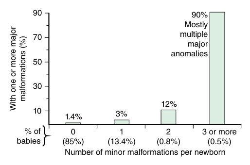

**Fig. 5.1** Frequency of major malformations in relation to the number of minor anomalies detected in a given newborn baby. (From Jones KJ. _Smith’s Recognizable Patterns of Human Malformation._ 6th ed. Philadelphia: Saunders; 2006. Also from Kliegman RM, St. Geme III JW, et al., eds. _Nelson Textbook of Pediatrics_ . 22nd ed. Philadelphia: Elsevier; 2025 [Fig. 100.8, p. 785].) 

#### **TABLE Causes of Congenital Anomalies Identified in 5.3 the Newborn** 

|Cause|Percent|
|---|---|
|Genetic/Genomic|15–25|
|_Chromosomal_|10–25|
|_Single gene_|2–10|
|Multifactorial|20–25|
|Environmental|8–12|
|Twinning|Up to 1|
|Unknown|40–60|

divided into those which result from deformations, disruptions, dysplasias, and malformations, respectively (Fig. 5.3). 

- **Malformation** . A morphological abnormality of an organ/body part that arises due to an abnormal _developmental program_ (e.g., a unilateral cleft lip arises from the failure of the maxillary prominence on the affected side to unite properly with the merged medial nasal prominences) (Fig. 5.4). 

- **Deformation** . An altered shape or position of a body part due to _abnormal mechanical forces_ which distort an otherwise normal structure (club feet arising from intrauterine constraint as a consequence of oligohydramnios) (Fig. 5.5). 

- **Disruption** . A nonprogressive anomaly resulting from _destruction_ of a tissue, structure, or body part which inherently had a normal developmental potential (e.g., interruption of the blood supply to a toe, due to amniotic bands, resulting in amputation of that digit) (Fig. 5.6). 

- **Dysplasia** . An anomaly arising from abnormal cellular constitution, tissue organization, or function within a tissue resulting in structural changes (e.g., within cartilage and bone, resulting in **skeletal dysplasia** ). 

#### **_How congenital anomalies interact with one another can also be used to subclassify them._** 

- **Syndrome** . A recognizable pattern of congenital anomalies thought to be causally related (trisomy 21) (Fig. 5.7). 

- **Sequence** . One or more secondary anomalies known or presumed to cascade from a single event (malformation, disruption, dysplasia, or deformation); Pierre Robin sequence is the combination of cleft palate, micrognathia, and upper airway obstruction that are consequences of a single event due to the failure of normal growth of the mandible during the eighth to tenth week of embryonic development (Fig. 5.8). 

- **Association** . A pattern of anomalies that occur together more often than would be expected by chance, but where a causal link has not been identified, such as the non-random co-occurrence of 6 anomalies in VACTERL: vertebral anomalies, anal atresia, cardiac defects, trachea-esophageal fistula, renal defects, and limb anomalies. 

## **Recognizing Variation** 

Dysmorphologists are usually concerned with patients with major anomalies, and those in whom three or more minor anomalies are identified because the likelihood of a syndrome becomes greater with each additional minor anomaly (Fig. 5.1). Many syndromes have a genetic cause, and the dysmorphologist is interested in accurately characterizing the associated clinical features to define a phenotype, make a diagnosis, or narrow the differential diagnosis. 

To recognize anomalies, one needs to have an excellent understanding of what is normal; this includes normal stages and important timings of embryonic development (Fig. 5.2), the normal structure, measurements, and ratios of the human body at various ages, and an understanding of neurocognitive and motor development and behavior. 

### **Embryology** 

Major malformations can result from a disturbance in diverse molecular mechanisms during embryonic development. These may interfere with an array of normal processes, such as cell migration (e.g., neural crest cells), apoptosis (programed cell death), intra-and intercellular signaling, and epigenetic perturbations, such as chromatin remodeling. 

The period during which development is disturbed is one of the most critical elements which determines the extent and severity of the resultant anomalies. During implantation, the first 2 weeks after fertilization, almost any interference with normal processes will result in spontaneous miscarriage. The **embryonic period** (gestational week 3–8) is the period of maximum risk for major malformations because tissue differentiation and organogenesis are taking place. A plethora of developmental processes are occurring at the same time and a single insult could result in multiple malformations and anomalies, resulting in the seemingly

<!-- p.97 -->

**Fig. 5.2** Critical periods in human embryological and fetal development. (From Moore KL, Persaud TVN, Torchia MG. _The Developing Human_ . 10th ed. Philadelphia: Elsevier; 2021 [page 474 Figure 20-15].) 

#### **TABLE Agents Acting on Pregnant Persons That May Adversely Affect the Structure or Function of the 5.4 Fetus and Newborn** 

|Accutane (isotretinoin)|Facial-ear anomalies, heart disease, CNS anomalies|
|---|---|
|Alcohol|Congenital cardiac, CNS, limb anomalies; IUGR; developmental delay; attention deficits; autism|
|ACE inhibitors, angiotensin receptor antagonists|Oligohydramnios, IUGR, renal failure, Potter sequence|
|Carbamazepine|Neural tube defects, possible neurodevelopmental delay|
|Carbimazole|Scalp defects, choanal atresia, esophageal atresia, developmental delay|
|Chorionic villus sampling|Possible limb reduction defects if performed before 9 weeks|
|Danazol|Virilization|
|Hyperthermia|Spina bifida|
|Lithium|Possible increased cardiac defects (Ebstein anomaly)|
|Methyl mercury|Minamata disease, microcephaly, deafness, blindness, intellectual disability|
|Methyltestosterone|Masculinization of female fetus|
|Misoprostol|Arthrogryposis, cranial neuropathies (Möbius syndrome), equinovarus|
|Mycophenolate mofetil|Craniofacial, limb, cardiovascular defects, spontaneous abortion|
|Norethindrone|Masculinization of female fetus with large doses|
|Penicillamine|Cutis laxa|
|Phenytoin|Congenital anomalies, neuroblastoma, bleeding (vitamin K deficiency)|
|Prednisone|Oral clefts|
|Stilbestrol (diethylstilbestrol [DES])|Clear cell adenocarcinoma of vagina and cervix in adolescence|
|Streptomycin|Deafness|

_(Continued)_

<!-- p.98 -->

#### **TABLE Agents Acting on Pregnant Persons That May Adversely Affect the Structure or Function of the 5.4 Fetus and Newborn—cont’d** 

|Thalidomide|Phocomelia, deafness, other malformations|
|---|---|
|Toluene (solvent abuse)|Craniofacial abnormalities, prematurity, hypertonia|
|Topiramate|Cleft lip|
|Trimethadione and paramethadione|Spontaneous abortion, multiple malformations, cognitive impairment|
|Valproate|CNS (neural tube defects), facial and cardiac anomalies, limb defects, impaired neurological function, autism spectrum disorder|
|Warfarin (Coumadin)|Fetal bleeding and death, hypoplastic nasal structures, stippled epiphyses|
|_ACE,_Angiotensin-converting enzyme;_CNS,_central nerv cardiac, tracheoesophageal fistula, renal, arterial, limb. Modified from Kliegman RM, St. Geme JW III, et al., eds.|ous system;_IUGR,_intrauterine growth restriction;_LBW,_low birthweight;_VACTERAL,_vertebral, anal, _Nelson Textbook of Pediatrics_. 22nd ed. Philadelphia: Elsevier; 2025 (Table 117.6, p. 1023).|

#### **TABLE 5.5** Maternal Infections f Affecting the Fetus or Newborn

|Infection|Mode(s) of Transmission|Neonatal Outcome|
|---|---|---|
|**Virus** Rubella|Transplacental|Congenital rubella|
|Cytomegalovirus|Transplacental, breast milk (rare)|Congenital cytomegalovirus or asymptomatic|
|HIV|Transplacental, vaginal passage, breast milk|Congenital or acquired immunodeficiency syndrome|
|Hepatitis B|Vaginal passage, transplacental, breast milk|Neonatal hepatitis, chronic hepatitis B surface antigen carrier state|
|Hepatitis C|Transplacental and vaginal passage|Rarely neonatal hepatitis,~5% chronic carrier state possible|
|Herpes simplex type 2 or 1|Intrapartum exposure|Neonatal herpes simplex virus Neonatal encephalitis; disseminated viremia, or cutaneous infection|
|Varicella-zoster|Transplacental:||
||Early|Congenital anomalies|
||Late|Neonatal varicella|
|Parvovirus|Transplacental|Fetal anemia, hydrops|
|Coxsackievirus B|Fecal-oral|Myocarditis, meningitis, hepatitis|
|Rubeola|Transplacental|Abortion, fetal measles|
|West Nile|Transplacental (rare) Possible perinatal|Uncertain, possible rash, encephalitis|
|Zika|Transplacental|Congenital microcephaly, intracranial calcifications, brain abnormalities, retinal lesions|
|Chikungunya|Transplacental (rare), perinatal|Neonatal encephalitis|
|Dengue|Transplacental, perinatal|Neonatal sepsis-like symptoms|
|**Parasites**|||
|Toxoplasmosis|Transplacental|Congenital toxoplasmosis|
|Malaria|Transplacental|Abortion, prematurity, intrauterine growth restriction|

Modified from Kliegman RM, St. Geme JW III, et al., eds. _Nelson Textbook of Pediatrics_ . 22nd ed. Philadelphia: Elsevier; 2025 (Table 116.4, p. 1013).

<!-- p.99 -->

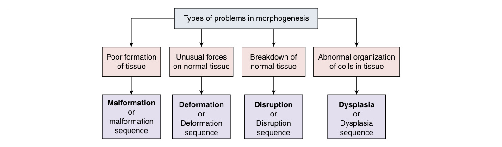

**Fig. 5.3** Mechanisms of abnormal morphogenesis. (From Jones KL, Jones MC, Del Campo M. _Smith’s Recognizable Patterns of Human Malformation_ . 8th ed. Philadelphia: Elsevier; 2021 [page xviii, Figure 2].) 

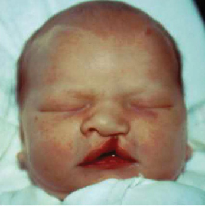

**Fig. 5.4** Unilateral left-sided cleft lip. (From Jones KL, Jones MC, Del Campo M. _Smith’s Recognizable Patterns of Human Malformation_ . 8th ed. Philadelphia: Elsevier; 2021 [page 339, Figure 2A].) 

unrelated dysmorphic features seen in some syndromes. Many anomalies may be recognized using prenatal imaging (ultrasonography or MRI). It is imperative to understand developmental timing, such as when the various bones are expected to ossify while assessing a fetus for possible skeletal dysplasia. After all organs are fully formed, the fetus is expected to grow and the brain is still undergoing maturation. During this time of fetal growth, the fetus remains at risk of injury to the developing brain and central nervous system and is vulnerable to teratogens and the intrauterine environmental changes. 

### **Anthropometry** 

Meticulous measurements play a key role in dysmorphology examination. They provide an objective and standardized basis for characterizing physical features and observed abnormalities. Measurements should be taken at every encounter (including in utero) with a healthcare professional and plotted on country/region-specific growth charts, like those issued by the CDC. There are standardized charts for 

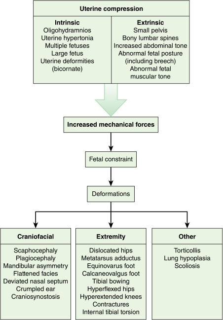

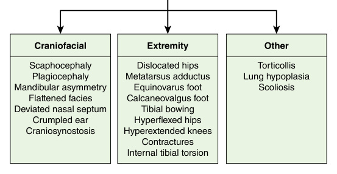

**Fig. 5.5** Deformation abnormalities resulting from uterine compression. (From Kliegman RM, Jenson HB, Marcdante KJ, et al., eds. _Nelson Essentials of Pediatrics_ , 5th ed. Philadelphia: Saunders; 2005. Also from Kliegman RM, St. Geme JW III, et al., eds. _Nelson Textbook of Pediatrics_ . 22nd ed. Philadelphia: Elsevier; 2025 [Fig. 100.2, p. 781].) 

height, weight, and head circumference, as well as for most body parts. For some rare diseases, there are _conditionspecific growth charts_ available. While a single measurement is very useful, plotting serial measurements and observing longitudinal trends are invaluable.

<!-- p.100 -->

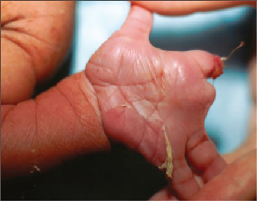

**Fig. 5.6** Amniotic bands resulting in amputation of digits. (From Jones KL, Jones MC, Del Campo M. _Smith’s Recognizable Patterns of Human Malformation_ . 8th ed. Philadelphia: Elsevier; 2021 [page 900, Figure 1A].) 

### **Childhood Development** 

Normal childhood development is a dynamic and multifaceted process encompassing physical, cognitive, social, and emotional domains. Milestones represent key achievements or abilities that are typically attained by children within specific age ranges. Individual variability exists, and not all children will reach milestones at the same time. What the dysmorphologist needs to assess is if the development is appropriate for the child’s age. This forms part of the assessment and contributes to the patient’s phenotype. 

## **Pathways and Heterogeneity** 

The dysmorphologist must also recognize similarities. The first gene discoveries for rare diseases were achieved by performing genetic analyses on patients who resembled one another, or shared a **phenotype** , to see which genetic variants they also had in common. Although some patients may be phenotypically similar, the underlying gene may differ. Often, these genes would be in a common pathway, or interact with each other in some way. A good example of this is the RAS/MAPK pathway: germline pathogenic variants in several of the genes within this pathway can lead to aberrant signaling and contribute to the development of a group of related disorders, collectively known as the **RASopathies** (Fig. 5.9). The RASopathies, such as Noonan syndrome, Costello syndrome, cardio-facio-cutaneous syndrome, and neurofibromatosis type 1, have overlapping clinical features (Fig. 5.10), including craniofacial dysmorphism, congenital cardiac anomalies, and neurocognitive impairment. Another example is **Cornelia de Lange syndrome (CdLS)** , which is characterized by distinctive facial dysmorphic features, growth restriction, and upper limb abnormalities. Patients with a clinical diagnosis of CdLS can have pathogenic variants in any one of 6 genes which are important in the cohesin pathway. 

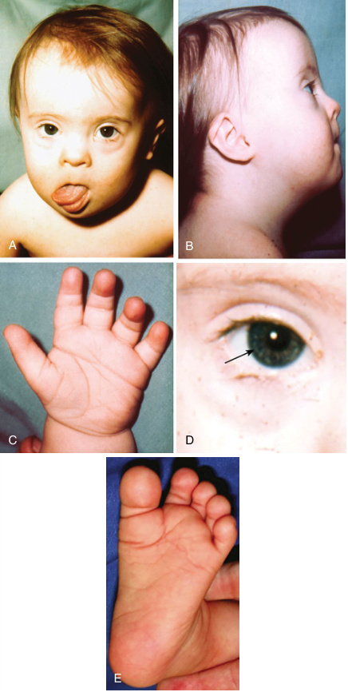

**Fig. 5.7** Characteristic syndromic features of trisomy 21. (A–C) Young infant. Flat facies, straight hair, protrusion of tongue, single crease on inturned fifth finger. (D) Brushing spots. (E) Wide space between toes 1 and 2. (From Jones KL, Jones MC, Del Campo M. _Smith’s Recognizable Patterns of Human Malformation_ . 8th ed. Philadelphia: Elsevier; 2021 [page 5, Figure 1A, 1B, 1C and page 7 Figure 3A, 3C].) 

## **Beyond Descriptive Terminology** 

The dysmorphic feature must be described in a manner which is easily understood. Dysmorphologists have attempted to standardize their descriptive terminology and nomenclature (Table 5.6). Initiatives like the Human Phenotype Ontology (HPO) have provided standardized vocabulary of dysmorphic features and medically relevant phenotypic features frequently encountered in the clinic. This facilitates

<!-- p.101 -->

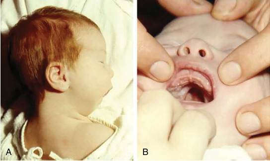

**Fig. 5.8** Pierre Robin sequence. (From Jones KL, Jones MC, Del Campo M. _Smith’s Recognizable Patterns of Human Malformation_ . 8th ed. Philadelphia: Elsevier; 2021 [page 335 Figure 1B and C].) 

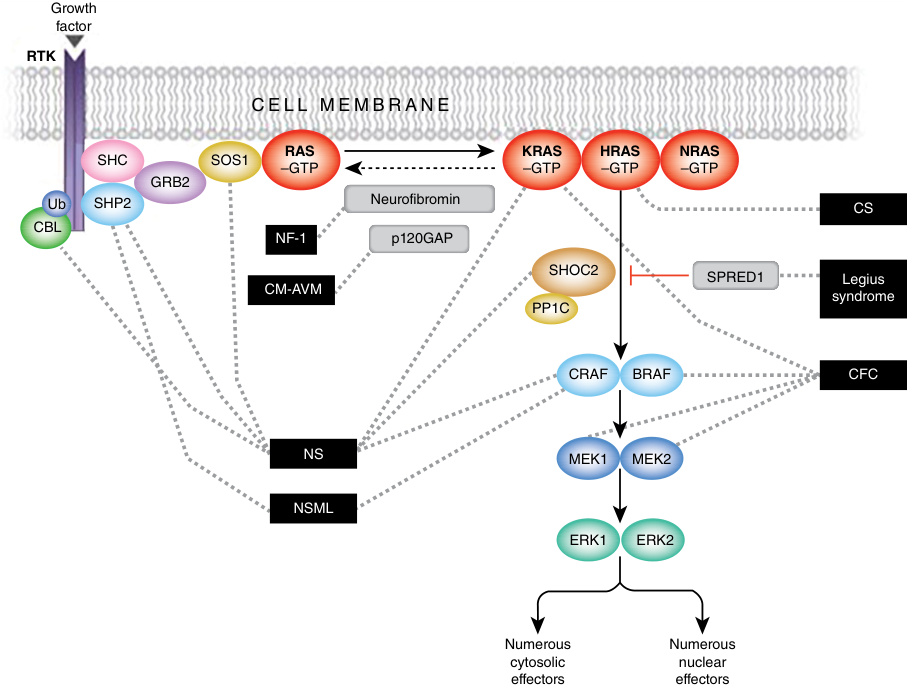

**Fig. 5.9** The RAS/MAPK pathway showing the genes as associated disorders. (From Rauen KA. The RASopathies. _Annu Rev Genomics Hum Genet_ . 2013;14:355-369.) The RAS/MAPK signal transduction pathway. The MAPK signaling pathway of protein kinases is critically involved in cellular proliferation, differentiation, motility, apoptosis, and senescence. The RASopathies are patterns of anomalies caused by pathogenic variants in genes that encode components or regulators of the RAS/MAPK pathway (indicated by _dashed lines_ ). These disorders include neurofibromatosis type one (NF1), Noonan syndrome (NS), Noonan syndrome with multiple lentigines (NSML), capillary malformation–arteriovenous malformation syndrome (CM-AVM), Costello syndrome (CS), cardiofaciocutaneous syndrome (CFC), and Legius syndrome. _RAS/MAPK,_ RAS protein family/mitogen-activated protein kinase.

<!-- p.102 -->

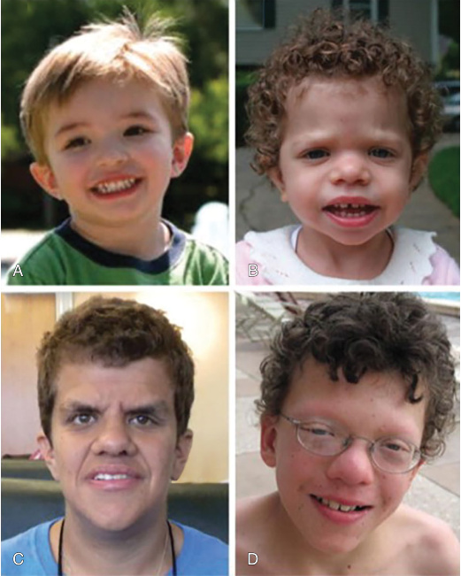

**Fig. 5.10** Overlapping clinical features of RASopathies. (A) Neurofibromatosis type 1 _(NF1)_ , (B) Noonan syndrome _(PTPN11)_ , (C) Costello syndrome _(HRAS)_ , (D) Cardio-facio-cutaneous syndrome _(MEK1)_ . (From Rauen KA. The RASopathies. _Annu Rev Genomics Hum Genet_ . 2013;14:355–369 [Figure 2].) 

the sharing and integration of phenotypic data across different centers, research studies, and databases. 

HPO terms, however, are not sufficient to adequately describe more granular information, such as actual centile or standard deviations (SD), when describing microcephaly or height. Nor do they allow for descriptions of when features appeared much beyond “prenatal” and “congenital.” A gap remains in our ability to fully describe phenotypes, but HPO has made a significant effort at harmonizing clinical descriptions globally. 

## **The Dysmorphology Consultation** 

When consulting on a patient with congenital anomalies suspected of having a rare disorder, most dysmorphologists will follow a structured approach: history, examination, further investigations, and genetic or genomic testing. The aim is a definitive diagnosis to guide management and treatment, as well as to inform effective genetic counseling, recurrence risks, and prognosis. This approach, however, needs to be tailored to the individual patient and to the situation. 

The consultation begins when the family meets in the waiting area and the family and patient are observed. A simple 

handshake may give a vital clue to the ensuing diagnosis (myotonic dystrophy). Observing the child’s gait, seeing how they interact with their parents, what their general appearance is provides important clues even before the first questions have been posed. 

A _spot diagnosis_ , that is, being able to immediately recognize a condition based on observation alone, is possible for an experienced clinician or with an easily recognized rare disorder. This is becoming increasingly difficult because the number of genetic conditions has increased to include rare diseases (defined as those affecting less than 1 in 2,000 individuals), as well as ultra-rare (affecting less than 1 in 50,000 individuals) and even hyper-rare (less than 1 in 108 individuals) and nano-rare conditions (a condition with up to 30 patients with the same pathogenic variant identified worldwide). 

### **Family History and Drawing a Pedigree** 

A 3-generation family tree or pedigree should be constructed with as much information as possible. This pedigree provides a visual representation of familial relationships and can give important clues about possible inheritance

<!-- p.103 -->

#### **TABLE Glossary of Selected Terms Used in 5.6 Dysmorphology** 

##### **Terms Pertaining to the Face and Head** 

- Brachycephaly: A condition in which head shape is shortened from front to back along the sagittal plane; the skull is rounder than normal 

- Canthus: The lateral or medial angle of the eye formed by the junction of the upper and lower lids 

- Columella: The fleshy tissue of the nose that separates the nostrils 

- Glabella: Bony midline prominence of the brows 

- Nasal alae: The lateral flaring of the nostrils 

- Nasolabial fold: Groove that extends from the margin of the nasal alae to the lateral aspects of the lips 

- Ocular hypertelorism: Increased distance between the pupils of the 2 eyes 

- Palpebral fissure: The shape of the eyes based on the outline of the eyelids 

- Philtrum: The vertical groove in the midline of the face between the nose and upper lip 

- Plagiocephaly: A condition in which head shape is asymmetric in the sagittal or coronal planes; can result from asymmetry in suture closure or from asymmetry of brain growth 

- Scaphocephaly: A condition in which the head is elongated from front to back in the sagittal plane; most normal skulls are scaphocephalic 

- Synophrys: Eyebrows that meet in the midline 

- Telecanthus: A wide space between the medial canthi 

##### **Terms Pertaining to the Extremities** 

- Brachydactyly: A condition of having short digits 

- Camptodactyly: A condition in which a digit is bent or fixed in the direction of flexion (a “trigger finger”–type appearance) 

- Clinodactyly: A condition in which a digit is crooked and curves toward or away from adjacent digits 

- Hypoplastic nail: An unusually small nail on a digit 

- -melia: A suffix meaning “limb” (e.g., amelia—missing limb; brachymelia—short limb) 

- Polydactyly: The condition of having 6 or more digits on an extremity 

- Syndactyly: The condition of having 2 or more digits at least partially fused (can involve any degree of fusion, from webbing of skin to full bony fusion of adjacent digit) 

From Behrman RE, Kliegman RM. _Nelson Essentials of Pediatrics_ . 4th ed. Philadelphia: Saunders; 2002:149. Also from Kliegman RM, Toth H, Bordini BJ, Basel D, eds. _Nelson Pediatric Symptom-Based Common Diseases and Their Mimics_ . 2nd ed. 2023 (Table 29.4, p. 486). 

patterns (Table 5.7) or help identify possible carriers or atrisk individuals. The parental ages, for example, should be documented: advanced maternal age may suggest an increased risk of a chromosomal disorder, while advanced paternal age may suggest an increased risk for _de novo_ (new dominant) single gene disorders. Pedigree is also essential in genetic counseling and risk assessment. Standardized pedigree symbols should be used throughout (Fig. 5.11). 

Important points to note include: other affected members and to document their features as extensively as possible, including consanguinity, disabilities, multiple miscarriages, live births, stillbirths, early neonatal or childhood deaths, cancer, age at death, and cause of death of deceased members. 

### **Pregnancy History** 

Pregnancy history is important because information about both the mother’s health and habits, as well as the fetal health and intrauterine environment can inform the interpretation of dysmorphic features. A history of decreased fetal movement (possible **fetal akinesia** ) sets the scene for possible associated features: breech presentation, limb malformations and contractures at birth, and a possible underlying neuromuscular disorder (Fig. 5.12). **Polyhydramnios** may indicate that the fetus had difficulty swallowing, and oligohydramnios may be indicative of a fetal renal anomaly. 

Important points to note include: maternal illnesses with medications and dosages, history of maternal pyrexia or rashes, list of medications (including over-the-counter medication and preconception supplements like folate), any substances consumed with details about frequency and amount, fetal movement, amniotic fluid volume (oligohydramnios, polyhydramnios), abnormal maternal serum screening, results of prenatal ultrasonography and any abnormal fetal morphology, fetal growth (intrauterine growth restriction (IUGR), overgrowth, disproportionate growth abnormalities), abnormalities of the placenta, abnormalities of the umbilical cord, and results of any prenatal testing. 

### **Birth History** 

Knowing as much as possible about the details of the birth and the time immediately following birth is vital. Assisted vaginal deliveries can result in abnormal head shapes for the first few days. These can be confused with pathological processes like craniosynostosis. An accurate record of the birth measurements forms the baseline for all future measurements and interpretation of trends in growth. 

Important points to note include: type of delivery and presenting part (normal vaginal, assisted vaginal [forceps, vacuum], Caesarian section; vertex, breech, footling), gestation at delivery, evidence of fetal distress, birth weight, birth length and birth head circumference measurements, APGAR scores, any immediate postnatal and neonatal problems identified (neonatal respiratory distress, feeding difficulties, significant jaundice, neonatal hypoglycemia, neonatal seizures, severe infections, any congenital abnormalities noted). 

### **Medical/Surgical History** 

Most individuals presenting for an assessment to a dysmorphologist have an extensive medical and surgical history. A comprehensive medical and surgical history provides

<!-- p.104 -->

#### **TABLE Patterns of Inheritance 5.7** 

|Inheritance Pattern|Cardinal Features|
|---|---|
|Autosomal dominant|Affected individuals have one normal allele and one altered/variant allele on one of the autosomes Males and females equally affected Vertical transmission with affected individuals in each generation 50% recurrence risk for future pregnancies _De novo_occurrence possible|
|Autosomal recessive|Affected individuals have two altered/variant alleles (biallelic) Parents of affected individuals are heterozygous carriers and healthy Consanguinity may be present 25% recurrence risk|
|X-linked|Affected individuals have an altered/variant allele on their X chromosome Males are hemizygous Males typically more severely affected than females Skewed X-inactivation plays a role in affected females Affected males will pass the altered/variant allele to all daughters|
|Mitochondrial|Mitochondrial DNA is inherited from the mother Severity and onset of symptoms vary widely as influenced by heteroplasmy and tissue-specific effects Males and females equally affected|

information on the individual’s health background. Information must be gathered regarding symptoms, age of onset of symptoms, medical visits, doctor’s reports, medications, surgical interventions, results of biopsies, other results. At this point information on exposures and habits can also be gathered (environmental exposures, both occupational and residential as well as lifestyle habits like smoking). 

Important points to note include: comprehensive health history including medical conditions with information about onset, progression, list of physicians and specialists seen, management and treatment, hospitalizations, allergies, history of recurrent infections, surgical history noting all previous and planned surgeries, exposure to anesthesia, and any adverse reactions or events. 

### **Developmental History and Behavioral History** 

Enquiring about an individual’s developmental and behavioral history provides insight into the early milestones, overall development, and developmental trajectory and trends. Monitoring of development allows for early detection of delays, or deviations from expected patterns. Many genetic conditions manifest with developmental delays, and some may even exhibit specific patterns or phenotypes. **Regression** of any milestones can be a significant marker for certain conditions, like Rett syndrome. Certain behaviors can also increase the likelihood for some conditions, like hand flapping in Angelman syndrome. Ideally, all individuals with developmental issues should be seen by a neurodevelopmental pediatrician for a formal assessment. 

Important points to note include: early developmental milestones (motor, fine-motor, speech and language), any 

history of regression of milestones/abilities, other neurological features (seizures), with information on the timing and context (related to illness, fever, trauma, environmental changes), other psychiatric features, autism or autistic features, social and emotional development, cognitive and academic progress, behavioral patterns (including temperament, sleep, eating, self-care, interests), and behavioral changes. 

## **Physical Examination** 

The key to good practice in dysmorphology is accurate observation and meticulous measurement and documentation of findings. It is equally important to examine and document the normal features. Parents, siblings, and other family members may be available for comparison, especially of facial features. Just because a child resembles his mother, does not exclude the presence of a syndrome because both may have the same condition inherited in an autosomal dominant manner (Table 5.7). 

Major anomalies may be obvious, while minor ones may require more careful attention to detail. Features naturally change over time, and in the case of dysmorphic features may become either more obvious or less obvious with age, depending on the condition. It is thus important to examine the patient and document features at _every_ visit. _Photographs from early childhood are very useful_ . Different features may present at different time points or ages. A baby or child with a storage disorder (mucopolysaccharidoses) may initially present with only inguinal hernias and organomegaly. It is only with time that the facial features coarsen, and the joints become stiff. Later features will include cognitive decline and slowing of growth.

<!-- p.105 -->

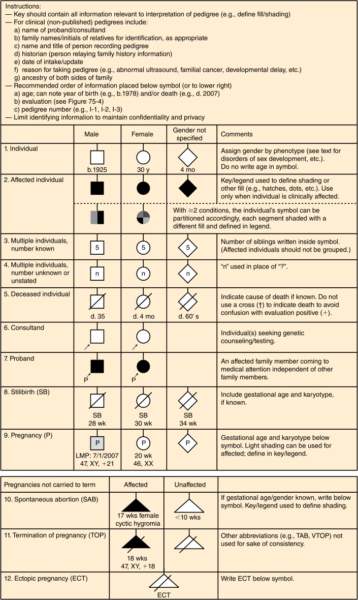

- **Fig. 5.11** Standard pedigree symbols, definitions, and abbreviations. (From Bennett RL, French KS, 

- Resta RG, et al. Standardized human pedigree nomenclature: update and assessment of the recommendations of the National Society of Genetic Counselors. _J Genet Couns._ 2008;17:424-433.)

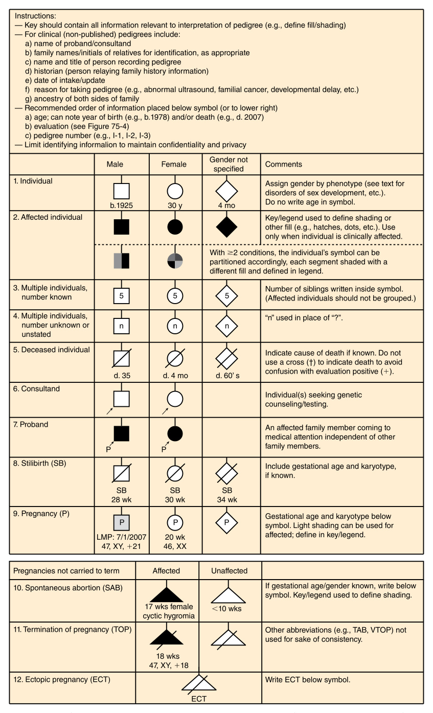

<!-- p.106 -->

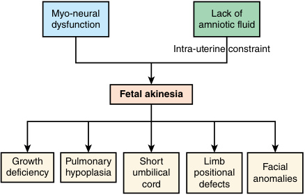

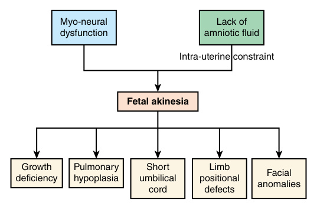

**Fig. 5.12** Diagram demonstrating the etiologically heterogeneous phenotype that results from fetal akinesia. (From Graham JL. _Smith’s Recognizable Patterns of Human Malformation_ . 3rd ed. Philadelphia: Elsevier; 2007 [Fig. 47-2A]. Also Fig.100.5A in _Nelson Textbook of Pediatrics_ 22/e, p. 782.) 

## **Observation** 

Observing the patient’s body habitus, gait, facial expressions, interaction with caregivers, behavior, and general demeanor can give important clues even before the formal assessment. These observations can guide the dysmorphologist’s approach to an individual patient. 

## **Clinical Examination** 

Although a structured approach to the patient with dysmorphic features is ideal, in reality, this may not always be feasible. As long as all body parts are examined, the order of examination is left up to the physician. Dysmorphologists typically spend a lot of time looking in detail at body parts that other physicians do not focus on, like the palms of the hands or behind the patient’s ears. This can be quite a new experience for the patients and their caregivers. 

Table 5.8 provides a general checklist of important features to note on the clinical examination. 

## **The Face in Dysmorphology** 

The face is a critical region in the dysmorphology examination. Perhaps more than any other body part, the face provides a starting point to define syndromes. While each syndrome may exhibit a recognizable facial pattern, the manifestations can vary widely, ranging from subtle changes to severe malformations. 

The facial phenotype is referred to as the _facial gestalt_ . Many well-known syndromes have a recognizable facial gestalt, which makes a _spot diagnosis_ easier. The face is a complex structure which undergoes intricate and highly regulated embryological development and deviations from the norm manifest as distinct facial anomalies. In addition 

#### **TABLE 5.8** Checklist of Important Features to Note on the Dysmorphological Clinical Examination

|General appearance|Body proportions and symmetry Vital signs Growth parameters|
|---|---|
|Head and neck|Head shape Fontanelles Hair: texture, color, distribution, hairlines (low, high) Neck: length, masses, fistulae, embryonic remnants, webbing, redundant skin|
|Ears|Position, preauricular tags/pits, creases on lobes/helix, shape of lobes and position, hearing aids|
|Face|Shape Appearance Symmetry Unusual facies, e.g., myotonic|
|Forehead|Shape, presence of nevi, frontal bossing, biparietal narrowing|
|Eyebrows|Thickness, sparseness, arched, synophrus|
|Eyes|Shape and size (microphthalmia) Measurements: distances between each eye, inner-canthal, outer canthal, interpupillary Iris (color, unusual pattern/spots, aniridia) Lids (ptosis) Pupils (colobomas) Epicanthal folds, telecanthus, palpebral fissure length and alignment Eyelashes (long, curly, absent)|
|Nose|Shape, size and position Nasal root (prominent, flat), bridge (prominent, flat), tip (broad, flat), alae nasi (hypoplastic, anteverted), columella (long, short)|

_(Continued)_

<!-- p.107 -->

#### **TABLE 5.8** Checkli st of Important Features to Note on the Dysmorphological Clinical Examination—cont’d

|Mouth|Size (wide, macrostomia) Philtrum (long, short, smooth, prominent philtral groove), upper vermillion, nasolabial folds, lips (thick, thin), corners of mouth (downturned), lip pits, clefts (lip, palate) Palate (high-arched, cleft), uvula (bifid, cleft, absent, long), dentition (oligodontia, dental caries, single incisor), tongue (lobulated, macroglossia, microglossia)|
|---|---|
|Chin|Shape and size (micrognathia, prognathism), unusual creases|
|Chest|Shape and proportion (pectus carinatum/excavatum) Chest wall deformity Clavicles (short, absent)|
|Nipples|Widely spaced Inverted Supernumerary|
|Abdomen|Shape and proportion Abdominal wall defect Abdominal musculature Organomegaly Umbilical hernia Omphalocele Gastroschisis|
|Genitalia|Ambiguous genitalia Micropenis Cryptorchidism Hypospadias Bifid scrotum Labia majora/minora abnormality Enlarged clitoris|
|Anus|Position, patency, tone|
|Limbs|Length and proportions of segments (rhizomelic, mesomelic, acromelic) Shape (bowing, deformities, defects, asymmetry) Joints (range of movement, deformities, contractures) Digit number, length, shape, placement (oligodactyly, polydactyly, clinodactyly, syndactyly, proximally inserted, overlapping) Palmar and plantar creases|
|Nails|Hypoplastic, grooved, thickened, tapered, aplastic|
|Back|Scoliosis, exaggerated lordosis, gibbus, winged scapulae, sacral dimples, neural tube defects|
|CNS|Tone, reflexes, movements, muscle weakness|
|Skin|Texture Pigmentary abnormalities Nevi, freckles, telangiectasia, venous malformations Cutis laxa Fragility, scars, elasticity Tumors|

to individual dysmorphic features, the face also allows us to observe facial expressions, which can form part of a phenotype. 

Due to the common lineage of the craniofacial bones and the central nervous system from cranial neural crest cells, the _facial gestalt_ is of particular interest in many disorders that affect psychomotor development. The binary distinction between syndromic and nonsyndromic intellectual disability, for instance, is increasingly replaced by a concept 

that allows different degrees of distinctiveness of a dysmorphic phenotype. 

The face is embryologically complex, with contributions from neural crest, branchial arches, and mesoderm. **Neural crest** cells arise from the dorsal neural tube during early embryonic development. They undergo epithelial to mesenchymal transition and migrate extensively throughout the embryo, contributing to the formation of various tissues and structures, including the face. Disruptions in the

<!-- p.108 -->

### **TABLE 5.9 Developmental Pathways Involved in Facial Morphogenesis** 

|Pathway|Role in Facial Morphogenesis and Example Syndrome|
|---|---|
|Fibroblast growth factor (FGF) signaling|FGF signaling plays a crucial role in facial development by regulating cell proliferation, migration, and differentiation. Example:_Apert syndrome_|
|Sonic Hedgehog (SHH) signaling|SHH signaling is essential for patterning the face along the anterior-posterior axis and regulating the growth of facial prominences. Example:_Holoprosencephaly_|
|Wnt signaling|Wnt signaling is involved in various aspects of facial development, including facial patterning, epithelial-mesenchymal interactions, and tissue polarity. Example:_Robinow syndrome_|
|Transforming Growth Factor Beta (TGF-β) signaling|TGF-βsignaling regulates cell proliferation, differentiation, and extracellular matrix production during facial morphogenesis. Example:_Loeys-Dietz syndrome_|
|Homeobox (HOX) genes|HOX genes are transcription factors that play a critical role in specifying regional identities along the anterior-posterior axis during embryonic development. Example:_Bosley-Salih-Alorainy syndrome_|

migration, proliferation, or differentiation of these cells can lead to craniofacial anomalies, most notably, premature fusion of the cranial sutures (craniosynostosis), cleft lip and palate, midface retrusion (midface hypoplasia), closely spaced/widely spaced eyes (hypo/hypertelorism), small or absent chin (micrognathia or agnathia), and abnormalities of the nose, eyes, ears, and teeth. Collectively, these findings account for ~30% of congenital anomalies which characterize hundreds of syndromes, including 22q11 deletion syndrome, Treacher Collins syndrome, and frontonasal dysplasia. 

Understanding the underlying embryology helps to determine the origin of many facial anomalies and can provide clues about the underlying genetic alterations or pathways which have been disrupted. Facial morphogenesis is intricately regulated by numerous signaling pathways, including bone morphogenic proteins (BMPs), fibroblast growth factors (FGFs), sonic hedgehog signaling (SHH), and others (Table 5.9). Dysregulation in any of these pathways can disrupt facial development, leading to dysmorphism, with notable examples (Table 5.9). A patient with midline facial anomalies such as a proboscis, hypotelorism, cleft lip and palate suggest a Sonic Hedgehog signaling dysregulation. 

## **Clinical Photography and Videography** 

Photographs are taken (with permission) of all dysmorphic features, most commonly the frontal face and profile, full length body (front, side and back), and hands and feet. A ruler or other standard is included for scale. Serial photographs document how the dysmorphic features change over time and serve as a valuable resource to dysmorphologists, especially if they are seeing an older patient for the first time. Video is also useful in documenting particular behaviors, gait, or facial expressions. Parents often have video 

evidence of a particular behavior or when a child is having a seizure because these may not be evident in the consultation. The photographs should be taken against a neutral background and have a scale to estimate size. 

# **Investigations** 

Dysmorphologists rely on the results of further investigations to complement their clinical assessment of family history and physical examination. In the context of a rare genetic disorder, the patient often presents with a large list of previous investigations, which may include biochemistry, imaging, and genetic testing. 

Imaging may also be useful for measurements (when assessing the skull or the bones in the hand), but also for 3D reconstruction and planning of surgery (craniosynostoses). 

_Exome and genome sequencing have allowed the identification of many disease-causing genes_ . The number of rare and ultra-rare disorders is consequently growing. In some cases, the dysmorphologist is consulted before genetic or genomic testing, and would then request the appropriate test based on the clinical differential diagnosis based on the phenotype. At other times, patients are referred after they have a genetic test result, to have a clinical dysmorphological assessment to see if the genetic test results fit with the phenotype. 

## **Next-Generation Phenotyping** 

The process of phenotyping is a multidimensional and iterative undertaking which involves dysmorphology, clinical assessments, genetic and genomic testing, data integration, and careful validation. Increasingly, the meticulous phenotyping of patients may be insufficient to make a diagnosis without further assistance. In the case of the patient with facial dysmorphic features, which are not reminiscent

<!-- p.109 -->

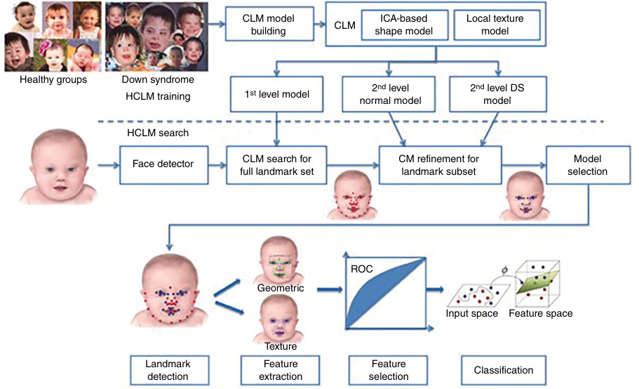

**Fig. 5.13** The framework of facial recognition for genetic syndrome detection. _CLM,_ Constrained local model; _DS,_ Down syndrome; _HCLM,_ hierarchical CLM; _ICA,_ independent component analysis; _ROC,_ receiver operating characteristics. (From Zhao Q, Okada K, Rosenbaum K, et al. Digital facial dysmorphology for genetic screening: hierarchical constrained local model using ICA. _Med Image Anal_ . 2014;18: 699-710 [Fig. 2]. Also Fig. 110.9 in _Nelson Textbook of Pediatrics_ 22/e, p. 786.) 

of any known disorder, dysmorphologist physicians may use AI-based tools for **next-generation phenotyping (NGP)** . 

Machine learning and computer vision have rapidly developed, allowing these NGP tools to analyze facial photographs of patients with dysmorphic features (Fig. 5.13) and not only make an NGP assessment of which syndromes are the likely diagnosis based on the analysis, but also, as is the case with GestaltMatcher, to match patients with novel syndromes. 

In the field of NGP, the use of the term _dysmorphic_ is based on probability distributions, which refer to complex shapes and structures that can be learned by humans but also by artificial neural networks by means of statistical inference. For many one-dimensional features that can be measured and are normally distributed in the human population, such as height, there are adjectives to refer to outliers (e.g., a person is _tall_ or _short_ ). In a dysmorphology context, prefixes such as _hypo_ , _hyper_ , _micro_ , and _macro_ are often used to indicate abnormal measurements (hypotelorism, hypertelorism, microcephaly, and macrocephaly). The more complex a form becomes, the more likely the abnormality will be described by a list of abnormal features, or simply as a _characteristic gestalt._ 

For a machine to _learn_ a disorder or phenotype, there are several approaches or algorithms to do so and they differ 

depending on the input data. Algorithms can work with text or images, and both have specific challenges. For instance, in **brachydactyly type E (BDE)** , the major clinical finding is shortening of the third, fourth, and fifth metacarpals. This would be a combination of the abnormality in three separate structures. In BDE, for example, it is crucial to know whether _only_ metacarpals three to five are shortened or whether metacarpals one and two are also involved. Text-based NGP relies on expert knowledge with respect to the encoding such as in HPO terminology, and operating procedures with respect to reporting. It might be likely to report a brachydactyly of the first and second metacarpal if it is present in all metacarpals. For findings that might require an additional examination, missing information is more likely, complicating this kind of NGP’s ability to accurately assess the information. Algorithms as well as physicians who work with clinical notes need to consider this uncertainty. In fact, during the diagnostic process, often additional information (from molecular testing) becomes available which requires **re-phenotyping** . 

NGP on portraits is the most advanced due to the availability of photos from affected and unaffected individuals. Anything that would be described in OMIM as a distinctive “syndromic” face could be recognized by NGP tools, such as GestaltMatcher, with human expert-level accuracy, while small

<!-- p.110 -->

features, such as long eyelashes, or epicanthal folds, may not yet be individually assessed by the tool. What GestaltMatcher and similar AIs do is learn an abstract representation of the phenotype. At the core, humans and machines perform conceptually very similar tasks with their neural networks: A human dysmorphologist might refer to a facial gestalt as having a recognizable pattern, and for an AI that might simply mean that the encodings of those photographs are close to each other in the latent feature space (in the literature also sometimes referred to as the clinical face phenotype space [CFPS]). 

NGP can also be applied in the delineation of novel disease phenotypes, or the characterization of significant syndromic similarities. This task is also referred to as the “lumper and splitter” problem, and in statistical terms it is related to clustering analysis. If the positions of portraits of individuals with disease-causing variants in a certain gene are located close to each other in the clinical face phenotype space (CFPS) and can be separated from other data points, they form a distinct cluster, because they share a characteristic facial gestalt. If that area or region in the CFPS is not populated yet by other data points, then a new phenotype can be delineated. If there are already other entries with a molecular cause in another gene, then lumping can be considered and the phenotype can be called genetically heterogeneous. If imaging data of patients with pathogenic variants in the same gene form more than one cluster, this could indicate pleiotropy perhaps due to different molecular mechanisms and splitting should be considered. 

# **Re-Phenotyping and Variant Classification** 

The diagnostic process is iterative, and whether one starts with sequencing or phenotyping does not matter. Nextgeneration sequencing tests such as exome or genome may be inconclusive at first because many variants in known disease genes are of _unknown clinical significance_ at first sight and will only be able to be classified as (likely) pathogenic if the phenotype matches that of _other_ patients with 

proven pathogenic variants in that gene. The more specific, distinct, or characteristic a phenotype is, the more evidence can be attributed to the similarity. While microcephaly or short stature are usually only considered to be supportive for a certain diagnosis, the typical phenotypic appearance of Kabuki syndrome and/or a high gestalt score can be indicative of this disease. 

# **Bibliography** 

- Aase JM. _Diagnostic Dysmorphology_ . New York: Plenum Medical Book Company; 1990. 

- Bennett RL, French KS, Resta RG, et al. Standardized human pedigree nomenclature: update and assessment of the recommendations of the National Society of Genetic Counselors. _J Genet Couns_ . 2008;17:424-433. 

- Erickson RP, Wynshaw-Boris AJ. _Epstein’s Inborn Errors of Development_ . 3rd ed. New York: Oxford University Press; 2016. 

- Firth HV, Hurst JA. _Oxford Desk Reference Clinical Genetics and Genomics_ . 2nd ed. Oxford: Oxford University Press; 2017. 

- Gripp KW, Slavotinek AM, Hall JG, Allanson JE. _Handbook of Physical Measurements_ . 3rd ed. New York: Oxford University Press; 2013. 

- Hennekam RCM, Krantz ID, Allanson JE. _Gorlin’s Syndromes of the Head and Neck_ . 4th ed. New York: Oxford University Press; 2010. 

- Hsieh TC, Bar-Haim A, Moosa S, et al. GestaltMatcher facilitates rare disease matching using facial phenotype descriptors. _Nat Genet_ . 2022;54(3):349-357. 

- Jones KL, Jones MC, Del Campo M. _Smith’s Recognizable Patterns of Human Malformation_ . 8th ed. Philadelphia: Elsevier; 2021. 

- Moore KL, Persaud TVN, Torchia MG. _The Developing Human: Clinically Orientated Embryology_ . 10th ed. Philadelphia: Elsevier; 2015. 

- Rauen KA. The RASopathies. _Annu Rev Genomics Hum Genet_ . 2013; 14:355-369. 

- Stevenson RE, Hall JG, Everman DB, Solomon BD. _Human Malformations and Related Anomalies_ . 3rd ed. New York: Oxford University Press; 2016.

<!-- p.111 -->

---

<!-- p.112 -->

# 6 Ciliary Signaling and Dysmorphology 

**FOWZAN S. ALKURAYA** 

Cilia are antenna-like microtubule-based organelles consisting of an axoneme core surrounded by a modified membrane (ciliary membrane) and a large number of proteins that mediate numerous developmental and physiological functions. Some cilia are motile (e.g., sperm flagella and airway cilia), while others lack motility as seen in nearly all non-dividing cells of the body, which gives rise to the commonly used classification of “motile cilia” vs. “primary cilia” (Fig. 6.1). The number of cilia per cell is another classification that defines multiciliated (e.g., ependymal cells), and monociliated cells (e.g., renal tubular cells). The basic structure of the axoneme is also used to classify cilia as 9+2 vs. 9+0, depending on the presence or absence, respectively, of a central pair of microtubules in the axoneme. The same cell type can harbor different types of cilia depending on the _developmental_ stage; respiratory epithelial cells feature primary cilia during early development, which are replaced by motile cilia upon maturation. Furthermore, the embryonically motile cilia of the choroid and olfactory epithelium assume sensory functions soon after birth. 

The cilium forms as a microtubular extension from the postmitotic centrosome that forms the basal body. Some of these microtubules terminate within the transition zone (TZ), while others continue to elongate as nine peripheral doublets that form the axoneme as well as a central pair in the case of 9+2 cilia. In motile cilia, the nine doublets associate with motor proteins known as dyneins. TZ functions as the cilium gatekeeper and features two major complexes: the **Meckel-Gruber syndrome (MKS)** (comprising MKS1, TMEM67, TMEM216, B9D1, B9D2, CEP290, and TCTN1-3) and **nephronophthisis (NPHP)** (comprising NPHP1, NPHP4, NPHP8, and NPHP2), disruption of which leads to major ciliary defects characterized by misrouting of non-ciliary proteins to the cilia. The assembly and normal function of the cilia require the transport of its individual components through **intraflagellar transport (IFT)** , a bidirectional “train” that moves cargo along the axoneme from the base to the tip of the cilia (anterograde transport, mediated by IFT-B complex) and in the reverse direction (retrograde transport, mediated by IFT-A complex). The actual motion of the trains is provided by the kinesin motor. BBSome is 

another protein complex empirically shown to play an important role in ciliary trafficking. Remarkably, the critical role of the cilia extends during its disassembly/resorption/ deciliation, which is considered a checkpoint in itself for the cellular re-entry into mitosis. **Ectosomes** are vesicles shed off by the plasma membrane without being preassembled by endocytic membranes like exosomes. It has been found that ciliary membrane-derived ectosomes play important roles in mediating cell-to-cell ciliary signaling and ciliary membrane protein trafficking. 

The primary cilium is a nexus for numerous signaling pathways, key among which is **Sonic Hedgehog (SHH)** . The receptor of SHH, patched (PTCH), is localized to the plasma membrane as is the GPRC protein GRP161 (Fig. 6.2). In the absence of SHH, GPR161 activates cAMPdependent kinase (PKA), which phosphorylates GLI2/ GLI3 transcription factors, leading to their proteolytic cleavage into the inactive form GLI-R. This proteolytic cleavage is maintained by PTCH through its inhibition of ciliary accumulation of smoothened (SMO), which counters this proteolytic cleavage through PKA inhibition. SHH-PTCH binding triggers the exit of PTCH and GRP161 out of the cilia, leading to accumulation of SMO. This in turn tips the balance of GLI2/GLI3 to their active form GLI-A, a potent activator that induces the expression of SHH target genes upon trafficking to the nucleus. Ubiquitylation is key to SHH signaling wherein PTCH-induced removal of SMO is mediated by recruiting WWP1, an E3 ligase that targets SMO. Similarly, SHH-induced exit of PTCH and GPR161 is ubiquitylation-dependent mediated by ARRB2 and SMURF1/2. Cilia are similarly enriched with additional well-established signaling molecules, e.g., WNT, NOTCH, HIPPO, G-protein-coupled receptors (GPCRs), platelet-derived growth factor (PDGF), mammalian target of rapamycin (mTOR), and transforming growth factor-β (TGF-β). 

Ciliopathies are clinical disorders of cilia. Although some consider ciliopathies an encompassing term of both primary cilia and motile cilia disorders, others prefer to use the term **primary ciliary dyskinesia (PCD)** for the latter and restrict the term **ciliopathies** to disorders of the primary (immotile) cilium.

<!-- p.113 -->

**Fig. 6.1** Cilia classification and location. 

The remarkable phenotypic diversity associated with ciliopathies reflects the ubiquitous nature of primary cilia and their critical role across tissues and organ systems (lymphocytes, granulocytes, and hepatocytes are notable exceptions to the general role of ubiquitously ciliated human cells) (Fig. 6.3, Table 6.1). Significant progress has been made to trace each clinical manifestation to the precise role of the primary cilium in the relevant tissue. 

## **Genotype-Phenotype Correlation in Ciliopathies** 

Ciliopathies are divided into first and second order ciliopathies depending on whether the disease gene encodes a protein that localizes the cilia (primary) or elsewhere in the cell (secondary). The correlation between individual ciliary components and the corresponding ciliopathy phenotype is highly complex. TZ is enriched in MKS, NPHP, and CEP290 complexes/modules that are abnormal in severe forms of ciliopathies such as **Meckel-Gruber syndrome (MKS)** . However, RPGRIP1L and RPGRIP1, while both necessary for TZ assembly, are linked to very distinct clinical phenotypes: _RPGRIP1L_ -related MKS and **Joubert syndrome (JS)** vs. _RPGRIP1_ -related **nonsyndromic retinitis pigmentosa (RP)** . On the other hand, TZ components CEP290 and IFT140 are known to be abnormal each in classic ciliopathies as well as nonsyndromic RP. 

The extensive genetic and allelic heterogeneity that characterizes ciliopathies adds another layer of complexity to genotype-phenotype correlation. Extensive allelism (i.e., distinct clinical entities caused by pathogenic variants in the 

same gene), and variable expressivity even for the same variant further complicate efforts to predict the genotype from the phenotype in diagnostic settings or the phenotype from the genotype in predictive settings (e.g., carrier screening, prenatal testing or reverse phenotyping). Ciliopathies are best viewed as a phenotypic spectrum ranging in severity from lethal major malformations as observed in MKS to nonsyndromic late onset retinal degeneration. Occasionally, this spectrum can be explained by the pathogenetic mechanism mediated by the specific allele. Truncating variants affecting both long and short isoforms of _CSPP1_ have been found to cause stillbirths with major ciliopathy features consistent with MKS, whereas variants that only truncate the long isoform cause a much milder form of Joubert syndrome. Similarly, variants that only affect a long retinaspecific _ARL6_ isoform cause nonsyndromic adult-onset RP unlike the classic Bardet-Biedl syndrome (BBS)-related _ARL6_ variants. A growing number of syndromic ciliopathy genes have also been found to have pathogenic variants in nonsyndromic retinal diseases. The same _SCLT1_ founder variant that was initially identified in severe **oral-facial-digital syndrome IX** with lethality in the first year of life was also found to cause a milder form of BBS in teenage sisters. This extreme variability can sometimes be mistaken for reduced penetrance, a phenomenon once proposed to be common in ciliopathies under the “triallelic inheritance” or “oligogenic” model. However, there is mounting evidence based on extensive sequencing studies that ciliopathies display true Mendelian inheritance and are no more “oligogenic” than other Mendelian disorders whose high penetrance is still compatible with variable expressivity caused by modifiers. Indeed, the literature on genetic interaction between

<!-- p.114 -->

- **Fig. 6.2** Hedgehog (Hh) signal transduction in the primary cilium. The primary cilium has several spatially distinct regions that promote normal Hh signal transduction. Entry into the cilium is gated at the transition zone; the EVC zone facilitates pathway activation in some cell types; the cilia tip compartment, defined by KIF7, is the site of enrichment and activation of the GLI/SUFU complex; and proteolytic processing to make GLI repressors that may occur at the base where protein kinase A (PKA) is localized and leads to formation of Gli3R. In the absence of Hh signal, PTCH1 and Gpr161, both negative regulators of the pathway, are present in the cilia membrane. Gpr161 trafficking into the cilium depends on TULP3 and intraflagellar transport (IFT)-A; GPR161 appears to activate Gas, which activates adenylyl cyclase, which increases the levels of cAMP, thereby activating PKA. Activated PKA phosphorylates sites on GLI3 that promote partial proteolysis by βTrCP/Cul1 and the proteasome, generating Gli3 repressor (Gli3R), which moves to the nucleus and represses expression of Hh target genes. GLI2 and GLI3 are trafficked to the tip of the cilium in the absence of ligand in a complex with SuFu, and processing of GLI3 depends on it having transited the cilium. Binding of Hh to PTCH1 triggers its removal from the cilium, allowing Smoothened (SMO) to translocate into the cilium where it can activate downstream signaling. Gpr161 also exits the cilium after exposure to ligand. Binding of EvC to SMO near the base of the cilium promotes SMO activity. In the presence of ligand, the GLI/SUFU complex accumulates to high levels at the tip of the cilium, where dissociation of the complex allows formation of the activator form of GLI2. (Copyright © 2017 Bangs F, Anderson KV. Primary cilia and mammalian hedgehog signaling. Cold Spring Harb Perspect Biol. 2017;9[5]:a028175|.) 

various ciliopathy genes in animal models seems to be more relevant to humans in the context of modification of phenotypic severity rather than penetrance per se since true non-penetrance for pathogenic variants have not been convincingly demonstrated. The highly lethal nature of mouse knockouts for various ciliopathy genes suggests that even variants that appear to result in loss of function in ciliopathy patients may in fact be hypomorphic. Alternatively, this may also reflect inter-species differences. The clear ciliopathy phenotype in mouse embryos deficient for _RTTN_ is not 

reciprocated in humans, who display a severe form of primary microcephaly with cortical malformation rather than a classical ciliopathy phenotype in association with pathogenic variants in _RTTN_ . The mere demonstration of abnormal ciliogenesis per se does not predict a particular phenotype. A dramatic example is _primary microcephalyand primordial dwarfism-related ciliogenesis_ defect observed in some subtypes even though these disorders have very little clinical overlap with classical ciliopathies. The clinical overlap between ciliopathies should not lead to a biased

<!-- p.115 -->

**Fig. 6.3** Ciliopathies of motile and/or non-motile cilia encompass most human organ systems. Different organ systems or tissues are affected in diverse ciliopathies, with the most common phenotypic manifestations for each organ highlighted in the corresponding box. Ciliopathies caused primarily by defects in motile cilia are in orange, those in non-motile (primary) cilia are in blue and those associated with defects in nodal cilia are in green. (Source: Fig. 101.4 in _Nelson Textbook of Pediatrics_ 22/e.) 

view that overlooks the possibility of non-ciliary defects unique to the variant gene. _ARL13B_ is a known ciliary gene in which pathogenic variants cause the classical ciliopathy Joubert syndrome. However, it has also been shown that Arl13b mediates axonal guidance through nonciliary localization to axons and growth cones and that cilia localization defective ARL13B is sufficient to mediate SHH axon guidance both in vitro and in vivo. 

## **Molecular Pathogenesis of Ciliopathies** 

There are at least 250 genes in which pathogenic variants have been shown to cause clinical ciliopathies. 

### **Craniofacial Defects** 

Approximately 30% of ciliopathies display craniofacial defects such as exencephaly, micrognathia (or retrognathia), cleft lip and palate, midfacial hypoplasia, abnormal nasal septum, tongue hamartoma, abnormal frenulum, craniosynostosis, and abnormal dentition. Key to these defects are imbalances in SHH and Wnt signaling and abnormal collagen biosynthesis. 

Midline facial developmental defects are common in MKS, JS, and orofaciodigital (OFD) syndrome. Hypotelorism and holoprosencephaly are both common in MKS. _Tctn2_ −/− mouse proved a helpful animal model to understand these defects mechanistically. By mouse embryonic day 10.5 (E10.5) _Tctn2_ −/− embryos display significant decrease in the distance between the nasal pits, and by E11.5 midfacial 

narrowing can be seen comprising hypoplastic frontonasal prominence and fused maxillary prominences at midline. Similar findings at midgestation were observed in mice with pathogenic variants in other TZ genes _Tmem231_ and _Cc2d2a_ . Surprisingly, this was not the case with pathogenic variants of another TZ gene, _Tmem67_ ; this may be related to the dispensability of this gene to SMO accumulation in the cilia. Although neural crest cells are known for their important role in craniofacial development, the midfacial phenotype observed in TZ pathogenic variants does not seem to be mediated by these cells because neural crest conditional _Tctn2_ knockout mouse does not recapitulate the previously mentioned phenotypes. Instead, the prechordal plate seems to play a major role. The prechordal plate is a midline mesoendoderm structure that is situated anterior to the notochord and just beneath the overlying ectoderm and has been credited as an organizing center in craniofacial and forebrain development. SHH is known to induce the prechordal plate and surgical removal of the plate recapitulates the midfacial defects observed in TZ variants. _Tctn2_ −/− mouse displays normal induction of the prechordal plate by SHH but abnormal differentiation perhaps due to decreased SHH signaling, as measured by reduced Gli1 expression in the prechordal plate. This impairment of SHH signaling need not be accompanied by reduced ciliogenesis since _Tctn2_ −/− variants show normal prechordal plate ciliogenesis but attenuated ciliary localization of ARL13B. While SHH signaling is important for both proliferation and survival, it is the increase in apoptosis in the neurectoderm, mesenchyme, and facial ectoderm that seems to explain the

<!-- p.116 -->

##### **TABLE** 

|**6.1**|
|---|

#### **Childhood Diseases and Syndromes Associated With Motile and Primary/Sensory Ciliopathies** 

|Pediatric Ciliopathy|Clinical Manifestations|Selected Gene(s)|
|---|---|---|
|**Motor**|||
|Primary ciliary dyskinesia|Chronic bronchitis, rhinosinusitis, otitis media, laterality defects, infertility, CHD|_DNAI1, DNAH5, DNAH11, DNAI2,_ _KTU, TXNDC3, LRRC50,_ _RSPH9, RSPH4A, CCDC40,_ _CCDC39_|
|**Primary/Sensory**|||
|Autosomal recessive polycystic kidney disease|RFD, CHF|_PKHD1_|
|Nephronophthisis|RFD, interstitial nephritis, CHF, RP|_NPHP1-8, ALMS1, CEP290_|
|Bardet-Biedl syndrome|Obesity, polydactyly, ID, RP, renal anomalies, anosmia, CHD|_BBS1-12, MKS1, MKS3, CEP290_|
|Meckel-Gruber syndrome|RFD, polydactyly, ID, CNS anomalies, CHD, cleft lip, cleft palate|_MKS1-6, CC2D2A, CEP290,_ _TMEM216_|
|Joubert syndrome|CNS anomalies, ID, ataxia, RP, polydactyly, cleft lip, cleft palate|_NPHP1, JBTS1, JBTS3, JBTS4,_ _CORS2, AHI1, CEP290,_ _TMEM216_|
|Alström syndrome|Obesity, RP, DM, hypothyroidism, hypogonadism, skeletal dysplasia, cardiomyopathy, pulmonary fibrosis|_ALMS1_|
|Orofaciodigital syndrome type I|Polydactyly, syndactyly, cleft lip, cleft palate, CNS anomalies, ID, RFD|_OFD1_|
|Ellis–van Creveld syndrome|Chondrodystrophy, polydactyly, ectodermal dysplasia, CHD|_EVC, EVC2_|
|Jeune asphyxiating thoracic dystrophy|Narrow thorax, RFD, RP, dwarfism, polydactyly|_IFT80_|
|Sensenbrenner syndrome|Dolichocephaly, ectodermal dysplasia, dental dysplasia, narrow thorax, RFD, CHD|_IFT122, IFT43, WDR35_|
|Short rib–polydactyly syndromes|Narrow thorax, short limb dwarfism, polydactyly, renal dysplasia|_WDR35, DYNC2H1, NEK1_|

_CHD,_ Congenital heart disease; _CHF,_ congenital hepatic fibrosis; _CNS,_ central nervous system; _DM,_ diabetes mellitus; _ID,_ intellectual disabilities; _RFD,_ renal fibrocystic disease; _RP,_ retinitis pigmentosa. From Ferkol TW, Leigh MW: Ciliopathies: the central role of cilia in a spectrum of pediatric disorders. _J Pediatr._ 2012;160:366–371. Source: Table 101.4 in _Nelson Textbook of Pediatrics_ 22/e. 

midline hypoplasia associated with TZ pathogenic variants. This strong empirical evidence in support of the prechordal plate as a major player in midline hypoplasia observed in TZ variants seems to be contradicted by the fact that prechordal plate specific conditional _Tctn2_ knockouts fail to recapitulate this phenotype. Cranial neural crest cells (CNCC), while shown to be of no obvious relevance to the midface defects seen in TZ variants, should not be overlooked for their clearly established role in craniofacial dysmorphism associated with ciliopathies. It has been shown that reduced dosage of PTCH1 rescues the apoptosis-mediated midface defects even as SHH signaling remains impaired. It should be noted that widely spaced eyes, or hypertelorism, is a far more common craniofacial feature in ciliopathies than hypotelorism (27 vs. 2% of all craniofacial defects); its pathogenesis remains unclear. 

An even more common craniofacial defect in ciliopathies is clefting (~45%). The mechanism of this phenotype seems to be related to the Shh-Foxf-Fgf18-Shh molecular circuit and its role in regulating palate development, which supports the role of SHH signaling in clefting associated with ciliopathies. Similarly, micrognathia, which accounts for 7% of ciliopathies-related craniofacial defects, may also be related to abnormal SHH signaling. Specifically, impaired SHH signaling could lead to increased apoptosis of CNCC causing failure of their migration and populating the medial nasal prominence and their differentiation into skeletal elements. WNT signaling is also thought to play a role in the craniofacial phenotype observed in ciliopathies, although the mechanism remains poorly understood.

<!-- p.117 -->

### **Skeletal Defects** 

Although certain skeletal defects (e.g., polydactyly) are very common among all ciliopathies, some ciliopathies are characterized by major skeletal involvement such as **Jeune syndrome (JeS)** , **Ellis–van Creveld syndrome (EVC)** , **oral-facialdigital syndrome (OFD)** , and **short-rib thoracic dysplasia (SRTD)** . All major cell types in skeletal development (osteoblasts, osteocytes, chondrocytes) and their progenitor cells (skeletal/mesenchymal stem cells ([SSCs/MSCs]) are ciliated. Abrogation of the ciliary-mediated mechanotransduction in MSCs has been shown to impair osteoblast differentiation. Chondrocytes also sense mechanical stress via their primary cilia and respond with deformation as part of normal bone development. Pathologies observed in mouse models of abnormal primary cilia include decreased chondrocyte proliferation and hypertrophic differentiation and inefficient replacement of the cartilage by bone leading to defective endochondral ossification. SHH signaling is known to regulate anteroposterior axis patterning of the developing limbs, which likely explains the polydactyly phenotype commonly seen in ciliopathies. Ciliary defects are also associated with dysregulated WNT signaling, which is known to regulate dorsoventral patterning of the developing limb as well as osteoblast and chondrocyte differentiation. The primary cilium has also been shown to regulate the extracellular matrix (ECM) turnover by mediating the endocytosis of ECM degradative enzymes. 

### **Neurodevelopmental Disorders** 

Neurodevelopmental defects are extremely common in ciliopathies and can be associated with highly characteristic constellation of brain malformations including hydrocephalus, cerebellar hypoplasia, corpus callosum malformations, and neural tube closure defects. Primary cilia are ubiquitous among mature neurons and astrocytes in the brain in contrast to mature oligodendrocytes and microglia that appear to be unciliated. Primary cilia regulate signaling pathways which are required for brain patterning and neuronal migration and differentiation. They can also serve as synaptic contacts (axoncilium synapse) to promote neuronal connectivity. The characteristically ventral to dorsal gradient of SHH in the floor plate is key to the differentiation of neuron subtypes, and SHH is known to regulate the closure of the neural tube. In mouse, overactivation of SHH signaling as seen in _Ptch_ −/− and _Sufu_ −/− mice leads to neural tube closure defects including exencephaly, whereas reduced signaling as in _Shh_ −/− and _Smo_ −/− mice leads to failure of forebrain separation and holoprosencephaly. The relationship between the level of SHH and the type of defects is complex. Corpus callosum anomalies are common among ciliopathies but can be a characteristic finding in **acrocallosal syndrome** , which is commonly caused by _KIF7_ biallelic variants. Deficiency of KIF7, a ciliary kinesin, causes paradoxical increase in SHH signaling and GLI3 dysregulation, which tracks well with agenesis of corpus callosum that is commonly seen in patients with **Greig syndrome** caused by _GLI3_ variants. Cerebellar involvement is highly 

characteristic of JS and closely related disorders (e.g., OFD VI). The most typical cerebellar malformation in ciliopathies is the “molar tooth sign” (MTS), which comprises vermis hypoplasia; thick, elongated, and horizontally oriented superior cerebellar peduncles; and a deep interpeduncular fossa. SHH is thought to play a critical role in cerebellar development, although WNT signaling has also been implicated. Hydrocephalus is another common feature of ciliopathies, which is surprising because the mechanism is thought to involve abnormal motile ciliary beating. Hydrocephalus in mouse models of ciliopathies has its onset before the appearance of motile cilia and is associated with increased cerebrospinal fluid (CSF) production, which implicates SHH signaling in the development of ependymal cells. 

Perhaps the most enigmatic brain malformation associated with ciliopathies is congenital microcephaly. Even though it is not a very common feature of ciliopathies, improved understanding of its pathogenesis can shed light on the mysterious lack of classical ciliopathy features in patients with primary microcephaly who often have deleterious variants in genes with essential roles in ciliogenesis. Primary microcephaly genes encode key factors in regulating microtubules and mitotic spindle organization/dynamics of neural stem and progenitor cells but have also been shown to play important roles in the primary cilium. Pathogenic variants in _PCNT_ cause **microcephalic primordial dwarfism** and the gene is essential for ciliogenesis, and yet the _Pcnt_ −/− mouse lacks any of the classical features of ciliopathies. In contrast, biallelic variants in genes encoding subunits of the origin recognition complex (ORC) are known to cause another form of microcephalic primordial dwarfism **(Meier-Gorlin syndrome)** , which lacks the classical ciliopathy phenotypes and yet _orc_ deficiency in zebrafish causes impaired ciliogenesis and typical ciliopathy defects. Even when structural brain defects are lacking on neuroimaging, intellectual disability is a very common feature of many ciliopathies, most notably BBS. Potential mechanisms include the role of the primary cilium in SHH-dependent postnatal growth spurt of the hippocampal dentate gyrus. Ciliary defects in adult progenitor cells have been shown to result in impaired learning in mice with associated reduction in hippocampal neurogenesis. Although primary cilia are absent in young adult-born hippocampal neurons, they do emerge just as these neurons approach their final destination and form synapses with cortical projections. Conversely, deletion of cilia from adult-born neurons impaired dendritic refinement and synapse formation with associated dysregulated Wnt and β-catenin signaling. 

### **Vision Loss** 

Retinal involvement is very common in ciliopathies (e.g., ~100% in BBS); a substantial proportion of nonsyndromic inherited retinal diseases are caused by pathogenic variants in cilia-related genes. The primary cilium of rod and cone photoreceptors is highly unusual compared to other cells. The outer segments of photoreceptors assume the characteristic appearances of rods and cones because the primary

<!-- p.118 -->

cilium becomes specialized to feature hundreds of opsincontaining membranous discs (in the case of rods) or lamellae (in the case of cones). The discs and lamellae represent an extreme form of highly specialized ciliary membrane, which despite being connected to the plasma membrane is highly distinct in composition. The outer segment is connected to the inner segment via the “connecting stalk,” which is a specialized TZ. Furthermore, the structure of the axoneme is also unusual in that its distal end displays an elongated microtubule singlet segment unlike the canonical axonemal outer-doublet microtubules. A major pathogenic mechanism in ciliopathies-related **inherited retinal degeneration (IRD)** is the impaired communication between the outer and inner segments of photoreceptors along the connecting cilium typically in the form of impaired IFT, leading to rhodopsin mislocalization and protein accumulation in the inner segment and subsequent activation of the unfolded protein response and ER stress leading to apoptosis. Although most ciliopathies seem to have predilection to rod degeneration more than cones, a few notable exceptions include **Alström syndrome** and _C21orf2_ - and _WDR19_ - related IRD. 

### **Cholestasis** 

Unlike hepatocytes that stand out as one of the few unciliated cell types, cholangiocytes are highly ciliated. This difference is thought to play a role in SHH-mediated cell fate determination since both cell types derive from ciliated bipotential hepatoblast progenitors. Cholangiocyte cilia are characteristically very long and have been implicated in several important functions that converge on biliary homeostasis including mechanosensing, osmosensing, chemosensing, and mediating bile acid signaling. Liver involvement in ciliopathies is a common clinical feature and can range from severe congenital fibrosis and biliary atresia to milder forms of fibrocystic liver diseases. The pathogenesis is thought to involve uncontrolled proliferation of cholangiocytes in response to biliary exosomes, which normally interact with cilia to suppress ERK-mediated proliferation. Postnatal ciliary loss can lead to progressive biliary cystogenesis through transforming growth factor-β (TGFβ) signaling and TGFβ inhibition can reverse the process. Cholestasis in ciliopathies can take many forms including grossly dilated biliary canaliculi **(Caroli disease)** and frank **congenital hepatic fibrosis** ; it can be isolated or associated with a multisystem ciliopathy as commonly observed in _TTC26_ - and _WDR19_ -related ciliopathies. 

### **Energy Homeostasis** 

There are hypothalamic regions with well-established roles in regulating energy intake and metabolic rate: ventromedial hypothalamus (VMH), arcuate nucleus (ARC), and paraventricular nucleus (PVN). Neuronal cilia in these structures have been implicated in regulating energy homeostasis and feeding. VMH cilia in the context of 

pathogenic variants can produce obesity, reduced activity, high leptin, and reduced brown adipose tissue thermogenesis even in the absence of increased food intake. Abnormal SHH signaling is suspected to play a role in the obesity phenotype seen in BBS through impaired POMC neurogenesis in the hypothalamus. 

The role of cilia in energy homeostasis remains poorly understood with conflicting results. For example, while evidence suggests that SHH activation diverts the fate of progenitor cells from adipogenesis to osteogenesis, ciliary ablation has also been shown to reduce adipogenesis. The role of ciliary IGF-1R and insulin receptor in adipogenesis is a source of additional controversy. At the level of CNS control of energy homeostasis, there is a clearer picture of the physiological role of the primary cilium. Melanocortin-4 receptor (MC4R) positive neurons in PVN are critical in regulating caloric intake and energy expenditure, and MC4R deficiency is a well-established monogenic form of obesity. MC4R neurons are ciliated and obesity-related _MC4R_ pathogenic variants have been shown to impair the ciliary localization of MC4R. This has important therapeutic implications since clinical trials with MC4R agonists show promising results in treating obesity in BBS. It remains to be elucidated why BBS and Alström syndrome are the only ciliopathies in which obesity is a major clinical feature, unlike other ciliopathies with more pronounced ciliary defects. This is especially perplexing given the inconsistency between mouse models, some of which (BBS models) faithfully recapitulate the hyperphagia seen in BBS patients, while others do not, e.g., _Rpgrip1l_ −/− and _Ahi_ −/− mice are obese, unlike _RPGRIP1L_ - and _AHI_ -related human ciliopathies of Joubert and Meckel syndromes. BBS mouse models also suggest that obesity is not only caused by hyperphagia but also decreased thermogenesis at the level of the adipose tissues. ADCY3 is highly expressed in hypothalamus where it is localized to the neuronal cilia and may provide another hint at the link between the primary cilium and obesity. Recessive loss of function variants in _ADCY3_ are known to cause monogenic obesity, consistent with the known hyperphagia and leptin resistance phenotype observed in the corresponding knockout mouse. 

### **Hearing Loss** 

Although hearing loss is not commonly viewed as a typical ciliopathy clinical feature, its association with ciliopathies is well described. The organ of Corti functions as the peripheral auditory sensory structure in the inner ear, and it is composed of mechanosensory hair cells (HCs) and various supporting cells (SCs). Both HCs and SCs have primary cilia, with those in HCs referred to as kinocilia. It is widely acknowledged that the consistent alignment of hair bundles toward the kinocilium is crucial for efficient responsiveness to sound vibrations and the maintenance of normal hearing. Mouse variants for genes responsible for the IFT complex lack kinocilia and display anomalies in the orientation and structure of their hair bundles. Additionally, the

<!-- p.119 -->

basal body, which gives rise to the kinocilium, is randomly positioned in these variants. Mice with no cilia ( _Ift88_ −/−), morphologically defective cilia ( _Tbc1d32_ −/−), and elongated cilia ( _Cilk1_ −/−) have demonstrated the role of SHH signaling in the hearing loss phenotype. They showed that impaired SHH signaling in these variants was associated with abnormal induction of the inner ear primordium leading to defective cochlear elongation and highly disorganized hair cells. 

### **Overlap With Primary Ciliary Dyskinesia (PCD)** 

Ciliopathies is a term typically reserved for clinical disorders of the primary cilium to distinguish them from PCD caused by defects of the motile cilium. The main clinical phenotype of PCD is recurrent sinopulmonary infections due to abnormal clearance by the respiratory epithelial cilia, male infertility, and laterality defects (Chapter 7). Given the remarkable structural overlap between primary and motile cilia, it is rather surprising that ciliopathy-related variants that clearly impact shared components between primary and motile cilia are not associated with PCD phenotypes. Nonetheless, the occasional clinical overlaps can be quite informative. _OFD1_ variants are known to cause a range of **X-linked ciliopathies** (OFD, JS, and nonsyndromic retinitis pigmentosa). However, truncating variants that cluster in the C-terminus have been found to also cause PCD. Similarly, pathogenic variants in ciliopathy-related genes _CEP164_ , _INVS_ , _RPGR_ , and _IFT74_ have also been found to result in PCD phenotypes, although genotype-phenotype correlation remains largely lacking. This is exemplified by the suggestion that male infertility in PCD is caused by abnormal sperm motility (the sperm tail, or flagellum, is a modified motile cilium). The same paradigm is typically invoked in explaining the infertility phenotype observed in _classical_ ciliopathies. However, another suggestion from clinical sequencing studies is that defects in PCD-related genes cause azoospermia rather than sperm motility defects. This is consistent with the role of “zygotene cilia” in the regulation of chromosomal bouquet and synaptonemal complex formation in meiosis. Human studies show normal sperm morphology in BBS patients and yet the _Ift27_ −/− mouse displays highly abnormal sperms that lack the 9+2 axoneme structure. 

While 9+2 structures are typically linked to motile cilia in multiciliated cells, and 9+0 structures are commonly associated with immotile cilia, it is important to note the exceptions that challenge this conventional understanding. The motile cilia found in the left–right organizer (LRO), also known as the ventral node in mice, Hensen’s node in chickens, Kupffer’s vesicle in zebrafish, and the gastrocoel roof plate in frog, play a critical role in determining left–right body axis asymmetry. These cilia exhibit a surprising 9+0 ultrastructure and perform a circular beating motion, contrasting with the expected planar motion of typical motile cilia. Additionally, electron tomography studies have further complicated the traditional definition of ciliary subtypes by revealing that primary cilia only exhibit 

the established 9+0 axonemal microtubule arrangement at their proximal base, with fewer microtubule doublets near the distal tip. Although frank laterality defects are rare in patients with ciliopathies when compared to PCD patients, **congenital heart defects** are common, and these may in fact represent defects in right–left patterning during heart development. Patients with conditions like nephronophthisis, Ellis–van Creveld (EvC) syndrome, JS, BBS, or autosomal dominant polycystic kidney disease face an elevated risk of mitral valve prolapse, bicuspid aortic valve disease, and defects in their tricuspid or pulmonary valves. Enrichment for cardiac defects has also been observed in patients with MKS, BBS, and EVC. Many cilia-related proteins, including Smoothened and EvC Ciliary Complex Subunits 1 and 2, are highly expressed in the endocardial cushion, and ~60% of patients with ciliopathies related to these genes exhibit defects in the endocardial cushion. Improper tissue formation in the endocardial cushions and other structures like the dorsal mesenchymal protrusion can contribute to the development of atrioventricular septal defects (AVSDs). Ciliary signaling, rather than cilia motility per se, seems to play a significant role in the development of AVSDs, and primary cilia clearly have a role in cushion formation beyond establishing left–right asymmetry. 

## **Bibliography** 

- Abrams SR, Reiter JF. Ciliary Hedgehog signaling regulates cell survival to build the facial midline. _Elife_ . 2021;10:e68558. 

- Abu-Safieh L, Al-Anazi S, Al-Abdi L, et al. In search of triallelism in Bardet–Biedl syndrome. _Eur J Hum Genet_ . 2012;20(4):420-427. 

- Abu-Safieh L, Alrashed M, Anazi S, et al. Autozygome-guided exome sequencing in retinal dystrophy patients reveals pathogenetic mutations and novel candidate disease genes. _Genome Res_ . 2013;23(2):236-247. 

- Adly N, Alhashem A, Ammari A, Alkuraya FS. Ciliary genes tbc 1 d 32/c6orf170 and sclt 1 are mutated in patients with ofd type ix. _Hum Mutat_ . 2014;35(1):36-40. 

- AlAbdi L, Maddirevula S, Shamseldin HE, et al. Diagnostic implications of pitfalls in causal variant identification based on 4577 molecularly characterized families. _Nat Commun_ . 2023;14(1):5269. 

- Alkuraya FS. Primordial dwarfism: an update. _Curr Opin Endocrinol Diabetes Obes_ . 2015;22(1):55-64. 

- Al-Qattan MM, Shaheen R, Alkuraya FS. Expanding the allelic disorders linked to TCTN1 to include Varadi syndrome (Orofaciodigital syndrome type VI). _Am J Med Genet A_ . 2017;173(9):2439-2441. 

- Amador-Arjona A, Elliott J, Miller A, et al. Primary cilia regulate proliferation of amplifying progenitors in adult hippocampus: implications for learning and memory. _J Neurosci_ . 2011;31(27):9933-9944. 

- Aoto K, Shikata Y, Imai H, et al. Mouse Shh is required for prechordal plate maintenance during brain and craniofacial morphogenesis. _Dev Biol_ . 2009;327(1):106-120. 

- Bangs F, Anderson KV. Primary cilia and mammalian hedgehog signaling. _Cold Spring Harb Perspect Biol_ . 2017;9(5):a028175. 

- Barakeh D, Faqeih E, Anazi S, et al. The many faces of KIF7. _Hum Genome Var_ . 2015;2(1):1-3. 

- Barnes CL, Malhotra H, Calvert PD. Compartmentalization of photoreceptor sensory cilia. _Front Cell Dev Biol_ . 2021;9:636737. 

- Best S, Yu J, Lord J, et al. Uncovering the burden of hidden ciliopathies in the 100 000 Genomes Project: a reverse phenotyping approach. _J Med Genet_ . 2022;59(12):1151-1164.

<!-- p.120 -->

- Billmyre KK, Klingensmith J. Sonic hedgehog from pharyngeal arch 1 epithelium is necessary for early mandibular arch cell survival and later cartilage condensation differentiation. _Dev Dyn_ . 2015;244(4):564-576. 

- Breunig JJ, Sarkisian MR, Arellano JI, et al. Primary cilia regulate hippocampal neurogenesis by mediating sonic hedgehog signaling. _Proc Natl Acad Sci U S A_ . 2008;105(35):13127-13132. 

- Brewer KM, Brewer KK, Richardson NC, Berbari NF. Neuronal cilia in energy homeostasis. _Front Cell Dev Biol_ . 2022;10:1082141. 

- Brugmann SA, Cordero DR, Helms JA. Craniofacial ciliopathies: A new classification for craniofacial disorders. _Am J Med Genet A_ . 2010;152(12):2995-3006. 

- Brun A, Yu X, Obringer C, et al. In vivo phenotypic and molecular characterization of retinal degeneration in mouse models of three ciliopathies. _Exp Eye Res_ . 2019;186:107721. 

- Bukowy-Bieryllo Z, Rabiasz A, Dabrowski M, et al. Truncating mutations in exons 20 and 21 of OFD1 can cause primary ciliary dyskinesia without associated syndromic symptoms. _J Med Genet_ . 2019;56(11):769-777. 

- Camus A, Davidson BP, Billiards S, et al. The morphogenetic role of midline mesendoderm and ectoderm in the development of the forebrain and the midbrain of the mouse embryo. _Development_ . 2000;127(9):1799-1813. 

- Cao M, Ning J, Hernandez-Lara CI, et al. Uni-directional ciliary membrane protein trafficking by a cytoplasmic retrograde IFT motor and ciliary ectosome shedding. _Elife_ . 2015;4:e05242. 

- Cuda S, Censani M. Progress in pediatric obesity: new and advanced therapies. _Curr Opin Pediatr_ . 2022;34(4):407-413. 

- Devlin LA, Coles J, Jackson CL, et al. Biallelic variants in CEP164 cause a motile ciliopathy-like syndrome. _Clin Genet_ . 2023;103(3):330-334. 

- Djenoune L, Berg K, Brueckner M, Yuan S. A change of heart: new roles for cilia in cardiac development and disease. _Nat Rev Cardiol_ . 2022;19(4):211-227. 

- Esposito G, Testa F, Zacchia M, et al. Genetic characterization of Italian patients with Bardet-Biedl syndrome and correlation to ocular, renal and audio-vestibular phenotype: identification of eleven novel pathogenic sequence variants. _BMC Med Genet_ . 2017;18:1-12. 

- Fassad MR, Rumman N, Junger K, et al. Defective airway intraflagellar transport underlies a combined motile and primary ciliopathy syndrome caused by IFT74 mutations. _Hum Mol Genet_ . 2023; 32(21):3090-3104. 

- Ferent J, Constable S, Gigante ED, et al. The ciliary protein Arl13b functions outside of the primary cilium in Shh-mediated axon guidance. _Cell Rep_ . 2019;29(11):3356-3366.e3. 

- Garcia-Gonzalo FR, Corbit KC, Sirerol-Piquer MS, et al. A transition zone complex regulates mammalian ciliogenesis and ciliary membrane composition. _Nat Genet_ . 2011;43(8):776-784. 

- Garcia-Gonzalo FR, Reiter JF. Open sesame: how transition fibers and the transition zone control ciliary composition. _Cold Spring Harb Perspect Biol_ . 2017;9(2):a028134. 

- Han YG, Spassky N, Romaguera-Ros M, et al. Hedgehog signaling and primary cilia are required for the formation of adult neural stem cells. _Nat Neurosci_ . 2008;11(3):277-284. 

- Happ JT, Arveseth CD, Bruystens J, et al. A PKA inhibitor motif within SMOOTHENED controls Hedgehog signal transduction. _Nat Struct Mol Biol_ . 2022;29(10):990-999. 

- Higgins M, Obaidi I, McMorrow T. Primary cilia and their role in cancer. _Oncol Lett_ . 2019;17(3):3041-3047. 

- Hirose Y, Itoh T, Miyajima A. Hedgehog signal activation coordinates proliferation and differentiation of fetal liver progenitor cells. _Exp Cell Res_ . 2009;315(15):2648-2657. 

- Huangfu D, Liu A, Rakeman AS, Murcia NS, Niswander L, Anderson KV. Hedgehog signalling in the mouse requires intraflagellar transport proteins. _Nature_ . 2003;426(6962):83-87. 

- Izawa I, Goto H, Kasahara K, Inagaki M. Current topics of functional links between primary cilia and cell cycle. _Cilia_ . 2015;4:1-13. 

- Koscinski I, Mark M, Messaddeq N, et al. Reproduction function in male patients with Bardet Biedl syndrome. _J Clin Endocrinol Metab_ . 2020;105(12):e4417-e4429. 

- Kumamoto N, Gu Y, Wang J, et al. A role for primary cilia in glutamatergic synaptic integration of adult-born neurons. _Nat Neurosci_ . 2012;15(3):399-405. 

- Lam WY, Tang CS, So MT, et al. Identification of a wide spectrum of ciliary gene mutations in nonsyndromic biliary atresia patients implicates ciliary dysfunction as a novel disease mechanism. _EBioMedicine_ . 2021;71:103530. 

- Lovera M, Lüders J. The ciliary impact of nonciliary gene mutations. _Trends Cell Biol_ . 2021;31(11):876-887. 

- Lv B, Stuck MW, Desai PB, Cabrera OA, Pazour GJ. E3 ubiquitin ligase Wwp1 regulates ciliary dynamics of the Hedgehog receptor Smoothened. _J Cell Biol_ . 2021;220(9):e202010177. 

- Maerz LD, Casar Tena T, Gerhards J, Donow C, Jeggo PA, Philipp M. Analysis of cilia dysfunction phenotypes in zebrafish embryos depleted of Origin recognition complex factors. _Eur J Hum Genet_ . 2019;27(5):772-782. 

- Maria BL, Quisling RG, Rosainz LC, et al. Molar tooth sign in Joubert syndrome: clinical, radiologic, and pathologic significance. _J Child Neurol_ . 1999;14(6):368-376. 

- Marwaha S, Knowles JW, Ashley EA. A guide for the diagnosis of rare and undiagnosed disease: beyond the exome. _Genome Med._ 2022;14:23. 

- Masyuk AI, Huang BQ, Ward CJ, et al. Biliary exosomes influence cholangiocyte regulatory mechanisms and proliferation through interaction with primary cilia. _Am J Physiol Gastrointest Liver Physiol_ . 2010;299(4):G990-G999. 

- McGrath J, Somlo S, Makova S, Tian X, Brueckner M. Two populations of node monocilia initiate left-right asymmetry in the mouse. _Cell_ . 2003;114(1):61-73. 

- Mill P, Christensen ST, Pedersen LB. Primary cilia as dynamic and diverse signalling hubs in development and disease. _Nat Rev Genet_ . 2023;24(7):421-441. 

- Miyoshi K, Kasahara K, Miyazaki I, et al. Pericentrin, a centrosomal protein related to microcephalic primordial dwarfism, is required for olfactory cilia assembly in mice. _FASEB J_ . 2009;23(10):3289-3297. 

- Moalem S, Keating S, Shannon P, et al. Broadening the ciliopathy spectrum: motile cilia dyskinesia, and nephronophthisis associated with a previously unreported homozygous mutation in the INVS/ NPHP2 gene. _Am J Med Genet A_ . 2013;161(7):1792-1796. 

- Moon KH, Ma JH, Min H, et al. Dysregulation of sonic hedgehog signaling causes hearing loss in ciliopathy mouse models. _Elife_ . 2020;9:e56551. 

- Moore A, Escudier E, Roger G, et al. RPGR is mutated in patients with a complex X linked phenotype combining primary ciliary dyskinesia and retinitis pigmentosa. _J Med Genet_ . 2006;43(4):326-333. 

- Moore ER. Primary cilia: the new face of craniofacial research. _Biomolecules_ . 2022;12(12):1724. 

- Mytlis A, Kumar V, Qiu T, et al. Control of meiotic chromosomal bouquet and germ cell morphogenesis by the zygotene cilium. _Science_ . 2022;376(6599):eabh3104. 

- Nager AR, Goldstein JS, Herranz-Pérez V, et al. An actin network dispatches ciliary GPCRs into extracellular vesicles to modulate signaling. _Cell_ . 2017;168(1):252-263.e14. 

- Nakamura T, Hamada H. Left-right patterning: conserved and divergent mechanisms. _Development_ . 2012;139(18):3257-3262. 

- Pal K, Hwang Sh, Somatilaka B, et al. Smoothened determines β- arrestin–mediated removal of the G protein–coupled receptor Gpr161 from the primary cilium. _J Cell Biol_ . 2016;212(7): 861-875.

<!-- p.121 -->

- Park SM, Jang HJ, Lee JH. Roles of primary cilia in the developing brain. _Front Cell Neurosci_ . 2019;13:218. 

- Patel N, Aldahmesh MA, Alkuraya H, et al. Expanding the clinical, allelic, and locus heterogeneity of retinal dystrophies. _Genet Med_ . 2016;18(6):554-562. 

- Perea-Romero I, Solarat C, Blanco-Kelly F, et al. Allelic overload and its clinical modifier effect in Bardet-Biedl syndrome. _NPJ Genom Med_ . 2022;7(1):41. 

- Place E, Manning E, Kim DW, Kinjo A, Nakamura G, Ohyama K. SHH and Notch regulate SOX9+ progenitors to govern arcuate POMC neurogenesis. _Front Neurosci_ . 2022;16:855288. 

- Pretorius PR, Aldahmesh MA, Alkuraya FS, Sheffield VC, Slusarski DC. Functional analysis of BBS3 A89V that results in non-syndromic retinal degeneration. _Hum Mol Genet_ . 2011;20(8):1625-1632. 

- Quadri N, Upadhyai P. Primary cilia in skeletal development and disease. _Exp Cell Res_ . 2023;431:113751. 

- Rauch A, Thiel CT, Schindler D, et al. Mutations in the pericentrin (PCNT) gene cause primordial dwarfism. _Science_ . 2008;319(5864): 816-819. 

- Rock N, McLin V. Liver involvement in children with ciliopathies. _Clin Res Hepatol Gastroenterol_ . 2014;38(4):407-414. 

- Rouabhi M, Guo DF, Morgan DA, et al. BBSome ablation in SF1 neurons causes obesity without comorbidities. _Mol Metab_ . 2021;48:101211. 

- Saeed S, Bonnefond A, Tamanini F, et al. Loss-of-function mutations in ADCY3 cause monogenic severe obesity. _Nat Genet_ . 2018; 50(2):175-179. 

- Safieh LA, Aldahmesh M, Shamseldin H, et al. Clinical and molecular characterisation of Bardet–Biedl syndrome in consanguineous populations: the power of homozygosity mapping. _J Med Genet_ . 2010;47(4):236-241. 

- Scamfer SR, Lee MD, Hilgendorf KI. Ciliary control of adipocyte progenitor cell fate regulates energy storage. _Front Cell Dev Biol_ . 2022;10:1083372. 

- Schock EN, Brugmann SA. Discovery, diagnosis, and etiology of craniofacial ciliopathies. _Cold Spring Harb Perspect Biol_ . 2017;9(9):a028258. 

- Shaheen R, Alsahli S, Ewida N, et al. Biallelic mutations in tetratricopeptide repeat domain 26 (intraflagellar transport 56) cause severe biliary ciliopathy in humans. _Hepatology_ . 2020;71(6):2067-2079. 

- Shaheen R, Patel N, Shamseldin H, et al. Accelerating matchmaking of novel dysmorphology syndromes through clinical and genomic characterization of a large cohort. _Genet Med_ . 2016;18(7):686-695. 

- Shaheen R, Shamseldin HE, Loucks CM, et al. Mutations in CSPP1, encoding a core centrosomal protein, cause a range of ciliopathy phenotypes in humans. _Am J Hum Genet_ . 2014;94(1):73-79. 

- Shaheen R, Szymanska K, Basu B, et al. Characterizing the morbid genome of ciliopathies. _Genome Biol_ . 2016;17:1-11. 

- Shamseldin H, Alazami AM, Manning M, et al. RTTN mutations cause primary microcephaly and primordial dwarfism in humans. _Am J Hum Genet_ . 2015;97(6):862-868. 

- Shamseldin HE, Al Mogarri I, Alqwaiee MM, et al. An exome-first approach to aid in the diagnosis of primary ciliary dyskinesia. _Hum Genet_ . 2020;139:1273-1283. 

- Shamseldin HE, AlAbdi L, Maddirevula S, et al. Lethal variants in humans: Lessons learned from a large molecular autopsy cohort. _Genome Med_ . 2021;13:1-11. 

- Shamseldin HE, Shaheen R, Ewida N, et al. The morbid genome of ciliopathies: an update. _Genet Med_ . 2020;22(6):1051-1060. 

- Sheu SH, Upadhyayula S, Dupuy V, et al. A serotonergic axon-cilium synapse drives nuclear signaling to alter chromatin accessibility. _Cell_ . 2022;185(18):3390-3407.e18. 

- Silva DF, Cavadas C. Primary cilia shape hallmarks of health and aging. _Trends Mol Med_ . 2023;29(7):567-579. 

- Sipos É, Komoly S, Ács P. Quantitative comparison of primary cilia marker expression and length in the mouse brain. _J Mol Neurosci_ . 2018;64:397-409. 

- Starr CR, Pitale PM, Gorbatyuk M. Translational attenuation and retinal degeneration in mice with an active integrated stress response. _Cell Death Dis_ . 2018;9(5):484. 

- Stevenson NL. The factory, the antenna and the scaffold: the threeway interplay between the Golgi, cilium and extracellular matrix underlying tissue function. _Biol Open_ . 2023;12(2):bio059719. 

- Sun JS, Yang DJ, Kinyua AW, et al. Ventromedial hypothalamic primary cilia control energy and skeletal homeostasis. _J Clin Invest_ . 2021;131(1):e138107. 

- Thomas S, Boutaud L, Reilly ML, Benmerah A. Cilia in hereditary cerebral anomalies. _Biol Cell_ . 2019;111(9):217-231. 

- Valente EM, Rosti RO, Gibbs E, Gleeson JG. Primary cilia in neurodevelopmental disorders. _Nat Rev Neurol_ . 2014;10(1):27-36. 

- Volta F, Gerdes JM. The role of primary cilia in obesity and diabetes. _Ann N Y Acad Sci_ . 2017;1391(1):71-84. 

- Waddell SH, Yao Y, Olaizola P, et al. A TGFβ-ECM-integrin signaling axis drives structural reconfiguration of the bile duct to promote polycystic liver disease. _Sci Transl Med_ . 2023;15(713): eabq5930. 

- Wang B, Fallon JF, Beachy PA. Hedgehog-regulated processing of Gli3 produces an anterior/posterior repressor gradient in the developing vertebrate limb. _Cell_ . 2000;100(4):423-434. 

- Wang L, De Solis AJ, Goffer Y, et al. Ciliary gene RPGRIP1L is required for hypothalamic arcuate neuron development. _JCI insight_ . 2019;4(3):e123337. 

- Wang L, Wen X, Wang Z, et al. Ciliary transition zone proteins coordinate ciliary protein composition and ectosome shedding. _Nat Commun_ . 2022;13(1):3997. 

- Wann AK, Zuo N, Haycraft CJ, et al. Primary cilia mediate mechanotransduction through control of ATP-induced Ca2+ signaling in compressed chondrocytes. _FASEB J_ . 2012;26(4):1663. 

- Wheway G, Schmidts M, Mans DA, et al. An siRNA-based functional genomics screen for the identification of regulators of ciliogenesis and ciliopathy genes. _Nat Cell Biol_ . 2015;17(8): 1074-1087. 

- Wiegering A, Dildrop R, Kalfhues L, et al. Cell type-specific regulation of ciliary transition zone assembly in vertebrates. _EMBO J_ . 2018;37(10):e97791. 

- Wood CR, Huang K, Diener DR, Rosenbaum JL. The cilium secretes bioactive ectosomes. _Curr Biol_ . 2013;23(10):906-911. 

- Xu J, Liu H, Lan Y, Aronow BJ, Kalinichenko VV, Jiang R. A ShhFoxf-Fgf18-Shh molecular circuit regulating palate development. _PLoS Genet_ . 2016;12(1):e1005769. 

- Yamaguchi H, Kitami M, Koecklin KHU, et al. Temporospatial regulation of intraflagellar transport is required for the endochondral ossification in mice. _Dev Biol_ . 2022;482:91-100. 

- Yamaguchi H, Terajima M, Kitami M, et al. IFT20 is critical for collagen biosynthesis in craniofacial bone formation. _Biochem Biophys Res Commun_ . 2020;533(4):739-744. 

- Yu K, McGlynn S, Matise MP. Floor plate-derived sonic hedgehog regulates glial and ependymal cell fates in the developing spinal cord. _Development_ . 2013;140(7):1594-1604. 

- Yue S, Tang LY, Tang Y, et al. Requirement of Smurf-mediated endocytosis of Patched1 in sonic hedgehog signal reception. _Elife_ . 2014;3:e02555. 

- Zhang Y, Liu H, Li W, et al. Intraflagellar transporter protein (IFT27), an IFT25 binding partner, is essential for male fertility and spermiogenesis in mice. _Dev Biol_ . 2017;432(1):125-139.

---

<!-- p.122 -->

# 7 Ciliopathies Clinical Presentations and Syndromes 

**KATHARINA LEMBERG, FRIEDHELM HILDEBRANDT** 

The term _ciliopathy_ describes a broad spectrum of mostly autosomal recessive genetic diseases, which are due to defects in primary cilium function or formation, an evolutionary conserved hair-like cell organelle. Cilia are apical protrusions of the cell membrane with a highly specialized composition (see Fig. 6.1; also Chapter 6). _Motile cilia_ (Chapter 25: Primary Ciliary Dyskinesia) are distinguished from _immotile cilia_ (also termed _primary cilia_ ). Cilia function is important during embryonic development for establishing left-right body axis determination, but also for planar cell polarity signaling and other important signaling pathways which are essential during organ differentiation. During the later life of the organism, cilia fulfill major functions in cell-cycle regulation and sense cell-type dependent environmental cues, such as mechanoor light impulses. 

Primary cilia occur in almost all quiescent tissues and vertebrate cell types, and therefore account for a wide range of symptoms in multiple organ systems, if affected. They consist of nine pairs of microtubules which originate from the basal body, a modified centrosome, forming the so-called axoneme (Fig. 7.1). Contrary to motile cilia, primary cilia lack a central pair of microtubules. The axoneme is sequestered from the cytoplasm by transition fibers in the transition zone at the distal end of the basal body, which acts as a diffusion barrier and functionally separates the cilia compartment from the rest of the cell body. This necessitates vesicular transport for the more than 700 proteins that enter or leave the axoneme and the surrounding ciliary membrane. This process is controlled by several protein complexes that mediate cilia formation, function, and trafficking (see also Chapter 6). These supramolecular protein complexes often go in parallel with the most commonly associated ciliopathies and include the **Meckel-Gruber syndrome complex (MKS)** , the **nephronophthisis complex (NPHP)** , and the **“BBSome” (Bardet-Biedl syndrome)** , implying an association between subcellular localization of proteins and certain disease group clusters (Fig. 7.2). 

A disruption in primary cilia can involve a single organ system or multisystemic syndromic disorders (Figs. 7.3 and 7.4). The underlying relationship between loss of function of a 

ciliary gene and the resulting ciliopathy phenotype is complex because the affected gene can be implicated in multiple different signaling pathways, resulting in differential organ involvement and very different phenotypes. There is variable expressivity with pleiotropic manifestations for most defects in the known ciliopathy genes, and different variants in the same gene may cause a spectrum of organ involvement in an allelic manner. A singular renal phenotype may result from a homozygous missense variant in _NPHP3_ , whereas MeckelGruber syndrome (one of the most severe ciliopathy phenotypes) may result from a homozygous truncating variant, often leading to perinatal lethality. _OFD1_ pathogenic variants can either lead to oro-facial-digital syndrome, Joubert syndrome, isolated retinitis pigmentosa, or primary ciliary dyskinesia. One hypothesis states that, depending on the pathogenic gene variant, different functions or interactions with other proteins may be impaired. Another consideration takes different transcriptional isoforms into account which have different functions. The protein ARL6/BBS3 has been identified as a cause for Bardet-Biedl syndrome; however, a longer isoform is known in mice and zebrafish to specifically be required for photoreceptor maintenance and therefore causes an ocular phenotype, if altered. 

Due to this broad heterogeneity of the associated syndromic ciliopathy diseases, it is important to conduct a comprehensive clinical evaluation, together with appropriate referrals (ophthalmology, nephrology, cardiology, radiology) if a ciliopathy is suspected to detect milder manifestations in less obviously affected organ systems. 

When suspecting renal cystic ciliopathy (RCC), genetic counseling should be initiated, to discuss not only the mechanism of inheritance and indication for genetic testing, but also to evaluate recurrence risk and reproductive options for the patient and the family. A diagnosis can be made most reliably by using molecular genetic testing. Up to 68% of patients with NPHP can be explained by a pathogenic variant in a known disease-causing gene; with Joubert syndrome up to 94% will have a known pathogenic variant. Genetic testing uses either gene-targeted testing (multi gene

<!-- p.123 -->

**Fig. 7.1** The key structural components of the primary cilium. The cilium is a hair-like structure, protruding from the cell surface, and consists of a microtubule-based axoneme and a surrounding specialized ciliary membrane. This nonmotile cilium has nine outer microtubule doublets, but no central doublet, in contrast to motile cilia. The axoneme is assembled from the basal body, also called the mother centriole. Ciliary components, receptors, and signaling proteins are trafficked in anterograde and retrograde directions on the axoneme by intraflagellar transport (IFT) complexes (IFTA and IFTB), which engage dynein II and kinesins (blue box), respectively. The BBSome complex assists traffic at the base of the cilium and then cooperates with IFTs. The base of the cilium is segregated from the cytoplasm by the transition zone, defined by the presence of Y-linkers. The primary cilium is erected in quiescent cells and disassembled before cell division. _BBS,_ Bardet-Biedl syndrome; _KIF,_ kinesin family members. (From McConnachie DJ, Stow JL, Mallett AJ. Ciliopathies and the kidney: a review. _Am J Kidney Dis._ 2021;77[3]:410–419 [Fig.1, p. 411].) 

panels) of the known causative genes for the suspected and genetically related disorders, or clinical-grade nextgeneration sequencing (NGS). NGS may include exome or genome sequencing and can be especially useful if a genetic diagnosis could not be established with a multi gene panel. 

## **Organ Involvement in Ciliopathies** 

### **Kidney Involvement** 

Kidney involvement is one of the most common manifestations of ciliopathies. In the kidney primary cilia can be found on polarized epithelial cells lining the nephron 

tubules and collecting ducts. For instance, in the principal cells of the collecting duct (CD), the cilia project into the lumen as sensory antennae that bend in response to fluid flow. As an exception, intercalated cells of the CD do not have primary cilia. 

Kidney involvement in cilia disorders always affects both kidneys and can be divided into the two disease groups of polycystic kidney disease (PKD) and nephronophthisis (NPHP). 

**Autosomal dominant polycystic kidney disease (ADPKD)** is the most common of all autosomal dominant monogenic diseases in humans (~1:1,000 live births). The underlying affected gene products polycystin 1 and polycystin 2 locate to the primary cilium. ADPKD is genetically and

<!-- p.124 -->

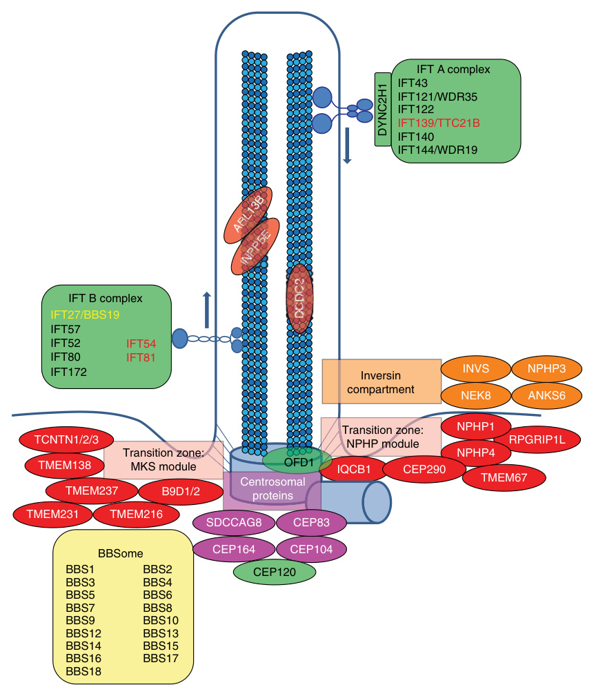

**Fig. 7.2** Subcellular localization of proteins encoded by known monogenic disease-causing genes of nephronophthisis-related ciliopathies (NPHP-RC). Proteins are color-coded based on their respective disease group (red/orange/pink: nephronophthisis [NPHP], Senior–Løken syndrome [SLS], Joubert syndrome [JBTS], Meckel–Gruber syndrome [MKS]; yellow: Bardet–Biedl syndrome [BBS]; green: skeletal ciliopathies). It becomes apparent that disease groups cluster to distinct subcellular localizations. _IFT,_ Intraflagellar transport. (From Braun DA, Hildebrandt F. Ciliopathies. _Cold Spring Harb Perspect Biol_ . 2017;9[3]:a028191 [Fig. 2]. doi:10.1101/cshperspect.a028191.) 

mechanistically distinct from **autosomal recessive polycystic kidney disease (ARPKD)** and the **NPHP-like related ciliopathies (RCs)** . One distinguishing feature is kidney size, which is not enlarged in NPHP-like RCC; another feature is cysts that occur across the entire kidney in PKD, whereas in NPHP-like diseases they are limited to the region of the corticomedullary junction. In addition, the course of disease differs largely (Table 7.1). Patients with PKD typically develop enlarged kidneys with large cysts, arising from all segments of the nephron in ADPKD, but exclusively from the 

collecting ducts and distal tubules in ARPKD. In contrast, in NPHP small cysts occur at the corticomedullary junction, in combination with tubular basement membrane disruption and sclerosing tubulointerstitial nephropathy, in normalto reduced-sized kidneys (with the exception of _INVS_ and _ANKS6_ ). In NPHP and ARPKD, the majority of patients develop end-stage kidney disease (ESKD) before 20 years of age (with a median age of 13 years in NPHP), whereas in ADPKD, 50% of affected individuals reach ESKD by 60 years.

<!-- p.125 -->

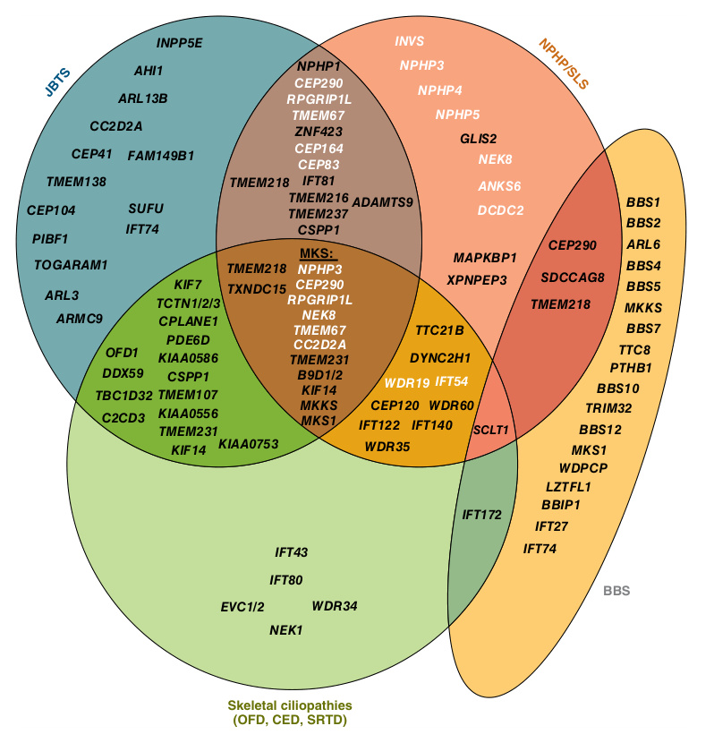

**Fig. 7.3** Monogenic genes of nephronophthisis-related ciliopathies (NPHP-RC) cause distinct but widely overlapping phenotypes. Monogenic genes of NPHP-RC are categorized into four major phenotypes, namely, JBTS (blue, Joubert syndrome [JBTS]: congenital brain malformations, cerebellar vermis hypoplasia, and intellectual disability), NPHP/SLS (red, nephronophthisis/Senior–Loken syndrome [SLS]: nephronophthisis [NPHP], retinal degeneration, coloboma), BBS (yellow, Bardet–Biedl syndrome [BBS]: obesity, intellectual disability, retinal degeneration, cystic kidney disease, polydactyly, hypogonadisms), and skeletal ciliopathies (green, oral-facial-digital syndrome [OFD], cranioectodermal dysplasia (CED), short-rib thoracic dysplasia [SRTD]). As shown in a Venn diagram, numerous genes can give rise to overlapping phenotypes if they become pathogenic variants. Meckel–Gruber syndrome (MKS), the most severe clinical manifestation of NPHP-RC, is caused by variants in monogenic genes of nephronophthisis, Joubert syndrome, and Bardet–Biedl syndrome on an allelic basis. White text indicates genes in which liver involvement has been reported. Recently discovered genes include: _SUFU_ (De Mori 2017, Serpieri 2022), _IFT74_ (Lindstrand 2016, Luo 2021), _PIBF1_ (Wheway 2015, Hebbar 2018), _TOGARAM1_ (Latour 2020, Morbidoni 2021), _ARL3_ (Alkanderi 2018, Powell 2019), _KIAA0753_ (Hammarsjoe 2017, Stephen 2017), _TMEM218_ (Van de Weghe 2021, Epting 2022), _SCLT1_ (Adly 2014, Sakakibara 2022), _ADAMTS9_ (Choi 2019, Matsushita 2022), _MAPKBP1_ (Macia 2017, Schoenauer 2019), _FAM149B1_ (Shaheen 2019, Shamseldin 2021), _ARMC9_ (Van de Weghe 2017, Issa 2020), _TXNDC15_ (Shaheen 2016, Radhakrishnan 2019), _XPNPEP3_ (O’Toole 2010, Alizadeh 2020). (Modified from Braun DA, Hildebrandt F. Ciliopathies. _Cold Spring Harb Perspect Biol_ 2017;9[3]:a028191 [Fig.1] doi:10.1101/cshperspect.a028191.) 

### **Autosomal Recessive Polycystic Kidney Disease (ARPKD)** 

ARPKD has a prevalence of about 1 in 20,000 in the population and is predominantly caused by variants in the _PKHD1_ gene, encoding the protein fibrocystin/polyductin, which is localized at the basal body, as well as at the ciliary 

membrane (Fig. 7.1); it is important for differentiation of the collecting duct _and_ the biliary systems. There is a high phenotypic variability, often even within one family. Rarely, ARPKD can also be caused by pathogenic variants in _DZIP1L_ . 

The majority of patients are severely affected. Many present with a “ **Potter sequence** ” phenotype at birth, which is

<!-- p.126 -->

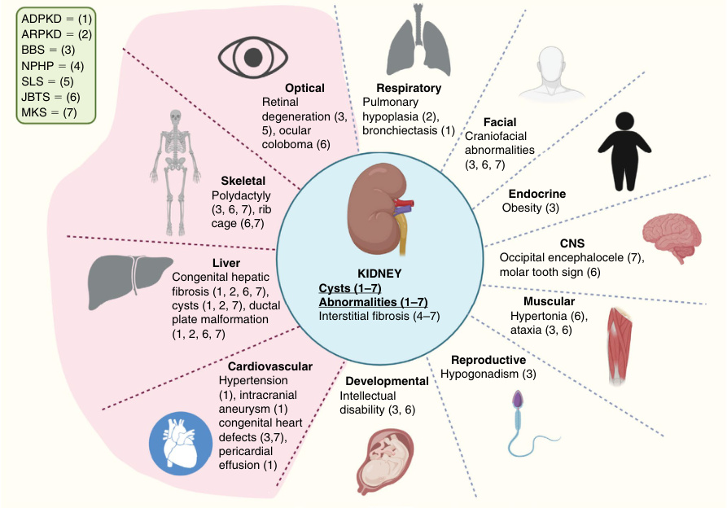

**Fig. 7.4** Renal ciliopathies and clinical phenotypes. Ciliopathies often affect the kidney and multiple other systems. Primary (highlighted in pink) and secondary clinical phenotypes are depicted here for common renal ciliopathies. There is a broad phenotypic overlap within the clinical presentations of these disorders. Diseases and corresponding numbers are noted in the green box. _ADPKD,_ Autosomal dominant polycystic kidney disease; _ARPKD,_ autosomal recessive polycystic kidney disease; _BBS,_ Bardet-Biedl syndrome; _CNS,_ central nervous system; _JBST,_ Joubert syndrome; _MKS,_ Meckel-Gruber syndrome; _NPHP,_ nephronophthisis; _SLS,_ Senior-Løken syndrome. (From McConnachie DJ, Stow JL, Mallett AJ. Ciliopathies and the kidney: a review. _Am J Kidney Dis._ 2021;77[3]:410–419 [Fig. 2, p. 412].) 

characterized by a _sequence_ of intrauterine renal failure with enlarged kidneys, oligo-anhydramnios with resultant pulmonary hypoplasia, characteristic facies, and contracted limbs. In these patients, renal insufficiency has already developed prenatally; there is a high postnatal mortality due to lung hypoplasia. In about 50% of patients the symptoms may develop during infancy or childhood. More than 50% of affected individuals progress to ESKD in the first decade of life; most ARPKD patients develop severe arterial hypertension requiring treatment. Urinary tract infections occur in 20–50%. 

Respiratory insufficiency caused by **pulmonary hypoplasia** results from mechanical pressure on the fetal lungs due to oligohydramnios and the massively enlarged kidneys, leading to an estimated mortality of 30–50% shortly after birth. ARPKD may be detected during pregnancy by intrauterine ultrasound, which demonstrates oligo-anhydramnios and large echogenic kidneys with poor corticomedullary differentiation. 

Histologically, kidneys exhibit an abundance of microcysts, originating from the collecting ducts and distal tubules, which are usually smaller than 2 mm in size and radiate out from the medulla to the cortex. 

A mandatory finding in patients with ARPKD is _hepatobiliary_ involvement in the form of **congenital hepatic fibrosis** and/or **Caroli disease** (a dilation of the intrahepatic bile ducts), caused by ductal plate malformation of the developing biliary system. Progression of liver fibrosis leads to complications associated with liver disease, such as portal hypertension (see “Liver Involvement”; Tables 7.2, 7.3), which is found in ~50% of patients by the age of 5 years. 

A subgroup of patients primarily displays the hepatic phenotype and has a negligible kidney involvement. These patients were often not correctly diagnosed with ARPKD, leading to the realization that the clinical spectrum exhibited in ARPKD is broader than previously observed.

<!-- p.127 -->

#### **TABLE Overview of Clinical Presentation and Diagnostics of Nephronophthisis (NPHP), Autosomal Recessive 7.1 Polycystic Kidney Disease (ARPKD), and Autosomal Dominant Polycystic Kidney Disease (ADPKD)** 

##### **TABLE** 

||Nephronophthisis (NPHP)|Autosomal Recessive Polycystic Kidney Disease (ARPKD)|Autosomal Dominant Polycystic Kidney Disease (ADPKD)|
|---|---|---|---|
|Age of onset|Infancy to adolescence|Mostly infancy|Typically adult onset|
|Clinical findings|• Polyuria • Polydipsia (with frequent night-time fluid intake) • Secondary enuresis • Growth retardation • At later stages: pallor, weakness, pruritus • Typically: Absence of edema, hypertension and urinary tract infections • Rarely: sudden death from fluid and electrolyte imbalance|• Often: “Potter” oligohydramnios phenotype at birth: • Enlarged kidneys • Pulmonary hypoplasia • Characteristic facies • Contracted limbs • Treatment-resistant arterial hypertension (~80%), often starting in infancy • ESKD in 60% of patients by 20 years of age • Kidneys decrease in size as fibrosis advances • Liver complications, e.g., portal hypertension, cholangitis|• (Gross) Hematuria • Urinary tract infections • Urinary concentration defect • Abdominal fullness/pain • Nephrolithiasis (20–35%) • Hypertension in 20–40% of children/ adolescents (before glomerular filtration rate (GFR) decline), in most adults • End stage kidney disease (ESKD) in 50% at age of 60 years • Intracranial aneurysms in~8% of patients (increased in patients with a positive family history) • Heart valve abnormalities • Aortic root dilation • Diverticulosis|
|Laboratory findings|Depending on stage of kidney failure: • Anemia • Elevated serum creatinine, Blood urea nitrogen (BUN), phosphorus • Metabolic acidosis • Decreased urine concentrating ability in water deprivation test Typically: Absence of hematuria, proteinuria, and bacteriuria|Depending on stage of kidney failure: • Anemia • Elevated serum creatinine, BUN, phosphorus • Metabolic acidosis • Hyponatremia Biliary disease and synthetic liver function often not reflected in altered laboratory findings (e.g., often normal serum amino transferases and coagulation profile). • Thrombocytopenia and neutropenia (associated with splenomegaly)|Depending on stage of kidney failure: • Anemia • Elevated serum creatinine, BUN, phosphorus • Metabolic acidosis • Hematuria • Urinary tract infections • Proteinuria (>300 mg/day), represents also a prognostic marker|
|Imaging|Ultrasound (alternatively magnetic resonance imaging [MRI] or computerized tomography [CT]): • Normal to smaller-sized kidneys (exception in infantile NPHP) • Loss of corticomedullary differentiation • Increased echogenicity • Cystic lesions at the corticomedullary junction (~70% of patients)|Ultrasound (alternatively MRI or CT): • Bilaterally enlarged cystic kidneys (>10 cysts) • Loss of corticomedullary differentiation • Increased echogenicity • Multiple small medullary cysts • Kidney size/function do not correlate|Ultrasound (alternatively MRI or CT): • Bilaterally enlarged cystic kidneys (>10 cysts) • Liver cysts, ranging from few hepatic cysts to a massively enlarged liver • Cysts in pancreas, seminal vesicles and arachnoid membranes can occur|

_(Continued)_

<!-- p.128 -->

##### **TABLE** 

##### **7.1** 

#### **Overview of Clinical Presentation and Diagnostics of Nephronophthisis (NPHP), Autosomal Recessive** 

#### **Polycystic Kidney Disease (ARPKD), and Autosomal Dominant Polycystic Kidney Disease (ADPKD)—cont’d** 

||Nephronophthisis (NPHP)|Autosomal Recessive Polycystic Kidney Disease (ARPKD)|Autosomal Dominant Polycystic Kidney Disease (ADPKD)|
|---|---|---|---|
|Microscopic findings|Histological triad of NPHP: • Disintegration of the tubular basement membrane with irregular thickening and disruption • Interstitial round cell infiltration with tubulointerstitial fibrosis • Tubular atrophy with small corticomedullary cysts • In addition: periglomerular fibrosis with splitting and thickening of Bowman’s capsule In the advanced stage: • Diffuse sclerosing tubulo- interstitial nephropathy|Kidney: • Fusiform dilations of distal tubules and collecting ducts • At later stages: variable renal cyst sizes, interstitial fibrosis Liver: • Ductal plate malformation with congenital hepatic fibrosis and biliary duct ectasia (Caroli disease)|Kidney: • Fluid-filled cystic dilations of all nephron levels, but mainly distal regions • Compression of surrounding nephrons, interstitium, and vasculature • Progressive fibrosis Liver: • Cystic dilations of bile ducts and liver parenchyma|
|Genetic Testing and affected genes|• Autosomal-recessive • In 30–50% of cases: _NPHP1_|• Autosomal recessive •_PKHD1_, in rare cases _DZIP1L_|• Autosomal dominant •_PKD1_(~80%) or_PKD2_(~15%) • Rare other genetic loci|

Extracted from: Bergmann C, Guay-Woodford LM, Harris PC, Horie S, Peters DJM, Torres VE. Polycystic kidney disease. _Nat Rev Dis Primers_ 2018;4(1):1–24. Guay-Woodford LM, Bissler JJ, Braun MC, et al. Consensus expert recommendations for the diagnosis and management of autosomal recessive polycystic kidney disease: report of an international conference. _J Pediatr._ 2014;165(3):611–617. Harris PC, Torres VE. Polycystic kidney disease. _Ann Rev Med_ 2009;60(1):321–337. 

#### **TABLE 7.2 Clinical Presentation of Hepatic Ciliopathy Phenotypes** 

|Phenotype|Frequency|Signs and Symptoms|Laboratory|Imaging|
|---|---|---|---|---|
|pHTN|Most frequent|• Hepatomegaly • Splenomegaly • Varices|• Normal liver enzymes and bilirubin • Thrombocytopenia • Normal INR|• Hyperechoic periportal thickening on hepatic ultrasound • Velocity changes in portal vein and hepatic artery on hepatic Doppler • High signal intensity among portal branches with small intrahepatic bile ducts on T2-weighted magnetic resonance imaging|
|Cystic dilation of bile ducts|Second most frequent|• Abdominal pain • Pruritus • Recurrent cholangitis • Poor growth|• Elevated bilirubin • Serum bile acids • Fat-soluble vitamin deficiency|• Diffuse large intrahepatic bile duct ectasia seen best by MRCP|
|pHTN and cystic dilation of bile duct combined|Rare|• Symptoms from both phenotypes|• Findings similar to both phenotypes|• Findings similar to both phenotypes|

_INR,_ International normalized ratio; _pHTN,_ portal hypertension. With kind permission from Diamond et al., 2021. Diamond T, Nema N, Wen J. Hepatic ciliopathy syndromes. _Clin Liver Dis (Hoboken)._ 2021;18(4):193–197 (Table 1, p. 195).

<!-- p.129 -->

#### **TABLE 7.3 Ciliopathies With Hepatic Phenotype** 

|Disease|Mode of Inheritance|Gene(s)|Prevalence|
|---|---|---|---|
|Autosomal recessive polycystic kidney disease (ARPKD)*|AR|_PKHD1, DZIP1L_‡|1:20,000|
|Meckel-Gruber-syndrome|AR|_MKS1, TMEM67, CEP290, RPGRIP1L, CC2D2A_|1:140,000|
|Joubert syndrome and related disor- ders, including COACH syndrome*|AR|_AHI1, NPHP1, CEP290, TMEM67, RPGRIP1L,_ _ARL13B, CC2D2A_|1:100,000|
|Bardet-Biedl syndrome (BBS)|AR|_BBS1, BBS2, ARL6, BBS4, BBS5, MKKS, BBS7, TTC8,_ _BBS9, BBS10, TRIM32, BBS12, MKS1, CEP290_|1:100,000|
|Renal-hepatic-pancreatic dysplasia|AR|_NPHP3_|Rare|
|Oral-facial-digital syndrome (OFD)|X-linked|_OFD1_|1:100,000|
|Skeletal ciliopathies (CED, SRTD)|AR|_IFT80, IFT122_†,_WDR19_†,_WDR35_†,_IFT43_†,_EVC,_ _EVC2, IFT40_†,_IFT172_‡|Rare|
|Autosomal dominant polycystic kidney disease (ADPKD)|AD|_PKD1, PKD2_|1:1,000|
|Nephronophthisis|AR|_NPHP1, INVS, NPHP3, NPHP4, IQCB1, CEP290,_ _LIS2, RPGRIP1L, NEK8_|1:100,000|

_AR,_ Autosomal recessive; _CED,_ cranioectodermal dysplasia; _COACH,_ colobomas, oligophrenia, ataxia, cerebellar vermis hypoplasia, and hepatic fibrosis; _OFD,_ oral-facial-digital syndrome; _SRTD,_ short-rib thoracic dysplasia. *Syndromes most associated with ductal plate malformations. †Genes discovered since original publication. ‡Genes discovered since updated version: _DZIP1L_ ; _IFT172_ . From Diamond T, Niema N, Wen J: Hepatic ciliopathy syndromes. Clin Liv Dis 2021;18(4):193-197 (Table 2, p. 195). 

### **Nephronophthisis** 

NPHP is an autosomal recessive kidney disease and comprises one of the most common monogenic causes of end-stage kidney disease (ESKD) within the first three decades of life. It is initially characterized by rather mild symptoms, which may be overlooked. Manifestations consist of polyuria, polydipsia, and secondary enuresis and particularly nocturia, starting ~6 years of age, followed by anemia with growth restriction. Clinically, NPHP has been divided into **infantile** , **juvenile** , and **adolescent** NPHP, with manifestation of ESKD at median ages of 1 year, 13 years, and 19 years, respectively. Many NPHP-related ciliopathies (NPHP-RC) develop in a syndromic manner, with a variety of affected organ systems, ranging from retinal degeneration, cerebellar vermis hypoplasia, hepatic fibrosis, and skeletal anomalies to brain malformations and neurological impairment. 

In the most common form, **juvenile NPHP** , age of onset of symptoms is typically ~6 years of age, and in over 80% the patients develop polyuria, polydipsia with frequent nightly fluid intake (a characteristic detail that should be actively sought), resulting from a reduced urinary concentrating ability and secondary enuresis (Table 7.1). Other symptoms linked to kidney diseases, specifically 

hypertension, edema, and urinary tract infections, _are not_ common in NPHP. Laboratory tests are usually negative for hematuria, proteinuria, and bacteriuria and only occasionally show mild tubular proteinuria. To assess the severity of renal failure, serum creatinine, BUN, phosphorus, metabolic acidosis, and anemia need to be determined. A water deprivation test typically shows a decreased ability to concentrate the urine. 

NPHP-RC kidneys are typically small or normal-sized. Renal ultrasound findings include a loss of corticomedullary differentiation and increased echogenicity. At later stages in the course of disease, small cysts are detected at the corticomedullary junction. Magnetic resonance imaging or computed tomography are alternatives to demonstrate the presence of medullary cysts. The histological triad for NPHP consists of (1) disintegration of the tubular basement membrane with irregular thickening and disruption, (2) interstitial round cell infiltration with tubulointerstitial fibrosis, and (3) tubular atrophy with small corticomedullary cysts, although cysts do not need to be present. In the course of disease chronic tubulointerstitial nephritis occurs with subsequent progression to ESKD. Renal biopsy is usually not indicated because of the high rate of confirmation using molecular genetic diagnostics.

<!-- p.130 -->

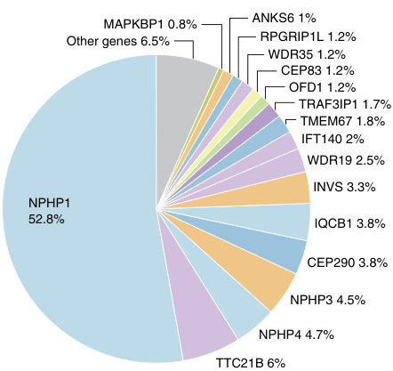

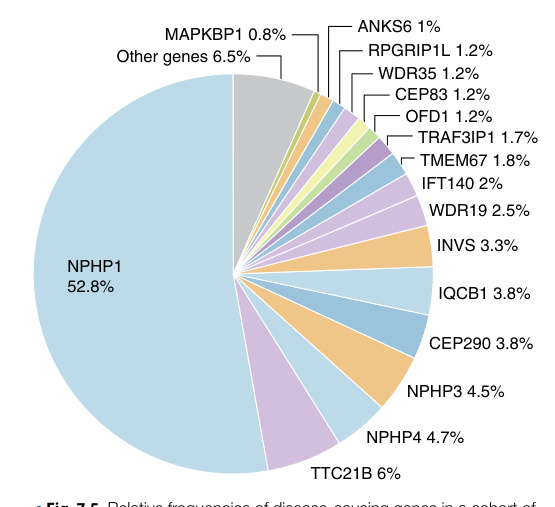

**Fig. 7.5** Relative frequencies of disease-causing genes in a cohort of 600 patients with nephronophthisis. Pathogenic variants in _NPHP1_ are by far the most common genetic cause for NPHP. In approximately 80% of cases the underlying defect is a whole gene deletion of _NPHP1_ due to genomic instability in this region. (From Petzold F, Billot K, Chen X, et al. The genetic landscape and clinical spectrum of nephronophthisis and related ciliopathies. _Kidney Int_ . 2023;104[2]:378–387 [Fig. 1b, p. 380].) 

At least 90 disease-causing genes have been discovered and functionally characterized for NPHP-related RCC. Variants in these genes account for up to 68% of cases. The most frequent cause of NPHP has been identified in _NPHP1_ , accounting for 20–53% of cases (see Figs. 7.3, 7.5). Approximately 80% have a large (290 kb) homozygous deletion, involving a 100 kb large inverted duplication. The reason for the high frequency of this deletion is the presence of large tandem repeats leading to chromosomal misalignment and an unequal recombination event. These two large, inverted repeats with a very high sequence homology flank the _NPHP1_ gene, and represent 1 of 24 known “hot spot” regions in the human genome which are known for their genomic instability. 

### **Therapy** 

No curative treatment is available for any of the ~20 characteristic and >60 syndromic forms of NPHP-related RCC. In an _Nphp1_ -knockout mouse model, gene-replacement therapy using an adeno-associated virus vector showed a partial rescue of the phenotype. In another study, two compounds activating a prostaglandin receptor showed promising results in improving ciliary phenotypes not only _in vitro_ in _NPHP1_ patient-derived renal tubular cells, but also in zebrafish and mouse models. 

### **Extrarenal Manifestations of NPHP-RC** 

In 10–20% of patients, NPHP-RC are accompanied by impairment of other organ systems, such as the retina, the 

central nervous system, the liver, and the skeletal system. The most common association is NPHP with retinal degeneration, called **Senior-Løken syndrome** , which is present in ~10% patients with NPHP. Other manifestations include central nervous system malformations, especially cerebellar vermis hypoplasia (Joubert syndrome), skeletal phenotypes like short-rib thoracic dysplasia (SRTD) and ectodermal dysplasia (see “Short Rib Thoracic Dysplasia and Skeletal Involvement”), laterality defects, and congenital heart defects (Figs. 7.3, 7.4, 7.6; Tables 7.4, 7.5). 

Importantly, genes involved in NPHP-RC show a broad phenotypic range, often with overlapping phenotypes (Fig. 7.3). In some genes, truncating pathogenic gene variants lead to more severe phenotypes, such as Meckel-Gruber syndrome, whereas some missense variants manifest as isolated NPHP. In addition to a strong allelic heterogeneity, the same biallelic variants in siblings can produce different phenotypes. However, depending on the subcellular localization of the encoded protein, distinct subtypes of ciliopathies can be connected to these protein complexes (Fig. 7.2). 

### **Ocular Involvement** 

The cellular extensions of retinal photoreceptor neurons in the eye represent a specialized form of primary cilia; in ciliopathies ocular involvement manifests as retinopathy. A syndromic involvement of NPHP and retinitis pigmentosa (RP)/retinal degeneration is called **Senior-Løken syndrome (SLS)** . Three different retinal pathologies have been described: RP, tapetoretinal degeneration, and retinal-renal dysplasia, most likely representing a spectrum of retinal impairment, ranging from late-onset degeneration to an early-onset dysplastic defect. The _early-onset_ type manifests as a form of **Leber congenital amaurosis** , the most severe form of inherited retinal dystrophies. It is typically present at birth or within the first two years of life with blindness, paired with nystagmus, and reduced or absent response upon electroretinography. In the _late-onset_ type of RP, patients develop night blindness and progressive vision loss during school age. Before clinical signs become apparent, the response to stimuli in the electroretinogram demonstrates decreased electrical responses; in the optical coherence tomography (OCT), abnormal layering of the retina with atrophy can be visualized. In later stages, fundoscopic signs of RP also become apparent, such as rarefaction of retinal vasculature, atrophy of the retinal pigment epithelium, and paleness of the optic disc. A diagnosis is made by the aforementioned findings in ophthalmoscopy, combined with electroretinography and electrooculography. 

There are nonretinal ocular phenotypes that can occur in ciliopathies. Some patients exhibit **coloboma** resulting from abnormal closure of the optic cup during eye development. **Ametropia** , both myopia and hyperopia, have been reported. Patients with severe myopia should be monitored regularly for retinal detachment. Neurologically based ocular phenotypes are caused by hypoplastic neural structures within the cerebellum and brain stem and are especially

<!-- p.131 -->

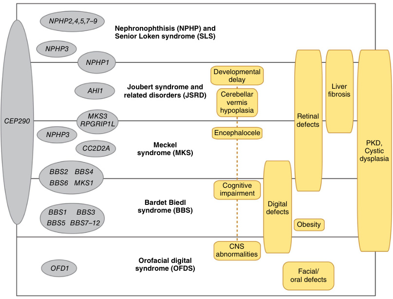

**Fig. 7.6** Genes and phenotypic abnormalities associated with syndromic forms of PKD. Diseases are listed in the center; genes associated with them are shown on the left _(gray)_ . On the right are phenotypes found in these different disorders _(yellow)_ . Note the high degree of overlap in genes and phenotypes between the different disorders. (From Harris PC, Torres VE: Polycystic kidney disease. _Annu Rev Mol_ . 2009;60:321–337 [Fig. 3, p. 331].) 

common, but not exclusively, in Joubert syndrome (JS). Manifestations include ptosis, strabismus, and abnormal eye movements. The latter ranges from gaze-holding instabilities in early manifestation of JS to nystagmus and ocular motor apraxia (OMA) type Cogan. OMA describes an intermittent horizontal saccade failure resulting in patients having difficulties in focusing and fixating on targets and therefore exhibiting head thrusting or compensatory head movement. The clinical symptoms of OMA often improve after the first years of life. 

### **Liver Involvement** 

Primary cilia are essential for hepatic ductal plate formation during embryogenesis and the subsequent reorganization into bile ducts. Abnormally, persistent ductal plate remnants lead to proliferation of the extracellular matrix and result in fibrosis of portal tracts and interlobular bile duct, known as **congenital hepatic fibrosis (CHF)** . Alternatively, if larger bile ducts are primarily involved and show cystic dilations, a different entity called **Caroli disease** 

**(CD)** can be distinguished. A combination of both has been called _Caroli syndrome_ . Characteristically, the liver parenchyma remains largely unaffected, and patients with liver disease associated with ciliopathies often show preserved synthetic liver function. Typical hepatic symptoms include abdominal pain, pruritus, hepatosplenomegaly, as well as gastrointestinal bleedings due to portal hypertension and esophageal varices in CHF and a highly increased risk for cholangitis and cholelithiasis in CD (Table 7.1). The management of liver involvement focuses on the prevention and control of secondary complications, such as endoscopic intervention after the first episode of an esophageal variceal bleed. A prophylactic endoscopic intervention is controversial in children because only ~15% of patients with esophageal varices develop bleedings. The mortality of variceal bleeding is correlated with the severity of liver dysfunction; in pediatric ciliopathy patients, liver function is often preserved until adulthood. In some patients, a portosystemic shunt may become necessary, but should be evaluated carefully, especially in the context of concurrent kidney involvement. In addition, providing prophylactic antibiotics in patients

<!-- p.132 -->

##### **TABLE** 

#### **7.4 Thoracoabdominal Asymmetry** 

|Heterotaxy||Situs Ambiguus(SA)||||
|---|---|---|---|---|---|
|(SA+Complex CVM)|SA+Simple CVM|SA Without CVM|Isolated Possible Laterality Defect|Situs Inversus Totalis|Situs Solitus|
|SA plus any of the following cardiac issues: • Cardiac isomerism • HPV with other cardiac lesions (except ASD or APVR alone) • l-TGA+LVOTO (PS) • Any defects that do not fit into a standard cardiac phenotype classification or standard associations|SA plus any of the following standard cardiac phenotypes or associations: • Dextrocardia • Mesocardia • ASD • VSD • AVSD • Common atrium • Tetralogy of Fallot • PS or PA • Overriding aorta • DORV • Ebstein anomaly • Tricuspid atresia • l-TGA or d-TGA • Truncus defect • HPV+VSD or APVR|SA including any of the following defects: Vascular • APVR • Right aortic arch • Bilateral or left superior vena cava • Interrupted or duplicated inferior vena cava Abdomen • Asplenia or polysplenia • Intestinal malrotation • Midline liver • Left-sided liver • Right-sided spleen or stomach Pulmonary • Left or right- sided pulmonary isomerism|Any solitary lesion that may be associated with laterality defects, including cardiac or non-cardiac lesions|Total mirror image arrangement of thoraco- abdominal organs without cardiovascular defect|No thoraco- abdominal asymmetry|

_APVR,_ Anomalous pulmonary venous return; _ASD,_ atrial septal defect; _AVSD,_ atrioventricular septal defect; _CVM,_ cardiovascular malformation; _d-TGA,_ dextro transposition of the great arteries; _DORV,_ double outlet right ventricle; _HPV,_ hypoplastic ventricle; _l-TGA,_ levo-transposition of the great arteries; _LVOTO,_ left ventricular outflow tract obstruction; _PA,_ pulmonary atresia; _PS,_ pulmonary stenosis; _SA,_ situs ambiguus; _VSD,_ ventricular septal defect. From Harrison MJ, Shapiro AJ, Kennedy MP: Congenital heart disease and primary dyskinesia. _Paediatr Respir Rev._ 2016;18:25–32 (Table 1, p. 27). 

with known CD and **recurrent cholangitis** should be considered. Patients with liver involvement, especially CD, are also potentially at a moderately higher risk of malignant lesions, such as hepatocellular carcinoma and cholangiocarcinoma. In severe cases of recurrent cholangitis or refractory complications of portal hypertension a liver transplant, or a combined kidney-liver transplant, should be considered. 

### **Central Nervous System (CNS) Involvement** 

In NPHP-related RC CNS involvement typically presents as **Joubert syndrome (JS)** , which is characterized by a distinctive malformation: hypoplasia of the cerebellar vermis and accompanying brain stem, forming the so-called “molar tooth sign” on axial magnetic resonance imaging (MRI) scans (see “Joubert Syndrome”; Fig. 7.7). However, in **Meckel-Gruber syndrome** (MKS), a characteristic CNS phenotype consists of an encephalocele; microcephaly or anencephaly can also occur. 

Other CNS abnormalities that are often found in syndromic ciliopathies include hydrocephalus, cortical atrophy, and polymicrogyria. In addition variable intellectual disability 

and behavioral problems such as speech delay and impulsivity are frequently exhibited in ciliopathies. The CNS impairments and structural changes are not progressive or degenerative, in contrast to the kidney, liver, and eye manifestations. 

### **Heart Involvement** 

Both motile and sensory cilia play a role in determining the asymmetrical left-right body axis during embryogenesis. In the evolutionary conserved epithelium of the early symmetrical heart tube called LRO (left-right organizer) polarized motile cilia rotate synchronously in a clockwise manner and primary cilia sense this leftward fluid flow and trigger conserved signaling pathways. A disruption of this process results in impaired left-right patterning of the internal organs. Therefore, cardiac phenotypes in ciliopathies include heterotaxy and situs inversus (Table 7.4). Furthermore, various signaling pathways, most prominently the Hedgehog signaling pathway, are essential for heart development. Disruption of ciliary function can therefore manifest in

<!-- p.133 -->

##### **TABLE 7.5** 

#### **Genes and Phenotypes Associated With Skeletal Ciliopathies** 

|Condition|Inheritance|Skeletal Phenotype|Renal Phenotype|Retinopathy|Liver Phenotype|
|---|---|---|---|---|---|
|Short-rib polydactyly syndromes (SRPS)|AR|Most often polydactyly, short ribs, shortened long bones, brachydactyly, abnormal pelvis configuration, sometimes orofacial clefts|Often, NPHP-like or polycystic|Not evident in utero/at birth|Cysts and/or fibrosis may occur|
|Jeune asphyxiating thoracic dystrophy (JATD)|AR|Short ribs and extremities, sometimes polydactyly, abnormal pelvis configuration, scoliosis|Overall approximately 30% but mainly observed with IFT- gene variants, rarely reported for IFT dynein-2 gene variants|Similar to renal disease except _C21orf2_ variants causing isolated retinopathy but no renal disease|Frequently elevated liver enzymes but rarely progression into liver failure|
|Mainzer–Saldino syndrome (MZSDS)|AR|Mildly shortened ribs, cone-shaped epiphyses|Always, mainly NPHP-like, rarely cystic|Always|Sometimes cholestasis and hepatic fibrosis|
|Axial spondylometaphyseal dysplasia (SMD)|AR|Short ribs, thorax deformities, hip dysplasia, scoliosis|–|Always|–|
|Endocrine–cerebro– osteodysplasia syndrome (ECO)|AR|Short limbs, poly(syn) dactyly, brachydactyly, clefts|Cystic|–|–|
|Orofaciodigital syndrome (OFD)|AR or X-chromosome|Variable rib shortening often brachydactyly/ polydactyly, micromelia, orofacial clefts, disproportional small and oval tibia|Cystic dysplastic kidneys||Rarely cysts/ fibrosis|
|Sensenbrenner syndrome (CED)|AR|Mildly shortened ribs, brachydactyly, craniosynostosis leading to dolichocephalus|Very often, mainly NPHP-like|Sometimes|Inconsistent hepatic cysts and fibrosis/hepatic ductal plate malformation|
|Ellis–van Creveld syndrome (EVC)|AR|Short ribs and long bones, abnormal pelvis configuration, polydactyly of the hands|–|–|–|
|Weyers acrofacial dysostosis|AD|Short stature, short extremities, polydactyly of the hands|–|–|–|
|Hydrolethalus syndrome|AR|Polydactyly, clefts, micrognathia|–|–|–|
|Acrocallosal syndrome|AR|Polydactyly|–|–|–|

_AD_ , Autosomal dominant; _AR_ , autosomal recessive; _NA,_ not applicable; _X-chr_ ., X-chromosomal. 

Cytoplasmic IFT dynein-2 genes highlighted in bold. 

From Schmidts M, Mitchison HM. 15—Severe skeletal abnormalities caused by defects in retrograde intraflagellar transport dyneins. In: King SM, ed. _Dyneins: Structure, Biology and Disease (Second Edition)_ . Academic Press; 2018:356–401. doi:10.1016/B978-0-12-809470-9.00015-1.

<!-- p.134 -->

|Obesity|Developmental Delay|Situs Inversus|Other|Gene|
|---|---|---|---|---|
|–|NA (early lethality)|Rarely|Always lethal perinatal due to cardiorespiratory insufficiency resulting from severe thoracic constriction. Heart defects, gastrointestinal, cardiac defects occur.|_DYNC2H1, WDR34, WDR60,_ _DYNC2LI1, NEK1, WDR35,_ _DYNC2L1, KIAA0586, INTU,_ _WDPCP, C2CD3, ICK, IFT52,_ _IFT81_|
|Single cases|Joubert-phenotype with CSPP1 and KIAA0586 variants only, otherwise normal development|Not described|Often severe cardiorespiratory distress with~30% lethality especially with IFT dynein-2 complex gene variants; IFT gene variants usually cause a mild rib phenotype but frequent renal and retinal disease. CEP120 gene variants associated with OFD-like findings. Incomplete penetrance reported for TCTEX1D2 variants.|_DYNC2H1, WDR34, WDR60,_ _DYNC2LI1, TCTEX1D2,_ _IFT80, IFT172, IFT140,_ _IFT144 (WDR19), IFT139_ _(TTC21B), CEP120, CSPP1,_ _KIAA0586, C21orf2_|
|–|Single cases|Not described|Mild thorax phenotype, usually no cardiorespiratory lethality.|_IFT140, IFT172_|
|–|–|–||_C21orf2_|
|–|Possible|–|Brain malformations, facial dysmorphism.|_ICK_|
|–|Brain malformations observed|–|Lobulated tongue, coloboma, ambiguous genitalia, anal atresia, deafness have been observed.|_TCTN3, OFD1, C5ORF42,_ _TMEM231, TMEM216,_ _TMEM107, TBC1D32,_ _SCLT1, C2CD3, WDPCP,_ _DDX59_|
|–|Sometimes|Usually not|Mild thorax phenotype, facial dysmorphism, thin/sparse hair, nail and teeth dysplasia, heart defects.|_IFT122, IFT144 (WDR19),_ _IFT43, WDR35_|
|–|–|–|Hypoplastic nails, teeth abnormalities, heart defects.|_EVC1, EVC2_|
|–|–|–|Hypoplastic nails, teeth abnormalities.|_EVC1, EVC2_|
|–|NA (lethal)||Midline defects, complex brain malformations.|_KIF7_|
|–|yes||Brain malformations, often absent corpus callosum, midline defects.|_KIF7_|

<!-- p.135 -->

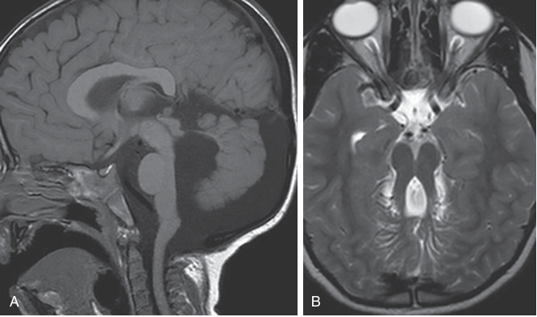

**Fig. 7.7** Molar tooth syndrome. (A) Sagittal T1-weighted MR image shows hypoplasia of the superior cerebellar vermis with upward bowing of the roof of the fourth ventricle. (B) Axial T2-weighted image shows the molar tooth at the level of the midbrain, the hallmark of Joubert syndrome and related disorders (JSRD). (From Coley BD [ed.], _Caffey’s Pediatric Diagnostic Imaging_ , 13/e, Vol. 1; 2019 [Fig. 31.29, p. 286].) 

heart valve defects, such as mitral valve prolapse, bicuspid aortic valve disease, and pulmonary valve stenosis. Other cardiac phenotypes include aortic stenosis, patent ductus arteriosus, atrioventricular septal defects (ASVD), hypertrophic obstructive cardiomyopathy, and hypertension, which can all occur with or without heterotaxy. Cardiac involvement has been described in ~7% of Bardet-Biedl syndrome patients and is also frequently present in patients with JS, NPHP, SRTD, and Meckel-Gruber syndrome. Additionally, the presence of situs inversus and NPHP-RC may be associated with proteins that are part of the “inversin compartment” and share interactions (Figs. 7.1 and 7.2), such as INVS, NPHP3, or ANK6. 

# **Syndromic Ciliopathies** 

## **Protein Localization Can Determine Phenotype** 

Ciliary proteins from functional complexes, such as the IFT A and B complexes, are responsible for anterograde and retrograde transport within the cilia, whereas the BBSome is important for vesicular trafficking of membrane proteins to the primary cilium and stabilization of the IFT complexes (Fig. 7.2). The subcellular localization of the proteins encoded by known disease-causing genes and their respective involvement in certain compartments demonstrate an important correlation to organ involvement and pleiotropy. Loss of function in proteins, which are part of the BBSome, lead most commonly to Bardet-Biedl syndrome (BBS), whereas pathogenic variants in proteins belonging to the IFT complexes most often lead to skeletal ciliopathies. 

However, loss of function in IFT proteins have also been shown to cause BBS. Transition zone and centrosomal proteins are mostly implicated in NPHP, Joubert syndrome, and Meckel-Gruber syndrome, but show broad heterogeneity and overlap between these diseases (Figs. 7.2 and 7.3). 

## **Joubert Syndrome** 

Joubert syndrome (JS) is an autosomal recessive, highly heterogenous neurodevelopmental disorder, characterized by the pathognomonic malformation known as the “ **molar tooth sign** ” in axial MRI scans. This characteristic abnormality appears at the midbrain-hindbrain junction and is explained by cerebellar vermis hypo-or dysplasia (Fig. 7.7) 

JS has a prevalence of approximately 1.7 per 100,000 individuals. To date, there are over 40 causative genes identified (Fig. 7.3), which collectively account for 62–94% of JS cases. The most common genes associated with JS, accounting for approximately 6–9% each, are _CPLANE1_ , _CC2D2A_ , _CEP290_ , _AHI1_ , and _TMEM67_ . 

The clinical presentation of JS begins in the neonatal period and includes hypotonia, abnormal eye movements, developmental delay, and, in a subset of patients, episodic breathing dysregulation characterized by alternating tachypnea and apnea. When the disease progresses, individuals with JS may develop cerebellar ataxia, cognitive impairment, oculomotor apraxia, and retinal dystrophy (~30%), as well as a predominantly NPHP-kidney phenotype (~20–25%) and hepatic fibrosis (~15–20%). A syndromic form of JS called **COACH** , which stands for colobomas, cognitive impairment, ataxia, cerebellar vermis hypoplasia, and hepatic fibrosis, is most frequently caused by pathogenic variants in _TMEM67_ . Some

<!-- p.136 -->

patients may also exhibit coloboma of the optic nerve (~15%) and facial anomalies, though not in a specific recognizable pattern. 

Additionally, around 10–15% of affected JS individuals also show polydactyly, most commonly postaxial but also preor meso-axial, along with other rare skeletal malformations. 

## **Meckel-Gruber Syndrome** 

Meckel-Gruber syndrome (MKS) is a severe autosomal recessive disorder with a prevalence of ~1/50,000. It is characterized by four characteristic findings: occipital encephalocele, large cystic-dysplastic kidneys, congenital hepatic fibrosis, and polydactyly. Patients also exhibit a range of other CNS malformations, such as hydrocephalus, microcephaly, or anencephaly, as well as other organ involvement such as microphthalmia, lung hypoplasia, congenital heart disease, skeletal malformations (bowing and shortening of the long bones, polydactyly), and situs inversus. A typical “Potter sequence” may occur. MKS is typically embryonically or perinatally lethal, with only a few cases reported that have survived beyond infancy. MKS is an example of allelic heterogeneity because two truncating pathogenic variants can cause the development of a severe MKS phenotype, whereas a JS or NPHP phenotype may manifest if the patient possesses at least one missense variant. Many of the genes known to cause MKS encode for proteins that are located in the transition zone of the cilia (Fig. 7.2), suggesting a crucial role of this ciliary compartment for MKS. MKS frequently presents with oligohydramnios due to prenatal impairment of kidney function, enabling a diagnosis on perinatal ultrasound. 

## **Bardet-Biedl Syndrome** 

Bardet-Biedl syndrome (BBS) is an autosomal recessive multiorgan ciliopathy with a prevalence of ~1/100,000 in North America and Europe. There are at least 22 known causative genes for BBS, with _BBS1, BBS2,_ and _BBS10_ being the most commonly implicated genes (combined ~50% of cases). Most of the proteins encoded by known BBS genes form the so-called “BBSome” complex, which is located at the basal body of the cilia and has an important role in maintaining, stabilizing, and assembling IFT particles, as well as protein trafficking in and out of the cilium (Fig. 7.2). 

Hallmarks of BBS are rod-cone dystrophy of the retina (93% of patients), obesity (72–92%), polydactyly (63–81%), genital anomalies (59–98%), renal anomalies (53%), and learning difficulties (61%), but the expressivity of BBS is extremely variable. A clinical diagnosis can be established if 4 of these 6 primary features are present or if there are 3 primary features plus at least 2 additional secondary features detectable (Table 7.6). The age of diagnosis differs widely and is mainly driven by the onset of retinal dystrophy, which typically manifests in childhood between 5 and 10 years with night blindness but can also occur at earlier or later ages. 

Genetic testing using a diagnostic panel or exome sequencing is advised, although variants of uncertain significance (VUS) may be difficult to interpret, especially if the patient shows nonspecific primary features like obesity or learning difficulties and does not fulfill the clinical diagnostic criteria for BBS. 

#### **TABLE** 

#### **7.6** 

### **Diagnostic Criteria for Bardet-Biedl Syndrome (BBS)** 

|Diagnosis can be established if 4 pri|mary features, or 3 primary features and 2 secondary features, are present.|
|---|---|
|~~Primary Features of BBS~~|~~S~~econdary Features of BBS|
|• Rod-cone dystrophy • Polydactyly|• Speech disorder/delay • Ocular abnormalities (strabism/cataract/astigmatism/color blindness)|
|• Truncal obesity i|• Developmental delay|
|• Learning difficulties|• Diabetes mellitus|
|• Genital anomalies (hypogonadism in males)|• Dental anomalies (hypodontia/small roots/high arched palate) • Mild craniofacial dysmorphism i|
|• Renal anomalies (variable, e.g., cystic tubular disease, urinary concentration defects, hydronephrosis, atrophy)|• Congenital heart disease (aortic fibrosis, patent ductus arteriosus, cardiomyopathy), left ventricular hypertrophy • Cardiovascular defects/hypertension • Hearing loss • Brachydactyly/Syndactyly • Ataxia/poor coordination/imbalance • Anosmia/hyposmia • Hepatic fibrosis • Asthma of early onset • Gastrointestinal (GI) abnormalities (e.g., Hirschsprung disease, anatomic anomalies of the GI tract)|

Beales PL, Elcioglu N, Woolf AS, Parker D, Flinter FA. New criteria for improved diagnosis of Bardet-Biedl syndrome: results of a population survey. _J Med Genet_ . 1999;36(6):437–446. doi:10.1136/jmg.36.6.437. Forsythe E, Beales PL. Bardet-Biedl syndrome. _Eur J Hum Genet_ . 2013;21(1):8–13. doi:10.1038/ejhg.2012.115. 

Putoux A, Attie-Bitach T, Martinovic J, Gubler MC. Phenotypic variability of Bardet-Biedl syndrome: focusing on the kidney. _Pediatr Nephrol_ . 2012;27(1):7–15. doi:10.1007/s00467-010-1751-3.

<!-- p.137 -->

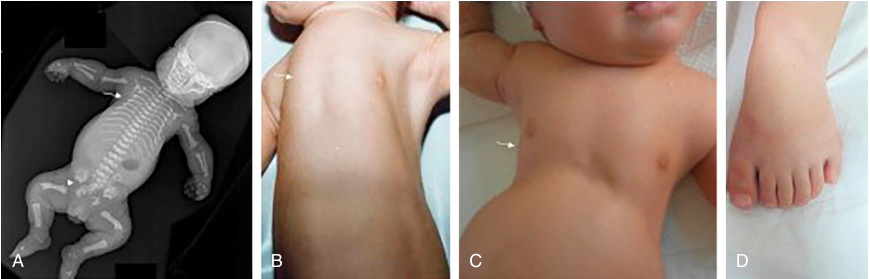

**Fig. 7.8** Clinical hallmarks of skeletal ciliopathies that are caused by inherited pathogenic variants affecting the cytoplasmic IFT Dynein-2. (A) Short-rib polydactyly phenotype with short horizontal ribs causing severe thoracic narrowing _(arrows)_ , shortened long bones, and pelvis dysplasia with acetabular spurs _(arrow head)_ . (B, C) Examples of narrow dysplastic thorax configuration _(arrows)_ in Jeune syndrome. (D) Axial polydactyly affecting the toes in a case of Jeune syndrome. (From Schmidts M, Mitchison HM. 15—Severe skeletal abnormalities caused by defects in retrograde intraflagellar transport dyneins. In: King SM, ed. _Dyneins: Structure, Biology and Disease [Second Edition]_ . Academic Press; 2018:356–401 [Fig. 15.1].) 

## **Alström Syndrome** 

Alström syndrome (ALMS) is a rare autosomal-recessive disease with an approximate prevalence of 1:500,000 to 1:1,000,000. Alström syndrome is caused by pathogenic variants in the gene _ALMS1_ . It has overlapping phenotypes with BBS because patients regularly exhibit progressive sensorineural deafness and vision loss due to rod-cone dystrophy with photophobia, early-onset obesity, and cardiomyopathy, as well as type 2 diabetes mellitus, hypogonadotropic hypogonadism, and precocious puberty. Renal involvement is common, but shows high variability, with onset of symptoms (cysts, progressive renal failure) usually late in childhood or even in adulthood. Other complications are hepatic fibrosis, respiratory tract infections, and hypertension. 

## **Short-Rib Thoracic Dysplasia and Skeletal Involvement** 

Cilia are involved in multiple cellular signaling pathways (e.g., Hedgehog, Wnt, and TGFβ/BMP signaling) that are critical for embryonic skeletal development and postnatal skeletogenesis (Table 7.5). Therefore, it has been hypothesized that a disruption of those pathways is the molecular link that leads to skeletal anomalies. Many of the diseasecausing genes connected to skeletal involvement encode proteins which have a role in ciliary intraflagellar transport (IFT) modules or proteins of the dynein complex (Fig. 7.2). 

A group of ciliopathies with skeletal involvement is summarized under the term **short-rib thoracic dysplasia (SRTD) with or without polydactyly** (Fig. 7.8). These diseases present with variable occurrence of poly-and brachydactyly (short digits), shortened tubular bones, coneshaped epiphysis and a constricted thoracic cage and shortened ribs. In severe cases, respiratory distress or insufficiency 

after birth can be present and the condition is therefore termed asphyxiating thoracic dystrophy (ATD), also known as Jeune syndrome. Other entities include chondroectodermal dysplasia (Ellis–van Creveld syndrome), short-rib polydactyly syndrome (SRPS), and Mainzer-Saldino syndrome. Another ciliopathy that shares overlapping features with SRTD is cranioectodermal dysplasia (CED, also called **Sensenbrenner syndrome** , characterized by sagittal craniosynostosis and facial, ectodermal, and skeletal anomalies. Oral-facial-digital syndrome, type 1 (OFD1) is an X-linked dominant disease, with male embryonic lethality. As the name suggests, it typically involves oral malformations (such as tongue anomalies, cleft palate, teeth abnormalities), craniofacial dysmorphism, and skeletal malformations, including polydactyly, brachydactyly, clinodactyly (lateral curving of the fingers), and syndactyly. CNS malformations, kidney cystic kidney disease, and fibrocystic liver disease may also occur. 

# **Bibliography** 

- Adams NA, Awadein A, Toma HS. The Retinal Ciliopathies. _Ophthalmic Genetics_ . 2007;28(3):113-125. 

- Adeva M, El-Youssef M, Rossetti S, et al. Clinical and Molecular Characterization Defines a Broadened Spectrum of Autosomal Recessive Polycystic Kidney Disease (ARPKD). _Medicine_ . 2006;85(1):1. 

- Adly N, Alhashem A, Ammari A, Alkuraya FS. Ciliary genes TBC1D32/C6orf170 and SCLT1 are mutated in patients with OFD type IX. _Hum Mutat_ . 2014;35(1):36-40. 

- Alizadeh R, Jamshidi S, Keramatipour M, et al. Whole Exome Sequencing Reveals a XPNPEP3 Novel Mutation Causing Nephronophthisis in a Pediatric Patient. _Iran Biomed J_ . 2020;24(6):405-408. 

- Alkanderi S, Molinari E, Shaheen R, et al. ARL3 Mutations Cause Joubert Syndrome by Disrupting Ciliary Protein Composition. _Am J Hum Genet_ . 2018;103(4):612-620. 

- Bacallao R, McNeill H. Cystic kidney diseases and planar cell polarity signaling. _Clinical Genetics_ . 2009;75(2):107-117.

<!-- p.138 -->

- Bachmann-Gagescu R, Dempsey JC, Bulgheroni S, et al. Healthcare recommendations for Joubert syndrome. _Am J Med Genet A_ . 2020; 182(1):229-249. 

- Bailey JA, Gu Z, Clark RA, et al. Recent segmental duplications in the human genome. _Science_ . 2002;297(5583):1003-1007. 

- Barth RA, Guillot AP, Capeless EL, Clemmons JJW. Prenatal diagnosis of autosomal recessive polycystic kidneydisease: Variable outcome within one family. _American Journal of Obstetrics and Gynecology_ . 1992;166(2):560-561. 

- Beales PL, Elcioglu N, Woolf AS, Parker D, Flinter FA. New criteria for improved diagnosis of Bardet-Biedl syndrome: results of a population survey. _Journal of Medical Genetics_ . 1999;36(6):437-446. 

- Bergmann C. ARPKD and early manifestations of ADPKD: the original polycystic kidney disease and phenocopies. _Pediatr Nephrol_ . 2015;30(1):15-30. 

- Bergmann C, Fliegauf M, Brüchle NO, et al. Loss of nephrocystin-3 function can cause embryonic lethality, Meckel-Gruber-like syndrome, situs inversus, and renal-hepatic-pancreatic dysplasia. _Am J Hum Genet_ . 2008;82(4):959-970. 

- Bergmann C, Guay-Woodford LM, Harris PC, Horie S, Peters DJM, Torres VE. Polycystic kidney disease. _Nat Rev Dis Primers_ . 2018;4(1):1-24. 

- Bergmann C, Senderek J, Windelen E, et al. Clinical consequences of PKHD1 mutations in 164 patients with autosomal-recessive polycystic kidney disease (ARPKD). _Kidney Int_ . 2005;67(3):829-848. 

- Betz R, Rensing C, Otto E, et al. Chilren with ocular motor apraxia type Cogan carry deletions in the gene (NPHP1) for juvenile nephronopthisis. _The Journal of Pediatrics_ . 2000;136(6):828-831. 

- Biersdorf WR. The clinical utility of the foveal electroretinogram: a review. _Doc Ophthalmol_ . 1989;73(4):313-325. 

- Blowey DL, Querfeld U, Geary D, Warady BA, Alon U. Ultrasound findings in juvenile nephronophthisis. _Pediatr Nephrol_ . 1996;10(1): 22-24. 

- Braddock SR, Henley KM, Maria BL. The face of Joubert syndrome: A study of dysmorphology and anthropometry. _American Journal of Medical Genetics Part A_ . 2007;143A(24):3235-3242. 

- Brancati F, Dallapiccola B, Valente EM. Joubert Syndrome and related disorders. _Orphanet J Rare Dis_ . 2010;5:20. 

- Braun DA, Hildebrandt F. Ciliopathies. _Cold Spring Harb Perspect Biol_ . 2017;9(3):a028191. 

- Braun DA, Schueler M, Halbritter J, et al. Whole exome sequencing identifies causative mutations in the majority of consanguineous or familial cases with childhood-onset increased renal echogenicity. _Kidney Int_ . 2016;89(2):468-475. 

- Brooks BP, Zein WM, Thompson AH, et al. Joubert Syndrome: Ophthalmological Findings in Correlation with Genotype and Hepatorenal Disease in 99 Patients Prospectively Evaluated at a Single Center. _Ophthalmology_ . 2018;125(12):1937-1952. 

- Brouhard BH, Srivastava RN, Travis LB, et al. Nephronophthisis. Renal function and histologic studies in a family. _Nephron_ . 1977;19(2):99-112. 

- Burnicka-Turek O, Steimle JD, Huang W, et al. Cilia gene mutations cause atrioventricular septal defects by multiple mechanisms. _Human Molecular Genetics_ . 2016;25(14):3011-3028. 

- Büscher R, Büscher AK, Weber S, et al. Clinical manifestations of autosomal recessive polycystic kidney disease (ARPKD): kidneyrelated and non-kidney-related phenotypes. _Pediatr Nephrol_ . 2014;29(10):1915-1925. 

- Chapal M, Debout A, Dufay A, et al. Kidney and liver transplantation in patients with autosomal recessive polycystic kidney disease: a multicentric study. _Nephrology Dialysis Transplantation_ . 2012; 27(5):2083-2088. 

- Chen X, Garcelon N, Neuraz A, et al: Phenotypic similarity for rare disease: cliniathy diagnoses and subtyping. _J Biomed Inform._ 2019;100:103308. 

- Choi YJ, Halbritter J, Braun DA, et al. Mutations of ADAMTS9 Cause Nephronophthisis-Related Ciliopathy. _Am J Hum Genet_ . 2019;104(1):45-54. 

- Choudhury AR, Munonye I, Sanu KP, Islam N, Gadaga C. A review of Alström syndrome: a rare monogenic ciliopathy. _Intractable Rare Dis Res_ . 2021;10(4):257-262. 

- Czarnecki PG, Shah JV. The ciliary transition zone: from morphology and molecules to medicine. _Trends Cell Biol_ . 2012;22(4):201-210. 

- De Mori R, Romani M, D’Arrigo S, et al. Hypomorphic Recessive Variants in SUFU Impair the Sonic Hedgehog Pathway and Cause Joubert Syndrome with Cranio-facial and Skeletal Defects. _Am J Hum Genet_ . 2017;101(4):552-563. 

- Deget F, Rudnik-Schöneborn S, Zerres K. Course of autosomal recessive polycystic kidney disease (ARPKD) in siblings: a clinical comparison of 20 sibships. _Clinical Genetics_ . 1995;47(5):248-253. 

- Delous M, Baala L, Salomon R, et al. The ciliary gene RPGRIP1L is mutated in cerebello-oculo-renal syndrome (Joubert syndrome type B) and Meckel syndrome. _Nat Genet_ . 2007;39(7):875-881. 

- Diamond T, Nema N, Wen J. Hepatic Ciliopathy Syndromes. _Clin Liver Dis (Hoboken)_ . 2021;18(4):193-197. 

- Digilio M c., Pugnaloni F, De Luca A, et al. Atrioventricular canal defect and genetic syndromes: The unifying role of sonic hedgehog. _Clinical Genetics_ . 2019;95(2):268-276. 

- Djenoune L, Berg K, Brueckner M, Yuan S. A change of heart: new roles for cilia in cardiac development and disease. _Nat Rev Cardiol_ . 2022;19(4):211-227. 

- Doherty D, Parisi MA, Finn LS, et al. Mutations in 3 genes (MKS3, CC2D2A and RPGRIP1L) cause COACH syndrome (Joubert syndrome with congenital hepatic fibrosis). _J Med Genet_ . 2010; 47(1):8-21. 

- Dorval G, Boyer O, Couderc A, et al. Long-term kidney and liver outcome in 50 children with autosomal recessive polycystic kidney disease. _Pediatr Nephrol_ . 2021;36(5):1165-1173. 

- Epting D, Decker E, Ott E, et al. The ciliary transition zone protein TMEM218 synergistically interacts with the NPHP module and its reduced dosage leads to a wide range of syndromic ciliopathies. _Hum Mol Genet_ . 2022;31(14):2295-2306. 

- Fliegauf M, Benzing T, Omran H. When cilia go bad: cilia defects and ciliopathies. _Nat Rev Mol Cell Biol_ . 2007;8(11):880-893. 

- Follit JA, Li L, Vucica Y, Pazour GJ. The cytoplasmic tail of fibrocystin contains a ciliary targeting sequence. _Journal of Cell Biology_ . 2010;188(1):21-28. 

- Fonck C, Chauveau D, Gagnadoux MF, Pirson Y, Grünfeld JP. Autosomal recessive polycystic kidney disease in adulthood. _Nephrol Dial Transplant_ . 2001;16(8):1648-1652. 

- Forsythe E, Beales PL. Bardet-Biedl syndrome. _Eur J Hum Genet_ . 2013;21(1):8-13. 

- Forsythe E, Kenny J, Bacchelli C, Beales PL. Managing Bardet-Biedl Syndrome-Now and in the Future. _Front Pediatr_ . 2018;6:23. 

- Focsa IO, Budisteanu M, Bälgrädean M: Clinical and genetic heterogeneity of primary ciliopathies (review). _Intern J Milec Med._ 2021;176:46. 

- Fulmer D, Toomer K, Guo L, et al. Defects in the Exocyst-Cilia Machinery Cause Bicuspid Aortic Valve Disease and Aortic Stenosis. _Circulation_ . 2019;140(16):1331-1341. 

- Gagnadoux MF, Bacri JL, Broyer M, Habib R. Infantile chronic tubulo-interstitial nephritis with cortical microcysts: variant of nephronophthisis or new disease entity? _Pediatr Nephrol_ . 1989;3(1): 50-55.

<!-- p.139 -->

- Gana S, Serpieri V, Valente EM. Genotype-phenotype correlates in Joubert syndrome: A review. _Am J Med Genet C Semin Med Genet_ . 2022;190(1):72-88. 

- Garcia H, Serafin AS, Silbermann F, et al. Agonists of prostaglandin E2 receptors as potential first in class treatment for nephronophthisis and related ciliopathies. _Proc Natl Acad Sci U S A_ . 2022;119(18): e2115960119. 

- Gilissen C, Arts HH, Hoischen A, et al. Exome Sequencing Identifies WDR35 Variants Involved in Sensenbrenner Syndrome. _The American Journal of Human Genetics_ . 2010;87(3):418-423. 

- Guay-Woodford LM, Bissler JJ, Braun MC, et al. Consensus Expert Recommendations for the Diagnosis and Management of Autosomal Recessive Polycystic Kidney Disease: Report of an International Conference. _The Journal of Pediatrics_ . 2014;165(3):611-617. 

- Halbritter J, Bizet AA, Schmidts M, et al. Defects in the IFT-B component IFT172 cause Jeune and Mainzer-Saldino syndromes in humans. _Am J Hum Genet_ . 2013;93(5):915-925. 

- Halbritter J, Porath JD, Diaz KA, et al. Identification of 99 novel mutations in a worldwide cohort of 1,056 patients with a nephronophthisis-related ciliopathy. _Hum Genet_ . 2013;132(8):865-884. 

- Hammarsjö A, Wang Z, Vaz R, et al. Novel KIAA0753 mutations extend the phenotype of skeletal ciliopathies. _Sci Rep_ . 2017;7(1):15585. 

- Harris CM, Shawkat F, Russell-Eggitt I, Wilson J, Taylor D. Intermittent horizontal saccade failure (‘ocular motor apraxia’) in children. _Br J Ophthalmol_ . 1996;80(2):151-158. 

- Harris PC, Torres VE. Polycystic Kidney Disease. _Annual Review of Medicine_ . 2009;60(1):321-337. 

- Hartill V, Szymanska K, Sharif SM, Wheway G, Johnson CA. Meckel–Gruber Syndrome: An Update on Diagnosis, Clinical Management, and Research Advances. _Front Pediatr_ . 2017;5. Accessed November 20, 2023. https://www.frontiersin.org/articles/10.3389/fped.2017.00244. 

- Hebbar M, Kanthi A, Shukla A, Bielas S, Girisha KM. A biallelic 36bp insertion in PIBF1 is associated with Joubert syndrome. _J Hum Genet_ . 2018;63(8):935-939. 

- Hildebrandt, F. Nephronophthisis and Medullary Cystic Kidney Disease in Children. In: _Pediatric Nephrology_ . 7th ed. Springer Berlin, Heidelberg; 2015:1079-1095. 

- Hildebrandt F, Benzing T, Katsanis N. Ciliopathies. _N Engl J Med_ . 2011;364(16):1533-1543. 

- Hildebrandt F, Strahm B, Nothwang HG, et al. Molecular genetic identification of families with juvenile nephronophthisis type 1: Rate of progression to renal failure. _Kidney International_ . 1997;51(1):261-269. 

- Hildebrandt F, Waldherr R, Kutt R, Brandis M. The nephronophthisis complex: clinical and genetic aspects. _Clin Investig_ . 1992; 70(9):802-808. 

- Hildebrandt F, Zhou W. Nephronophthisis-Associated Ciliopathies. _Journal of the American Society of Nephrology_ . 2007;18(6):1855. 

- Hodgkins PR, Harris CM, Shawkat FS, et al. Joubert syndrome: long-term follow-up. _Developmental Medicine & Child Neurology_ . 2004;46(10):694-699. 

- Hoff S, Halbritter J, Epting D, et al. ANKS6 is a central component of a nephronophthisis module linking NEK8 to INVS and NPHP3. _Nat Genet_ . 2013;45(8):951-956. 

- Hoyer PF. Clinical manifestations of autosomal recessive polycystic kidney disease. _Curr Opin Pediatr_ . 2015;27(2):186. 

- Huangfu D, Liu A, Rakeman AS, Murcia NS, Niswander L, Anderson KV. Hedgehog signalling in the mouse requires intraflagellar transport proteins. _Nature_ . 2003;426(6962):83-87. 

- Issa MY, Chechlacz Z, Stanley V, et al. Molecular diagnosis in recessive pediatric neurogenetic disease can help reduce disease recurrence in families. _BMC Med Genomics_ . 2020;13(1):68. 

- Joubert M, Eisenring JJ, Preston J, Andermann F. Familial agenesis of the cerebellar vermis: A syndrome of episodic hyperpnea, abnormal eye movements, ataxia, and retardation. _Neurology_ . 1969; 19(9):813-813. 

- Kagan KO, Dufke A, Gembruch U. Renal cystic disease and associated ciliopathies. _Curr Opin Obstet Gynecol_ . 2017;29(2):85. 

- Karp N, Grosse-Wortmann L, Bowdin S. Severe aortic stenosis, bicuspid aortic valve and atrial septal defect in a child with Joubert Syndrome and Related Disorders (JSRD)—A case report and review of congenital heart defects reported in the human ciliopathies. _Eur J Med Genet_ . 2012;55(11):605-610. 

- Katsanis N. The oligogenic properties of Bardet–Biedl syndrome. _Human Molecular Genetics_ . 2004;13(suppl_1):R65-R71. 

- Katsanis N, Ansley SJ, Badano JL, et al. Triallelic Inheritance in Bardet-Biedl Syndrome, a Mendelian Recessive Disorder. _Science_ . 2001;293(5538):2256-2259. 

- Klena NT, Gibbs BC, Lo CW: Cilia and ciliopathies in congenital heart disease. _Cold Spring Harb Perspect Biol._ 2018;9:a028266. 

- Klink BU, Gatsogiannis C, Hofnagel O, Wittinghofer A, Raunser S. Structure of the human BBSome core complex. _eLife_ . 9:e53910. 

- Konrad M, Saunier S, Heidet L, et al. Large Homozygous Deletions of the 2q13 Region Are a Major Cause of Juvenile Nephronophthisis. _Hum Mol Genet_ . 1996;5(3):367-371. 

- Lai B, Jiang H, Gao Y, Zhou X. Skeletal ciliopathy: pathogenesis and related signaling pathways. _Mol Cell Biochem_ . Published online May 15, 2023. 

- Latour BL, Van De Weghe JC, Rusterholz TD, et al. Dysfunction of the ciliary ARMC9/TOGARAM1 protein module causes Joubert syndrome. _J Clin Invest_ . 2020;130(8):4423-4439. 

- Li D, Hu M, Chen H, et al. An Nphp1 knockout mouse model targeting exon 2-20 demonstrates characteristic phenotypes of human nephronophthisis. _Hum Mol Genet_ . 2021;31(2):232-243. 

- Lindor KD, Kowdley KV, Luketic VAC, et al. High-dose ursodeoxycholic acid for the treatment of primary sclerosing cholangitis. _Hepatology_ . 2009;50(3):808-814. 

- Lindstrand A, Frangakis S, Carvalho CMB, et al. Copy-Number Variation Contributes to the Mutational Load of Bardet-Biedl Syndrome. _Am J Hum Genet_ . 2016;99(2):318-336. 

- Loken AC, Hanssen O, Halvorsen S, Jolster NJ. Hereditary renal dysplasia and blindness. _Acta Paediatr (Stockh)_ . 1961;50:177-184. 

- Lu H, Galeano MCR, Ott E, et al. Mutations in DZIP1L, which encodes a ciliary-transition-zone protein, cause autosomal recessive polycystic kidney disease. _Nat Genet_ . 2017;49(7):1025-1034. 

- Luo M, Lin Z, Zhu T, et al. Disrupted intraflagellar transport due to IFT74 variants causes Joubert syndrome. _Genet Med_ . 2021;23(6): 1041-1049. 

- Luoto TT, Pakarinen MP, Jahnukainen T, Jalanko H. Liver disease in autosomal recessive polycystic kidney disease: clinical characteristics and management in relation to renal failure. _J Pediatr Gastroenterol Nutr_ . 2014;59(2):190-196. 

- Ma M, Gallagher AR, Somlo S. Ciliary Mechanisms of Cyst Formation in Polycystic Kidney Disease. _Cold Spring Harb Perspect Biol_ . 2017;9(11):a028209. 

- Macca M, Franco B. The molecular basis of oral-facial-digital syndrome, type 1. _Am J Med Genet C Semin Med Genet_ . 2009;151C(4): 318-325. 

- Macia MS, Halbritter J, Delous M, et al. Mutations in MAPKBP1 Cause Juvenile or Late-Onset Cilia-Independent Nephronophthisis. _Am J Hum Genet_ . 2017;100(2):323-333. 

- Markovic I, Bosnjakovic P, Milenkovic Z. Occipital Encephalocele: Cause, Incidence, Neuroimaging and Surgical Management. _Curr Pediatr Rev_ . 2020;16(3):200-205.

<!-- p.140 -->

- Marshall JD, Maffei P, Beck S, Barrett TG, Paisey R, Naggert JK. Clinical utility gene card for: Alström Syndrome—update 2013. _Eur J Hum Genet_ . 2013;21(11). 

- Matsushita HB, Hiraide T, Hayakawa K, et al. Compound heterozygous ADAMTS9 variants in Joubert syndrome-related disorders without renal manifestation. _Brain Dev_ . 2022;44(2):161-165. 

- McConnachie DJ, Stow JL, Mallett AJ. Ciliopathies and the Kidney: A Review. _Am J Kidney Dis_ . 2021;77(3):410-419. 

- McGregor AR, Bailey RR. Nephronophthisis-cystic renal medulla complex: diagnosis by computerized tomography. _Nephron_ . 1989;53(1):70-72. 

- Mollet G, Salomon R, Gribouval O, et al. The gene mutated in juvenile nephronophthisis type 4 encodes a novel protein that interacts with nephrocystin. _Nat Genet_ . 2002;32(2):300-305. 

- Morbidoni V, Agolini E, Slep KC, et al. Biallelic mutations in the TOGARAM1 gene cause a novel primary ciliopathy. _J Med Genet_ . 2021;58(8):526-533. 

- Morleo M, Franco B. OFD Type I syndrome: lessons learned from a rare ciliopathy. _Biochemical Society Transactions_ . 2020;48(5):1929-1939. 

- Neumann HP, Zäuner I, Strahm B, et al. Late occurrence of cysts in autosomal dominant medullary cystic kidney disease. _Nephrol Dial Transplant_ . 1997;12(6):1242-1246. 

- Niederlova V, Modrak M, Tsyklauri O, Huranova M, Stepanek O. Meta-analysis of genotype-phenotype associations in Bardet-Biedl syndrome uncovers differences among causative genes. _Hum Mutat_ . 2019;40(11):2068-2087. 

- Omran H, Fernandez C, Jung M, et al. Identification of a New Gene Locus for Adolescent Nephronophthisis, on Chromosome 3q22 in a Large Venezuelan Pedigree. _Am J Hum Genet_ . 2000;66(1): 118-127. 

- Onuchic LF, Furu L, Nagasawa Y, et al. PKHD1, the polycystic kidney and hepatic disease 1 gene, encodes a novel large protein containing multiple immunoglobulin-like plexin-transcriptionfactor domains and parallel beta-helix 1 repeats. _Am J Hum Genet_ . 2002;70(5):1305-1317. 

- O’Toole JF, Liu Y, Davis EE, et al. Individuals with mutations in XPNPEP3, which encodes a mitochondrial protein, develop a nephronophthisis-like nephropathy. _J Clin Invest_ . 2010;120(3): 791-802. 

- Parelkar SV, Kapadnis SP, Sanghvi BV, Joshi PB, Mundada D, Oak SN. Meckel-Gruber syndrome: A rare and lethal anomaly with review of literature. _J Pediatr Neurosci_ . 2013;8(2):154-157. 

- Parisi MA. Clinical and molecular features of Joubert syndrome and related disorders. _Am J Med Genet C Semin Med Genet_ . 2009;151C(4): 326-340. 

- Petzold F, Billot K, Chen X, et al. The genetic landscape and clinical spectrum of nephronophthisis and related ciliopathies. _Kidney Int_ . 2023;104(2):378-387. 

- Powell L, Samarakoon YH, Ismail S, Sayer JA. ARL3, a small GTPase with a functionally conserved role in primary cilia and immune synapses. _Small GTPases_ . 2021;12(3):167-176. 

- Pretorius PR, Baye LM, Nishimura DY, et al. Identification and functional analysis of the vision-specific BBS3 (ARL6) long isoform. _PLoS Genet_ . 2010;6(3):e1000884. 

- Putoux A, Attie-Bitach T, Martinovic J, Gubler MC. Phenotypic variability of Bardet-Biedl syndrome: focusing on the kidney. _Pediatr Nephrol_ . 2012;27(1):7-15. 

- Radha Rama Devi A, Naushad SM, Lingappa L. Clinical and Molecular Diagnosis of Joubert Syndrome and Related Disorders. _Pediatr Neurol_ . 2020;106:43-49. 

- Radhakrishnan P, Nayak SS, Shukla A, Lindstrand A, Girisha KM. Meckel syndrome: Clinical and mutation profile in six fetuses. _Clin Genet_ . 2019;96(6):560-565. 

- Reiter JF, Leroux MR. Genes and molecular pathways underpinning ciliopathies. _Nat Rev Mol Cell Biol_ . 2017;18(9):533-547. 

- Rock N, McLin V. Liver involvement in children with ciliopathies. _Clin Res Hepatol Gastroenterol_ . 2014;38(4):407-414. 

- Ros E, Navarro S, Bru C, Gilabert R, Bianchi L, Bruguera M. Ursodeoxycholic acid treatment of primary hepatolithiasis in Caroli’s syndrome. _The Lancet_ . 1993;342(8868):404-406. 

- Sakakibara N, Nozu K, Yamamura T, et al. Comprehensive genetic analysis using next-generation sequencing for the diagnosis of nephronophthisis-related ciliopathies in the Japanese population. _J Hum Genet_ . 2022;67(7):427-440. 

- Salomon R, Saunier S, Niaudet P. Nephronophthisis. _Pediatr Nephrol_ . 2009;24(12):2333-2344. 

- Saraux H, Dhermy P, Fontaine JL, et al. [Senior-Löken retino-tubular degeneration]. _Arch Ophtalmol Rev Gen Ophtalmol_ . 1970;30(10): 683-696. 

- Sattar S, Gleeson JG. The ciliopathies in neuronal development: a clinical approach to investigation of Joubert syndrome and Joubert syndrome-related disorders. _Dev Med Child Neurol_ . 2011; 53(9):793-798. 

- Saunier S, Calado J, Benessy F, et al. Characterization of the NPHP1 locus: mutational mechanism involved in deletions in familial juvenile nephronophthisis. _Am J Hum Genet_ . 2000;66(3): 778-789. 

- Schmidts M, Mitchison HM. 15—Severe skeletal abnormalities caused by defects in retrograde intraflagellar transport dyneins. In: King SM, ed. _Dyneins: Structure, Biology and Disease (Second Edition)_ . Academic Press; 2018:356-401. 

- Schönauer R, Jin W, Ertel A, et al. Novel nephronophthisis-associated variants reveal functional importance of MAPKBP1 dimerization for centriolar recruitment. _Kidney Int_ . 2020;98(4):958-969. 

- Senior B, Friedmann AI, Braudo JL. Juvenile Familial Nephropathy with Tapetoretinal Degeneration: A New Oculorenal Dystrophy. _Am J Ophthalmol_ . 1961;52(5, Part 1):625-633. 

- Serpieri V, D’Abrusco F, Dempsey JC, et al. SUFU haploinsufficiency causes a recognisable neurodevelopmental phenotype at the mild end of the Joubert syndrome spectrum. _J Med Genet_ . 2022; 59(9):888-894. 

- Shaheen R, Jiang N, Alzahrani F, et al. Bi-allelic Mutations in FAM149B1 Cause Abnormal Primary Cilium and a Range of Ciliopathy Phenotypes in Humans. _Am J Hum Genet_ . 2019;104(4):731-737. 

- Shaheen R, Szymanska K, Basu B, et al. Characterizing the morbid genome of ciliopathies. _Genome Biol_ . 2016;17(1):242. 

- Shamseldin HE, AlAbdi L, Maddirevula S, et al. Lethal variants in humans: lessons learned from a large molecular autopsy cohort. _Genome Medicine_ . 2021;13(1):161. 

- Sherman FE, Studnicki FM, Fetterman G. Renal lesions of familial juvenile nephronophthisis examined by microdissection. _Am J Clin Pathol_ . 1971;55(4):391-400. 

- Shneider BL, Magid MS. Liver disease in autosomal recessive polycystic kidney disease. _Pediatr Transplant_ . 2005;9(5):634-639. 

- Srinath A, Shneider BL. Congenital Hepatic Fibrosis and Autosomal Recessive Polycystic Kidney Disease. _J Pediatr Gastroenterol Nutr_ . 2012;54(5):580. 

- Stephen J, Vilboux T, Mian L, et al. Mutations in KIAA0753 cause Joubert syndrome associated with growth hormone deficiency. _Hum Genet_ . 2017;136(4):399-408. 

- Stokman M, Lilien M, Knoers N. Nephronophthisis-Related Ciliopathies. In: Adam MP, Mirzaa GM, Pagon RA, et al., eds. _GeneReviews_ ®. University of Washington, Seattle; 2023. Accessed September 3, 2023. http://www.ncbi.nlm.nih.gov/books/NBK 368475/.

<!-- p.141 -->

- Telega G, Cronin D, Avner ED. New approaches to the autosomal recessive polycystic kidney disease patient with dual kidney–liver complications. _Pediatr Transplant_ . 2013;17(4):328-335. 

- Toomer KA, Fulmer D, Guo L, et al. A role for primary cilia in aortic valve development and disease. _Dev Dyn_ . 2017;246(8):625-634. 

- Van De Weghe JC, Giordano JL, Mathijssen IB, et al. TMEM218 dysfunction causes ciliopathies, including Joubert and Meckel syndromes. _HGG Adv_ . 2021;2(1):100016. 

- Van De Weghe JC, Gomez A, Doherty D. The Joubert-MeckelNephronophthisis Spectrum of Ciliopathies. _Annu Rev Genomics Hum Genet_ . 2022;23:301-329. 

- Van De Weghe JC, Rusterholz TDS, Latour B, et al. Mutations in ARMC9, which Encodes a Basal Body Protein, Cause Joubert Syndrome in Humans and Ciliopathy Phenotypes in Zebrafish. _Am J Hum Genet_ . 2017;101(1):23-36. 

- Vilboux T, Doherty DA, Glass IA, et al. Molecular genetic findings and clinical correlations in 100 patients with Joubert syndrome and related disorders prospectively evaluated at a single center. _Genet Med_ . 2017;19(8):875-882. 

- Waldherr R, Lennert T, Weber HP, Födisch HJ, Schärer K. The nephronophthisis complex. _Virchows Arch A Path Anat and Histol_ . 1982;394(3):235-254. 

- Ward CJ, Hogan MC, Rossetti S, et al. The gene mutated in autosomal recessive polycystic kidney disease encodes a large, receptorlike protein. _Nat Genet_ . 2002;30(3):259-269. 

- Wehrman A, Kriegermeier A, Wen J. Diagnosis and Management of Hepatobiliary Complications in Autosomal Recessive Polycystic Kidney Disease. _Front Pediatr_ . 2017;5. Accessed November 6, 2023. https:// www.frontiersin.org/articles/10.3389/fped.2017.00124. 

- Weiss AH, Doherty D, Parisi M, Shaw D, Glass I, Phillips JO. Eye movement abnormalities in Joubert syndrome. _Invest Ophthalmol Vis Sci_ . 2009;50(10):4669-4677. 

- Wheway G, Schmidts M, Mans DA, et al. An siRNA-based functional genomics screen for the identification of regulators of ciliogenesis and ciliopathy genes. _Nat Cell Biol_ . 2015;17(8):1074-1087. 

- Wolf MTF, Bonsib SM, Larsen CP, Hildebrandt F. Nephronophthisis: a pathological and genetic perspective. _Pediatr Nephrol_ . Published online 2023. 

- Yoder BK, Hou X, Guay-Woodford LM. The Polycystic Kidney Disease Proteins, Polycystin-1, Polycystin-2, Polaris, and Cystin, Are Co-Localized in Renal Cilia. _J Am Soc Nephrol_ . 2002;13(10):2508. 

- Zerres K, Hansmann M, Mallmann R, Gembruch U. Autosomal recessive polycystic kidney disease. Problems of prenatal diagnosis. _Prenat Diagn_ . 1988;8(3):215-229.

---

<!-- p.142 -->

# 8 Mosaic Overgrowth Syndromes 

**LESLIE G. BIESECKER** 

Disorders that present with localized overgrowth are heterogeneous in both presentation and etiology and accordingly can be difficult to diagnose. This chapter primarily addresses conditions that present with asymmetry and that have as an etiologic basis mosaicism for a pathogenic genomic variant. The disorders discussed in this chapter, presented in order from most common to least common, include _PIK3CA_ - related overgrowth spectrum (PROS) (Figs. 8.1, 8.2), _AKT1_ - related Proteus syndrome, _PIK3R1_ -related overgrowth spectrum, and _PTEN_ -related SOLAMEN syndrome (Fig. 8.3). Overgrowth syndromes associated with epigenetic and imprinting abnormalities are addressed separately (see Chapter 4). Mosaicism can result in significant pleiotropy with a wide variety and range of severity; understanding the mechanisms of mosaic disorders allows a clearer path to diagnosis. 

**Mosaicism** is the state of an organism having cells of two distinct genotypes despite all cells being derived from a single fertilized gamete (Fig. 8.4). In one of the myriad cell divisions that creates a mature adult from a single cell, one cell acquires a pathogenic genetic change, most often a single nucleotide substitution. All cells subsequently derived from that cell also harbor the pathogenic variant, leading to an organism composed of two distinct clones of cells. The timing of that event and the cell type in which it occurs are the primary determinants of the resultant phenotype: the earlier the genetic event, the more widespread the phenotypic consequences, in terms of the range of tissue types affected and the extent of the tissue that is affected. The later the genetic event, the more restricted the consequences in both tissue diversity and extent. The same mosaic variant can be associated with a small patch of subcutaneous vascular malformation, a single overgrown toe, or a profoundly severe, widely distributed, pleiotropic overgrowth syndrome. 

Most mosaic pathogenic variants result in overgrowth either through upregulation of cell growth or downregulation of programmed cell death. The genes involved encode proteins in essential intracellular signaling pathways that control cell division, cell death, and generation of extracellular structural proteins (Fig. 8.3). These pathways are fundamental and are widely expressed; as such, pathogenic variants in the involved genes can lead to highly heterogeneous manifestations affecting diverse body tissues, including the 

skeleton, connective tissues, skin, subcutaneous or visceral fat, central and peripheral nervous system, vasculature, the viscera, and others. This heterogeneity in tissue types compounds the heterogeneity of the mosaicism event; the resultant startling array of phenotypic variation can initially seem perplexing to the clinician. 

Several key embryologic concepts can suggest the possibility of a mosaic disorder. For example, dermatologic findings that follow **lines of Blaschko** are a key diagnostic feature of mosaicism (Fig. 8.5). Whether the gene variant is compatible with life in a non-mosaic state (i.e., as a **constitutional variant** ) is another feature that suggests mosaicism: if a particular variant is incompatible with life as a constitutional variant, then the only possible presentation is as a mosaic disorder. Similarly, most individuals with constitutional pathogenic variants have symmetric, uniform phenotypic manifestations; individuals with variants that can exist as constitutional pathogenic variants and asymmetric or patchy manifestations likely have mosaicism. 

While mosaic disorders typically present with asymmetric overgrowth, manifestations that are apparently symmetric can occasionally result from mosaicism in which the affected tissues randomly appear symmetrically distributed. That is, due to chance, an individual with seemingly symmetric overgrowth may have a mosaic abnormality that just happened to affect a similar number of cells on the left and right side of the body. An individual can also present with both symmetric and asymmetric manifestations in various body systems. That is, an individual can have bilateral symmetric overgrowth and neuronal migration defects of the brain but have unilateral limb overgrowth. 

Various terms have been used to describe the phenotypic patterns that result from mosaic disorders and the nosology can be complicated. _Asymmetric growth_ is a common manifestation, although as previously noted manifestations can occasionally appear bilaterally symmetric due to chance. _Segmental_ is a term used to describe mosaic manifestations that affect, for example, both legs below the knees. _Patchy_ is typically used to describe manifestations that are scattered. Other terms, including _phylloid_ and _checkerboard_ , are often used to describe dermatologic patterns (Fig. 8.5).

<!-- p.143 -->

**Fig. 8.1** Photographs and MRIs of participants with isolated LM, CLOVES, KTS, and FAVA. (A) An 8-month-old male (LM1) with isolated LM. Note swelling in deltoid region without cutaneous vascular signs. Coronal and sagittal fat-saturated T2-weighted MRI demonstrates macrocystic LM (a multilocular cystic mass) involving the anterolateral aspects of the right shoulder without muscular infiltration _(arrows)_ ; humeral head _(asterisk)_ . (B) A 19-month-old female (CL12) with CLOVES syndrome. Note asymmetric distribution of truncal lipomatous masses and bilateral lower extremity involvement. Coronal fat-saturated T1-weighted MRI after contrast administration demonstrates moderate heterogeneous enhancement of the bilateral truncal masses _(arrows)_ . Axial T1-weighted MRI without contrast depicts truncal lipomatous overgrowth _(arrows)_ ; segment VI of the liver _(asterisk)_ . (C) A 3-year-old male (KT4) with KTS. Note capillary LM and overgrowth involving the right lower extremity. Coronal and axial fat-saturated T2-weighted MRI shows the persistent marginal vein system _(bent arrows)_ and marked enlargement of the subcutaneous tissues due to a combination of lymphatic fluid and fat _(straight arrow)_ . There are also intramuscular venous malformations. (D) A 9-year-old male (F8) with FAVA of the left gastrocnemius muscle; note absence of overgrowth and cutaneous vascular anomalies. Sagittal fat-saturated T1-weighted MRI after contrast administration demonstrates the longitudinal distribution of the diffuse FAVA _(arrows)_ . Axial fat-saturated T2-weighted MRI with _(upper)_ and without _(lower)_ contrast. Note that the right head of the gastrocnemius muscle is diffusely replaced by a contrast-enhancing heterogeneous soft tissue lesion _(arrows)_ . _CLOVES,_ Congenital lipomatous overgrowth with vascular, epidermal, and skeletal anomalies; _FAVA,_ fibroadipose vascular anomaly; _KTS,_ Klippel-Trénaunay syndrome; _LM,_ lymphatic malformation. (From Luks VL, Kamitaki N, Vivero MP, et al. Lymphatic and other vascular malformative/overgrowth disorders are caused by somatic pathogenic variants in PIK3CA. _J Pediatr._ 2015;166:1048-1054 [Fig. 1, p. 1051]. [Also Fig. 711.9 in _Nelson Textbook of Pediatrics_ 22/e].)

<!-- p.144 -->

#### **PROS - PIK3CA related overgrowth syndromes** 

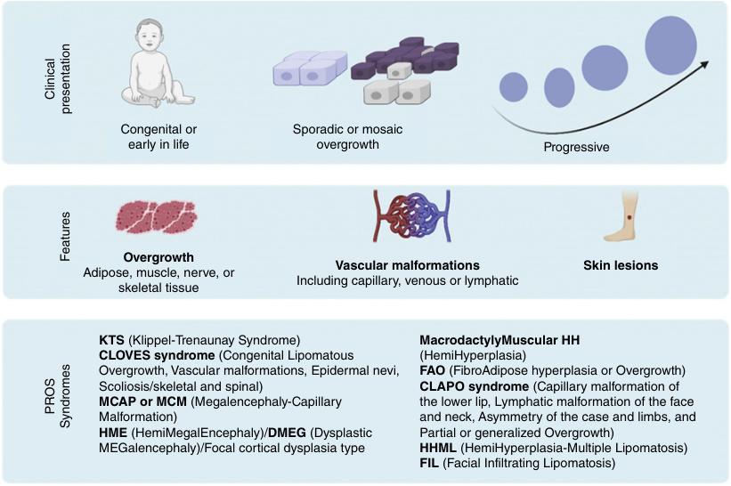

**Fig. 8.2** Overview of the most common clinical presentations, features, and PIK3CA (activating variants of the p110α subunit of phosphatidylinositol 3-kinases)-related overgrowth spectrum (PROS). (From Bernhard SM, Adam L, Atef H, et al: A systematic review of the safety and efficacy of currently used treatment modalities in the treatment of patients with PIK3CA-related overgrowth spectrum. _J Vasc Surg Venous Lymphat Disord_ . 2022;10[22]:527-538 [Fig. 1, p. 529].) 

## **Diagnosis of Mosaic Overgrowth Disorders** 

Mosaic, patchy, or segmental overgrowth should be diagnosed early to identify opportunities for targeted small molecule treatment, to begin symptomatic management, and to assess eligibility for clinical trials. The only reliable way to diagnose mosaic overgrowth disorders is via molecular genetic testing. Phenotypic distinctions, although helpful in informing the interpretation of genetic testing results, are inadequate for diagnosis. While **Proteus syndrome** has a highly distinct phenotype, findings early in disease progression are often indistinct. There are no consistent clinical features that distinguish **_PIK3CA_ -related overgrowth spectrum (PROS)** from **_PIK3R1_ -related overgrowth spectrum** , although clinical criteria have been suggested for PROS (Tables 8.1, 8.2). _AKT1_ -related Proteus syndrome, _PIK3R1_ -related overgrowth spectrum, and _PTEN_ -related SOLAMEN syndrome are rare; knowledge of the range and specificity of phenotypic features that would allow for clinical diagnosis is limited. The differentiating features are noted in Table 8.3. Additionally, segmental overgrowth can be a manifestation of some epigenetic or imprinting disorders, further confounding phenotypic diagnosis (see Chapter 4). 

The approach to molecular genetic testing in mosaic disorders varies considerably from that used in constitutional disorders. **Critically** , _sampling must be from an affected area of the body_ . In many of these disorders, testing peripheral blood uniformly leads to false negative test results. For example, the strongly activating _PIK3CA_ variants and both _AKT1_ variants that cause these disorders are absent in peripheral blood. Other variants may be present at a lower fraction in blood than in other tissue; if the amount of variant allele is below the sensitivity of the test assay, the test will be falsely reported as negative. Skin is one of the more readily accessible tissues for biopsy; in affected individuals who have cutaneous manifestations, skin biopsy is a reliable technique and can be performed by dermatologists or clinical geneticists. For patients whose need for molecular diagnosis coincides with the need for a surgical procedure, the surgeon can readily collect a biopsy of an affected tissue when performing the indicated surgical procedure. Patients who have oral or perioral manifestations may be able to be tested using a DNA sample from a buccal brush, but not all testing laboratories will accept this specimen type. Performing genetic testing on cell-free DNA is under development but is not currently clinically available.

<!-- p.145 -->

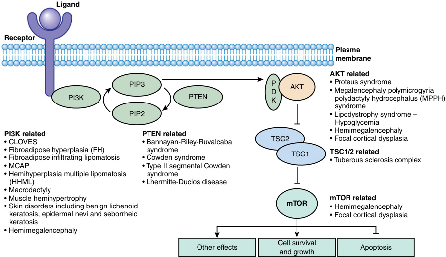

- **Fig. 8.3** Simplified PI3K-AKT-mTOR pathway and associated clinical overgrowth disorders. _PDK,_ 

- Phosphatidylinositol-dependent kinase; _PIP,_ phosphatidylinositol polyphosphate; _PTEN,_ phosphatase and tensin homolog. (From Kang H, Baek ST, Song S, et al. Clinical and genetic aspects of the segmental overgrowth spectrum due to somatic pathogenic variants in PIK3CA. _J Pediatr._ 2015;167[5]:957-962. [Also Fig. 690.9 in _Nelson Textbook of Pediatrics_ 21/e, p. 3585].) 

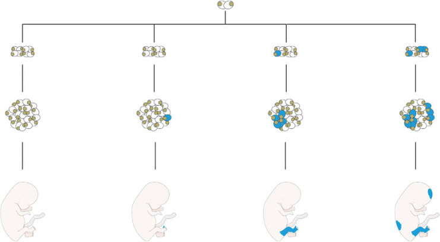

- **Fig. 8.4** Diagram showing how pathogenic variants occurring at different moments of embryonic 

- development can result in varying phenotypes and topographic distributions in both fetuses and adults. The sooner they occur, the more tissues and cells of each tissue are affected. (From Fuster AI, Serra PC, Riera-Mestre A. PIK3CA-related overgrowth spectrum [PROS]: new insight in known diseases. _Med Clin [Barc]._ 2021;157[10]:483-488 [Fig. 3, p. 486].)

<!-- p.146 -->

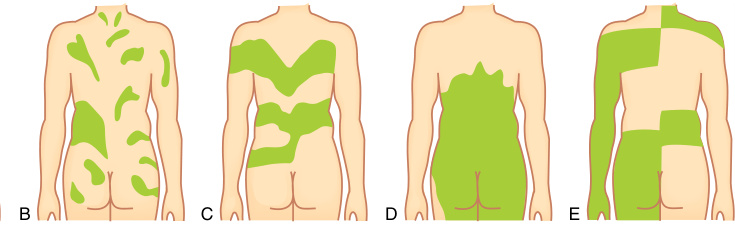

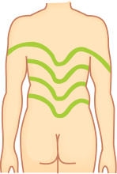

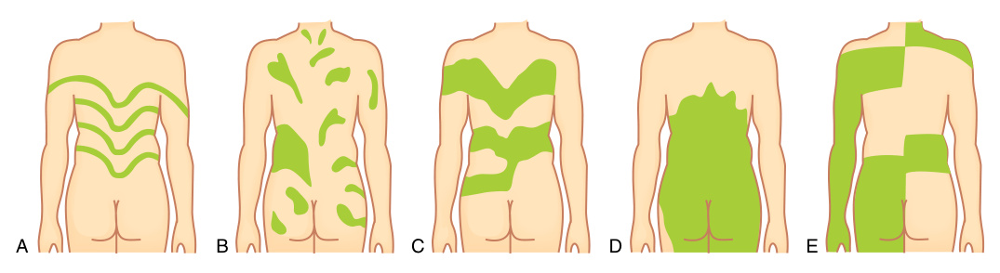

**Fig. 8.5** Recognizable patterns of mosaicism identifiable when the manifestation is one of a visible alteration of the skin. Patterns include (A) narrow Blaschko lines, (B) broad Blaschko lines, and (C) checkerboard, (D) phylloid, and (E) patchy patterns. 

#### **TABLE 8.1** Established Clinical Criteria for the Diagnosis of Pati ents WithPIK3CA-Related Overgrowth Spectrum

|**Common Characteristics(Required)** Existence of a somatic_PIK3CA_variant*||
|---|---|
|Congenital or early childhood onset overgrowth Sporadic cases (absence of a family history) and mosaic distribution||
|Characteristics described in group A or B||
|A. Syndromic Forms (Two or More Affected Individuals)†|B. Isolated Forms|
|1. Adipose, musculoskeletal, and nervous system overgrowth|1. Isolated lymphatic malformations|
|2. Capillary, venous, arteriovenous, and/or lymphatic vascular malformations|2. Isolated macrodactyly or feet/hand/limb overgrowth|
|3. Epidermal nevi|3. Truncal adipose overgrowth|
||4. Megalencephaly/focal cortical dysplasia|
||5. Epidermal nevi|
||6. Seborrheic keratosis|
||7 Benign lichenoid keratosis|
|To reach the diagnosis, the common features must be present in asso group B.|. ciation with at least two criteria from group A or one from|

*If no variant is identified, it should be considered a potential PROS syndrome. 

†Generally progressive. It may manifest as scoliosis (kyphosis), limb overgrowth, central nervous system anomalies (hydrocephalus, cerebellar tonsillar ectopia, Chiari malformation, megalencephaly, or mega-corpus callosum), regional lipomatosis associated with overgrowth, infiltrative lipomatosis, Wilms’ tumor, or ovarian cystadenoma. 

From Fuster AI, Serra PC, Riera-Mestre A. PIK3CA-related overgrowth spectrum (PROS): new insight in known diseases. _Med Clin (Barc)._ 2021;157(10):483-488 (Table 2, p. 487). 

The **second critical factor** is selecting a testing laboratory that accepts the type of tissue sampled and that uses an assay platform that is sensitive to low variant allele fractions. **Variant allele fraction** is the proportion of all copies of the gene in the specimen that harbor the variant under investigation. The variant allele fraction in mosaic disorders has a potential range from 0% if the variant is entirely absent to as high as 50% if every cell has one copy of the gene with the variant under investigation (Fig. 8.6). The variant allele fraction in mosaic disorders falls somewhere between these two values but not specifically at either 0% or 50%; in many situations, the variant allele fraction will be 5% or less. Most 

genetic testing laboratories, testing methodologies, and identification and interpretation algorithms are optimized for specific variant allele fractions of 0%, 50%, or 100%, which corresponds to the genotypes in constitutional or non-mosaic disorders. Optimizing testing platforms for mosaic detection is challenging, and few laboratories offer this type of testing. When testing for mosaic disorders, the selected laboratory should be capable of testing the type of tissue sampled and should be able to identify a variant allele fraction well below 50%. The lower limit of the variant allele fraction that the laboratory reports as a positive result should also be identified, as this is a key factor in test sensitivity.

<!-- p.147 -->

#### **TABLE 8.2 Spectrum of Syndromic or Isolated Overgrowths Associated With the** **_PIK3CA_ Gene** 

|PROS|Clinical Manifestations|
|---|---|
|**Syndromic Forms**|l|
|CLOVES syndrome_(congenital_ _lipomatous overgrowth, vascular_ _malformations, epidermal nevi, skeletal/_ _spinal anomalies and/or scoliosis)_|Lipomatous overgrowths on the trunk and limbs, low-flow vascular malformations, epidermal nevi, scoliosis and/or spinal deformities|
|Klippel-Trénaunay syndrome (KTS)|Several combinations of capillary, venous, and lymphatic malformations associated with limb overgrowth|
|Macrocephaly-capillary malformation (MCAP or M-CM)|Megalencephaly or hemimegalencephaly, polymicrogyria, cerebellar tonsil herniation, ventriculomegaly, vascular malformations (facial midline), segmental overgrowth, syndactyly, polydactyly, and connective tissue disorders|
|Fibroadipose overgrowth (FAO)|Progressive segmental overgrowth of the subcutaneous, muscular, and visceral fibroadipose tissue, together with skeletal overgrowth, peripheral nerve enlargement, cutaneous capillary malformations, testicular or epididymal cysts, and hydroceles|
|Hemihyperplasia-multiple lipomatosis (HHML)|Congenital overgrowth and asymmetry, vascular skin anomalies, and recurrent subcutaneous lipomas|
|Facial infiltrating lipomatosis|Hemifacial overgrowth associated with soft-tissue infiltration, bone hypertrophy, macrodontia, hemimacroglossia, early dental development, and mucosal neuromas|
|**Isolated Forms**||
|Macrodactyly|Overgrowth of one or more fingers|
|Hemimegalencephaly, dysplastic megalencephaly, focal cortical dysplasia (FCD) type IIa|Malformations of the cerebral cortex that are normally associated with epileptic seizures|
|Muscular hemihyperplasia|Localized and nonprogressive muscle overgrowth|
|Isolated lymphatic malformations|Dilated or cystic lymphatic vessels at any location|
|Skin pathologies, such as epidermal nevi and seborrheic keratosis|Benign epithelial lesions caused by an overgrowth of cells in the outermost layer of the skin|
|Benign lichenoid keratosis|Benign, isolated skin lesions in the form of a brown or reddish papule or plaque|
|From Fuster AI, Serra PC, Riera-Mestre A. PIK3CA-rel (Table 1, p. 485).|ated overgrowth spectrum (PROS): new insight in known diseases._Med Clin (Barc)._2021;157(10):483-488|

The **third critical factor** is determining which variants and genes will be tested. For individuals with features seen in all four disorders, there is little value in testing one gene at a time or in testing only specific variants; rather, all four genes should be comprehensively tested. While the majority of patients with _PIK3CA_ -related overgrowth spectrum have one of five common pathogenic variants, and while all currently identified individuals with _AKT1_ mosaic overgrowth have one of two specific variants, there are many additional pathogenic _PIK3CA_ variants, and the possibility of a novel _AKT1_ variant cannot be excluded. In addition to _PIK3CA_ , _PIK3R1_ and _PTEN_ have a wide range of variants and variant types that can result in disease. Furthermore, given the potential invasiveness of and risks associated with obtaining biopsy specimens for testing, comprehensive testing on the initial specimen is most advisable to avoid the need for repeat biopsy. 

Genetic testing for mosaic disorders is most commonly performed using massively parallel or next-generation DNA 

sequencing instruments. In contrast to routine sequencing for constitutional variants, which typically uses a lower sequencing depth, the sequencing depth is typically in the 1,000× range to offer sufficient sensitivity for variant allele fractions in the 2–5% range. Interpreting negative genetic testing results for mosaic disorders can be challenging. There are three common explanations for a negative test result: (1) the patient is not affected by one of the disorders for which the panel tests, (2) the sampled tissue does not harbor the mosaic variant that the patient has in other tissues, or (3) the sensitivity of the test is insufficient to detect the variant allele fraction in the sample. In the face of negative testing results wherein a high degree of suspicion for a mosaic disorder remains, options include broadening the number of genes on the testing panel, repeating the biopsy on a different tissue, or choosing a more sensitive assay. A key challenge in testing methodology is that the assay can be broad and test for many genes, or it can be deep with greater than 1,000× coverage depth, but it cannot be

<!-- p.148 -->

#### **TABLE Differential Diagnosis of PROS Syndromes Versus Other Somatic Overgrowth Disorders Associated 8.3 With the PI3K/AKT/mTOR Pathway** 

|PI3K/AKT/ mTOR Pathway Component|Overgrowth Syndromes|Clinical Manifestations|
|---|---|---|
|_PIK3CA_|_PIK3CA_-related overgrowth spectrum (Table 8.2)||
|_AKT_(PKB)|AKT1 (PKBA): Proteus syndrome|Overgrowth, often affecting the lower limbs|
||AKT2 (PKBB): lipodystrophy- hypoglycemia syndrome|Recurrent severe fasting hypoglycemia, decreased level of consciousness, seizures, and asymmetric growth|
||AKT3 (PKBG): megalencephaly- polymicrogyria-polydactyly- hydrocephalus syndrome 2 (MPPH2)|In utero onset; megalencephaly, polymicrogyria, postaxial polydactyly|
|_mTOR_|Focal cortical dysplasia|Malformation of the cerebral cortex characterized by dysmorphic neurons associated with refractory epilepsy|
|_PTEN_|PTEN hamartoma tumor syndrome (Cowden syndrome, Bannayan- Riley-Ruvalcaba syndrome, and PTEN-related Proteus syndrome)|Benign and malignant neoplasms; brain overgrowth and neurodevelopmental anomalies, asymmetrical bones and soft-tissue overgrowth|
|_TSC1/2_|Tuberous sclerosis complex|Hypopigmented macules, facial angiofibromas, ash leaf spots, nail fibromas, cortical tubercles, subependymal nodules, and subependymal giant cell astrocytomas, seizures, and intellectual disability/developmental delay|

_AKT,_ A serine/threonine kinase also called protein kinase B; _mTOR,_ mammalian target of rapamycin; _PIK3CA,_ phosphatidylinositol-4,5-bisphosphate 3-kinase class I subtype α; _PKB,_ protein kinase B; _PKBA,_ protein kinase B alpha; _PKBB,_ protein kinase B beta; _PKBG,_ protein kinase B gamma; _PTEN,_ phosphatidylinositol3,4,5-trisphosphate 3-phosphatase; _TSC,_ tuberous sclerosis complex. 

From Fuster AI, Serra PC, Riera-Mestre A. PIK3CA-related overgrowth spectrum (PROS): new insight in known diseases. _Med Clin (Barc)._ 2021;157(10):483-488 (Table 3, p. 487). 

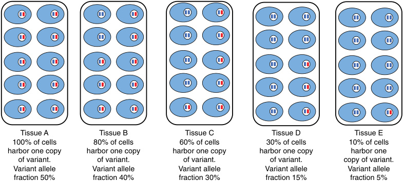

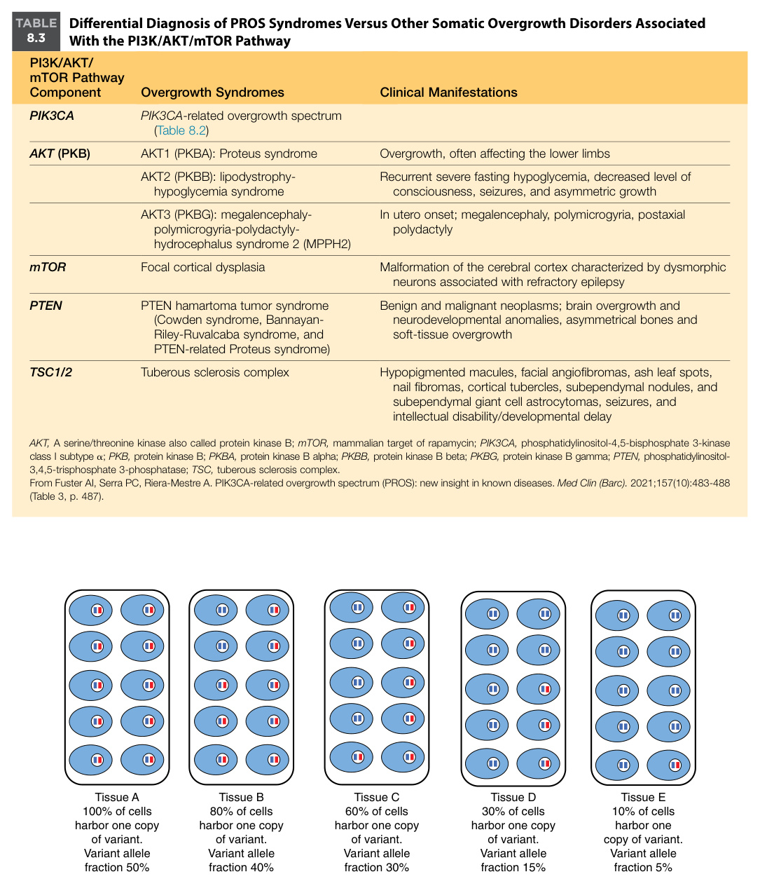

**Fig. 8.6** The metric that describes the fraction of all the alleles in a given tissue sample is termed variant allele fraction (VAF). In (A), which is non-mosaic, all of the cells are heterozygous for the variant, which is a VAF of 50%. In (B), 20% of the cells have no variant and 80% of the cells are heterozygous, which averages to a VAF of 40%. In (C), 40% of the cells have no variant and 60% are heterozygous, for a VAF of 30%. In (D), 70% of the cells have no variant and 30% are heterozygous, for a VAF of 15%, and 

(E) has a VAF of only 5% because only 10% of the cells are heterozygous.

<!-- p.149 -->

both. In these situations, the clinician should consult with experts in the phenotypes and testing methodologies to determine the most fruitful approach. 

## **_PIK3CA_ -Related Overgrowth Spectrum (PROS)** 

_PIK3CA_ -related overgrowth spectrum is the most common mosaic overgrowth disorder and is up to 1,000 times more common than the next most prevalent mosaic overgrowth disorder, Proteus syndrome. Both _PIK3R1_ -related overgrowth spectrum or _PTEN_ -related SOLAMEN syndrome are comparatively much rarer. Therefore, if an individual presents with a mosaic overgrowth phenotype, the prior probability of _PIK3CA_ -related overgrowth spectrum is high, though this can only be confirmed with molecular testing. 

The historic phenotypic nosology of _PIK3CA_ -related overgrowth spectrum is complicated (Fig. 8.1, Table 8.2). Individual labels associated with _PIK3CA_ -related overgrowth spectrum phenotypes are numerous and include **KlippelTrénaunay syndrome** , **CLOVES** syndrome <u>(congenital lipomatous overgrowth, vascular malformations, epidermal</u> nevi, <u>scoliosis/skeletal and spinal anomalies),</u> **fibroadipose overgrowth** , **hemihyperplasia-multiple lipomatosis** , **MCAP** <u>(megalencephaly-capillary malformation),</u> **CLAPO syndrome** <u>(congenital lip asymmetry and partial overgrowth),</u> **hemimegalencephaly** , **dysplastic megalencephaly** , **facial infiltrating lipomatosis** , **orofacial overgrowth** with peripheral nerve enlargement and perineuriomatous pseudo-onion bulb proliferations, **isolated macrodactyly** , **isolated large lymphatic malformation** , **epidermal nevi** , **seborrheic keratoses** , and **benign lichenoid keratoses** . To address this remarkable phenotypic heterogeneity and based on identification of a common genetic basis, these entities were consolidated into the single descriptor of **_PIK3CA_ -related overgrowth spectrum** . While the phenotypic descriptor _overgrowth spectrum_ is nonspecific, the term best encompasses the range of associated phenotypes and is concise enough to be memorable while also acknowledging that the phenotypes can overlap with other entities (e.g., _AKT1_ -related overgrowth spectrum and _PIK3R1_ -related overgrowth spectrum). 

_PIK3CA_ is ubiquitously expressed across tissues and developmental stages and is essential for the regulation of growth in many, if not all, tissues. Variants that dysregulate this key growth effector understandably lead to a broad range of phenotypic effects. The broad range of potential variant allele fractions in various tissues compounds the variation and heterogeneity of the associated phenotypes, making meaningful phenotype-focused classification and diagnosis challenging and necessitating molecular genetic diagnosis. 

The specific manifestations of the _PIK3CA_ -related overgrowth spectrum are innumerable, though common manifestations include connective tissue overgrowth, adipose overgrowth, vascular anomalies, and central and peripheral nervous 

system abnormalities (Figs. 8.1, 8.2; Table 8.2). The most overt and severe finding is often **connective tissue overgrowth** , which can include the skeletal and soft connective tissues. The architecture of the bones is typically preserved in _PIK3CA_ -related overgrowth spectrum, though this applies only to bones not subject to surgical intervention. **Bones** may be subtly or even massively enlarged but retain their shape. **Adipose overgrowth** can be profound, with 5 to 10 times the normal amount of adipose in a body part. Adiposity can be visceral, subcutaneous, or both, and it is common for affected individuals to have areas of adipose overgrowth and other areas with lipoatrophy. **Vascular anomalies** are common and sometimes severe; the most common are lymphatic, though affected individuals may also have venous, venular, and capillary vascular malformations and, less frequently, arterial or mixed (arteriovenous or capillary-lymphatic-venous) malformations. The **central and peripheral nervous system** can be affected with neuronal migration abnormalities, megalencephaly, cortical dysplasia (e.g., polymicrogyria), and hydrocephalus. Intellectual disability and seizures can be a consequence of these developmental anomalies. While the overall spectrum of anomalies can be very severe, manifestations may be subtle, with overgrowth of a single digit (Fig. 8.7) or a seborrheic keratosis being the sole phenotypic manifestation of _PIK3CA_ -related overgrowth spectrum. 

In most affected individuals with _PIK3CA_ -related overgrowth spectrum, the overgrowth manifestations are congenital and either grow proportionate to the rest of the developing child or grow at a modestly greater rate than the rest 

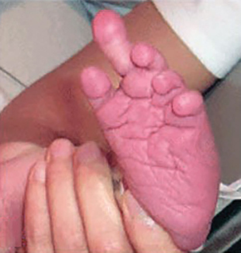

**Fig. 8.7** Features of CLOVES syndrome in a child with macrodactyly of the left foot. (From Mirzaa G, Graham JM Jr, Keppler-Noreuil K. _PIK3CA_ -related overgrowth spectrum. August 15, 2013 [Updated 2023 Apr 6]. In: Adam MP, Feldman J, Mirzaa GM, et al., eds. _GeneReviews_ ® [Internet]. Seattle, WA: University of Washington, Seattle; 1993-2024. https://www.ncbi.nlm.nih.gov/books/ [Fig. 1B].)

<!-- p.150 -->

#### **TABLE 8.4** Natural History Comparison of the Four Most Common M osaic Overgrowth Disorders

|Disorder|Congenital Manifestations|Postnatal Progression|
|---|---|---|
|_PIK3CA_-related overgrowth spectrum|Typical and can be severe|Usually proportionate but modest progression|
|_AKT1_-related Proteus syndrome|Uncommon and typically mild|Rapid and severe, disproportionate progression, onset typically 12–24 months of age|
|_PIK3R1_-related overgrowth spectrum|Typical|Usually proportionate but modest progression|
|_PTEN_-related SOLAMEN syndrome|Typical and can be severe|Can be severe and progressive, progression from birth|

of the child. This feature is also found in _PIK3R1_ -related overgrowth spectrum, though lies in contrast to _AKT1_ -related Proteus syndrome and to a lesser degree _PTEN_ -related SOLAMEN syndrome (Table 8.4). In the latter two disorders, especially _AKT1_ -related Proteus syndrome, there are typically few or mild manifestations of overgrowth at birth and the postnatal overgrowth is much greater than the unaffected areas of the body, leading to severe distortion of growth. Another distinctive attribute of _PIK3CA_ -related overgrowth is that it is often described as ballooning. That is, the overgrown body part appears to be smoothly and regularly enlarged, as if it is overinflated, whereas the overgrowth of _AKT1_ -related Proteus syndrome and _PTEN_ -related SOLAMEN syndrome is distorting and disproportionate. 

### **Molecular Mechanism and Pathogenesis** 

_PIK3CA_ encodes the p110 alpha subunit of the phosphatidylinositol-4,5-bisphosphate 3-kinase (PI3) kinase complex family of signaling proteins, which also include _PIK3CD_ and _PIK3CG_ (Fig. 8.3). The complex is composed of an 85 kDa regulatory subunit and the _PIK3CA_ -encoded 110 kDa catalytic subunit. This complex is a key effector of the receptor tyrosine kinase cell surface molecules that transduce intercellular signals, commonly called growth factors. The variants that are associated with _PIK3CA_ -related overgrowth spectrum are activating or _gain of function_ variants that constitutively activate the signaling of this pathway in a receptor tyrosine kinase ligand-independent manner. The five variants most commonly involved in _PIK3CA_ -related overgrowth spectrum include c.1258T>C; p.Cys420Arg, c.1624G>A; p.Glu542Lys, c.1633G>A; p.Glu545Lys, c.3140A>T; p.His1047Leu, and c.3140A>G; p.His1047Arg. However, many other missense variants and some small in-frame insertions or deletions can lead to activation of the protein. 

### **Diagnosis** 

Accurate molecular diagnosis is essential for prognosis and management and for implementing targeted therapy. While no specific clinical diagnostic criteria have been elucidated for _PIK3CA_ -related overgrowth spectrum (some have been suggested in Table 8.1), patients who present with typical phenotypic features are likely to have this diagnosis, primarily 

because this disorder is up to 1,000 times more common than other mosaic overgrowth disorders. However, molecular diagnosis remains important, increasingly so because of the availability of the targeted therapeutic agent alpelisib. Tissue biopsy-based molecular genetic testing should be pursued first. When present, biopsies of epidermal nevi or capillary vascular malformations are often most favorable and amenable to sampling. Some less common variants associated with this disorder are considered weakly activating and can occasionally be identified in peripheral blood DNA testing. However, tissue DNA testing is still recommended first, since the majority of _PIK3CA_ -related overgrowth spectrum is attributable to one of the five more common pathogenic variants, and diagnosis can be delayed if peripheral blood is tested first under the assumption that a reflex test for a negative peripheral blood-based result would be a tissue sample test. 

### **Management** 

Symptomatic surgical treatment of overgrowth and laser treatment of vascular malformations may be appropriate; if pursued, precautions for deep vein thrombosis and pulmonary embolism should be considered, as affected individuals have demonstrated an elevated risk of thrombosis. 

Targeted therapy with a **PIK3CA inhibitor (alpelisib)** should be considered and can be effective in reducing lesion size in some patients, especially those with large vascular malformations. Close monitoring is essential, as the rate of adverse reactions (e.g., hyperglycemia, renal impairment, gastrointestinal complications) approaches the rate of benefits. Other PIK3CA inhibitors are under development and may offer better efficacy, an improved adverse event profile, or both. 

It is unclear whether _PIK3CA_ -related overgrowth spectrum is associated with increased tumor susceptibility, though an increased risk of Wilms tumor has been proposed. Despite being less common, Proteus syndrome has been more closely associated with increased tumor susceptibility. There are no firmly established guidelines for tumor surveillance in _PIK3CA_ -related overgrowth spectrum. 

### **_AKT1_ -Related Proteus Syndrome** 

Individuals with _AKT1_ -related Proteus syndrome are either unaffected or only mildly affected at birth (Table 8.5).

<!-- p.151 -->

##### **TABLE** 

##### **8.5** 

#### **Positive and Negative Clinical Criteria to Assist in the Diagnosis of** **_AKT1_ -Related Proteus Syndrome** 

|General Criteria: All the following: mosaic distribution of lesions,|Linear verrucous epidermal nevus (2 points)|
|---|---|
|sporadic occurrence, and progressive course|Vascular malformations (one or more) (2 points)|
|**Positive Clinical Criteria** Cerebriform connective tissue nevus (5 points)|(a) Capillary malformation**or**|
|Asymmetric, disproportionate overgrowth (one or more) (5 points)|(b) Venous malformation**or**|
|(a) Limbs**or**|(c) Lymphatic malformation i|
| (b) Hyperostosis of the skull**or**|Specific tumors (1 point)|
|(c) Hyperostosis of the external auditory canal**or**|(a) Female genitourinary cystadenoma (<11 years old)**or** |
|(d) Megaspondylodysplasia, scoliosis, or rib hyperostosis|(b) Parotid monomorphic adenoma (<11 years old)**or**|
|Organ/visceral overgrowth (two or more) (5 points)|(c) Meningioma (meningothelial and transitional subtype)**or**|
| (a) Central nervous system**or**|(d) Testicular cystadenomas or cystadenocarcinomas|
| (b) Urogenital system**or**|Facial phenotype (three or more features) (2 points)|
| (c) Eye**or**|(a) Dolichocephaly|
|(d) Spleen**or**|(b) Long face|
| (e) Kidney**or**|(c) Down slanting palpebral fissures and/or minor ptosis|
|(f) Liver**or**|(d) Low nasal bridge|
| (g) Tonsils or adenoids**or**|(e) Wide or anteverted nares|
|(h) Gingiva or tongue|(f) Open mouth at rest |
|Bullae or cysts of the lungs (2 points)|Deep vein thrombosis and/or pulmonary embolism (2 points)|
|Dysregulated adipose tissue (one or more) (2 points)|**Negative Clinical Criteria** Substantial prenatal extracranial overgrowth (−5 points)|
|(a) Lipomas**or**|Ballooning overgrowth (−5 points)|
|(b) Lipodystrophy**or**||
|(c) Myocardial septal lipoma||

Proteus syndrome: a score of 10 or more points with a mosaic _AKT1_ variant or 15 or more points with or without an _AKT1_ mosaic variant. _AKT1_ -related overgrowth spectrum: a score of 2–9 with an _AKT1_ mosaic variant. From JC Sapp, A Buser, J Burton-Akright, KM Keppler-Noreuil, LG Biesecker. A dyadic genotype-phenotype approach to diagnostic criteria for Proteus syndrome. _Am J Med Genet C Semin Med Genet._ 2019;181(4):565-570 (Table 1, p. 566). 

Overgrowth usually commences between 6 and 18 months of age, and relentlessly progresses through childhood, typically slowing or ceasing around 18 years of age. Overgrowth can affect any tissue of the body, though commonly affected sites include the skeleton, the skin, the lungs, and adipose tissue. The condition is rare, with only several hundred affected individuals identified. Skeletal manifestations are distinct from other mosaic overgrowth disorders: in most bones, the overgrowth is distorting because it is irregular and destroys the normal shape of the bone (Fig. 8.8). This overgrowth usually occurs by first forming non-ossified cartilaginous tissue, which then slowly ossifies. The function of the bone can be severely impaired, for example, by ossification of the joint space, which can lead to complete fixation of a joint. Long bone overgrowth is often associated with flexion contractures which become fixed. The overgrowth of the skull involves expansion of the diploic space, with outward expansion. Progressive scoliosis and associated rib overgrowth can be life-threatening. The dermatologic 

manifestations can be helpful for diagnosis. The most characteristic lesion is the **cerebriform connective tissue nevus (CCTN)** . The CCTN is caused by massive expansion of the dermal layer of the skin by excess collagen fibrils, which leads to thickening and an irregular contour of the skin. The skin develops a cerebriform character, with sulci and gyri that resemble the contour of the brain (Fig. 8.9). These lesions are most common on the soles of the feet, the hands (Fig. 8.8), the alae nasi, and the lacrimal puncta. The other typical skin lesion is the **linear verrucous epidermal nevus** . This lesion is dark, rough to the touch, and typically presents in a pattern corresponding to the lines of Blaschko (Fig. 8.5). Other key manifestations of _AKT1_ -related Proteus syndrome include tumor susceptibility. Tumor types are heterogeneous with the most common being cystadenomas of the genital tract, most commonly manifesting as ovarian cystadenomas. Other common tumors include meningiomas and papillomatous tumors of the breast. Most of these are benign, but a few have been malignant.

<!-- p.152 -->

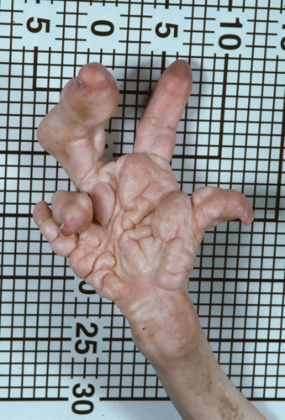

**Fig. 8.8** Clinical photograph of the hand of a 7-year-old male with _AKT1_ -related Proteus syndrome. Note the extreme overgrowth, most severe in the third finger (which projects out of the plane of the image), the distortion of the hand structure due to irregular skeletal overgrowth, the extensive cerebriform connective tissue nevus of the digits and palm, the massive overgrowth of the distal radius, and the linear epidermal nevus of the forearm. 

### **Molecular Mechanism and Pathogenesis** 

The AKT1 protein is a serine/threonine-protein kinase that belongs to the AKT subfamily of serine/threonine kinases that contain Src homology 2-like domains. It is sometimes referred to as protein kinase B (PKB), or by both names as “Akt/PKB.” There are three paralogs in humans, _AKT1_ , _AKT2_ , and _AKT3_ . _AKT2_ is widely expressed and associated with endocrine and lipodystrophy phenotypes, and _AKT3_ is primarily expressed in the central nervous system and is associated with neuronal migration disorders and hemimegalencephaly. 

The Proteus syndrome phenotype has only been confirmed to be associated with mosaic pathogenic variants in _AKT1_ . Nearly all affected individuals have the same c.49G>A p.(Glu17Lys) variant in _AKT1_ , with variant allele fractions ranging from the lower limit of detectability of the assay to as high as 50%. Two individuals have been reported to harbor a c.49_50delinsAG p.(Glu17Arg) variant. While the variant has been detected in a wide variety of tissues, it has not been confirmed to be present in peripheral blood cell DNA. Like several _PIK3CA_ variants, the _AKT1_ p.(Glu17Lys) variant is well characterized because it is present in a substantial number of tumors and is a critical effector of tumor biology. AKT1 is recruited to 

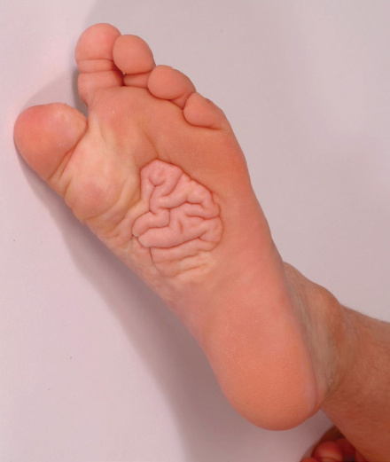

**Fig. 8.9** Clinical photograph of an early cerebriform connective tissue nevus of the foot. This lesion is common in _AKT1_ -related Proteus syndrome, rare in _PIK3CA_ -related overgrowth spectrum and not described in any other overgrowth disorder. The lesion is usually absent at birth and arises in early childhood, typically near the ball of the foot and commonly spreads across the sole of the foot, sometimes wrapping around the lateral portions of the foot. The lesion can cause disability due to biomechanical consequences, and the deep sulci (up to 1 cm deep) can cause major challenges with hygiene. 

the submembranous PI3K complex, triggered by a receptor tyrosine kinase, which then leads to downstream signaling. The two pathogenic variants in AKT1 are activating variants that cause the protein to be constitutively recruited to the submembranous PI3K complex, leading to tonic activity of the signaling pathway. 

Some confusion has been generated by the claim that variants in _PTEN_ can cause Proteus syndrome. There have been no individuals identified with a robustly documented Proteus syndrome phenotype and a pathogenic _PTEN_ variant. _PTEN_ -related tumor hamartoma syndrome and _PTEN_ -related SOLAMEN syndrome are highly variable phenotypes that can present with features that some may confuse with Proteus syndrome, but they are distinct disorders. 

### **Diagnosis** 

Proteus syndrome has a more specific and robustly described phenotype than other mosaic overgrowth syndromes, due in part to the inherently lesser variation in pathogenic variants in _AKT1_ that can cause the disorder (only two, compared to dozens in _PIK3CA_ ) and the fact that _PIK3R1_ -related overgrowth spectrum and _PTEN_ -related SOLAMEN syndrome

<!-- p.153 -->

are ultra-rare and have not been systematically studied. Specific diagnostic criteria have been elucidated for Proteus syndrome and can be helpful in distinguishing it from _PIK3CA_ -related overgrowth spectrum and _PIK3R1_ -related overgrowth spectrum (Table 8.5). In this points-based diagnostic approach, the presence or absence of 11 attributes are recorded and assigned points (−5 to +5 per attribute) and then tallied. A score of 15–28 points can support a clinical diagnosis of the Proteus syndrome phenotype. Ten or more points in a patient with an _AKT1_ activating variant on molecular testing can support a diagnosis of _AKT1_ -related Proteus syndrome. Patients who have +2 to +9 points and an _AKT1_ variant can be diagnosed with _AKT1_ -related overgrowth spectrum. The distinction of _AKT1_ -related overgrowth spectrum from _AKT1_ -related Proteus syndrome embodies the concept that patients earlier in their clinical course or those with milder presentations have a related disorder, even if it may not warrant the phenotypic label of Proteus syndrome. 

A negative molecular test for _AKT1_ in a patient with a clinical points-based diagnosis of the Proteus syndrome phenotype should be carefully re-evaluated. The clinical criteria can be misinterpreted and, rarely, patients have atypical manifestations (e.g., two patients have been shown to have CCTN associated with _PIK3CA_ mosaic variants). Testing for a patient who apparently has Proteus syndrome should always include _PIK3CA_ , as that disorder is so much more common than is Proteus syndrome that an individual is statistically more likely to have an atypical presentation of _PIK3CA_ -related overgrowth spectrum than they are to have a typical presentation of _AKT1_ - related Proteus syndrome. 

### **Management** 

Symptomatic surgical treatment of overgrowth is often needed. As for _PIK3CA_ -related overgrowth spectrum, precautions for deep vein thrombosis and pulmonary embolism should be considered perioperatively. The risk of deep vein thrombosis and pulmonary embolism is not precisely established but is higher in _ATK1_ -related Proteus syndrome than it is in _PIK3CA_ -relted overgrowth spectrum. Prophylactic anticoagulation is an effective preventive measure and does not interfere with most surgical procedures. 

Targeted therapy with an AKT inhibitor should be considered. As of this writing, there are no AKT inhibitors that are FDA approved for treating Proteus syndrome, although **capivasertib** has shown efficacy as an adjuvant therapeutic for breast cancer and may soon be considered for off-label use. No data on safety and efficacy of capivasertib in Proteus syndrome are available, and no pediatric safety data are available. **Miransertib** is an AKT inhibitor that has undergone Phase 0/1 pharmacodynamic investigation. 

_AKT1_ -related Proteus syndrome increases the risk for multiple tumors; even though it is up to 1,000 times less common than _PIK3CA_ -related overgrowth spectrum, there are many more individuals with _AKT1_ -related Proteus syndrome who have tumors. The most common tumors include 

cystadenomas, most commonly of the ovary. These **cystadenomas** are rarely malignant, and most are benign, but they can be classified as an intermediate malignancy. For these intermediate tumors, it can be difficult to determine the best management strategy. Surgical removal is often indicated, but the need for further treatment such as radiation or chemotherapy can be difficult to determine. Experts in pediatric tumor pathology should be consulted. Meningiomas, often of the meningothelial subtype, are also common. If these tumors are symptomatic, surgical removal is warranted, although other treatment modalities can be considered. A wide array of other, less common tumors has also been observed in affected individuals. These tumors should be managed according to their anatomical effects and histology. 

It is unclear whether tumor surveillance is indicated in _AKT1_ -related Proteus syndrome. While the tumor incidence is indeed elevated, the challenges of surveillance are daunting. The primary challenge is the heterogeneity of the tumors, which would necessitate whole body scanning. Because of the ubiquitous, pleiotropic, heterogeneous hyperplastic overgrowth in this disorder, it is difficult to distinguish early tumors from the universal hyperplastic overgrowth of the disease. Instead of surveillance, it is recommended to monitor patients by regular history and physical examination and to aggressively evaluate signs or symptoms compatible with a potential tumor. 

## **_PIK3R1_ -Related Overgrowth Spectrum** 

### **Incidence and Manifestations** 

The _PIK3R1_ -related overgrowth spectrum phenotype overlaps substantially with that of _PIK3CA_ -related overgrowth spectrum. The manifestations are often present at birth and include a wide array of vascular malformations (e.g., capillary, venous, and lymphatic), soft tissue and skeletal overgrowth, developmental delays, and nevi. The disorder is ultra-rare, with only about a dozen or so affected individuals identified. 

### **Molecular Mechanism and Pathogenesis** 

_PIK3R1_ encodes three distinct proteins, p85α, p55α, and p50α, which are regulatory subunits of PIK3CA, PIK3CB, and PIK3CD. As an inhibitory, regulatory protein, loss of function variants in _PIK3R1_ cause overactivation of PIK3CA (and likely AKT1), which explains why _PIK3R1_ - related overgrowth spectrum shares manifestations with both PROS and _AKT1_ -related Proteus syndrome. As this disorder is extremely rare, data on allelic heterogeneity are not robust, but most of the variants associated with this disorder are loss of function. 

### **Diagnosis** 

Since the underlying pathogenic mechanism in _PIK3R1_ - related overgrowth spectrum is loss of function, variant types are highly heterogeneous. If a putative loss of function variant in the gene is detected and the affected individual

<!-- p.154 -->

has consistent phenotypic features, and no plausible variants in other mosaic overgrowth-related genes have been detected, a firm clinical-molecular diagnosis can be made. Partial or complete deletions of the gene would also result in loss of function and need to be considered in the testing methodology and reporting. 

## **Management** 

Data on management or treatment are scant given the rarity of this disorder. Symptomatic treatment for vascular malformations and overgrowth is appropriate. The PIK3CA inhibitor **alpelisib** has been trialed (PIK3CA inhibitor) in an affected infant with beneficial effect. AKT inhibitors such as capivasertib, which is approved for use in breast cancer, represent additional potential therapeutic agents. 

# **_PTEN_ -Related SOLAMEN Syndrome** 

tumors of the breast, endometrium, kidney, and thyroid. This highly variable syndrome, which can be sufficiently mild as to elude prior diagnosis, is inherited in an autosomal dominant manner. Occasionally, a family with _PTEN_ - related tumor hamartoma syndrome includes an individual who not only inherits the familial _PTEN_ variant from an affected parent, but who then subsequently experiences a mosaic genetic variant event in the second _PTEN_ allele, resulting in one population of cells heterozygous for a pathogenic _PTEN_ variant, and a second population of cells with a second pathogenic variant on the other allele. The latter biallelic (i.e., second hit) cells generate the mosaic _PTEN_ -related SOLAMEN syndrome phenotype. Variants in _PTEN_ associated with either the constitutional hamartoma tumor syndrome or the second hit mosaic SOLAMEN syndrome are loss of function variants. Because PTEN is a repressor of the AKT/PIK3CA signaling pathway, loss of function of the PTEN repressor function leads to increased activation of the pathway in affected tissues. 

## **Incidence and Manifestations** 

_PTEN_ -related SOLAMEN syndrome (segmental overgrowth, <u>lipomatosis, arteriovenous malformation, and epidermal nevus) is exceedingly rare, with fewer than a dozen identified</u> affected individuals. The manifestations of _PTEN_ -related SOLAMEN syndrome are typically present at the time of birth and progress thereafter. Findings include macrocephaly with mild dysmorphic features, limb or truncal overgrowth, and a wide array of vascular malformations including capillary, venular, and arteriovenous (sufficient to lead to congestive heart failure). Additional findings include lymphatic malformations, lipomas, lipomatous overgrowth, lipoatrophy, angiolipomas, and dermal lesions including keratinocytic or verrucal epidermal nevi either in patches or following the lines of Blaschko. Tumors have included breast tumors, ovarian cystadenomas, and thyroid tumors. The malignancy of these lesions is not clearly defined. Skeletal features included long bone overgrowth, enlarged and dystrophic bones, and diffuse demineralization and soft tissue calcifications. 

## **Molecular Mechanism and Pathogenesis** 

_PTEN_ encodes the phosphatase and tensin homolog protein, which negatively regulates the AKT/PIK3CA pathway by dephosphorylating PIK3CA. _PTEN_ -related SOLAMEN syndrome, also known as **type II segmental Cowden syndrome** , is a mosaic disorder associated with variants in both alleles of the _PTEN_ gene. This disorder arises in families who are affected with **_PTEN_ -related tumor hamartoma syndrome** , which is a constitutional disorder inherited in an autosomal dominant pattern. The _PTEN_ -related tumor hamartoma syndrome phenotype comprises a variable picture of macrocephaly with or without mild cognitive impairment, lipomatous overgrowth, a wide range of vascular malformations, and dermatologic findings including facial trichilemmomas, acral keratoses, and other papillomatous lesions and susceptibility to benign and malignant 

## **Diagnosis** 

Like _PIK3R1_ , the causative variants in _PTEN_ can be highly heterogeneous because the mechanism is loss of function. As this disorder is caused by the presence of both a constitutional _PTEN_ loss of function variant and a mosaic second hit variant, testing should reveal both the constitutional _PTEN_ loss of function variant associated with _PTEN_ - related hamartoma tumor syndrome as well as an additional pathogenic variant in the other allele in affected tissues. If a mosaic putative loss of function variant in the gene is also detected and the patient has features consistent with SOLAMEN, and no plausible variants in the other mosaic overgrowth disorder genes have been detected, a firm clinic-molecular diagnosis of _PTEN_ -related SOLAMEN syndrome can be established. The constitutional _PTEN_ variant and the mosaic second hit variant are usually distinct. Deletions of all or part of the gene result in loss of function and need to be considered in the testing methodology and reporting. 

## **Management** 

There are little data on management of _PTEN_ -related SOLAMEN syndrome. Because of its extreme rarity, few centers have seen more than a single affected individual. Management is therefore symptomatic. Based on the affected pathway and the mechanism of loss of function variants in _PTEN_ , a PIK3CA inhibitor (alpelisib), AKT inhibitors (capivasertib), or an inhibitor of downstream effector molecules, such as sirolimus or everolimus, which inhibit MTOR, could be considered. None of these medications is approved for this indication and any such use would be off-label. 

# **Additional Mosaic Overgrowth Disorders** 

Mosaic pathogenic variants in the RAS/MAPK pathway have been associated with lateralized overgrowth, consisting

<!-- p.155 -->

mostly of nevi or vascular anomalies. Additional findings have included limb overgrowth, renal anomalies, lytic and sclerotic bone lesions, and tumors such as Wilms tumor. Genes implicated have included _KRAS_ and _PTPN11_ . RASopathies are remarkably phenotypically diverse and have only recently been identified as being included in the differential diagnosis of mosaic overgrowth disorders. 

# **Bibliography** 

- Bertino F, Braithwaite KA, Hawkins CW, et al. Congenital limb overgrowth syndromes associated with vascular anomalies. _Radiographics_ . 2019;39:491-515. 

- Canaud G, Lopez Gutierrez JC, Irvine AD, et al. Alpelisib for treatment of patients with _PIK3CA_ -related overgrowth spectrum (PROS). _Genet Med_ . 2023;25:100969. 

- Carpten JD, Faber AL, Horn C, et al. A transforming mutation in the pleckstrin homology domain of AKT1 in cancer. _Nature_ . 2007;448: 439-444. 

- Cottrell CE, Bender NR, Zimmermann MT, et al. Somatic PIK3R1 variation as a cause of vascular malformations and overgrowth. _Genet Med_ . 2021;23:1882-1888. 

- Douzgou S, Rawson M, Baselga E, et al. A standard of care for individuals with PIK3CA-related disorders: An international expert consensus statement. _Clin Genet_ . 2022;101:32-47. 

- Harnarayan P, Harmamam D. The Klippel-Trénaunay syndrome in 2022: Unraveling its genetic and milecular profile and its link to the limb overgrowth syndromes. _Vasc Health Risk Manag_ . 2022;18: 201-209. 

- Keppler-Noreuil KM, Lozier J, Oden N, et al. Thrombosis risk factors in PIK3CA-related overgrowth spectrum and Proteus syndrome. _Am J Med Genet C Semin Med Genet_ . 2019;181:571-581. 

- Keppler-Noreuil KM, Rios JJ, Parker VE, et al. _PIK3CA_ -related overgrowth spectrum (PROS): diagnostic and testing eligibility criteria, differential diagnosis, and evaluation. _Am J Med Genet A_ . 2015;167A:287-295. 

- Keppler-Noreuil KM, Sapp JC, Lindhurst MJ, et al. Pharmacodynamic study of miransertib in individuals with Proteus syndrome. _Am J Hum Genet_ . 2019;104:484-491. 

- Madsen RR, Vanhaesebroeck B, Semple RK. Cancer-associated PIK3CA mutations in overgrowth disorders. _Trends Molec Med_ . 2018;24(10):856-869. 

- Manot J, Lalani SR. Overgrowth syndromes—evaluation, diagnosis, and management. _Front Pediatr_ . 2020;8:574857. 

- Mathew L, George R, Sudhakar S, et al. Clinical profile of overgrowth syndromes consistent with PROS ( _PIK3CA_ -related overgrowth syndromes) a case series. _Indian Dermatol Online J_ . 2020;11: 738-746. 

- Rodríguez-Laguna L, Davis K, Finger M, et al. Mappting the PIK3CA-related overgrowth spectrum (PROS) patient and caregiver journey using a patient-centered approach. _Orphanet J Rare Dis_ . 2022;17:189. 

- Sapp JC, Buser A, Burton-Akright J, Keppler-Noreuil KM, Biesecker LG. A dyadic genotype-phenotype approach to diagnostic criteria for Proteus syndrome. _Am J Med Genet C Semin Med Genet_ . 2019;181:565-570. 

- Schonewolf-Greulich B, Karstensen HG, Hjortshoj TD, et al. Early diagnosis enabling precision medicine treatment in a young boy with PIK3R1-related overgrowth. _Eur J Med Genet_ . 2022;65: 104590.

---

<!-- p.156 -->

# 9 Ectodermal Dysplasia 

**PILAR MAGOULAS, RAYMOND BELANGER DELOGE, V. REID SUTTON** 

**Ectodermal dysplasias (EDs)** are genetically and phenotypically diverse disorders affecting two or more structures derived from the ectoderm, including teeth, skin, and ectodermal appendages such as hair, nails, eccrine sweat glands, and sebaceous glands. There are over 150 identified ectodermal dysplasias; the precise genetic mechanisms of many are not known (Tables 9.1 and 9.2). Some patients present overtly in the perinatal period with features that strongly suggest an ectodermal dysplasia such as a collodion-like membrane, heat intolerance with hyperpyrexia, or limb defects, whereas others have subtle findings such as tooth and nail abnormalities that elude diagnosis for years, decades, or even across multiple generations. If an ED is suspected, a comprehensive history and physical examination, as well as a thorough family history with a focus on dental, skin, hair, and nail abnormalities, can refine the phenotype and direct testing strategies. Referral to specialists for phenotypic refinement, diagnosis, and long-term management is often required (Tables 9.1, 9.2, and 9.3). Various classification systems for EDs have been proposed, with some focusing on phenotypic similarities and others emphasizing genetic mechanisms and signaling pathways (Tables 9.1 and 9.2). However, given the interrelatedness of these pathways and the tendency toward pleiotropic expression in known ED-related genes, such schemata are not necessarily straightforward (Fig. 9.1). The salient clinical features, genetics, diagnosis, and management of EDs will be explored through several of the most common and prototypical EDs: hypohidrotic ectodermal dysplasias, _TP63_ -related disorders, incontinentia pigmenti, and _PORCN_ -related developmental disorders. 

## **Hypohidrotic Ectodermal Dysplasias** 

**Hypohidrotic ectodermal dysplasias (HEDs)** are phenotypically similar but genetically heterogeneous. Characteristic features include anhidrosis or hypohidrosis (absent or reduced ability to sweat), absent or abnormally shaped teeth, and hypotrichosis (sparse hair) (Fig. 9.2). There is variable expressivity of each of these characteristics both between and within families; in addition, 

there is considerable variability in modes of inheritance. The HEDs are typically distinguished by clinical features, family history, and genetic etiology. 

### **Clinical Features** 

HEDs are characterized by the combination of partial or complete absence of eccrine sweat glands, abnormal dentition, and hypotrichosis. Additional phenotypic features are presented in Table 9.4. Many neonates have extensive skin scaling and peeling that can be significant enough to suggest a collodion-like membrane (Fig. 9.3) mimicking other heritable or acquired disorders, particularly congenital ichthyosiform erythroderma (Table 9.5). Heat intolerance secondary to decreased sweating may manifest early in the neonatal period or infancy as isolated fevers without a focus of infection or episodic fussiness when exposed to warm environments. Some findings, such as the typical facies consisting of frontal bossing, sunken cheeks, depressed nasal bridge, and periorbital hyperpigmentation and wrinkling may not be apparent until later in infancy or childhood (Fig. 9.2). If these and other physical findings of ectodermal dysplasia are not overt, affected neonates may undergo repeated evaluations for serious or invasive bacterial infections in the setting of recurrent fevers (fever of unknown origin). Some affected individuals may not be diagnosed until later in infancy or childhood when hypodontia or abnormal dentition (typically conical or pegshaped teeth) are noted (Fig. 9.2). Those with congenitally absent teeth often have hypoplasia or absence of the underlying bony alveolar ridge, leading to abnormal facial development and associated speech and swallowing difficulties. Teeth, when present, may erupt later than expected; following tooth eruption, thinner enamel and decreased saliva production increase the risk of caries and dental decay. 

**Hypohidrotic ectodermal dysplasia with immune defects (HED-ID)** is characterized by recurrent, severe, and opportunistic infections along with classic findings of hypohidrotic ectodermal dysplasia. This disorder is caused by pathogenic variants in _NEMO_ and _NFkb-IA_ and most affected individuals survive only into childhood. 

_(Text continued on page 141)_

<!-- p.157 -->

#### **TABLE 9.1 Updated Classification of the Ectodermal Dysplasias With 15 Newly Added Syndromes (Bold)** 

|Pathway|Affected Gene(s)|Disease(s)/Syndrome(s)— Previously Suggested Nomenclature|OMIM No.|Hypodontia|Hair Abnormalities|Nail Feature|s Glandula|r Additional Symptoms|
|---|---|---|---|---|---|---|---|---|
|EDA-NFκB pathway|EDA|Ectodermal dysplasia 1, hypohidrotic, X-linked (Christ–Siemens–Touraine syndrome, XLHED)|305100||||||
||_EDAR_|Ectodermal dysplasia 10A and 10B, AD and AR (ECTD10A, B)|129490, 224900||||||
||_EDARADD_|Ectodermal dysplasia 11A and 11B, AD and AR (ECTD11A, B)|614940, 614941||||||
||_IKBKG_|Incontinentia pigmenti (IP)|308300||||||
||_IKBKG_|Ectodermal dysplasia and immunodeficiency 1, AD and AR (EDAID1)|300291, 300301||||||
||_CHUK_|Cocoon syndrome|613630||||||
||_NFKBIA_|Ectodermal dysplasia and immunodeficiency 2 (EDAID2)|612132||||||
||_PRKD1_|Congenital heart defects and ectodermal dysplasia (CHDED)|617364||||||
||_TRAF6_|Hidrotic form of ectodermal dysplasia, not yet OMIM-listed|602355||||||
|WNT pathway|_PORCN_|Focal dermal hypoplasia (FDH) or Goltz– Gorlin syndrome|305600||||||
||_TWIST2_|Focal facial dermal dysplasia 3/Ablepharon- macrostomia syndrome (AMS)|136500, 200110||||||
||_WNT10A_|Odonto–onycho–dermal dysplasia (OODD)/ Schöpf–Schulz–Passarge syndrome (SSPS)|257980, 224750||||||
||_KREMEN1_|Ectodermal dysplasia 13, hair/tooth type (ECTD13)|617392||||||
||_TBX3_|Ulnar-mammary syndrome (UMS)|181450||||||

_(Continued)_

<!-- p.158 -->

###### **TABLE** 

#### **Updated Classification of the Ectodermal Dysplasias With 15 Newly Added Syndromes (Bold)—cont’d** 

|**9.1** **p i** Pathway|**i** Affected Gene(s)|**i    yp** Disease(s)/Syndrome(s)— Previously Suggested Nomenclature|**i       y  y** OMIM No.|**i** Hypodontia|**i** Hair Abnormalities|Nail Feature|s Glandular Additional Symptoms|
|---|---|---|---|---|---|---|---|
||_LEF1_|Ectodermal dysplasia with or without hypohidrosis, not yet OMIM-listed|153245|||||
||_LRP6_|Ectodermal dysplasia with or without hypohidrosis, not yet OMIM-listed|(603507)|||||
||_MSX1_|Ectodermal dysplasia 3, Witkop type (ECTD3 or Witkop syndrome)|189500|||||
|p63 pathway|_TP63_|Acro–dermato–ungual–lacrimal–tooth syndrome (ADULT)|103285|||||
||_TP63_|Ectrodactyly ectodermal dysplasia–cleft lip/palate syndrome (EEC)|604292|||| |
||_TP63_|Limb–mammary syndrome (LMS)|603543|||| |
||_TP63_|Ankyloblepharon–ectodermal defects–cleft lip/palate (AEC/Rapp–Hodgkin syndrome)|106260, 129400|||| |
||_CDH3_|Ectodermal dysplasia, ectrodactyly, macular dystrophy syndrome (EEMS)|225280|||||
||_KDF1_|Ectodermal dysplasia 12, hypohidrotic/ hair/tooth/nail type (ECTD12)|617337|||||
||_DLX3_|Tricho–dento–osseous syndrome (TDO)|190320|||||
||_RIPK4_|Curly hair–ankyloblepharon–nail dysplasia syndrome (CHANDS); complex lethal subtype known as Bartsocas–Papas syndrome 1 (BPS1)|214350, 263650|||||
|Structure group|_PKP1_|Ectodermal dysplasia–skin fragility syndrome (EDSFS)|604536|||| |
||_GRHL2_|Ectodermal dysplasia–short stature syndrome (ECTDS)|616029|||||
||_PVRL1_|Cleft lip/palate–ectodermal dysplasia syndrome (CLPED1)|225060|||||

_(Continued)_

<!-- p.159 -->

###### **TABLE** 

#### **Updated Classification of the Ectodermal Dysplasias With 15 Newly Added Syndromes (Bold)—cont’d** 

|**9.1** **p i** Pathway|**i** Affected Gene(s)|**i    yp** Disease(s)/Syndrome(s)— Previously Suggested Nomenclature|**i       y  y** OMIM No.|**i** Hypodontia|**i** Hair Abnormalities|Nail Feature|s Glandular Additional Symptoms|
|---|---|---|---|---|---|---|---|
||_PVRL4_|Ectodermal dysplasia–syndactyly syndrome 1 (EDSS1)|613573|||||
||_KRT74_|Ectodermal dysplasia 7, hair/nail type (ECTD7)|614929|||||
||_KRT85_|Ectodermal dysplasia 4, hair/nail type (ECTD4)|602032|||||
||_GJB2_|Keratitis–ichthyosis–deafness syndrome, AD (KID)|148210|||||
||_GJA1_|Oculo–dento–digital dysplasia (ODDD, ODDR)|164200, 257850|||| |
||_GJB6_|Clouston syndrome or ectodermal dysplasia 2, Clouston type (ECTD2)|129500|||||
|Others|_TSPEAR_|Ectodermal dysplasia 14, hair/tooth type with or without hypohidrosis (ECTD14)|618180|||||
||_HOXC13_|Ectodermal dysplasia 9, hair/nail type (ECTD9)|614931|||||
||_CST6_|Ectodermal dysplasia 1, hypohidrotic/hair type (ECTD15)|618535|||||
||_AP1B1_|Keratitis–ichthyosis–deafness syndrome, AR (KIDAR)|242150|||| |
||_TRPS1_|Trichorhinophalangeal syndrome, type I (TRPS1) or type III (TRPS3)|190350, 190351|||||
||_TRPS11_ _EXT1_|Trichorhinophalangeal syndrome, type II (TRPS2)|150230|||||
|From Peschel N         i    i i|, Wright JT, Koster MI, et    i    i i|al. Molecular pathway-based classification of ectodermal dys i i|i   plasias: first five-ye|i    i iarly update._Genes (B_|_asel)._2022;13:2327|(Table 1).||

<!-- p.160 -->

#### **TABLE Syndromes With Features of ED That Are Related to Genes Apparently Not Involved in the Already Known Pathways and That Mainly Affect 9.2 Organs of Nonectodermal Origin or Where ED Is Just a Small Part of a Complex Syndrome** 

|Affected Gene(s)|Syndrome(s) With a Partial Ectodermal Dysplasia-like Phenotype But Classified Elsewhere|OMIM No.|Hypodontia|Hair|Nail Phenotypic Features|Glandular|Additional Symptoms|
|---|---|---|---|---|---|---|---|
|CDHI,_CTNND1_|Blepharocheilodontic syndrome 1/Blepharocheilodontic syndrome 2 (BCDS1/BCDS2|119580, 617681||||||
|_IFT43, -52. -122, -140_ _WDR19, -35_|Cranioectodermal dysplasia, types 1–4 (CED) or Sensenbrenner syndrome|218330||||||
|_EVC, EVC2_|Ellis-van Creveld syndrome (EVC)|22550000||||||
|_EVC, EVC2_|Weyers acrofacial dysostosis (WAD)|193530||||||
|_KCTDI_|Scalp-ear-nipple syndrome (SENS)|181270||||||
|_SOX9-CN/2_*|Cooks syndrome|106995||||||
|_ANTXRI_|Growth retardation, alopecia, pseudoanodontia, and optic atrophy syndrome (GAPO)|230740||||||
|_SMARCAD1_|Huriez syndrome/Basan syndrome|181600, 129200||||||
|_DSP_|Carvajal syndrome (DCWHK)|605676||||||
|_KRT14_|Dermatopathia pigmentosa reticularis (DPR)/Naegeli syndrome (NFJS)|125595, 161000||||||
|_KRT16, -17_|Pachyonychia congenita 1/Pachyonychia congenita 2 (PC1/PC2)|167200, 167210||||||
|_ARID1A, -18_ _SMARCA4, -B1, -E1_|Coffin-Siris syndrome (CSS)|135900||||||
|_ATP6V1B2_|Deafness, congenital, and onychodystrophy, AD (DDOD)| 124480||||||
|_TBC1D24_|Deafness, onychoand osteodystrophy, mental retardation, and seizures syndrome|220500||||||
|_SLC25A24_|Gorlin-Chaudhry-Moss syndrome (FPS)|612289||||||
|_PEXI, PEX6_|Heimler syndrome 1 (HMRI)/Heimler syndrome 2 (HMLR2)|234580, 616617||||||
|_UBRI_|Johanson-Blizzard syndrome (JBS)|243800||||||
|_FGFR3, -2_ _FGF10_|Lacrimo-auriculo-dento-digital syndrome (LADD)|149730||||||

_(Continued)_

<!-- p.161 -->

#### **TABLE Syndromes With Features of ED That Are Related to Genes Apparently Not Involved in the Already Known Pathways and That Mainly Affect 9.2 Organs of Nonectodermal Origin or Where ED Is Just a Small Part of a Complex Syndrome—cont’d** 

|Affected Gene(s)|Syndrome(s) With a Partial Ectodermal Dysplasia-like Phenotype But Classified Elsewhere|OMIM No.|Hypodontia|Hair|Nail Phenotypic Features|Glandular|Additional Symptoms|
|---|---|---|---|---|---|---|---|
|_SREBFI_|Mucoepithelial dysplasia, hereditary (HMD)|158310||||||
|_HEPHLI_|Pili torti and developmental delay (HJDD)|261990||||||
|_KRT81, -83, -86, DSG4_|Monilethrix (MNLIX)|15800||||||
|_RODGI_|Kohlschütter-Tonz syndrome|226750||||||
|_INSR_|Pineal hyperplasia, insulin-resistant diabetes mellitus, and somatic abnormalities|262190||||||
|_CTSK_|Pycnodysostosis (PKND)|265800||||||
|_SETBPI_|Schinzel-Giedion midface retraction syndrome (SGS)|269150||||||

Only syndromes included in the previous classification of ectodermal dysplasias were listed. Most of them could be classified elsewhere (bold, newly added disease entities). 

*The genetic abnormality is a duplication in the putative regulatory region (not the promoter) of SOX9 (located between the SOX9 and KCNJ2 genes). 

From Peschel N, Wright JT, Koster MI, et al. Molecular pathway-based classification of ectodermal dysplasias: first five-yearly update. _Genes (Basel)_ . 2022;13:2327 (Table 2).

<!-- p.162 -->

#### **TABLE Phenotypic Features and Clinical Concerns in 9.3 Ectodermal Dysplasias by Relevant Clinical Specialty** 

|Specialty|Phenotypic Features|
|---|---|
|Dermatology|Anhidrosis or hypohidrosis with overheating Collodion-like membrane at birth Diffuse xerosis Finely wrinkled skin Palmoplantar keratoderma Frequent skin rashes, infections, and sunburns Eczema Erosions Sparse, fine, lightly pigmented scalp hair Sparse or absent eyebrows, eyelashes, and vellus hair Brittle, dystrophic, absent, ridged, or pitted nails|
|Dental|Missing, pointed, or widely spaced teeth Decreased saliva Thin enamel|
|Ear, Nose and Throat (Otolaryngology)|Decreased saliva which may cause problems with tasting, lubricating, chewing, swallowing Thick mucous secretions Increased cerumen production Hearing loss (typically conductive)|
|Geneticist/Genetic counselor|Genetic testing and counseling to review inheritance, recurrence risk, reproductive screening and testing options|
|Infectious Disease|Fever of unknown origin (sweating defects) Opportunistic infections if present immune defects|
|Ophthalmology|Decreased tear production Blepharitis Corneal scarring Photophobia|
|Obstetrics/ Gynecology|Missing or absent nipples Decreased milk production Decreased fertility|
|Orthopedics|Syndactyly Polydactyly Oligodactyly Ectrodactyly (split hand/foot malformation)|
|Craniofacial surgery|Cleft lip and palate|
|Feeding specialist/ Nutrition|Constipation Poor weight gain due to swallowing difficulties or dental abnormalities|
|Therapy (Speech and Occupational)|Feeding difficulties Fine and gross motor difficulties|
|Psychology|Developmental assessment|
|Social Work|Resource and service identification|

### **Genetics** 

Genes known to be associated with HED, their inheritance patterns, and range of phenotypes are presented in Tables 9.1 and 9.6. The most common HED, **X-linked hypohidrotic ectod ermal dysplasia (XLHED)** , is caused by pathogenic variants in _EDA_ , located on the X chromosome. Pathogenic variants in _EDA_ also cause nonsyndromic hypodontia, though the variants causing nonsyndromic hypodontia are typically missense variants affecting the tumor necrosis factor domain whereas the variants causing XLHED are distributed throughout the gene and result in loss of function. 

Inheritance of XLHED is X-linked recessive and males are typically more severely affected than females with a functional allele on their other X chromosome. Findings in affected females are variable due to differences in X-inactivation and generally consist of milder expressions of any or all the features, such as faint sparseness of the hair, patchy distribution of sweat dysfunction, and a few small or missing teeth. Up to 80% of affected females have some degree of hypodontia. Nipple hypoplasia or deficient milk production during nursing may also be noted. 

Diagnosis and recurrence risk estimates for other forms of HED are challenging because certain forms demonstrate both autosomal dominant (AD) and autosomal recessive (AR) inheritance, depending on the variant (Table 9.6). Diagnosis is also complicated if the phenotype associated with the gene is variable. Carriers of AR HEDs, such as patients with heterozygous pathogenic variants in _WNT10A_ , may have mild findings, further confounding diagnosis of homozygous offspring, as well as recurrence risk estimates for future pregnancies. 

## **_TP63_ -Related Disorders** 

_TP63_ encodes a member of the p53 family of transcription factors (Fig. 9.1). Alternative splicing produces multiple isoforms with varying functions related to cellular differentiation, proliferation, and maintenance; two isoforms— TAp63α and ΔNp63α—regulate ectodermal structures. Pathogenic variants in _TP63_ affecting these isoforms produce a range of ectodermal and limb malformation phenotypes. _TP63_ -related disorders are inherited in an autosomal dominant fashion with over 99% of pathogenic alleles consisting of heterozygous single nucleotide variants. Approximately 30% of _TP63_ -related disorders are inherited from an affected parent, with the remaining 70% arising _de novo_ . 

The TP63 protein consists of transactivation (TA), DNA binding (DNA-B), oligomerization (oligo), sterile alpha motif (SAM), and transactivation inhibitory (TI) domains. The specific manifestations in _TP63_ -related disorders are determined by which domain or domains of the protein are affected and are organized into the following phenotypic clusters (Table 9.7): 

- **AEC syndrome: A** nkyloblepharon- **E** ctodermal defects- **C** left lip/palate syndrome 

- **ADULT syndrome: A** cro- **D** ermo- **U** ngual- **L** acrimal- **T** ooth syndrome

<!-- p.163 -->

**Fig. 9.1** The multiple interactions between the EDA/NF-κB, Wnt and p63 pathways (in orange, purple, and blue, respectively). _Arrows_ indicate stimulatory protein–protein or protein–gene regulatory interactions, bars are used for inhibitory interactions.  (From Peschel N, Wright JT, Koster MI, et al. Molecular pathway-based classification of ectodermal dysplasias: first five-yearly update. _Genes [Basel]_ . 2022;13[12]:2327 [Fig. 2].) 

**Fig. 9.2** Hypohidrotic ectodermal dysplasia (HED). (A) This male shows the short, sparse hair; large conspicuous nostrils; wide cheekbones with flat malar ridges; periorbital wrinkling; a thick everted lower lip; prominent chin; and low-lying, anteriorly placed, pointed ears. (B) Conical incisors in a toddler with HED. Note the periorbital wrinkling, flat malar ridges, and prominent ears. (C) This female is a carrier for a variant in ectodysplasin but shows all of the characteristic facies features. Females with HED may also have a pathogenic variant in a gene encoding the receptor for ectodysplasin, inherited as an autosomal disorder.  (From Paller AS, Mancini AJ, eds. _Hurwitz Clinical Pediatric Dermatology_ . 6th ed. Philadelphia: Elsevier; 2022 [Fig. 7.19 and Fig. 7.20, p. 173].)

<!-- p.164 -->

#### **TABLE Phenotypic Features of Hypohidrotic 9.4 Ectodermal Dysplasias** 

##### **Skin/Hair/Nails** 

- Periorbital hyperpigmentation and wrinkling 

- Fragile appearing skin 

- Sparse, thin, or slow-growing hair 

- Hypopigmented hair 

- Fragile hair that may break easily 

- Thin, fragile, and absent fingernails or toenails 

- Collodion-like membrane or extensive skin scaling and peeling in newborns 

##### **Eye** 

- Dry eyes 

##### **Dental** 

- Diminished development of alveolar ridge 

- Absent or missing teeth 

- Conical or otherwise abnormally shaped teeth 

- Small teeth 

**Fig. 9.3** Collodion membrane in a neonate.  (From Jen M, Nallasamy S. Ocular manifestations of genetic skin disorders. _Clin Dermatol._ 2016; 34[2]:242-275 [Fig. 11, p. 249].) 

##### **Facial Features** 

- Midface hypoplasia 

- Depressed nasal bridge 

##### **Other** 

- Anhidrosis or hypohidrosis 

- Hyperhidrosis on palms and soles ( _WNT10_ -related HED) 

- Decreased sebaceous and nasal secretions 

- Recurrent pneumonia 

- Asthma-like symptoms 

- Raspy voice 

- In females, deficient milk production 

- In females, underdeveloped nipples • Immune defects ( _NEMO_ and _NFkb-IA_ -related HED only): hypogammaglobulinemia, susceptibility to opportunistic infections, decreased response to polysaccharide antigens, impaired natural killer cell activity 

   - **EEC3 syndrome: E** ctrodactyly, **E** ctodermal dysplasia, **C** left lip/palate syndrome 3 

   - **Limb-mammary syndrome** 

   - **SHFM4: S** plit- **Hand** / **F** oot **M** alformation type 4 

- **Orofacial cleft 8:** an isolated cleft lip/palate syndrome 

- The latter two phenotypes, SHFM4 and orofacial cleft 8, 

- do not involve ectodermal structures. Nonectodermal manifestations among the remaining syndromes vary, though commonly include some degree of limb malformation and lacrimal duct obstruction. 

**AEC syndrome** is caused by pathogenic variants affecting the SAM or the N-terminal domains of the ΔNp63α isoform. Findings are typically noticeable at birth (Fig. 9.4). Nearly all affected individuals have dermal erosions that can 

###### **TABLE 9.5** 

#### **Disorders Associated With Collodion or Collodion-like Membrane in the Newborn** 

|Category|Disease|Pertinent Physical Findings|Ancillary Laboratory/ Radiologic Testing|Gene(s)|
|---|---|---|---|---|
|Nonsyndromic ichthyoses|Lamellar ichthyosis|Collodion membrane with ectropion and eclabium, congenital ichthyosiform erythroderma, platelike scaling, hypohidrosis|In situ transglutaminase-1 assay in cryostat-cut sections|_TGM1, ABCA12,_ _ALOX12B, NIPAL4_|
||Congenital ichthyosiform erythroderma|Collodion membrane with ectropion and eclabium, congenital ichthyosiform erythroderma, fine scaling, hypohidrosis|In situ transglutaminase-1 assay in cryostat-cut sections|_ALOX12B, ALOXE3,_ _TGM1, ABCA12,_ _CYP4F22, NIPAL4_|
||Ichthyosis vulgaris|Xerosis, generalized scaling sparing flexural areas, atopic dermatitis, pruritus, accentuated palmoplantar markings|H&E: reduced or absent stratum granulosum|_FLG_|
||Recessive X-linked ichthyosis|Generalized scaling sparing body folds, neck usually more severely involved, corneal clouding, cryptorchidism|Absent steroid sulfatase activity in leukocytes and fibroblasts, elevated blood cholesterol sulfate levels|_STS_|

_(Continued)_

<!-- p.165 -->

#### **TABLE 9.5** Disorders Associated W ith Collodion or Collodion-like Mem brane in the Newborn–Ancillary Laboratory/ cont’d

|Cate|gory|Disease|Pertinent Physical Findings|Radiologic Testing|Gene(s)|
|---|---|---|---|---|---|
|||Epidermolytic ichthyosis|Large erosions, mild scaling, and erythroderma at birth, followed by hyperkeratosis in first few months|H&E: epidermolytic hyperkeratosis; EM: aggregations and clumping of keratin filaments in suprabasal cells|_KRT1, KRT10_|
|||Bathing suit ichthyosis|Collodion membrane at birth, followed by brownish scaling restricted to bathing suit areas|In situ transglutaminase-1 assay in cryostat-cut sections|_TGM1_|
|||SHCB|Nearly complete resolution of collodion membrane and scaling within first 3 mo|In situ transglutaminase-1 assay in cryostat-cut sections|_TGM1, ALOX12B,_ _ALOXE3_|
|Syndr ich|omic thyoses|Neutral lipid storage disease with ichthyosis|Generalized ichthyosiform erythroderma, hepatosplenomegaly, mild myopathy, cataract, short stature, mild intellectual disability|Lipid vacuoles within leukocytes, monocytes, and keratinocytes, abnormal LFT results and fasting lipids, increased CPK|_ABHD5_|
|||TTD with ichthyosis|Generalized ichthyosiform erythroderma, brittle hair, impaired intelligence, short stature, with or without photosensitivity|Polarizing microscopy of hair shaft: alternating light and dark bands, other hair abnormalities, e.g., trichoschisis or trichorrhexis nodosa| _ERCC2/XPD,_ _ERCC3/XPB,_ _GTF2H5/TTDA,_ _C7Orf11/TTDN1_ (nonphotosensitive)|
|||Conradi- Hünermann- Happle syndrome|Congenital ichthyosiform erythroderma in lines of Blaschko followed by hyperkeratosis, follicular atrophoderma, stippled epiphyses, cataracts, asymmetric facial appearance|H&E: calcification in follicular keratosis in neonates, bone x-ray|_EBP_|
|||KID syndrome|Severe generalized or localized erythrokeratoderma with spiky hyperkeratosis, PPK, keratitis, hearing loss|MRI: absence of corpus callosum|_GJB2 (GJB6)_|
|||Loricrin keratoderma|Congenital ichthyosiform erythroderma, diffuse PPK with honeycomb pattern, pseudo-ainhum, knuckle pads|H&E: parakeratosis and hypergranulosis; EM: electron dense intranuclear granules in granular cells|_LOR_|
|||ARC syndrome|Generalized scaling with sparing of skin folds, arthrogryposis, renal tubular degeneration, intrahepatic bile duct hypoplasia with cholestasis, metabolic acidosis, abnormal platelet function, cerebral malformation|Liver and renal biopsy|_VPS33B_|
|||KLICK syndrome|Congenital ichthyosis, linear keratosis in skin folds, sclerosing PPK|EM: hypergranulosis and abnormally big keratohyaline granules|_POMP_|

_(Continued)_

<!-- p.166 -->

#### **TABLE 9.5** Disorders Associated Wi th Collodion or Collodion-like Mem brane in the Newborn–Ancillary Laboratory/ cont’d

|Category|Disease|Pertinent Physical Findings|Radiologic Testing|Gene(s)|
|---|---|---|---|---|
|Metabolic diseases|Holocarboxylase synthetase deficiency|Metabolic acidosis, hyperammonemia, organic aciduria, metabolic encephalopathy, poor feeding, lethargy, respiratory distress, and hypotonia|Carboxylases assay in leukocytes or cultured skin fibroblasts i|_HLCS_|
||Gaucher disease type 2|Congenital ichthyosiform erythroderma, hepatosplenomegaly, opisthotonus, hypotonia, facial anomalies, arthrogryposis, respiratory distress, and progressive neurologic deterioration|Deficiency of β-glucosidase in leukocytes or cultured skin fibroblasts, LFTs, increased serum acid phosphatase, Gaucher cells in bone marrow|_GBA_|
|Others|Hypohidrotic ectodermal dysplasia|Hypohidrosis or anhidrosis with hyperpyrexia, atopic dermatitis, sparse hair, frontal bossing, saddle nose, supraorbital ridging, hypoplastic mid face, thick everted lips, hypodontia or anodontia, peg-shaped/ conical incisors and canines, hypoplastic or absent breast and nipple-areolar complex|Hair with longitudinal groove on EM|_EDA, EDAR,_ _EDARADD,_ _WNT10A, NEMO,_ _NF-kb IA_|
||Congenital hypothyroidism|Clavicular pad; puffiness of periorbital tissues and tongue, lips, hands, and genitals; dry, cold, and pale skin; dry and brittle nails and hair; patchy alopecia; dwarfism; mental retardation; somnolence; constipation; feeding problems; poor muscle tone; persistence of jaundice; and respiratory problems|Serum total or free T4, TSH, thyroid-binding globulin|_DUOX2, PAX8,_ _SLC5A5, TG, TPO,_ _TSHB, TSHR_|
||Koraxitrachitic syndrome|A syndromic form of SHCB: collodion baby at birth, with patchy erythema, progressive thinning of hyperkeratotic membrane, generalized irregular dermal atrophy, alopecia, absent eyelashes and eyebrows, and conjunctival pannus, hypertelorism, prominent nasal root, large mouth, micrognathia, brachydactyly, syndactyly involving all interdigital spaces, and camptodactyly of fingers III–V|H&E: orthohyperkeratosis and marked atrophy of dermis, immature dermal extracellular matrix, factor XIII-a positive dendrocytes are rare and globular rather than dendritic|Unknown|
||PPK with anogenital leukokeratosis|Diffuse, nonprogressive PPK in combination with intermittently pruritic, slowly progressive anogenital leukokeratosis|Keratin immunocyto- chemistry shows marked expression of suprabasal K17 and absence of K6 and K16|Unknown|
||In utero infliximab exposure|Collodion membrane with stellate cracking, no associated nail abnormalities, bullae, ectropion, or eclabium. Response to topical emollients with complete resolution by 1–2 months of age|All laboratory studies normal|Unknown|

_ARC,_ Arthrogryposis, renal dysfunction, cholestasis; _KID,_ keratosis, ichthyosis, deafness; _KLICK,_ keratosis, linearis, ichthyosis, congenita, sclerosing keratoderma; _PPK,_ palmoplantar keratoderma; _SHCB,_ self healing collodion baby; _TTD,_ trichothiodystrophy. Modified from Prado R, Ellis LZ, Gamble R, Funk T, Arbuckle HA, Bruckner AL. Collodion baby: an update with a focus on practical management. _J Amer Acad Dermatol._ 2012;67(6):1362-1374 (Table 1, p. 1365-1368).

<!-- p.167 -->

#### **TABLE 9.6** Genes, In heritance Patterns, and P henotypes in Hypohidrotic Ectodermal Dysplasias

|Gene|Inheritance|Phenotypes|
|---|---|---|
|_EDA_|X-linked recessive|Classic HED, nonsyndromic hypodontia|
|_EDAR_|AD and AR|Mild to severe HED, isolated oligodontia, amastia, palmoplantar hyperkeratosis|
|_EDARADD_|AD and AR|Classic HED, nonsyndromic hypodontia|
|_WNT10A_|AD and AR|Variable. Some patients will have mild HED with abnormal dentition or selective tooth agenesis, while more affected individuals may have odonto-onycho- dermal dysplasia or Schopf-Schulz-Passarge syndrome. Some may have hyperhidrosis of the palms and soles with deficient sweating elsewhere.|
|_NEMO, NFkb-IA_|X-linked recessive (NEMO) and AD (NFκβ-IA)|Classic HED with dysgammaglobulinemia and significant immune deficiency|

_AD,_ Autosomal dominant; _AR,_ autosomal recessive; _HED,_ hypohidrotic ectodermal dysplasia 

#### **TABLE 9.7** Phenotypic Findings an f d Affected Protein Domains inTP63-R elated Ectode rmal Dysplasias

|Phenotypic Finding|AEC ADULT|EEC3|Limb-Mammary|
|---|---|---|---|
|**Skin**||||
|Hypohidrosis|X X||X|
|Nail dysplasia|X X|MILD|X|
|Sparse hair|X X|X||
|Dermal erosions|X|||
|Hypopigmentation|X X|X||
|Freckling of skin|X|||
|**Eye**||||
|Lacrimal duct obstruction|X X|X|X|
|Ankyblepharon filiforme adnatum|X|||
|Dental/Orofacial||||
|Missing or abnormal teeth|X X|X|X|
|Cleft lip/palate|X|X|X|
|Trismus|X|||
|**Limb**||||
|Split hand/foot malformation|X X|X|X|
|Syndactyly|X X|X|X|
|Transverse limb defects|X|||
|**Other**||||
|Hypoplastic breasts/nipples|X||X|
|Hypospadias|X|||
|Protein Domain|SAM, N-terminal domain of ΔNp63αisoform DNA-B|DNA-B|Between TA and DNA-B domains and SAM|

_ADULT,_ Acro-dermo-ungual-lacrimal-tooth syndrome; _AEC,_ ankyloblepharon-ectodermal defects-cleft lip/palate syndrome; _DNA-B,_ DNA-binding; _EEC3,_ ectrodactyly, ectodermal dysplasia, cleft lip/palate syndrome 3; _SAM,_ sterile alpha motif; _TA,_ transactivation. 

Adapted from Sutton VR, van Bokhoven H. _TP63_ -related disorders. In: Adam MP, Mirzaa GM, Pagon RA, et al., eds. _GeneReviews®_ [Internet]. Seattle, WA: University of Washington, Seattle; 2010.

<!-- p.168 -->

**Fig. 9.4** Severe findings in ankyloblepharon-ectodermal dysplasiacleft lip/palate (AEC) syndrome in a neonate. Note extensive dermal erosions, cleft lip and palate, ankyloblepharon filiforme adnatum, and ectrodactyly of the feet. While these findings are features of AEC syndrome, this neonate had additional phenotypic and genetic findings consistent with an AEC/EEC3 overlap syndrome (EEC3: ectrodactyly, ectodermal dysplasia, cleft lip/palate 3).  (From Helenius K, Ojala L, Kainulainen L, et al. Overlap between EEC and AEC syndrome and immunodeficiency in a preterm infant with a TP63 variant. _Eur J Med Genetics._ 2023;66[5]:104735 [Fig. 1A].) 

**Fig. 9.5** Ankyloblepharon filiforme adnatum. This finding is present in up to 70% of neonates with ankyloblepharon-ectodermal defects-cleft lip/palate (AEC) syndrome. The adhesions may spontaneously lyse or require surgical excision.  (From Sharkey D, Marlow N, Stokes J. Ankyloblepharon filiforme adnatum. _J Pediatr._ 2008;152[4]:594-594 [Fig 1, p. 594].) 

range from limited in number and extent to severe and widespread. Most affected neonates also have diffuse erythroderma or a collodion-like membrane. Up to 70% of neonates have _ankyloblepharon filiforme adnatum_ , partial or complete fusion of the eyelid margins that may spontaneously lyse or require excision (Fig. 9.5). Other findings notable at birth include orofacial clefts in all affected individuals that can range from isolated submucous cleft palate or isolated cleft lip to extensive cleft lip and palate, hypospadias in up to 75% of affected males, and in a minority of affected individuals, limb abnormalities such as syndactyly, camptodactyly, or ectrodactyly (i.e., split hand/foot malformation). 

With age other findings evolve or become more apparent. Facies consist of micrognathia, maxillary hypoplasia, a broad nasal root with hypoplastic alae nasi, a thin upper lip, and a short philtrum (Fig. 9.6). Most children have patchy areas of skin hypopigmentation or depigmentation, though 

fairer-skinned individuals may develop hyperpigmented thickening of the skin in intertriginous areas and the neck. Hair is lightly pigmented, coarse, and brittle. Lashes and eyebrows are thin. Lacrimal duct obstruction is common, leading to chronic or recurrent episodic conjunctivitis. Dysplastic nails are nearly universal, and some individuals have hypoplastic or absent nails. Teeth are typically conical and reduced in number. 

Additional concerns include conductive hearing loss in the majority of affected individuals, and trismus in over one-third. Weight faltering in early life is common though it improves with calorie supplementation and age; linear growth is commonly decreased. Hypohidrosis is neither as prevalent as in HED nor is it as severe; it does not tend to result in hyperthermia. 

**ADULT syndrome** is typically caused by pathogenic variants affecting the DNA-B domain. Findings present at birth include limb anomalies, which can range from finger and toe syndactyly to ectrodactyly, or a combination thereof, as well as dysplastic nails, and dry scaly skin without the erosions seen in AEC syndrome. With age, other findings become more apparent, such as lightly pigmented and fine hair, thin lashes and eyebrows, and excessive freckling in sun-exposed areas, a finding that is distinct to ADULT syndrome among the _TP63_ -related disorders. Lacrimal duct obstruction is common, leading to chronic or recurrent episodic conjunctivitis. Teeth are typically conical and reduced in number. Hypoplastic nipples and breasts are common, a feature shared with limb-mammary syndrome but not seen in other _TP63_ -related disorders. Hypohidrosis is neither as prevalent as in HED, nor is it as severe; it does not tend to result in hyperthermia. 

**EEC3 syndrome** is caused by pathogenic missense variants affecting the DNA-B domain. Findings present at birth include limb anomalies in up to 90% of affected individuals, orofacial clefts in up to 75%, genitourinary abnormalities in almost half, as well as dysplastic nails and dry skin without erosions. Limb malformations are variable and include syndactyly, oligodactyly, polydactyly, or ectrodactyly (Fig. 9.7). All four limbs are involved in nearly two-thirds of affected individuals. Orofacial clefts range from isolated submucous cleft palate or isolated cleft lip to extensive cleft lip and palate. Genitourinary abnormalities include hypospadias as well as renal and collecting system malformations. With age other findings become more apparent, such as silver or blond-colored hair that is dry and coarse; the lashes and eyebrows are thin. Lacrimal duct obstruction is common, leading to chronic or recurrent episodic conjunctivitis, and can be severe enough to lead to corneal abrasions and scarring. Teeth are typically conical and reduced in number. Hypohidrosis is rare. **Limb-mammary syndrome** is caused by pathogenic missense variants located between the TA and DNA-B domains or by truncating variants in the SAM domain. Findings present at birth include hypoplastic or absent nipples in almost all affected individuals, limb malformations in up to 85%, orofacial clefts in about one-quarter, and dysplastic nails. Skin and hair are

<!-- p.169 -->

**Fig. 9.6** Typical findings in ankyloblepharon-ectodermal dysplasia-cleft lip/palate (AEC) syndrome. (A–C) Affected father and son. Note the narrow nose with hypoplastic alae nasi, small mouth, and hypoplastic fingernails.  (From Jones KL, Jones MC, del Campo M. Ectodermal dysplasias. In: _Smith’s Recognizable Patterns of Human Malformation_ . 8th ed. Philadelphia: Elsevier; 2022 [Fig. 1, p. 766].) 

typically unaffected. With age other findings become more apparent, such as conical teeth and hypodontia. Lacrimal duct obstruction is common, leading to chronic or recurrent episodic conjunctivitis. In addition to hypoplastic or absent nipples, up to 90% of affected females will have hypoplastic or absent mammary glands. Hypohidrosis is not observed. 

# **Incontinentia Pigmenti** 

Incontinentia pigmenti (IP) is an X-linked dominant condition that affects many organ systems, particularly the skin. IP is characterized by skin abnormalities that evolve characteristically throughout childhood and adulthood. Abnormalities range from blister and/or verrucous eruptions in infancy and childhood, streaks or whorls of hyperpigmentation in childhood to early adulthood, and hypopigmentation in adulthood. Other common features of IP include hair and dental anomalies, vision loss due to 

retinal complications, seizures, intellectual disability, and an increased risk for strokes. 

Proposed criteria for establishing a diagnosis of IP are based on satisfying at least two major or one major and one or more minor criteria as presented in Table 9.8. 

## **Clinical Features** 

Characteristic skin lesions that progress through 4 stages are the hallmark of IP (Fig. 9.8). Not every affected individual noticeably develops each stage. Stage 1, which lasts from birth to as long as 18 months, consists of bullous eruptions in a linear distribution on the extremities and a circumferential distribution on the trunk. Stage 2 typically appears after stage 1 resolves and can last for months to years. Lesions consist of hypertrophic verrucous papules in a linear distribution on the extremities and a circumferential distribution on the trunk. Stage 3 can begin as early as 6 months to 1 year of age and typically lasts until early

<!-- p.170 -->

**Fig. 9.7** Four-limb ectrodactyly as seen in ectrodactyly, ectodermal dysplasia, cleft lip/plate syndrome 3 (EEC3).  (From Koul M, Dwivedi R, Upadhyay V. Ectrodactyly-ectodermal dysplasia clefting syndrome [EEC syndrome]. _J Oral Biol Craniofac Res._ 2014;4[2]:135-139 [Fig. 2, p. 137].) 

adulthood. Lesions consist of skin hyperpigmentation in a streaking or whorled pattern along the lines of Blaschko, in a linear distribution on the extremities and circumferential distribution on the trunk. Stage 4 emerges in adulthood and consists of hypopigmentation or hyperpigmentation along the lines of Blaschko, as well as areas of scarring alopecia. Extracutaneous manifestations of IP are presented in Table 9.9. 

### **TABLE Proposed Diagnostic Criteria for 9.8 Incontinentia Pigmenti** 

|Major criteria|Typical skin stages distributed along lines of Blaschko: • Vesiculobullous stage • Verrucous stage • Hyperpigmented stage • Atrophic/hypopigmented stage|
|---|---|
|Minor criteria|Dental abnormalities Ophthalmologic abnormalities Central nervous system abnormalities Alopecia Abnormal hair (thin, wooly) Abnormal lashes and eyebrows Dysplastic nails Orofacial clefts Hypoplastic or absent mammary tissue Supernumerary nipples Multiple miscarriages of male fetuses Typical skin histopathology|
|Conditions for establishing diagnosis|If no female first-degree relative with incontinentia pigmenti: • If genetic testing results unavailable or unknown, at least two major or one major and one or more minor criteria • If a pathogenic variant in NEMO is detected, then any major or minor criterion • If proband has a female first- degree relative with incontinentia pigmenti, any major criterion or two or more minor criteria|

The protein product of _NEMO_ , IKBKG, plays a regulatory role in the IKK protein complex. Activation of IKBKG activates other proteins in the complex, which allows the complex to release nuclear factor-kappa-B. Nuclear factorkappa-B regulates multiple genes and signaling pathways, including those involved in the formation of ectodermal tissues (Fig. 9.1). 

# **_PORCN_ -Related Developmental Disorders** 

## **Genetics, Inheritance, and Pathophysiology** 

Incontinentia pigmenti is caused by pathogenic variants in _NEMO_ , located on the X chromosome, and is inherited in an X-linked dominant fashion, with females most commonly affected. Approximately 65% of affected females and 16% of affected males have a common 11.7-kb pathogenic deletion in _NEMO_ . Pathogenic single nucleotide variants (SNVs) in _NEMO_ occur in up to 9% of affected females, and pathogenic deletions or duplications occur in 4% of affected females. Most pregnancies with a male who inherits an _NEMO_ pathogenic variant will result in a miscarriage. Affected liveborn males have either 47,XXY chromosome constitution, somatic mosaicism, or a hypomorphic variant in _NEMO_ . 

_PORCN_ -related developmental disorders are a spectrum of multisystemic pleiotropic X-linked dominant conditions, primarily affecting females, that are characterized by defects in mesodermal and ectodermal structures. Common features include focal areas of dermal hypoplasia, striated skin pigmentation, eye abnormalities, limb malformations, and hypoplastic nipples. Additional features are diverse, multisystemic, and variable. Most dermatologic manifestations are present at birth, except for telangiectasias and verrucoid papillomas. The phenotypic presentation can vary widely with some affected females having minimal dermatologic manifestations, mild limb malformations, or a combination thereof, while others demonstrate severe developmental defects leading to disabilities. This variability is presumably

<!-- p.171 -->

**• Fig. 9.8.** Stages of cutaneous manifestations in incontinentia pigmenti. (A) Vesiculobullous phase (stage 1). Note the linear distribution on the extremities. (B) Verrucous phase (stage 2). Note the verrucous papules on the distal lower extremity. This patient has also started to develop hyperpigmented streaks consistent with stage 3. (C) An additional example of hyperpigmented streaking consistent with stage 3. The linear pattern may sometimes be mistaken for intentional injuries. (D) Atrophic hypopigmentation seen in stage 4.  (From Paller AS, Mancini AJ. Disorders of pigmentation. In: _Paller and Mancini—Hurwitz Clinical Pediatric Dermatology_ . 11th ed. 287-325.e12. Elsevier; 2022 [Fig, 11.32A and Fig. 11.33, p. 307; Fig 11.34 and Fig. 11.35, p. 308].) 

### **TABLE Extracutaneous Manifestations of 9.9 Incontinentia Pigmenti** 

due to skewed X-chromosome inactivation, as well as the relative pathogenicity of the particular variant. 

## **Clinical Features** 

Clinical features of _PORCN_ -related disorders are presented in Table 9.10 and Figure 9.9. Not all affected individuals demonstrate all features. Findings present at birth include focal areas of atrophic skin or dermal hypoplasia; yellowpink dermal fat nodules; dysplastic nails; limb malformations including syndactyly, oligodactyly, or ectrodactyly; eye abnormalities; abdominal wall defects; and renal anomalies. With age other findings evolve or become more apparent, such as verrucous papillomas of the skin-mucous membrane junctions and thin or absent hair. Teeth are reduced in number and may be abnormally shaped. The focal areas of dermal hypoplasia may erode and become painful or pruritic.

<!-- p.172 -->

##### **TABLE** 

### **Clinical Features in** **_PORCN_ -Related Developmental Disorders** 

##### **9.10** 

#### **Skin/Hair/Nails** 

#### **Limb** 

- Atrophic and hypoplastic areas of skin 

   - Split hand/foot malformation 

- Cutis aplasia 

   - Oligodactyly 

- Fat nodules in the dermis presenting as soft, yellow-pink nodules 

   - Syndactyly 

   - Transverse limb defects 

- Pigmentary changes, typically following Blaschko lines 

#### **Neurocognitive** 

- Telangiectasias 

   - Usually unaffected but can have moderate-severe intellectual disability 

- Verrucous papillomas of skin-mucous membrane junctions (oral, nasal, anal and genital areas) 

#### **Other** 

#### **Ophthalmological** 

   - Facial features: facial asymmetry, notched alae nasi, pointed chin 

- Anophthalmia/microphthalmia 

- Iris and chorioretinal colobomas 

   - Abdominal wall defects 

- Lacrimal duct abnormalities 

- Diaphragmatic hernia 

#### **Dental/Orofacial** 

   - Structural renal abnormalities 

- Cleft lip/palate 

      - Striations of long bones, seen on plain radiographs 

- Tooth abnormalities 

   - Missing teeth 

   - Extra teeth 

   - Ridged teeth 

   - Enamel hypoplasia 

**Fig. 9.9** Phenotypic findings in _PORCN_ -related developmental disorders. (A–C) Linear lesions of hypopigmented cutaneous hypoplasia occurring along Blaschko lines are evident on the trunk and limbs. A congenital melanocytic naevus is also present on the left flank. (D) Syndactyly of the right middle and ring fingers and an accessory digit; (E) dystrophic toenails and syndactyly of the right third and fourth toes; (F) sparse scalp hair with patchy nonscarring alopecia.  (From Clements SE, Wessagowit V, Lai-Cheong JE, et al. Focal dermal hypoplasia resulting from a new nonsense mutation in the PORCN gene. _J Dermatol Sci._ 2008;49[1]:39-42 [Fig. 1, p. 40].)

<!-- p.173 -->

#### **TABLE 9.11** Additional Recognized Forms of Ectodermal Dysplasia, Inheritance Patterns, and Clinical Features

|Type|Inheritance(s)|Characteristic Clinical Findings|
|---|---|---|
|Witkop tooth and nail syndrome|AD|Usually normal hair, rarely sparse or fine Normal sweating Small primary teeth, hypodontia causing lower lip eversion (pouting lower lip) Thin, slow growing hypoplastic nails (toes>fingers) Koilonycjia|
|EEC|AD|Dry skin, aplasia, or hypoplasia of skin Normal sweating Coarse lightly pigmented hair, thick eyebrows Hypodontia (reduced number), taurodontia, premature loss of teeth, dental enamel abnormalities Ectrodactyly more common than syndactyly Nail dystrophy, transverse ridging and pitting Corneal erosion, lacrimal duct abnormality, blepharitis, GU defects, cleft lip or palate|
|_AD,_Autosomal dominant; Adapted from Abidi NY, M|_EEC,_ectrodactyly, ectode artin KL. Ectodermal dysp|rmal dysplasia and cleft lip/palate syndrome lasias. In:_Nelson Textbook of Pediatrics_. 21st ed. Vol 2. Philadelphia: Elsevier; 2020 (Table 668.3, p. 3460).|

## **Genetics, Inheritance, and Pathophysiology** 

_PORCN_ -related developmental disorders are caused by heterozygous pathogenic variants in _PORCN_ that disrupt the usual role of its protein product, porcupine, in the processing, secretion, and signaling on Wnt proteins, resulting in abnormal interactions between mesodermal and ectodermal structures during embryogenesis (Fig. 9.1). Inheritance is X-linked dominant: about 90% of affected individuals are females and the majority of affected males are mosaic for a pathogenic variant on the X chromosome; affected males with XXY karyotypes and heterozygosity have been identified. In affected females, 95% of pathogenic variants are _de novo_ and 5% are inherited from an affected parent, usually a mosaic father. Hypomorphic variants may cause developmental anomalies in males, usually without skin manifestations; inheritance in these instances is typically from a healthy, unaffected mother. 

Several additional recognized forms of ectodermal dysplasia, their modes of inheritance, and typical clinical features are presented in Table 9.11. 

# **Management** 

Management of EDs depends on the specific features of each condition. The most common findings shared among EDs include skin, hair, nail, sweat gland, and dental anomalies. Syndrome-specific management guidelines are available for many conditions. In general, given the incidence and frequency of dermatologic, ophthalmologic, and dental abnormalities shared across all EDs, referral to these specialists, preferably ones who have experience with EDs, is recommended at the time of diagnosis (Table 9.3). 

## **Dental** 

Dental treatment for hypodontia should begin at an early age to maximize function since feeding, chewing, or swallowing difficulties may be present and impact growth. Speech therapy may be required if there are difficulties with swallowing or the production of speech. Thin enamel and decreased saliva production increase the risk of caries and dental decay and may require more frequent dental cleanings and more rigorous oral hygiene. Dental implants or dentures can improve function and aesthetics for children and adults. 

## **Hair** 

In individuals with ED who have hypotrichosis, wigs or other hair care supplements can be used. Individuals with sparse scalp hair should be mindful of sun protection when outdoors. 

## **Sweating** 

Thermoregulation is impaired in hypohidrotic forms of ED; special attention is required to minimize the risk of hyperthermia. Cooling vests, spray bottles, and other tools are available to reduce the body temperature in the event of warm weather or when overheated. 

## **Skin** 

Dermatologists with experience in EDs are essential members of the care team. The skin in individuals with ED may be dry and prone to infection, rash, and sunburns. Bathing should only be done when necessary using a nonsoap wash free of fragrance and dyes. After bathing, application of

<!-- p.174 -->

fragrance-free and dye-free moisturizers should be done without towel drying or with only light toweling. If tolerated, ointments may better protect skin and minimize transepidermal water loss, though patients with hypohidrosis may report increased heat intolerance in skin areas occluded with ointments and prefer creams or even lotions. Topical steroids, topical antibiotics, or oral medications may be indicated and can help alleviate some skin symptoms. 

## **Pregnancy** 

Women with EDs should be referred to a maternal-fetal medicine specialist to determine if there are any pregnancyspecific management and surveillance considerations. In addition, women with some forms of ED may have difficulty breastfeeding due to nipple or mammary gland hypoplasia. All individuals with an ED should also be referred to a reproductive genetic counselor or genetics provider to discuss inheritance, recurrence risk, risk of miscarriage (specific to X-linked dominant EDs), and preconception or prenatal genetic screening and testing options. 

A clinical geneticist should evaluate individuals on an annual basis to assess the diagnostic and clinical needs of the patient and the psychosocial needs of the patient and family members, to discuss reproductive options, and to make appropriate specialist referrals as indicated. 

# **Diagnostic Testing and Undiagnosed EDs** 

_Although classification of ectodermal dysplasias has improved, the genetic etiology of nearly 45% of EDs remains unknown_ . Patients with abnormalities in two or more ectodermal structures or patients whose phenotype suggests a specific ED or category of EDs should undergo genetic testing. Test selection is determined by phenotype: patients with highly specific findings may undergo gene panel testing, though patients with less specific phenotypes are more likely to benefit from genomic sequencing. Given the variability in which genes are included in panels among different clinical diagnostic laboratories, providers should confirm that a particular panel includes the gene or genes of interest prior to ordering. 

In instances where molecular testing fails to establish pathogenicity of detected variants, testing affected and/or unaffected family members is often indicated. Periodic phenotypic refinement and sequence reanalysis should be performed in patients who have had nondiagnostic sequencing. 

# **Psychosocial Support and Advocacy** 

Receiving a diagnosis of a rare disorder can present significant challenges because patients and families must cope with the medical complications, uncertainties, and psychosocial implications. When an ED is suspected or confirmed, proper care, support, and counseling should be provided and can increase parental and familial satisfaction with the diagnostic experience. Given some of the characteristic facial features and limb abnormalities associated with 

certain EDs, bullying may be a concern, and patients may benefit from additional counseling or therapy. Identification and connection with other individuals with a similar diagnosis, particularly in childhood and adolescence, may alleviate feelings of isolation and improve overall quality of life. Patients and families should be referred to diseasespecific or more generalized ED advocacy and support organizations, where further information, resources, and support can be provided. Certain organizations maintain registries for patients who have a clinical diagnosis of an ED where the genetic etiology is currently unknown or has not been elucidated yet. 

Some EDs have their own syndrome-specific support organizations, whereas others may have closed member groups on social media sites where parents or individuals affected with EDs can openly share and connect with one another. National, regional, or local scientific meetings and family support conferences are also available for the larger ED community as well for individual syndromes. 

# **Bibliography** 

- Arlt A, Kohlschmidt N, Hentschel A, et al. Novel insights into PORCN mutations, associated phenotypes and pathophysiological aspects. _Orphanet J Rare Dis_ . 2022;17(1):29. 

- Cambiaghi S, Restano L, Paakkonen K, Caputo R, Kere J. Clinical findings in mosaic carriers of hypohidrotic ectodermal dysplasia. _Arch Dermatol_ . 2000;136:217-24. 

- Deshmukh S, Prashanth S. Ectodermal dysplasia: a genetic review. _Int J Clin Pediatr Dent_ . 2012;5(3):197-202. 

- Happle R. The PORCN non-Goltz spectrum (PONGOS): a new group of genetic disorders. _Am J Med Genet A_ . 2021;185(1): 13-14. 

- Kenwrick S, Woffendin H, Jakins T, et al. Survival of male patients with incontinentia pigmenti carrying a lethal mutation can be explained by somatic mosaicism or Klinefelter syndrome. _Am J Hum Genet_ . 2001;69(6):1210-1217. 

- Magoulas PL. Supporting parents throughout the genetic testing process and new diagnosis. _Pediatr Clin North Am_ . 2023;70(5): 917-928. 

- Minić S, Trpinac D, Obradović M. Incontinentia pigmenti diagnostic criteria update. _Clin Genet_ . 2014;85(6):536-542. 

- Offiah M, Brodell RT, Campbell LR, Wyatt JP. Collodion-like membrane in a newborn exposed to infliximab. _J Am Acad Dermatol_ . 2014;71(1):e22-e23. 

- Peschel N, Wright JT, Koster MI, et al. Molecular pathway-based classification of ectodermal dysplasias: first five-yearly update. _Genes (Basel)_ . 2022;13(12):2327. 

- Poziomczyk CS, Recuero JK, Bringhenti L, et al. Incontinentia pigmenti. _An Bras Dermatol_ . 2014;89(1):26-36. 

- Prado R, Ellis LZ, Gamble R, et al Collodion baby: An update with a focus on practical management. _J Am Acad Dermatol_ . 2012; 67(6):1362-1374. 

- Scheuerle AE, Ursini MV. Incontinentia pigmenti. In: Adam MP, Mirzaa GM, Pagon RA, et al., eds. _GeneReviews®_ [Internet]. Seattle, WA: University of Washington, Seattle; 1999. 

- Schneider H, Faschingbauer F, Schuepbach-Mallepell S, et al. Prenatal correction of X-linked hypohidrotic ectodermal dysplasia. _N Engl J Med_ . 2018;378(17):1604-1610.

<!-- p.175 -->

- Sutton VR. _PORCN_ -related developmental disorders. In: Adam MP, Mirzaa GM, Pagon RA, et al., eds. _GeneReviews®_ [Internet]. Seattle, WA: University of Washington, Seattle; 2008. 

- Sutton VR, van Bokhoven H. _TP63_ -related disorders. In: Adam MP, Mirzaa GM, Pagon RA, et al., eds. _GeneReviews®_ [Internet]. Seattle, WA: University of Washington, Seattle; 2010. 

   - Wright JT, Grange DK, Fete M. Hypohidrotic ectodermal dysplasia. In: Adam MP, Mirzaa GM, Pagon RA, et al., eds. _GeneReviews®_ [Internet]. Seattle,WA: University of Washington, Seattle; 2003. 

   - Wright T, Fete M, Schneider H, et al. Ectodermal dysplasias: classification and organization by phenotype, genotype and molecular pathway. _Am J Med Genet A_ . 2019;179(3):442-447. 

- Thomas C, Suranyi E, Pride H, Tyler W. A child with hypohidrotic ectodermal dysplasia with features of a collodion membrane. _Pediatr Dermatol_ . 2006;23(3):251-254.

---

<!-- p.176 -->

# 10 Heritable Disorders of Connective Tissue 

#### **FRANSISKA LIEVE MALFAIT** 

Connective tissue is the most abundant and widely distributed tissue in the body, serving as the supportive framework for the vertebrate body and as an integral component of every organ system, having a crucial role in organ function. Connective tissue consists of relatively few cells embedded in an intricate three-dimensional network of macromolecules called the **extracellular matrix (ECM)** . The ECM is a dynamic environment with vital roles in both health and disease, facilitating cell adhesion, migration, and differentiation, as well as cell-cell and cellmatrix communication. 

The complexity of the ECM is reflected in the sheer number of its core and associated proteins, collectively termed the **matrisome** . The _core matrisome_ consists of approximately 300 proteins divided into 3 major categories: **collagens** , **proteoglycans** , and **glycoproteins** . These molecules are composed of repeated characteristic structures, such as collagen domains, thrombospondin motifs, and epidermal growth factor domains, arranged in a modular fashion that varies depending on the ultrastructural needs of the underlying tissue. This organization allows for the formation of highly structured yet versatile supramolecular assemblies that facilitate interaction within and between molecules. These interactions confer diverse characteristics to their respective tissues, such as the resilience of tendon and cartilage, the hardened composition of bone, the transparency of the cornea, and the filtration capacity of the kidney. Extracellular matrix functions are mostly derived from this supramolecular structure and are much less a function of the molecular properties of the _individual_ components. Matrisome-associated proteins consist of ECM-affiliated proteins, secreted proteins, and ECM regulators such as degrading and crosslinking enzymes. Hereditary connective tissue disorders (HCTDs) are related primarily to defects in the structure or function of the core matrisome, as well as of elastin and microfibrillar proteins, and are less often related to defects in matrisome-associated proteins. 

## **Collagens** 

The collagen protein superfamily consists of at least 28 types of collagens, over 40 distinct polypeptides, and more than 20 proteins with collagenous domains. Collagens are the most abundant proteins in the animal kingdom, providing structural strength to the ECM and promoting cell adhesion, migration, angiogenesis, and tissue repair. Their fundamental nature is exemplified by the number of rare genetic diseases associated with collagen defects (Tables 10.1, 10.2, and 10.3). 

### **Collagen Structure and Classification** 

The characteristic feature of collagen is the presence of at least one triple helical collagenous (COL) domain. The COL domain is a right-handed supercoil consisting of three identical (i.e., homotrimer) or non-identical (i.e., heterotrimer) left-handed α chains. These chains are rich in Gly-Xaa-Yaa triplet repeats, in which glycine is the only amino acid small enough to reside at the inside of the tightly-wound supercoil. The triple helix is further stabilized by interchain hydrogen bonds, electrostatic interactions involving lysine and aspartate, and a high content of proline and 4-hydroxyproline (4Hyp) at the X and Y positions, respectively. The COL domain can be flanked by and interspersed with several non-collagenous domains, such as amino- (N-) and carboxy- (C-) pro-domains, as well as fibronectin type III, Kunitz-type domains, thrombospondin-1, and von Willebrand domains. These various non-collagenous domains confer specific binding affinities and structural features through interactions with other ECM molecules. 

**Fibril-forming** or **fibrillar collagens** make up approximately 70% of all collagen in the human body. These rod-like structures are flanked by N- and C-terminal non-collagenous domains or pro-peptides and consist of an uninterrupted triple helical domain assembled into 280 nm long, highly 

_(Text continued on page 173)_

<!-- p.177 -->

##### **TABLE** 

#### **10.1 Hereditary Disorders Resulting From Collagen Structural Alterations*** 

|Disorder|Collagen Type|Genetic Alteration†|Major Clinical Features†|
|---|---|---|---|
|Ehlers-Danlos syndrome (EDS)|**COL1** **COL3** **COL5**|Variants in 20 genes have been found to cause EDS (#130000). Classical EDS (#130010) results from variants in either the _COL5A1_(*120215) or_COL5A2_(*120190) gene. Variants in_COL1A1_(*120150) or_COL1A2_(*120160) that lead to skipping of exon 6 of the mRNA coding the pro α1 or pro α2-chain result in EDS arthrochalasia type (#130060; #617821). Inheritance is autosomal dominant. Biallelic variants in_COL1A2_that lead to a complete absence of pro α2-chains result in cardiac- valvular EDS (#225320), a very rare autosomal recessive type of EDS.|EDS is the name associated with at least thirteen phenotypically characterized clinical entities, which result from different types of variants in distinct collagen genes and several collagen processing genes. These disorders are biochemically and clinically distinct although they all manifest structural weakness in connective tissue as a result of defects in the structure and function of collagens. Although all types of EDS affect joints and skin, additional features vary by type. Severity ranges from mild to severe. Joint hypermobility occurs with most forms of EDS. Infants with hypermobile joints often have weak muscle tone, which can delay the development of motor skills such as sitting, standing, and walking. The loose joints are unstable and prone to dislocation and chronic pain. Many EDS patients have soft, velvety skin that is highly stretchy (skin hyperextensibility) and fragile. Affected individuals tend to bruise easily and in some cases, they show atrophic scars. People with the classical form of EDS experience wounds that split open with little bleeding and leave scars that widen over time to create characteristic “cigarette paper” scars.|
|||Variants in the_COL3A1_(*120150) are associated with the vascular type of EDS (#130050).|The vascular type can involve serious and potentially life-threatening complications due to unpredictable tearing of blood vessels. This rupture can cause internal bleeding, stroke and shock. The EDS vascular type is also associated with an increased risk of organ rupture, including tearing of the intestine or the uterus (womb) during pregnancy.|
|||Variants in procollagen-lysine, 2-oxoglutarate 5-dioxygenase 1 gene (_PLOD1_, *153454) and FK506 binding protein 14 (_FKBP14_, *614505) are responsible for the EDS kyphoscoliotic type I and II (EDSKSCL, #225400; #614557). Inheritance is autosomal recessive in both cases. PLOD1 catalyzes the hydroxylation of lysyl residues in collagen-like peptides, which are critical for the stability of intermolecular crosslinks. FKBP14 acts at the level of the protein folding in the ER, including components of the ECM (COL1, COL3, COL6, and fibronectin).|In addition to the classical symptoms of EDS, patients with kEDS-_PLOG1_and kEDS-_FKBP14_are characterized also by progressive kyphoscoliosis with muscle hypotonia from birth, joint laxity, gross motor delay, severe skin hyperextensibility, easy bruising, fragility of sclerae, myopathy, and hearing loss.|
|||The Musculocontractural Type I and type II form of EDS (EDSMC1, #601776; EDSMC2, #615539) are caused by recessive loss-of-function variants in the carbohydrate sulfotransferase 14 (_CHST14_, *608429) and in the dermatan sulphate epimerase (_DSE_, *605942) genes, respectively. The genes encode enzymes involved in the dermatan sulfate (DS) biosynthesis that is involved in the assembly of collagen fibril.|EDSMC1 and 2 share most of the clinical features, even though the majority of cases (31) refer to the EDSMC1 and only three cases are reported for the EDSMC2 type. The two syndromes are characterized by progressive kyphoscoliosis, adducted thumbs in infancy or clenched fists and talipes equinovarus, hands with atypically shallow palmar creases and tapering fingers, joint hypermobility, clubfoot, arachnodactyly, elastic skin, and poor wound healing. Craniofacial features include brachycephaly, large fontanelle, hypertelorism, downslanting palpebral fissures, microcorneae, strabismus, prominent nasolabial folds, short philtrum, thin upper lip, small mouth, high palate, and microretrognathia. EDSMC neonates show distal arthrogryposis and muscular hypotonia.|

_(Continued)_

<!-- p.178 -->

##### **TABLE** 

#### **10.1 Hereditary Disorders Resulting From Collagen Structural Alterations—cont’d** 

|Disorder|Collagen Type| Genetic Alteration†|Major Clinical Features†|
|---|---|---|---|
|||The Spondylodysplastic Type 1 (also known as progeroid form of EDS) and 2 forms of EDS (EDSSPD1, #130070; EDSSPD2, #615349) are caused by variants in the β-1,4- Galactosyltransferase 7 gene (_B4GALT7_, *604327) and β-1,3-Galactosyltransferase 6 (_B3GALT6_, *615291), respectively. The genes encode enzymes involved in the biosynthesis of the proteoglycans. The spondylodysplastic type 3 form of EDS (EDSSPD3) results from variants in the membrane-bound zinc transporter_SLC39A13_(*608735) and shows clinical overlap with EDSSPD1-2. Variants in_SLC39A13_result in increased Zn2+content inside the endoplasmic reticulum, which inhibits the proper collagen crosslinking and the stability of the collagen triple helix. These three conditions have an autosomal recessive inheritance.|Patients with EDSSPD1-2 showed short stature, muscle hypotonia, radioulnar synostosis, and mild intellectual disability (ID). In addition, they present facial dysmorphism, hyperextensible skin, joint hypermobility (JHM), single transverse palmar crease, severe hypermetropia, limb bowing, and osteopenia.|
|||The dermatosparaxis type of EDS (EDSDERMS, #225410) results from variants in disintegrin and metalloproteinase with thrombospondin motifs (_ADAMTS2_, *604539), the gene encoding the procollagen peptidase that cleavages the N-propeptide of the fibrillar procollagens types I–III and V. This condition has an autosomal recessive inheritance.|The EDSDERMS is characterized by skin that sags and wrinkles. Extra (redundant) folds of skin may be present as affected children get older.|
|Osteogenesis Imperfecta (OI)|**COL1**|Variants in the_COL1A1_(*120150) and_COL1A2_(*120160) genes are responsible for more than 90% of all cases of OI (#166200). Most of the variants causative of OI type I affect_COL1A1_gene and result in reduced levels of COL1, whereas those responsible for most of OI types II (#166210), III (#259420) and IV (#166220) cases occur in _COL1A1_or_COL1A2_genes and impair COL1 structure. The inheritance is autosomal dominant.|At least four biochemically and clinically distinguishable forms of OI have been identified associated to defects in COL1. These are named as OI type I (mild), type II (perinatal lethal), type III (deforming) and type IV (mild deforming). A defect in COL1 structure weakens connective tissues, particularly bones. All four forms of OI present reduced levels of COL1 and brittle bones that break easily. Multiple fractures result in bone deformities. Additional symptoms may include blue sclera, short height, loose joints, hearing loss, breathing and teeth problems, cervical artery dissection, and aortic dissection.|
|||Variants in Cartilage associated protein_CRTAP_, *605497), Prolyl 3-hydroxylase (_P3H1_, *610339) and Peptidyl-prolyl isomerase B (_PPIB_, *123841) genes results in OI type VII (#610682), VIII (#610915) and IX (#259440), respectively. CRTAP encodes a cartilage-associated protein whereas P3H1 an enzyme belonging to the collagen propyl hydroxylase family. PPIB encodes for a cyclophilins (Cyps) protein that catalyzes the cis–trans isomerization of peptide bonds. All these proteins are required for proper collagen synthesis, assembly and secretion. In these cases, the inheritance is autosomal recessive.|In addition to the four forms of OI previously described, eleven additional phenotypically related disorders in the OI family exist, all associated with bone fragility and low bone mass. Among the OI associated to collagen alterations, the type VII (variants in_CRTAP_) is sometimes considered a lethal form with multiple fractures, long bone deformities, scoliosis, and short stature. The type VIII form of OI (variants in_P3H1_) includes severe growth defects, skeletal demineralization, scoliosis, round face, and proptosis. The type IX (variants in_PPIB_) is a very severe form of OI. Embryos dye during pregnancy or few months after birth. Radiographs and an autopsy showed the presence of shortened, bowed, and fractured long bones without evident rhizomelia.|

_(Continued)_

<!-- p.179 -->

#### **TABLE 10.1** Hereditary Collagen Disorders Resulting From Collagen Structural Alterations—co nt’d

|Disorder|Type|Genetic Alteration†|Major Clinical Features†|
|---|---|---|---|
|||The Serpin family H member 1 (SERPINH1, *600943) gene encodes a collagen-binding protein that has chaperone activity in the endoplasmic reticulum. Variants in _SERPINH1_cause the type X OI (#613848), whose inheritance is autosomal recessive.|Types X OI is a severe deforming form of the disorder characterized by aberrant collagen crosslinking, folding, and chaperoning.|
|||Absence of FK506 binding protein 10 (_FKBP10_, *607063) in recessive type XI OI (#610968) leads to reduced collagen cross-linking and deposition. FKBP10 encodes a chaperone that contributes to type I procollagen folding. Variants in this gene affect its secretion.|Clinical hallmarks of OI type XI are congenital contractures. All the others clinical data on the 29 patients with OI type XI (variants in_FKBP10_) are limited and heterogeneous regarding the age of onset, the number of fractures, the type of affected bones, and the severity of the disorder.|
|||The recessive form of OI type XIII (OI13, #614856) is caused by variants in the_BMP1_(*112264) gene, which is involved in the processing of the C-propeptides of procollagens types I–III and the proteolytic activation of the enzyme lysyl oxidase, necessary for the formation of covalent cross-links in collagen and elastic fibers.| The OI type XIII is characterized by normal teeth, faint blue sclerae, severe growth deficiency, borderline osteoporosis, and an average of 10–15 fractures a year affecting both the upper and lower limbs and with severe bone deformity.|
|||The Secreted protein acidic and cysteine rich (_SPARC_, *182120) gene encodes a glycoprotein that binds to COL1 and other ECM proteins. Variants in this gene are responsible for the type XVII OI (#616507) and seem to result in the over-modification of collagen during triple-helical formation. The inheritance is autosomal recessive.|Two clinical cases have been reported: the first is a girl from North Africa with low bone mineral density (BMD), scoliosis, short stature, mild joint hyperlaxity, weak underdeveloped muscles of the lower extremities, bowing of both humeri, and speech delay. The second patient is an Indian girl, who had a left hip dislocation at the age of 10 weeks, muscle hypotonia, and gross motor developmental delay. Other features are decreased calf muscle mass, joint hyperlaxity, and soft skin.|
|Caffey disease, also called infantile cortical hyperostosis|**COL1**|Two missense variants in_COL1A1_(*120150) (variant c.3040C>T, p.[Arg836Cys] and variant c. c.2752C>T, p.[Arg918Cys]) have been identified in individuals with Caffey disease (#114000). Inheritance is autosomal dominant but not all people who inherit the variant develop signs and symptoms. The amino acid change leads to COL1 fibrils that are variable in size and shape.|Caffey disease is characterized by excessive new bone formation (hyperostosis) in early infants. Affected bones may double or triple in width and include jawbone, scapulae, clavicles, and the shafts (diaphyses) of long bones in arms and leg. Affected babies are frequently feverish and irritable. They show swelling of joints, pain, and redness of affected areas. Usually, there is spontaneous resolution of the inflammatory signs within few months or years. Rare cases of recurrence have also been described.|
|Spondyloepiphysea l dysplasia congenita (SED)|**COL2**|SED congenita (#183900) is caused by heterozygous variant in_COL2A1_gene (*120140) on chromosome 12q13. The inheritance is autosomal dominant.|SED congenita is a chondrodysplasia characterized by short spine, barrel-shaped chest, abnormal epiphyses, and flattened vertebral bodies. Skeletal features are manifested at birth and evolve with time. Other features include myopia and/or retinal degeneration with retinal detachment and cleft palate.|
|Stanescu type of spondyloepiphyseal dysplasia (SEDSTN)|   **COL2**|SEDSTN (#616583) is caused by heterozygous variant in _COL2A1_gene (*120140) on chromosome 12q13. The inheritance is autosomal dominant.|Spondyloepiphyseal dysplasia with accumulation of glycoprotein in chondrocytes has been designated the “Stanescu type.” Clinical hallmarks include progressive joint contracture with premature degenerative joint disease, particularly in the knee, hip, and finger joints and swollen interphalangeal joints of the hands. The affected individuals are not short, despite the presence of a short trunk. Radiologically, spondylar and epiphyseal abnormalities are quite conspicuous. Other clinical characteristics are generalized platyspondyly, hypoplastic pelvis, epiphyseal flattening with metaphyseal splaying of the long bones, and enlarged phalangeal epimetaphyses of the hands.|

_(Continued)_

<!-- p.180 -->

#### **TABLE 10.1 Hereditary Disorders Resulting From Collagen Structural Alterations—cont’d** 

|Disorder|Collagen Type| Genetic Alteration†|Major Clinical Features†|
|---|---|---|---|
|Multiple epiphyseal dysplasia with myopia and conductive deafness (EDMMD)|**COL2**|EDMMD (#132450) is caused by heterozygous variant in _COL2A1_gene (*120140) on chromosome 12q13. The inheritance is autosomal dominant.|EDMMD is characterized by epiphyseal dysplasia associated with progressive myopia, retinal thinning, crenated cataracts, conductive deafness, joint pain, deformity, waddling gait, and short stature. In 1978 Beighton and colleagues described an Afrikaner family in South Africa in which the mother, two sons, and one daughter had a syndrome of multiple epiphyseal dysplasia, myopia, and conductive deafness. The patients had short stature, brachydactyly, genu valgus deformity, and dysplasia of the epiphyses. The epiphyses around the knee joint were flattened, the femoral necks were widened, and the vertebral bodies were mildly reduced in height and were concave on their upper and lower surfaces.|
|Achondrogenesis type II (ACG2)|**COL2**|ACG2 (#200610) is caused by variants in_COL2A1_gene (*120140) on chromosome 12q13. The inheritance is autosomal dominant but somatic and germline mosaicism have also been reported.|ACG2 is characterized by severe micromelic dwarfism with small chest and prominent abdomen. Other clinical features include incomplete bone ossification and disorganization of the costochondral junction. The cartilage appears as abnormal gelatinous texture and translucent.|
|Czech dysplasia|**COL2**|Czech dysplasia (#609162) is caused by heterozygous variants in_COL2A1_gene (*120140) on chromosome 12q13. The inheritance is autosomal dominant.|Czech dysplasia is a skeletal dysplasia characterized by early and progressive onset, shortening of the third and fourth toes caused by metatarsal hypoplasia. Affected individuals have a normal stature but usually complain of severe joint pain before adolescence. Clinical signs are restricted mobility in the lower limb joints and kyphoscoliosis. Skeletal radiographs reveal signs of pseudorheumatoid. Narrow joint spaces and flattened epiphyses platyspondyly with irregular endplates and elongated vertebrae can be observed in the most severe cases. Only five affected families from the Czech Republic have been so far reported.|
|Legg-Calve-Perthes disease (LCPD)|**COL2**|LCPD (#150600) is caused by heterozygous variant in the _COL2A1_(*120140) gene on chromosome 12q13. The inheritance is autosomal dominant.|LCPD is a form of avascular necrosis of the femoral head (ANFH; #608805) that affects hip development in growing children. It is due to loss of circulation in the femoral head. Radiology does not permit an early diagnosis that depends on the phase of disease progression through ischemia, revascularization, fracture and collapse, repair and remodeling of the bone. LCPD affects more often boys who are usually shorter than their peers.|
|Osteoarthritis with mild chondrodysplasia (OSCDP)|**COL2**|OSCDP (#604864) is caused by heterozygous variant in _COL2A1_gene (*120140) on chromosome 12q13. The inheritance is autosomal dominant.|OSCDP is a common disease that produces joint pain and stiffness together with radiologic evidence of progressive degeneration of joint cartilage. Several cases have been reported, including family members over various generations. Major features are primary osteoarthritis associated with mild chondrodysplasia. Over the years the range of motion becomes limited. In about 60% of affected persons, abnormalities of the vertebral bodies consistent with mild chondrodysplasia have been described, including platyspondyly, irregular end plates, herniations within the vertebral bodies (Schmorl nodes), and anterior wedging. Other minor changes include iliac exostoses.|

_(Continued)_

<!-- p.181 -->

#### **TABLE 10.1 Hereditary Disorders Resulting From Collagen Structural Alterations—cont’d** 

|Disorder|Collagen Type|Genetic Alteration†|Major Clinical Features†|
|---|---|---|---|
|Torrance type of platyspondylic lethal skeletal dysplasia (PLSD-T)|**COL2**|PLSD-T (#151210) can be caused by heterozygous variant in_COL2A1_gene (*120140) on chromosome 12q13. The disease is transmitted in an autosomal dominant manner. All the patients analyzed so far have variants in the C- propeptide domain of_COL2A1_, which lead to altered biosynthesis. The phenotype could result from a combination of diminished collagen fibril formation, toxic effects through the accumulation of unfolded collagen chains inside the chondrocytes and/or alteration of a putative signaling function of the C-propeptide.|PLSD-T is a rare skeletal dysplasia characterized by platyspondyly, brachydactyly, and metaphyseal changes. Radiology reveals decreased ossification of the skull base, short thin ribs, hypoplastic pelvis with wide sacrosciatic notches and flat acetabular roof, short tubular long bones with ragged metaphyses, and bowing of the radius. Histologically, the growth plate appeared relatively normal. The resting cartilage appeared hypercellular with large chondrocytes. Though generally lethal in the perinatal period, a few long-term survivors with PLSD-T have been reported. Some patients also present shortening of long bones, degenerative changes in the proximal femora, limited elbow extension, midface hypoplasia, myopia, deafness, and mental retardation.|
|Strudwick type of spondyloepimeta- physeal dysplasia (SEMD)|**COL2**|SEMD (#184250) is an autosomal dominant disorder caused by heterozygous variant in_COL2A1_gene (*120140) on chromosome 12q13.|SEMD clinical features include severe dwarfism, marked pectus carinatum, and scoliosis. Cleft palate and retinal detachment are frequently associated. Distinctive radiographic feature is irregular sclerotic changes, described as “dappled” in the metaphyses of the long bones that are caused by alternating zones of osteopenia and osteosclerosis.|
|Spondyloperipheral dysplasia|**COL2**|Spondyloperipheral dysplasia (#271700) is autosomal dominant disorder caused by heterozygous variant in _COL2A1_gene (*120140) on chromosome 12q13.|The disorder is a skeletal dysplasia with platyspondyly and brachydactyly E-like changes (short metacarpals and metatarsals, short distal phalanges in the hand and feet).|
|Stickler syndrome (STL)|**COL2** **COL9** **COL11**|Pathogenic variants in one of six genes (_COL2A1_, _COL11A1_,_COL11A2_,_COL9A1_,_COL9A2_, and_COL9A3_) can be associated with Stickler syndrome. STL is inherited in autosomal dominant manner when altered in_COL2A1_,_COL11A1_, or_COL11A2_, in autosomal recessive manner when altered in_COL9A1_, _COL9A2_, or_COL9A3_.|STL is a genetically heterogeneous connective tissue disorder characterized by myopia, cataract and retinal detachment, conductive and sensorineural hearing loss. Additional findings may include mid–facial underdevelopment and cleft palate, mild spondyloepiphyseal dysplasia, and/or precocious arthritis. Variable phenotypic expression occurs within and among families. Interfamilial variability is partially explained by locus and allelic heterogeneity.|
|Stickler syndrome type I (STL1)||STL1 (#108300), also called the membranous vitreous type, is caused by heterozygous variant in_COL2A1_ gene (*120140) on chromosome 12q13.|STL1 patients usually display a congenital vitreous abnormality consisting of a vestigial gel in the retrolental space, bounded by a highly folded membrane. Most affected individuals are at high risk for retinal detachment. Systemic features typically seen in STL1 are premature osteoarthritis, cleft palate, hearing impairment, and craniofacial abnormalities.|
|Stickler syndrome type II (STL2)||STL2 (#604841), sometimes called the beaded vitreous type, is caused by heterozygous variant in_COL11A1_ gene (*120280) on chromosome 1p21.|Patients affected by STL2 are myopic, rarely with paravascular lattice retinopathy. They frequently present cataract or are aphakic or pseudophakic. Retinal detachment, either mono-or bi-lateral may appear in the third decade. Moreover,_COL11A1_variants are associated by early-onset hearing loss.|
|Stickler syndrome type III (STL3)||STL3 (#184840) or “nonocular Stickler syndrome” has been recently reclassified as form of otospondylomegaepiphyseal dysplasia or Weissenbacher-Zweymuller syndrome (OSMEDA or WZS). It is caused by heterozygous variants in _COL11A2_gene (*120290) on 6p21 chromosome.|Patients affected by STL3 have typical facial features, including midface hypoplasia combined with hearing impairment. No ocular abnormalities are reported. They present relatively short extremities with abnormally large knees and elbows but normal total body length. Diagnostic radiologic findings are enlarged epiphyses combined with moderate platyspondyly, mainly in the lower thoracic region.|

_(Continued)_

<!-- p.182 -->

**TABLE 10.1 Hereditary Disorders Resulting From Collagen Structural Alterations—cont’d** 

|Disorder|Collagen Type| Genetic Alteration†|Major Clinical Features†|
|---|---|---|---|
|Stickler syndrome type IV (STL4)||STL4 (#614134) is caused by homozygous variant in _COL9A1_gene (*120210) on chromosome 6q13.|Individuals affected by STL4 have moderate-to-severe sensorineural hearing loss, moderate-to-high myopia with vitreoretinopathy, cataracts and epiphyseal dysplasia. The vitreous abnormality resembles an aged vitreous rather than the typical membranous, beaded or non-fibrillar type.|
|Stickler syndrome type V (STL5)||STL5 (#614284) is caused by homozygous variant in _COL9A2_gene (*120260) on chromosome 1p34.|One family with STL5 has been reported. Major clinical findings are high myopia, vitreoretinal degeneration, retinal detachment, hearing loss and short stature. None of the family members was known to have cleft palate, and although there was short stature in childhood, normal height was found in adults.|
|Stickler syndrome atypical||The atypical form of STL (#609508) with predominantly ocular findings is caused by variant in_COL2A1_gene (*120140). The inheritance is autosomal dominant.|Patients display high myopia and retinal detachment. Systemic features of premature osteoarthritis, cleft palate, hearing impairment and craniofacial abnormalities are very mild or absent.|
|Familial avascular necrosis of the femoral head-1 (ANFH1)|**COL2**|ANFH1 (#608805) is an autosomal dominant disorder caused by heterozygous variant in_COL2A1_gene (*120140) on chromosome 12q13.|ANFH1 is a debilitating disease affecting young adults between 35 and 55 years of age. The disorder is characterized by progressive pain in the groin, mechanical failure of the subchondral bone, and degeneration of the hip joint. Nearly half of patients require hip replacement before 40 years of age.|
|Kniest dysplasia|**COL2**|Kniest dysplasia (#156550) is caused by variants in _COL2A1_gene (*120140). The inheritance is autosomal dominant.|Patients have short stature, flat facial profile, high myopia, risk of retinal detachment, cleft palate, deafness, high risk of severe degenerative joint disease, and odontoid hypoplasia, leading to risk of atlantoaxial instability and paralysis. Other features include neonatal respiratory distress, infantile hypotonia, abnormal oval-shaped vertebra at birth and later platyspondyly, shortened, “dumbbell-shaped” long bones, with splaying of the epiphyses and metaphyses.|
|Alport syndrome|**COL4**|Alport syndrome is a clinically and genetically heterogeneous nephropathy. Approximately 80% of cases are transmitted as an X-linked semi-dominant condition due to_COL4A5_variants. 20% of cases are autosomal recessive due to variant in either_COL4A3_or _COL4A4_. Same families with autosomal-dominant Alport syndrome have been reported, either caused by_COL4A3_or _COL4A4_variants.|Alport syndrome is characterized by progressive nephritis associated with hearing loss and sometime ocular lesions. Patients experience progressive loss of kidney function. The majority of affected individuals have blood (hematuria) and high levels of proteins (proteinuria) in their urine, which indicate impaired kidney function. Many patients also develop hypertension and at end-stage renal disease. Ocular anomalies are frequent in Alport syndrome, and they can precede proteinuria in 40% of patients. Anterior lenticonus, abnormal coloration of the retina, lens rupture, cataracts, and corneal erosions can be found. Pregnancy of patients with Alport syndrome is very challenging and often |
|Alport syndrome autosomal dominant||The autosomal dominant form of Alport syndrome (#104200) is caused by heterozygous variant in_COL4A3_ gene (*120070).|complicated by deterioration of renal function, preeclampsia, severe placental dysfunction, and sometime acute renal failure. Preterm delivery is frequent.|
|Alport syndrome X-LINKED (ATS)||ATS (#301050) is caused by variants in_COL4A5_(*303630) gene. The inheritance is dominant.|ATS males are more severely affected than females. Men have a 90% chance of developing end-stage kidney disease by age 40. Patients with large deletions or nonsense variants have significantly earlier onset than those with missense variants. The majority (95.5%) of women with_COL4A5_variants develop microscopic hematuria.|
|Leiomyomatosis, diffuse, with Alport syndrome (DL-ATS)||DL-ATS (#308940) is caused by large deletions involving _COL4A5_(*303630) and COL4A6 (*303631) genes. Likely an X-linked semi-dominant inheritance.|DL-ATS reveals the Alport syndrome features associated with diffuse leiomyomatosis.|

_(Continued)_

<!-- p.183 -->

**TABLE 10.1** 

#### **Hereditary Disorders Resulting From Collagen Structural Alterations—cont’d** 

|Disorder|Collagen Type| Genetic Alteration†|Major Clinical Features†|
|---|---|---|---|
|Alport syndrome autosomal recessive||This form of Alport syndrome (#203780) is caused by variants in_COL4A3_(*120070) or_COL4A4_(*120131) gene.|Autosomal recessive Alport syndrome presents as gross proteinuria in childhood and progression to end-stage kidney disease often before the fourth decade.|
|Autosomal dominant mental retardation-34 (MRD34)|**COL4**|MRD34 (#616351) is caused by heterozygous variant in _COL4A3BP_(*604677) gene on chromosome 5q13. The inheritance is autosomal dominant.|Patients with MRD34 present unremarkable perinatal history and delivery with a normal birth weight. Neonatal feeding difficulties may occur. Psychomotor development is delayed and speech skills limited. Auto-mutilation behavior and anxiety are observed. Normal growth parameters and no evident dysmorphism are recorded in adults.|
|Retinal arterial tortuosity (RATOR)|**COL4**|RATOR (#180000) is caused by heterozygous variant in _COL4A1_gene (*120130) on chromosome 13q34. The inheritance is autosomal dominant. One single family with approximately 20 familial cases has been reported so far.|RATOR is an uncommon condition characterized by marked tortuosity of second-and third-order retinal arteries with normal first-order arteries and venous system. Typically, the vascular tortuosity is predominantly located at the macular and peripapillary area and develops during childhood or early adulthood. Although the disease may be asymptomatic, most patients complain of variable degrees of transient vision loss due to retinal hemorrhage following physical exertion or minor trauma. Involvement of non-ocular vascular beds has not been demonstrated in most cases but occasionally other associated vascular abnormalities have been recorded, including malformations in the Kieselbach nasal septum, spinal cord vascular mass, telangiectasis of bulbar conjunctiva, and internal carotid artery aneurysm.|
|Hereditary angiopathy with nephropathy, aneurysms and muscle cramps (HANAC)| **COL4**|HANAC (#611773) is caused by heterozygous variant in _COL4A1_gene (*120130) on chromosome 13q34. The inheritance is autosomal dominant.|HANAC syndrome is characterized by angiopathy that affects several parts of the body. Patients present kidney alterations consisting of multiple renal cysts and sometimes hematuria. The brain is only mildly affected and intracranial aneurysms causing hemorrhagic stroke can occur. Leukoencephalopathy is found in about half of affected individuals whereas muscle cramps are experienced by most patients in early childhood. In addition, patients may manifest eye problems, like arterial retinal tortuosity, cataract and abnormality called Axenfeld-Rieger anomaly.|
|Small vessel disease of the brain with or without ocular anomalies (BSVD)|**COL4**|BSVD (#607595) is caused by heterozygous variant in _COL4A1_gene (*120130) on chromosome 13q34. The inheritance is autosomal dominant.|BSVD is characterized by a wide spectrum of symptoms of varying severity including porencephaly variably associated with eye defects (retinal arterial tortuosity, Axenfeld-Rieger anomaly, cataract) and systemic findings such as kidney involvement, muscle cramps, cerebral aneurysms, Raynaud phenomenon, cardiac arrhythmia, and hemolytic anemia. Stroke is often the first symptom and is usually caused by hemorrhagic rather than ischemic stroke. Patients also have leukoencephalopathy and may experience infantile hemiparesis, seizures and migraine headaches accompanied by visual auras.|
|Porencephaly|**COL4**|Porencephaly is an autosomal dominant disorder characterize by variants in_COL4A1_(*120130) or _COL4A2_(*120090) genes on chromosome 13q34.|It is a neurological disorder characterized by fluid-filled cysts or cavities in the brain and is thought to result from disturbed vascular supply leading to cerebral degeneration. Affected individuals have delayed growth and development, hypotonia, spastic hemiplegia, seizures, migraine headaches, speech problems, and intellectual disability with variable severity.|
|Porencephaly-1 (POREN1)||POREN1 (#175780) is caused by variants in_COL4A1_gene.|POREN1 is more common. It is usually unilateral and results from destructive lesions.|

_(Continued)_

<!-- p.184 -->

##### **TABLE** 

##### **10.1** 

#### **Hereditary Disorders Resulting From Collagen Structural Alterations—cont’d** 

|Disorder|Collagen Type|Genetic Alteration†|Major Clinical Features†|
|---|---|---|---|
|Porencephaly-2 (POREN2)||POREN2 (#614483) is caused by variants in_COL4A2_ gene.|POREN2 is usually symmetrical and results from developmental malformation.|
|Schizencephaly|**COL4**|Some patients with schizencephaly (#269160) have variants in_COL4A1_(*120130) gene.|Schizencephaly is a very rare cortical malformation that results in gray matter line clefts impacting one or both sides of the brain. Two types of schizencephaly have been described, depending on the size of the area involved and on the separation of the cleft lips. The clinical picture is mainly based on the presence of motor deficits and mental retardation but the severity of the symptoms varies depending on the size and location of the clefts and on the presence of associated cerebral malformations. Patients with type I are almost normal, they may have seizures or motor impairment. Type II is associated with mental retardation, seizures, hypotonia, spasticity, inability to walk or speak, and blindness.|
|Susceptibility to intracerebral hemorrhage (ICH)|**COL4**|ICH (#614519) may be due to variants in_COL4A2_ (*120090) or_COL4A1_(*120130) genes on chromosome 13q34. The inheritance is autosomal dominant.|Few patients with adult-onset hemorrhagic stroke have been reported. The pathogenic gene variant vascular collagen diminishes the tensile strength of vessels and increases their fragility, which can lead to hemorrhage.|
|X-linked deafness-6 (DFNX6)|**COL4**|DFNX6 (#300914) is caused by variant in_COL4A6_gene (*303631) on chromosome Xq22. One family has been reported so far.|The symptoms vary in male and female patients affected by this disorder. The severe bilateral sensorineural hearing loss apparent in infancy affects only males, who present bilateral malformation of the cochlea with incomplete separation from the internal auditory canal. Language skills in these patients are severely restricted. Female patients develop mild to moderate hearing impairment in the third/fourth decades of life and rarely hearing loss in the first decade of life.|
|Benign familial haematuria (BFH)|**COL4**|BFH (#141200) are caused by variants in_COL4A3_ (*120070) or_COL4A4_(*120131) gene, both of which map on chromosome 2q36. The inheritance is autosomal dominant.|BFH is characterized by the presence of persistent or recurrent hematuria, usually detected in childhood. Hematuria remains isolated and never results in end- stage renal disease. Diffuse attenuation of the glomerular basement membrane is usually considered the hallmark of the condition but it is not specific.|
|Bethlem myopathy-1 (BTHLM1)|**COL6**|BTHLM1 (#158810) is caused by variants in_COL6A1_ (*120220),_COL6A2_(*120240), or_COL6A3_(*120250) genes, giving rise to the altered or even lack of type VI collagen. Both recessive and dominant variants have been reported.|The disease is characterized by progressive muscle weakness and joint stiffness (contractures). The features can appear at any age, in some cases before birth (decreased fetal movements) in other cases during infancy with joint laxity (loose joints) and hypotonia (weak muscle tone). Later, during childhood, patients develop contractures in their fingers, wrists, elbows, and ankles. When adult, they may develop weakness in respiratory muscles, which result in breathing difficulty. The mild form may also reveal skin abnormalities, including follicular hyperkeratosis on the arms and legs; soft, velvety skin on the hand palms and feet soles; abnormal wound healing resulting in shallow scars.|
|Ullrich congenital muscular dystrophy-1 (UCMD1)|**COL6**|UCMD1 (#254090) is caused by variants in_COL6A1_ (*120220),_COL6A2_(*120240) or_COL6A3_(*120250) genes, giving rise to the altered or even lack of type VI collagen. The disease is transmitted in an autosomal recessive manner and only in rare cases in a dominant pattern.|Patients suffer from a severe muscle weakness beginning soon after birth. Some affected individuals are never able to walk and others can walk only with support. Several lose ambulation ability in adolescence. Progressive scoliosis and deterioration of respiratory function is a typical feature. Some patients need continuous mechanical ventilation to help them breathing. Affected individuals develop contractures in their neck, hips and knees, which further impair movement. There may be joint laxity in patient fingers, wrists, toes, ankles, and other joints. As in BTHLM1, some people with UCMD1 have follicular hyperkeratosis.|

_(Continued)_

<!-- p.185 -->

**TABLE 10.1** 

#### **Hereditary Disorders Resulting From Collagen Structural Alterations—cont’d** 

|Disorder|Collagen Type| Genetic Alteration†|Major Clinical Features†|
|---|---|---|---|
|Autosomal recessive myosclerosis|**COL6**|The autosomal recessive myosclerosis (#255600) has an autosomal recessive inheritance and is caused by variants in_COL6A2_gene (*120240). One family has been reported so far.| The disorder is characterized by chronic inflammation of skeletal muscle with hyperplasia of the interstitial connective tissue. The clinical symptoms include slender muscles with “woody” consistency and restriction of movement of many joints because of muscle contractures. Muscles are thin and may result sclerotic on palpation. The few patients so far described showed difficulty in running and climbing stairs and had Achilles tendon contractures during early childhood. Skeletal muscle biopsies showed a myopathic pattern with fibrosis, proliferation of endomysial and perimysial connective tissue, variation of myofiber diameter. Increased serum creatine kinase was also found.|
|Dystonia 27 (DYT27)|**COL6**|DYT27 (#616411) is caused by compound heterozygous variants in_COL6A3_gene (*120250) on chromosome 2q37. It is an autosomal recessive disorder.|Neurological disorder characterized by the onset of segmental isolated dystonia involving the face, neck, bulbar muscles, and upper limbs in the first two decades of life. Few cases have been reported and the symptoms included dystonic action and postural tremor, writer’s cramp, oromandibular and laryngeal dystonia.|
|The dystrophic forms of epidermolysis bullosa (DEB)|**COL7** **COL17**|The autosomal dominant form of epidermolysis bullosa dystrophica (DDEB, #131750) is caused by heterozygous variants in_COL7A1_gene (*120120) on chromosome 3p21. The autosomal recessive dystrophic form of epidermolysis bullosa (RDEB, #226600) and the_RDEB_localized variant (#226650) are caused by homozygous or compound heterozygous variants in_COL17A1_gene (*113811).|   Epidermolysis bullosa (EB) is a term referring to a family of disorders that are associated with excessive blistering in response to mechanical injury or trauma. Microscopic examination of the skin shows cleavage below the basement membrane within the papillary dermis. The signs and symptoms of this condition vary widely among affected individuals. In mild cases, blistering may primarily affect the hands, feet, knees and elbows. Severe cases involve widespread blistering leading to vision loss, disfigurement, and other serious medical problems such as strictures of the gastrointestinal tract leading to poor nutrition. Patients show an increased risk of developing aggressive squamous cell carcinoma. Kids with EB are often defined “butterfly wing” children because of their extremely fragile skin, which can shed at the slightest touch. DEB is one of the major forms of EB. DDEB and RDEB are also known as Cockayne-Touraine disease and Hallopeau-Siemens disease, respectively. Variations in severity are observed among the different forms of RDEB. Notably, a functional SNP in MMP1 (*120353) promoter is associated with high severity in RDEB. Since COL7 is degraded by MMP1, an imbalance between COL7 synthesis and degradation could worsen the RDEB phenotype.|
|Nonsyndromic congenital nail disorder-8 (NDNC8)|**COL7**|NDNC8 (#607523) is caused by heterozygous variants in _COL7A1_gene (*120120) on chromosome 3p21.1. The disorder is inherited in an autosomal dominant manner.|This form of isolated toenail dystrophy has been found in few Japanese families in which other members had the autosomal recessive dystrophic epidermolysis bullosa (RDEB, #226600) or the transient bullous dermolysis of the newborn (#131705), the features of which include dystrophic nails. The nail plates of the toes were buried in the nail bed and the free edge of the toenail was deformed and narrow.|
|Fuchs endothelial corneal dystrophy-1 (FECD1)|**COL8**|FECD1 (#136800) is caused by heterozygous variants in _COL8A2_gene (*120252) on chromosome 1p34. It is an autosomal dominant disorder.|FECD is a progressive, bilateral condition leading to reduced vision quality due to dysfunction of the corneal endothelial cells, a thin layer of cells in the back of the cornea that regulates the amount of fluid inside the cornea. FECD occurs when the endothelial cells die and the cornea becomes swollen with too much fluid. Corneal endothelial cells continue to die over time, resulting in further vision problems. Ultrastructural features include loss and attenuation of endothelial cells with thickening and excrescences (guttae) of the underlying basement membrane that are the clinical hallmark of FECD and that worsen with disease progression. As the endothelial layer develops confluent guttae in the central cornea, the cornea becomes dehydrated and clear. In the USA about 5% of the over 40 population is affected by FECD and some early-onset cases are due to_COL8A2_variants.|

_(Continued)_

<!-- p.186 -->

##### **TABLE** 

#### **10.1 Hereditary Disorders Resulting From Collagen Structural Alterations—cont’d** 

|Disorder|Collagen Type| Genetic Alteration†|Major Clinical Features†|
|---|---|---|---|
|Posterior polymorphous corneal dystrophy (PPCD2)|**COL8**|A single family with PPCD2 (#609140) caused by heterozygous missense variant in_COL8A2_gene (*120252) has been described. Another family with one PPCD2 patient and few FECD cases, due to heterozygous missense variant in_COL8A2_, has been described [139].|Father and daughter with PPCD2 have been reported. The patients show a bilateral penetrating keratoplasty at the age of 20s (daughter) and 50s (father). The authors suggested that the underlying pathogenesis of FECD and PPCD2 may be related to disturbance of the role of COL8 in influencing the terminal differentiation of the neural crest-derived corneal endothelial cell.|
|Multiple epiphyseal dysplasia (EDM)|**COL9**|There are two types of EDM, which can be distinguished by their pattern of inheritance, the dominant and recessive types. EDM caused by variants affecting collagen structures have an autosomal dominant transmission. Variants in_COL9A1_,_COL9A2_or_COL9A3_genes are found in less than 5% of individuals with dominant EDM.|EDM is a clinically and genetically heterogeneous skeletal disorder, which is characterized by joint pain and stiffness, mild short stature and degenerative joint features. Both cartilage and bone development are affected, mainly at the ends of the long bones in the arms and legs (epiphyses). It has been suggested that variants in COL9A1,_COL9A2_, or_COL9A3_genes may cause COL9 to accumulate inside the cell or interact abnormally with other cartilage components.|
|Multiple epiphyseal dysplasia-2 (EDM2)||EDM2 (#600204) is caused by heterozygous variant in _COL9A2_gene (*120260) on chromosome 1p34.|EDM2 onset is usually in childhood, around 3–4 years of age and clinical variability is observed even within the same family.|
|Multiple epiphyseal dysplasia-3 (EDM3)||EDM3 (#600969) is caused by heterozygous variant in _COL9A3_gene (*120270).|EDM3 patients show early-onset short stature, waddling gait and pain/stiffness in the knees. Few patients experience involvement of elbow, wrist or ankle.|
|Multiple epiphyseal dysplasia-6 (EDM6)||EDM6 (#614135) is caused by heterozygous variant in _COL9A1_gene (*120210) on chromosome 6p13. One single family has been reported.|A 30-year-old proband was reported with knee pains and difficulty walking since 10 years of age. Radiographs showed early osteoarthritis of one knee, Schmorl nodes, endplate irregularities, anterior osteophytes in the thoracolumbar vertebrae and normal hips. The mother had the same variant but she did not reveal any symptom before age 45 years.|
|Schmid-type metaphyseal chondrodysplasia (MCDS)|**COL10**|MCDS (#156500) is caused by heterozygous variant in _COL10A1_(*120110) gene on chromosome 6q22. MCDS is transmitted as an autosomal dominant trait.|MCDS is a rare genetic disorder characterized by short stature, short arms and legs (short-limbed dwarfism) and bowing of the long bones. Radiographic features include widening and irregularity of the growth plates, especially in the distal and proximal femora. These defects give rise to unusual “waddling” walk (gait).|
|Marshall syndrome (MRSHS)|**COL11**|MRSHS (#154780) is an autosomal dominant genetic disorder caused by variants in_COL11A1_gene (*120280) on chromosome 1p21.|Patients have a distinctive flat midface with a flattened nasal bridge (saddle nose), nostrils that turn upward, widely spaced eyes, high myopia, cataracts, and sensorineural hearing loss. Other symptoms include crossed eyes (esotropia), retinal detachment, glaucoma, protruding upper incisors (teeth), and a small or missing nasal bone.|
|Fibrochondrogenesis-1 (FBCG1)|**COL11**|FBCG1 (#228520) is a severe, autosomal recessive disorder caused by variants in_COL11A1_gene (*120280) on chromosome 1p21.|FBCG1 and FBCG2 are short-limbed skeletal dysplasia frequently lethal. The disorder is named for the disorganized cartilage growth plate in which chondrocytes have a fibroblastic appearance and the presence of fibrous cartilage extracellular matrix. i|
|Fibrochondrogenesis-2 (FBCG2)||FBCG2 (#614524) can have an autosomal recessive or dominant inheritance due to variants in_COL11A2_gene (*120290) on chromosome 6p21.3.|Patients are characterized by short stature (dwarfism) and skeletal abnormalities. Affected individuals have shortened long bones in the arms and legs that are unusually wide at the ends (described as dumbbell-shaped). Hands and feet are relatively normal. Vertebrae are flattened (platyspondyly) and have a characteristic pinched or pear shape that is noticeable on X-rays. Ribs are typically short and wide and have metaphyseal cupping at both ends. Affected infants have a very narrow chest, which prevents the lungs from developing normally. Most infants are stillborn or die shortly after birth from respiratory failure. Some affected individuals have lived into childhood. Affected individuals who survive the neonatal period have high myopia, mild to moderate hearing loss and severe skeletal dysplasia.|

_(Continued)_

<!-- p.187 -->

#### **TABLE 10.1 Hereditary Disorders Resulting From Collagen Structural Alterations—cont’d** 

|Disorder|Collagen Type| Genetic Alteration†|Major Clinical Features†|
|---|---|---|---|
|Autosomal dominant deafness-13 (DFNA13)|**COL11**|DFNA13 (#601868) is an autosomal dominant disorder caused by heterozygous variant in_COL11A2_gene (*120290) on chromosome 6p21.|A single family has been described, characterized by a dominant nonsyndromic postlingual hearing loss. The affected individuals experienced progressive hearing loss beginning in the second to fourth decades.|
|Otospondylo- megaepiphyseal dysplasia, autosomal dominant (OSMEDA)|**COL11**|The autosomal dominant OSMEDA (#184840), also known as Weissenbacher-Zweymuller syndrome (WZS), is caused by heterozygous variant in_COL11A2_gene (*120290) on chromosome 6p21. The disorder has an autosomal dominant transmission.|OSMED is characterized by skeletal abnormalities, distinctive facial features and severe hearing loss. The term “otospondylomegaepiphyseal” refers to the parts of the body that are affected: ears (oto-), bones of the spine (spondylo-) and the ends (epiphyses) of long bones in the arms and legs. The disorder is characterized by sensorineural hearing loss, relatively short extremities with abnormally large knees and elbows (enlarged epiphyses), vertebral body i|
|Autosomal recessive (OSMEDB)||The autosomal recessive OSMEDB (#215150) is also caused by variant in the_COL11A2_gene.|anomalies and characteristic facies. The diagnostic radiologic findings are enlarged epiphyses combined with moderate platyspondyly, mainly in the lower thoracic region. No ocular abnormalities are reported. Patients have typical facial features, including midface hypoplasia.|
|Congenital myasthenic syndrome type 19 (CMS19)|**COL13**|CMS19 (#616720) is an autosomal recessive disorder resulting from variants in_COL13A1_gene (*120350) on chromosome 10q22.|The congenital myasthenic syndromes (CMSs) are a heterogeneous group of inherited disorders resulting from impaired neuromuscular transmission and caused by variants in genes involved in the formation or integrity of neuromuscular junctions (NMJs). CMS19 result in generalized muscle weakness, exercise intolerance and respiratory insufficiency. Patients present hypotonia, feeding difficulties and respiratory problems soon after birth. The severity of the weakness and disease course is variable.|
|Epithelial recurrent erosion dystrophy (ERED)|**COL17**|ERED (#122400) is caused by heterozygous variant in _COL17A1_gene (*113811) on chromosome 10q24. The disorder is transmitted as an autosomal dominant trait.|ERED is characterized by bilaterally painful recurrent corneal erosions. Erosions often are precipitated by relatively minor trauma and are often difficult to treat, lasting for up to a week. Fortunately, the erosions become less frequent as patients age and may cease altogether by the fifth decade of life. The onset is in the first decade of life (even in the first year of life) often with some subepithelial haze or blebs while denser centrally located opacities develop with time. Small grey anterior stromal flecks associated with larger focal gray-white disc-shaped, circular or wreath-like lesions with central clarity, in the Bowman layer and immediately subjacent anterior stroma, varying from 0.2 to 1.5 mm in diameter, may be diagnostic of ERED.|

_(Continued)_

<!-- p.188 -->

### **TABLE 10.1 Hereditary Disorders Resulting From Collagen Structural Alterations—cont’d** 

|Disorder|Collagen Type| Genetic Alteration†|Major Clinical Features†|
|---|---|---|---|
|Knobloch syndrome-1 (KNO1)|**COL18**|KNO1 (#267750) is a hereditary autosomal recessive disorder caused by variants in_COL18A1_gene (*120328) on chromosome 21q22.3.|KNO1 is primarily characterized by severe vision problems and skull defects. Eye abnormalities include high myopia, cataracts, dislocated lens, vitreoretinal degeneration and retinal detachment. Skull defects range from occipital encephalocele to occult cutis aplasia.|
|Congenital fibrosis of extraocular muscles-5 (CFEOM5)|**COL25**|CFEOM5 (#616219) has an autosomal recessive inheritance and is caused by variants in_COL25A1_gene (*610004) on chromosome 4q25. A single family had been reported so far.|CFEOM include several different inherited strabismus syndromes characterized by congenital restrictive ophthalmoplegia affecting extraocular muscles innervated by the oculomotor and/or trochlear nerves. CFEOM5 has been reported in a single family with 3 sibs showing a congenital cranial dysinnervation affecting the ocular muscles. The patients had variable abnormal ocular motility without other systemic defects. Two sibs showed congenital ptosis with levator palpebrae muscle dysinnervation of one or both orbits. The levator palpebrae muscle was normally innervated by cranial nerve III (oculomotor nerve). The third sib had no ptosis but showed bilateral Duane retraction syndrome, exotropic in the right eye and esotropic in the left.|
|Steel syndrome (STLS) *Only hereditary disorders r †Information mainly based _COL,_Collagen. The acrony      i Modified from Arseni L, Lo|**COL27** esulting in stru on OMIM, the ms of the path   i i    mbardi A, Orio|STLS (#615155) displays an autosomal recessive inheritance due to variants in_COL27A1_gene (*608461) on 9q32 chromosome. Few cases have been reported who belong to the same family. ctural collagen alterations are listed. Online Mendelian Index in Man athttp://www.ncbi.nlm.nih.gov/entrez/query ologies are all specified inside the table. i      lo: From structure to phenotype: impact of collagen alterations on human h|Patients affected by STLS present a characteristic facies, dislocated hips and radial heads, carpal coalition (fusion of carpal bones), short stature, scoliosis, and cervical spine anomalies. The dislocated hips are resistant to surgical intervention. .fcgi?db=OMIM. Collagen types are in bold. i                 ealth._Int J Mol Sci_. 2018;19:1407 (Table 1).|

<!-- p.189 -->

#### **TABLE 10.2** Hereditary i Disorders Associated to Reduced Syn i thesis or Excessive Degradation of Specific i Collagen Types

|Disorder|Genetic Alteration|Link with the Disorder|Major Clinical Features*|
|---|---|---|---|
|Autosomal recessive dystrophic epidermolysis bullosa (RDEB)|A defect in collagenase MMP1 (*120353) has been implicated in RDEB (#226600). An association between disease severity and specific SNP in MMP1 gene (*120353) was found in three affected members of one family and in a cohort of 31 unrelated French RDEB patients. The SNP results in increased transcript and active MMP1 protein levels.|COL7 is susceptible to degradation by the collagenase matrix metalloproteinases-1 (MMP1). An imbalance between COL7 synthesis and degradation could conceivably worsen the RDEB phenotype.|Patients with RDEB present generalized blisters at birth that result in extensive scarring and pseudosyndactyly. After birth, extensive blisters may affect the mucous membranes particularly the oral cavity, esophagus and anal canal. Caused by chronic blood loss, inflammation, infection and poor nutrition, patients develop anemia, failure to thrive, delayed puberty and osteoporosis. Patients usually do not survive more than 30 years due to severe renal complications or aggressive squamous cell carcinoma arising in the areas of repeated scarring.|
|Aneurysm, abdominal aortic (AAA)| Mapped loci for AAA (#100070) include AAA1 (*100070) on chromosome 19q13, AAA2 (*609782) on chromosome 4q31, AAA3 (*611891) on chromosome 9p21 and AAA4 (*614375) on chromosome 12q13. Inheritance is autosomal dominant.|Several studies pointed to a role of MMPs in the end-stage of AAA. MMPs are enzymes capable of degrading connective tissue that may affect arterial walls by degrading collagens and other ECM components. Polymorphisms in MMP2, MMP3, MMP9, and MMP13 genes result in increased protein levels significantly associated to AAA risk.|AAA is characterized by chronic inflammation and ECM degradation of the aortic wall. The main symptoms of this condition are dysphasia, frontotemporal cerebral atrophy and frontotemporal dementia, speech disorder, memory impairment.|
|Trichothiodystrophy 1, photosensitive form (TTD1)|TTD1 (#601675) is caused by homozygous or compound heterozygous variant in the ERCC2/ XPD gene (*126340) on chromosome 19q13. The gene encodes a helicase subunit of the transcription/repair factor TFIIH. The inheritance is autosomal recessive.|A reduced expression of COL6A1 (*120220), an abundant collagen of skin and connective tissue, has been shown in the skin of TTD patients with variants in the ERCC2/XPD gene. It has been shown that specific transcription deregulations in the cells of TTD patients with variants in the ERCC2/XPD gene result in the overexpression of MMP1 gene. This event leads to hypersecretion of active MMP1 enzyme and degradation of collagen type I in the dermis of TTD patient skin.| TTD is characterized by hair abnormalities, physical and mental retardation, ichthyosis, signs of premature aging, and cutaneous photosensitivity. The clinical spectrum of TTD varies widely from patients with only brittle, fragile hair to patients with the most severe neuroectodermal symptoms. TTD patients present sulfur-deficient brittle hair with a diagnostic alternating light and dark banding pattern (called “tiger” tail banding) under polarizing microscopy. Common additional clinical features include collodion baby, characteristic facies, ocular abnormalities, short stature, decreased fertility, and recurrent infections. TTD patients present a 20-fold higher mortality compared to the US general population.|
|Atopic dermatitis (ATOD)|ATOD (#603165) is caused by the presence of a specific SNP (rs4688761) in COL29A1 gene (*611916), which encodes a novel epidermal collagen. The gene is on chromosome 3q22.1. Inheritance is autosomal dominant.|COL29A1 shows a specific gene expression pattern with the highest transcript levels in skin, lung and gastrointestinal tract, which are the major sites of allergic disease manifestation. Lack of COL29A1 expression in the outer layers of the epidermis of ATOD patients points to a role of collagen XXIX in epidermal integrity, whose breakdown is a clinical hallmark of AD.| ATOD is a chronic inflammatory skin disease characterized by intensely itchy skin lesions. The onset of disease is typically observed during the first 2 years of life. The hallmarks of atopic dermatitis are a chronic relapsing form of skin inflammation, a disturbance of epidermal barrier function that culminates in dry skin and IgE-mediated sensitization to food and environmental allergens.|

_(Continued)_

<!-- p.190 -->

#### **TABLE 10.2** Hereditary i Disorders Associated to Reduced Syn i thesis or Excessive Degradation of Specific C i ollagen Types—cont’d

|Disorder|Genetic Alteration|Link with the Disorder|Major Clinical Features*|
|---|---|---|---|
|Bruck syndrome (BRKS)|BRKS is a very rare autosomal recessive syndrome. Two forms are found: BRKS1 (#259450) is caused by variants in FKBP10 (*607067) gene whereas BRKS2 (#609220) by variants in PLOD2 (*601865) gene.||BRKS is characterized by bone fragility associated with congenital joint contractures. Patients commonly show short stature, skull wormian bones, and kyphoscoliosis. Most cases had normal teeth, white sclera, normal cognitive functions and normal hearing. A few cases had dysmorphic features including triangular face and brachycephaly.|
|Bruck syndrome 1 (BRKS1)|BRKS1 (#259450) is caused by homozygous variants in FKBP10 gene (*607063) on chromosome 17q21 resulting in FKBP65 loss of function. Inheritance is autosomal recessive.|Variants in FKBP10 result in delay of type 1 procollagen secretion, incomplete stabilization of collagen trimer, reduced hydroxylation of the telopeptide lysyl residue (involved in intermolecular collagen cross-linking).|BRKS1 patients have short stature, high incidence of joint contractures, frequent fractures and scoliosis.|
|Bruck syndrome 2 (BRKS2)|BRKS2 (#609220) is caused by homozygous variant in PLOD2 gene (*601865) on chromosome 3q24. Inheritance is autosomal recessive.|PLOD2 encodes the telopeptide lysyl hydroxylase required for the triple-helical crosslinking of collagen molecules. Variants in this gene affect the instalment and secretion of collagen fibers from osteoblasts.|No phenotypic differences between BRKS1 and BRKS2 have been reported.|
|Ehlers-Danlos syndrome (EDS) subtypes|The EDS subtypes are due to variants in several genes, including PLOD1, FKBP14, ADAMTS2, ZNF469, and PRDM5.|||
|EDS Kyphoscoliotic Type 1 (EDSKSCL1)|EDSKSCL1 (#225400) previously designated EDS6, is caused by homozygous or compound heterozygous variant in the PLOD1 (*153454) gene on chromosome 1p36. Inheritance is autosomal recessive.|PLOD1 encodes a lysyl hydroxylase that catalyzes the hydroxylation of lysine residues in X-lys-gly sequences of collagens and other proteins with collagen-like domains. This hydroxylation is essential for the stability of intermolecular collagen crosslinks.|EDSKSCL1 is characterized by skin fragility (easy bruising, friable skin, poor wound healing, widened atrophic scarring), scleral and ocular fragility/rupture, microcornea, facial dysmorphology. General features also include congenital muscle hypotonia, congenital or early-onset kyphoscoliosis, joint hypermobility with subluxations or dislocations of shoulders, hips, and knees.|
|EDS Kyphoscoliotic Type, 2 (EDSKSCL2)|EDSKSCL2 (#614557) is caused by homozygous or compound heterozygous variants in FKBP14 gene (*614505) on chromosome 7p15. Inheritance is autosomal recessive.|FKBP14 is an ER-resident protein belonging to the family of FK506-binding peptidyl-prolyl cis–trans isomerases (PPIases). It catalyses the folding of COL3 and interacts with COL3, COL4, and COLX.|EDSKSCL2 is characterized by congenital hearing impairment (sensorineural, conductive, or mixed), follicular hyperkeratosis, muscle atrophy, bladder diverticula.|

_(Continued)_

<!-- p.191 -->

|**Hereditary D         i** **TABLE** **10.2**| **isorders Associated to Reduced Sy     i**| **nthesis or Excessive Degradation of Specific**| **i Collagen Types—cont’d**|
|---|---|---|---|
|Disorder|Genetic Alteration|Link with the Disorder|Major Clinical Features*|
|EDS dermatosparaxis Type (EDSDERMS)|EDSDERMS (#225410) is caused by variant in ADAMTS2 (*604539) gene on chromosome 5q35. Inheritance is autosomal recessive.|ADAMTS2 encodes a procollagen protease that takes part to the processing of type I procollagen.|Dermatosparaxis means “tearing of skin.” Patients present extreme skin laxity and fragility, easy bruising, extensive scar formation, and joint laxity. Blue sclerae, micrognathia, umbilical hernia and postnatal growth faltering are reported.|
|Brittle Cornea Syndrome1 (BCS1)|BCS1 (#229200) can be caused by homozygous variant in the ZNF469 gene (*612078) on chromosome 16q24. Inheritance is autosomal recessive.|ZNF469 encodes a zinc-finger protein that likely acts as a transcription factor or extra-nuclear regulator factor for the synthesis or organization of collagen fibers.|BCS1 and BCS2 are associated with retinal microvascular abnormalities, keratoconus or keratoglobus, blue sclerae, extreme corneal thinning and a high risk of corneal rupture. Hyperelasticity of the skin without excessive fragility and hypermobility of the joints are other hallmarks of the disease.|
|Brittle Cornea Syndrome2 (BCS2)|BCS2 (#614170) is caused by variant in PRDM5 gene (*614161) on chromosome 4q27. Inheritance is autosomal recessive.|PRDM5 seems to regulate the expression of proteins involved in extracellular matrix development and maintenance, including COL4A1 and COL11A1.|BCS2 features overlap with BCS1. Systemic abnormalities included increased skin laxity, pectus excavatum, scoliosis, congenital hip dislocation, recurrent shoulder dislocation, high-frequency hearing loss, high-arched palate, and mitral valve prolapse.|
|CUTIS LAXA|Cutis laxa can be caused by variants in either PYCR1 (*179035) or ALDH18A1 (#614438) gene.||Cutis laxa is a rare skin disorder characterized by wrinkled, redundant, inelastic and sagging skin due to defective synthesis of elastic fibers and other proteins of the ECM.|
|Cutis Laxa, autosomal recessive Type IIB (ARCL2B)|ARCL2B (#612940) is caused by homozygous or compound heterozygous variant in the PYCR1 gene (*179035) on chromosome 17q25.3. Inheritance is autosomal recessive.|PYCR1 encodes the enzyme pyrroline-5- carboxylate reductase1, which catalyzes the last step of proline synthesis. PYCR1 deficiency can affect the proper collagen formation.|ARCL2 is a more benign form of cutis laxa present at birth. Growth and developmental delay and skeletal anomalies are reported. Intellectual deficit and seizures have been reported in older patients. Systemic manifestations are mild whereas pulmonary emphysema and cardiac anomalies are rare.|

_(Continued)_

<!-- p.192 -->

|**Hereditary D         i** **TABLE** **10.2**| **isorders Associated to Reduced Syn     i**| **thesis or Excessive Degradation of Specific**| **i Collagen Types—cont’d**|
|---|---|---|---|
|Disorder|Genetic Alteration|Link with the Disorder|Major Clinical Features*|
|Cutis Laxa, autosomal recessive Type IIIB (ARCL3B)|ARCL3B (#614438) is caused by variant in PYCR1 gene (179035) on chromosome 17q25. Inheritance is autosomal recessive.||ARCL3B is a rare autosomal recessive disorder characterized by a progeria-like appearance with distinctive facial features, sparse hair, ophthalmologic abnormalities, and intrauterine growth retardation.|
|Cutis Laxa, autosomal recessive, Type IIIA (ARCL3A)|ARCL3A (#219150) is caused by variant in the ALDH18A1 gene (*138250) on chromosome 10q24. Inheritance is autosomal recessive.|The protein encoded by ALDH18A1 catalyzes the reduction of glutamate to delta1-pyrroline-5- carboxylate, a critical step in the de novo biosynthesis of proline, ornithine and arginine.|ARCL3A is characterized by cutis laxa (a progeria-like appearance) and ophthalmologic abnormalities. In some cases, additional features have been described, including delayed development, intellectual disability, seizures, and problems with movement that can worsen over time.|
|Cutis Laxa, autosomal dominant, Type III (ADCL3)|ADCL3 (#616603) is caused by variant in ALDH18A1 gene (*138250) on chromosome 10q24. Inheritance is autosomal dominant.||ADCL3 has a progeroid appearance characterized by thin skin with visible veins and wrinkles, ophthalmological abnormalities, clenched fingers, pre-and postnatal growth retardation, and moderate intellectual disability. Patients also exhibit a combination of muscular hypotonia with brisk muscle reflexes..|
|Keratoconus-1 (KTCN1) *Information mainly based o The acronyms of the patho   i From Arseni L, Lombardi A|KTCN1 (#148300) is caused by heterozygous variant in the Visual system homeobox gene 1 (VSX1, *605020) gene on 20p11 chromosome. Inheritance is autosomal dominant. n OMIM, the Online Mendelian Index in Man athttp: logies are all specified inside the table. , Oriolo D. From structure to phenotype: impact of c|VSX1 encodes a homeoprotein that regulates the expression of the cone opsin genes early in development. Recent studies showed that the structural deformity of the cornea in KCTN patients may be due to reduced expression of collagens (COL1A1 and COL4A1) and LOX family oxidases, as well as on the concomitant increased expression of MMP9. //www.ncbi.nlm.nih.gov/entrez/query.fcgi?db=OMIM. ollagen alterations on human health._Int J Mol Sci_. 2018;19:1407|KTCN1 is the most common corneal dystrophy. It is a bilateral, often asymmetrical, noninflammatory progressive corneal ectasia that causes visual morbidity. In affected individuals, the cornea becomes progressively thin and conical in shape, resulting in myopia, irregular astigmatism, and corneal scarring. It typically appears in the teenage years and then it progresses until the third and fourth decades. No specific treatment exists except corneal transplantation when visual acuity can no longer be corrected by contact lenses. (Table 2).|

<!-- p.193 -->

|**TABLE**  **No** |**n-exhausti** |**ve List of Genetic Diseases Cause** |**d by Defects in Core Connective Tissue Components and a**|
|---|---|---|---|
|**10.3** **Su**|**mmary of**|**elated Phenotypes**||
|Protein|Gene(s)|Disease|Key Manifestations|
|Aggrecan|_ACAN_|Spondyloepiphyseal dysplasia, Kimberley type|Short stature, progressive osteoarthropathy, spondyloepiphyseal dysplasia|
|||Short stature and advanced bone age, with or without early-onset osteoarthritis and/or osteochondritis dissecans|Short stature, advanced bone age, with or without early-onset osteoarthritis and/or osteochondritis dissecans|
|||Spondyloepimetaphyseal dysplasia, aggrecan type|Severe short stature, spondyloepimetaphyseal dysplasia|
|Biglycan|_BGN_|Meester-Loeys syndrome|Aortic aneurysm or dissection, orofacial features, joint hypermobility; ventricular dilatation on brain imaging, relative macrocephaly; hip dislocation; platyspondyly, phalangeal dysplasia, dysplastic epiphyses of the long bones|
|||X-linked sponyloepimetphyseal dysplasia|Severe short-trunked dwarfism, brachydactyly, spondyloepimetaphyseal dysplasia|
|||Multiple epiphyseal dysplasia|Mildly short stature, early-onset osteoarthritis|
|Decorin|_DCN_|Congenital stromal corneal dystrophy|Corneal stromal opacification, visual loss, increased corneal thickness|
|Elastin|_ELN_|Cutis laxa|Wrinkled, redundant, sagging inelastic skin|
|||Williams syndrome|Cardiovascular disease (esp. supravalvular aortic stenosis), orofacial features; intellectual deficit, connective tissue abnormalities; endocrine abnormalities|
|Fibrillin-1|_FBN1_|Marfan syndrome|Aortic root aneurysm or dissection, ectopia lentis, marfanoid habitus|
|||Weill-Marchesani-syndrome|Short stature, brachydactyly, joint stiffness and contractures, toe walking, muscular build, early-onset carpal tunnel syndrome, ectopia lentis, microspherophakia, thick skin, maxillary hypoplasia|
|||Stiff skin syndrome|Relative short stature, brachydactyly, joint stiffness and contractures, diffuse entrapment neuropathy including carpal tunnel syndrome, progressive thick, hard skin, cutaneous nodules|
|||Geleophysic dysplasia|Short stature, brachydactyly, joint stiffness and contractures, toe walking, early onset carpal tunnel syndrome, progressive thickening of cardiac valves, thick skin, tracheal stenosis, respiratory insufficiency, full cheeks, a short nose, hypertelorism, a thin upper lip (“happy face”)|
|||Acromelic dysplasia|Short stature, brachydactyly, joint stiffness and contractures, pseudomuscular build, notch femoral head, early onset carpal tunnel syndrome, thick skin, round face, a bulbous nose, thick lips, short palpebral fissures, hoarse voice|
|Fibrillin-2|_FBN2_|Congenital contractural arachnodactyly (CCA) or Beals-Hecht Syndrome|Tall stature, arachnodactyly, (kypho)scoliosis, pectus deformities, contractures, muscle hypoplasia, mild cardiovascular involvement, long, narrow face, highly arched palate, micrognathia, crumpled external ears|
|||Acromelic dysplasia|Relative short stature, brachydactyly, toe walking, early onset carpal tunnel syndrome, short palpebral fissures|
|Fibronectin|_FN_|Glomerulopathy with fibronectin deposits 2|Glomerulopathy with fibronectin deposits|
|||Spondylometaphyseal dysplasia, corner fracture type|Spondylometaphyseal dysplasia characterized by flake-like, triangular, or curvilinear ossification centers at the edges of irregular metaphyses that simulate fractures, short stature|
|Fibulin 4|_FBLN4_|Cutis laxa|Arterial tortuosity, aneurysms and stenoses, mild cutis laxa|

_(Continued)_

<!-- p.194 -->

|**TABLE**| **Non-exhaustive List of Genetic Diseases Caused by Defects in Core Connective Tissue Components and a**|
|---|---|
|**10.3**|**Summary of Related Phenotypes—cont’d**|

|Protein|Gene(s)|Disease|Key Manifestations|
|---|---|---|---|
|Fibulin 5|_FBLN5_|Cutis laxa|Severe cutis laxa, supravalvular aortic stenosis, peripheral pulmonary artery stenosis, severe pulmonary emphysema, bladder diverticulae|
|LTBP2|_LTBP2_||Ectopia lentis|
|LTPB3|_LTBP3_|Geleophysical dysplasia|Short stature, short hands and feet, joint contractures, distinctive facial features, progressive cardiac valvular disease, and thickened skin|
|||Dental Anomalies and Short Stature|Disproportionate short stature, amelogenesis imperfecta|
|||Acromicric dysplasia|Short stature, pseudomuscular build, stiff joints, tight skin|
|||Thoracic aortic aneurysm and dissection|Thoracic and abdominal aortic aneurysm and dissections, short stature, dental anomalies|
|LTBP4 _LTBP,_Latent|_LTBP4_ TGFβ-binding p|Cutis laxa roteins.|Severe cutis laxa, supravalvular aortic stenosis, peripheral pulmonary artery stenosis, severe pulmonary emphysema, bladder diverticula, gastrointestinal complications (diverticula, elongation and tortuosity of GI tract, rectal prolapse, diaphragmatic involvement)|

organized fibrils. The fibrils are arranged in a staggered fashion that produces a characteristic 67 nm repeating banding pattern referred to as the _D-period_ that is visible under electron microscopy. Type I collagen, a heterotrimer composed of two α1 chains and one α2 chain, is the most abundant fibrillar collagen; type II and type III collagens are also abundant, and together the 3 are referred to as _major fibrillar collagens_ . The other fibril-forming collagens, types V, XI, XXIV, and XXVII, are less abundant and are known as _minor fibrillar collagens_ . 

Type IX, XII, XIV, XVI, XIX, XX, XXI, and XXII collagens are referred to as **fibril-associated collagens with interrupted triple helices (FACITs)** . These structurally diverse collagens contain short triple helical domains intersected by several non-collagenous domains. FACITs do not form fibrils themselves but rather associate with the surface of fibrillar collagens. Type IX collagen associates with type II collagen fibrils in cartilage, whereas type XII and XIV collagens are found in the vicinity of type I collagen fibrils in skin and tendon, respectively. This tissue-specific expression molds the surface of fibrillar collagens and confers certain tissue-specific biomechanical properties. 

**Network-forming collagens** (types IV, VI, VIII, and X) associate in multiple dimensions and form open networks rather than fibers. Type IV collagen is the major collagen of all basement membranes, forming an elaborate supramolecular scaffold or polygonal lattice often described as a chickenwire network. Type VI collagen, a major component of muscle ECM that contributes to the basement membrane of myofiber endomysium, undergoes a complex multistep process of intracellular assembly of monomers into dimers and tetramers. Following secretion, the tetramers associate 

end-to-end into beaded microfilaments. Type VIII and type X collagens form hexagonal networks in the Descemet membrane of the eye and in hypertrophic cartilage, respectively, whereas type VI collagen assembles into beaded filaments. 

## **Collagen Biosynthesis** 

The transcriptional regulation of collagen biosynthesis is largely dependent on the cell type but is also under the control of growth factors and cytokines, such as transforming growth factor β (TGFβ), insulin-like growth factor, and fibroblast growth factor, as well as their respective promotor binding sites (Fig. 10.1). After transcription, translation, and removal of the signal peptide, the pro-α chains (i.e., the α chains with N- and C- pro-peptides still attached) undergo extensive post-translational modification in the endoplasmic reticulum prior to and during folding. _4-hydroxylation of proline residues_ at the Y position of a Gly-Xaa-Yaa repeat is catalyzed by a tetramer of protein disulfide isomerase (PDI) and prolyl 4-hydroxylase (P4H). This post-translational modification is common: a quarter of the amino acids in mammalian fibrillar α chains are prolyl residues, and approximately 50% of these residues are 4-hydroxylated. The resulting 4-hydroxyprolines confer stability to the folded triple helical structure through hydrogen bonding and stereoelectronic effects; collagen molecules lacking 4-hydroxyproline residues are unable to form triple helices that are stable at physiologic temperatures. 

While 4-hydroxylation is a frequent post-translational modification, _3-hydroxylation of proline residues_ is less common and is carried out by an enzyme complex composed of prolyl 3-hydroxylase 1 (P3H1 or Lepre1), cartilage-associated

<!-- p.195 -->

**Fig. 10.1** Biosynthesis of a “prototype” collagen. The procollagen α-chains are synthesized by ribosomes in the rough endoplasmic reticulum (ER). Already during the synthesis of the nascent polypeptide, certain prolyl and lysyl residues are hydroxylated and modified by glycosylation. Three α-chains associate to form a trimer and fold into a triple helix. This process is facilitated by heat shock protein (HSP) 47, a collagen-specific molecular chaperone in the ER. The transport and Golgi organization (TANGO) protein 1 mediates secretion of the newly formed triple helical procollagen into the extracellular space, where the N- and C-terminal propeptides are cleaved by specific proteases. The mature collagen molecules assemble to form mixed fibrils with other collagens and non-collagenous molecules. The suprastructures are stabilized by covalent crosslinks. Small leucine-rich proteoglycans (SLRPs) and other proteoglycans have roles in the regulation of collagen fibrillogenesis and crosslinking. _EDS,_ Ehlers–Danlos syndrome. (From Nyström A, Bruckner-Tuderman L: Biology of the extracellular matrix in Bolognia JL, Schaffer JV, Cerroni [editors] Dermatology 5/e, Vol 2, 2025, Elsevier, Philadelphia [Fig. 95.2, p. 1695]. Courtesy of the Yale Dermatology Residents’ Slide Collection.)

<!-- p.196 -->

protein (CRTAP or Leprel3), and cyclophilin B (CypB). The exact role of 3-hydroxyproline residues is unknown, though their presence confers specific biomechanical properties and influences collagen fiber assembly; a severe autosomal recessive form of osteogenesis imperfecta is related to pathogenic variants in _P3H1_ . 

_Hydroxylation of lysine residues_ is necessary for the creation of crosslinks that confer tensile strength and mechanical stability to collagen. Three distinct lysyl hydroxylases catalyze the hydroxylation of lysine residues in collagen telopeptides and in the helical domain. Some triple helical domain hydroxylysines are subsequently O-glycosylated in the Golgi apparatus. Telopeptide lysine and hydroxylysine residues serve as substrates for lysyl oxidase, and the resulting aldehydes form crosslinks with helical lysines, hydroxylysines, and glycosylated sidechains, providing tensile strength and mechanical stability to collagen. 

In addition to its role in 4-hydroxylation of proline residues, protein disulfide isomerase catalyzes the formation of intrachain and interchain disulfide bonds in the C-terminal pro-peptides, which initiates the assembly of three pro-α chains into a superhelix. The subsequent folding propagates from the C- to the N-terminus in a zipper-like fashion and is assisted by endoplasmic reticulum chaperones such as calnexin, calreticulin, binding immunoglobulin protein, GRP94, and PDI, as well as procollagen-specific molecular chaperones such as heat shock protein 47 (Hsp47) and FKBP65. 

The modified and folded procollagen molecules are transported from the endoplasmic reticulum to the Golgi apparatus. A complex consisting of the transmembrane protein TANGO1 (transport and Golgi organization 1) and Hsp47 directs collagen molecules into special vesicles at endoplasmic reticulum exit sites; however, the additional steps required to package these large procollagen molecules (up to 400 nm in length) into small secretory vesicles (ranging in size from 60 nm to 90 nm) are poorly understood. Procollagens later aggregate in the Golgi apparatus to form intermediate fibrils, which are transported to the extracellular space within secretory vacuoles known as Golgi-to-plasma membrane carriers. 

The processing of the procollagen pro-peptides is a critical step prior to fibrillogenesis and is catalyzed by several enzymes. In major fibrillar collagens, members of the ADAMTS (a disintegrin and metalloproteinase with thrombospondin type 1 motifs) family (i.e., ADAMTS-2, ADAMTS-3, and ADAMTS-14) catalyze N-pro-peptide cleavage. The removal of the C-pro-peptide is performed by members of the bone morphogenetic protein-1/tolloid-like proteinase family. Alternatively, the metalloproteinases meprin α and meprin β facilitate the processing of both the N- and C- pro-peptides in type I and type III collagens. Removal of the pro-peptides in minor fibrillar collagens differs from that of the major fibrillar collagens. The release of the pro-peptides decreases the solubility of the resulting collagen about 1,000-fold, and the entropic energy that is released drives the self-assembly of the collagen into fibrils. Self-assembled collagen fibers have considerable tensile 

strength, but their strength is increased further by crosslinking reactions that form covalent bonds between α chains in one molecule and α chains in adjacent molecules. The resulting fibers, composed of hundreds or thousands of triplehelical monomers, have some of the properties of a crystal but have innate imperfections that make them highly flexible. 

The intermediate collagen fibrils assemble into striated fibrils through linear and lateral fusion. Although the assembly of collagen monomers into fibers is largely a spontaneous reaction, this complex process requires the concerted action of several assisting proteins. The site of fibril assembly is determined in part by _organizers_ such as fibronectin and integrins. _Nucleators_ such as collagens type V and XI initiate collagen fibrillogenesis, and _regulators_ such as small leucine-rich proteoglycans and tenascin-X modulate the rate of assembly and the size and structure of collagen fibrils. The specific composition and function of these assisting proteins determine the ultimate ultrastructural characteristics of the assembled fibers, such as being assembled into large tendons in some tissues, while in others, into sheets, and in still others into complex structures such as the hexagonal array of fibers that provide both the strength and transparency of the cornea. 

Collagen fibers are resistant to most proteases, but during degradation of connective tissues, they are cleaved by specific **matrix metalloproteinases (MMPs)** termed **collagenases** that cause partial unfolding of the triple helices into gelatin-like structures that are further degraded by less specific proteinases. 

# **Microfibrils and Elastic Fibers** 

In addition to tensile strength, many tissues such as the lung, large blood vessels, skin, and ligaments require elasticity. This tissue elasticity is provided by fibrillin-rich **microfibrils** and **elastic fibers** , insoluble ECM assemblies that permit long-range deformability and recoil. Microfibrils are filamentous macromolecules with tissue-specific compositions that provide mechanical stability, structural integrity, and elasticity to tissues. Microfibrils also sequester **multiple growth factors** including TGFβ and bone morphogenic protein either via direct binding or through interaction with latent TGFβ-binding proteins. Isolated un-tensioned microfibrils from mammalian tissues such as skin and ligament have a repeating “beads-on-a-string” appearance with an average though variable periodicity of 56 nm. In tissues, microfibrils are generally organized into loose, roughly parallel bundles, the principal component of which is **fibrillin** . The three members of the fibrillin protein family (fibrillin-1, fibrillin-2, and fibrillin-3) are large cysteine-rich glycoproteins with multiple calcium binding epidermal growth factor (cbEGF)-like and TGFβ binding modules/8-cysteine (8-Cys) domains. In elastic tissues, fibrillins form a scaffold for tropoelastin deposition, facilitating the formation of **elastic fibers** with a hydrophobic elastin core and a surrounding microfibrillar coat (Fig. 10.2). Distinct tissues can have profoundly different elastic fiber organizations that

<!-- p.197 -->

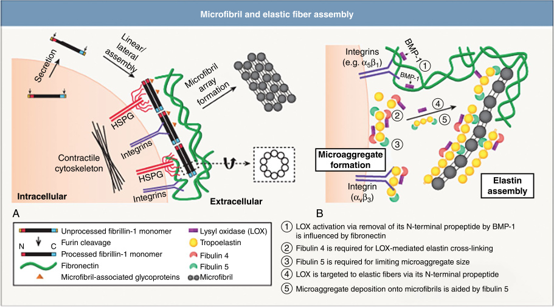

**• Fig 10.2** Microfibril and elastic fiber assembly. (A) Following secretion of fibrillin 1, its N- and C-termini are processed by furin and then interact homotypically; this leads to axial and lateral fibrillin 1 assembly to form microfibrils. Beads may arise from folding of terminal regions, and transglutaminase crosslinks provide stabilization. Fibronectin is thought to act as a microfibril assembly template and/or to facilitate assembly at fibrillar adhesions by stimulating cytoskeletal tension through α5β1 integrin. Fibrillin 1 interacts with α5β1, αv β3, and αv β6 integrins during microfibril assembly. Heparan sulfate proteoglycans (HSPGs) are thought to facilitate cell surface–fibrillin 1 interactions, and heparin inhibits microfibril assembly. Fibrillin 1 also binds microfibril-associated glycoproteins, tropoelastin, fibulins, and latent transforming growth factor (TGF)-β binding protein. (B) Elastic fiber formation includes pericellular elastin “microassembly” and subsequent “macroassembly” on a microfibrillar scaffold. Secreted tropoelastin forms globules at the cell surface, which become crosslinked by lysyl oxidase (LOX); this process may involve αv β3 integrin interactions with tropoelastin, as well as interactions of HSPGs with integrins and tropoelastin. Fibulin 4 and fibulin 5 contribute to elastin crosslinking by lysyl oxidase and are also thought to direct the deposition of elastin globules onto preformed fibrillin-containing microfibrils, thereby forming elastic fibers. Microfibrils and elastic fibers are important matrix storage sites for bone morphogenic proteins (BMPs) and latent TGF-β1. (Figure 3: Adapted from Baldwin AK, Simpson A, Steer R, et al. Elastic fibres in health and disease. _Expert Rev Mol Med_ . 2013;15:e8.) 

reflect their specific functions. For example, in elastic arteries the elastic fibers are arranged in concentric lamellae, whereas in lung alveoli, the elastic fibers form networks that provide elasticity during breathing. 

Microfibrils and elastic fibers are designed to maintain their elastic function over the entire lifespan. Loss of connective tissue elasticity is largely attributable to degeneration of the microfibrillar and elastic fiber network. Degradation of these extracellular networks is a major contributing factor in blood vessel aging, in the development of aortic aneurysms, in lung emphysema, and in degenerative changes in sundamaged skin. Fibrillin molecules and microfibrils are susceptible to degradation by various MMPs and serine proteinases; cumulative proteolytic damage is a major mechanism underlying degenerative changes in aging. Pathogenic defects in fibrillin-1 most frequently result in **Marfan syndrome** , but can also result in other rarer phenotypes, 

such as **Weill-Marchesani syndrome** , **stiff skin syndrome** , **geleophysic dysplasia** (see Chapter 11), or **acromelic dysplasia** (see Chapter 11). Defects in fibrillin-2 result in **congenital contractural arachnodactyly** , or more rarely in acromelic dysplasia, while defects in elastin lead to a form of **cutis laxa** . 

# **Proteoglycans** 

The resiliency to compression of connective tissues such as cartilage or the aorta is largely explained by the presence of **proteoglycans** . Proteoglycans are found ubiquitously in the ECM, on cell surfaces, or in intracellular granules and are involved in a wide range of functions such as cell-cell communication, cell-matrix interactions, and cell growth and differentiation; they additionally interact with many ECM components, including collagens. Proteoglycans consist of a

<!-- p.198 -->

core protein covalently attached to a large series of negatively charged linear polymers of disaccharides called **glycosaminoglycans (GAGs)** . GAGs are composed of repeating disaccharides of an amino sugar (N-acetyl-D-glucosamine or N-acetyl-D-galactosamine) and a type of uronic acid (D-glucuronic or L-iduronic acid). Two groups of GAGs are distinguished: _sulfated_ (e.g., chondroitin sulfate, dermatan sulfate, keratan sulfate, heparan sulfate) and _non-sulfated_ (e.g., heparin and hyaluronan), with sulfation determining the nature of interactions with other macromolecules such as cytokines and growth factors. At least 30 proteoglycans have been identified. The major proteoglycan of cartilage, **aggrecan** , has a core protein of 2,000 amino acids that is decorated with approximately 100 side chains of chondroitin sulfate and keratan sulfate. The core protein in turn binds to long chains of the polymeric disaccharide hyaluronan to form proteoglycan aggregates, one of the largest soluble macromolecular structures in nature. Because of its highly negative charge and extended structure, the aggrecan binds large amounts of water and small ions to distend the three-dimensional network of collagen fibers found in the same tissues, making the tissue resilient to pressure. Pathogenic variants in the gene coding for aggrecan _(ACAN)_ result in rare syndromic or non-syndromic forms of short stature that can be associated with early-onset osteoarthritis, early-onset lumbar disc degeneration, and mild dysmorphic features (Table 10.3). 

The **small leucine-rich proteoglycans** (e.g., decorin and biglycan), the largest family of proteoglycans, are essential for correct collagen fibril formation, as different stages of collagen fibrillogenesis require different small leucine-rich proteoglycans. 

# **Glycoproteins** 

Numerous **glycoproteins** perform essential functions in ECM organization. **Fibronectin** , a major ECM glycoprotein, is a multidomain protein with the unique ability to bind many ECM molecules including collagens, signaling molecules, and cell adhesion molecules. Fibronectin mainly exists as a dimeric glycoprotein and organizes into a fibrillar network. Fibronectin fibers can undergo conformational changes and regulate the mechanical properties of tissues. 

The **tenascin** family of glycoproteins interacts with many partners both in the ECM and on cell surfaces and are known to modulate ECM assembly and cell adhesion. There are four vertebrate tenascin paralogs (TN-C, TN-R, TN-W, and TN-X). TN-X is the largest member of the tenascin family and interacts with several ECM components directly and indirectly, including fibrillar collagens type I, III, and V; collagen types VI, XII, and XIV; and the small leucine-rich proteoglycan decorin. TN-X is involved in the organization of ECM architecture and tissue integrity as a regulator of collagen fibrillogenesis. 

The **latent TGF** β-binding proteins (LTBPs) are extracellular glycoproteins that are classified as members of the fibrillin superfamily because they share a similar modular 

domain structure, including tandem arrays of cbEGF domains that are interspersed with TGFβ binding modules/ 8-Cys type domains. There are four LTBPs, with LTBP-1, LTBP-3, and LTBP-4 having important roles in the processing and secretion of TGFβ. All four LTBP isoforms associate with fibrillin microfibrils. Because LTBPs were discovered as part of a large latent complex with TGFβ and its pro-peptide, they were given the name _latent TGF_ β binding proteins. In the endoplasmic reticulum, pro-TGFβ dimerizes and is disulfide bonded to LTBP to form a ternary complex. The TGFβ dimer is cleaved from its pro-peptide, latency-associated peptide (LAP), in the trans-Golgi network, but TGFβ and LAP remain strongly associated via noncovalent interactions forming the large latent complex (LLC). Once secreted, the LTBPs bind various matrix fibers, including fibrillin and fibronectin fibers that sequester latent TGFβ until it is released by an activator. 

The **fibulins** are a multifunctional family of ECM glycoproteins comprising both long (fibulin-1, fibulin-2, and fibulin-6) and short fibulins (fibulin-3, fibulin-4, fibulin-5, and fibulin-7). Fibulins 1, 2, 3, 4, and 5 bind tropoelastin and fibulins 2, 3, 4, and 5 are involved in elastic fiber formation. Fibulin-4 and fibulin-5 play important roles in elastogenesis. 

**Integrins** are arguably the most important cell surface receptors, anchoring the cytoskeleton to the ECM and functioning as crucial bidirectional signaling receptors between the intracellular and ECM environments. 

# **Heritable Connective Tissue Disorders** 

Heritable connective tissue disorders (HCTD) are caused by pathogenic genetic variants that perturb ECM assembly or homeostasis. Although individually rare, they collectively represent a significant proportion of human genetic disease. HCTDs affect mainly the skin, the eyes, and the musculoskeletal, cardiovascular, and pulmonary systems and are associated with significant morbidity and mortality. Prominent HCTDs include the **Ehlers-Danlos syndromes (EDS)** , **Marfan syndrome (MFS)** , and related conditions such as **Loeys-Dietz syndrome (LDS)** , the **cutis laxa syndromes** , and the skeletal dysplasias (see Chapter 11), including osteogenesis imperfecta. The chronicity and severity of HCTDs, combined with their hereditary nature, cause a significant burden on the quality of life of affected individuals and their families. 

Heritable connective tissue disorders arise from pathogenic variants in genes encoding ECM molecules or molecules related to matrix biosynthesis and cell signaling (Fig. 10.1). Clinically and genetically distinct HCTDs share phenotypic features because the causative pathogenic variants affect molecules that are expressed in overlapping tissues. Similar joint manifestations such as hypermobility are seen in the Ehlers-Danlos syndromes, Marfan syndrome, LoeysDietz syndrome, and the skeletal dysplasias because the genes associated with each of these diseases are all expressed in joint tissue (in addition to other tissues). Furthermore,

<!-- p.199 -->

defects in a single connective tissue component usually manifest in multiple organs of the body, a concept known as **pleiotropy** , a universal feature of HCTDs. Most if not all HCTDs show full penetrance but are characterized by **variable expression** , wherein varying degrees of severity are seen in different individuals, including members of the same family that have the same pathogenic variant. The effects of pleiotropy and variable expression result in highly variable, clinically overlapping, multisystemic findings, which makes the phenotypic diagnosis of a specific disease entity challenging. Since HCTDs are genetically heterogeneous, prevalence ranges from rather commonly occurring autosomal dominant disorders to extremely rare recessively inherited conditions. Determining the true incidence of HCTDs is challenging because it relies on recognition of the disorders, which is biased toward their more severe, and therefore recognizable, phenotypes; less severely affected individuals may not be formally diagnosed, resulting in an underestimation of prevalence. 

The clinical and molecular classification of HCTDs is dynamic and complex. Clinical classification is challenged by the variable expression of phenotypic features within a specific type of HCTD, as well as by the overlap of features among different HCTDs, making the delineation of distinct clinical phenotypes challenging. Molecular classification is challenged by genetic heterogeneity. Multiple genes can be associated with a single clinical phenotype, as seen in Loeys-Dietz syndrome, while different pathogenic variants 

in the same gene can lead to multiple clinical phenotypes, as seen with the genes coding for type I collagen, which can be associated with osteogenesis imperfecta, certain types of Ehlers-Danlos syndrome, and Caffey disease. While molecular genetics provides a more precise and objective approach, clinical classification remains crucial for guiding initial assessments and subsequent care. 

## **The Ehlers-Danlos Syndromes** 

The Ehlers-Danlos syndromes (EDS) are genetically heterogeneous heritable conditions which share several phenotypic features such as soft and hyperextensible skin, abnormal wound healing, easy bruising, and joint hypermobility (Fig. 10.3). Variable findings that differ among EDS subtypes include fragility of soft tissues, blood vessels, and hollow organs, as well as involvement of the musculoskeletal and ocular systems. Pathogenic variants in genes coding for the fibrillar collagens type III and V and, to a lesser extent, type I are found in many individuals with autosomal dominantinherited forms of EDS; in the rare autosomal recessive forms of EDS, pathogenic variants in other genes are at fault. A unifying histopathological pattern, seen to a variable extent across all EDS types, is disrupted biosynthesis and supramolecular organization of collagen fibrils in affected tissues. An overview of the different types of EDS, their molecular basis, inheritance patterns, and main clinical characteristics is given in Table 10.4. 

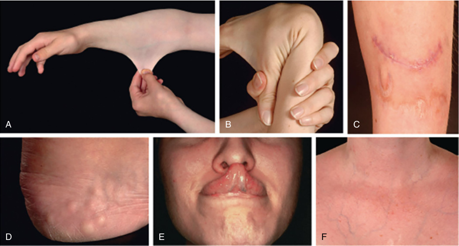

**Fig. 10.3** Clinical features of Ehlers–Danlos syndrome (EDS). Patients with classical EDS demonstrating hyperextensible skin (A), joint hypermobility at the wrist (B), atrophic horseshoe-shaped scars on the shin (C), piezogenic papules on the heel (D), and the Gorlin sign (E). (F) Translucent skin with visible veins on the chest in a patient with vascular EDS. (From Burrows NP, Ringpfeil F, Uillo J. Heritable disorders of connective tissue. In: Bolognia JL, Schaffer JV, Cerroni L, eds. _Dermatology_ . 5th ed., Vol. 2. Philadelphia: Elsevier; 2025 [Fig. 97.2, p. 1717].) 

_(Text continued on page 184)_

<!-- p.200 -->

## **TABLE Overview of Different Ehlers-Danlos Syndrome (EDS) Types, Associated Genes, and Clinical Hallmarks With Major and Minor Criteria as Defined 10.4 in the International EDS Consortium Classification** 

||||Clinical Hallmarks|
|---|---|---|---|
|EDS Type (Abbreviation)|Gene (Protein)|Major Clinical Criteria|Minor Clinical Criteria|
|**Disorders of Collage **|**n Primary Structure an**|**d Collagen Processing**||
|Classical (cEDS)*|_COL5A1_(α1(V) procollagen chain) _COL5A2_(α2(V) procollagen chain) _COL1A1_((α1(I) procollagen chain: p.(Arg312Cys) (rare)))|• Skin hyperextensibility with atrophic scarring • Generalized joint hypermobility|• Easy bruising • Soft doughy skin • Skin fragility (or traumatic splitting) • Molluscoid pseudotumors (bluish-gray, spongy nodules, which are herniations of subcutaneous fat, seen over easily traumatized areas) • Subcutaneous spheroids • Hernia (or history thereof) • Epicanthal folds • Complications of joint hypermobility (e.g., sprain, (sub)luxation, pain, flexible flatfoot) • Family history of a first-degree relative who meets criteria|
|Vascular (vEDS)*|_COL3A1_(α1(III) procollagen chain) _COL1A1_(α1(I) procollagen chain: p. (Arg312Cys) (rare) p.(Arg574Cys) (rare) p.(Arg1093Cys) (rare))|• Family history of vEDS with documented pathogenic variant in COL3A1 • Arterial rupture at young age • Spontaneous sigmoid colon perforation in the absence of known colon disease • Uterine rupture during third trimester of pregnancy • Carotid-cavernous sinus fistula (in the absence of trauma)|• Bruising unrelated to identified trauma and/or in unusual sites such as cheeks and back • Thin, translucent skin with increased venous visibility • Characteristic facial features • Spontaneous pneumothorax • Acrogeria • Talipes equinovarus • Congenital hip dislocation • Small joint hypermobility • Tendon and muscle rupture • Gingival recession and gingival fragility • Early-onset varicose veins|
|Arthrochalasia (aEDS)*|_COL1A1_(α1(I) procollagen chain) _COL1A2_(α2(I) procollagen chain)|• Congenital bilateral hip dislocation • Severe generalized joint hypermobility with multiple dislocations • Skin hyperextensibility|• Muscle hypotonia • Kyphoscoliosis • Radiologically mild osteopenia • Tissue fragility, including atrophic scars • Easy bruising|

_(Continued)_

<!-- p.201 -->

## **TABLE Overview of Different Ehlers-Danlos Syndrome (EDS) Types, Associated Genes, and Clinical Hallmarks With Major and Minor Criteria as Defined 10.4 in the International EDS Consortium Classification—cont’d** 

|EDS Type (Abbreviation)|Gene (Protein)|Major Clinical Criteria|Clinical Hallmarks Minor Clinical Criteria|
|---|---|---|---|
|Dermatosparaxis (dEDS)†|_ADAMTS2_(ADAMTS2, N-proteinase)|• Extreme skin fragility with congenital or postnatal tears • Craniofacial features: large fontanelle, puffy eyelids, excessive periorbital skin, down- slanting palpebral fissures, blue sclerae, hypoplastic chin • Progressively redundant, almost lax skin with excessive skin folds at wrists and ankles • Increased palmar wrinkling • Severe bruisability with risk of subcutaneous hematoma • Umbilical hernia • Postnatal growth retardation with short limbs • Perinatal complications related to tissue fragility|• Soft and doughy skin texture • Skin hyperextensibility • Atrophic scars • Generalized joint hypermobility • Complications of visceral fragility (e.g., rectal prolapse, bladder or diaphragm rupture) • Delayed motor development • Osteopenia • Hirsutism • Tooth abnormalities • Refractive errors • Strabismus|
|Cardiac-valvular (cvEDS)†|_COL1A2_(α2(V) procollagen chain (total absence))|• Severe progressive cardiac-valvular insufficiency • Skin involvement • Joint hypermobility (generalized or restricted to small joints|• Inguinal hernia • Pectus deformity • Joint dislocations • Foot deformities: pes planus, pes planovalgus, hallux valgus|
|**Disorders of Collage **|**n Folding and Collagen**|**Crosslinking**||
|Kyphoscoliotic (kEDS- _PLOD1_or kEDS- _FKBP14_depending on the causative pathogenic variant)†|_PLOD1_(Lysylhydroxylase 1) _FKBP14_(FKBP22)|• Congenital muscle hypotonia • Congenital or early onset kyphoscoliosis • Generalized joint hypermobility with (sub) luxations|• Skin hyperextensibility • Easy bruising • Rupture/aneurysm of medium-sized artery • Osteopenia/osteoporosis • Blue sclerae • Umbilical or inguinal hernia • Pectus deformity • Marfanoid habitus • Talipes equinovarus • Refractive errors _PLOD1_ • Skin fragility • Microcornea • Characteristics craniofacial features _FKBP14_ • Congenital hearing impairment • Muscle atrophy • Bladder diverticula|

_(Continued)_

<!-- p.202 -->

## **TABLE Overview of Different Ehlers-Danlos Syndrome (EDS) Types, Associated Genes, and Clinical Hallmarks With Major and Minor Criteria as Defined 10.4 in the International EDS Consortium Classification—cont’d** 

||||Clinical Hallmarks|
|---|---|---|---|
|EDS Type (Abbreviation)|Gene (Protein)|Major Clinical Criteria|Minor Clinical Criteria|
|**Disorders of Structu** |**re and Function of the My** |**omatrix** ||
|Classical-like (clEDS)†|_TNXB_(Tenascin X)|• Skin hyperextensibility with velvety skin texture and absence of atrophic scarring • Generalized joint hypermobility • Easy bruisable skin/spontaneous ecchymoses|• Foot deformities • Edema in legs in absence of cardiac failure • Mild proximal and distal muscle weakness • Axonal polyneuropathy • Atrophy of muscle in hands and feet • Acrogeric hands, mallet finger(s), clinoor brachydactyly • Vaginal/uterine/rectal prolapse|
|Myopathic(mEDS)‡|_COL12A1_(α1(XII) procollagen chain)|• Congenital muscle hypotonia and/or muscle atrophy • Proximal joint contractures • Hypermobility of distal joints|• Soft, doughy skin • Atrophic scarring • Motor developmental delay • Myopathy on muscle biopsy|
|**Disorders of Glycos**|**aminoglycan Biosynthesis**|||
|Musculo-contractural (mcEDS-_CHST14_or mcEDS-_DES_ depending on the causative pathogenic variant)†|_CHST14_(Dermatan-4-_O_- sulfotransferase-1) _DSE_(Dermatan sulfate epimerase-1)|• Congenital multiple contractures (typically adduction/flexion contractures and talipes equinovarus) • Characteristic craniofacial features: large fontanelle, short down-slanting palpebral fissures, blue sclerae, hypertelorism, short nose with hypoplastic columella, low-set and rotated ears, long philtrum with thin upper lip vermillion, small mouth and hypoplastic chin • Characteristic cutaneous features: skin hyperextensibility, easy bruising, skin fragility with atrophic scars Increased palmar wrinkling|• Recurrent/chronic dislocations • Pectus deformities • Spinal deformities • Peculiar fingers • Progressive talipes deformities • Large subcutaneous hematomas • Chronic constipation • Colonic diverticula • Pneumo(hemo)thorax • Nephrolithiasis/Cystolithiasis • Hydronephrosis • Cryptorchidism in males • Strabismus • Refractive errors • Glaucoma|

_(Continued)_

<!-- p.203 -->

## **TABLE Overview of Different Ehlers-Danlos Syndrome (EDS) Types, Associated Genes, and Clinical Hallmarks With Major and Minor Criteria as Defined 10.4 in the International EDS Consortium Classification—cont’d** 

|EDS Type (Abbreviation)|Gene (Protein)|Major Clinical Criteria|Clinical Hallmarks Minor Clinical Criteria|
|---|---|---|---|
|Spondylodysplastic (spEDS-_B4GALT7_or spEDS-_B3GALT6_ depending on the causative pathogenic variant)†| _B4GALT7_ (Galactosyltransferase I) _B3GALT6_ (Galactosyltransferase II)|• Short stature (progressive in childhood) • Muscle hypotonia (ranging from severe congenital to mild later-onset) • Bowing of limbs|• Skin hyperextensibility, soft and doughy, thin and translucent skin • Pes planus • Delayed motor development • Osteopenia • Delayed cognitive impairment _B4GALT7_ • Radioulnar synostosis • Bilateral elbow contractures • Single transverse palmar crease • Characteristic craniofacial features • Characteristic X-ray findings of skeletal dysplasia • Clouded cornea _B3GALT6_ • Kyphoscoliosis (congenital or early onset) • Joint hypermobility (generalized or restricted to distal joints) • Joint contractures (congenital or progressive) • Peculiar fingers • Characteristic craniofacial features • Tooth discoloration, dysplastic teeth • Characteristic X-ray findings of skeletal dysplasia • Osteoporosis with spontaneous fractures • Aortic aneurysm • Lung hypoplasia, restrictive lung disease|
|**Disorders of Intrace**|**llular Processes**|||
|Spondylodysplastic (spEDS)†|_SLC39A13_(ZIP13)|• Short stature (progressive in childhood) • Muscle hypotonia (ranging from severe congenital to mild later-onset) • Bowing of limbs|• Skin hyperextensibility, soft and doughy, thin and translucent skin • Pes planus • Delayed motor development • Osteopenia • Delayed cognitive impairment • Protuberant eyes with bluish sclerae • Hands with finely wrinkled palms • Skeletal dysplasia • Atrophy of thenar muscles and tapering fingers • Hypermobility of distal joints • Characteristic X-ray findings of skeletal dysplasia|

_(Continued)_

<!-- p.204 -->

## **TABLE Overview of Different Ehlers-Danlos Syndrome (EDS) Types, Associated Genes, and Clinical Hallmarks With Major and Minor Criteria as Defined 10.4 in the International EDS Consortium Classification—cont’d** 

|EDS Type (Abbreviation)|Gene (Protein)|Major Clinical Criteria|Clinical Hallmarks Minor Clinical Criteria|
|---|---|---|---|
|Brittle Cornea Syndrome (BCS)†|_ZNF469_(ZNF469) _PRDM5_(PRDM5)|• Thin cornea with/without rupture • Early-onset progressive keratoconus and/ or keratoglobus • Blue sclerae|• Enucleation or corneal scarring as a result of previous rupture • Progressive loss of corneal stromal depth • High myopia • Retinal detachment • Deafness (often mixed conductive and sensorineural) • Hypercompliant tympanic membranes • Developmental dysplasia of hip • Hypotonia in infancy (usually mild) • Scoliosis • Arachnodactyly • Hypermobility of distal joints • Pes planus, hallux valgus • Mild finger contractures • Soft, velvety and/or translucent skin|
|**Disorders of Compl **|**ement Pathway**|||
|Periodontal (pEDS)*|_C1R_(C1r) _C1S_(C1s)|• Severe and intractable early-onset periodontitis • Lack of attached gingiva • Pretibial plaques • Family history of first degree relative who meets clinical criteria|• Easy bruising • Joint hypermobility, mostly distal • Skin hyperextensibility and fragility, wide or atrophic scarring • Increased infection rate • Hernias • Marfanoid facial features • Acrogeria • Prominent vasculature|
|**Molecularly Unresol**|**ved Forms of EDS**|||
|Hypermobile (hEDS)*|Unknown|||
|**Additional EDS Vari**|**ants**|||
|(Classical-like type 2) (provisional) (clEDS)† Of note, the consortium spei                    i pathophysiologic mechanism *Denotes autosomal domina †Denotes autosomal recessi ‡Denotes autosomal domina Adapted from Malfait F, Fran         i|_AEBP1_(ACLP) cifies 13 types, though in this ta              i s. nt inheritance. ve inheritance. nt or autosomal recessive inher comano C, Byers P, et al. The 2  i|• Skin hyperextensibility with atrophic scarring • Generalized joint hypermobility • Foot deformities • Early-onset osteopenia i      ble, two separate entries were created for spondylodysplastic ED      i itance. 017 international classification of the Ehlers-Danlos syndromes.|i              S and classical-like EDS to highlight specific genotype-phenotype correlations and underlying i_Am J Med Genet C Semin Med Genet_. 2017;175(1):8-26|

<!-- p.205 -->

# **Molecular Basis** 

**Classical EDS** and **vascular EDS** are two of the more common autosomal dominant forms of EDS. Classical EDS is caused by heterozygous pathogenic variants in the genes coding for type V collagen ( _COL5A1_ and _COL5A2_ ), while vascular EDS is caused by heterozygous pathogenic variants in the gene coding for type III collagen _(COL3A1)_ . A rare arginine to cysteine substitution in _COL1A1_ (c.934C>T; p.Arg312Cys) and a range of glutamic acid to lysine substitutions in _COL3A1_ are associated with a phenotype that combines features of classical and vascular EDS. 

Biallelic _COL1A2_ pathogenic variants that result in a complete absence of α2 chains in type I collagen give rise to the very rare autosomal recessive **cardiac-valvular EDS** . **Arthrochalasia EDS** and **dermatosparaxis EDS** both result from deficient cleavage of the N-pro-peptide of type I procollagen. In arthrochalasia EDS this deficient cleavage is due to heterozygous pathogenic variants in either _COL1A1_ or _COL1A2_ that result in loss of the cleavage site, whereas dermatosparaxis (“tearing of the skin”) EDS is caused by biallelic pathogenic variants in the gene that codes for the procollagen N-proteinase (ADAMTS2). The persistence of the N-pro-peptide disturbs fibrillogenesis, resulting in collagen fibrils that are thin and irregular. 

A phenotype that couples EDS with signs of moderate to severe _myopathy_ is related to heterozygous or homozygous pathogenic variants in _COL12A1_ , which codes for type XII collagen, a FACIT collagen. **Kyphoscoliotic EDS** is caused by biallelic pathogenic variants in either _PLOD1_ , which encodes procollagen-lysine 5-dioxygenase (lysyl hydroxylase 1), an enzyme required for formation of stable crosslinks in collagen fibers, or in _FKBP14_ , which encodes FKBP22, an endoplasmic reticulum resident molecular chaperone that acts as a quality control on the folded triple helix of type III and type VI collagen. Some individuals with clinical characteristics resembling those of classical EDS have biallelic pathogenic variants in either _TNXB_ , encoding tenascin-X, or in _AEBP1_ , which encodes the ECM-associated adipocyte enhancer-binding protein (AEBP1), which assists in collagen polymerization. **Spondylodysplastic EDS** is caused by biallelic pathogenic variants in _B3GALT7_ , which encodes galactosyltransferase I, or in _B3GALT6_ , which encodes galactosyltransferase II, both key enzymes in the biosynthesis of the linker region of GAGs. **Musculocontractural EDS** results from pathogenic variants in genes encoding enzymes responsible for dermatan biosynthesis: _CHST14_ , dermatan 4-O-sulfotransferase 1, and _DSE_ , dermatan sulfate epimerase. A rare type of **spondylodysplastic EDS** is caused by biallelic pathogenic variants in _SLC39A13_ , encoding the intracellular zinc transporter ZIP13. 

**Brittle cornea syndrome** is caused by biallelic pathogenic variants in either _ZNF469_ or in _PRDM5_ , both putative transcriptional regulators. **Periodontic EDS** is caused by heterozygous pathogenic variants in _C1R_ or _C1S_ , which encode the complement pathway components C1q and C1s, respectively. A small percentage of individuals with one 

of these genetically elucidated EDS phenotypes, or EDS phenotypes that cannot unequivocally be put in one specific clinical category, have no identifiable genetic defect despite rigorous genetic testing. In addition, the molecular underpinnings of hypermobile EDS (hEDS) remain elusive, and hEDS diagnosis is based on clinical criteria and exclusion of other conditions. 

# **Clinical Manifestations** 

The defining hallmarks of EDS across all types are the combined presence of skin hyperextensibility and fragility, and joint hypermobility that is usually but not always generalized. 

# **_Skin_** 

One of the principal features of EDS is _skin hyperextensibility_ , referring to a stretchy skin that snaps back after release (Fig. 10.3). The skin often has a smooth, soft, or velvety feel, and can be thin and translucent. The skin is fragile and tears easily, even after minor trauma, and heals slowly. Widened and thin scars, also known as “atrophic” or “cigarette paper” scars, are frequently observed in different types of EDS (Fig. 10.4). These scars are more frequently observed over pressure points and exposed areas such as the forehead, elbows, knees, and shins. Individuals with vascular EDS usually do not have a velvety hyperextensible skin, but skin can be thin and translucent with visible superficial veins. _Easy_ 

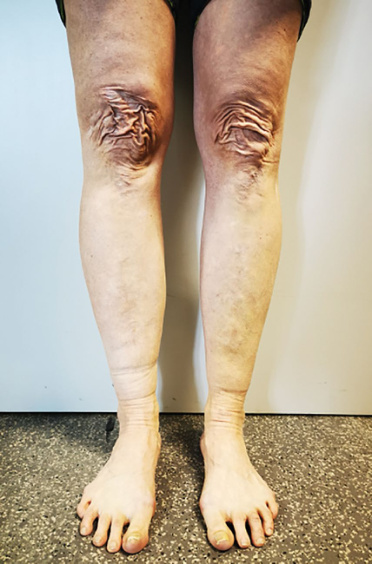

**Fig. 10.4** Atrophic scarring in an individual with classical EhlersDanlos syndrome.

<!-- p.206 -->

_bruising_ is commonly seen in all types of EDS. In children with undiagnosed classical or vascular EDS, the presence of multiple bruises may elicit a suspicion of child maltreatment. Repetitive bruising causes discoloration of the skin due to deposition of hemosiderin, a phenomenon referred to as “hemosiderotic” scars that is more frequently observed in classical, vascular, and periodontal EDS. In more severe types, such as the autosomal recessive musculocontractural and classical-like EDS, a bleeding diathesis may manifest itself as severe spontaneous or recurring hematomas. 

# **_Joints_** 

The presence of generalized _joint hypermobility_ is not diagnostic of EDS, despite being one of the most frequent 

indications in both children and adults to be referred to a specialist for consideration of EDS. Joint hypermobility is a continuous trait modified by age, sex, and ethnicity, as well as by environmental factors. The reported prevalence of generalized joint hypermobility in the general population is as high as 57% in females and 35% in males. In addition, joint hypermobility is also observed in many syndromic conditions other than EDS. In EDS, joint hypermobility is variable in severity and is usually but not always generalized. Joint hypermobility is typically assessed using the 9-point **Beighton scale** (Fig. 10.5). Hypermobility is defined as generalized if the score is ≥6 for prepubertal children and adolescents, ≥5 for post-pubertal males and females until age 50 years, and ≥4 for males and 

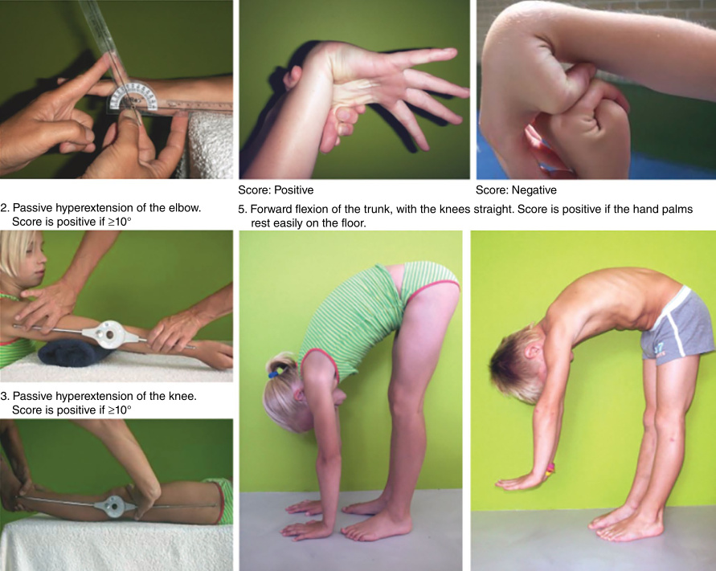

**Fig. 10.5** Beighton score. The range of motion of several key small and large joints is measured to provide an overview of joint hypermobility. Instability is not assessed. Scoring: 2 points for each bilateral measure in Nos. 1 to 4 and 1 point for No. 5, equaling a total possible score of 9. Hypermobility is considered significant with a score of ≥6 between the ages of 6 and 35.  (Modified from Smits-Engelsman B, Klerks M, Kirby A. Beighton score: a valid measure for generalized hypermobility in children. _J Pediatr_ . 2011;158:119-123.e4.)

<!-- p.207 -->

females over 50 years of age. This Beighton scale, while easy to use in daily clinical practice, has major limitations, and should be considered more as a screening assessment. While often an asset to play or sports participation in childhood, joint hypermobility can become a serious burden over time, often complicated by repetitive subluxations, dislocations, sprains, and chronic joint pain that is difficult to treat. 

# **_Other Signs and Symptoms_** 

Other signs of generalized connective tissue weakness and fragility, as well as other musculoskeletal problems, can be observed to varying degrees and may help distinguish among different EDS types. Congenital **umbilical hernia** is commonly seen in dermatosparaxis EDS, whereas _later-onset repetitive_ **inguinal** and **umbilical hernias** are sometimes observed in other types of EDS. **Rupture of medium and large-sized arteries** is a major concern in vascular EDS but has been reported in a few other types as well, especially in classical and kyphoscoliotic EDS. Patients with vascular EDS are at increased risk for rupture of the gastrointestinal tract (especially the sigmoid colon), the gravid uterus, and other internal organs such as the spleen. Early-onset severe varicose veins, carotid-cavernous fistulae, and spontaneous pneumothorax are also features of vascular EDS. Cardiacvalvular defects and aortic root dilatation are _usually not_ part of the vascular EDS phenotype, but rather are restricted to some of the rarer autosomal recessive forms of EDS. Obstetrical and pelvic complications such as cervical insufficiency, premature rupture of membranes, vaginal 

lacerations, and organ prolapses (e.g., uterus, bladder, rectum) may occur. Prenatal ultrasound abnormalities are uncommon, with the exception of congenital anomalies of the kidney and urinary tract in musculocontractural EDS. Sclerae may be blue, especially in arthrochalasia and dermatosparaxis EDS. Other **ophthalmological signs** and symptoms include microcornea and scleral rupture in kyphoscoliotic EDS; keratoconus, keratoglobus, and corneal rupture in brittle cornea syndrome; and corneal clouding in spondylodysplastic EDS. Keratoconus, a conical protrusion of the cornea (Fig. 10.6) has also been sporadically observed in vascular EDS patients. 

**Musculoskeletal features** include congenital bilateral hip dislocation, spine deformities (e.g., scoliosis, kyphosis), pectus deformities (e.g., pectus carinatum, pectus excavatum), talipes equinovarus, and in some rarer types (e.g., musculocontractural and spondylodysplastic EDS), a mild skeletal dysplasia. Muscle hypotonia is observed in a number of EDS types (notably classical, classical-like, myopathic, kyphoscoliotic, and musculocontractural EDS) and, in combination with joint laxity, may cause _floppy infant syndrome_ , or a delay in motor development. A combination of congenital proximal contractures with distal joint hypermobility is observed in a few EDS types, including myopathic, musculocontractural, and spondylodysplastic EDS. 

**Central nervous system** abnormalities are rare in EDS. Ventricular enlargement, Dandy-Walker anomaly, hypoplasia of the septum pellucidum, and hydrocephalus have been reported in musculocontractural and spondylodysplastic EDS. Intellectual disabilities and hearing loss are not 

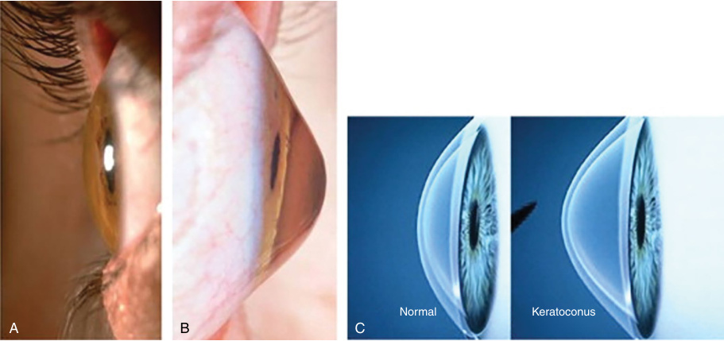

**Fig. 10.6** Keratoconus. (A) Unaffected eye, (B) eye with keratoconus-related conical protrusion, (C) comparison of unaffected cornea and cornea with keratoconus. (From Kaya H, Çavuşoğlu A, Çakmak HB, Şen B, Çalık E. Chapter 31: Keratoconus disease and three-dimensional simulation of the cornea throughout the process of cross-linking treatment. In: Tran QN, Arabnia H, eds. _Emerging Trends in Computer Science and Applied Computing, Emerging Trends in Computational Biology, Bioinformatics, and Systems Biology_ . Morgan Kaufmann; 2015:561-575.)

<!-- p.208 -->

considered part of the general EDS phenotype but have sporadically been reported in patients from consanguineous families with rare autosomal recessive forms of EDS; it is unclear whether this is truly part of the EDS phenotype in those patients or whether it is unrelated to EDS and is caused by other genetic factors. 

Facial dysmorphic features may help in the recognition of certain EDS types. In the autosomal dominant forms, these dysmorphisms are usually mild, while in the autosomal recessive types they are more pronounced. Vascular EDS is characterized by the presence of thin lips, narrow nose, attached ear lobes, large, prominent eyes, and potentially severe gingival recession (Fig. 10.7). Gingival recession should also raise concern for the periodontal form of EDS, in which early-onset periodontitis with extensive periodontal destruction and loss of teeth, starting in childhood or adolescence, is universally present. Individuals with classical EDS often 

have epicanthal folds and large protruding ears. Individuals with dermatosparaxis EDS have a recognizable facial appearance with prominent and protuberant eyes; puffy, edematous eyelids and excessive periorbital skin; large fontanelles and wide cranial sutures; micrognathia; and gingival hyperplasia. Individuals with musculocontractural EDS present with large fontanelles, downslanting palpebral fissures, hypertelorism, a short nose with a hypoplastic columella, ear deformities, high-arched palate, long philtrum, thin upper lip vermilion, small mouth, and micro-retrognathia. 

# **Classification** 

The 2017 International EDS Consortium classification defines 13 clinical EDS types that are caused by pathogenic variants in 20 different genes (Table 10.4) that are grouped into different categories based on the function of the encoded protein: 

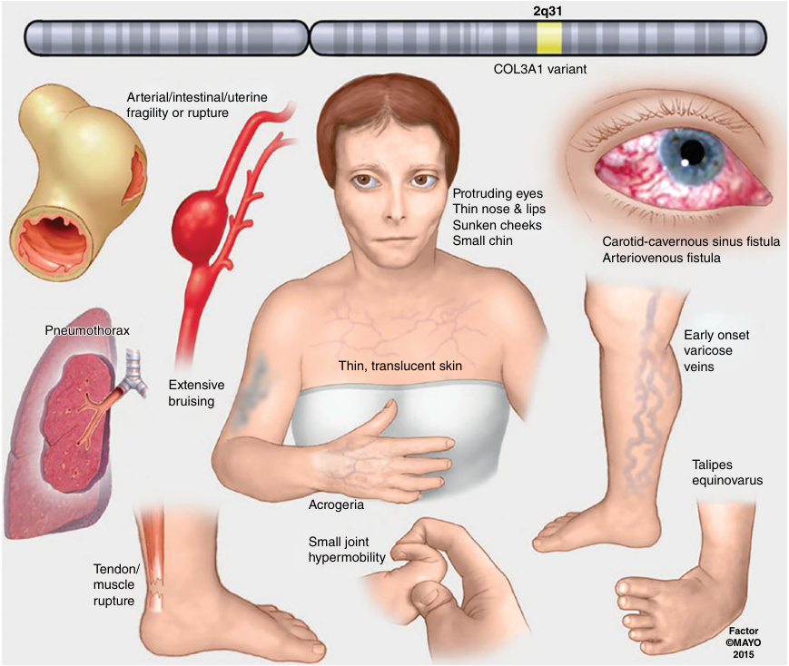

**Fig. 10.7** Illustration of the clinical spectrum of findings in individuals with vascular Ehlers-Danlos syndrome secondary to pathogenic variants in _COL3A1._ (From Pizano A, Tenorio ER, Tanaka A, Oderich G. Chapter 24: Aneurysmatic degeneration of connective tissue diseases: from diagnosis to treatment. In: _Vascular Surgery: A Guide to Clinical Decision-Making._ Elsevier; 2022:273-295.)

<!-- p.209 -->

(a) collagen structure and processing, (b) collagen folding and crosslinking, (c) the myomatrix, the interface between muscle and ECM, (d) glycosaminoglycan biosynthesis, (e) miscellaneous intracellular processes, and (f) complement pathway. 

aneurysm at the sinuses of Valsalva, with subsequent evolution to aortic dissection, are associated with high mortality rates, the first presenting symptoms of Marfan syndrome are often non-vascular and include skeletal, ophthalmologic, or pulmonary abnormalities. 

# **Epidemiology** 

The incidence of all forms of EDS is ~1 in 5,000 individuals, with no apparent ethnic or sex predisposition. Individuals with milder symptoms frequently do not seek medical attention, leading to underestimation of incidence rates. Classical EDS, with an incidence of 1 in 20,000, and vascular EDS, with an incidence as high as 1 in 50,000 and as low as 1 in 200,000, are the most common genetically defined forms of EDS. For the other types of EDS for which genetic defects have been identified, there are no incidence estimates, but the number of identified individuals with each of these disorders is below 100. 

The incidence of hEDS is not known. While generally considered to be the most common type of EDS, it exists in a phenotypic continuum with the **hypermobility spectrum disorders** , a group of conditions characterized by symptomatic joint hypermobility and a range of additional extraarticular signs and symptoms including fatigue, chronic pain, headaches, functional gastrointestinal disorders, and dizziness or brain fog. The incidence of hypermobility spectrum disorders is also unknown, though is felt to be common. Both conditions are more frequently diagnosed in females than in males. 

# **Marfan Syndrome and Related Disorders** 

Marfan syndrome is a common HCTD. While vascular complications, particularly the development of an aortic 

# **Molecular Basis** 

Most Marfan syndrome is caused by dominant negative and haploinsufficient pathogenic variants in _FBN1_ . Inheritance is therefore typically autosomal dominant, although in rare instances, biallelic variants have been identified. Approximately 70% of affected individuals have an affected parent; ~30% of affected individuals have a _de novo_ pathogenic variant. Over 2,000 different pathogenic variants in _FBN1_ have been described. Most are private (i.e., are variants with a low allele frequency, typically found within only a single family within a cohort) and are scattered throughout its 65 coding exons. About 10% are recurrent and are in CpG sequences known to be _hot spots_ . Approximately two-thirds of the variants in these hot spots are missense variants that alter calcium-binding domains in the repetitive EGF–like domains of the protein, and about one-third of the variants introduce premature termination codons (Fig. 10.8). Rarer variants alter the processing of the protein. The severity of the phenotype can usually not be predicted from the nature of the variant; however, pathogenic variants in exons 24–32 of _FBN1_ typically result in a severe phenotype associated with childhood mortality (previously called **neonatal Marfan syndrome** ). 

Pathogenic variants in _FBN1_ produce the phenotypic manifestations of Marfan syndrome by weakening the structure of the ECM _and_ also through effects on TGFβ signaling 

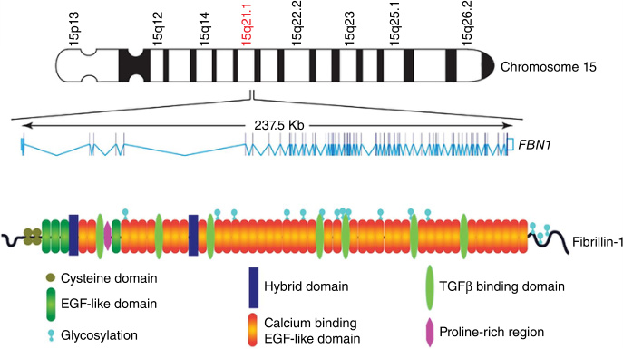

**Fig. 10.8** Schematic representation of fibrillin-1 gene and protein. _FBN1_ consists of 65 exons located on chromosome 15. It encodes fibrillin-1 (2,871 amino acids, 350 kDa), a multi-domain glycoprotein, integral for ECM stability. (From Ramachandra CJ, Mehta A, Guo KW, Wong P, Tan JL, Shim W. Molecular pathogenesis of Marfan syndrome. _Int J Cardiol_ . 2015;187:585-591.)

<!-- p.210 -->

(Fig. 10.9); phenotypically related disorders such as LoeysDietz syndrome have features that overlap with Marfan syndrome related to disruptions in TGFβ pathways. Some pathogenic variants in _FBN1_ produce alterations in binding sites that modulate TGFβ bioavailability during development of the skeleton and other tissues. In aortic tissues, reduced or altered forms of fibrillin-1 stimulate the release of sequestered TGFβ and increase its activity, resulting in altered transcription of target genes, including connective tissue growth factor and matrix metalloproteinases (MMP-2 and MMP-9). The aortic phenotype is caused by vascular remodeling due to a combination of structural microfibril changes, excess TGFβ, and overexpression of MMP-2 and MMP-9. 

# **Epidemiology** 

With an incidence of ~1 in 5,000, Marfan syndrome is one of the most common HCTDs, occurring worldwide without ethnic or sex predisposition. 

# **Clinical Manifestations** 

Marfan syndrome is most frequently associated with cardiovascular, ocular, and musculoskeletal abnormalities, but 

lung, skin, and central nervous system involvement may also occur. Decreased life expectancy is primarily due to aortic complications including aortic root dilatation and dissection. 

# **_Cardiovascular_** 

_Dilatation of the aortic root at the sinuses of Valsalva_ is a characteristic and ominous feature of Marfan syndrome that can develop at any age. The rate of dilatation is unpredictable. Undiagnosed and untreated Marfan syndrome is associated with **aortic dissection** that occurs when the maximal dimension reaches approximately 5 cm. Dissection typically begins above the coronary ostia and can extend the entire length of the aorta. Aortic dissection is exceedingly rare in early childhood. Dilatation may also involve other segments of the thoracic aorta, the abdominal aorta, the root of the pulmonary artery, or even the carotid and intracranial arteries. **Mitral valve prolapse** is observed in ~50% of individuals with Marfan syndrome and is more prevalent in women; its frequency increases with age. Heart failure caused by prolapse and mitral valve regurgitation represents a major source of morbidity and mortality in young children with rapidly progressive Marfan syndrome. Additional cardiac findings may include cardiomyopathy with biventricular enlargement and mild systolic dysfunction. 

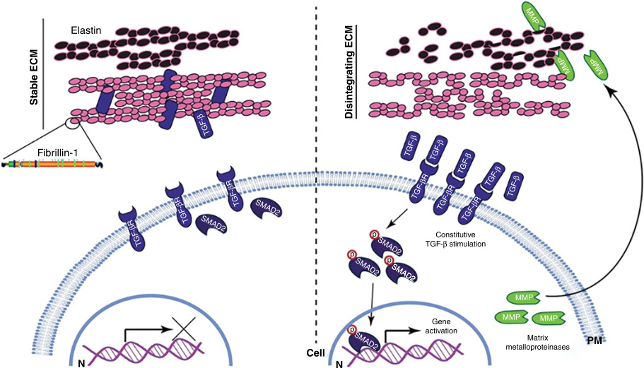

**Fig. 10.9** Schematic representation of extracellular matrix disintegration in Marfan syndrome. Fibrillin-1 aggregates into functional microfibrils and sequesters TGF-β in the ECM, regulating its signaling. Loss of fibrillin-1 in Marfan syndrome decreases or eliminates this TGF-β sequestration, and its constitutive stimulation activates genes like MMPs, which induce elastolysis, decreasing ECM stability. (From Ramachandra CJ, Mehta A, Guo KW, Wong P, Tan JL, Shim W. Molecular pathogenesis of Marfan syndrome. _Int J Cardiol_ . 2015;187:585-591.)

<!-- p.211 -->

# **_Musculoskeletal_** 

Affected individuals typically display a _marfanoid habitus_ with tall stature and long limbs (Fig. 10.10). The ratio of the upper segment (i.e., top of the head to the top of the pubic ramus) to the lower segment (i.e., top of the pubic ramus to the floor) is usually 2 standard deviations below mean for age, ethnicity, and sex. The fingers and hands are long and slender and have a spider-like appearance termed **arachnodactyly** . Other musculoskeletal manifestations include joint hypermobility, reduced elbow extension, anterior chest deformities (e.g., pectus excavatum, pectus carinatum), vertebral column deformity (e.g., scoliosis and thoracolumbar kyphosis), maxillary overbite, protrusion acetabula (which can lead to osteoarthritis), and hind foot deformity (e.g., pes planus). 

# **_Ophthalmologic_** 

Myopia is the most common ocular feature, affecting over 50% of individuals, often presenting in early childhood. **Ectopia lentis** , displacement of the lens from the center of the pupil, occurs in about 60% of individuals. The ocular globe is frequently elongated and the cornea may be flat; early cataract formation and glaucoma can occur. 

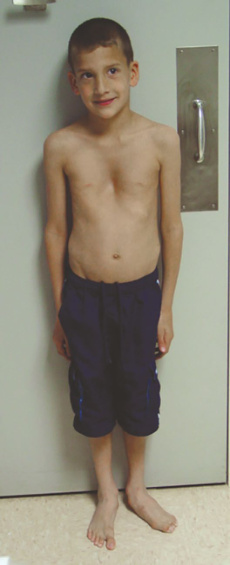

**Fig. 10.10** Marfan syndrome. Note the long slim limbs, pectus excavatum, narrow face, and reduced elbow extension. (From Jones KL, Jones MC, Del Campo M. _Smith’s Recognizable Patterns of Human Malformation_ . 8th ed. Philadelphia: Elsevier; 2022: Fig. 1A, p. 662.) 

# **_Other Signs and Symptoms_** 

**Craniofacial** characteristics of MFS include dolichocephaly, exophthalmos, downslanting palpebral fissures, malar hypoplasia, high arched palate with tooth crowding, and micrognathia or retrognathia. **Mucocutaneous** features include striae, typically over the shoulders and buttocks (Fig. 10.11), and inguinal and incisional hernias. The skin is not hyperextensible, in contrast to EDS. **Pulmonary** blebs are a frequent feature and evolve toward spontaneous pneumothorax. Obstructive and central sleep apnea is observed more frequently than in the general population and is related to increased risk of atrial fibrillation, decreased left ventricular ejection fraction, aortic events, and complications of mitral valve surgery. **Neurological** findings include dural ectasia, as well as spinal arachnoid cysts or diverticula. Severe dural ectasia, including meningoceles, are sometimes accompanied by neurological signs due to pressure on the nerves. 

# **Related Disorders** 

**Loeys-Dietz syndrome (LDS)** is a group of autosomal dominantly inherited disorders that have considerable phenotypic similarities with Marfan syndrome. Overlapping craniofacial features include elongated facies, downslanting palpebral fissures, highly arched palate, malar hypoplasia, micrognathia, and retrognathia. Additional similar features include pectus deformities, scoliosis, pes planus, arachnodactyly, joint laxity, dural ectasia, spontaneous pneumothorax, and aortic root aneurysm with dissection. When presenting with typical features, LDS can be _distinguished_ from Marfan syndrome by the unique presence of hypertelorism, an abnormal uvula (typically broad with raphe or bifid) or cleft palate, and widespread aortic and arterial aneurysms and tortuosity, with the head and neck arteries being the primary sites of arterial involvement. Individuals with LDS most often present with cardiovascular features first, while this is not the case for Marfan syndrome. Aortic aneurysms in LDS behave very differently from those in Marfan syndrome, with dissection and rupture occurring more frequently, at smaller dimensions, and earlier in life, including during early childhood. Additional features that distinguish LDS from Marfan syndrome include craniosynostosis, hydrocephalus (a rare finding), Chiari I malformation, joint contractures, and cervical spine instability. Furthermore, talipes equinovarus; inguinal, umbilical, and hiatal hernias; blue sclerae; thin, translucent skin; poor wound healing; atrophic scars; and easy bruising are also frequently observed in LDS though not in Marfan syndrome. Many of these features are observed in vascular EDS; as such, LDS is an important differential diagnosis of vascular EDS. 

Loeys-Dietz syndrome is caused by pathogenic variants in genes encoding components of the TGFβ signaling pathway, including the cytokines TGFβ2 and TGFβ3, the cytokine receptors TGFBR1 and TGFBR2, and the downstream effectors SMAD2, SMAD3. These loss-of-function variants all lead to increases in TGFβ signaling.

<!-- p.212 -->

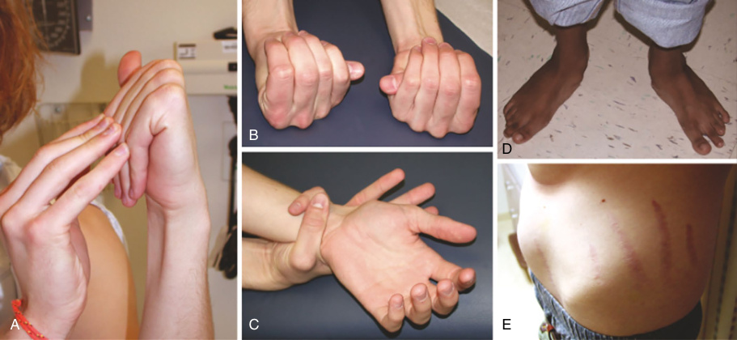

**Fig. 10.11** Marfan syndrome. Note the joint laxity (A), Steinberg thumb sign (B), ability to join thumb and fifth finger around the wrist (Walker-Murdoch sign) (C), pes planus (D), and striae over hips and back (E). (From Jones KL, Jones MC, _Del Campo M. Smith’s Recognizable Patterns of Human Malformation_ . 8th ed. Philadelphia: Elsevier; 2022; Fig. 2, p. 664.) 

**Congenital contractural arachnodactyly (CCA)** , also referred to as **Beals–Hecht syndrome** or **distal arthrogryposis type 9** , is an autosomal dominant disorder with phenotypic features similar to Marfan syndrome. CCA is caused by heterozygous pathogenic variants in _FBN2_ , the gene encoding fibrillin-2, and is characterized by tall stature, arachnodactyly, progressive scoliosis, contractures, and crumpled ears. Cardiovascular abnormalities include mitral valve prolapse and aortic root dilatation, though aortic dissection is rare. Congenital cardiac and gastrointestinal anomalies requiring surgical repair in early infancy have also been reported. The differential diagnosis of Marfan syndrome is presented in Table 10.5. 

## **Cutis Laxa Syndromes** 

The cutis laxa (CL) syndromes are a heterogenous group of multisystemic HCTDs characterized by loose redundant skin folds secondary to severe elastic fiber fragmentation within the skin. Cutis laxa can be either acquired (Table 10.6) or inherited (Tables 10.7 and 10.8); severity and the spectrum of associated manifestations vary significantly by specific underlying cause. 

## **Molecular Basis** 

Heritable forms of cutis laxa are caused by pathogenic variants in genes related to various steps in the synthesis and organization of elastic fiber-associated ECM proteins, including elastin, LTBPs, and fibulins _(ELN, LTBP4, FBLN4, FBLN5)_ ; histopathologic changes vary based on underlying cause (Fig. 10.12). Heterozygous pathogenic variants in 

_ELN_ , which encodes elastin, cause **autosomal dominant cutis laxa (ADCL)** , whereas biallelic pathogenic variants in _LTBP4_ (encoding LTBP-4) and _FBLN4_ and _FBLN5_ (encoding fibulin-4 and fibulin-5) cause different forms of **autosomal recessive cutis laxa (ARCL)** ; phenotypic findings and associated comorbidities vary by underlying cause (Fig. 10.13). Pathogenic variants in additional genes lead to defects in cellular trafficking (e.g., _ATP6V0A2, ATP6V1E1, ATP6V1A, SCYL1BP1,_ and _RIN2_ ) and metabolism (e.g., _ALDH18A1, PYCR1, SLC2A10_ ), suggesting that disturbed intracellular transport, lysosomal dysfunction, mitochondrial dysfunction, and proline synthesis all play roles in pathogenesis of cutis laxa. 

**Occipital horn syndrome** , previously referred to as **X-linked cutis laxa** , is caused by pathogenic variants in _ATP7A_ , the same gene that causes **Menkes disease** and **_ATP7A_ -related distal motor neuropathy** (also known as **distal spinal muscular atrophy-3** ). The three conditions are considered _allelic_ disorders on a _phenotypic spectrum_ , with the constellation and severity of findings being related to the level of residual copper transporter function and its effect on downstream copper-dependent enzymes such as lysyl oxidase, dopamine β-hydroxylase, tyrosinase, and cytochrome C oxidase. Features of occipital horn syndrome include generalized cutis laxa, pathognomonic bony extoses on the occiput (Fig. 10.14), bladder diverticula, and mild to moderate intellectual disability. 

## **Clinical Manifestations** 

Cutis laxa syndromes are characterized by generalized _cutis laxa_ , skin that is loose (lax), wrinkled, sagging, redundant,

<!-- p.213 -->

##### **TABLE** 

##### **10.5** 

### **The Differential Diagnosis of Marfan Syndrome** 

|Differential Diagnosis (Genes)|Cardiac Features|Vascular Features|Systemic Features|
|---|---|---|---|
|**Aortic Aneurysm Syndromes**||||
|Loeys-Dietz syndromes (types I-V) _TGFBR1_,_TGFBR2_,_SMAD3_, _TGFB2_,_TGFB3_|• Patent ductus arteriosus • Atrial septal defect • Bicuspid aortic valve|• Aortic root aneurysm • Arterial tortuosity • Widespread aneurysms • Vascular dissection at relatively young ages and small aortic dimensions|• Hypertelorism • Cleft palate • Broad or bifid uvula • Craniosynostosis • Midface hypoplasia • Blue sclerae • Arachnodactyly • Pectus deformity • Scoliosis • Joint hypermobility • Pes planus • Rarely easy bruising • Dystrophic scars • Translucent skin • Rarely developmental delay|
|Familial thoracic aortic aneurysm _TGFBR2,_ _ACTA2_, others|• Generally none • Rare forms with patent ductus arteriosus|• Aortic root aneurysm • Ascending aortic aneurysm|• Generally none • Rarely livedo reticularis and iris flocculi|
|Shprintzen-Goldberg syndrome _SKI,_unknown others|None|• Aortic root aneurysm|• Hypertelorism • Craniosynostosis • Arched palate • Arachnodactyly • Pectus deformity • Scoliosis • Joint hypermobility • Developmental delay|
|Bicuspid aortic valve with aortic aneurysm _ACTA2_|Bicuspid aortic valve|• Aortic root aneurysm • Ascending aortic aneurysm||
|Vascular Ehlers-Danlos syndrome _COL3A1_|Mitral valve prolapse|• Aneurysm and rupture of any medium to large muscular artery • No predisposition for aortic root enlargement|• Joint hypermobility • Atrophic scars • Translucent skin • Easy bruising • Hernias • Rupture of hollow organs|
|**Ectopia Lentis Syndromes**|||i|
|Familial ectopia lentis _FBN1,_ _LTBP2_,_ADAMTSL4_|None|None|Nonspecific skeletal features|
|Homocystinuria _CBS_|Mitral valve prolapse|Intravascular thrombosis|• Tall stature • Ectopia lentis • Long-bone overgrowth • Developmental delay|
|**Syndromes With Systemic M**|**anifestations of MFS**|||
|MASS (mitral valve, aorta, skeleton, skin) phenotype _FBN1_|Mitral valve prolapse|Borderline or nonprogressive|• Nonspecific skin and skeletal findings • Myopia|
|From Doyle JJ, Dietz HC. Marfan syndrom|e. In:_Nelson Textbook of Pediatric_|_s_. 22nd ed. Philadelphia: Elsevier; 2025|(Table 743.4, p. 4367).|

and inelastic. When stretched, inelastic skin returns to place _very slowly_ . This inelasticity differs from the skin hyperextensibility observed in EDS, where the skin easily _snaps back_ after it is released. The skin in the lower facial, axillary, and inguinal regions is most commonly affected. 

Abnormal skin may give affected individuals a prematurely aged appearance. 

Associated findings vary by underlying cause (Table 10.7). Individuals with _ELN_ -related ADCL are at risk of **aortic root dilatation** and **emphysema** (Fig. 10.15). _FBLN4_ -related

<!-- p.214 -->

##### **TABLE** 

### **Acquired Cutis Laxa: Associated Conditions** 

##### **10.6** 

#### **Skin Disorders** 

|• Urticaria and/or angioedema|
|---|
|• Drug eruptions (e.g., due to penicillin or an SSRI)|
|• Sweet syndrome-like eruptions (Marshall syndrome*)|
|• Urticarial vasculitis|
|• Arthropod bite reactions|
|• Erythema multiforme|
|• Dermatitis herpetiformis|
|• Lupus panniculitis|
|• Interstitial granulomatous dermatitis|
|• Cutaneous mastocytosis|
|• Cutaneous lymphoma|
|**Extracutaneous Inflammatory Disorders**|
|• Rheumatoid arthritis|
|• Systemic lupus erythematosus • Nephrotic syndrome • Celiac disease • Sarcoidosis|
|**Hematologic Disorders**|
|• Monoclonal gammopathy (especially acral CL; underlying plasma cell dyscrasia)†|
|• Congenital hemolytic anemia|
|**Infectious Diseases** |
|• Febrile viral syndrome|
|•_Borrelia burgdorferi_infection |
|• Syphilis|
|• Leprosy|
|**Drug Intake(Also See Drug Eruptions Above)**|
|• Penicillamine (embryopathy) • Isoniazid|
|Generalized or localized CL (including Marshall syndrome) can occur in the setting of α1-antitrypsin deficiency. _SSRI,_Selective serotonin reuptake inhibitor. *Occurs primarily in infants and young children and is referred to as type II acquired CL, with other forms of acquired CL classified as type I. †Commonly associated with systemic amyloidosis in setting of multiple myeloma.|
|From Burrows NP, Ringpfeil F, Uillo J. Heritable disorders of connective tissue. In: Bolognia JL, Schaffer JV, Cerroni L, eds._Dermatology_. 5th ed., Vol. 2. Philadelphia: Elsevier; 2025 (Table 97.8, p. 1727).|

ARCL is characterized by widespread arterial tortuosity, aneurysms, and stenoses. _FBLN5_ and _LTBP4_ -related ARCL overlap extensively and present with life-threatening pulmonary emphysema, arterial stenoses, and diverticula of the gastrointestinal and urinary tracts, and distinguishing between the two on clinical grounds alone is challenging. The overall prognosis of _FBLN5_ - and _LTBP4_ -related ARCL is poor, with very few individuals surviving beyond childhood. Premature death results mostly from cardiopulmonary failure due to complications of pulmonary emphysema and, in the case of _FBLN5_ -related ARCL, due to diverticula in hollow viscera. 

## **_Skin_** 

Individuals with _ELN_ -related ADCL have generalized but variable skin involvement that ranges from mildly 

hyperextensible skin to loose, redundant skin folds that are most pronounced in the lower facial, axillary, and inguinal regions. Individuals with _FBLN4_ -related ARCL have mild skin findings, typically consisting of hyperextensible or velvety skin, or scattered redundant skin folds in the axillae and groin. Rarely, inguinal or diaphragmatic hernias are observed. In contrast, individuals with _FBLN5_ and _LTBP4_ - related ARCL have severe generalized cutis laxa with loose, redundant skin folds over the whole body, particularly in the neck, axillae, and groin (Fig. 10.16). The generalized skin sagging results in a drooped or prematurely aged facial appearance with sagging cheeks. Inguinal hernias are frequent in _FBLN5_ -related ARCL. 

## **_Musculoskeletal_** 

Individuals with _ELN_ -related ADCL, _FBLN4_ -related ARCL, and to a lesser extent _LTBP4_ -related ARCL display joint hypermobility. _FBLN4_ -related ARCL is also associated with arachnodactyly, pectus deformities, and osteoporosis with easy fracturing. 

## **_Cardiovascular_** 

Some individuals with _ELN_ -related ADCL develop aortic root dilatation with a risk for dissection, while some have bicuspid aortic valves with dilatation more distally in the ascending aorta. _FBLN4_ -related ARCL is associated with severe cardiovascular abnormalities including aortic dilatation, aortic and arterial tortuosity, focal aortic narrowing at the isthmus, and dilatation or stenosis of the pulmonary arteries, which leads to a higher risk for life-threatening complications including stroke, dissection, and cardiopulmonary failure. 

**Supravalvular aortic stenosis** and **peripheral pulmonary artery stenosis** are the most common cardiovascular abnormalities in _FBLN5_ -related ARCL. Peripheral pulmonary artery stenosis often leads to right ventricular dilatation and progressive heart failure. Tricuspid valve dysplasia, including stenosis and regurgitation, may be present. 

Peripheral pulmonary artery stenosis—but not supravalvular aortic stenosis—is also a hallmark of _LTBP4_ -related ARCL and is often complicated by pulmonary hypertension, a feature specific for _LTBP4_ -related ARCL. Septal defects and valvular dysfunction are less common. 

## **_Pulmonary_** 

Approximately 35% of individuals with _ELN_ -related ADCL develop obstructive lung disease and emphysema, predisposing to airway infections and bronchiectasis. Severe emphysema requiring lung transplantation has been observed in affected individuals who are heavy smokers. _FBLN4_ -related ARCL is usually not associated with pulmonary emphysema, but aneurysmatic compression of the trachea and bronchi may cause respiratory complications such as atelectasis and respiratory distress. In contrast, _FBLN5_ and _LTBP4_ -related ARCL are associated with severe pulmonary emphysema, usually becoming obvious in the first months of life or in early childhood. Recurrent lower respiratory infections resulting in pneumonia are reported in most patients.

<!-- p.215 -->

### **TABLE Heritable Forms of Cutis Laxa and Related Conditions 10.7** 

|Disorder|Inheri- tance|Gene|Protein|Distribution of Cutis Laxa|Additional Features|
|---|---|---|---|---|---|
|**Heritable Forms of**|**Cutis Laxa**|||||
|ADCL|AD*|_ELN_ _FBLN5_(single patient reported)|Elastin Fibulin 5|Generalized|• Cardiac valve abnormalities, aortic dilatation (variable) • Emphysema (uncommon) • Hernias†|
|ARCL type 1 A|AR|_FBLN5_|Fibulin 5|Generalized; large ears with prominent lobes|• Pulmonary emphysema • Stenoses of the supravalvular aorta and pulmonary arteries • Gastrointestinal and vesicourinary diverticula, hernias† • Micrognathia|
|ARCL type 1B|AR|_FBLN4/EFEMP2_|Fibulin 4|Generalized but less pronounced; may favor skin folds| • Arterial or aortic tortuosity/aneurysms; aortic isthmus stenosis • Joint hypermobility, arachnodactyly, fractures, high arched palate, micrognathia|
|ARCL type 1 C (Urban–Rifkin–Davis syndrome)|AR|_LTBP4_|Latent TGF-βbinding protein-4|Generalized|• Emphysema (severe, often fatal) • Pulmonary arterial stenosis, valvular defects • GI and GU malformations (diverticula, rupture risk) • Micrognathia, large fontanelles • Joint hypermobility, hypotonia • Bitemporal hypotrichosis|
|ARCL type 2 A (Debré type; allelic to wrinkly skin syndrome)|AR|_ATP6V0A2_|Vacuolar H+-ATPase V0, subunit A2|Generalized; may favor abdomen and dorsal hands; improves over time|• Translucent skin with prominent veins • High myopia (2 A); corneal opacities and cataracts (3 A/B, PADCL) • Facial dysmorphism‡; triangular face with more progeroid |
|ARCL types 2B and 3B (de Barsy syndrome B)|AR|_PYCR1_|Pyrroline-5-carboxylate reductase 1|Generalized; may favor dorsal hands/feet or improve over time; occasionally fat pads (e.g., on buttocks; 3 A)|appearance (2B, 3 A/B); large fontanelles • Microcephaly, partial pachygyria (2 A), absent corpus callosum (2B) • Intellectual disability; seizures, neurologic degeneration (2 A); dystonia/athetosis (3 A/B) • Congenital hip dysplasia, joint hypermobility, hypotonia, scoliosis, short stature; osteopenia (2B, 3 A/B) • Cranial arterial tortuosity (3 A, PADCL) • O- and N-glycosylation defect (2 A§)|
|ARCL type 3 A (de Barsy syndrome A) and Progeroid ADCL (PADCL)|AR (3 A) AD (PADCL|_P5CS/_ _ALDH18A1_|Pyrroline-5-carboxylate synthetase|||

_(Continued)_

<!-- p.216 -->

### **TABLE Heritable Forms of Cutis Laxa and Related Conditions—cont’d 10.7** 

|Disorder|Inheri- tance|Gene|Protein|Distribution of Cutis Laxa|Additional Features|
|---|---|---|---|---|---|
|ARCL types 2 C and 2D|AR|_ATP6V1E1_(2 C) _ATP6V1A_(2D)|Vacuolar H+-ATPase V+, subunits E1 and A|Generalized with sparse or subcutaneous fat; large skin folds on extremities, fat pads on buttocks; may improve over time (2D)|• Pneumothorax • Cardiac abnormalities, aortic dilation • “Mask-like” triangular face, hypotonia; variable hip dysplasia, marfanoid habitus • Neurodevelopmental abnormalities (2D)|
|Gerodermia osteodysplastica (geroderma osteodysplasticum)|AR|_GORAB_|Golgin, RAB6-interacting|Primarily on dorsal hands/feet|• Malar hypoplasia, prognathism, oblique furrow lateral to eyebrows • Joint hypermobility • Osteoporosis, fractures, dwarfism|
|Occipital horn syndrome|X-R|_ATP7A_|ATPase, Cu2+- transporting, α-polypeptide|Generalized, most pronounced on face and neck|• Easy bruising, coarse hair (variable) • Arterial tortuosity • Chronic diarrhea; bladder diverticula • Long face, high forehead, hooked nose • Developmental delay • Wedge-shaped occipital calcifications • Joint hypermobility|
|Macrocephaly, alopecia, CL, and scoliosis (MACS)|AR|_RIN2_|RAS and RAB interactor 2|Generalized, most pronounced on face|• Sparse scalp hair • Gingival hypertrophy, facial dysmorphism • Macrocephaly • Scoliosis, joint hypermobility|
|**Other Heritable Co**|**nditions Th**|**at Feature Lax and**|**/or Redundant Skin**|||
|Arterial tortuosity syndrome|AR|_SLC2A10_ _(GLUT10)_|Solute carrier family 2, member 10 (a glucose transporter)|Generalized; soft, hyperextensible skin has also been described|• Telangiectasias on cheeks (variable) • Arterial tortuosity • Long face, micrognathia, high-arched palate • Joint hypermobility and contractures|
|Larsen-like syndrome|AR|_B3GAT3_|Glucuronosyltransferase I|Wrinkled acral skin|• Joint dislocations, craniofacial dysmorphism, short stature • Congenital heart defects|
|Costello syndrome|AR|_HRAS_|HRAS|Variable, especially on hands and feet|• Deep palmoplantar creases, acanthosis nigricans, periorificial papillomas • Curly or sparse hair, coarse facies • Cardiac malformations • Intellectual disability, short stature • Risk of malignancies, e.g., rhabdomyosarcoma|
|Donohue syndrome (“leprechaunism”)|AR|_INSR_|Insulin receptor|Variable|• Generalized lipodystrophy, hypertrichosis, acanthosis nigricans • Insulin resistance • Distinctive “elfin” facies • Severe growth delay|

_(Continued)_

<!-- p.217 -->

### **TABLE Heritable Forms of Cutis Laxa and Related Conditions—cont’d 10.7** 

|Disorder|Inheri- tance|Gene|Protein|Distribution of Cutis Laxa|Additional Features|
|---|---|---|---|---|---|
|Finnish-type amyloidosis|AD|_GSN_|Gelsolin|Generalized|• Corneal dystrophy • Polyneuropathy|
|Cranioectodermal dysplasia |AR|_IFT122_ _IFT43_|Intraflagellar transport proteins 122 and 43|Generalized; redundant skin folds at neck, |• Sparse, fine hair; short, broad nails • Narrow thorax, short proximal limbs, joint hypermobility, |
|(Sensenbrenner syndrome)||_WDR35_ WDR19|WD repeat domain 35 and 19|ankles, and wrists|brachydactyly, dolichocephaly, dysmorphic facies, dental anomalies • Nephronophthisis, hepatic fibrosis, retinal dystrophy|
|Circumferential skin creases, Kunze type|AD, AR AD|_MAPRE2_ _TUBB_|Microtubule-associated protein RP/EB family member 2 Tubulin-βclass I|Multiple circumferential creases/folds of skin on the extremities> neck>trunk (excess rather than lax skin); may resolve over time|• Cleft palate, short stature, dysmorphic facies (e.g., epicanthal folds, small eyes), overfolded helices • Intellectual disability|
|Nonsyndromic “Michelin tire baby”|AD|?|?||• Affected skin may have excess fat or smooth muscle, and the latter is often associated with hypertrichosis; elastic fibers are usually normal (fragmentation noted in only one report)|

CL can also occur in Williams–Beuren syndrome, which results from deletion of multiple contiguous genes that include _ELN_ . In addition to ARCL types 2A and 2 C, CL can occur in other congenital disorders of glycosylation, e.g., due to variants in a component of oligomeric Golgi complex 7 ( _COG7_ ; multiple-system malformations) or steroid 5-α-reductase 3 ( _SRD5A3;_ also ichthyosis, ocular colobomas, and midline brain malformations). Transaldolase deficiency can present with neonatal CL (generalized or of the forehead) that improves over time as well as hypertrichosis, hepatosplenomegaly, hemolytic anemia, and GU malformations. Features of cutis laxa have also been reported in PURA syndrome. “Neonatal CL with a marfanoid phenotype” was described in an infant who lacked immunohistochemical evidence of laminin-β1 in the skin. 

_AD,_ Autosomal dominant; _ALDH18A1_ , aldehyde dehydrogenase 18 family, member A1; _AR,_ autosomal recessive; _EFEMP2_ , EGF-containing fibulin-like extracellular matrix protein 2; _GI,_ gastrointestinal; _GU,_ genitourinary; _TGF,_ transforming growth factor; _X-R,_ X-linked recessive. 

*An AR form of cutis laxa due to a homozygous elastin variant has been reported in two related families. 

†E.g., inguinal, umbilical, diaphragmatic. 

‡Features may include a broad forehead and midfacial hypoplasia as well as findings related to the lax skin (e.g., down-slanting palpebral fissures, long philtrum). 

§Can be assessed via analysis of the glycosylation of serum sialotransferrin ± apolipoprotein C-III via isoelectric focusing. 

From Burrows NP, Ringpfeil F, Uillo J. Heritable disorders of connective tissue. In: Bolognia JL, Schaffer JV, Cerroni L, eds. _Dermatology_ . 5th ed., Vol. 2. Philadelphia: Elsevier; 2025 (Table 97.7, p. 1725–1726).

<!-- p.218 -->

#### **TABLE 10.8** Additional Syndromes Featuring La x or Wrinkled Skin

|Syndrome|Gene|Cutaneous Findings|Other Predominant Findings|
|---|---|---|---|
|Geroderma osteodysplasticum|_SCYL1BP1_|Lax, nonhyperelastic skin most prominent over extremities; premature aging|Osteoporosis, joint laxity, AR inheritance|
|Cantu syndrome|_ABCC9_ KCNJ8 Others|Hypertrichosis, wrinkled palms and soles|Delayed psychomotor development, short stature, large head, peculiar facies, cardiac abnormalities, mild ID, osteochondrodysplasia, AD inheritance|
|SCARF syndrome|Unknown|CL, webbed neck|Joint hyperextensibility, umbilical and inguinal herniae, skeletal abnormalities, craniosynostosis, ambiguous genitalia, cognitive impairment, facial abnormalities|
|Williams syndrome (Williams-Beuren syndrome)|Deletion of multiple genes in 7q11.23 including_ELN_|Premature wrinkling and aging, facial anomalies|AD inheritance, supravalvular aortic stenosis, multiple peripheral pulmonary artery stenosis, mental deficiency, short stature, dental malformations, infantile hypercalcemia|
|Patterson syndrome (pseudo-leprechaunism)|Unknown|Cutis gyrata of hands and feet, bronze hyperpigmentation|Hyperadrenocorticism, diabetes mellitus, bladder diverticula, severe development delay, major bony deformities|
|Hutchinson-Gilford syndrome|_LMNA_ _Lamin A_|Wrinkled, aged-looking skin; loss of subcutaneous fat; alopecia| Progeria, short stature, micrognathia, craniofacial disproportion, joint stiffness|
|Kabuki syndrome|_KMT2D_ _KDM6A_|CL (rare), abnormal facies, dermatoglyphic abnormalities|ID, postnatal growth deficiency, skeletal anomalies, recurrent otitis media in infancy|
|Barber-Say syndrome|_TWIST2_|Generalized hypertrichosis; ectropion of eyelids; redundant, lax skin|Ambiguous genitalia, macrostomia|
|Congenital hemolytic anemia with emphysema and cutis laxa| Unknown|CL|Hemolytic anemia, emphysema, hemorrhagic necrosis of adrenals|
|Ablepharon macrostomia syndrome|_TWIST2_|Redundant, lax skin; absence or hypoplasia of eyelids|Ambiguous genitalia, abnormal ears, rudimentary nipples, macrostomia|
|Lenz-Majewski hyperostotic dwarfism|_PTDSS1_|Thin, wrinkled, and atrophic skin; prominent cutaneous veins|Delayed closure of fontanelle, ID, progressive skeletal sclerosis with severe growth retardation|
|GAPO syndrome|_ANTXR1_|Redundant facial skin|Growth restriction, alopecia, pseudoanodontia, optic atrophy, facial dysmorphism, short stature, glaucoma|

_AD,_ Autosomal dominant; _AR,_ autosomal recessive; _CL,_ cutis laxa; _ID,_ intellectual disability; _SCARF,_ skeletal abnormalities, cutis laxa, craniostenosis, ambiguous genitalia, psychomotor retardation, facial dysmorphism. Modified from Berk DR, Bentley DD, Bayliss SJ, et al. Cutis laxa: a review. _J Am Acad Dermatol_ . 2012;66(5):842.e1-e17 (Table IV, pp. 842.e12-e13). 

## **_Orofacial Features_** 

Individuals with _ELN_ -related ADCL may have a typical facial appearance with a high forehead, sagging cheeks, prominent nasolabial folds, large ears, a long philtrum, and a convex nasal ridge; a hoarse voice is also common. Individuals with _FBLN4_ -related ARCL frequently have hypertelorism, a long philtrum with a thin upper vermilion, a highly arched palate, and retrognathia. _FBLN5_ and _LTBP4_ -related ARCL are characterized by a drooped or prematurely aged facial appearance with sagging cheeks and micrognathia. 

## **_Other Features_** 

_FBLN5_ and _LTBP4_ -related ARCL is associated with bladder diverticula, vesicourethral reflux (VUR), and recurrent upper and lower urinary tract infections. Gastrointestinal abnormalities are a discernable feature of _LTBP4_ -related ARCL; newborns are at risk for early-onset pyloric stenosis. Diverticula, elongation, and tortuosity of the gastrointestinal tract predispose to intestinal wall fragility and rupture. Rectal prolapse may occur and cause obstipation. Diaphragmatic involvement is present in half of affected individuals

<!-- p.219 -->

#### **TABLE 10.9** The Sti ckler Syndromes and Al lied Collagenopathies

|Syndrome||Gene|Distinguishing Features|
|---|---|---|---|
|Stickler Syndrome|Type 1|COL2A1|Type 1. Membranous congenital vitreous anomaly, retinal detachment, congenital megalophthalmos, deafness, arthropathy, cleft palate High risk of blindness|
||Ocular only|COL2A1|Type 1. Membranous congenital vitreous anomaly, retinal detachment congenital megalophthalmos. No systemic features. High risk of blindness|
||Type 2|COL11A1|Beaded type 2 congenital vitreous anomaly, retinal detachment, congenital megalophthalmos, deafness, arthropathy, cleft palate|
||Type 2 Recessive|COL11A1|Autosomal recessive, Beaded congenital vitreous anomaly, retinal detachment, congenital megalophthalmos, cleft palate, profound severe congenital deafness|
||Type 3|COL11A2|Non-ocular Stickler Normal vitreous and ocular phenotype, deafness, arthropathy, cleft palate|
||Type 4|COL9A1|Recessive inheritance, sensorineural deafness, myopia, vitreoretinopathy, retinal detachment, epiphyseal dysplasia|
||Type 5|COL9A2|Recessive inheritance, sensorineural deafness, myopia, vitreoretinopathy, retinal detachment, epiphyseal dysplasia|
||Type 6|COL9A3|Recessive inheritance, sensorineural deafness, myopia, vitreoretinopathy, retinal detachment, epiphyseal dysplasia|
||Type 7|BMP4|Hypoplastic vitreous, retinal detachment deafness, arthropathy, palate abnormality, renal dysplasia|
||Type 8|LOXL3|Recessive inheritance Congenital myopia, hypoplastic vitreous, palate abnormality Arthropathy Normal facies Normal hearing|
|Kniest Dysplasia||COL2A1|(usually) Type 1 Membranous congenital vitreous anomaly, retinal detachment, congenital megalophthalmos, severe arthropathy, short stature, phalangeal dysplasia|
|SEDC||COL2A1|(usually) Type 1 Membranous congenital vitreous anomaly, retinal detachment, congenital megalophthalmos, severe short stature, rhizomelic limb shortening, barrel chest|
|Marfan Syndrome||FBN1|Developmental myopia, retinal detachment, iris abnormality, cornea plana, arachnodactyly and joint laxity, pneumothorax, hernia, aortic root, and cardiovascular abnormality|
|Wagner Syndrome||VCAN|Early cataract, pseudoexotropia, erosive vitreoretinopathy|
|Czech Syndrome||COL2A1|Hypoplastic vitreous, retinal detachment, cleft palate, normal stature, spondyloarthropathy, short postaxial toes|

_SEDC,_ Spondyloepiphyseal dysplasia congenita. Modified from Snead M, Martin H, Bale P, et al. Therapeutic and diagnostic advances in Stickler syndrome. _Ther Adv Rare Dis._ 2020;1:1-13 (Table 1). 

and includes congenital, sliding, or hiatal hernia, as well as diaphragmatic eventration, frequently aggravating respiratory problems. Gastroesophageal reflux is common. 

_ELN_ -related ADCL is approximately 50, while _FBLN4_ , _FBLN5_ , and _LTBP4_ -related ARCL are even rarer. 

## **Differential Diagnosis** 

## **Epidemiology** 

Reliable data on the incidence of cutis laxa are not available. The number of affected individuals or families with 

Cutis laxa should be distinguished from EDS and pseudoxanthoma elasticum. EDS is distinguished by the presence of hyperelastic skin that readily snaps back into place after

<!-- p.220 -->

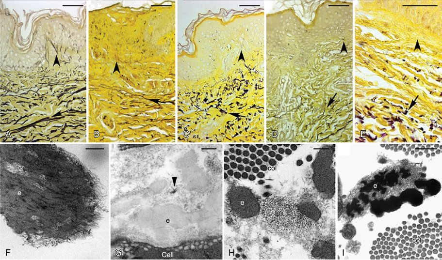

**Fig. 10.12** Histochemical and electron microscopic analysis of elastic fibers in cutis laxa (CL). Hart elastin (e) stain of skin sections from healthy donor (A), individual with autosomal dominant CL-I (ADCL-I) and elastin pathogenic variant (B), individual with autosomal recessive CL-I (ARCL-IA) and fibulin-5 pathogenic variant (C), individual with ARCL-IB and fibulin-4 pathogenic variants (D), and individual with ARCL-IC and LTBP4 variant (E). _Arrowheads_ indicate elaunin fibers in papillary dermis, and arrows show elastic fibers in reticular dermis. Note paucity of elaunin fibers in CL skin (B to E) and either underdeveloped (B and D) or globular (C and E) elastin deposits in reticular dermis. Electron microscopic analysis of elastic fibers from healthy donor (F), individual with ADCL and _elastin_ pathogenic variant (G), patient with ARCL-IA and fibulin-5 variant (H), and patient with ARCLIC and LTBP4 variant (I). Note the close association of microfibrils (mf) with elastin in the control and elastin deposits devoid of microfibrils in all 3 CL samples. col, Collagen fibrils. Magnification bars: 50 μm (A to D), 20 μm (E), and 200 nm (F to I). (From Berk DR, Bentley DD, Bayliss SJ, Lind A, Urban Z. Cutis laxa: a review. _J Am Acad Dermatol_ . 2012;66(5):842.e1-842.e17.) 

being stretched, while cutix laxa is characterized by loose skin with delayed elastic recoil. Lax or wrinkled skin is a feature in a number of other syndromic conditions (Table 10.8). 

# **The Diagnosis of Hereditary Connective Tissue Disorders** 

The accurate diagnosis of a specific HCTD is often challenged by the multisystemic, complex, and phenotypically variable nature of most HCTDs, limited clinician knowledge on typical and atypical presentations, and uncertainty among many providers on appropriate diagnostic approaches. Diagnosis is often delayed or mistaken. Diagnostic evaluation should focus not only on defining the phenotypic features of the patient, but also on identifying phenotypic traits in affected or potentially affected family members, which can aid in refining the clinical classification into a more specific disorder or class of 

disorders. Evaluation should focus first on the most common disorders, recognizing that the signs and symptoms may vary among different individuals and family members with the same diagnosis. 

## **Clinical Assessment** 

In general, _autosomal recessive_ forms of EDS are associated with congenital or early-onset problems, including hip or other joint dislocations, talipes equinovarus, congenital umbilical hernia, and severe muscle hypotonia leading to floppy infant syndrome, often leading to earlier recognition and diagnosis. For _autosomal dominant_ forms such as classical and vascular EDS, diagnosis is often missed in childhood due to the presence of only subtle signs of connective tissue fragility that are common in the general population (e.g., easy bruising and joint hypermobility). The 2017 International EDS Consortium classification guides the diagnosis of EDS, defining

<!-- p.221 -->

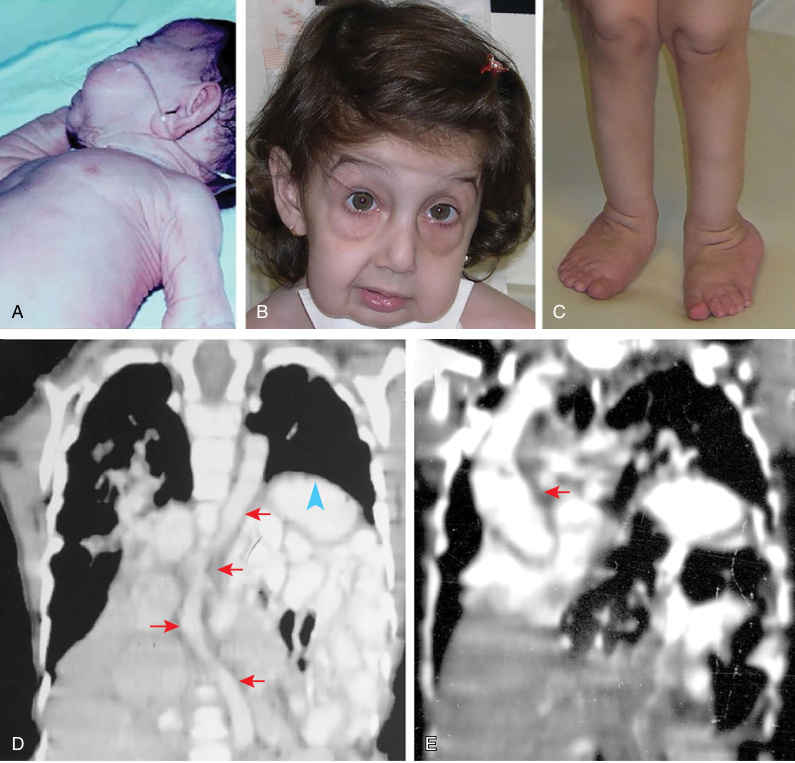

**Fig. 10.13** Manifestations of autosomal recessive cutis laxa type I. (A) Redundant skin and large ears in an individual with fibulin-5 pathogenic variant. (B) Sagging cheeks and periorbital area, reverse-V eyebrows, long philtrum, and large ears in an individual with fibulin-4 pathogenic variant. (C) Redundant skin and joint laxity on the legs of an individual with ARCL-I. Computed tomography images of tortuous aorta _(arrows)_ and diaphragmatic hernia _(arrowhead)_ in an individual with fibulin-4 variant (D) and aortic aneurysm (arrow) in an individual with fibulin-4 variant (E). (From DR Berk, DD Bentley, SJ Bayliss, A Lind, Z Urban, Cutis laxa: a review. _J Am Acad Dermatol_ . 2012;66[5]:842.e1-842.e17.) 

major and minor clinical criteria for each of 13 clinically defined EDS types to aid in phenotypic diagnosis and inform genetic testing choices (Table 10.4). A major criterion is expected to have high diagnostic specificity as it is present in most individuals with that type of EDS and is absent or rare in the general population. By contrast, a minor criterion conveys less diagnostic specificity, but its presence supports the diagnosis, and the combination of several minor criteria is more suggestive of the specific EDS diagnosis. 

All individuals with a suspected diagnosis of Marfan syndrome or one of its related disorders should undergo slit-lamp examination to evaluate for ectopia lentis and an echocardiogram to evaluate for aortic root dilatation. 

Because homocystinuria is also associated with skeletal and eye abnormalities that can mimic Marfan syndrome, plasma amino acid analysis should be obtained to exclude this possibility. **Stickler syndromes** and related collagenopathies should also be considered, especially in the presence of ocular features (Tables 10.1 and 10.9). 

The clinical diagnosis of Marfan syndrome is guided by the international Ghent criteria, which emphasizes two cardinal features, dilation of the ascending aorta with or without dissection, as well as ectopia lentis. Other cardiovascular and ocular manifestations and findings in other organ systems such as the skeleton, dura, skin, and lungs contribute to a systemic score that guides diagnosis when aortic disease

<!-- p.222 -->

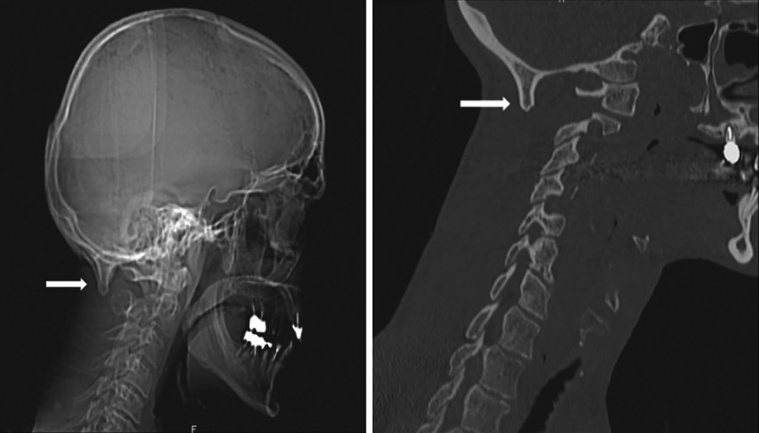

**Fig. 10.14** Cranial CT scan showing occipital horns. (From Fradin M, Lavillaureix A, Jaillard S, et al. ATP7A variant with occipital horns and distal motor neuropathy: a continuum. _Eur J Med Genet._ 2020;63[12]:104087.) 

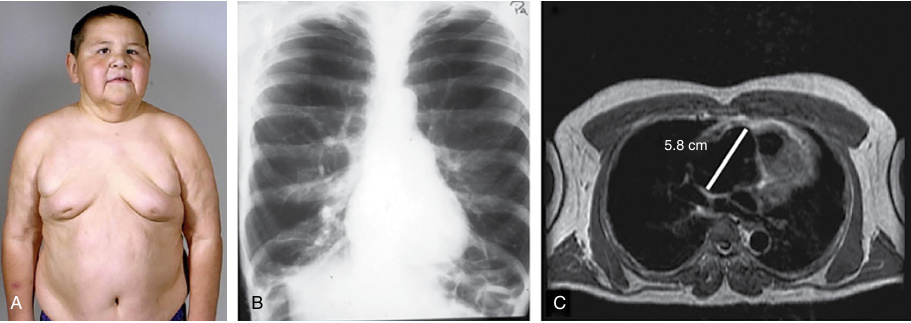

**Fig. 10.15** Manifestations of autosomal dominant cutis laxa. (A) Photograph of affected individual at age 13 years. (B) Chest radiograph of a 51-year-old individual with severe emphysema shown by bilateral hyperexpanded lung fields. (C) Magnetic resonance imaging of aortic root in an affected individual shows a 5.8 cm aneurysm (white bar). (From Berk DR, Bentley DD, Bayliss SJ, et al. Cutis laxa: a review. _J Am Acad Dermatol_ . 2012;66[5]:842.e1-842.e17.) 

is present but ectopia lentis is not (Tables 10.10 and 10.11). The clinical and genetic spectrums of **thoracic aortic aneurysm syndromes** are noted in Table 10.12. 

The diagnosis of a cutis laxa syndrome is often readily suggested by the presence of loose skin with decreased elasticity. Family history can define modes of transmission and guide genetic testing as well as prognostication, as autosomal dominant, and X-linked recessive, and autosomal recessive forms of heritable cutis laxa are associated with different systemic manifestations and degrees of severity. 

## **_Molecular Genetic Testing_** 

_Molecular genetic testing is the standard for confirming a diagnosis of a HCTD and is crucial for accurate genetic counselling, providing information on the transmission pattern and recurrence risk, and guiding prevention and management strategies._ If a pathogenic variant is known in the family, specific analysis of that variant is the most direct way to confirm or exclude the diagnosis in another family member. In most other situations, diagnostic studies are done using highly parallel sequence analysis (often referred to as

<!-- p.223 -->

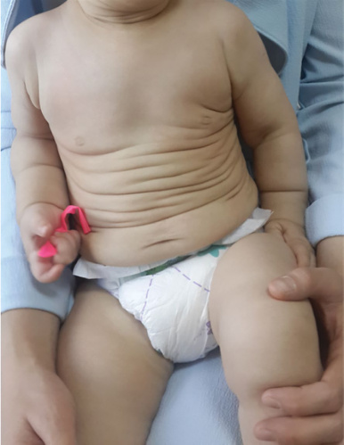

**Fig. 10.16** Generalized cutis laxa in a child with _LTBP4_ -related cutis laxa syndrome. 

next generation sequencing or NGS), in which a panel of known genes is sequenced and analyzed simultaneously. Multi gene NGS panels that include the genes of interest for a group of disorders (e.g., EDS gene panel, cutis laxa gene panel, thoracic aortic aneurysm gene panels) or larger gene panels comprising all known HCTD genes are the preferred 

diagnostic approach in case of complex phenotypes because they are more timeand cost-effective than gene-by-gene Sanger sequencing and can identify large and small genomic deletions in the covered regions. Gene panels vary among different laboratories and evolve over time, and the list of genes on a panel and the method of analysis should be confirmed prior to ordering. 

The analysis of two particular EDS genes is complicated. _TNXB_ has a partially duplicated nonfunctional pseudo gene, _TNXA_ , which shares 97% of its sequence identity with the 3′ region of _TNXB_ . Therefore, exons 32–44 of _TNXB_ should be separately analyzed by Sanger sequencing when _TNXB_ is in the list of candidate genes. For _PLOD1_ , an 8.9 kb duplication of exons 10–16 is the most common pathogenic variant, found in up to 30% of individuals with kyphoscoliotic EDS related to _PLOD1_ . This duplication should be detected using a specifically designed PCR probe or via multiplex ligation-dependent probe amplification. 

When sequencing fails to identify a causative genetic defect in any of the known candidate genes, a strategy to detect genomic copy number variants affecting these genes, such as array comparative genomic hybridization or genome sequencing, should be considered. For a considerable percentage of individuals with clearly delineated HCTD phenotypes, still no genetic defect is found, due to either technical limitations (e.g., deep intronic variants, variants in promotor or untranslated regions) or additional genetic heterogeneity with novel, yet to be discovered disease genes. In these instances, where individuals remain undiagnosed despite targeted analysis, broader phenotype-agnostic approaches such as RNA sequencing, exome sequencing, or genome sequencing (WGS) can be considered. 

##### **TABLE** 

### **10.10 Diagnostic Criteria for Marfan Syndrome** 

|**In the Absence of a Family History of MFS, a Diagnosis Can Be Established in Four Distinct Scenarios:**|
|---|
|1. Aortic root_z_score≥2 AND ectopia lentis*|
|2. Aortic root_z_score≥2 AND a bona fide_FBN1_pathogenic variant|
|3. Aortic root_z_score≥2 AND a_systemic score_ ≥7*(seeTable 10.11)|
|4. Ectopia lentis AND a bona fide_FBN1_pathogenic variant known to cause aortic disease|
|**In the Presence of a Family History of MFS, a Diagnosis Can Be Established in the Presence of:**|
|1. Ectopia lentis|
|2. A_systemic score_ ≥7*|
|3. Aortic root_z_score≥2 if older than 20 years or≥3 if younger than 20 years*|
|**In the Absence of a Family History of MFS, Alternative Diagnoses Include:**|
|1. Ectopia lentis± _systemic score_AND_FBN1_pathogenic variant not known to associate with aortic aneurysm or no_FBN1_ pathogenic variant=Ectopia lentis syndrome|
|2. Aortic root_z_score<2 AND a systemic score≥5 (with at least one skeletal feature) without ectopia lentis=MASS phenotype|

3. Mitral valve prolapse AND aortic root _z_ score <2 AND a _systemic score_ <5 without ectopia lentis = Mitral valve prolapse syndrome 

*Denotes caveat that features suggestive of an alternative diagnosis must be excluded and appropriate alternative molecular testing should be performed. Other syndromes include Shprintzen-Goldberg, Loeys-Dietz, or vascular Ehlers Danlos. 

From Doyle JJ, Dietz III HC: Marfan syndrome in Nelson Textbook of Pediatrics 22/e, Vol 2, 2025, Elsevier, Philadelphia (Table 743.1, p. 4365).

<!-- p.224 -->

#### **TABLE** 

#### **10.11** 

### **Scoring of Systemic Features in Points** 

- Wrist AND thumb sign = 3 (wrist OR thumb sign = 1) 

- Pectus carinatum deformity = 2 (pectus excavatum or chest asymmetry = 1) 

- Hind foot deformity = 2 (plain pes planus = 1) 

- Pneumothorax = 2 

- Dural ectasia = 2 

- Protrusio acetabuli = 2 

- Reduced US/LS AND increased arm/height AND no severe scoliosis = 1 

- Scoliosis or thoracolumbar kyphosis = 1 

- Reduced elbow extension = 1 

- Facial features (3/5) = 1 (dolichocephaly, enophthalmos, down-slanting palpebral fissures, midface hypoplasia, retrognathia) 

- Skin striae = 1 

- Myopia >3 diopters = 1 

- Mitral valve prolapse (all types) = 1 

Maximum total: 20 points; score ≥7 indicates systemic involvement. _US/LS,_ Upper segment/lower segment ratio. From Doyle JJ, Dietz III HC: Marfan syndrome in Nelson Textbook of Pediatrics 22/e, Vol 2, 2025, Elsevier, Philadelphia (Table 743.3, p. 4366). 

#### **TABLE 10.12** Thoracic Aortic Ane urysm Syndromes and Conditions Du e to a Heritable or Genetic Cause

|Condition|Gene|Clinical Features|
|---|---|---|
|**Syndromic HTAD***|||
|Marfan syndrome|_FBN1_|Aortic root aneurysm, AD, TAA, MVP, long bone overgrowth, scoliosis, pectus deformities, ectopia lentis, myopia, tall stature, PTX, dural ectasia|
|Loeys-Dietz syndrome|_TGFBR1, TGFBR2,* SMAD3, TGFB2,_ _TGFB3, SMAD2_|TAA, branch vessel aneurysms, AD, arterial tortuosity, MVP, craniosynostosis, hypertelorism, bluish sclera, bifid/broad uvula, translucent skin, visible veins, club feet, dural ectasia,* premature osteoarthritis|
|Vascular Ehlers-Danlos syndrome|_COL3A1_|TAA, AAA, arterial rupture, AD, MVP, bowel and uterine rupture, PTX, translucent skin, atrophic scars, small joint hypermobility, easy bruising, carotid-cavernous fistula|
|Arterial tortuosity syndrome|_SLC2A10_|Tortuous large-and medium-sized arteries, aortic dilatation, craniofacial, skin and skeletal features|
|Shprintzen-Goldberg syndrome|_SKI_|Craniosynostosis, skeletal features, aortic dilatation|
|Congenital contractural arachnodactyly (Beals syndrome)|_FBN2_|MVP, arachnodactyly, Marfanoid habitus, digital contractures, mild aortic dilatation|
|Cutis laxa|_EFEMP2_(Fibulin-4)|TAA, arterial tortuosity, arterial stenosis, hypertelorism, arachnodactyly|
|EDS with periventricular nodular heterotopia (PVNH)|_FLNA (filamin A)_|X-linked, PVNH, TAA, BAV, MV disease, PDA, VSD, seizures, joint hypermobility|
|Meester-Loeys syndrome|_BGN_|X-linked, TAA, AD, skeletal abnormalities|
|LOX-related TAA|LOX (lysyl oxidase)|TAA, BAV, AD, Marfanoid habitus in some|
|**Nonsyndromic HTAD(Fam**|**ilial TAA)**||
|FTAA|_ACTA2_(α-smooth muscle actin)|TAA, AD, BAV, Moya-Moya, premature CAD and CVD, livedo reticularis, iris flocculi|
|FTAA|_MYH11_(Myosin heavy chain-11)|TAA, AD, PDA|
|FTAA|_MYLK_(Myosin light chain kinase)|AD at relatively small aortic size|
|FTAA|_PRKG1_(Protein kinase cGMP-dependent)|Aortic root aneurysm and AD|
|FTAA|_MAT2A_(MAT IIα)|TAA, AD, BAV|

_(Continued)_

<!-- p.225 -->

### **TABLE 10.12 Thoracic Aortic Aneurysm Syndromes and Conditions Due to a Heritable or Genetic Cause—cont’d** 

|Condition|Gene|Clinical Features|
|---|---|---|
|FTAA|_MFAP5_(microfibrillar-associated protein 5)|TAA, AD, skeletal features may be present|
|FTAA|_FOXE3_(forkhead transcription factor)|TAA, AD|
|**Bicuspid Aortic Valve/Ass**|**ociated Ascending Aortic Aneurysm**||
|Familial BAV/AS and TAA|_NOTCH1_(NOTCH1)|Aortic stenosis, TAA|
|_TGFBR1, TGFBR2, TGFB2,_ _TGFB3, ACTA2, MAT2A,_ _GATA5, SMAD6, LOX,_ _ROBO4, TBX20_|BAV with TAA|Syndromic and nonsyndromic FTAA with an increased frequency of BAV|
|Turner syndrome|XO, Xp|BAV, COA, TAA, AD, short stature, lymphedema, webbed neck, premature ovarian failure, affects 1 in 2,500 live-born girls|

_*_ Some individuals with pathogenic variants in a gene which can lead to syndromic HTAD have very few or no syndromic features and variants in some genes causing syndromic HTAD may also lead to nonsyndromic HTAD. _AAA,_ Abdominal aortic aneurysm; _AAT,_ aortic aneurysm syndrome; _AD,_ aortic dissection; _BAV,_ bicuspid aortic valve; _CAD,_ coronary artery disease; _COA,_ coarctation of the aorta; _CVD,_ cerebrovascular disease; _EDS,_ Ehlers-Danlos syndrome; _FTAA,_ familial thoracic aortic aneurysm (and dissection) syndrome; _HTAD,_ heritable TAA; _LDS,_ Loeys-Dietz syndrome; _MFS,_ Marfan syndrome; _MV,_ mitral valve; _MVP,_ mitral valve prolapse; _PDA,_ patent ductus arteriosus; _PTX,_ pneumothorax; _TAA,_ thoracic aortic aneurysm; _TGF,_ transforming growth factor; _VSD,_ ventricular septal defect. From Braverman AC, Schermerhorn M. Diseases of the aorta. In: Libby P, Bonow R, Mann DL, et al., eds. _Braunwald’s Heart Disease—A Textbook of Cardiovascular Medicine_ . 12th ed. Philadelphia: Elsevier; 2022 (Table 42.2, p. 811). 

Variants of uncertain significance (VUSs) are common when obtaining molecular genetic studies for HCTDs. When identified in an individual with a suspected HCTD, no treatment decisions or genetic counseling should be offered until the variant is analyzed further or reclassified. Family segregation analysis can provide valuable information on whether a variant is benign or pathogenic; for some genes, additional functional studies can also help reclassify a VUS. In other instances, biochemical assays may be required. 

## **_Biochemical Assays_** 

For EDS several biochemical assays can analyze the pathogenicity of a VUS. Sodium dodecyl sulfate polyacrylamide gel electrophoresis (SDS-PAGE) of radioactively or fluorescently labeled collagens and procollagens can show quantitative and qualitative alterations in type I and III procollagen, which can be helpful for VUSs in _COL1A1, COL1A2, COL3A1, PLOD1_ , and _ADAMTS2_ . SDS-PAGE collagen and procollagen analysis of type V collagen is not sensitive and thus not helpful in functional analysis of _COL5A1_ or _COL5A2_ variants. 

Quantification of lysylpyridinoline (LP) and hydroxylysylpyridinoline (HP) crosslinks in urine using high-performance liquid chromatography is a reliable method of detecting LH1 defects, particularly in kyphoscoliotic EDS due to pathogenic variants in _PLOD1_ , or kEDS PLOD1_ . The typical LP/HP ratio in unaffected individuals is 0.2, whereas individuals with kEDS PLOD1_ have increased ratios ranging from 2 to 9. A mildly increased LP/HP ratio of around 1 is seen in individuals with spondylodysplastic EDS due pathogenic variants in _SLC39A13_ . 

Defective dermatan sulfate biosynthesis can be detected by disaccharide analysis measured by anion-exchange chromatography in urine of patients with D4ST1-deficient 

or DS-epi1-deficient musculocontractural EDS. The lack of urinary dermatan sulfate disaccharides is specific for these conditions. 

Western blot or enzyme-linked immunosorbent assay (ELISA) can detect reduced TN-X levels in classical-like EDS patients with biallelic variants in _TNXB_ . Nano-liquid chromatography tandem mass spectrometry (nano-LC-MS/MS) can also determine serum TN-X levels. Spondylodysplastic EDS due to pathogenic variants in _B4GALT7_ and _B3GALT6_ is associated with significantly decreased serum levels of GAG-substituted bikunin and increased levels of GAG-free bikunin, a finding that can be quantified via Western blot. Although these Western blot, ELISA, and nano-LC-MS/MS analyses are sensitive enough to identify specific EDS types, they are not routinely available in a diagnostic setting. 

## **_Microscopic Studies of Skin Biopsies_** 

Transmission electron microscopy (TEM) can be performed on fixed skin biopsies in individuals with suspected EDS, allowing for ultrastructural analysis of collagen fibrils. Whereas dermal collagen fibrils are usually perfectly round on cross-section and are tightly packed, a range of alterations can be observed in EDS. While these alterations are not specific to EDS or an EDS subtype, their presence can support but not confirm an EDS diagnosis. 

Light microscopy and TEM of the dermis in individuals with suspected cutis laxa can be performed to classify the pathogenicity of a VUS in a cutis laxa–associated gene. Dermal elastic fibers are both altered and reduced in numbers; however, these changes may be difficult to appreciate on hematoxylin and eosin staining. TEM confirms irregular fragmentation of the elastic fiber structure and may help differentiate between different cutis laxa types.

<!-- p.226 -->

# **Bibliography** 

- Ashworth JL, Murphy G, Rock MJ, et al. Fibrillin degradation by matrix metalloproteinases: implications for connective tissue remodelling. _Biochem J._ 1999;340(Pt 1) (Pt 1):171-181. 

- Beighton P, de Paepe A, Danks D, et al. International Nosology of Heritable Disorders of Connective Tissue, Berlin, 1986. _Am J Med Genet_ . 1988;29(3):581-594. 

- Beighton P, De Paepe A, Steinmann B, Tsipouras P, Wenstrup RJ. Ehlers-Danlos syndromes: revised nosology, Villefranche, 1997. Ehlers-Danlos National Foundation (USA) and Ehlers-Danlos Support Group (UK). _Am J Med Genet_ . 1998;77(1):31-37. 

- Beighton P, Solomon L, Soskolne CL. Articular mobility in an African population. _Ann Rheum Dis_ . 1973;32(5):413-418. 

- Bekhouche M, Colige A. The procollagen N-proteinases ADAMTS2, 3 and 14 in pathophysiology. _Matrix Biol_ . 2015;44-46:46-53. 

- Beyens A, Boel A, Symoens S, Callewaert B. Cutis laxa: a comprehensive overview of clinical characteristics and pathophysiology. _Clin Genet_ . 2021;99(1):53-66. 

- Beyens A, Pottie L, Sips P, Callewaert B. Clinical and molecular delineation of cutis laxa syndromes: paradigms for homeostasis. _Adv Exp Med Biol_ . 2021;1348:273-309. 

- Bowen JM, Sobey GJ, Burrows NP, et al. Ehlers-Danlos syndrome, classical type. _Am J Med Genet C Semin Med Genet_ . 2017;175(1): 27-39. 

- Brady AF, Demirdas S, Fournel-Gigleux S, et al. The Ehlers-Danlos syndromes, rare types. Am J _Med Genet C Semin Med Genet_ . 2017;175(1):70-115. 

- Broder C, Arnold P, Vadon-Le Goff S, et al. Metalloproteases meprin alpha and meprin beta are C- and N-procollagen proteinases important for collagen assembly and tensile strength. _Proc Natl Acad Sci U S A_ . 2013;110(35):14219-14224. 

- Bruneel A, Dubail J, Roseau C, et al. Serum bikunin is a biomarker of linkeropathies. _Clin Chim Acta_ . 2018;485:178-180. 

- Byers PH, Belmont J, Black J, et al. Diagnosis, natural history, and management in vascular Ehlers-Danlos syndrome. _Am J Med Genet C Semin Med Genet_ . 2017;175(1):40-47. 

- Callewaert B. Congenital contractural arachnodactyly. In: Adam MP, Feldman J, Mirzaa GM, et al., eds. _GeneReviews®_ [Internet] _._ Seattle, WA: University of Washington, Seattle; 1993. 

- Callewaert BL, Urban Z. ELN-related cutis laxa. In: Adam MP, Feldman J, Mirzaa GM, et al., eds. _GeneReviews®_ [Internet] _._ Seattle, WA: University of Washington, Seattle; 1993. 

- Callewaert BL, Urban Z. LTBP4-Related Cutis Laxa. In: Adam MP, Feldman J, Mirzaa GM, et al., eds. _GeneReviews®_ [Internet] _._ Seattle, WA: University of Washington, Seattle; 1993. 

- Castori M, Tinkle B, Levy H, Grahame R, Malfait F, Hakim A. A framework for the classification of joint hypermobility and related conditions. _Am J Med Genet C Semin Med Genet_ . 2017;175(1):148-157. 

- Colman M, Castori M, Micale L, et al. Atypical variants in COL1A1 and COL3A1 associated with classical and vascular Ehlers-Danlos syndrome overlap phenotypes: expanding the clinical phenotype based on additional case reports. _Clin Exp Rheumatol_ . 2022;40 suppl 134(5):46-62. 

- Colman M, Syx D, De Wandele I, Dhooge T, Symoens S, Malfait F. Clinical and molecular characteristics of 168 probands and 65 relatives with a clinical presentation of classical Ehlers-Danlos syndrome. _Hum Mutat_ . 2021;42(10):1294-1306. 

- Couchman JR, Pataki CA. An introduction to proteoglycans and their localization. _J Histochem Cytochem_ . 2012;60(12):885-897. 

- Dalton CJ, Lemmon CA. Fibronectin: molecular structure, fibrillar structure and mechanochemical signaling. _Cells_ . 2021;10(9):2443. 

- Dietz H. FBN1-Related Marfan syndrome. In: Adam MP, Feldman J, Mirzaa GM, et al., eds. _GeneReviews®_ [Internet] _._ Seattle, WA: University of Washington, Seattle; 1993. 

- Doege KJ, Sasaki M, Kimura T, Yamada Y. Complete coding sequence and deduced primary structure of the human cartilage large aggregating proteoglycan, aggrecan. Human-specific repeats, and additional alternatively spliced forms. _J Biol Chem_ . 1991; 266(2):894-902. 

- Douglas T, Heinemann S, Bierbaum S, Scharnweber D, Worch H. Fibrillogenesis of collagen types I, II, and III with small leucinerich proteoglycans decorin and biglycan. _Biomacromolecules_ . 2006;7(8):2388-2393. 

- Doyle JJ, Gerber EE, Dietz HC. Matrix-dependent perturbation of TGFbeta signaling and disease. _FEBS Lett_ . 2012;586(14):2003-2015. 

- Faivre L, Collod-Beroud G, Callewaert B, et al. Clinical and mutation-type analysis from an international series of 198 probands with a pathogenic FBN1 exons 24-32 mutation. _Eur J Hum Genet_ . 2009;17(4):491-501. 

- Gibson BG, Briggs MD. The aggrecanopathies; an evolving phenotypic spectrum of human genetic skeletal diseases. _Orphanet J Rare Dis_ . 2016;11(1):86. 

- Giunta C, Elcioglu NH, Albrecht B, et al. Spondylocheiro dysplastic form of the Ehlers-Danlos syndrome—an autosomal-recessive entity caused by mutations in the zinc transporter gene SLC39A13. _Am J Hum Genet_ . 2008;82(6):1290-1305. 

- Gnoli M, Brizola E, Tremosini M, et al. COL1-related disorders: case report and review of overlapping syndromes. _Front Genet._ 2021; 12:640558. 

- Haouari W, Dubail J, Lounis-Ouaras S, et al. Serum bikunin isoforms in congenital disorders of glycosylation and linkeropathies. _J Inherit Metab Dis_ . 2020;43(6):1349-1359. 

- Hecht F, Beals RK. “New” syndrome of congenital contractural arachnodactyly originally described by Marfan in 1896. _Pediatrics_ . 1972;49(4):574-579. 

- Hynes RO, Naba A. Overview of the matrisome—an inventory of extracellular matrix constituents and functions. _Cold Spring Harb Perspect Biol_ . 2012;4(1):a004903. 

- Ishikawa Y, Bachinger HP. A molecular ensemble in the rER for procollagen maturation. _Biochim Biophys Acta_ . 2013;1833(11): 2479-2491. 

- Ishikawa Y, Ito S, Nagata K, Sakai LY, Bachinger HP. Intracellular mechanisms of molecular recognition and sorting for transport of large extracellular matrix molecules. _Proc Natl Acad Sci U S A_ . 2016;113(41):E6036-E6044. 

- Kadler KE, Baldock C, Bella J, Boot-Handford RP. Collagens at a glance. _J Cell Sci_ . 2007;120(Pt 12):1955-1958. 

- Kadler KE, Hill A, Canty-Laird EG. Collagen fibrillogenesis: fibronectin, integrins, and minor collagens as organizers and nucleators. _Curr Opin Cell Biol_ . 2008;20(5):495-501. 

- Kielty CM, Woolley DE, Whittaker SP, Shuttleworth CA. Catabolism of intact fibrillin microfibrils by neutrophil elastase, chymotrypsin and trypsin. _FEBS Lett_ . 1994;351(1):85-89. 

- Kwong AK, Zhang Y, Ho RS, et al. Collagen VI-related myopathies: clinical variability, phenotype-genotype correlation and exploratory transcriptome study. _Neuromuscul Disord._ 2023;33:371-381. 

- Lautrup CK, Teik KW, Unzaki A, et al. Delineation of musculocontractural Ehlers-Danlos Syndrome caused by dermatan sulfate epimerase deficiency. _Mol Genet Genomic Med_ . 2020;8(5):e1197. 

- Leone MP, Morlino S, Nardella G, et al. Specifications and validation of the ACMG/AMP criteria for clinical interpretation of sequence variants in collagen genes associated with joint hypermobility. _Hum Genet._ 2023;142:785-808.

<!-- p.227 -->

- Li-Wan-Po A, Loeys B, Farndon P, Latham D, Bradley C. Preventing the aortic complications of Marfan syndrome: a case-example of translational genomic medicine. _Br J Clin Pharmacol._ 2011;72(1):6-17. 

- Loeys B, De Paepe A, Urban Z. EFEMP2-related cutis laxa. In: Adam MP, Feldman J, Mirzaa GM, et al., eds. _GeneReviews®_ [Internet] _._ Seattle, WA: University of Washington, Seattle; 1993. 

- Loeys BL, Dietz HC, Braverman AC, et al. The revised Ghent nosology for the Marfan syndrome. _J Med Genet_ . 2010;47(7):476-485. 

- Loeys BL, Schwarze U, Holm T, et al. Aneurysm syndromes caused by mutations in the TGF-beta receptor. _N Engl J Med_ . 2006;355(8): 788-798. 

- Malfait F, Castori M, Francomano CA, Giunta C, Kosho T, Byers PH. The Ehlers-Danlos syndromes. _Nat Rev Dis Primers._ 2020;6(1):64. 

- Malfait F, Francomano C, Byers P, et al. The 2017 international classification of the Ehlers-Danlos syndromes. _Am J Med Genet C Semin Med Genet_ . 2017;175(1):8-26. 

- Malfait F, Wenstrup R, De Paepe A. Ehlers-Danlos syndrome, classic type. In: Pagon RA, Adam MP, Ardinger HH, et al., eds. _GeneReviews®_ [Internet] _._ Seattle, WA: University of Washington, Seattle; 1993. 

- Matsumoto KI, Aoki H. The roles of tenascins in cardiovascular, inflammatory, and heritable connective tissue diseases. _Front Immunol_ . 2020;11:609752. 

- McKusick VA. The cardiovascular aspects of Marfan’s syndrome: a heritable disorder of connective tissue. _Circulation_ . 1955;11(3):321-342. 

- McKusick VA. _Heritable Disorders of Connective Tissue_ . St. Louis, Missouri: C. V. Mosby Company; 1956. 

- McKusick VA. _Heritable Disorders of Connective Tissue_ . St. Louis, Missouri: C. V. Mosby Company; 1973. 

- Meester JAN, Verstraeten A, Schepers D, Alaerts M, Van Laer L, Loeys BL. Differences in manifestations of Marfan syndrome, Ehlers-Danlos syndrome, and Loeys-Dietz syndrome. _Ann Cardiothorac Surg_ . 2017;6(6):582-594. 

- Milewicz DM, Braverman AC, De Backer J, et al. Marfan syndrome. _Nat Rev Dis Primers_ . 2021;7(1):64. 

- Nikpour M, Noborn F, Nilsson J, et al. Glycosaminoglycan linkage region of urinary bikunin as a potentially useful biomarker for beta3GalT6-deficient spondylodysplastic Ehlers-Danlos syndrome. _JIMD Rep_ . 2022;63(5):462-467. 

- Pepin M, Schwarze U, Superti-Furga A, Byers PH. Clinical and genetic features of Ehlers-Danlos syndrome type IV, the vascular type. _N Engl J Med_ . 2000;342(10):673-680. 

- Potekaev NN, Borzykh OB, Medvedev GV, et al: Genetic and epigenetic aspects of skin collagen fiber turnover and functioning. _Cosmetics._ 2021;8:92. 

- Ramirez F, Di Liberto M. Complex and diversified regulatory programs control the expression of vertebrate collagen genes. _FASEB J_ . 1990;4(6):1616-1623. 

- Remvig L, Jensen DV, Ward RC. Epidemiology of general joint hypermobility and basis for the proposed criteria for benign joint hypermobility syndrome: review of the literature. _J Rheumatol_ . 2007;34(4):804-809. 

- Ricard-Blum S. The collagen family. _Cold Spring Harb Perspect Biol_ . 2011;3(1):a004978. 

- Richards S, Aziz N, Bale S, et al. Standards and guidelines for the interpretation of sequence variants: a joint consensus recommendation of the American College of Medical Genetics and Genomics and the Association for Molecular Pathology. _Genet Med_ . 2015;17(5):405-424. 

- Rohrbach M, Vandersteen A, Yis U, et al. Phenotypic variability of the kyphoscoliotic type of Ehlers-Danlos syndrome (EDS VIA): clinical, molecular and biochemical delineation. _Orphanet J Rare Dis_ . 2011;6:46. 

- Ruoslahti E, Pierschbacher MD. New perspectives in cell adhesion: RGD and integrins. _Science_ . 1987;238(4826):491-497. 

- Sakai LY, Keene DR, Glanville RW, Bachinger HP. Purification and partial characterization of fibrillin, a cysteine-rich structural component of connective tissue microfibrils. _J Biol Chem_ . 1991;266(22): 14763-14770. 

- Schalkwijk J, Zweers MC, Steijlen PM, et al. A recessive form of the Ehlers-Danlos syndrome caused by tenascin-X deficiency. _N Engl J Med_ . 2001;345(16):1167-1175. 

- Schmelzer CEH, Duca L. Elastic fibers: formation, function, and fate during aging and disease. _FEBS J_ . 2022;289(13):3704-3730. 

- Scott IC, Blitz IL, Pappano WN, et al. Mammalian BMP-1/Tolloidrelated metalloproteinases, including novel family member mammalian Tolloid-like 2, have differential enzymatic activities and distributions of expression relevant to patterning and skeletogenesis. _Dev Biol_ . 1999;213(2):283-300. 

- Sherratt MJ, Wess TJ, Baldock C, et al. Fibrillin-rich microfibrils of the extracellular matrix: ultrastructure and assembly. _Micron_ . 2001;32(2):185-200. 

- Steinmann B RP, Superti-Furga A. The Ehlers–Danlos syndrome. In: Royce PM SB, ed. _Connective Tissue and Its Heritable Disorders_ . 2nd ed. Wiley-Liss; 2002:431-523. 

- Takahara K, Lyons GE, Greenspan DS. Bone morphogenetic protein-1 and a mammalian tolloid homologue (mTld) are encoded by alternatively spliced transcripts which are differentially expressed in some tissues. _J Biol Chem_ . 1994;269(51): 32572-32578. 

- Tinkle B, Castori M, Berglund B, et al. Hypermobile Ehlers-Danlos syndrome (a.k.a. Ehlers-Danlos syndrome Type III and EhlersDanlos syndrome hypermobility type): clinical description and natural history. _Am J Med Genet C Semin Med Genet_ . 2017; 175(1):48-69. 

- Valcourt U, Alcaraz LB, Exposito JY, Lethias C, Bartholin L. Tenascin-X: beyond the architectural function. _Cell Adh Migr_ . 2015; 9(1-2):154-165. 

- Van Damme T, Colman M, Syx D, Malfait F. The Ehlers-Danlos syndromes against the backdrop of inborn errors of metabolism. _Genes (Basel)_ . 2022;13(2):265. 

- Van Maldergem L, Loeys B. FBLN5-related cutis laxa. In: Adam MP, Feldman J, Mirzaa GM, et al., eds. _GeneReviews_ ® [Internet] _._ Seattle, WA: University of Washington, Seattle; 1993. 

- Yamada K, Watanabe A, Takeshita H, Matsumoto KI. A method for quantification of serum tenascin-X by nano-LC/MS/MS. _Clin Chim Acta_ . 2016;459:94-100.

---

<!-- p.228 -->

# 11 Genetic Disorders of Bone 

**ANDREA SUPERTI-FURGA, SHEILA UNGER, CARLOS FERREIRA** 

## **Nosology** 

The skeleton has a fundamental function in shaping the human body and in allowing for physical activity. It also provides physical protection for organs, such as the brain, the eyes, the lungs, and the heart. Because of their mass and composition, bones have an impact on calcium and phosphate metabolism. The skeleton is the organ primarily responsible for human growth, providing the framework to which growing organs attach and accommodate. 

Genetic disorders of formation, growth, and homeostasis of the skeleton may impair the mechanical properties of the bone, making it too fragile or too malleable, and result in fractures and in deformities; or change the growth pattern of individuals bones, resulting in short stature with a change in the proportion of the head or the limbs to the trunk. While medical morbidity of genetic disorders of the skeleton is determined mainly by the altered mechanical and physical properties of the affected skeleton, the social stigmatization of short stature, deformity, and disproportions contribute to a significant extent to the burden of disease for the affected individuals. 

### **Dysplasias vs. Dysostoses** 

Genetic disorders of the skeleton are a very broad concept. A fundamental distinction to be made is between _bone dysplasias_ and _dysostoses_ . **Dysplasias** are disorders of skeletal growth; they tend to affect all skeletal elements, and are progressive, because they continue to evolve throughout childhood and adolescence. **Dysostoses** , in contrast, may affect one or a group of skeletal elements (the clavicle, the vertebrae, the ribs, or the proximal or distal limb bones) and are disorders of embryonic patterning (skeletal blueprinting) rather than of growth; they are akin to organ malformations, and they are usually not progressive. The _Nosology of Genetic Disorders of Bone_ , updated on a regular basis, lists more than 700 conditions, dysplasias, and dysostoses, with the responsible genes, organized in 41 groups (Table 11.1). The pathogenic processes may involve many different mechanisms. Some disorders arise from changes in the extracellular matrix of bone and of cartilage that render 

the matrix mechanically insufficient; the outstanding examples are molecular diseases of **collagen type 1** (the _main collagen of bone_ ) and **collagen type 2** (the _main collagen of cartilage_ ). Other disorders affect the metabolic homeostasis of bone and cartilage, such as disorders of calcium and phosphate metabolism (affecting bone) and disorders of glycosaminoglycan and sulfate metabolism (affecting cartilage). Additional processes affect growth of skeletal elements by interfering with the proliferation of cartilage cells at the growth plate of tubular bones (dominant _FGFR3_ pathogenic variants). Another large class of disorders, the **dysostoses** , have their origin in genetic defects in the embryonic patterning processes that lay out the blueprint for the development of skeletal elements: they are primary malformations of the skeleton that can range from relatively harmless conditions (like simple polydactyly) to vertebral or limb dysostosis with major deformities. The pathogenetic basis of dysostoses has little to do with the primary components of bone and cartilage but can be found in genetic variants that impair gene transcription factors or signaling systems that establish the morphogenic gradients in the developing embryo. While the pathogenic processes responsible for genetic disorders of the skeleton are very heterogeneous, knowledge of the underlying genetic, biochemical, or cellular processes is the basis for correct genetic counseling as well as, in a rapidly increasing number of cases, for the design of targeted therapeutic approaches (Table 11.2). 

### **Naming the Genetic Disorders of the Skeleton** 

Many genetic skeletal conditions named in the past, when their pathogenesis was unknown, were often based on phenotypic or radiographic features. Since the 2023 _Nosology_ , the dyadic approach has been implemented that uses the name of the responsible gene (when known) in combination with the clinical or phenotypic descriptor. 

### **Genetic Heterogeneity, Allelic Series, and Clinical Variability** 

Over 700 distinct entities are recognized in the 2023 revision of the _Nosology of Genetic Disorders of Bone_ (Table 11.1). 

_(Text continued on page 252)_ **207**

<!-- p.229 -->

#### **TABLE 11.1 The Nosology of Constitutional Skeletal Disorders: 2023 Revision** 

|Group Number/ Number of Disorder|Name of Group/Name of Disorder|Inheritance|Gene or Loc|us Notes|
|---|---|---|---|---|
|**Group 1**|**FGFR3 Chondrodysplasias**||||
|NOS 01-0010|Thanatophoric dysplasia (type 1), FGFR3-related|AD|_FGFR3_|Includes previous “platyspondylyic dysplasia type San Diego”|
|NOS 01-0020|Thanatophoric dysplasia (type 2), FGFR3-related|AD|_FGFR3_|Radiographic differences between types 1 and 2 are correlated to specific_FGFR3_variants|
|NOS 01-0030|Severe achondroplasia with developmental delay and acanthosis nigricans (SADDAN), FGFR3-related|AD|_FGFR3_||
|NOS 01-0040|Achondroplasia, FGFR3-related|AD|_FGFR3_||
|NOS 01-0050|Hypochondroplasia, FGFR3-related|AD|_FGFR3_||
||See also group 33 for craniosynostosis syndromes linke _FGFR3_-related phenotypes; rare_FGFR3_missense va their significance remains unclear.|d to_FGFR3_varia riants have been|nts, as well as reported in idio|CATSHL in group 30 and LADD syndrome in group 40 for other pathic short stature but a causal link is not yet established, and|
|**Group 2**|**Type 2 Collagen Disorders**||||
|NOS 02-0010|Achondrogenesis, COL2A1-related (formerly type 2, type Langer-Saldino)|AD|_COL2A1_|Achondrogenesis type 2 and hypochondrogenesis form one phenotypic continuum|
|NOS 02-0020|Hypochondrogenesis, COL2A1-related|AD|_COL2A1_|Achondrogenesis type 2 and hypochondrogenesis form one phenotypic continuum|
|NOS 02-0030|Platyspondylic dysplasia, type Torrance, COL2A1- related|AD|_COL2A1_|Often variants in the C-propeptide of collagen 2|
|NOS 02-0040|Spondyloepiphyseal dysplasia congenita (SEDC), COL2A1-related|AD, AR*|_COL2A1_|Includes mild SED with premature onset arthrosis, also known as osteoarthrosis with mild chondrodysplasia; includes Namaqualand type hip dysplasia. Mild SED cases may resemble MED (see note). AR*: very rare SED cases with biallelic_COL2A1_variants have been reported|
|NOS 02-0050|Spondyloepimetaphyseal dysplasia, COL2A1-related|AD|_COL2A1_|Also known as “SED with marked metaphyseal changes.” Includes SEMD type Strudwick, SMD type Algerian, SED type Stanescu, dysspondyloenchondromatosis, and some cases of SMD “corner fracture” type|
|NOS 02-0060|Kniest dysplasia, COL2A1-related|AD|_COL2A1_||
|NOS 02-0070|Spondyloperipheral dysplasia, COL2A1-related|AD|_COL2A1_|Like Torrance dysplasia, often variants in the C-propeptide of collagen 2|
|NOS 02-0080|SED with metatarsal shortening, COL2A1-related|AD|_COL2A1_|Often associated with the p.R275C variant; formerly “Czech dysplasia”|
|NOS 02-0090|Stickler syndrome, COL2A1-related|AD|_COL2A1_|Monoallelic loss-of-function variants; see also_COL11A1_, _COL11A2_,_COL9A1_,_COL9A2_,_COL9A3_|

_(Continued)_

<!-- p.230 -->

#### **TABLE 11.1 The Nosology of Constitutional Skeletal Disorders: 2023 Revision—cont’d** 

|Group Number/ Number of Disorder|Name of Group/Name of Disorder|Inheritance|Gene or Loc|us Notes|
|---|---|---|---|---|
|NOS 02-0100|Dysplasia of the proximal femoral epiphyses, COL2A1-related|AD|_COL2A1_|Heterogeneous condition, not all cases are due to COL2A1 variants (usually p.G393S; p.G717S; p.G1170S). The condition called “Meyer dysplasia of the hip” is not associated with_COL2A1_variants|
||See also the pseudoachondroplasia-multiple epiphyseal d phenotypes with normal stature and premature onset a|ysplasia group fo rthrosis; as well|r recessively inh as spondylomet|erited variants of Stickler syndrome as well as for overlapping aphyseal dysplasia Sutcliffe (or “corner fractures” type),_FN1_-related.|
|**Group 3**|**Type 11 Collagen Disorders**||||
|NOS 03-0010|Stickler syndrome, COL11A1-related|AD, MOS|_COL11A1_|Can also result from somatic mosaicism for a_COL11A1_ variant|
|NOS 03-0020|Marshall syndrome, COL11A1-related|AD|_COL11A1_|One report with homozygous p.G901E variant in two affected sibs (PMID 22499343)|
|NOS 03-0030|Stickler syndrome, COL11A2-related (non-ocular type)|AD|_COL11A2_||
|NOS 03-0040|Fibrochondrogenesis, COL11A1-related|AR, AD|_COL11A1_||
|NOS 03-0050|Fibrochondrogenesis, COL11A2-related|AR, AD|_COL11A2_||
|NOS 03-0060|Otospondylomegaepiphyseal dysplasia (OSMED), recessive type, COL11A2-related|AR|_COL11A2_||
|NOS 03-0070|Otospondylomegaepiphyseal dysplasia (OSMED), dominant type, COL11A2-related|AD|_COL11A2_|Formerly Weissenbacher-Zweymüller syndrome and Stickler syndrome type 3|
||See also Stickler syndrome type 1 in collagen 2 group ( epiphyseal dysplasia group (Group 9).|Group 2) as well|as recessive for|ms of Stickler syndrome in the pseudoachondroplasia-multiple|
|**Group 4**|**Sulfation Disorders**||||
|NOS 04-0010|Achondrogenesis, SLC26A2-related (formerly achondrogenesis type 1B, or type Fraccaro)|AR|_SLC26A2_|Formerly known as achondrogenesis, type Fraccaro|
|NOS 04-0020|Atelosteogenesis, SLC26A2-related (formerly atelosteogenesis type 2)|AR|_SLC26A2_|Includes former entities de la Chapelle dysplasia, McAlister dysplasia, and neonatal osseous dysplasia|
|NOS 04-0030|Diastrophic dysplasia, SLC26A2-related|AR|_SLC26A2_||
|NOS 04-0040|Multiple epiphyseal dysplasia, SLC26A2-related (autosomal recessive type, rMED)|AR|_SLC26A2_|See also multiple epiphyseal dysplasias and pseudoachondroplasia group (group 9)|
|NOS 04-0050|Spondylo-epi-metaphyseal dysplasia, PAPSS2-related|AR|_PAPSS2_|Formerly “SEMD Pakistani type”; includes the former “recessive brachyolmia, recessive type” as well as the older entities “Toledo brachyolmia” and “Hobaek brachyolmia”|
|NOS 04-0060|Chondrodysplasia with congenital joint dislocations, IMPAD1-related|AR|_IMPAD1_|Some features similar to Catel-Manzke syndrome,_TGDS_- related, as well as to Desbuquois syndrome,_CANT1_-related|
|NOS 04-0070|Chondrodysplasia with congenital joint dislocations, CHST3-related|AR|_CHST3_|Includes recessive Larsen syndrome, humero-spinal dysostosis, and SED type Omani|

_(Continued)_

<!-- p.231 -->

#### **TABLE 11.1 The Nosology of Constitutional Skeletal Disorders: 2023 Revision—cont’d** 

|Group Number/ Number of Disord|er Name of Group/Name of Disorder|Inheritance|Gene or Loc|us Notes|
|---|---|---|---|---|
|NOS 04-0080|Chondrodysplasia with hypomyelinating leukodystrophy, SLC35B2-related|AR|_SLC35B2_||
|NOS 04-0090|Ehlers-Danlos syndrome, musculocontractural type, CHST14-related|AR|_CHST14_|Includes adducted thumb-clubfoot syndrome|
|NOS 04-0100|Ehlers-Danlos syndrome, musculocontractural type, DSE-related|AR|_DSE_||
|NOS 04-0110|Osteochondrodysplasia, brachydactyly, and overlapping malformed digits (OCBMD), CHST11-related|AR|_CHST11_||
|NOS 04-0120|Developmental delay with corpus callosum, skeletal, and renal abnormalities, HS2ST1-related|AR|_HS2ST1_||
||See also filamin disorders (Group 6) and dysplasias with _CHSY1_-related, for phalangeal changes reminiscent o|i       multiple joint dis f the sulfation di|i         locations (Grou sorders.|i          p 5) for other conditions with dislocations, as well as brachydactyly,|
|**Group 5**|**Dysplasias With Multiple Joint Disorders**||||
|NOS 05-0010|Baratela-Scott syndrome, XYLT1-related|AR|_XYLT1_|May have intellectual disability; formerly Desbuquois dysplasia type 2|
|NOS 05-0020|Desbuquois dysplasia (with accessory ossification center in digit 2), CANT1-related|AR|_CANT1_||
|NOS 05-0030|Desbuquois dysplasia (with short metacarpals and elongated phalanges, Kim type), CANT1- related|AR|_CANT1_||
|NOS 05-0040|SEMD with joint laxity (Hall type or leptodactylic type), KIF22-related|AD|_KIF22_||
|NOS 05-0050|SEMD with joint laxity, EXOC6B-related|AR|_EXOC6B_|Phenotype resembles SEMD-JL leptodactylic or type Hall (preceding line)|
|NOS 05-0060|SEMD with joint laxity (Beighton type), B3GALT6- related (Ehlers-Danlos syndrome, spondylodysplastic type 2, EDSSPD2)|AR|_B3GALT6_|Includes MIM 609465—Al-Gazali syndrome as neonatal form|
|NOS 05-0070|Ehlers-Danlos syndrome, spondylodysplastic type 1 (EDSSPD1), B4GALT7-related|AR|_B4GALT7_|Formerly known as “EDS, progeroid form”; includes Larsen syndrome, La Reunion type; see also_B3GALT6_deficiency above|
|NOS 05-0080|Multiple joint dislocations, short stature, craniofacial dysmorphisms, and skeletal dysplasia, with or without heart defects, B3GAT3-related|AR|_B3GAT3_|The phenotype is very variable and has been reported also as “Larsen-like” or as “pseudodiastrophic dysplasia.” Intellectual disability and severe osteopenia with fractures have been observed. The OMIM entry includes older descriptions that are probably unrelated.|

_(Continued)_

<!-- p.232 -->

|Group Number/ **TABLE** **11.1** **The Nosolog**|**y of Constitutional Skeletal Disorders: 2023 Revi**|**sion—cont**|**’d**||
|---|---|---|---|---|
| Number of Disorder|Name of Group/Name of Disorder|Inheritanc|e Gene or Loc|us Notes|
|NOS 05-0090|Skeletal dysplasia with joint laxity and advanced bone age (SDJLABA), CSGALNACT1-related|AR|_CSGALNACT_|_1_|
|NOS 05-0100|Skeletal dysplasia with joint dislocations and amelogenesis imperfecta, SLC10A7-related|AR|_SLC10A7_||
||Note: remarkably, this group contains several disorders o (dysplasias with joint dislocations), the phenotypes in t Group 6 (filamin disorders) justifying its placement here retinal dystrophy and hearing loss,_PISD_-related (Liberf _SLC39A13_-related, in the SEMD group.|f glycosamin his group are i     . See also: T arb syndrom|oglycan synthesis. related to those o i        emtamy type brac e), for other condit|In spite of this group being named after a clinical feature f the preceding Group 4 (sulfation disorders) and of the following i          hydactyly,_CHSY1_-related, as well as SEMD with microcephaly, ions with congenital dislocations, as well as EDSSPD3,|
|**Group 6**|**Filamins and Related Disorders**||||
|NOS 06-0010|Frontometaphyseal dysplasia, FLNA-related|XL|_FLNA_|_FLNA_gene also associated with MIM 300049, MIM 300321, MIM 314400, MIM 300048, MIM 300049 (see) and conditions below in this group|
|NOS 06-0020|Frontometaphyseal dysplasia, MAP3K7-related|AD|_MAP3K7_||
|NOS 06-0030|Frontometaphyseal dysplasia, TAB2-related|AD|_TAB2_|No MIM entry yet;_TAB2_gene also associated with MIM 614980—congenital heart defects, nonsyndromic, 2|
|NOS 06-0040|Cardiospondylocarpofacial syndrome, MAP3K7-related|AD|_MAP3K7_||
|NOS 06-0050|Melnick-Needles syndrome, FLNA-related|XL|_FLNA_|Includes osteodysplasty|
|NOS 06-0060|Otopalatodigital syndrome type 1 (OPD1), FLNA-related|XL|_FLNA_||
|NOS 06-0070|Otopalatodigital syndrome type 2 (OPD2), FLNA-related|XL|_FLNA_||
|NOS 06-0080|Terminal osseous dysplasia (TOD), FLNA-related|XL|_FLNA_|Includes digitocutaneous dysplasia|
|NOS 06-0090|Larsen syndrome, FLNB-related|AD|_FLNB_||
|NOS 06-0100|Atelosteogenesis type 1, FLNB-related|AD|_FLNB_|Includes Boomerang dysplasia, Piepkorn dysplasia, and spondylohumerofemoral (giant cell) dysplasia|
|NOS 06-0110|Atelosteogenesis type 3, FLNB-related|AD|_FLNB_||
|NOS 06-0120|Spondylocarpotarsal synostosis syndrome, FLNB-related|AR|_FLNB_||
|NOS 06-0130|Spondylocarpotarsal synostosis syndrome, RFLNA-related|AR|_RFLNA_|Entity proven, no MIM entry yet|
|NOS 06-0140|Spondyocarpotarsal synostosis syndrome with contractures and pterygia, MYH3-related|AD, AR|_MYH3_|Frequently biallelic loss of function variants; monoallelic missense variants in the_MYH3_gene associated with MIM 193700-Arthrogryposis 2A, and MIM 618436-Arthrogryposis 2B3|

_(Continued)_

<!-- p.233 -->

#### **TABLE 11.1 The Nosology of Constitutional Skeletal Disorders: 2023 Revision—cont’d** 

|Group Number/ Number of Disorder|Name of Group/Name of Disorder|Inheritance|Gene or Locu|s Notes|
|---|---|---|---|---|
|NOS 06-0150|Frank-ter Haar syndrome, SH3PXD2B-related|AR|_SH3PXD2B_|Includes previous Borrone dermatocardioskeletal syndrome|
||See also chondrodysplasia with congenital joint dislocat dislocations, above (Group 5).|ions,_CHST3_-re|lated (“recessive L|arsen syndrome”) and the group of dysplasias with multiple|
|**Group 7**|**Proteoglycan Core Proteins Disorders**||||
|NOS 07-0010|Dyssegmental dysplasia, HSPG2-related|AR|_HSPG2_|Variable severity; Includes both former Silverman-Handmaker and Rolland-Desbuquois types|
|NOS 07-0020|Myotonic chondrodystrophy, HSPG2-related (Schwartz-Jampel syndrome)|AR|_HSPG2_|Variable severity; includes previous Burton dysplasia|
|NOS 07-0030|Spondylo-epiphyseal dysplasia, ACAN-related (dominant, Kimberley type)|AD|_ACAN_||
|NOS 07-0040|Spondylo-epi-metaphyseal dysplasia, ACAN-related (recessive, aggrecan type)|AR|_ACAN_||
|NOS 07-0050|Short stature with advanced bone age, ACAN-related|AD|_ACAN_|Sometimes with osteochondritis dissecans; other cases short stature with no skeletal features and normal bone age|
|NOS 07-0060|SEMD, BGN-related (Camera type)|XL|_BGN_|The_BGN_gene is also associated with a connective tissue-arterial aneurysms disorder (Meester-Loeys syndrome, MIM300989)|
|**Group 8**|**TRPV4 Disorders**||||
|NOS 08-0010|Metatropic dysplasia, TRPV4-related|AD, MOS|_TRPV4_|Includes so-called “hyperplastic,” lethal, and non-lethal forms. Can also result from somatic mosaicism for a_TRPV4_variant.|
|NOS 08-0020|Spondyloepimetaphyseal dysplasia, TRPV4-related (Maroteaux type)|AD|_TRPV4_|Previously known as “pseudo-Morquio syndrome type 2”. Includes the obsolete MIM 168400-parastremmatic dwarfism entry, a phenotypic variant.|
|NOS 08-0030|Spondyloepiphyseal dysplasia, Kozlowski type|AD|_TRPV4_||
|NOS 08-0040|Brachyolmia, TRPV4-related|AD|_TRPV4_||
|NOS 08-0050|Familial digital arthropathy with brachydactyly, TRPV4-related|AD|_TRPV4_||
||Missense variants in the_TRPV4_gene can be responsib phenotypes can sometimes be associated with neuro|le for different ty pathy.|pes of peripheral|neuropathies (see under MIM 605427). The_TRPV4_skeletal|
|**Group 9**|**Pseudoachondroplasia and the Multiple Epiphy **|**seal Dysplasi**|**as**||
|NOS 09-0010|Pseudoachondroplasia, COMP-related|AD|_COMP_||
|NOS 09-0020|Multiple epiphyseal dysplasia, COMP-related|AD|_COMP_||
|NOS 09-0030|Multiple epiphyseal dysplasia, MATN3-related|AD|_MATN3_||
|NOS 09-0040|Multiple epiphyseal dysplasia, CANT1-related|AR|_CANT1_||

_(Continued)_

<!-- p.234 -->

#### **TABLE 11.1 The Nosology of Constitutional Skeletal Disorders: 2023 Revision—cont’d** 

|Group Number/ Number of Disorder|Name of Group/Name of Disorder|Inheritance|Gene or Locu|s Notes|
|---|---|---|---|---|
|NOS 09-0050|Multiple epiphyseal dysplasia, COL9A1-related|AD|_COL9A1_||
|NOS 09-0060|Multiple epiphyseal dysplasia, COL9A2-related|AD|_COL9A2_||
|NOS 09-0070|Multiple epiphyseal dysplasia, COL9A3-related|AD|_COL9A3_||
|NOS 09-0080|Stickler syndrome, recessive type, COL9A1-related|AR|_COL9A1_|See also Groups 2 and 3|
|NOS 09-0090|Stickler syndrome, recessive type, COL9A2-related|AR|_COL9A2_||
|NOS 09-0100|Stickler syndrome, recessive type, COL9A3-related|AR|_COL9A3_||
|NOS 09-0110|Multiple epiphyseal dysplasia with microcephaly and nystagmus (Lowry-Wood syndrome), RNU4ATAC-related|AR|_RNU4ATAC_|See also Microcephalic osteodysplastic primordial dwarfism, _RNU4ATAC_-related, as well as Roifman syndrome, _RNU4ATAC_-related, both in the primordial dwarfism group (Group 21), for conditions with different severity from the _RNU4ATAC_gene|
||See also multiple epiphyseal dysplasia, recessive type,_S_ Some MED or MED-like phenotypes remain geneticall|_LC26A2_-related, y unclear.|as well as ASP|ED. Some_COL2A1_variants can make a MED-like phenotype.|
|**Group 10**|**Skeletal Disorders Caused by Abnormalities of C**|**ilia or Ciliary **|**Signaling**||
|NOS 10-0010|Short rib–polydactyly syndrome (SRPS), DYNC2H1- related|AR|_DYNC2H1_|There is significant clinical and radiological overlap between SRP1/3 and ATD. Some forms of both remain unlinked to the known genes. This gene can also be responsible for chondroectodermal dysplasia (Ellis-van Creveld); see below.|
|NOS 10-0020|Short rib–polydactyly syndrome (SRPS), IFT80-related|AR|_IFT80_||
|NOS 10-0030|Short rib–polydactyly syndrome (SRPS), IFT81-related|AR|_IFT81_||
|NOS 10-0040|Short rib–polydactyly syndrome (SRPS), WDR34-related|AR|_WDR34_||
|NOS 10-0050|Short rib–polydactyly syndrome (SRPS), WDR60-related|AR|_WDR60_||
|NOS 10-0060|Short rib–polydactyly syndrome (SRPS), DYNC2LI1- related|AR|_DYNC2LI1_||
|NOS 10-0070|Short rib–polydactyly syndrome (SRPS), NEK1-related|AR|_NEK1_|Possibly also digenic inheritance combining_NEK1_with _DYNC2H1_variants|
|NOS 10-0080|Short rib–polydactyly syndrome (SRPS), IFT122-related|AR|_IFT122_||
|NOS 10-0090|Short rib–polydactyly syndrome (SRPS), WDR19-related|AR|_WDR19_|_WDR19_is associated with MIM 614091, 614376, 614378, 615633 as well as with nephronopthisis (MIM 614377), Senior-Loken syndrome (MIM 616307) and Mainzer- Saldino syndrome (see below)|
|NOS 10-0100|Short rib-polydactyly syndrome (SRPS), INTU-related|AR|_INTU_||
|NOS 10-0110|Short rib-polydactyly syndrome (SRPS), TRAF3IP1-related|AR|_TRAF3IP1_|_TRAF3IP1_also known as_IFT154_|

_(Continued)_

<!-- p.235 -->

|**TABLE** **11.1**|**The Nosology of Constitutional Skeletal Disorders: 2023 Revision—cont’d**|
|---|---|

|Group Number/ Number of Disorde|r Name of Group/Name of Disorder|Inheritance|Gene or Loc|us Notes|
|---|---|---|---|---|
|NOS 10-0120|Endocrine-cerebro-osteo dysplasia (ECO), CILK1-related|AR|_CILK1_||
|NOS 10-0130|Short-rib thoracic dysplasia (formerly asphyxiating thoracic dysplasia—Jeune syndrome), DYNC2H1-related|AR|_DYNC2H1_||
|NOS 10-0140|Short-rib thoracic dysplasia (formerly asphyxiating thoracic dysplasia—Jeune syndrome), DYNC2LI1-related|AR|_DYNC2LI1_||
|NOS 10-0150|Short-rib thoracic dysplasia (formerly asphyxiating thoracic dysplasia—Jeune syndrome), WDR34-related|AR|_WDR34_||
|NOS 10-0160|Short-rib thoracic dysplasia (formerly asphyxiating thoracic dysplasia—Jeune syndrome), TCTEX1D2-related|AR|_TCTEX1D2_||
|NOS 10-0170|Short-rib thoracic dysplasia (formerly asphyxiating thoracic dysplasia—Jeune syndrome), WDR60-related|AR|_WDR60_||
|NOS 10-0180|Short-rib thoracic dysplasia (formerly asphyxiating thoracic dysplasia—Jeune syndrome), WDR19-related|AR|_WDR19_|_WDR19_is associated with MIM 614091, 614376, 614378, 615633 as well as with nephronopthisis (MIM 614377), Senior-Loken syndrome (MIM 616307) and Mainzer- Saldino syndrome (see below)|
|NOS 10-0190|Short-rib thoracic dysplasia (formerly asphyxiating thoracic dysplasia—Jeune syndrome), IFT140-related|AR|_IFT140_||
|NOS 10-0200|Short-rib thoracic dysplasia (formerly asphyxiating thoracic dysplasia—Jeune syndrome), TTC21B-related|AR|_TTC21B_|Gene also known for nephronophthisis (MIM 613820)|
|NOS 10-0210|Short-rib thoracic dysplasia (formerly asphyxiating thoracic dysplasia—Jeune syndrome), IFT122-related|AR|_IFT122_|Subsumed under SRPS (MIM 269860)|
|NOS 10-0220|Short-rib thoracic dysplasia (formerly asphyxiating thoracic dysplasia—Jeune syndrome), WDR35-related|AR|_WDR35_||
|NOS 10-0230|Short-rib thoracic dysplasia (formerly asphyxiating thoracic dysplasia—Jeune syndrome), IFT43-related|AR|_IFT43_||
|NOS 10-0240|Short-rib thoracic dysplasia (formerly asphyxiating thoracic dysplasia—Jeune syndrome), IFT80-related|AR|_IFT80_||
|NOS 10-0250|Short-rib thoracic dysplasia (formerly asphyxiating thoracic dysplasia—Jeune syndrome), IFT172-related|AR|_IFT172_||
|NOS 10-0260|Short-rib thoracic dysplasia (formerly asphyxiating thoracic dysplasia—Jeune syndrome), IFT81-related|AR|_IFT81_||

_(Continued)_

<!-- p.236 -->

#### **TABLE 11.1** The Nosolo gy of Constitutional Skeletal Disorders: 2023 Revi sion—co nt’d

|Group Number/|||||
|---|---|---|---|---|
|Number of Disorde|r Name of Group/Name of Disorder|Inherita|nce Gene or Loc|us Notes|
|NOS 10-0270|Short-rib thoracic dysplasia (formerly asphyxiating thoracic dysplasia—Jeune syndrome), IFT52-related|AR|_IFT52_||
|NOS 10-0280|Short-rib thoracic dysplasia (formerly asphyxiating thoracic dysplasia—Jeune syndrome), CFAP410-related|AR|_CFAP410_||
|NOS 10-0290|Short-rib thoracic dysplasia (formerly asphyxiating thoracic dysplasia—Jeune syndrome), CEP120-related|AR|_CEP120_|Described in severe cases resembling SRPS; the_CEP120_ gene is also associated with Joubert syndrome (MIM 617761)|
|NOS 10-0300|Short-rib thoracic dysplasia (formerly asphyxiating thoracic dysplasia—Jeune syndrome), KIAA0586- related|AR|_KIAA0586_|Gene also associated with Joubert syndrome (MIM 616490)|
|NOS 10-0310|Short-rib thoracic dysplasia (formerly asphyxiating thoracic dysplasia—Jeune syndrome), GRK2-related|AR|_GRK2_||
|NOS 10-0320|Short-rib thoracic dysplasia (formerly asphyxiating thoracic dysplasia—Jeune syndrome), TRAF3IP1-related|AR|_TRAF3IP1_|_TRAF3IP1_also known as _IFT154_|
|NOS 10-0330|Short-rib thoracic dysplasia (formerly asphyxiating thoracic dysplasia—Jeune syndrome), KIAA0753-related|AR|_KIAA0753_|_KIAA0753_variants also associated with orofaciodigital syndrome (MIM 617127) and with Joubert syndrome (MIM 619476)|
|NOS 10-0340|Axial spondylometaphyseal dysplasia, CFAP410-related|AR|_CFAP410_||
|NOS 10-0350|Axial spondylometaphyseal dysplasia, NEK1-related|AR|_NEK1_||
|NOS 10-0360|Chondroectodermal dysplasia (Ellis-van Creveld), EVC1-related|AR|_EVC1_|See also Weyers acrofacial (acrodental) dysostosis (MIM 193530)|
|NOS 10-0370|Chondroectodermal dysplasia (Ellis-van Creveld), EVC2-related|AR|_EVC2_||
|NOS 10-0380|Chondroectodermal dysplasia (Ellis-van Creveld), WDR35-related|AR|_WDR35_||
|NOS 10-0390|Chondroectodermal dysplasia (Ellis-van Creveld), DYNC2LI1-related|AR|_DYNC2LI1_||
|NOS 10-0400|Chondroectodermal dysplasia (Ellis-van Creveld), GLI1-related|AR|_GLI1_||
|NOS 10-0410|Chondroectodermal dysplasia (Ellis-van Creveld), SMO-related|AR|_SMO_|A single case with compound heterozygosity missense variants reported|
|NOS 10-0420|Orofaciodigital syndrome type 4 (Mohr-Majewski), TCTN3-related|AR|_TCTN3_||

_(Continued)_

<!-- p.237 -->

|**TABLE** **11.1**|**The Nosology of Constitutional Skeletal Disorders: 2023 Revision—cont’d**|
|---|---|

|Group Number/ Number of Disorder|Name of Group/Name of Disorder|Inheritance|Gene or Loc|us Notes|
|---|---|---|---|---|
|NOS 10-0430|Orofaciodigital syndrome type 2 (Mohr syndrome), NEK1-related|AR|_NEK1_||
|NOS 10-0440|Cranioectodermal dysplasia (Levin-Sensenbrenner), IFT122-related|AR|_IFT122_||
|NOS 10-0450|Cranioectodermal dysplasia (Levin-Sensenbrenner), WDR35-related|AR|_WDR35_||
|NOS 10-0460|Cranioectodermal dysplasia (Levin-Sensenbrenner), WDR19-related|AR|_WDR19_|_WDR19_is associated with MIM 614091, 614376, 614378, 615633 as well as with nephronopthisis (MIM 614377), Senior-Loken syndrome (MIM 616307) and Mainzer- Saldino syndrome (see below)|
|NOS 10-0470|Cranioectodermal dysplasia (Levin-Sensenbrenner), IFT40-related|AR|_IFT40_|See short rib thoracic dysplasia,_IFT140-_associated, above|
|NOS 10-0480|Cranioectodermal dysplasia (Levin-Sensenbrenner), IFT43-related|AR|_IFT43_||
|NOS 10-0490|Joubert syndrome with short-rib thoracic dysplasia, CSPP1-related|AR|_CSPP1_|In OMIM as “Joubert syndrome type 21”; not all cases have thoracic dysplasia|
|NOS 10-0500|Atrial defects-polydactyly-multiple congenital malformation syndrome, PRKACA-related|AD|_PRKACA_|OMIM created the name of “Cardioacrofacial syndrome 1”|
|NOS 10-0510|Atrial defects-polydactyly-multiple congenital malformation syndrome, PRKACB-related|AD, MOS|_PRKACB_|OMIM created the name of “Cardioacrofacial syndrome 2”; one published patient later reclassified as “Ellis-van Creveld syndrome”|
|NOS 10-0520|Mainzer-Saldino syndrome, IFT140-related|AR|_IFT140_|_IFT140_also associated with isolated retinitis pigmentosa (MIM 617781)|
|NOS 10-0530|Mainzer-Saldino syndrome, IFT172-related|AR|_IFT172_|_IFT172_also associated with Bardet-Biedl syndrome (MIM 619471) and isolated retinitis pigmentosa (616394)|
|NOS 10-0540|Mainzer-Saldino syndrome, WDR19-related|AR|_WDR19_|_WDR19_is also associated with MIM 614091, 614376, 614378, 615633 as well as with nephronophthisis (MIM 614377), and Senior-Loken syndrome (MIM 616307)|
|NOS 10-0550|Meckel syndrome, MKS1-related|AR|_MKS1_||
|NOS 10-0560|Meckel syndrome, TMEM216-related|AR|_TMEM216_||
|NOS 10-0570|Meckel syndrome, TMEM67-related|AR|_TMEM67_||
|NOS 10-0580|Meckel syndrome, CEP290-related|AR|_CEP290_||
|NOS 10-0590|Meckel syndrome, RPGRIP1L-related|AR|_RPGRIP1L_||
|NOS 10-0600|Meckel syndrome, CC2D2A-related|AR|_CC2D2A_||

_(Continued)_

<!-- p.238 -->

|**TABLE** **11.1**|**The Nosology of Constitutional Skeletal Disorders: 2023 Revision—cont’d**|
|---|---|

|Group Number/ Number of Disorder|Name of Group/Name of Disorder|Inheritan|ce Gene or Loc|us Notes|
|---|---|---|---|---|
|NOS 10-0610|Thoracolaryngopelvic dysplasia (Barnes)|SP||Dominant transmission reported, but diagnostic criteria not stringent. The existence of this entity is disputed|
||Given the common genetic basis of several entries in thi between chondroectodermal dysplasia, asphyxiating conditions is historical and restricted to the clinical ph “asphyxiating thoracic dysplasia,” to avoid the negativ mandibular syndrome (rib gap syndrome),_SNRPB_-rel been included in spite of minor skeletal involvement,|s group and thoracic dys enotypes. W e connotati ated, both in as the predo|the absence (so fa trophy (see below fo e have followed MI on and inaccuracy o Group 36. The Bar minant clinical featu|r) of clear genotype-phenotype correlations, the distinction r name change), short rib-polydactyly syndromes and related M and used the term “short-rib thoracic dysplasia” instead of f “asphyxiating.” See also paternal UPD14 and Cerebro-costo- det-Biedl syndrome with its large phenotypic spectrum has not res are non-skeletal|
|**Group 11**|**Metaphyseal Dysplasias**||||
|NOS 11-0010|Metaphyseal dysplasia Schmid (MCS), COL10A1- related|AD|_COL10A1_|Pathogenic variants are typically located in the C-terminal domain of the protein|
|NOS 11-0020|Cartilage-hair hypoplasia (CHH; metaphyseal dysplasia, McKusick type), RMRP-related|AR|_RMRP_|The phenotype of CHH is variable and includes MIM 607095-anauxetic dysplasia as well as MIM 250460-metaphyseal dysplasia without hypotrichosis|
|NOS 11-0030|Metaphyseal dysplasia with short stature (CHH-like), POP1-related|AR|_POP1_|The clinical spectrum is variable. The denomination of “anauxetic dysplasia 2” in MIM is confusing as anauxetic dysplasia is a variant of cartilage-hair hypoplasia|
|NOS 11-0040|Metaphyseal dysplasia with short stature (CHH-like), NEPRO-related|AR|_NEPRO_|Facial features and hypotrichosis reminiscent of cartilage-hair hypoplasia|
|NOS 11-0050|Metaphyseal dysplasia with pancreatic insufficiency and cyclic neutropenia (Shwachman-Bodian- Diamond syndrome), SBDS-related|AR|_SBDS_|See also severe spondylodysplastic dysplasia, Sedaghatian-like|
|NOS 11-0060|Metaphyseal dysplasia with pancreatic insufficiency and cyclic neutropenia (SBDS type 2), EFL1-related|AR|_EFL1_||
|NOS 11-0070|Metaphyseal dysplasia with pancreatic insufficiency and cyclic neutropenia, DNAJC21-related|AR|_DNAJC21_|Known in OMIM as bone marrow failure syndrome 3; BMFS3|
|NOS 11-0080|Shwachman-Diamond like syndrome, SRP54-related|AD|_SRP54_|Known in OMIM as Neutropenia, severe congenital, 8|
|NOS 11-0090|Metaphyseal dysplasia Spahr, MMP13-related|AR|_MMP13_|Recessive, biallelic variants|
|NOS 11-0100|Metaphyseal anadysplasia, MMP13-related|AD|_MMP13_|Dominant, monoallelic type; includes SEMD Missouri type|
|NOS 11-0110|Metaphyseal anadysplasia, MMP9-related|AR|_MMP9_||
|NOS 11-0120|Metaphyseal dysplasia with maxillary hypoplasia, RUNX2-related|AD|_RUNX2_|Frequently associated with intragenic duplication of exons 3 to 5 or 3 to 6. See also Cleidocranial dysplasia, RUNX2- related (below; MIM 119600), as well as non-syndromic midline craniosynostosis, RUNX2-related, below|
||See Rhizomelic spondylo-metaphyseal dysplasia with re|mission, LB|R-related (Group 13|), for another anadysplasia-like disorder|

_(Continued)_

<!-- p.239 -->

#### **TABLE 11.1 The Nosology of Constitutional Skeletal Disorders: 2023 Revision—cont’d** 

|Group Number/ Number of Disorder|Name of Group/Name of Disorder|Inheritance|Gene or Loc|us Notes|
|---|---|---|---|---|
|**Group 12**|**Spondylometaphyseal Dysplasias(SMD)**||||
|NOS 12-0010|Spondyloenchondrodysplasia with immune dysregulation (SPENCD), ACP5-related|AR|_ACP5_||
|NOS 12-0020|Odontochondrodysplasia (ODCD), TRIP11-related|AR|_TRIP11_|See also Achondrogenesis, TRIP11-related (formerly type 1A)|
|NOS 12-0030|Spondylometaphyseal dysplasia Sutcliffe (or “corner fractures” type), FN1-related|AD|_FN1_|Some cases are linked to_COL2A1_but not the original family|
|NOS 12-0040|Spondylometaphyseal dysplasia with cone-rod dystrophy, PCYT1A-related|AR|_PCYT1A_||
|NOS 12-0050|Spondylometaphyseal dysplasia with corneal dystrophy, PLCB3-related|AR|_PLCB3_||
|NOS 12-0060|Chondrodysplasia-pseudohermaphroditism syndrome, HHAT-related|AR|_HHAT_|Also known as Nivelon-Nivelon-Mabille syndrome_(sic)_|
||See also SMD Kozlowski, TRPV4-related, Severe spondy dysplasia,_CFAP410_-related and Axial spondylometaph unclassified SMD variants|lometaphyseal d yseal dysplasia,|ysplasia (Sedag  _NEK1_-related. I|hatian type),_GPX4_-related, as well as Axial spondylometaphyseal n addition, there are many reports of sporadic patients with|
|**Group 13**|**Spondyloepi(meta)physeal Dysplasias(SE(M)D)**||||
|NOS 13-0010|SED tarda, X-linked (SED-XL), TRAPPC2-related|XL|_TRAPPC2_||
|NOS 13-0020|SED with diabetes mellitus (Wolcott-Rallison syndrome), EIF2AK3-related|AR|_EIF2AK3_||
|NOS 13-0030|Dyggve-Melchior-Clausen dysplasia, DYM-related|AR|_DYM_||
|NOS 13-0040|Smith-McCort dysplasia, DYM-related|AR|_DYM_||
|NOS 13-0050|Smith-McCort dysplasia, RAB33B-related|AR|_RAB33B_||
|NOS 13-0060|SEMD, BNIP1-related|AR|_BNIP1_||
|NOS 13-0070|SEMD, MATN3-related|AR|_MATN3_|See also_MATN3-_related MED in Group 9|
|NOS 13-0080|SEMD, DDRGK1-related (Shohat type)|AR|_DDRGK1_||
|NOS 13-0090|SEMD with leucodystrophy, AIFM1-related|XL|_AIFM1_||
|NOS 13-0100|SEMD, RSPRY1-related|AR|_RSPRY1_||
|NOS 13-0110|SEMD, TMEM165-related|AR|_TMEM165_|Congenital disorder of glycosylation type IIk|
|NOS 13-0120|SEMD with microcephaly, retinal dystrophy and hearing loss, PISD-related (Liberfarb syndrome)|AR|_PISD_|Phenotypically variable; in some affected individuals hearing and vision may be unaffected|
|NOS 13-0130|SEMD, UFSP2-related|AD|_UFSP2_|Includes Familial hip dysplasia (Beukes)|

_(Continued)_

<!-- p.240 -->

# **TABLE 11.1 The Nosology of Constitutional Skeletal Disorders: 2023 Revision—cont’d** 

|Group Number/ Number of Disorder|Name of Group/Name of Disorder|Inheritance|Gene or Locus|Notes|
|---|---|---|---|---|
|NOS 13-0140|SEMD, short limb–abnormal calcification type, DDR2-related|AR|_DDR2_|See also other dysplasias with stippling|
|NOS 13-0150|Immuno-osseous dysplasia, SMARCAL1-related (Schimke type)|AR|_SMARCAL1_|Nephrotic syndrome is an important manifestation; see also EXTL3 deficiency, below|
|NOS 13-0160|SEMD with immune deficiency and intellectual disability, EXTL3-related|AR|_EXTL3_|Also known as “Immunoskeletal dysplasia with developmental abnormalities”; includes Omenn syndrome with chondrodysplasia; see also_SMARCAL1_, above|
|NOS 13-0170|SEMD with immune deficiency, PGM3-related|AR|_PGM3_|Known in OMIM as “immunodeficiency 23”|
|NOS 13-0180|SEMD with intellectual disability, NANS-related|AR|_NANS_||
|NOS 13-0190|SEMD with severe short stature, RPL13-related|AD|_RPL13_||
|NOS 13-0200|SEMD with elevated lysosomal enzymes, MBTPS1-related|AR|_MBTPS1_|Only two unrelated individuals known so far; in OMIM as “Kondo-Fu type”; possible role of lysosomal dysfunction in pathogenesis is unclear|
|NOS 13-0210|Short stature, skeletal dysplasia, liver failure, optic nerve atrophy and Pelger-Huet anomaly, NBAS-related|AR|_NBAS_|Combination of clinical features is variable; also known as infantile liver failure syndrome type 2|
|NOS 13-0220|Short stature, skeletal dysplasia and liver failure, RINT1-related|AR|_RINT1_|Combination of clinical features is variable; also known as infantile liver failure syndrome type 3|
|NOS 13-0230|Spondylodysplastic Ehlers-Danlos syndrome (SDEDSS type 3), SLC39A13-related|AR|_SLC39A13_|_SLC39A13_/ZIP13 zinc transporter|
|NOS 13-0240|Spondylar and nasal alterations with striated metaphyses (SPONASTRIME dysplasia), TONSL-related|AR|_TONSL_|Possibly genetically heterogeneous|
|NOS 13-0250|Spondyloepiphyseal dysplasia, sensorineural hearing loss, impaired intellectual development, and Leber congenital amaurosis (SHILCA) syndrome, NMNAT1-related|AR|_NMNAT1_|Nonsyndromic Leber congenital amaurosis (LCA9; MIM 608553) is also caused by biallelic_NMNAT1_variants|
|NOS 13-0260|Platyspondyly (brachyolmia) with amelogenesis imperfecta, LTBP3-related|AR|_LTBP3_||
|NOS 13-0270|Cerebral, ocular, dental, auricular, and skeletal anomalies (CODAS syndrome), LONP1-related|AR|_LONP1_|Mitochondrial chaperonopathy|
|NOS 13-0280|Epiphyseal and vertebral dysplasia, microtia, flat nose plus associated malformation (EVEN-PLUS syndrome), HSPA9-related|AR|_HSPA9_|Mitochondrial chaperonopathy|
|NOS 13-0290|Cataracts, growth hormone deficiency, sensory neuropathy, sensorineural hearing loss, and skeletal dysplasia (CAGSSS syndrome), IARS2-related|AR|_IARS2_||

_(Continued)_

<!-- p.241 -->

#### **TABLE 11.1** The Nosolo gy of Constitutional Skeletal Disorders: 2023 Rev ision—cont’d

|Group Number/|||||
|---|---|---|---|---|
|Number of Disorde|r Name of Group/Name of Disorder|Inheritance|Gene or Loc|us Notes|
|NOS 13-0300|Steel syndrome, COL27A1-related|AR|_COL27A1_||
|NOS 13-0310|Rhizomelic spondylo-metaphyseal dysplasia with remission, LBR-related|AR|_LBR_||
|NOS 13-0320|Rhizomelic spondylo-epi-metaphyseal dysplasia, GNPNAT1-related|AR|_GNPNAT1_||
||See also: Opsismodysplasia,_INPPL1_-related; Mucopoly pseudorheumatoid dysplasia (PPRD),_WISP3_-related. early hematopoietic stem cell transplantation,” ***http|saccharidosis ty See also the no s://doi.org/10.10|pe 4,_GALNS_-rel n-genetic SEMD 02/ajmg.a.6202|ated (type 4A; Morquio disease), as well as Progressive phenocopy, “Chondrodysplasia and growth failure following 1, PMID: 33398909.|
|**Group 14**|**Severe Spondylodysplastic Dysplasias**||||
|NOS 14-0010|Achondrogenesis, TRIP11-related (formerly type 1A)|AR|_TRIP11_||
|NOS 14-0020|Schneckenbecken dysplasia, SLC35D1-related|AR|_SLC35D1_||
|NOS 14-0030|Severe spondylometaphyseal dysplasia (Sedaghatian type), GPX4-related|AR|_GPX4_||
|NOS 14-0040|Severe spondylometaphyseal dysplasia (SMD Sedaghatian-like), SBDS-related|AR|_SBDS_||
|NOS 14-0050|Opsismodysplasia, INPPL1-related|AR|_INPPL1_|Includes lethal and milder cases|
|NOS 14-0060|Spondylometaphyseal dysplasia, PAM16-related|AR|_PAM16_||
|NOS 14-0070|Carbohydrate deficient glycoprotein syndrome, ALG9- related (ALG9-CDG; Gillessen-Kaesbach-Nishimura syndrome)|AR|_ALG9_||
||See also Thanatophoric dysplasia,_FGFR3_-related; acho Achondrogenesis,_SLC26A2_-related; and Metatropic|ndrogenesis and Dysplasia,_TRPV_|Torrance dyspla _4_-related.|sia,_COL2A1_-related; Fibrochondrogenesis,_COL11A1_-related;|
|**Group 15**|**Mesomelic and Rhizo-Mesomelic Dysplasias**||||
|NOS 15-0010|Dyschondrosteosis (Leri-Weill), SHOX-related|Pseudo-AD|_SHOX_|Includes Reinhardt-Pfeiffer dysplasia, MIM 191400. Clinical continuum with Idiopathic short stature (MIM 300582)|
|NOS 15-0020|Mesomelic dysplasia (Langer type), SHOX-related|Pseudo-AR|_SHOX_||
|NOS 15-0030|Omodysplasia, recessive type, GPC6-related|AR|_GPC6_||
|NOS 15-0040|Omodysplasia, dominant type, FZD2-related|AD|_FZD2_||
|NOS 15-0050|Robinow syndrome, WNT5A-related|AD|_WNT5A_||
|NOS 15-0060|Robinow syndrome, DVL1-related|AD|_DVL1_||
|NOS 15-0070|Robinow syndrome, DVL3-related|AD|_DVL3_||
|NOS 15-0080|Robinow syndrome, FZD2-related|AD|_FZD2_||
|NOS 15-0090|Robinow syndrome, recessive type, ROR2-related|AR|_ROR2_|Includes previous COVESDEM (costo-vertebral segmentation defect with mesomelia); see also brachydactyly type B|

_(Continued)_

<!-- p.242 -->

## **TABLE** 

# **11.1 The Nosology of Constitutional Skeletal Disorders: 2023 Revision—cont’d** 

|Group Number/ Number of Disorder|Name of Group/Name of Disorder|Inheritance|Gene or Locu|s Notes|
|---|---|---|---|---|
|NOS 15-0100|Robinow syndrome, recessive type, NXN-related|AR|_NXN_||
|NOS 15-0110|Mesomelic dysplasia, HOXD-related (Kim or Korean type, Kantaputra type, Fryns type)|AD|_HOXD_|Duplications at HOXD gene cluster locus; phenotypes are variable also within families|
|NOS 15-0120|Mesomelic dysplasia, Nievergelt type|AD|||
|NOS 15-0130|Mesomelic dysplasia, Kozlowski-Reardon type|AR|||
|NOS 15-0140|Mesomelic dysplasia with acral synostoses (Verloes- David-Pfeiffer type)|AD|_SULF1,_ _SLCO5A1_|Microdeletion syndrome involving two adjacent genes|
|NOS 15-0150|Mesomelic dysplasia (Savarirayan type), ID4-related|AD|_ID4_|Microdeletions on 6p22.3|
|NOS 15-0160|Mesomelic dysplasia with digital anomalies and intellectual disability (KINSSHIP syndrome), AFF3- related|AD|_AFF3_|In spite of the acronym, this condition is quite different from both Nievergelt and Savarirayan mesomelic dysplasias|
|NOS 15-0170|Oculo-skeletal syndrome with rhizomelic shortening, MAB21L2-related|AD|_MAB21L2_|In OMIM as “Microphthalmia/Coloboma and skeletal dysplasia syndrome.” Skeletal involvement not in all individuals. Two brothers with biallelic variants (AR?) had ocular but no skeletal involvement|
||See also Tibial hemimelia-polysyndactyly-triphalangeal th of which remains unconfirmed|umb,_ZRS_-relate|d, also consider|: mesomelic dysplasia, Camera type (MIM#611886), the status|
|**Group 16**|**Acromesomelic Dysplasias**||||
|NOS 16-0010|Acromesomelic dysplasia (type Maroteaux), NPR2-related|AR|_NPR2_||
|NOS 16-0020|Acromesomelic dysplasia, PRKG2-related|AR|_PRKG2_|Condition associated with biallelic loss of function variants. Three brothers form one family were found to have a spondylo-metaphyseal dysplasia phenotype (in OMIM as “619638—Spondylometaphyseal dysplasia, Pagnamenta type.” Needs to be confirmed)|
|NOS 16-0030|Grebe dysplasia, GDF5-related|AR|_GDF5_|Includes acromesomelic dysplasia Hunter-Thompson type and acromesomelic dysplasia with genital anomalies; see also see other GDF5-related disorders|
|NOS 16-0040|Grebe dysplasia, BMPR1B-related|AR|_BMPR1B_||
|NOS 16-0050|Fibular hypoplasia and complex brachydactyly (Du Pan), GDF5-related|AR|_GDF5_|See also other GDF5-related disorders|
|NOS 16-0060|Fibular hypoplasia and complex brachydactyly (Du Pan), BMPR1B-related|AR|_BMPR1B_||
|NOS 16-0070|Acromesomelic dysplasia, Osebold-Remondini type|AD|||
|**Group 17**|**Acromelic Dysplasias**||||
|NOS 17-0010|Acrocapitofemoral dysplasia, IHH-related|AR|_IHH_|See other conditions associated with the_IHH_gene in this table|
|NOS 17-0020|Geleophysic dysplasia, ADAMTSL2-related|AR|_ADAMTSL2_||

_(Continued)_

<!-- p.243 -->

# **TABLE 11.1 The Nosology of Constitutional Skeletal Disorders: 2023 Revision—cont’d** 

|Group Number/ Number of Disorder|Name of Group/Name of Disorder|Inheritance|Gene or Locu|s Notes|
|---|---|---|---|---|
|NOS 17-0030|Geleophysic dysplasia, FBN1-related|AD|_FBN1_||
|NOS 17-0040|Geleophysic dysplasia, LTBP3-related|AD|_LTBP3_||
|NOS 17-0050|Acromicric dysplasia, FBN1-related|AD|_FBN1_|Includes acrolaryngeal dysplasia, previously known as Fantasy Island dysplasia or Tattoo dysplasia, and Moore-Federman syndrome|
|NOS 17-0060|Acromicric dysplasia, LTBP3-related|AD|_LTBP3_||
|NOS 17-0070|Weill-Marchesani syndrome, dominant, FBN1-related|AD|_FBN1_||
|NOS 17-0080|Weill-Marchesani syndrome, ADAMTS10-related|AR|_ADAMTS10_||
|NOS 17-0090|Weill-Marchesani syndrome, ADAMTS17-related|AR|_ADAMTS17_||
|NOS 17-0100|Weill-Marchesani syndrome, LTBP2-related|AR|_LTBP2_||
|NOS 17-0110|Myhre dysplasia, SMAD4-related|AD|_SMAD4_||
|NOS 17-0120|Acrodysostosis, PDE4D-related|AD|_PDE4D_|Includes acroscyphodysplasia (see PMID 30006632)|
|NOS 17-0130|Acrodysostosis, PRKAR1A-related|AD|_PRKAR1A_||
|NOS 17-0140|Angel-shaped phalango-epiphyseal dysplasia (ASPED)|AD||Possibly related or allelic to brachydactyly type C|
|NOS 17-0150|Albright hereditary osteodystrophy, GNAS-related|AD|_GNAS_|Overlaps with progressive osseous heteroplasia|
|NOS 17-0160|Leri Pleonosteosis, linked to 8q22.1|AD|_8q22.1_|Duplication at 8q22.1 encompassing GDF6 and SDC2|
|NOS 17-0170|SED with brachydactyly, MIR140-related|AD|_MIR140_|Brachydactyly with cone-shaped epiphyses|
||See also Cartilage-Hair Hypoplasia,_RMRP_-related, and|the brachdydact|yly groups, below|(Groups 18 and 19)|
|**Group 18** NOS 18-0010|**Brachydactylies(Isolated)** Brachydactyly type A1, IHH-related|AD|_IHH_||
|NOS 18-0020|Brachydactyly type A2, BMPR1B-related|AD|_BMPR1B_||
|NOS 18-0030|Brachydactyly type A2, BMP2-related|AD|_BMP2_|Duplication of_BMP2_enhancer|
|NOS 18-0040|Brachydactyly type A2, GDF5-related|AD|_GDF5_|See also Grebe dysplasia, GDF5-related; Fibular hypoplasia and complex brachydactyly (Du Pan), GDF5-related; Brachydactyly type C, GDF5-related; and Multiple synostoses syndrome, GDF5-related|
|NOS 18-0050|Brachydactyly type B1, ROR2-related|AD|_ROR2_|See also Robinow syndrome/COVESDEM|
|NOS 18-0060|Brachydactyly type B2, NOG-related|AD|_NOG_||
|NOS 18-0070|Brachydactyly type C, GDF5-related|AD|_GDF5_|See other GDF5-related disorders|
|NOS 18-0080|Brachydactyly type D, HOXD13-related|AD|_HOXD13_|Brachydactyly type D is often a component of Brachydactyly type E|

_(Continued)_

<!-- p.244 -->

# **TABLE 11.1 The Nosology of Constitutional Skeletal Disorders: 2023 Revision—cont’d** 

|Group Number/ Number of Disorder|Name of Group/Name of Disorder|Inheritance|Gene or Locu|s Notes|
|---|---|---|---|---|
|NOS 18-0090|Brachydactyly type E, HOXD13-related|AD|_HOXD13_||
|NOS 18-0100|Brachydactyly with anonychia (Cooks syndrome), KCNJ2-related|AD|_KCNJ2_|Duplications of_SOX9/KCNJ2_regulatory region|
|NOS 18-0110|Preaxial brachydactyly, PAX3 type, linked to 2q35-36|AD|_2q35-36_|Deletions leading to disruption of TADs and abnormal expression of_PAX3_|
||See also brachdactyly,_PTHLH_-related (below).||||
|**Group 19** NOS 19-0010|**Brachydactylies as Part of Syndromes** Trichorhinophalangeal dysplasia types 1/3|AD|_TRPS1_|TRPS1 and 3 are a phenotypic spectrum|
|NOS 19-0020|Langer-Giedion syndrome (Trichorhinophalangeal dysplasia type 2)|AD|_TRPS1, EXT1_|Microdeletion syndrome; see also multiple cartilaginous exostoses|
|NOS 19-0030|Catel-Manzke syndrome, TGDS-related|AR|_TGDS_||
|NOS 19-0040|Deafness, onychodystrophy, osteodystrophy, retardation and seizures (DOORS) syndrome|AR|_TBC1D24_|“Osteodystrophy” and “retardation” are misnomers|
|NOS 19-0050|Brachydactyly—intellectual disability syndrome, HDAC4-related|AD|_HDAC4_|The existence of this entity is questionable._HDAC4_variants alone may not be sufficient to produce either brachydactyly or intellectual disability. Some patients have microdeletions involving contiguous genes (2q37 deletion syndrome). _HDAC4_variants have been associated with a developmental disorder (see MIM 619797)|
|NOS 19-0060|Hyperphosphatasia with intellectual disability, brachytelephalangy, and distinct face, PIGV-related|AR|_PIGV_|Several other related defects of GPI synthesis known, most cases not known for skeletal changes; see for example, MIM 610293 for a summary|
|NOS 19-0070|Brachydactyly-short stature-hypertension syndrome, PDE3A-related (Bilginturan syndrome)|AD|_PDE3A_||
|NOS 19-0080|Brachydactyly, obesity and intellectual disability syndrome, PRMT7-related|AR|_PRMT7_|Phenotype reminiscent of Albright Hereditary Ostedystrophy (AHO), GNAS-related (see above) but recessive. In OMIM as “617157—Short stature, brachydactyly, intellectual developmental disability, and seizures”|
|NOS 19-0090|Microcephaly-oculo-digito-esophageal-duodenal syndrome, MYCN-related (Feingold syndrome)|AD|_MYCN_||
|NOS 19-0100|Hand-foot-genital syndrome, HOXA13-related|AD|_HOXA13_|Includes Guttmacher syndrome|
|NOS 19-0110|Rubinstein-Taybi syndrome, CREBBP-related|AD|_CREBBP_||
|NOS 19-0120|Rubinstein-Taybi syndrome, EP300-related|AD|_EP300_||
|NOS 19-0130|Brachydactyly, Temtamy type, CHSY1-related|AR|_CHSY1_||
|NOS 19-0140|Hyperphalangism, characteristic facies, hallux valgus and bronchomalacia (Chitayat syndrome), ERF-related|AD|_ERF_|Typically a monoallelic Y89C substitution|

_(Continued)_

<!-- p.245 -->

# **TABLE 11.1 The Nosology of Constitutional Skeletal Disorders: 2023 Revision—cont’d** 

|Group Number/ Number of Disorder|Name of Group/Name of Disorder|Inheritance|Gene or Loc|us Notes|
|---|---|---|---|---|
|NOS 19-0150|Hypoacusis with facial and digital anomalies (Keipert syndrome), GPC4-related|XL|_GPC4_|Brachytelephalangy is the most consistent skeletal signs|
|NOS 19-0160|Christian type brachydactyly|AD|||
|NOS 19-0170|Coffin-Siris syndrome, ARID1A-related|AD|_ARID1A_||
|NOS 19-0180|Coffin-Siris syndrome, ARIB1B-related|AD|_ARID1B_|Variants in various components of the SWI/SNF complex have been reported in patients with a diagnosis of Coffin- Siris syndrome|
|NOS 19-0190|Coffin-Siris syndrome, SMARCB1-related|AD|_SMARCB1_||
|NOS 19-0200|Coffin-Siris syndrome, SMARCA4-related|AD|_SMARCA4_||
|NOS 19-0210|Coffin-Siris syndrome, SMARCE1-related|AD|_SMARCE1_||
|NOS 19-0220|Cardiomyopathy and brachydactyly, LMNA-related (Heart-hand syndrome type IV)|AD|_LMNA_|In OMIM as “Heart-Hand syndrome, Slovenian type”|
||See also CDP, X-linked recessive,_ARSE_-related (brachytelephalangic type; CDPX1).||||
|**Group 20**|**Bent Bones Dysplasias**||||
|NOS 20-0010|Campomelic dysplasia (CD), SOX9-related|AD|_SOX9_|Includes acampomelic campomelic dysplasia (ACD), mild campomelic dysplasia (MIM 602196); so-called Ischio- pubic-patellar dysplasia, as well as some cases of isolated Pierre-Robin sequence|
|NOS 20-0020|Stüve-Wiedemann syndrome, LIFR-related|AR|_LIFR_|Includes former neonatal Schwartz-Jampel syndrome or SJS type 2|
|NOS 20-0030|Stüve-Wiedemann syndrome, IL6ST-related|AR|_IL6ST_||
|NOS 20-0040|Kyphomelic dysplasia with facial dysmorphism, KIF5B-related|AD|_KIF5B_|The name “kyphomelic dysplasia” has been applied to heterogeneous conditions|
|NOS 20-0050|Bent bone dysplasia, FGFR2-related|AD|_FGFR2_||
|NOS 20-0060|Bent bone dysplasia, LAMA5-related|AR|_LAMA5_|Biallelic LAMA5 variants are associated with congenital or infantile nephrotic syndrome (MIM)|
||Bent bones is an unspecific finding, particularly in a pre thus see the OI-bone fragility group (group 26) as we|i i    natal setting, that ll as Hypophosph|i i       can be observe atasia,_ALPL_-rel|i i         d in numerous other conditions, such as those with bone fragility; ated|
|**Group 21** NOS 21-0010|**Primordial Dwarfism and Slender Bones** 3-M syndrome, CUL7-related|AR|_CUL7_|Includes dolichospondylic dysplasia and Yakut short stature syndrome|
|NOS 21-0020|3-M syndrome, OBSL1-related|AR|_OBSL1_||

_(Continued)_

<!-- p.246 -->

# **TABLE 11.1 The Nosology of Constitutional Skeletal Disorders: 2023 Revision—cont’d** 

|Group Number/ Number of Disorder|Name of Group/Name of Disorder|Inheritance|Gene or Locu|s Notes|
|---|---|---|---|---|
|NOS 21-0030|3-M syndrome, CCDC8-related|AR|_CCDC8_||
|NOS 21-0040|Sanjad-Sakati syndrome, recessive, TBCE-related|AR|_TBCE_|In OMIM as “Kenny-Caffey type 1” but does not correspond to the disorder described by Kenny and Caffey which is the dominant form|
|NOS 21-0050|Kenny-Caffey syndrome, dominant, FAM111A-related|AD|_FAM111A_||
|NOS 21-0060|Osteocraniostenosis, FAM111A-related|AD|_FAM111A_||
|NOS 21-0070|Hallermann-Streiff syndrome|||Usually sporadic; some cases have phenotypic overlap with osteocraniostenosis, FAM111A-related|
|NOS 21-0080|Microcephalic osteodysplastic primordial dwarfism, RNU4ATAC-related|AR|_RNU4ATAC_|Was MOPD 1/3; usually homozygous variants; includes Taybi-Linder cephaloskeletal dysplasia|
|NOS 21-0090|Roifman syndrome, RNU4ATAC-related|AR|_RNU4ATAC_|See other RNU4ATAC-related condition in this table|
|NOS 21-0100|Microcephalic osteodysplastic primordial dwarfism, PCNT-related|AR|_PCNT_|Was MOPD2, Majewski type|
|NOS 21-0110|Microcephalic osteodysplastic primordial dwarfism, ATR-related|AR|_ATR_|In MIM as Seckel syndrome 1|
|NOS 21-0120|Microcephalic osteodysplastic primordial dwarfism, RBBP8-related|AR|_RBBP8_|In MIM as Seckel syndrome 2. The RBBP8 gene is also associated with Jawad syndrome (microcephaly with intellectual disability and digital anomalies; MIM 251255)|
|NOS 21-0130|Microcephalic osteodysplastic primordial dwarfism, CEP152-related|AR|_CEP152_|In MIM as Seckel syndrome 5. The CEP152 gene also causes primary microcephaly (MIM 614852)|
|NOS 21-0140|Microcephalic osteodysplastic primordial dwarfism, DNA2-related|AR|_DNA2_|In MIM as Seckel syndrome 8. The DNA2 gene is also associated with autosomal dominant progressive external ophthalmoplegia with mitochondrial DNA deletions (MIM 615156)|
|NOS 21-0150|Microcephalic osteodysplastic primordial dwarfism, TRAIP-related|AR|_TRAIP_|In MIM as Seckel syndrome 9|
|NOS 21-0160|Microcephalic osteodysplastic primordial dwarfism, NSMCE2-related|AR|_NSMCE2_|In MIM as Seckel syndrome 10|
|NOS 21-0170|Microcephalic osteodysplastic primordial dwarfism, CENPE-related|AR|_CENPE_|In MIM as autosomal recessive primary microcephaly|
|NOS 21-0180|Microcephalic osteodysplastic primordial dwarfism, CRIPT-related|AR|_CRIPT_|In MIM as short stature with microcephaly and distinctive facies|
|NOS 21-0190|Microcephalic osteodysplastic primordial dwarfism, XRCC4-related|AR|_XRCC4_|In MIM as short stature, microcephaly and endocrine dysfunction|
|NOS 21-0200|Microcephalic osteodysplastic primordial dwarfism, or microcephaly-short stature-micromelia-limb abnormalities, DONSON-related|AR|_DONSON_|Milder affected patients may fall into the Meier-Gorlin syndrome spectrum|

_(Continued)_

<!-- p.247 -->

## **TABLE 11.1** 

# **The Nosology of Constitutional Skeletal Disorders: 2023 Revision—cont’d** 

|Group Number/ Number of Disorder|Name of Group/Name of Disorder|Inheritance|Gene or Loc|us Notes|
|---|---|---|---|---|
|NOS 21-0210|IMAGE syndrome (intrauterine growth retardation, metaphyseal dysplasia, adrenal hypoplasia, and genital anomalies)|AD|_CDKN1C_|Gene also known to cause Beckwith-Wiedemann syndrome (MIM 130650). IMAGE-associated variants are clustered in the PCNA-binding region and are maternally transmitted (gene is imprinted with preferential maternal expression)|
|NOS 21-0220|IMAGE syndrome/FILS syndrome, POLE-related|AR|_POLE_|The phenotype is variable and may include immune deficiency (OMIM 615139)|
|NOS 21-0230|Saul-Wilson syndrome, COG4-related|AD|_COG4_||
|NOS 21-0240|Short stature, facial dysmorphism, skeletal and dental anomalies syndrome, SCUBE3-related|AR|_SCUBE3_|in OMIM as “short stature, facial dysmorphism, and skeletal anomalies with or without cardiac anomalies 2”|
|NOS 21-0250|Ear-patella-primordial short stature syndrome (Meier-Gorlin), ORC4-related|AR|_ORC1_||
|NOS 21-0260|Ear-patella-primordial short stature syndrome (Meier-Gorlin), ORC4-related|AR|_ORC4_||
|NOS 21-0270|Ear-patella-primordial short stature syndrome (Meier-Gorlin), ORC6-related|AR|_ORC6_||
|NOS 21-0280|Ear-patella-primordial short stature syndrome (Meier-Gorlin), CDT1-related|AR|_CDT1_||
|NOS 21-0290|Ear-patella-primordial short stature syndrome (Meier-Gorlin), CDC6-related|AR|_CDC6_|A single case reported so far|
|NOS 21-0300|Ear-patella-primordial short stature syndrome (Meier-Gorlin), CDC45-related|AR|_CDC45_||
|NOS 21-0310|Ear-patella-primordial short stature syndrome (Meier-Gorlin), MCM3-related|AR|_MCM3_||
|NOS 21-0320|Ear-patella-primordial short stature syndrome (Meier-Gorlin), MCM5-related|AR|_MCM5_||
|NOS 21-0330|Ear-patella-primordial short stature syndrome (Meier-Gorlin), MCM7-related|AR|_MCM7_||
|NOS 21-0340|Ear-patella-primordial short stature syndrome (Meier-Gorlin), GMNN-related|AD|_GMNN_||
|NOS 21-0350|Ear-patella-primordial short stature syndrome (Meier-Gorlin) with craniosynostosis, GINS2-related|AD|_GINS2_|A single case reported so far|
|**Group 22**|**Lysosomal Storage Diseases With Skeletal Invol**|**vement**|||
|NOS 22-0010|Mucopolysaccharidosis type 1, IDUA-related|AR|_IDUA_|Was type 1H-Hurler syndrome, type 1S-Scheie syndrome|
|NOS 22-0020|Mucopolysaccharidosis type 2, IDS-related|XL|_IDS_|Known as Hunter syndrome|
|NOS 22-0030|Mucopolysaccharidosis type 3, SGSH-related (type 3A)|AR|_SGSH_|Known as Sanfilippo A syndrome|

_(Continued)_

<!-- p.248 -->

# **TABLE 11.1 The Nosology of Constitutional Skeletal Disorders: 2023 Revision—cont’d** 

|Group Number/ Number of Disorde|r Name of Group/Name of Disorder|Inheritance|Gene or Loc|us Notes|
|---|---|---|---|---|
|NOS 22-0040|Mucopolysaccharidosis type 3, NAGLU-related (type 3B)|AR|_NAGLU_|Known as Sanfilippo B syndrome|
|NOS 22-0050|Mucopolysaccharidosis type 3, HSGNAT-related (type 3C)|AR|_HSGNAT_|Known as Sanfilippo C syndrome|
|NOS 22-0060|Mucopolysaccharidosis type 3, GNS-related (type 3D)|AR|_GNS_|Known as Sanfilippo D syndrome|
|NOS 22-0070|Mucopolysaccharidosis type 4, GALNS-related (type 4A)|AR|_GALNS_|Known as Morquio A syndrome|
|NOS 22-0080|Mucopolysaccharidosis type 4, GLB1-related (type 4B)|AR|_GLB1_|Known as Morquio B syndrome|
|NOS 22-0090|Mucopolysaccharidosis type 6, ARSB-related|AR|_ARSB_|Known as Maroteaux-Lamy syndrome|
|NOS 22-0100|Mucopolysaccharidosis type 7, GUSB-related|AR|_GUSB_|Known as Sly syndrome|
|NOS 22-0110|Mucopolysaccharidosis type 10, ARSK-related|AR|_ARSK_||
|NOS 22-0120|Mucopolysaccharidosis-plus syndrome, VPS33A-related|AR|_VPS33A_||
|NOS 22-0130|Fucosidosis, FUCA-related|AR|_FUCA_||
|NOS 22-0140|alpha-Mannosidosis, MAN2B1-related|AR|_MAN2B1_||
|NOS 22-0150|beta-Mannosidosis, MANBA-related|AR|_MANBA_||
|NOS 22-0160|Aspartylglucosaminuria, AGA-related|AR|_AGA_||
|NOS 22-0170|Gangliosidosis GM1, GLB1-related|AR|_GLB1_|Several forms, see also mucopolysaccharidosis type 4B (Morquio B) above|
|NOS 22-0180|Sialidosis, NEU1-related|AR|_NEU1_|Several forms of different severity|
|NOS 22-0190|Galactosialidosis, PPGB-related|AR|_PPGB_|Several forms of different severity|
|NOS 22-0200|Sialic acid storage disease (SIASD), SLC17A5-related|AR|_SLC17A5_||
|NOS 22-0210|Multiple sulfatase deficiency, SUMF-related|AR|_SUMF1_||
|NOS 22-0220|Mucolipidosis II (I-cell disease), GNPTAB-related|AR|_GNPTAB_|The old entity of Pacman dysplasia is the prenatal manifestation of mucolipidosis II with hyperparathyroidism|
|NOS 22-0230|Mucolipidosis III (Pseudo-Hurler polydystrophy), GNPTAB-related|AR|_GNPTAB_||
|NOS 22-0240|Mucolipidosis III (Pseudo-Hurler polydystrophy), GNPTG-related|AR|_GNPTG_|In general somewhat milder phenotype than the GNPTAB-related form|
|NOS 22-0250|Mucolipidosis, GCAF-related|AR|_CGAF_|The gene was previously known as TMEM251 and encodes for a “GNTAP cleavage and activity factor” (see GNTAP, above)|
|NOS 22-0260|Gaucher disease, GBA-related|AR|_GBA_|Long-standing Gaucher disease can have bone changes that are different from the “dysostosis multiplex” pattern seen in other lysosomal diseases in this group|
||See also familial arthritis with hyaluronidase deficiency (“ _MBTPS1_-related, above; as well as Farber disease,_A_|i mucopolysaccha _SAH1_-related, be|i ridosis type 9”) low|i   ,_HYAL1_-related; SEMD with elevated lysosomal enzymes,|

_(Continued)_

<!-- p.249 -->

# **TABLE 11.1 The Nosology of Constitutional Skeletal Disorders: 2023 Revision—cont’d** 

|Group Number/ Number of Disorder|Name of Group/Name of Disorder|Inheritan|ce Gene or Locu|s Notes|
|---|---|---|---|---|
|**Group 23**|**Chondrodysplasia Punctata(CDP)**||||
|NOS 23-0010|CDP, X-linked recessive, ARSE-related (brachytelephalangic type; CDPX1)|XL|_ARSE_||
|NOS 23-0020|CDP, X-linked dominant, EBP-related (Conradi- Hünermann type; CDPX2)|XL|_EBP_||
|NOS 23-0030|Congenital hemidysplasia, ichthyosis, limb defects (CHILD) syndrome, NSDHL-related|XL|_NSDHL_||
|NOS 23-0040|Keutel syndrome, MGP-related|AR|_MGP_||
|NOS 23-0050|Greenberg dysplasia, LBR-related|AR|_LBR_|Includes hydrops-ectopic calcification-moth-eaten appearance dysplasia (HEM) and dappled diaphyseal dysplasia; possibly includes also the ultrarare entity designed as Astley-Kendall dysplasia. See also the non-lethal condition associated with_LBR_, above|
|NOS 23-0060|Rhizomelic CDP, PEX7-related|AR|_PEX7_||
|NOS 23-0070|Rhizomelic CDP, DHPAT-related|AR|_DHPAT_||
|NOS 23-0080|Rhizomelic CDP, AGP5-related|AR|_AGPS_||
|NOS 23-0090|Rhizomelic CDP, FAR1-related|AR|_FAR1_|MIM calls this entity “peroxisomal fatty acyl-CoA reductase 1 disorder”; skeletal phenotype milder than other rCDP forms. The_FAR1_gene is also associated with cataracts, spastic paraparesis, and speech delay (MIM 619338, AD)|
|NOS 23-0100|Rhizomelic CDP, PEX5-related|AR|_PEX5_||
|NOS 23-0110|CDP tibial-metacarpal type|||Some cases possibly caused by maternal auto-immune disease|
||Note: stippling can occur in several syndromes such as Opitz (MIM 270400), in Mucolipidosis II (I-cell disease), short limb-abnormal calcification type,_DDR2_-related. sometimes presenting as “CDP tibial-metacarpal type”|Zellweger c  _GNPTAB-_r Stippling in |erebro-hepato-renal s elated, mild forms of the fetus is also obse|yndrome (see OMIM for the many genetic types), Smith-Lemli- Raine dysplasia,_FAM20C_-related, and others. See also SEMD rved as a consequence of maternal autoimmune disease,|
|**Group 24**|**Osteopetrosis and Related Osteoclast Disorders**||||
|NOS 24-0010|Osteopetrosis, neonatal or infantile form, TCIRG1-related|AR|_TCIRG1_||
|NOS 24-0020|Osteopetrosis, neonatal or infantile form, CLCN7-related|AR|_CLCN7_||
|NOS 24-0030|Osteopetrosis, neonatal or infantile form, SNX10-related|AR|_SNX10_|—|
|NOS 24-0040|Osteopetrosis, infantile form, with nervous system involvement, OSTM1-related|AR|_OSTM1_|Includes former osteopetrosis with infantile neuraxonal dysplasia (MIM 600329)|
|NOS 24-0050|Osteopetrosis, infantile form, osteoclast-poor with immunoglobulin deficiency, TNFRSF11A-related|AR|_TNFRSF11A_|See also below in this group, dysosteosclerosis, TNFRSF11A-related, as well as MIM 602080-familial expansile osteolysis|

_(Continued)_

<!-- p.250 -->

**11.1 The Nosology of Constitutional Skeletal Disorders: 2023 Revision—cont’d** 

## **TABLE** 

|Group Number/ Number of Disorder|Name of Group/Name of Disorder|Inheritance|Gene or Locu|s Notes|
|---|---|---|---|---|
|NOS 24-0060|Osteopetrosis, intermediate form, TCIRG1-related|AR|_TCIRG1_||
|NOS 24-0070|Osteopetrosis, intermediate form, TNFSF11-related|AR|_TNFSF11_||
|NOS 24-0080|Osteopetrosis, intermediate form, PLEKHM-related|AR|_PLEKHM1_||
|NOS 24-0090|Osteopetrosis, intermediate form, CLCN7-related|AR|_CLCN7_||
|NOS 24-0100|Osteopetrosis, late-onset, dominant form, CLCN7-related|AD|_CLCN7_||
|NOS 24-0110|Osteopetrosis with renal tubular acidosis, CA2-related|AR|_CA2_||
|NOS 24-0120|Osteopetrosis with ectodermal dysplasia and immune defect (OLEDAID), IKBKG-related|XL|_IKBKG_||
|NOS 24-0130|Osteopetrosis, moderate form, SLC4A2-related|AR|_SLC4A2_|A single adult patient reported, phenotype may evolve|
|NOS 24-0140|Osteopetrosis, moderate form with defective leucocyte adhesion, FERMT3-related|AR|_FERMT3_|In OMIM as Leucocyte Adhesion Deficiency 3 (LAD3)—MIM 612840|
|NOS 24-0150|Osteopetrosis, moderate form with defective leucocyte adhesion, RASGRP2-related|AR|_RASGRP2_|OMIM only includes bleeding disorder, platelet type, 18 (MIM 615888) for this gene|
|NOS 24-0160|Osteosclerotic metaphyseal dysplasia, LRKK1-related|AR|_LRRK1_|The name may be misleading as the condition is best described as a form of osteopetrosis|
|NOS 24-0170|Pyknodysostosis, CTSK-related|AR|_CTSK_|In some individuals, the features of pyknodyostosis are absent and the disorder mimics osteopetrosis|
|NOS 24-0180|Dysosteosclerosis, SLC29A3-related|AR|_SLC29A3_||
|NOS 24-0190|Dysosteosclerosis, TNFRSF11A-related|AR|_TNFRSF11A_|This entity probably forms a spectrum with Osteopetrosis, intermediate form, TNFSF11-related (above)|
|NOS 24-0200|Dysosteosclerosis with degenerative encephalopathy and brain malformation, CSF1R-related|AR|_CSF1R_|In OMIM as “Brain abnormalities, neurodegeneration and dysosteosclerosis (BANDDOS)”; gene also associated with MIM 221820—leukoencephalopathy with spheroids.|
||Note: osteomesopyknosis (MIM 166450) may represent loci are variable and may overlap with those of other lo|a form of osteop ci|etrosis. In a patt|ern similar to the ciliary disorders, the phenotypes from individual|
|**Group 25**|**Osterosclerotic Disorders**||||
|NOS 25-0010|Desmosterolosis, DHCR4-related|AR|_DHCR24_|See also other sterol-metabolism related conditions|
|NOS 25-0020|Raine dysplasia, FAM20C-related|AR|_FAM20C_|Variable severity, many cases are perinatal severe, some cases show survival to adulthood; then often combined with FGF23 elevation and hypophosphatemic rickets|
|NOS 25-0030|Caffey disease, COL1A1-related|AD|_COL1A1_|Rare specific variants in_COL1A1_. See also osteogenesis imperfecta related to collagen 1 genes|
|NOS 25-0040|Caffey dysplasia (severe variants with prenatal onset)|AR?|||
|NOS 25-0050|Dysplastic cortical hyperostosis, Kozlowski-Tsuruta type|||A few sporadic cases known, phenotype consistent, molecular basis unknown|

_(Continued)_

<!-- p.251 -->

# **TABLE 11.1 The Nosology of Constitutional Skeletal Disorders: 2023 Revision—cont’d** 

|Group Number/ Number of Disorder|Name of Group/Name of Disorder|Inheritance|Gene or Loc|us Notes|
|---|---|---|---|---|
|NOS 25-0060|Dysplastic cortical hyperostosis, Al-Gazali type|||Only a few cases known. Im OMIM as “Lethal short-limb skeletal dysplasia, Al Gazali type”. Not to be confused with “Al-Gazali syndrome”, a rare variant of_B3GALT6_disorders (see above)|
|NOS 25-0070|Osteopoikilosis, LEMD3-related|AD|_LEMD3_|Includes Buschke-Ollendorff syndrome (same OMIM entry)|
|NOS 25-0080|Melorheostosis with osteopoikilosis, LEMD3-related|AD|_LEMD3_|Includes mixed sclerosing bone dysplasia|
|NOS 25-0090|Melorheostosis, MAP2K1-related|SP|_MAP2K1_|Possibly locus heterogeneity|
|NOS 25-0100|Osteopathia striata with cranial sclerosis (OSCS), AMER1-related|XL|_AMER1_||
|NOS 25-0110|Pyle disease, SFRP4-related|AR|_SFRP4_|The name “metaphyseal dysplasia, Pyle type” is misleading (no growth plate dysplasia) and should be avoided|
|NOS 25-0120|Craniometaphyseal dysplasia, ANKH-related|AD|_ANKH_|Dominant type|
|NOS 25-0130|Craniometaphyseal dysplasia, GJA1-related|AR|_GJA1_|Recessive type|
|NOS 25-0140|Diaphyseal dysplasia Camurati-Engelmann, TGFB1-related|AD|_TGFB1_|Gain-of-function variants|
|NOS 25-0150|Hyperostosis-Hyperphosphatemia syndrome, GALNT3-related|AR|_GALNT3_|Formerly hyperphosphatemic tumoral calcinosis type 1|
|NOS 25-0160|Hyperostosis-Hyperphosphatemia syndrome, FGF23-related|AR|_FGF23_|Formerly hyperphosphatemic tumoral calcinosis type 2|
|NOS 25-0170|Hyperostosis-Hyperphosphatemia syndrome, KL-relathed|AR|_KL_|Formerly hyperphosphatemic tumoral calcinosis type 3|
|NOS 25-0180|Cerebellar hypoplasia-endosteal sclerosis, POLR3B-related|AR|_POLR3B_||
|NOS 25-0190|Hematodiaphyseal dysplasia Ghosal, TBXAS1-related|AR|_TBXAS1_||
|NOS 25-0200|Hypertrophic osteoarthropathy, HPGD-related|AR|_HPGD_|Includes cranio-osteoarthropathy, some cases of recessive pachydermoperiostosis, as well as recessively inherited isolated digital clubbing (MIM 119900)|
|NOS 25-0210|Hypertrophic osteoarthropathy, SLCO2A1-related|AD, AR|_SLCO2A1_||
|NOS 25-0220|Oculodentoosseous dysplasia (ODOD), GJA1-related, dominant, mild type|AD|_GJA1_||
|NOS 25-0230|Oculodentoosseous dysplasia (ODOD) GJA1-related, recessive, severe type|AR|_GJA1_|Possibly homozygous form of mild ODOD|
|NOS 25-0240|Osteoectasia with hyperphosphatasia (juvenile Paget disease), OPG-related|AR|_OPG_||
|NOS 25-0250|Osteosclerosis, LRP5-related|AD|_LRP5_|Includes previous AD osteopetrosis type 1 (OPTA1)|
|NOS 25-0260|Sclerosteosis, SOST-related|AR|_SOST_|See also sclerosteosis, SOST-related, below|
|NOS 25-0270|Sclerosteosis, LRP4-related|AR|_LRP4_||

_(Continued)_

<!-- p.252 -->

# **TABLE 11.1 The Nosology of Constitutional Skeletal Disorders: 2023 Revision—cont’d** 

|Group Number/ Number of Disorder|Name of Group/Name of Disorder|Inheritance|Gene or Loc|us Notes|
|---|---|---|---|---|
|NOS 25-0280|Endosteal hyperostosis, van Buchem type, SOST-related|AR|_SOST_|Specific 52 kb deletion downstream of_SOST_|
|NOS 25-0290|Endosteal hyperostosis, Worth type|AD|_LRP5_||
|NOS 25-0300|Craniodiaphyseal dysplasia, SOST-related|AD|_SOST_|Presumed dominant negative variant|
|NOS 25-0310|Craniodiaphyseal dysplasia, SP7-related|AR|_SP7_|One family reported; SP7 variants also associated with Osteogenesis imperfecta (MIM 613849), see below|
|NOS 25-0320|Trichodentoosseous dysplasia, DLX3-related|AD|_DLX3_||
|NOS 25-0330|Diaphyseal medullary stenosis with malignant fibrous histiocytoma, MTAP-related|AD|_MTAP_|Also known as Hardcastle disease|
|NOS 25-0340|Craniotubular dysplasia, TMEM53-related|AR|_TMEM53_||
|NOS 25-0350|Craniometadiaphyseal dysplasia, Wormian bone type|AR|||
|NOS 25-0360|Lenz-Majewski hyperostotic dysplasia, PTDSS1-related|AD|_PTDSS1_||
|NOS 25-0370|Osteochondrodysplasia with hypertrichosis (Cantu syndrome), ABCC9-related|AD|_ABCC9_||
|NOS 25-0380|Familial Paget disease of bone, SQSTM1-related|AD|_SQSTM1_||
|NOS 25-0390|Inclusion body myopathy, Paget disease of bone and frontotemporal dementia|AD|_VCP_|Monoallelic variants in the VCP gene are also associated with MIM 616687-Charcot-Marie-Tooth disease 2Y, and with MIM 613954-Frontotemporal dementia and/or amyotrophic lateral sclerosis 6|
|NOS 25-0400|Endosteal hyperostosis, oligodontia, short stature, facial dysmorphism and intellectual disability, POLR3GL-related|AR|_POLR3GL_|Phenotypic elements will need to be evaluated more precisely; one patient reported as Wiedemann- Rautenstrauch-syndrome-like|
|NOS 25-0410|Metaphyseal dysplasia, Braun-Tinschert type|AD|||
|NOS 25-0420|Trichothiodystrophy with axial osteosclerosis|AR||A subset of patients with trichothiodystrophy have marked osteosclerosis but have not been molecularly characterized so far|
||See also the chondrodysplasia punctata group (group 2 with central osteosclerosis (PMID 15148554).|3); as well as fam|ilial expansile o|steolysis,_TNFRSF11A_-related (below); and trichothiodystrophy|
|**Group 26**|**Osteogenesis Imperfecta and Bone Fragility**||||
|NOS 26-0010|Osteogenesis imperfecta, non-deforming (Sillence type 1), COL1A1-related|AD|_COL1A1_|Usually with persistently blue sclerae, can have signs of connective tissue weakness (in MIM as OI type I)|
|NOS 26-0020|Osteogenesis imperfecta, non-deforming (Sillence type 1), COL1A2-related|AD|_COL1A2_|Usually with persistently blue sclerae, can have signs of connective tissue weakness (in MIM as OI type I)|
|NOS 26-0030|Osteogenesis imperfecta, severe perinatal form (Sillence type 2) COL1A1-related|AD|_COL1A1_|Formerly “perinatal lethal”; in OMIM as OI type II|

_(Continued)_

<!-- p.253 -->

#### **TABLE 11.1** The Nosolo Group Number/ gy of Constitutional Skeletal Disorders: 2023 Re vision—co nt’d

|Number of Disorde|r Name of Group/Name of Disorder|Inherita|nce Gene or Loc|us Notes|
|---|---|---|---|---|
|NOS 26-0040|Osteogenesis imperfecta, severe perinatal form (Sillence type 2), COL1A2-related|AD|_COL1A2_|Formerly “perinatal lethal”; in OMIM as OI type II|
|NOS 26-0050|Osteogenesis imperfecta, severe perinatal form (Sillence type 2), CRTAP-related|AR|_CRTAP_|Formerly “perinatal lethal”; in OMIM as OI type VII|
|NOS 26-0060|Osteogenesis imperfecta, severe perinatal form (Sillence type 2), P3H1-related|AR|_P3H1_|Formerly “perinatal lethal”; in OMIM as OI type VIII|
|NOS 26-0070|Osteogenesis imperfecta, severe perinatal form (Sillence type 2), PPIB-related|AR|_PPIB_|Formerly “perinatal lethal”; in OMIM as OI type IX|
|NOS 26-0080|Osteogenesis imperfecta, progressively deforming (Sillence type 3), COL1A1-related|AD|_COL1A1_|In OMIM as OI type III|
|NOS 26-0090|Osteogenesis imperfecta, progressively deforming (Sillence type 3), COL1A2-related|AD|_COL1A2_|In OMIM as OI type III|
|NOS 26-0100|Osteogenesis imperfecta, progressively deforming (Sillence type 3), IFITM5-related|AD|_IFITM5_|In OMIM OI type III; phenotype is distinct but in some instances can minimize OI type III|
|NOS 26-0110|Osteogenesis imperfecta, progressively deforming (Sillence type 3), SERPINF1-related|AR|_SERPINF1_|In OMIM as OI type VI|
|NOS 26-0120|Osteogenesis imperfecta, progressively deforming (Sillence type 3), CRTAP-related|AR|_CRTAP_|In OMIM OI type VII|
|NOS 26-0130|Osteogenesis imperfecta, progressively deforming (Sillence type 3), P3H1-related|AR|_P3H1_|In OMIM OI type VIII|
|NOS 26-0140|Osteogenesis imperfecta, progressively deforming (Sillence type 3), PPIB-related|AR|_PPIB_|In OMIM OI type IX|
|NOS 26-0150|Osteogenesis imperfecta, progressively deforming (Sillence type 3), SERPINH1-related|AR|_SERPINH1_|In OMIM OI type X|
|NOS 26-0160|Osteogenesis imperfecta, progressively deforming (Sillence type 3), FKBP10-related|AR|_FKBP10_|In OMIM OI type XI|
|NOS 26-0170|Osteogenesis imperfecta, progressively deforming (Sillence type 3), TMEM38B-related|AR|_TMEM38B_|In OMIM OI type XIV|
|NOS 26-0180|Osteogenesis imperfecta, progressively deforming (Sillence type 3), BMP1-related|AR|_BMP1_|In OMIM OI type XIII|
|NOS 26-0190|Osteogenesis imperfecta, progressively deforming (Sillence type 3), WNT1-related|AR|_WNT1_|In OMIM as OI type XV. Biallelic variants; monoallelic variants may result in AD osteoporosis|
|NOS 26-0200|Osteogenesis imperfecta, progressively deforming (Sillence type 3), CREB3L1-related|AR|_CREB3L1_|In OMIM as OI type XVI. Has severe joint laxity and scoliosis, Ehlers-Danlos-like|
|NOS 26-0210|Osteogenesis imperfecta, progressively deforming (Sillence type 3), SPARC-related|AR|_SPARC_|In OMIM as OI type XVII|

_(Continued)_

<!-- p.254 -->

#### **TABLE 11.1** The Nosolog Group Number/ y of Constitutional Skeletal Disorders: 2023 Re vision—con t’d

|Number of Disorder|Name of Group/Name of Disorder|Inheritan|ce Gene or Loc|us Notes|
|---|---|---|---|---|
|NOS 26-0220|Osteogenesis imperfecta, progressively deforming (Sillence type 3), TENT5A-related|AR|_TENT5A_|In OMIM as OI type XVIII|
|NOS 26-0230|Osteogenesis imperfecta, progressively deforming (Sillence type 3), MBTPS2-related|XLR|_MBTPS2_|In OMIM as OI type XIX|
|NOS 26-0240|Osteogenesis imperfecta, progressively deforming (Sillence type 3), MESD-related|AR|_MESD_|In OMIM as OI type XX|
|NOS 26-0250|Osteogenesis imperfecta, progressively deforming (Sillence type 3) with neurodevelopmental features, KDELR2-related|AR|_KDELR2_|In OMIM as OI type XXI. Frequency of neurodevelopmental delay not clear yet.|
|NOS 26-0260|Osteogenesis imperfecta, progressively deforming (Sillence type 3), CCD134-related|AR|_CCD134_|In OMIM as OI typeXXII|
|NOS 26-0270|Osteogenesis imperfecta, moderate form (Sillence type 4), COL1A1-related|AD|_COL1A1_|In OMIM as OI type IV|
|NOS 26-0280|Osteogenesis imperfecta, moderate form (Sillence type 4), COL1A2-related|AD|_COL1A2_|In OMIM as OI type IV|
|NOS 26-0290|Osteogenesis imperfecta, moderate form (Sillence type 4), WNT1-related|AR|_WNT1_|In OMIM as OI type XV|
|NOS 26-0300|Osteogenesis imperfecta, moderate form (Sillence type 4), IFITM5-related|AD|_IFITM5_|in OMIM OI type IV|
|NOS 26-0310|Osteogenesis imperfecta, moderate form (Sillence type 4), CRTAP-related|AR|_CRTAP_|In OMIM as OI type VII|
|NOS 26-0320|Osteogenesis imperfecta, moderate form (Sillence type 4), PPIB-related|AD|_PPIB_|In OMIM as OI type IX|
|NOS 26-0330|Osteogenesis imperfecta, moderate form (Sillence type 4), FKBP10-related|AR|_FKBP10_|In OMIM as OI type XI|
|NOS 26-0340|Osteogenesis imperfecta, moderate form (Sillence type 4), SP7-related|AR|_SP7_|In OMIM as OI type XII|
|NOS 26-0350|Osteogenesis imperfecta with calcification of interosseous membranes and/or hypertrophic callus (OI type 5), IFITM5-related|AD|_IFITM5_|When calcification of intraosseous membranes or hypertrophic callus are not observed, may mimic progressively deforming or moderate OI (Sillence types 3 and 4)|
|NOS 26-0360|Osteogenesis imperfecta with craniosynostosis (Cole-Carpenter syndrome), P4HB-related|AD|_P4HB_|Craniosynostosis is not well documented in this condition in spite of the name|
|NOS 26-0370|Osteogenesis imperfecta with craniosynostosis (Cole-Carpenter syndrome), SEC24D-related|AR|_SEC24D_|Was Cole-Carpenter syndrome 2. Possibly misnomer, as most patients do not have craniosynostosis but rather large fontanels|
|NOS 26-0380|Osteoporosis—X-linked form, PLS3-related|XL|_PLS3_||

_(Continued)_

<!-- p.255 -->

# **TABLE 11.1 The Nosology of Constitutional Skeletal Disorders: 2023 Revision—cont’d** 

|Group Number/ Number of Disorder|Name of Group/Name of Disorder|Inheritance|Gene or Locu|s Notes|
|---|---|---|---|---|
|NOS 26-0390|Osteoporosis—X-linked form, MBPTS2-related|XL|_MBTPS2_|In OMIM as OI type XIX; gene also associated with MIM 300918, MIM308205, MIM 308800|
|NOS 26-0400|Osteoporosis—dominant form, WNT1-related|AD|_WNT1_|OMIM OI type XV|
|NOS 26-0410|Osteoporosis—AD form, LRP5-related|AD|_LRP5_|Monoallelic variants; biallelic variants result in MIM 259770 osteoporosis-pseudoglioma (see below); this gene is also associated with hyperostotic forms (see below) as well as with MIM 601813—exudative vitreoretinopathy, as well as MIM 617875—polycystic liver disease|
|NOS 26-0420|Osteoporosis—AD form, ARHGAP25-related|AD|_ARHGAP25_||
|NOS 26-0430|Bruck syndrome type 1 (BS1), FKBP10-related|AR|_FKBP10_|See autosomal recessive OI, above; intrafamilial variability between OI type 3, arthrogryposis and Bruck syndrome 1 is documented|
|NOS 26-0440|Bruck syndrome type 2 (BS2), PLOD2-related|AR|_PLOD2_||
|NOS 26-0450|Osteoporosis-pseudoglioma syndrome, LRP5-related|AR|_LRP5_|When eye involvement is absent, may mimic progressively deforming or moderate OI (Sillence types 3 and 4)|
|NOS 26-0460|Bone fragility with calvarial “doughnut” lesions, SGSM2-related|AD|_SGMS2_|Overlap with a spondylo-metaphyseal dysplasia phenotype|
|NOS 26-0470|Spondylo-ocular dysplasia, XYLT2-related|AR|_XYLT2_||
|NOS 26-0480|Gnathodiaphyseal dysplasia, ANO5-related|AD|_ANO5_|Gene also associated with OMIM 613319-Miyoshi muscular dystrophy 3, and OMIM 611307-recessive limb-girdle muscular dystrophy 12|
|NOS 26-0490|Osteoporosis with developmental delay and microcephaly, COPB2-related|AD|_COPB2_|Clinically variable, microcephaly in some cases only|
|NOS 26-0500|Geroderma osteodysplasticum, GORAB-related|AR|_GORAB_||
|NOS 26-0510|Cutis laxa, PYCR1-related|AR|_PYCR1_|Autosomal recessive form, type 2B (ARCL2B). Skeletal features overlapping with progeroid EDS and geroderma osteodysplasticum|
|NOS 26-0520|Cutis laxa, ATP6V0A2-related|AR|_ATP6V0A2_|Autosomal recessive form, type 2A (ARCL2A); wrinkly skin syndrome. Skeletal features overlapping with progeroid EDS and geroderma osteodysplasticum|
|NOS 26-0530|Wiedemann-Rautenstrauch syndrome, POLR3A-related|AR|_POLR3A_|Gene also associated with MIM 607694-Leukodystrophy, hypomyelinating, with or without oligodontia and/or hypogonadotropic hypogonadism|
|NOS 26-0540|Singleton-Merten dysplasia, IFIH-related|AD|_IFIH1_|Gene also associated with MIM 615846-Aicardi-Goutieres syndrome 7, and OMIM 619773-Immunodeficiency 95|

_(Continued)_

<!-- p.256 -->

**11.1 The Nosology of Constitutional Skeletal Disorders: 2023 Revision—cont’d** 

## **TABLE** 

|Group Number/ Number of Disord|er Name of Group/Name of Disorder|Inheritanc|e Gene or Locu|s Notes|
|---|---|---|---|---|
|NOS 26-0550|Singleton-Merten dysplasia, DDX58-related|AD|_DDX58_||
||Note: some of the recently discovered OI variants are still lim may be too restrictive as other phenotypes might emerge Huet anomaly,_NBAS_-related, above (Group 13); as well|ited to very s in the future. as all the Loey|mall numbers of patie See also: Short statu s-Dietz syndrome va|nts; thus, the association with OI “Sillence type 3” is tentative and re, skeletal dysplasia, liver failure, optic nerve atrophy and Pelger- riants and the Snyder-Robinson syndrome,_SMS_-related (Group 31)|
|**Group 27**|**Disorders of Bone Mineralization**||||
|NOS 27-0010|Hypophosphatasia, ALPL-related, recessive (biallelic) forms|AR|_ALPL_|Includes perinatal, infantile and juvenile forms|
|NOS 27-0020|Hypophosphatasia, ALPL-related, dominant (monoallelic) forms|AD|_ALPL_|Includes juvenile and adult forms as well as odontohypophosphatasia|
|NOS 27-0030|Hypophosphatemic rickets, PHEX-related|XL|_PHEX_|X-linked, most common genetic form of hypophosphatemic rickets|
|NOS 27-0040|Hypophosphatemic rickets, FGF23-related|AD|_FGF23_|Autosomal dominant|
|NOS 27-0050|Hypophosphatemic rickets, DMP1-related|AR|_DMP1_|Autosomal recessive (ARHR1)|
|NOS 27-0060|Hypophosphatemic rickets, ENPP1-related|AR|_ENPP1_|Autosomal recessive (ARHR2)|
|NOS 27-0070|Hypophosphatemic rickets, SGK3-related|AD|_SGK3_|Autosomal dominant|
|NOS 27-0080|Hypophosphatemic rickets with hypercalciuria, CLCN5-related|XL|_CLCN5_|X-linked; part of Dent’s disease complex (progressive proximal renal tubulopathy with hypercalciuria, low molecular weight proteinuria, and nephrocalcinosis; MIM 300009)|
|NOS 27-0090|Hypophosphatemic rickets with hypercalciuria, SLC34A3-related|AR|_SLC34A3_|Autosomal recessive (HHRH)|
|NOS 27-0100|Vitamin D-dependent rickets, CYP27B1-related|AR|_CYP27B1_|Formerly type 1A|
|NOS 27-0110|Vitamin D-dependent rickets, CYP2R1-related|AR|_CYP2R1_|Formerly type 1B|
|NOS 27-0120|Vitamin D-dependent rickets, VDR-related|AR|_VDR_|Formerly type 2A|
|NOS 27-0130|Vitamin D-dependent rickets, CYP3A4-related|AD|_CYP3A4_|Formerly type 3; specific monoallelic variants that increase enzyme activity leading to rapid degradation of active vitamin D|
|NOS 27-0140|Vitamin D-dependent rickets, HNRNPC-related|AD?|_HNRNPC_|Formerly type 2B; molecular basis (supposed HNRNPC dominant negative) from a single patient|
|NOS 27-0150|Familial hyperparathyroidism, CDC73-related|AD|_CDC73_|With or without jaw tumors|
|NOS 27-0160|Familial hyperparathyroidism linked to chromosome 2|AD|_2p14-p13.3_|Linkage studies; no gene identified|
|NOS 27-0170|Familial hyperparathyroidism, GCM2-related|AD|_GCM2_|Variants in this gene also cause familial isolated hypoparathyroidism (MIM 618883)|
|NOS 27-0180|Neonatal hyperparathyroidism, CASR-related|AR, AD|_CASR_|“Severe” form (but see below, transient form also CASR- related). Variants in the_CASR_gene can also result in autosomal dominant hypocalcemia (MIM 601198)|
|NOS 27-0190|Neonatal hyperparathyroidism, TRPV6-related|AR|_TRPV6_|Transient form|

_(Continued)_

<!-- p.257 -->

#### **TABLE 11.1** The Nosolo Group Number/ Number of Disorde gy of Constitutional Skeletal Disorders: 2023 Rev r Name of Group/Name of Disorder ision—con Inheritan t’d ce Gene or Locu s Notes

|NOS 27-0200|Familial hypocalciuric hypercalcemia with transient neonatal hyperparathyroidism, CASR-related|AD|_CASR_|Other forms of familial hypocalciuric hypercalcemia do not show significant skeletal phenotypes|
|---|---|---|---|---|
|NOS 27-0210|Calcium pyrophosphate deposition disease (familial chondrocalcinosis), ANKH-related|AD|_ANKH_|Loss-of-function variants (see also craniometaphyseal dysplasia, dominant type)|
|NOS 27-0220|Calcium pyrophosphate deposition disease (familial chondrocalcinosis), TNFRSF11B-related|AD|_TNFRSF11B_|Apparently monoallelic gain-of-function variants|
|NOS 27-0230|Cutaneous skeletal hypophosphatemia syndrome|MOS|_HRAS_|Somatic mosaicism for activating variants in_HRAS_with elevated FGF23 levels|
|NOS 27-0240|Cutaneous skeletal hypophosphatemia syndrome|MOS|_NRAS_|Somatic mosaicism for activating variants in_NRAS_with elevated FGF23 levels|
||Note: Hyperparathyroidism due to parathyroid adenoma MIM for variants). See also Group 28, below, as well|occurs in a as Raine dys|number of genetic di plasia,_FAM20C_-relat|sorders, for example, in multiple endocrine neoplasias (see ed.|
|**Group 28**|**Skeletal Disorders of the Parathyroid Hormone**|**Signaling C**|**ascade**||
|NOS 28-0010|Metaphyseal dysplasia, Jansen type, PTHR1-related|AD|_PTHR1_|Caused by activating variants|
|NOS 28-0020|Metaphyseal dysplasia, Csukasi-Krakow type, SIK3-related|AR|_SIK3_|Disruption of mTOR signaling downstream of the PTH receptor|
|NOS 28-0030|Blomstrand dysplasia, PTHR1-related|AR|_PTHR1_|Caused by recessive (biallelic) loss-of-function variants|
|NOS 28-0040|Eiken dysplasia, PTHR1-related|AR|_PTHR1_|Caused by recessive (biallelic) hypomorphic variants|
|NOS 28-0050|Brachydactyly, PTHLH-related (brachdactyly type E2)|AD|_PTHLH_|Haploinsufficiency; with or without short stature|
|NOS 28-0060|Osteolysis, PTHLH-related|AD|_PTHLH_|Duplications of_PTHLH_causing acro-osteolysis; see also Groups 30 and 18|
||Note: see also Acrodysostosis,_PDE4D_-related and_PRK_ loss-of-function variants in_PTHR1_lead to primary fail |_AR1A_-relate ure of tooth|d, above; and Albrigh eruption (MIM 12535| t hereditary osteodystrophy,_GNAS_-related. Monoallelic 0)|
|**Group 29**|**Osteolysis**||||
|NOS 29-0010|Familial expansile osteolysis, TNFRSF11A-related|AD|_TNFRSF11A_|Includes early-onset familial Paget disease of bone. See other _TNFRSF11A_-related phenoytpes in Group 24|
|NOS 29-0020|Mandibuloacral dysplasia, LMNA-related|AR|_LMNA_|See also Progeria (in this group),_LMNA_-related cardiomyopathy and brachydactyly (Group 19) as well as many other conditions in MIM related to_LMNA_|
|NOS 29-0030|Mandibuloacral dysplasia, ZMPSTE24-related|AR|_ZMPSTE24_||
|NOS 29-0040|Mandiculoacral dysplasia, MTX2-related|AR|_MTX2_||
|NOS 29-0050|Progeria, Hutchinson-Gilford type, LMNA-related|AD|_LMNA_||
|NOS 29-0060|Multicentric osteolysis, nodulosis and arthropathy (MONA), MMP2-related|AR|_MMP2_|Includes Winchester-Torg syndrome and nodulosis- arthropathy-osteolysis syndrome|

_(Continued)_

<!-- p.258 -->

# **TABLE 11.1 The Nosology of Constitutional Skeletal Disorders: 2023 Revision—cont’d** 

|Group Number/ Number of Disorder|Name of Group/Name of Disorder|Inheritan|ce Gene or Loc|us Notes|
|---|---|---|---|---|
|NOS 29-0070|Multicentric osteolysis, nodulosis and arthropathy (MONA), MMP14-related|AR|_MMP14_|A biallelic homozygous_MMP14_variant seen in the original Winchester syndrome family|
|NOS 29-0080|Hajdu-Cheney syndrome, NOTCH2-related|AD|_NOTCH2_|Includes the Serpentine fibula-polycystic kidney syndrome (SFPKS)|
|NOS 29-0090|Multicentric carpal-tarsal osteolysis with and without nephropathy, MAFB-related|AD|_MAFB_||
|NOS 29-0100|Penttinen syndrome, PDGFRB-related|AD|_PDGFRB_|See also MIM 601812-Kosaki overgrowth syndrome|
|NOS 29-0110|Nestor Guillermo progeria syndrome, BANF1-related|AR|_BANF1_||
|NOS 29-0120|Farber disease, ASAH1-related|AR|_ASAH1_|The chronic, adult form of Farber disease can present as osteolysis|
||Note: several neurologic conditions may cause acrooste dysplasia,_RUNX2_-related; Keutel syndrome,_MGP_-rela|olysis. See a ted; Singlet|lso Osteolysis,_PTH_ on-Merten dysplasi|_LH_-related (above), Pyknodysostosis,_CTSK_-related; cleidocranial a,_IFIH_-related; and Singleton-Merten dysplasia,_DDX58_-related|
|**Group 30**|**Disorganized Development of Skeletal Compone**|**nts**|||
|NOS 30-0010|Multiple cartilaginous exostoses, EXT1-related (MCE; or multiple osteochondromas, MO)|AD|_EXT1_||
|NOS 30-0020|Multiple cartilaginous exostoses, EXT2-related (MCE; or multiple osteochondromas, MO)|AD|_EXT2_||
|NOS 30-0030|Cherubism, SH3BP2-related|AD|_SH3BP2_||
|NOS 30-0040|Fibrous dysplasia, polyostotic form (McCune-Albright syndrome), GNAS-related|MOS|_GNAS_|Somatic mosaicism for gain-of-function variants; includes Mazabraud syndrome with intramuscular myxomas|
|NOS 30-0050|Progressive osseous heteroplasia (POH), GNAS-related|AD|_GNAS_|Germline loss-of-function of paternal allele|
|NOS 30-0060|Metachondromatosis, PTPN11-related|AD|_PTPN11_|Loss-of-function variants (in contrast to Noonan syndrome) with loss of heterozygosity in lesional tissue|
|NOS 30-0070|Osteoglophonic dysplasia, FGFR1-related|AD|_FGFR1_|Craniosynostosis is also an important feature (Group 34)|
|NOS 30-0080|Fibrodysplasia ossificans progressiva (FOP), ACVR1-related|AD|_ACVR1_|Most cases sporadic but dominant transmission documented|
|NOS 30-0090|Neurofibromatosis type 1, NF1-related|AD|_NF1_||
|NOS 30-0100|Cherubism with gingival fibromatosis (Ramon syndrome)|AR||Some similarities to primary intraosseous vascular malformation, ELMO2-related (see below)|
|NOS 30-0110|Dysplasia epiphysealis hemimelica (Trevor)|SP||Some familial cases reported (“familial Trevor disease”) but probably represent a different condition|
|NOS 30-0120|Lipomembraneous osteodystrophy with leukoencephalopathy, TREM2-related (Nasu-Hakola)|AR|_TREM2_|Also known as presenile dementia with bone cysts|
|NOS 30-0130|Lipomembraneous osteodystrophy with leukoencephalopathy, TYROBP-related (Nasu-Hakola)|AR|_TYROBP_|Also known as presenile dementia with bone cysts|

_(Continued)_

<!-- p.259 -->

# **TABLE 11.1 The Nosology of Constitutional Skeletal Disorders: 2023 Revision—cont’d** 

|Group Number/ Number of Disord|er Name of Group/Name of Disorder|Inheritance|Gene or Lo|cus Notes|
|---|---|---|---|---|
|NOS 30-0140|Enchondromatosis, IDH1-related (Ollier disease)|MOS|_IDH1_|Somatic mosaicism for specific_IDH1_variants. See also MIM 147700 and 137800|
|NOS 30-0150|Enchondromatosis, IDH2-related (Ollier disease)|MOS|_IDH2_|Somatic mosaicism for_IDH2_variants; significantly rarer than IDH1 variants. See also MIM 147650 and 613657, D-2-hydroxyglutaric aciduria 2|
|NOS 30-0160|Enchondromatosis with hemangiomas, IDH1-related (Maffucci disease)|MOS|_IDH1_|Somatic mosaicism for specific IDH1 variants. See also MIM 147700 and 137800|
|NOS 30-0170|Enchondromatosis with hemangiomas, IDH2-related (Maffucci disease)|MOS|_IDH2_|Somatic mosaicism for IDH2 variants; significantly rarer than IDH1 variants. See also MIM 147650 and 613657, D-2-hydroxyglutaric aciduria 2|
|NOS 30-0180|Metaphyseal chondromatosis with D-2-hydroxyglutaric aciduria, IDH1-related|MOS|_IDH1_|Includes so-called cheirospondyloenchondromatosis. Somatic mosaicism for_IDH1_variants. Possibly also_IDH2_variants but not yet well documented|
|NOS 30-0190|Primary intraosseous vascular malformation, ELMO2-related|AR|_ELMO2_||
|NOS 30-0200|Osteofibrous dysplasia, MET-related|AD, SP|_MET_|Possibly corresponding to the former “Campanacci dysplasia”|
|NOS 30-0210|Genochondromatosis|AD||“Geno” from Greek “knee,” but upper limbs also affected. Probably includes the condition known as Vaandrager- Peña syndrome|
|NOS 30-0220|Gorham-Stout disease and familial diffuse angiomatosis of bone|SP (MOS?), AD||Severe Gorham-Stout disease is mostly sporadic. Somatic _KRAS_variants have been found in rare cases. In contrast, milder cases may be familial (“familial diffuse cystic angiomatosis of bone”; see OMIM 123880).|
||Note:_PTEN_-related disorders are not included because Spondyloenchondrodysplasia with immune dysregulat marked metaphyseal changes”, including dysspondyl _NRAS_-related. Some patients with_SOX6_variants hav|the overgrowth ion (SPENCD), oenchondromat e osteochondro|is restricted to _ACP5_-related; osis); Cutaneou mas|macrocephaly. See also: Proteus syndrome,_AKT1_-related; Spondyloepimetaphyseal dysplasia,_COL2A1_-related (“SED with s skeletal hypophosphatemia syndrome,_HRAS-_related and|
|**Group 31**|**Overgrowth(Tall Stature) Syndromes and Segm **|**ental Overgro**|**wth**||
|NOS 31-0010|Marfan syndrome, FBN1-related|AD|_FBN1_|See also as differential diagnosis: homocystinuria and marfanoid habitus with ID (Lujan Fryns syndrome):_MED12_; _ZDHHC9_;_UPF3B_|
|NOS 31-0020|Congenital contractural arachnodactyly (Beals-Hecht syndrome), FBN2-related|AD|_FBN2_||
|NOS 31-0030|Loeys-Dietz syndrome, TGFBR1-related|AD|_TGFBR1_|Osteopenia with propensity to fractures may be observed in all variants of the Loeys-Dietz syndrome|
|NOS 31-0040|Loeys-Dietz syndrome, TGFBR2-related|AD|_TGFBR2_||
|NOS 31-0050|Loeys-Dietz syndrome, TGFB2-related|AD|_TGFB2_||

_(Continued)_

<!-- p.260 -->

# **TABLE 11.1 The Nosology of Constitutional Skeletal Disorders: 2023 Revision—cont’d** 

|Group Number/ Number of Disorder|Name of Group/Name of Disorder|Inheritance|Gene or Locus|Notes|
|---|---|---|---|---|
|NOS 31-0060|Loeys-Dietz syndrome, TGFB3-related|AD|_TGFB3_||
|NOS 31-0070|Loeys-Dietz syndrome, SMAD2-related|AD|_SMAD2_||
|NOS 31-0080|Loeys-Dietz syndrome, SMAD3-related|AD|_SMAD3_||
|NOS 31-0090|Weaver syndrome, EZH2-related|AD|_EZH2_|Some cases reported with_NSD1_,_EED_, and_SUZ12_variants|
|NOS 31-0100|Cohen-Gibson (Weaver-like) syndrome, EED-related|AD|_EED_||
|NOS 31-0110|Imagawa-Matsumoto (Weaver like) syndrome, SUZ12-related|AD|_SUZ12_||
|NOS 31-0120|Sotos syndrome, NSD1-related|AD|_NSD1_||
|NOS 31-0130|Sotos syndrome, APC2-related|AR|_APC2_||
|NOS 31-0140|Malan (Sotos-like) syndrome, NFIX-related|AD|_NFIX_||
|NOS 31-0150|Luscan-Lumish syndrome, SETD2-related|AD|_SETD2_||
|NOS 31-0160|Tatton-Brown-Rahman syndrome, DNMT3A-related|AD|_DNMT3A_||
|NOS 31-0170|Marshall-Smith syndrome, NFIX-related|AD|_NFIX_|See also Malan syndrome. The localization of the monoallelic variants determine the Malan vs. Marshall-Smith phenotype|
|NOS 31-0180|Beckwith-Wiedemann syndrome|AD|_11p15.5 region_|Variant or deletion of imprinted genes within the chromosome 11p15.5 region|
|NOS 31-0190|Simpson-Golabi-Behmel syndrome, GPC3-related|XL|_GPC3_||
|NOS 31-0200|Proteus syndrome, AKT1-related|MOS|_AKT1_||
|NOS 31-0210|Hypoinsulinemic hypoglycemia with hemihypertrophy (HIHGHH), AKT2-related|AD|_AKT2_|Gene also associated with OMIM 125853 diabetes mellitus type II|
|NOS 31-0220|Congenital ipomatous overgrowth, vascular Malformations, epidermal Nevi, spinal/skeletal anomalies/scoliosis (CLOVES) syndrome, PIK3CA-related|MOS|_PIK3CA_|Also named PIK3CA-related overgrowth syndrome (PROS); somatic variants; see MIM 171834|
|NOS 31-0230|Fibroadipose hyperplasia, PIK3CA-related|MOS|_PIK3CA_|See MIM 171834 for the many conditions associated with somatic_PIK3CA_variants|
|NOS 31-0240|Snyder-Robinson syndrome (intellectual disability, tall stature, osteoporosis and fractures), SMS-related|XLR|_SMS_||
|NOS 31-0250|Overgrowth syndrome with 2q37 translocations|SP|_NPPC_|Overgrowth probably caused by overexpression of_NPPC_|
|NOS 31-0260|Tall stature with long halluces, NPR2-related|AD|_NPR2_|Monoallelic gain-of-function variants in_NPR2_; in OMIM as epiphyseal chondrodysplasia, Miura type|
|NOS 31-0270|Tall stature with long halluces, NPR3-related|AR|_NPR3_|Biallelic loss-of-function variants in_NPR3_; in OMIM as Boudin-Mortier syndrome|
|NOS 31-0280|Moreno-Nishimura-Schmidt syndrome|SP|||

_(Continued)_

<!-- p.261 -->

|**TABLE** **11.1**|**The Nosology of Constitutional Skeletal Disorders: 2023 Revision—cont’d**|
|---|---|

|Group Number/ Number of Disorder|Name of Group/Name of Disorder|Inheritanc|e Gene or Loc|us Notes|
|---|---|---|---|---|
|NOS 31-0290|Camptodactyly, tall stature and hearing loss syndrome (CATSHL), FGFR3-related|AD, AR|_FGFR3_|Original family with monoallelic (dominant negative?) variant; a second family with biallelic variants (see Group 1)|
|NOS 31-0300|Kosaki overgrowth syndrome, PDGFRB-related|AR|_PDGFRB_|See also MIM 601812-Pentinnen syndrome|
|NOS 31-0310|Segmental odontomaxillary dysplasia, ACTB-related|MOS|_ACTB_|See PMID 32585735; see also MIM 243310-Baraitser-Winter syndrome|
||See also: Shprintzen-Goldberg syndrome,_SKI_-related, i secondary to vascular malformations, such as Klippel|n the craniosy -Trenaunay sy|nostosis group. N ndrome, at least u|ote: this group does not include disorders that cause overgrowth ntil a genetic (somatic) origin will have been demonstrated|
|**Group 32**|**Genetic Inflammatory or Rheumatoid-Like Oste**|**oarthropath**|**ies**||
|NOS 32-0010|Progressive pseudorheumatoid dysplasia (PPRD), WISP3-related|AR|_WISP3_|Also known as SED with progressive arthropathy|
|NOS 32-0020|Chronic infantile neurologic cutaneous articular syndrome (CINCA), CIAS1-related (neonatal onset multisystem inflammatory disease (NOMID))|AD|_CIAS1_||
|NOS 32-0030|Sterile multifocal osteomyelitis, periostitis, and pustulosis (CINCA/NOMID-like), IL1RN-related|AR|_IL1RN_||
|NOS 32-0040|Chronic recurrent multifocal osteomyelitis with congenital dyserythropoietic anemia (CRMO with CDA; Majeed syndrome), LPIN2-related|AR|_LPIN2_||
|NOS 32-0050|Familial juvenile arthritis with hyaluronidase deficiency, HYAL1-related|AR|_HYAL1_|Also known as mucopolysaccharidosis type 9, although clinically no storage|
|NOS 32-0060|Hyaline Fibromatosis Syndrome, ANTXR2-related|AR|_ANTXR2_|Previously known as infantile systemic hyalinosis, juvenile hyaline fibromatosis, and puretic syndrome|
||Farber disease,_ASAH1_-related (osteolysis group 29, an|d MIM 22800|0) shows phenotyp|ic overlap with the conditions in this group|
|**Group 33**|**Cleidocranial Dysplasia and Related Disorders**||||
|NOS 33-0010|Cleidocranial dysplasia, RUNX2-related|AD|_RUNX2_|See also MIM 156510-metaphyseal dysplasia with maxillary hypoplasia, as well as non-syndromic midline craniosynostosis, RUNX2-related, below|
|NOS 33-0020|Cleidocranial-like dysplasia, CBFB-related|AD|_CBFB_|See also MIM 601626, familial leukemia|
|NOS 33-0030|CDAGS syndrome (craniosynostosis, delayed fontanel closure, parietal foramina, imperforate anus, genital anomalies, skin eruption), RNU12-related|AR|_RNU12_|Gene also causes OMIM 612577 amyotrophic lateral sclerosis 11, and OMIM 611228 CMT disease 4J|
|NOS 33-0040|Yunis-Varon dysplasia, FIG4-related|AR|_FIG4_||
|NOS 33-0050|Yunis-Varon dysplasia, VAC14-related|AR|_VAC14_|Only one case of VAC14-related Yunis-Varon reported so far, so association needs to be confirmed. Gene also associated with OMIM 617054 Striatonigral degeneration, childhood-onset (several patients reported)|

_(Continued)_

<!-- p.262 -->

# **TABLE 11.1 The Nosology of Constitutional Skeletal Disorders: 2023 Revision—cont’d** 

|Group Number/ Number of Disorder|Name of Group/Name of Disorder|Inheritance|Gene or Loc|us Notes|
|---|---|---|---|---|
|NOS 33-0060|Parietal foramina, MSX2-related|AD|_MSX2_||
|NOS 33-0070|Parietal foramina, ALX4-related|AD|_ALX4_|See also frontonasal dysplasia type 1|
|NOS 33-0080|Parietal foramina with cleidocranial dysplasia, MSX2-related|AD|_MSX2_|_MSX2_variants also cause craniosynostosis Boston type|
||See also: pyknodysostosis,_CTSK_-related; cutis laxa,_AT_ _LMNA_-related; and Hajdu-Cheney syndrome,_NOTCH_ (MIM 218090), the nosologic status of which remains|_P6V0A2_-related; _2_-related, for sim unclear|mandibuloacr ilar clavicular|al dysplasia,_LMNA_-related; progeria, Hutchinson-Gilford type, defects or osteolysis. See also Crane-Heise syndrome|
|**Group 34** NOS 34-0010|**Syndromes Featuring Craniosynostosis** Pfeiffer syndrome, FGFR1-related|AD|_FGFR1_|Most have_FGFR1_p.P252R variant; Includes Jackson-Weiss syndrome (MIM 123150)|
|NOS 34-0020|Pfeiffer syndrome, FGFR2-related|AD|_FGFR2_||
|NOS 34-0030|Apert syndrome, FGFR2-related|AD|_FGFR2_||
|NOS 34-0040|Craniosynostosis with cutis gyrata (Beare-Stevenson), FGFR2-related|AD|_FGFR2_|Notably p.S372Y or p.Y375C variants|
|NOS 34-0050|Crouzon syndrome, FGFR2-related|AD|_FGFR2_||
|NOS 34-0060|Crouzon-like craniosynostosis with acanthosis nigricans, FGFR3-related|AD|_FGFR3_|Defined by specific_FGFR3_p.A391E variant; also known as Crouzonodermoskeletal syndrome|
|NOS 34-0070|Craniosynostosis, Muenke type, FGFR3-related|AD|_FGFR3_|Defined by specific_FGFR3_p.P250R variant|
|NOS 34-0080|Antley-Bixler syndrome, POR-related|AR|_POR_||
|NOS 34-0090|Craniosynostosis Boston type, MSX2-related|AD|_MSX2_|Heterozygous p.P148H variant in two families|
|NOS 34-0100|Saethre-Chotzen syndrome, TWIST1-related|AD|_TWIST1_|Variants in_FGFR3_,_FGFR2_, and_TCF12_have been reported to cause phenotypes resembling Saethre-Chotzen syndrome|
|NOS 34-0110|Shprintzen-Goldberg syndrome, SKI-related|AD|_SKI_||
|NOS 34-0120|Baller-Gerold syndrome, RECQL4-related|AR|_RECQL4_|See other phenotypes associated with RECQL4 variants, above|
|NOS 34-0130|Carpenter syndrome, RAB23-related|AR|_RAB23_||
|NOS 34-0140|Carpenter syndrome, MEGF8-related|AR|_MEGF8_||
|NOS 34-0150|Craniosynostosis, TCF12-related|AD|_TCF12_|Frequently coronal craniosynostosis|
|NOS 34-0160|Craniosynostosis, SIX1-related|AD|_SIX1_|Frequently sagittal and lambdoid synostosis. See also MIM 608389—Branchiootic syndrome 3, and 605192—deafness, autosomal dominant 23, for other SIX1-related phenotypes|
|NOS 34-0170|Complex craniosynostosis, ERF-related|AD|_ERF_|Variants in_ERF_also cause Chitayat hyperphalangism syndrome (Group 19)|
|NOS 34-0180|Non-syndromic midline (metopic/sagittal) craniosynostosis, SMAD6-related|AD?|_SMAD6_|Rare_SMAD6_variants and a common_BMP2_polymorphism may interact to produce craniosynostosis; subject disputed|

_(Continued)_

<!-- p.263 -->

# **TABLE 11.1 The Nosology of Constitutional Skeletal Disorders: 2023 Revision—cont’d** 

|Group Number/ Number of Disorder|Name of Group/Name of Disorder|Inheritance|Gene or Locu|s Notes|
|---|---|---|---|---|
|NOS 34-0190|Non-syndromic midline craniosynostosis, RUNX2-related|AD|_RUNX2_|Gain-of-function variants, duplications, triplications|
|NOS 34-0200|Structural brain anomalies with impaired ID and craniosynostosis/craniosynostosis type 6|AD|_ZIC1_||
|NOS 34-0210|Craniosynostosis and dental anomalies (CRSDA), IL11RA-related|AR|_IL11RA_||
|NOS 34-0220|Craniosynostosis, retained deciduous teeth and intellectual disability, IL6ST-related|AR|_IL6ST_|Single case reported, with preserved LIF signaling. See Stüve-Wiedemann syndrome,_IL6ST_-related (above, group 24) as well as_IL6ST-_MIM 600694 for other phenotypes associated with_IL6ST_|
|NOS 34-0230|Cutis laxa with craniosynostosis, short stature, brachydactyly, and syndactyly, LTBP1-related|AR|_LTBP1_||
|NOS 34-0240|Bohring-Opitz syndrome, ASXL1-related|AD|_ASXL1_||
|NOS 34-0250|Craniosynostosis, radiohumeral fusion and other skeletal defects, CYP26B1-related|AR|_CYP26B1_|_CYP26B1_is a retinoid acid-degrading enzyme, pathogenesis involves retinoic acid-associated morphogenesis|
|NOS 34-0260|Cardiac, facial and digital anomalies with developmental delay (CAFDADD), TRAF7-related|AD|_TRAF7_|Multistructure craniosynostosis is one of the features|
|NOS 34-0270|Craniosynostosis, hypertrichosis, progeroid appearance, bone dysplasia, characteristic face (Fontaine progeroid syndrome, Gorlin- Chaudhry-Moss syndrome), SLC25A24-related|AD|_SLC25A24_||
|NOS 34-0280|Curry-Jones syndrome, SMO-related|MOS|_SMO_|Activating variant c.1234C>T (p.L412F)|
|NOS 34-0290|3MC syndrome, MASP1-related|AR|_MASP1_|Craniosynostosis in 20–30%|
|NOS 34-0300|3MC syndrome, COLEC11-related|AR|_COLEC11_|Craniosynostosis in 20–30%|
|NOS 34-0310|3MC syndrome, COLEC10-related|AR|_COLEC10_|Craniosynostosis in 20–30%|
|NOS 34-0320|Weiss-Kruszka syndrome, ZNF462-related|AD|_ZNF462_|Metopic ridging or CSO (metopic, lambdoid, 9/24)|
|NOS 34-0330|Au-Kline syndrome, HNRNPK-related|AD|_HNRNPK_|Craniosynostosis and vertebral anomalies in a significant proportion of cases|
|NOS 34-0340|Char syndrome, TFAP2B-related|AD|_TFAP2B_|Mainly with loss-of-function variants|
|NOS 34-0350|Syndrome with developmental and speech delay, dysmorphic facies, craniosynostosis and T-cell abnormalities|AD|_BCL11B_|Craniosynostosis in some affected individuals|

- Craniosynostosis is not rare and may have a non-genetic pathogenesis in many cases. It can also occur secondarily in any form of rickets. Conditions in which craniosynostosis is an occasional feature have not been included. See also: cranioectodermal dysplasia (several types in the ciliopathy group); SEMD, _RSPRY1_ -related; osteocraniostenosis, _FAM111A_ -related; Osteogenesis imperfecta with craniosynostosis (Cole-Carpenter syndrome), _P4HB_ - related; CDAGS syndrome, _RNU12_ -related; syndactyly (Lueken type, with or without craniosynostosis), _IHH_ -related; and Multiple synostoses syndrome, _FGF9_ -related. Craniosynostosis can also be present in Loeys-Dietz syndromes, Meier-Gorlin syndrome, _CDC45_ -related and _GINS2_ -related; Hypophosphatasia, _ALPL_ -related; Hypophosphatemic rickets, _PHEX_ -related; Greig cephalopolysyndactyly syndrome, GLI3-related; and others 

_(Continued)_

<!-- p.264 -->

|**TABLE** **11.1**|**The Nosology of Constitutional Skeletal Disorders: 2023 Revision—cont’d**|
|---|---|

|Group Number/ Number of Disorder|Name of Group/Name of Disorder|Inheritance|Gene or Loc|us Notes|
|---|---|---|---|---|
|**Group 35**|**Craniofacial Dysostoses**||||
|NOS 35-0010|Mandibulofacial dysostosis, TCOF1-related (Treacher- Collins, Franceschetti-Klein)|AD|_TCOF1_||
|NOS 35-0020|Mandibulofacial dysostosis, POLR1B-related (Treacher- Collins, Franceschetti-Klein)|AD|_POLR1B_||
|NOS 35-0030|Mandibulofacial dysostosis, POLR1C-related (Treacher- Collins, Franceschetti-Klein)|AR|_POLR1C_||
|NOS 35-0040|Mandibulofacial dysostosis, POLR1D-related (Treacher- Collins, Franceschetti-Klein)|AD, AR|_POLR1D_||
|NOS 35-0050|Mandibulofacial dysostosis with limb deficiencies, POLR1A-related (Cincinnati type)|AD|_POLR1A_|The original description was “acrofacial dysostosis: a mandibulofacial dysostosis with limb anomalies.” The limb anomalies are variable|
|NOS 35-0060|Mandibulofacial dysostosis with microcephaly, EFTUD2-related (Guion-Almeida type)|AD|_EFTUD2_||
|NOS 35-0070|Mandibulofacial dysostosis with alopecia, EDNRA-related|AD|_EDNRA_||
|NOS 35-0080|Burns-McKeown syndrome, TXNL4A-related|AR|_TXNL4A_|Some pathogenic variants are in the promoter region; severity is variable|
|NOS 35-0090|Postaxial acrofacial dysostosis, DHODH-related (Miller syndrome)|AR|_DHODH_||
|NOS 35-0100|Acrofacial dysostosis, SF3B4-related (Nager syndrome)|AD, AR|_SF3B4_|Both monoallelic and biallelic variants are at the basis of a spectrum that also includes the former “Rodriguez type” of acrofacial dysostosis|
|NOS 35-0110|Agnathia-Otocephaly complex, PRRX1-related|AD, AR|_PRRX1_||
|NOS 35-0120|Frontonasal dysplasia, ALX3-related|AR|_ALX3_||
|NOS 35-0130|Frontonasal dysplasia, ALX4-related|AR|_ALX4_||
|NOS 35-0140|Frontonasal dysplasia, ALX1-related|AR|_ALX1_||
|NOS 35-0150|Frontonasal dysplasia, SIX2-related|AD|_SIX2_||
|NOS 35-0160|Frontonasal dysplasia with additional malformations (Sweeney-Cox syndrome), TWIST1-related|AD|_TWIST1_|Results from specific amino acid substitutions in TWIST1|
|NOS 35-0170|Craniofrontonasal syndrome, EFN1B-related|XL|_EFNB1_||
|NOS 35-0180|Acromelic frontonasal dysostosis, ZSWIM6-related|AD|_ZSWIM6_||
|NOS 35-0190|Richieri-Costa-Pereira syndrome, EIF4A3-related|AR|_EIF4A3_||
|NOS 35-0200|Auriculocondylar syndrome, GNAI3-related (type 1)|AD|_GNAI3_||
|NOS 35-0210|Auriculocondylar syndrome, PLCB4-related (type 2)|AR, AD|_PLCB4_||

_(Continued)_

<!-- p.265 -->

### **TABLE 11.1 The Nosology of Constitutional Skeletal Disorders: 2023 Revision—cont’d** 

|Group Number/ Number of Disorde|r Name of Group/Name of Disorder|Inheritanc|e Gene or Loc|us Notes|
|---|---|---|---|---|
|NOS 35-0220|Auriculocondylar syndrome, EDN1-related (type 3)|AR|_EDN1_||
|NOS 35-0230|Orofaciodigital syndrome type I, OFD1-related|XL|_OFD1_||
|NOS 35-0240|Weyers acrofacial (acrodental) dysostosis, EVC1-related|AD|_EVC1_|See also Group 10|
|NOS 35-0250|Weyers acrofacial (acrodental) dysostosis, EVC2-related|AD|_EVC2_|See also Group 10|
|NOS 35-0260|Teebi hypertelorism syndrome, SPECCIL-related|AD|_SPECC1L_||
|NOS 35-0270|Craniolenticulosutural dysplasia, SEC23A-related|AR, AD|_SEC23A_|Monoallelic and biallelic inheritance observed|
|NOS 35-0280|Faciogenital dysplasia, FGD1-related (Aarskog-Scott syndrome)|XL|_FGD1_||
|NOS 35-0290|Baraitser-Winter syndrome, ACTB-related|AD|_ACTB_||
|NOS 35-0300|Baraitser-Winter syndrome, ACTG1-related|AD|_ACTG1_||
|NOS 35-0310|Cerebrofaciothoracic dysplasia, TMCO1-related|AR|_TMCO1_||
|NOS 35-0320|Opitz GBBB syndrome, MID1-related|XL|_MID1_||
|NOS 35-0330|Arhinia microphthalmia syndrome, SMCHD1-related (Bosma)|AD|_SMCHD1_||
|NOS 35-0340|Acrofrontofacionasal dysostosis|AR|||
|NOS 35-0350|Hemifacial microsomia|SP, AD||Includes Goldenhar syndrome and Oculo-Auriculo-Vertebral spectrum; genetically heterogeneous; SF3B2 haploinsufficiency identified in~3% of sporadic and~25% of familial cases; in some cases, a microduplication on 14q23.1|
||See also orofaciodigital syndrome type 4 (Mohr-Majewsk Mandibular syndrome, SNRPB-related (group 36, belo|i),_TCTN3_-rel w); and Robi|ated; Endocrine-ce now syndrome (se|rebro-osteo dysplasia (ECO),_CILK1_-related; the Cerebro-Costo- e variants in Group 15)|
|**Group 36**|**Vertebral and Costal Dysostoses**||||
|NOS 36-0010|Currarino syndrome, MNX1-related|AD|_MNX1_|Possible clinical overlap with caudal regression syndrome (see MIM 600145; the role of heterozygous variants in _VANGL1_remains to be confirmed)|
|NOS 36-0020|Spondylocostal dysostosis, DLL3-related|AR|_DLL3_|Possible role of CNVs in_TBX6_in modulating the phenotype?|
|NOS 36-0030|Spondylocostal dysostosis, MESP2-related|AR|_MESP2_||
|NOS 36-0040|Spondylocostal dysostosis, LFNG-related|AR|_LFNG_||
|NOS 36-0050|Spondylocostal dysostosis, HES7-related|AR|_HES7_||
|NOS 36-0060|Spondylocostal dysostosis, TBX6-related|AR, AD|_TBX6_|Possible role of CNVs in_TBX6_|
|NOS 36-0070|Spondylocostal dysostosis, RIPPLY2-related|AR|_RIPPLY2_||
|NOS 36-0080|Vertebral segmentation defect (congenital scoliosis) with variable penetrance, MESP2-related|AD|_MESP2_||

_(Continued)_

<!-- p.266 -->

|**TABLE** **11.1**|**The Nosology of Constitutional Skeletal Disorders: 2023 Revision—cont’d**|
|---|---|

|Group Number/ Number of Disorder|Name of Group/Name of Disorder|Inheritance|Gene or Loc|us Notes|
|---|---|---|---|---|
|NOS 36-0090|Vertebral segmentation defect (congenital scoliosis) with variable penetrance, HES7-related|AD|_HES7_||
|NOS 36-0100|Short stature, cervical segmentation defects, and developmental delay, CDK10-related|AR|_CDK10_||
|NOS 36-0110|Klippel-Feil syndrome, GDF6-related|AD|_GDF6_|Role of_GDF6_variants in Klippel-Feil syndrome as well as in AD spondylothoracic dysostosis remains unclear|
|NOS 36-0120|Klippel-Feil syndrome, MEOX1-related|AR|_MEOX1_||
|NOS 36-0130|Klippel-Feil syndrome, GDF3-related|AD|_GDF3_||
|NOS 36-0140|Klippel-Feil syndrome, MYO18B-related|AR|_MYO18B_||
|NOS 36-0150|Cervico-oculo-acoustic (Wildervanck) syndrome|SP||Congenital perceptive deafness, Klippel-Feil anomaly (see 118100), and abducens palsy with retractio bulbi|
|NOS 36-0160|Cerebro-costo-mandibular syndrome (rib gap syndrome), SNRPB-related|AD|_SNRPB_||
|NOS 36-0170|Cerebro-costo-mandibular-like syndrome, COG1-related|AR|_COG1_|Also known as CDG IIg|
|NOS 36-0180|Diaphanospondylodysostosis, BMPER-related|AR|_BMPER_|Includes ischiospinal dysostosis, a term that has been used for milder cases|
|NOS 36-0190|Spondylo-megaepiphyseal-metaphyseal dysplasia (SMMD), NKX3-2-related|AR|_NKX3-2_||
|NOS 36-0200|NAD deficiency syndrome, HAAO-related|AR|_HAAO_|With associated cardiac, limb and renal defects; VACTERL-like|
|NOS 36-0210|NAD deficiency syndrome, KYNU-related|AR|_KYNU_|In some cases, VACTERL-like|
|NOS 36-0220|NAD deficiency syndrome, NADSYN1-related|AR|_NADSYN1_|In some cases, VACTERL-like|
|NOS 36-0230|VATER/VACTERL association|SP|||
|NOS 36-0240|VACTERL association with hydrocephalus (VACTERL-H), FANCB-related|XL|_FANCB_|_FANCB_-related Fanconi anemia may present in hemizygous males with the VACTERL-hydrocephalus phenotype|
|NOS 36-0250|VACTERL association with hydrocephalus (VACTERL-H), ZIC3-related|XL|_ZIC3_||
|NOS 36-0260|Uniparental disomy, paternal, for chromosome 14 (UPD14; Kagami-Ogata syndrome)|SP|_14q32?_|Imprinted genes at 14q32 may have a role in this complex phenotype with skeletal malformations such as “coat- hanger ribs”|
||VACTERL is nowadays defined as a “Recurrent Constella basis. It may be mimicked by NAD deficiency syndrom spondylocarpotarsal synostosis syndrome, FLNB-relat dysplasia, TMCO1-related (Group 35).|i    tion of Embryo i e, Fanconi ane ed and RFLNA-|i      nic Malformatio i   mia and others. related, Robino|i       ns” (RCEM; see Adam et al, AJMG 2020) without a single genetic i      The diagnosis is supported by negative genetic analysis. See also w syndrome (variants in Group 15), and cerebrofaciothoracic|

_(Continued)_

<!-- p.267 -->

#### **TABLE 11.1** The Nosolo Group Number/ gy of Constitutional Skeletal Disorders: 2023 Rev ision—co nt’d

|Number of Disorde |r Name of Group/Name of Disorder |Inheritan|ce Gene or Locu|s Notes|
|---|---|---|---|---|
|**Group 37**|**Patellar Dysostoses**||||
|NOS 37-0010|Ischiopatellar dysplasia (small patella syndrome), TBX4-related|AD|_TBX4_|See MIM 601360—posterior amelia for the biallelic phenotype|
|NOS 37-0020|Nail-patella syndrome, LMX1B-related|AD|_LMX1B_||
|NOS 37-0030|Genitopatellar syndrome, KAT6B-related|AD|_KAT6B_||
||See also Meier-Gorlin syndromes in the primordial dwarfi patellar changes; see also ischio-pubic-patellar dyspla related. Patellar hypoplasia is variably present in Clubf    i|ism group (G sia as mild e oot with or w i|i  roup 21), and the pse xpression of campom ithout deficiency of lo|i      udoachondroplasia/MED group (Group 9) for conditions with elic dysplasia,_SOX9_-related; RAPADILINO syndrome,_RECQL4_- i  ng bones and/or mirror-image polydactyly,_PITX1_-related|
|**Group 38** NOS 38-0010|**Limb-Hypoplasia—Reduction in Defects** Ulnar-mammary syndrome, TBX3-related|AD|_TBX3_||
|NOS 38-0020|Holt-Oram syndrome, TBX5-related|AD|_TBX5_||
|NOS 38-0030|Holt-Oram/Ulnar Mammary blended phenotype|AD|_TBX3, TBX5_|CNVs involving both_TBX3_and_TBX5_may result in combined phenotype|
|NOS 38-0040|Posterior Amelia, TBX4-related|AR|_TBX4_|See also ischiopatellar syndrome for the monoallelic TBX4- related phenotype|
|NOS 38-0050|Cornelia de Lange syndrome, NIPBL-related|AD|_NIPBL_||
|NOS 38-0060|Cornelia de Lange syndrome, SMC1A-related|XL|_SMC1A_||
|NOS 38-0070|Cornelia de Lange syndrome, SMC3-related|AD|_SMC3_||
|NOS 38-0080|Cornelia de Lange syndrome, RAD21-related|AD|_RAD21_||
|NOS 38-0090|Cornelia de Lange syndrome, HDAC8-related|XL|_HDAC8_||
|NOS 38-0100|Thrombocytopenia-absent radius (TAR) syndrome, RBM8A-related|AR|_RBM8A_|Deletion and common SNP on other allele that has regulatory function|
|NOS 38-0110|Thrombocythemia with distal limb defects, THPO-related|AD|_THPO_|Distal limb defects postulated as consequence of vascular occlusions|
|NOS 38-0120|Okihiro syndrome (Duane syndrome with radial ray anomaly), SALL4-related|AD|_SALL4_|Includes IVIC syndrome|
|NOS 38-0130|Cousin syndrome, TBX15-related|AR|_TBX15_||
|NOS 38-0140|Roberts syndrome, ESCO2-related|AR|_ESCO2_||
|NOS 38-0150|Tibial hemimelia-polysyndactyly-triphalangeal thumb (Werner syndrome), ZRS-related|AD|_ZRS_|Monoallelic variants in_ZRS_, a limb-specific enhancer of_SHH_ that is located within intron 5 of the_LMBR1_gene|
|NOS 38-0160|Clubfoot with or without deficiency of long bones and/ or mirror-image polydactyly, PITX1-related|AD|_PITX1_|In some patients, bilateral patellar hypoplasia (see Group 37)|

_(Continued)_

<!-- p.268 -->

### **TABLE 11.1 The Nosology of Constitutional Skeletal Disorders: 2023 Revision—cont’d** 

|Group Number/ Number of Disorder|Name of Group/Name of Disorder|Inheritance|Gene or Locu|s Notes|
|---|---|---|---|---|
|NOS 38-0170|Acheiropodia, LMBR1-related|AR|_LMBR1_|The Brazilian founder allele is deletion spanning exon 4 of _LMBR1_that probably affects the activity of_ZRS_, the limb- specific enhancer of_SHH_. In a further patient, biallelic deletion of exons 1 to 16 of_LMBR1_, including the_ZRS_|
|NOS 38-0180|Engrailed-1 related dorsoventral syndrome (ENDOVES), limb-brain type|AR|_EN1_|One single patient with a biallelic frameshift variant described|
|NOS 38-0190|Engrailed-1 related dorsoventral syndrome (ENDOVES), limb-only type|AR|_MAENLI_|_MAENLI_is a lncRNA regulating_EN1_expression|
|NOS 38-0200|Tetra-amelia, WNT3-related|AR|_WNT3_||
|NOS 38-0210|Tetra-amelia, RSPO2-related|AR|_RSPO2_||
|NOS 38-0220|Limb reduction syndrome, WNT7A-related|AR|_WNT7A_|Includes former Al-Awadi Raas-Rothschild limb-pelvis hypoplasia-aplasia as well as Fuhrmann syndrome|
|NOS 38-0230|RAPADILINO syndrome, RECQL4-related|AR|_RECQL4_|See also Baller-Gerold syndrome,_RECQL4_-related. See MIM 266280 for explanation of the RAPADILINO acronym|
|NOS 38-0240|Rothmund-Thompson syndrome, RECQL4-related|AR|_RECQL4_||
|NOS 38-0250|Rothmund-Thompson syndrome, ANAPC1-related|AR|_ANAPC1_||
|NOS 38-0260|Rothmund-Thompson syndrome, DNA2-related|AR|_DNA2_||
|NOS 38-0270|Adams-Oliver syndrome (aplasia cutis congenita and transverse limb defects), ARHGAP31-related|AD|_ARHGAP31_||
|NOS 38-0280|Adams-Oliver syndrome (aplasia cutis congenita and transverse limb defects), DOCK6-related|AR|_DOCK6_||
|NOS 38-0290|Adams-Oliver syndrome (aplasia cutis congenita and transverse limb defects), RBPJ-related|AD|_RBPJ_||
|NOS 38-0300|Adams-Oliver syndrome (aplasia cutis congenita and transverse limb defects), DLL4-related|AR|_DLL4_||
|NOS 38-0310|Adams-Oliver syndrome (aplasia cutis congenita and transverse limb defects), EOGT-related|AD|_EOGT_||
|NOS 38-0320|Adams-Oliver syndrome (aplasia cutis congenita and transverse limb defects), NOTCH1-related|AD|_NOTCH1_||
|NOS 38-0330|B-cell immunodeficiency-limb anomaly-urogenital malformation syndrome (BILU syndrome), TOP2B-related|AD|_TOP2B_|Also known as Hoffmann syndrome (see MIM 609296)|
|NOS 38-0340|Scapulo-iliac dysplasia (Kosenow syndrome)|AD|||
|NOS 38-0350|Hypoglossia-hypodactylia (Hanhart syndrome)|SP|||

_(Continued)_

<!-- p.269 -->

### **TABLE 11.1 The Nosology of Constitutional Skeletal Disorders: 2023 Revision—cont’d** 

|Group Number/ Number of Disorder|Name of Group/Name of Disorder|Inheritanc|e Gene or Loc|us Notes|
|---|---|---|---|---|
|NOS 38-0360|Poland syndrome|SP, AD||Most commonly sporadic and probably non-genetic; some familial cases reported but no specific gene identified so far|
|NOS 38-0370|Femoral facial syndrome (FFS)|SP||Some phenotypic overlap with FFU syndrome (below)|
|NOS 38-0380|Femur-fibula-ulna syndrome (FFU)|SP|||
|NOS 38-0390|Fibular aplasia, tibial campomelia, and oligosyndactyly syndrome (FATCO)|SP|||
|NOS 38-0400|Tibial hemimelia (isolated)|SP||Possibly non-genetic etiology|
|NOS 38-0410|Sirenomelia|SP||Rare cases reported as associated with monoallelic_CDX2_ variants with variable expressivity|
|NOS 38-0420|Fanconi anemia|_AR_|_(several)_|The complex genetic basis of Fanconi anemia and its complementation groups and loci is acknowledged but not further listed in this Nosology; please refer to MIM or to specialized reviews|
||There is overlap between this group and the split hand-foo ichthyosis, limb defects (CHILD) syndrome,_NSDHL_-relat group (e.g. the Femoral-facial syndrome and the Femur-i|t malformation ed; as well as fibula-ulna [FF|group._See also_B the mesomelic and i U] syndromes) mig|aller-Gerold syndrome,_RECQL4_-related; congenital hemidysplasia, acromesomelic dysplasias groups (above). Some entities in this i   ht be considered (RCEM; see the note to VACTERL in Group 36)|
|**Group 39**|**Split Hand/Foot With and Without Other Manifes**|**tations**|||
|NOS 39-0010|Ankyloblepharon-ectodermal dysplasia-cleft palate (AEC)|AD|_TP63_|See other TP63-related disorders in this group (below)|
|NOS 39-0020|Ectrodactyly-ectodermal dysplasia cleft-palate syndrome Type 3 (EEC3)|AD|_TP63_||
|NOS 39-0030|Ectrodactyly-ectodermal dysplasia-macular dystrophy syndrome (EEM)|AR|_CDH3_||
|NOS 39-0040|Limb-mammary syndrome (including ADULT syndrome)|AD|_TP63_||
|NOS 39-0050|Split hand-foot malformation, isolated form, type 4 (SHFM4)|AD|_TP63_||
|NOS 39-0060|Split hand-foot malformation, isolated form, type 1 (SHFM1)|AD|_DLX5_|Structural variations at locus; also regulatory variants affecting exons of_DYNC1I1_that regulate_DLX5_; association with deafness in a single family may be coincidental; a recessive _DLX5_syndrome may exist|
|NOS 39-0070|Split hand-foot malformation, isolated form, type 1 (SHFM1)|AD|_DLX6_||
|NOS 39-0080|Split hand-foot malformation, isolated form, type 3 (SHFM3)|AD|_10q24_|Duplications at 10q24 encompassing_LBX1_,_BTRC_,_POLL_, _DPCD_and_FBXW4_|
|NOS 39-0090|Split hand-foot malformation, isolated form, type 6 (SHFM6)|AR|_WNT10B_||

_(Continued)_

<!-- p.270 -->

**TABLE 11.1 The Nosology of Constitutional Skeletal Disorders: 2023 Revision—cont’d** 

|Group Number/ Number of Disord|er Name of Group/Name of Disorder|Inheritance|Gene or Loc|us Notes|
|---|---|---|---|---|
|NOS 39-0100|Split-foot malformation with mesoaxial polydactyly (SFMMP)|AR|_ZAK_||
|NOS 39-0110|Split-hand-foot malformation with or without long bone deficiency (SHFLD), BHLHA9-related|AD|_BHLHA9_|Duplications at 17p13.3 that include_BHLHA9_. Phenotypic penetrance is less than 50% and shows markedly variable expressivity; includes the so-called Gollop-Wolfgang complex|
|NOS 39-0120|Hartsfield syndrome, FGFR1-related|AD|_FGFR1_||
|NOS 39-0130|Split hand-foot malformation, EPS15L-related|AD|_EPS15L1_|Structural variants (deletions) at this locus; one consanguineous family with homozygous point variant in _EPS15L1_but inheritance still unclear|
|NOS 39-0140|Aplasia cutis congenita with ectrodactyly, UBA2- related|AD|_UBA2_|19q13.11 deletions may also cause this phenotype. In OMIM as “aplasia cutis congenita with ectrodactyly skeletal syndrome” (a redundant name)|
|NOS 39-0150|Focal dermal hypoplasia (Goltz Syndrome), PORCN-related|XLD|_PORCN_||
|**Group 40**|**Polydactyl-Syndactyly-Triphalangism**||||
|NOS 40-0010|Preaxial polydactyly, SHH-related|AD|_SHH_|Formerly preaxial polydactyly types 1 and 2 (with triphalangeal thumb); regulatory domain variant or duplication of_ZRS_ (limb enhancer of_SHH_)|
|NOS 40-0020|Preaxial polydactyly, GLI1-related|AR|_GLI1_||
|NOS 40-0030|Preaxial polydactyly, GLI3-related|AD|_GLI3_||
|NOS 40-0040|Preaxial polydactyly type 3 (PPD3)|AD|||
|NOS 40-0050|Mirror-image polydactyly of hands and feet (Laurin-Sandrow syndrome), SHH-related|AD|_SHH_|Duplication of_ZRS_(limb enhancer of_SHH_)|
|NOS 40-0060|Postaxial polydactyly, GLI1-related|AR|_GLI1_||
|NOS 40-0070|Greig cephalopolysyndactyly syndrome, GLI3-related|AD|_GLI3_||
|NOS 40-0080|Pallister-Hall syndrome, GLI3-related|AD|_GLI3_||
|NOS 40-0090|Hypothalamic hamartomas and polydactyly (Pallister-Hall-like) syndrome, SMO-related|AR|_SMO_||
|NOS 40-0100|Culler-Jones syndrome, GLI2-related|AD|_GLI2_|Hypopituitarism|
|NOS 40-0110|Synpolydactyly, FBLN1-related|AD|_FBLN1_||
|NOS 40-0120|Synpolydactyly, HOXD13-related|AD|_HOXD13_||
|NOS 40-0130|Postaxial polydactyly, isolated (type A10), KIAA0825-related|AR|_KIAA0825_||
|NOS 40-0140|Townes-Brocks syndrome, SALL1-related|AD|_SALL1_||

_(Continued)_

<!-- p.271 -->

|**TABLE** **11.1**|**The Nosology of Constitutional Skeletal Disorders: 2023 Revision—cont’d**|
|---|---|

|Group Number/ Number of Disorder|Name of Group/Name of Disorder|Inheritance|Gene or Locus|Notes|
|---|---|---|---|---|
|NOS 40-0150|Lacrimo-auriculo-dento-digital syndrome (LADD), FGFR2-related|AD|_FGFR2_||
|NOS 40-0160|Lacrimo-auriculo-dento-digital syndrome (LADD), FGFR3-related|AD|_FGFR3_||
|NOS 40-0170|Lacrimo-auriculo-dento-digital syndrome (LADD), FGF10-related|AD|_FGF10_||
|NOS 40-0180|Acrocallosal syndrome, KIF7-related|AR|_KIF7_||
|NOS 40-0190|Acro-pectoral-vertebral dysplasia (F-syndrome), WNT6-related|AD|_WNT6_|Structural variations of locus resulting in ectopic activation of _WNT6_|
|NOS 40-0200|Cenani-Lenz syndactyly, LRP4-related|AR|_LRP4_||
|NOS 40-0210|Cenani-Lenz-like syndactyly, GREM/FMN1-related|AD|_GREM1, FMN1_|Monoallelic duplication of both_GREM1_and_FMN1_loci (one individual)|
|NOS 40-0220|Oligosyndactyly, radio-ulnar synostosis, hearing loss and renal defects syndrome, FMN1-related|AR|_FMN1_|Biallelic deletion of the_FMN1_gene (one individual)|
|NOS 40-0230|Mesoaxial synostotic syndactyly with phalangeal reduction (Malik-Percin), BHLHA9-related|AD|_BHLHA9_||
|NOS 40-0240|STAR syndrome (syndactyly of toes, telecanthus, anal and renal malformations), FAM58A-related|XLD|_FAM58A_|X-linked dominant (only affected females known, possibly lethal in males)|
|NOS 40-0250|Syndactyly type 1 (III-IV)|AD|||
|NOS 40-0260|Syndactyly type 3 (IV-V), GJA1-related|AD|_GJA1_||
|NOS 40-0270|Syndactyly type 4 (I-V) Haas type, SHH-related|AD|_SHH_|Duplication of_ZRS_(limb enhancer of_SHH_)|
|NOS 40-0280|Syndactyly type 5 (Brachydactyly-Syndactyly syndrome; syndactyly with metacarpal and metarsal fusion), HOXD13-related|AD|_HOXD13_||
|NOS 40-0290|Syndactyly (Lueken type, with or without craniosynostosis), IHH-related|AD|_IHH_|Duplication of_IHH_and regulatory region on 2q35; includes syndactyly with craniosynostosis (Philadelphia type)|
|NOS 40-0300|Metacarpal 4-5 fusion, FGF16-related|XLR|_FGF16_||
|NOS 40-0310|Syndactyly with microcephaly and intellectual disability (Filippi syndrome), CKAP2L-related|AR|_CKAP2L_||
|NOS 40-0320|Synpolydactyly plus syndrome, MAPKAPK5-related|AR|_MAPKAPK5_|In OMIM as neurocardiofaciodigital syndrome|
||Note: The Smith-Lemli-Opitz syndrome can present with and are included under the ciliopathies (see there). Th included in this neither in this group nor in the ciliopat       i _PITX1_-related. The entity called “Crossed polysyndact|polydactyly and e Bardet-Biedl s hies. See also C    i yly” not included|/or syndactyly. Th yndromes may ha lubfoot with or wit i as unclear wheth|e different variants of Meckel syndrome can have polydactyly ve polydactyly as a secondary feature and have not been hout deficiency of long bones and/or mirror-image polydactyly, er or not it is a distinct entity|

_(Continued)_

<!-- p.272 -->

### **TABLE 11.1 The Nosology of Constitutional Skeletal Disorders: 2023 Revision—cont’d** 

|Group Number/|||||
|---|---|---|---|---|
|Number of Disorder|Name of Group/Name of Disorder|Inheritance|Gene or Loc|us Notes|
|**Group 41**|**Defects in Joint Formation and Synostoses**||||
|NOS 41-0010|Multiple synostoses syndrome, NOG-related|AD|_NOG_|Includes: Stapes ankylosis with broad thumbs and toes, Tarsal-Carpal coalition syndrome, proximal Symphalangism 1A; see also Brachydactyly type B2,_NOG_-related, in the brachydactyly group|
|NOS 41-0020|Multiple synostoses syndrome, GDF5-related|AD|_GDF5_|See other_GDF5_-related disorders|
|NOS 41-0030|Multiple synostoses syndrome, FGF9-related|AD|_FGF9_||
|NOS 41-0040|Multiple synostoses syndrome, GDF6-related|AD|_GDF6_||
|NOS 41-0050|Liebenberg syndrome, PITX1-related|AD|_PITX1_|Structural variants encompassing the_H2AFY_gene resulting in ectopic activation of_PITX1_in upper limb|
|NOS 41-0060|Short stature, auditory atresia, mandibular hypoplasia, skeletal abnormalities (SAMS) syndrome, GSC-related|AR|_GSC_||
|NOS 41-0070|Radio-ulnar synostosis with amegakaryocytic thrombocytopenia, HOXA11-related|AD|_HOXA11_||
|NOS 41-0080|Radio-ulnar synostosis with amegakaryocytic thrombocytopenia, MECOM-related|AD|_MECOM_||
|Nos-41-0090|Radio-ulnar synostosis with microcephaly (Giuffré-Tsukahara syndrome)|||X-linked recessive inheritance suggested|
||See also Spondylocarpotarsal synostosis syndrome,_FL_ dysplasia with acral synostoses (Verloes-David-Pfeiffer related|_NB_-related and_R_ type); FLNB-rel|_FLNA_-related; ated and RFLN|Cardiospondylocarpofacial syndrome,_MAP3K7_-related; mesomelic A-related; Cardiospondylocarpofacial Antley-Bixler syndrome,_POR_-|

_Note:_ The numbering system (first column) includes “NOS” for “Nosology, skeletal,” followed by the group number and the number of the disorder. The abbreviations are as follows: in the disorder names, _SED,_ spondyloephyseal dysplasia; _SEMD,_ spondylo-epi-metaphyseal dysplasia; _MED,_ multiple epiphyseal dysplasia; _CDP,_ chondrodysplasia punctata. In the “Inheritance” column: _AD,_ autosomal recessive; _AR,_ autosomal recessive; _XL,_ X-linked; _MOS,_ somatic mosaicism; _SP,_ sporadic and inheritance unknown. Pseudo-AD and Pseudo-AR refer to genes in the pseudoautosomal regions of chromosome X and Y. The “MIM No.” column shows the MIM number of the disorder; when the number is preceded by “see,” the MIM number is that of the underlying gene 

Modified from Unger S, Ferreira CR, Mortier GR, et al. Nosology of genetic skeletal disorders: 2023 revision. _Am J Med Genet A._ 2023;191(5):1164-1209.

<!-- p.273 -->

Variants in the same gene may have different phenotypic consequences, giving rise to an allelic series of disorders with different severity. In addition, even in a family where a single genetic variant segregates in a dominant pattern, affected individuals may have different severities _(clinical variability)_ ; in achondroplasia caused by the same genetic variant in 99% of affected individuals, there is clinical variability. Thus, as a rule, no two patients with a genetic disorder of the skeleton are the same. The reader is invited to consult the _Nosology_ (available online; www.isds.ch) and Table 11.1 to appreciate the full list of disorders and to inform the differential diagnosis. Another valuable source of information, notably on the diagnostic procedures and the management, is the GeneReviews® collection. 

# **The Diagnostic Approach to Genetic Skeletal Disorders** 

The diagnostic pathway usually is triggered by the clinical observation of short stature, disproportion between body parts, or malformation; depending on the degree of severity and on the natural history of the disorder, this can happen 

during pregnancy, at birth, during childhood and adolescence, or even in adulthood (Fig. 11.1). The diagnostic pathway varies but usually involves a more complete imaging procedure of the skeletal system followed by targeted biochemical or genetic testing of one or a panel of genes that may be responsible for the observed phenotype. 

## **_Antenatal Manifestations_** 

Prenatal evaluation relies on ultrasound measurement including head circumference, chest and abdomen circumference, length of limb bones (femur, humerus), length of hands and feet, and other morphologic signs: nuchal fold, midface hypoplasia, morphology of the nasal bone, chestto-abdomen ratio, femur length/abdominal circumference, cardiac/thoracic circumference, clubfoot, and rarer signs such the hitchhiker thumb. Fetuses with severe skeletal dysplasia often have an increased nuchal fold thickness in early pregnancy. Routine ultrasound during pregnancy may reveal short trunk (crown to rump length) or short limbs (usually the length of the femur, tibia, and humerus are measured) or a combination thereof, as early as in the late first or beginning of the second trimester (gestational weeks 13 to 18). Ultrasound can also show reduced bone echo 

**Fig. 11.1** Diagnostic algorithm for the major skeletal dysplasias. _TRPV4,_ Transient receptor potential vanilloid 4.  (From Handa A, Grigelioniene G, Nishimura G. Skeletal dysplasia families: a stepwise approach to diagnosis. _Radiographics._ 2023;43[5] [Fig. 1]. [Also Fig. 735.4 in 22/e _Nelson Textbook of Pediatrics_ ].)

<!-- p.274 -->

density, bone fragmentation, and abnormal softness of the cranium, suggesting a brittle bone disorder such as osteogenesis imperfecta. Abnormal positioning of the limbs, the hands, and the feet can be observed, as well as incurvation of the long bones. Severe bone dysplasias (severe osteogenesis imperfecta or achondrogenesis, thanatophoric dysplasia) can thus be detected (though not always diagnosed precisely) within week 16 or 18. Another frequent disorder, achondroplasia, is detected only _after_ week 25 because in achondroplasia, bone growth only slows down during the second trimester. It should be noted that prenatal detection of a bone disorder by ultrasound in a standard-risk pregnancy is difficult because of two problems: (1) the sensitivity is strongly dependent on the operator, and (2) findings such as reduced body length and reduced limb length are nonspecific and more often reflect a growth perturbation that has origins other than a primary skeletal disorder. 

## **_Manifestations at or Around Birth_** 

Achondroplasia, one of the most frequent skeletal dysplasias, is usually manifest at birth with short limbs and increased head circumference (Fig. 11.2) as is cartilage-hair hypoplasia with short limbs. In contrast, other disorders such as hypochondroplasia or pseudoachondroplasia that can result in significant short stature in older children and adults only become manifest during the first two years of life (Fig. 11.3). Osteogenesis imperfecta, the principal bone fragility disorder, has a particularly wide phenotypic spectrum that ranges from severely affected fetuses with major bone deformities to almost asymptomatic individuals who may or may not experience fractures in their lifetime. 

Clinical examination after birth will rely on the same ultrasonographic signs performed in the prenatal period but measured directly; the facial morphology may be more easily appreciated. In some cases, abnormal (or coarse) facial features may become evident only over the first months or years. It is essential to ascertain whether there is short stature and whether there are signs of disproportion that can indicate the presence of a primary skeletal disorder. Clinical examination will be completed by assessment of muscle tone, joint mobility (contractures, dislocations of hypermobility), skin texture, and skin pigmentation changes. The neurologic examination will ascertain the presence of muscular hypotonia or hypertonia, hyporeflexia or hyperreflexia, or seizures. A complete clinical examination is essential because it may reveal manifestations in other organs that may orient the diagnosis. In the toddler and older child, it is essential to estimate the psychomotor development; as a rule of the thumb, genetic bone disorders are not accompanied by intellectual disability, but many notable exceptions exist. 

## **Radiography in the Diagnosis of Genetic Bone Disorders** 

Radiography remains the single most important diagnostic element in the evaluation of genetic bone disorders (Fig. 11.1). Nonetheless, most diagnoses are suggested by sequencing of gene panels and subsequently confirmed by _retrophenotyping_ based on the clinical and radiographic features. The radiographic series to establish the diagnosis of a genetic skeletal disorder may vary based on the clinical findings but usually contains projections of the lateral skull, the 

**Fig. 11.2** Achondroplasia. Features of achondroplasia at birth (A), at the age of 2 months (B and C) showing the lordosis, at the age of 4 months (D) showing the basilar impression _(arrow)_ , and at the age of 1 year (E and F). Radiographs show narrowed vertebrae, kyphosis, typical trident image of the iliac bone, and femoral heads looking like an ice-cream cone.  (From Linglart A, Merzoug V, Lambert AS, Adamsbaum C. Bone dysplasia. _Ann Endocrinol (Paris)._ 2017;78:114-122 [Fig. 1, p. 115].)

<!-- p.275 -->

**Fig. 11.3** Hypochondroplasia. Pelvic features at the age of 5, 10, and 16 years (A, B, and C). Stocky pattern of the bones (D and F) and specific long fibula (D). Narrowed lumbar spine (E) and hypertrophic extremity of the ulna (F).  (From Linglart A, Merzoug V, Lambert AS, Adamsbaum C. Bone dysplasia. _Ann Endocrinol (Paris)._ 2017;78:114-122 [Fig. 2, p. 116].) 

lateral spine, the anteroposterior (AP) pelvis, the AP knees, and both hands. When stability at the cranio-cervical junction is at question, dedicated flexion-extension films of the region may be needed, followed by an MRI evaluation of the fluid spaces in and around the brain and the cervical spinal cord. When examining skeletal radiographies for possible skeletal dysplasias, it should be remembered that the pediatric skeleton grows and evolves rapidly; many diagnostic signs are dependent on skeletal maturation and thus highly age dependent. 

## **The Diagnostic Role of Blood and Urine Chemistry and Molecular Investigations** 

In the pre-genetic era, only a few skeletal disorders had diagnostic biochemical features (biomarkers): hypophosphatasia (low alkaline phosphatase and increased phosphoethanolamine), Jansen metaphyseal dysplasia (increased serum calcium), and hypophosphatemic rickets (low phosphorus). For lysosomal storage disorders, determination of specific enzyme activities in plasma or (more precisely) in leukocytes or cultured fibroblast is one method of diagnosis for mucopolysaccharide and oligosaccharide storage disorders, most of which include skeletal dysplasias. Other biomarkers of synthesis and catabolism exist for both bone tissue and 

cartilage tissue; they are mostly nonspecific, and their diagnostic use has been largely abandoned because of the specificity of current molecular diagnosis. Given that over 450 genes have been linked to over 700 disorders in the recent _Nosology_ , there has been a direct transition from the phenotypic assessment (including the important skeletal imaging by radiographs) to the sequencing of a gene or most often a group of genes that may be responsible for the observed phenotype or, more precisely, for a group of related and clinically similar phenotypes. The genetic variants identified should be considered against the background of the phenotype and the _Nosology_ to check their plausibility. 

# **Therapeutic Approaches** 

This is a range of psychologic consequences that may begin in kindergarten, become more acute in school, culminate during puberty and adolescence, and in most cases ease somewhat in adulthood but not without leaving consequences—positive adaptation, but also resignation and emotional scarring. Children and their families may profit from advice from professionals, and often even more so by meeting other affected individuals who are older and can transfer their experience and serve as mentors. Patients’ associations, and parent groups, may be very helpful, but, interestingly, some patients

<!-- p.276 -->

and families prefer not to be confronted with other affected individuals and families. It is recommended to offer a consultation with a psychologist and/or contact with parent associations when a skeletal condition affecting growth and proportions is recognized. 

A further aspect is the difficulty that some parents, and some professionals, face in accepting, and coping with, a chronic genetic condition or disability. This may lead to a quest for therapeutic actions. Parents may insist to obtain medical “therapies,” even of unproven efficacy. Orthopedic surgeons may propose interventions (e.g., correction of valgus or varus deformities or of scoliosis, limb lengthening) even if there is no evidence that the condition will be improved in the long run. Some surgical interventions may be indicated, while many others should not be expected to improve significantly either the appearance of the affected individual or the quality of life; interventions may be associated with significant surgical risks (the rate of complications or negative outcomes is particularly high for spine surgery). 

Understanding the cellular basis of these disorders has enabled therapeutic strategies (Table 11.2). Identification of the osteoclast as the affected cell type in osteopetrosis led to the successful use of hematopoietic stem cell transplantation (HSCT) to cure that disease; some of the mucopolysaccharidoses have also been treated by HSCT. Advances in the understanding of the molecular bases have enabled the design of molecular therapies, and some of these have significantly improved the prognosis for the underlying disorders: enzyme replacement treatment can significantly improve the clinical course of ALPL-related hypophosphatasia and improve (although to a less striking degree) the course of lysosomal storage disorders such as the mucopolysaccharidoses. Drugs that can reduce activation of the MAPK kinase signaling pathway can improve growth in FGFR3-related achondroplasia, although it is not clear whether and which comorbidities will be reduced as well. Specific inhibitors of the variant forms of IDH1 and IDH2 are being developed for leukemias and gliomas and could be used to treat Ollier disease. It appears that existing therapies will be further improved, and that many other disorders will be amenable to molecular treatments (Table 11.2). 

# **Osteogenesis Imperfecta: Collagen 1, Its Biosynthetic Machinery, and Disorders of Bone Homeostasis** 

_Osteogenesis imperfecta_ (imperfect or incomplete generation of the bones) has been applied to all conditions with fragile bones, which make up a large clinical spectrum ranging from severely affected fetuses with innumerable fractures to mildly affected individuals who may experience only a few fractures during their lifetime. Osteogenesis imperfecta is among the most common genetic disorders of bone. There are more than 36 genes associated with increased bone fragility; the principal protein of the bone matric, collagen type 1, has a specific conformation (triple helix of collagens) 

that is very intolerant to structural changes (Table 11.3, Fig. 11.4). Genetic variants in either one of the two genes coding for the alpha-chains of collagen type 1, _COL1A1_ and _COL1A2_ , are more likely to result in a clinical phenotype than variations in other proteins. Four distinct types of osteogenesis imperfecta were proposed: type 1, the mildest form; type 2, the most severe and often perinatally lethal form; type 3, a severe but usually nonlethal form with marked skeletal deformity; and type 4, a moderate form. This classification is still used as an estimation of the degree of severity; in clinical practice, individual patients form a continuous spectrum and may not always be placed in one of the four forms (Fig. 11.5). Bone fragility is a feature of other disorders as well, such as the osteopetrosis. 

When osteogenesis imperfecta is suspected or diagnosed before birth, the question is often asked about the chances of survival of the affected fetus after birth. This may depend on the available facilities but also on the attitude of the parents and the medical team. The prognosis is dictated by the stability or the frailness of the rib cage, and not by the degree of limb deformation. Delivery by C-section rather than vaginally has often been suggested to be less traumatic to the fetus with OI but a significant impact on outcome has not been shown; thus it should not be routinely recommended. Intubation and mechanical ventilation are followed by a high rate of extubation failure and are also not recommended; CPAP may be used instead. If a newborn with OI develops respiratory insufficiency because of chest instability, the overall prognosis may be poor and a conservative, palliative attitude may be the wisest choice (but the attitudes of the parents and the medical team should be considered). If the respiratory situation is stable, the newborn with severe OI may have pain because of limb fractures and may profit from gentle handling alone; abnormal positioning of the limbs will spontaneously correct in most cases; orthopedic interventions in the first weeks are not recommended. A nasogastric tube may be required for feeding in the beginning. 

Less severely affected children will benefit from handling and treatment along the same principles; in the first few months of life, the opportunity for maternal bonding should be given and there is little to gain from orthopedic interventions, even conservative. 

## **Pharmaceutical Approaches to OI and Bone Fragility** 

The molecular defects in most children with OI are structural defects in collagen type 1 caused by monoallelic variants in _COL1A1_ and _COL1A2._ The only established drugs with a proven beneficial effect in OI and a relatively favorable profile of risks and side effects are the bisphosphonates. While the disease is not cured by bisphosphonates, bone density can be improved to a degree that can make the difference between ambulatory or wheelchair-bound; bone pain can be relieved significantly. Most OI centers recommend periodic intravenous infusions done at intervals of 3 to 4 months. Some centers have successfully started 

_(Text continued on page 263_

<!-- p.277 -->

### **TABLE 11.2 Selection of Established and Forthcoming Molecular Therapies for Genetic Disorders of Bone (As Per Spring 2024)** 

|Disorder (and ISDS Nosology Group)|Therapy|Mechanism|Phase of Development|Representative References|
|---|---|---|---|---|
|Achondroplasia (group 1)|Vosoritide (Voxzogo®)|CNP analog|Approved|PMID 34341520|
||Navepegritide|TransCon CNP (prodrug)|Phase 3|NCT06079398 (phase 2, 0–2yo), NCT05598320 (phase 2b, children 2–11yo), NCT05929807 (phase 2, children and adolescents)|
||Infigratinib|Non-selective receptor tyrosine kinase inhibitor|Phase 3|NCT04265651 (phase 2), NCT05145010 (phase 2 OLE), NCT06164951 (phase 3)|
||TYRA-300|Selective receptor tyrosine kinase inhibitor|IND-enabling|https://tyra.bio/pipeline/|
||SAR442501|Anti-FGFR3 antibody|Phase 2|NCT06067425|
||Umedaptanib pegol|Anti-FGF2 aptamer|Phase 2|PMID 33952673|
|Hypochondroplasia (group 1)|Vosoritide|CNP analog|Phase 3|NCT06455059|
|Type 2 collagen disorders (group 2)|INS-101|Gene therapy|Preclinical|https://innoskel.com/pipeline/|
|Diastrophic dysplasia (group 4)|N-acetylcysteine|Sulfate supplementation|Preclinical|PMID 26206888, PMID 33545117|
|Short stature, ACAN-related (group 7)|Vosoritide|CNP analog|Phase 2|NCT04219007|
|TRPV4 disorders (group 8)|GSK2798745|TRPV4 channel blocker|Preclinical|PMID 31413810|
|Pseudoachondroplasia (group 9)|Resveratrol|Stimulates clearance of mutant COMP|Phase 2|PMID 33778324, NCT03866200|
|Metaphyseal dysplasia, Schmid type (group 11)|Carbamazepine|Reduces ER stress in the growth plate|Preclinical|PMID 30010889,https://mcds- therapy.eu/|
|Cartilage-hair hypoplasia (group 11)|HSCT*|Replaces immune cells|SOC (for immunodeficiency)|PMID 20375313|
|Acrodysostosis, PRKAR1A-related (group 17)|rAAV9-CAG-human PRKAR1A|Gene therapy|Preclinical|PMID 34599290|

_(Continued)_

<!-- p.278 -->

### **TABLE 11.2 Selection of Established and Forthcoming Molecular Therapies for Genetic Disorders of Bone (As Per Spring 2024)—cont’d** 

|Disorder (and ISDS Nosology Group)|Therapy|Mechanism|Phase of Development|Representative References|
|---|---|---|---|---|
|Mucopolysaccharidosis type 1, |Laronidase (Aldurazyme®)*|ERT|Approved|PMID 31211405|
|IDUA-related (group 22)|Lepunafusp (JR-171)|IDUA fused with human transferrin receptor antibody to penetrate BBB|Phase 1/2|PMID 3820416, NCT04227600|
||Valanafusp (AGT-181)|IDUA fused with human insulin receptor antibody to penetrate BBB|Phase 1/2|PMID 29976218, NCT03071341|
||HSCT|Replaces tissue macrophages|SOC (for severe forms)|PMID 25624320|
||HSPC gene therapy|Autologous CD34+cells genetically modified with lentiviral vector IDUA|Phase 2|PMID 34788506, PMID, 38691622, NCT03488394|
||ISP-001|Autologous plasmablasts modified with sleeping beauty transposon vector IDUA|Phase 1|NCT05682144|
|Mucopolysaccharidosis type 2, IDS-related (group 22)|Idursulfase (Elaprase®)*|ERT|Approved|PMID 26845288|
||Pabinufasp (JR-141, Izcargo®)*|IDS fused with human transferrin receptor antibody to penetrate BBB|Approved (in Japan)|PMID 33038326|
||Tividenofusp (DNL310)|IDS fused with proprietary Enzyme Transport Vehicle to penetrate BBB|Phase 2/3|NCT05371613, NCT06075537|
||RGX-121|Intracisternal/intracerebroventricular delivery of AAV9-IDS (gene therapy)|Phase 2/3|NCT03566043|
||HSPC gene therapy|Autologous CD34+cells genetically modified with lentiviral vector IDS|Phase 1/2|NCT05665166|
|Mucopolysaccharidosis type 4, GALNS-related (group 22) Morquio syndrome|Elosulfase alfa (Vimizim®)*|ERT|Approved|PMID 31019230|
|Mucopolysaccharidosis type 6, ARSB-related (group 22) Maroteaux-Lamy syndrome|Galsulfase (Naglazyme®)*|ERT|Approved|PMID 34533215|
|Mucopolysaccharidosis type 7, GUSB-related (group 22) Sly syndrome|Vestronidase alfa (Mepsevii®)*|ERT|Approved|PMID 38715031|
|Alpha-mannosidosis, MAN2B1- related (group 22)|Velmanase alfa (Lamzede®)*|ERT|Approved|PMID 36849760|

_(Continued)_

<!-- p.279 -->

### **TABLE 11.2 Selection of Established and Forthcoming Molecular Therapies for Genetic Disorders of Bone (As Per Spring 2024)—cont’d** 

|Disorder (and ISDS Nosology Group)|Therapy|Mechanism|Phase of Development|Representative References|
|---|---|---|---|---|
|Gaucher disease (group 22)|Imiglucerase (Cerezyme®)|ERT (CHO cells)|Approved|PMID 33602299|
||Velaglucerase (VPRIV®)|ERT (human fibroblasts)|Approved|PMID 21536468|
||Taliglucerase (Elelyso®)|ERT (carrot root cells)|Approved|PMID 38090017|
||Miglustat (Zavesca®)|SRT|Approved|PMID 17919546, PMID 35815393|
||Eliglustat (Cerdelga®)|SRT|Approved|PMID 36469032|
||Venglustat|SRT|Phase 3|PMID 38802634|
||Ambroxol|Chaperone|Off-label|PMID 33606887, PMID 37342037|
||FLT201|Gene therapy (AAVS3-GBA1)|Phase 1|NCT05324943|
|Osteopetrosis and related |HSCT|Replaces osteoclasts|SOC (for severe forms)|PMID 26012570, PMID 30885997|
|osteoclast disorders (group 24)|Interferon gamma (Actimmune®)|Increases ROS which increases bone resorption|Approved|PMID 1320672, PMID 7753137|
||RP-L401 (for TCIRG1- related osteopetrosis)|Autologous CD34+cells genetically modified with lentiviral vector TCIRG1|Phase 1|PMID 33575431, NCT04525352|
||SIS-101-ADO (for CLCN7- related osteopetrosis)|Small interfering RNA that does not affect normal mRNA|Preclinical|PMID 29501587, PMID 38733412|
||Recombinant RANKL (for TNFSF11-related osteopetrosis)|Recombinant soluble RANKL|Preclinical|PMID 22836362|
|Hyperostosis-hyperphosphatemia syndrome (group 25)|Phosphate lowering (low phosphate diet, phosphate binders, phosphaturia- inducing drugs)|Decreased phosphate intake, intestinal absorption, or renal reabsorption|SOC|PMID 27164190|
|Primary hypertrophic osteoarthropathy (group 25)|NSAIDs (such as etoricoxib)|Decreases prostaglandin E2 production|Phase 2|PMID 28425581, PMID 31508314, PMID 29305259|

_(Continued)_

<!-- p.280 -->

### **TABLE 11.2 Selection of Established and Forthcoming Molecular Therapies for Genetic Disorders of Bone (As Per Spring 2024)—cont’d** 

|Disorder (and ISDS Nosology|||||
|---|---|---|---|---|
|Group)|Therapy|Mechanism|Phase of Development|Representative References|
|Pyle disease (group 25)|RAP-661|Soluble BMP-2 receptor (inhibits BMP pathway)|Preclinical|PMID 27355534|
||Anti-sclerostin antibody|Inhibits sclerostin|Preclinical|PMID 27355534|
|Camurati-Engelmann disease (group 25)|Losartan|Inhibits TGF-beta pathway|Anecdotal|PMID 25099136, PMID 25140400|
|Osteosclerosis, LRP5-related (group 25)|LGK-974|Inhibits porcupine (blocks WNT secretion)|Preclinical|PMID 37612291|
|Sclerosteosis, SOST-related (group 25)|GNF-6231|Inhibits porcupine (blocks WNT secretion)|Preclinical|PMID 37612291|
|Juvenile Paget disease, TNFRSF11B-related (group 25)|Recombinant osteoprotegerin|Protein replacement therapy|Anecdotal|PMID 16135836|
|Osteogenesis imperfecta (group 26)|Bisphosphonates|Increase BMD (decrease bone resorption)|SOC|PMID 27760454|
||Teriparatide|Increased BMD (increases bone formation)|SOC|PMID 24463451, PMID 29263724|
||Fresolimumab|Anti-TGFβantibody|Phase 1|PMID 35113812|
||SAR439459|Anti-TGFβantibody|Phase 1|NCT05231668|
||Romozosumab|Anti-sclerostin antibody|Phase 3|NCT04545554, NCT05972551|
||Setrusumab|Anti-sclerostin antibody|Phase 3|PMID 28370407, NCT05125809, NCT05768854|
||Mesenchymal stem cell (MSC) therapy|MSC engraftment and differentiation to osteoblasts|Phase 1/2|PMID 33463067, NCT04623606, NCT05559801, NCT03706482|
|Osteoporosis-pseudoglioma treatment (group 26)|Bisphosphonates|Increase BMD (decrease bone resorption)|Anecdotal|PMID 18602879|
||Lithium|Activates canonical Wnt signaling pathway|Anecdotal|PMID 16293698, NCT01108068|
|Hypophosphatasia (group 27)|Asfotase alfa (Strensiq®)|ERT|Approved|PMID 26529632, PMID 27699270, PMID 30558909, PMID 38459585|
||AAV8-TNAP-D10|Gene therapy|Preclinical|PMID 34076297|

_(Continued)_

<!-- p.281 -->

### **TABLE 11.2 Selection of Established and Forthcoming Molecular Therapies for Genetic Disorders of Bone (As Per Spring 2024)—cont’d** 

|Disorder (and ISDS Nosology Group)|Therapy|Mechanism|Phase of Development|Representative References|
|---|---|---|---|---|
|X-linked hypophosphatemia (group 27)|Phosphate+active vitamin D|Replenishes wasted phosphate|SOC|PMID 31068690|
||Burosumab (Crysvita®)|Anti-FGF23 antibody|Approved|PMID 37084401, PMID 38690124, PMID 36072994|
|Hypophosphatemic rickets, ENPP1-related|INZ-701|ERT|Phase 3|NCT05734196 (phase 1, infants), NCT06046820 (phase 3, children), NCT04686175 (phase 1/2, adults)|
|Vitamin D-dependent rickets, CYP2R1-related (group 27)|Calcidiol (25-hydroxyvitamin D3)|Bypasses lack of synthesis of 25-hydroxyvitamin D|SOC|PMID 28548312|
|Vitamin D-dependent rickets, CYP27B1-related (group 27)|Calcitriol (1,25-dihydroxyvitamin D3) or alfacalcidol (1-alpha- hydroxyvitamin D3)|Bypasses lack of synthesis of 1,25-dihydroxyvitamin D|SOC|PMID 9486994|
|Vitamin D-dependent rickets, VDR-related (group 27)|High-dose calcium supplementation|Treats hypocalcemia from inactive receptor|SOC|PMID 38872968, PMID 32049653|
|Vitamin D-dependent rickets, CYP3A4-related (group 27)|High-dose calcitriol or vitamin D3 supplementation|Needed to combat rapid active vitamin D degradation|SOC|PMID 29461981|
|Jansen metaphyseal chondrodysplasia (group 28)|[Leu11, dTrp12, Trp23, Tyr36]-PTHrP(7-36)NH2|Inverse PTH receptor agonist|Preclinical|PMID 31693237|
|Fibrous dysplasia (group 30)|Denosumab|RANKL inhibition|Phase 2|PMID 36812441, PMID 37301527|
|Fibrodysplasia ossificans |Palovarotene (Sohonos®)|Retinoic acid receptor gamma agonist|Approved|PMID 36583535|
|progressiva (group 30)|Saracatinib|ALK2 kinase inhibitor|Phase 2|PMID 35650602, NCT04307953|
||Zilurgisertib|ALK2 kinase inhibitor|Phase 2|CT-EU-00026145|
||Fidrisertib|ALK2 kinase inhibitor|Phase 2|NCT05039515|
||INCB000928|ALK2 kinase inhibitor|Phase 2|NCT05090891|

_BBB,_ Blood-brain barrier; _BMD,_ bone mineral density; _ER,_ endoplasmic reticulum; _ERT,_ enzyme replacement therapy; _HSCT,_ hematopoietic stem cell transplantation; _HSPC,_ hematopoietic stemand progenitor-cell; _IND,_ investigational new drug; _OLE,_ open-label extension; _SOC,_ standard of care; _SRT,_ substrate reduction therapy. *Indicates improvement of extraskeletal features but lack of improvement of skeletal features.

<!-- p.282 -->

#### **TABLE 11.3** T i he Genetic Clasi sification of i Osteogenesi i s Imperfecta (OI) Ty i pes

|OI Type|Inheritance|Gene|Protein|Severity|OI Classical and Distinguishing Features|
|---|---|---|---|---|---|
|**Collage **|**n Structure**|||||
|I|AD|_COL1A1_|Collagen α1|Mild|Quantitative defect due to loss of function of one of COL1A1 alleles|
|II–IV|AD|_COL1A1_, _COL1A2_|Collagen α1 or α2|Lethal, severe to moderate|Structural defects in collagen helix or C-propeptides|
|**Bone M**|**ineralization**|||||
|V|AD|_IFITM5_|BRIL (BRIL5′ MALEP)|Moderate|Hyperplastic callus formation, forearm interosseous membrane ossification, radial head dislocation, forearm dense metaphyseal bands, mesh like pattern of lamellar bone|
|Atypical V|I AD|_IFITM5_|BRIL (BRILp. S42L)|Severe progressive|Accumulated osteoid, fish scale pattern of lamellar bone, increased ALP serum levels in childhood|
|VI **i**|AR **i**|_SERPINF1_|PEDF|Severe progressive|PEDF deficiency, accumulated osteoid, fish scale pattern of lamellar bone, increased ALP serum levels in childhood|
|**Collage i**|**n Modification**|||||
|VII|AR|_CRTAP_|CRTAP|Lethal to severe|Absent procollagen prolyl 3-hydroxylation, rhizomelia|
|VIII|AR|_LERPE1_|P3H1|Lethal to severe|Absent procollagen prolyl 3-hydroxylation, rhizomelia|
|IX|AR|_PPIB_|CyPB|Lethal to moderate|Absent procollagen |
|**Collage **|**n Folding and C**|**rosslinking**|||prolyl 3-hydroxylation, no rhizomelia, dental anomalies|
|X|AR|_SERPINH1_|HSP47|Lethal to severe|Respiratory defects, blue sclerae, Wormian bones|
|XI|AR|_FKBP10_|FKBP65|Moderate|Cause of Bruck or Kuskokwim syndromes|
|XIII|AR|_BMP1_|BMP1|Mild to severe|Deficiency of C-propeptidase|
|XXI*|AR|_KDELR2_|KDEL|Severe progressive|Multiple fractures, chest deformity, short stature|
|**Osteobl**|**ast Function an**|**d Differentia**|receptor 2 **tion**|||
|XII|AR|_SP7_|OSTERIX|Moderate|Delayed tooth eruption, craniofacial anomalies|
|XIV|AR|_TMEM38B_|TRIC-B|Asymptomatic to severe|Altered mitochondrial function and cell adhesion|
|XV|AD/AR|_WNT1_|WNT1|Moderate|Cause of OI or early-onset osteoporosis, variable neurological defects|
|XVI|AR|_CREB3L1_|OASIS|Lethal to mild|Defect in RIP pathway|
|XVII|AR|_SPARC_|SPARC|Severe progressive|Muscular hypotonia|
|XVIII|XR|_MBTPS2_|S2P|Moderate|Defect in RIP pathway|
|**Newly Ci**|**lassified OI Typ**|**es**||||
|XIX|AR|_TENT5A_|FAM46A|Lethal to severe|Defect in BMP/TGFβsignaling pathway|
|XX|AR|_MESD_|MESD|Lethal to severe|LRP5/6 related disorder|
|XXI*|AR|_KDELR2_|KDEL |Severe progressive|Multiple fractures, chest deformity, short stature|
||||receptor 2|||
|XXII|AR|_CCDC134_|CCDC134|Severe|Dysregulation of the MAPK/ERK pathway|

_AD,_ Autosomal dominant, _ALP,_ alkaline phosphatase; _AR,_ autosomal recessive, _RIP,_ receptor interacting protein; _XR,_ X-linked recessive. 

*Type XXI OI is listed twice in this table, once for its functional role and once with newly identified types. Types XVIII and XIX OI are listed as types XIX and XVIII, respectively, in OMIM. From Jovanovic M, Marini JC. Update on the genetics of osteogenesis imperfecta. _Calcif Tissue Int._ 2024;115(6):891-914. https://doi.org/10.1007/s00223-024-01266-5 (Table 1).

<!-- p.283 -->

**Fig. 11.4** Mechanisms and signaling pathways of osteogenesis imperfecta (OI). The two pro α1(I) and one pro α2(I) chains of the procollagen heterotrimer undergo post-translational modifications of proline and lysine residues by P4H and LH1, respectively, in the ER. During procollagen folding, the ER-residing prolyl 3-OH complex, consisting of P3H1, CRTAP, and PPIB, hydroxylates the P986 residue important for alignment of procollagen chains. HSP47, an ER chaperone, binds to procollagen triple helix to facilitate collagen folding and secretion. FKBP10, another ER chaperone, cooperates with HSP47 in procollagen trafficking from the ER to the Golgi. Another protein that functions closely with HSP47 is KDEL receptor 2, which has a role in intracellular recycling of ER-resident proteins through retrograde transport. Once the procollagen triple helix is secreted into extracellular space, N- and C-propeptides of procollagen are cleaved by ADAMTS-2 and BMP1 enzymes, respectively. Type I collagen is released and incorporated into extracellular matrix. An important regulator of collagen assembly is SPARC, which binds collagen as a matricellular glycoprotein. At the level of transcriptional regulation, Osterix/Sp7, a zinc finger transcriptional factor, interacts with RUNX2, which induces the expression of collagen genes. Intracellular calcium is important for collagen post-translational modification and metabolism. TRIC-B together with IP3R regulate calcium flux from the ER to cytoplasm. In addition, TRIC-B absence impacts the fusion and fission of mitochondria, affecting MFN2 and DRP1 regulators at the ER-mitochondria contact sites. Transmembrane transcriptional factor OASIS is transported from the ER to the Golgi membrane for RIP signaling. OASIS is cleaved by S1P and S2P in the Golgi and the released N-terminal end of OASIS translocates into the nucleus for transcription of genes important for extracellular matrix, such as collagens. Also affecting collagen expression and bone mineralization in osteoblasts is FAM46A, encoded by _TENTA_ , which is involved in the polyadenylation of collagen transcripts and other proteins involved in bone mineralization. BRIL is an important regulator of bone mineralization and impacts _SERPINF1_ transcription in the nucleus. _SERPINF1_ encodes the PDEF protein, which binds collagen to activate its own anti-angiogenic function. Wnt signaling, important for bone development, is activated by binding of WNT1 ligand to the Frizzled and LRP5/6 receptors, which inhibits the degradation complex, consisting of Axin, APC, and GSK3, in order to stabilize β-catenin. β-catenin translocates to the nucleus to activate transcription of Wnt target genes. MESD, a chaperone residing in the ER, has a role in Wnt signaling by translocating LRP5/6 receptors, and is also a direct chaperone of pro-α1(I) in osteoblasts. BMP signaling is another important pathway for bone metabolism. BMP binds to BMP receptors and induces phosphorylation of SMAD 1/5/8. Together, SMAD 1/5/8, FAM46A, and SMAD4 form a complex that further translocates to the nucleus to induce transcription of BMP target genes. Recently proposed OI-causing gene _CCDC134_ encodes a secretory protein CCDC134 that inhibits ERK and JNK phosphorylation of MAPK pathway, and impacts osteoblast expression of collagen and mineralization.  (From Jovanovic M, Marini JC. Update on the genetics of osteogenesis imperfecta. _Calcif Tissue Int._ 2024;115(6): 891-914. https://doi.org/10.1007/s00223-024-01266-5 [Fig. 1].)

<!-- p.284 -->

**Fig. 11.5** Osteogenesis imperfecta syndrome, type 1. (A and B) A 6-month-old female. Note the blue sclera. (C) Bowing of the femur and tibia of a 2-month-old child.  (From Lyons Jones K, Crandall Jones M, del Campo M. Connective tissue disorders. In: _Smith’s Recognizable Patterns of Human Malformation_ . 8th ed. Philadelphia: Elsevier; 2022 [Fig.1, p. 685].) 

bisphosphonate regimens in severely affected infants as young as 3 months. One open question is that of long-term safety and side effects; however, bisphosphonates have been used for so long that it is less likely that we will see novel or unexpected side effects. 

## **Non-Skeletal Manifestations of OI** 

Collagen 1 is the most abundant collagen in the human body and plays a role in tissues and organs other than bone. The main collagenous structure of the eye, the sclerae, may be thinner than normal and thus allow for the conjunctival blood vessels to shine through, giving the well-known blueish or grayish sclerae that can be an important diagnostic clue to the presence of OI (Fig. 11.5). Expansion of the ocular bulb may result in myopia. In OI, the inner ear is prone to deformation (both the cochlea and chain ossicles); hearing loss can appear in the second or third decade (but sometimes earlier) and be progressive. Dentine tissue, the main component of teeth, also relies on a strong collagen matrix, and OI individuals may have dentine that is discolored **(dentinogenesis imperfecta)** and fragile, leading to chipping away of the tooth enamel. Joint laxity is a feature of OI, and it is often compounded by muscular hypotonia. Some genetic variants interfere with collagen propeptide processing and result in OI/Ehlers-Danlos syndrome “overlap” forms. The neuromuscular development of children with OI may be compromised by muscular hypotonia, bone pain, fractures and the resulting deformities. The intellectual development is unaffected; the physical disabilities may give OI individuals (as well as individuals with 

other genetic skeletal conditions) remarkably subtle and astute personalities. 

# **Achondroplasia and the FGFR3 Dysplasia Family** 

Achondroplasia is frequent: its incidence at birth is approximately 1 in 20,000 (current incidence may be lower because of prenatal detection). Only approximately 10 to 20% of cases are familial, the rest being the result of _de novo_ pathogenic variants. Over 95% of cases are caused by the same recurrent variant, c.G1138A (p.G380R), at the monoallelic (heterozygous) state in _FGFR3_ ; this is the most frequent recurrent pathogenic variant known. Because of the genetic homogeneity, the phenotypic manifestations of achondroplasia are more consistent between affected individuals; variability exists but is less marked than that observed in other disorders. The condition is not confined to the long bones and the spine but also affects craniofacial development. Because of their reduced stature, short bones, and characteristic facial appearance, people with achondroplasia have been subject to stigmatization and considered by popular fantasy as belonging to a particular race (sometimes called _Lilliputians_ ). 

Achondroplasia is clinically manifest at birth with slightly reduced body length (birth length around 45–48 cm), relatively large head (HC in the upper percentiles at birth, sometimes even above 90%), and slight limb shortening. The phenotype at birth is variable, some cases having only subtle features. In countries with routine antenatal

<!-- p.285 -->

ultrasound monitoring, achondroplasia is often detected around the beginning of the third trimester of pregnancy. Fetal sonographic signs may include shortening of the femur and tibia, relative macrocephaly, and a deep nasal root. _Unlike in other short limb dysplasias, prenatal growth in achondroplasia is normal in the first and most of the second trimester and begins to decline only around weeks 24 to 27; achondroplasia may not be detectable by fetal ultrasound_ . The intellectual development of individuals with achondroplasia is normal. The motor development, in contrast, may be delayed. Most infants with achondroplasia have some degree of muscular hypotonia; their motor milestones and their head control are delayed. The reasons are not entirely clear; the large head size may possibly play a role, as a sort of mismatch between a normal muscular system and relatively undersized long bones. Standing and walking may be delayed often due to joint laxity; toddlers with achondroplasia may crawl or shuffle for much longer than other children. In most cases motor development will catch up in the third year. 

In all infants and young children with achondroplasia, the foramen magnum at the base of the skull is significantly reduced in diameter when compared to controls; this may have clinical consequences. Infants with achondroplasia have an increased risk of sudden death, often but not always during sleep; infants have been found in cardiorespiratory arrest, for example, following a car drive. The incidence of sudden death in infants with achondroplasia is not known precisely, but the underlying mechanism is believed to imply compression on the spinal cord. Cranio-cervical narrowness can also result in chronic myelopathy that may express itself as hypotonia. Some groups have advocated a routine CT (or MRI) scan of the cranio-cervical to ascertain cases of myelopathy and perform surgical decompression. However, all infants with achondroplasia have a narrow cervical canal, and the majority do not have untoward consequences; moreover, sudden death may occur even in the absence of myelopathy. Routine imaging has not entered clinical practice, and most pediatricians and geneticists rely on clinical observations. 

In children, achondroplasia presents as short stature of the short limb type (specific growth curves exist and should be used to monitor growth) with a relatively large head, frontal bossing, and a deep nasal root; short fingers and toes; marked lumbar lordosis; and varus (or less often, valgus) deformation of the legs (Fig. 11.6). Surgical fixation of the proximal epiphysis of the fibula or fixation of the lateral side of the tibial growth plate with an 8-plate are sometimes used to correct, or prevent, varus deformity at the knee. The hypoplasia of the skull base may impair aeration through the Eustachian tubes and cause chronic middle ear effusion with hearing loss; monitoring and in some cases insertion of tympanostomy tubes may be needed. 

Some have claimed that individuals with achondroplasia are particularly prone to develop obesity; some centers recommend surveillance and early dietary counseling when appropriate. Spinal stenosis is relatively common in adults 

**Fig. 11.6** Achondroplasia. Photograph of a 1-year-old female showing macrocephaly, small thoracic cage, and rhizomelic shortening.  (Courtesy Dr. Stephen Braddock, St. Louis University, St. Louis, Missouri. From Lyons Jones K, Crandall Jones M, del Campo M. Achondroplasia. In: _Smith’s Recognizable Patterns of Human Malformation_ . 8th ed. Philadelphia: Elsevier; 2022 [Fig. 2, p. 487].) 

with achondroplasia. In addition to medical complications, the reduced stature and shortness of the limbs in individuals with achondroplasia negatively impacts daily living tasks, such as performing maneuvers of body hygiene without the help of reach extenders (to reach the perineum) or, for children, requiring the help of adults. Other examples of common daily activities include pushing buttons in elevators, using public transport, hair brushing, or using automated teller machines. 

## **Therapeutic Approaches** 

At this time, only one product, the CNP-agonist known as vosoritide, is available. Vosoritide has many mechanisms of action but promotes chondrocyte proliferation and differentiation by targeting FGFR3 signaling. Vosoritide, which needs to be injected daily, improves annualized growth velocity, and can improve limb growth; the final effect on adult stature will not be a normalization. Moreover, it is not clear whether vosoritide or any of the competitor products

<!-- p.286 -->

will be able to influence craniofacial morphology or other complications such as varus deformity of the legs or spinal stenosis. 

# **The Collagen 2 Dysplasia Family: Achondrogenesis Type 2, Spondyloepiphyseal Dysplasia Congenita, and Stickler Syndrome** 

Collagen type 2 is the main structural component responsible for most of the cartilage’s physical resilience. Genetic variants in the gene for collagen II, _COL2A1_ , are the cause of a wide spectrum of conditions that range from the fetus with extremely shortened bones and hypoplastic thorax **(achondrogenesis)** to adult individuals with normal stature and premature arthritis of the hips and spine **(Stickler syndrome)** . Collagen type II is an important component of the vitreous body of the eye and of the inner ear; hearing can be impaired in all these conditions. The prototypic collagen type II disorder is called **_COL2A1_ -related spondyloepiphyseal dysplasia congenita (SEDC)** . Fetuses with SEDC are usually recognized in the third trimester of pregnancy or at birth because of a short trunk and neck, but a normalsized head. Although the limbs are also shortened, shortening of the spine predominates and results in a trunk-to-limb length disproportion of the short trunk type, often with deformity of the ribs, which protrude anteriorly (pectus carinatum). The face is flat, and a median posterior cleft of the soft palate (or of the uvula) is seen in ~30 to 50% of patients. The hands and fingers are usually of normal length; hyperlaxity of the peripheral joints is common; there is a tendency to develop bilateral clubfeet at birth. Growth of the child with SEDC is impaired (height is usually below the third centile, or below −2.5 SD for age); the posture with an anteriorly rotated pelvis and ensuing exaggerated lumbar lordosis is typical. Changes in the physical properties of the vitreous body can lead to progressive myopia and retinal detachment. The radiographs show platyspondyly (vertebral flattening) explaining the short trunk, a delay in the maturation of epiphyses, and a variable degree of expansion of the ends of the long bones resulting in prominent joints. A delay in ossification of the cervical vertebrae, and hypoplasia of the dens of the epistropheus (second vertebra) that articulates with the atlas (first vertebra) may result in instability of the craniocervical junction; in toddlers and young children with more severe forms, caution must be taken that physical exercise (somersaults) or abrupt movements (during car rides) or falls do not result in craniocervical dislocation with neurologic consequences. 

The variant spectrum at the _COL2A1_ locus is very large and consequently, many forms with different clinical severities are seen. The most severe variant is called **_COL2A1_ - related achondrogenesis** ; this entity is usually recognized as early as the first trimester with increased nuchal fold, hypoplastic thorax, and very short limbs, and is incompatible with life due to thoracic hypoplasia and respiratory 

insufficiency. Milder forms have been called **_COL2A1_ - related hypochondrogenesis** . A variant called **Kniest dysplasia** is essentially a severe SEDC variant with hyperplastic (but unossified) epiphyses; it is often associated with type II collagen exon-skipping variants or small deletions. Ocular complications are common in Kniest dysplasia. Mild SEDC forms exist, and some are linked to specific arginine-tocysteine variants in collagen II. Toward the mild end of the spectrum is an entity that has been called **late-onset SED with premature arthritis** . There is a common entity originally called **Stickler syndrome** that combines hearing loss, myopia of variable degree, cleft palate or uvula, and normal or even tall stature. _COL2A1_ -related Stickler syndrome is strongly associated with _COL2A1_ variants that do not determine structural changes in the collagen protein but cause simple haploinsufficiency—the amount of collagen 2 produced by chondrocytes is less than normal, but no abnormal species is produced. However, other forms of Stickler syndrome have been associated with variants in _COL11A1_ and _COL11A2_ coding for collagen type XI, a fibrillar collagen that is not as abundant as collagen II but that polymerizes within cartilage collagen fibers. Collagen XI variants may also result in dysplasias that strongly resemble Kniest dysplasia **(Weissenbacher-Zweymüller dysplasia)** . Although there may be subtle differences in clinical and radiographic features, in practice this complexity is a reason to sequence a whole panel of cartilage collagen genes (or of chondrodysplasia) as the diagnostic procedure. 

All _cartilage collagen dysplasias_ need audiologic assessment and follow-up and hearing aids when appropriate, as well as ophthalmologic surveillance for myopia and signs of impending retinal detachment (which is less frequent than hearing impairment). Children with the more severe forms associated with skeletal deformities may need orthopedic consultation. Unfortunately, orthopedic surgery in these children does not result in an improvement of quality of life, perhaps because of the intrinsic poor mechanical properties of cartilage tissue in these disorders, and the accompanying joint laxity. An extremely conservative approach is recommended; physical therapy (exercises and massaging) should be considered the mainstay of treatment. Surgery may have an indication to correct extreme varus at the hip joint and to prevent luxation, and to stabilize kyphoscoliosis when vital lung capacity and respiratory functions are severely compromised. Spine surgery, as with other chondrodysplasias and lysosomal storage disorders, has a high rate of complications and limited functional gains, and surgical correction of moderate kyphoscoliosis is not warranted, but physical therapy should be prioritized. 

# **X-Linked Spondyloepiphyseal** 

# **Dysplasia Tarda** 

This form of spondyloepiphyseal dysplasia is inherited as an X-linked recessive disorder and affects males. It is relatively common among skeletal dysplasias. The _tarda_ (Latin “late”)

<!-- p.287 -->

implies that it is not recognizable at birth; affected males have deceleration of linear growth at age ~5 years; adult height is usually between 140 and 160 centimeters. The second clinical sign is hip pain following exercise. The dysplasia evolves to develop platyspondyly (with short trunk-type disproportion) and degeneration of the proximal femoral epiphysis. Hip joint replacement may be needed as early as in the second decade, but the prognosis (apart from short stature and hip joint degeneration) is good. Radiographic changes are subtle, but there is a characteristic _hump profile_ of the vertebral bodies in lateral spine X-rays, best seen between the ages of 9–10 years and the end of puberty; the pelvis is narrow. The molecular basis is pathogenic variants (often truncating variants) in _TRAPPC2_ . It is not unusual to observe large pedigrees segregating this disorder. 

# **Progressive Pseudorheumatoid Dysplasia** 

This rare, recessively inherited disorder is formally a form of spondyloepiphyseal dysplasia, but the name reflects its most salient feature: the joint pain that begins at a relatively early age (5–6 years, sometimes even before). At the onset of the disease, there are no visible skeletal deformities, and an immunologic disorder is almost invariably suspected; however, humoral markers of inflammation are normal or negative, and the diagnosis often remains obscure for several years. Over time (usually by the age of 10–12 years), short stature develops because of progressive platyspondyly, and the hands show widening of the interphalangeal joints; a skeletal survey may then show typical changes (platyspondyly, large epiphyses). A diagnosis is then suspected and can be confirmed by the demonstration of biallelic pathogenic variants in _WISP3_ , a secreted protein with signaling properties whose role is not yet precisely understood. The therapeutic approach is particularly difficult in PPRD: chronic articular pain is difficult to control (medications used are NSAIDs and gold salts) and hip joint (and subsequently knee joint) replacement may be required. 

# **Pseudoachondroplasia and Multiple Epiphyseal Dysplasias** 

_COMP_ -related pseudoachondroplasia is a short-limb dysplasia caused by monoallelic variants (usually, amino acid substitutions) in a specific region of the COMP protein. It can be transmitted as a dominant trait, although most cases are sporadic. It resembles achondroplasia because the limbs are short and the fingers are stubby; unlike achondroplasia, pseudoachondroplasia is usually not recognizable at birth, but manifests between the first and the second birthday with short stature. There is no craniofacial involvement (normal head circumference and normal facial traits) in pseudoachondroplasia. Joint laxity can be prominent, and in toddlers the disorder may manifest as a gait disorder (waddling gait) and thus simulate a neuromuscular disease. The first complaint of an affected child is often pain in the 

hip, knee, and ankle joints following physical exercise. The radiographic signs are manifold (epi-metaphyseal dysplasia) and the radiographic diagnosis of typical cases is straightforward. It must be noted that the vertebrae may have a peculiar ossification pattern and thus appear abnormal on radiographs in childhood, but once ossification is achieved at puberty, the vertebral column is not short and there are few, if any, complaints of back pain. Progressive degeneration of the femoral heads is the rule and may lead to the need for hip replacement surgery as early as in the third decade; this is one of the situations where early hip replacement can lead to a significant improvement of the quality of life. 

Other variants in _COMP_ may lead to a milder condition called **multiple epiphyseal dysplasia (** **_COMP_ -related MED)** . In this condition, height may be borderline low or even normal; the clinical manifestations are those of joint pain and moderate joint laxity, mild shortening of the fingers and toes. In sporadic cases, the diagnosis is usually not suspected until school age. There is extensive allelic variation at the _COMP_ locus, and intermediate forms (between pseudoachondroplasia and MED) exist along a continuous spectrum. The name multiple epiphyseal dysplasia has been applied to conditions that are genetically and phenotypically distinct, although they are all relatively mild. _MATN3_ -related MED is another dominantly inherited condition with changes at hips and knees; _COL9A1_ -, _COL9A2_ -, and _COL9A3_ -related MEDs are also dominantly inherited; in these conditions, the knee epiphyses are often the only affected sites. _SLC26A2_ -related MED is the only MED inherited as a recessive condition. The radiographic changes of multiple epiphyseal dysplasia can also be seen in other syndromic conditions (see the _Nosology_ ). 

# **Metatropic Dysplasia and the** 

# **TRPV4 Group** 

Metatropic dysplasia is usually apparent at birth with a long and narrow trunk and prominent joints. In some cases, the coccyx is very prominent and may look like a tail appendage. However, when the vertebral bodies flatten and scoliosis develops over the first two decades, the body proportions of the affected individuals change from a _short limb_ type at birth to a _short trunk_ type of short stature, hence the name of the condition, **metatropic** meaning changing in proportions. The condition is usually sporadic and is caused by monoallelic (heterozygous) missense variants in _TRPV4_ which encodes for a regulated calcium channel of the plasma membrane. Other variants in _TRPV4_ are responsible for a spectrum of dysplasias of different severity (from lethal metatropic dysplasia to **Kozlowski-type spondylometaphyseal dysplasia** , **brachyolmia** , and **familial digital arthropathy** but also of peripheral neuropathies. Affected individuals with both skeletal dysplasia and peripheral neuropathy have been observed. Pathogenic _TRPV4_ variants seem to activate or change the specificity of the _TRPV4_ channel. Radiographic signs are specific, and the diagnosis

<!-- p.288 -->

is easily suspected in severe and moderate cases. In milder cases (SMD Kozlowski and brachyolmia) the diagnosis is best confirmed by molecular analysis. Among the complications of metatropic dysplasia are progressive kyphoscoliosis, arthrosis of the hips, knees, and shoulder with loss of movement range, and hearing loss in the second decade. Treatment is symptomatic: physiotherapy first, spinal surgery for scoliosis, and joint release surgery. 

# **Lysosomal Storage Disorders and the Dysostosis Multiplex Phenotype (See Chapter 46)** 

Lysosomal storage disorders result in impaired degradation of glycosaminoglycans (formerly known as sulfated mucopolysaccharides). The **mucopolysaccharidoses** are systemic metabolic disorders; in their full-blown forms, they affect connective tissues (skin, joints, eyes, heart valves, and more), the skeleton (with dysostosis multiplex), the airways, the inner ear, the liver and spleen, and the brain with intellectual disability. There are large allelic series giving rise to a spectrum of conditions; milder forms are more difficult to diagnose. Enzyme replacement therapy (ERT) is available for several of these conditions; ERT improves the soft tissues (including skin, joints, and heart valves) but does not substantially improve the skeletal features. Closely related to the mucopolysaccharidoses are **mucolipidosis 2** and **mucolipidosis 3** ; they are allelic conditions related to _GNPTAB_ and _GNPTG_ , necessary for the targeting of lysosomal enzymes to the lysosome. Their clinical phenotypes are like mucopolysaccharidoses. 

# **Skeletal Dysplasias With Impaired Sulfation of Proteoglycans: Diastrophic Dysplasia and the SCL26A2 Dysplasia Family** 

Diastrophic dysplasia (from the Greek “twisted” or “bent”) is a condition with short stature, bone dysplasia, and progressive joint contractures. It is the central phenotype of a spectrum of disorders that includes _SLC26A2_ -related achondrogenesis type 1B, atelosteogenesis 2, diastrophic dysplasia, and the mildest form, _SLC26A2_ -related multiple epiphyseal dysplasia. **Achondrogenesis 1b** has extreme shortening of limbs and fingers and a very hypoplastic thorax and is incompatible with life. **Atelosteogenesis 2** is only slightly less severe and affected individuals have been known to survive for weeks to a few years. **Diastrophic dysplasia** is manifest at birth with reduced length of limbs and fingers, clubfeet, a peculiar radial abduction and incurvation of both thumbs _(hitchhiker thumbs)_ , and cleft palate. The thorax is less affected, and the children usually survive but the burden of disease can be heavy with recurrent clubfeet, contractures at the hips and knees, and progressive scoliosis. Hearing and vision are not usually affected. The mildest variant on the _SLC26A2_ spectrum is a form of 

**multiple epiphyseal dysplasia** ; clubfeet are common, but growth can be in the normal range and the main manifestation is joint pain and moderate brachydactyly. The distinction of four separate diagnostic entities is a schematization because it is a continuous phenotypic spectrum. At the basis of these disorders are recessive, biallelic variants in the _SLC26A2_ sulfate transporter gene (originally called diastrophic dysplasia sulfate transporter, DTDST) which impair sulfate influx in the chondrocytes and causes the synthesis of under sulfated proteoglycans. Diastrophic dysplasia is _both_ a skeletal dysplasia and a connective tissue disorder; in this special case there is a tendency to progressive joint contractures rather than joint laxity. Therapeutic approaches include physical therapy and joint release surgery. The administration of thiol compounds (such as cysteamine or N-acetylcysteine) that can enter the cell membrane and be oxidized to sulfate within the cell, and thus replenish the reduced intracellular sulfate pool, have been quite efficacious in mouse models and are undergoing phase 1 trials in humans. Moreover, some indications that undersulfation of proteoglycans may lead to overactivity of the FGFR3 pathway has stimulated ongoing research into a possible beneficial effect of FGFR3 inhibition in restoring growth in diastrophic dysplasia. 

# **Hypophosphatasia** 

A recessively inherited condition that is rare, hypophosphatasia is paradigmatic for several reasons. Its phenotypic spectrum is extremely wide, ranging from the fetus lacking any skeletal calcification (called **the boneless fetus** ) to the oligosymptomatic adult individual whose only complaints may be premature loss of teeth and/or bone pain (Fig. 11.7). Hypophosphatasia is among the conditions where enzyme replacement therapy is most effective, possibly because unlike in lysosomal acid hydrolase deficiencies, where enzyme targeting to the organelle remains an obstacle, infused alkaline phosphatase in hypophosphatasia can readily act on at least one of its substrates (inorganic pyrophosphate, PPi) already in plasma. The main pathogenic mechanism is impairment of calcification of bone matrix. The degree is variable; the most severe variant is the _boneless fetus_ , but most cases will fall into an intermediate category with newborns showing irregular, patchy ossification (some skeletal elements may be ossified, others not) or having severe metaphyseal changes that may superficially resemble rickets. In the newborn period, the main prognostic factor is the stability of the rib cage; severe _flail chest_ may occur and compromise the infant’s respiratory efforts. Motor development will be significantly delayed in such cases. Milder cases yet may show reduced linear growth in the second year of life, and radiographs may reveal suggestive V-shaped metaphyseal ossification defects. Dental eruption may be delayed, and deciduous teeth may be shed as early as in the third year of life or so. Premature craniosynostosis may occur, with microcephaly developing in spite of a wide-open anterior fontanel. At the mild end of the phenotypic spectrum are

<!-- p.289 -->

**Fig. 11.7** Hypophosphatasia. (A and B) Stillborn infant with almost complete lack of mineralization of bony skeleton. Serum alkaline phosphatase was low, and there was increased urinary phosphoethanolamine.  (From Lyons Jones K, Crandall Jones M, del Campo M. Achondroplasia. In: _Smith’s Recognizable Patterns of Human Malformation_ . 8th ed. Philadelphia: Elsevier; 2022 [Fig. 1, p. 537].) 

adult individuals (commonly postmenopausal women) who have normal stature and no deformities but a history of musculoskeletal pain and loss of teeth. Because of the implication of alkaline phosphatase in the dephosphorylation of pyridoxal phosphate, one of the main metabolites of vitamin B6, some newborns and infants with hypophosphatasia present with seizures that may respond to vitamin B6 administration **(pyridoxine-responsive seizures)** . Seizures may occur even in infants with only moderate skeletal manifestations, and may be the first clinical manifestation of hypophosphatasia. The clinical forms of hypophosphatasia have once been categorized as prenatal, infantile, childhoodonset, adult-onset, and teeth only **(odontohypophosphatasia)** . In reality, the forms may overlap, and diagnostic modalities today might allow earlier diagnosis of milder forms. 

The diagnosis of hypophosphatasia is not difficult in newborns and infants with severe or even moderate forms. The radiographic signs are typical and the diagnosis can be corroborated by the determination of alkaline phosphatase activity in plasma, of pyridoxal phosphate in plasma, and of phosphoethanolamine in urine. Serum alkaline phosphatase is decreased; the calcium level in plasma is normal, while phosphate is normal or mildly elevated. Diagnostic confirmation requires sequencing of _ALPL_ with demonstration of biallelic variants reducing enzyme activity. Many different pathogenic variants are known; founder variants exist in some populations (e.g., Japan). Individuals who carry only one pathogenic variant (e.g., the parents of an affected child) may have reduced enzyme activity in plasma and show some signs of the disorder (teeth loss or bone pain). 

The biochemical constellation of hypophosphatasia can sometimes be found in severe cases of another disorder, **cleidocranial dysplasia** . 

The development of targeted enzyme replacement has profoundly changed the clinical course and prognosis of hypophosphatasia. Newborns who have severe or intermediate forms and whose ventilation can be stabilized may benefit from early enzyme replacement: stability of the rib cage is improved, ventilation becomes more stable, and motor development improves and may return within normal limits. Linear growth improves but may not attain normal speed and children have remained at or slightly below the third percentile. The drug (asfotase, Strensiq® ) is a genetically engineered form of alkaline phosphatase that targets bone tissue. It is usually injected subcutaneously with a regimen of 3 to 6 injections per week. It is generally well tolerated with few side effects. The high price remains a concern for treatments that may be required for many years, perhaps lifelong. 

# **Hypophosphatemia and the Genetic Forms of Rickets** 

While nutritional (vitamin D-deficient or calcium-deficient) rickets is fairly common in many regions of the world, its reduction in incidence has led to the identification of many distinct forms of rickets that have a genetic basis. The diagnostic approach to rickets, including genetic rickets, includes the exclusion of nutritional rickets first: determination of 25-hydroxyvitamin D, calcium, phosphate and alkaline

<!-- p.290 -->

phosphatase in plasma, radiographic imaging of the wrist and/or the knee, and observation of the response to a small oral dose of vitamin D. When biochemistry is inconsistent, or there is no clinical response, genetic rickets should be considered. 

_Hypophosphatemic rickets, PHEX-related_ (formerly called phosphate diabetes) is one of the more common genetic forms. It manifests similarly to other forms of rickets, with a waddling gait, varus deformity of the legs, and enlargement of the joints and of costochondral junctions, usually in the second year of life (the biochemical anomaly is not manifest in the first months of life). The diagnosis can be corroborated by the observation of low plasma phosphorus and inappropriately elevated urinary phosphorus; the tubular rate of phosphate reabsorption (calculated by measuring plasma and urinary phosphorus and creatinine simultaneously) is reduced (when plasma phosphate is low, tubular reabsorption should be close to 98–99%; any value lower than that in the presence of hypophosphatemia is suggestive of excessive urinary loss). The diagnosis is confirmed by the demonstration of pathogenic variants in _PHEX_ that encodes for a peptidase system responsible for the degradation of the phosphaturic hormone, FGF23. _PHEX_ is on the X chromosome, but the severity of the disorder tends to be similar in heterozygous females and in hemizygous males, although clinical variability may be more pronounced in females (because of X chromosome inactivation; the disorder may also run in families as a dominant trait. 

The pathogenesis of disease stems from insufficient levels of phosphate to ensure correct mineralization of the bone matrix. Treatment has traditionally aimed at increasing plasma levels of phosphate through copious oral administration of phosphate salts, accompanied by small doses of vitamin D (calcitriol). Obstacles to this treatment are the short half-life of phosphate in plasma in the presence of kidney phosphate loss as well as the gastrointestinal discomfort of a treatment that requires intake every four hours. Oral phosphate tends to result in diarrhea, and long-term complications include nephrocalcinosis. Identification of the molecular defect has led to the development of a monoclonal antibody that binds to, and neutralizes, FGF23, thereby effectively reducing renal phosphate excretion. The antibody preparation (burosumab; Crysvita® ) is approved for the treatment of hypophosphatemic rickets from the age of 6 months; it is administered as a subcutaneous injection every second week. Other forms of hypophosphatemic rickets, both autosomal dominant and autosomal recessive, are rarer. Urinary phosphate wasting with hypophosphatemia and rickets may occur in other forms of renal tubulopathies ( **Fanconi syndrome** as seen in cystinosis or in mitochondrial disorders). 

## **Disorders of Vitamin D Metabolism and the Vitamin D Receptor** 

Some forms of rickets, formerly called “vitamin D-dependent rickets” (VDDR), are caused by genetic disorders of the 

metabolic activation or inactivation of vitamin D and defects in the vitamin D receptor system. Inheritance is autosomal recessive. Their clinical presentation may be quite severe, with rickets in the first year of life, refractory hypocalcemia, and in the case of vitamin D receptor anomalies other clinical signs such as alopecia. Their treatment may require administration of the activated form of vitamin D (1,25-dihydroxy-vitamin D) as well as calcium supplements, but therapeutic adjustments are often laborious, and skeletal deformities tend to develop or remain even with treatment. 

# **Cartilage–Hair Hypoplasia** 

The condition is an association between short stature with metaphyseal dysplasia, sparse hair, and unusual susceptibility to viral infections (specifically to varicella). It was known as metaphyseal dysplasia, McKusick type, but the name **cartilage–hair hypoplasia,** **_RMRP_ -related** is now accepted. It is not rare and is more frequent in Finland because of a founder variant. The main features of the condition are metaphyseal dysplasia with short stature, short and lax fingers and toes, sparse hair, immune deficiency, chronic anemia, and (in a small percentage of cases, somewhere between 5 and 10%) congenital megacolon (Hirschsprung disease). Facial features are normal. The clinical phenotype shows striking variability; most affected individuals will show some degree of short stature at birth, with predominant shortening of the limbs. The fingers are short with lax interphalangeal joints. Some children and adults will show marked short stature (−5 to −8 SD; adult height of ~90 cm), while other individuals will be less severely affected. Hair is sparse in ~50% of cases but may be normal and even abundant. **Hyporegenerative anemia** is common and usually self-limited but in some cases may be severe and chronic, resembling Blackfan-Diamond anemia. There is immune deficiency most frequently toward viruses like in the case of chickenpox, although some patients have more severe symptoms consistent with **severe combined immunodeficiency disease (SCID)** . This can manifest in the first months of life or be clinically silent for the first years of life or even decades; it may manifest as late as in the third decade. The immune dysregulation in CHH also predisposes to the development of lymphomas even in the absence of overt immune deficiency. Despite short stature in infants and young children, the metaphyseal changes on radiographs may not become apparent until age 3 or 4 years; the short stature is more pronounced than the radiographic changes would suggest, and the radiographic diagnosis is not easy. _Half-moon_ shaped phalangeal epiphyses may be a useful radiographic sign. 

CHH is caused by biallelic (recessive) variants of _RMRP_ . _RMRP_ does not code for a protein and is not translated; it encodes an RNA component of an enzyme, mitochondrial RNA-processing endoribonuclease (RNase MRP). The effects of _RMRP_ variants are pleiotropic (cartilage, hair, immune cells, and more) but pathogenesis is far from being understood. It is also difficult to recognize genotype-phenotype

<!-- p.291 -->

correlations, and there is no strict correlation between the severity of the different manifestations of the condition. Treatment of clinical manifestations is symptomatic; surveillance of immune function and blood cell counts has been recommended. Hematopoietic stem cell transplantation has been performed to correct the immune deficiency and this has not directly improved skeletal growth. 

# **The Shwachman-Bodian-Diamond Syndrome (SBDS)** 

This is a pleiotropic disorder, first described as cyclic neutropenia, pancreatic insufficiency, and metaphyseal dysplasia, and then recognized to be associated with general bone marrow failure including aplastic anemia and the myelodysplastic syndrome. It is inherited as an autosomal recessive and is caused by genetic variants in _SBDS_ that encodes a ribosomal maturation factor localized in the cell nucleus. A severe, neonatal presentation variant exists (metaphyseal dysplasia, Sedaghatian type); the classic SBDS forms are more likely to present with hematologic signs or pancreatic insufficiency than with skeletal deformities. Hematopoietic stem cell transplantation may be required in some cases (see Chapter 51). 

# **Campomelic Dysplasia** 

This disorder has an unspecific name (campomelic, Greek for bent limbs) and is therefore often invoked when bowed limbs are seen in a fetus. Bent limbs are not an obligate feature _(acampomelic campomelic dysplasia)_ . The molecular basis of campomelic dysplasias are variations in or around _SOX9_ ; either amino acid substitutions or truncating variants, or more rarely insertions/deletions involving the coding sequence, or structural genomic variants, including chromosomal translocations, that perturb the regulation of _SOX9_ expression. The phenotypic spectrum from the _SOX9_ gene is broad; most cases will be recognizable before birth or at birth with shortening and bowing of long bones, and clubfeet; the face is flat and there may be a **Pierre Robin sequence** with posterior palatal clefting. Approximately 65% of 46,XYindividuals with campomelic dysplasia have **ambiguous or female genitalia** ; the SOX9 transcription factor is structurally related to the SRY (sex-determining region of the Y) and is also a target of SRY activation, and thus participates in the masculinization process induced by the presence of the Y chromosome. Karyotyping should be performed in surviving individuals with ambiguous or female genitalia to screen for XY sex reversal and consider surgical removal of the male gonads because of the risk of gonadoblastoma. 

Craniocervical instability may be present (and should be screened for to prevent complications) and hypoacusis may develop. Milder cases of campomelic may be recognized much later in life with craniocervical instability (mainly manifesting with sleep apneas), progressive scoliosis, incomplete ossification of the pubic and ischium bones, and hypoplasia of the patella (ischio-pubic-patellar dysplasia). The 

**Fig. 11.8** Campomelic dysplasia in a newborn. (A) Chest radiograph reveals slender ribs and marked scapular hypoplasia. (B) Frontal radiograph of the pelvis and thighs shows classic bent bone appearance of the femurs. Both hips are dislocated, and the pelvis is very narrow. (From Dwek J, Lachman RS. Skeletal dysplasias and selected chromosomal disorders. In: _Caffey’s Pediatric Diagnostic Imaging._ 13th ed., Vol. 2. Philadelphia: Elsevier; 2019 [Fig. 132.30, p. 1279].) 

radiographic signs in the affected newborn include angulation (not rounded bowing) of femurs and tibiae, hypoplasia of iliac wings, hypoplasia or absence of the vertebral pedicles in the thoracic region, and hypoplasia of the scapular wings; the latter finding may also be verified by palpation on clinical examination (Fig. 11.8). When present, this combination is pathognomonic. However, one or more radiographic signs may be absent and gene panel molecular testing may be required to confirm the diagnosis. Treatment is symptomatic, and the prognosis depends on the degree on thoracic hypoplasia, the presence or absence of craniocervical instability, and progression of the scoliosis. 

# **Larsen Syndrome and Other Dysplasias With Joint Laxity and Dislocations** 

Larsen syndrome has multiple congenital dislocations with characteristic facial abnormalities. The dislocations in Larsen

<!-- p.292 -->

syndrome involve knees (a hallmark sign), hips, and elbows; the face is flat. There are some modeling defects of the tubular bones, very evident in the metacarpals and phalanges. The label of _Larsen syndrome_ has been applied to most cases of congenital knee dislocations, but the _Nosology_ has evolved significantly and there is a group of skeletal dysplasias featuring congenital dislocations. Some of these disorders also have features of abnormal connective tissue and may overlap with the large group of Ehlers-Danlos syndromes. In most cases, there is a tendency to improvement in the first year of life; thus, casting and physical therapy are the initial therapeutic approach; surgery should be reserved for those cases in which ambulation remains impossible. 

Larsen syndrome is caused by monoallelic dominant variants (usually sporadic, more rarely dominantly transmitted) in _FLNB_ that codes for an intracellular structural protein, filamin B. The Larsen variants act by a dominant negative mechanism. Other variants in the same gene may result in more severe skeletal dysplasias ( **atelosteogenesis type 1** and **type 3** ), while loss-of-function variants in _FLNB_ are recessive and when biallelic result in a different condition called **spondylo-carpal-tarsal synostosis (SCTS)** . In the filamin B gene, the dominant variants resulting in amino acid substitutions giving either Larsen syndrome or atelosteogenesis are clustered in specific regions, while recessive truncating variants giving SCTS are dispersed throughout the gene. 

A series of other conditions that may present with congenital dislocations of the knees and hips are associated with recessively inherited deficiencies of enzymes involved in the biosynthesis of sulfated proteoglycans. Although individually rarer (as recessive conditions) than Larsen 

syndrome, they are an important differential diagnosis. The most common is **CHST3 deficiency** (carbohydrate sulfotransferase 3; also known as chondroitin 6-sulfotransferase). The CHST3 enzyme is responsible for the sulfation of galactosamine the disaccharide units of chondroitin; these sulfate residues are precisely those that must be removed, in the catabolic pathway, by _N_ -acetylgalactosamine-6-sulfatase in the lysosome—the enzyme that is deficient in the **Morquio syndrome** (mucopolysaccharidosis type 4A). In CHST3 deficiency, the face is normal, there is progressive degeneration of intervertebral disks, and not rarely involvement of the heart valves. In infancy and early childhood, the vertebrae show coronal clefts. The condition is not rare and has been formerly described as recessive Larsen syndrome, spondyloepiphyseal dysplasia, Omani type, or as humerospinal dysostosis; these entities are all subsumed under the entity **chondrodysplasia with congenital joint dislocations** , _CHST3_ -related. Other dysplasias with congenital dislocations are shown in Table 11.4. 

# **Dysplasias With Stippled Calcifications: Chondrodysplasia Punctata** 

There is a group of genetic skeletal disorders that share the radiographic feature of _stippling_ : the appearance of calcific, radiodense dots or spots (Latin _puncta_ ) at sites where ossification is normally absent or begins at much later stages of skeletal maturation. Such stippling may be seen in the talus and calcaneus, in the carpal bones, but also in the proximal humerus and femurs, and along the vertebral bodies. In 

#### **TABLE 11.4** Other D ysplasias With Congenital Dislocations

|Nosology #|Disorders|Inheritance|Gene|
|---|---|---|---|
|NOS 05-0010|Baratela-Scott syndrome, XYLT1-related|AR|_XYLT1_|
|NOS 05-0020|Desbuquois dysplasia (with accessory ossification center in digit 2), _CANT1_-related|AR|_CANT1_|
|NOS 05-0030|Desbuquois dysplasia (with short metacarpals and elongated phalanges, Kim type),_CANT1_-related|AR|_CANT1_|
|NOS 05-0040|SEMD with joint laxity (Hall type or leptodactylic type),_KIF22_-related|AD|_KIF22_|
|NOS 05-0050|SEMD with joint laxity,_EXOC6B_-related|AR|_EXOC6B_|
|NOS 05-0060|SEMD with joint laxity (Beighton type),_B3GALT6_-related (Ehlers-Danlos syndrome, spondylodysplastic type 2, EDSSPD2)|AR|_B3GALT6_|
|NOS 05-0070|Ehlers-Danlos syndrome, spondylodysplastic type 1 (EDSSPD1), _B4GALT7_-related|AR|_B4GALT7_|
|NOS 05-0080|Multiple joint dislocations, short stature, craniofacial dysmorphisms, and skeletal dysplasia, with or without heart defects,_B3GAT3_-related|AR|_B3GAT3_|
|NOS 05-0090|Skeletal dysplasia with joint laxity and advanced bone age (SDJLABA), _CSGALNACT1_-related|AR|_CSGALNACT1_|
|NOS 05-0100|Skeletal dysplasia with joint dislocations and amelogenesis imperfecta, _SLC10A7_-related|AR|_SLC10A7_|

<!-- p.293 -->

some cases, non-skeletal cartilage may also be affected such as the nasal cartilage, the tracheal rings, or the ear conchae; periarticular soft tissues may also be affected. These precocious or ectopic calcification foci may be visible in a limited time window only and eventually no longer be visible, as physiologic ossification of the affected elements occurs. Severity of stippling may vary markedly; in milder cases, stippling may be present at some large joints only; in related conditions such as the Zellweger syndrome, stippling may be restricted to the patella; in contrast, in severe cases, the whole fetal skeleton may be disseminated with punctae. 

Chondrodysplasia punctata appears to be the consequence of a dysregulated, exuberant calcification process in cartilage, but its biochemical bases are not completely understood. The genes that may be responsible for chondrodysplasia punctata belong to different metabolic pathways; the _MGP_ gene codes for the matrix _Gla_ -dependent protein and is thus linked to vitamin K metabolism. The most frequent form of genetic chondrodysplasia punctata, the **X-linked recessive deficiency of the enzyme arylsulfatase L** ( _ARSL_ ; formerly _ARSE_ ), may also be implicated in vitamin K metabolism. A rare teratogenic condition called **warfarin embryopathy** also has features of chondrodysplasia punctata, and maternal deficiency of vitamin K has also been linked to some cases of (non-genetic) chondrodysplasia punctata. Other genes for chondrodysplasia punctata are implicated in peroxisomal biogenesis (five subtypes of **rhizomelic CDP** ) and more specifically in the synthesis of plasmalogens; in the metabolism of fatty acids; or in the synthesis of cholesterol. The link between vitamin K, plasmalogens, fatty acids, cholesterol, and calcification remains to be fully elucidated. There is a rare form of chondrodysplasia punctata that may occur in fetuses of pregnant women with **systemic erythematous lupus (SLE)** . The skeletal changes are likely related to autoimmunity and the presence of Ro/SSA antibodies. 

The **X-linked recessive form (CDP-XL; ARSL deficiency** ) is the most common. The phenotype in affected males is variable; most will have only moderate short stature with a flat, trident-shaped nose (Binder’s face) and no severe complications (several cases of transmission from an affected grandfather to his male grandchild via the heterozygous mother are known); there may be craniocervical instability leading to impingement on the cervical spinal cord with neurologic consequences (craniocervical imaging should be performed in all cases); and in some cases, stippling may be so extensive as to be incompatible with life (craniocervical instability, tracheal stenosis). The skin is not affected. 

An X-linked dominant form (caused by genetic variants in the X-linked _EBP_ ; also known as the **Conradi-Hünermann syndrome** ) exists and tends to affect only heterozygous females; in addition, because of X-chromosome inactivation, affected females may show asymmetric or patchy involvement. The clinical presentation may be of variable severity (from the severely affected fetus to only mildly affected woman); the calcific stippling may affect growth of the affected bones, leading to shortening of individual limbs or 

limb segments; this form leads to skin changes such as erythema, ichthyosis, and alopecia, as well as to cataracts. A pathogenetically and phenotypically similar, but more extreme, mostly lethal disorder called **CHILD syndrome** (congenital hemidysplasia with ichthyosiform erythroderma and limb defects) is caused by pathogenic variants in another X-linked gene of cholesterol biosynthesis, _NSDHL_ . The cutaneous feature of these disorders might be treatable with cholesterol-rich skin ointments. 

Another form of CDP is **rhizomelic CDP (rCDP)** . This form is genetically heterogeneous, all responsible genes being related to peroxisomal biogenesis and plasmalogen biosynthesis. Skeletal stippling is widespread but concentrated in the proximal portions of humeri and femurs leading to rhizomelic shortening, but also along the spine. In typical cases, there is coronal clefting of vertebral bodies that, in combination with extensive stippling, is diagnostic for rCDP. The disorder is often perinatally lethal; of note, survivors show intellectual disability. 

# **The Osteopetroses: Disorders** 

# **With Increased Bone Density** 

Many genetic and clinical subtypes of osteopetrosis (stone bones, marble bone disease) are recognized, and the clinical spectrum is broad (Table 11.5). 

The autosomal recessive, infantile (formerly called _malignant_ ) form of osteopetrosis presents in the first year of life. Obliteration of the bone marrow compartment because of the primary defect in bone homeostasis results in extramedullary hematopoiesis and hepatosplenomegaly with anemia. Hyperostosis in the cranial base leads to compression of the optic nerves, and blindness may arise in a few months. Rapid diagnosis is essential to prevent blindness, either by surgical widening of the optic foramina, or by treatment of the underlying disease by hematopoietic stem cell transplantation (HSCT). The course of the untreated disease is usually fatal. Less severe forms of the disease may be compatible with life with moderate chronic anemia, bone fragility, optic nerve compression, hypoacusis, and short stature. Teeth are often affected including teeth malformations, mineralization defects as well as delayed eruption. Other forms of osteopetrosis, particularly those that are dominantly inherited, may be oligoor asymptomatic and remain undiagnosed until the disorder is recognized on radiographs taken because of bone pain or fractures. In infantile and juvenile forms, the diagnosis is usually made in the context of anemia, organ enlargement, and often visual loss by the finding of dense bones with obliterated diaphyseal spaces on radiography (Fig. 11.9); the diagnosis should always be confirmed by molecular-genetic analysis. 

The severe forms of osteopetrosis are diseases of the boneresorbing cell, the osteoclast. Two of the main responsible genes, _TCIRG1_ and _CLCN7_ , are involved in acidification of the bone resorbing lacunae formed by the osteoclasts adhering to bone matrix. Other osteopetrosis genes are responsible

<!-- p.294 -->

#### **TABLE 11.5** 

### **Osteopetrosis and Related Osteoclast Disorders** 

|Group/Disorder|Inheritance|Gene or Locus|
|---|---|---|
|Osteopetrosis, neonatal or infantile form|AR|_TCIRG, CLCN, SNX10_|
|Osteopetrosis, infantile form, with nervous system involvement|AR|_OSTM1_|
|Osteopetrosis, infantile form, osteoclast-poor with immunoglobulin deficiency|AR|_TNFRSF11A_|
|Osteopetrosis, intermediate form|AR|_TCIRG1, TNFSF11, PLEKHM1,_ _CLCN7_|
|Osteopetrosis, late-onset, dominant form|AD|_CLCN7_|
|Osteopetrosis with renal tubular acidosis|AR|_CA2_|
|Osteopetrosis with ectodermal dysplasia and immune defect (OLEDAID)|XL|_IKBKG_|
|Osteopetrosis, moderate form|AR|_SLC4A2_|
|Osteopetrosis, moderate form with defective leucocyte adhesion|AR|_FERMT3, RASGRP2_|
|Osteosclerotic metaphyseal dysplasia|AR|_LRRK1_|
|Pyknodysostosis|AR|_CTSK_|
|Dysosteosclerosis|AR|_SLC29A3, TNFRSF11A_|
|Dysosteosclerosis with degenerative encephalopathy and brain malformation|AR|_CSF1R_|

Data from Unger S, Ferreira CR, Mortier GR, et al. Nosology of genetic skeletal disorders: 2023 revision. _Am J Med Genet._ 2023;191A:1164-1209 (Table 1, Group 24, pp. 1184–1185). 

This is also Table 740.1 in _Nelson Textbook of Pediatrics._ 22nd ed. 

**Fig. 11.9** Osteopetrosis. Right-hand radiograph obtained at 2 weeks of age. Note metaphyseal lucent bands in the distal ulna and radius _(arrows)_ and short tubular bones.  (From Stark Z, Savarirayan R. Osteopetrosis. _Orphanet J Rare Dis_ . 2009;4:5. Also Fig. 740.2 in _Nelson Textbook of Pediatrics._ 22nd ed.) 

in osteoclast adhesion or in osteoclast differentiation. The pathogenesis involves a disequilibrium between bone deposition (that occurs at a normal rate) and bone resorption that is necessary for bone tissue homeostasis and for the remodeling and growth of osseous elements. In forms associated with a primary defect of the osteoclast, stem cell transplantation may be effective. The success of HSCT 

seems to be markedly dependent on the genetic basis, and molecular diagnosis should be obtained in all cases to evaluate the option of HSCT. 

# **Geleophysic Dysplasia, Acromicric Dysplasia, and TGF Beta Signaling** 

Geleophysic dysplasia, acromicric dysplasia, and the WeillMarchesani syndrome are related disorders characterized by short stature, connective tissue disease (thick skin, joint contractures, valvular disease, and for the **Weill-Marchesani syndrome** spherophakia with or without lens dislocation). The radiographic features are relatively mild and nondiagnostic—stocky long bones with brachydactyly. The facial appearance is distinctive with slightly coarse features and, in the case of geleophysic dysplasia, upturned corners of the mouth (geleophysic meaning _smiling face_ ). Because of short stature, short fingers, coarse facial features, and valvular disease, affected children may be suspected to have a mucopolysaccharide storage disorder or a skeletal dysplasia. These are mainly disorders of connective tissue. The borders between geleophysic and acromicric dysplasia are not well defined, and they may be different variations of the same disorder; the most frequent molecular basis are variants in the fibrillin 1 gene, _FBN1_ , the same gene that causes the Marfan syndrome, but other genes involved in TGF beta regulation may result in very similar phenotypes and the clinical distinction may be different. The genetic variants that cause geleophysic or acromicric are distinct from those

<!-- p.295 -->

that result in the Marfan syndrome; while Marfan has tall stature, loose connective tissue, and fragile valves and blood vessels, geleophysic, acromicric, and the Weill-Marchesani syndrome have anti-Marfan features like short stature, tight skin, and valvular stenosis. The crystalline lens in the Weill-Marchesani syndrome may be small and rounded (microspherophakia) and get dislocated. These opposing phenotypes are explained by _opposite effects_ of the genetic variants in _FBN1_ and the other genes of TGF beta ( _LTBP2, LTBP3, ADAMTSL2, ADAMTS10,_ and _ADAMTS17_ ) on the regulation of TGF beta availability and activity. Diagnosis of the disorders in this group is made by gene panel sequencing in children who have short stature, short fingers, thick skin, as well as valvular or ocular signs. Therapeutic approaches are symptomatic: cardiac surgery to correct valvular stenosis, as well as ocular surgery to replace and/or stabilize the lens. 

# **Dyschondrosteosis and the** **_SHOX_ Ge** **_n_ e** 

Dyschondrosteosis can be dominantly transmitted, manifests with short stature in the first decade, and is relatively benign. Typical cases have short forearms with an incurvation of the radius, called the **Madelung deformity** . The molecular basis is haploinsufficiency of the pseudoautosomal (X- and Y-linked) gene _SHOX_ , most often secondary to small deletions, more rarely because of point variants. However, the majority of bearers of pathogenic _SHOX_ variants _do not_ have a Madelung deformity, and some have a stature within the normal range. _SHOX_ variants should be considered in the differential diagnosis of short stature with short forearms but also in familial or idiopathic short stature without signs of skeletal dysplasia. The diagnosis is best made by analysis of _SHOX_ followed by sequencing if negative, usually within a gene panel for skeletal dysplasia or short stature. The very rare occurrence by biallelic loss of function variants in _SHOX_ is associated with severe shortening of arms and legs; the condition is called **SHOXrelated mesomelic dysplasia, Langer type** . 

# **Osteolysis Syndromes** 

In rare cases, skeletal structures may be correctly formed and ossified, but may undergo a secondary process of bone resorption called _osteolysis_ . **Multicentric carpal-tarsal osteolysis (MCTO)** is a condition that manifests with pain in the feet, and then in the hands, in early childhood. The origin of the pain is usually unclear; one to three years after disease onset, radiographs show a resorption of the tarsal and carpal bones; signs of inflammation are negative. The disease progresses slowly but relentlessly. A secondary manifestation is glomerular disease with proteinuria and progression to renal insufficiency. The disorder is usually sporadic but can be dominantly transmitted; the molecular basis is monoallelic, heterozygous missense variants in a very specific region of _MAFB_ . MAFB is a transcription factor, and the missense variants are believed to interfere 

with degradation of the protein. Therapeutic approaches are not satisfying; bisphosphonates or anti-osteoclast antibodies have little effect, while cyclosporine may be helpful in slowing the progression of renal disease. 

The **multicentric osteolysis, nodulosis, and arthropathy (MONA) syndrome** combines multicentric (but mostly carpal and tarsal) osteolysis with skin nodules; there is no renal disease. The condition is recessive and associated with biallelic variants in _MMP2_ . 

Carpal osteolysis can be seen as a secondary sign in lysosomal storage diseases such as mucolipidosis type 3, _GNPTAB_ -related, or Farber disease, _ASAH1_ -related. Osteolysis occurring at the distal phalanges of the fingers is called **acroosteolysis** ; it is a radiographic sign of several disorders such as the Hajdu-Cheney syndrome, _NOTCH2_ -related, or mandibuloacral dysplasia, _LMNA_ -related, or others. 

# **Multiple Cartilaginous Exostoses (Multiple Osteochondromas) and Other Disorders With Disorganized Growth of Cartilage and Bone Tissue** 

Multiple cartilaginous exostoses (MCE), also called multiple osteochondromas (MO), is a condition characterized by the outgrowth of bone protuberances covered by a cartilaginous cap. Typical sites are the distal radius, the distal femur, the proximal tibia and fibula, but also the proximal femur, the scapulae, and the pelvic girdle. These _exostoses_ may be noticed at any time during childhood. They are primarily benign, and growth usually stops after puberty; but malignant degeneration may occur in a proportion of cases at a few percent to 20–30%. In most cases, no intervention is needed; surgical removal may be necessary when an exostosis encroaches on peripheral nerves (proximal fibula) or if by its position leads to chronic irritation. Periodic surveillance with whole-body CT scans helps recognize malignant growth but there is no solid evidence of efficacy. The condition is transmitted as a dominant trait and is relatively benign. Unlike most dominantly transmitted disorders, the affected genes are enzymes, namely, glycosyltransferases implicated in the synthesis of heparan sulfate proteoglycans. The deficiency of such proteoglycans at the growth plate is believed to impair the longitudinal orientation of chondrocyte proliferation and to allow for _lateral_ outgrowth that gives rise to the exostoses. 

Another disorder associated with somatic variants in an enzyme gene is **Ollier disease (multiple osteochondromatosis)** ; in this condition, enchondromas develop at growth plates of several bones but, unlike in MCE, they do not grow out but tend to remain within the bones (albeit metaphyseal enlargement may occur) and extend into the diaphyses. In rare cases where the bone changes are accompanied by cutaneous angiomatosis, the condition is called **Maffucci syndrome** . Because of mosaicism the extent and localization of Ollier disease is variable; it can affect only one extremity, or one half of the body, or multiple bones

<!-- p.296 -->

with sparing of others. The hands are often affected and may reveal the presence of the condition, which is usually diagnosed in childhood. 

The condition is caused by somatic mosaicism for specific monoallelic variants in the genes for isocitrate dehydrogenase isoforms ( _IDH1_ or _IDH2_ ) that do not abolish enzyme activity but change its specificity, leading to excessive cellular production of 2-D-hydroxyglutaric acid; this perturbs the oxygen sensing system in chondrocytes and stimulates their proliferation. The clinical severity depends on the extent of somatic mosaicism; in its more severe, almost generalized (but still somatic) form, that also affects the vertebral bodies, the disorder is called **metaphyseal chondromatosis with 2-hydroxyglutaric aciduria** . Particularly in this form, but also in the more restricted Ollier disease, there is an increased risk for leukemia and for brain tumors because the metabolic derangement seems to be oncogenic in a variety of tissues; _IDH1_ and _IDH2_ pathogenic variants can cause brain tumors and leukemia. Treatment of Ollier disease has been symptomatic, with no role for surgery. 

# **Cleidocranial Dysplasia** 

This relatively common condition is characterized by incomplete ossification (in some cases absence) of the clavicles, of the cranial vault, and of the pubic bones. The face can show hypertelorism and frontal bossing. The clinical expression is variable; severe cases have no palpable clavicles, a dysmorphic face with hypertelorism and frontal bossing, and a severely unossified cranial vault (with insufficient mechanical protection of the underlying brain cortex, leading to mechanically induced seizures), and pretibial skin dimples; while milder cases are frequent with short stature as presenting sign, and hypoplasia of the clavicles detectable only on radiographs. Clavicular hypoplasia can be palpated, and when marked, affected individuals can move their shoulders forward and sometimes join them on the midline. Skull radiographs may show a _craquelé_ appearance of the occipital and parietal bones, similar to **Wormian bones** , and in more severe cases large areas of non-ossification of the cranial vault along the sutures and fontanelles. Dental anomalies usually present in the form of delayed eruption and delayed shedding of primary teeth, tooth agenesis, and anomalies of shape. 

The disorder affects membranous (rather than endochondral) ossification, and this explains the pattern of affected skeletal elements. Most cases are sporadic but dominant transmission can occur, particularly in milder cases. The molecular basis is monoallelic hypomorphic variants in _RUNX2_ , a nuclear transcription factor that has a key role in osteoblast activation; this explains how, is some cases, _ALPL_ for alkaline phosphatase (responsible for hypophosphatasia) may be downregulated and _combine_ cleidocranial dysplasia with some of the biochemical features of hypophosphatasia (low alkaline phosphatase and increased phosphoethanolamine in the urine). It is not entirely clear whether the 

pathogenic mechanism is simple haploinsufficiency, or whether some dominant negative mechanism may be active is some cases. Therapy is symptomatic; wearing a helmet may protect the brain when the cranial vault is incomplete. Dental care may be needed as appropriate. 

# **Short Rib-Polydactyly Syndromes and Related Skeletal Ciliopathies** 

There is a family of conditions that associate polydactyly (usually postaxial polydactyly of the hands) with features of skeletal dysplasia such short stature, short ribs leading to a narrow thorax, and metaphyseal dysplasia, as well as disease of organs such as the kidneys and the liver. Molecular elucidation of these conditions revealed that the pathogenesis involves sensory cilia; immotile, sensory cilia play important roles in a variety of signaling pathways implicated in morphogenesis (polydactyly), branching of tubular structures (kidney tubules, biliary ducts, and lung airways), and directional growth (cartilage growth plate); other organs (brain, eye) can also be affected. The protein machinery of sensory cilia and their _intraflagellar transport (IFT)_ transport system is so complex that pathogenic variants in a large number of genes may result in ciliary dysfunction and thus in **skeletal ciliopathies** with many combinations of clinical findings (see Chapter 7). 

The prototypic non-lethal skeletal ciliopathy is **Jeune syndrome** (formerly called asphyxiating thoracic dysplasia) that associates a narrow thorax, polydactyly (non-obligatory), and progressive renal disease (non-obligatory). The condition is usually non-lethal in the neonatal period, but respiratory difficulties may arise not solely from the reduced pulmonary volume but also from abnormal lung histology with impaired branching of airways. There is partial clinical overlap with conditions such as the Ellis–van Creveld syndrome (that associates congenital heart defects), the cranio-ectodermal dysplasia (Sensenbrenner) with brachydactyly, craniofacial dysmorphism, and progressive renal disease, and the Saldino-Mainzer syndrome with brachydactyly, renal, and retinal disease. In the more severe skeletal ciliopathies, the narrow thoracic cage is usually non-compatible with life; these lethal conditions have been subsumed under the name **short rib-polydactyly syndromes (SRPS)** and then divided into several types (SaldinoNoonan, Lenz-Majewski, Verma-Naumoff, and more); these divisions are becoming obsolete as the large number of genes and the clinical variability for each individual gene makes for very poor genotype-phenotype correlations. 

Almost all skeletal ciliopathies are inherited as autosomal recessive conditions. The diagnosis can be very straightforward when a narrow thorax is combined with polydactyly; but the genetic diagnosis should be made by gene panel sequencing. A narrow thorax may be seen in **ShwachmanBodian-Diamond syndrome** . Some of the ciliary genes are very large and have a large number of variants of unclear significance (VUS), mostly benign variants that can make the diagnosis difficult.

<!-- p.297 -->

Noninvasive ventilatory support in the newborn may be justified, but when invasive support is needed, the longterm prognosis is often poor because of the associated changes in pulmonary histology. Surgical expansion of the chest (vertical expandable prosthetic titanium rib: VEPTR) has been successful in some centers to treat neonatal respiratory insufficiency. The therapeutic approach is surveillance, particularly for progressive renal, hepatic, and retinal disease, followed by symptomatic therapy (including renal transplantation) when indicated. 

# **Spondylocostal Dysostoses** 

This group of disorders is characterized by primordial malformation of the individual vertebral bodies. The origin is a disturbance of the axial segmentation process in the early phases of embryonic development. The responsible genes are implicated in the molecular clock responsible for somite segmentation, or in the signaling mechanisms of individuation and boundary maintenance of vertebral bodies following primary segmentation. Affected individuals are remarkably free of symptoms but show shortening of the trunk relative to the limbs; scoliosis is present in some forms only (SCD type 2, _MESP2_ -related). Radiographs show significant disorganization of the vertebral bodies with changes in size and shape (smaller and larger bodies, rounded or butterfly-shaped), hemivertebrae, and in some cases bifurcated or fused ribs. In **spondylo-carpal-tarsal synostosis** , the vertebral bodies are normal in number but are fused together and flattened. In all cases, the paucity of symptoms contrasts with the radiographs, and there are no neurologic signs; the conditions are relatively benign. Great restraint must be exercised as no surgical intervention is indicated, except in rare cases (mainly SCD type 2) with marked scoliosis. 

The group of _vertebral dysostoses_ also includes the **KlippelFeil syndrome** , a condition with impaired formation and segmentation of the first cervical vertebrae that may produce a short neck and fusion of the upper cervical vertebrae to the basis of the skull. Most cases of Klippel-Feil syndrome are sporadic, and the condition does not seem to be monogenic; rare instances of familial, dominantly transmitted Klippel-Feil syndrome related to genetic variants in _GDF6_ have been described. The Klippel-Feil phenotype has also been seen as part of more complex malformation disorders. 

It must be noted that in the genuine spondylocostal dysostoses, organs other than the skeleton are usually _not_ affected. In contrast, there is another relatively common, pleiotropic condition called **VACTERL syndrome** that associates vertebral malformations, anal atresia, cardiac defects, tracheo-esophageal fistula, and limb defects in various combinations. VACTERL syndrome (that in itself has a large clinical variability and may not be a single condition but a relatively nonspecific diagnosis) has been put in relationship with some monogenic variants (e.g., variants in genes in the NADH synthesis pathway), but in most cases, 

there are no monogenic variants identified consistently, and the conditions may be multifactorial. 

# **Isolated and Syndromic Brachydactylies: Diagnostic Approach** 

Brachydactyly (short fingers) is not a rare finding. The diagnostic approach needs to distinguish between isolated brachydactylies and syndromic forms. **Isolated brachydactylies** are associated with reduced body height but have few or no other clinical manifestations. **Syndromic brachydactylies** may be an easily recognizable clinical sign indicating the presence of a more complex condition involving the endocrine system ( **Albright’s hereditary osteodystrophy** with or without pseudohypoparathyroidism), or the central nervous system or, in the case of the very rare **Bilginturan syndrome (** **_PDE3_ -related)** may be associated with arterial hypertension. 

The clinical impression of shortened fingers must be verified by hand radiographs; on hand radiographs, one would ascertain whether the shortening affects all tubular bones (metacarpal and phalanges), or, if not, which digits, which phalanges, and which metacarpals are affected, and whether cone-shaped epiphyses are present. In addition to the analysis of metacarpal and phalangeal elements, a thorough history and clinical examination should reveal other dysmorphisms or clinical manifestations that would invoke a syndromic, rather than an isolated, form of brachydactyly. 

The classic distinction of isolated brachydactylies in type A to E and subtypes (Julia Bell) is based on the pattern of affected digits and phalanges; some types of brachydactyly tend to have consistent genetic associations, such as brachydactyly type A with _IHH_ , brachydactyly type B1 with _ROR2_ , and brachydactyly type C with _GDF5_ variants. 

**Syndromic brachydactylies** are a much larger group. Many genuine skeletal dysplasias include shortened fingers (e.g., cartilage–hair hypoplasia, RMSP-related, or acromicric dysplasia) sometimes with relatively specific patterns such as the _trident hand_ (a term to avoid with patients and families) deformity in achondroplasia or the _hitchhiker thumb_ in diastrophic dysplasia. Many other syndromic conditions may have brachydactyly as one clinical manifestation, such as the tricho-rhino-phalangeal syndrome _(TRPS1)_ , or several brachydactyly-developmental delay syndromes. 

# **Bibliography** 

> Adam AP, Curry CJ, Hall JG, Keppler-Noreuil KM, Adam MP, Dobyns WB. Recurrent constellations of embryonic malformations re-conceptualized as an overlapping group of disorders with shared pathogenesis. _Am J Med Genet A_ . 2020;182(11):2646-2661. 

> Amberger JS, Bocchini CA, Schiettecatte F, Scott AF, Hamosh A. OMIM.org: Online Mendelian Inheritance in Man (OMIM® ), an online catalog of human genes and genetic disorders. _Nucleic Acids Res_ . 2015;43(D1):D789-D798. www.omim.org

<!-- p.298 -->

- Chen A, Fertala A, Abboud J, et al. The molecular basis of genetic collagen disorders and its clinical relevance. _J Bone Joint Surg Am_ . 2018;100:976-986. 

- Hall CM, Offiah AC, Forzano F, Lituania M, Fink M, Krakow D. _Fetal and Perinatal Skeletal Dysplasias—an Atlas of Multimodality Imaging_ . UK: Radcliffe Publishing Ltd/CRC Press; 2012. 

- Handa A, Grigelioniene G, Nishmura G. Skeletal dysplasia families: a stepwise approach to diagnosis. _Radiographics._ 2023;43(5):e22067. 

- Kannu P, Bateman J, Savarirayan R. Clinical phenotypes associated with type II collagen mutations. _J Pediatr Child Health._ 2012;48: E38-E43. 

- Leiva-Gea A, Martos Lirio MF, Barreda Bonis AC, et al. Achondroplasia: update on diagnosis, follow-up and treatment. _An Pediatr._ 2022;97(423):e1-e423.e11. 

- Marik B, Bagga A, Sinha A, et al. Genetic and clinical profile of patients with hypophosphatemic rickets. _Eur J Med Genet_ . 2022;65: 104540. 

- Mornet E, Taillandier A, Domingues C, et al. Hypophosphatasia: a genetic-based nosology and new insights in genotype-phenotype correlation. _Eur J Hum Genet_ . 2021;29:289-299. 

- Nielsen C, Reichenbach R, Merrell D, et al. National trends in inpatient hospital outcomes of children with osteogenesis imperfecta and the importance of extraskeletal manifestations: a kids’ inpatient database study. _J Pediatr_ . 2023;274:114174. 

- Sillence DO. A dyadic nosology for osteogenesis imperfecta and bone fragility syndromes 2024. _Calcif Tissue Int_ . 2024;115(6):873-890. 

- Spranger JW, Brill P, Nishimura G, Superti-Furga A, Unger S, eds. _Bone Dysplasias—An Atlas of Genetic Disorders of Skeletal Development_ . 4th ed. New York: Oxford University Press; 2018. 

- Tournis S, Yavropoulou MP, Polyzos SA, Doulgeraki A. Hypophosphatasia. _J Clin Med_ . 2021;10:5676. 

- Unger S, Ferreira CR, Mortier GR, et al. Nosology of genetic skeletal disorders: 2023 revision. _Am J Med Genet A_ . 2023;191(5): 1164-1209. www.isds.ch

<!-- p.299 -->

---

<!-- p.300 -->

## SECTION **III** 

#### Neuro-Sensory Disorders 

12. Rare Causes of Autistic Spectrum-Like Disorders and Syndromes With Autistic-Like Behaviors, 281 

- 1 3. Neurodegeneration With Brain Iron Accumulation, 303 

14. Disorders of Movement, 315 

15. Fever-Associated Seizures and Epilepsies, 353 

16. Nonfebrile Epilepsy Syndromes Including Epileptic Encephalopathies, 373 

17. Hereditary Motor-Sensory Neuropathies or CharcotMarie-Tooth Disease and Related Neuropathies, 393 

18. Sensory and Autonomic Neuropathies Including Familial Dysautonomia and Small Fiber Neuropathies, 415 

19. Metabolic Myopathies, 433 

20. Skeletal Muscle Channelopathies: Periodic Paralyses and Nondystrophic Myotonias, 455 

21. Congenital Blindness, 473 

22. Late-Onset Blindness, 507 

23. Sensorineural Hearing Loss, 529

<!-- p.301 -->

<!-- p.302 -->

# 12 

### Rare Causes of Autistic Spectrum-Like Disorders and Syndromes With Autistic-Like Behaviors 

**AMANDEEP JUTLA, JEREMY VEENSTRA-VANDERWEELE** 

##### **Autism Spectrum Disorders: Challenge of Heterogeneity and Rare Genetic Variation** 

Autism spectrum disorder (ASD) is a neurodevelopmental diagnosis that is defined by two core clinical features: restricted or repetitive behaviors and social communication deficits (Tables 12.1 and 12.2). ASD is typically identified in childhood or adolescence and its features typically persist throughout an individual’s lifetime (Table 12.3). The diagnosis is relatively common, thought to affect some 2.8% of U.S. children. 

The definition of ASD is descriptive. It is based on behavior and agnostic to etiology. As such, ASD represents a heterogeneous group of individuals who, though they may all share the disorder’s core features, may have developed them as a result of divergent brain abnormalities, and, in turn, divergent underlying causative factors. The core features themselves may present in divergent ways, respond to divergent interventions, and be complicated by other divergent problems. This inherent heterogeneity often makes ASD challenging to manage for affected children, their families, and their healthcare providers. 

ASD is strongly genetic, with an estimated heritability of 70 to 90% based on twin studies. Genetic variants contributing to ASD may be common and present in at least 1% of the population. A single common variant may have a deleterious effect but that effect by definition cannot be large. Common variants therefore contribute to ASD collectively. This contribution is quantifiable as a **polygenic risk score** that represents the additive risk for ASD across common variants throughout the genome. This background level of risk is important, but not always helpful in understanding individual presentations of ASD. A single rare variant, however, may individually have a large effect that in many cases is associated with a particular ASD phenotype and 

may suggest a particular approach to treatment, cutting through the heterogeneity of an ASD diagnosis. 

More than 200 rare genetic variants have been identified in association with ASD, and 10–20% of children with ASD may carry one. 

###### **Identifying Rare Genetic Variation in Autism Spectrum Disorder** 

Practice guidelines from the American Academy of Child and Adolescent Psychiatry, American Academy of Pediatrics, and American College of Medical Genetics and Genomics recommend that all autistic children undergo genetic testing, regardless of whether they have phenotypic characteristics, such as intellectual disability or motor problems, which may suggest that a genetic finding would be likely. Although it is true that these clinical characteristics are frequently associated with rare variants, these clinical features are not necessarily always evident, especially early in life. Among toddlers with ASD, those with and without rare genetic variants do not differ in terms of cognition, language, or motor ability. 

Informed parental consent for genetic testing should be obtained, and a genetic counselor should explain its implications to the family. The risks of testing are small but include the identification of genetic disorders or risk factors other than those related to ASD or neurodevelopment (incidental findings), or (in the case of a positive test with follow-up cascade testing of family members) of unexpected information regarding paternity. 

The recommended test that is indicated for all children with ASD is the chromosomal microarray (Table 12.4). Chromosomal microarray testing uses an array of probes to test for copy number variations across a large number of genetic targets and can potentially detect copy number gains

<!-- p.303 -->

###### **TABLE** 

###### **12.1** 

###### **DSM-5 Diagnostic Criteria for Autism Spectrum Disorder** 

- A. Persistent deficits in social communication and social interaction across multiple contexts, as manifested by the following, currently or by history (examples are illustrative, not exhaustive): 

   1. Deficits in social-emotional reciprocity, ranging, for example, from abnormal social approach and failure of normal back-andforth conversation; to reduced sharing of interests, emotions, or affect; to failure to initiate or respond to social interactions. 

   2. Deficits in nonverbal communicative behaviors used for social interaction, ranging, for example, from poorly integrated verbal and nonverbal communication; to abnormalities in eye contact and body language or deficits in understanding and use of gestures; to a total lack of facial expressions and nonverbal communication. 

   3. Deficits in developing, maintaining, and understanding relationships, ranging, for example, from difficulties adjusting behavior to suit various social contexts; to difficulties in sharing imaginative play or in making friends; to absence of interest in peers. 

- B. Restricted, repetitive patterns of behavior, interests, or activities, as manifested by at least two of the following, currently or by history (examples are illustrative, not exhaustive): 

   1. Stereotyped or repetitive motor movements, use of objects, or speech (e.g., simple motor stereotypies, lining up toys or flipping objects, echolalia, idiosyncratic phrases). 

   2. Insistence on sameness, inflexible adherence to routines, or ritualized patterns of verbal or nonverbal behavior (e.g., extreme distress at small changes, difficulties with transitions, rigid thinking patterns, greeting rituals, need to take same route or eat same food every day). 

   3. Highly restricted, fixated interests that are abnormal in intensity or focus (e.g., strong attachment to or preoccupation with unusual objects, excessively circumscribed or perseverative interests). 

   4. Hyper-or hyporeactivity to sensory input or unusual interest in sensory aspects of the environment (e.g., apparent indifference to pain/temperature, adverse response to specific sounds or textures, excessive smelling or touching of objects, visual fascination with lights or movement). 

- C. Symptoms must be present in the early developmental period (but may not become fully manifest until social demands exceed limited capacities or may be masked by learned strategies in later life). 

- D. Symptoms cause clinically significant impairment in social, occupational, or other important areas of current functioning. 

- E. These disturbances are not better explained by intellectual disability (intellectual developmental disorder) or global developmental delay. Intellectual disability and autism spectrum disorder frequently co-occur; to make comorbid diagnoses of autism spectrum disorder and intellectual disability, social communication should be below that expected for general developmental level. 

Note: Individuals with a well-established DSM-IV diagnosis of autistic disorder, Asperger’s disorder, or pervasive developmental disorder not otherwise specified should be given the diagnosis of autism spectrum disorder. Individuals who have marked deficits in social communication, but whose symptoms do not otherwise meet criteria for autism spectrum disorder, should be evaluated for social (pragmatic) communication disorder. 

Specify current severity based on social communication impairments and restricted, repetitive patterns of behavior (see Table 12.2) Specify if: 

With or without accompanying intellectual impairment With or without accompanying language impairment Specify if: 

Associated with a known medical or genetic condition or environmental factor Associated with another neurodevelopmental, mental, or behavioral disorder With catatonia (refer to the criteria for catatonia associated with another mental disorder, for definition). 

Reprinted from American Psychiatric Association: _Diagnostic and Statistical Manual of Mental Disorders_ , 5th Edition. Arlington, VA, American Psychiatric Association, 2013, pp. 50–51. Used with permission. Copyright © 2013 American Psychiatric Association. _DSM-5,_ Diagnostic Criteria for Autism Spectrum Disorder. 

From the _Diagnostic and Statistical Manual of Mental Disorders, Fifth Edition_ (Copyright 2013). American Psychiatric Association, pp. 50–51. 

###### **TABLE 12.2** 

###### **Severity Levels for Autism Spectrum Disorder (Examples of Level of Support Needs)** 

|Severity Level|Social Communication|Restricted, Repetitive Behaviors|
|---|---|---|
|Level 3|Severe deficits in verbal and nonverbal social|Inflexibility of behavior, extreme difficulty coping|
|“Requiring very substantial support”|communication skills cause severe impairments in functioning, very limited initiation of social interactions, and minimal response to social overtures from others. For example, a person with few words of intelligible speech who rarely initiates interaction and, when he or she does, makes unusual approaches to meet needs only and responds to only very direct social approaches.|with change, or other restricted/repetitive behaviors markedly interfere with functioning in all spheres. Great distress/difficulty changing focus or action.|

_(Continued)_

<!-- p.304 -->

###### **TABLE** 

###### **Severity Levels for Autism Spectrum Disorder (Examples of Level of Support Needs)—cont’d** 

|**12.2** **y**|**p  p**|**pp**|
|---|---|---|
|Severity Level|Social Communication|Restricted, Repetitive Behaviors|
|Level 2 “Requiring substantial support”|Marked deficits in verbal and nonverbal social communication skills; social impairments apparent even with supports in place; limited initiation of social interactions; and reduced or abnormal responses to social overtures from others. For example, a person who speaks simple sentences, whose interaction is limited to narrow special interests, and who has markedly odd nonverbal communication.|Inflexibility of behavior, difficulty coping with change, or other restricted/repetitive behaviors appear frequently enough to be obvious to the casual observer and interfere with functioning in a variety of contexts. Distress and/or difficulty changing focus or action.|
|Level 1 “Requiring support”|Without supports in place, deficits in social communication cause noticeable impairments. Difficulty initiating social interactions, and clear examples of atypical or unsuccessful responses to social overtures of others. May appear to have decreased interest in social interactions. For example, a person who is able to speak in full sentences and engages in communication but whose to-and-fro conversation with others fails, and whose attempts to make friends are odd and typically unsuccessful.|Inflexibility of behavior causes significant interference with functioning in one or more contexts. Difficulty switching between activities. Problems of organization and planning hamper independence.|

Reprinted from American Psychiatric Association: _Diagnostic and Statistical Manual of Mental Disorders, 5th Edition_ . Arlington, VA, American Psychiatric Association, 2013, p. 52. Used with permission. Copyright © 2013 American Psychiatric Association. 

###### **TABLE** 

###### **12.3** 

###### **Signs and Symptoms of Possible Autism in Preschool Children (or Equivalent Mental Age)** 

###### **Spoken Language** 

- Language delay (in babbling or using words; e.g., using <10 words by age 2 yr). 

- Regression in, or loss of, use of speech. 

- Spoken language (if present) may include unusual features, such as vocalizations that are not speechlike; odd or flat intonation; frequent repetition of set words and phrases (echolalia); reference to self by name or “you” or “she” or “he” beyond age 3 yr. 

- Reduced and/or infrequent use of language for communication (e.g., use of single words, although able to speak in sentences). 

###### **Responding to Others** 

- Absent or delayed response to name being called, despite normal hearing. 

- Reduced or absent responsive social smiling. 

- Reduced or absent responsiveness to other people’s facial expressions or feelings. 

- Unusually negative response to the requests of others (“demand avoidance” behavior). 

- Rejection of cuddles initiated by parent or caregiver, although the child may initiate cuddles. 

###### **Interacting With Others** 

- Reduced or absent awareness of personal space, or unusually intolerant of people entering their personal space. 

- Reduced or absent social interest in others, including children of own age—may reject others; if interested in others, child may approach others inappropriately, seeming to be aggressive or disruptive. 

- Reduced or absent imitation of others’ actions. 

- Reduced or absent initiation of social play with others; plays alone. 

- Reduced or absent enjoyment of situations that most children like (e.g., birthday parties). 

- Reduced or absent sharing of enjoyment. 

_(Continued)_

<!-- p.305 -->

###### **TABLE 12.3 Signs and Symptoms of Possible Autism in Preschool Children (or Equivalent Mental Age)—cont’d** 

###### **Eye Contact, Pointing, and Other Gestures** 

- Reduced or absent use of gestures and facial expressions to communicate (although may place an adult’s hand on objects). 

- Reduced and poorly integrated gestures, facial expressions, body orientation, eye contact (looking at people’s eyes when speaking), and speech used in social communication. 

- Reduced or absent social use of eye contact (assuming adequate vision). 

- Reduced or absent “joint attention” (when one person alerts another to something by means of gazing, finger pointing, or other verbal or nonverbal indication for the purpose of sharing interest). This would be evident in the child from lack of: 

   - Gaze switching 

   - Following a point (looking where the other person points to—may look at hand) 

   - Using pointing at or showing objects to share interest 

###### **Ideas and Imagination** 

- Reduced or absent imagination and variety of pretend play. 

###### **Unusual or Restricted Interests and/or Rigid and Repetitive Behaviors** 

- Repetitive “stereotypic” movements such as hand flapping, body rocking while standing, spinning, and finger flicking. 

- Repetitive or stereotyped play (e.g., opening and closing doors). 

- Overfocused or unusual interests. 

- Excessive insistence on following own agenda. 

- Extremes of emotional reactivity to change or new situations; insistence on things being “the same.” 

- Overreaction or underreaction to sensory stimuli, such as textures, sounds, or smells. 

- Excessive reaction to the taste, smell, texture, or appearance of food or having extreme food fads. 

Adapted from Baird G, Douglas HR, Murphy MS. Recognizing and diagnosing autism in children and young people: Summary of NICE guidance. _BMJ._ 2011;343:d6360, Box 1, p. 901. Also Table 58.3 (p. 375) in _Nelson Textbook of Pediatrics,_ 22nd ed., 2025. 

###### **TABLE** 

###### **Genetic Testing in Autism** 

###### **12.4** 

|Test|Recommended for|
|---|---|
|Chromosomal microarray|All children with ASD (first line)|
|Fragile X testing (triple repeat expansion)|Children, most often males, who have ID or a family member with ID|
|Whole exome sequencing|All children with ASD with negative microarray (second line)|
|Whole genome sequencing|All children with ASD with negative microarray or exome sequencing in whom a genetic etiology is still suspected (second or third line)—more comprehensive than whole exome sequencing but more expensive; eventually may become first-line test|

(duplications, triplications) or losses (heterozygous or mosaic deletions) associated with ASD. Although the microarray is affordable and efficient, its ability to detect variation is limited by its probes, which have been pre-selected and therefore may not necessarily cover all known genetic variants. In addition to 

_classic_ (typical) ASD, a microarray may identify other **syndromes with autistic-like behaviors** (Tables 12.5 and 12.6). 

Children who have intellectual disability (ID) themselves, or have a family member with ID, should also receive a fragile X test, which tests specifically for the CGG repeat expansion located in the 5′ untranslated region of the _FMR1_ gene on the X chromosome associated with fragile X syndrome. While fragile X syndrome is more commonly seen in males due to its X-linked recessive inheritance pattern, it may also occur in females due to skewed X-inactivation; both males and females should be tested. 

A more comprehensive alternative to the microarray is sequencing, which captures the part of the genome that codes for proteins (exome sequencing) or the genome in its entirety (genome sequencing) for comparison to a reference genome. Genome sequencing will ultimately replace chromosome microarray testing and exome sequencing altogether because it can detect simultaneously copy number variations and single nucleotide variants. 

A potential advantage of sequencing is that it may increase diagnostic yield because it can identify variants that a microarray cannot. Thus, it has a role currently as a secondline test, for when a microarray yields negative results but the child’s presentation is particularly puzzling and a genetic

<!-- p.306 -->

###### **TABLE** 

|**12.5**|
|---|

###### **Chromosomal Aneuploidies With Autism as a Feature of Disease** 

|Disorder|% With Autism as a Feature|Other Associated Neurologic or Psychiatric Disorder| Phenotype|Gene(s) Implicated in ASD|
|---|---|---|---|---|
|Down syndrome (Trisomy 21)|20–40%|ID, ADHD|Distinctive facies, speech delay, hypotonia, hypothyroidism, recurrent infections, cardiac defects, leukemia, myeloproliferative disorders|_DYRK1A_|
|Turner syndrome (monosomy X)|Rare|ID, ADHD|Distinctive facies, skeletal anomalies, congenital heart defects, ovarian dysgenesis, short stature|Unknown|
|Klinefelter syndrome (XXY)|10–50%|ID, ADHD, schizophrenia|Infertility, speech delay, learning problems|Unknown|
|XYY|20–50%|ID, ADHD|Macrocephaly, tall stature, speech delay|_NLGN4Y_|
|XXYY|25–50%|ID, ADHD, tics, epilepsy|Distinctive facies, skeletal anomalies, congenital heart defects, tremor, diabetes, tall stature, cryptorchidism|_NLGN4Y_|
|45,X/46,XY mosaicism|7% in one study|ID|Range of phenotypes including infertility, short stature, skeletal anomalies|Unknown|

_ADHD,_ Attention-deficit/hyperactivity disorder; _ID,_ intellectual disability. Modified from Ziats CA, Patterson WG, Friez M. Syndromic autism revisited: review of the literature and lessons. _Pediatr Neurol_ . 2021;114:21–25 (Suppl Table 2). 

etiology is still suspected. Exome or genome sequencing may identify variants of uncertain significance, which typically either have an unclear impact on gene expression or protein function or are in genes that have not been implicated in neurodevelopmental conditions. Periodic reassessment of such variants may allow them to either be ruled in or out as contributing to an individual’s phenotype. In addition, to identify genes in _classic_ (typical) ASD, sequencing may identify monogenic syndromes with autistic-like behaviors as part of the syndrome’s phenotype (Table 12.7). 

more severe than the corresponding duplication at the same locus. A single gene variant is a more localized disruption that affects a single gene. A single gene variant does not necessarily imply a less severe presentation of ASD, but it could imply a less variable phenotype. 

Sixteen CNVs and 185 single gene variants have been identified in association with ASD. Individually, each of these variants are very rare. Studies examining cohorts have identified intriguing common findings that indicate the ways in which these rare variants define subgroups within ASD. 

##### **Types of Rare Genetic Variation in Autism Spectrum Disorder** 

Most rare variants associated with autism can be categorized either as copy number variants (CNVs) or single gene variants. CNVs represent a type of _structural variation_ in the genome: at a particular locus, a segment of a chromosome containing multiple genes with a gain or loss. These variants are referred to as either duplicated (meaning the individual has an extra copy) or deleted (meaning the individual is missing a copy). Those genes contributing to a phenotype are often subject to **haploinsufficiency** (in the case of losses) or **triplosensitivity** (in the case of copy number gains). Because several genes are affected, the clinical phenotype associated with a CNV may be complex, with multiple systems affected and with variability between those who have the same CNV. Because missing genes are often more deleterious than extra copies of genes, a deletion is often relatively 

##### **Copy Number Variant Syndromes Most Commonly Observed With Autism Spectrum Disorder** 

Several ASD-associated copy number variant syndromes are common enough that their physical, cognitive, and behavioral features can be used to provide families or affected individuals an impression of the expected phenotype and prognosis, as well as the risk of co-occurring conditions such as epilepsy or psychosis. Each of these CNVs is individually rare, with no CNV seen in more than ~1% of individuals. Additionally, these CNVs have _variable penetrance,_ meaning that a particular CNV will not always lead to ASD in all affected individuals. 

###### **16p11.2 Deletion and Duplication Syndromes** 

16p11.2 deletion and duplication are reciprocal CNVs that are both associated with ASD but otherwise may have 

_(Text continued on page 297)_

<!-- p.307 -->

**TABLE 12.6** 

###### **Deletion and Duplication Syndromes With Autism as a Feature of Disease** 

|Disorder|Percentage (%) With Autism as a Feature|Other Associated Neurologic or Psychiatric Disorder|Phenotype|Gene(s) Implicated in ASD|
|---|---|---|---|---|
|1p36 microdeletion syndrome*|Rare; duplication associated with ID, microcephaly|ID, epilepsy|Growth delay, hypotonia, hearing loss, orofacial clefting, cardiomyopathy, renal anomalies, distinctive facies, microcephaly|_PRKCZ, RERE_|
|1q21.1 microdeletion/ duplication syndromes|10% with deletion, 40% with duplication|ADHD, bipolar, anxiety, depression, ID, schizophrenia|Short stature, cataracts, macrocephaly (duplication), microcephaly (deletion), scoliosis, gastric ulcers, hypotonia|Unknown|
|1q31 duplication syndrome|Rare; deletion associated with hyperparathyroidism—jaw syndrome|ID|Absent speech, distinctive facies|Unknown|
|2p16.3 deletion/duplication syndromes*|40–45%; duplication associated with schizophrenia|ID, schizophrenia, epilepsy|Distinctive facies, speech delay, behavior problems, skeletal issues, heart and eye abnormalities|_NRXN1_|
|2p15-p16.1 microdeletion syndrome*|Up to 60%; duplication associated with ID, ADHD, OCD, atypical physical features|ID, epilepsy|Microcephaly, distinctive facies, renal and eye anomalies|_BCL11A, REL, USP34,_ _XP01_|
|2q13 deletion/duplication syndromes|30–35% deletion; 15–20% duplication|ID, ADHD|Congenital heart disease, behavioral problems, liver disease|_MALL, NPHP1, RGPD6,_ _BUB1_|
|2q23.1 deletion/duplication syndromes|Up to 98% in both deletion and duplication|ID, epilepsy|Microcephaly, distinctive facies, speech delay, ataxia, short stature, mild skeletal anomalies, eye anomalies|_MBD5_|
|2q33.1 deletion/duplication (including 2q32-q33) syndromes|Rare in deletion; 15% in duplication|ID, epilepsy|Atypical physical features, dental and palatal anomalies, behavioral problems, speech delay, hypotonia, skeletal anomalies|_SATB2_|
|2q33-q34 deletion syndrome*|Up to 50%; duplication rare and associated with ID, hypotonia, atypical physical features|ID, epilepsy|Growth delay, distinctive facies, orofacial clefts, skeletal anomalies, hypotonia|_NRP2, ADAM23, KLF7,_ _CREB1, MAP2,_ _UNC80,_and_LANCL1_|
|2q37 deletion syndrome|60–70%; phenotype of duplication unknown|ID, epilepsy|Distinctive facies, Type E brachydactyly, short stature, obesity, dystonic movements, self-injurious and aggressive behaviors, hypotonia|_HDAC4, TWIST2, KIF1A,_ _PASK, HDLBP,_ _FARP2, ATG4B_|
|3p26 deletion/duplication syndromes|30% deletion; 15% duplication|ID, ADHD, epilepsy, schizophrenia, OCD|Microcephaly, distinctive facies, growth delay|_CNTN4, CNTN6_|
|3q13.31 microdeletion syndrome*|30–35%; duplication associated with ID, atypical physical features, cardiac and skeletal anomalies, growth delay|ADHD, ID, epilepsy|Hypotonia, speech delay, craniofacial and skeletal anomalies, distinctive facies, overgrowth, genital anomalies in males, behavioral problems|_GAP43, LSAMP, DRD3,_ _ZBTB20_|
|3q26 duplication syndrome*|30–35% of reported cases; deletion associated with ID|ID|Speech delay, distinctive facies|_TBL1XR1_|

_(Continued)_

<!-- p.308 -->

**TABLE** 

**12.6 Deletion and Duplication Syndromes With Autism as a Feature of Disease—cont’d** 

|Disorder|Percentage (%) With Autism as a Feature|Other Associated Neurologic or Psychiatric Disorder|Phenotype|Gene(s) Implicated in ASD|
|---|---|---|---|---|
|3q29 microdeletion syndrome*|27%; duplication associated with ID, microcephaly, and mild atypical physical features|ID, psychosis, depression|Microcephaly, ataxia, distinctive facies, eye anomalies, skeletal and cardiac problems|_FBXO45, DLG1, PAK2_|
|4p16.3 deletion (including Wolf-Hirschhorn) syndrome*|Up to 80%; duplication associated with variable ID, ADHD, overgrowth, skeletal anomalies|ID, epilepsy|Growth delay, distinctive facies, cardiac septal defects, coloboma, orofacial clefts|_SLBP, NELFA, LETM1_|
|4q21 microdeletion syndrome|Rare; phenotype of duplication unknown|ID|Hypotonia, speech delay, growth delay, distinctive facies, skeletal anomalies|_PRKG2, RASGEF1B_|
|5p deletion (including Cri du Chat) syndrome*|10–50%; duplication associated with ID, ear and eye anomalies, distinctive facies|ID, psychosis|Speech delay, distinctive facies, behavioral problems|_CTNND2_|
|5q14.3 microdeletion syndrome*|Up to 50%; duplication associated with ID|ID, epilepsy|Hypotonia, speech delay, distinctive facies, eye and skeletal anomalies|_MEF2C_|
|5q35 deletion (including Sotos) syndrome*|20–85%; duplication associated with ID, microcephaly, short stature, atypical physical features|ID, seizures|Overgrowth, distinctive facies, behavioral problems, cardiac defects, skeletal anomalies|_NSD1_|
|6q11-16 deletion syndrome*|50% deletion; duplication associated with ID, obesity, distinctive facies|ID, epilepsy, ADHD|Behavioral problems, cardiac and skeletal anomalies, coloboma, short stature, hypotonia|_HTR1E, RIMS1, HTR1B_|
|6q23q26 deletion/duplication syndromes|Rare in both deletion and duplication|ID, epilepsy|Speech delay, hypotonia, skeletal anomalies, distinctive facies, growth delay|_PARKN, RPS6KA2_|
|7p22.1 duplication syndrome*|Rare in duplication; deletion associated with ID, microcephaly, and short stature|ID|Distinctive facies, speech delay, behavioral problems, skeletal anomalies, macrocephaly|_FSCN1, RNF216L_|
|7q11.23 deletion (including Williams syndrome), 7q11.23 duplication syndromes|50% in deletion; 40% in duplication|ID|Speech delay, supravalvular aortic stenosis, distinctive facies, hyper-calcemia, short stature, skeletal and anomalies, heart defects|_GFT2IRD1, GTF2I,_ _GTF2IRD2_|
|8p22 deletion/duplication syndromes|Rare in both deletion and duplication|ID, ADHD|Behavioral problems, speech delay, atypical physical features, musculoskeletal anomalies|_MSR1, PSD3, NEF3_|
|8p23.1 deletion/duplication syndromes|50% in deletion; 30% in duplication|ID|Hyperactivity, congenital heart disease, speech delay, diaphragmatic hernia, distinctive facies|_DPYSL2, STMN4_|
|9p23 deletion/duplication syndromes|Rare|ID, epilepsy|Skeletal anomalies, hypotonia, behavioral problems, distinctive facies, genitourinary anomalies|_DOCK8, DMRT1,_ _DMRT3,_and_DMRT2_|

_(Continued)_

<!-- p.309 -->

**TABLE 12.6** 

###### **Deletion and Duplication Syndromes With Autism as a Feature of Disease—cont’d** 

|Disorder|Percentage (%) With Autism as a Feature|Other Associated Neurologic or Psychiatric Disorder|Phenotype|Gene(s) Implicated in ASD|
|---|---|---|---|---|
|9q subtelomeric deletion (including Kleefstra) syndrome|20–99%; rare in duplication|ID, psychotic symptoms including catatonia, epilepsy|Hypotonia, distinctive facies, cardiac and renal anomalies|_EHMT1_|
|10p14-p15 deletion syndrome*|10–15%; duplication rare but associated with ID, distinctive facies, growth delay|ID, epilepsy|Sensorineural hearing loss, hypoparathyroidism, renal dysplasia, speech delay, distinctive facies, hypotonia|_GATA3_|
|10p12-p11 deletion (including DeSanto-Shinawi) syndrome|30–35%; phenotype of duplication unknown|ID, epilepsy, ADHD|Distinctive facies, behavioral problems, eye anomalies, hypertrichosis, hearing loss, hypotonia|_WAC_|
|10q22-q23 deletion syndrome*|5–10%; duplication associated with mild ID, microcephaly, cardiac defects, speech delays|ID, epilepsy, psychosis|Speech delay, distinctive facies, heart defects, cryptorchidism, breast aplasia, skeletal anomalies, macrocephaly|_BMPR1A, PTEN, GRID1_|
|Distal 10q deletion/duplication syndromes|10–50% deletion; rare in duplication|ID, epilepsy, ADHD|Microcephaly, distinctive facies, skeletal anomalies, behavioral problems, cardiac defects, cryptorchidism|_DOCK1, GPR123,_ _ADAM8, DSPYL4_|
|11p15.5 duplication/imprinting errors (including Beckwith- Wiedemann) syndrome|Rare (<5%)—unknown if certain genotypes greater risk|ID|Overgrowth, kidney anomalies, certain cancers more prevalent (Wilms tumor, hepatoblastoma), cardiac defects|_CDKN1C_|
|11p13 deletion (WAGR) syndrome*|Up to 50%; duplication associated with ID, epilepsy, microcephaly, distinctive facies, ocular and skeletal anomalies|ID, epilepsy|Wilms tumor, aniridia, genitourinary anomalies, speech delay|_ELP4, BDNF_|
|11p11.2 deletion (including Potocki-Shaffer) syndrome|10–40%; phenotype of duplication unknown|ID, epilepsy|Multiple exostosis, craniofacial abnormalities, eye anomalies|_PHF21A_|
|11q23 deletion (including Jacobsen) syndrome*|Up to 50%; duplication associated with ID, growth delay, distinctive facies, cardiac and renal anomalies, congenital diaphragmatic hernia|ID|Macrocephaly, distinctive facies, thrombocytopenia, skeletal anomalies, growth delay|_KCNJ1, KCNJ5,_ _TP53AIP1, ARGAP_|
|12p13 deletion/duplication (including Pallister-Killian) syndromes|20% deletion; 25–30% duplication|ID, anxiety, epilepsy, ADHD|Distinctive facies, growth delay, skeletal and genitourinary anomalies, speech delay, skin pigmentation abnormalities|_TNFRSF1A, LRP6,_ _GABARAPL1,_ _CLEC1B, STYK1,_ _CLEC12A, CLEC1A,_ _MAGOHB,_and _CLEC7A_|
|14q11.2 deletion/duplication syndromes|25% deletion, rare duplication|ID|Distinctive facies, macrocephaly, obesity, learning and speech delay|_CHD8, SUPT16T_|
|15q11-q13 deletion (including Angelman (AS) and Prader Willi (PWS))/duplication syndromes|50–90% (AS), 20–30% (PWS); duplication 50–90% (most frequent chromosome abnormality in ASD)|ID, epilepsy, anxiety, depression, ADHD|Ataxia, hypotonia, speech delay, motor delay, behavioral problems, atypical physical features, obesity (PWS)|_UBE3A, MKRN3,_ _MAGEL2_|

_(Continued)_

<!-- p.310 -->

###### **TABLE** 

###### **12.6 Deletion and Duplication Syndromes With Autism as a Feature of Disease—cont’d** 

|Disorder|Percentage (%) With Autism as a Feature|Other Associated Neurologic or Psychiatric Disorder|Phenotype|Gene(s) Implicated in ASD|
|---|---|---|---|---|
|15q11.2 deletion/duplication syndromes|30% deletion; 40–45% duplication|ID, ADHD, OCD, epilepsy|Behavioral problems, distinctive facies, hypotonia, speech delay|_TUBGCP5, NIPA1,_ _NIPA2, CYFIP1_|
|15q13.3 deletion/duplication syndromes|40–50% with deletion, 60–80% with duplication|ID, epilepsy, ADHD|Distinctive facies, speech delay, hypotonia, behavioral problems|_CHRNA7, OTUD7A,_ _FAN1_|
|15q14 deletion syndrome|Rare; duplication associated with schizophrenia|ID, epilepsy|Distinctive facies, cardiac defects, renal anomalies, cryptorchidism|_MEIS2_|
|15q24 microdeletion (including Witteveen-Kolk)/duplication syndromes|Rare in both duplication and deletion|ID, epilepsy, ADHD|Distinctive facies, speech delay, microcephaly, short stature, skeletal and joint abnormalities, behavioral problems|_SIN3A_|
|15q26 deletion syndrome|Rare (<10%); 1 report of duplication associated with mild autistic features and overgrowth|ID, epilepsy, ADHD|Renal anomalies, growth delays, distinctive facies, skeletal abnormalities, congenital heart disease|_IGF1R_|
|16p13.3 deletion (including Rubinstein-Taybi)/duplication syndromes|20–35% with deletion 15–20% with duplication|ID, ADHD, epilepsy|Skeletal anomalies, distinctive facies, heart defects, genital and eye anomalies, growth delay, behavioral problems|_CREBBP_|
|16p13.11 deletion/duplication syndromes|Rare in both duplication and deletion|ID, ADHD, schizophrenia, epilepsy, psychosis|Skeletal and eye anomalies, microcephaly, macrocephaly, heart defect, short stature, speech delay, behavioral problems|_NTAN1, PDXDC1,_ _RRN3, NDE1_|
|16p11.2/16p11.2-12.2 duplication/deletion syndromes|Up to 25% with deletion; up to 20% with duplication|ID, schizophrenia, epilepsy, bipolar ADHD, anxiety|Microcephaly (duplication), macrocephaly (deletion), speech delay, tremor, hypotonia, distinctive facies, growth delay, obesity|_KCTD13_|
|17p13.3 duplication syndrome*|30%; deletion causes Miller-Dieker syndrome associated with lissencephaly, distinctive facies, ID, epilepsy, growth delays and early mortality|ID, seizures, ADHD|Ataxia, distinctive facies, obesity, hypotonia, skeletal anomalies|_PAFAH1B1, YWHAE_|
|17p11.2 deletion (including Smith-Magenis)/duplication (including Potocki-Lupski) syndromes|Up to 90% with deletion; up to 60% with duplication|ID, anxiety, ADHD, epilepsy|Obesity (deletion), behavioral problems, skeletal anomalies, hearing loss (deletion), distinctive facies, cardiac defects|_RAI1_|
|17q11.2 deletion (including neurofibromatosis type 1) syndrome*|15–25%; duplication associated with mild ID and distinctive facies|ID, epilepsy, ADHD|Neurofibromas, osseous lesions, optic gliomas and other brain tumors, café au lait macules, Lisch nodules, axillary or inguinal freckling, behavioral problems|_NF1, RNF135_|
|17q12 deletion/duplication syndromes|20–66% with deletion; rare in duplication|ID, epilepsy, schizophrenia|Renal cysts, diabetes, macrocephaly, distinctive facies, skeletal anomalies, speech delay|_HNF1B_|

_(Continued)_

<!-- p.311 -->

###### **TABLE** 

###### **12.6 Deletion and Duplication Syndromes With Autism as a Feature of Disease—cont’d** 

|Disorder|Percentage (%) With Autism as a Feature|Other Associated Neurologic or Psychiatric Disorder|Phenotype|Gene(s) Implicated in ASD|
|---|---|---|---|---|
|17q21.31 deletion/duplication syndromes|Rare with deletion; 25% with duplication|ID, seizures, anxiety, depression, OCD|Speech delay, distinctive facies, hypotonia, behavioral problems, hirsutism, genitourinary and cardiac anomalies|_KANSL1_|
|18q12.2 deletion syndrome|Common; phenotype associated with duplication unknown|ID, ADHD, epilepsy|Speech delay, distinctive facies, hypotonia, skeletal anomalies, obesity|_CELF4_|
|19q13.11 deletion syndrome|Up to 75%; duplication rare and associated with ID, distinctive facies, epilepsy, and variable skeletal and growth problems|ID|Speech delay, renal anomalies, distinctive facies, skeletal anomalies, growth delay|_TSHZ3_|
|22q11 deletion (including velocardiofacial/duplication syndromes|20% with deletion; 15–25% with duplication|ID, epilepsy, schizophrenia, ADHD, anxiety, depression|Immunodeficiency, hypocalcemia, renal and ear anomalies, orofacial clefting, congenital heart disease, distinctive facies, learning difficulties, growth delay|_COMT, PRODH,_ _RANBP1_|
|22q13 deletion (including Phelan-McDermid)/ duplication syndromes|75–85% with deletion; rarely with duplications|ID, epilepsy, psychosis/ catatonia|Skeletal anomalies, hypotonia, motor and speech delay, distinctive facies, behavioral problems|_SHANK3_|
|Xp11.22 deletion/duplication syndromes|Rare; 30% with duplication|ID, ADHD|Orofacial clefting, speech and motor delay, skeletal anomalies|_KDM5C, IQSEC2,_ _SHROOM4, HUWE1,_ _PHF8_|
|Xq12q13.3 duplication syndrome*|40% with duplication; deletion associated with ID, anxiety, epilepsy|ID, schizophrenia|Musculoskeletal anomalies, speech delay|_KIAA2022, TAF1,_ _MED12, GJB1,_ _NLGN3, OPHN1_|
|Xq25 duplication|Up to 25%; phenotype of deletion unclear|ID, epilepsy, ADHD, anxiety|Distinctive facies, behavioral problems|_STAG2, OCRL_|
|Xq28 deletion (including Rett phenotype)/duplication (including_MECP2_ duplication) syndromes|Common with_MECP2_deletion resulting in Rett syndrome; 15% with duplication|ID, seizures, anxiety, depression, schizophrenia, tics, ADHD|Immunodeficiency (duplication), distinctive facies, skeletal anomalies, obesity, behavioral problems|_MECP2, RAB39B_|

_ADHD,_ Attention-deficit/hyperactivity disorder; _ID,_ intellectual disability; _OCD,_ obsessive-compulsive disorder. 

*Indicates reciprocal deletion or duplication syndrome with neuropsychiatric phenotype without associated autism described. Modified from Ziats CA, Patterson WG, Friez M. Syndromic autism revisited: review of the literature and lessons. _Pediatr Neurol._ 2021;114:21–25 (Suppl Table 1).

<!-- p.312 -->

#### **TABLE** 

#### **12.7** 

### **Monogenic Syndromes With Autism as a Feature of Disease** 

|Disorder|Gene|Cytoband|Pathway(s) Implicated|% With Autism as a Feature|Other Associated Neurologic or Psychiatric Disorder|
|---|---|---|---|---|---|
|Cerebellar ataxia, non-progressive with intellectual disability syndrome|_CAMTA1_|1p36.31-p36.23|Transcriptional regulation|Rare|ID, epilepsy|
|Xia-Gibbs syndrome|_AHDC1_|1p36.1-p35.3|Transcription regulation|25–30%|ID, epilepsy|
|Neurodevelopmental disorder with or without anomalies of the brain, eye or heart syndrome|_RERE_|1p36|Nuclear receptor|30%|ID, epilepsy, ADHD|
|Muscle-eye-brain disease|_POMGNT1_|1p34.1|Post-translational modification|20–25%|ID|
|Arthrogryposis, intellectual disability and seizures syndrome|_SLC35A3_|1p21.2|Post-translational modification|1 family (8 affected)|ID, epilepsy|
|White-Sutton syndrome|_POGZ_|1q21.3|Transcriptional regulation|50%|ID, seizures|
|Autosomal dominant intellectual disability 52|_ASH1L_|1q22|Transcriptional regulation|65–70%|ID, seizure, ADHD, anxiety|
|Early infantile epileptic encephalopathy 54|_HNRNPU_|1q44|RNA regulation|Rare|ID, epilepsy|
|Autosomal dominant intellectual disability 39|_MYT1L_|2p25.3|Transcriptional regulation|45%|ID, epilepsy, ADHD|
|Tatton-Brown-Rahman syndrome|_DNMT3A_|2p23.3|Transcription|35%|ID, epilepsy, anxiety, psychosis, bipolar|
|Pitt-Hopkins-like syndrome-1 and 2|_NRXN1, CNTNAP2_|2p16.3, 7q35|Synapse|Rare in syndromic|ID, epilepsy|
|Dias-Logan syndrome|_BCL11A_|2p16.1|Transcription factor|30%|ID|
|Intellectual developmental disorder with autism and speech delay|_TBR1_|2q24.2|Transcription factor|At least 50%|ID|
|Dravet syndrome|_SCN1A_|2q24.3|Ion channel|25%|ID, epilepsy|
|Autosomal dominant intellectual disability 49|_TRIP12_|2q36|Ubiquitination|50%|ID, epilepsy, ADHD|
|Autosomal dominant intellectual disability 23|_SETD5_|3p25|Transcriptional regulation|70%|ID, obsessive compulsive disorder|
|Glycine encephalopathy syndrome|_AMT_|3p21.31|Amino acid metabolism|In one family (3 affected)|ID, epilepsy|
|Luscan-Lumish syndrome|_SETD2_|3p21.31|Transcription|Rare|ID, epilepsy|
|Primrose syndrome|_ZBTB20_|3q13.31|Transcription|25%|ID, epilepsy|
|Intellectual disability with language impairment and with or without autistic features|_FOXP1_|3p13|Transcription factor|Rare|ID, ADHD|

_(Continued)_

<!-- p.313 -->

#### **TABLE** 

#### **12.7** 

### **Monogenic Syndromes With Autism as a Feature of Disease—cont’d** 

|Disorder|Gene|Cytoband|Pathway(s) Implicated|% With Autism as a Feature|Other Associated Neurologic or Psychiatric Disorder|
|---|---|---|---|---|---|
|Autosomal dominant intellectual disability 50|_NAA15_|4q31.1|Post-translational modification|60–65%|ID|
|Pyridoxine-dependent epilepsy syndrome|_ALDH7A1_|5q23.2|Amino acid metabolism|Rare|ID, epilepsy|
|Cornelia de Lange syndrome|_NIPBL, SMC1A_|5p13.2, Xp11.22|DNA replication (cohesin complex)|50–90%|ID, anxiety, ADHD|
|Succinic semialdehyde dehydrogenase deficiency syndrome|_ALDH5A1_|6p22.3|Neurotransmitter metabolism|10–15%|ID, seizures, psychosis, ADHD, anxiety|
|Autosomal dominant intellectual disability 5|_SYNGAP1_|6p21.32|Synapse|30–50%|ID, epilepsy|
|Autosomal dominant intellectual disability 35|_PPP2R5D_|6p21.1|Phosphatase|80–85%|ID, epilepsy|
|Chung-Jansen syndrome|_PHIP_|6p14.1|Ubiquitination|70–80%|ID, ADHD, epilepsy, anxiety|
|Spinocerebellar ataxia, autosomal recessive-20|_SNX14_|6q14.3|Autophagy|50–55%|ID, seizures|
|Perioxome biogenesis disorder 9B|_PEX7_|6q23.3|Perioxome|Rare|ID|
|Joubert syndrome|_AHI1, CEP290,_ _RPGRIP1L_|6q23.3, 12q21.32, 16q12.2|Cilia|Up to 40%|ID|
|Coffin-Siris syndrome|_ARID1B_|6q25|Transcription|10–15%|ID, epilepsy, obsessive compulsive disorder|
|Bosley-Salih-Alorainy syndrome|_HOXA1_|7p15.2|Transcription factor|20–25%|ID|
|Autosomal dominant intellectual disability 26|_KIAA0442_|7q11.22|Transcription|40–50%|ID, ADHD, seizures|
|Cardio-facio-cutaneous syndrome|_BRAF, KRAS,_ _MAP2K1, MAP2K2_|7q34, 12p12.1, 15q22.31, 19p13.3|Cell signaling, kinases|25–90%|ID|
|Kleefstra syndrome 2|_KMT2C_|7q36.1|Transcriptional regulation|65–70%|ID, ADHD, epilepsy|
|CHARGE (coloboma, heart anomaly, choanal atresia, retardation, genital and ear anomalies) syndrome|_CHD7_|8q12.2|Transcription|25–30%|ID|
|Cohen syndrome|_VPS13B_|8q22.2|Adipose regulation|Up to 50%|ID, anxiety|
|Weiss-Kruszka syndrome|_ZNF462_|9q31.2|Transcriptional regulation|30–35%|ID, ADHD|
|Tuberous sclerosis complex|_TSC1, TSC2_|9q34.13, 16p13.3|mTOR signaling, RAS signaling|15–60%|ID, epilepsy, anxiety|

_(Continued)_

<!-- p.314 -->

#### **TABLE** 

### **12.7 Monogenic Syndromes With Autism as a Feature of Disease—cont’d** 

|Disorder|Gene|Cytoband|Pathway(s) Implicated|% With Autism as a Feature|Other Associated Neurologic or Psychiatric Disorder|
|---|---|---|---|---|---|
|Cowden syndrome, Bannayan-Riley- Ruvalcaba syndrome|_PTEN_|10q23.31|Phosphatase in MAPK pathway|10–20%|ID|
|Hypotonia, ataxia and delayed development syndrome|_EBF3_|10q26.3|Transcriptional regulation|55–60%|ID,|
|Costello syndrome|_HRAS_|11p15.5|Growth factor (protoonco gene)|rare|ID|
|Dyskinesia, seizures, and intellectual developmental disorder|_DEAF1_|11p15.5|Transcription factor|3 patients reported in 1 family|ID, seizures|
|Autosomal dominant intellectual disability 51|_KMT5B_|11q13.2|Transcriptional regulation|80–85%|ID, ADHD, epilepsy|
|Smith-Lemli-Opitz syndrome|_DHCR7_|11q13.4|Cholesterol metabolism|50–75%|ID, epilepsy|
|Wiedemann-Steiner syndrome|_KMT2A_|11q23|Transcriptional regulation|80–85%|ID|
|Timothy syndrome|_CACNA1C_|11p15.5|Calcium channel|80%|ID, prolonged QT interval|
|Schuurs-Hoeijmakers syndrome|_PACS1_|11q13.1-q13.2|Golgi trafficking|30–35%|ID, epilepsy|
|Autosomal dominant intellectual disability 6|_GRIN2B_|12p13.1|Ion channel, synapse|30%|ID, epilepsy|
|Noonan syndrome|_PTPN11, KRAS,_ _SOS1, VRAF, NRAS,_ _RIT1, SOS2, LZTR1,_ _MRAS, RRAS2_|12q24.13, 12p12.1, 2p22.1, 3p25.2, 1p13.2, 1q22, 14q21.3, 22q11.21, 3q22.3, 11p15.2|Ras/MAPK signaling|10–30%|ID, ADHD|
|Intellectual disability and distinctive facial features with or without cardiac defects|_MED13L_|12q24.21|Transcriptional regulation|25%|ID, epilepsy|
|Early infantile epileptic encephalopathy 13|_SCN8A_|12q13.13|Sodium channel|Rare|ID, epilepsy|
|Susceptibility to autism-8|_CHD8_|14q11.2|WNT signaling|85–90%|ID, ADHD, psychosis, epilepsy, anxiety|
|Rett syndrome congenital variant|_FOXG1_|14q12|Transcription factor|10–15%|ID, epilepsy|
|L-2-hydroxygluataric aciduria syndrome|_L2HGDH_|14q21.3|Perioxome, mitochondria|Rare|ID|
|Neurodevelopmental disorder with regression, abnormal movements, loss of speech, and seizures|_IRF2BPL_|14q24.3|Synapse|Rare|ID, epilepsy|
|Schaaf-Yang syndrome|_MAGEL2_|15q11.2|Ubiquitination|20–90%|ID, epilepsy, ADHD|

_(Continued)_

<!-- p.315 -->

#### **TABLE** 

#### **12.7** 

### **Monogenic Syndromes With Autism as a Feature of Disease—cont’d** 

|Disorder|Gene|Cytoband|Pathway(s) Implicated|% With Autism as a Feature|Other Associated Neurologic or Psychiatric Disorder|
|---|---|---|---|---|---|
|Cerebral creatine deficiency syndrome|_GATM, GAMT,_ _SLC6A8_|15q21.1, 19p13.3, Xq28|Creatinine metabolism, sodium transport|15–20%|ID, epilepsy, psychosis, ADHD|
|Childhood-onset epileptic encephalopathy|_CHD2_|15q26.1|Transcription|Rare|ID, epilepsy, ADHD, bipolar disorder|
|Landau-Kleffner syndrome|_GRIN2A_|16p13.2|Synapse|Up to 50–60%|ID, epilepsy, ADHD|
|Branched-chain ketoacid dehydrogenase kinase deficiency|_BCKDK_|16p11.2|Amino acid metabolism|Over 50%|ID, epilepsy|
|Autosomal dominant intellectual disability 21|_CTCF_|16q22.1|Transcriptional regulation|50%|ID|
|KBG syndrome|_ANKRD11_|16q24.3|Transcription|30–35%|ID, epilepsy|
|Snijders Blok-Campeau syndrome|_CHD3_|17p13.1|Transcription|30%|ID, epilepsy|
|Neurodevelopmental disorder with coarse facies and mild distal skeletal abnormalities|_KDM6B_|17p13.1|Transcription|30–35%|ID, epilepsy, ADHD|
|Leber congenital amaurosis syndrome|_GUCY2D, RPE65,_ _SPATA7, AIPL1,_ _LCA5, RPGRIP1,_ _CRX, CEP290_*|17p13.1, 1p31, 14q31, 17p13, 6q14, 14q11, 19q13, 12q21*|Cilia|Up to 35%|ID|
|Autosomal dominant intellectual disability 57|_TLK2_|17q23.2|Transcriptional regulation|30%|ID, epilepsy, ADHD|
|Stenkiewicz-Isidor syndrome|_PSMD12_|17q24.2|Ubiquitination|70%|ID, epilepsy, ADHD|
|Sanfilippo A syndrome|_SGSH_|17q25.3|Sulfatase|50–90%|ID, seizures, ADHD|
|Bainbridge-Ropers syndrome|_ASXL3_|18q12.1|Transcriptional regulation|75%|ID, seizures|
|Myhre syndrome|_SMAD4_|18q21.2|Transcription|25%|ID|
|Pitt-Hopkins syndrome|_TCF4_|18q21.2|Transcriptional regulation|Common|ID, seizures|
|Sotos syndrome 2|_NFIX_|19q13.13|Transcription factor|3 patients in 1 report|ID, anxiety|
|Autosomal dominant intellectual disability 45|_CIC_|19q13.2|Transcription|60%|ID, epilepsy, ADHD|
|Myotonic dystrophy|_DMPK_|19q13.32|Protein kinase at neuromuscular junction|50%|ID|
|Intellectual developmental disorder with speech delay, autism, and dysmorphic facies|_CNOT3_|19q13.42|Transcription|60–65%|ID, epilepsy|
|Autosomal recessive intellectual disability 57|_MBOAT7_|19q13.42|Metabolism|40–45%|ID, epilepsy|

_(Continued)_

<!-- p.316 -->

#### **TABLE** 

### **12.7 Monogenic Syndromes With Autism as a Feature of Disease—cont’d** 

|Disorder|Gene|Cytoband|Pathway(s) Implicated|% With Autism as a Feature|Other Associated Neurologic or Psychiatric Disorder|
|---|---|---|---|---|---|
|Helsmoortel-van der AA syndrome|_ADNP_|20q13.13|Transcription factor|Over 90%|ID, ADHD, anxiety, obsessive compulsive disorder, epilepsy|
|Early infantile epileptic encephalopathy 26|_KCNB1_|20q13.13|Ion channel|55–60%|ID, epilepsy, ADHD|
|Autosomal dominant intellectual disability 7|_DYRK1A_|21q22.13|Cell signaling|85–90%|ID, ADHD, anxiety, epilepsy|
|Adenylosuccinase deficiency|_ADSL_|22q13.1|Nucleotide metabolism|50%|ID, seizures|
|Waardenburg Syndrome type 2E|_SOX10_|22q13.1|Transcription factor|Up to 20%|ID|
|Developmental delay with variable intellectual impairment and behavioral abnormalities|_TCF20_|22q13.2|Transcription|65%|ID, epilepsy, ADHD|
|Rubinstein-Taybi syndrome 2|_EP300_|22q13.2|Transcriptional regulation|30–35%|ID|
|Pettigrew syndrome|_AP1S2_|Xp22.2|Intracellular signaling|65–70%|ID, seizures|
|X-linked intellectual disability 104|_FRMPD4_|Xp22.2|Synapse|30%|ID, seizures, ADHD|
|Nance-Horan syndrome|_NHS_|Xp22.2-p22.1|Cytoskeleton|Rare|ID|
|Early infantile epileptic encephalopathy 2|_CDKL5_|Xp22.13|RNA regulation|Common|ID, epilepsy|
|MEHMO syndrome|_EIF2S3_|Xp22.11|Protein synthesis|Rare|ID, epilepsy|
|West syndrome, Partington syndrome, early infantile epileptic encephalopathy 1|_ARX_|Xp21.3|Transcription factor|Up to 50%|ID, seizures|
|Muscular dystrophy (Duchenne and Becker phenotypes included)|_DMD_|Xp21.1-p21.2|Cytoskeleton|15–20%|ID, anxiety, obsessive compulsive disorder, epilepsy, ADHD|
|X-linked intellectual disability 102|_DDX3X_|Xp11.4|Transcription|50%|ID, ADHD, epilepsy|
|Brunner Syndrome|_MAOA_|Xp11.3|Mitochondria|Rare|ID, ADHD|
|X-linked intellectual disability 1|_IQSEC2_|Xp11.2|Synapse|5–10%|ID, epilepsy|
|Repenning syndrome|_PQBP1_|Xp11.23|Transcription|20–25%|ID, epilepsy|
|X-linked epilepsy with variable learning disabilities and behavioral disorders|_SYN1_|Xp11.3-p11.2|Synapse|25–30%|ID, epilepsy|
|Turner type X-linked intellectual disability|_HUWE1_|Xp11.22|Synapse|65–90%|ID, epilepsy, ADHD|
|Claes-Jensen X-linked intellectual disability|_KDM5C_|Xp11.22|Transcription regulation|Reported in 1 patien|t ID, seizures|

_(Continued)_

<!-- p.317 -->

### **TABLE 12.7 Monogenic Syndromes With Autism as a Feature of Disease—cont’d** 

|Disorder|Gene|Cytoband|Pathway(s) Implicated|% With Autism as a Feature|Other Associated Neurologic or Psychiatric Disorder|
|---|---|---|---|---|---|
|Early infantile epileptic encephalopathy 8|_ARHGEF9_|Xq11.1|Synapse|Up to 50%|ID, epilepsy, ADHD|
|X-linked intellectual disability with cerebellar hypoplasia and distinctive facial appearance|_OPHN1_|Xq12|Synapse|Reported in 1 patient|ID, ADHD, epilepsy|
|Lujan-Fryns syndrome|_MED12_|Xq13.1|Transcription|60–65%|ID, obsessive-compulsive disorder, ADHD, epilepsy|
|X-linked intellectual disability 33|_TAF1_|Xq13.1|Transcriptional regulation|80–85%|ID, epilepsy|
|X-linked intellectual disability 98|_KIAA2022_|Xq13.3|Unknown|50–75%|ID, ADHD, epilepsy|
|Bain type intellectual disability|_HNRNPH2_|Xq22.1|RNA transport|50%|Anxiety, ADHD, obsessive compulsive disorder, epilepsy, ID|
|Early infantile epileptic encephalopathy 9|_PCDH19_|Xq22.1|Cell adhesion|20–40%|ID, epilepsy, psychosis|
|Danon disease|_LAMP2_|Xq24|Lysosome|Reported in 1 patient|ID|
|X-linked intellectual disability 14|_UPF3B_|Xq24|RNA regulation|45–50%|ID|
|X-linked intellectual disability 107|_CXorf56_|Xq24|Synapse|30–35%|ID, ADHD|
|Christianson type X-linked intellectual disability|_SLC9A6_|Xq26.3|Ion transport|Over 90%|ID, epilepsy|
|X-linked intellectual disability 94|_GRIA3_|Xq25|Synapse|80%|ID, epilepsy|
|X-linked intellectual disability associated with fragile site FRAXE|_AFF2_|Xq28|Transcription|Rare|ID, obsessive compulsive disorder, ADHD|
|Microphthalmia, syndromic 1|_NAA10_|Xq28|Post-translational modification|Up to 90%|ID, ADHD, epilepsy|
|Fragile X syndrome|_FMR1_|Xq28|Translation|20–60%|ID, ADHD, epilepsy|
|X-linked intellectual disability 72|_RAB39B_|Xq28|Cell trafficking|30–35%|ID, epilepsy, ADHD|
|Rett syndrome|_MECP2_|Xq28|Transcription|At least 75%|ID, epilepsy|

_ADHD,_ Attention-deficit/hyperactivity disorder; _ID,_ intellectual disability. Modified from Ziats CA, Patterson WG, Friez M: Syndromic autism revisited: review of the literature and lessons. _Pediatr Neurol_ . 2021;114:21–25 (Suppl Table 3).

<!-- p.318 -->

opposing effects along several phenotypic dimensions. The 16p11.2 deletion syndrome is associated with obesity, macrocephaly, and increased gray matter volume, whereas the 16p11.2 duplication syndrome is associated with underweight status, microcephaly, and decreased gray matter volume. 

Profiles of intellectual and language ability diverge as well. Deletions have a consistent, marked IQ decrement of 1.8 standard deviations relative to familial controls with a particular weakness in verbal IQ, and most (71%) have a speech or language disorder. Duplications have more variability in IQ, with higher proportions of both intellectual disability and above-average IQ, but fewer (27%) speech or language disorder diagnoses. 

Risk for co-occurring **psychiatric disorders** also differs across these groups. Although both 16p11.2 duplications and deletions are at greater risk of ADHD than nonfamilial controls, the risk appears to be higher among duplications. Further, 16p11.2 duplication but _not_ deletion carriers appear to be at greater risk of psychosis than nonfamilial controls. 

In addition to the classic 16p11.2 CNV, which affects a ~600 kilobase region of chromosome 16 at the BP4-BP5 locus, a distal 16p11.2 CNV has also been identified that encompasses an additional ~220 kilobase region with different breakpoints (BP2-BP3) locus. The distal deletion is associated with ASD as well as an obesity that appears earlier in life and is more severe than the obesity associated with the classic deletion. 

## **Maternal 15q11.2-q13 Duplication** 

A number of genes within the 15q11.2-q13 region undergo **imprinting** , a process by which only either the maternal or paternal copy of a gene is expressed, whereas the copy inherited from the other parent is imprinted or silenced. Thus, the effect of a CNV in this region depends on whether it involves maternally or paternally inherited genetic material. 

Pathogenic 15q11.2-q13 duplications are most often maternal in origin and come in two forms. Individuals with an interstitial 15q11.2-q13 duplication have one extra copy of 15q11.2-q13. Individuals with an inverted 15q11.2-q13 duplication typically have two extra copies, and tend to have a more severe presentation. 15q11.2-q13 duplication produces a phenotype that includes ASD, intellectual disability, craniofacial abnormalities (long philtrum, short and/or bulbous nose, full cheeks), and a distinct EEG signature characterized by excessive beta oscillations. Affected children often have recurrent seizures that can be severe and can result in sudden unexpected death in epilepsy (SUDEP), which most often occurs during sleep and appears to be more likely to occur when seizure control is poor or the child is non-ambulatory. 

**Prader-Willi** and **Angelman syndrome** are also neurodevelopmental syndromes that involve the disruption of genes in the 15q11.2-q13 region, either via deletion of this region (CNV), uniparental disomy (paternal for Angelman syndrome, maternal for Prader-Willi syndrome), imprinting center defects (mostly epigenetic), or single nucleotide variants in _UBE3A_ for Angelman syndrome. In Prader-Willi syndrome, 

an individual’s paternal copies of imprinted genes in the 15q11.2-q13.3 region are absent (or the imprinting center in the region is disrupted), leaving them with no remaining functional paternal copies for these genes. Conversely, in Angelman syndrome, the maternal copy of the imprinted _UBE3A_ is deleted or disrupted. Both syndromes produce behavioral problems with _some overlap_ with ASD. Angelman syndrome causes severe to profound intellectual disability, epilepsy, speech impairment, and behavior characterized by excitability, frequent (and often socially inappropriate) smiling and laughter, and repetitive hand flapping, with greater social impairment and more repetitive behavior in individuals with larger deletions. Individuals with Prader-Willi syndrome present with hypotonia, early feeding difficulties, mild intellectual disability, skin-picking behaviors as well as compulsive hyperphagia and obesity starting in early childhood that can be severe if not behaviorally managed early in life. Prader-Willi individuals often develop psychiatric abnormalities including obsessive-compulsive behaviors. 

## **22q11.2 Deletion** 

22q11.2 deletion syndrome’s (also called **DiGeorge syndrome** or **velocardiofacial syndrome** ) phenotype involves multiple organ systems, including but not limited to congenital heart disease, velopharyngeal insufficiency, malformations of the palate, trachea or larynx, micrognathia, and anomalies of the thyroid and thymus. 

About 20% of 22q11.2 deletion carriers may have ASD. 22q11.2 carriers with ASD may have relatively less social impairment than seen in _typical_ idiopathic ASD, with a relative strength in socioemotional reciprocity and less social withdrawal, but their restricted and repetitive behaviors appear to be of similar severity. Intellectual disability, learning difficulties, and attention-deficit/hyperactivity disorder frequently co-occur with ASD in this population. Most strikingly, children with 22q11.2 deletion are also at substantial risk of eventually developing psychosis, with 41% of adult 22q11.2 carriers developing schizophrenia. 

## **1q21.1 Deletion and Duplication** 

1q21.1 deletion and duplication are both associated with ASD but otherwise may have distinct physical effects. 1q21.1 deletion appears to be associated with microcephaly and 1q21.1 duplication with macrocephaly. The behavioral effects of 1q21.1 deletion and duplication are, however, not clearly distinct. Psychiatric diagnoses, particularly anxiety and ADHD, are highly prevalent in those with both deletion or duplication relative to non-carriers. 

## **22q13.3 Deletion** 

The phenotype associated with 22q13.3 deletion **(PhelanMcDermid syndrome)** includes ASD, dysmorphic features, moderate to profound intellectual impairment, and a pronounced delay in expressive language skills. Disruption of

<!-- p.319 -->

_SHANK3_ in the region affected by this CNV is thought to mediate many of these effects, although in some individuals with 22q13.3 deletion, _SHANK3_ is not disrupted although cognition and language development are impaired. 

## **3q29 Deletion** 

The 3q29 deletion syndrome includes, in addition to ASD, intellectual disability, anxiety, ADHD, gastrointestinal symptoms, chest deformities, and craniofacial abnormalities (prominent forehead, wide nose, and prominent nasal tip). 3q29 Deletion appears to increase the risk for psychosis, with a reported 40-fold increase in schizophrenia risk. 

## **7q11.23 Duplication** 

7q11.23 deletion and duplication represent another pair of reciprocal CNVs with notably different effects. ASD has been identified in individuals with deletions and duplications but only 7q11.23 _duplication_ bears a statistically significant association with ASD. 

In many respects, the 7q11.23 _deletion_ syndrome **(Williams syndrome)** is quite different from that associated with typical ASD. In contrast with the _classic (typical)_ child with ASD, the child with 7q11.23 deletion tends to be hypersocial; they are more interested than the neurotypical child in approaching people and engaging them in conversation. Rather than avoiding eye contact, they seek it, and their imaginative play, rather than limited, is strong. 

Some parallels and areas of overlap have, however, also been noted. Children with 7q11.23 deletion, like children with typical ASD, show delays in verbal development, a tendency to use stereotyped language, and difficulties with restricted and repetitive behaviors. Although genetic testing is not likely to identify a 7q11.23 deletion in a child with ASD, a substantial minority (10–40%) of children with 7q11.23 deletion, depending on language level and stringency of criteria used, will meet the criteria for an ASD diagnosis if given a standardized diagnostic assessment. 

7q11.23 _duplication_ produces a phenotype that, like _classic_ ASD, is associated with social inhibition or shyness. The syndrome also includes speech and developmental delay, anxiety, and macrocephaly, as well as distinctive craniofacial abnormalities (brachycephaly, a broad forehead, deep-set eyes, a broad nasal tip, and a short philtrum). 

A substantial subset of people with either the 7q11.23 deletion or duplication will meet criteria for ASD, but their social communication profiles are substantially different. Those with the **deletion** (Williams syndrome) who meet criteria for ASD bear some resemblance to an _active but odd_ presentation of ASD, described as a drive for social engagement that can be intrusive and difficulty reading social cues. In contrast, those with the **duplication** who meet criteria for ASD resemble the classic _aloof_ presentation of ASD, with decreased social engagement coupled with difficulty in verbal communication. 

## **17p11.2 Deletion and Duplication** 

Deletion and duplication of 17p11.2 are not statistically associated with ASD, but they notably produce ASD-like phenotypes, and ASD has been diagnosed in carriers of both. 

Deletion of 17p11.2 causes **Smith-Magenis syndrome** , which is characterized by moderate intellectual impairment, self-injurious behavior, and a degree of impairment in social communication that can overlap with ASD. Caregivers sometimes note that they are unusually affectionate and trusting, sometimes inappropriately so, which may reflect some difficulty in reading social cues. The variant is also commonly associated with sleep disturbances that appear to result from a uniquely inverted circadian cycle, wherein melatonin peaks during the day rather than at night. 

Less is known about 17p11.2 duplication **(PotockiLupski syndrome)** , but it appears to produce a phenotype with relatively less social impairment and relatively more restricted and repetitive behaviors than the duplication. 

## **Xq28** **_(MECP2)_ Duplication** 

Deletions involving an area of the X chromosome (Xq28) that includes _MECP2_ can produce a syndrome with a phenotype that includes intellectual impairment, speech impairment, ASD, seizures, and motor abnormalities. Cardiovascular abnormalities and recurrent respiratory infections are also frequently reported. As an X-linked syndrome, _MECP2_ duplication has largely been diagnosed in males; not all female carriers are asymptomatic, and some may have a milder form of the phenotype. The affected male individuals present with hypotonia, feeding difficulties, delayed development leading to severe intellectual disability, poor speech, gastrointestinal abnormalities, seizures, progressive spasticity, autistic behaviors, and recurrent respiratory infections. 

# **Single Gene Variants Most Commonly Observed With Autism Spectrum Disorder** 

More than 200 genes have been associated with the risk of ASD based upon observation of _de novo_ , likely genedisrupting single nucleotide, or insertion/deletion variants. Many of these genes have been identified in a very small number of people, sometimes fewer than five total across all studies. None of the identified genes based on _de novo_ SNVs in ASD are fully penetrant; most lead to ASD less than 50% of the time. The following genes have been frequently identified, although none have been found in more than ~1% of autistic individuals. 

## **_FMR1_** 

**Fragile X syndrome** , involving a trinucleotide repeat expansion of _FMR1_ on the X chromosome, is the single most common monogenic cause of ASD, as well as of intellectual

<!-- p.320 -->

disability in males. ASD associated with fragile X is likely to be accompanied by craniofacial abnormalities (macrocephaly, large ears, prominent jaw) and intellectual disability that is often severe. Some evidence suggests that males with ASD related to fragile X show relatively less social impairment and are more likely to have anxiety and social avoidance than those with idiopathic autism. Less is known about how ASD presents in females with fragile X because the syndrome is often under-recognized and under-studied in females. 

## **_TSC1_ and** **_TSC2_** 

Disruption of _TSC1_ or _TSC2_ , known tumor suppressor genes, produces the **tuberous sclerosis complex (TSC)** , a genetic disorder characterized by excessive growth or malformation of tissue throughout the body. This disease is associated with skin lesions (angiokeratomas, hypomelanotic macules, shagreen patch), eye lesions (retinal achromic patches), kidneys (angiomyolipomas), and lungs (lymphangiomyomatosis), as well as disruption of the nervous system (cortical tubers, subependymal nodules) that can result in behavioral manifestations. The most common behavioral symptom is ASD, which may be present in up to 60% of individuals with TSC. ASD in TSC is likely to be accompanied by intellectual disability, but otherwise symptoms resemble those seen in idiopathic ASD. 

## **_CHD8_** 

Disruption of _CHD8_ produces an ASD accompanied by macrocephaly, tall stature, speech and motor delay, and mild to moderate intellectual disability. Disruption of _CHD8_ has also been reported in obsessive compulsive disorder (OCD) and schizophrenia, but the rate of these conditions in those with _CHD8_ variants is unclear. Craniofacial abnormalities, sleep problems, and gastrointestinal problems have also been described. 

## **_ADNP_** 

Disruption of _ADNP_ has been seen in association with **Helsmoortel-Van der Aa syndrome** and produces ASD accompanied by moderate to severe intellectual disability, craniofacial abnormalities (including a prominent forehead, downslanting palpebral fissures, a short nose with an upturned nasal tip, a long philtrum, and a pointed chin), visual impairment, and gastrointestinal problems. The ASD associated with _ADNP_ may be characterized by relatively more stereotyped behaviors than restricted interests and relatively fewer social communication deficits than idiopathic ASD. 

## **_SHANK3_** 

Disruption of _SHANK3_ appears to produce a phenotype characterized by ASD, intellectual disability, and speech delay, and _SHANK3_ may mediate many of the phenotypic effects of 22q13.3 deletion syndrome. 

## **_MECP2_** 

Pathogenic variants in _MECP2_ on the X chromosome produce **Rett syndrome** , an X-linked dominant disorder, which initially appears similar to ASD but after the onset of _regression_ between 6 and 18 months, affected females lose motor skills and sometimes language. Rett syndrome occurs almost exclusively in females and is characterized by a deterioration in motor and language function, with eventual relative strengths in social engagement. Impairment can be variable but is often severe. 

## **_PTEN_** 

Pathogenic variants in _PTEN_ are associated with multiple disorders including **Bannayan-Riley-Ruvalcaba syndrome** , **_PTEN-related Proteus syndrome_** , **_PTEN-related Proteuslike syndrome_** , and **Cowden syndrome** . These individuals may present with an ASD phenotype, macrocephaly and particularly pronounced deficits in executive function, as well as reduced sensory responsiveness. PTEN variants associated with Cowden syndrome result in mucocutaneous stigmata including trichilemmomas, papillomatous papules, acral and plantar keratosis, as well as multiple tumors (thyroid, breast, endometrium, gastrointestinal, and renal). 

## **_SYNGAP1_** 

Variants in _SYNGAP1_ produce an ASD phenotype associated with intellectual disability, language delay, and fine and gross motor difficulties. Epilepsy is also common, with seizures commonly triggered by eating, which can result in fussiness about, or an aversion to, food. 

## **_SETD2_** 

Disruption of _SETD2_ can produce a neurodevelopmental disorder that includes macrocephaly (with or without associated ventriculomegaly), obesity, overgrowth, ASD, intellectual disability, developmental delay, and recurrent ear infections. 

## **_FOXP1_** 

_FOXP1_ variants produce intellectual disability, language impairment, motor delay, and behavioral problems, most commonly ADHD (~75% of cases) and ASD (~50% of cases). However, restricted and repetitive behaviors are common even if a formal diagnosis of ASD cannot be made. In one study, although only ~24% of affected individuals met diagnostic criteria for ASD, 95% had repetitive behaviors. 

## **_DYRK1A_** 

_DYRK1A_ variants produce a syndrome characterized by microcephaly, intellectual impairment, and in ~85% of affected individuals, ASD. There is some evidence that, compared to individuals with idiopathic ASD, those with

<!-- p.321 -->

_DYRK1A_ -associated ASD may have lower nonverbal IQs and may have particular difficulties with social reciprocity and nonverbal communication. 

## **_CACNA1C_** 

Variants in _CACNA1C_ disrupt calcium signaling and produce **Timothy syndrome** , a disorder characterized by cardiac abnormalities, including QT prolongation, congenital heart defects, and arrhythmias that can cause premature death. ASD has been reported in ~80% of those affected. Individuals may also have physical dysmorphisms, including syndactyly and facial dysmorphisms, and impaired immune function. The syndrome is extremely rare, with fewer than 100 cases reported worldwide. 

# **ASD Resources** 

Autism is a collection of related disorders and syndromes, many of which have rare genetic causes. These individual disorders are broadly similar but are _unique_ in terms of how the symptoms of ASD present and the presence of comorbidities. 

Cohort studies such as Simons Searchlight (https://www. simonssearchlight.org/) are currently recruiting individuals with known ASD-associated variants for observation both cross-sectionally and longitudinally. Many of these studies are interested in recruiting children who have received new genetic testing results. Unique (https://rarechromo.org/) is an organization that can help connect children and families with new genetic diagnoses to studies or family groups. As more ASD-associated variants are identified and the uptake of genetic testing improves, more children will be recruited into more studies, leading to new findings that in turn will lead to knowledge helpful to other newly diagnosed children. For clinicians interested in staying abreast of new findings, Spectrum is a valuable resource. Spectrum, a weekly newsletter supported by, but editorially independent of, the Simons Foundation (https://www.thetransmitter.org/spectrum/) reports on findings from studies of children with rare variants, progress in gene discovery, and other relevant news. 

# **Bibliography** 

- Al Ageeli E, Drunat S, Delanoë C, et al. Duplication of the 15q11q13 region: clinical and genetic study of 30 new cases. _Eur J Med Genet_ . 2014;57(1):5-14. 

- American Psychiatric Association. _Diagnostic and Statistical Manual of Mental Disorders, Fifth Edition, Text Revision (DSM-5-TR)_ . 5th ed. American Psychiatric Association Publishing; 2022. 

- Arnett AB, Rhoads CL, Hoekzema K, et al. The autism spectrum phenotype in ADNP syndrome. _Autism Res_ . 2018;11(9):13001310. 

- Asada K, Itakura S. Social phenotypes of autism spectrum disorders and Williams syndrome: similarities and differences. _Front Psychol_ . 2012;3. Accessed October 19, 2023. https://www.frontiersin.org/ articles/10.3389/fpsyg.2012.00247 

- Bader PL, Faizi M, Kim LH, et al. Mouse model of Timothy syndrome recapitulates triad of autistic traits. _Proc Natl Acad Sci U S A_ . 2011;108(37):15432-15437. 

- Battaglia A, Parrini B, Tancredi R. The behavioral phenotype of the idic(15) syndrome. _Am J Med Genet C Semin Med Genet_ . 2010; 154C(4):448-455. 

- Bernier R, Golzio C, Xiong B, et al. Disruptive CHD8 mutations define a subtype of autism early in development. _Cell_ . 2014; 158(2):263-276. 

- Bernier R, Steinman KJ, Reilly B, et al. Clinical phenotype of the recurrent 1q21.1 copy-number variant. _Genet Med_ . 2016; 18(4):341-349. 

- Bissell S, Wilde L, Richards C, Moss J, Oliver C. The behavioural phenotype of Potocki-Lupski syndrome: a cross-syndrome comparison. _J Neurodev Disord_ . 2018;10:2. 

- Borbás J, Vámos M, Hategan L, et al. Genoand phenotypic characteristics and clinical outcomes of CACNA1C gene mutation associated Timothy syndrome, “cardiac only” Timothy syndrome and isolated long QT syndrome 8: a systematic review. _Front Cardiovasc Med_ . 2022;9:1021009. 

- Busch RM, Srivastava S, Hogue O, et al. Neurobehavioral phenotype of autism spectrum disorder associated with germline heterozygous mutations in PTEN. _Transl Psychiatry_ . 2019;9(1):1-9. 

- Cox DM, Butler MG. The 15q11.2 BP1-BP2 microdeletion syndrome: a review. _Int J Mol Sci_ . 2015;16(2):4068-4082. 

- Dagli AI, Mathews J, Williams CA. Angelman Syndrome. In: Adam MP, Feldman J, Mirzaa GM, et al., eds. _GeneReviews_ ( [Internet]. University of Washington, Seattle; 2021. Accessed October 23, 2023. http://www.ncbi.nlm.nih.gov/books/NBK1144/ 

- D’Angelo D, Lebon S, Chen Q, et al. Defining the effect of the 16p11.2 duplication on cognition, behavior, and medical comorbidities. _JAMA Psychiatry_ . 2016;73(1):20. 

- De Rubeis S, He X, Goldberg AP, et al. Synaptic, transcriptional and chromatin genes disrupted in autism. _Nature_ . 2014;515(7526): 209-215. 

- Driscoll DJ, Miller JL, Cassidy SB. Prader-Willi Syndrome. In: Adam MP, Feldman J, Mirzaa GM, et al., eds. _GeneReviews_ ( [Internet]. University of Washington, Seattle; 2023. Accessed October 23, 2023. http://www.ncbi.nlm.nih.gov/books/NBK1330/ 

- Dufendach KA, Timothy K, Ackerman MJ, et al. Clinical outcomes and modes of death in Timothy syndrome: a multicenter international study of a rare disorder. _JACC Clin Electrophysiol_ . 2018; 4(4):459-466. 

- Dykens EM, Lee E, Roof E. Prader-Willi syndrome and autism spectrum disorders: an evolving story. _J Neurodev Disord_ . 2011; 3(3):225-237. 

- Earl RK, Turner TN, Mefford HC, et al. Clinical phenotype of ASDassociated DYRK1A haploinsufficiency. _Mol Autism_ . 2017;8:1-15. 

- Fiksinski AM, Schneider M, Murphy CM, et al. Understanding the Pediatric Psychiatric Phenotype of 22q11.2 Deletion Syndrome. _Am J Med Genet A_ . 2018;176(10):2182-2191. 

- Fu JM, Satterstrom FK, Peng M, et al. Rare coding variation provides insight into the genetic architecture and phenotypic context of autism. _Nat Genet_ . 2022;54(9):1320-1331. 

- Genovese A, Butler MG. The autism spectrum: behavioral, psychiatric, and genetic associations. _Genes_ . 2023;14:677. 

- Gipson TT, Gerner G, Wilson MA, Blue ME, Johnston MV. Potential for treatment of severe autism in tuberous sclerosis complex. _World J Clin Pediatr_ . 2013;2(3):16-25. 

- Giudice-Nairn P, Downs J, Wong K, et al. The incidence, prevalence and clinical features of MECP2 duplication syndrome in Australian children. _J Paediatr Child Health_ . 2019;55(11):1315-1322.

<!-- p.322 -->

- Gold WA, Krishnarajy R, Ellaway C, Christodoulou J. Rett syndrome: a genetic update and clinical review focusing on comorbidities. _ACS Chem Neurosci_ . 2018;9(2):167-176. 

- Hanson E, Bernier R, Porche K, et al. The cognitive and behavioral phenotype of the 16p11.2 deletion in a clinically ascertained population. _Biol Psychiatry_ . 2015;77(9):785-793. 

- Harris HK, Sideridis GD, Barbaresi WJ, Harstad E. Pathogenic yield of genetic testing in autism spectrum disorder. _Pediatrics_ . 2020; 146(4):e20193211. 

- Hirota T, King BH. Autism spectrum disorder: a review. _JAMA._ 2023;329(2):157-166. 

- Hyman SL, Levy SE, Myers SM, Council on Children with Disabilities, Section on Developmental and Behavioral Pediatrics. Identification, evaluation, and management of children with autism spectrum disorder. _Pediatrics_ . 2020;145(1):e20193447. 

- Isles AR, Ingason A, Lowther C, et al. Parental origin of interstitial duplications at 15q11.2-q13.3 in schizophrenia and neurodevelopmental disorders. _PLoS Genet_ . 2016;12(5):e1005993. 

- Jacquemont S, Reymond A, Zufferey F, et al. Mirror extreme BMI phenotypes associated with gene dosage at the chromosome 16p11.2 locus. _Nature_ . 2011;478(7367):97-102. 

- Jeste SS, Varcin KJ, Hellemann GS, et al. Symptom profiles of autism spectrum disorder in tuberous sclerosis complex. _Neurology_ . 2016; 87(8):766-772. 

- Jutla A, Turner JB, Snyder LG, Chung WK, Veenstra-VanderWeele J. Psychotic symptoms in 16p11.2 copy-number variant carriers. _Autism Res_ . 2020;13(2):187-198. 

- Kaplan KA, Elsea SH, Potocki L. Management of sleep disturbances associated with smith-Magenis syndrome. _CNS Drugs_ . 2020;34(7): 723-730. 

- Kates WR, Antshel KM, Fremont WP, et al. Comparing phenotypes in patients with idiopathic autism to patients with velocardiofacial syndrome (22q11 DS) with and without autism. _Am J Med Genet A_ . 2007;143A(22):2642-2650. 

- Kaufmann WE, Kidd SA, Andrews HF, et al. Autism spectrum disorder in fragile X syndrome: cooccurring conditions and current treatment. _Pediatrics_ . 2017;139(suppl 3):S194-S206. 

- Khan MJ, Gerasimidis K, Edwards CA, Shaikh MG. Mechanisms of obesity in Prader–Willi syndrome. _Pediatr Obes_ . 2018;13(1): 3-13. 

- Klein-Tasman BP, Mervis CB. Autism spectrum symptomatology among children with duplication 7q11.23 syndrome. _J Autism Dev Disord_ . 2018;48(6):1982-1994. 

- Klein-Tasman BP, Mervis CB, Lord C, Phillips KD. Socio-communicative deficits in young children with Williams syndrome: performance on the Autism Diagnostic Observation Schedule. _Child Neuropsychol_ . 2007;13(5):444-467. 

- Klein-Tasman BP, Phillips KD, Lord CE, Mervis CB, Gallo F. Overlap with the autism spectrum in young children with Williams syndrome. _J Dev Behav Pediatr_ . 2009;30(4):289-299. 

- Kurtz-Nelson EC, Rea HM, Petriceks AC, et al. Characterizing the autism spectrum phenotype in DYRK1A-related syndrome. _Autism Res_ . 2023;16(8):1488-1500. 

- Laje G, Morse R, Richter W, Ball J, Pao M, Smith ACM. Autism spectrum features in Smith-Magenis syndrome. _Am J Med Genet C Semin Med Genet_ . 2010;154C(4):456-462. 

- Lincoln AJ, Searcy YM, Jones W, Lord C. Social interaction behaviors discriminate young children with autism and Williams syndrome. _J Am Acad Child Adolesc Psychiatry_ . 2007;46(3):323-331. 

- Linden SC, Watson CJ, Smith J, et al. The psychiatric phenotypes of 1q21 distal deletion and duplication. _Transl Psychiatry_ . 2021; 11(1):1-10. 

- Loureiro LO, Howe JL, Reuter MS, et al. A recurrent SHANK3 frameshift variant in Autism Spectrum Disorder. _NPJ Genom Med_ . 2021;6(1):1-12. 

- Lowther C, Costain G, Stavropoulos DJ, et al. Delineating the 15q13.3 microdeletion phenotype: a case series and comprehensive review of the literature. _Genet Med_ . 2015;17(2):149-157. 

- Lusk L, Vogel-Farley V, DiStefano C, Jeste S. Maternal 15q Duplication syndrome. In: Adam MP, Feldman J, Mirzaa GM, et al., eds. _GeneReviews_ ( [Internet]. University of Washington, Seattle; 2021. Accessed October 19, 2023. http://www.ncbi.nlm.nih.gov/books/ NBK367946/ 

- Maenner MJ, Warren Z, Williams AR, et al. Prevalence and characteristics of autism spectrum disorder among children aged 8 years—Autism and Developmental Disabilities Monitoring Network, 11 sites, United States, 2020. _MMWR Surveill Summ_ . 2023;72(2):1-14. 

- Mak BC, Sanchez Russo R, Gambello MJ, et al. Craniofacial features of 3q29 deletion syndrome: application of next-generation phenotyping technology. _Am J Med Genet A_ . 2021;185(7):2094-2101. 

- Marlborough M, Welham A, Jones C, Reckless S, Moss J. Autism spectrum disorder in females with fragile X syndrome: a systematic review and meta-analysis of prevalence. _J Neurodev Disord_ . 2021;13:28. 

- McDonald-McGinn DM, Hain HS, Emanuel BS, Zackai EH. 22q11.2 Deletion syndrome. In: Adam MP, Mirzaa GM, Pagon RA, et al., eds. _GeneReviews_ ( [Internet]. University of Washington, Seattle; 2020. Accessed October 16, 2023. http://www.ncbi.nlm. nih.gov/books/NBK1523/. 

- McDuffie A, Thurman AJ, Hagerman RJ, Abbeduto L. Symptoms of autism in males with Fragile X syndrome: a comparison to nonsyndromic ASD using current ADI-R scores. _J Autism Dev Disord_ . 2015;45(7):1925-1937. 

- Mervis CB, Morris CA, Klein-Tasman BP, Velleman SL, Osborne LR. 7q11.23 Duplication syndrome. In: Adam MP, Feldman J, Mirzaa GM, et al., eds. _GeneReviews_ ( [Internet]. University of Washington, Seattle; 2021. Accessed October 23, 2023. http://www.ncbi. nlm.nih.gov/books/NBK327268/ 

- Miguet M, Faivre L, Amiel J, et al. Further delineation of the MECP2 duplication syndrome phenotype in 59 French male patients, with a particular focus on morphological and neurological features. _J Med Genet_ . 2018;55(6):359-371. 

- Mitchel MW, Myers SM, Heidlebaugh AR, et al. CHD8-related neurodevelopmental disorder with overgrowth. In: Adam MP, Feldman J, Mirzaa GM, et al., eds. _GeneReviews_ ( [Internet] University of Washington, Seattle; 2022. Accessed October 23, 2023. http:// www.ncbi.nlm.nih.gov/books/NBK585456/ 

- Mitchell RA, Mitchell M, Williams K. The autism spectrum disorder phenotype in children with tuberous sclerosis complex: a systematic review and meta-analysis. _Dev Med Child Neurol_ . 2022; 64(10):1214-1229. 

- Muhle RA, Reed HE, Vo LC, et al. Clinical diagnostic genetic testing for individuals with developmental disorders. _J Am Acad Child Adolesc Psychiatry_ . 2017;56(11):910-913. 

- Mulle JG. The 3q29 deletion confers >40-fold increase in risk for schizophrenia. _Mol Psychiatry_ . 2015;20(9):1028-1029. 

- Mulle JG, Gambello MJ, Sanchez Russo R, et al. 3q29 recurrent deletion. In: Adam MP, Feldman J, Mirzaa GM, et al., eds. _GeneReviews_ ( [Internet]. University of Washington, Seattle; 2021. Accessed October 23, 2023. http://www.ncbi.nlm.nih.gov/ books/NBK385289/ 

- Niarchou M, Chawner SJRA, Doherty JL, et al. Psychiatric disorders in children with 16p11.2 deletion and duplication. _Transl Psychiatry_ . 2019;9(1):8.

<!-- p.323 -->

- Niklasson L, Rasmussen P, Óskarsdóttir S, Gillberg C. Autism, ADHD, mental retardation and behavior problems in 100 individuals with 22q11 deletion syndrome. _Res Dev Disabil_ . 2009; 30(4):763-773. 

- Osborne LR, Mervis CB. 7q11.23 deletion and duplication. _Curr Opin Genet Dev_ . 2021;68:41-48. 

- Phelan K, McDermid HE. The 22q13. 3 deletion syndrome (PhelanMcDermid syndrome). _Mol Syndromol_ . 2011;2:186-201. 

- Poisson A, Nicolas A, Cochat P, et al. Behavioral disturbance and treatment strategies in Smith-Magenis syndrome. _Orphanet J Rare Dis_ . 2015;10:111. 

- Pollak RM, Murphy MM, Epstein MP, et al. Neuropsychiatric phenotypes and a distinct constellation of ASD features in 3q29 deletion syndrome: results from the 3q29 registry. _Mol Autism_ . 2019; 10(1):30. 

- Potocki L, Glaze D, Tan DX, et al. Circadian rhythm abnormalities of melatonin in Smith-Magenis syndrome. _J Med Genet_ . 2000; 37(6):428-433. 

- Ramocki MB, Tavyev YJ, Peters SU. The MECP2 Duplication Syndrome. _Am J Med Genet A_ . 2010;152A(5):1079-1088. 

- Rappold G, Siper P, Kostic A, et al. FOXP1 Syndrome. In: Adam MP, Feldman J, Mirzaa GM, et al., eds. _GeneReviews_ ( [Internet]. University of Washington, Seattle; 2023. Accessed September 9, 2024. http://www.ncbi.nlm.nih.gov/books/NBK594825/ 

- Sanchez Russo R, Gambello MJ, Murphy MM, et al. Deep phenotyping in 3q29 deletion syndrome: recommendations for clinical care. _Genet Med_ . 2021;23(5):872-880. 

- Sanders SJ, He X, Willsey AJ, et al. Insights into autism spectrum disorder genomic architecture and biology from 71 risk loci. _Neuron_ . 2015;87(6):1215-1233. 

- Saravanapandian V, Frohlich J, Hipp JF, et al. Properties of beta oscillations in Dup15q syndrome. _J Neurodev Disord_ . 2020;12:22. 

- Satterstrom FK, Kosmicki JA, Wang J, et al. Large-scale exome sequencing study implicates both developmental and functional changes in the neurobiology of autism. _Cell_ . 2020;180(3): 568-584.e23. 

- Schaefer GB, Mendelsohn NJ, Professional Practice and Guidelines Committee. Clinical genetics evaluation in identifying the etiology of autism spectrum disorders: 2013 guideline revisions. _Genet Med_ . 2013;15(5):399-407. 

- Schneider M, Debbane M, Bassett AS, et al. Psychiatric disorders from childhood to adulthood in 22q11.2 deletion syndrome: results from the International Consortium on Brain and Behavior in 22q11.2 Deletion Syndrome. _J Psychiatry_ . 2014;171(6): 627-639. 

- Serur Y, Sofrin Frumer D, Daon K, et al. Psychiatric disorders and autism in young children with 22q11.2 deletion syndrome compared to children with idiopathic autism. _Eur Psychiatry_ . 2019; 55:116-121. 

- Shelley BP, Robertson MM. The neuropsychiatry and multisystem features of the Smith-Magenis syndrome: a review. _J Neuropsychiatry Clin Neurosci_ . 2005;17:91-97. 

- Snyder LG, D’Angelo D, Chen Q, et al. Autism spectrum disorder, developmental and psychiatric features in 16p11.2 duplication. _J Autism Dev Disord_ . 2016;46(8):2734-2748. 

- Splawski I, Timothy KW, Sharpe LM, et al. CaV1.2 Calcium channel dysfunction causes a multisystem disorder including arrhythmia and autism. _Cell_ . 2004;119(1):19-31. 

- Stefanski A, Calle-López Y, Leu C, Pérez-Palma E, Pestana-Knight E, Lal D. Clinical sequencing yield in epilepsy, autism spectrum disorder, and intellectual disability: a systematic review and metaanalysis. _Epilepsia_ . 2021;62(1):143-151. 

- Tammimies K, Marshall CR, Walker S, et al. Molecular diagnostic yield of chromosomal microarray analysis and whole-exome sequencing in children with autism spectrum disorder. _JAMA_ . 2015;314(9):895-903. 

- Tang KL, Antshel KM, Fremont WP, Kates WR. Behavioral and psychiatric phenotypes in 22q11.2 deletion syndrome. _J Dev Behav Pediatr_ . 2015;36(8):639-650. 

- Thurman AJ, McDuffie A, Hagerman R, Abbeduto L. Psychiatric symptoms in boys with fragile X syndrome: a comparison with nonsyndromic autism spectrum disorder. _Res Dev Disabil_ . 2014; 35(5):1072-1086. 

- Tick B, Bolton P, Happé F, Rutter M, Rijsdijk F. Heritability of autism spectrum disorders: a meta-analysis of twin studies. _J Child Psychol Psychiatry_ . 2016;57(5):585-595. 

- Treadwell-Deering DE, Powell MP, Potocki L. Cognitive and behavioral characterization of the Potocki-Lupski syndrome (duplication 17p11.2). _J Dev Behav Pediatr_ . 2010;31(2):137-143. 

- Trelles MP, Levy T, Lerman B, et al. Individuals with FOXP1 syndrome present with a complex neurobehavioral profile with high rates of ADHD, anxiety, repetitive behaviors, and sensory symptoms. _Mol Autism_ . 2021;12(1):61. 

- Urraca N, Cleary J, Brewer V, et al. The interstitial duplication 15q11.2-q13 syndrome includes autism, mild facial anomalies and a characteristic EEG signature. _Autism Res_ . 2013;6(4): 268-279. 

- van Bon BWM, Coe BP, Bernier R, et al. Disruptive de novo mutations of DYRK1A lead to a syndromic form of autism and ID. _Mol Psychiatry_ . 2016;21(1):126-132. 

- Van Dijck A, Vandeweyer G, Kooy F. ADNP-Related Disorder. In: Adam MP, Feldman J, Mirzaa GM, et al., eds. _GeneReviews_ ( [Internet] University of Washington, Seattle; 2021. Accessed October 23, 2023. http://www.ncbi.nlm.nih.gov/books/NBK355518/. 

- Van Dijck A, Vulto-van Silfhout AT, Cappuyns E, et al. Clinical presentation of a complex neurodevelopmental disorder caused by mutations in ADNP. _Biol Psychiatry_ . 2019;85(4):287-297. 

- Vignoli A, La Briola F, Peron A, et al. Autism spectrum disorder in tuberous sclerosis complex: searching for risk markers. _Orphanet J Rare Dis_ . 2015;10:154. 

- Vlaskamp DRM, Shaw BJ, Burgess R, et al. SYNGAP1 encephalopathy. _Neurology_ . 2019;92(2):e96-e107. 

- Vorstman JAS, Scherer SW. Contemplating syndromic autism. _Genet Med_ . 2023;25:100919. 

- Vos N, Kleinendorst L, van der Laan L, et al. Evaluation of 100 Dutch cases with 16p11.2 deletion and duplication syndromes; from clinical manifestations towards personalized treatment options. _Eur J Hum Genet_ . 2024;32(11):1387-1401. 

- Wilson HL, Crolla JA, Walker D, et al. Interstitial 22q13 deletions: genes other than SHANK3 have major effects on cognitive and language development. _Eur J Hum Genet_ . 2008;16(11): 1301-1310. 

- Wolff JJ, Gu H, Gerig G, et al. Differences in white matter fiber tract development present from 6 to 24 months in infants with autism. _Am J Psychiatry_ . 2012;169(6):589-600. 

- Wright D, Kenny A, Eley S, McKechanie AG, Stanfield AC. Clinical and behavioural features of SYNGAP1-related intellectual disability: a parent and caregiver description. _J Neurodev Disord_ . 2022; 14(1):34. 

- Ziats MN, Goin-Kochel RP, Berry LN, et al. The complex behavioral phenotype of 15q13.3 microdeletion syndrome. _Genet Med_ . 2016;18(11):1111-1118. 

- Ziats CA, Patterson WG, Friez M. Syndromic autism revisited: review of the literature and lessons. _Pediatr Neurol_ . 2021;114:21-25.

---

<!-- p.324 -->

# 13 Neurodegeneration With Brain Iron Accumulation 

**ALLISON GREGORY, SUSAN J. HAYFLICK** 

## **Introduction** 

Neurodegeneration with brain iron accumulation (NBIA) encompasses several genetic disorders characterized by high iron levels in the basal ganglia, usually the globus pallidus and substantia nigra. The NBIA disorders are caused by autosomal dominant, autosomal recessive, and X-linked dominant pathogenic variants that may be inherited or occur _de novo_ . With an estimated incidence of approximately 2 per million, the NBIA disorders are considered ultra-rare (Table 13.1, Fig. 13.1). 

Greater availability of exome or genome sequencing and targeted gene panels has led to diagnosing affected individuals earlier in their disease course and shortening the diagnostic odyssey. In many cases, molecular diagnostic testing identifies pathogenic variants that fit well with the clinical presentation, leading to a reliable diagnosis. Commonly used targeted gene panels often contain both known NBIA genes and genes for disorders that mimic NBIA; genes known to cause NBIA are also frequently on gene panels for common disease features, such as developmental delay or seizures. 

For NBIA, interpreting ambiguous genetic testing results is a common challenge. Such results frequently involve variants of unknown significance (VUS). Since NBIA is ultra-rare and many families have unique variants, variant frequency in the population is inherently low, limiting the ability to identify the same variant in other families or populations over time, which could help to eventually reclassify a VUS as pathogenic. 

When testing results are unclear, clarifying phenotypic features and ordering dedicated MRI sequences for iron detection can assist in interpreting genetic testing results or in establishing a clinical diagnosis. Iron-sensitive sequences, such as susceptibility weighted imaging (SWI), gradient echo (GRE) sequences, and T2*-weighted imaging, with thin image slices through the basal ganglia, are best for detecting brain iron deposition. Increasingly, young children presenting with developmental delays or seizures have variants in NBIA-associated genes identified prior to 

undergoing brain imaging; if these genetic testing results are unclear, iron-sensitive MRI sequences may help contextualize the previously established phenotypic findings. For situations in which iron-sensitive MRI sequences are available prior to ordering genetic tests, specific findings or constellations of findings may guide the clinician toward an NBIA panel, or even a single gene test (Fig. 13.2). Support from the expert community may be required when assessing difficult or ambiguous cases, since deep experience with the clinical and imaging spectrum in NBIA can help clarify next steps or confirm a diagnosis. Resources such as GeneReviews (www.genereviews.org, a resource from the National Library of Medicine) and NBIA Centers of Excellence can help direct clinicians to expert consultation. 

## **Beta-Propeller Protein-Associated Neurodegeneration (BPAN)** 

The gene that causes beta-propeller protein-associated neurodegeneration (BPAN), _WDR45_ , was identified in a cohort of adults with a very similar phenotype that consisted of childhood seizures and intellectual disability followed by a period of parkinsonian regression in adulthood. There are generally two key time periods in which BPAN is diagnosed: (1) early childhood, usually characterized by global development delay, seizures, or both, and (2) adulthood, during a period of regression in an individual who had been relatively stable. It is during this period of regression that an MRI is often ordered, leading to identification of abnormal iron accumulation. 

### **Clinical Features** 

In an infant or toddler, BPAN presents as global delay, often with seizures. Over time, language usually becomes impaired more significantly than other developmental domains. An affected child’s first seizure is often associated with fever,

<!-- p.325 -->

#### **TABLE 13.1** List o f NBIA Genes, Their Expected Function, and Corresponding Disorders

|Gene List|Function|Corresponding Disorder|Acronym|MIM-ID|
|---|---|---|---|---|
|_PLA2G6_|Lipid metabolism|_PLA2G6_-associated neurodegeneration|PLAN|# 256600|
|_PANK2_|Coenzyme A biosynthesis|Pantothenate kinase-associated neurodegeneration|PKAN|# 234200|
|_COASY_|Coenzyme A biosynthesis|COASY protein-associated neurodegeneration|CoPAN|# 615643|
|_ATP13A2_|Autophagy|Kufor-Rakeb syndrome|KRS|# 606693|
|_CP_|Iron homeostasis|Aceruloplasminemia|ACP|# 604290|
|_FA2H_|Lipid metabolism|Fatty acid hydroxylase-associated neurodegeneration|FAHN|# 612319|
|_C19ORF12***_|Lipid metabolism|Mitochondrial membrane protein-associated neurodegeneration|MPAN|# 614298|
|_DCAF17_|Unknown|Woodhouse-Sakati syndrome|WSS|# 241080|
|_WDR45_*|Autophagy|Beta-propeller protein-associated neurodegeneration|BPAN|# 300894|
|_FTL_**|Iron homeostasis|_FTL_-associated neuroferritinopathy|NFT|# 606159|
|_FTH1**_|Iron homeostasis|_FTH1_-associated neuroferritinopathy|n/a|# 620669|

All disorders are autosomal recessive except *X-linked, **autosomal dominant, and ***both autosomal recessive and autosomal dominant. From Kolarova H, Tan J, Strom TM, et al. Lifetime risk of autosomal recessive neurodegeneration with brain iron accumulation (NBIA) disorders calculated from genetic databases. _Lancet._ 2022;77 (Table 1). 

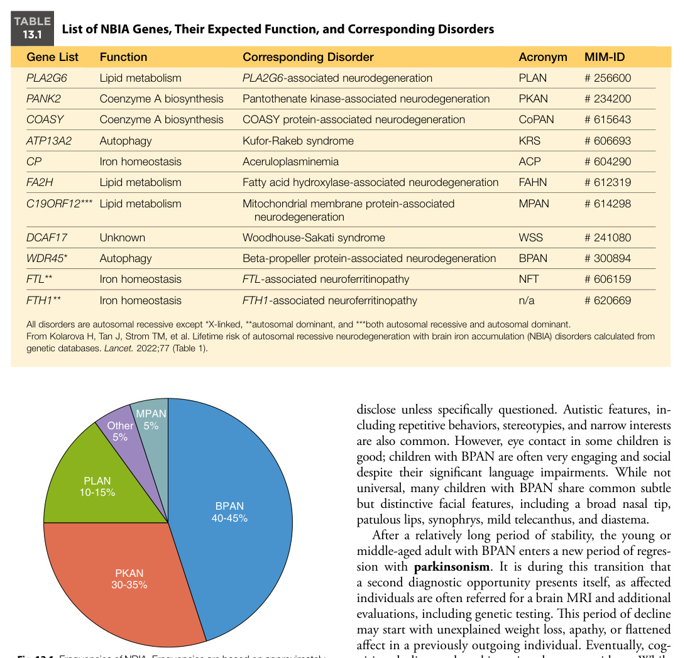

**Fig. 13.1** Frequencies of NBIA. Frequencies are based on approximately 1,000 families worldwide collected over 30 years in an international repository of NBIA. Some countries and regions are not represented because of limitations in making a diagnosis or making contact with the repository. (Figure used with permission: Neurodegeneration with Brain Iron Accumulation Disorders Overview, http://www.genereviews.org/ © 1993-2023 University of Washington.) 

though a number of different seizure types emerge and change over time. A subset of children develops infantile spasms or are diagnosed with **Lennox-Gastaut syndrome** , developing an _epileptic encephalopathy_ that compounds cognitive delays related to their BPAN. While seizures can be the most problematic feature of BPAN for many families during early childhood, these usually resolve or become less challenging by adolescence to young adulthood. Other distinguishing features include premature adrenarche, which some parents may not 

disclose unless specifically questioned. Autistic features, including repetitive behaviors, stereotypies, and narrow interests are also common. However, eye contact in some children is good; children with BPAN are often very engaging and social despite their significant language impairments. While not universal, many children with BPAN share common subtle but distinctive facial features, including a broad nasal tip, patulous lips, synophrys, mild telecanthus, and diastema. 

After a relatively long period of stability, the young or middle-aged adult with BPAN enters a new period of regression with **parkinsonism** . It is during this transition that a second diagnostic opportunity presents itself, as affected individuals are often referred for a brain MRI and additional evaluations, including genetic testing. This period of decline may start with unexplained weight loss, apathy, or flattened affect in a previously outgoing individual. Eventually, cognitive decline and parkinsonism become evident. While affected individuals often have an excellent initial response to levodopa, this improvement is usually short-lived and is followed by the development of problematic dyskinesias; the management of progressive parkinsonism becomes challenging. Death occurs typically to secondary complications such as aspiration pneumonia or other infections. Table 13.2 highlights distinguishing features of BPAN. 

As an X-linked dominant disorder, BPAN occurs with far greater frequency in females than males. Within the population of affected females, there is a broad phenotypic spectrum attributed to both X-inactivation and, when present, somatic mosaicism. Exceptions to the typical presentation and progression exist at both ends of the phenotypic spectrum, with some females who are highly functional with normal language, and others who are more severely affected than

<!-- p.326 -->

**• Fig 13.2** MRI comparing globus pallidus and substantia nigra in the four most common neurodegeneration with brain iron accumulation disorders. Axial T2-weighted imaging of globus pallidus (top series) and substantia nigra (bottom series) in (A) BPAN, beta-propeller protein-associated neurodegeneration; (B) MPAN, mitochondrial membrane protein-associated neurodegeneration; (C) PKAN, pantothenate kinase-associated neurodegeneration; and (D) PLAN, _PLA2G6_ -associated neurodegeneration. 

#### **TABLE Distinguishing Features of Beta-Propeller 13.2 Protein-Associated Neurodegeneration** 

- In children: 

   - Global delay with language affected greater than other areas 

   - Various seizure types, often starts with febrile or absence seizures 

   - Coarse facial features 

   - Delayed myelination, thin corpus callosum, iron accumulation may or may not be present in early childhood 

- In adults: 

   - Personality or motor change after a long period of stability, often involves unexplained weight loss, flat affect 

   - New parkinsonism 

   - T1 hyperintense “halo” surrounding a central linear band of hypointensity in the substantia nigra and cerebral peduncles, iron accumulation in substantia nigra > globus pallidus 

expected. Males with BPAN generally fall into two categories: those with constitutional gene variants who are severely affected, and those with evidence of or suspected somatic mosaicism who are more mildly affected. Unlike females with BPAN, affected males do not have a second X chromosome 

with a functional copy of the gene to mitigate the phenotype. These severely affected males may never walk or have the ability to sit up independently, are more cognitively impaired, and require significant support. Those with somatic mosaicism are often relatively mild, with greater language development and fewer or milder delays in other domains. A consensus management guideline has been published for BPAN. 

### **Brain Imaging** 

The early childhood findings on brain imaging include delayed myelination, a thin corpus callosum, small pontine volume, and swelling of the dentate, globus pallidus, or substantia nigra; more specific findings evolve with time. Abnormal iron accumulation has been documented in children as young as 5 years, though it is more readily apparent in older children or adults. T2-weighted or iron-sensitive sequences reveal hypointense signal in the globus pallidus and substantia nigra. The substantia nigra is usually more hypointense, indicating greater iron accumulation relative to the globus pallidus, a distinguishing feature of BPAN. T1 imaging demonstrates a hyperintense “halo” surrounding a central linear band of hypointensity in the substantia nigra and cerebral peduncles as disease progresses, a sign specific to BPAN (Fig. 13.3).

<!-- p.327 -->

**Fig. 13.3** Axial T2-weighted imaging of globus pallidus (left) and substantia nigra (right) in beta-propeller protein-associated neurodegeneration, with inset showing T1-weighted imaging “halo” in the cerebral peduncles. 

### **Molecular Genetic Testing and Common Diagnostic Challenges** 

It is common to diagnose children with BPAN in the range of 2 to 4 years of age or even younger. In this context, genetic testing is frequently performed as part of a targeted panel for phenotypic presentations such as seizures or developmental delay. In adults, testing is most often initiated after a recent brain MRI, ordered because of an unexpected decline in the setting of parkinsonism, or shows abnormal brain iron. In these instances, an NBIA gene panel or single gene testing for _WDR45_ is most appropriate. Pathogenic variants identified in _WDR45_ are usually unique to each individual because the majority of these variants occur _de novo_ and are not inherited. Testing parental samples allows better variant interpretation and classification. 

Occasionally, an individual with a compelling phenotype for BPAN will have negative molecular testing results. In these instances, testing a second tissue is recommended because somatic mosaicism occurs in this disorder. Additionally, if the initial test was an exome or genome sequence analysis, then coverage for _WDR45_ may not be as complete as with a single gene test or an NBIA panel. In this case, the testing lab could be contacted with a request to re-check _WDR45_ specifically, or single gene analysis could be ordered separately. While X-inactivation is an important contributor to the phenotype in affected individuals, X-inactivation studies are not likely to assist with diagnosis, even in complicated cases since tissues tested will not necessarily reflect the level of X-inactivation in the brain. 

a common founder deletion now known to be the most common variant in this disorder. Onset occurs in childhood to early adulthood with slow progression of dystonia, spasticity, and weakness. Prominent _neuropsychiatric symptoms_ distinguish MPAN from other NBIAs. MPAN typically occurs as an autosomal recessive condition, though heterozygous pathogenic variants in the last exon of _C19orf12_ may cause dominant disease. 

### **Clinical Features** 

MPAN can begin in childhood or early adulthood, and it is more slowly progressive than most of the other NBIA disorders. Affected individuals usually survive well into adulthood, although their quality of life is severely affected during their final years. Prominent and problematic _neuropsychiatric symptoms_ , including emotional lability, depression, anxiety, impulsivity, compulsions, perseveration, hallucinations, inattention, and hyperactivity, can help distinguish MPAN from other NBIAs. Gait change is often the first symptom, followed by progressive spastic paresis and progressive dystonia that can be either limited to the hands and feet or become more generalized. Bladder incontinence (less often also involving bowel incontinence) may develop early while affected individuals are still able to walk and have relatively little intellectual disability. Dysarthria, dysphagia, and optic atrophy are also common. Children with MPAN may present with gait changes and cognitive decline. The core features of MPAN can resemble **juvenile amyotrophic lateral sclerosis** with prominent weakness. Even during childhood disease, iron accumulation is expected to be present and may be the feature that helps direct genetic testing, particularly with an NBIA panel. In the later stages of MPAN, adults develop parkinsonism and worsening cognitive decline, and end-stage disease involves dementia with severe dystonia, spasticity, and parkinsonism. Table 13.3 provides an overview of distinguishing features. 

An individual with MPAN is typically the only affected person in their family; rarely there may be affected siblings, consistent with autosomal recessive inheritance with genetic testing confirming the presence of two pathogenic variants. Some cases are due to heterozygous _de novo_ pathogenic variants. These heterozygous variants are located in the last exon 

#### **TABLE Distinguishing Features of Mitochondrial 13.3 Membrane Protein-Associated Neurodegeneration** 

- Prominent neuropsychiatric symptoms 

## **Mitochondrial Membrane ProteinAssociated Neurodegeneration (MPAN)** 

The gene that causes mitochondrial membrane protein-associated neurodegeneration (MPAN), _C19orf12_ , was first discovered in a cohort of Polish patients that shared 

- Cognitive decline early in disease in both children and adults 

- Slowly progressive dystonia, spasticity and weakness 

- On T2-weighted sequences, isointense streaking of medial medullary lamina between globus pallidus interna and externa can resemble an eye-of-the-tiger sign

<!-- p.328 -->

of _C19orf12_ , are predicted to escape nonsense-mediated decay or to alter a specific protein isoform, and are sufficient to cause disease. There has been no documented difference in phenotype between those with autosomal dominant and those with autosomal recessive MPAN. 

In a small number of cases, onset of MPAN occurs later in adulthood, such as the third decade of life; progression is rapid with parkinsonism and dementia dominating the clinical picture, including varying combinations of bradykinesia, rigidity, tremor, postural instability, and REM sleep behavior disorder. No correlation with specific gene variations or types of variations has been made. However, because these individuals are more likely to have children before disease onset, a small number of families with multi-generational autosomal dominant inheritance has been observed. Other individuals with this early-onset, rapidly progressive form have autosomal recessive variants. Mosaicism for a pathogenic variant has also been associated with later onset. 

### **Brain Imaging** 

The vast majority of individuals diagnosed with MPAN have evidence of abnormal iron accumulation in the globus pallidus and substantia nigra. There are rare instances where brain iron accumulation was not detected on early imaging studies but was appreciated later in disease course. On T2-weighted sequences, many affected individuals will have isointense signal preserved in the medial medullary lamina between the globus pallidus interna and externa that can resemble the **eye-of-the-tiger** sign seen in pantothenate kinase-associated neurodegeneration (PKAN), a more common NBIA disorder. In MPAN, MRI changes signaling high iron in the substantia nigra can help distinguish these disorders, as this feature is not common in PKAN (Fig. 13.4). Serial scans show progression of iron accumulation and generalized brain atrophy with advancing disease. Less frequently, individuals with MPAN have generalized cortical atrophy, cerebellar atrophy, white matter hyperintensities typically localized to the periventricular regions, or T1-weighted hyperintensity of the caudate nucleus and putamen. 

### **Molecular Genetic Testing and Common Diagnostic Challenges** 

The founder pathogenic variant in patients of Polish ancestry, c.204_214del11, is an 11-base pair deletion that causes a frameshift and early termination of the protein. Commonly found in people of Eastern European ancestry in a homozygous state, this variant is associated with juvenile onset disease. In the United States, this variant is more often observed in combination with a second, distinct variant, making the phenotype difficult to predict. Since nonsense variants in the gene’s final exon are sufficient to cause autosomal dominant MPAN, the details of the genetic testing report, including how many variants were identified, variant 

**Fig. 13.4** Axial T2-weighted imaging of globus pallidus (top left) and substantia nigra (right) in mitochondrial membrane protein-associated neurodegeneration (MPAN). The globus pallidus shows preservation of signal in the medial medullary lamina in MPAN, which is absent in betapropeller protein-associated neurodegeneration and _PLA2G6_ -associated neurodegeneration, and may be mistaken for an eye of the tiger sign found in pantothenate kinase-associated neurodegeneration (PKAN), (bottom left). The degree of signal hypointensity in the substantia nigra in MPAN is greater than is typically seen in PKAN, another distinguishing feature. 

type, location, and the detailed interpretation by the clinical lab, are essential to correlating genotype and phenotype. When a single variant is identified in an individual with a convincing phenotype for MPAN, the clinician should confirm that the assay also searched for large deletions or duplications in the gene. A range of methods are now used to look for exon-level deletions and duplications. 

## **Pantothenate Kinase-Associated** 

## **Neurodegeneration** 

Pantothenate kinase-associated neurodegeneration (PKAN) is an autosomal recessive disease characterized by progressive dystonia, dysarthria, and retinal degeneration. The majority of cases are considered _classic_ , with early onset and rapid progression. Those with later onset and slower progression are classified as _atypical_ PKAN, though the disease is not dichotomous in presentation and a phenotypic continuum exists with individuals who fall between these two groups. The causative gene, _PANK2_ , was the first NBIA gene to be identified, and the development of therapeutics is most advanced for PKAN relative to other NBIA disorders. 

### **Clinical Features** 

**Classic PKAN** presents in early childhood by about 3 years of age; it can be diagnosed quickly by exome sequencing or gene panel testing. Children with classic PKAN often

<!-- p.329 -->

present with developmental delay and gait change with poor balance and falling. Younger children with PKAN often have multiple lacerations to the chin and head because of postural instability and difficulty protecting themselves in a fall. Speech may be impaired greater than other areas, with significant delay in production of speech and articulation. Early _retinal degeneration_ can lead to poor night vision or constricted visual fields. In children, this may manifest as tripping over toys or other objects directly at their feet. 

Progression of _spasticity_ and _dystonia_ usually occurs during acute periods of deterioration that are interspersed with periods of stability. This pattern of saltatory progression is not clearly associated with catabolic stress, as in other metabolic disorders; its etiology remains unknown. What may begin as focal dystonia eventually develops into generalized dystonia that becomes increasingly difficult to treat, limiting the ability to walk, sit comfortably, or eat. During this stage, the combination of severe dystonia and osteopenia secondary to limited ambulation leads to an increased risk for long bone fractures. Progressive dystonia becomes more intractable; in late stages of disease, it is common for children to be hospitalized for _dystonic crises_ , sometimes requiring inducement into a medical coma. Premature death usually occurs due to secondary complications like aspiration pneumonia; less often death occurs during episodes of status dystonicus. 

**Atypical PKAN** is more varied. Although onset usually is in the second to third decade, it has been observed much later. Presenting features are typically speech changes, including dysarthria, palilalia, and tachylalia/tachylogia, and mild motor changes that may impair gait or other activities like running or playing sports. _Psychiatric symptoms_ are common and include depression, anxiety, and emotional lability or impulsivity, as well as motor and verbal tics or obsessive-compulsive behavior, which families may recognize in retrospect as an early symptom. Motor symptoms progress slowly, with worsening spasticity and dystonia, as well as more frank parkinsonism. Table 13.4 highlights 

#### **TABLE Distinguishing Features of Pantothenate 13.4 Kinase-Associated Neurodegeneration** 

- In children: 

   - Developmental delay with speech greatly impacted, gait abnormalities, retinal disease 

   - • Relentlessly progressive dystonia starts as focal and becomes generalized 

- In adults: 

- Speech changes, mild motor changes, neuropsychiatric symptoms including anxiety, depression, obsessive-compulsive symptoms, impulsivity 

- • Later parkinsonian features 

- • In all: 

   - Eye-of-the-tiger sign on T2-weighted brain MRI 

   - Periods of progression interspersed with periods of stability rather than a consistent rate of progression 

distinguishing features of classic and atypical PKAN. A consensus management guideline has been published for PKAN. 

### **Brain Imaging** 

The **eye-of-the-tiger sign** on T2-weighted brain MRI is virtually pathognomonic for PKAN (Fig. 13.5). The sign specifically refers to a central region on axial T2-weighted images of signal hyperintensity (indicating edema or gliosis) surrounded by a rim of signal hypointensity (indicating iron) in the anteromedial portion of the globus pallidus. How this sign presents varies with disease progression and is critical diagnostically; molecular diagnostic testing results are unclear. At its earliest stage in children younger than 3 years, the MRI may only show a subtle T2 bright streak along the medial border of the globus pallidus. With time, a large region of signal hyperintensity becomes apparent in the anterior globus pallidus; initially a ring of signal hypointensity may not be apparent. Eventually, iron-associated signal changes dominate the MRI, leaving only a small area of signal hyperintensity or no remaining hyperintensity. In cases of suspected PKAN, _iron-sensitive sequences_ , including axial T2*, SWI, or GRE, should be ordered as part of the assessment. On these sequences, a region of iron tends to become larger and darker, or “bloom,” relative to the changes seen on standard T2 sequences. In later disease, iron accumulation may also become apparent in the substantia nigra. The remainder of the brain usually appears normal. 

### **Molecular Genetic Testing and Common Diagnostic Challenges** 

For children with gait changes and other motor symptoms, brain imaging is likely to be ordered, with results leading the clinician to test for PKAN. A set of common pathogenic variants has been identified in _PANK2_ , including founder variants in the Amish population, the Dominican Republic, and India (Table 13.5). When testing identifies two copies of known variants, or others deemed pathogenic or likely pathogenic, then confidence in a diagnosis of PKAN is high. 

It is not uncommon to identify a single pathogenic or likely pathogenic variant, either alone or paired with a VUS. In these instances, the combination of the clinical and brain imaging phenotypes can usually establish or exclude a diagnosis of PKAN. Because the eye-of-the-tiger sign is rare, evolves over time, and can be mimicked in other disorders like MPAN, or even carbon monoxide poisoning, it is important to seek out an NBIA expert to review the MRI in more challenging cases. Additionally, the youngest children with PKAN may be identified through gene panel testing for developmental delay. In this instance, an MRI has frequently not yet been performed. If molecular testing results are not definitive, then brain MRI will likely help determine if PKAN is the correct diagnosis, keeping in mind that findings may be subtle or not yet apparent in a very young child.

<!-- p.330 -->

**Fig. 13.5** Axial T2-weighted images of the globus pallidus in pantothenate kinase-associated neurodegeneration (PKAN) showing progression of the eye-of-the-tiger sign. Early PKAN is shown in the left-most image, progressing to later stages in the center and right images. 

#### **TABLE 13.5** Common Variants inPANK2

|Gene Variant|Protein Change|Founder Population|
|---|---|---|
|c.545_546insA|p.Arg183GlufsTer47|Asian Indian|
|c.680A>G|p.Tyr227Cys|Dominican|
|c.930_936delCTTTTGT|p.Phe311ProfsX16|Amish|
|c.1351C>T|p.Arg451Ter|None identified|
|c.1413-1G>T|splice variant|None identified|
|c.1561G>A|p.Gly521Arg|None identified|
|c.1583C>T|p.Thr528Met|None identified|

## **_PLA2G6_ -Associated Neurodegeneration** 

While the majority of individuals with _PLA2G6_ -associated neurodegeneration (PLAN) have the homogeneous infantile form, the greater variety in the juvenile and adult-onset forms creates a broad spectrum of disease (Fig. 13.6). More than the other NBIAs, nomenclature for the three forms of PLAN can be challenging: _infantile_ PLAN (also called **infantile neuroaxonal dystrophy** , or INAD), _juvenile_ PLAN, and _adult_ PLAN. All forms are inherited as an autosomal recessive disease, with varying primary symptoms and ages of onset. Of all the NBIAs, INAD can be particularly difficult to diagnose because of the initial general symptoms of developmental delay and psychomotor regression. Abnormal brain iron accumulation may occur later in the disease or not at all; the absence of iron can be consistent with this diagnosis and should not preclude testing for variants in _PLA2G6._ Table 13.6 highlights distinguishing features among the types of PLAN. 

### **Clinical Features** 

**Children with INAD** may have normal early development or only mild delays. Usually between 1 and 2 years, they 

will develop more obvious developmental regression and truncal hypotonia, sometimes with strabismus or nystagmus. Some children with INAD never walk, while others walk for a short period of time before developing gait abnormalities. Any language that develops is lost in a similar manner. Early axial hypotonia eventually develops into spastic tetraparesis. Later in the disease, problematic dystonia, dysautonomia, and seizures can develop. In its final stages, children with INAD usually lose vision due to optic atrophy, require feeding tubes, and have only limited voluntary movement. Death typically occurs by 10 years due to secondary complications like infection, although some are now living longer. 

**Juvenile-onset** cases account for only a small portion of all PLAN, making them ultra-rare. Some children with this diagnosis have normal development until 10 years or later, while others are symptomatic at 4 to 5 years and may have some cognitive delay. Early symptoms may include autistic features or other neuropsychiatric changes. Mild motor symptoms eventually develop and progress slowly; this may be the first indicator that a more global syndrome is unfolding. Progression is slower than INAD, with the development of spasticity, dystonia, ataxia, and weakness. Regression may start in late childhood or early adolescence, including loss

<!-- p.331 -->

**Fig. 13.6** MRI changes of _PLA2G6_ -associated neurodegeneration include iron accumulation as seen in the left and center T2-weighted images at the levels of globus pallidus and substantia nigra. The right sagittal section demonstrates cerebellar atrophy, vertical splenium, and apparent claval hypertrophy, also seen in the inset. 

#### **TABLE Distinguishing Features of** **_PLA2G6_ - 13.6 Associated Neurodegeneration** 

- Infantile Form • Global developmental delay, regression, truncal hypotonia, sometimes with strabismus, nystagmus, or both 

- Juvenile Form 

   - Normal development followed by gait changes, mild spasticity, some with cognitive delays or autistic features 

- Adult Form • Neuropsychiatric symptoms, gait changes, overactive bladder; later, parkinsonism and dystonia 

of cognitive skills such as reading, math, and adaptive behavior skills that were previously performed well. In later disease, affected individuals may also develop seizures, optic atrophy, nystagmus, bladder dysfunction, and parkinsonism. Life expectancy varies, but is expected to be longer than INAD. 

**Adult PLAN** usually presents in young adulthood (late teens to 20s) with rare exceptions. _Neuropsychiatric symptoms_ are often the first to develop, including depression, personality changes, aggression, delusions, or paranoia. Gait disturbance and overactive bladder are also common early in disease. Affected individuals consistently develop parkinsonism, typically bradykinesia, resting tremor, rigidity, and postural instability. Affected individuals have been observed to often have a dramatic response to levodopa, but this response tends to be short-lived and is followed by the development of motor fluctuations and dyskinesias. Dystonia is common in the hands and feet or may be generalized. Cognitive impairment occurs during the later stages of disease for most individuals. Death occurs due to secondary 

complications. A consensus management guideline has been developed for PLAN. 

### **Brain Imaging** 

While PLAN is considered one of the NBIA disorders, iron accumulation in the globus pallidus may not be detected in all cases during the diagnostic evaluation because it may be absent on early imaging, and later repeat imaging is often not indicated. In reported cases with serial imaging, iron accumulation has appeared later in disease progression for most individuals. For INAD and juvenile PLAN, iron accumulation appears limited to the globus pallidus. In adult PLAN, abnormal iron may also be observed in the substantia nigra and striatum. _Cerebellar atrophy_ is consistently present across all forms of PLAN. The additional findings of apparent hypertrophy of the clava, a thin, vertically oriented splenium of the corpus callosum, and cortical cerebellar hyperintensities (indicating gliosis) are also useful to help confirm the diagnosis. In adult PLAN, abnormalities on presynaptic dopaminergic terminal imaging are universal, and cerebral atrophy also occurs in about half of affected individuals. 

### **Molecular Genetic Testing and Common Diagnostic Challenges** 

The _PLA2G6_ gene is included on many phenotype-based testing panels, such as those for developmental delay, cerebral palsy, nystagmus, dystonia, ataxia, and more. Despite the greater availability of these panels and of exome and genome testing, individuals with PLAN continue to have a prolonged diagnostic odyssey. Molecular diagnostic results may be unclear for two main reasons: (1) only one pathogenic or likely pathogenic variant is identified, with or

<!-- p.332 -->

without a VUS; or (2) a homozygous VUS is identified, often in the child of consanguineous parents. In the first scenario, it is important to confirm that the testing ordered would detect deletions or duplications on the second allele. When genetic testing results are unclear, clinical confirmation is a challenge since early symptoms can be relatively nonspecific and clinicians may be unfamiliar with the particular brain imaging findings in PLAN. 

In these challenging cases, the absence of abnormal brain iron does not rule out PLAN. Especially early in INAD or juvenile PLAN, cerebellar atrophy, with or without the additional typical MRI findings, would point strongly toward this diagnosis. A dilated ophthalmological examination may provide additional diagnostic evidence even if only early signs of optic atrophy are present. Similarly, elevated aspartate aminotransferase and/or elevated lactate dehydrogenase with otherwise normal liver tests occur frequently in INAD and may also support a diagnosis. Prior to the discovery of the gene, a clinical diagnosis was sometimes made with the help of a nerve biopsy to look for axonal spheroids on electron microscopy. While identification of spheroids would provide confirmation, a negative biopsy cannot rule out PLAN, and this type of testing is generally no longer recommended. 

## **More Rare Forms of NBIA** 

While BPAN, MPAN, PKAN, and PLAN account for the majority of NBIA (Fig. 13.1), there are other, even rarer forms that are typically diagnosed by genome sequencing, exome sequencing, or an NBIA panel. Whether to classify a single gene disorder as an NBIA is not always clear. In some cases, abnormal iron accumulation may be identified as a rare finding in a neurological disorder placed in a different category of disease. Additional NBIAs shall be defined as those in Table 13.1 and Table 13.7, which outline associated genes and modes of inheritance. In addition, Table 13.8 highlights other conditions with MRI and clinical findings that overlap with or are similar to NBIA and could be considered as part of a differential diagnosis. 

### **Clinical Features and Brain Imaging** 

**Kufor-Rakeb syndrome** may also be referred to as Parkinson disease 9 or PARK9. The disorder has juvenile onset and most commonly presents with gait abnormalities and neuropsychiatric changes. Other distinguishing features include progressive parkinsonism and dementia, supranuclear gaze palsy, facial-faucial-finger myoclonus, visual hallucinations, and oculogyric dystonic spasms. On brain MRI, iron accumulation can be variable in the globus pallidus, putamen, and caudate, or may be absent. With progression there may also be cerebral, cerebellar, and brainstem atrophy. 

**COASY protein-associated neurodegeneration (CoPAN)** has childhood-onset dystonia and spasticity with cognitive impairment. CoPAN is slowly progressive, with affected individuals becoming non-ambulatory by their third decade. 

**TABLE Other Forms of Neurodegeneration 13.7 With Brain Iron Accumulation** 

|Gene|Condition|Mode of Inheritance|
|---|---|---|
|_ATP13A2_|Kufor-Rakeb syndrome|AR|
|_COASY_|COASY protein-associated neurodegeneration (CoPAN)|AR|
|_CP_|Aceruloplasminemia|AR|
|_DCAF17_|Woodhouse-Sakati syndrome|AR|
|_FA2H_|Fatty acid hydroxylase- associated neurodegeneration (FAHN)|AR|
|_FTL_|_FTL_-associated neuroferritinopathy|AD|
|_FTH1_|_FTH1_-associated neuroferritinopathy|AD|

_AD,_ Autosomal dominant; _AR,_ autosomal recessive. 

Other common symptoms include oromandibular dystonia, dysarthria, axonal neuropathy, parkinsonism, deafness, and obsessive-compulsive behaviors. 

**Aceruloplasminemia** has adult onset in the range of 30 to 70 years. It is characterized by the classic triad of retinal degeneration, diabetes mellitus, and neurologic disease, secondary to iron accumulation in the brain and viscera. The neurologic symptoms of facial and neck dystonia, dysarthria, tremors, chorea, ataxia, and blepharospasm correspond to the brain regions that accumulate iron: globus pallidus, putamen, caudate, dentate, thalamus, and red nucleus. Cerebellar atrophy may also be present. 

**Woodhouse-Sakati syndrome (WSS)** has also been called hypogonadism, alopecia, diabetes mellitus, intellectual disability, and extrapyramidal syndrome. Onset is during childhood, and alopecia may be the earliest symptom. Intellectual delays and delayed puberty also present early in the disease course. WSS is a progressive extrapyramidal disorder with generalized and focal dystonia, dysarthria, and cognitive decline. The endocrine abnormalities (hypogonadism, alopecia and diabetes mellitus) distinguish it from other NBIAs, and a small pituitary is usually apparent on imaging. The other primary brain MRI findings are iron accumulation in the globus pallidus, frontoparietal/periventricular white matter lesions, and cerebellar atrophy. 

**Fatty acid hydroxylase-associated neurodegeneration (FAHN)** has childhood onset with subtle gait changes that may lead to increasingly frequent falls. It is slowly progressive with ataxia, dysarthria, dystonia, tetraparesis, and optic atrophy. Seizures may occur in the later stages of disease. Most affected individuals have progressive cognitive decline. In FAHN, iron accumulates in the globus pallidus and substantia nigra. Pontocerebellar atrophy, cerebral atrophy, thinning of the corpus callosum, and periventricular and

<!-- p.333 -->

#### **TABLE 13.8 Conditions That Resemble Neurodegeneration With Brain Iron Accumulation Disorders** 

|Condition|Gene|Findings|
|---|---|---|
|Chorea-acanthocytosis|_VPS13A_|Oral dystonia, acanthocytes|
|Early-onset dystonia-parkinsonism|_PSEN1_|Early-onset dystonia-parkinsonism; iron accumulation in basal ganglia|
|Fucosidosis Glutaric aciduria I Leigh encephalopathy/pyruvate dehydrogenase deficiency Spastic paraplegia gene 7|_FUC1A_ _GCDH_ Several _SPG7_|T2-weighted hyperintensity in globus pallidus resembles imaging of early PKAN|
|_KMT2B_-related dystonia (DYT28, DYT-KMT2B)|_KMT2B_|Childhood-onset dystonia; prominent cervical, cranial, and laryngeal dystonia; T2-weighted hypointense lateral streaks in external globus pallidus|
|Neurodegeneration with ataxia, dystonia, and gaze palsy, childhood onset (NADGP)|_SQSTM1_|Childhood onset of ataxia, dystonia, and gaze palsy; T2-weighted hypointensity of globus pallidus; mild cerebellar atrophy (childhood onset)|
|Sterol carrier protein X deficiency|_SCP2_|Adult-onset gait change and increased tone; susceptibility- weighted signal dropout in globus pallidus and substantia nigra|
|SLC39A14 deficiency (_SLC39A14_-related early-onset dystonia-parkinsonism)|_SLC39A14_|Childhood-onset dystonia and spasticity; T2-weighted hypointensity of globus pallidus and striatum that is hyperintense on T1-weighted imaging|
|Spastic paraplegia 30; hereditary sensory neuropathy IIC|_KIF1A_|Lower extremity spasticity, optic atrophy; cerebellar and cerebral atrophy, thin corpus callosum|
|_UBTF_-related neuroregression|_UBTF_|Dysarthria, gait change; cerebellar atrophy, thinning of the corpus callosum|

subcortical white matter hyperintensity on T2-weighted images are also observed. 

**Neuroferritinopathy** is caused by variants in _FTL_ or _FTH1_ , which encode the ferritin light and ferritin heavy chains, respectively. _FTL_ -associated neuroferritinopathy has adult onset and may present similarly to Huntington disease with chorea or dystonia and cognitive changes. Initially limited to one or two limbs, it progresses to a more generalized movement disorder. Characteristic orofacial actionspecific dystonia related to speech is a distinguishing feature. Iron accumulation occurs in the globus pallidus, putamen, caudate, dentate, substantia nigra, and red nucleus. Cystic changes and cavitation in the caudate and putamen are unique to neuroferritinopathy. Mild cortical and cerebellar atrophy may also develop. 

_FTH1_ -associated neuroferritinopathy, in contrast, has childhood onset with global delays, feeding difficulty, and microcephaly. Affected children commonly have seizures and progressive spasticity, dystonia, and dysphagia; the phenotype will likely expand with increased awareness of this newer form. Iron accumulation is variable in the structures of the basal ganglia and thalamus. Pontocerebellar hypoplasia and selective cerebellar atrophy of the vermis, 

thin corpus callosum, and white matter loss have also been described. 

### **Molecular Genetic Testing and Common Diagnostic Challenges** 

While some of the rarest NBIAs have features that distinguish them clinically, and single gene testing can be ordered if suspicion is high for a particular disorder, more often these cases are diagnosed by exome, genome, or panel testing (Fig. 13.7). Most of them are inherited in an autosomal recessive fashion, and consanguinity is frequent among the limited number of cases. Given their rarity and the lack of commonly reported variants in the associated genes, genetic testing results are more likely to be equivocal than for more common disorders. Careful assessment of the clinical features, brain imaging features, and molecular genetic testing results is the best approach to reach confidence in a diagnosis. Phenotype expansion for all the NBIA disorders occurs over several years and takes even longer to appear in the literature. Therefore, consultation with experts can be particularly useful when their anecdotal experience expands beyond what is reported.

<!-- p.334 -->

**Fig. 13.7** Diagnostic approach to children with bilateral basal ganglia lesions of unknown etiology. Diagnostic flowchart proposed in this study. _CSF,_ Cerebrospinal fluid; _PCR,_ polymerase chain reaction; _VUS,_ variant of unknown significance; _WES,_ whole-exome sequencing. (Modified from Baide-Mairena H, MartiSanchez L, Marce-Grau A, et al. Genetic diagnosis of basal ganglia disease in childhood. _Dev Med Child Neurol_ . 2022;64:743-752 [Fig. 1C. p. 746].) 

## **Bibliography** 

##### **_BPAN_** 

- Gregory A, Kurian MA, Haack T, et al. Beta-Propeller ProteinAssociated. Neurodegeneration.In: Adam MP, Ardinger HH, Pagon RA, Wallace SE, Bean LJH, Stephens K, Amemiya A, editors. GeneReviews® [Internet]. Seattle (WA): University of Washington, Seattle; 1993-2019. 2017 Feb 16. 

- Haack TB, Hogarth P, Kruer MC, et al. Exome sequencing reveals de novo WDR45 mutations causing a phenotypically distinct, X-linked dominant form of NBIA. _Am J Hum Genet._ 2012;91:1144-1149. 

- Hayflick SJ, Kruer MC, Gregory A, et al. Beta-propeller proteinassociated neurodegeneration: a new X-linked dominant disorder with brain iron accumulation. _Brain._ 201;136(Pt 6):1708-1717. 

- Papandreou A, Soo AKS, Spaull R, et al. Expanding the spectrum of early neuroradiologic findings in β Propeller Protein-Associated Neurodegeneration. _Am J Neuroradiol_ . 2022;43(12):1810-1814. 

- Wilson JL, Gregory A, Kurian MA, et al. Consensus clinical management guideline for beta-propeller protein-associated neurodegeneration. _Dev Med Child Neurol_ . 2021;63(12):1402-1409. 

- Zarate YA, Jones JR, Jones MA, et al. Lessons from a pair of siblings with BPAN. _Eur J Hum Genet_ . 2016;24:1080-1083. 

##### **_General NBIA_** 

- Abusrair AH, Bohlega S, Al-Semari A, et al. Brain MRI imaging findings in Woodhouse-Sakati Syndrome. _Am J Neuroradiol_ . 2018;39(12):2256-2262. 

- Al-Semari A, Bohlega S. Autosomal-recessive syndrome with alopecia, hypogonadism, progressive extra-pyramidal disorder, white matter disease, sensory neural deafness, diabetes mellitus, and low IGF1. _Am J Med Genet_ . 2007;143A(2):149-160. 

- Behrens MI, Bruggemann N, Chana P, et al. Clinical spectrum of Kufor-Rakeb syndrome in the Chilean kindred with ATP13A2 mutations. _Mov Disord_ . 2010;25:192901937. 

- Dusi S, Valletta L, Haack TB, et al. Exome sequence reveals mutations in CoA synthase as a cause of neurodegeneration with brain iron accumulation. _Am J Hum Genet_ . 2014;94:11-22. 

- Gregory A, Hayflick SJ. Neurodegeneration with brain iron accumulation disorders overview. In: Adam MP, Feldman J, Mirzaa GM, et al., eds. _GeneReviews_® [Internet]. Seattle, WA: University of Washington, Seattle; 1993-2019. February 28, 2013 [Updated October 21, 2019]. 

- Gregory A, Venkateswaran S, Hayflick SJ. Fatty Acid hydroxylaseassociated neurodegeneration. In: Adam MP, Ardinger HH, Pagon RA, et al., eds. _GeneReviews_® [Internet]. Seattle, WA: University of Washington, Seattle; 1993-2019. June 28, 2011 [updated September 27, 2018]. 

- Kruer MC, Boddaert N, Schneider SA, et al. Neuroimaging features of neurodegeneration with brain iron accumulation. _Am J Neuroradiol_ . 2012;33(3):407-414. 

- Kruer MC, Paisan-Ruiz C, Boddaert N, et al. Defective FA2H leads to a novel form of neurodegeneration with brain iron accumulation (NBIA). _Ann Neurol_ . 2010;68(5):611-618.

<!-- p.335 -->

- Lee JH, Yun JY, Gregory A, et al. Brain MRI pattern recognition in neurodegeneration with brain iron accumulation. _Front Neurol_ . 2020;11:1024. 

- Mohammad SS, Angiti RR, Biggin A, et al. Basal Ganglia MRI Study Group. Magnetic resonance imaging pattern recognition in childhood bilateral basal ganglia disorders. _Brain Commun._ 2020;2(2):fcaa178. 

- Shieh JT, Tintos-Hernandez JA, Murali CN, et al. Heterozygous nonsense variants in the ferritin heavy-chain gene FTH1 cause a neuroferritinopathy. _HGG Adv_ . 2023;4(4):e100236. 

##### **_MPAN_** 

- Angelini C, Durand CM, Fergelot P, et al. Autosomal dominant MPAN: mosaicism expands the clinical spectrum to atypical lateonset phenotypes. _Mov Disord_ . 2023;38(11):2103-2115. 

- Deschauer M, Gaul C, Behrmann C, Prokisch H, et al. C19orf12 mutations in neurodegeneration with brain iron accumulation mimicking juvenile amyotrophic lateral sclerosis. _J Neurol_ . 2012; 259:2434-2439. 

- Gregory A, Lotia M, Jeong SY, et al. Autosomal dominant mitochondrial membrane protein-associated neurodegeneration (MPAN). _Mol Genet Genomic Med_ . 2019;7(7):e00736. 

- Hartig MB, Iuso A, Haack T, Kmiec T, et al. Absence of an orphan mitochondrial protein, c19orf12, causes a distinct clinical subtype of neurodegeneration with brain iron accumulation. _Am J Hum Genet_ . 2011;89:543-550. 

- Hogarth P, Gregory A, Kruer MC, et al. New NBIA subtype: genetic, clinical pathologic, and radiographic features of MPAN. _Neurology._ 2013;80(3):268-275. 

- Skowronska M, Kmiec T, Jurkiewicz E, et al. Evolution and novel radiological changes of neurodegeneration associated with mutations in C19orf12. _Parkinsonism Relat Disord_ . 2017;39:71-76. 

##### **_PKAN_** 

- Gregory A, Hayflick SJ. Pantothenate kinase-associated neurodegeneration. In: Adam MP, Ardinger HH, Pagon RA, et al., eds. 

- _GeneReviews_® [Internet]. Seattle, WA: University of Washington, Seattle; 1993-2019. August 13, 2002 [updated August 3, 2017]. 

- Hayflick SJ, Kurian MA, Hogarth P. Chapter 19—Neurodegeneration with brain iron accumulation. _Handb Clin Neurol_ . 2018;147: 293-305. 

- Hogarth P, Kurian, MA, Gregory A, et al. Consensus clinical management guideline for pantothenate kinase-associated neurodegeneration (PKAN). _Mol Genet Metab_ . 2017;120(3):278-287. 

- Klopstock T, Mercimek-Andrews S, Jurecka A, et al. Patient and caregiver experiences with pantothenate kinase-associated neurodegeneration (PKAN): results from a patient community survey. _Orphanet J Rare Dis_ . 2023;18(1):257. 

- Tomic A, Petrovic I, Svetel M, et al. Pattern of disease progression in atypical form of pantothenate kinase-associated neurodegeneration (PKAN)—prospective study. _Parkinsonism Relat Disord_ . 2015;21(5):521-524. 

##### **_PLAN_** 

- Altuame F, Foskett G, Atwal PS, et al. The natural history of infantile neuroaxonal dystrophy. _Orphanet J Rare Dis_ . 2020;15:109. 

- Gregory A, Westaway SK, Holm IE, et al. Neurodegeneration associated with genetic defects in phospholipase A2. _Neurology_ . 2008; 71(18):1402-1409. 

- Gregory A, Kurian MA, Maher ER, et al. PLA2G6-Associated Neurodegeneration. In: Adam MP, Ardinger HH, Pagon RA, et al., eds. _GeneReviews_® [Internet]. Seattle, WA: University of Washington, Seattle; 1993-2019. June 19, 2008 [updated March 23, 2017]. 

- Illingworth MA, Meyer E, Chong WK, et al. PLA2G6-associated neurodegeneration (PLAN): further expansion of the clinical, radiological and mutation spectrum associated with infantile and atypical childhood-onset disease. _Mol Genet Metab_ . 2014; 112(2):183-189. 

- Magrinelli F, Mehta S, Di Lazarro G, et al. Dissecting the phenotype and genotype of PLA2G6-related parkinsonism. _Move Disord_ . 2021;37(1):148-161.

---

<!-- p.336 -->

# 14 Disorders of Movement 

**HEREDITARY ATAXIAS:  SUSAN L. PERLMAN HEREDITARY CHOREAS: CARLOS ESTEVEZ-FRAGA, JUAN CARLOS MARTINEZ-CASTRILLO, PEDRO J. GARCIA-RUIZ HEREDITARY DYSTONIA: BELÉN PÉREZ-DUEÑAS, ANNA MARCÉ-GRAU, ROSER PONS** 

## Hereditary Ataxias 

##### **SUSAN L. PERLMAN** 

Genetic disorders affecting cerebellar function in childhood can alter cerebellar development (e.g., cerebellar hypoplasia) or lead to cerebellar degeneration. Cerebellar development begins in the latter part of the first gestational trimester and follows structured processes that are most important between the fifth and eighth months of gestation (cerebellar vermis development) and continue postnatally (Purkinje cell migration and cerebellar hemispheric completion) until about age 2 years. 

There are many acquired causes that can interrupt cerebellar development (prematurity, perinatal hypoxia, hemorrhage, prenatal infections, teratogenic exposures), as well as some established genetic causes. Cerebellar hypoplasia associated with dysmorphisms or syndromic and non-syndromic intellectual disability is noted with various chromosomal aberrations and monogenetic disorders, best identified with chromosomal microarray analysis or whole-exome or -genome sequencing (WES, WGS). _WES and short-read WGS will not identify large deletions or expansions_ . 

Cerebellar developmental disorders will have features that can be identified on neurological examination (hypotonia, truncal, appendicular and gait ataxia, action tremor, and eye movement abnormalities—saccadic pursuit, nystagmus, oculomotor apraxia); they are usually associated with neurodevelopmental delay and often more severe motor and cognitive impairments. Neuroimaging can help identify the presence and etiology of cerebellar hypoplasia. 

With cerebellar degenerative disorders there may also be acquired causes (acute vascular incidents, infectious/postinfectious processes, nutritional and endocrine disorders, inflammatory or autoimmune disease, and neoplastic/paraneoplastic disease). They can present with acute onset over hours or a few days. They can be episodic (often due to an inborn error of metabolism; see Chapter 43), chronic 

nonprogressive (e.g., ataxic cerebral palsy), or chronic progressive over weeks, months, or years. 

Progressive genetic disorders often cause cerebellar degeneration in early and late childhood and young adults (hereditary ataxias), which typically present with a change in gait or unexplained falls. 

Ataxia is defined as an abnormality of movement characterized by the absence of motor order and coordination and loss of equilibrium with jerky or wobbly or unsteady postures. For any patient with an ataxic presentation, intrinsic cerebellar disease vs. non-cerebellar causes (visual changes, vestibular abnormalities, sensory loss in limbs, or muscle weakness) should be differentiated. These differences are often apparent on neurological examination, but may require neuroimaging or electrodiagnostic (electromyography, nerve conduction studies, electronystagmography) testing to confirm. 

Mode of inheritance of the hereditary ataxias can help in the choice of genetic testing protocols (autosomal dominant, autosomal recessive, X-linked, or mitochondrial), but consultation with a neurogenetics specialist or genetic counseling provider may assist in determining the most cost-efficient choices. Autosomal dominant disorders are typically adult onset but can occur in childhood in the face of **genetic anticipation** sometimes before the affected parent shows symptoms. Similarly, autosomal recessive disorders are typically childhood onset but can rarely present in adulthood. 

### **Hereditary Ataxias Typically Onset Before the Age of 5 Years** 

Very early-onset hereditary ataxias include congenital ataxias, metabolic disorders with ataxic symptoms, and progressive degenerative ataxias.

<!-- p.337 -->

#### **Characteristic Symptoms and Signs** 

The earliest clue to a progressive cerebellar disorder might be present in the neonatal screening test (newborn screening— NBS), which can show certain inborn errors of metabolism that could lead to an ataxic syndrome. Markers of severe combined immunodeficiency (T-cell receptor excision circles [TRECs], a byproduct of T-cell development) if reduced can be seen as an early indicator in ataxia telangiectasia. 

The presenting clinical symptom might be a delay in developmental milestones or loss of an achieved milestone (regression). 

Symptom onset before the age of 2 years might be misdiagnosed as cerebral palsy, before progression becomes obvious. Other indicators of a possible hereditary ataxia are absent history of any perinatal risk factor for brain injury, family history of sibling with similar neurological symptoms, fluctuation of motor symptoms (e.g., during a febrile illness), isolated generalized hypotonia, and eye movement abnormalities. 

The most common hereditary ataxia presenting before age 5 is **ataxia telangiectasia** (1/100,000; carrier status 1/30–100). There can be phenotypic variations in age of onset, level of immunodeficiency, level of cellular radiosensitivity, and presence or absence of neoplasms. Presenting symptoms may be neurologic, immunologic, or neoplastic. This variability may in part be explained by the level of residual protein, but other influences may also be present. Carriers may be prone to cancer, diabetes, and cardiovascular disease. Telangiectasias are often present (Fig. 14.1). 

Point variants and deletions result in reduced transcription and deficiency of _ATM_ -encoded protein (more than 500 different variants have been described at 11q22-23 locus). Most patients are compound heterozygotes, some with milder phenotypes (producing 1–17% ATM). 

Genetic testing is essential to define the type of hereditary ataxia, which could be very relevant when a clinical phenotype is associated with locus genetic heterogeneity (e.g., Joubert syndrome). 

### **Hereditary Ataxias Onset Between the Ages of 5 and 12 Years** 

#### **Characteristic Symptoms and Signs** 

The presenting clinical symptoms are usually _clumsiness of gait_ and _unexplained falls_ . 

The most common hereditary ataxia presenting between ages 5 and 12 is **Friedreich ataxia** (1/20,000 to 1/50,000 in Caucasians; carrier status 1/60–110). Progression is stepwise, initially involving gait initially and later trunk, upper extremities, and speech. Wheelchair dependence is present _<_ 11 years after onset of symptoms. 

There can be phenotypic variations in age of onset, rapidity of progression, non-ataxic features, and non-neurologic features. Presenting symptoms may be neurologic, musculoskeletal, or cardiac. This variability may in part be explained by the level of residual protein, but other influences may also be present. Carriers are not known to be at risk for any of the non-neurologic features. 

**GAA trinucleotide** expansion in the first intron of the _FXN_ gene (9q21.11; normal is 34–43 GAA repeats; pathogenic expansion is 66–1,700 GAA repeats) results in reduced transcription and deficiency of frataxin protein. Milder phenotypes produce 10–40% of frataxin protein, determined by the smaller of the two allele expansions. Six percent of patients are compound heterozygotes (one GAA expansion and one single nucleotide variant or deletion), who may have a more severe or milder phenotype. 

#### **Diagnosis (Tables 14.1 and 14.2)** 

The diagnosis is based on the use of clinical, laboratory, imaging, and molecular genetic/genomic technologies. 

**Fig.14.1** Conjunctival telangiectasia in a patient with ataxiatelangiectasia.  (From Daroff RB, Jankovic J, Mazziotta JC, et al., eds. _Bradley’s Neurology in Clinical Practice._ 7th ed. Philadelphia: Elsevier; 2016:1468, Fig. 97.6. [Also Fig. 40.5, p. 732 in _Nelson Pediatric Symptom-Based Diagnosis_ 2/e].) 

#### **Making the Diagnosis (Tables 14.2 and 14.3)** 

The clinical and laboratory findings, and the imaging and molecular genetics/genomics technologies that allow the appropriate diagnosis to be made, are shown in Table 14.3. 

### **Hereditary Ataxias Onset in Adolescence** 

#### **Characteristic Symptoms and Signs** 

The presenting clinical symptoms are usually _clumsiness of gait_ and _unexplained falls_ . 

Although the onset of symptoms is very similar to Friedreich ataxia, which can occur in this age group, most of the adolescent-onset hereditary ataxias have cerebellar atrophy rather than the cervical cord atrophy seen in Friedreich ataxia. 

Tables 14.3 and 14.4 indicate the clinical and laboratory phenotypes and the imaging and molecular genetics/ genomics technologies that assist in the diagnosis of hereditary ataxias in adolescence and also late-onset ataxia in adults (e.g., **spinocerebellar ataxias [SCAs]** and **episodic ataxias [EAs]** ). Both SCAs and EAs have autosomal dominant

<!-- p.338 -->

**TABLE 14.1 Common Hereditary Ataxias Onset Before the Age of 5 Years** 

|Disorder|Clinical Neurologic Features|Clinical Non-Neurologic Features|Laboratory Features|Imaging Features|Genetic Features AD Autosomal Dominant AR Autosomal Recessive|
|---|---|---|---|---|---|
|Ataxia telangiectasia and variants|Cerebellar ataxia, oculomotor apraxia, extrapyramidal features, large fiber sensory neuropathy; Wheelchair confined by age 10|Telangiectases present 2–4 years after onset of ataxia; Humoral and cellular immunodeficiency Leukemia, lymphoma, other neoplasms (38%); Hypogonadism; Glucose intolerance|High serum α-fetoprotein in more than 90% of patients with A-T Serum AFP concentration may be high in unaffected children less than 24 months of age Serum Immunoglobulins— Reduced or absent IgA, IgE & IgG2 IgM: Increased (23%) Oligo-/monoclonal gammopathy (10%) Other immunodeficiency— T-cell deficiencies: 30% Thymus: Small embryonic-like Chromosome breakage-7;14 chromosomal translocation in 5 to 15% of peripheral cells Break points: 14q11; 14q32; 7p13-p15; 7q32-q35; 2p11; 2q11 Sensitivity to ionizing radiation|MRI: Small cerebellum|AR _ATM_-encoded protein; 11q22-23 Ataxia-telangiectasia-like disorder 1 (ATLD1)— MRE11; Chromosome 11q21 with milder course and no extraneural features Ataxia-telangiectasia-like disorder 2 (ATLD2)— Proliferating cell nuclear antigen (PCNA); Chromosome 20p13-p12|
|Infantile onset Spinocerebellar ataxia (IOSCA)|Ataxia, athetosis, depressed DTRs; later large fiber neuropathy, ophthalmoplegia, hearing loss, seizures, reduced mental capacity|Female hypogonadism|Mildly elevated blood lactate; Respiratory chain complex I & IV deficiency|MRI cerebellar, brainstem, and spinal cord atrophy; middle cerebellar peduncle high-signal lesions|AR Twinkle protein (c10orf2); 10q24.31|
|Spinocerebellar ataxias type 2 and 7|Loss of motor milestones. Retinitis pigmentosa, optic atrophy; seizures; dysphagia|None|None|MRI cerebral, cerebellar brainstem atrophy|AD Triplet repeats expansions Anticipation|
|Spinocerebellar ataxias type 5, 13, 29|Ataxia, nystagmus, developmental delays, non- progressive|None|None|MRI cerebellar atrophy|AD Inframe deletions, point variants|
|Episodic ataxias|Ataxia attacks lasting minutes to hours to days; occasionally associated with seizures; may respond to clonazepam or acetazolamide|None|None|Brain MRI may be normal|AD EA8 1p36.13-p34.3 EA9 FGF14 DYT9 SLC2A1(GLUT1) 1p34.2 SCN2A: Nav1.2|
|Inborn errors of metabolism and mitochondrial disorders|Discussed in Chapter 8|||||

<!-- p.339 -->

##### **TABLE 14.2 Ataxias in Which Specific Abnormalities May Confirm or Point to the Diagnosis** 

|Disorder|Diagnosis|
|---|---|
|Abetalipoproteinemia|Low vitamin E levels, abnormal lipoprotein electrophoresis|
|Aceruloplasminemia|Cognitive changes, craniofacial dyskinesia, ataxia, retinal degeneration, low serum copper, absent ceruloplasmin, abnormal MRI brain; variants in the ceruloplasmin gene|
|Adrenomyeloneuropathy|Ataxia, neuropsychiatric changes, abnormal MRI, elevated serum long-chain fatty acids; variants in the_ABCD2_gene|
|Ataxia with coenzyme Q10 (CoQ10) deficiency|Low CoQ10 in muscle biopsy|
|AOA1|High serum cholesterol, low albumin|
|AOA2|High α-fetoprotein|
|AT|High α-fetoprotein, low immunoglobulin (Ig)|
|Celiac disease|Antitissue transglutaminase antibody, duodenal biopsy, HLA-DQ2.5 or DQ8 molecules|
|Cerebrotendinous xanthomatosis|Intestinal symptoms, spastic ataxia, cognitive impairment, tendon xanthoma, high serum cholestanol; variants in the_CYP27A1_gene|
|Late-onset Tay-Sachs (LOTS)|Ataxia, neurogenic weakness, cognitive changes; hexosaminidase levels,_HEXA_variant analysis|
|Niemann-Pick type C (NPC) disease|Vertical gaze palsy, hepatosplenomegaly, fibroblast and_NPC_variants|
|Pyruvate dehydrogenase complex (PDHC) deficiency|Plasma and CSF lactate; PDHC in fibroblasts; variants in_PDHC_complex genes|
|Refsum disease|Ataxia, neural deafness, retinitis pigmentosa, ichthyosis, elevated plasma phytanic acid; variants in_PHYH_and_PEX 7_genes|
|Syndromes of myoclonic epilepsy|Many associated with ataxia|
|Vanishing white matter disease|MRI and MRS|
|Wilson disease|Serum copper, ceruloplasmin|

_AOA,_ Ataxia with oculomotor apraxia; _AT,_ ataxia-telangiectasia; _CNS,_ central nervous system; _CSF,_ cerebrospinal fluid; _MRS,_ magnetic resonance spectroscopy. From Daroff RB, Jankovic J, Mazziotta JC, et al., eds. _Bradley’s Neurology in Clinical Practice._ 7th ed. Philadelphia: Elsevier; 2016:1470, Table 97.3. (Also Table 40.13 in _Nelson Pediatric Symptom-Based Diagnosis_ ). 

inheritance, genetic heterogeneity, and clinical phenotypic diversity with associated non-ataxic symptoms. 

### **Approach to the Undiagnosed Patient** 

For any patient with progressive cerebellar ataxia, continuing to work toward a diagnosis is critically important. Identification of an exact causative factor can direct specific treatments and provide important counseling for the patient and family. The focus for undiagnosed childhood (and adult) onset hereditary ataxias is to obtain whole-exome/ genome sequencing, which can be reanalyzed every two to three years for new genetic factors or disease correlates. Even with the most advanced testing technologies, the diagnostic rate may only approach 50%. 

It is also encouraged to have patients bank DNA with a clinical site associated with the Undiagnosed Disease Network (UDN)—a research study that is funded by the National Institutes of Health—or other hospital-based Undiagnosed Disease services with functional genomics and translational diagnostics programs. The UDN has 

funded gene discovery projects and multiple rounds of gene function studies to elucidate the biologic mechanisms of genetic variants identified in patients. 

Goals of supportive care for the diagnosed and undiagnosed ataxic child include safe mobility and fall prevention, independence in activities of daily living, intelligible speech or other communication, safe swallow or other nutrition, safe airway, treatment of deconditioning, fatigue, and pain. Resources that can be offered to the patient and family include physical therapy, occupational therapy, orthotic consultation, speech and swallowing therapy, nutrition assessment, home health assistance, genetic counseling, psychosocial counseling, coordination with educational facilities, legal aid, support groups, and appropriate other medical specialties (ophthalmology, audiology, cardiology, pulmonary, immunology, urology, gastroenterology). 

Omaveloxolone (Skyclarys®) is approved for Friedreich ataxia; there are no approved symptomatic medications for the other ataxia. There are medications that can be safely used in children for associated symptoms (e.g., tremor, dizziness, spasticity, neuropathy, pain, depression, anxiety).

<!-- p.340 -->

##### **TABLE 14.3 Common Hereditary Ataxias Onset Between the Ages of 5 and 12 Years** 

|Disorder|Clinical Neurologic Features|Clinical Non-neurologic Features|Laboratory Features|Imaging Features|Genetic Features AD Autosomal Dominant AR Autosomal Recessive|
|---|---|---|---|---|---|
|Friedreich ataxia|Caudal to rostral ataxia progression, posterior column sensory loss, absent deep tendon reflexes, bilateral Babinski sign, ocular fixation instability; later stage vision and hearing loss.|Hypertrophic cardiomyopathy (75%); Scoliosis, pes cavus (60– 80%); Diabetes or glucose intolerance (20%)|ECG—non-specific ST-T wave changes|MRI cervical cord atrophy, later stage midline cerebellar atrophy|AR GAA triplet expansions (will not be picked up on WES)|
|Charlevoix- Saguenay—Spastic Ataxia (ARSACS; SPAX 6)|Ataxia, nystagmus, spasticity, motor-sensory neuropathy, slow progression|Pes cavus, hammertoes|None|MRI Atrophy cerebellar vermis; brainstem (pons and middle cerebellar peduncles) with linear hypointensities (T2)|AR Sacsin (SACS); Chromosome 13q12.12 Deletions, point variants|
|Spinocerebellar ataxias 1, 2, 3|Ataxia, spasticity, dystonia, ophthalmoplegia, polyneuropathy, dementia|Some with autonomic dysfunction affecting bladder and bowels|None|MRI cerebellar and pontine atrophy|AD CAG triplet repeats expansions Anticipation|
|Dentatorubral- Pallidoluysian Atrophy (DRPLA)|Myoclonus Epilepsy Ataxia Chorea Dementia|None|None|MRI cerebral cerebellar and brainstem atrophy|AD CAG triplet repeat expansions Anticipation|
|Juvenile onset inborn of metabolism and mitochondrial disorders|Discussed in Chapter 8|||||

<!-- p.341 -->

#### **TABLE 14.4** Common Heredita ry Ataxias Onset in Adol escence

|||Clinical|||Genetic Features|
|---|---|---|---|---|---|
|Disorder|Clinical Neurologic Features|Non-neurologic Features|Laboratory Features|Imaging Features|AD Autosomal Dominant AR Autosomal Recessive|
|Ataxia with oculomotor apraxia type 1|Ataxia, extrapyramidal features, oculomotor apraxia, motor-sensory neuropathy|None|Hypoalbuminemia|MRI cerebellar and brainstem atrophy|AR Aprataxin (APTX); Chromosome 9p21.1 Insertion, deletion, missense variants|
|Ataxia with oculomotor apraxia type 2|Ataxia, extrapyramidal features, oculomotor apraxia, motor-sensory neuropathy|Ovarian failure in some patients|Elevated alpha fetoprotein and serum CK|MRI cerebellar atrophy|AR Senataxin (SETX); Chromosome 9q34.13 Premature termination, missense|
|Vitamin E related deficiencies— abetalipoproteinemia|Ataxia, large fiber sensory loss, retinal degeneration|None|Acanthocytosis Very low circulating β-lipoproteins|Not reported|AR Microsomal Triglyceride Transfer Protein, large polypeptide (MTP); Chromosome 4q23|
|Vitamin E related deficiencies— **a**-Tocopherol transfer protein (ATTP; TTPA)|Ataxia, motor-sensory polyneuropathy, upper motor neuron features, retinitis pigmentosa, hearing loss|Xanthomas, Scoliosis, pes cavus, hammertoes,|Low serum vitamin E, High cholesterol and triglycerides|MRI brain may be normal|AR α-Tocopherol transfer protein (ATTP; TTPA); Chromosome 8q12.3|
|Spinocerebellar ataxias 1, 2, 3*|Ataxia, spasticity, dystonia, ophthalmoplegia, polyneuropathy, dementia|Some with autonomic dysfunction affecting bladder and bowels|None|MRI cerebellar and pontine atrophy|AD CAG triplet repeat expansions Anticipation|
|Episodic ataxias 1 and 2|EA-1 manifests without vertigo and it is associated with interictal myokymia; EA-2 shows vertigo and interictal nystagmus||||AD|
|Late onset inborn errors of metabolism and mitochondrial disorders|Discussed in Chapter 8|||||

*Spinocerebellar ataxias are more frequent in late-onset hereditary ataxias; they also include pure cerebellar forms caused by CAG expansions such as SCA6.

<!-- p.342 -->

## Hereditary Choreas 

##### **CARLOS ESTEVEZ-FRAGA, JUAN CARLOS MARTINEZ-CASTRILLO, PEDRO J. GARCIA-RUIZ** 

Chorea is characterized by fluctuating, brief, and unpredictable involuntary movements. The diagnosis and management of chorea is challenging because chorea can be the result of multiple processes both genetic and acquired. In the absence of an evident cause, ruling out **Huntington disease (HD)** should always be the first step in the diagnostic workup. However, despite extensive investigations, a high proportion of cases remain undiagnosed (Table 14.5). 

In addition, chorea may be present with other movement disorders, the involved genes may overlap (Fig. 14.2), and the age of onset may vary depending on the diagnosis (Fig. 14.3) 

### **Huntington Disease** 

#### **Epidemiology and Pathophysiology of Huntington Disease** 

Huntington disease is a neurodegenerative disease characterized by cognitive impairment, motor dysfunction, and psychiatric disturbance. HD is the most frequent autosomal dominant neurodegenerative condition, with an estimated worldwide prevalence of 2.71/100,000. However, its prevalence varies, being lower in Asia and higher in areas with predominantly Caucasian populations such as Australia, Europe, and North America. 

It is caused by a cytosine-adenine-guanine (CAG) trinucleotide expansion in the _HTT_ gene. The _HTT_ gene has 67 exons and encodes a large 350-kDa HTT protein. The CAG repeat tract is located in the first exon of the gene, being translated into a polyglutamine tail in the N-terminal domain of the huntingtin (HTT). 

HTT has multiple physiological functions implicated in numerous cellular processes such as vesicular transport, cell division, ciliogenesis, autophagy and transcriptional regulation. HTT is crucial for the release and delivery of several neuroprotective factors such as brain-derived neurotrophic factor (BDNF). Importantly, it plays a crucial role during early development of the central nervous system. 

The number of CAG repeats is inversely associated with age at the onset of motor symptoms and disease progression. The average CAG repeat in HD patients is 43–45, which leads to an age at onset of approximately 40 years of age and average survival of 25 years from diagnosis. 

Usually, intergenerational transmission is stable, with CAG repeat expansions of similar size in children of affected parents. However, the _HTT_ gene is unstable in the spermatogonia meiosis, with the possibility of larger CAG repeat sizes when being transmitted from the paternal side, leading to larger CAG expansions and earlier onset in a phenomenon known as genetic anticipation. 

The penetrance of HD is reduced between 36 and 39 CAG repeats, while patients with more than 39 CAG repeats invariably develop HD if they have a normal lifespan. In these cases, the enlarged polyglutamine tail results in the production of an abnormal expanded Huntingtin (mHTT) protein. The chronic expression of mHTT disrupts brain cell homeostasis, leading to cellular death and eventually the emergence of the HD phenotype. 

#### **Clinical Features of Adult-Onset Huntington Disease** 

The clinical diagnosis of manifest HD is based on the presence of unequivocal motor signs. However, subtle cognitive motor and psychiatric deficits may be present up to 15 years before the onset of manifest disease; this period is known as the _premanifest stage_ of HD. 

Because of the preferential, loss of striatal medium spiny neurons from the indirect pathway the disease in adult-onset patients is characterized by an initial _hyperkinetic phase_ with _chorea_ and _dystonia_ followed by a _hypokinetic phase_ where parkinsonism predominates. In addition, there is ocular involvement with delayed, slow saccades as well as progressive speech impairment. The cognitive decline of adult-onset patients begins with subtle deficits and follows a subcortical pattern with altered processing speed, executive dysfunction, deficits in visuomotor integration, and impaired emotion recognition. Psychiatric symptoms in adults are also frequent during and after the premanifest stage of the disease. Apathy is the most frequent psychiatric feature followed by irritability, depression, and obsessive-compulsive behaviors. Psychosis is rare. Motor and cognitive symptoms increase with disease progression and correlate with striatal and cortical atrophy. Apathy is the only psychiatric symptom that increases gradually over the years. 

#### **Clinical Symptoms of Juvenile Huntington Disease** 

Juvenile HD (JHD) patients develop symptoms before 21 years of age; patients typically possess a median CAG repeat of 60, although the range can vary from 50 to over 100 CAG repeats. The expanded repeat is usually inherited from the paternal side. Occasionally, in cases with very large intergenerational expansions, the affected parent may not have developed symptoms when the patient with JHD presents. JHD can be further subdivided. The term **pediatric HD** is used for patients who exhibit clinical signs before turning 18 years old. Pediatric HD can be further categorized

<!-- p.343 -->

##### **TABLE Genetic Causes of Chorea 14.5** 

|Syndrome (Inheritance)|Chorea|Other Movement Disorders|Ataxia|Cognitive Impairment|Clinical Features|Ancillary Tests|
|---|---|---|---|---|---|---|
|Huntington disease (AD)|++|1,2,3,4|+/−|++|Motor impersistence|Caudate atrophy (MRI)|
|HDL-1 (AD)|+|1||++|Rapid early onset dementia||
|HDL-2 (AD)|++|1,2,3,4||++|African ancestry||
|Chorea-acanthocytosis (AR)|++|1,2,3||+|Tongue/lip biting|Acanthocytes on blood smear|
|McLeod Syndrome (X-linked)|++|1,2,3||+/−|Neuropathy/ Cardiopathy|Acanthocytes on blood smear|
|SCA 17 (AD)|++|1,2,4|++|+||Cerebellar atrophy (MRI)|
|DRPLA (AD)|++|1,2,4|++|++|Asían ancestry|Cerebellar atrophy (MRI)|
|Other SCAs (1,2,3,7…)|+|1,2,4|++|+/−|Spasticity (SCA3)|Cerebellar atrophy (MRI)|
|Friedreich ataxia (AR)|+/−|2|++||Pes cavus, neuropathy|Cerebellar atrophy (MRI)|
|CANVAS (AR)|+/−||++||Vestibular areflexia Chronic cough|Cerebellar atrophy (MRI)|
|Ataxia telangiectasia (AR)|+/−|2|++||Conjunctival telangiectasias|halpha fetoprotein|
|PKAN (AR)|+/−|2,3,4|+|+|Spasticity, tongue protrusion|Eye of the tiger sign (MRI)|
|Neuroferritinopathy (AD)|+|2,3,4||++|Facial dyskinesias|Iron (basal ganglia) (MRI)|
|Aceruloplasminemia (AR)|+|2,3,4||++||ggserum ceruloplasmin|
|C9orf72 (AD)|+|1,2,4||++|Early onset dementia|Temporal atrophy (MRI)|
|TITF1 (also known as NKX 2.1) (AD)|++|1,2,3|+||Thyroid and lung dysfunction||
|ADCY5 (AD/De novo)|++|1,2,3|++|+|Hypotonia, sleep dyskinesias||
|PDE10A (AR/De novo)|++|1,2,3|++||||
|Mitochondrial (variable)|+|1,2,3,4|+|+|Deafness, short stature, diabetes|hserum lactate|
|Glut-1 deficiency (AD)|+|1,2|+|+|Epilepsy, paroxysmal dyskinesias|gCSF glucose|
|Lesch-Nyhan disease (X linked)|+/−|2||+|Self-injurious behavior|hserum uric acid|
|Idiopathic basal ganglia calcifications (AD)|+/−|2,4|+|+||Basal ganglia calcification (CT, MRI)|

**Other movement disorders (1: myoclonus; 2: dystonia; 3: tics; 4 parkinsonism)** 

(++ cardinal symptom; + frequent symptom but not always present; +/− occasional, symptom). _AD,_ Autosomal dominant; _AR,_ autosomal recessive; _CANVAS,_ cerebellar ataxia with neuropathy and vestibular areflexia syndrome; _HDL1,_ Huntington disease like 1; _HDL2,_ Huntington disease like 2; _PKAN,_ pantothenate kinase–associated neurodegeneration; _SCA,_ spinocerebellar ataxia.

<!-- p.344 -->

**Fig. 14.2** Venn diagram that represents the different combinations of movement disorders that were linked to a genetic variant.  (From Pérez-Dueñas B, Gorman K, Marcé-Grau A, et al. The genetic landscape of complex childhood-onset hyperkinetic movement disorders. _Mov Disorders_ 2022;37[11]:2197–2208 [Fig. 2, p. 2200].) 

into **childhood** (under 10 years) and **adolescent** onset (10–18 years). 

Although rare, approximately 10% of HD expansion _carriers_ develop juvenile HD. Mean survival from diagnosis is 11 years after the onset of symptoms, which tend to emerge faster than in standard adult-onset HD. Clinical features atypical for adult-onset HD such as falls, gait impairment, personality changes, speech disturbance, or neuropsychiatric symptoms are frequent in JHD patients. 

**Parkinsonism** appears in virtually every patient with JHD during disease progression, but it is present in only 16% of patients at onset. Bradykinesia and rigidity are more frequent than rest tremor. Dystonia tends to coexist with parkinsonism, usually being present from onset. Chorea can emerge during disease evolution, although it is more frequent in JHD cases with onset during late adolescence than in childhood. Ataxia is present in 11% of JHD patients. Other movement disorders such as myoclonus or tics, particularly in the context of Tourette syndrome, have also been described. 

Epilepsy is a common feature of JHD, being present in _<_ 30% of the patients. Generalized tonic-clonic seizures are the most frequent, followed by tonic, myoclonic, and absences. Multiple seizure types tend to be present in the same individual. Electroencephalogram (EEG) shows epileptiform findings in more than half of the patients. Seizures are controlled with monotherapy in _<_ 50%. 

Frequently there is poor school performance prior to clinical motor diagnosis and cognitive symptoms are 

frequently reported as the first deficits of JHD. When the disease progresses, other cognitive features such as attention deficits, dysexecutive syndrome, and psychomotor slowing also become apparent. 

Psychiatric symptoms appear in 80% of JHD patients, including irritability, aggression, social withdrawal, anorexia, or addiction to drugs, and up to 25% of patients with JHD may develop suicide attempts. 

Sleep disturbances with abnormal sleep-wake cycle are also frequent. Other symptoms such as speech disturbance and pain and itching are also frequent, presenting in _<_ 50% of patients with HD. 

#### **Pathology and Biomarkers in Juvenile Huntington Disease** 

There are a few histological studies investigating the distribution of pathology in JHD. Available evidence shows severe atrophy in the frontal cortex and striatum. There is also marked atrophy in the globus pallidus, which could be responsible for the marked parkinsonism present in JHD (Fig. 14.4). Thalamic involvement has also been described. 

Although the cerebellum is particularly resistant to neurodegeneration in HD, several studies have suggested that cerebellar atrophy with loss of Purkinje cells is characteristic of JHD. However, these patients had epilepsy and the cerebellar changes could be attributed to injury secondary

<!-- p.345 -->

<!-- p.346 -->

**Fig. 14.4** Coronal sections passing through the nucleus accumbens (A); through the caudal edge of the anterior commissure (B); and the lateral geniculate body (C). From a 43-year-old man, control for comparison (A, B, and C left panels, brain weight [BW] 1412.4 g); from a 24-year-old man with CAG 70/20 and onset of symptoms at age 13 years (A, B, and C right panels, BW 1167.9 g, grade 3/4). The striatum is severely atrophic compared to the control. The extent of the volume loss of the nonstriatal compartments is variable.  (From Vonsattel JPG, Keller C, Ramirez EPC: Huntington’s disease: neuropathology. _Handbook Clin Neurol_ . 2011:100;83–100. https://doi.org/ 10.1016/B978-0-444-52014-2.00004-5.) 

to the antiepileptic drugs and/or ischemic events associated with seizures; other patients have not shown cerebellar atrophy. 

A study with volumetric MRI in 19 patients with JHD identified a decreased volume of subcortical structures and hemispheric white matter. This study demonstrated larger cerebellar volumes in expansion carriers, while there were no significant cortical changes. JHD patients have increased 

neurofilament light protein (NfL) in plasma, a marker of neuroaxonal damage (Fig. 14.5). These biomarkers could be used to assess the potential benefit of a disease-modifying therapy in JHD. The rapid development of motor symptoms in JHD might facilitate the detection of a clinical effect over a clinical trial period with a potential disease-modifying therapy. 

#### **Management of Juvenile Huntington Disease** 

There are no disease-modifying therapies for HD. Numerous _symptomatic_ treatments are available to improve the disabling symptoms present in JHD. Management within a multidisciplinary team in centers with expertise in the treatment of JHD is usually beneficial to target the multiple and complex care needs present condition. 

It is recommended to involve the physiotherapy and occupational therapy teams at an early stage. Conducting swallowing assessments to prevent aspiration pneumonia and ensuring close follow-up with a dietitian for weight monitoring and provision of caloric supplements can be beneficial. Schooling with annual assessments of cognitive decline is also important. 

Evidence for the use of pharmacologic treatments is mostly limited to case reports. Mild chorea and mild parkinsonism do not require treatment. Severe parkinsonism can be treated with levodopa and there have been reports of sustained benefit, although chorea might develop as a side effect and needs to be monitored. Disabling chorea is rare in JHD, but if present, it could be treated with the same drugs used in adult-onset HD, such as tetrabenazine or olanzapine, always monitoring for side effects. Antispasticity drugs are commonly prescribed, but their side effects should also be monitored. 

**Psychiatric manifestations** such as depression or anxiety can be treated with selective serotonin reuptake inhibitors (SSRIs). SSRIs at higher doses can be used for the treatment of obsessive-compulsive symptoms when required. Antipsychotics are usually prescribed for irritability and psychosis, but these drugs may worsen parkinsonism. Antiepileptic drugs with mood-stabilizer effects can be also used to target both epilepsy and psychiatric symptoms. 

Treatment response and side effects from medications need to be regularly assessed, and drugs targeting simultaneously different symptoms affected by the disease are usually preferred to avoid polypharmacy. Most patients with JHD require a combination of drugs to target their symptoms. The neurodegenerative condition of JHD needs to be addressed. A decision about advanced-stage treatments, such as gastrostomy feeding and palliative care, should ideally be made in advance. 

### **Genetic Choreas Different From Huntington Disease** 

A proportion of patients with the HD phenotype do not have the expansion in the HTT gene. There are several

<!-- p.347 -->

**Fig. 14.5** Plasma neurofilament light protein (NfL) is elevated in juvenile HD and children within 20 years to onset of. Plasma NfL is elevated in children and adults with HD. _HD,_ Huntington disease; _NfL,_ neurofilament light protein; _preHD,_ premotor-manifest.  (Modified from Byrne LM., Jordan L, et al: Neurofilament light protein as a potential blood biomarker for Huntington’s disease in children. _Move Disord._ 2022;37[7]:1526–1531 [Fig. 1, p. 1529]. https://doi.org/10.1002/mds.29027.) 

genes responsible for these syndromes; however, most patients remain undiagnosed despite extensive evaluations. Some of these hereditary choreas are clinically similar to HD, while others have associated features such as ataxia, dystonia, or spasticity that could guide the diagnosis. 

The absence of family history does not rule out hereditary choreas, because low penetrance dominant variants, recessive conditions, as well as X-linked or _de novo_ variants can be present. Some of these conditions can be effectively treated, and early recognition is critical. The classification of non-HD choreas is evolving and terms such as “HD-like syndromes” are likely to be replaced by more precise terminology including the disease-causing genes. 

#### **Huntington Disease-like Syndromes** 

These entities are similar to HD (frequently defined as phenocopies) and include Huntington disease-like 1 (HDL1) and HDL2, both autosomal dominants. 

**HDL1** is a prion disease, caused by an octapeptide repeat insertion in the prion protein gene, _PRNP_ . HDL1 is characterized by psychiatric features, rapidly progressive earlyonset cortical dementia, ataxia, myoclonus, and chorea in some, but not all, cases. 

**HDL2** is due to an expanded CTG repeat at the _JPH3_ gene. It is the most common HD phenocopy in some African countries. African heritage is a key element of this condition, being otherwise very similar to HD. The clinical 

symptoms include chorea, cognitive decline, and oculomotor disturbances. 

#### **Neuroacanthocytosis** 

Neuroacanthocytosis syndromes are defined by the presence of neurological symptoms alongside acanthocytes on peripheral blood smear. Classically, two conditions have been included in this category, chorea-acanthocytosis and McLeod syndrome. Acanthocytes can also be observed in other neurological conditions such as neurodegeneration with brain iron accumulation syndromes (Chapter 13). 

**Chorea-acanthocytosis** is characterized by self-injurious orofacial dyskinesia and generalized chorea. Chorea is associated with prominent facio-buccal-lingual dyskinesias leading to speech and swallowing problems as well as typically tongue and lip biting, sometimes with severe mutilations. In addition, axonal neuropathy, myopathy, seizures, and a bizarre gait described as “rubber person” can be observed. It is an autosomal recessive entity caused by variants of the _VPS13A_ gene coding for chorein, a large protein implicated in intracellular protein sorting. Deep brain stimulation in the globus pallidus might be a treatment option for selected patients. 

**McLeod syndrome** is an X-linked recessive hereditary disorder that presents only in males. The phenotype is similar to chorea-acanthocytosis. Chorea is usually present but less frequently associated with buccoorolingual dyskinesias. Typical features include peripheral neuropathy, cardiomyopathy, and elevated liver and muscular

<!-- p.348 -->

enzymes. The red blood cell Kx antigen is absent, and the expression of Kell antigens on the erythrocyte membrane surface is reduced. 

### **Ataxic Conditions** 

Hereditary ataxias can sometimes have associated chorea, especially spinocerebellar ataxia 17 (SCA17) (Caucasians) and dentatorubral-pallidoluysian atrophy (DRPLA) (Asian population). In these cases, subtle ataxic clinical signs or a mild degree of cerebellar atrophy on MRI are the clues for the correct diagnosis. 

In **SCA17** (formerly known as HDL4), clinical features include chorea, dystonia, parkinsonism, and spasticity. SCA17 is an autosomal dominant trinucleotide-repeat disorder, caused by CAG or CAA expansions in the _TBP_ gene, encoding for the TATA-box binding protein. 

In **DRPLA** (dentatorubal-pallidoluysian atrophy) chorea, myoclonus, epilepsy, and ataxia are the main key features. Asian ancestry, particularly Japanese, is a genetic risk factor. DRPLA is also an autosomal dominant disease due to a CAG-repeat expansion in the _ATN1_ gene, encoding for atrophin-1. 

Other ataxic syndromes occasionally present chorea, including SCAs 1, 2, 3, 7, 8, and 14, although chorea is rarely the predominant movement disorder in these conditions. 

Recessive ataxias such as Friedreich ataxia, cerebellar ataxia, neuropathy vestibular areflexia syndrome (CANVAS), and ataxia-telangiectasia may present with chorea. **Friedreich ataxia** is usually associated with scoliosis, pes cavus, cardiomyopathy, and ataxia, while **CANVAS** patients tend to have vestibular areflexia and dry chronic cough (cerebellar ataxia, neuropathy). **Ataxia telangiectasia** must be kept in mind for childhood-onset chorea with dyskinesias, especially dystonia and chorea, associated to ataxia and immune defects. Ataxia telangiectasia is one of the most common forms of progressive cerebellar ataxia of early childhood. 

### **Neurodegeneration With Brain Iron Accumulation (See Also Chapter 13)** 

This heterogeneous group of diseases is characterized by iron accumulation in specific brain areas, mainly the globus pallidus. Clinically neurodegeneration with brain iron accumulation (NBIAs) is variable, but a combination of dyskinesias including facial dystonia is frequently described. In addition, parkinsonism, cognitive decline, spasticity, and ataxia are frequent symptoms. Chorea is rarely the presenting symptom and tends to be associated with other extrapyramidal and pyramidal elements. These disorders should be suspected when increased iron in the basal ganglia is observed in iron-sensitive sequences such as susceptibilityweighted imaging (SWE) or T2* sequences in brain MRI imaging (see Chapter 8). 

### **Frontotemporal Dementia** 

Chorea can be present in patients with **frontotemporal dementia (FTD)** , especially in _C9orf72_ expansion variant carriers. Autosomal dominant variants in _C9orf72_ are the most frequent genetic cause of FTD and amyotrophic lateral sclerosis, and also the commonest cause of non-HD chorea in adults. Frontotemporal atrophy on neuroimaging and marked psychiatric symptoms are useful diagnostic clues. 

Chorea has also been noticed in other frontotemporal variants, including _TARDBP_ or _PGRN-_ related disorders, as well as in familial cases of FTD without known variants. 

### **Benign Hereditary Chorea** 

Several gene variants leading to childhood-onset chorea have been described. Benign hereditary chorea (BHC) is defined as an autosomal dominant disease, characterized by early-onset, non-progressive chorea. The chorea may spontaneously improve over time. Other movement disorders may be present including myoclonus, tics, dystonia, and ataxia. 

Variants in the _TITF1_ gene (also known as _NKX2-1_ ), encoding a transcription factor essential for striatal development were the first identified genetic cause of BHC. The majority of newly identified cases result from _de novo_ variants. These variants lead to a multisystem disease affecting lungs, thyroid, and basal ganglia. 

**_ADCY5_ -related chorea** is an autosomal dominant disorder characterized by early onset of chorea, frequently associated with facial dyskinesias as well as myoclonus, dystonia, and tics. Episodic exacerbations and worsening of dyskinesias at night (during drowsiness and arousal) are characteristic clinical clues. Axial hypotonia and a bizarre mobilization defined as “frog gait” can be present. Gain-offunction variants in _ADCY5_ leading to elevated striatal cAMP have been suggested to be responsible for the chorea. Caffeine or theophylline has been found to be effective for the treatment _ADCY5_ -related sleep dyskinesias. 

**Autosomal recessive** **_PDE10A_ -related chorea** is similar to _ADCY5_ -related chorea. _PDE_ genes encode for an enzyme that hydrolyses cAMP. _PDE10A_ variants have decreased enzymatic activity and result in increased cAMP levels due to loss-of-function. 

### **Other Causes of Genetic Choreas** 

Tables 14.5 and 14.6 summarize the most frequent processes and a basic approach to non-HD choreas. 

In early-onset chorea with suspected family history, if the already discussed conditions are ruled out, it is suggested to look for potentially treatable and/or easy to diagnose diseases, including mitochondrial diseases, GLUT1 deficiency, Lesch-Nyhan disease, Rett syndrome, Wilson disease, and idiopathic basal ganglia calcification. Nonetheless, the

<!-- p.349 -->

###### **TABLE 14.6** 

#### **Differential Diagnosis of Acquired Chorea** 

##### **Static Injury** 

- Kernicterus 

- Hypoxic/ischemic insult: infarct, cardiac arrest, cardiac bypass, perinatal hypoxia, polycythemia vera, Moyamoya disease, bronchopulmonary dysplasia in infants, carbon monoxide inhalation 

- Toxin-induced: Ethanol, methanol, toluene, bismuth, manganese, thallium, mercury 

- Infections: mycoplasma, Lyme disease, legionella, toxoplasmosis, human immunodeficiency virus, HSV, measles, mumps, varicella, parvovirus, cysticercosis 

- Trauma 

##### **Drug Exposure** 

   - Dopamine receptor blocking agents: Phenothiazines, butyrophenones, benzamides 

   - Antiparkinsonian drugs: L-dopa, dopamine agonists, anticholinergics 

   - • Antiepileptic drugs: Phenytoin, carbamazepine, valproic acid 

   - • Calcium-channel blockers: Cinnarizine, flunarizine, verapamil 

   - • Psychostimulants: Amphetamines, pemoline, cocaine, methylphenidate 

   - • Antihistamines 

- Midline CNS malformation disorders: Holoprosencephaly, • Oral contraceptives Joubert’s syndrome, agenesis of the corpus callosum • Antidepressants: tricyclics, selective serotonin reuptake 

- • Central pontine and extrapontine myelinolysis inhibitors • Opioid agonists 

- **Parainfectious and Autoimmune Syndromes** • Others: Lithium, baclofen, digoxin, cyclosporine, steroids, 

- • Sydenham chorea theophylline • Systemic lupus erythematosus **Metabolic Syndromes** 

- • NMDA-receptor antibody encephalitis • Other autoantibody mediated choreas: D2R, GABAAR, • Pelizaeus-Merzbacher disease type I LGI-1, CV2/CRMP5, Hu, CASPR2, Neurexin-3a IgLON5 • Glutaric aciduria type 1 

- • Behçet’s disease • Propionic academia • Antiphospholipid antibody syndrome • Homocystinuria • Acute disseminated encephalomyelitis • Phenylketonuria • Central nervous system vasculitis • Costeff syndrome (3-methyl-glutaconicaciduria) • Rasmussen encephalitis • Cerebral folate deficiency • Multiple sclerosis • Sulfite oxidase deficiency • Acute necrotizing encephalopathy • Pyruvate carboxylase deficiency • Chorea gravidarum • Biotinidase deficiency • Postinfectious or postvaccinal encephalitis • Acute intermittent porphyria **Endocrine or Nutritional Derangement Space Occupying Lesions** • Hyper or hypoglycemia • Tumor • Hyper or hyponatremia • Central nervous system lymphoma • Hyperthyroidism • Arteriovenous malformation • Hypoparathyroidism or pseudo-hypoparathyroidism • Cavernous hemangioma • Hypocalcemia • Hypomagnesemia • Vitamin B12 deficiency • Acquired hepatocerebral degeneration • Pheochromocytoma 

genetic testing is often negative in a substantial proportion of patients with non-HD choreas. 

## **Acquired Choreas** 

Many acquired choreas are treatable. The etiology of acquired chorea may include infections, autoimmune diseases, cerebral palsy, neurodegenerative disorders, cerebrovascular pathology, neoplasms, medications, drug exposure, and metabolic diseases (Table 14.6, Figs. 14.3 and 14.6). Patients with chorea typically exhibit similar 

characteristics. Therefore, the differential diagnosis of choreic syndromes is based mainly on accompanying findings. The differential diagnosis between chorea and tics can be complex in some cases; both phenomenologies can coexist in Huntington disease or Sydenham chorea. To achieve an etiological diagnosis in secondary choreas requires a comprehensive evaluation. A thorough clinical history, physical examination, and neuroimaging studies are crucial. Laboratory investigations, including metabolic and toxicology screening, may be necessary to identify specific causes.

<!-- p.350 -->

**Fig. 14.6** Early/Childhood-onset choreas diagnostic algorithm. _AOA,_ Ataxia with oculomotor apraxia; _ASO,_ antistreptolysin O; _HDL,_ Huntington-disease like; _SPG,_ spastic paraplegia.  (From Martinez-Ramirez D, Walker RH, Rodriguez-Violante M, Gatto EM: Review of hereditary and acquired rare choreas. _Tremor Other Hyperkinet Mov._ 2020;10[1]:1–24, [Fig. 2, Art 24, p. 2]. https://doi.org/10.5334/tohm.548.)

<!-- p.351 -->

# Hereditary Dystonia 

#### **BELÉN PÉREZ-DUEÑAS, ANNA MARCÉ-GRAU, ROSER PONS** 

Dystonia is a movement disorder characterized by involuntary, sustained, or intermittent muscle contractions, resulting in abnormal and often repetitive movements, postures, or a combination of both. Dystonia is a network disorder involving basal ganglia, cerebellar, thalamic, and cortical circuits, named the dystonia connectome. 

The etiology of dystonia can be acquired, idiopathic, or genetic. Acquired dystonia is the most frequent etiology in the pediatric age, and its main cause is dyskinetic cerebral palsy due to brain injury in the perinatal period. A growing number of patients with cerebral palsy are being diagnosed with genetic causes, some of which are treatable metabolic conditions. Consequently, conducting an exhaustive diagnostic assessment is crucial in children with cerebral palsy, particularly in those with a family history of consanguinity, unclear perinatal pathological events (no evidence of hypoxic ischemic encephalopathy), or initial normal brain imaging. 

The appearance of dystonic movements and postures in early life mirrors that in adults, and can manifest as hand fisting, foot inversion, toe extension, writer’s cramp, dysphonia, opisthotonos, oromandibular dystonia, torticollis, gait dystonia, and blepharospasm. Some genetic conditions exhibit distinct body distribution patterns; for instance, laryngeal dystonia is characteristic of _KMT2B, TUBBA4_ , and _THAP1_ gene disorders, while oromandibular dystonia is typical of neurodegeneration with brain iron accumulation and lysosomal disorders (Tables 14.7 and 14.8). Lower limb dystonia is common in _TOR1A_ and _KMT2B_ genetic disorders, while cervical dystonia is frequently described in _ANO3_ and _GNAL_ -related disorders. 

Drug-induced dystonia is another acquired cause of dystonia. In children, it is most frequently linked to antipsychotics, although anticonvulsants, antidepressants, antiparkinson drugs, antiemetics, and corticosteroids may also contribute. It typically presents acutely, is transient, and resolves with discontinuation of the offending agent. Chronic and tardive forms can also occur in children treated with neuroleptics or atypical antipsychotics. 

Dystonia may manifest at rest, during specific postures or actions (e.g., writer’s cramp or gait dystonia); in some instances, it can be episodic or paroxysmal, triggered by sudden movements ( _PRRT2_ gene disorders), exercise ( _SLC2A1_ or _GCH1_ ), infections, or other catabolic situations ( _ECHS1_ , _SLC19A3_ , or _PDH1_ -related disorders). Importantly, fluctuation of dystonia according to the circadian cycle (worsening along the day, improvement after sleep or rest) is typical of dominantly GTP cyclohydrolase deficiency and other disorders of dopamine synthesis. 

Dystonic features can be the only neurological sign on examination **(named isolated dystonia)** , or it can be 

associated with other movements **(combined dystonia)** or other neurological or systemic features **(complex dystonia)** . Isolated dystonia represents a minority of hereditary dystonia forms in the pediatric age, with examples including _TOR1A, THAP1, VPS16, GNAL,_ and _ANO3_ gene disorders (Table 14.7). Combined dystonia phenotypes include dystonia-parkinsonism (typical of primary disorders of dopamine synthesis), dystonia-chorea ( _ADCY5, NKX2-1_ or _GNAO1_ genes), dystonia-myoclonus _(SGCE, KCTD17)_ , and dystonia-tremor _(ANO3)_ . In children with complex forms of genetic dystonia, developmental delay is often present, along with other neurological signs such as hypotonia, microcephaly, spasticity, ataxia, abnormal ocular movements, or epilepsy (Table 14.8). The majority of dystonia genes associated with neurodegenerative and neurometabolic conditions, as well as those linked to epilepsy and channelopathies, fall into these complex forms of dystonia. The age at onset of genetic dystonia has a strong influence in clinical progression and severity. In infants and young children, dystonia emerges and evolves as the brain develops and interacts with the disease process. Dystonia in children usually begins focal and rapidly progresses to segmental, multifocal, and generalized forms, causing severe pain, physical impairment, and disability. 

Traditionally, hereditary dystonias have been classified as “DYT” followed by a number corresponding to the genetic locus. However, with the discovery of more dystonia-related genes and more complex dystonia-related phenotypes, there is a preference for using gene names alongside clinical descriptions. Currently, over 200 genetic causes of dystonia have been documented (Table 14.7). These include a number of neurometabolic and neurodegenerative disorders causing brain energy failure, metabolic strokes, lysosomal dysfunction, or trace element deposition in the brain dystonia connectome, leading to complex dystonia phenotypes. Other genetic forms of dystonia cause isolated or combined dystonia phenotypes without evidence of brain pathology. Whole-exome sequencing studies conclude a diagnostic rate between 15% and 20% in wide cohorts of dystonic patients. The diagnostic rate increases according to the complexity of the phenotype (for isolated dystonia 5%, for dystonia combined with other movement disorders 20%, and for dystonia associated with other neurologic features 45%). 

An approach to these conditions begins by considering the affected gene and its role in biological pathways (Fig. 14.7), acknowledging that in some cases the gene function may not be fully understood, or multiple pathophysiological pathways may be involved. Phenotype overlapping is becoming more common as new causal genes are being described. This correlates with the idea of the potential existence of a common or a reduced number of disease 

_(Text continued on page 340)_

<!-- p.352 -->

#### **TABLE 14.7 Genetic Disorders Associated With Dystonia in Infancy, Childhood, and Adolescence*** 

|Pathophysiological Mechanism|Gene|Function|Inheritance (Penetrance)|Dystonia Phenotype|Variable Associated Neurological Features†|Neuroradiological Findings|
|---|---|---|---|---|---|---|
|Nuclear gene expression, nuclear envelope |_KMT2B_|Regulates histone methylation and gene expression|AD (reduced penetrance)|Isolated, Complex|NDD, facial dysmorphism, short stature, spasticity|Iron accumulation in globus pallidus|
|dysfunction and stress response|_THAP6_|Zinc finger-containing transcription factors|AD|Isolated||N|
||_YY1_|Transcription factor that co- localizes with THAP1|AD|Complex|Dysmorphic NDD, intrauterine growth failure|N|
||_NUP54_|Nucleoporin 62: part of the nuclear pore complex that transport macromolecules through nuclear envelope|AR|Complex|Fever-induced episodes of neurological regression|Striatal necrosis|
||_NUP62_|Nucleoporin 54: part of the nuclear pore complex that transport macromolecules through nuclear envelope|AR|Complex|Fever-induced episodes of neurological regression|Striatal necrosis|
||_TOR1A_|Specific AAA+ATPase: regulates nuclear homeostasis and endoplasmic reticulum stress response|AD (reduced penetrance), AR|Isolated (AD), Complex (AR)|NDD, arthrogriposis, facial dysmorphism (AR)|N|
||_PRKRA_|Protein interferon-inducible double-stranded RNA- dependent protein kinase activator A|AR|Isolated, Combined (P), Complex|Fever-induced episodes of neurological regression|Striatal necrosis|
||_EIF2AK2_|Eukaryotic translation initiation factor 2 alpha kinase|AD, AR|Isolated, Complex|NDD, ataxia, hypotonia, parkinsonism, E; neurological regression with febrile illness|NS|

_(Continued)_

<!-- p.353 -->

###### **TABLE** 

#### **14.7 Genetic Disorders Associated With Dystonia in Infancy, Childhood, and Adolescence—cont’d** 

|Pathophysiological Mechanism|Gene|Function|Inheritance (Penetrance)|Dystonia Phenotype|Variable Associated Neurological Features†|Neuroradiological Findings|
|---|---|---|---|---|---|---|
|Primary dopamine dyshomeostatis disorders (synthesis and transport)|_GCH1_|GTP-cyclohydrolase deficiency: BH4 synthesis (rate limiting enzyme)|AD (incomplete penetrance, higher in women), AR|Isolated, Combined (P), Complex and paroxysmal (OCG)|Lower limb dystonia with sleep benefit in childhood, parkinsonism in second decade of life (AD) Axial hypotonia, infantile dystonia-parkinsonism, NDD, E, hyperphenylalaninemia (AR)|N|
||_SPR_|Sepiapterin reductase|AR|Complex and |Axial hypotonia, infantile or |N, NS, i|
||_DHPR_|Dihydropteridine reductase deficiency||paroxysmal (OCG)|childhood dystonia- parkinsonism, diurnal fluctuation, sleep disorder,|Calcifications|
||_PTPS_|6-pyruvoyl-tetrahydropterin synthase|||autonomic dysfunction, NDD, E, Hyperphenylalaninaemia||
||_DNAJC12_|DnaJ Heat Shock Protein (co-chaperone)|||||
||_TH_|Tyrosine hydroxylase|AR|Complex and |Axial hypotonia, infantile |N, NS|
||_DDC_|Aromatic amino acid decarboxylase||paroxysmal (OCG)|dystonia-parkinsonism, diurnal fluctuation, sleep disorder, autonomic||
||_SLC18A2_|Vesicular monoamine transporter|||dysfunction, NDD, E||
||_SLC6A3_|Dopamine transporter (re-uptake)|AR|Complex|Encephalopathy, axial hypotonia, dyskinesia, progressive dystonia– parkinsonism, NDD Late onset juvenile parkinsonism–dystonia|Absence of dopamine uptake on DAT scan|
|Synaptopathies and channelopathies|_PRRT2_|Proline-rich transmembrane protein: Regulates Synaptic Fusion by Directly Modulating SNARE Complex assembly|AD (incomplete), AR|Paroxysmal (PKD), Complex|E, Hemiplegic migraine, Episodic ataxia Dominant inheritance: mainly PKD, also PED, PNKD Recessive inheritance: NDD, E|N|
||_MR-1_|Myofibrillogenesis regulator-1|AD|Paroxysmal (PNKD)|Single report: progressive non-paroxysmal C and D|N|

_(Continued)_

<!-- p.354 -->

#### **TABLE 14.7 Genetic Disorders Associated With Dystonia in Infancy, Childhood, and Adolescence—cont’d** 

|Pathophysiological Mechanism|Gene|Function|Inheritance (Penetrance)|Dystonia Phenotype|Variable Associated Neurological Features†|Neuroradiological Findings|
|---|---|---|---|---|---|---|
||_STXBP1_|Syntaxin1-binding protein|AD|Complex|EE, NDD, A, C, T, M, |N, NS|
||_VAMP2_|Vesicle associated membrane protein 2|||hypotonia, microcephaly, sleep disorders||
||_DNM1_|Dynamin 1|||||
||_SYT1_|Synaptotagmin-1|||||
||_TSPOAP1_|Active-zone RIM-binding protein 1|||||
||_SCN1A_ _SCN2A_ _SCN8A_|Voltage-gated sodium channel subunits|AD (incomplete penetrance in SCN1A)|Complex|E, EE, NDD, hypotonia, C, OGC, A, Paroxysmal dyskinesias (SCN8A), Hemiplegic migraine (SCN1A), Episodic ataxia (SCN2A)|N, NS, brain dysplasia|
||_KCNT1_ _KCNQ2_|Sodium-activated potassium channels|AD (incomplete)|Complex|E, EE, NDD, hypotonia, C, A, S, M|N, NS, cerebellar atrophy|
||_ATP1A3_|ATPase Na+/K+Transporting Subunit Alpha 3|AD (incomplete)|Combined (P), Complex, Paroxysmal|Rapid-onset dystonia- parkinsonism, Alternating hemiplegica of childhood, Cerebellar ataxia, areflexia, pes cavus, optic atrophy, and sensorineural hearing loss (CAPOS), NDD, microcephaly, E, EE, A, C, P hypotonia, bulbar dysfunction, stress triggers onset of symptoms|N, NS, brain dysplasia|
|Calcium dyshomeostasis|_ANO3_|Anoctamin-3: Calcium-activated chloride channel|AD (incomplete)|Isolated, Combined (M, T), Complex|Early onset: NDD, progressive encephalopathy|N Cerebellar atrophy|
||_CACNA1_|Voltage-gated calcium channel|AD (incomplete)|Complex, Paroxysmal|Familial hemiplegic 1 Episodic ataxia 2 Spinocerebellar ataxia 6 NDD, EE|N Cerebellar atrophy Progressive white matter atrophy|
||_KCTD17_|Calcium-dependent potassium channel tetramerization domain-containing protein|AD|Combined (M), Complex|NDD|N|

_(Continued)_

<!-- p.355 -->

#### **TABLE 14.7 Genetic Disorders Associated With Dystonia in Infancy, Childhood, and Adolescence—cont’d** 

|Pathophysiological Mechanism|Gene|Function|Inheritance (Penetrance)|Dystonia Phenotype|Variable Associated Neurological Features†|Neuroradiological Findings|
|---|---|---|---|---|---|---|
||_CAMK4_|Calcium/calmodulin-dependent protein kinase: mediates intracellular calcium signaling|AD|Complex|NDD, C|N|
||_HPCA_|Hippocalcin: Modulates calcium and potassium channels|AR|Isolated, Complex|NDD, C, E|N|
||_KCNMA1_|Calcium-activated K+channel|AD|Complex, Paroxysmal|E, NDD, A, hypotonia, OGC, episodes reminiscent of cataplexy without associated narcolepsy|Cerebellar atrophy|
||_PRKCG_|Protein kinase C gamma: mediates intracellular calcium signaling|AD (variable)|Complex|A (Spinocerebellar ataxia 14), P, M, S, peripheral neuropathy, cognitive dysfunction|Cerebellar atrophy|
||_TMEM151_|Transmembrane Protein 151A: Intracellular Ca2+dynamics|AD (incomplete)|Paroxysmal (PKD)||N|
|Postsynaptic signal transduction and |_DRD2_|Dopamine receptor D2|AD|Combined (C), Complex|NDD|N|
|second messenger- induced effect response|_GNAL_|G protein alpha|AD (high penetrance)|Isolated||N|
||_GNAO1_|G protein alpha|AD|Isolated, Combined (C, M, P), Complex, Paroxysmal|NDD, E, EE, H|Normal or non-specific changes (atrophy)|
||_GNB1_|G protein beta|AD|Complex|NDD, H, S, E, visual impairment|Cerebral atrophy, delayed myelination|
||_ADCY5_|Adenylate cyclase 5 synthesizes cAMP|AD, AR|Combined (C, M, T), Complex, Paroxysmal|NDD, H|N|
||_PDE10A_|Phosphodiesterase 10A degradates cAMP|AD, AR|Combined (C), Complex|NDD, H|Striatal necrosis (AR)|
||_PDE2A_|Phosphodiesterase 10A degradates cAMP|AD|Combined (C), Complex, Paroxysmal|NDD, H|N|

_(Continued)_

<!-- p.356 -->

#### **TABLE 14.7 Genetic Disorders Associated With Dystonia in Infancy, Childhood, and Adolescence—cont’d** 

|Pathophysiological Mechanism|Gene|Function|Inheritance (Penetrance)|Dystonia Phenotype|Variable Associated Neurological Features†|Neuroradiological Findings|
|---|---|---|---|---|---|---|
|Lysosomal- autophagosomal pathology|_VPS11_|Core subunit of VPS-C complex that is required for vesicle transport and fusion process in the late endosomes/ lysosomes pathway.|AR|Isolated, Complex|Infantile-onset hypomyelinating leukodystrophy 12 (HLD12). Late-onset VPS11-associated neurodegeneration with progressive dystonia.|Leukoencephalopathy HLD12). T2- hypointensities in the basal ganglia|
||_VPS16_|Core subunit of VPS-C complex that is required for vesicle transport and fusion process in the late endosomes/ lysosomes pathway.|AD, AR|Isolated, Complex|NDD in 30%|T2-hypointensities in the basal ganglia|
||_VPS41_|Core subunit of VPS-C complex that is required for vesicle transport and fusion process in the late endosomes/ lysosomes pathway.|AR|Complex|NDD, A|T2-hypointensities in the basal ganglia, cerebellar atrophy/ hypoplasia|
|Mitochondrial and energy homeostasis dysfunction|_NDUFAF6_|Complex I assembly factor|AR|Isolated, Complex|LS. Isolated progressive dystonia|Leigh syndrome (basal ganglia lesions)|
||_SURF1_|Assembly factor for cytochrome c oxidase enzyme|AR|Complex|LS|Leigh syndrome (basal ganglia lesions)|
||_MT-ATP6_|Mitochondrial complex V generates cellular energy as adenosine triphosphate (ATP).|Maternal inheritance (mitochondrial DNA)|Complex|LS|Leigh syndrome (basal ganglia lesions)|
||_WARS_|Tryptophanyl-tRNA synthetase|AR|Combined (T, P), Complex|NDD. Childhood onset T followed by gait difficulties due to P, D and S.|Abnormal DAT-scan showing nigrostriatal degeneration|
||_SERAC1_|Serine active site-containing protein 1 (SERAC1) leads to defects in phosphatidylglycerol remodeling, which is important for mitochondrial function and intracellular cholesterol trafficking|AR|Complex|MEGDEL syndrome (3-methylglutaconic aciduria, deafness, neurological regression, multisystemic manifestations).|Leigh syndrome (basal ganglia lesions)|

_(Continued)_

<!-- p.357 -->

#### **TABLE 14.7** Genetic Disorder s Associated With Dystonia in Infancy, Ch ildhood, and Ado lescence—cont’d

|Pathophysiological Mechanism|Gene|Function|Inheritance (Penetrance)|Dystonia Phenotype|Variable Associated Neurological Features†|Neuroradiological Findings|
|---|---|---|---|---|---|---|
||_MECR_|Mitochondrial trans-2-enoyl- coenzyme A-reductase involved in human mitochondrial fatty acid synthesis|AR|Complex|LS|Leigh syndrome (basal ganglia lesions)|
||_PDHA1_|Pyruvate dehydrogenase complex deficiency|X-linked|Complex, Paroxysmal|LS|Leigh syndrome (basal ganglia lesions)|
||_SLC19A3_|Cellular thiamine transporter type 2|AR|Complex, Paroxysmal|Biotin thiamine responsive basal ganglia disease (BTRBGD) and LS|Leigh syndrome (basal ganglia lesions)|
||_ECHS1_|Encodes a short-chain enoyl- CoA hydratase involved in fatty acid oxidation|AR|Complex, Paroxysmal|LS|Leigh syndrome (basal ganglia lesions)|
||_GLUT1_|Glucose Transporter type 1|AD|Complex, Paroxysmal|NDD, H, E, A|N|
|Trace element deposition and brain calcifications†|_ATP7B_|Copper-transporting P-type ATPase|AR|Complex|Wilson disease|hT2 signal in basal ganglia, thalami, pons|
||_SLC30A10_|Transports manganese across cell membranes|AR|Complex|Liver disease, polycythemia, hypermagnesemia, dysarthria, T, P, S|hT1 signal in basal ganglia, cerebral and cerebellar white matter, brainstem (ventral pons sparing), gT2 signal in BG|
||_SLC39A14_|Transports manganese across cell membranes|AR|Complex|Hypermagnesemia, loss of developmental milestones, P, S, dysarthria, bulbar dysfunction|hT1 signal andgT2 signal in basal ganglia, brainstem (ventral pons sparing)|
||_SLC39A8_|Transports manganese across cell membranes|AR|Complex|Liver disease, dwarfism, hypomagnesemia, NDD, E, hypotonia|T2 signal in basal ganglia, cerebellar atrophy|

_(Continued)_

<!-- p.358 -->

#### **TABLE 14.7** Genetic Disorders Associated With Dystonia in Infancy, Chil dhood, and Ad olescence—cont’ d

|Pathophysiological Mechanism|Gene|Function|Inheritance (Penetrance)|Dystonia Phenotype|Variable Associated Neurological Features†|Neuroradiological Findings|
|---|---|---|---|---|---|---|
||_PANK2_|Pantothenate kinase-associated neurodegeneration|AR|Complex|Early onset: rapid progression. Later onset: slower progression. Gait disturbance, dysarthria, S, retinal degeneration, psychiatric disturbances|hT2 signal intensity in basal ganglia, surrounded by hypointense signal|
||_WDR45_|Beta-propeller protein|X-linked|Complex|Gait disturbance, S, E, P, optic atrophy, cognitive decline, psychiatric changes, motor neuronopathy|gT2 signal intensity in globus pallidus and substantia nigra, with nigral dominance T1-hyperintense “halo” in the substantia nigra and cerebral peduncles|
||_PLA2G6_|Phospholipase A2|AR|Complex|Peripheral nervous system involvement Infantile onset: rapid progression, developmental regression, hypotonia, S, visual impairment, E, Early childhood and adult onset: slower progression, gait disturbance, A, S, cognitive decline, neuropsychiatric disturbances, parkinsonism in adult onset|Later in disease course: gT2 signal intensity in globus pallidus, substantia nigra Cerebellar atrophy|
||_C19orf12_|Mitochondrial membrane protein|AR, AD|Complex|Cognitive decline, psychiatric disturbances, S, P, optic atrophy, motor axonal neuropathy.|gT2 signal intensity in globus pallidus, substantia nigra. T2-hyperintense linear streaking of medial medullary lamina|
||_FA2H_|Fatty acid 2 hydroxylase|AR|Complex|Gait disturbance, A, optic atrophy, E|gT2 signal intensity in globus pallidus. Brainstem and cerebellar atrophy _(Continued)_|

<!-- p.359 -->

###### **TABLE** 

#### **14.7 Genetic Disorders Associated With Dystonia in Infancy, Childhood, and Adolescence—cont’d** 

|Pathophysiological Mechanism|Gene|Function|Inheritance (Penetrance)|Dystonia Phenotype|Variable Associated Neurological Features†|Neuroradiological Findings|
|---|---|---|---|---|---|---|
||_COASY_|Coenzyme A Synthase|AR|Complex|Gait disturbance, S, P, cognitive decline, axonal neuropathy|Swollen striatum and thalamus hT2 signal intensity in the globus pallidus and substantia nigra|
||_SLC20A2_|Sodium dependent inorganic phosphate transporter|AD (60%)|Complex|P, T, C, gait disturbances, cognitive deficit, psychiatric |gT2 signal intensity,g orhT1 signal |
||_PDGFB_|Platelet-derived growth factor subunit B|AD (>85%)||disorder. Single report paroxysmal kinesigenic dyskinesias (SLC20A2)|intensity in variable locations: basal ganglia, thalamus,|
||_PDGFRB_|Platelet-derived growth factor receptor β|AD (46%)|||cerebellum, white matter Calcifications on CT|
||_XPR1_|Xenotropic and polytropic retrovirus receptor|AD (70%)|||i|
||_MYORG_|Myogenesis-regulating glycosidase|AR||||
||_JAM2_|Junctional adhesion molecule 2|AR||||
|Structural elements|_SGCE_|Epsilon sarcoglycan|AD (incomplete due to maternal imprinting)|Combined (M)|Neuropsychiatric features (>50%)|N|
||_TUBB4A_|Tubulin beta-4A involved in cytoskeletal microtubules formation|AD (incomplete); AR|Isolated, Complex (AR)|NDD, neurological regression (AR)|N (AD); Hypomyelination with atrophy of BG and cerebellum (AR)|
|*Characteristic systemic feature _†CP, FTL, ATP13A2_related dis _SLC20A2, PDGFRB, PDGFB, X_|s are included in so orders are not includ _PR1, MYORG,_and|me disorders. ed because of later onset of symptoms,  _JAM2_related disorders have adult onset bu|t early onset has also be|en reported.|||

_A,_ Ataxia; _AD,_ autosomic dominant; _AR,_ autosomic recessive; _BH4,_ tetrabiopterin; _C,_ chorea, choreoathetosis; _D,_ dystonia; _E,_ epilepsy; _EE,_ epileptic encephalopathy; _H,_ hypotonia; _LS,_ Leigh syndrome (neurodevelopmental delay, neurological regression, feeding difficulties, epilepsy, and complex dystonic phenotypes with associated neurosensorial deficits and systemic manifestations); _M,_ myoclonus; _N,_ normal, _NDD,_ neurodevelopmental (including developmental delay, autism, intellectual disability, behavioral and psychiatric features); _NS,_ nonspecific; _OGC,_ oculogyric crises; _P,_ parkinsonism; _PED,_ paroxysmal exercise induced dyskinesias; _PKD,_ paroxysmal kinesogenic dyskinesias; _PNKD,_ paroxysmal nonkinesogenic dyskinesias; _S,_ spasticity; _T,_ tremor.

<!-- p.360 -->

#### **TABLE 14.8** Selected Comp lex Dystonia Syndromes

|Associated||||
|---|---|---|---|
|Neurological Finding|Condition|Causative Genes|Other Neurological Features|
|Ataxia|Ataxia-telangiectasia|_ATM_|Chorea|
||AVED|_TTPA_|Head tremor, neuropathy|
||H-ABC|_TUBB4A_|Spasticity, seizures|
||INAD|_PLA2G6_|Spasticity|
||Niemann-Pick type C|_NPC1, NPC2_|Supranuclear gaze palsy, dementia|
|Chorea|Brain-thyroid-lung syndrome|_NKXv2.1_|Myoclonus, ADHD|
||Lesch-Nyhan|_HPRT1_|Self-injurious behavior|
||Chorea-acanthocytosis|_VPS13A_|Epilepsy|
||Huntington disease|_HTT_|Parkinsonism|
|Parkinsonism|Neurotransmitter disorders|_GCH1, TH, SPR, DDC,_ _DNAJC12_|Hypotonia, developmental delay|
||Dopamine transporter deficiency|_SLC6A3_|Hyperkinetic movement disorder in early infancy|
||Juvenile parkinsonism|_PARK2, PINK1, DJ1_||
||NBIA|_PLA2G6, PANK2, WDR45,_ _ATP13A2,_others|Spasticity±optic atrophy or retinitis pigmentosa±dementia|
||NIHID|Unknown|Oculogyric crises, ADHD|
||Wilson disease|_ATP7B_|Mood dysfunction, cognitive impairment, risus sardonicus|
||Brain manganese accumulation|_SLC30A10, SLC39A14_|Dysarthria|
||Rett syndrome|_MECP2_|Stereotypies, autism, epilepsy|
|Paroxysmal dyskinesia|Glut1 deficiency|_SLC2A1_|Ataxia, spasticity, seizures, intellectual disability|
||ADCY5-related dyskinesia|_ADCY5_|Hypotonia, nocturnal episodes of dyskinesia|
||PDH deficiency|_PDHA1_|Seizures, developmental delay|
||Alternating hemiplegia of childhood|_ATP1A3_|Monocular nystagmus, seizures, episodes of hemiplegia or quadriplegia|
|Spasticity|NBIA|_C19orf12, FA2H_|Optic atrophy|
||Pelizaeus-Merzbacher disease|_PLP1_|Nystagmus, ataxia|
||Pelizaeus-Merzbacher-like disease|_GJC2_|Seizures|
||H-ABC|_TUBB4a_|Hypotonia, ataxia,±seizures|
||Aicardi-Goutieres syndrome|_TREX1, ADAR1,_others|Developmental delay, seizures|
|Encephalopathy|Organic acidemias|_MUT, MMAA, MMAB, PCCA,_ _PCCB,_others|Developmental delay, hypotonia|
||Leigh syndrome|Various mtDNA and nuclear DNA genes|Seizures, developmental delay/ regression|

_(Continued)_

<!-- p.361 -->

#### **TABLE 14.8** Selected Comp lex Dystonia Syndromes —cont’d

|Associated||||
|---|---|---|---|
|Neurological Finding|Condition|Causative Genes|Other Neurological Features|
|Epilepsy/epileptic encephalopathy|AARS|_AARS_|Myoclonic epilepsy, spasticity, orobuccal dyskinesia, chorea, and peripheral neuropathy|
||FOXG1|_FOXG1_|Epilepsy, myoclonus, chorea|
||GNAO1|_GNAO1_|Developmental delay, chorea|
||UBA5|_UBA5_|Seizures, hypotonia, spasticity, athetosis|
||ARX|_ARX_|Intellectual disability, hand dystonia|
||SCN8A|_SCN8A_|Ataxia, chorea|
|Deafness|Dystonia-deafness syndrome|_CASK_|Growth restriction, ophthalmologic anomalies (glaucoma, megalocornea, optic atrophy), epilepsy|
|||_BCAP31_|Central hypomyelination|
||Cerebral creatine deficiency|_GAMT, AGAT, SLC6A8_|Spastic quadriplegia, optic atrophy, seizures|
||Mitochondrial encephalopathies|Various mtDNA and nuclear DNA genes|Seizures, ataxia, myopathy, developmental delay/regression, systemic involvement|

_AARS,_ Alanyl-tRNA synthase; _ADHD,_ attention-deficit/hyperactivity disorder; _AVED,_ ataxia with vitamin E deficiency; _H-ABC,_ hypomyelination with atrophy of the basal ganglia and cerebellum; _INAD,_ infantile neuroaxonal dystrophy; _NBIA,_ neurodegeneration with brain iron accumulation; _NIHID,_ neuronal intranuclear hyaline inclusion disease; _PDH,_ pyruvate dehydrogenase deficiency. From Meijer IA, Pearson TS. The twists of pediatric dystonia: phenomenology, classification, and genetics. _Sem Pediatr Neurol_ . 2018;25:65-74 (Table 4, p. 71). 

pathophysiological mechanisms, which becomes evident when attempting to classify genetic dystonia according to its genetic etiology (Table 14.7). A clinical classification of dystonias is noted in Table 14.9. 

# **Genetic Disorders Associated With the Onset of Dystonia in Infancy, Childhood, and Adolescence** 

## **Nuclear Gene Expression, Nuclear Envelope Dysfunction, and Stress Response** 

Genetic defects linked to perturbation of gene-expression control in the nucleus are associated with complex developmental syndromes with dystonia as a prominent manifestation. _KMT2B_ heterozygous loss-of-function variants present with mild intellectual disability, short stature, facial dysmorphism, and progressive dystonia that is responsive to deep brain stimulation (DBS). Heterozygous loss-offunction variants in the transcription factors _THAP1_ and _YY1_ are associated with dystonia. _THAP1_ variants present with early-onset isolated dystonia with prominent craniocervical involvement. Pathogenic variants in _ARX_ , _FOXG1_ , and 

_MECP2_ genes, which regulate other transcription activities, cause severe developmental disorders, epileptic encephalopathies, and complex dystonia phenotypes. 

Nuclear pore complexes, which allow the transport of large molecules through the nuclear membrane, are constituted by NUPs (nucleoporins). _NUP54_ and _NUP62_ variants are linked to autosomal recessive infantile striatal necrosis and generalized dystonia with prominent oromandibular involvement. 

TOR1A is embedded in the lumen of the endoplasmic reticulum and the endomembrane space of the nuclear envelope where it mediates nuclear homeostasis and stress response (Fig. 14.7). A recurrent heterozygous 3-bp deletion GAG (Glu302/303 deletion) in exon 5 of the _TOR1A_ gene is the most frequent cause of childhood-onset isolated dystonia that can generalize rapidly and is responsive to DBS. Children with bi-allelic _TOR1A_ variants can manifest with arthrogryposis, developmental delay, facial dysmorphism, and dystonia. 

_EIF2AK2_ and _PRKRA_ genes are related to the stress response driven by the endoplasmic reticulum, where they disturb the eIF2 pathway signaling in response to viral infection. _PRKRA_ variants cause isolated, combined (parkinsonismdystonia), and complex dystonia phenotypes.

<!-- p.362 -->

**Fig. 14.7** Scheme of biological pathways involved in dystonia depicting the most significant genetic defects. Nuclear gene expression, nuclear envelope dysfunction, and stress response (pink); primary dopamine dyshomeostasis (orange); synaptopathies and channelopathies (yellow); calcium homeostasis (violet); postsynaptic signal transduction and second messenger-induced effect response (green); lysosomal-autophagosomal pathology (turquoise); mitochondrial and energy homeostasis dysfunction (red); trace element deposition and brain calcifications (gray), and structural elements (blue). 

Genes that participate in the response to cellular stress in the endoplasmic reticulum lead to episodes of acute deterioration triggered by trauma and viral infections. 

## **Primary Dopamine Dyshomeostasis** 

Primary dopamine dyshomeostasis refers to a group of disorders associated with defects in dopamine synthesis _(GCH1, SPR, PTS, QDPR, TH, DDC, DNAJC12)_ , catabolism _(MAOA, MAOB)_ , and transport _(SLC18A2, SLC6A3)_ . 

Dopamine is an important neurotransmitter with multiple roles including motor control, learning, reward processing, emotional regulation, and cognition. The clinical presentation of disorders of dopamine synthesis varies widely in terms of severity. The most severe presentation manifests with early infantile dystonia-parkinsonism characterized by akinesia, action and postural limb dystonia, oculogyric crises, hypotonia, motor delay, and autonomic symptoms. In certain cases, encephalopathy and seizures may also occur. Moderately severe forms like autosomaldominant GTP-cyclohydrolase deficiency **(Segawa disease)** have a childhood onset, with action dystonia involving the lower limbs that worsens during the day and improves with sleep. If untreated, dystonia spreads to other limbs and in 

the second decade of life parkinsonism may appear. A marked and sustained response to low levodopa treatment is characteristic. 

In the **dopamine transporter deficiency** **_(SLC6A3)_** , the key biochemical feature is a defective dopamine reuptake into the presynaptic neuron causing persistently elevated extracellular dopamine. Patients manifest with an infantileonset hyperkinetic movement disorder (chorea, dystonia, ballismus, and orolingual dyskinesia) that progresses to severe parkinsonism in early childhood. In this disorder, in contrast with primary defects of dopamine synthesis, a contributing pathophysiological mechanism is neurodegeneration, which is explained by the fact that accumulation of extraneuronal dopamine leads to the degeneration of dopamine-containing neurons in the brain. 

## **Synaptopathies and Channelopathies** 

Synaptic vesicles are docked within the presynaptic region and undergo priming when Soluble NSF attachment protein Receptor (SNARE) core complex is formed through the association between vesicle-associated membrane proteins (VAMP/synaptobrevin) and pre-synaptic plasma membrane protein (SNAP-25, syntaxin) (Fig. 14.7). Once

<!-- p.363 -->

##### **TABLE** 

##### **14.9** 

### **Consensus Classification of Dystonia** 

||I. Clinical Characteristics|
|---|---|
|Category|Subcategory Description|
|Age at onset|Infancy Birth to 2 years|
||Childhood 3–12 years|
||Adolescence 13–20 years|
||Early adulthood 21–40 years|
||Late adulthood >40 years|
|Body distribution|Focal Only one affected body region|
||Segmental Two or more contiguous body regions|
||Multifocal Two or more noncontiguous body regions|
||Hemidystonia More body regions restricted to one body site|
||Generalized Involvement of the trunk and at least two other body regions with or without leg involvement|
|Temporal pattern: disease course|Static Progressive No progression over the course of the disease Progression over the course of the disease|
|Temporal pattern: variability|Persistent Persistent to approximately the same extent throughout the day|
||Action-specific Occurring only during a particular activity or task|
||Diurnal Fluctuations during the day with recognizable variations in occurrence, severity, and phenomenology|
||Paroxysmal Sudden self-limited episodes usually induced by a trigger with return to preexisting state|
|Associated features|Isolated dystonia Dystonia as the only motor feature, except for a possible tremor|
||Combined dystonia Dystonia combined with another movement disorder (e.g., myoclonus, parkinsonism, etc.)|
||Complex dystonia Occurrence of other neurological or systemic manifestations; dystonia may be less prominent|
||II. Etiology|
|Nervous system pathology|Evidence of degeneration Evidence of structural (often static) lesions No evidence of degeneration or structural lesions|
|Inherited, acquired, or idiopathic|Evidence of degeneration Evidence of structural (often static) lesions No evidence of degeneration or structural lesions|
|From Thomsen M, Lange|LM, Zech M, Lohmann K. Genetics and pathogenesis of dystonia._Ann Rev Path Mech Dis._2024;19:99-131 (Table 1, p. 102).|

voltage-gated calcium channels are opened by actionpotential induced depolarization, a calcium influx enters the presynaptic region which is sensed by synaptogramin. This activates the vesicle membrane fusion with plasma membrane mediated by SNARE-complex-binding proteins complexins and PRRT2, enabling neurotransmitter release. 

Sodium/potassium gradient between intra-and extracellular spaces is crucial for correct action potential propagation during neuronal depolarization. Voltage-gated sodium channels _(SCN1A, SCN2A, SCN8A)_ , voltage-gated potassium channels 

subunits _(KCNQ2, KCNQ3)_ , and sodium-activated potassium channels _(KCNT1)_ are ion channels whose opening depends on sodium and potassium concentrations, and _ATP1A3_ is a Na+/K+ ATPAse transmembrane ion-pump regulating electrochemical gradients by exporting sodium and importing potassium ions. Disturbances of these ion channels manifest with epileptic encephalopathies associated with dyskinesias (chorea, dystonia); while ATP1A3related disorders encompass a clinical spectrum in which two phenotypes feature dystonia as a prominent clinical

<!-- p.364 -->

- **Fig. 14.8** Approach to the genetic investigation of paroxysmal movement disorders. ^Will not be 

- required if using whole-genome sequencing. *The number of genes varies depending on the NGS panel used. Always check what genes are included in the panel.  (From Harvey S, King MD, Gorman KM. Paroxysmal movement disorder. _Front Neurol_ . 2921;12:659064 [Fig. 1].) 

### manifestation including **rapid-onset dystonia-parkinsonism** , and **alternating hemiplegia of childhood** . 

An approach to paroxysmal dyskinesias and ataxias is noted in Figure 14.8. 

## **Calcium Homeostasis** 

Intracellular calcium serves as a second messenger and controls several neuronal functions including survival, depolarizing signals transmission, transcriptional regulation, and synaptic development, function, and plasticity. Several genes related to calcium signaling and homeostasis have been reported as dystonia-causing genes: voltagegated calcium channels such as _CACNA1A_ (P/Q-type) and _CACNA1B_ (N-type) involved in electrochemical coupling during neurotransmission; hippocalcin responsible for sensing calcium cytosol levels in neurons to 

maintain its homeostasis _(HPCA)_ ; anoctamin-3 calciumgated chloride channel _(ANO3)_ ; the calcium-dependent potassium channel tetramerization domain-containing protein 17 _(KCTD17)_ ; calcium-activated K+ channels _(KCNMA1, KCNN2)_ ; calcium/calmodulin-dependent protein kinase _(CAMTA1)_ ; genes involved in Ca2 + extrusion _(ATP2B3, ATP2B2, ATP2B4)_ , intracellular Ca2 + dynamics _(TMEM151A)_ , and downstream regulatory elements in the Ca2 + signaling cascades _(PRKCG, CAMK4)_ (Fig. 14.7). 

Calcium homeostasis defects can lead to several neurodevelopmental and neurodegenerative disorders that present with a wide range of clinical manifestations from cognitive impairment and seizures to motor disorders. In this group of disorders, dystonia often emerges early in life, typically as part of a complex phenotype. Some patients manifest with isolated dystonia _(ANO3, HPCA)_ , others

<!-- p.365 -->

with paroxysmal dystonia _(CACNA1A, KCNMA1, TMEM151)_ , and others with a combined dystonia phenotype including dystonia-myoclonus _(KCTD17)_ , dystoniatremor _(ANO3)_ , and dystonia chorea _(CAMK4)_ . The association of dystonia and progressive ataxia is also characteristic of some disorders _(CACNA1A, ATP2B3)_ . An age-related phenotype is noted in _ANO3_ -related disorders, in which adults manifest with isolated or combined focal dystonia, while in children, dystonia generalizes and is associated with neurodevelopmental disturbances. In _CACNA1A_ -related disorders **paroxysmal dystonia** including **benign paroxysmal torticollis** and **paroxysmal tonic upward gaze** are typical of the infantile period. 

## **Postsynaptic Signal Transduction and Second Messenger-Induced Effect Response** 

Dopamine receptors D1–D5 belong to the superfamily of G protein-coupled receptors (GPCRs) and are enriched in medium spiny striatal neurons. G proteins interact with dopamine receptors and mediate cAMP second messenger production signaling through adenylate cyclase type 5 (ADCY5) activity control. ADCY5 and several phosphodiesterases (PDE10A, PDE2A) regulate cAMP production. In summary, these proteins activate the signal transduction of dopamine in the postsynaptic neurons. 

Genetic defects in these genes impair the signal transduction of dopamine in medium spiny striatal neurons through dysregulation of the second messenger cAMP. Specifically, abnormal cAMP levels produce abnormal activity of protein kinase A subunits in the nucleus, resulting in phosphorylation of several transcription factors and altered gene expression. cAMP is also linked to ATP production; cAMP dysregulation can cause neuronal alterations due to depletion of available cellular energy. 

Dominant variants in genes involved in abnormal dopamine signal transduction are linked to prominent dystonia phenotypes, including isolated and complex phenotypes, but also characteristic paroxysmal dystonia. Gain-of-function missense variants in the D2 subtype receptor gene _(DRD2)_ have been described in children with chorea and dystonia. _De novo_ variants in the G protein genes _GNAL, GNAO1,_ and _GNB1_ cause epilepsy and a complex motor phenotype characterized by hypotonia, dystonia, and chorea. The most common genetic defect in children is _GNAO1_ , causing a progressive movement disorder with paroxysmal attacks of dystonia and chorea that are life-threatening and respond to deep brain stimulation (DBS). Patients with heterozygous gain-of-function variants in _ADCY5_ display a **familial benign chorea phenotype** , but also paroxysmal episodes of myoclonus, dystonia, and tremor which are triggered by several stimuli, including emotional, kinesigenic, and sleep. They have a partial response to caffeine and DBS. _De novo_ heterozygous and bi-allelic loss-offunction variants in _PDE10A_ and _PDE2A_ have been 

linked to hyperkinetic disorders with dystonia, striatal lesions, and chorea. 

## **Lysosomal-Autophagosomal Pathology** 

Autophagy, as well as the ubiquitin-proteasome system degradation, are two quality control systems that ensure longevity of neurons. Lysosomes are the organelles where all autophagic routes are released which enable degradation of organelles, macromolecules, and pathogens. _VPS16, VPS11,_ and _VPS41_ genes encode components of the HOPS (homotypic fusion and vacuole protein sorting) complex, which facilitates the autophagosome-lysosome and endosomelysosome formation. Defects on these proteins are linked to prominent dystonia phenotypes as a result of autophagy impairment (Fig. 14.7). 

Loss of function heterozygous variants in _VPS16_ cause early-onset isolated dystonia with prominent cranio-facial dysfunction. One third of patients may also have neuropsychiatric and/or developmental features. A Chinese family with a homozygous missense variant has also been reported. Patients with homozygous variants in _VPS41_ and _VPS11_ develop a progressive neurodevelopmental disorder and a complex dystonia phenotype. 

The **juvenile form of GM1 gangliosidosis** causes a dystonia-parkinsonism phenotype, associated with minor skeletal dysplasia, cardiac valve abnormalities, and basal ganglia lesions. Rare late-onset forms of **GM2 gangliosidoses** are characterized by motor neuron disease, ataxia, tremor, dystonia, and psychiatric symptoms. **GM3 gangliosidosis** has been described in a family with dystonia and choreoathetosis. Other lysosomal storage disorders causing dystonia-related phenotypes are Niemann-Pick type C, Gaucher disease, fucosidosis, and those related to _IRF2BPL_ and _ATP13A2_ genes. 

**Leigh syndrome (LS)** is the most frequent presentation of _mitochondrial_ disorders in childhood. It is a neurodegenerative condition characterized by symmetric brainstem and basal ganglia necrotizing lesions. LS is linked to approximately 70 genetic defects with 80% involving nuclear genome and 20% mitochondrial genome (Chapter 48). 

Children with LS experience developmental delay, neurological regression, feeding difficulties, epilepsy, and complex dystonic phenotypes with associated neurosensorial deficits and systemic manifestations. Less frequent dystonia phenotypes are insidious and progressive isolated dystonia, and paroxysmal dystonia and basal ganglia metabolic strokes triggered by episodes of increased energy demands or infections. Importantly, thiamine supplementation improves neurological symptoms in _PDHA1_ -related disorders causing aberrant pyruvate metabolism, and in thiamine metabolism dysfunction syndrome 2 associated with _SLC19A3_ defects. 

Genes involved in other mitochondria-related pathways that are linked to LS-related dystonia are: (1) _SURF1, NDUFAF6,_ and _MT-ATP6_ encoding OXPHOS subunits

<!-- p.366 -->

and assembly factors; (2) variants in tRNA synthetases _(FARS2, NARS2, WARS2)_ and polymerase gamma type 1 _(POLG)_ affecting mitochondrial DNA replication and expression; (3) _SERAC1_ and _MECR_ , which impair mitochondrial lipid metabolism and transport; and (4) _ECHS1_ , involved in valine catabolism and metabolism of mitochondria-toxic compounds. 

_SLC2A1_ gene encodes the glucose transporter through the blood-brain barrier, and pathogenic variants lead to energy homeostasis failure associated with several complex and paroxysmal dystonia phenotypes. 

## **Trace Element Deposition and Brain Calcifications** 

Copper (Cu), manganese (Mn), and iron (Fe) are crucial metals playing essential roles in physiological processes including metal-dependent enzyme function, gene expression regulation, oxidative stress, neurotransmitter generation, synapse function, and energy production. Excessive accumulation of these metals has detrimental intracellular consequences leading to neurodegeneration that often manifest with progressive movement disorders that include prominent dystonia. 

Toxic trace element deposition in the central nervous system includes disorders of Cu transport _(ATP7B)_ , Mn transport _(SLC30A10, SLC39A14, SLC39A8)_ , and the group of **neurodegeneration with brain iron accumulation (NBIA) syndromes** ( _PANK2, PLA2G6, FA2H, C19orf12, WDR45, CP, FTL, ATP13A2, COASY_ ; see Chapter 13). Another category of brain metal accumulation is disorders associated with abnormal calcium deposition, which can be the result of disruption of the neurovascular unit’s stability via dysfunction of cell-cell adhesion mechanisms, intracellular and extracellular calcium-phosphate balance, or blood-brain barrier functions _(SLC20A2, MYORG, PDGFB, XPR1, PDGFRB, JAM2)_ . 

In this group of disorders, dystonia manifests as part of a complex phenotype, with focal onset that generalizes as disease progresses. In some disorders the distribution of dystonia is characteristic, i.e., oromandibular involvement with the characteristic facial appearance of “risus sardonicus” in Wilson disease _(ATP7B)_ ; high-stepping gait (“cock-walk gait”) in disorders of Mn transport _(SLC30A10)_ ; and axial and oromandibular involvement in NBIAs. Some patients with NBIAs can manifest episodes of status dystonicus. Liver involvement can also be seen in some disorders ( _ATP7B-_ related Wilson disease, _SLC39A14_ -related disorders) (Table 14.8). 

Neuroimaging studies show abnormal metal deposition mainly in the basal ganglia with some characteristic findings such as the “face of the giant panda” sign in Wilson disease, T1 signal hyperintensities in the globus pallidus and striatum in Mn transporter defects, and the “eye-of-the-tiger” sign in _PANK2_ -related disorders (Table 14.10). 

### **TABLE Brain Imaging Abnormalities in Genetic 14.10 Disorders That Cause Childhood Dystonia** 

#### Imaging Abnormality Disorders 

|**Basal Ganglia Lesions**|
|---|
|T2 hyperintensity Wilson disease Mitochondrial encephalopathy Thiamine transporter deficiency syndromes Pyruvate dehydrogenase deficiency Organic acidurias|
|T2 hypointensity Neurodegeneration with brain iron accumulation Fucosidosis|
|T1 hyperintensity Brain manganese accumulation|
|Calcifications (best seen on CT) Aicardi-Goutières syndrome Primary familial brain calcification|
|Caudate atrophy Huntington disease Chorea-acanthocytosis|
|**White Matter Abnormalities**|
|Hypomyelination H-ABC syndrome Aicardi-Goutières syndrome Dystonia-deafness (BCAP31) Pelizaeus-Merzbacher, Pelizaeus-Merzbacher-like syndromes GM1-gangliosidosis Mitochondrial encephalopathy|
|_H-ABC,_Hypomyelination with atrophy of basal ganglia and cerebellum. From Meijer IA, Pearson TS. The twists of pediatric dystonia: phenomenology, classification, and genetics._Sem Pediatr Neurol._2018;25:65-74 (Table 2, p. 67).|

## **Structural Elements** 

Defects of cell adhesion or cytoskeleton proteins lead to impairment of cellular structural elements and have been associated with dystonia. These include _SGCE_ (combined myoclonus dystonia) and _TUBB4A_ -related disorders (isolated and complex dystonia according to dominant or recessive inheritance, respectively). Epsilon-sarcoglycan (SGCE) is a member of the transmembrane dystrophin-glycoprotein complex that is thought to play a role in clustering and stabilization of GABAergic synapses in the brain, while tubulin beta-4A (TUBB4A) is involved in cytoskeletal microtubules formation, intracellular transport, mitosis, and neuronal morphogenesis. 

# **Approach to Treatment** 

Some genetic dystonias have specific therapies or diseasemodifying approaches (Table 14.11). Other therapeutic interventions address the symptoms and are not specific to a pathogenic gene variant associated disease (Fig. 14.9).

<!-- p.367 -->

#### **TABLE 14.11** Common Inherited i Dystonias W i ith Specific Treatment i s

|Disease|Gene|Age of Onset|Clinical Manifestations|Diagnostic Tests|Treatment|
|---|---|---|---|---|---|
|Abetalipoproteinemia|_MTTP_|Childhood to early adulthood|Progressive ataxia, chorea, dystonia, seizures, acanthocytosis, retinitis pigmentosa, fat malabsorption syndrome|Plasma lipids and lipoproteins _MTTP_sequencing|Vitamin E and reduced fat diet (can prevent/reduce symptoms)|
|Aromatic L-amino acid decarboxylase deficiency|_AADC_|Infancy|Global developmental delay, hypotonia, dystonia, oculogyric crisis, autonomic dysfunction|CSF neurotransmitters AADC activity in the plasma _AADC_sequencing|Dopamine agonists, monoamine oxidase inhibitors, gene therapy|
|Ataxia with vitamin E deficiency|_TTPA_|Late childhood|Ataxia, dystonia, dysarthria, areflexia, vision loss, loss of proprioception, and sensory disturbance|Plasma vitamin E level Brain MRI _TTPA_sequencing|Oral vitamin E|
|Biotin and thiamine responsive basal ganglia disease|_SLC19A3_|Abrupt onset in early childhood|Dystonia, parkinsonism, ataxia, subacute encephalopathy, dysarthria, dysphagia, external ophthalmoplegia, seizures|Brain MRI _SLC19A3_sequencing|Biotin and thiamine|
|Biotinidase deficiency|_BTD_|Infancy|Encephalopathy with motor delay, ataxia, dystonia, and seizures|BTD activity in serum/plasma Brain MRI _BTD_sequencing|Biotin|
|Cerebral folate deficiency|_FOLR1_|Early childhood|Ataxia, dystonia, myoclonus, developmental regression, seizures|Brain MRI CSF neurotransmitters _FOLR1_sequencing|Folinic acid|
|Cerebrotendinous xanthomatosis|_CYP27A1_|Late childhood to adulthood|Ataxia, spasticity, dystonia, myoclonus, tendon xanthomas, peripheral neuropathy, neonatal cholestatic jaundice, bilateral childhood-onset cataracts, chronic diarrhea|Plasma cholestanol levels Plasma and urine bile alcohols Brain MRI _CYP27A1_sequencing|Chenodeoxycholic acid|
|Dopa responsive dystonia, classic|_GCH1_|Early childhood to late adulthood|Dystonia, parkinsonism|CSF neurotransmitters Phenylalanine load test Levodopa trial _GCH1_sequencing|Levodopa|

_(Continued)_

<!-- p.368 -->

#### **TABLE 14.11** Common Inherite i d Dystonias With i Specific Treatmen i ts—cont’d

|Disease|Gene|Age of Onset|Clinical Manifestations|Diagnostic Tests|Treatment|
|---|---|---|---|---|---|
|Dopa responsive dystonia, complicated Dystonia with brain manganese accumulation|_TH, PTPS, SPR_ _SLC30A10_ SLC39A14|Infancy to adolescence Childhood|Dystonia, parkinsonism, oculogyric crisis, autonomic disturbances dystonia, parkinsonism, hypermagnesemia, hepatic cirrhosis polycythemia|CSF neurotransmitters. Genetic sequencing. Blood manganese levels CBC, liver function. Brain MRI SLC30A10 and SLC39A14 sequencing|Levodopa, 5-hydroxytryptophan, tetrahydrobiopterin Chelation|
|Glucose transporter 1 deficiency syndrome|_SLC2A1_|Early childhood, adulthood|Ataxia, dystonia, myoclonus, paroxysmal exertion-induced dyskinesia, seizures, acquired microcephaly, developmental delay|CSF/plasma glucose ratio SLC2A1 sequencing|Ketogenic diet|
|Glutaric aciduria type 1|_GCDH_|Abrupt onset in early childhood|Dystonia, parkinsonism, chorea, acute encephalopathic crisis, macrocephaly, hypotonia, seizures|Plasma and urine organic acids Plasma acylcarnitines. Brain MRI GCDH enzyme analysis_GCDH_ sequencing|Lysine and tryptophan restricted diet, carnitine supplementation, avoiding and treating intercurrent illnesses|
|Methylmalonic aciduria|_MUT_|Childhood|Generalized dystonia after an encephalopathic crisis, developmental delay, renal insufficiency|Organic acids in the urine, amino acids in the blood, acylcarnitine profile in blood Genetic sequencing|Avoiding and treating intercurrent illness with protein restriction|
|Niemann-Pick disease type C|_NPC1 NPC2_|Early childhood/ adulthood|Ataxia, dystonia, developmental delay, supranuclear vertical gaze palsy, hepatosplenomegaly, seizures, gelastic cataplexy|Oxysterols, lysosphingomyelin derivatives, bile acids _NPC1/NPC2_sequencing|Miglustat|
|Propionic aciduria|_PCCA_|Early childhood to adolescence|Generalized dystonia after an encephalopathic crisis, developmental delay|Organic acids in the urine, amino acids in the blood|Avoiding and treating intercurrent illness with protein restriction|
||_PCCB_|||Acylcarnitine profile in blood _PCCA/PCCB_sequencing||
|Pyruvate dehydrogenase deficiency|Multiple|Infancy|Progressive generalized or paroxysmal dystonia|Blood lactate and pyruvate. Plasma amino acids. Pyruvate dehydrogenase complex enzyme activity. Genetic sequencing|Thiamine, ketogenic diet|
|Wilson disease|_ATP7B_|Childhood/young adulthood|Dystonia, parkinsonism, ataxia, chorea, flapping tremor, Kayser- Fleischer rings, dysarthria, liver disease, psychiatric symptoms|Slit-lamp exam Serum ceruloplasmin and 24 h urinary copper excretion Brain MRI _ATP7B_sequencing|Zinc, penicillamine, trientine|

From Gorodetsky C, Fasano AL. Approach to the treatment of pediatric dystonia. _Dystonia_ . 2022;1:Article 10287 (Table 1).

<!-- p.369 -->

**Fig. 14.9** Overview of the therapeutic approach to dystonia in the pediatric population. It is recommended to enroll children with dystonia in formal physiotherapy and psychological support programs. The first-line treatment in generalized pediatric dystonia is oral medications. Levodopa should be tried in every child with idiopathic dystonia <18 years. If no significant improvement is seen on levodopa, other antidystonia medications should be used (most robust evidence for anticholinergic treatment). Individuals who are refractory for pharmacological treatment should be considered for neurosurgical procedures including DBS and ITB. At any point during the implementation of this algorithm BoNT can be considered in cases of incomplete effect in some body parts or to improve specific issues such as pain. _DBS,_ Deep brain stimulation; _GPI,_ globus pallidus internus; _ITB,_ intrathecal baclofen; mov, movements.  (From Gorodetsky C, Fasano AL. Approach to the treatment of pediatric dystonia. _Dystonia_ 2022; Vol 1:Article 10287 [Fig. 2].) 

# **Bibliography** 

- Accogli A, Addour-Boudrahem N, Srour M. Diagnostic approach to cerebellar hypoplasia. _Cerebellum._ 2021;20:631-658. 

- Alterman N, Fattal-Valevski A, Moyal L, et al. Ataxia-telangiectasia: mild neurological presentation despite null ATM mutation and severe cellular phenotype. _Am J Med Genet A_ . 2007;143A: 1827-1834. 

- Anderson DG, Walker RH, Connor M, Carr J, Margolis RL, Krause A. A systematic review of the Huntington disease-like 2 phenotype. _J Huntingtons Dis._ 2017;6(1):37-46. 

- Badhwar A, Jansen A, Andermann F, Pandolfo M, Andermann E. Striking intrafamilial phenotypic variability and spastic paraplegia in the presence of similar homozygous expansions of the FRDA1 gene. _Mov Disord_ . 2004;19:1424-1431. 

- Baizabal-Carvallo JF, Cardoso F. Chorea in children: etiology, diagnostic approach and management. _J Neural Transm_ . 2020;127: 1323-1342. 

- Baizabal-Carvallo JF, Jankovic J. Parkinsonism, movement disorders and genetics in frontotemporal dementia. _Nat Rev Neurol._ 2016; 12(3):175-185. 

- Bakels HS, Roos RAC, van Roon-Mom WMC, de Bot ST. JuvenileOnset Huntington Disease pathophysiology and neurodevelopment: a review. _Mov Disord._ 2022;37(1):16-24. 

Baranano KW. Leukodystrophies. _Semin Neurol_ . 2016;36:362-366. Bates GP, Dorsey R, Gusella JF, et al. Huntington disease. _Nat Rev Dis Primers._ 2015;1:15005. 

- Boyarchuk O, Makukh H, Kostyuchenko L, et al. TREC/KREC levels in children with ataxia-telangiectasia. _Immunol Res_ . 2021; 69:436-444. 

- Brandsma R, Verschuuren-Bemelmans CC, AMROM D, et al. A clinical diagnostic algorithm for early onset cerebellar ataxia. _Eur J Paediatr Neurol_ . 2019;23:692-706. 

- Byers RK, Gilles FH, Fung C. Huntington’s disease in children. Neuropathologic study of four cases. _Neurology._ 1973;23(6): 561-569. 

- Byrne LM, Schultz JL, Rodrigues FB, et al. Neurofilament light protein as a potential blood biomarker for Huntington’s disease in children. _Mov Disord._ 2022;37(7):1526-1531. 

- Cannella M, Gellera C, Maglione V, et al. The gender effect in juvenile huntington disease patients of Italian origin. _Am J Med Genet B Neuropsychiatr Genet._ 2004;125B(1):92-98. 

- Cardoso F. Sydenham’s chorea. _Curr Treat Options Neurol._ 2008;10(3): 230-235. 

- Cardoso F. Autoimmune choreas. _J Neurol Neurosurg Psychiatry._ 2017;88(5):412-417. 

- Cardoso F, Seppi K, Mair KJ, Wenning GK, Poewe W. Seminar on choreas. _Lancet Neurol._ 2006;5(7):589-602.

<!-- p.370 -->

- Cattaneo E, Zuccato C, Tartari M. Normal huntingtin function: an alternative approach to Huntington’s disease. _Nat Rev Neurosci._ 2005;6(12):919-930. 

- Chinnery PF, Crompton DE, Birchall D, et al. Clinical features and natural history of neuroferritinopathy caused by the FTL1 460InsA mutation. _Brain._ 2006;130(Pt 1):110-119. 

- Cloud LJ, Rosenblatt A, Margolis RL, et al. Seizures in Juvenile Huntington’s disease: frequency and characterization in a multicenter cohort. _Mov Disord._ 2012;27(14):1797-1800. 

- Coarelli G, Wirth T, Tranchant C, Koenig M, Durr A, Anheim M. The inherited cerebellar ataxias: an update. _J Neurol._ 2023; 270(1):208-222. 

- Cronin T, Rosser A, Massey T. Clinical presentation and features of Juvenile-Onset Huntington’s disease: a systematic review. _J Huntingtons Dis._ 2019;8(2):171-179. 

- de Gusmao CM, Waugh JL. Inherited and acquired choreas. _Semin Pediatr Neurol._ 2018;25:42-53. 

- DeJesus-Hernandez M, Mackenzie IR, Boeve BF, et al. Expanded GGGGCC hexanucleotide repeat in noncoding region of C9ORF72 causes chromosome 9p-linked FTD and ALS. _Neuron._ 2011;72(2):245-256. 

- Di Meo I, Tiranti V. Classification and molecular pathogenesis of NBIA syndromes. _Eur J Paediatr Neurol._ 2018;22(2):272-284. 

- Donis KC, Mattos EP, Silva AA. Infantile spinocerebellar ataxia type 7: case report and a review of the literature. _J Neurol Sci._ 2015; 354:118-121. 

- Duff K, Paulsen JS, Beglinger LJ, Langbehn DR, Stout JC. Psychiatric symptoms in Huntington’s disease before diagnosis: The PredictHD Study. _Biol Psychiatry._ 2007;62(12):1341-1346. 

- Estévez-Fraga C, López-Sendón Moreno JL, Martínez-Castrillo JC, et al. 2018. Phenomenology and disease progression of chorea-acanthocytosis patients in Spain. _Parkinsonism Relat Disord._ 2018;49:17-21. 

- Estevez-Fraga C, Magrinelli F, Hensman Moss D, et al. Expanding the spectrum of movement disorders associated with C9orf72 hexanucleotide expansions. _Neurol Genet._ 2021;7(2):e575. 

- Estevez-Fraga C, Zeun P, López-Sendón Moreno JL. Current methods for the treatment and prevention of drug-induced parkinsonism and tardive dyskinesia in the elderly. _Drugs Aging._ 2018; 35(11):959-971. 

- Expert Panel on Pediatric Imaging, Radhakrishnan R, Shea LAG, et al. ACR Appropriateness Criteria® Ataxia-Child. _J Am Coll Radiol_ . 2022;19:S240-S255. 

- Fogel BL. Childhood cerebellar ataxia. _J Child Neurol_ . 2012;27: 1138-1145. 

- Franklin GL, Camargo CHF, Meira AT, Lima NSC, Teive HAG. The role of the cerebellum in Huntington’s disease: a systematic review. _Cerebellum_ . 2021;20(2):254-265. 

- Frolov A, Highley JR, Charlesworth G, et al. C9ORF72 expansions, parkinsonism, and Parkinson disease: a clinicopathologic study. _Neurology._ 2013;81(9):808-811. 

- Fusilli C, Migliore S, Mazza T, et al. Biological and clinical manifestations of Juvenile Huntington’s disease: a retrospective analysis. _Lancet Neurol._ 2018;17(11):986-993. 

- Gana S, Valente EM. Movement disorders in genetic pediatric ataxias. _Mov Disord Clin Pract_ . 2020;7(4):383-393. 

- Garcia Ruiz PJ, Ezquerro JJR, Torres AG, Fanjul S. Ancient descriptions of movement disorders. _J Neurol._ 2006;253(6):731-734. 

- Garcia Ruiz PJ, Mayo D, Hernandez J, Cantarero S, Ayuso C. Movement disorders in hereditary ataxias. _J Neurol Sci._ 2002;202(1-2):59-64. 

- Gövert F, Schneider SA. Huntington’s disease and Huntington’s disease-like syndromes: an overview. _Curr Opin Neurol._ 2013; 26(4):420-427. 

- Hayflick SJ, Kurian MA, Hogarth P. Neurodegeneration with brain iron accumulation. _Handb Clin Neurol_ . 2018;147:293-305. 

- Hensman Moss DJ, Poulter M, Beck J, et al. C9orf72 expansions are the most common genetic cause of Huntington disease phenocopies. _Neurology._ 2014;82(4):292-299. 

- Hinzen W, Rosselló J, Morey C, et al. A systematic linguistic profile of spontaneous narrative speech in pre-symptomatic and early stage Huntington’s disease. _Cortex._ 2018;100:71-83. 

- Jankovic J, Roos RA. Chorea associated with Huntington’s disease: to treat or not to treat? _Mov Disord._ 2014;29(11):1414-1418. 

- Jongen PJ, Renier WO, Gabre®ls FJ. Seven cases of Huntington’s disease in childhood and levodopa induced improvement in the hypokinetic—rigid form. _Clin Neurol Neurosurg._ 1980; 82(4):251-261. 

- Kennedy L. Dramatic tissue-specific mutation length increases are an early molecular event in Huntington disease pathogenesis. _Hum Mol Genet._ 2003;12(24):3359-3367. 

- Klee EW, Cousin MA, Pinto E Vairo F, et al. Impact of integrated translational research on clinical exome sequencing. _Genet Med_ . 2021;23:498-507. 

- Kremer B, Almqvist E, Theilmann J, et al. Sex-dependent mechanisms for expansions and contractions of the CAG repeat on affected Huntington disease chromosomes. _Am J Hum Genet._ 1995;57(2):343-350. 

- Lee H, Huang AY, Wang LK, et al. Diagnostic utility of transcriptome sequencing for rare Mendelian diseases. _Genet Med._ 2020;22: 490-499. 

- Langbehn DR, Hayden MR, Paulsen JS, et al. CAG-repeat length and the age of onset in Huntington Disease (HD): a review and validation study of statistical approaches. _Am J Med Genet B Neuropsychiatr Genet._ 2010;153(2):397-408. 

- Lanska DJ. Chapter 33: The History of Movement Disorders. _Handbook of Clinical Neurology_ 2010;95:501-546. 

- Latimer CS, Flanagan ME, Cimino PJ, et al. Neuropathological comparison of adult onset and Juvenile Huntington’s disease with cerebellar atrophy: a report of a father and son. _J Huntingtons Dis._ 2017;6(4):337-348. 

- Martínez-Horta S, Perez-Perez J, Sampedro F, et al. Structural and metabolic brain correlates of apathy in Huntington’s disease. _Mov Disord._ 2018;33(7):1151-1159. 

- Martinez-Ramirez D, Walker RH, Rodríguez-Violante M, Gatto EM. Review of hereditary and acquired rare choreas. _Tremor Other Hyperkinet Mov (N Y)._ 2020;10(1):24. 

- Martino D, Stamelou M, Bhatia KP. The differential diagnosis of Huntington’s disease-like syndromes: ‘red flags’ for the clinician. _J Neurol Neurosurg Psychiatry._ 2013;84(6):650-656. 

- McColgan P, Tabrizi SJ. Huntington’s disease: a clinical review. _Eur J Neurol_ . 2018;25(1):24-34. 

- McNeill A, Birchall D, Hayflick SJ, et al. T2* and FSE MRI distinguishes four subtypes of neurodegeneration with brain iron accumulation. _Neurology._ 2008;70(18):1614-1619. 

- Mead S. Inherited prion disease with six octapeptide repeat insertional mutation—molecular analysis of phenotypic heterogeneity. _Brain._ 2006;129(9):2297-2317. 

- Mencacci NE, Carecchio M. Recent advances in genetics of chorea. _Curr Opin Neurol._ 2016;29(4):486-495. 

- Mencacci NE, Erro R, Wiethoff S, et al. ADCY5 mutations are another cause of benign hereditary chorea. _Neurology._ 2015;85(1): 80-88. 

- Méneret A, Ahmar-Beaugendre Y, Rieunier G, et al. The pleiotropic movement disorders phenotype of adult ataxia-telangiectasia. _Neurology._ 2014;83(12):1087-1095.

<!-- p.371 -->

- Méneret A, Mohammad SS, Cif L, et al. Efficacy of caffeine in ADCY5-related dyskinesia: a retrospective study. _Mov Disord._ 2022;37(6):1294-1298. 

- Mestre TA, Busse M, Davis AM, et al. Rating scales and performancebased measures for assessment of functional ability in Huntington’s disease: critique and recommendations. _Mov Disord Clin Pract._ 2018;5(4):361-372. 

- Miyasaki JM. Chorea caused by toxins. _Handb Clin Neurol._ 2011; 100:335-346. 

- Moser AD, Epping E, Espe-Pfeifer P, et al. A survey-based study identifies common but unrecognized symptoms in a large series of Juvenile Huntington’s disease. _Neurodegener Dis Manag._ 2017;7(5): 307-315. 

- Nance MA, Mathias-Hagen V, Breningstall G, Wick MJ, McGlennen RC. Analysis of a very large trinucleotide repeat in a patient with Juvenile Huntington’s disease. _Neurology._ 1999;52(2):392-394. 

- Nasir J, Floresco SB, O’Kusky JR. Targeted disruption of the Huntington’s disease gene results in embryonic lethality and behavioral and morphological changes in heterozygotes. _Cell._ 1995;81:811-823. 

- Nielsen TR, Bruhn P, Nielsen JE, Hjermind LE. Behavioral variant of frontotemporal dementia mimicking Huntington’s disease. _Int Psychogeriatr._ 2010;22(4):674-677. 

- Ngo KJ, Rexach JE, Lee H, et al. A diagnostic ceiling for exome sequencing in cerebellar ataxia and related neurological disorders. _Hum Mutat_ . 2020;41:487-501. 

- Nogueras-Ortiz C, Yudowski GA. The multiple waves of cannabinoid 1 receptor signaling. _Mol Pharmacol_ . 2016;90(5):620-626. 

- Palau F, Arpa J. Genetics and differential diagnosis of cerebellar ataxias. In: Gruol D, Koibuchi N, Manto M, Molinari M, Schmahmann J, Shen Y, eds. _Essentials of Cerebellum and Cerebellar Disorders—A Primer for Graduate Students_ . 2nd ed. Switzerland: Springer Nature, Cham; 2023:521-529. 

- Paoli RA, Botturi A, Ciammola A, et al. Neuropsychiatric burden in Huntington’s disease. _Brain Sci._ 2017;7(6):67. 

- Papoutsi M, Labuschagne I, Tabrizi SJ, Stout JC. The cognitive burden in Huntington’s disease: pathology, phenotype, and mechanisms of compensation. _Mov Disord._ 2014;29(5):673-683. 

- Paucar M, Xiang F, Moore R, Walker R, Winnberg E, Svenningsson P. Genotype-phenotype analysis in inherited prion disease with eight octapeptide repeat insertional mutation. _Prion._ 2013;7(6): 501-510. 

- Peall KJ, Kurian MA. Benign hereditary chorea: an update. _Tremor Other Hyperkinet Mov (N Y)._ 2015;5:314. 

- Pearson TS, Pons R, Ghaoui R, Sue CM. Genetic mimics of cerebral palsy. _Mov Disord._ 2019;34:625-636. 

- Peikert K, Danek A, Hermann A. Current state of knowledge in chorea-acanthocytosis as core Neuroacanthocytosis syndrome. _Eur J Med Genet._ 2018;61(11):699-705. 

- Peltsch A, Hoffman A, Armstrong I, Pari G, Munoz DP. Saccadic impairments in Huntington’s disease. _Exp Brain Res._ 2008;186(3): 457-469. 

- Petley E, Prasad M, Ojha S, Whitehouse WP. Investigating ataxia in childhood. _Arch Dis Child Educ Pract Ed_ . 2020;105:214-221. 

- Piccolo I, Defanti CA, Soliveri P, Volont MA, Cislaghi G, Girotti F. Cause and course in a series of patients with sporadic chorea. _J Neurol._ 2003;250(4):429-435. 

- Pijuan J, Rodríguez-Sanz M, Natera-de Benito D, et al. Translational diagnostics: an in-house pipeline to validate genetic variants in children with undiagnosed and rare diseases. _J Mol Diagn_ . 2021;23:71-90. 

- Pouladi MA, Morton AJ, Hayden MR. Choosing an animal model for the study of Huntington’s disease. _Nat Rev Neurosci._ 2013;14(10):708-721. 

- Pringsheim T, Wiltshire K, Day L, Dykeman J, Steeves T, Jette N. The incidence and prevalence of Huntington’s disease: a systematic review and meta-analysis. _Mov Disord_ . 2012;27(9):1083-1091. 

- Quarrell O, O’Donovan KL, Bandmann O, Strong M. The prevalence of Juvenile Huntington’s disease: a review of the literature and meta-analysis. _PLoS Curr._ 2012;4:e4f8606b742ef3. 

- Quarrell, Oliver W. J. 2014. _Juvenile Huntington’s Disease_ . Edited by Gillian Bates, Sarah Tabrizi, and Lesley Jones. _Huntington’s Disease_ . Vol. 1. Oxford University Press. 

- Quarrell OW, Nance MA, Nopoulos P, Paulsen JS, Smith JA, Squitieri F. Managing Juvenile Huntington’s Disease. _Neurodegener Dis Manag._ 2013;3(3):267-276. 

- Reilmann R. Parkinsonism in Huntington’s disease. _Int Rev Neurobiol_ . 2019;149:299-306. 

- Ribaï P, Nguyen K, Hahn-Barma V, et al. Psychiatric and cognitive difficulties as indicators of juvenile huntington disease onset in 29 patients. _Arch Neurol._ 2007;64(6):813-819. 

- Robertson L, Santini H, O’Donovan KL, et al. Current pharmacological management in Juvenile Huntington’s disease. _PLoS Curr._ 2012;4:RRN1304. 

- Rodrigues FB, Abreu D, Damásio J, et al. Survival, mortality, causes and places of death in a European Huntington’s disease prospective cohort. _Mov Dis Clin Pract_ . 2017;4(5):737-742. 

- Ross CA, Aylward EH, Wild EJ, et al. Huntington disease: natural history, biomarkers and prospects for therapeutics. _Nat Rev Neurol_ . 2014;10(4):204-216. 

- Rossi M, Perez-Lloret S, Doldan L, et al. Autosomal dominant cerebellar ataxias: a systematic review of clinical features. _Eur J Neurol_ . 2014;21:607-615. 

- Ruiz PJ, Ayerbe J, Bader B, et al. Deep brain stimulation in chorea acanthocytosis. _Mov Disord._ 2009;24(10):1546-1547. 

- Saudou F, Humbert S. The biology of Huntingtin. _Neuron._ 2016;89(5):910-926. 

- Schneider SA, Bhatia KP. Syndromes of neurodegeneration with brain iron accumulation. _Semin Pediatr Neurol._ 2012;19(2): 57-66. 

- Schneider SA, Bird T. Huntington’s disease, Huntington’s disease look-alikes, and benign hereditary chorea: what’s new? _Mov Disord Clin Pract._ 2016;3(4):342-354. 

- Schneider SA, Lang AE, Moro E, Bader B, Danek A, Bhatia KP. Characteristic head drops and axial extension in advanced choreaacanthocytosis. _Mov Disord._ 2010;25(10):1487-1491. 

- Schoch K, Esteves C, Bican A, et al. Clinical sites of the Undiagnosed Diseases Network: unique contributions to genomic medicine and science. _Genet Med_ . 2021;23:259-271. 

- Schulte J, Littleton JT. The biological function of the huntingtin protein and its relevance to Huntington’s disease pathology. _Curr Trends Neurol._ 2011;5:65-78. 

- Singh A, Faruq M, Mukerji M, Dwivedi MK, Pruthi S, Kapoor S. Infantile onset spinocerebellar ataxia 2 (SCA2): a clinical report with review of previous cases. _J Child Neurol_ . 2014;29:139-144. 

- Synofzik M, Nemeth AH. Recessive ataxias. _Handb Clin Neurol_ . 2018;155:73-89. 

- Tabrizi SJ, Estevez-Fraga C, van Roon-Mom WMC, et al. Potential Disease-modifying therapies for Huntington’s disease: lessons learned and future opportunities. _Lancet Neurol._ 2022;21(7):645-658. 

- Tabrizi SJ, Scahill RI, Owen G, et al. Predictors of phenotypic progression and disease onset in premanifest and early-stage

<!-- p.372 -->

- Huntington’s disease in the TRACK-HD study: analysis of 36-month observational data. _Lancet Neurol._ 2013;12(7):637-649. 

- Tereshchenko A, Magnotta V, Epping E, et al. Brain structure in juvenile-onset Huntington disease. _Neurology._ 2019;92(17): e1939-e1947. 

- Termsarasab P. Chorea. _Continuum (Minneap Minn)._ 2019;25(4): 1001-1035. 

- Thakor B, Jagtap SA, Joshi A. Juvenile Huntington’s disease masquerading as progressive myoclonus epilepsy. _Epilepsy Behav Rep._ 2021; 16:100470. 

- Traschütz A, Cortese A, Reich S, et al. Natural history, phenotypic spectrum, and discriminative features of multisystemic RFC1 disease. _Neurology._ 2021;96(9):e1369-e1382. 

- van Dijk JG, van der Velde EA, Roos RA, Bruyn GW. Juvenile Huntington disease. _Hum Genet._ 1986;73(3):235-239. 

- Vears DF, Savulescu J, Christodoulou J, Wall M, Newson AJ. Are we ready for whole population genomic sequencing of asymptomatic newborns? _Pharmgenomics Pers Med_ . 2023;16:681-691. 

- Vedolin L, Gonzalez G, Souza CF, Lourenco C, Barkovich AJ. Inherited cerebellar ataxia in childhood: a pattern-recognition approach using brain MRI. _AJNR Am J Neuroradiol_ . 2013;34:925-934, S1-S2. 

- Vijiaratnam N, Bhatia KP, Lang AE, Raskind WH, Espay AJ. ADCY5–related dyskinesia: improving clinical detection of an evolving disorder. _Mov Disord Clin Pract._ 2019;6(7):512-520. 

- Vonsattel JP, Keller C, Cortes Ramirez EP. Huntington’s disease— neuropathology. _Handb Clin Neurol._ 2011;100:83-100. 

- Walker RH, Jung HH, Dobson-Stone C, Rampoldi L, Sano A, Danek A. Neurologic phenoypes associated with acanthocytosis. _Neurology._ 2007;68(2):92-98. 

- Walker RH. Update on the Non-Huntington’s disease choreas with comments on the current nomenclature. _Tremor Other Hyperkinet Mov (N Y)._ 2012;2:tre-02-49-211-1. 

- Walker RH. Chorea. _Continuum (Minneap Minn)._ 2013;19: 1242-1263. 

- Walker RH. The Non–Huntington disease choreas: five new things. _Neurol Clin Pract._ 2016;6(2):150-156. 

- Walker RH, Jung HH, Danek A. Neuroacanthocytosis. _Handb Clin Neurol._ 2011;100:141-151. 

- Wild EJ, Tabrizi SJ. The differential diagnosis of chorea. _Pract Neurol._ 2007;7(6):360-373. 

- Wojaczyńska-Stanek K, Adamek D, Marszał E, Hoffman-Zacharska D. Huntington disease in a 9-year-old boy: clinical course and neuropathologic examination. _J Child Neurol._ 2006;21(12): 1068-1073. 

- Zhu D, Burke C, Leslie A, Nicholson GA. Friedreich’s ataxia with chorea and myoclonus caused by a compound heterozygosity for a novel deletion and the trinucleotide GAA expansion. _Mov Disord._ 2002;17(3):585-589.

<!-- p.373 -->

---

<!-- p.374 -->

# 15 Fever-Associated Seizures and Epilepsies 

**LAIA NOU FONTANET, JAUME CAMPISTOL PLANA, ALEXIS ARZIMANOGLOU** 

**Epileptic seizures** are the transient occurrence of signs or symptoms due to abnormal excessive or synchronous neuronal activity in the brain. Fever is defined by an axillary temperature of 38°C (100.4°F) or greater. Fever and seizures coexist in several disorders because fever lowers the seizure threshold. Increased brain temperature affects the sensitivity of ion channels, producing hyperexcitability which can lead to the generation of seizures. 

Seizures occurring during fever can be secondary to a wide array of etiologies: (i) acute symptomatic seizures; (ii) fever-associated seizures or epilepsy (FASE); (iii) epilepsy presenting with seizures triggered by fever; and (iv) seizures secondary to an epilepsy decompensation in a patient with a known epilepsy diagnosis. 

**Acute symptomatic seizures** can occur in the setting of direct chemical or inflammatory excitation caused by a central nervous system (CNS) or systemic infection. CNS infections (e.g., meningitis, encephalitis, and brain abscesses) are often associated with seizures in children and are not considered rare disorders. 

**Epilepsy** is a disorder consisting of (i) recurrent, unprovoked seizures (at least 2 or more unprovoked seizures occurring at least 24 hours apart); or (ii) an increased tendency toward recurrent unprovoked seizures in the next 10 years (defined as 1 unprovoked seizure along with additional clinical, radiological, or electroencephalographic evidence of an at least 60% risk for future seizures); or (iii) the clinical, genetic, electroencephalographic, or imaging-based confirmation of a known epilepsy syndrome. 

Differentiating FASE from epilepsy syndromes that present with seizures triggered by fever can be challenging, though clinical features and evolution often help identify the etiology. 

## **Fever-Associated Seizures or Epilepsy (FASE)** 

Fever-associated seizures or epilepsy (FASE) is characterized by the occurrence of seizures or epilepsy usually 

accompanied by fever and includes the following subtypes: 

- **Febrile seizures (FS)** , which are further categorized as simple, complex, or prolonged (also known as _febrile status epilepticus_ ), 

- **Febrile seizures** + **(FS1)** , 

- **Genetic epilepsy with febrile seizures** + **(GEFS1)** , 

- **Dravet syndrome (DS)** , which is further categorized as typical or atypical (also known as **developmental epileptic encephalopathy** ), and 

- **New-onset refractory status epilepticus (NORSE)** and **febrile infection-related epilepsy syndrome (FIRES)** . DS, GEFS+, and FIRES are classified by the Interna- 

- tional League Against Epilepsy (ILAE) as _epilepsy syndromes_ . 

### **Febrile Seizures (FS)** 

Febrile seizures are the most common FASE in children and consist of provoked epileptic events occurring in young children with fever, where the fever is not secondary to a metabolic disturbance or CNS infection. Children with previous afebrile seizures are excluded from the group of children with FS because fever is a seizure trigger in children with epilepsy. FS are the most common seizure of childhood, with a total incidence of up to 5% in children under 5 years in Western countries and up to 8% in Japan. Eighty-five percent of affected children have their first FS by the age of 4 years, with a median age of 17 to 23 months. Seizures occur mostly between 6 months and 5 years of age; 60% occur under 2 years, 20% between 2 and 3 years, and 20% have the first occurrence after 3 years of age. While FS are not rare diseases by themselves, several of their presentations and complications are. 

Febrile seizures are classified into simple FS, complex FS, and febrile status epilepticus (FSE)/prolonged seizures. The great majority of FS are brief, bilateral clonic or tonic-clonic seizures. A **simple FS** is a generalized epileptic seizure lasting less than 15 minutes, not recurring within 24 hours, and

<!-- p.375 -->

occurring during a febrile episode in a child aged 6 months to 5 years, with no focal neurologic deficits, with no acute brain injury, with normal psychomotor development, and with no previous afebrile seizures. Fever may not be detected before the seizure, but it must be present at least in the immediate post-acute period and be a symptom of an acute disease. A **complex FS** is a focal seizure, a generalized seizure lasting longer than 15 minutes, the recurrence of seizures more than once in 24 hours, or a seizure associated with postictal neurologic abnormalities, most frequently a postictal (Todd) paralysis, occurring in the context of a fever. Up to 35% of FS are complex. A **prolonged febrile seizure** or **febrile status epilepticus (FSE)** is defined as a seizure occurring in the context of a fever and lasting longer than 30 minutes. FSE accounts for up to half of all status epilepticus in children, although it represents a small fraction of FS occurrences. Children who have FSE have a greater risk of future adverse events, with up to 41% subsequently having FS recurrence. Children with underlying neurological abnormalities are at a greater risk of having FSE, comprising nearly a fifth of all children who experience FSE. The overall mortality and morbidity of _FSE_ are low. Compared to children with simple FS, FSE is associated with younger age, lower temperature, longer duration of recognized temperature before the seizure, female sex, structural temporal lobe abnormalities, and first-degree family member with a history of FS. 

### **_Pathogenesis_** 

Infections produce an inflammatory response resulting in the release of cytokines. Cytokines such as interleukin (IL)-1β, IL-6, and tumor necrosis factor-α (TNFα) along with pathogen-associated molecular patterns interact with the blood-brain barrier (BBB), resulting in increased BBB permeability that allows cytokine entry into the CNS. The cytokines activate microglia, which then release their own cytokines, specifically IL-1β. Abnormally increased IL-1β levels lead to progressive increases in excitatory (glutamatergic) neurotransmission and decreases in inhibitory (GABAergic) neurotransmission, mediating the pathogenesis of convulsions. 

### **_Differential Diagnosis_** 

The differential diagnosis of FS includes acute seizures provoked by CNS infections; in instances where clinical signs and symptoms suggest the possibility of CNS infection, cerebrospinal fluid (CSF) analysis should be obtained. Differentiating acute convulsive encephalopathies from FS may be difficult when the CSF is normal. Discriminating between FS and epilepsy precipitated by fever is challenging because there is a large overlap in clinical features between these categories. Repeated episodes of FSE within a short period (<2 months) can be suggestive of DS. 

### **_Genetics_** 

Up to 31% of first-degree relatives of individuals with FS also have a history of FS. While the exact mode of inheritance is not known, polygenic or multifactorial modes of transmission are presumed. There is significant genetic heterogeneity in **familial febrile seizures** , with many genes and putative loci potentially associated with FS (Table 15.1). Some genes have been designated as different familial febrile seizures (FEB) entities with an associated Mendelian Inheritance in Man (MIM) phenotype; data are not robust because genetic studies are not usually performed in patients with FS because results have historically not affected patient management. 

### **_Treatment_** 

FS are usually benign and resolve spontaneously without any antiseizure medication (ASM). _There is no evidence that antipyretic treatments are effective in the prevention of FS._ Continuous prophylactic treatment with ASM to prevent recurrences is not generally advised because the balance of risks and benefits is generally weighted against prophylactic therapy; however, treatment may be indicated based on the presence of high-risk factors (Table 15.2 and Table 15.3). Intermittent prophylaxis with oral diazepam during febrile illnesses is not an evidence-based practice. Rescue doses of rectal, buccal, or intranasal benzodiazepines are indicated when seizures last longer than 5 minutes. 

### **_Prognosis_** 

### **_Electroencephalogram (EEG) Findings_** 

EEG tracings recorded in the first days after a FS may be abnormal, with slow waves detected for a few days in approximately one-third of patients. Epileptiform discharges in the form of centrotemporal spikes or bilateral spike-wave bursts occur in one-third of children with FS followed prospectively. Such abnormalities do not correlate strongly with the later onset of epilepsy; as such, EEG recording _is not_ indicated after a first simple FS or for the treatment of FS. In complex FS, the decision to obtain an EEG is based on individual patient factors. In patients with FSE, EEG _is_ routinely performed, though optimal timing for obtaining the study to minimize falsely positive findings has not been established. 

The prognosis of FS is favorable, with most affected individuals experiencing no permanent neurologic sequelae. The primary risk of FS is recurrence; up to 70% of children will have only one episode and most of the remaining will have only 2 or 3 additional FS, with only 9% of affected individuals experiencing more than 3 episodes. Data on the risk of mortality after FS are inconclusive, with most large cohort studies reporting no deaths. 

The risk of developing afebrile seizures varies (Table 15.3) and may be at least 10 times higher than in the general population. Most epilepsies following FS are non-lesional generalized epilepsies with tonic-clonic seizures, often with only a few seizures. Rarely, following a prolonged focal FS in a child under 4 years of age, a rare epileptic encephalopathy

<!-- p.376 -->

#### **TABLE 15.1** Classii i fication of Fam i i ilial Febrile Seiz i i ures (FEB) Based on i i Identified Pathogenic i i Genetic Variants

|Phenotype|Gene|Inheritance|Gene MIM no.(*)|Cytogenetic Location|Phenotype MIM no. (#)|
|---|---|---|---|---|---|
|FEB1|—|AD|—|8q13-q21 (PL)|121210|
|FEB2|_HCN2_|AD|602781|19p13.3|602477|
|FEB3A|_SCN1A_|AD|182389|2q24.3|604403|
|FEB3B|—|AD|—|2q23-q24 (PL)|613863|
|FEB4|_ADGRV1_|AD|602851|5q14.3|604352|
|FEB5|—|AD|—|6q22-q24 (PL)|609255|
|FEB6|_IMPA2_|AD|605922|18p11.2 (PL)|609253|
|FEB7|—|—|—|21q22 (PL)|611515|
|FEB8|_GABRG2_|AD|607681|5q34|137164|
|FEB9|—|AD|—|3p24.2-p23 (PL)|611634|
|FEB10|—|—|—|3q26.2-q26.33 (PL)|612637|
|FEB11|_CPA6_|AR|609563|8q13.2|614417|
|FEB|_PRRT2_|—|614386|16q11.2|—|
|FEB|_SCN2A_|—|182390|2q24.3|—|
|FEB|_ANO3_|—|610110|11q14.3-p14.2|—|
|FEB|_SLC12A5_|—|606726|20q13.12|—|
|FEB|—|—|—|12q21.33 (PL)|—|
|FEB|_(PTGER3)_|—|176806|1p31.1 (PL)|—|
|FEB|_(IL10)_|—|124092|1q32.1 (PL)|—|
|FEB|_(BSN)_|—|604020|3p21.31 (PL)|—|
|FEB|_(ERC2)_|—|617250|3p14.3 (PL)|—|
|FEB|_(MAP3K9)_|—|600136|14q24.2 (PL)|—|
|FEB|_(HERC1)_|—|605109|15q22.31 (PL)|—|

_AD,_ Autosomal dominant; _AR,_ autosomal recessive; _PL,_ putative loci without identified disease genes. The last FEB are genes or putative loci without identified disease genes that have been associated with FS, without a MIM phenotype associated yet. In these cases, the gene indicated between brackets is located in the chromosomal loci with a possible pathophysiological effect. 

syndrome termed **hemiconvulsion-hemiplegia-epilepsy (HHE)** may develop. This disorder is characterized by a prolonged (usually hours, occasionally over 24 hours) unilateral FS followed by ipsilateral hemiplegia of variable duration and the subsequent development of focal epilepsy following the initial prolonged seizure episode. Peak onset is during the first 2 years of life, and the average interval between the initial episode and the development of chronic epilepsy is usually 1 to 2 years. HHE is classified according to whether the onset of the FS is _idiopathic_ (i.e., due to a non-CNS systemic infectious or acute inflammatory process) or _symptomatic_ (i.e., due to an identifiable CNS-based process such as head trauma, meningitis, subdural effusion, or cerebrovascular disease). Pathologic changes in HHE include unilateral cerebral edema followed by global hemiatrophy and spongiosis that is not restricted to a particular 

vascular territory. It is unclear whether idiopathic HHE is a sequela of an otherwise isolated prolonged focal FS, or if additional factors predispose certain individuals to the development of HHE. Several genetic variants have emerged as potentially predisposing to HHE, including Ser218Leu and Tyr62Cys variants in _CACNA1A_ . Chromosomal abnormalities such as a deletion at locus 1q43q44 involving _HNRNPU_ and a microdeletion in the 5q33.3q34 region have also been associated with HHE. Other potential predisposing factors include protein S deficiency and the C677T _MTHFR_ polymorphism. The incidence of HHE has declined considerably due to improvements in the management of status epilepticus and early administration of rescue medications in FSE; it appears that the most important factor in reducing the risk of developing HHE is the prompt recognition and early aggressive treatment of FSE.

<!-- p.377 -->

#### **TABLE Risk Factors for Recurrence of Febrile 15.2 Seizures* Major** 

- Age <1 yr • Duration of fever <24 hr • Fever 38–39°C (100.4–102.2°F) 

##### **Minor** 

- Family history of febrile seizures 

- Family history of epilepsy 

- Complex febrile seizure 

- Daycare 

- Male gender 

- Lower serum sodium at time of presentation 

*Having no risk factors carries a recurrence risk of approximately 12%; one risk factor, 25–50%; two risk factors, 50–59%; three or more risk factors, 73–100%. 

From Mikati MA, Tchapyjnikov D. Seizures in childhood. In: Kliegman RM, et al., eds. _Nelson Textbook of Pediatrics._ 21st ed. Philadelphia: Elsevier; 2020 (Table 611.5, p. 3093). 

hypoxic-ischemic brain injury, head trauma, or CNS infection. Mesial temporal lobe-onset seizures have distinct semiologies that can consist of an aura of a rising epigastric sensation accompanied by emotional lability, sensory hallucinations, and autonomic phenomena, followed by impaired consciousness or behavioral arrest, orofacial automatisms, and dystonic posturing. Seizures are initially straightforward to control with ASMs, though eventually become refractory; affected individuals also go on to develop progressive behavioral difficulties and memory impairments. 

The role of FSE in the genesis of focal epilepsy remains unresolved. The development of MTLE with hippocampal sclerosis after FS has been strongly associated with variants in the sodium channel gene cluster on chromosome 2q24.3. Histopathological studies of temporal lobe tissue removed during epilepsy surgery reveal a high incidence of HHV-6B viral replication in hippocampal astrocytes, suggesting a possible association among HHV-6B **(roseola infantum)** , FSE, and hippocampal sclerosis. 

### **Febrile Seizures1 (FS1)** 

FS+ is a term applied to FS appearing beyond the age of 5 to 6 years. 

#### **TABLE 15.3** Risk Factors for Occurrence Epilepsy After a Febrile Sei of Subsequent zure*

|Risk Factor|Risk for Subsequent Epilepsy|
|---|---|
|Simple febrile seizure|1%|
|Recurrent febrile seizures|4%|
|Complex febrile seizures (>15 min in duration or recurrent within 24 hr)|6%|
|Fever<1 hr before febrile seizure|11%|
|Family history of epilepsy|18%|
|Complex febrile seizures (focal)|29%|
|Neurodevelopmental abnormalities|33%|

*Having more than one risk factor is at least in part additive. From Mikati MA, Tchapyjnikov D. Seizures in childhood. In: Kliegman RM, et al., ed. _Nelson Textbook of Pediatrics._ 21st ed. Philadelphia: Elsevier; 2020 (Table 611.6, p. 3093). 

**Mesial temporal lobe epilepsy (MTLE) with hippocampal sclerosis** is a rare epilepsy syndrome characterized by seizures originating in the limbic areas of the mesial temporal lobe (e.g., hippocampus, amygdala, and parahippocampal gyrus), along with unilateral or asymmetric sclerosis of the hippocampus. MTLE with hippocampal sclerosis typically presents before 5 years of age and has historically been associated with FS, as well as with 

### **Genetic Epilepsy With Febrile Seizures** + **(GEFS** + **)** 

Genetic epilepsy with febrile seizures+ (GEFS+) is a _familial epilepsy syndrome_ with variable expressivity that includes classic FS, FS+, and generalized or focal epilepsy accompanied by FS/FS+, such as absence seizures, myoclonic seizures, atonic seizures, myoclonic-astatic epilepsy, status epilepticus, and, more rarely, severe epileptic encephalopathy. GEFS+ was first described in an extended family with an extensive history of FS, often of unusual duration or severity, as well as afebrile generalized seizures of various types, with the family pedigree suggesting apparent dominant transmission. FS constituted the most common manifestation, often after 6 years of age. 

### **_Genetics_** 

GEFS+ is genetically heterogeneous (Table 15.4). Some putative GEFS+ pathogenic variants are in genes encoding sodium channels and GABA-A receptors, suggesting channelopathy as a potential etiology. The mechanism for phenotypic variability remains uncertain. Incomplete penetrance is usual in large dominant GEFS+ pedigrees, with relatively low penetrance around 55%. 

### **_Treatment_** 

General guidelines for the treatment of epileptic seizures apply. Broad-spectrum ASMs are usually the first choice. Subsequent ASM choices depend on the type or types of seizures that subsequently predominate the phenotype.

<!-- p.378 -->

**TABLE Classification of Genetic Epilepsy With Febrile Seizures Plus (GEFS1) Based on Identified Pathogenic 15.4 Genetic Variants** 

|Phenotype|Gene|Inheritance|Gene MIM no. (*)|Cytogenetic Location|Phenotype MIM no. (#)|
|---|---|---|---|---|---|
|GEFS+1|_SCN1B_|AD|600235|19q13.11|604233|
|GEFS+2|_SCN1A_|AD|182389|2q24.3|604403|
|GEFS+3|_GABRG2_|AD|137164|5q34|607681|
|GEFS+4|—|AD|—|2p24 (PL)|609800|
|GEFS+5|_GABRD_|AD|137163|1p36.33|613060|
|GEFS+6|—|—|—|8p23-p21|612279|
|GEFS+7|—|AD|—|2q23-q24|613863|
|GEFS+8|—|—|—|6q16.3-q22.31 (PL)|613828|
|GEFS+9|_STX1B_|AD|601485|16p11.2|616172|
|GEFS**1**10|_HCN1_|AD|602780|5p12|618482|
|GEFS**1**11|_HCN2_|AD|602477|19p13.3|602781|
|GEFS+|—|AD|—|12p13.33|—|
|GEFS+|—|AD|—|12q22-q23.3|—|
|GEFS+|—|AD|—|17q12|—|
|GEFS+|—|AD|—|22q13.31|—|
|GEFS+|_SLC32A1_|—|616440|20q11.23|—|
|GEFS+|_PRRT2_|AD|614386|16q11.2|—|
|GEFS+|_SCN2A_|AD|182390|2q24.3|—|
|GEFS+|_SCN9A_|AD|603415|2q24.3|—|
|GEFS+|_CACNA1H_|AD|607904|16p13.3|—|

_AD,_ Autosomal dominant; _AR,_ autosomal recessive; _MIM,_ Mendelian Inheritance in Man; _PL,_ putative loci without identified disease genes. 

### **_Prognosis_** 

Most patients have good seizure control with ASMs, and seizures may stop before puberty; however, individual prognosis varies according to the underlying etiology. 

### **Dravet Syndrome** 

Dravet syndrome (DS) is a rare form of early-onset genetic epilepsy with age-dependent progression that manifests as neurodevelopmental delays and medically refractory epilepsy. First described under the term _severe myoclonic epilepsy in infancy_ , myoclonic seizures were later found not to be a consistent feature; even when present, myoclonic seizures are not the predominant seizure type. The incidence of DS is approximately 1 in 16,000 births; males are more often affected than females (2:1). The genetic etiology of DS was first reported in 2001: approximately 80% is caused by haploinsufficiency due to loss-of-function variants in _SCN1A_ (Fig. 15.1). Additional variants have been identified in individuals with atypical DS (Table 15.5). 

### **_Phenotype_** 

Symptoms usually begin between 4 and 10 months of age and evolve in a somewhat predictable fashion (Fig. 15.2). The first symptom is a convulsive seizure appearing in the first year of life in a previously healthy child, usually accompanied by a normal interictal electroencephalogram. This first seizure is typically generalized tonic-clonic or focal clonic (sometimes hemiclonic); about half of these seizures occur in the context of a fever. Other factors triggering seizures in DS are infection, environmental heat (e.g., hot baths, high ambient temperature), immunization, sunlight, photic stimulation, exercise, or excitement. Seizures recur at short intervals, usually less than 2 months. In this early phase of the disease, unilateral or bilateral convulsive status epilepticus with a significant clonic component is frequently present, a phenotypic feature strongly suggestive of DS. Initially, neurodevelopment is normal but other seizure types appear during the second or third year of life, including afebrile focal seizures, atypical absence seizures, myoclonic jerks, and episodes of nonconvulsive status epilepticus. Epilepsy proves to be

<!-- p.379 -->

**Fig. 15.1** Genes associated with a Dravet syndrome phenotype. Red, sodium channels; green, potassium channels; purple, chloride channels; blue, nonchannels.  (From Steel D, Symonds JD, Zuberi SM, et al. Dravet syndrome and its mimics: beyond SCN1A. _Epilepsia._ 2017;58[11]:1807–1816 [Fig. 1, p. 1812].) 

drug-resistant and neurodevelopmental delays progress to severe neurologic disability. When cognitive slowing becomes evident, symptoms such as ataxia, tremor, dysarthria, pyramidal, and extrapyramidal signs often appear. Although the frequency of seizures decreases with age, brief nocturnal generalized tonic-clonic seizures may persist throughout life. During adulthood, DS manifests as persistent motor and cognitive dysfunction. Parkinsonian syndrome has been described in some adults with DS. Patients manifest psychiatric disturbances such as aggressiveness, agitation, obsessiveness, preservation, and hoarding behavior. 

DS should be considered in a child younger than 12 months who presents with a prolonged hemiclonic or bilateral tonic-clonic seizure with fever, particularly in the absence of other underlying causes. Further convulsive seizures (often with fever, and particularly if prolonged or hemiclonic) allow for a more definitive clinical diagnosis of DS, an indication to perform genetic testing. 

### **_Electroencephalogram Findings_** 

Interictal EEG recordings are generally normal at onset, though slowing typically appears after 2 years of age. Interictal 

discharges also appear after 2 years of age and are often focal, multifocal, and generalized. A photoparoxysmal response occurs in 15% of patients, being more frequent in younger children. Ictal findings depend on seizure type. 

### **_Genetics_** 

Genomic next-generation sequencing (NGS)—including gene panels, exome sequencing, and genome sequencing— is recommended over single-gene Sanger sequencing-based methods given higher diagnostic yields. In addition, multiplex ligation-dependent probe amplification (MLPA), which detects intragenic deletions or duplications, should be performed. 

If performing gene panel analysis, an epilepsy gene panel that includes _SCN1A_ is recommended in all infants experiencing a prolonged seizure before 1 year of age, particularly if the affected individual is younger than 6 months and both brain magnetic resonance imaging and EEG recordings are normal. In addition, genetic analysis should be done in all patients, including adults, with a history suggestive of typical of DS, although obtaining early-life history in adults may be challenging.

<!-- p.380 -->

|**TABLE** **15.5**|
|---|

#### **Genetic Causes of Atypical Dravet Syndrome/Developmental Epileptic Encephalopathy** 

|Phenotype|Gene|Inheritance|Gene MIM no. (*)|Cytogenetic Location| Phenotype MIM no. (#)|Distinctive Features|
|---|---|---|---|---|---|---|
|DEE4|_STXBP1_|AD, AR|602926|9q34.11|612164|Infantile spasms, tremor, spasticity, brain hypomyelination, thin corpus callosum.|
|DEE9|_PCDH19_|XL|300460|Xq22.1|300088|Autistic features, psychosis, aggression, obsessive features.|
|DEE11|_SCN2A_|AD|182390|2q24.3|613721|Optic atrophy, oculogyric seizures, choreoathetosis, dystonia, dyskinesia, spasticity, white matter abnormalities, thin corpus callosum, autistic features.|
|DEE13|_SCN8A_|AD|600702|12q13.13|614558|Epileptic spasms, autistic features.|
|DEE19|_GABRA1_|AD|137160|5q34|615744|Optic atrophy, absence seizures.|
|DEE24|_HCN1_|AD|602780|5p12|615871|White matter abnormalities, autistic features.|
|DEE32|_KCNA2_|AD|176262|1p13.3|616366|Myoclonus, tremor.|
|DEE43|_GABRB3_|AD|617113|15q12|137192|Dyskinesia, hypomyelination, hyperactivity.|
|DEE52|_SCN1B_|AR|600235|19q13.11|617350|Myopathic facies, spasticity|
|DEE74|_GABRG2_|AD|137164|5q34|618396|Roving eye movements, nystagmus, delayed myelination.|
|DEE94|_CHD2_|AR|602119|15q26.1|615369|Autistic features.|
|—|_GABRD_|AD|137163|1p36.33|—|—|
|—|_PRRT2_|—|614386|16q11.2|—|—|

_AD,_ Autosomal dominant; _AR,_ autosomal recessive; _DEE,_ developmental and epileptic encephalopathy; _DS,_ Dravet syndrome; _XL,_ X-linked. 

### **_Typical DS—SCN1A Gene Variants_** 

Typical DS is caused by autosomal dominant pathogenic variants in _SCN1A_ , located at chromosomal locus 2q24.3. Approximately 95% of pathogenic variants are _de novo_ . 

_SCN1A_ encodes the voltage-gated sodium channel (VGSC) α1 subunit (NaV1.1), which constitutes the main pore-forming subunit of voltage-gated sodium (NaV) channels. NaV channels are large integral membrane proteins that regulate the flow of sodium ions across the cell membrane to initiate and propagate action potentials in excitable tissues. NaV channels play a crucial role in electrical signaling and regulation within the CNS. The NaV1.1 channel is an approximately 260 kD protein divided into 4 nearly homologous homomeric domains (I–IV). Within each domain are 6 transmembrane domains (S1-S6) including an S4 voltage sensor and an S3-S4 intracellular loop that folds to become the inactivation gate, and an S5-S6 extracellular linker domain that translates to a hairpin-like loop integrated in the channel pore. 

_Pathogenic variants in the SCN1A gene are the most frequent monogenic cause of epilepsy_ . Phenotypes vary widely, including patients with mild epilepsy (e.g., FEB3A, GEFS+2) 

to severe epilepsy (e.g., DS, **developmental and epileptic encephalopathy 6B [DEE6B]** ), as well as **familial hemiplegic migraine-3** . However, up to 90% of patients with _SCN1A_ variants present with DS. Other phenotypes including myoclonic atonic epilepsy and epilepsy of infancy with migrating focal seizures have also been reported. 

NaV channels are essential for action potential generation in neurons. NaV1.1 expression occurs predominantly in axon initial segments of parvalbumin-positive interneurons, which regulate the efficient firing of pyramidal neurons, which is essential for inhibitory neurotransmission. Epilepsy phenotypes are mostly caused by loss-of-function (LoF) variants. However, gain-of-function (GoF) missense variants have been reported in familial hemiplegic migraine-3 without epilepsy. In DEE6B it is suggested that a p.Thr226Met variant induces a GoF state which facilitates a depolarizing block of interneurons, resulting in profound disinhibition. 

Up to _1,500 gene variants_ have been identified in patients with DS. Truncating variants, including nonsense, frameshift, and splice site variants, are identified in over half of cases, and missense variants occur in up to one half of cases. Other variants include deletions of the whole gene, some

<!-- p.381 -->

**Fig. 15.2** Schematic representation of clinical manifestations of Dravet syndrome and their relative incidence according to age. *Moderate fever for 60%; mostly clonic generalized and unilateral motor seizures. **Difficult distinction between atypical absences and complex partial seizures without ictal EEG recording, so their precise incidence is unknown. °Including generalized tonic-clonic and unilateral seizures. However, unilateral seizures are less frequent after the age of 7 years, whereas sleep seizures increase after 6–7 years and become predominant after the age of 9–10 years. _AA,_ Atypical absences; _AE,_ acute encephalopathy; _CG,_ crouching gait; _CPS,_ complex partial seizures; _DD,_ developmental delay; _FSz,_ complex febrile seizures; _GMS,_ generalized motor seizures; _HS,_ hyperthermia sensitivity; _MSz,_ myoclonic seizures; _OS,_ obtundation status; _SE,_ convulsive status epilepticus; _SUDEP,_ sudden unexpected death in epilepsy.  (From Gataullina S, Dulac O. From genotype to phenotype in Dravet disease. _Seizure._ 2017;44:58–64 [Fig. 1, p. 59].) 

exons, or promotor regions. The high frequency of damaging variants and the impairment in cerebral inhibition suggest that DS is caused by a functional decline in the NaV1.1 subunit due to haploinsufficiency. Electrophysiological studies examining functional consequences of some DS missense variants have demonstrated that most are GoF and often nonfunctional. 

Testing for _SCN1A_ gene variants is recommended in infants suspected of DS or other early-onset infantile epileptic encephalopathies, and in normal infants with recurrent febrile or afebrile, prolonged hemiclonic or generalized status epilepticus. Because most testing modalities do not detect pathogenic variants in introns or promoter or regulatory regions, a negative conventional genetic testing result should not exclude the possibility of _SCN1A_ -related disease or exclude a possible diagnosis of DS. In such cases, _genome sequencing_ may improve diagnostic yield. 

Due to the gene pleiotropy of _SCN1A_ variants, a _SCN1A_ - epilepsy prediction model has been developed (http://scn1aprediction-model.broadinstitute.org/). This prediction model allows objective estimation at disease onset of whether a child will develop DS or GEFS+, assisting clinicians with prognostic counseling and decisions on early institution of precision 

therapies. DS may occur in families with a strong history of GEFS+. _SCN1A_ pathogenic variants may be found in other epilepsy syndromes such as GEFS+ and early infantile _SCN1A_ with profound impairment. 

### **_Atypical DS/Developmental Epileptic Encephalopathy_** 

Individuals with a clinical diagnosis of DS and negative genetic testing for _SCN1A_ were historically described as having **atypical DS;** however, patients with atypical DS and identified pathogenic variants in genes other than _SCN1A_ are considered to have **developmental epileptic encephalopathy (DEE)** followed by a number corresponding to the particular variant (Table 15.5). 

Atypical DS has additionally been described in chromosome 2q21.3 deletions, which are associated with variable epilepsy phenotypes including not only atypical DS but also partial seizures of infancy. This chromosome region includes the sodium channel genes _SCN1A_ , _SCN2A_ , _SCN3A_ , _SCN7A,_ and _SCN9A_ . Epilepsy-related pathogenic variants in _SCN2A_ and _SCN8A_ are mainly missense variants that induce GoF effects in pyramidal cells. _SCN1A, SCN2A,_ and _SCN8A_ are expressed at different levels among numerous

<!-- p.382 -->

cell types and at specific ages and are strong determinants of epilepsy phenotypes and age of seizure onset. LoF variants in _SCN2A_ and _SCN8A_ gene are related to late-onset-epilepsy and intellectual disability with or without seizures, respectively. 

### **_Treatment_** 

Individuals with DS tend to present with FSE at disease onset. Given this severity, ASMs—typically broad-spectrum agents— are often initiated before diagnosis is confirmed. Rescue medication to stop prolonged seizures is also recommended. 

DS treatment guidelines recommend valproic acid (VPA) as the first-line drug of choice. Valproic acid can decrease the number and duration of seizures but only rarely produces a seizure-free state. Clobazam monotherapy is an alternative option in some guidelines, though clobazam is used in combination with VPA in others. Second-line choices include stiripentol in combination with valproic acid and clobazam, cannabidiol with or without clobazam, topiramate, ketogenic diet, and flufenamic acid. 

Early addition of stiripentol with a combination of valproic acid and clobazam significantly reduces the duration of convulsive episodes. In older individuals, vagus nerve stimulation is an additional treatment option. Sodium channel blockers (e.g., carbamazepine, oxcarbazepine, lamotrigine, vigabatrin, and phenytoin) _should be avoided_ in DS. 

Once the diagnosis is suspected or confirmed, individuals should be advised to avoid seizure triggers, such as exposure to flickering lights, and to practice appropriate seizure safety, such as avoiding unsupervised bathing or swimming. Proper use of a rescue medication as soon as a seizure starts should be taught as well. 

It was reported that fever following vaccination might trigger seizures that will lead to earlier onset of DS in children who, because of an _SCN1A_ variant, are destined to develop the disease. Because there is no evidence that vaccination before or after disease onset influences longterm outcomes, vaccination should not be withheld from children with _SCN1A_ variants. 

### **_Prognosis_** 

The long-term prognosis of DS is determined by seizure control, the degree of developmental and cognitive impairment, and the accumulation of comorbidities. Most individuals have intellectual disability and ongoing seizures. Intellectual disability is severe in nearly 50% of affected individuals; rare individuals have no intellectual disability. Long-term course also includes brief nocturnal seizures and a characteristic deterioration in gait. 

DS is associated with higher mortality rates compared to other epilepsy syndromes; rates approach 20% by adulthood. **Sudden unexpected death in epilepsy (SUDEP)** is the most common cause of mortality, followed by status epilepticus, infections, and seizure-related injuries and accidents. Optimal treatment of seizures in DS may improve outcomes, though neurodevelopmental impairments are not solely determined by seizure burden 

and are typically related to the specific causative pathogenic variant. 

### **New-Onset Refractory Status Epilepticus (NORSE) and Febrile Infection-Related Epilepsy Syndrome (FIRES)** 

New-onset refractory status epilepticus (NORSE) and febrile infection-related epilepsy syndrome (FIRES) are rare clinical presentations characterized by _de novo_ onset of **refractory status epilepticus (RSE)** without a clearly identifiable acute or active structural, toxic, or metabolic cause. FIRES was first described in a previously typically developing child with a sudden-onset catastrophic illness mimicking infectious encephalitis. FIRES has had different descriptive titles including _devastating encephalopathy in school-age children (DESC), acute encephalitis with refractory repetitive partial seizures (AERRPS)_ , and _fever-induced epileptic encephalopathy of school-age children_ . NORSE and FIRES are relatively uncommon. In Germany, the annual incidence and prevalence of FIRES among children and adolescents is estimated to be 1:1,000,000 and 1:100,000, respectively. NORSE and FIRES present in both children and adults, with a female predominance in adults and a male predominance in children. 

NORSE should be considered as a clinical presentation rather than as a specific diagnosis (Table 15.6). FIRES is considered a subcategory of NORSE; diagnosis of FIRES requires a prior febrile illness starting between 2 weeks and 24 hours before the onset of RSE. Fever is not required to be present at the exact onset of status epilepticus. 

The definition of FIRES excludes prolonged febrile convulsions in children in whom the onset of fever is within 24 hours of, or not recognized until after, the onset of seizures. NORSE includes patients with viral infections (including HSV-1) and autoimmune syndromes of new onset (including anti-NMDA encephalitis), even when these entities are diagnosed in the initial 72 hours after seizure onset. The etiology of NORSE is found in up to 50% of cases. 

Individuals with FIRES share common clinical characteristics (Table 15.7 and Fig. 15.3), initially presenting 1 to 14 days before the onset of status epilepticus with a prodromal phase, usually a febrile illness such as a minor upper respiratory tract infection or gastroenteritis. During the infectious illness, fever may be low grade or even absent, and fever cessation occurs at the time of first seizure in about half of patients. Prodromal symptoms also precede the onset of NORSE in 60% of patients, and include mild febrile illnesses, confusion, fatigue, headache, behavioral changes, and memory symptoms. 

After onset, seizure frequency increases rapidly or progress to outright RSE. Children with FIRES commonly have multiple seizures each day. Adults experience focal motor seizures with preserved awareness and facial twitching or with impaired awareness and lateral deviation of the head, chewing movements, and autonomic features, and a strong tendency toward bilateral tonic-clonic seizures. Myoclonic seizures with a facial predominance, particularly oral-buccal, may also

<!-- p.383 -->

#### **TABLE New-Onset Refractory Status Epilepticus: Prominent Presentation Features of the 15.6 Most Frequent Etiologies** 

|Categories|*|Most Frequent Findings|Clinical Clues|
|---|---|---|---|
|Unknown|50%||No specific findings Prodromal mild febrile illness in 65% of cases Typically severe and prolonged SE|
|Inflammatory and autoimmune encephalitis|40%|Paraneoplastic limbic encephalitis (Anti-Hu, -Ma2/Ta, -CV2/CRMP-5, -amphiphysin, -VGCC, -mGluR5)|Cognitive, especially memory impairment, behavioral changes, temporal lobe seizures, sleep disturbance Hu: often more diffuse encephalomyelitis Ma2/Ta: hypothalamic dysfunction CV2/CRMP5: diffuse encephalomyelitis, chorea|
|||Surface-bindingautoantibodies||
|||Anti-NMDA-R|Mostly young females Prodromal fever, short-term memory loss, psychiatric symptoms, hallucinations, orolingual dyskinesia, autonomic and respiratory failure Children: behavioral changes, movement disorders EEG: extreme delta brushes (50%)|
|||Anti-VGKC complex|Mostly elderly males LGI-1: limbic encephalitis, faciobrachial dystonic seizures. SIADH Caspr2: episodic ataxia|
|||Anti-GABA(B)-R|Limbic encephalitis|
|||Anti-GABA(A)-R|Multifocal neocortical encephalitis|
|||Anti-AMPA-R|Prominent psychiatric symptoms, cerebellar ataxia|
|||Anti-Glycine-R|No specific features|
|||Anti-GAD|No specific features|
|||Steroid-responsive encephalopathy with autoimmune thyroiditis|Rapid-onset dementia, myoclonus, strokelike episodes Anti-TPO, anti-TG|
|Infectious encephalitis|10%|HSV1|Temporal involvement|
|||Enterovirus|Rash, acute lower motor neuron syndrome|
|||CMV|Immunodeficiency: gastrointestinal symptoms, retinitis, pneumonitis|
|||EBV|Adenopathies, ataxia Immunodeficiency: CNS lymphoma|
|||VZV|Rash|
|||_Mycoplasma pneumoniae_|Respiratory symptoms, EEG: extreme spindles|
|||_Bartonella henselae_|Children: cat-scratch disease with skin lesion and regional adenopathy|
|||Arboviruses (WNV, tick-borne virus, others)|Flulike episode WNV: parkinsonism, acute lower motor neuron syndrome, EEG: triphasic waves|
|Genetic disorders|Rare|_SCN1A_|Dravet syndrome|
|||_PCDH19_|Epilepsy and cognitive impairment limited to female|
|||CADASIL|Migraine, strokes, visual problems, cognitive deterioration|
|||Mitochondrial disorder (MELAS)|Elevated CSF lactate and strokelike episodes|
|||Mitochondrial disorder_(POLG1)_|Occipital seizures, epilepsia partialis continua, liver failure, nystagmus, ataxia|

_*_ Proportions mainly reflect adult population. There is a lack of data in pediatric population. 

_AMPA,_ α-amino-3-hydroxy-5-méthylisoazol-4-propionate; _CADASIL,_ cerebral autosomal dominant arteriopathy with subcortical infarcts and leukoencephalopathy; _CMV,_ cytomegalovirus; _CNS,_ central nervous system; _CSF,_ cerebrospinal fluid; _EBV,_ Epstein-Barr virus; _GABA,_ γ-aminobutyric acid; _GAD,_ glutamic acid decarboxylase; _HSV,_ herpes simplex virus; _LGI1,_ leucine-rich glioma inactivated 1; _MELAS,_ syndrome of mitochondrial encephalomyopathy, lactic acidosis, and strokelike episodes; _NMDA, N_ -methyl-d-aspartate; _PCDH,_ protocadherin; _POLG1,_ mitochondrial DNA polymerase gamma; _SIADH,_ syndrome of inappropriate antidiuretic hormone secretion; _SCN,_ neuronal voltage-gated sodium channel; _SE,_ status epilepticus; _TG,_ thyroglobulin; _TPO,_ thyroperoxidase; _VGKC,_ voltagegated potassium channel complex; _VZV,_ varicella zoster virus; _WNV,_ West Nile virus. 

From Sculier C, Gaspard N. New onset refractory status epilepticus (NORSE). _Seizure_ . 2019;68:72-78 (Table 1, p. 74).

<!-- p.384 -->

###### **TABLE** 

###### **15.7** 

#### **Clinical Features of Febrile Infection-Related Epilepsy Syndrome (FIRES)** 

Age of onset: 2–17 (median 8) yr Medical history: febrile seizures in rare cases, no epilepsy or other chronic disease, normal psychomotor development Family history: uninformative, e.g., no allergies and especially no other family member with FIRES Prodromal phase: Different types of febrile infections often flulike Frequently followed by an afebrile and asymptomatic interval of 1–2 days resulting in a consistent neurologic syndrome Neurologic syndrome: Peracute/explosive onset of multifocal or generalized seizures of different types directly evolving into super-refractory status epilepticus Without other neurologic features (pure seizure phenotype) EEG: global slowing or multifocal discharges with bilateral frontotemporal predominance, or both CSF: normal or pleocytosis. normal protein concentration, no oligoclonal bands MRI (during the acute phase of status epilepticus): No or nonextensive bitemporal or diffuse abnormalities Sporadic involvement of the basal ganglia, diffuse cortical edema, and/or hydrocephalus Cause: extensive infections (e.g., brain biopsies), metabolic (e.g., muscle biopsy). and genetic investigations (e.g., _POLG, SCN1A, PCDH19_ genes, CNVs, exome sequencing) _without_ causative findings Coexisting autoimmunities: some patients with autoantibodies (e.g., TPO or GluR antibodies) Treatment: resistance to nearly all drugs and even anesthetics Outcome: Almost always chronic epilepsy without silent period Often global brain atrophy after a few weeks with mild to severe neuropsychologic impairments 

_CNVs,_ Copy number variants; _GluR,_ glutamate receptor; _TPO,_ thyroid peroxidase. From van Baalen A, Vezzani A, Hausker M, et al. Febrile infection related epilepsy syndrome: clinical review and hypotheses of epileptogenesis. _Neuropediatrics._ 2017;48:5–18 (Table 1, p. 6). Source: Table 39.27 in _Nelson Pediatric Symptom-Based Diagnosis_ 2/e. 

**Fig. 15.3** Clinical findings in FIRES (febrile infection–related epilepsy syndrome) and NORSE (new-onset refractory status epilepticus) including family history, antecedents, and sex predominance. The graph shows the symptoms during the prodromic phase, type of seizures in the acute phase, and clinical findings during the chronic phase. _GTI,_ Gastrointestinal tract infections; _NCSE,_ nonconvulsive status epilepticus; _URI,_ upper respiratory infection.  (From Specchio N, Pietrafusa N. New-onset refractory status epilepticus and febrile infection-related epilepsy syndrome. _Dev Med Child Neurol._ 2020;62:897–905, Fig. 1, p. 899.) 

be present. Consciousness is decreased, including during the interictal period. This acute phase duration is variable, lasting from days to months. The clinical course is typically biphasic, with no silent period between the two phases: an initial acute catastrophic phase followed by a chronic phase with refractory epilepsy and neurological impairment. 

### **_Pathophysiology_** 

FIRES was first considered an autoimmune-mediated disease. However, the response to immunotherapy is poor; there is little to no evidence supporting an autoimmune etiology. FIRES is more likely to be an _immuneinflammatory-mediated epileptic encephalopathy_ . Intrathecal

<!-- p.385 -->

overproduction of proinflammatory, pro-convulsive cytokines and chemokines has been identified in individuals with FIRES. Several mechanisms link neuroinflammation to a lowered seizure threshold, including posttranslational changes in neuronal voltage-gated and receptor-coupled ion channels, alteration of glutamate and GABA release and cellular re-uptake, modifications in glutamate and GABA receptor trafficking at neuronal membranes, and deficient buffering capacity of astrocytes for rapid removal of extracellular potassium and glutamate. Cytokine hyperproduction alone may not underlie RSE, and additional mechanisms may contribute, such as mitochondrial dysfunction or synaptic plasticity. Allelic variations in human leukocyte antigen subtypes or cytokine pathways may support a genetically mediated predisposition, as has been hypothesized in other postinfectious neurological disorders. 

Individuals with NORSE and FIRES have been found to have increased serum and CSF levels of IL-1β and IL-1RA, decreased expression of the secreted and intracellular isoforms of IL-1RA, pathogenic variants in _IL1RN_ , and inhibited activity of endogenous IL-1RA. Taken together, these findings suggest functional and genetic defects in the IL-1 pathway in individuals with NORSE. Sequencing of _IL1RN_ has identified several variants associated with reduced expression of intracellular, but not secreted, isoforms of 

IL-1RA in the peripheral blood mononuclear cells of affected individuals. It is possible that HHE, FIRES, and NORSE are a part of the same spectrum of **acute encephalopathy with inflammation-mediated status epilepticus syndromes (AEIMSE)** , and the difference in clinical expression is related only to the stage of brain maturation. 

### **_Electroencephalogram Findings_** 

There are three major EEG findings in FIRES: (i) brief and relatively infrequent seizures at onset, with a gradual evolution to status epilepticus; (ii) seizures beginning with prolonged focal fast activity, followed by the gradual appearance of rhythmic spike or spike-and-wave complexes; and (iii) betadelta complexes resembling extreme delta brush (Fig. 15.4). Ictal discharges frequently shift, indicating that both hemispheres are affected, whereas interictal EEG abnormalities remain generalized. Unilateral seizure onset is the most common pattern in NORSE; EEG findings between cryptogenic and symptomatic etiologies did not differ. 

### **_Differential Diagnosis and Diagnostic Evaluation_** 

The differential diagnosis is broad (Table 15.8). Uncommon CNS infections; anti-NMDA, anti-LGI1, and anti-Caspr2 autoimmune encephalitis; encephalitis with GABA(A)R antibodies; _POLG_ -related disorders; and other 

**Fig. 15.4** Delta brush. A 6-year-old with FIRES. EEG shows beta frequency waves superimposed on a delta wave _(red arrow)_ . Settings LFF 1 HZ.  (Reproduced with permission from Stredny CM, FariasMoeller R, Febrile infection-related epilepsy syndrome [FIRES]. In Sansevere AJ, Harrar DB, editors. _Atlas of pediatric and neonatal ICU EEG_ . New York: Demos Medical Publishing. Copyright Springer Publishing Company, LLC; 2021. p. 501. Or Harrar D, Mondok L, Adams S, Farias-Moeller R: Zebras seize the day: rare causes of status epilepticus across the continuum of critical care. _Crit Care Clin_ . 2022;38:349–373 [Fig. 5, p. 362].)

<!-- p.386 -->

## **_Treatment_** 

### **TABLE 15.8 Differential Diagnoses of FIRES** 

|Febrile seizure and febrile status epilepticus Infectious encephalitis: can occur without significant CSF pleocytosis or MRI changes Limbic encephalitis and other neuronal antibody-associated epileptic encephalitis Hashimoto encephalopathy/steroid responsive encephalopathy Posterior reversible encephalopathy syndrome Alpers disease: hepatic mitochondrial DNA depletion caused by_POLG1_variants affecting the posterior cortex Acute necrotizing encephalopathy caused by_RANP2_ variants|
|---|
|Acute-onset epilepsy triggered by fever in young females associated with_PCDH19_variants Dravet syndrome Primary angiitis of the CNS in childhood Biotin- (and/or thiamin-) responsive basal ganglia disease with_SLC19A3_variants Citrullinemia with elevation of the amino acid citrulline in the CSF, mimicking encephalitis HLH|
|_CNS,_Central nervous system;_CSF,_cerebrospinal fluid;_FIRES,_ febrile infection–related epilepsy syndrome;_HLH,_hemophagocytic lymphohistiocytosis. Adapted from van Baalen A, Vezzani A, Hausler M, et al. Febrile infection-related epilepsy syndrome: clinical review and hypotheses of epileptogenesis._Neuropediatrics_. 2017;48:5–18. Source: Table 39.28 in_Nelson Pediatric Symptom-Based Diagnosis_ 2/e with edits.|

There is no specific treatment for FIRES and NORSE. Traditional antiseizure management has low success rates, especially during the acute phase. High doses of barbiturates, inducing burst-suppression coma, have some efficacy against seizure activity in the acute phase. A ketogenic diet should be considered early in the course of treatment. Cannabidiol is another potential therapeutic option for the treatment of seizures in FIRES. 

Given the putative role of inflammation in FIRES and NORSE, various antiinflammatory drugs have been trialed. Use of first-line immunotherapy (e.g., corticosteroids, immunoglobulins, plasma exchange) and second-line immunotherapy (e.g., tacrolimus, rituximab, cyclophosphamide, anakinra) has been associated with improved outcomes in adults, while these interventions seem less effective in children. 

Deep brain stimulation and vagus nerve stimulation seems to favorably affect RSE in NORSE, as well as generalized convulsive seizures in children with post-FIRES drug-resistant epilepsy. 

During the chronic phase of the resultant epilepsy, most ASMs are ineffective, and no clear evidence supports superiority of one drug over another. Overtreatment and irrational polytherapy should be avoided, and ASMs that do not have a meaningful effect at an individual level withdrawn. A ketogenic diet, phenobarbital, and cannabidiol could be used as first-line therapy during the chronic phase. 

## **_Prognosis_** 

mitochondrial defects can mimic NORSE and FIRES. A nonspecific anti-voltage-gated potassium channel complex antibody has been associated with pediatric cases of refractory status epilepticus. 

In one case series, the etiology of NORSE in children was cryptogenic in approximately 58%, viral-associated (e.g., enterovirus, Epstein-Barr, and herpes simplex) in 20%, related to acute disseminated encephalomyelitis in approximately 7% and to autoimmune encephalitis in another 7%. Approximately 8% had a genetic etiology, with pathogenic variants in _DNM1L_ , _KCNT1_ , and _POLG_ . Genes associated with refractory status epilepticus include _RANBP2_ , _CACNA1A_ , _PCDH19_ , and _KCNA2_ (Fig. 15.5). 

Consensus guidelines on a standardized diagnostic evaluation for NORSE and FIRES are presented in Table 15.9. 

Super-refractory status epilepticus is frequent in patients with FIRES and NORSE, often necessitating prolonged intensive care unit stays. Overall outcome is unfavorable, with a mortality rate around 12% in children and as high as 27% in adults. Most individuals that survive develop long-term neurological sequelae, cognitive impairment, and functional disability. Nearly all children develop chronic epilepsy, often drug resistant. 

# **Genetic Epilepsy With Atypical Fever-Induced Seizures** 

Several other genetic epilepsies can present with _feverinduced seizures_ , when increased body temperature produces neuronal hyperexcitability with reduced threshold. Examples are provided in Table 15.10.

<!-- p.387 -->

**Fig. 15.5** Status epilepticus and RSE in the most common genetic etiologies in a cohort of individuals with known or presumed genetic epilepsies. Inset shows numbers of individuals with genetic diagnoses who presented with RSE as first seizure presentation.  (Modified from deCampo, D, Xian J, Karlin A, et al: Investigating the genetic contribution in febrile infection-related epilepsy syndrome and refractory status epilepticus. _Front Neurol_ . 2023;14:1161161 [Fig. 4].)

<!-- p.388 -->

### **Diagnostic Workup for New-Onset Refractory Status Epilepticus and Febrile Infection-Related Epilepsy Syndrome** 

##### **TABLE** 

##### **15.9** 

#### Screen 

#### Disease/Agent Tested 

Initial workup 

   - Recommended in most or all patients: • Whole blood/serum: complete blood cell count (CBC), bacterial and fungal cultures, RPR-VDRL, HIV-1/2 immunoassay with confirmatory viral load if appropriate 

   - • Serum: immunoglobulin G (IgG) and immunoglobulin M (IgM) testing (acute and convalescent) for _Chlamydia pneumoniae, Bartonella henselae, Mycoplasma pneumoniae, Coxiella burnetii, Shigella_ species, and _Chlamydia psittaci_ 

   - • Nares or nasopharyngeal swab (the latter preferred): respiratory viral panel; SARS-CoV2 PCR • CSF: • Cell counts, protein, and glucose, bacterial and fungal stains and cultures • PCR for HIV, PCR for HSV1, HSV2, VZV. EBV, parechovirus, tuberculosis; consider WNV, VDRL, encephalitis panel 

   - • PCR for _C pneumoniae and psittaci, Bartonella henslae, Mycoplasma pneumoniae, Coxiella burnetti,_ and _Shigella_ species 

   - • Autoimmune epilepsy panel (see section 2) • Consider metagenomics for any nonhuman nucleic acid material 

   - Consider cytokine profile (section 7) • Consider cytology and flow cytometry 

   - Recommended in immunocompromised patients: • Serum: IgG _Cryptococcus_ species, IgM and IgG _Histoplasma capsulatum_ , IgG _Toxoplasma gondii_ 

   - Sputum: Tuberculosis Gene Xpert • CSF: eosinophils, silver stain for CNS fungi, PCR for JC virus, CMV, EBV, HHV6, EEE, enterovirus, influenza A/B, HIV, WNV, parvovirus. _Listeria_ Ab, measles (rubeola) 

   - • Stool: adenovirus PCR, enterovirus PCR Recommended if geographic/seasonal/occupational risk of exposure: • Serum buffy coat and peripheral smear • Lyme EIA with IgM and IgG reflex 

- Hepatitis C immunoassay and viral load if appropriate • Send further serum and CSF samples to CDC DVBD Arbovirus Diagnostic Laboratory, CSF and serum rickettsial disease panel, flavivirus panel, bunyavirus panel 

- • Serum testing for _Acanthamoeba_ spp., _Balamuthia mandrillaris,_ and _Baylisascaris procyonis_ • Consider CSF metagenomics for any infectious genetic material 

- Autoimmune/ Recommended: paraneoplastic • Serum and CSF paraneoplastic and autoimmune epilepsy antibody panel-to include antibodies to: LGI-1, CASPR2, Ma1, Ma2/TaDPPX, GAD65, NMDA, AMPA, GABA-B. GABA-A, glycine receptors, Tr, amphiphysin, CV-2/CRMP-5, Neurexin-3alpha, adenylate kinase, antineuronal nuclear antibody types 1/2/3 (Hu, Yo, and Ri), Purkinje cell cytoplasmic antibody types 1,2, GFAP-alpha, anti-SOX1, N-type calcium Ab, PQ-type calcium channel, Acetylcholine receptor (muscle) binding Ab, Ach-R ganglionic neuronal Ab, AQP4, MOG Ab, IgLON5 Ab, D2R Ab 

- • Additional serologic studies-serum (likely not pathogenic but hint toward an autoimmune etiology) ANA (detection and identification), ANCA, antithyroid antibodies (antithyroglobulin, anti-TPO), antiendomysial, ESR, CRP, IFE, RA, ACE, serum protein electrophoresis, cold and warm agglutinins, tests for MAS/HLH (serum triglycerides and sIL2-r, ferritin) 

- • Suggestion: store extra frozen CSF and serum for possible further autoimmune testing in a research laboratory 

- Neoplastic Recommended: Computed tomography (CT) chest/abdomen/pelvis, pelvic or scrotal ultrasound, mammogram, CSF cytology, flow cytometry, cancer serum markers. Pelvic MRI. Whole-body positron emission tomography (PET)-CT if previous tests are not conclusive 

- Optional: Bone marrow biopsy 

- Metabolic Recommended: Whole-blood/serum: blood urea nitrogen (BUN)/Cr, lactate dehydrogenase (LDH), liver function tests, electrolytes, Ca/Mg/Phos, ammonia 

- Urine: Porphyria screen (spot urine), urinalysis with microscopic urinalysis Consider: Vitamin B1 level, B12 level, homocysteine, folate, lactate, pyruvate, creatine kinase, troponin; tests for mitochondrial disorder (lactate, pyruvate, MR spectroscopy, muscle biopsy) 

- Toxicologic Recommended: Benzodiazepines, amphetamines, cocaine, fentanyl, alcohol, ecstasy, heavy metals, synthetic cannabinoids Consider: Extended opiate and overdose panel, LSD, heroin, PCP, marijuana 

_(Continued)_

<!-- p.389 -->

**TABLE Diagnostic Workup for New-Onset Refractory Status Epilepticus and Febrile Infection-Related 15.9 Epilepsy Syndrome—cont’d** Screen Disease/Agent Tested Genetic Consider: Obtain genetics consult, if possible Genetic screens for mitochondrial disorders _(MERRF, MELAS, POLG1, SURF1, MT-ATP6)_ and VLCFA screen, ceruloplasmin and 24-h urine copper, mendeliome, or exome sequencing (also look for gene polymorphisms in _IL1B, IL6, IL10, TNF-alpha, HMBG1, TLR4, IL1RN, SCN1A,_ and _SCN2A)_ , mitochondrial genome sequencing and deletion/duplication array Cytokine assay Serum and CSF: cytokine assay for quantitative measure of IL-1β, IL-1Ra, IL-2, IL-4, IL-5, IL-6, IL-10, IL-12, IL-17, granulocyte-macrophage colony stimulating factor, tumor necrosis factor-α, HMGB1, CCL2, CXCL8, CXCL9, CXCL10, CXCL11 Published with permission from the NORSE Institute. See http://www.norseinstitute.org for additional information, tables, and future updates. 

##### **TABLE 15.10** 

### **Genetic Epilepsies Associated With Fever-Induced Seizures** 

|Phenotype|Gene|Inheritance|Gene MIM no. (*)|Cytogenetic Location|Description|
|---|---|---|---|---|---|
|DEE94|_CHD2_|AD|602119|15q26.1|Multiple seizure types in the first years of life with cognitive regression.|
|FFEVF1|_DEPDC5_|AD|614191|22q12.2-q12.3|Focal seizures arising from different cortical regions in different family members.|
|Intellectual developmental disorder|_DYRK1A_|AD|600855|21q22.13|Intellectual disability and autistic behavior with microcephaly. Ataxia can be present. Short stature. Micrognathia, large and simple ears with thick helix, hypotelorism and deep-set eyes, bulbous and pointed nose and prominent incisors.|
|FFEVF3|_NPRL3_|AD|600928|16q13.3|Focal seizures arising from different cortical regions in different family members. Seizure types typically include TLE, FLE and NFLE.|
|DEE56|_YWHAG_|AD|605356|7q11.23|Early onset of seizures followed by impaired intellectual development, autistic behavior, and sometimes additional neurologic features such as ataxia.|
|Infantile epilepsy with multifocal myoclonus|_TBC1D24_|AR|613577|16q13.3|Early onset of seizures. Multifocal myoclonus and epilepsia partialis continua. Psychomotor developmental delay. Hearing loss.|
|Mowat-Wilson syndrome|_ZEB2_|AD|235730|2q22.3|Intellectual disability with seizures and psychomotor developmental delay. Genitourinary, cardiac and eye anomalies. Short stature. Microcephaly, pointed chin, cupped ears, hypertelorism, ptosis, deep-set eyes, downslanting palpebral fissures, broad and medially flared eyebrows, wide nasal bridge, prominent nasal tip, widely spaced teeth. Delayed tooth eruption.|
|Angelman syndrome|_UBE3A_|AD|601623|15q11.2|Ataxic jerky movements, happy sociable disposition and unprovoked bouts of laughter in association with seizures, learning disabilities and language impairment. Prominent chin, deep-set eyes, macrostomia with a protruding tongue, widely-spaced teeth and brachycephaly.|

_(Continued)_

<!-- p.390 -->

#### **TABLE 15.10** Genetic Epilepsies Associated W ith Fever-Ind uced Seizures— cont’d

|Phenotype|Gene|Inheritance|Gene MIM no. (*)|Cytogenetic Location|Description|
|---|---|---|---|---|---|
|Prader-Willi syndrome|—|AD|—|15q11-q13|Severe hypotonia and feeding difficulties in early infancy. Followed by excessive eating, global neurodevelopment delay. Dolichocephaly, almond shaped eyes, thin upper lip, down- turned corners of mouth. Short stature. Lower risk of fever-induced seizure in comparison with Angelman syndrome.|
|Sturge-Weber syndrome|_GNAQ_|—|600998|9q21.2|Intracranial vascular anomaly and leptomeningeal angiomatosis which lead to calcification and cortical necrosis. The most common symptoms and signs are facial cutaneous vascular malformation (port-wine stains), seizures, and glaucoma.|

_AD,_ Autosomal dominant; _DEE,_ developmental and epileptic encephalopathy; _FFEVF,_ familial focal epilepsy with variable foci; _FLE,_ frontal lobe epilepsy; _NFLE,_ nocturnal frontal lobe epilepsy; _TLE,_ temporal lobe epilepsy. 

# **Bibliography** 

- Arzimanoglou A. _Aicardi’s Disease of the Nervous System in Childhood_ . 4th ed. Wiley Blackwell Publishing; 2018. 

- Audenaert D, Claes L, Claeys KG, et al. A novel susceptibility locus at 2p24 for generalised epilepsy with febrile seizures plus. _J Med Genet._ 2005;42(12):947-952. 

- Baulac S, Gourfinkel-An I, Couarch P, et al. A novel locus for generalized epilepsy with febrile seizures plus in French families. _Arch Neurol_ . 2008;65(7):943-951. 

- Baumann RJ, Duffner PK. Treatment of children with simple febrile seizures: the AAP practice parameter. American Academy of Pediatrics. _Pediatr Neurol_ . 2000;23(1):11-17. 

- Beghi E, Musicco M, Viani F, Bordo B, Hauser WA, Nicolosi A. A randomized trial on the treatment of the first epileptic seizure. Scientific background, rationale, study design and protocol. First Seizure Trial Group (FIR.S.T. Group). _Ital J Neurol Sci._ 1993;14(4):295-301. 

- Belhedi N, Bena F, Mrabet A, et al. A new locus on chromosome 22q13.31 linked to recessive genetic epilepsy with febrile seizures plus (GEFS+) in a Tunisian consanguineous family _. BMC Genet_ . 2013;14:93. 

- Berecki G, Bryson A, Terhag J, et al. SCN1A gain of function in early infantile encephalopathy. _Ann Neurol_ . 2019;85(4):514-525. 

- Brunklaus A, Pérez-Palma E, Ghanty I, et al. Development and validation of a prediction model for early diagnosis of _SCN1A_ -related epilepsies. _Neurology_ . 2022;98(11):e1163-e1174. 

- Cardenal-Muñoz E, Auvin S, Villanueva V, et al. Guidance on Dravet syndrome from infant to adult care: road map for treatment planning in Europe. _Epilepsia Open._ 2022;7(1):11-26. 

- Carvill GL, Weckhuysen S, McMahon JM, et al. GABRA1 and STXBP1: novel genetic causes of Dravet syndrome. _Neurology_ . 2014;82(14):1245-1253. 

- Catterall WA. From ionic currents to molecular mechanisms: the structure and function of voltage-gated sodium channels. _Neuron_ . 2000;26(1):13-25. 

- Capovilla G, Mastrangelo M, Romeo A, Vigevano F. Recommendations for the management of “febrile seizures”: Ad Hoc Task Force of LICE Guidelines Commission. _Epilepsia_ . 2009;50(suppl 1):2-6. 

- Caraballo RH, Reyes G, Avaria MFL, et al. Febrile infection-related epilepsy syndrome: a study of 12 patients. _Seizure_ . 2013;22: 553-559. 

- Claes L, Del-Favero J, Ceulemans B, Lagae L, Van Broeckhoven C, De Jonghe P. De novo mutations in the sodium-channel gene SCN1A cause severe myoclonic epilepsy of infancy. _Am J Hum Genet_ . 2001;68(6):1327-1332. 

- Claes L, Audenaert D, Deprez L, et al. Novel locus on chromosome 12q22-q23.3 responsible for familial temporal lobe epilepsy associated with febrile seizures. _J Med Genet_ . 2004;41(9):710-714. 

- Dai XH, Chen WW, Wang X, et al. A novel genetic locus for familial febrile seizures and epilepsy on chromosome 3q26.2-q26.33. _Hum Genet_ . 2008;124(4):423-429. 

- deCampo, D, Xian J, Karlin A, et al: Investigating the genetic contribution in febrile infection-related epilepsy syndrome and refractory status epilepticus. _Front Neurol_ . 2023;14:1161161. 

- Deng H, Zheng W, Song Z. The genetics and molecular biology of fever-associated seizures or epilepsy. _Expert Rev Mol Med_ . 2018; 20:e3. 

- Depienne C, Trouillard O, Saint-Martin C, et al. Spectrum of SCN1A gene mutations associated with Dravet syndrome: analysis of 333 patients. _J Med Genet_ . 2009;46(3):183-191. 

- Depienne C, Bouteiller D, Keren B, et al. Sporadic infantile epileptic encephalopathy caused by mutations in PCDH19 resembles Dravet syndrome but mainly affects females [published correction appears in PLoS Genet. 2009 Apr;5(4)]. _PLoS Genet_ . 2009;5(2):e1000381. 

- Deprez L, Claes LR, Claeys KG, et al. Genome-wide linkage of febrile seizures and epilepsy to the FEB4 locus at 5q14.3-q23.1 and no MASS1 mutation. _Hum Genet_ . 2006;118(5):618-625. 

- Ding J, Li X, Tian H, et al. _SCN1A_ mutation-beyond Dravet syndrome: a systematic review and narrative synthesis. _Front Neurol_ . 2021;12:743726. 

- Djémié T, Weckhuysen S, von Spiczak S, et al. Pitfalls in genetic testing: the story of missed SCN1A mutations. _Mol Genet Genomic Med_ . 2016;4(4):457-464. 

- Dravet C. Les epilepsie grave de l’enfant. _Vie Med._ 1978;543-548. 

- Farias-Moeller R, Bartolini L, Staso K, Schreiber JM, Carpenter JL. Early ictal and interictal patterns in FIRES: the sparks before the blaze. _Epilepsia._ 2017;58(8):1340-1348.

<!-- p.391 -->

- Farias-Moeller R, LaFrance-Corey R, Bartolini L, et al: Fueling the FIRES: Hemophagocytic lymphohistiocytosis in febrile infectionrelated epilepsy syndrome. _Epilepsia_ . 2018;59:1753-1763. 

- Feenstra B, Pasternak B, Geller F, et al. Common variants associated with general and MMR vaccine-related febrile seizures. _Nat Genet._ 2014;46(12):1274-1282. 

- Fisher RS, van Emde Boas W, Blume W, et al. Epileptic seizures and epilepsy: definitions proposed by the International League Against Epilepsy (ILAE) and the International Bureau for Epilepsy (IBE). _Epilepsia._ 2005;46(4):470-472. 

- Fisher RS, Acevedo C, Arzimanoglou A, et al. ILAE official report: a practical clinical definition of epilepsy. _Epilepsia_ . 2014;55(4):475-482. 

- Fiumara A, Pittalà A, Cocuzza M, Sorge G. Epilepsy in patients with Angelman syndrome. _Ital J Pediatr_ . 2010;36:31. 

- Gaspard N, Foreman BP, Alvarez V, et al. New-onset refractory status epilepticus: Etiology, clinical features, and outcome. _Neurology_ . 2015;85(18):1604-1613. 

- Gedela S, Sitwat B, Welch WP, Krafty RT, Sogawa Y. The effect of vagus nerve stimulator in controlling status epilepticus in children. _Seizure._ 2018;55:66-69. 

- Gilboa T, Gross-Tsur V. Epilepsy in Prader-Willi syndrome: experience of a national referral centre. _Dev Med Child Neurol_ . 2013;55(9): 857-861. 

- Gofshteyn JS, Wilfong A, Devinsky O, et al. Cannabidiol as a potential treatment for Febrile Infection-Related Epilepsy Syndrome (FIRES) in the acute and chronic phases. _J Child Neurol._ 2017;32(1):35-40. 

- Gould L, Delavale V, Plovnick C, Wisniewski T, Devinsky O. Are brief febrile seizures benign? A systematic review and narrative synthesis [published online ahead of print, 2023 Jul 19]. _Epilepsia_ . 2023; 64(10):2539-2549. 

- Guella I, McKenzie MB, Evans DM, et al. De novo mutations in YWHAG cause early-onset epilepsy. _Am J Hum Genet_ . 2017; 101(2):300-310. 

- Gupta R, Agarwal M, Boqqula VR, Phadke RV, Phadke SR. Hemiconvulsion-hemiplegia-epilepsy syndrome with 1q44 microdeletion: causal or chance association. _Am J Med Genet A_ . 2014; 164A(1):186-189. 

- Hardies K, Weckhuysen S, Peeters E, et al. Duplications of 17q12 can cause familial fever-related epilepsy syndromes. _Neurology._ 2013;81(16):1434-1440. 

- He ZW, Qu J, Zhang Y, et al. PRRT2 mutations are related to febrile seizures in epileptic patients. _Int J Mol Sci_ . 2014;15(12): 23408-23417. 

- Hedera P, Ma S, Blair MA, et al. Identification of a novel locus for febrile seizures and epilepsy on chromosome 21q22. _Epilepsia_ . 2006;47(10):1622-1628. 

- Hedera P, Ma S, Blair MA, et al. Identification of a novel locus for febrile seizures and epilepsy on chromosome 21q22. _Epilepsia._ 2006;47(10):1622-1628. 

- Heron SE, Regan BM, Harris RV, et al. Association of SLC32A1 missense variants with genetic epilepsy with febrile seizures plus. _Neurolog_ y. 2021;96(18):e2251-e2260. 

- Hessel EV, de Wit M, Wolterink-Donselaar IG, et al. Identification of Srp9 as a febrile seizure susceptibility gene. _Ann Clin Transl Neurol_ . 2014;1(4):239-250. 

- Higurashi N, Broccoli V, Hirose S. Genetics and gene therapy in Dravet syndrome. _Epilepsy Behav_ . 2022;131(Pt B):108043. 

- Hirsch LJ, Gaspard N, van Baalen A, et al. Proposed consensus definitions for new-onset refractory status epilepticus (NORSE), febrile infection-related epilepsy syndrome (FIRES), and related conditions. _Epilepsia_ . 2018;59(4):739-744. 

- Husari KS, Labiner K, Huang R, Said RR. New-onset refractory status epilepticus in children: etiologies, treatments, and outcomes. _Pediatr Crit Care Med._ 2020;21(1):59-66. 

- Iizuka T, Kanazawa N, Kaneko J, et al. Cryptogenic NORSE: Its distinctive clinical features and response to immunotherapy. _Neurol Neuroimmunol Neuroinflamm_ . 2017;4(6):e396. 

- Jang SS, Kim SY, Kim H, et al. Diagnostic yield of epilepsy panel testing in patients with seizure onset within the first year of life. _Front Neurol_ . 2019;10:988. 

- Johnston AJ, Kang JQ, Shen W, et al. A novel GABRG2 mutation, p.R136*, in a family with GEFS+ and extended phenotypes. _Neurobiol Dis_ . 2014;64:131-141. 

- Kasperaviciute D, Catarino CB, Matarin M, et al. Epilepsy, hippocampal sclerosis and febrile seizures linked by common genetic variation around SCN1A. _Brain._ 2013;136(Pt 10):3140-3150. 

- Kim LG, Johnson TL, Marson AG, Chadwick DW, MRC MESS Study group. Prediction of risk of seizure recurrence after a single seizure and early epilepsy: further results from the MESS trial [published correction appears in _Lancet Neurol_ . 2006 May;5(5): 383]. _Lancet Neurol_ . 2006;5(4):317-322. 

- Knudsen FU. Febrile seizures—treatment and outcome. _Brain Dev._ 1996;18(6):438-449. 

- Lee J, Lee C, Park WY, Lee J. Genetic diagnosis of Dravet syndrome using next generation sequencing-based epilepsy gene panel testing. _Ann Clin Lab Sci_ . 2020;50(5):625-637. 

- Lee YJ. Febrile infection-related epilepsy syndrome: refractory status epilepticus and management strategies. _Ann Child Neurol_ . 2020;28(1):8-15. 

- Lerche H, Weber YG, Baier H, et al. Generalized epilepsy with febrile seizures plus: further heterogeneity in a large family. _Neurology_ . 2001;57(7):1191-1198. 

- Lim BC, Hwang H, Kim H, et al. Epilepsy phenotype associated with a chromosome 2q24.3 deletion involving SCN1A: migrating partial seizures of infancy or atypical Dravet syndrome? _Epilepsy Res_ . 2015;109:34-39. 

- Lopes-Cendes I, Scheffer IE, Berkovic SF, Rousseau M, Andermann E, Rouleau GA. A new locus for generalized epilepsy with febrile seizures plus maps to chromosome 2. _Am J Hum Genet_ . 2000; 66(2):698-701. 

- Ma S, Abou-Khalil B, Blair MA, Sutcliffe JS, Haines JL, Hedera P. Mutations in GABRA1, GABRA5, GABRG2 and GABRD receptor genes are not a major factor in the pathogenesis of familial focal epilepsy preceded by febrile seizures. _Neurosci Lett._ 2006; 394(1):74-78. 

- Macdonald RL, Kang JQ, Gallagher MJ. GABAA receptor subunit mutations and genetic epilepsies. In: Noebels JL, Avoli M, Rogawski MA, Olsen RW, Delgado-Escueta AV, eds. _Jasper’s Basic Mechanisms of the Epilepsies_ . 4th ed. Bethesda, MD: National Center for Biotechnology Information (US); 2012. 

- Marini C, Porro A, Rastetter A, et al. HCN1 mutation spectrum: from neonatal epileptic encephalopathy to benign generalized epilepsy and beyond. _Brain_ . 2018;141(11):3160-3178. 

- Martin C, Meloche C, Rioux MF, et al. A recurrent mutation in DEPDC5 predisposes to focal epilepsies in the French-Canadian population. _Clin Genet._ 2014;86(6):570-574. 

- McIntosh AM, McMahon J, Dibbens LM, et al. Effects of vaccination on onset and outcome of Dravet syndrome: a retrospective study. _Lancet Neurol_ . 2010;9(6):592-598. 

- Miller IO, Sotero de Menezes MA. _SCN1A_ seizure disorders. In: Adam MP, Everman DB, Mirzaa GM, et al., eds. _GeneReviews_ ®[Internet]. Seattle, WA: University of Washington, Seattle; November 29, 2007.

<!-- p.392 -->

- Mondal RK, Chakravorty D, Das S. Hemiconvulsion, hemiplegia, epilepsy syndrome and inherited protein S deficiency. _Indian J Pediatr_ . 2006;73(2):157-159. 

- Morar B, Zhelyazkova S, Azmanov DN, et al. A novel GEFS+ locus on 12p13.33 in a large Roma family. _Epilepsy Res._ 2011;97 (1-2):198-207. 

- Mosili P, Maikoo S, Mabandla MV, Qulu L. The pathogenesis of fever-induced febrile seizures and its current state. _Neurosci Insights_ . 2020;15:2633105520956973. 

- Moulard B, Chaigne D, Malafosse A. Clinical heterogeneity in pedigrees with 2q-linked febrile seizures. _Ann Neurol_ . 2000;47(6): 839-840. 

- Nabbout R, Prud’homme JF, Herman A, et al. A locus for simple pure febrile seizures maps to chromosome 6q22-q24. _Brain._ 2002;125 (Pt 12):2668-2680. 

- Nabbout R, Baulac S, Desguerre I, et al. New locus for febrile seizures with absence epilepsy on 3p and a possible modifier gene on 18p. _Neurology_ . 2007;68(17):1374-1381. 

- Nabbout R. FIRES and IHHE: Delineation of the syndromes. _Epilepsia_ . 2013;54(suppl 6):54-56. 

- Nabbout R, Mistry A, Zuberi S, et al. Fenfluramine for treatmentresistant seizures in patients with Dravet syndrome receiving stiripentol-inclusive regimens: a randomized clinical trial. _JAMA Neurol_ . 2020;77(3):300-308. 

- Nakayama J, Yamamoto N, Hamano K, et al. Linkage and association of febrile seizures to the IMPA2 gene on human chromosome 18. _Neurology._ 2004;63(10):1803-1807. 

- Nakamura Y, Shi X, Numata T, et al. Novel HCN2 mutation contributes to febrile seizures by shifting the channel’s kinetics in a temperature-dependent manner. _PLoS One_ . 2013;8(12):e80376. 

- Nava C, Dalle C, Rastetter A, et al. De novo mutations in HCN1 cause early infantile epileptic encephalopathy. _Nat Genet_ . 2014; 46(6):640-645. 

- O’Roak BJ, Vives L, Fu W, et al. Multiplex targeted sequencing identifies recurrently mutated genes in autism spectrum disorders. _Science_ . 2012;338(6114):1619-1622. 

- Ohba C, Kato M, Takahashi S, et al. Early onset epileptic encephalopathy caused by de novo SCN8A mutations. _Epilepsia._ 2014; 55(7):994-1000. 

- Ogiwara I, Ito K, Sawaishi Y, et al. De novo mutations of voltagegated sodium channel alphaII gene SCN2A in intractable epilepsies. _Neurology_ . 2009;73(13):1046-1053. 

- Ogiwara I, Miyamoto H, Morita N, et al. Nav1.1 localizes to axons of parvalbumin-positive inhibitory interneurons: a circuit basis for epileptic seizures in mice carrying an Scn1a gene mutation. _J Neurosci_ . 2007;27(22):5903-5914. 

- Pavone P, Pappalardo XG, Parano E, et al. Fever-associated seizures or epilepsy: an overview of old and recent literature acquisitions. _Front Pediatr_ . 2022;10:858945. 

- Peiffer A, Thompson J, Charlier C, et al. A locus for febrile seizures (FEB3) maps to chromosome 2q23-24. _Ann Neurol_ . 1999;46(4): 671-678. 

- Petersen AK, Streff H, Tokita M, Bostwick BL. The first reported case of an inherited pathogenic CHD2 variant in a clinically affected mother and daughter. _Am J Med Genet A._ 2018;176(7): 1667-1669. 

- Pinto A, Sahin M, Pearl PL. Epileptogenesis in neurocutaneous disorders with focus in Sturge Weber syndrome. _F1000Res_ . 2016;5:F1000 Faculty Rev-370. 

- Poduri A, Wang Y, Gordon D, et al. Novel susceptibility locus at chromosome 6q16.3-22.31 in a family with GEFS+. _Neurology._ 2009;73(16):1264-1272. 

- Puskarjov M, Seja P, Heron SE, et al. A variant of KCC2 from patients with febrile seizures impairs neuronal Cl- extrusion and dendritic spine formation. _EMBO Rep._ 2014;15(6):723-729. 

- Ramadan W, Patel N, Anazi S, et al. Confirming the recessive inheritance of SCN1B mutations in developmental epileptic encephalopathy. _Clin Genet_ . 2017;92(3):327-331. 

- Sa M, Singh R, Pujar S, et al. Centromedian thalamic nuclei deep brain stimulation and Anakinra treatment for FIRES—Two different outcomes. _Eur J Paediatr Neurol_ . 2019;23(5):749-754. 

- Sadleir LG, Mountier EI, Gill D, et al. Not all _SCN1A_ epileptic encephalopathies are Dravet syndrome: early profound Thr226Met phenotype. _Neurology_ . 2017;89(10):1035-1042. 

- Sakuma H, Awaya Y, Shiomi M, et al. Acute encephalitis with refractory, repetitive partial seizures (AERRPS): a peculiar form of childhood encephalitis. _Acta Neurol Scand_ . 2010;121(4):251-256. 

- Salzmann A, Guipponi M, Lyons PJ, et al. Carboxypeptidase A6 gene (CPA6) mutations in a recessive familial form of febrile seizures and temporal lobe epilepsy and in sporadic temporal lobe epilepsy. _Hum Mutat_ . 2012;33(1):124-135. 

- Sawires R, Buttery J, Fahey M. A review of febrile seizures: recent advances in understanding of febrile seizure pathophysiology and commonly implicated viral triggers. _Front Pediatr_ . 2022;9:801321. 

- Scantlebury MH, David M, Carmant L. Association between factor V Leiden mutation and the hemiconvulsion, hemiplegia, and epilepsy syndrome: report of two cases. _J Child Neurol_ . 2002; 17(9):713-717. 

- Scheffer IE, Nabbout R. SCN1A-related phenotypes: epilepsy and beyond. _Epilepsia_ . 2019;60:S17-S24. 

- Seo SE, Kim SH, Lee ST, et al. Mowat-Wilson syndrome presenting with fever-associated seizures. _Epileptic Disord_ . 2017;19(4):481-485. 

- Shimada S, Oguni H, Otani Y, et al. An episode of acute encephalopathy with biphasic seizures and late reduced diffusion followed by hemiplegia and intractable epilepsy observed in a patient with a novel frameshift mutation in HNRNPU. _Brain Dev._ 2018;40(9):813-818. 

- Scheffer IE. Diagnosis and long-term course of Dravet syndrome. _Eur J Paediatr Neurol._ 2012;16(suppl 1):S5-S8. 

- Schubert J, Siekierska A, Langlois M, et al. Mutations in STX1B, encoding a presynaptic protein, cause fever-associated epilepsy syndromes. _Nat Genet._ 2014;46(12):1327-1332. 

- Shen D, Hernandez CC, Shen W, et al. De novo GABRG2 mutations associated with epileptic encephalopathies. _Brain._ 2017;140(1):49-67. 

- Skotte L, Fadista J, Bybjerg-Grauholm J, et al. Genome-wide association study of febrile seizures implicates fever response and neuronal excitability genes. _Brain._ 2022;145(2):555-568. 

- Specchio N, Pietrafusa N. New-onset refractory status epilepticus and febrile infection-related epilepsy syndrome. _Dev Med Child Neurol_ . 2020;62(8):897-905. 

- Stenhouse SA, Ellis R, Zuberi S. SCN1A genetic test for Dravet Syndrome (severe myoclonic epilepsy of infancy and its clinical subtypes) for use in the diagnosis, prognosis, treatment and management of dravet syndrome. _PLoS Curr._ 2013;5:ecurrents. eogt.c553b83d745dd79bfb61eaf35e522b0b. 

- Suleiman J, Brenner T, Gill D, et al. VGKC antibodies in pediatric encephalitis presenting with status epilepticus. _Neurology._ 2011; 76(14):1252-1255. 

- Suls A, Jaehn JA, Kecskés A, et al. De novo loss-of-function mutations in CHD2 cause a fever-sensitive myoclonic epileptic encephalopathy sharing features with Dravet syndrome. _Am J Hum Genet_ . 2013; 93(5):967-975. 

- Syrbe S, Hedrich UBS, Riesch E, et al. De novo lossor gain-of-function mutations in KCNA2 cause epileptic encephalopathy. _Nat Genet_ . 2015;47(4):393-399.

<!-- p.393 -->

- Theodore WH, Epstein L, Gaillard WD, Shinnar S, Wainwright MS, Jacobson S. Human herpes virus 6B: a possible role in epilepsy? _Epilepsia._ 2008;49(11):1828-1837. 

- Uhari M, Rantala H, Vainionpää L, Kurttila R. Effect of acetaminophen and of low intermittent doses of diazepam on prevention of recurrences of febrile seizures _. J Pediatr._ 1995;126(6):991-995. 

- Vadlamudi L, Dibbens LM, Lawrence KM, et al. Timing of de novo mutagenesis—a twin study of sodium-channel mutations. _N Engl J Med_ . 2010;363(14):1335-1340. 

- van Baalen A, Häusler M, Boor R, et al. Febrile infection-related epilepsy syndrome (FIRES): a nonencephalitic encephalopathy in childhood. _Epilepsia_ . 2010;51(7):1323-1328. 

- Wallace RH, Scheffer IE, Barnett S, et al. Neuronal sodium-channel alpha1-subunit mutations in generalized epilepsy with febrile seizures plus. _Am J Hum Genet_ . 2001;68(4):859-865. 

- Wallace RH, Marini C, Petrou S, et al. Mutant GABA(A) receptor gamma2-subunit in childhood absence epilepsy and febrile seizures. _Nat Genet_ . 2001;28(1):49-52. 

- Weckhuysen S, Marsan E, Lambrecq V, et al. Involvement of GATOR complex genes in familial focal epilepsies and focal cortical dysplasia. _Epilepsia._ 2016;57(6):994-1003. 

- Wirrell EC, Laux L, Donner E, et al. Optimizing the diagnosis and management of Dravet syndrome: recommendations from a North American Consensus Panel. _Pediatr Neurol_ . 2017;68: 18-34.e3. 

- Wirrell EC, Nabbout R, Scheffer IE, et al. Methodology for classification and definition of epilepsy syndromes with list of syndromes: report of the ILAE Task Force on Nosology and Definitions. _Epilepsia_ . 2022;63(6):1333-1348. 

- Xu C, Zhang Y, Gozal D, Carney P. Channelopathy of Dravet syndrome and potential neuroprotective effects of cannabidiol. _J Cent Nerv Syst Dis._ 2021;13:11795735211048045. 

- Xue J, Song Z, Yi Z, et al. Hemiconvulsion-hemiplegia-epilepsy syndrome with 5q33.3q34 microdeletion: causal or chance association. _Int J Dev Neurosci._ 2021;81(6):539-543. 

- Yamazaki S, Ikeno K, Abe T, Tohyama J, Adachi Y. Hemiconvulsionhemiplegia-epilepsy syndrome associated with CACNA1A S218L mutation. _Pediatr Neurol_ . 2011;45(3):193-196. 

- Zhang YH, Burgess R, Malone JP, et al. Genetic epilepsy with febrile seizures plus: refining the spectrum. _Neurology._ 2017;89(12): 1210-1219. 

- Zhang J, Chen J, Zeng Q, et al. Infantile epilepsy with multifocal myoclonus caused by TBC1D24 mutations. _Seizure._ 2019;69:228-234. 

- Zhang L, Wen Y, Zhang Q, et al. CACNA1A gene variants in eight chinese patients with a wide range of phenotypes. _Front Pediatr_ . 2020;8:577544. 

- Zuberi SM, Wirrell E, Yozawitz E, et al. ILAE classification and definition of epilepsy syndromes with onset in neonates and infants: Position statement by the ILAE Task Force on Nosology and Definitions. _Epilepsia._ 2022;63(6):1349-1397.

---

<!-- p.394 -->

# 16 Nonfebrile Epilepsy Syndromes Including Epileptic Encephalopathies **SUSANA BORONAT** 

Epilepsy may be idiopathic and an isolated symptom but may also be associated with specific syndromes and when associated with intellectual disability and/or regression, a component of a developmental epileptic encephalopathy syndrome (DEEs) (Fig. 16.1). Most DEEs are genetic (Table 16.1); however, individual pathogenic gene variants causing DEEs may produce overlapping syndromes (Fig. 16.2). 

In addition, epilepsy syndromes may have an age specific time of presentation (Fig. 16.3); in the neonate/infant (Fig. 16.4) or older child (Figs. 16.5 and 16.6) or at variable ages (Fig. 16.7). The diagnostic approach to a suspected epilepsy syndrome is similar regardless of age (Fig. 16.8). 

## **Epilepsies Due to Chromosomal Rearrangements** 

### **Copy Number Variants** 

Some patients with aneuploidies (i.e., 13,18, 21 trisomy) have epilepsy related to their neurodevelopmental disorder. These are diagnosed by karyotype and frequently detected prenatally. 

The use of microarrays has enabled the diagnosis of copy number variants (CNVs), which allows the detection of losses or gains of genetic material in a specific area. If this CNV involves several genes, a clinical phenotype will appear, characterized by the sum of the phenotype of the dose-sensitive involved genes (contiguous gene syndrome), although occasionally there is a CNV involving a single gene (e.g., total or partial deletion or duplication of a gene). 

In one study of European patients with epilepsy including patients with developmental and epileptic encephalopathy (DEE), generalized epilepsies, lesional focal epilepsies and nonacquired focal epilepsies revealed that 1.5–3% of patients had CNVs associated with epilepsy. The chromosomal regions that confer the highest risk are 1q.21, 15q11.2, 15q13.3, 16p11.2, 16p12.1, 16p13.11 and 22q11.2. CNVs in these regions have a higher risk mainly for generalized 

genetic epilepsy, with the 15q13.3 deletion conferring the highest risk. Some of these CNVs also conferred a higher risk of epilepsy in nonacquired focal epilepsies, mainly 16p13.11, and in focal lesional epilepsies, mainly 16p13.11, which supports the hypothesis of the interaction of genetic and environmental factors to establish the epileptic phenotype. 

One of the most frequent recurrent CNVs that usually presents with a refractory epilepsy phenotype is the 15q11-q13 region (of maternal origin), which can cause epilepsy either by deletion, causing Angelman syndrome, or by duplication, resulting in Dup15q syndrome. 

### **_Angelman Syndrome_** 

The PWACR region (Prader-Willi/Angelman Critical Region) is a region in 15q11-q13 that is subject to imprinting: some genes in the region are only expressed in the maternal copy and others in the paternal copy (Chapter 4). If the maternal genes (mainly _UBE3A_ ) are not well expressed, either due to deletion of the maternal copy, dysfunction of the imprinting mechanism or intragenic pathogenic variant of _UBE3A_ , Angelman syndrome will appear. This is a disorder that responds well to benzodiazepines (unlike duplication of the same region). Carbamazepine and other sodium channel inhibitors should be avoided because they can cause the appearance of other types of seizures and nonconvulsive status epilepticus (myoclonic or absence). Antiepileptic treatments also include better tolerated drugs, such as levetiracetam, lamotrigine, topiramate or ethosuximide. Dietary therapy, such as a ketogenic diet or a low glycemic index diet, may be useful. 

It is important to have a high suspicion of **nonconvulsive status epilepticus** in these patients, which will require rescue with benzodiazepines. Levetiracetam and cannabidiol may be useful in some patients. Adult patients may present with dystonia and/or nonepileptic myoclonus, which may require specific treatment. 

### **_Dup15q Syndrome (Maternal Origin)_** 

Dup15q encompasses a series of neurodevelopmental disorders caused by an excess of genetic material from the 15q11q13 chromosomal region of maternal origin, which

<!-- p.395 -->

**Fig. 16.1** Concept of genetic generalized epilepsy (GGE) versus idiopathic generalized epilepsy (IGE). The IGEs are a subgroup of GGEs, comprised of the following four syndromes: childhood absence epilepsy, juvenile absence epilepsy, juvenile myoclonic epilepsy, and epilepsy with generalized tonic-clonic seizures alone. These four syndromes may show some degree of overlap. In addition to the IGEs, GGEs include (1) individuals with generalized seizure types who do not meet criteria for a specific syndrome, and (2) less common generalized epilepsy syndromes. These latter syndromes also have a genetic basis and may occur in the setting of normal intellect or intellectual disability. Some present with an epileptic encephalopathy such as epilepsy with myoclonic–atonic seizures, whereas other syndromes, such as epilepsy with myoclonic absences and epilepsy with eyelid myoclonia, may be associated with a developmental and epileptic encephalopathy, an epileptic encephalopathy, or a developmental encephalopathy. Other syndromes such as myoclonic epilepsy in infancy may present as a generalized epilepsy in a child with a developmental encephalopathy (i.e., intellectual disability) or normal intellect.  (From Wirrell EC, Nabbout R, Scheffer IE, et al. Methodology for classification and definition of epilepsy syndromes with list syndromes: reports of the ILAE Task force on Nosology and Definitions. _Epilepsia._ 2022;63:1333-1348 [Fig. 2, p. 1344].) 

can appear in the form of an extra chromosome or within chromosome 15q (interstitial duplication). Patients with more severe phenotypes may present hypotonia, intellectual disability, autism spectrum disorder and epilepsy, often with onset as infantile spasms, which is frequently refractory. They are associated with a characteristic electroclinical syndrome, with frequent rapid β rhythms in the electroencephalogram (EEG) and the presence of a continuous spikewave during sleep. The response to certain GABAergic antiseizure medications such as vigabatrin and benzodiazepines is poorer than in other epilepsies; the clinical course may worsen with the their use. This is thought to be due to the clustering of several genes encoding GABA receptor subunits in the region. Patients seem more susceptible to **sudden unexpected death related to epilepsy (SUDEP)** . Other clinical aspects are the high frequency of gastrointestinal features such as gastroesophageal reflux and constipation, as well as an insensitivity to pain. Basmisanil is a selective negative allosteric modulator of GABAA-α5 that can be administered orally. It has been _postulated_ that its mechanism of action may be useful in Dup15q because _GABRA5_ encoding this GABAA-α5 subunit is in the affected region. 

### **_Deletion 1p36_** 

This syndrome is due to the loss of the terminal region of the short arm of chromosome 1; 60% develop epilepsy. They may have infantile spasms and multiple types of seizures. A cardiology assessment is appropriate because there may be alterations such as noncompacted dilated cardiomyopathy, interatrial or interventricular communication. There are no specific therapies. 

### **_Duplication of MECP2_** 

In this disorder, epilepsy appears in 50% of cases, which is drug-resistant in 70% of cases. They present with multiple types of seizures (atonic, myoclonic, atypical absences). Some cases present with apneas and hypoventilation during sleep, spasticity and dyskinesias. There is no specific therapy. 

### **Chromosomal Rings** 

Disorders associated with chromosomal rings consist of the aberrant formation of ringed chromosomal figures that join the ends of the chromosome and are detected by karyotype. They may be associated with loss of genetic material (deletion) in the region of the fusion; it is believed that this

<!-- p.396 -->

##### **TABLE** 

##### **16.1** 

#### **Summary of the Main Genetic and Clinical Findings of the Most Frequent Developmental Epileptic Encephalopathy Syndromes (DEEs)** 

|Gene|Encoded Protein|Protein Function|Type of Pathogenic Variant|Epilepsy Phenotype|Main Clinical Features|Targeted Treatments|
|---|---|---|---|---|---|---|
|_SCN1A_|Voltage-gated sodium channel Nav1.1|Initiates action potential firing in GABAergic inhibitory interneurons|Haploinsufficiency and LOF|Dravet syndrome and GEFS+|Fever sensitivity, seizure onset <6 months of age, ataxia, mild-to-severe intellectual disability, and autism|Established use of fenfluramine in clinical practice, under exploration for possible effect as disease- modifying treatment; avoidance of sodium channel blockers|
|_SCN1A_|Voltage-gated sodium channel Nav1.1|Initiates action potential firing in GABAergic inhibitory interneurons|GOF|EIDEE and bitemporal focal epilepsy|Neonatal-onset seizures, movement disorder, congenital arthrogryposis, severe-to-profound intellectual disability|Sodium channel blockers established|
|_SCN2A_|Voltage-gated sodium channel Nav1.2|Regulating the flow of sodium ions across neuronal membranes|Haploinsufficiency and LOF|Epilepsy with or without intellectual disability and autism|Infantile onset, mainly generalized seizures and myoclonic seizures, intellectual disability, and autism| Avoidance of sodium channel blockers|
|_SCN2A_|Voltage-gated sodium channel Nav1.2|Regulating the flow of sodium ions across neuronal membranes|GOF|SeLNE, SeLFNE, and EIDEE|Epilepsy onset<3 months of age, often neonatal, with mainly focal seizures; severe- to-profound intellectual disability in EIDEE|Sodium channel blockers established, antisense oligonucleotide treatment under exploration|
|_SCN8A_|Voltage-gated sodium channel Nav1.6|Regulating the membrane excitability of neurons|Haploinsufficiency and LOF|Infantile onset epilepsy with or without intellectual disability and autism|Infantile onset, mainly generalized seizures and myoclonic seizures, intellectual disability, and autism|Avoidance of sodium channel blockers|
|_SCN8A_|Voltage-gated sodium channel Nav1.6|Regulating the membrane excitability of neurons|GOF|SeLFIE, SeLIE, and EIDEE|Epilepsy onset<3 months of age, often neonatal, with focal seizures and generalized seizures; severe- to-profound intellectual disability in EIDEE|Sodium channel blockers established|
|_PCDH19_|Protocadherin-19|Regulates synaptic transmission|Cellular interference|PCDH19-clustering epilepsy|Mainly female subjects; seizure clusters, fever sensitivity, mild-to-moderate intellectual disability, and autism|Ganaxolone under exploration|

_(Continued)_

<!-- p.397 -->

|Gene|Encoded Protein|Protein Function|Type of Pathogenic Variant|Epilepsy Phenotype|Main Clinical Features|Targeted Treatments|
|---|---|---|---|---|---|---|
|_STXBP1_|Syntaxin-binding protein 1*|Key organizer of the neuronal SNARE complex, the molecular machine driving synaptic vesicle fusion|Haploinsufficiency and LOF|IESS and EIDEE|Seizure onset<1 year (90%), moderate-to-severe intellectual disability, and movement disorders|Phenylbutyrate under exploration (NCT04937062)|
|_CDKL5_|CDKL5|CDKL5 is localized at excitatory synapses and contributes to correct dendritic spine structure and synapse activity|Haploinsufficiency and LOF|EIDEE|Infantile-onset refractory epilepsy, movement disorders, hypotonia, moderate-to-severe intellectual disability, autism, and central visual impairment|NA|
|_KCNQ2_|Voltage-gated potassium channel subunit Kv7.2|Regulating the membrane excitability of neurons|Haploinsufficiency and LOF|EIDEE, SeLFIE, and SeLIE|Neonatal onset epilepsy with focal seizures and severe-to- profound intellectual disability|Sodium channel blockers established|
|_GABRA1–5_, _GABRB1–3_ _GABRG2_, and_GABR_|,   _D_ GABAA receptors†|GABAA receptors represent the major class of inhibitory ion channels in the mammalian brain|GOF and LOF|Ranging from simple febrile seizures or GGE to severe DEEs, such as EIMFS, IESS, and LGS|Intellectual disability, autism spectrum disorder, ataxia, microcephaly, and hypotonia|GOF: nitrazepam and phenobarbital established; LOF: vigabatrin established and vinpocetine under exploration|
|_GRIN1_, _GRIN2A_, _GRIN2B_, and _GRIN2D_|NMDA receptors|Mediate a slow component of excitatory synaptic transmission|GOF and LOF|GRIN1: EIDEE; GRIN2B: DEE, neurodevelopmental disorder with or without epilepsy, and schizophrenia; GRIN2A: epileptic spectrum ranging from LKS to epilepsy with centrotemporal spikes and speech or language impairment; GRIN2D: DEE|Intellectual disability and movement disorders|GOF: memantine, radiprodil under exploration; LOF: D-serine established|
|_BRAT1_|BRCA-1-associated ATM activator 1|Essential for mitochondrial function, cell proliferation, and cell cycle progression by recruitment of growth factors|LOF|RMFSL, EIMFS, and NEDCAS|Microcephaly, bradycardia, and cardiac arrest leading to early death| NA|

_(Continued)_

<!-- p.398 -->

#### **TABLE 16.1 Summary of the Main Genetic and Clinical Findings of the Most Frequent Developmental Epileptic Encephalopathy Syndromes (DEEs)—cont’d** 

|Gene|Encoded Protein|Protein Function|Type of Pathogenic Variant|Epilepsy Phenotype|Main Clinical Features|Targeted Treatments|
|---|---|---|---|---|---|---|
|_CSNK2B_|Regulatory subunit of CK II, a ubiquitous serine and threonine kinase complex|Takes part in various signaling pathways, including NF-kB, PTEN, PI3K-AKT and Wnt-b-catenin|Haploinsufficiency and LOF|Infantile-onset epilepsy with both focal and generalized seizures|Hypotonia, dysmorphism, mild-to-severe intellectual disability, and behavioral disorders|NA|
|_NBEA_|Neurobeachin, a brain-specific kinase-anchoring protein|Implicated in vesicle trafficking and synaptic structure and function|Haploinsufficiency and LOF|Early childhood epilepsy and EMAtS-like phenotype|PKD and autism|NA|
|_KCNt1_|Sodium-activated potassium channel|Regulates neuronal excitability by contributing to the resting membrane potential and hyperpolarization following a train of action potentials| GOF|EIFMS, SHE, and DEE|Sleep and psychiatric disorders|Fluoxetine under exploration and quinidine established|
|_KCNB1_|Voltage-gated potassium channel subunit Kv2.1|Regulates excitability in pyramidal neocortical neurons|GOF|DEE|Epileptic spasms, generalized seizures and focal seizures, early developmental delay (mostly severe to profound), and autism|NA|
|_KCNB1_|Voltage-gated potassium channel subunit Kv2.1|Regulates excitability in pyramidal neocortical neurons|LOF|Developmental encephalopathy with or without epilepsy|Less frequent and less severe epilepsy|NA|
|_HCN1_|HCN channels 1–4|Key roles in the regulation of cellular excitability, synaptic integration, and neuronal network dynamics|HCN1 and HCN2: GOF or dominant negative effects; HCN3: NA; HCN4: GOF and LOF|CAE, simple febrile seizures, GEFS+, GGE, and DEE|Generalized seizures, intellectual disability, and autism|Ivabradine, a pan-HCN channel blocker approved for heart failure, under exploration|
|_KCNH5_|Voltage-gated potassium channel Kv10.2|Localizes to the somatodendritic region where it has a role in controlling the electrical coupling between cell bodies and distal dendrites|GOF|EIDEE and drug-responsive or self-limited focal or generalized epilepsy with normal cognitive outcome|Infantile-onset epilepsy and focal and generalized seizures|NA|

_(Continued)_

<!-- p.399 -->

##### **TABLE** 

**16.1 Summary of the Main Genetic and Clinical Findings of the Most Frequent Developmental Epileptic Encephalopathy Syndromes (DEEs)—cont’d** 

|Gene|Encoded Protein|Protein Function|Type of Pathogenic Variant|Epilepsy Phenotype|Main Clinical Features|Targeted Treatments|
|---|---|---|---|---|---|---|
|_GNAO1_|Guanine nucleotide- binding protein G(o) subunit α subunit (forms a heterotrimeric G-protein complex)|Role in transmembrane signaling pathways|Haploinsufficiency and LOF|DEE and late-onset dystonia|Language impairment, intellectual disability, tremor, and learning difficulties|NA|
|_GNAO1_|Guanine nucleotide- binding protein G(o) subunit α subunit (forms a heterotrimeric G-protein complex)|Role in transmembrane signaling pathways|GOF|Early-onset hyperkinetic movement disorder associated with intellectual disability, with or without epilepsy|Status distonicus, hyperkinetic movements, and acute motor exacerbations|NA|
|_AP3B2_|AP3B2 (heterotetrameric adaptor protein)|Key role in signal-mediated trafficking of integral membrane proteins|LOF|EIDEE|Optic atrophy, microcephaly, severe-to-profound developmental delay, and movement disorders|NA|

*Alternative names N-Sec1 and MUNC18–1. 

†Formed by a pentameric assembly from 19 different subunits, with most receptors containing two α-subunits, two β-subunits, and a γ or δ subunit. 

_CAE,_ Childhood absence epilepsy; _DEE,_ developmental and epileptic encephalopathy; _EIDEE,_ early infantile developmental and epileptic encephalopathies; _EIMFS,_ epilepsy of infancy with migrating focal seizures; _EMAtS,_ epilepsy with myoclonic-atonic seizures; _GABAA_ , γ-aminobutyric acid type A; _GEFS1_ , genetic epilepsy with febrile seizures plus; _GGE,_ genetic generalized epilepsy; _GOF,_ gain of function; _HCN,_ hyperpolarization-activated cyclic nucleotide-gated; _IESS,_ infantile epileptic spasms syndrome; _LGS,_ Lennox-Gastaut syndrome; _LKS,_ Landau-Kleffner syndrome; _LOF,_ loss of function; _NA,_ not available; _NEDCAS,_ neurodevelopmental disorder with cerebellar atrophy and with or without seizures; _NMDA,_ N-methyl-d-aspartate; _PKD,_ paroxysmal kinesigenic dyskinesia; _RMFSL,_ lethal neonatal rigidity and multifocal seizure syndrome; _SeLFIE,_ self-limited familial infantile epilepsy; _SelFNE,_ self-limited familial neonatal epilepsy; _SeLIE,_ self-limited infantile epilepsy; _SHE,_ sleep-related hypermotor epilepsy; _SNARE,_ soluble _N_ -ethylmaleimide-sensitive factor attachment protein receptor. From Specchio N, Trivisano M, Aronica E, et al. The expanding field of genetic developmental and epileptic encephalopathies: current understanding and future perspectives. _Lancet Child Adolesc Health._ 2024;8:821-834 (Table 1, p. 824-826).

<!-- p.400 -->

**Fig. 16.2** Relationship between different genes and their associated epilepsy phenotypes. The plot illustrates the connections between gene variants (blue, right) and their respective abnormal functions (green, left), highlighting the genetic complexity of epilepsy; the colors used for the connections correspond to the nature of the genetic abnormality. _CAE,_ Childhood absence epilepsy; _CI,_ complex inheritance; _DEE 1 dys,_ developmental and epileptic encephalopathy and late-onset dystonia; _DR,_ drugresponsive or self-limited focal or generalized epilepsy; _E±ID-autism,_ epilepsy with or without intellectual disability and autism; _EIDEE,_ early infantile developmental and epileptic encephalopathy; _EIMFS,_ epilepsy of infancy with migrating focal seizures; _EMAtS,_ epilepsy with myoclonic-atonic seizures; _GEFS1_ , genetic epilepsy with febrile seizures plus; _GGE,_ genetic generalized epilepsy; _GOF,_ gain of function; _IDEE,_ infantile developmental and epileptic encephalopathy; _IE,_ infantile onset epilepsy with both focal and generalized seizures; _IESS,_ infantile epileptic spasms syndrome; _LOF,_ loss of function; _MD1E,_ early-onset hyperkinetic movement disorder associated with epilepsy; _NEDCAS,_ neurodevelopmental disorder with cerebellar atrophy, with or without seizures; _PCDH19-CE,_ PCDH19-clustering epilepsy; _RMFSL,_ lethal neonatal rigidity and multifocal seizure syndrome; _SelFIE,_ self-limited familial infantile epilepsy; _SelFNE,_ self-limited familial neonatal epilepsy. _SeLIE,_ self-limited infantile epilepsy; _SeLNE,_ self-limited neonatal epilepsy; _SHE,_ sleep-related hypermotor epilepsy.  (From Specchio N, Trivisano M, Aronica E, et al. The expanding field of genetic developmental and epileptic encephalopathies: current understanding and future perspectives. _Lancet Child Adolesc Health._ 2024;8:821-834 [Fig. 2, p. 827].) 

is not the only mechanism causing the symptoms because epilepsy may also appear in cases without proven CNVs. In these situations, other pathological mechanisms are suggested, such as instability of the ring itself, which causes monosomy of the chromosome in a proportion of brain cells, or a positional effect of other genes not included in the region that is usually deleted. 

The ring chromosomes that are most frequently associated with epilepsy are r(20), r(14) and r(17). Although it has also been described in r(7), r(18), r(21) and r(22). Some of these may present distinctive clinical symptoms apart from refractory epilepsy, such as retinal abnormalities in the case of r(14). Table 16.2 shows specific EEG features related to some chromosomal abnormalities.

<!-- p.401 -->

**Fig. 16.3** Classification of epilepsy syndromes, based on age at presentation. Shown are the typical ages of presentation, with ranges indicated by _arrows_ . Focal epilepsy syndromes are indicated in blue, generalized epilepsy syndromes in green, focal, and generalized syndromes in yellow, and syndromes with developmental and/or epileptic encephalopathy or with progressive neurological deterioration in red. (From Wirrell EC, Nabbout R, Scheffer IE, et al. Methodology for classification and definition of epilepsy syndromes with list syndromes: reports of the ILAE Task Force on Nosology and Definitions. _Epilepsia._ 2022;63:1333-1348 (Fig. 1, p. 1340].)

<!-- p.402 -->

**Fig. 16.4** Organization of epilepsy syndromes that begin in the neonates and infants. Syndromes are broadly divided into Self-Limited Epilepsies (where there is likely to be spontaneous remission) and Developmental and Epileptic Encephalopathies (disorders where there is developmental impairment related to both the underlying etiology independent of epileptiform activity and the epileptic encephalopathy). Etiology-specific epilepsy syndromes are due to specific genetic, structural, metabolic, immune, or infectious etiologies, and have consistent electroclinical features, management, and prognostic implications. Most etiology-specific syndromes that begin in the neonatal or infantile period are DEEs. _ALDH7A1,_ Aldehyde dehydrogenase 7 family member A1; _CDKL5,_ cyclin-dependent kinase-like 5; _KCNQ2,_ potassium voltage-gated channel subfamily Q member 2; _PCDH19,_ protocadherin19; _PNPO,_ pyridoxamine 5′-phosphate oxidase.  (From Zuberi SM, Wirrell E, Yozawitz E, et al. ILAE classification and definition of epilepsy syndromes with onset in neonates and infants: position statements by the ILAE Task Force on Nosology and Definitions. _Epilepsia._ 2022;63:1349-1397 [Fig. 1, p. 1353].) 

## **Monogenic Syndromes** 

The pathogenic variants producing epilepsy syndromes detected by NGS (next generation sequencing) may be loss or gain of function which may determine specific treatments. 

Determining which cell subtype is affected by the genetic variant is a priority. For example, in **Dravet syndrome** , pathogenic variants in the Nav1.1 sodium channel, encoded by _SCN1A_ have a loss-of-function effect (LoF) in GABAergic inhibitory interneurons, resulting in a loss of inhibitory tone of these neurons on pyramidal excitatory neurons, which promotes hyperexcitability. In contrast, variants in _SCN8A_ , which encodes the Nav1.6 channel that is expressed in excitatory neurons, will cause epilepsy and neurodevelopmental disorders in the case of a gain-offunction (GoF) variant effect. These effects determine a targeted mechanism-based therapy. For example, in the case of Dravet syndrome, the use of sodium channel inhibitors (e.g., carbamazepine, oxcarbazepine) should be avoided because they may worsen the symptoms and further decrease the function of a less active sodium channel due to its loss-of-function variant. The efficacy of the ketogenic diet in epileptic spasms varies depending on the genetic etiology; one study showed 

significant efficacy in the case of _CDKL5_ -related disorders but not in other disorders associated with _KCNT1_ , _PCDH19_ or _STXBP1_ . 

### **Developmental and Epileptic Encephalopathies** 

Developmental and epileptic encephalopathies (DEEs) are genetic disorders characterized by early-onset epilepsy, generally in the first year of life with significant impairment of psychomotor development. The OMIM compendium currently contains more than 100 DEEs. 

Dravet syndrome is discussed in Chapter 15, along with other phenotypes associated with _SCN1A_ variants. 

### **_SCN2A-Related Disorder_** 

Early-onset (<3 months of age) DEE due to pathogenic variants in _SCN2A_ is very severe and causes clinical phenotypes such as **Ohtahara syndrome** or **focal migratory epilepsy of infancy** . The variants are gain-of-function; the seizures usually respond well to sodium channel inhibitor agents (phenytoin, carbamazepine, oxcarbazepine, lamotrigine, lacosamide), although neurodevelopmental impairment persists.

<!-- p.403 -->

**Fig. 16.5** Self-limited focal epilepsies of childhood (SeLFE) syndromes are a group of conditions characterized by age-dependent occurrence in otherwise normal children. Cognition and neurological evaluation are typically normal. Remission occurs in almost all patients by puberty. Presumed genetic factors have an important role. Seizure semiology and electroencephalographic (EEG) features are specific for each of the syndromes included in this group. Within the SeLFEs, we recognize two levels of syndromes, based on the long-term prognosis. The first subgroup (Group 1) includes two syndromes: the former syndromes of childhood epilepsy with centrotemporal spikes or benign epilepsy of childhood with centrotemporal spikes or benign Rolandic epilepsy, now renamed as self-limited epilepsy with centrotemporal spikes; and of Panayiotopoulos syndrome or early onset benign occipital epilepsy, now renamed as selflimited epilepsy with autonomic seizures. The second subgroup (Group 2) includes two syndromes: the former syndromes of late onset benign occipital epilepsy or Gastaut syndrome or idiopathic childhood occipital epilepsy–Gastaut type, now renamed as childhood occipital visual epilepsy; and of idiopathic photosensitive occipital lobe epilepsy, now renamed as photosensitive occipital lobe epilepsy. In Group 1, remission is expected in all cases. In Group 2, remission is highly likely; however, a few patients may have persistence of seizures after adolescence. In the figure are represented the age at onset and EEG findings for each of the syndromes.  (From Specchio N, Wirrell EC, Scheffer IE, et al. International league against epilepsy classification and definition of epilepsy syndromes with onset in childhood: position paper by the ILAE Task Force on Nosology and Definitions. _Epilepsia._ 2022;63:1398-1442 [Fig. 1, p. 1401].) 

DEE due to _SCN2A_ variants with onset beyond 3 months has a wide phenotypic range, from **West syndrome** , **myoclonic-atonic epilepsy** to **Lennox-Gastaut syndrome** . These variants are usually _loss-of-function_ , and in this case sodium channel inhibitors can worsen the phenotype. 

### **_SCN8A-Related Disorder_** 

In the phenotype due to gain-of-function _SCN8A_ variants, sodium channel inhibitors can significantly reduce the number of seizures in some but not in all patients. 

### **_KCNQ2 and KCNQ3-Related Disorders_** 

Pathogenic variants in _KCNQ2_ give rise to two phenotypes of very different severity: 

#### **Benign Neonatal Epilepsy** 

**Benign neonatal epilepsy** , which presents with selflimiting seizures in the neonatal period and normal neurodevelopment _(due to loss-of-function variants)_ . 

#### **_KCNQ2-_ DEE** 

**_KCNQ2-_ DEE** **_,_** which can be due to two types of pathogenic variants: 

- _Gain-of-function:_ causes seizures and myoclonus sensitive to stimuli (startle-like) 

- Severe _loss-of-function_ (variants that cause a more serious functional impact than those that cause benign neonatal epilepsy): in this case, the treatment of choice is sodium channel inhibitor drugs. In some cases, pyridoxine has been very effective, although the mechanism of action is not known. One study suggests that the administration of donepezil through compassionate use in patients with pathogenic gain-of-function variants in _KCNQ2_ or _KCNQ3_ may improve their cognitive outcomes. 

### **_KCNT1-Related Disorder_** 

_KCNT1_ encodes a sodium-activated potassium channel. There are two distinct associated phenotypes: 

- **Severe sleep-related hypermotor epilepsy** , due to inherited or _de novo_ variants.

<!-- p.404 -->

**Fig. 16.6** Genetic generalized epilepsies of childhood are a group of conditions characterized by genetic etiology with complex inheritance, namely, with polygenic basis. A positive family history of epilepsy is frequent. Cognition, neurological examination, and response to drugs are variable. Seizure semiology and electroencephalographic (EEG) features are specific for each of the syndromes included in this group. Genetic generalized epilepsies of childhood encompass childhood absence epilepsy, which is discussed in the paper on idiopathic generalized epilepsy syndromes, epilepsy with eyelid myoclonia, epilepsy with myoclonic absence, and epilepsy with myoclonic atonic seizures. Epilepsy with myoclonic absence and epilepsy with eyelid myoclonia have a variable prognosis. Epilepsy with Myoclonic Atonic Seizures is classified under the developmental and/or epileptic encephalopathies (DEEs), as children typically show developmental stagnation or regression. In the figure are represented the age at onset and EEG findings for each of the syndromes.  (From Specchio N, Wirrell EC, Scheffer IE, et al. International league against epilepsy classification and definition of epilepsy syndromes with onset in childhood: position paper by the ILAE Task Force on Nosology and Definitions. _Epilepsia._ 2022;63:1398-1442 [Fig. 3, p. 1413].) 

- Severe childhood DEE, which usually presents as **focal migratory epilepsy of infancy** . Pathogenic variants are _gain-of-function_ , with a correlation between the most severe variants and severe clinical forms. Clinical control is not achieved with conventional antiseizure medications. Some patients may show a response to quinidine, although close monitoring of cardiac side effects is required. Cannabidiol or a ketogenic diet may be helpful in some patients. Preclinical studies suggest that carvedilol may inhibit hyperexcitability induced by gain-offunction variants in _KCNT1_ . 

### **_KCNB1-Related Disorder_** 

In this entity it is especially important to perform a sleep EEG recording that allows the detection of **status epilepticus during sleep** , which may benefit from targeted treatment. A patient with a continuous spike-wave pattern with good response to cannabidiol has been described. 

### **_STXBP1-Related Disorder_** 

Pathogenic variants in _STXBP1_ cause neurotransmission dysfunction by decreasing the release of synaptic vesicles. It has been postulated that the good response to levetiracetam in many patients could be related to the mechanism of action of this drug, which acts by binding to SV2A, a 

glycoprotein of the membrane of synaptic vesicles. The ketogenic diet has been shown to be very effective in some patients, especially in those with a later onset of seizures (>6 months). Some patients may respond to cannabidiol. A clinical trial with glycerol 4-phenylbutyrate in 10 children affected by pathogenic variants in _STXBP1_ has shown a reduction in seizures in six of them. 

### **_CDKL5-Related Disorder_** 

This is an X-linked dominant disorder, meaning it affects almost exclusively females because males are so severely affected that they have a high mortality rate. The few males described are severely affected. Females usually present early-onset epilepsy with multiple seizures (spasms, myoclonus and generalized tonic-clonic seizures). Approximately 50% show remission of seizures from the age of 3. A transient effect of antiseizure medication has been described. Cannabidiol is effective in some patients. Ganaxolone, a neuroactive steroid that increases GABAergic activity, has shown safety and efficacy in a randomized, placebocontrolled III clinical trial. 

### **_PCDH19-Related Disorder_** 

This is an X-linked disorder that affects females and some patients with **Klinefelter syndrome** (47, XXY karyotype).

<!-- p.405 -->

**Fig. 16.7** The epilepsy syndromes that begin at a variable age grouped by epilepsy type and whether they are associated with developmental and/or epileptic encephalopathy (D and/or EE) or progressive neurological deterioration. Some patients with the focal epilepsy syndromes MTLE-HS, SHE, and FFEVF may have cognitive, neurologic, or psychiatric impairment related to their etiology or epilepsy (D and/or EE). All patients with established PME (a combined generalized and focal epilepsy syndrome) and FIRES and RS (focal epilepsy syndromes) will have D and/or EE or progressive neurological impairment.  (From Riney K, Bogacz A, Somerville E, et al. International league against epilepsy classification and definition of epilepsy syndromes with onset at a variable age: position statement by the ILAE Task Force on Nosology Definitions. _Epilepsia._ 2022;63:1443-1474 [Fig. 1, p. 1445].) 

The pathophysiological hypothesis is that the abnormal connection between neurons that express the normal and pathogenic gene variant protein is what generates the dysfunction of aberrant circuits between the two cell subtypes. Males, by expressing only the variant protein, would not present this alteration of connectivity between different cell types and would behave as healthy carriers. The symptoms are usually in the form of clusters of seizures in infants _with fever_ , which decrease in frequency over time. Corticosteroids have improved cluster seizures in some patients, but with no long-term effect. There is frequent recurrence of seizures after withdrawal of medication. Levetiracetam shows more efficacy in this disorder than in other genetic epilepsies. Preliminary results with ganaxolone show a 60% reduction in seizures. In some cases, ketogenic diet may be useful, and one case showed a good response to stiripentol, which achieved the longest period without seizure clusters. 

### **_SLC6A1-Related Disorders_** 

The _SLC6A1_ gene encodes the GABA transporter GAT-1, which is responsible for the reuptake of GABA in presynaptic 

neurons and glia that modulates neurotransmission. The most typical phenotype is **myoclonic-atonic epilepsy** , although other epileptic phenotypes or even neurodevelopmental disorders without epilepsy may occur. Valproate is the most effective drug to date, although seizure control does not correlate with better psychomotor development. A clinical trial with glycerol 4-phenylbutyrate in 10 children affected by pathogenic variants in _SLC6A1_ has shown a reduction in seizures in 7. Other medications, already approved for other diseases, that could be useful in this condition, are acetazolamide or betaine, although evidence in a clinical setting is still lacking. 

### **_SYNGAP1-Related Disorder_** 

Those affected have generalized epilepsy in 85%, with multiple types of seizures, including seizures triggered by chewing. The most used treatment regimen is valproate and lamotrigine. Some patients have shown a good response to cannabidiol. Some cases have been reported showing improvement in seizures and/or cognitive function with statins, drugs commonly used to lower cholesterol levels.

<!-- p.406 -->

**Fig. 16.8** Flowchart illustrating the investigation process for developmental and epileptic encephalopathies. _AD,_ Autosomal dominant; _AR,_ autosomal recessive; _CGH,_ comparative genomic hybridization; _EEG,_ electroencephalography; _MRI,_ magnetic resonance imaging; _VUS,_ variant of unknown significance; _WES,_ whole-genome sequencing.  (From Chang YT, Hong SY, Lin WD, et al. Genetic testing in children with developmental and epileptic encephalopathies: a review of advances in epilepsy genomics. _Children._ 2023;10:556 [Fig. 1].)

<!-- p.407 -->

### **TABLE 16.2 EEG Findings in Some Chromosomal Abnormalities** 

|Chromosomal Abnormalities 1p36 deletion|EEG Findings Focal and multifocal spikes, generalized spike/wave complexes and fast recruiting rhythms and hypsarrhythmia|
|---|---|
|4p16.3 deletion (Wolf-Hirschhorn syndrome)|1. Frequent, diffuse atypical spike and wave complexes occurring in long bursts 2. Frequent high amplitude, fast spikes-polyspikes, and wave complexes over the posterior areas triggered by eye closure|
|6q terminal deletion|Multifocal epileptiform discharges|
|15q13.3 deletion|Generalized and focal epileptiform discharges with posterior dominant rhythm slowing|
|Dup15q|Fast rhythms (excessive beta oscillations). Continuous Spike-Waves during Sleep (CSWS)|
|17p13.3 deletion (Miller-Dieker syndrome)|High-amplitude alpha or beta activity altering with high amplitude slow rhythms and slow-wave complexes or hypsarrhythmia|
|17q21.31 deletion|Focal/multifocal epileptiform discharges|
|Xp11.22-11.23 duplication|Continuous Spike-Waves during Sleep (CSWS)|
|Xq28 duplication|Generalized slowing with generalized and focal/multifocal discharges|
|Angelman syndrome|1. Persistent rhythmic 4–6 Hz, 200 mV theta waves during wakefulness 2. Prolonged runs of anterior dominant, rhythmic 2–3 Hz (200–500 mV) with or without mixed spike-wave complexes 3. Posterior dominant 3–4 c/s, 200 mV notched delta, and theta waves (mixed with ill-defined spike-wave) facilitated with eye closure|
|Prader-Willi syndrome|Focal or multifocal, localized mainly over the middle–posterior regions, generalized epileptiform discharges, rarely high-voltage theta activities at 4–6 Hz|
|14q deletion and duplication|Multifocal pattern with spikes and sharp waves. Hypsarrhythmic pattern|
|Ring 14|Slow and poorly organized background activity during wakefulness and sleep, frequent bursts of asynchronous rhythmic high amplitude slow waves over the frontal and temporal-posterior regions, and multifocal spikes and spike-wave complexes over the posterior regions, sometimes diffuse and activated by eye closure, followed by secondary generalization|
|Ring 20|Normal or nearly normal EEG pattern with runs of theta waves activity of 5 Hz in fronto- centro-temporal areas or background slowing (interictal) Long-lasting bifrontal high voltage slow waves with occasional spikes, sometimes unilateral side (ictal)|
|Down syndrome|The commonest EEG pattern: symmetrical hypsarrhythmia Single rather than clustered spasms on ictal EEG No interictal paroxysmal activity between consecutive spasms Electrographic seizure initiated by or combined with focal discharges|
|18 trisomy|Generalized and focal discharges mainly over the posterior region|
|Fragile X|Many children have abnormal electroencephalograms without overt epileptic seizures, frequently with a pattern of centrotemporal spikes|

## **_GNAO1-Related Disorder_** 

These patients present disabling **movement disorders** (dystonia, ataxia, chorea, dyskinesia) and **epilepsy** in 65%, which is usually refractory. In some cases, deep brain stimulation has been helpful in controlling the movement disorder. Zinc supplementation appears to be useful in preclinical studies and a clear clinical response has been described in one patient, with a reduction in epileptic and dystonic seizures. 

## **_GRIN-Related Disorders_** 

These are disorders caused by pathogenic variants in the genes encoding the subunits of the NMDA GRIN receptors 

(Glutamate Ionotropic Receptor N-methyl-D-aspartate). Neurocognitive disorders, which may or may not be associated with epilepsy, have been described due to pathogenic variants of _GRIN1_ , _GRIN2A_ , _GRIN2B_ and _GRIN2D_ . Some variants in _GRIN1_ , _GRIN2B_ and _GRIN2D_ cause DEE and missense variants in certain regions of _GRIN1_ and _GRIN2B_ have been correlated with malformations of cortical development. Variants in _GRIN2A_ can cause epilepsy-aphasia spectrum disorders with spike-wave activation in sleep (SWAS), such as **Landau-Kleffner syndrome** . Some patients with gain-offunction variants respond to memantine (an NMDAR antagonist) and a clinical trial with L-serine in loss-of-function

<!-- p.408 -->

variants has shown improved motor and cognitive function and seizure reduction. 

## **Familial Focal Epilepsies** 

## **_Nocturnal Frontal Lobe Epilepsy_** 

It is usually caused by variants in _CHRNA4_ , _CHRNA2_ or _CHRNB2_ . Inheritance is autosomal dominant or autosomal recessive. Pathogenic variants in _KCNT1_ can also cause this phenotype. Transdermal nicotine patches achieve a significant reduction in seizures and cognitive improvement in some patients. 

## **_Lateral Temporal Epilepsy (or Epilepsy With Auditory Manifestations)_** 

It is usually due to variants in _LGI1_ , but pathogenic variants have been described in other genes, such as _GAL_ , _RELN_ or _CPA6_ . Inheritance is autosomal dominant, although autosomal recessive inheritance has also been described associated with _CPA6_ . They usually respond to common antiseizure medications. 

**Fig. 16.9** Hypomelanotic macules in tuberous sclerosis complex. Lance-ovate and oval hypomelanotic (ash leaf) macules. (Courtey Julie V. Schaffer, MD. From Tsao H, Luo S. Neurofibromatosis and tuberous sclerosis complex. In: Bolognia JL, Schaffer JV, Cerroni L, eds. _Dermatology_ . 5th ed. Vol 1. 2025 [Fig. 61.14, p. 1004].) 

## **_mTORopathies_** 

The mTOR pathway is involved in a series of neurodevelopmental disorders with epilepsy, the best-known is **tuberous sclerosis complex** . They are characterized by hyperactivation of this pathway, so the mTOR inhibitor, rapamycin (or sirolimus) was proposed as a modulating drug, showing its efficacy in certain manifestations of the disease. mTORopathies include: 

- **Tuberous sclerosis complex (TSC)** . Disease due to variants in _TSC1_ or _TSC2_ that generates hyperactivation of the mTOR pathway. It is characterized by hypomelanotic macules (ash-leaf spots) (Fig. 16.9), shagreen patches, facial angiofibromas and benign tumors (hamartomas) in various organs, mainly skin, brain, kidney, lung and by several areas of brain dysplasia that usually cause early-onset epilepsy that is frequently refractory. Everolimus is an mTOR inhibitor similar to sirolimus but with better bioavailability and is an approved therapy for use in epilepsy associated with TSC. Vigabatrin, a GABAergic drug has some effect on mTOR activation, which could explain its great effectiveness in infantile spasms associated with TSC. Cannabidiol or ketogenic diet can be useful in some patients. 

- **Polyhydramnios-megalencephaly syndrome and symptomatic epilepsy (PMSE)** . It is an autosomal recessive syndrome due to variants in _STRADA_ . PMSE syndrome is associated with generalized brain hyperactivation. A series of five patients treated with the mTOR inhibitor sirolimus showed a marked reduction in seizure frequency and improved eye contact, emotional interaction, and receptive language. 

- **Familial focal epilepsy with variable focus (GATORopathies)** . This epilepsy syndrome with an autosomal dominant pattern affects several family members that may present epileptic foci in different locations. 

In these families some members show cortical dysplasia visible on cranial MR imaging and others do not. The underlying molecular cause involves _NPRL2_ , _NPRL3_ and _DEPDC5_ , which form a complex called GATOR1. This complex is a component of the mTOR pathway. 

Vigabatrin is the drug of choice in infantile spasms of TSC and it is started in the first months of life when interictal abnormalities appear in the EEG. Treatment with mTOR inhibitors (everolimus, sirolimus) can improve some cases of refractory epilepsy, apart from being clearly indicated in other manifestations such as renal angiomyolipomas. In some cases of GATORopathies, mTOR inhibitors may be useful. The ketogenic diet and cannabidiol may be effective in some cases of epilepsy related to mTORopathies and some of these patients may benefit from epilepsy surgery. 

## **Metabolic Epilepsies** 

Although inborn errors of metabolism (IEM) are not frequent causes of seizures, their diagnosis is of vital importance as it will allow the direct application of appropriate therapy (Chapters 43, 44, and 45). Many IEMs can benefit, in addition to antiepileptic drugs, from targeted treatments including diet, vitamins or detoxifying compounds, which can radically change the vital and neurological prognosis. 

A metabolic cause of epilepsy should be suspected with the following: 

- Dysmorphic features (e.g., peroxisomal diseases, glycosylation defects). 

- Organomegaly. 

- Family history of deaths due to similar symptoms and of unknown cause.

<!-- p.409 -->

- Parental consanguinity. 

- Regression of neurodevelopment after a period of apparent normality. 

- Fluctuating course of the disease. 

- Ophthalmological problems (cataracts, retinitis pigmentosa, cherry red spot, optic nerve atrophy, external ophthalmoplegia). 

- Metabolic acidosis with increased anion gap. 

- Neonatal ketonuria. 

- Unusual odor of body fluids. 

- Seizures that worsen with fasting (GLUT1) or with high protein meals (urea cycle defects). 

- Seizures that worsen with antiepileptic drugs. 

• Progressive myoclonic epilepsy in adolescence. In the event of an epileptic onset that generates suspicion of an IEM, empiric treatment with cofactors, including pyridoxine, pyridoxal phosphate, and biotin, is usually started until the results confirm that the seizures are due to a specific IEM. This will allow a specific treatment to be started, which may also require adding antiseizure medications for symptomatic control of the seizures. 

## **_GLUT1 Deficiency_** 

The transport of glucose from the bloodstream through the blood-brain barrier requires the glucose transport protein (GLUT1). Pathogenic variants in _SLC2A1_ , which codes for this transporter, are the cause of GLUT1 deficiency syndrome, due to a deficit in the transport of glucose to the central nervous system. Patients begin in the first years of life with treatment-resistant seizures, developmental delay, acquired microcephaly, hypotonia, spasticity and movement disorders. The treatment consists of the ketogenic diet, which provides ketone bodies as an alternative source of brain energy. 

It is recommended to avoid some drugs that hinder the transport of glucose through the transporter, such as phenobarbital, valproic acid and substances such as methylxanthines found in coffee, tea, or cocoa. 

Nonepileptic seizures due to transient brain dysfunction caused by energy deficiency after prolonged fasting or exercise may occur. Supplementary food can be effective in preventing the development of sustained exercise-induced movement disorders. 

## **_Pyridoxine Metabolism-Related Epilepsy_** 

There are several diseases caused by variants in different genes that encode enzymes and proteins belonging to the pyridoxine metabolic pathway. The two best known are: 

- **Pyridoxine-dependent epilepsy** due to pathogenic variants in _ALDH7A1_ , which encodes an enzyme responsible for lysine catabolism in the brain. Patients with biallelic variants usually present with encephalopathy with burstsuppression in the EEG and status epilepticus in the neonatal period that is refractory to conventional antiepileptics. They show a robust response to treatment with pyridoxine, which is complemented with a lysinerestricted diet and supplementation with L-arginine, 

which competitively inhibits lysine transport in the cerebrospinal fluid. 

- **Pyridoxal-phosphate-dependent epilepsy** . Pyridoxamine 5′-phosphate oxidase _(PNPO)_ gene encodes an enzyme responsible for the conversion of pyridoxine to pyridoxal 5′-phosphate. This autosomal recessive disease has a clinical picture similar to pyridoxine-dependent epilepsy. Treatment consists of the administration of pyridoxal phosphate. 

## **_Molybdenum Cofactor Deficiency_** 

It usually begins in the form of refractory neonatal seizures. It can occur due to biallelic variants in three genes: _MOCS1, MOCS2_ or _GPHN_ . The evaluation shows decreased uric acid in plasma and an increase in sulfites (xanthine and hypoxanthine) in urine. There is no curative treatment, but a low-purine or low-protein diet and, in some cases, pyridoxine (because the accumulation of sulfites can inhibit antiquitin, encoded by _ALDH7A1_ ) may improve the symptoms. In some patients with pathogenic variants in _MOCS1_ , treatment with cyclic pyranopterin monophosphate has been shown to be highly effective, if started early after birth. 

## **_Creatine Deficiency_** 

It is characterized by a neurodevelopmental disorder with epilepsy. Brain MRI _with_ spectroscopy shows the absence or decrease of the normal peak of cerebral creatine. It includes two disorders of creatine biosynthesis: one due to guanidinoacetate methyltransferase (GAMT) deficiency and another to L-arginine:glycine amidinotransferase (AGAT) deficiency, as well as an X-linked disorder due to creatine transporter deficiency _(SLC6A8)_ . The treatment of the first two disorders consists of the administration of creatine. The transporter defect due to truncating variants does not respond to this supplement because creatine cannot enter the CNS, but hypomorphic variants that do not completely decrease function of the transporter can respond. A drug-resistant patient has been described who became seizure-free after starting cannabidiol and clobazam. 

## **_Nonketotic Hyperglycemia_** 

This is a disorder characterized primarily by elevated glycine levels in the brain (blood, CSF) and manifest in the severe form with intractable seizures, coma, hypotonia, and poor development progression. The more common severe form presents during the neonatal period and is an autosomal recessive disorder due to pathogenic variants in _GLDC_ or _AMT_ . Treatment in the severe form is difficult and includes sodium benzoate, dextromethorphan, ketamine, or a combination of these drugs. 

## **Genetic Syndromes With Facial Dysmorphism and Epilepsy** 

There are multiple genetic syndromes that present with intellectual disability, developmental delay, and/or autism

<!-- p.410 -->

that are associated with epilepsy, which is frequently drug resistant. Achieving an etiological diagnosis is essential to offer a specific treatment, and in many cases the evaluation by a clinical geneticist can be of great help in reaching a diagnosis. For example, the diagnosis of Pitt-Hopkins syndrome in a patient with facial dysmorphism, interictal EEG abnormalities, and episodes of hyperventilation that have been classified as possible seizures may be re-evaluated with new information because it is known that such patients may present with nonepileptic hyperventilation that may improve with acetazolamide. 

# **Epileptic Syndromes With Etiological Heterogeneity** 

The International League Against Epilepsy (ILAE) Task Force on Nosology and Definitions proposes a classification and definition of epilepsy syndromes. 

An Epilepsy Syndrome is “a characteristic cluster of clinical and EEG features, often supported by specific etiological findings (structural, genetic, metabolic, immune, and infectious).” The diagnosis of a syndrome in an individual with epilepsy frequently carries prognostic and treatment implications. Syndromes often have age-dependent presentations and a range of specific comor bidities (Fig. 16.3). 

Epilepsy syndromes are broadly divided into Self-Limited Epilepsies (where there is likely to be spontaneous remission) and Developmental and Epileptic Encephalopathies (as already mentioned above, DDE are disorders where there is developmental impairment related to both the underlying etiology independent of epileptiform activity and the epileptic encephalopathy). 

Etiology-specific epilepsy syndromes have consistent electroclinical features, management, and prognostic implications. 

## **Epilepsy Syndromes in the Neonate and Infant With Seizure Onset Up to 2 Years of Age** 

## **_Self-Limited Epilepsies_** (Fig. 16.5) 

### **Self-Limited Neonatal Epilepsy (SeLNE)** 

Self-limited neonatal epilepsy and self-limited familial neonatal epilepsy (previously known as benign familial neonatal seizures) have similar clinical and electrical features but can be distinguished on family history. These entities have similar genetic etiologies, with _de novo_ pathogenic gene variants responsible for nonfamilial cases. Seizures typically start between days 2 and 7 of life and often have focal tonic or focal clonic features or may progress sequentially. Seizures can recur over hours to days. Seizures usually remit by 6 months of age, the majority ceasing by 6 weeks of age. Developmental progress is usually normal. Up to one third of individuals have seizures in later life. There is often variability in the duration of the epilepsy in familial 

cases. In more than 90% of families, a pathogenic variant is identified. Pathogenic loss-of-function variants in _KCNQ2_ are the most common cause of the syndrome, being present in over 80%. _KCNQ3_ and _SCN2A_ pathogenic variants are much less frequent. 

### **Self-Limited Familial Neonatal-Infantile Epilepsy (SeLFNIE)** 

SeLFNIE is an autosomal dominant syndrome with onset in the neonatal or infantile period in different family members. It is caused by dominantly inherited _SCN2A_ pathogenic variants and less often by _KCNQ2_ variants. Seizures start between day 2 and 7 months of life and have focal clonic or focal tonic features, often occurring in clusters. Seizures can recur over hours to days. Developmental milestones are typically normal. It usually starts around 3 months of age (1 day to 23 months of life). Seizures cease by age 12–24 months, with no recurrences later in life. The EEG background is typically normal. 

### **Self-Limited Infantile Epilepsy (SeLIE)** 

SeLIE, formerly called benign familial (and nonfamilial) infantile seizures, is a syndrome characterized by the onset of seizures around 6 months of age (3 to 20 months). Seizures are focal and often frequent and may be difficult to control at onset, but they usually resolve spontaneously within 1 year from onset. Children have normal developmental progress. The syndrome was first described in families with a dominant inheritance of infantile seizures. Later, it was expanded to include the familial syndrome of **Infantile Convulsions ChoreoAthetosis** with a movement disorder of paroxysmal kinesigenic dyskinesia/dystonia. Affected family members may have either seizures or movement disorder, or both. Genetic etiology can be identified in about 80% of cases and pathogenic variants in _PRRT2_ are the most common genetic etiology. Other genes rarely associated with this syndrome include _SCN8A_ , in which a movement disorder is also observed, and _SCN2A_ . 

## **_Developmental and Epileptic Encephalopathies_** 

### **Early-Infantile Developmental and Epileptic Encephalopathy (EIDEE)** 

EIDEE is a syndrome characterized by onset of epilepsy in the first 3 months of life with frequent seizures that are typically drug resistant and moderate to profound developmental impairment evident with time. Patients show abnormal interictal EEG, which may include a burstsuppression pattern, diffuse slowing, or multifocal discharges. Neuroimaging, metabolic, and genetic testing allows precise etiological classification in 80% of cases. EIDEE includes neonates and infants previously classified as **Ohtahara syndrome** and **Early Myoclonic Encephalopathy** . The syndrome may have many and varied underlying etiologies including genetic (i.e, CNVs, ring chromosomes, _SCN2A_ , _SCN8A_ ) in more than half of patients, metabolic (i.e., pyridoxine dependent epilepsy) and structural changes.

<!-- p.411 -->

Abnormal neurological development often presents prior to onset of seizures and most children have moderate to profound developmental impairment. Patients often have movement disorders including tremor, myoclonus, chorea, and dystonia. 

### **Epilepsy of Infancy With Migrating Focal Seizures (EIMFS)** 

EIMFS is a rare DEE with drug-resistant, focal seizures and severe encephalopathy. It usually begins in the first 6 months (mean 3 months), with rare cases beginning in the latter half of the first year of life. Focal seizures can arise in both hemispheres and migrate from one cortical region to another within a seizure. Seizures are often prolonged with episodes of status epilepticus. The cause is mainly genetic with _KCNT1_ as the major gene but more than 25 other genes are linked to this syndrome (i.e., _SCN1A, SCN2A, BRAT1, TBC1D24, SLC12A5_ , genes related to congenital disorders of glycosylation). Prognosis is usually poor, with severe neurological disability and reduced life expectancy. The EEG background can be normal at onset, however, diffuse slowing of the background occurs with time. Multifocal discharges appear with time in all cases. 

### **Infantile Epileptic Spasms Syndrome (IESS)** 

IESS is a term proposed to encompass both West syndrome as well as infants presenting with epileptic spasms. Epileptic spasms consist of brief tonic contractions of axial muscles, each typically lasting <3 seconds, which may be flexor, extensor, or mixed. These usually occur in series or clusters, often seen on awakening, over a period of minutes. West syndrome is classically referred to the _triad_ of epileptic spasms, hypsarrhythmia (interictal EEG pattern with chaotic, high amplitude and excessive slowing), and developmental stagnation or regression. Infants with IESS often lack one of these three criteria. IESS is characterized by the onset of epileptic spasms between 3 and 12 months, with a range of 1–24 months and frequently evolves to other epilepsy types or syndromes, especially **Lennox-Gastaut syndrome** (~30%), or drug-resistant focal epilepsies. Approximately 60% of cases are thought to be structural, metabolic (i.e pyridoxine dependency) or infectious in nature, with the remainder genetic or of unknown cause. They are caused by a wide spectrum of genetic etiologies (i.e., chromosomal disorders, single-gene disorders, trinucleotide repeat disorders and mitochondrial disorders). Over 28 CNVs and 70 single gene pathogenic variants related to IESS have been discovered to date. Some of the most reported genetic etiologies include trisomy 21 and pathogenic variants in genes, including _TSC1_ , _TSC2_ , _CDKL5_ , _ARX_ , _KCNQ2_ , _STXBP1_ , and _SCN2A_ . 

## **Epilepsy Syndromes With Onset on Childhood** 

## **_Self-Limited Focal Epilepsies (SeLFEs)_** 

Focal epilepsies with onset during childhood are often self-limited and usually of unknown cause. Many SeLFEs have a characteristic electroclinical presentation. These 

conditions have been referred to in the past as _benign_ or _idiopathic_ . Presumed genetic factors play an important etiological role, as supported by the higher incidence of a positive family history of epilepsy and age-dependent, focal EEG abnormalities. However, no specific genetic variants have been identified. Rarely, genetic variants may be associated with more severe phenotypes of these syndromes (i.e., _GRIN2A_ in **self-limited epilepsy with centrotemporal spikes [SeLECTS]** evolving to an epileptic encephalopathy with **Spike Wave Activation in Sleep [EE-SWAS]** ). The SeLFEs account for up to 25% of all pediatric epilepsies. They usually respond well to antiseizure medication and remission usually occurs by puberty. Neurodevelopment is normal and there is a genetic predisposition for the EEG trait. Seizures are focal motor or sensory with or without impaired awareness and may evolve to bilateral tonic–clonic seizures. They show epileptiform abnormalities with distinctive morphology and location (depending on the epilepsy syndrome), often activated with sleep. The EEG has a normal background. In most cases, children with SeLFEs have features characteristic of one specific syndrome. However, some have a mixed picture, or may evolve from one syndrome to another over time. These syndromes are: 

- Self-limited epilepsy with centrotemporal spikes (SeLECTS) 

- Self-limited epilepsy with autonomic seizures (SeLEAS) 

- Childhood occipital visual epilepsy (COVE) 

- Photosensitive occipital lobe epilepsy (POLE) The specific SeLFEs characteristics are depicted in 

- Table 16.3. 

## **_Epileptic Encephalopathies_** 

### **Epilepsy With Myoclonic–Atonic Seizures (EMAtS)** 

EMAtS, formerly known as **Doose syndrome** , begins in early childhood, with normal development in two-thirds of cases. These children typically show developmental stagnation or even regression during the active seizures phase, which improves afterward. Despite seizures being drug-resistant initially, two-thirds of children achieve remission, usually within 3 years of onset. In the remaining third, persisting seizures and cognitive impairment are often seen. Once seizures are controlled and the EEG improves, developmental progress is seen. Development may return to premorbid levels of function, or the child may be left with a variable degree of intellectual disability. In most children, EMAtS has complex polygenic inheritance. In some cases, pathogenic variants have been seen in genes including _SCN1A, SCN1B, SCN2A, STX1B, SLC6A1, CHD2, SYNGAP1, NEXMIF, KIAA2022_ . Approximately 5% of patients with EMAtS have GLUT1 deficiency associated with pathogenic variants in _SLC2A1_ . 

### **Lennox–Gastaut Syndrome (LGS)** 

Lennox-Gastaut syndrome is a DEE associated with a wide range of etiologies. It is characterized by high frequency, synchronized activity in bilaterally distributed brain networks that develops in a susceptible age period in childhood.

<!-- p.412 -->

#### **TABLE** 

#### **16.3** 

### **Self-Limited Focal Epilepsies (SeLFEs) of Childhood** 

|Syndrome|Seizures|EEG|Age at Onset and Remission|
|---|---|---|---|
|SeLECTS (Rolandic epilepsy)|Focal seizures with dysarthria, sialorrhea, dysphasia, and unilateral clonic or tonic– clonic movement of mouth in wakefulness or sleep and/or nocturnal focal to bilateral tonic–clonic seizures in sleep only. If seizures occur during sleep, they are seen within 1 h of falling asleep or 1–2 h prior to awakening|High amplitude, centrotemporal biphasic epileptiform abnormalities|Onset 3–12 years Remission by mid to late adolescence|
|SeLEAS (Panayiotopoulos syndrome)|Focal autonomic seizures, with or without impaired awareness. Autonomic symptoms often involve prominent retching and vomiting, but may also include malaise, pallor, flushing, abdominal pain, and pupillary or cardiorespiratory changes|High-amplitude focal or multifocal epileptiform abnormalities that increase in drowsiness and sleep|Onset 3–8 years Remission by early to mid-adolescence|
|COVE (Late onset benign occipital syndrome, Gastaut type)|Focal sensory visual seizures with elementary visual phenomena (multicolored circles), with or without impaired awareness, and with or without motor signs (deviation of the eyes or turning of the head). Seizures arise predominantly or exclusively from wakefulness|Occipital spikes or spikes- and-wave abnormalities (awake or sleep)|Onset 6–14 years|
|POLE|Focal sensory visual seizures (see text), which may evolve to bilateral tonic–clonic seizures. Seizures are triggered by photic stimuli, such as flickering sunlight|Occipital epileptiform abnormalities facilitated by eye closure and intermittent photic stimulation|Onset 4–17 years. Prognosis varies; some patients will have only a few seizures, others have seizure remission over time, and others continue to have photic-induced seizures Remission within 2–7 years from onset|

_COVE,_ Childhood occipital visual epilepsy; _POLE,_ photosensitive occipital lobe epilepsy; _SeLEAS,_ self-limited epilepsy with autonomic seizures; _SeLECTS,_ self-limited epilepsy with centrotemporal spikes. 

This syndrome is noted for the presence of multiple types of drug-resistant seizures with onset prior to 18 years (one of which must include tonic), cognitive impairments, which may not be present at seizure onset, and diffuse slow spike-and-wave and generalized paroxysmal fast activity on EEG. LGS usually begins between 18 months and 8 years of age, with a peak age at onset of 3–5 years. Most children have developmental impairment prior to seizure onset, but developmental stagnation or decline can occur with onset of frequent seizures. LGS persists into adulthood in nearly all cases, and seizures remain drug resistant. CNVs and pathogenic variants in many genes have been associated with the etiologies that causes LGS and are usually _de novo_ in the child. 

### **Epileptic Encephalopathy With Spike-and-Wave Activation in Sleep** 

Epileptic encephalopathy with spike-and-wave activation in sleep (EE-SWAS) refers to a spectrum of conditions characterized by various combinations of cognitive, language, 

behavioral, and motor regression associated with marked spike-and-wave activation in sleep. Regression is seen within weeks from the EEG pattern. Epileptiform abnormalities during wakefulness are not continuous. In drowsiness and sleep, there is marked activation of epileptiform activity, with slow (1.5–2 Hz) spike-and-wave complexes in N-REM sleep. Some cases have a genetic basis and may follow monogenic or complex inheritance. A family history of seizure is seen in up to 50% of patients with EE-SWAS. The major monogenic cause is _GRIN2A_ . 

# **Bibliography** 

- Arkilo D, Devinsky O, Mudigoudar B, et al. Electroencephalographic patterns during sleep in children with chromosome 15q11.2-13.1 duplications (Dup15q). _Epilepsy Behav_ . 2016;57(Pt A):133-136. 

- Baer S, Schalk A, Miguet M, et al. Copy number variation and epilepsy: state of the art in the era of high-throughput sequencing-a multicenter cohort study. _Pediatr Neurol_ . 2024;159:16-25.

<!-- p.413 -->

- Bayat A, Bayat M, Rubboli G, Møller RS. Epilepsy syndromes in the first year of life and usefulness of genetic testing for precision therapy. _Genes (Basel)_ . 2021;12:1051. 

- Berg AT, Thompson CH, Myers LS, et al. Expanded clinical phenotype spectrum correlates with variant function in SCN2A-related disorders. _Brain_ . 2024;147(8):2761-2774. 

- Daniels C, Greene C, Smith L, et al. CDKL5 deficiency disorder and other infantile-onset genetic epilepsies. _Dev Med Child Neurol_ . 2024;66(4):456-468. 

- Fang C, Yang L, Xiao F, Yan K, Zhou W. Genotype and phenotype features and prognostic factors of neonatal-onset pyridoxinedependent epilepsy: a systematic review. _Epilepsy Res_ . 2024;202: 107363. 

- Gjerulfsen CE, Krey I, Klöckner C, Rubboli G, Lemke JR, Møller RS. Spectrum of NMDA receptor variants in neurodevelopmental disorders and epilepsy. _Methods Mol Biol_ . 2024;2799:1-11. 

- Gras M, Bearden D, West J, Nabbout R. Efficacy of anti-seizure medications and alternative therapies (ketogenic diet, CBD, and quinidine) in KCNT1-related epilepsy: a systematic review. _Epilepsia Open_ . 2024;9(4):1176-1191. 

- Hack JB, Watkins JC, Schreiber JM, Hammer MF. Patients carrying pathogenic SCN8A variants with lossand gain-of-function effects can be classified into five subgroups exhibiting varying developmental and epileptic components of encephalopathy. _Epilepsia_ . 2024;65(11):3324-3334. 

- Ito Y, Nakatsukasa H, Toyoma Y, Nagata S, Oguni H. Differentiating non-epileptic seizures from epileptic seizures in Glut1 deficiency syndrome. _Dev Med Child Neurol_ . 2024;66(11):1466-1475. 

- Jacquin C, Landais E, Poirsier C, et al. PCDH19-clustering epilepsy, pathophysiology and clinical significance. _Epilepsy Behav_ . 2024; 154:109730. 

- Kalachikov S, Evgrafov O, Ross B, et al. Mutations in LGI1 cause autosomal-dominant partial epilepsy with auditory features. _Nat Genet_ . 2002;30(3):335-341. 

- Lasa-Aranzasti A, Larasati YA, da Silva Cardoso J, et al. Clinical and molecular profiling in GNAO1 permits phenotype-genotype correlation. _Mov Disord_ . 2024;39(9):1578-1591. 

- Longo N, Voss LA, Frigeni M, Balakrishnan B, Pasquali M. Response to therapy of creatine transporter deficiency caused by a hypomorphic variant in SLC6A8. _Mol Genet Metab_ . 2024;143(3):108595. 

- Lorenzo J, Dolce A, Lowden A. Electroclinical features in _MECP2_ Duplication syndrome: pediatric case series. _J Child Neurol_ . 2021; 36(12):1086-1094. 

- Mignot C, von Stülpnagel C, Nava C, et al. Genetic and neurodevelopmental spectrum of SYNGAP1-associated intellectual disability and epilepsy. _J Med Genet_ . 2016;53(8):511-522. 

- Myers KA. Genetic epilepsy syndromes. Continuum _(Minneap Minn)._ 2022;28(2):339-362. 

- Nam S, Von Stein EL, Meador KJ, Levy RJ, Gallentine W, Li Y. Pearls & Oy-sters: exquisite response of sleep-related hypermotor epilepsy to a nicotine patch. _Neurology_ . 2024;103(7):e209790. 

- Niestroj LM, Perez-Palma E, Howrigan DP, et al. Epilepsy subtypespecific copy number burden observed in a genome-wide study of 17 458 subjects. _Brain_ . 2020;143(7):2106-2118. 

- Northrup H, Aronow ME, Bebin EM, et al. Updated international tuberous sclerosis complex diagnostic criteria and surveillance and management recommendations. _Pediatr Neurol_ . 2021;123:50-66. 

- Nowak M, Chuchra P, Paprocka J. Nonketotic hyperglycinemia: insight into current therapies. _J Clin Med_ . 2022;11:3027. 

- Paprocka J, Coppola A, Cuccurullo C, Stawicka E, Striano P. Epilepsy, EEG and chromosomal rearrangements. _Epilepsia Open_ . 2024;9(4):1192-1232. 

- Pietrafusa N, De Palma L, Armando M, Corsetti T, Vigevano F, Specchio N. Successful use of cannabidiol in nonconvulsive status epilepticus in Angelman syndrome. _Epilepsia Open_ . 2024;9(5):1997-1999. 

- Pirozzi F, Berkseth M, Shear R, et al. Profiling PI3K-AKT-MTOR variants in focal brain malformations reveals new insights for diagnostic care. _Brain_ . 2022;145(3):925-938. 

- Snyder HE, Jain P, Ramachandran Nair R, Jones KC, Whitney R. Genetic advancements in infantile epileptic spasms syndrome and opportunities for precision medicine. _Genes (Basel)_ . 2024; 15(3):266. 

- Specchio N, Curatolo P. Developmental and epileptic encephalopathies: what we do and do not know. _Brain._ 2021;144:32-43. 

- Specchio N, Wirrell EC, Scheffer IE, et al. International League Against Epilepsy classification and definition of epilepsy syndromes with onset in childhood: position paper by the ILAE Task Force on Nosology and Definitions. _Epilepsia_ . 2022;63(6): 1398-1442. 

- Stefanski A, Pérez-Palma E, Brünger T, et al. SLC6A1 variant pathogenicity, molecular function and phenotype: a genetic and clinical analysis. _Brain_ . 2023;146(12):5198-5208. 

- Tabet AC, Verloes A, Vieville G, Yardin C, Vialard F, Doco-Fenzy M. 1p36 deletion syndrome: review and mapping with further characterization of the phenotype, a new cohort of 86 patients. _Am J Med Genet A_ . 2023;191(2):445-458. 

- Tang S, Addis L, Smith A, et al. Phenotypic and genetic spectrum of epilepsy with myoclonic atonic seizures. _Epilepsia_ . 2020;61(5): 995-1007. 

- Thalwitzer KM, Xian J, de Campo D, et al. Early life seizures and epileptic spasms in STXBP1-related disorders. _Epilepsia_ . 2024; 65(3):805-816. 

- Vaisfeld A, Spartano S, Gobbi G, Vezzani A, Neri G. Chromosome 14 deletions, rings, and epilepsy genes: a riddle wrapped in a mystery inside an enigma. _Epilepsia_ . 2021;62(1):25-40. 

- van Karnebeek CDM, Sayson B, Lee JJY, et al. Metabolic evaluation of epilepsy: a diagnostic algorithm with focus on treatable conditions. _Front Neurol_ . 2018;9:1016. 

- Viswanathan S, Oliver KL, Regan BM, et al. Solving the etiology of Developmental and Epileptic Encephalopathy with Spike-Wave Activation in Sleep (D/EE-SWAS). _Ann Neurol_ . 2024;96(5): 932-943. 

- von Stülpnagel C, van Baalen A, Borggraefe I, et al. Network for Therapy in Rare Epilepsies (NETRE): lessons from the past 15 years. _Front Neurol_ . 2021;11:622510. 

- Weckhuysen S, Marsan E, Lambrecq V, et al. Involvement of GATOR complex genes in familial focal epilepsies and focal cortical dysplasia. _Epilepsia_ . 2016;57(6):994-1003. 

- Wirrell EC, Nabbout R, Scheffer IE, et al. Methodology for classification and definition of epilepsy syndromes with list of syndromes: report of the ILAE Task Force on Nosology and Definitions. _Epilepsia_ . 2022;63(6):1333-1348. 

- Zheng Y, Chen J. Voltage-gated potassium channels and genetic epilepsy. _Front Neurol_ . 2024;15:1466075. 

- Zuberi SM, Wirrell E, Yozawitz E, et al. ILAE classification and definition of epilepsy syndromes with onset in neonates and infants: position statement by the ILAE Task Force on Nosology and Definitions. _Epilepsia_ . 2022;63(6):1349-1397.

---

<!-- p.414 -->

# 17 

## Hereditary Motor-Sensory Neuropathies or Charcot-Marie-Tooth Disease and Related Neuropathies 

**DAVIDE PAREYSON, ISABELLA MORONI** 

Chronic, length-dependent polyneuropathies are the most typical pattern of peripheral nerve disorders. They present with progressive distal motor wasting and weakness, and sensory loss starting from the feet and slowly extending to involve the legs, the hands, and in the most severe forms the proximal segments of the limbs. The differential diagnosis is broad and based on clinical, age of onset, laboratory and electrophysiological considerations enriched in selected cases by additional tests such as cerebrospinal fluid (CSF) examination, nerve biopsy, magnetic resonance imaging (MRI), and nerve ultrasound. The **hereditary** forms represent a significant proportion of such cases. The availability of next-generation sequencing (NGS) techniques has greatly increased the rate of diagnostic success in the neuropathy field, but at the same time, the interpretation of genetic testing has become more and more complicated and needs specific knowledge and an active interaction between the neurologists and geneticists. 

_When to suspect that the peripheral neuropathy is of genetic origin?_ The first questions to consider are: is it familial? Are there other affected family members? The answer is not always clear: there may be relatives unaware of being affected because of the variability of disease expression; it may be necessary to directly examine the at-risk relatives to demonstrate if they are affected and to uncover the inherited nature of the neuropathy. An accurate family history is therefore fundamental (Table 17.1). Particularly for children, the family history may actually be negative because of recessive inheritance or the occurrence of _de novo_ genetic variants. 

The personal history as well as the general and neurological examinations help characterize the type of neuropathy and in confirming its genetic nature and severity. _Most genetic neuropathies have an early onset and have a slowly progressive course_ . A neuropathy with onset in infancy-childhood has a high likelihood of being genetic, onset in middle age 

suggests an acquired neuropathy, whereas late-onset neuropathies have a high chance to remain idiopathic. _Most genetic neuropathies are symmetric_ , with few exceptions (like hereditary neuropathy with liability to pressure palsies HNPP, and hereditary neuralgic amyotrophy HNA). _Skeletal deformities are considered stigmata of hereditary neuropathy_ and indicate an early onset of weakness and imbalance in muscles of the feet (leading to pes cavus or planus with hammer toes), lower limbs, and trunk (resulting in scoliosis or kyphoscoliosis). Positive sensory symptoms, like neuropathic pain and paresthesias, are more likely to occur in acquired neuropathies, but there are many exceptions. _The distal predominance of motor or sensory-motor symptoms and signs with slowly progressive course are suggestive of inherited neuropathy_ . **CharcotMarie-Tooth neuropathy (CMT)** , also named hereditary motor and sensory neuropathy (HMSN), is by far the most frequent hereditary neuropathy, with a pooled prevalence across different populations of about 17:100,000. 

### **The Main CMT/HMSN Types** 

CMT represents a genetically highly heterogeneous group of inherited neuropathies characterized by a common clinical phenotype, usually consisting of slowly progressive wasting and weakness of distal muscles of lower and then upper limbs, with distal sensory loss, reduced-to-absent deep tendon reflexes, and skeletal deformities. In most cases, onset occurs during the first or second decade of life, though the disease may start at any age, depending on the CMT type and individual factors (Fig. 17.1). _CMT is classified according to nerve conduction studies and inheritance pattern_ . **Demyelinating CMT** , characterized by a primary myelinopathy with slowed nerve conduction velocities (NCVs), below the conventional limit of 38 m/s in upper limb motor nerves, is termed **CMT1** (HMSN I) when autosomal

<!-- p.415 -->

#### **TABLE 17.1** Diagnostic Approach

|Family history|Investigate carefully See at risk family members if possible Determine inheritance pattern: • Autosomal dominant • Autosomal recessive • X-linked (dominant or recessive) • Sporadic • Matrilineal (mitochondrial) Difficulties for sporadic cases:_de novo_occurrence or possible recessive inheritance Consider X-linked for males Consider also false paternity or maternity|
|---|---|
|Personal history|Onset and course; motor milestones, walking and running, trips and falls Muscle wasting and weakness, cramps and fasciculations, positive and negative sensory symptoms; fatigability Other known comorbidities|
|Neurological examination|Presence, site and degree of muscle wasting and weakness and sensory loss; muscle tone, deep tendon reflexes; skeletal deformities; cranial nerves’ function; hearing; presence of cerebellar signs|
|Additional neurological and extraneurological features|SeeTable 17.4|
|Nerve conduction studies and EMG|Assess the presence, degree, and pattern of nerve conduction slowing (upper and lower limbs); presence and degree of CMAP and SAP amplitude reduction. Presence of neurogenic changes and neuromyotonia at needle EMG. Look at entrapment sites for HNPP|
|Genetic testing|See text|
|**Additional Investigations for S**|**elected Cases**|
|CSF examination|Increased protein content|
|MRI|Lumbo-sacral root hypertrophy, contrast enhancement Brain abnormalities|
|Nerve ultrasound|Increased CSA, homogeneous or non-homogeneous|
|Nerve biopsy|Degree of axonal loss and axonal changes (fiber density, active axonal degeneration, regeneration clusters, giant axons), myelin abnormalities (onion bulbs, myelin outfoldings, tomacula, myelin uncompaction)|

**Fig. 17.1** Representation of the different CMT and related neuropathy types and the overlap with other neurogenetic disorders to be considered in the differential diagnosis. 

dominantly (AD) transmitted and **CMT4** in case of autosomal recessive (AR) inheritance. **CMT2** (HMSN II) indicates the **primary axonal CMT subtypes** , with either AD or AR inheritance, with preserved or only mildly slowed NCVs, above the limit of 38 m/s for median and ulnar motor nerves. There are CMT types with NCVs intermediate between CMT1 and CMT2, in the range of 35–45 m/s for upper limb motor nerves, and evidence of both myelin and axonal damage; they are named **intermediate CMT** , DI-CMT for autosomal dominant and RI-CMT for autosomal recessive inheritance; the X-linked CMTX1 variety frequently demonstrates intermediate NCV values. Sensory nerves are entirely spared with clinical, electrophysiological, and morphological (nerve biopsy) evaluation in the pure motor forms of CMT, also named **distal hereditary motor neuropathies (dHMN). Sensory (and autonomic) hereditary neuropathies (HSN/HSAN)** are linked disorders

<!-- p.416 -->

with different phenotypes (see Chapter 18). **DejerineSottas disease (DSD)** , (CMT3/HMSN III) includes the most severe forms of CMT1/CMT4, with onset before age 2, very low NCVs (<12 m/s), and nerve biopsy evidence of hypomyelination-dysmyelination. Further subdivision of all these types is based on the involved gene (Table 17.2 and Fig. 17.2). The list of genes associated with CMT and related neuropathies is continuously increasing (~125 genes when this chapter was being prepared); _the vast majority of CMT cases, both in children and adults, is caused by pathogenic variants in six genes_ ( _PMP22_ duplication of CMT1A, _MPZ_ in CMT1B and CMT2I/J, _GJB1_ in CMTX1, _MFN2_ in CMT2A, _SH3TC2_ in CMT4C, _GDAP1_ in CMT4A/ CMT2K); ~30% of cases remain without a genetic diagnosis. 

#### **CMT1** 

The 1.4 Mb duplication on chromosome 17p11.2 encompassing the _PMP22_ gene is the most common pathogenic variant and is responsible for 40–50% of all patients and for 80–90% of autosomal dominant CMT1; the _PMP22_ duplication is associated with CMT1A, the prototype of CMT, which presents with the typical phenotype of lengthdependent sensory-motor polyneuropathy; disease severity is on average mild to moderate, but it may range from patients who remain asymptomatic even late in life to rather severely affected patients, although most patients remain ambulatory. The onset may be very early in some cases, causing delay in motor milestones; it most commonly occurs during childhood/late adolescence/early adulthood. Nerve conduction is markedly slowed from the beginning of myelination in the first months of life and remains relatively stable after the age of 2 years or shows only minimal decrease for the rest of life. Clinical worsening over time is correlated with the progressive secondary loss of axons caused by the primary myelin derangement, which has its electrophysiological counterpart in the reduction of compound muscle and sensory action potential (CMAP and SAP, respectively) amplitude. Nerve biopsy demonstrates loss of myelinated fibers and prominent myelin changes, consisting of onion bulb formations with layers of Schwann cell cytoplasm arranged concentrically around axons in a chronic process of demyelination and defective remyelination (Fig. 17.3). Approximately 5% of patients carry pathogenic variants in the _MPZ_ gene (CMT1B) and they show two main phenotypes, both with onset in the first years of life: one with milder progression more similar to CMT1A, and one with more severe and disabling course, depending on the genetic variant (CMT1B, DSD, and Congenital Hypomyelinating Neuropathy—CHN). Pathogenic variants in the _LITAF_ (CMT1C), _EGR2_ (CMT1D), _NEFL_ (CMT1F), _FBLN5_ , _PMP2_ (CMT1G), and _ITP3_ genes as well as intragenic small variants in the _PMP22_ gene (all rare) account for the remaining CMT1 patients (Table 17.2); less than 5% of the patients with CMT1 remain genetically undiagnosed after extensive genetic investigations. 

#### **CMT4** 

_Autosomal recessive demyelinating_ CMT types are less common than CMT1 in Western countries; they are more common in areas of high rates of consanguinity and in ethnic communities with high endogamy. They often demonstrate early onset during infancy or childhood and are severe. There are many causative genes (Table 17.2), the most frequent being _SH3TC2_ associated with CMT4C, characterized by relevant scoliosis in almost all cases, frequent cranial nerve involvement, including possible hearing loss. **Vocal cord palsy** may be seen in CMT4B1 and CMT4B2 associated with _MTMR2_ and _MTMR13_ gene variants, respectively; in the latter form glaucoma, either congenital or with later onset, is evident in ~25% of patients. Peculiar abnormal myelin figures (myelin outfoldings) formed by redundant loop of excessive myelin are very typical of CMT4B1-2 and also of another demyelinating autosomal recessive subtype, CMT4H associated with variants in the _FDG4_ gene encoding Frabin. 

#### **CMTX1** 

Pathogenic variants in the _GJB1_ gene on chromosome Xq13.1 encoding connexin-32 (Cx32) are associated with an X-linked form of CMT, CMTX1, which accounts for ~10–12% of all patients with CMT and is therefore the second most common type of CMT. Hemizygous males carry only one copy of _GJB1_ and usually have a phenotype more severe than average CMT1A, starting during adolescence and progressing over time with distal weakness, often requiring use of foot orthoses and late in life not infrequently some support for walking; nerve conduction slowing is moderate, often in the intermediate range. CMAP amplitudes decrease over time, reflecting axonal loss; nerve biopsy shows prominent axonal changes. Heterozygous females usually have less severe disease, including asymptomatic carriers manifesting only extremity cramps and pain; ~10–20% of females are moderately to severely affected with a phenotype similar to males. This wide range of disease expression is thought to be related to the random inactivation of the X-chromosome, which preferentially involves the variant allele in mildly affected patients and the normal allele in the severe cases. In females, NCVs are more frequently in the range of CMT2. There are five other rare CMT types with X-linked inheritance (CMTX2, locus Xp22.2; CMTX3, complex structural variation; CMTX4, _AIFM1_ ; CMTX5, _PRPS1_ ; CMTX6, _PDK3_ ; Table 17.2). 

#### **CMT2** 

The _axonal_ CMT2 is a very heterogeneous group of disorders with a wide range of disease severity, age of onset, and progression rate. Autosomal dominant forms are more frequent; _MFN2_ is the most prevalent associated gene in the United States and Northern Europe. _MFN2_ pathogenic variants cause CMT2A, frequently showing early onset and severe disease with loss of ambulation in the first decade of

<!-- p.417 -->

##### **TABLE 17.2 Genes Associated With the Different CMT and Related Neuropathies Subtypes** 

|Dem AD|yelinatingC AR|MT X-Linked|Int AD|ermediate C AR|MT X-Linked||Axona|l CMT AR||d|HMN AR|HS|AN|
|---|---|---|---|---|---|---|---|---|---|---|---|---|---|
|CMT1|CMT4|CMT|DI-CMT|RI-CMT|CMTX|A|D CMT2|CMT2|X-Linked|AD|(X-Linked)|AD|AR|
|_PMP22_|_GDAP1_|_GJB1_|_GBF1_|_GDAP1_|_GJB1_|_MFN2_|_NEFH_|_GDAP1_|_AIFM1_|_UBE3C_|_IGHMBP2_|_SPTCL1_|_WNK1_|
|_MPZ_|_MTMR2_||_DNM2_|_KARS_|_AIFM1_|_RAB7_|_DCAF8_|_LMNA_|_PRPS1_|_HSPB8_|_SIGMAR1_|_SPTCL2_|_FAM134B_|
|_LITAF_|_MTMR13_||_YARS_|_PLEKHG5_|_(DRP2)_|_TRPV4_|_TUBB3_|_MFN2_|_PDK3_|_HSPB1_|_PLEKHG5_|_ATL1_|_KIF1A_|
|_EGR2_|_MTMR5_||_INF2_|_COX6A1_||_GARS_|_DGAT2_|_HINT1_||_HSPB3_|_DNAJB2_|_DNMT1_|_SCN9A_|
|_NEFL_|_SH3TC2_||_GNB4_|||_NEFL_|_ATP1A1_|_TRIM2_||_FBXO38_|_HINT1_|_ATL3_|_IKBKAP_|
|_PMP2_|_NDRG1_||_NEFL_|||_HSPB1_|_KIF5A_|_IGHMBP2_||_BSCL2_|_VRK1_||_NTRK1_|
|_FBLN5_|_EGR2_||_MPZ_|||_MPZ_|_DCAF8_|_HSJ1/_ _DNAJB2_||_GARS_|_LAS1L_|_SCN11A_|_NGF-B_|
|_ITP3_|_PRX_||_C1orf194_|||_GDAP1_|_TUBB3_|_SPG11_||_REEP1_|_SORD_|_RAB7_|_DST_|
|_(ARHGEF10)_|_HK1_||_EBP50_|||_HSPB8_|_DGAT2_|_MME_||_SLC5A7_|_HSPB1_|_PRNP_ **RFN170**|_SC11A_|
|_(POLR3B)_|_FGD4_||_SARS1_|||_DNM2_|_CADM3_|_C12ORF65_||_DCTN1_|||_PRDM12_|
|_(C1orf194)_|_FIG4_|||||_AARS_|_GBF1_|_SORD_||_DYNC1H1_|_SLC5A6_||_CLTCL1_|
||_SURF1_|||||_DYNC1H1_|_JAG1_|_SLC25A46_||_BICD2_|_COQ7_||_CCT5_|
||_CTDP1_|||||_LRSAM1_|_SCL12A6_|_SACS_||_TRPV4_|_BANF1_||_FLVCR1_|
||_AHNAK2_|||||_DHTKD1_|_DHX9_|_MPV17_||_AARS_|_SYT2_||_ZFHX2_|
|||||||_MARS_|_BAG3_|_MCM3AP_||_HARS_|||_PIEZO2_|
|||||||_NAGLU_||_PNKP_||_MYH14_|||_TECPR2_|
|||||||_HARS_||_HSPB1_||_SETX_|_X-linked_||_NMNAT2_|
|||||||_VCP_|_Maternal_ _inheritanc_|_e_ _LRSAM1_||_CHCHD10_|_ATP7A_||_PLD3_|
|||||||_MORC2_|_MTATP6_|_AHNAK2_||_TBX5_||||
|||||||_TFG_|_MT-TV_|_EGR2_||_WARS1_||||
|||||||_BSCL2_||_PDXK_||_EMELIN-1_||||
|||||||||_MYO9B_||_KCC3_ _SPTAN1_||||

The most frequent genes are in bold.

<!-- p.418 -->

**Fig. 17.2** VENN diagram showing the distribution of pathogenic variants among clinical and electrophysiological groups of hereditary neuropathies. _CMT,_ Charcot-Marie-Tooth; _dHMN,_ distal hereditary motor neuropathy; _HSAN,_ hereditary sensory autonomic neuropathy.  (From Korinthenberg R, Trollmann R, Plecko B, et al. Differential diagnosis of acquired and hereditary neuropathies in children and adolescents: consensus-based practice guidelines. _Children (Basel)._ 2021;8:687 [Fig. 1].) 

**Fig. 17.3** Examples of nerve pathology in CMT and HNPP. (A) Sural nerve biopsy of a CMT1A patient showing loss of myelinated fibers and diffuse onion bulb formations with leaflets of Schwann cell cytoplasm surrounding surviving myelinated fibers of small caliber or without any central axon (blue toluidine, semithin section); (B) Electron microscopy imagine of an onion bulb in a CMT1 patient; (C) Sural nerve biopsy of an HNPP patient showing a central fiber with thick myelin (tomaculum) (blue toluidine, semithin section). 

life; CMT2A cases with later onset and mild disease severity are also observed. In Southern Europe, CMT2A is less common and _GDAP1_ variants are more frequent, accounting for both dominant CMT2K (usually with onset during adulthood and variable disease severity) and recessive mainly axonal CMT (named CMT4A) but more correctly classified among the axonal types in spite of some conduction 

slowing; it is also frequent in Maghreb countries. CMT4A is a severe disease with onset during infancy and rapid progression to loss of ambulation, complete loss of distal movements, and proximal lower limb weakness before age 20–30 years; **vocal cord palsy** causing hoarse voice is a frequent finding. Late-onset CMT2 is common and due to certain pathogenic variants in _MPZ_ : this phenotype

<!-- p.419 -->

associated with _MPZ_ is therefore completely different from CMT1B, with onset later than 35 years (even later than 70) and an axonal neuropathy with a progressive course, sometimes so severe to lead to the use of a wheelchair; it is termed **CMT2I** if the phenotype is just neuropathic, and **CMT2J** if more complicated, with pupillary abnormalities, hearing loss, neuropathic pain, and dysphagia, depending of the _MPZ_ variant. CMT- _SORD_ , associated with biallelic variants in the gene encoding sorbitol dehydrogenase converting sorbitol to fructose is the most frequent type of recessive CMT2 and dHMN and is important because the accumulation of sorbitol, thought to be neurotoxic and to constitute the disease pathomechanism, can be lowered by inhibitors of aldose reductase, the enzyme involved in the preceding metabolic step of conversion of glucose into sorbitol. The yield of genetic diagnosis with extensive NGS in CMT2 is less than 50%, with many cases still unsolved on genetic grounds. 

#### **dHMN** 

The pure motor forms of CMT are less common, although there is an overlap with CMT2 with motor predominance because sensory nerves may initially be spared and involved only at a later stage or are involved in some family members and not in others, or in some families but not others. Therefore, the distinction between CMT2 with motor predominance and dHMN is artificial. There are autosomal dominant and recessive forms, and one X-linked type, with many different genes involved (Fig. 17.7 and Table 17.2). However, the rate of success in genetic diagnosis remains ~30%. 

#### **HNPP** 

The CMT-related neuropathies include **hereditary neuropathy with liability to pressure palsies** , which is caused by a 1.4 Mb deletion at chromosome 17p11.2 that includes the _PMP22_ gene, or rarely by _PMP22_ nonsense variants, and is transmitted as an autosomal dominant trait. Clinically, HNPP is characterized by episodes, which may be recurrent focal mononeuropathies or brachial plexopathies that are typically acute, painless, and transient, occurring after minor compression or trauma or without any evident precipitating factor. The most affected nerves are the ulnar, radial, median, and peroneal nerves and the brachial plexus at their common entrapment or compression sites. Prolonged leg crossing, leaning on the elbow, pressure on the radial groove, and kneeling may precipitate an acute neuropathy. Recovery occurs after hours, days, weeks, or even months, and is frequently complete; severe residual deficits are rare. However, over time, patients may accumulate nerve damage and develop a sensory-motor asymmetric multineuropathy or a symmetric polyneuropathy; sometimes the phenotype overlaps with CMT. Patients frequently complain of compression paresthesias with common actions such as those already discussed or using scissors and carrying shopping bags. Nerve conduction studies typically show conduction abnormalities at entrapment sites, with prolonged distal latencies of ulnar, 

median, and peroneal nerves, and slowing across the elbow and the fibular head for the ulnar and peroneal nerves, respectively (Fig. 17.4). Nerve conduction velocities may be normal or variably slowed outside compression sites, and SAPs are frequently decreased in amplitude or absence. Nerve biopsy demonstrates the typical myelin figures named tomacula, which are sausage-shaped myelin thickenings occurring often in the paranodal position (Fig. 17.3); segmental demyelination may also be seen. 

#### **Clinical Presentations** 

The approach, diagnosis, and care for CMT and related neuropathies in the pediatric age raise several challenges. Presentations may begin at different ages, from birth and infancy to childhood and adolescence; patients often present with early disability and may show severe progression; the high genotype-phenotype heterogeneity, together with the high frequency of sporadic or apparently sporadic cases and the rarity of several subtypes, make it difficult to reach a definite diagnosis, which is crucial for appropriate familial counseling and prenatal or preimplantation diagnosis. Although most of the common CMT subtypes produce similar clinical manifestations, the rarer subtypes may be associated with peculiar clinical features or involvement of other organ systems and present with more complex phenotypes than simple CMT. Moreover, different pathogenic variants in the same gene may lead to heterogeneous and variable phenotypes (Table 17.3). An accurate history and an in-depth clinical characterization are essential to address the proper investigations and molecular testing (Figs. 17.5 and 17.6). 

The group of early-onset and often severe neuropathy ranges from neurogenic **arthrogryposis multiplex congenita (AMC)** for the most affected cases with onset _in utero_ and diffuse contractures, to **congenital hypomyelinating neuropathies** for the patients with onset at birth and no or poor myelin formation, to **Dejerine-Sottas disease** , or early-onset demyelinating CMT1-CMT4 or axonal CMT2 and dHMN in the less dramatic cases. 

#### **Congenital** 

Generalized hypotonia with features of a floppy infant, distal weakness associated with skeletal deformities (congenital hip dysplasia, clubfoot, hand joint limitations, chest deformity), and deep tendon areflexia are the main features of the hereditary neuropathies causing signs since birth. They frequently involve cranial nerves, with pupillary abnormalities, sensory-neural hearing loss, facial weakness, and possible swallowing and respiratory impairment. In some, the course leads to early death. In the majority, however, children have motor development delay in achieving head control and sitting position, followed by delay of walking, which is frequently reached only with aid, or is an unsteady gait with frequent falls; the involvement of distal upper limbs impairs the ability of grasp and use objects (toys) appropriately. Although the clinical course is not progressive, these patients

<!-- p.420 -->

**Fig. 17.4** Examples of nerve conduction studies (NCS) in CMT and HNPP. (A) NCS in a CMT1A subject showing homogeneous nerve conduction slowing in all investigated nerves; note that the shape of the CMAP is similar in proximal and distal sites without desynchronization, temporal dispersion, or conduction block; only the proximal CMAP at the popliteal fossa for the tibial nerve shows some differences in shape. (B) NCS in a CMTX1 patient showing much more severe reduction of CMAP amplitude from the abductor pollicis brevis (median nerve) than from the first dorsal interosseous (ulnar nerve) and there is a clear desynchronization of the proximal CMAP for the left tibial nerve and also for the right one although to a lesser extent (evidence of non-homogeneous nerve conduction slowing requiring a careful differentiation from CIDP). (C) NCS in an HNPP patient showing focal conduction slowing at entrapment sites: for stimulation across the wrist (median nerve) and elbow (ulnar nerve).

<!-- p.421 -->

###### **TABLE** 

###### **17.3** 

##### **Phenotypes and Main Associated Genes** 

|Disease Neurogenic arthrogryposis multiplex congenita (AMC)|Features In utero—congenital—onset: reduced fetal movements, multiple proximal and distal joint contractures, severe muscle weakness, global developmental delay. Neurogenic EMG changes or demyelinating predominantly motor; usually non-progressive; possible association with brain malformations of cortical development (MCD) and intellectual disability|Main Genes Involved _DYNC1H1, BICD2, TRPV4,_ _DCTN1, MORC2_ CNTNAP|
|---|---|---|
|Congenital hypomyelinating neuropathy (CHN)|Congenital onset, global hypotonia, possible respiratory distress; severe course. No or poor myelin formation, very low NCV|_PMP22, MPZ, EGR2,_ _PRX_ _CNTNAP1_|
|Dejerine-Sottas disease (DSD or CMT3/HMSN III)|Onset age<2 years, early foot deformities, motor global developmental delay, frequent cranial nerve involvement, relatively milder course, hypo-dysmyelination, very low NCV (≤12 m/s)||
|Early onset demyelinating |Delayed motor milestones, distal LL weakness, severe course, low NCV|_PMP22, MPZ, PRX, MTMR2, SBF2/_ _MTMR13, FIG4_|
|CMT (CMT1 and CMT4)|Less severe course, slowed NCV (<38 m/s median nerve)|_PMP22, MPZ, SH3TC2, NDRG1,_ _HK1, NEFL, LITAF, PMP22_dupl, _GDAP1 (recessive)_|
|Early onset axonal sensory-motor CMT|Early onset, severe course, relatively preserved NCV, altered SAP, possible cranial nerves involvement|_MFN2, GDAP1 (recessive), TRPV4,_ _IGHMBP2,_ _TRIM2_|
|Early-onset pure motor neuropathy|Early foot deformities, contractures, scoliosis|_TRPV4, IGHMBP2, DYNC1H1,_ _BICD2_|
|Typical demyelinating CMT|Onset childhood/adolescence/early adulthood, slowed NCV, variable disease course|_PMP22 duplication, MPZ, SH3TC2_|
|Typical axonal CMT2|Onset childhood-adolescence-early adulthood, relatively preserved NCV, variable disease course|_MFN2, SORD, GDAP1_(dominant), _GARS, HSPB1, HSPB8,_ _LMNA, HINT1_|
|Intermediate CMT|Variable onset and course, intermediate NCV|_GJB1, AIFM1, DNM2, INF2, GDAP1_ _(CMTRIA),_|
|dHMN|Variable onset and course, pure motor involvement May show pyramidal involvement|_HSPB1, HSPB8, SORD,_ _HINT1_|
|||_GARS, BSCL2, SIGMAR1_may show predominant UL involvement|
|Late onset CMT|CMT1|_PMP22 duplication (unrecognized_ _CMT1A)_|
||CMT2|_MPZ, LRSAM1, HSPB1, MME,_ _GDAP1_(dominant)_MARS1_|

have significant disabilities and require surgery for correction of scoliosis or foot deformities. 

If the clinical presentation is consistent with AMC and the EMG examination suggests a neurogenic origin, the molecular investigations should include the following genes: _DYNC1H1, BICD2, TRPV4_ (mainly dominant _de novo_ variants). 

For the patients whose neurophysiological examination shows a _dysmyelinating_ (DSD-CMT3/CMT1-4) or _hypomyelinating_ (CHN) neuropathy with extremely slowed median motor nerve conduction velocity of 12 m/s or less, the most 

common genes are dominant _de novo_ variants in _PMP22_ , _MPZ_ , and _EGR2_ genes; less often recessively inherited variants involve the periaxin gene _(PRX)_ or _CNTNAP1_ , a very rare form which, in addition to severe congenital hypotonia, causes polyhydramnios, hearing and visual impairment, severe respiratory insufficiency, and profound developmental delay/intellectual disability. 

When the neurophysiological evaluation demonstrates normal conduction velocities at this age, the precise diagnosis is more challenging, given the considerable clinical and genetic overlap between the early-onset dHMN and

<!-- p.422 -->

**Fig. 17.5** Hand and foot involvement in early and childhood onset CMT. (A) Patient with recessive CMT2 associated with _GDAP1_ variants. (B) Patient with recessive CMT2 associated with _TRIM2_ variants. (C) Patient with recessive dHMN associated with a _HINT1_ variant. 

**Fig. 17.6** Examples of peculiar clinical features in CMT children. (A) Severe symmetric bilateral cavovarus foot deformity in a CMT1A patient. (B) Asymmetric foot deformity (left valgus and right cavus) in a CMT1A patient. (C) Severe scoliosis in congenital recessive CMT2 associated with _IGHMBP2_ variant. (D) Severe scoliosis requiring surgery in early-onset CMT1 associated with _CTDP1_ variants. (E) Tongue atrophy in congenital CMT2 associated with _TRIM2_ variants. (F) Kinky hair in a child with giant axonal neuropathy. 

CMT2 forms (including _spinal muscular atrophy with lower extremities predominance_ , SMA-LED) with lower limb underdevelopment and weakness but no further evolution, associated with _DYNC1H1_ and _BICD2_ variants; the different types of SMAs and some distal myopathies must also be considered (Fig. 17.7). 

The clinical pictures observed in _early-onset axonal_ CMT2/dHMN include: diffuse weakness or predominantly affecting lower limb muscles, sometimes in proximal more 

than distal regions (early phase), and distal muscle wasting; proximal (hip/knees) and distal (Achilles’ tendon) contractures and feet deformities (calcaneus valgus talipes) that can present prenatally; respiratory and feeding difficulties due to swallowing impairment; and cranial nerve involvement including tongue fasciculations. 

The disease course is variable; infants with early weakness and motor delay can reach the ability to walk with or without support or evolve into early wheelchair dependency; early

<!-- p.423 -->

**Fig. 17.7** Pure motor forms: Diagnostic clues based on age of onset (A) and relevant clinical features (B). Relevant clinical features (B) may or may not be present due to disease spectrum or stage at assessment. Genes are listed in alphabetical order and according to mode of inheritance: autosomal dominant (AD) pattern, bold font and red; autosomal recessive (AR), regular font and blue; X-linked in black (LAS1L and ATP7A). Asterisk indicates when more than one mode of inheritance has been associated with the same gene. _EMG,_ Electromyography; _MCD,_ malformation of cortical development.  (From Zambon AA, Pini V, Bosco L, et al. Early onset hereditary neuronopathies: an update on non-5q motor neuron disease. _Brain_ 2023;146:806-822 [Fig. 1, p. 808].) 

respiratory involvement requiring mechanical assistance may be a feature of the most severe forms; orthopedic complications such as joint abnormalities, hip dislocation, scoliosis, and kyphosis can have a progressive course. In these patients, the most common genetic causes to investigate are _DYNC1H1, BICD2_ , _TRPV4,_ and _IGHMBP2._ 

Notably, patients with pathogenic variants in the _DYNC1H1_ and _BICD2_ genes can also show cognitive 

impairment, variably associated with malformations of cortical development (MCD) on brain MRI. 

Muscle MRI can be helpful in identifying potential discriminatory markers, such as the initial involvement of specific muscles (vastus intermedius and lateralis, soleus and medial gastrocnemii) with sparing of others (biceps femoris) in patients with _TRPV4_ variants, or the pattern of small areas of muscle tissue with normal signal intensity surrounded by

<!-- p.424 -->

areas with similar intensity to subcutaneous fat in patients with SMA-LED phenotype. 

#### **Childhood** 

Children can present with normal motor development in the first or second year of life, but then have slowing of achievements and delayed motor milestones with evidence of distal lower limb weakness, producing clumsy or tiptoe gait and frequent falls. The subsequent clinical progression in these patients is variable, ranging from severely disabling involvement of lower and upper limbs to milder course with minor difficulties in running and then in walking or gymnastic performances without involvement of upper extremities. 

Many CMT types can have onset during early childhood and the diagnosis is driven by family and personal history, clinical phenotyping, as well as nerve conduction and EMG studies. If nerve conductions are decreased, the lesions include many CMT1 and CMT4 types to consider, particularly those associated with _MPZ_ (CMT1B), _PMP22_ (CMT1E), and _SH3TC2_ (CMT4C) variants (Table 17.3) that may have different courses with variable severity. Sensory symptoms like pain or paresthesias are unusual in children, especially at an early age; however, sensory ataxia is seen in some demyelinating CMT forms with onset in infancy and variable severity, such as those associated with dominant _MPZ_ and the very rare _PRX_ recessive variants (CMT4F). 

There are reports of patients with the _PMP22_ duplication (CMT1A) with very early onset, (sometimes congenital) foot deformities, normal or delayed motor development, and progressive gait difficulties later on during childhood, representing the far extreme of CMT1A severity spectrum. Such findings underscore the importance of ruling out the CMT1A duplication in any patient with a demyelinating neuropathy, even in very young children. 

The _most frequent axonal_ CMT2 forms presenting at this age are those caused by pathogenic variants in _GDAP1_ (recessive CMT4A) and _MFN2_ (dominant CMT2A, mostly _de novo_ ). In both diseases, the clinical presentation is fairly homogeneous: onset with falls and tripping due to foot drop and subsequent evidence of difficulties in movements of the hands. Foot deformity is usually of the valgus/ planus type. The disease progression is rapid with distal weakness and wasting leading to complete loss of foot and hand movements within the first decade, followed by involvement of proximal muscles causing loss of autonomous gait and need for a wheelchair in the second or third decade of life. 

Additional features can be present when neuropathy progresses. Voice hoarseness due to _vocal cord paresis_ is frequent in _GDAP1_ -related CMT; careful otorhinolaryngoiatric and pneumological evaluation is important to evaluate the timely need for procedures like a cordectomy. _MFN2_ pathogenic variants may cause additional symptoms in children and adults such as optic atrophy, vocal cord involvement, hearing loss, tremor, and occasionally more complicated clinical pictures. 

Vocal cord palsy and respiratory involvement can also be associated features in other rare early-onset CMT, as _MTMR2_ (CMT4B1), _SBF2/MTMR13_ (CMT4B2) both characterized by demyelinating neuropathy; the latter may also be complicated by congenital or later-onset glaucoma. 

Other early-onset CMT2/dHMN types may have a slow worsening of motor performances, less marked lower limb weakness, which allows to maintain autonomous gait, and later involvement of upper limbs, with minor difficulties in school activities. 

Nevertheless, such neuropathies lead to variable degrees of disability and require multidisciplinary care, in particular because of the association with foot deformities and scoliosis. Scoliosis is seen in children affected with different types of CMT and is a hallmark of CMT4C _(SH3TC2)_ , probably the most frequent recessive CMT at this age. 

The involvement of cranial nerves must be carefully evaluated to prevent and manage the impact on nutrition, auditory and respiratory functions, as well as to investigate specific CMT forms and address the appropriate genetic analyses (Table 17.4). 

#### **Adolescence—Early Adulthood** 

This is the most typical age of presentation of CMT and dHMN; the patient manifesting the first neuropathic signs with a slow onset, often with foot deformities, then some clumsiness and difficulties in sports activities, followed later by clear-cut development of foot weakness and later of hand weakness with slow worsening over the years. In patients with CMT, sensory loss may become apparent in distal limbs, particularly for pinprick, touch, and vibration sense. Sensory ataxia is uncommon. Scoliosis develops during adolescence in ~30% of the patients. Additional findings are uncommon and may suggest a specific CMT/dHMN diagnosis (Table 17.4). The phenotype for CMT1/4, CMT2, and dHMN and the diagnostic approach are noted in Table 17.1; the genes to be investigated are noted in Table 17.2. 

#### **Late-Onset CMT** 

CMT may present after the age of 40 or even in the seventh or eighth decade of life. This may occur because a pre-existing slowly progressive neuropathy (CMT1A) has been unrecognized and the patient becomes aware of the neuropathy: nerve conduction studies performed for other reasons, worsening of CMT over the threshold of patient awareness, or intercurrent unrelated diseases. In other situations, the neuropathy does actually begin late in life and then has a progressive, sometimes aggressive course. This is typical of some _MPZ_ variants associated with late-onset axonal CMT2 (autosomal dominant) and pathogenic variants of the _MME_ gene, associated with late-onset recessive CMT2. Other genes that may cause late-onset CMT are _LRSAM1_ (CMT2P), _HSPB1_ (CMT2F, dHMN IIB), _GDAP1_ (AD-CMT2K), and _MARS1_ (CMT2U). The diagnosis may be difficult because pes cavus

<!-- p.425 -->

#### **TABLE 17.4** Additional Neurological and Extraneurol ogical Features That Address Diagnosis

|Organ Involved|Description|Genes|
|---|---|---|
|Eye|Optic atrophy|_MFN2, PRPS1, SLC25A46, C12orf65, PDXK_|
||Cataract|_DNM2, CTDP1_|
||Glaucoma|_SBF2/MTMR13_|
||Retinal pigmentation|_MORC2_|
||Retinal degeneration|_PRPS1, FLVCR1_|
||Macular degeneration|_FBLN5_|
||Pupillary abnormalities|_MPZ, PMP22, GJB1, SH3TC2, EGR2, NDRG1, FGD4, MTMR2, TRPV4_|
||External ophthalmoplegia/ ophthalmoparesis|_DNM2, MTMR2, MFN2, EGR2_|
|Cranial nerves (and/or throat)|Vocal cord palsy|_GDAP1, TRPV4, MTMR2, SBF2/MTMR13, DCTN1, TRIM2, SLC5A7,_ _HK1, MFN2,_|
||Hearing impairment|_MPZ, MORC2, MFN2, MYH14, DNMT1, TRPV4, NDRG1, AIFM1,_ _PRPS1, PMP22, MPZ, GJB1, PRX, EGR2, PDK3, SURF1, NEFL_|
||Facial weakness|_HK1, SBF1, TRIM2, MTMR2, PMP22, MPZ, EGR2, MFN2, GDAP1,_ _NEFL, SH3TC2, FIG4, DNM2, NDRG1_|
|Central nervous |Intellectual disability|_MCM3AP, CNTNAP1, AIFM1, FIG4, MFN2, KIF1A, MORC2, DYNC1H1_|
|system|Pyramidal signs From increased tendon reflexes to overt spasticity|_NEFL, MORC2, MFN2, BSCL2, HSPB1, HSPB8, DYNC1H1, DCTN1,_ _BICD2, SORD, KIF5A, SIGMAR1, REEP1, COQ7_|
||MRI cortical abnormalities|_KIF1A, DYNC1H1, FIG4_|
||MRI white matter abnormalities|_GJB1,MCM3AP, MFN2, NDRG1_|
||Dementia|_DNMT1, PRNP_|
||Cerebellar syndrome|_MORC2, NEFL, SLC45A6, PNKP, FIG4, MFN2, DYNC1H1_|
|Autonomic involvement|Bladder detrusor, bowel; urgency/incontinence|_MORC2, TRPV4, IGHMBP2, ATP7A_|
|Skeletal |Severe early scoliosis|_DYNC1H1, GARS, TRPV4, SH3TC2, IGHMBP2_|
|abnormalities|Scapular winging|_DYNC1H1, BICD2, SORD, TRPV4_|
||Distal arthrogryposis|_DYNC1H1, BICD2, FIG4, CNTNAP1, TRPV4, PIEZO2_|
|Respiratory |Early|_GARS, MORC2, IGHMBP2, UBE1_|
|involvement|Late|_BICD2, TRPV4, IGHMBP2_|
|Other peculiar |Leukopenia|_DNM2_|
|features|Focal glomerulosclerosis|_INF2_|
||Neuromyotonia|_HINT1_|

is often absent or mild, and the family history may be negative or overlooked. The differential diagnosis includes other genetic neuropathies such as _TTR_ -related amyloid neuropathy or acquired or idiopathic chronic axonal neuropathies. 

### **Additional or Peculiar Features** 

Additional neurological and extraneurological features may be specific for some CMT subtypes and may help address the investigations (Table 17.4). 

Central nervous system (CNS) involvement may occur, particularly but not only in early-onset types, and may consist of intellectual disability, delay of language development or global impairment of cognitive skills, visual impairment, brain cortical or white matter abnormalities, cerebellar ataxia, and even dementia. 

**Pyramidal tract involvement** , ranging from brisk deep tendon reflexes to overt spasticity and overlap with _hereditary spastic paraplegia_ , may occur for several gene variants and onset at all ages (Table 17.4). **Visual impairment** may occur

<!-- p.426 -->

due to optic atrophy, retinopathy/maculopathy, cataract, and glaucoma. **Cranial nerves** may be affected by pupillary abnormalities, ophthalmoplegia, facial weakness, hearing loss, vocal cord palsy, and dysphagia. **Hearing loss** may occur as a specific feature in several CMT/dHMN types, including CMT1A associated with the _PMP22_ duplication (up to 5% of the cases) and CMT1B with _MPZ_ variants, whereas in other forms it is frequent (CMT4C— _SH3TC2_ , late-onset CMT2J— _MPZ_ ) or typical (CMT4D— _NDRG1_ ). **Urinary urgency** and incontinence are rare but occur in some cases. **Parkinson disease** may be seen in association with CMT in some patients carrying variants in _LRSAM1_ and _DNAJB2_ genes. 

The neuropathy does not always display a lengthdependent pattern: while anterolateral leg compartment is typically more affected than the posterior leg section in CMT1A, CMT1B, and many other CMT types, the posterior leg compartment may be more affected in other cases, such as some patients with CMT- _SORD_ or _HSPB1_ - related neuropathies; upper limb predominance is typically seen in association with _GARS_ variants (CMT2DdHMN V) and may be observed in _BSCL2_ -related neuropathy. **Split hand** with predominance of first dorsal interosseous and thenar eminence over hypothenar weakness and atrophy is often found in CMTX1 _(GJB1)_ and with _SIGMAR1_ -related neuropathies. 

The presence of neuromyotonia in patients with axonal CMT2 or pure motor dHMN (NMAN, neuromyotonia with axonal neuropathy) is a very specific diagnostic clue in recessive _HINT1_ variants, which are particularly frequent in Eastern Europe. Disease onset is typically in the first decade, with severe distal weakness and atrophy of both lower and upper limbs. Patients may present with muscle stiffness, clinical myotonic phenomenon (50%), or cramps in the hands and legs. Needle EMG findings are typical, with high-frequency motor unit action potentials consistent with neuromyotonic or myokymic discharges. Patients presenting later in life, sometimes with _asymmetric_ weakness and without myotonia, have been reported. 

**Leukopenia** , sometimes with anemia and low platelet count, may be seen in association with _DNM2_ variants, while **focal segmental glomerulosclerosis (FSGS)** typically occurs in DI-CMTE associated with pathogenic variants in the _INF2_ gene. 

Geographic region of origin may be important because of the high prevalence of pathogenic variants in certain ethnic groups and/or founder variants in some regions. _GDAP1_ variants are frequently found in Southern Europe (i.e., Spain and Southern Italy) and Maghreb countries; the P70S variant in _MPZ_ causing late-onset CMT2I is seen in Lombardy, a region of Italy. Three recessively inherited demyelinating CMT forms are typically observed in populations of Romani origin: (1) CMT4D/HMSN-Lom associated with the p.R148X nonsense variants in the _NDRG1_ gene; (2) CMT4C caused by some variants in the _SH3TC2_ gene; and (3) CMT4G/ HMSN-Russe associated with a homozygous pathogenic variant in the _HK1_ gene. CMT4D is a severe sensory-motor 

demyelinating neuropathy with onset in the first years of life, characterized by early foot weakness with severe deformities, walking difficulties and need of ankle foot orthoses, involvement of hands since the first years of life, progressive course with proximal involvement, loss of autonomous walking and wheelchair use, frequent severe sensorineural hearing loss, and scoliosis. NCVs are markedly slowed. 

# **Diagnostic Approach** 

_The diagnostic approach is dependent on the clinical presentation and age of onset_ . The provider must verify if the patient’s condition conforms to one of the CMT/HMSN categories; the diagnosis for every patient replicates the classification steps (Fig. 17.1 and Table 17.1). The questions are: Is it a neuropathy? What is the presentation pattern (length-dependent polyneuropathy, sensory-motor, predominantly motor, pure motor, pure sensory; age of onset; rapidly or slowly progressive; symmetric, greatly asymmetric? Chronic progressive or with relapses)? Is it genetic? Is there a family history? Which is the inheritance pattern (autosomal dominant, autosomal recessive, X-linked, sporadic presentation, possible _de novo_ occurrence, matrilineal inheritance)? Are there additional features? 

The next step consists of the electrophysiological examination, with nerve conduction studies in upper and lower limbs, in both motor and sensory nerves, and EMG examination. The presence and degree in conduction slowing and the presence and degree of CMAP and SAP amplitude reduction should be determined and compared. The pattern of conduction slowing is also important to assess, as hereditary demyelinating neuropathies usually show a homogeneous and symmetric conduction slowing, at proximal and distal sites (Fig. 17.4). Acquired demyelinating neuropathies (such as chronic inflammatory demyelinating polyneuropathy [CIDP] and its variants) are characterized by non-homogeneous nerve conduction abnormalities, differing among individual nerves and in different segments, with asymmetries, conduction blocks, and temporal dispersion. However, asymmetries, non-homogeneous nerve conduction slowing, conduction blocks, and temporal dispersion may be seen to a certain degree also in some inherited neuropathies, such as CMTX1 _(GJB1)_ (Fig. 17.4), CMT1C _(LITAF)_ , CMT4C _(SH3TC2)_ , CMT4H _(FDG4)_ , CMT4J _(FIG4)_ , and even CMT1B _(MPZ)_ . 

The assessment of patients with CNS involvement should include brain MRI and visual and auditory evoked potentials to better address genetic analyses and rule out other diseases (Tables 17.4 and 17.5). 

The clinical and electrophysiological assessment should classify the patient into one of the categories (Fig. 17.1, Tables 17.1 and 17.3): CMT1/4, CMT2, dHMN, HSN, HNPP or, for the very early onset cases, in AMC, CHN, DSD. _Genetic testing can start at this stage_ . NGS testing may be customized gene panels for CMT and related neuropathies, whole-exome sequencing (WES), or whole-genome sequencing (WGS) (Fig. 17.8). In case of abnormal nerve

<!-- p.427 -->

**Fig. 17.8** Schematic representation of the genetic diagnostic approach and subsequent actions after results interpretation. 

conduction velocities, it is important to exclude the CMT1A/ _PMP22_ 1.4 Mb duplication, usually with multiplex ligationdependent probe amplification (MLPA) or indirect analysis by microsatellites. Genetic testing for _PMP22_ duplication should not be performed in axonal neuropathies. There are still some instances where you might decide to first look for specific genes: e.g., for _PMP22_ , _MPZ_ , and _EGR2_ point variants in early-onset cases with demyelinating/hypomyelinating features, and for _GDAP1_ and _MFN2_ variants in early-onset cases with axonal features; for _GJB1_ variants (CMTX1) if there is no male-to-male transmission in a family, the male patient has intermediate NCV with split hand, females in the family are less severely affected and have NCV in the range of CMT2; or according to the geographic/ethnic origin if there are specific gene variants (e.g., late-onset CMT2 with some _MPZ_ variants; people of Romani origin for _SH3TC2, HK1,_ or _NDRG1_ variants, especially in some countries in Europe; or if there are specific associated findings (see Table 17.4). If HNPP is suggested by clinical and/ or electrophysiological findings, the presence of the _PMP22_ deletion should be investigated, mainly by MLPA; if absent, the _PMP22_ gene should be sequenced looking for nonsense variants. If there is no specific clue and CMT1A/HNPP have been excluded or are not compatible with the clinical electrophysiological pattern, NGS, either CMT gene panel, WES, or WGS should be performed. 

A final genetic diagnosis is not achievable in all patients. The diagnostic success rate is variable depending on the CMT phenotypes; currently, with NGS the rate of genetically undiagnosed patients is ~4% for CMT1, more than 50% for CMT2 and dHMN. The most difficult situation occurs when the testing discloses only _variants of unknown significance_ 

_(VUS)_ not previously described in CMT (either in CMT genes or in neuropathy genes or in genes associated with phenotypes including neuropathy). In such cases, phenotype and VUS compatibility should be verified and deep phenotyping performed. It is also important to investigate whether the variant is present in the _different_ databases in the normal population (how frequently does this variant occur in the general population?), if it segregates with the disease in the family, if the affected codon is conserved across species, and how important is the region for the encoded protein function and the variant type. There are _in silico_ models to predict pathogenicity of variants that are helpful; eventually functional studies in cellular models may be performed to assess the consequences of the VUS (see Chapter 2). There is increasing evidence that some CMT types are associated with complex structural variations (i.e., CMTX3 and dHMN I) and may account for a proportion of undiagnosed cases. 

Other investigations may help define the patient’s condition or determine the differential diagnosis. 

## **Cerebrospinal Fluid** 

CSF examination is rarely needed, but it may be helpful to differentiate demyelinating CMT from acquired neuropathy with slow NCV such as CIDP (for children and adults), anti-MAG neuropathy, and paraproteinemic neuropathies (for adults). In CMT, the CSF protein level is normal or somewhat increased (sometimes 70 to >100 mg/dl), whereas in CIDP it is typically increased. Normal values are suggestive of CMT; levels above 100–120 mg/dl point to CIDP and related neuropathies. Increased CSF cellularity is not seen in CMT.

<!-- p.428 -->

## **MRI and Ultrasound** 

Root and nerve _hypertrophy_ are a typical feature of chronic demyelinating neuropathies; they can be seen in either demyelinating CMT, particularly in CMT1A, and in acquired neuropathies like CIDP. In CMT1A, it is possible to palpate nerve enlargement (the ulnar nerve at the elbow). Lumbar root enlargement is typically observed with MRI in CMT1A (and other demyelinating CMT types, though often to a lesser extent) but also in CIDP; contrast enhancement of the roots if remarkable points to CIDP, if mild does not rule out CMT1/4. Nerve enlargement can be striking as demonstrated with ultrasound of nerve, plexuses and roots and homogeneously diffuse in all segments in CMT1A (and also to some extent in many demyelinating CMT type). In CIDP it is less homogeneous and tends to be more evident in the proximal segments (roots and plexuses). 

## **Nerve Biopsy** 

Nerve biopsy, usually of the sensory sural nerve, is seldom necessary for diagnosis; it is only useful in selected cases, either for the differential diagnosis with acquired neuropathies such as CIDP or when the genetic investigations are negative and further diagnostic clues may come from neuropathology. 

Biopsy of CMT2 is characterized by myelinated fiber loss, axonal degeneration, and regeneration clusters. Giant axons, focal enlargement of axons filled with neurofilaments, typical of **giant axonal neuropathy** _(GAN)_ , may also be seen in CMT associated with _NEFL_ pathogenic variants. CMT1A and most demyelinating CMT show, beyond myelinated fiber loss, segmental demyelination and remyelination leading to the diffuse formation of onion bulbs (Fig. 17.3). Other myelin figures are found in some specific neuropathy, such as: tomacula, sausage-shaped myelin thickenings usually in paranodal position, typical in HNPP (Fig. 17.3) and that can be found to a lesser extent also in CMT1B _(MPZ)_ ; myelin uncompaction (separation of myelin lamellae) which may be found in CMT1B; myelin outfoldings (myelin redundant loops) observed in the majority of fibers in CMT4B1 _(MTMR2)_ and CMT4B2 _(MTMR13)_ and less frequently in CMT4H _(FDG4)_ . Inflammatory infiltrates are rarely found in some demyelinating CMT types, but the presence of edema, large inflammatory infiltrates, irregularly distributed fiber loss favors the diagnosis of CIDP as opposed to CMT1/CMT4. Sometimes the nerve biopsy is useful to reveal the presence of Schwann cell inclusions such as in **metachromatic leukodystrophy (MLD)** and **Krabbe disease** . 

## **Biomarkers** 

The levels of neurofilament light chain in the serum or plasma are usually increased in adult patients with CMT but with a loose correlation with disease severity; this is a generic marker of axonal degeneration. Blood sorbitol levels 

are greatly increased in CMT- _SORD_ ; this is a diagnostic biomarker found only in this condition. Serum CK levels are often mildly increased in CMT/dHMN, usually less than 2- or 3-fold; greater increases raise the possibility of a myopathy, either concurrent such as in _HSPB1_ and _HSPB8_ - related neuropathies, where a vacuolar or fibrillary myopathy may be seen, or of the alternative diagnosis of a distal myopathy. 

# **Differential Diagnosis** 

CMT and related neuropathies need to be differentiated from other inherited and acquired neuropathies, systemic more complex diseases which include neuropathy as a relevant feature, metabolic and mitochondrial disorders, and other diseases which may overlap with CMT or simulate a neuropathy (Tables 17.5, 17.6, 17.7, and 17.8). 

CIDP is the most important differential diagnosis for demyelinating CMT. While CMT is characterized by slowly progressive course, distal predominance of motor involvement, skeletal deformities, usually homogeneous and diffuse conduction slowing at NCS and nerve/root hypertrophy at ultrasound and MRI examination, findings favoring CIDP diagnosis are: fluctuating or relapsing-remitting course, weakness of both proximal and distal limb muscles, absence of skeletal deformities, non-homogeneous conduction slowing with conduction blocks and temporal dispersion, non-homogeneous nerve and root enlargement at ultrasound (multifocal and more proximal) and MRI (with possible root contrast enhancement), and presence of antiganglioside antibodies. A positive family history suggests CMT, as do additional neurological and extraneurological features. However, in CMT the family history may be unremarkable, foot deformities are lacking in some forms and in late-onset cases, fluctuations and even sudden worsening may infrequently occur and some CMT types display nonhomogeneous conduction slowing. Contrariwise CIDP may run a chronic progressive course and cause foot deformities if onset is early. CSF examination (high protein levels favors CIDP) and nerve biopsy may be useful in selected cases. Response to therapy is an important diagnostic feature, as CIDP improves with steroids, high-dose IV immunoglobulins, plasma exchange, and rituximab. However, nonresponsive CIDP exists; there is also evidence of CMT types with superimposition of an inflammatory neuropathy (particularly in CMT1B associated with _MPZ_ pathogenic variants). In adults, the differential diagnosis includes also paraproteinemic neuropathies and anti-MAG neuropathy. In all cases, genetic testing may eventually solve the diagnostic uncertainties. 

Other inherited diseases, some treatable, need to be differentiated from demyelinating CMT (Table 17.6). **Refsum disease** , associated with pathogenic variants in the genes encoding phytanoyl-CoA α-hydroxylase or peroxisome biogenesis factor-7, is a rare autosomal recessive neurometabolic disorder characterized by phytanic acid accumulation and a demyelinating sensory-motor neuropathy with pes cavus, high CSF protein levels, and non-homogeneous 

_(Text continued on page 412)_

<!-- p.429 -->

#### **TABLE** 

| **17.5** **Differential Di**|**f agnosis**||
|---|---|---|
|Disease|Versus|Criteria|
|Demyelinating CMT|Immune mediated: • CIDP and variants • Anti-MAG neuropathy (adult patients)|• Onset, weakness distribution, clinical course, electrophysiological features, CSF, nerve roots/plexus MRI with gadolinium • Laboratory analyses (MGUS, anti- ganglioside and anti-MAG antibodies)|
||Other genetic diseases: Refsum disease, MLD, Krabbe, MNGIE, ARSACS|• Clinical course, weakness distribution, presence of other neurological and extraneurological features. • Biochemical (lactate, ASA, beta- galactocerebrosidase, phytanic and pristanic acid) and genetic investigations|
|Early-onset CMT2|• Friedreich ataxia • Metabolic neuropathies (mitochondrial disorders— e.g., NARP—MTP/LCHAD, Vitamin E deficiency); giant axonal neuropathy (GAN) • Spinal dysraphism|• ECG; spine X-ray; brain MRI, • Biochemical (lactate) and genetic investigations|
|Typical or late-onset CMT2|• Chronic axonal neuropathies (idiopathic, inflammatory) •_TTR_-related amyloid neuropathy • Metabolic neuropathies (MTP/LCHAD, PHARC, AMACRD), mitochondrial disorders (NARP, SANDO,_MPV17_), Allgrove syndrome_(AAAS)_ • Nutritional, acquired metabolic, toxic neuropathies|• Onset, clinical course, signs of autonomic system and sensory dysfunction • Laboratory analyses: blood chemistry tests, biochemical and genetic investigations, biopsies for amyloid|
|dHMN|SMA-LED (early age), distal myopathies, slowly progressive motor neuron disorders (SMA, SBMA)|• CK, EMG, muscle MRI, muscle biopsy • Genetic testing|
|HNPP|Entrapments, multiple mononeuropathies, trauma, nerve tumors|EMG, ENG, nerve US, nerve MRI|
|CMT with CNS involvement (Demyelinating CMT, CMTX1 and CMT2)|Leukodystrophies (MLD, Krabbe, PMD), Spastic paraplegias, AMN (adults), mitochondrial disorders, ADEM, stroke (adults)|• Clinical course, involvement of other organs; • Biochemical (ASA, beta-galactocerebrosidase, VLCFA) and genetic investigations; • Brain MRI (with gadolinium in some cases)|

_AAAS,_ Alacrimia-achalasia-adrenal insufficiency syndrome; _AMACRD,_ alpha-methylacyl-CoA racemase deficiency; _ADEM,_ acute disseminated encephalomyelitis; _AMN,_ adrenomyeloneuropathy; _ARSACS,_ autosomal recessive spastic ataxia of Charlevoix-Saguenay; _ASA,_ arylsulfatase A; _CIDP,_ chronic inflammatory demyelinating polyneuropathy; _CK,_ creatine kinase; _CSF,_ cerebrospinal fluid; _MAG,_ anti-myelin-associated glycoprotein; _MGUS,_ monoclonal gammopathy of undetermined significance; _MLD,_ metachromatic leukodystrophy; _MNGIE,_ mitochondrial neuropathy, gastrointestinal encephalopathy; _MRI,_ magnetic resonance imaging; _MTP/LCHAD,_ mitochondrial trifunctional protein/long-chain 3-hydroxyacyl CoA-dehydrogenase; _NARP,_ neuropathy with ataxia and retinitis pigmentosa; _PHARC,_ polyneuropathy, hearing loss, ataxia, retinitis pigmentosa, cataract; _PMD,_ Pelizaeus Merzbacher disease; _SANDO,_ sensory ataxic neuropathy with dysarthria and ophthalmoplegia; _SBMA,_ spino-bulbar muscle atrophy; _SMA-LED,_ spinal muscular atrophy-lower extremities predominance; _VLCFA,_ very long chain fatty acids. 

#### **TABLE 17.6** Main IEM Disorders A ccording to the Electrophysiological Type of Neuropathy

|Disease|Symptoms|Biological Test|
|---|---|---|
|**Sensory Neuropathy**|||
|Vitamin E deficiency|Cerebellar ataxia Pigmentary retinitis|Vitamin E|
|Abetalipoproteinemia|Malabsorption Vit. E deficiency|Lipid profile|
|SCA3|Cerebellar and pons atrophy Parkinsonism||
|Friedreich Ataxia|Cerebellar ataxia||

_(Continued)_

<!-- p.430 -->

#### **TABLE 17.6** Main IEM Disorders Accord ing to the Electrophysiological Type of Neur opathy—cont’d

|Disease|Symptoms|Biological Test|
|---|---|---|
|FXTAS|Tremor, cerebellar ataxia Corpus callosum splenium hyperintensity and/or as middle cerebellar peduncles hyperintensities||
|**Axonal Neuropathy**|||
|SCA 1, 2, 3, 6, 7|Cerebellar and pons atrophy||
|AOA 1 & 2|Cerebellar ataxia|α-fetoprotein Hypoalbuminemia|
|Homocysteine methylation disorders|Psychiatric Encephalopathy Spinal cord|Homocysteine|
|Ornithine aminotransferase deficiency|Epilepsy Mild intellectual disability|Amino acid chromatography (Hyperornithinemia)|
|CDG syndrome||Transferrin isoelectrofocusing|
|HSP_(KIF1A, CCT5,_and_SPG1)_|||
|TF and LCHAD|Rhabdomyolysis|Carnitine/acylcarnitines|
|Fabry||α-galactosidase, lysoGB3|
|Serine deficiency||Amino acids (plasma) Serine (CSF)|
|Ataxia-telangectasia|Skin Parkinsonism Oculomotor apraxia|α-fetoprotein|
|**Demyelinating Neuropathy**|||
|Tangier disease|Tonsils, splenomegaly, cytopenia, cornea||
|Refsum disease|Hearing loss, ichthyosis, cerebellar ataxia||
|CDG syndrome|||
|Adrenoleukodystrophy Adrenomyeloneuropathy|Cerebral/medullar MRI|Very long chain fatty acids|
|Cerebrotendinous xanthomatosis|Spastic paraparesis, ataxiacataract, xanthomas Cerebral MRI|Cholestanol|
|Krabbe disease|HSP, cerebellar ataxia, MRI_(corticospinal tract)_|Galactocerebrosidase|
|Metachromatic leukodystrophy|Diffuse leukopathy|Aryslufatase|
|Niemman Pick B disease|||
|ARSACS|Retin Cerebral MRI||
|Polyglucosan disorders|Bladder dysfunction, myelopathic symptoms|Polyglucosan bodies on biopsy|
|**b**-mannosidosis|Developmental or behavioral abnormalities, infections, hearing loss||
|**Acute Exacerbation** Refsum disease|||
|Tyrosinemia type 1|||
|Porphyria|Psychiatric, digestive, dysautonomic symptoms|Aminolaevulinic acid and porphobilinogen concentrations in urine|
|PDH deficiency MNM|Encephalopathy|Lactate, pyruvate, PDH activity|

_(Continued)_

<!-- p.431 -->

### **TABLE 17.6 Main IEM Disorders According to the Electrophysiological Type of Neuropathy—cont’d** 

|Disease|Symptoms|Biological Test|
|---|---|---|
|Tangier disease|||
|Porphyria|||
|Mucopolysaccharidosis|||
|**Motor Neuron**|||
|Riboflavin transporters 2 & 3|Hearing loss, cranial nerves|Riboflavin|
|GM2 gangliosidosis|Psychiatric, cognitive impairment, macula|Hexoaminidases|
|Biotinidase deficiency|Optic neuropathy Myelopathy||
|HSP overlap|||

_MNM,_ Mononeuropathy/mononeuropathy multiplex. From Masingue M, Fernandez-Eulate G, Debs R, et al. Strategy for genetic analysis in hereditary neuropathy. _Rev Neurol (Paris)._ 2023;179:10-29 (Table 2, p. 19). 

### **TABLE 17.7 Examples of Complex Syndrome With Neuropathy** 

|Causal Gene|Disorder Descriptions (OMIM Phenotype Number)|Neuropathy Presentation|
|---|---|---|
|_FBLN5_|Neuropathy with/without macular degeneration (608895) with/without scoliosis, joint laxity, cutis laxa; can mimic Charcot-Marie-Tooth disease|Demyelinating or axonal neuropathy|
|_FXN (repeat expansion)_|Friedreich ataxia (229300), AR|Sensory predominant, axonal|
|_RFC1 (repeat expansion)_|Late-onset cerebellar ataxia, sensory axonal neuropathy, vestibular areflexia syndrome (CANVAS, 614575), AR|Sensory predominant, axonal|
|_TTRA_|Ataxia with isolated vitamin E deficiency (277460), AR|Sensory predominant, axonal|
|_APTX_|Ataxia, early onset, with oculomotor apraxia and hypoalbuminemia (208920), AR|Sensory predominant, axonal|
|_SETX_|Spinocerebellar ataxia, AR, with axonal neuropathy (SCAN2, 606002), AR||
|_SACS_|Spastic ataxia, Charlevoix-Saguenay type (SACS, 270550), AR|Sensorimotor with slowed nerve conduction velocities|
|_SIL1_|Marinesco-Sjögren syndrome (248800), AR|Sensorimotor, axonal|
|_ATM_|Ataxia-telangiectasia (208900), AR|Sensory predominant, axonal|
|_ATXN1, ATXN2, ATXN3, ATXN7,_ _ATXN10, PPP2R2B, NOP56_ _(all repeat expansions);_ _PRKCG, PDYN, FGF14_|Spinocerebellar ataxia, AD, types 1, 2, 3, 7, 10, 12, 36; 14, 23, 27|Sensory and/or motor, axonal|
|_SETX, VPS13D, SCYL1_|Spinocerebellar ataxia, AR, types 1, 4, 21|Sensory and/or motor, axonal|
|_KLC2_|Spastic paraplegia, optic atrophy, and neuropathy (SPOAN, 609541), AR|Sensorimotor, axonal|
|_ATL1, SPAST, ALDH18A1,_ _KIF5A, RTN2, BSCL2_|Spinocerebellar ataxia, AD, types 3A, 4, 9A, 10, 12, 17|Sensory and/or motor, axonal|
|_SPG7, SPG11, ZFYVE26,_ _SPART, B4GALNT1, DDHD1,_ _KIF1A, PNPLA6, GBA2,_ _C12ORF65, CYP2U1_|Spinocerebellar ataxia, AR, types 7, 11, 15, 20, 26, 28, 30, 39, 46, 55, 56|Sensory and/or motor, axonal|

_(Continued)_

<!-- p.432 -->

#### **TABLE** 

### **Examples of Complex Syndrome With Neuropathy—cont’d** 

|Causal Gene **17.7** **p**|Disorder Descriptions (OMIM Phenotype Number) **p y  py**|Neuropathy Presentation|
|---|---|---|
|_CCT5_|HSN with spastic paraplegia (256840), AR|Severe sensory neuropathy|
|_GBE1_|Adult polyglucosan body disease (263570), AR|Sensorimotor, axonal|
|_PHYH_|Refsum disease (266500), AR|Sensorimotor with normal or slowed nerve conduction velocities|
|_ABCD1_|Adrenoleukodystrophy (300100), XLR|Sensorimotor, axonal|
|_GLA_|Fabry disease (301500), XLR|Painful sensory axonal and small fiber neuropathy|
|_TTR_|Amyloidosis, hereditary, transthyretin-related (105210), AD|Painful sensorimotor neuropathy, axonal, slowed nerve conduction velocities|
|_ARSA_|Metachromatic leukodystrophy (250100), AR|Sensorimotor with normal or slowed nerve conduction velocities|
|_GALC_|Krabbe disease (245200), AR|Sensorimotor with normal or slowed nerve conduction velocities|
|_ABCA1_|Tangier disease (205400), AR|High-density lipoprotein deficiency, 1 (604091)|
|_CYP27A1_|Cerebrotendinous xanthomatosis (213700), AR|Sensorimotor, axonal|
|_MTTP_|Abetalipoproteinemia (200100), AR|Sensory predominant, axonal|
|_GAN_|Giant axonal neuropathy 1 (256850), AR|Sensorimotor, axonal|
|_HMBS_|Porphyria, acute intermittent (AIP) (176000), AR|Motor predominant, axonal|

_AD,_ Autosomal dominant; _AR,_ autosomal recessive; _XLR,_ X-linked recessive. 

From Klein C. Charcot-Marie-Tooth disease and other hereditary neuropathies. _Continuum (Minneap Minn)._ 2020;26(5):1224-1256 (Table 5.8, p. 1244). 

#### **TABLE 17.8** Mitoch ondrial Disorders With Neuropathy

|Gene|Gene Function|Clinical Phenotype (OMIM Phenotype Number)|
|---|---|---|
|**Neuropathy a** |**s a Prominent Symptom** ||
|_MFN2_|Mitofusin 2|CMT2A, HMSN V, HMSN VI|
|_GDAPI_|Ganglioside induced differentiation associated protein 1|CMT2K, CMT4A|
|_MT-ATP6_|MT-ATP synthase|CMT2, dHMN|
|_DHTKDI_|Thiamine diphosphate-dependent 2-oxo acid dehydrogenase|CMT2Q|
|_AIFMI_|Mitochondrial FAD-dependent oxidoreductase|CMTX4|
|_PDK3_|Pyruvate dehydrogenase kinases|CMTX3|
|**Neuropathy a**|**s a Key Symptom**||
|_MT-ATP6_|MT-ATP synthase|Neuropathy, ataxia, and retinitis pigmentosa (NARP, 551500)|
|_POLG_|DNA polymerase gamma|Sensory ataxic neuropathy, dysarthria, and ophthalmoparesis (SANDO, 607459); mitochondrial DNA depletion syndrome 4B (MNGIE type, 613662)|
|_TYMP_|Thymidine phosphorylase|Mitochondrial DNA depletion syndrome 1 (MNGIE type, 603041)|

_(Continued)_

<!-- p.433 -->

### **TABLE 17.8 Mitochondrial Disorders With Neuropathy—cont’d** 

|Gene|Gene Function|Clinical Phenotype (OMIM Phenotype Number)|
|---|---|---|
|_TWNK_|TWINKLE mtDNA HELICASE|Mitochondrial DNA depletion syndrome 7 (271245)|
|_RRM2B_|Ribonucleotide reductase|Mitochondrial DNA depletion syndrome 8B (MNGIE type, 612075)|
|_SLC25A19_|Mitochondrial thiamine pyrophosphate carrier|Thiamine metabolism dysfunction syndrome 4 (613710)|
|_MT-ND5_|NADH dehydrogenase subunit-5|Mitochondrial cerebellar ataxia renal failure neuropathy encephalopathy (MCARNE)|

_CMT,_ Charcot-Marie-Tooth disease; _dHMN,_ distal hereditary motor neuropathy; _DNA,_ deoxyribonucleic acid; _HMSN,_ hereditary motor and sensory neuropathy; _MNGIE,_ mitochondrial neurogastrointestinal encephalomyopathy; _mtDNA,_ mitochondrial deoxyribonucleic acid. From Klein C. Charcot-Marie-Tooth disease and other hereditary neuropathies. _Continuum (Minneap Minn)._ 2020;26(5):1224-1256 (Table 5.9, p. 1247). 

conduction slowing. It was once classified as HMSN type IV. The diagnosis is important because a specific diet (avoidance of high phytanic acid food products: beef, lamb, some fish, dairy) and plasma exchange are useful treatments. The concurrent presence of other features of Refsum disease include hearing loss, anosmia, cataract, retinal degeneration, cardiomyopathy, ichthyosis, abnormalities of hand and foot bones, and, in the late phases, cerebellar ataxia. 

**Late-infantile MLD** and late infantile and juvenile forms of **Krabbe disease** may present with a rapidly progressive demyelinating neuropathy with severe slowing of motor and sensory conduction, preceding the appearance of white matter alterations and CNS symptoms and is characterized by clumsiness, muscle weakness, and areflexia. When the disease worsens, symptoms of peripheral neuropathy are overshadowed by the development of spastic tetraparesis and other CNS manifestations. 

A demyelinating neuropathy may be the first manifestation of autosomal recessive spastic ataxia of **CharlevoixSaguenay** (ARSACS), an autosomal recessive disease characterized by cerebellar ataxia and pyramidal involvement with spasticity; peculiar MRI abnormalities of the pons and of the optic nerve with fundus examination and OCT are useful in diagnosis. 

CMTX1 associated with _GJB1_ variants may rarely be characterized by sudden onset of CNS symptoms (ataxia, motor and/or sensory hemi-syndromes, tetraplegia, confusion, and even coma) which are transient (lasting hours to few days) and with transient white matter changes at brain MRI. Cx32 is also expressed in oligodendrocytes and exceptionally particular conditions (fever, travels from high altitudes, pregnancy) lead to gap junction failure and probable transient intramyelinic oedema. Such acute episodes of CNS dysfunction are often misdiagnosed as manifestations of stroke, ADEM, MELAS (mitochondrial myopathy, encephalopathy, lactic acidosis, and stroke-like episodes), or even leukodystrophies. 

**MNGIE (mitochondrial neurogastrointestinal encephalopathy syndrome or mitochondrial DNA depletion syndrome type 1)** may present with a CMT-like demyelinating neuropathy with pes cavus and chronic progressive course; other 

relevant features of this recessive mitochondrial disease caused by defective _TYMP_ gene are severe gastrointestinal dysmotility, ophthalmoparesis, asymptomatic leukoencephalopathy with diffuse white matter changes, ragged red fibers, mtDNA multiple deletions, and mtDNA depletion (Table 17.8). 

An axonal sensory or sensory-motor neuropathy (much less commonly a demyelinating neuropathy) may be a relevant feature since onset in additional mitochondrial diseases, often associated with other neurological and non-neurological symptoms (e.g., cardiomyopathy, hepatopathy), and the identification of the underlying neuropathy may assist the classification into characteristic syndromes. The most frequent in pediatric age is the maternally inherited **NARP (neuropathy, ataxia, retinitis pigmentosa) syndrome** due to pathogenic variants in the _MT-ATP6_ gene that combines signs of neuropathy with the presence of ataxia and retinitis pigmentosa. _MT-ATP6_ variants may also present as isolated CMT2 or dHMN, sometimes with intellectual disability. _MPV17_ -related mitochondrial DNA depletion syndrome-6, once called **Navajo neuropathy** with prominent sensory involvement may present as a pure neuropathy. **SANDO** , associated with _POLG1_ variants, is characterized by sensory ataxic neuropathy, dysarthria, and ophthalmoplegia, although the last component may be absent or missed. 

The differential diagnosis of _axonal CMT_ is indeed more complex and includes several diseases, depending also on the age of onset. Early-onset CMT2 needs to be differentiated from **Friedreich ataxia,** which is associated with an axonal sensory neuropathy, and some metabolic neuropathies such as PDH deficiency, disorders of the beta-oxidation (LCHAD), vitamin E deficiency, or abetalipoproteinemia. It is important to consider the rare **giant axonal neuropathy** associated with variants in the _GAN_ gene encoding gigaxonin, an intermediate filament. From the first years of life, beyond neuropathy, these patients show evidence of cerebellar ataxia, pyramidal signs and cognitive impairment, and brain MRI reveals signal abnormalities in the white matter of cerebellum, cerebral hemispheres and brainstem, and in the dentate nuclei and thalami. Gigaxonin is expressed also in hair, which is usually and typically kinky or curly (Fig. 17.6). **Allgrove syndrome**

<!-- p.434 -->

is characterized by an axonal sensory-motor neuropathy associated with alacrimia-achalasia-adrenal insufficiency ( _triple A syndrome_ ) due to defects in the _AAAS_ gene. 

For adult patients the differential diagnosis of _axonal neuropathies_ is complex and includes acquired neuropathies such as diabetes and other metabolic neuropathies, toxic and nutritional neuropathies, chronic inflammatory axonal neuropathy, idiopathic axonal neuropathies, and also, though uncommon, inherited metabolic neuropathies. Such inherited metabolic neuropathies may appear early in life or, in other cases, later in life: mitochondrial diseases, LCHAD, PHARC, peroxisomal disorders (alpha-methylacyl-CoA racemase deficiency, leukoencephalopathy with dystonia and sterol-carrier protein-2 deficiency, adrenomyeloneuropathy). _TTR_ -related inherited **amyloid neuropathy** (ATTRv) is an important differential diagnosis particularly for lateonset axonal neuropathies: rapid progression, carpal tunnel syndrome, early signs of small fiber involvement with dysautonomia, neuropathic pain and loss of touch, pain and thermal sensations; signs of cardiac involvement should always raise the suspicion of ATTRv because this is a treatable disease with _TTR_ gene silencers and TTR stabilizers. Spastic paraplegia with motor or sensory motor neuropathy overlaps with CMT2 and dHMN with pyramidal involvement, making diagnosis difficult: appropriate genetic testing is particularly important. **Spinocerebellar ataxias** are another area of overlap as they are often characterized by sensory or sensory-motor neuropathies, rarely as presenting symptoms. Spinal dysraphism sometimes mimics CMT2/dHMN in children and adults: involvement limited to lower limbs and possible occurrence of micturition disorders may raise the suspect and inspection of the lumbosacral region during examination and when appropriate lumbar MRI address diagnosis. 

dHMN are sometimes difficult to differentiate from: lower motoneuron diseases with slow evolution such as **SMA** and **SBMA** (spino-bulbar muscle atrophy, or Kennedy’s disease, in adult patients), or even slowly evolving ALS (some genes are associated with both dHMN and ALS such as _VCP_ ); spastic paraplegia with motor neuropathy; acquired motor neuropathies such as multifocal motor neuropathy with conduction blocks; distal myopathies, which are also characterized by distal muscle weakness and wasting, with variable CK elevation, EMG evidence of myopathic changes (but these are not always evident or easy to assess); in such cases, muscle MRI, muscle biopsy of distal muscles may be needed together with targeted genetic testing. 

HNPP may escape diagnosis if not considered in the diagnostic process. Entrapments may go undetected at nerve conduction studies if not specifically searched for. Acute compression and entrapment neuropathies, particularly when painless and in a young patient, should always be investigated for HNPP. Recurrence of episodes, compression paresthesias, and clinical/electrophysiological evidence of a generalized neuropathy are all suggestive elements. Other differential diagnoses include diabetic, uremic, and 

alcoholic neuropathies presenting with compression neuropathies favored by a subclinical generalized neuropathy, ischemic or vasculitic mononeuropathies (though these are usually painful). HNPP may also present as painless multiple mononeuropathy or chronic asymmetric polyneuropathy, or with a CMT-like phenotype. 

# **Management** 

There is no effective drug treatment available for any CMT type. Current management relies on rehabilitation, surgery for foot and spine deformities, and symptomatic treatment of pain; fatigue and cramps are frequent complaints difficult to treat. Affected individuals need to be evaluated and managed by a multidisciplinary team that includes neurologists and child neurologists, physiatrists, orthopedic surgeons, and physical and occupational therapists. Shoe inserts, orthopedic shoes, and ankle foot orthoses (AFOs) are often needed to reduce points of pressure, improve foot alignment, correct foot drop, and aid walking. Stretching, muscle strengthening, aerobic conditioning, and exercises for proprioception and balance are all important rehabilitation interventions. 

# **Bibliography** 

- Abdelnaby R, Elgenidy A, Sonbol YT, et al. Nerve sonography in Charcot-Marie-Tooth disease: a systematic review and metaanalysis of 6061 measured nerves. _Ultrasound Med Biol_ . 2022; 48(8):1397-1409. 

- Argente-Escrig H, Burns J, Donlevy G, et al. Clinical, genetic, and disability profile of pediatric distal hereditary motor neuropathy. _Neurology_ . 2021;96(3):e423-e432. 

- Argente-Escrig H, Frasquet M, Vázquez-Costa JF, et al. Pediatric inherited peripheral neuropathy: a prospective study at a Spanish referral center. _Ann Clin Transl Neurol_ . 2021;8(9):1809-1816. 

- Baets J, Deconinck T, De Vriendt E, et al. Genetic spectrum of hereditary neuropathies with onset in the first year of life. _Brain_ . 2011;134 (Pt 9):2664-2676. 

- Beerepoot S, Nierkens S, Boelens JJ, et al. Peripheral neuropathy in metachromatic leukodystrophy: current status and future perspective. _Orphanet J Rare Dis_ . 2019;14(1):240. 

- Bharucha-Goebel DX, Norato G, Saade D, et al. Giant axonal neuropathy: cross-sectional analysis of a large natural history cohort. _Brain_ . 2021;144(10):3239-3250. 

- Bird TD. Charcot-Marie-Tooth hereditary neuropathy overview. September 28, 1998 [updated February 23, 2023]. In: Adam MP, Mirzaa GM, Pagon RA, et al., eds. _GeneReviews®_ [Internet]. Seattle, WA: University of Washington, Seattle; 1993–2023. 

- Boyling A, Perez-Siles G, Kennerson ML. Structural variation at a disease mutation hotspot: strategies to investigate gene regulation and the 3D genome. _Front Gene_ t. 2022;13:842860. 

- Cornett KM, Menezes MP, Bray P, et al. Phenotypic variability of childhood Charcot-Marie-Tooth disease. _JAMA Neurol_ . 2016;73(6): 645-651. 

- Cornett KMD, Menezes MP, Shy RR, et al. Natural history of Charcot-Marie-Tooth disease during childhood. _Ann Neurol_ . 2017;82(3):353-359.

<!-- p.435 -->

- Cortese A, Wilcox JE, Polke JM, et al. Targeted next-generation sequencing panels in the diagnosis of Charcot-Marie-Tooth disease. _Neurology_ . 2020;94(1):e51-e61. 

- Estévez-Arias B, Carrera-García L, Nascimento A, et al. Genetic approaches and pathogenic pathways in the clinical management of Charcot-Marie-Tooth disease. _J Transl Genet Genom_ . 2022;6: 333-352. 

- Fernandez-Garcia MA, Stettner GM, Kinali M, et al. Genetic neuropathies presenting with CIDP-like features in childhood. _Neuromuscul Disord_ . 2021;31(2):113-122. 

- Frasquet M, Sevilla T. Hereditary motor neuropathies. _Curr Opin Neurol._ 2022;35:565-570. 

- Fridman V, Bundy B, Reilly MM, et al. CMT subtypes and disease burden in patients enrolled in the Inherited Neuropathies Consortium natural history study: a cross-sectional analysis. _J Neurol Neurosurg Psychiatry_ . 2015;86(8):873-878. 

- Fridman V, Sillau S, Bockhorst J, et al. Disease progression in CharcotMarie-Tooth disease related to MPZ mutations: a longitudinal study. _Ann Neurol_ . 2023;93(3):563-576. 

- Garel P, Lesca G, Ville D, et al. CNTNAP1-encephalopathy: Six novel patients surviving the neonatal period. _Eur J Paediatr Neurol_ . 2022;37:98-104. 

- Higuchi Y, Takashima H. Clinical genetics of Charcot-Marie-Tooth disease. _J Hum Genet_ . 2023;68(3):199-214. 

- Hoebeke C, Bonello-Palot N, Audic F, et al. Retrospective study of 75 children with peripheral inherited neuropathy: genotypephenotype correlations. _Arch Pediatr_ . 2018;25(8):452-458. 

- Hobbelink SMR, Brockley CR, Kennedy RA, et al. Dejerine-Sottas disease in childhood-genetic and sonographic heterogeneity. _Brain Behav_ . 2018;8(4):e00919. 

- Horvath R, Medina J, Reilly MM, et al. Peripheral neuropathy in mitochondrial disease. _Handb Clin Neurol_ . 2023;194:99-116. 

- Ma Y, Duan X, Liu X, Fan D. Clinical and mutational spectrum of paediatric Charcot-Marie-Tooth disease in a large cohort of Chinese patients. _Front Genet_ . 2023;14:1188361. 

- Magri S, Danti FR, Balistreri F, et al. Expanding the phenotypic spectrum of TRIM2-associated Charcot-Marie-Tooth disease. _J Peripher Nerv Syst_ . 2020;25(4):429-432. 

- Masingue M, Fernández-Eulate G, Debs R, et al. Strategy for genetic analysis in hereditary neuropathy. _Rev Neurol (Paris)_ . 2023;179 (1-2):10-29. 

- Morel V, Campana-Salort E, Boyer A, et al. HINT1 neuropathy: expanding the genotype and phenotype spectrum. _Clin Genet_ . 2022; 102(5):379-390. 

- Nemani T, Steel D, Kaliakatsos M, et al. KIF1A-related disorders in children: a wide spectrum of central and peripheral nervous system involvement. _J Peripher Nerv Syst_ . 2020;25(2): 117-124. 

- Pająk R, Mendela E, Będkowska N, et al. Update on neuropathies in inborn errors of metabolism. _Brain Sci_ . 2021;11(6):763. 

- Paketci C, Karakaya M, Edem P, et al. Clinical, electrophysiological and genetic characteristics of childhood hereditary polyneuropathies. _Rev Neurol (Paris)_ . 2020;176(10):846-855. 

- Pareyson D, Stojkovic T, Reilly MM, et al. A multicenter retrospective study of Charcot-Marie-Tooth disease type 4B (CMT4B) associated with mutations in myotubularin-related proteins (MTMRs). _Ann Neurol_ . 2019;86(1):55-67. 

- Pipis M, Feely SME, Polke JM, et al; Inherited Neuropathies Consortium–Rare Disease Clinical Research Network (INC-RDCRN). Natural history of Charcot-Marie-Tooth disease type 2A: a large international multicentre study. _Brain_ . 2020;143(12):3589-3602. 

- Pipis M, Rossor AM, Laura M, et al. Next-generation sequencing in Charcot-Marie-Tooth disease: opportunities and challenges. _Nat Rev Neurol_ . 2019;15(11):644-656. 

- Pisciotta C, Pareyson D. Gene therapy and other novel treatment approaches for Charcot-Marie-Tooth disease. _Neuromuscul Disord_ . 2023;33(8):627-635. 

- Pisciotta C, Bertini A, Tramacere I, et al. Clinical spectrum and frequency of Charcot-Marie-Tooth disease in Italy: data from the National CMT Registry. _Eur J Neurol_ . 2023;30(8):2461-2470. 

- Previtali SC, Zhao E, Lazarevic D, et al. Expanding the spectrum of genes responsible for hereditary motor neuropathies. _J Neurol Neurosurg Psychiatry_ . 2019;90(10):1171-1179. 

- Rambelli C, Mazzoli D, Galletti M, et al. Foot assessment clinical scales in Charcot-Marie-Tooth patients: a scoping review. _Front Hum Neurosci_ . 2022;16:914340. 

- Record CJ, Skorupinska M, Laura M, et al. Genetic analysis and natural history of Charcot-Marie-Tooth disease CMTX1 due to GJB1 variants. _Brain_ . 2023;146(10):4336-4349. 

- Rehbein T, Wu TT, Treidler S, et al. Neuropathy due to bi-allelic SH3TC2 variants: genotype-phenotype correlation and natural history. _Brain_ . 2023;146(9):3826-3835. 

- Reilly MM, Pareyson D, Burns J, et al. 221st ENMC International Workshop: foot surgery in Charcot-Marie-Tooth disease. 10-12 June 2016, Naarden, The Netherlands. _Neuromuscul Disord_ . 2017;27(12): 1138-1142. 

- Reilly MM, Herrmann DN, Pareyson D, et al. Trials for slowly progressive neurogenetic diseases need surrogate endpoints. _Ann Neurol_ . 2023;93(5):906-910. 

- Rossor AM, Reilly MM. Neurogenic arthrogryposis and the power of phenotyping. _Neuromuscul Disord_ . 2021;31(10):1062-1069. 

- Sanmaneechai O, Feely S, Scherer SS, et al. Genotype-phenotype characteristics and baseline natural history of heritable neuropathies caused by mutations in the MPZ gene. _Brain_ . 2015;138(Pt 11):3180-3192. 

- Tazir M, Hamadouche T, Nouioua S, et al. Hereditary motor and sensory neuropathies or Charcot-Marie-Tooth diseases: an update. _J Neurol Sci_ . 2014;347(1-2):14-22. 

- Werheid F, Azzedine H, Zwerenz E, et al. Underestimated associated features in CMT neuropathies: clinical indicators for the causative gene? _Brain Behav_ . 2016;6(4):e00451. 

- Yiu EM, Bray P, Baets J, et al. Clinical practice guideline for the management of paediatric Charcot-Marie-Tooth disease. _J Neurol Neurosurg Psychiatry_ . 2022;93(5):530-538. 

- Zambon AA, Pini V, Bosco L, et al. Early onset hereditary neuronopathies: an update on non-5q motor neuron diseases. _Brain_ . 2023; 146(3):806-822.

---

<!-- p.436 -->

# 18 

## Sensory and Autonomic Neuropathies Including Familial Dysautonomia and Small Fiber Neuropathies 

**TERESA SEVILLA, RAFAEL SIVERA, HERMINIA ARGENTE-ESCRIG** 

The peripheral nervous system (PNS) is divided into somatic and autonomic components; somatic peripheral nerves can be further divided into sensory and motor functions. _Hereditary sensory and autonomic neuropathies (HSAN) are a group of disorders with primary involvement of neurons subserving sensation and autonomic functions_ . The autonomic nervous system is distributed throughout the neuroaxis and reaches all organs and organ systems; two types are distinguished that exert complementary or opposing functions (Table 18.1). Within the sensory PNS, there are different nerve fibers that fulfill this function. The classification of nerve fibers is based on diameter, axon myelination, and conduction velocity (Table 18.2). In HSAN, the involvement is primarily in unmyelinated fibers and, smaller more than larger, myelinated fibers, which gives rise to various clinical phenotypes. Sometimes the predominant phenotypic feature is the reduction or absence of pain perception and is termed **congenital insensitivity to pain (CIP)** . Pain is essential for warning of imminent tissue damage and distinguishes noxious stimuli of diverse origin and form via nociceptors of neuronal origin. 

Classification of the HSAN is based on the causative gene, inheritance pattern, and clinical features, resulting in nine phenotypically diverse HSAN subtypes. Except for HSAN type 1, which is transmitted in an autosomal dominant (AD) pattern, the other HSAN are transmitted as autosomal recessive (AR) trait. AD forms begin in _adulthood_ , with altered sensation, little autonomic dysfunction, and variable motor involvement. The AR forms are characterized by a _congenital_ onset or in the first years of life; the alteration of the autonomic nervous system is usually prominent and there is mild or absent motor involvement. HSAN and CIP are caused by developmental defects of sensory neurons, neurodegeneration, or altered excitability. In many patients, overlapping mechanisms are present. 

### **HSAN of Adult Onset—HSAN1** 

HSAN1 is the most common form and is distinguished from other types by its adult age of onset and autosomal dominant inheritance. Patients become symptomatic between the second and fifth decades of life, although congenital or childhood onset have also been reported. HSAN1 encompasses a clinically variable group of slowly progressive AD disorders characterized by marked sensory involvement, variable motor involvement, and minimal autonomic involvement. Causative pathogenic variants in six genes have been identified so far (Table 18.3). In another family, complicated with cough and gastroesophageal reflux, linkage to chromosome 3p has been found but the gene has not been identified. A type whose clinical characteristics overlap with Charcot-Marie-Tooth (CMT; see Chapter 17) disease is also included in this group because it frequently starts with motor symptoms but develops sensory complications characteristic of HSAN type 1 (Table 18.4). 

#### **HSAN Caused by Variants in** **_SPTLC1_ (HSAN1A)** 

_SPTLC1_ is the most frequent cause of HSAN1. _SPTLC1_ encodes the first subunit of serine palmitoyltransferase (SPTLC1), which is involved in the synthesis of sphingolipids. Pathogenic variants lead to accumulation of deoxysphingolipid metabolites, which are neurotoxic. 

Patients carrying a _SPTLC1_ pathogenic variant present with the typical HSAN1 phenotype. The median age at symptom onset is around 20 years and usually consists of painless injuries, blisters, and ulcers on the feet due to pain and temperature loss with relative preservation of touch. Positive sensory symptoms such as burning, paresthesias,

<!-- p.437 -->

#### **TABLE 18.1** Function Autono al Outcomes of t mic Nervous Syste he Activation of the m

||Sympathetic|Parasympathetic|
|---|---|---|
|Heart Rate|Acceleration|Deceleration|
|Blood Pressure|Increase|Mild decrease|
|Bladder Activity|Increased tone|Urination (decreased tone)|
|Intestinal Motility|Hypomotility|Hypermotility|
|Lungs|Bronchodilation|Bronchoconstriction|
|Sweat Glands|Sweating||
|Pupils|Dilation|Constriction|
|Adrenal Glands|Increased catecholamines||
|Sexual Function|Ejaculation, orgasm|Erection|
|Lacrimal Glands||Teary secretion|
|Parotid Gland||Salivation|

and pain usually occur later and are not always present. When the neuropathy progresses, complications of severe sensory neuropathy are common, including ulcerations and osteomyelitis. Painless ulcers with difficult healing may lead to Charcot arthropathy in some cases and amputations in the most severe patients (Fig. 18.1). Although acral pain sensation is impaired, pain can occur due to osteomyelitis. The sensory loss has mostly a stocking-glove distribution, although in some people it extends to the shoulders, and has the following order: pain/temperature, touch, and finally, vibration and position; the pattern that is classically known as _dissociated alteration of sensitivity_ . Distal reflexes can be absent. Hearing loss may occur occasionally. The mean latency between symptom onset and hand involvement is ~10 years. Most patients gradually develop distal weakness and atrophy, being significant in many cases. 

Although pathogenic variants in _SPTLC1_ are classically associated with HSAN1, several reports suggest the existence of distinct phenotypes related to variants that alter residue p.Ser331 (Ser331Phe and Ser331Tyr) of the SPTLC1 enzyme, the **Ser331 syndrome** . Patients carrying variants in 

#### **TABLE 18.2** Classi ification i and Function of S i ensory Peripher i al Nerve Fiber Types Function (Symptoms of

|||Name|Fiber Diameter|Myelin Sheath|Conduction Velocity|Dysfunction)|
|---|---|---|---|---|---|---|
|Large i|fibers|AαAβ|5–20μm|Yes, thick|30–70 m/s|Touch, pressure (hypoesthesia)|
|Small i|fibers|Aδ|2–5μm|Yes, thin|12–30 m/s|Temperature and pain, soma touch (sharp, lancinating, prickly pain)|
|||C|0.3–1.1μm|None|0.5–2 m/s|Temperature and slow pain (dull, burning, and poorly localized pain)|

#### **TABLE 18.3** HSAN1 Su btypes and Their Clinical Manifest ations

|HSAN1 Subtype (Gene)|Onset|Sensory Involvement|Autonomic Disturbances|Ulcerative- Mutilating|Distinguishing Features|
|---|---|---|---|---|---|
|HSAN1A _(SPTLC1)_|Early adulthood|+++|−/+(Horner syndrome)|++|Sensorineural deafness in some|
|HSAN1B _(3p22-p24)_|Early adulthood|+++|+(alacrimia)|−|Gastroesophageal reflux and cough that precedes neuropathy|
|HSAN1C _(SPTLC2)_|Adulthood|+++|−|−(except for one patient)|UMN involvement in a family|
|HSAN1D _(ATL1)_|Early adulthood|+++|−|+++|Prominent UMN involvement|
|HSAN1E _(DNMT1)_|Adulthood|+++|+|++|Dementia and hearing loss|
|HSAN1F_(ATL3)_|Early adulthood|+++||+++|No UMN signs|
|HSAN1/CMT2B _(RAB7)_|Early adulthood|+++|+|++|Prominent motor involvement|

_UMN,_ Upper motor neuron, −, absent, +, mild, ++, moderate, +++, severe.

<!-- p.438 -->

###### **TABLE** 

##### **Key Features of HSAN1** 

###### **18.4** 

- Autosomal dominant pathogenic variants in _SPTLC1_ (HSAN1A) and _SPTLC2_ (HSAN1C) are the most frequent cause of predominantly sensory hereditary neuropathies. 

- The onset occurs, generally, between the third and fifth decades with symmetrical sensory loss. 

- The sensitive and trophic symptoms predominate over the autonomic manifestations. 

- Motor impairment has been described and may lead to diagnostic confusion between HSAN1A and CMT2B. 

- High-dose oral L-serine supplementation appears safe in patients with HSAN1 and is potentially effective at slowing disease progression 

this residue may suffer a severe phenotype characterized by early-onset neuropathy, prominent muscle atrophy, growth failure and ocular-skeletal abnormalities or a juvenile form of motor neuron disease. 

Electrophysiological studies are compatible with an axonal sensory and motor neuropathy affecting sensory fibers more severely. Sensory nerve action potentials **(SNAPs)** are decreased or absent in all patients and compound muscle action potentials **(CMAPs)** are frequently decreased or absent in lower limbs. Skin biopsy reveals absence of epidermal innervation at distal leg and decreased at the thigh, consistent with the known length dependent pattern of the neuropathy. 

Sensory symptoms such as paresthesia or intense neuropathic pain can be treated with analgesics and antiepileptic drugs used for pain, but the response in most cases is very poor. A clinical trial in adults with HSAN1A demonstrated that oral L-serine supplementation may be an effective therapy to slow disease progression. 

#### **HSAN With Gastroesophageal Reflux and Cough Linked to 3p22-p24 (HSAN1B)** 

In this type of HSAN1 the causal gene has not yet been identified, but a positive linkage on chromosome 3 (3p22p24) has been detected. The families described do not share a common haplotype, suggesting that different variants could occur in the same gene. Symptoms begin with a paroxysmal cough between the second and sixth decades, which can sometimes be triggered by pressure in the external auditory canal, and occasionally, after patients with cough may present with syncope. In all patients, the cough begins _before_ the neuropathy, with an interval between the onset of cough and neuropathic symptoms of one or more decades. **Neuropathic** symptoms consist of a sensation of hyperesthesia and numbness in the feet and fingertips. Some patients also have shooting pains as well as painless wounds. Patients _do not_ have ulcers, amputations, or pes cavus. Most have impaired thermoalgesic, tactile, and vibratory sensation in _glove and sock_ distribution; some patients have altered position sense. The reflexes are usually normal, except the ankle reflex, which can be diminished or absent. Other less frequent characteristics are alacrimia, urinary urgency, and impotence, which denotes involvement of the autonomic system. SNAPs are decreased especially in lower extremity nerves with normal latency and conduction velocity, consistent with an axonal sensory neuropathy. Autonomic response tests are mostly normal. 

#### **HSAN Caused by Variants in** **_SPTLC2_ (HSAN1C)** 

The serine palmitoyltransferase (SPT) enzyme is formed by SPTLC1 dimeric subunits, with SPTLC2 or SPTLC3 subunits, and it has been suggested that the _SPTLC2_ or _SPTLC3_ 

**Fig. 18.1** (A) Patient with HSAN1 causing toe amputation, distal atrophy, and trophic changes. (B) Patient with HSAN1 that causes ulcerations in the sole of the foot.

<!-- p.439 -->

genes could be potential candidates as causal agents of HSAN. A few families with pathogenic variants in _SPTLC2_ have been described. The phenotype is very similar to HSAN1, with distal sensory loss, feet ulceration, and later weakness. Most of the patients develop symptoms in their fourth decade and do not have dysautonomia except for one patient with an earlyonset severe motor and sensory neuropathy complicated by ulcerations, osteomyelitis, and anhidrosis. A phenotypic variant has been described in a family with additional findings of upper motor neuron involvement and demyelinating features on nerve conduction studies. 

#### **HSAN Caused by Variants in** **_DNMT1_ (HSAN1E—HSAN With Dementia and Hearing Loss)** 

This specific form of HSAN is seen worldwide and causes a neurodegenerative disorder of the _central_ and _peripheral_ nervous system. The onset of symptoms is usually between the third and fourth decade. The most common presenting symptom is hearing loss, followed by sensory loss and its complications (ulcerations and arthropathy). Cognitive impairment usually begins around age 40 and has a variable clinical spectrum, from frontotemporal dementia to milder cognitive impairment. Other symptoms that may be present include muscle weakness, seizures, hand tremors, gait ataxia, and loss of vibratory sensation. Most patients die from dementia, which usually occurs at the beginning of the sixth decade. MRI shows global cerebellar and cortical atrophy. Electrophysiological demonstrates decreased or absent SNAPs; the motor ones are usually normal. 

There are variants in _DNMT1_ that give rise to a syndrome characterized by **autosomal dominant cerebellar ataxia, deafness, and narcolepsy (ADCA-DN)** in which there is milder sensory loss. HSAN1E and ACDA-DN are considered allelic disorders that share some clinical manifestations such as deafness, neuropathy, and ataxia. 

#### **HSAN Caused by Variants in** **_ATL1_ and** **_ATL3_ (HSAN1D and HSAN1F)** 

HSAN1D is caused by a pathogenic variant in _ATL1_ , a gene that has been associated with **spastic paraplegia 3 (SPG3)** . This type of HSAN1 usually presents in early adulthood with severe sensory neuropathy producing amputations and ulcerations. Distal muscle weakness may be present in lower limbs; reflexes are usually reduced or absent, but upper motor neuron involvement, including brisk reflexes, and mild spasticity in lower limbs can be present. Nerve conduction studies reveal a prominent motor and sensory axonal neuropathy. 

Pathogenic variants in the _ATL3_ gene cause HSAN1F. Symptoms appear between adolescence and the fourth decade with calluses, deformity, and ulcers on the feet. Patients also have metatarsal fractures, difficulty healing, osteomyelitis, and osteolysis. Unlike the families with _ATL1_ 

variants, patients with _ATL3_ variants do not have signs of pyramidalism (spasticity, weakness, hyper-reflexing); the electrophysiological study only shows alterations compatible with axonal sensory neuropathy. 

#### **HSAN Caused by Variants in** **_RAB7_ (HSAN1 and CMT2B)** 

The first family reported with a _RAB7_ pathogenic variant had high arches, symmetrical distal wasting and weakness, reduced distal reflexes, pan-modal sensory impairment, and complications such as ulcers and amputations. This family was subcategorized among the hereditary motor and sensory neuropathies (CMT2B) because of the prominent motor involvement. Subsequently, this phenotype was confirmed in further families and was recognized as a subtype of HSAN1. Nerve conduction studies show an axonal and sensory motor neuropathy. There are no clear discriminating features between CMT2B and HSAN1. 

### **Childhood or Congenital Onset HSAN** 

There is great genetic and clinical heterogeneity underlying the childhood or congenital onset HSAN. 

#### **HSAN2** 

HSAN2 is characterized by a _congenital_ or _early onset_ progressive reduction in the ability to discriminate pain, temperature, and touch. Sensory loss leads to ulcerations and infections that result in spontaneous or surgical amputations of digits. Osteomyelitis and painless fractures are frequent. **Autonomic dysfunction** is variable and can include hyperhidrosis, slow pupillary reaction to light, and urinary incontinency in patients with more advanced disease. Motor involvement when present is usually mild. Other features include impaired mental development and spasticity. Electrophysiological studies are compatible with an _axonal_ sensory motor neuropathy, sensory predominant. 

HSAN type 2 has four subtypes defined by the molecular etiology: _WNK1_ , _FAM134B_ , _KIF1A_ , and _SCN9A_ ; the first three being clinically similar (Table 18.5). All subtypes are inherited as an autosomal recessive trait (Table 18.6) 

#### **HSAN Caused by Variants in** **_HSN2/WNK1_ Gene (HSAN2A)** 

HSAN2A begins in early childhood with significant sensory loss that leads to ulcerative-mutilating neuropathy in the hands and feet with mild autonomic involvement. Neurological examination reveals loss of pain sensation, diminished touch and temperature sense, and absent tendon reflexes. Some patients may develop “burning feet and hands” because of ongoing ulcers, infections, and distal acropathy. Patients have impaired perception of superficial body pain but may

<!-- p.440 -->

|**TABLE** **18.5**|
|---|

**HSAN2 Subtypes and Their Clinical Manifestations** 

|||Sensory|Autonomic|Ulcerative-|Distinguishing|
|---|---|---|---|---|---|
|HSAN2 Subtype (Gene)|Onset|Involvement|Disturbances|Mutilating|Features|
|HSAN2A_(HSN2/WNK1)_|Early childhood|+++|+(sweating)|+++|Intellectual disability|
|HSAN2B_(RETREG1)_|Early childhood|++|++|+++|Spasticity|
|HSAN2C_(KIF1A)_|Congenital|+++|−|+++|Intellectual disability in some|
|HSAN2D/CIP_(SCN9A)_|Congenital|−|+|+++|Anosmia|

−, absent, +, mild, ++, moderate, +++, severe. 

###### **TABLE** 

##### **Key Features of HSAN2** 

###### **18.6** 

- Caused by autosomal recessive changes in _WNK1_ , _FAM134B_ , _KIF1A_ , or _SCN9A_ . 

- Early onset (first to second decade) of the sensory deficit that affects all modalities. 

- Variable motor involvement. 

- Autonomic dysfunctions include hyperhidrosis, tonic pupils, and urinary incontinency in cases with more advanced disease. 

- Mental development is usually normal. 

- Biallelic changes _SCN9A_ can cause congenital insensitivity to pain, but heterozygous gain-of-function variants can cause episodic neuropathic pain. 

feel visceral pain such as gastroenteritis or menstruation. Autonomic symptoms _are not_ common and are usually restricted to sweating disorders. Autonomic testing is usually normal. Mental development is normal. _WNK1_ -related HSAN have been found in many populations; most reported cases are due to two founder variants that occur in a FrenchCanadian population in Quebec, Canada. 

#### **HSAN Caused by Variants in** **_RETREG1 (FAM134B)_ (HSAN2B)** 

HSAN2B is characterized by early childhood onset of sensory impairment, skin ulcerations, amputations, and osteomyelitis as well as variable weakness, spasticity, and autonomic dysfunction. The autonomic alterations are manifested as urinary incontinence, hyperhidrosis, and slow pupillary light response. Intelligence is normal. NCS are consistent with an axonal sensory motor neuropathy. Pathogenic variants in this gene have been confirmed in multiple populations, most from the Mediterranean basin. 

#### **HSAN Caused by Variants in** **_KIF1A_ (HSAN2C)** 

HSAN2C is associated with a sensory impairment _without_ autonomic involvement. The onset of symptoms is usually congenital or in the first decade, although some patients may have a late onset. The clinical picture includes a painless ulcer-mutilating sensory neuropathy with spontaneous 

amputations in the fingers and toes. Clinical examination shows diminished or absent reflexes, pan-modal distal sensory loss, and hyperkeratosis. Some patients have mild distal weakness. There is _no_ autonomic involvement; some patients may have neurodevelopmental delay. Electrophysiological features demonstrate decreased or absent SNAPs, reduced CMAPs with normal motor and sensory nerve conduction velocities. Most affected individuals have homozygous or biallelic genetic changes; however, some carriers of pathogenic variants have minimal signs. 

_KIF1A_ encodes a motor protein involved in the anterograde transport of synaptic vesicles precursors along axons; its dysfunction disrupts axonal transport. 

Pathogenic variants in _KIF1A_ have been associated with a wide spectrum of neurological disorders including recessive variants causing hereditary sensory neuropathy and spastic paraplegia; _de novo_ dominant variants cause a more complex neurological disorder affecting both the central and peripheral nervous system. 

#### **HSAN2D/CIP Caused by Variants in** **_SCN9A_** 

Voltage-gated sodium (NaV) channels are essential for action potential generation; pathogenic variants in genes encoding nociceptor-expressed sodium channels affect pain sensation. _SCN9A_ encodes the voltage-gated sodium channel Nav1.7 which is strongly expressed in nociceptive neurons and is crucial for the depolarizing phase of neuronal action potentials, determining the excitability and repetitive firing of properties of neurons. _Gain-of-function_ variants of _SCN9A_ (resulting in hyperexcitable nociceptive neurons) lead to the devastating pain conditions **paroxysmal extreme pain disorder** , **primary erythromelalgia** , and **small fiber neuropathy (SFN)** , whereas _loss-of-function variants_ , which produce non-sodium currents, in both copies of _SCN9A_ have been linked to channelopathy associated with **congenital insensitivity to pain (CIP)** . 

Patients with HSAN2D/CIP are aware of a stimulus, which is perceived as pain by others, but have lost the affectivemotivational component of pain perception and, therefore, their ability to determine the noxious component of a painful stimulus. Patients with CIP do not perceive pain but have a normal perception of the sense of touch, vibration, joint

<!-- p.441 -->

position, and temperature. Patients distinguish between sharp and dull, and between hot and cold, but lack the ability to feel pain. 

Patients with HSAN2D/CIP also have normal blood pressure _without_ postural fluctuations; tear formation, sweating, and body temperature regulation are unaffected. Additionally, motor examination, cranial nerve examination (except the olfactory nerve), and intelligence are typically within normal ranges. Besides the absence of pain sensation and the secondary sequelae related to this, the only other significant clinical feature is the presence of **anosmia** or **hyposmia** . The consequences due to the loss of the protective role of nociception include self-mutilating oral and finger lesions because of repeated self-biting, multiple injuries because of repeated trauma, burn-related injuries such as scalding themselves with boiling water, or burning their hands on hot stoves or irons. Later in life, patients can develop orthopedic manifestations like neuropathic joints, osteomyelitis, as well as multiple bone deformities arising from untreated fractures. 

NCS and sural nerve and skin biopsies are normal and the axon reflex upon subcutaneous injection of histamine (presence of wheal and flare) is normal, in contrast to other HSAN. Patients with variants in _SCN9A_ associated with HSAN2D have been described in multiple populations. Homozygous variants in _SCN9A_ have been identified in two Japanese families with clinical characteristics that overlap with HSAN1. In these patients, the symptoms were characterized by congenital or adolescence onset loss of pain and temperature perception, and the area of pain perception was limited mainly within the distal part of the extremities, not throughout the body as usually occurs in patients with HSAN2D/CIP. In addition, they presented symptoms suggestive of autonomic nervous dysfunction such as reduced sweating and lacrimal secretion, urinary and defection disorders. Nerve conduction studies showed reduced sensory potentials, and sural nerve biopsy showed decrease of large and small myelinated fibers in one patient. 

Heterozygous _gain-of-function_ variants of _SCN9A_ lead to devastating pain conditions. These gain-of-function genetic variants in Nav1.7 causing **familial erythromelalgia** and **paroxysmal extreme pain disorder** are the opposite of the loss-of-function variants observed in CIP, and are characterized by localized extreme periodic pain and autonomic manifestations such as skin flushing and increased temperature because of vasodilation. 

#### **HSAN3 Caused by Variants in** **_IKBKAP_** 

There are other clinical and genetic forms of HSAN with specific phenotypes and characteristics (Table 18.7). 

HSAN3, also referred to as **familial dysautonomia (FD)** or the **Riley-Day syndrome** , is an autosomal recessive disorder which presents in infancy and mainly in Ashkenazi Jewish populations. The FD clinical phenotype involves extensive sensory deafferentation caused by underdeveloped somatic sensory and autonomic neurons, with their cell bodies in the dorsal root 

**TABLE 18.7 Key Features of CIP/other HSAN** 

###### **18.7** 

- HSAN3 is an autosomal recessive disorder ( _IKBKAP_ gene) associated with a congenital predominantly autonomic neuropathy (familial dysautonomia). 

- • There is a wide genotypic spectrum of causative genes related to a congenital insensitivity to pain phenotype _(NTRK1, NGF, PRDM12, SCN9A, SCN11A, CTCL1, ZFHX2)_ , which may be associated with anhidrosis and/or intellectual disability. 

- • CIP is inherited in an autosomal recessive manner, with the exceptions of _SCN11A_ -CIP and _ZFHX2_ -CIP, which are inherited in an autosomal dominant manner. 

- Heterozygous variants in _SCN11A_ can cause episodic pain syndrome, or small fiber neuropathy, but others cause CIP and tissue damage. 

- Patients with CIP, particularly in those with _NTRK_ -1 associated, _NGF_ -associated and _PRDM12_ -associated CIP, have increased incidence of _Staphylococcus aureus_ infection, due to loss of nociceptive fibers. 

and sympathetic ganglia (Table 18.8). Symptoms are present from birth with difficulties in sucking and swallowing resulting in nutritional deficits and recurrent pneumonia. Autonomic dysfunction results in alacrimia or “tearless cry,” hyperhidrosis (which may vary from erratic to excessive sweating), hypersalivation, bronchorrhea, cardiovascular lability with postural hypotension and episodic hypertension, skin blotching, and difficulties with body temperature. Alacrimia can lead to corneal abrasions. Patients often experience **dysautonomic crisis** episodes, which are characterized by nausea and vomiting, agitation, tachycardia, and hypertension, that are often triggered by emotional or physical stress. There is also a relative insensitivity to hypoxemia. Somatic growth is poor, and by 10 years of age, most patients have scoliosis. The presence of developmental delay and cognitive impairment is variable and may include anxiety and loss of emotional regulation. 

Children may develop kyphoscoliosis from compression fractures of the vertebra and neurogenic arthropathy relating to recurrent fractures of the feet and long bones; absence of fungiform papillae on the tongue is a common finding (Fig. 18.2). Cranial nerve examination may reveal a diminished gag reflex and corneal insensitivity and abrasions as well as defective taste perception and hypersalivation. There is an abnormal cutaneous response to injected histamine (Fig. 18.3). When the disease progresses there is a loss of visual acuity due to retinal atrophy and corneal lesions. Pain and temperature perception is reduced. Strength is normal but deep tendon reflexes are absent. Sphincter and sexual function are usually normal. The mortality rate is high, mainly due to recurrent aspiration pneumonia or sudden death during sleep. 

HSAN3 is caused by pathogenic variants in the _IKBKAP_ gene (also known as _ELP1_ ); 99.5% of patients carry the same splice site variant (IVS20+6T>C), which results in skipping of exon 20, thereby reducing the level of wild-type _IKBKAP_ mRNA in patient cells.

<!-- p.442 -->

#### **TABLE 18.8** Clinical Featu Deafferentati res Produced by Sensory fon in Familial Dysautonomia

|Localization|Deficit|
|---|---|
|I Retinal ganglion cells|Visual deficits leading to blindness|
|II Olfactory nerve|Hyposmia/anosmia|
|V Trigeminal nerve|Absent corneal reflexes Lack of reflex tearing Neurotrophic keratopathy Corneal opacities Corneal perforations|
|VII Facial nerve|Hypogeusia|
|VIII Vestibular nerve|Impaired vestibular-spinal reflexes|
|IX Glossopharyngeal nerve|Lack of gag reflex Neurogenic dysphagia resulting in aspiration Afferent baroreflex failure with blood pressure instability|
|X Vagus nerve|Blunted hypoxic drive resulting in sleep apnea and breath- holding spells Afferent baroreflex failure with blood pressure instability|
|Small sensory nerve fibers|Reduced pain and temperature sensation Painless bone fractures, burns, and repeated injuries|
|Myelinated nerves in muscle spindles|Loss of proprioception Sensory ataxia, spinal and lower limb deformities|
|Von Economo neurons of the insular cortex|Abnormal social behavior, difficulty forming relationships Increased anxiety and vomiting attacks|

From González-Duarte A, Contrina-Vidal M, Kaufmann H, NorcliffeKaufmann L: Familial dysautonomia. _Clin Auton Res_ . 2023;33:269–280 (Table 1, p. 272). 

#### **HSAN4 Caused by Variants in** **_NTRK1_ — Congenital Insensitivity to Pain With Anhidrosis** 

HSAN4 **(congenital insensitivity to pain with anhidrosis [CIPA])** is associated with prominent autonomic disturbances. Disease onset is at birth or during early childhood and presents with insensitivity to pain, self-mutilation, intellectual disability, and anhidrosis. Complications of anhidrosis include episodic fever due to loss of thermoregulation, recurrent febrile episodes, hyperkeratotic or dry skin, and dystrophic hair and nails. However, children with CIPA can develop hypothermia or hyperthermia depending on the environmental temperature; high environmental temperature can induce recurrent febrile convulsions in some patients. The inability to perceive pain leads patients to bite their lips and the tip of the tongue and burn their hands and fingers when they get into an oven (Fig. 18.4). Bruises, cuts, and burns do not elicit standard pain reactions and are often unrecognized at the time that they occur. These patients are predisposed to _Staphylococcus aureus_ infections. Motor strength and reflexes are typically normal. Patients _do not_ show signs of gastrointestinal or respiratory involvement. Clinical examination may reveal mutilation or loss of fingers, toes, tongue, or ears; there may be joint deformities. Frequent fractures and delaying wound healing can lead to massive osteophytosis resembling a tumor (Fig. 18.5). Responses to superficial pain (pinprick and burning heat) and deep pain (testicular/tendon compression, ischemia, esophageal balloon dilatation, cold-water immersion of a limb) are absent, but touch, vibration, and position sensation are relatively intact. Cranial nerves, strength, and deep tendon reflexes are normal. There is a risk of spinal cord compression related to compression fractures of spinal vertebral bodies. Intellectual disability is usually moderate and can include learning difficulties, hyperactivity, emotional lability, erratic behavior, and low tolerance for frustration. HSAN4 usually is associated with a high mortality rate; the causes of death include hyperpyrexia, sepsis from local or systemic infections, cardiac arrest, or unknown causes. 

**Fig. 18.2** (A) Normal tongue with fungiform papillae present on the tip. (B) Dysautonomic tongue. Note the absence of the highly vascularized fungiform papillae from the tongue tip, which gives the appearance of a smooth tongue.  (From Axelrod FB, Gold von-Simson G: Hereditary sensory and autonomic neuropathies: types II, III, and IV. _Orphanet J Rare Dis_ . 2007;2:39 [Fig. 4].)

<!-- p.443 -->

**Fig. 18.3** Histamine test. Dysautonomic reaction (forearm on top) demonstrates a narrow areola surrounding the wheal. Normal reaction (lower forearm) displays diffuse axon flare around a central wheal. (From Axelrod FB, Gold von-Simson G: Hereditary sensory and autonomic neuropathies: types II, III, and IV. _Orphanet J Rare Dis_ . 2007; 2:39 [Fig. 1].) 

**Fig. 18.4** Digital shortening and nail deficiency in a patient with HSAN4. (From Yozu A, Haga N, Funato T, et al: Hereditary sensory and autonomic neuropathy types 4 and 5: review and proposal of a new rehabilitation method. _Neurosci Res_ . 2016;104:105–111 [Fig. 3, p. 109].) 

**• Fig, 18.5** Bone complications in a patient with HSAN4 due to a novel _NTRK1_ gene variant.  (From Gucev Z, Tasic V, Bogevski I, et al: Heterotopic ossifications and Charcot joints: congenital insensitivity to pain with anhidrosis [CIPA] and a novel _NTRK1_ gene mutations. _Eur J Med Genetics_ 2020;63:103613 [Figs. 2B and 1A].) 

NCS evaluation is usually normal and nerve biopsy studies reveal complete absence of small myelinated and unmyelinated fibers. HSAN4 is due to biallelic pathogenic variants of the _NTRK1_ gene. _NTRK1_ encodes a tyrosine kinase receptor for nerve growth factor (NGF). NGF induces neurite outgrowth and promotes survival and maintenance of peripheral sensory and sympathetic postganglionic neurons. _NTRK1_ gene dysfunction prevents normal development of NGF-dependent neurons, mainly unmyelinated C-fibers and sympathetic postganglionic neurons. _NTRK1_ -CIPA is seen in several 

countries; some variants are associated with specific populations like Japanese and Israeli Bedouin. 

#### **HSAN5 Caused by Variants in** **_NGF_** 

HSAN5 is an uncommon type of HSAN with only a few described cases in Northern Swedish and Arab families. It is associated with _NGF_ gene pathogenic variants and follows an autosomal recessive inheritance; some heterozygous carriers can develop a mild adult-onset distal sensory neuropathy.

<!-- p.444 -->

The disease is characterized by deficiency of pain perception, no intellectual disability, and preservation of all other sensory modalities, including soft touch, joint position, itch, and vibration. Anhidrosis is not usually present but has been described in a family with Indian ancestry. 

Examination reveals acral ulcerations, painless fractures, and neuropathic joint degeneration. There is absent pain and temperature sensation in the limbs with preservation of other sensory modalities. Muscle strength, tone, and deep tendon reflexes are normal. Sural nerve biopsy demonstrates a small reduction of small myelinated fibers (Aδ) and a severe reduction of unmyelinated fibers (C). The phenotypes of HSAN5 and HSAN4 are similar apart from anhidrosis and intellectual disability. 

One consanguineous Emirati Bedouin family has been identified with a homozygous loss of function variant in the _NGF_ gene with HSAN5 and mild intellectual disability. 

#### **HSAN6 Caused by Variants in** **_DST_** 

The presentation of HSAN6 may occur either at birth or childhood. When presenting at birth, it is characterized by neonatal hypotonia, respiratory and feeding difficulties, lack of psychomotor development, and autonomic abnormalities including labile cardiovascular function, absence of corneal reflexes leading to corneal scarring, decreased fungiform papillae, and absent deep tendon reflexes. When presenting in infancy or childhood, ulceration of the skin of the soles and palms due to insensitivity to pain and peripheral neuropathy are often the presenting symptoms. Other families have been described with severely impaired pain sensitivity and autonomic disturbances but without neurodevelopmental delay. The underlying genetics was initially described in a large consanguineous family of Ashkenazi Jewish descent and involves the dystonin gene _(DST)_ . Since then, HSAN6 has been described in other unrelated families from various populations. 

One family with compound heterozygous variant in _DST_ gene was identified as an AR Charcot-Marie-Tooth disease with onset in the second decade of life and absence of autonomic symptoms as seen in HSAN6. Nerve conduction studies showed severe axonal sensory neuropathy. In the _DST_ gene, four different promoters and many alternative splicing events result in numerous tissue-specific isoforms, among which there are neuronal isoforms (dystonin-a1, -a2, -a3), muscular isoforms (-b1, -b2, -b3), and one epithelial isoform named dystonin e. The phenotypic variability of _DST_ variants that includes HSAN, CMT, and epidermolysis bullosa simplex can be explained by the isoform or isoforms affected. 

#### **HSAN7 Caused by Variants in** **_SCN11A_** 

The _SCN11A_ gene encodes the sodium ion channel Nav1.9 that has functional expression in nociceptive primary sensory neurons in the dorsal root ganglia and the myenteric plexus. Autosomal dominant gain-of-function variants in 

this gene have been associated with a wide spectrum of disease, mainly painful disorders like small fiber neuropathy and familiar episodic pain, but also rarely to HSAN/CIP. 

The **familiar episodic pain syndrome** consists of the appearance of painful episodes in the distal regions of the arms and legs during early infancy or childhood. The episodes last 10 to 20 minutes and are associated with cold temperature, fatigue, hunger, and rain but alleviate with antipyretics or non-steroid antiinflammatory drugs. Some children may develop hyperhidrosis in the distal extremities during the episodes. Heterozygous gain-of-function variants have also been described in patients with **small fiber neuropathy** , causing pain, tingling, and numbness in distal arms and legs, sometimes associated with gastroparesis. 

Less frequently, dominant variants in this gene have been identified in families with **congenital insensitivity to pain** , self-inflicted mutilation, skin ulcers, hyperhidrosis, episodes of diarrhea and constipation, mild muscular weakness, delayed motor development, joint hypermobility, and bone fractures. In this congenital pain disorder, _SCN11A_ variants are associated with a gain of function with the sustained depolarization of nociceptors that obstruct the generation of action potentials. 

#### **HSAN8 Caused by Variants in** **_PRDM12_ — Congenital Insensitivity to Pain With Hypohidrosis** 

_PRDM12_ gene has an important role in the development of nociceptive sensory neurons and homozygous deleterious variants in this gene cause a congenital loss of pain and perception. Symptom onset ranges from congenital onset to the fifth decade but is usually during the first decades of life. Patients with _PRDM12_ pathogenic variants characteristically present with insensitivity to pain and temperature. Notably, large-fiber sensory modalities (light touch, vibration, and proprioception) are normal. Clinical manifestations include self-mutilation of tongue and lips and mutilation of distal phalanges. There are also ophthalmologic complications due to corneal insensitivity including keratitis, loss of corneal reflexes and decreased tear secretion, as well as recurrent infections; intellect is normal. These repeated lesions may become complicated with recurrent infections of the skin and bone, which need repeated antibiotics and reconstructive surgeries in severe cases. Less frequent manifestations of the disease include hyperthermia, dehydration, altered sweat and tear formation, early loss of teeth, and mandibular osteomyelitis. HSAN8/CIP can also lead to global developmental delays; although the proportion is relatively low, it has a great impact on the growth of children. 

#### **HSAN9 Caused by Variants in** **_TECPR2_** 

HSAN9 is caused by homozygous or biallelic pathogenic variants in the _TECPR2_ gene, which encodes for a multidomain protein that plays a key role in autophagy. Variants in this gene were first described in children of Jewish Bukharin

<!-- p.445 -->

ancestry but have subsequently been identified in patients of different ethnicities. This disease was initially classified as **spastic paraparesis (SPG49)** but has since been considered a HSAN with intellectual disability. 

The initial symptoms usually comprise a global developmental delay with moderate to severe intellectual disability. Behavioral manifestations are common and range from hyperactivity and aggressive behaviors to psychomotor slowing and apathy. Motor manifestations may be present from birth and include axial and appendicular hypotonia, but lower-limb spasticity and rigidity can develop in late childhood/adolescence. Most individuals achieve independent walking, but regression is possible, and the gait is mostly ataxic due to sensory loss. Autonomic dysfunction is a prominent feature that includes temperature and blood pressure instability, dysphagia that may result in aspiration and respiratory infections, gastroesophageal reflux, and characteristically episodes of hypopnea and apnea. Other findings may include epilepsy, dysmorphic features (microcephaly, short stature, short neck, retrocollis, kyphoscoliosis), hearing loss, and strabismus. The life expectancy of these patients is greatly reduced usually due to the complications derived from dysphagia and nocturnal central apnea. 

Nerve conduction studies and autonomic testing are consistent with a severe sensory and autonomic neuropathy; brain MRI may reveal diverse abnormalities like thin corpus callosum, asymmetric ventriculomegaly, cerebellar atrophy, or altered myelination (Fig. 18.6). Antisense oligonucleotides have been developed and tested in a model of patientderived fibroblasts and induced pluripotent stem cell (iPSC)-derived neurons with promising results. 

**Fig. 18.6** Brain MRI of patient with HSAN9 showing mild atrophy of vermis and corpus callosum. (From Neuser S, Brechmann B, Heimer G, et al: Clinical, neuroimaging, and molecular spectrum of TECPR2associated hereditary sensory and autonomic neuropathy with intellectual disability. _Hum Mutation_ 2021;42:762–776.) 

### **Uncommon Causes of HSAN** 

Pathogenic variants in other genes have been rarely identified in patients with HSAN and are detailed here and in Table 18.9. 

#### **CIP With Preserved Temperature Sensation Caused by Variants in** **_CLTCL1_** 

This extremely rare cause of CIP was identified in a family of Balochi (Iran) origin and is associated with a homozygous variant in the _CLTCL1_ gene. The phenotype includes a congenital insensitivity to pain and soft touch, global developmental delay, and central nervous system dysmyelination. Other features are strabismus, seesaw nystagmus, and dysmorphic features, but strength and temperature sensation are preserved. 

#### **CIP/Marsili Syndrome Caused by Variants in** **_ZFHX2_** 

Marsili syndrome is a rare disorder with a pain insensitive phenotype, characterized by multiple painless bone fractures and frequent painless lesions caused by burning stimuli without an identifiable peripheral neuropathy. In these individuals, pain insensitivity is not global and painful sensations like headache, visceral pain (childbirth), and light touch are perceived. Occasionally, intense sensations can be accompanied by autonomic reactions such as vomiting, fainting, or hyperthermia. Nerve conduction studies and fiber density in skin biopsy are normal. The genetic defect resides the _ZFHX2_ gene, causing significant gene dysregulation within dorsal root ganglia, helping to explain the observed pain insensitive phenotype. 

#### **Other Causes of HSAN** 

Missense dominant variants in the _NMNAT2_ gene have been identified in two families with episodic distal pain, erythromelalgia, and axonal polyneuropathy with normal psychomotor development. The episodes of severe pain appear in the distal arms or legs during early infancy, with a duration of 1 to 30 days, and are usually precipitated by heat, exercise, or infections. Compound heterozygous variants in this gene have also been described in two stillborn siblings with **fetal akinesia deformation sequence** , severely reduced skeletal muscle mass, and hydrops fetalis. 

A family with a clinical profile of sensory neuropathy, chronic diarrhea with autonomic failure, cognitive decline, and seizures has been identified associated with a pathogenic variant in _PRNP_ , which encodes the prion protein. The deposition of prion protein amyloid was detected throughout peripheral organs, including the bowel and peripheral nerves, as well as in the CNS. 

The use of next-generation sequencing techniques has led to the description of _likely_ pathogenic variants in novel genes in isolated families affected with HSAN. A homozygous

<!-- p.446 -->

#### **TABLE 18.9** Classificati Neuropath ion, Geneti y (HSAN) i c Variants, an i d Clinical Characteri i stics of Her i editary Sensory and Autonomic

|Disorder|Subtype|Inheritance|New Classification|Gene|Clinical Characteristics|
|---|---|---|---|---|---|
|HSAN1|||||Adult onset, distal sensory loss, foot ulcers; preserved facial sensation; variable, autonomic, and distal motor involvement; sensorineural deafness and dementia; pes cavus, reduced DTRS+|
||HSAN 1A|AD|AD-HSAN-SPLTC1|_SPLTC1_|Onset 20 y, ulcero-mutilating|
||HSAN 1B|AD|AD-HSAN-3p24-p22|_3p24-p22_ _locus_|Onset 20–40, cough, GORD|
||HSAN 1C|AD|AD-HSAN-SPLTC2|_SPLTC2_|Onset 20; Ulcero-mutilating|
||HSAN 1D|AD|AD-HSAN-ATL1|_ATL1_|Early adult; spasticity, ulcero-mutilating|
||HSAN 1E|AD|AD-HSAN-DNMT1|_DNMT1_|Early adulthood (16–35), hearing loss, progressive dementia, myoclonic seizures, sleep disorders, narcolepsy, hallucinations, renal failure|
||HSAN 1F|AD|AD-HSAN-ALT3|_ALT3_|Early adulthood (14–35); lower limb predominant, bone destruction|
|HSAN2|||||Childhood onset, loss of pain, temperature, pressure, and light touch sensations; ulcero-mutilation; recurrent infection and fractures|
||HSAN 2A|AR|AR-HSAN-WNK1|_WNK1/_ _HSN2_|Congenital or early childhood onset; French-Canadian predominance, second phenotype: stable nonprogressive congenital form|
||HSAN 2B|AR|AR-HSAN-RETREG1|_RETREG1_|Childhood onset; similar to progressive form HSAN2A|
||HSAN 2C|AR|AR-HSAN-KIF1A|_KIFTA_|Childhood onset (6–15); overlap HSP30|
||HSAN 2D|AR/AD|AR-HSAN-SCN9A AD-HSAN-SCN9A|_SCN9A_|Congenital, adolescent onset, autonomic dysfunction, hyposmia, hearing loss. (also known as: insensitivity to pain [AR], paroxysmal extreme pain disorder, primary erythromelalgia, and small-fiber neuropathy AD)|
|HSAN3 (familial dysautonomia; Riley-Day syndrome)||AR|AR-HSAN-IKBKAP|_IKBKAP_|Congenital onset; sympathetic autonomic dysfunction; dysautonomic crisis triggered by physical or emotional stressors; progressive sensorimotor neuropathy; hypotonia; smooth tongue without fungiform papillae; glomerulosclerosis and CKD, small stature, kyphoscoliosis, dysarthria; developmental delay, emotional liability. Ashkenazi Jewish predominance|
|HSAN4 (congenital insensitivity to pain with anhidrosis CIPA)||AR|AR-HSAN-NTRK1|_NTRK1_|Congenital or childhood onset; profound loss of pain sensitivity with self- mutilation of digits face and mouth; anhidrosis and defects in thermoregulation with secondary seizures: Mild to moderate developmental delay; microcephaly; absent tears with comeal lesions; joint deformities; preserved fungiform tongue papillae and tearing; normal nerve conduction (small myelinated and unmyelinated involvement)|

_(Continued)_

<!-- p.447 -->

|**TABLE**| **Classification, Genetic Variants, and Clinical Characteristics of Hereditary Sensory and Autonomic**|
|---|---|
|**18.9**|**i** **Neuropathy (HSAN)—cont’d**|

|Disorder|Subtype|Inheritance|New Classification|Gene|Clinical Characteristics|
|---|---|---|---|---|---|
|HSAN5||AR|AR-HSAN-NGF|_NGF_|Congenital to adult onset; milder phenotype of HSAN4; loss of pain and temperature sensation; normal muscle strength, reflexes and nerve conduction; mild or absent developmental delay: joint deformities, fractures. No anhidrosis|
|HSAN6||AR|AR-HSAN-DST|_DST_|Congenital onset; autonomic dysfunction; absent fungiform papillae; absent tearing; contractures; psychomotor retardation: death by age 2 y; Ashkenazi Jewish predominance|
|HSAN7||AD|AD-HSAN-SCN11A|_SCN11A_|Congenital onset; insensitivity to pain; ulcero-mutilating disease, slow wound healing, and painless fractures; GIT dysfunction; hyperhidrosis|
|HSAN and dementia||AD|AD-HSAN-PRNP|_PRNP_|Autonomic dysfunction, sensory neuropathy, dementia|
|HSAN with spastic paraplegia||AR|AR-HSAN-CCT5|_CCT5_|Loss of pain and temperature sensation, ulcero-mutilation, spastic paraplegia|

_AD,_ Autosomal dominant; _AR,_ autosomal recessive; _CIPA,_ congenital insensitivity to pain with anhidrosis; _CKD,_ chronic kidney disease; _DTR,_ deep tendon reflexes; _GIT,_ gastrointestinal tract; _GORD,_ gastro-esophageal reflux disease; _HSAN,_ hereditary sensory and autonomic neuropathy. From Carroll AS, Burns J, Nicholson G, et al: Inherited neuropathies. _Semin Neurol_ . 2019;39:620–639 (Table 2, p. 630). 

variant in _SMPDL3A_ was identified in two Irish siblings with severely reduced pain and temperature sensation, corneal insensitivity, self-mutilations, dysphagia, frequent fractures, and neuropathic joints. A missense variant in _PLEKHN1_ was detected in a single patient with hypotonia and gastroesophageal reflux disease at birth who developed severely reduced pain and temperature sensation, corneal insensitivity, selfmutilations, neurogenic dysphagia, sialorrhea, vomiting, and gastroparesis that required a Nissen fundoplication. A very similar phenotype was described in a patient with a missense heterozygous variant in the _SCN10A_ gene that encodes the sodium ion channel Nav1.8. Gain-of-function variants in this gene had been previously described in individuals with painful **small fiber peripheral neuropathy** sometimes associated with gastroparesis or autonomic dysfunction. 

Three families have been described with a phenotype that includes thermoanalgesia associated with late-onset cerebellar ataxia; in some patients the symptoms and clinical signs expand. The symptoms begin between the fourth and seventh decades with gait instability, followed by generalized paresthesias. Patients also have dysarthria, cramps, urinary problems, and a choking sensation. Thermoanalgesia was present in all patients. The inheritance is autosomal dominant with incomplete penetrance. No responsible gene has been found. 

### **Diagnostic Evaluation** 

The diagnosis of HSAN is based on the presence of suggestive clinical features and ancillary testing that confirm sensory and/or autonomic nerve fiber impairment. Clinical examination should be carried out, and detailed personal and family history (including a family tree) should be obtained. Differential diagnoses of spontaneous ulcers (caused by diabetes mellitus, atherosclerosis, pressure, venous insufficiency, vasculitis) and other peripheral neuropathies (leprosy, amyloidosis) should be excluded. Nerve conduction studies are a regular part of the diagnosis of HSAN and CIP. A summary of the techniques used to assess both large and small nerve fibers is provided in Table 18.10. The definitive diagnosis is achieved by the identification of pathogenic variants in disease-causing genes by molecular genetic testing. 

HSAN should be suspected in very diverse situations, ranging from congenital insensitivity to pain to adult-onset recurrent foot ulcers. Large sensory nerve fibers can be evaluated by standard electrophysiological techniques but detecting small fiber sensory loss and autonomic dysfunction is challenging. Skin biopsy with measurement of fiber density is mildly invasive but is the gold standard for the detection of small fiber neuropathy. Other techniques, such as the quantitative sensory testing, may provide a diagnostic

<!-- p.448 -->

#### **TABLE 18.10** Techniq ues Used to Assess La rge and Small Nerve Fibers

|Type of Fiber|Technique|Description|Potential Findings|
|---|---|---|---|
|Large and small fibers|Peripheral nerve biopsy|Sural nerve sections are processed by routine histological and histochemical techniques for a light microscopy.|Pan-sensory fiber loss (Aα, C, and Aδ) especially in HSAN1.|
|Large fibers (A**a**and A**b**)|Sensory nerve conduction studies|Electrophysiological recordings from sensory nerves to assess for conduction velocity and SNAP.|Reduction of SNAP amplitude, reflecting loss of large nerve fibers.|
|Small fibers (A**d**and C)|Skin biopsy|Cylindrical skin sample prepared for bright-field microscopy and immunofluorescence. Nerve fiber density is assessed and adjusted for sex and age. Normative reference values are available.|Decreased density of intraepidermal nerve fibers (patients with erythromelalgia can have altered function with normal fiber density).|
||Quantitative sensory testing (QST)|Psychophysical method used to quantify somatosensory function in response to controlled stimuli (pinprick, blunt pressure, heat, cold).|Abnormal gain and/or loss of sensory function.|
||Quantitative sudomotor axon reflex test (QSART)|Acetylcholine 10% is iontophoresed into the skin to stimulate unmyelinated C-fibers.|Length dependent or generalized changes in the postganglionic sympathetic cholinergic sudomotor function.|
||Intradermal histamine test (seeFig. 18.3)|A few milliliters of histamine solution is injected and the patient is observed for a response that includes redness, swelling, and itching at the injection site (inflammatory reaction)|Absence of axon flare after intradermal histamine, indicating defective nociceptive fibers.|

_SNAP,_ Sensory nerve action potential. 

tool for measuring the small fiber sensory function of Aδ and C fibers. 

All genetic categories of HSAN have measurable defects in sudomotor, cardiovagal, or adrenergic function on autonomic testing, and comprehensive autonomic testing may be used to assess postganglionic small nerve fiber function and define the specific sensory fiber involvement. 

## **Differential Diagnosis** 

In children, the differential diagnosis for HSAN includes other genetic sensory disturbance disorders, such as CMT (see Chapter 17), Biemond congenital and familial analgesia. In adults, the differential should also include spinocerebellar degeneration, inherited amyloidosis, intermittent porphyric neuropathy, Fabry disease, diabetic neuropathy, leprosy, tabes dorsalis, peripheral vascular disease, and syringomyelia. To further discriminate within HSAN subtypes (Table 18.9), it should be considered that **HSAN1** onset occurs between the third and fifth decades with symmetrical sensory loss, and sensitive and trophic symptoms predominate over the autonomic manifestations. The autosomal recessive inheritance, early onset, and truncal sensory loss distinguish biallelic pathogenic variants in the _SCN9A_ from HSAN1. **HSAN2** is characterized by progressively reduced sensation to pain, temperature, and touch and presents 

before puberty; autonomic disturbances _are not_ prominent and may present later in the disease course. **HSAN3** affects the development of sensory, sympathetic, and some parasympathetic neurons; autonomic manifestations are severe and even present at birth. **HSAN4** is characterized clinically by a triad of insensitivity to pain, anhidrosis, and intellectual disability, the latter of which is of clinical importance when differentiating it from **HSAN5** . In HSAN4, anhidrosis is diffuse, which helps to distinguish it from HSAN1 and HSAN2 in which anhidrosis is coincident with the areas of sensory loss. Normal lacrimation and preservation of the fungiform tongue papillae with anhidrosis separate HSAN4 from HSAN3, where there is hyperhidrosis. **HSAN6** presentation is similar to HSAN3. 

# **Management** 

All patients benefit from early detection and diagnosis as supportive treatment can greatly control the extent of damage of disease progression (Table 18.11). Treatment is mainly symptomatic and requires a multidisciplinary approach (including but not limited to pediatric/adult neurologists, orthopedic surgeons, occupational therapists, speech-language therapists, pneumologists, ophthalmologists, and physiotherapists) with at least annual follow-up. Family training in the care of the sensory-impaired limb is

<!-- p.449 -->

#### **TABLE** 

### **Key Features Diagnosis and Management** 

#### **18.11** 

- The clinical suspicion of HSAN should be followed by the evaluation of large and small nerve fibers, by the appropriate techniques. 

- The definitive HSAN diagnosis is based on the 

   - identification of the underlying genetic defect. 

- Comprehensive phenotypical characterization may permit the differentiation of HSAN form alternative etiologies and also to distinguish different types of HSAN. 

- Treatment for HSAN is mainly symptomatic requiring a multidisciplinary approach to address the multiple complications and should also include appropriate genetic counseling (see Fig. 18.7). 

important and includes daily inspections of the feet for injuries or sources of wear. A summary of symptomatic management is presented in Table 18.12 and Fig. 18.7). Regarding disease-modifying treatments, a clinical trial in adults with HSAN1A demonstrated that oral L-serine supplementation may slow disease progression. 

Genetic counseling should occur in specialized centers. Once the HSAN-causing pathogenic variants in the family are known, carrier testing of at-risk relatives, prenatal, and preimplantation genetic testing are possible. When inherited in an autosomal dominant manner, most probands have an affected parent and their offspring present a 50% chance of inheriting the pathogenic variant. If it is inherited as an autosomal recessive trait, with both parents being heterozygous for a pathogenic variant, the risk of recurrence of an affected child is 25% in each pregnancy, while the probability of the child being a healthy carrier is 50% and who is not a carrier of 25%. 

#### **TABLE** 

### **18.12 Symptomatic Treatment** 

|Manifestation/Concern|Treatment/Considerations|
|---|---|
|Cutaneous wounds|Wounds require cleaning and protection along with antiseptic treatment for osteomyelitis prevention. Surgical amputations or curettage may be necessary.|
|Callous formation prevention|Skin of neuropathic limbs requires hydration and lipid-based unguents. Appropriate shoes and socks are recommended.|
|Spine deformities|Bracing is not effective and may cause pressure ulcers; spinal fusion may be necessary.|
|Ophthalmological complications|Prevention of corneal ulceration Antibiotics or antifungals if necessary. A corneal transplant may be required.|
|Positive sensory symptoms (paresthesia or intense neuropathic pain)|Antiepileptic or antidepressant drugs (pregabalin, carbamazepine, gabapentin, amitriptyline). Opiates should be avoided.|
|Bradyarrhythmia|Pacemaker for those with history of syncope and/or cardiac arrest.|
|Blood pressure instability|Carbidopa may be used to reduce blood pressure variability.|
|Orthostatic hypotension|Physical counter-maneuvers to increase venous return. Hydration and treatment with midodrine may be effective for short periods. High dose fludrocortisone may aggravate renal damage.|
|Hypertension|20°–40° elevation of head of bed while sleeping. Standard hypertensive treatment.|
|Hearing loss|Cochlear implant.|

<!-- p.450 -->

**Fig. 18.7** Treatment options in familial dysautonomia.  (From González-Duarte A, Contrina-Vidal M, Kaufmann H, Norcliffe-Kaufmann: Familial dysautonomia. _Clin Auton Res._ 2023;33:269–280 [Table 5, p. 275].) 

# **Bibliography** 

- Ajiro M, Awaya T, Kim YJ, et al. Therapeutic manipulation of IKBKAP mis-splicing with a small molecule to cure familial dysautonomia [published correction appears in Nat Commun. 2021 Oct 12;12(1):6039]. _Nat Commun_ . 2021;12(1):4507. 

- Alghamdi MS, Reda B, Albukhari SN, Qoqandi MA. Arthroplasty of a charcot knee in a patient with congenital insensitivity to pain. _Cureus_ . 2022;14(4):e24116. 

- Almutairi MM, Tabassum S. Congenital insensitivity to pain with anhidrosis: a case report and review of the pertinent literature. _Cureus_ . 2022;14(11):e31019. 

- Auer-Grumbach M. Hereditary sensory and autonomic neuropathies. _Handb Clin Neurol_ . 2013;115:893-906. 

- Baker MD, Nassar MA. Painful and painless mutations of SCN9A and SCN11A voltage-gated sodium channels. _Pflugers Arch_ . 2020; 472(7):865-880. 

- Behrendt L, Hoischen C, Kaether C. Disease-causing mutated ATLASTIN 3 is excluded from distal axons and reduces axonal autophagy. _Neurobiol Dis_ . 2021;155:105400. 

- Bennett DL, Woods CG. Painful and painless channelopathies. _Lancet Neurol_ . 2014;13(6):587-599. 

- Boso F, Armirotti A, Taioli F, et al. Deoxysphingolipids as candidate biomarkers for a novel SPTLC1 mutation associated with HSAN-I. _Neurol Genet_ . 2019;5(6):e365. 

- Cascella M, Muzio MR, Monaco F, et al. Pathophysiology of nociception and rare genetic disorders with increased pain threshold or pain insensitivity. _Pathophysiology_ . 2022;29(3):435-452. 

- Cattaneo A, Capsoni S. Painless Nerve Growth Factor: A TrkA biased agonist mediating a broad neuroprotection via its actions on microglia cells. _Pharmacol Res_ . 2019;139:17-25. 

- Chan ACY, Kumar S, Tan G, et al. Expanding the genetic causes of small-fiber neuropathy: SCN genes and beyond. _Muscle Nerve_ . 2023; 67(4):259-271.

<!-- p.451 -->

- Chen YC, Auer-Grumbach M, Matsukawa S, et al. Corrigendum: transcriptional regulator PRDM12 is essential for human pain perception. _Nat Genet_ . 2015;47(8):962. 

- Choudhury S, Mohan KN. Generation of a transgenic mouse embryonic stem cell line expressing Dnmt1Y495C mutation associated with HSAN1E disorder. _Stem Cell Res_ . 2021;56:102561. 

- Clark AJ, Kugathasan U, Baskozos G, et al. An iPSC model of hereditary sensory neuropathy-1 reveals L-serine-responsive deficits in neuronal ganglioside composition and axoglial interactions. _Cell Rep Med_ . 2021;2(7):100345. 

- Coelho P, Oliveira Santos M. First Portuguese patient presenting with hereditary sensory and autonomic neuropathy type 1E associated with a novel mutation in DNMT1 gene. _Neurol Sci_ . 2020;41(5): 1289-1290. 

- Covaceuszach S, Lamba D. The NGF R100W mutation, associated with hereditary sensory autonomic neuropathy type V, specifically affects the binding energetic landscapes of NGF and of its precursor proNGF and p75NTR. _Biology (Basel)_ . 2023;12(3):364. 

- Dabby R, Sadeh M, Broitman Y, Yosovich K, Dickman R, LeshinskySilver E. Painful small fiber neuropathy with gastroparesis: a new phenotype with a novel mutation in the SCN10A gene. _J Clin Neurosci_ . 2016;26:84-88. 

- Dong HL, Ma Y, Yu H, et al. Bi-allelic loss of function variants in COX20 gene cause autosomal recessive sensory neuronopathy. _Brain_ . 2021;144(8):2457-2470. 

- Echaniz-Laguna A, Altuzarra C, Verloes A, et al. NTRK1 gene-related congenital insensitivity to pain with anhidrosis: a nationwide multicenter retrospective study. _Neurogenetics_ . 2021;22(4):333-341. 

- Falcão de Campos C, Vidailhet M, Toutain A, et al. Hereditary sensory autonomic neuropathy type II: Report of two novel mutations in the FAM134B gene. _J Peripher Nerv Syst_ . 2019;24(4):354-358. 

- Fiorillo C, Capodivento G, Geroldi A, et al. The SPTLC1 p.S331 mutation bridges sensory neuropathy and motor neuron disease and has implications for treatment. _Neuropathol Appl Neurobiol_ . 2022;48(7):e12842. 

- Fridman V, Suriyanarayanan S, Novak P, et al. Randomized trial of l-serine in patients with hereditary sensory and autonomic neuropathy type 1. _Neurology_ . 2019;92(4):e359-e370. 

- González-Duarte A, Cotrina-Vidal M, Kaufmann H, NorcliffeKaufmann L. Familial dysautonomia. _Clin Auton Res_ . 2023;33(3): 269-280. 

- Goyal G, Zheng J, Adam E, et al. Sphingolipid-dependent Dscam sorting regulates axon segregation. _Nat Commun_ . 2019;10(1):813. 

- Grudzinska Pechhacker MK, Yoon G, Hazrati LN, et al. FLVCR1-related disease as a rare cause of retinitis pigmentosa and hereditary sensory autonomic neuropathy. _Eur J Med Genet_ . 2020;63(11):104037. 

- Gucev Z, Tasic V, Bogevska I, et al. Heterotopic ossifications and Charcot joints: congenital insensitivity to pain with anhidrosis (CIPA) and a novel NTRK1 gene mutation. _Eur J Med Genet_ . 2020;63(1):103613. 

- Habib AM, Matsuyama A, Okorokov AL, et al. A novel human pain insensitivity disorder caused by a point mutation in ZFHX2. _Brain_ . 2018;141(2):365-376. 

- Han C, Yang Y, Te Morsche RH, et al. Familial gain-of-function Nav1.9 mutation in a painful channelopathy. _J Neurol Neurosurg Psychiatry_ . 2017;88(3):233-240. 

- Hayakawa I, Kubota M. Digital amputation by congenital insensitivity to pain with anhidrosis. _J Pediatr_ . 2019;208:290. 

- Heimer G, Oz-Levi D, Eyal E, et al. TECPR2 mutations cause a new subtype of familial dysautonomia like hereditary sensory autonomic neuropathy with intellectual disability. _Eur J Paediatr Neurol_ . 2016;20(1):69-79. 

- Heimer G, Neuser S, Ben-Zeev B, Ebrahimi-Fakhari D. TECPR2related hereditary sensory and autonomic neuropathy with intellectual disability. In: Adam MP, Mirzaa GM, Pagon RA, et al., eds. _GeneReviews®_ [Internet]. Seattle, WA: University of Washington, Seattle; September 22, 2022. 

- Hegde A, Kamath SH, Mane PP, Shetty CB. Case of bilateral hip joint Charcot arthropathy in a paediatric patient. _BMJ Case Rep_ . 2023;16(1):e252420. 

- Higeta D, Morita A, Uehara R, Inoue M, Kameda T, Iwase A. Pregnancy in hereditary sensory and autonomic neuropathy type V: a case report and literature review. _Taiwan J Obstet Gynecol_ . 2022;61(1): 115-117. 

- Houlden H, Blake J, Reilly MM. Hereditary sensory neuropathies. _Curr Opin Neurol_ . 2004;17(5):569-577. 

- Huppke P, Wegener E, Gilley J, et al. Homozygous NMNAT2 mutation in sisters with polyneuropathy and erythromelalgia. _Exp Neurol_ . 2019;320:112958. 

- Jayarajan AP, Sharma A, Sharma R, Nirankari VS, Narayana S, Christy JS. Congenital corneal anesthesia: a case series. _Indian J Ophthalmol_ . 2022;70(7):2588-2591. 

- Jiang J, Wang X, Hu J, Wang S. A case report: anesthetic management for open-heart surgery in a child with congenital insensitivity to pain with anhidrosis. _Paediatr Anaesth_ . 2022;32(9):1070-1072. 

- Jin JY, Wu PF, He JQ, et al. Novel compound heterozygous DST variants causing hereditary sensory and autonomic neuropathies VI in twins of a Chinese family. _Front Genet_ . 2020;11:492. 

- Karsai G, Steiner R, Kaech A, Lone MA, von Eckardstein A, Hornemann T. Metabolism of HSAN1- and T2DM-associated 1-deoxysphingolipids inhibits the migration of fibroblasts. _J Lipid Res_ . 2021;62:100122. 

- Kaur J, Singanamalla B, Suresh RG, Saini AG. Insensitivity to Pain, Self-mutilation, and neuropathy associated with PRDM12. _Pediatr Neurol_ . 2020;110:95-96. 

- Khalesi R, Harvey N, Garshasbi M, et al. Pathogenic DST sequence variants result in either epidermolysis bullosa simplex (EBS) or hereditary sensory and autonomic neuropathy type 6 (HSAN-VI). _Exp Dermatol_ . 2022;31(6):949-955. 

- Kim JY, Park SS, Yang HR. Wilson disease comorbid with hereditary sensory autonomic neuropathy type IV and Gitelman syndrome. _Pediatr Gastroenterol Hepatol Nutr_ . 2019;22(4):392-399. 

- Klein CJ. Charcot-Marie-Tooth disease and other hereditary neuropathies [published correction appears in Continuum (Minneap Minn). 2021 Feb 1;27(1):289]. _Continuum (Minneap Minn)_ . 2020;26(5): 1224-1256. 

- Krols M, Asselbergh B, De Rycke R, et al. Sensory neuropathy-causing mutations in ATL3 affect ER-mitochondria contact sites and impair axonal mitochondrial distribution. _Hum Mol Genet_ . 2019;28(4): 615-627. 

- Kugathasan U, Evans MRB, Morrow JM, et al. Development of MRC Centre MRI calf muscle fat fraction protocol as a sensitive outcome measure in Hereditary Sensory Neuropathy Type 1. _J Neurol Neurosurg Psychiatry_ . 2019;90(8):895-906. 

- Lefcort F. Development of the autonomic nervous system: clinical implications. _Semin Neurol_ . 2020;40(5):473-484. 

- Leipold E, Liebmann L, Korenke GC, et al. A de novo gain-of-function mutation in SCN11A causes loss of pain perception. _Nat Genet_ . 2013;45(11):1399-1404. 

- Li S, Hu HY, Xu JJ, et al. Identification of novel variations in the NTRK1 gene causing congenital insensitivity to pain with anhidrosis. _Mol Genet Genomic Med_ . 2021;9(11):e1839. 

- Lischka A, Lassuthova P, Çakar A, et al. Genetic pain loss disorders. _Nat Rev Dis Primers_ . 2022;8(1):41.

<!-- p.452 -->

- Liu X, He J, Yu W, Fan D. A de novo c.113 T > C: p.L38R mutation of SPTLC1: case report of a girl with sporadic juvenile amyotrophic lateral sclerosis. _Amyotroph Lateral Scler Frontotemporal Degener_ . 2022;23(7-8):634-637. 

- Loh J, Cyr K, Martin R. Ankle fracture in hereditary sensory neuropathy type 1. _J Foot Ankle Surg_ . 2021;60(3):621-625. 

- Lopergolo D, Salvatore S, Sorrentino V, Malandrini A, Santorelli FM, Battisti C. Early-onset motor polyneuropathy associated with a novel dominant NAGLU mutation. _Neurol Sci_ . 2023;44(4):1415-1418. 

- Lorenzoni PJ, Bayer DL, Ducci RD, et al. Spectrum of SPTLC1-related disorders: a novel case of ‘Ser331 syndrome’ that expand the phenotype of hereditary sensory and autonomic neuropathy type 1A and motor neuron diseases. _Neurol Sci_ . 2023;44(7):2551-2554. 

- Lynch-Godrei A, Kothary R. HSAN-VI: a spectrum disorder based on dystonin isoform expression. _Neurol Genet_ . 2020;6(1):e389. 

- Maresca A, Del Dotto V, Capristo M, et al. DNMT1 mutations leading to neurodegeneration paradoxically reflect on mitochondrial metabolism. _Hum Mol Genet_ . 2020;29(11):1864-1881. 

- Masri A, Shboul M, Khasawneh A, et al. Congenital insensitivity to pain with anhidrosis syndrome: a series from Jordan. _Clin Neurol Neurosurg_ . 2020;189:105636. 

- Millere E, Gribuste L, Kazaine I, Strautmanis J, Gailite L, Kenina V. Clinical and neurophysiological spectrum of polyneuropathies in children. _Neurol Neurochir Pol_ . 2020;54(5):466-470. 

- Mirchi A, Richer J, Oskoui M, McMillan HJ. NTRK1-related hereditary sensory and autonomic neuropathy type 4: the role of the histamine challenge test. _Child Neurol Open_ . 2022;9:2329048X221108826. 

- Mohammadi S, Jafari Khamirani H, Baneshi M, et al. A novel nonsense variant in the ATL3 gene is associated with disturbed pain sensitivity, numbness of distal limbs and muscle weakness. _Ann Hum Genet_ . 2023;87(4):147-157. 

- Morini E, Chekuri A, Logan EM, et al. Development of an oral treatment that rescues gait ataxia and retinal degeneration in a phenotypic mouse model of familial dysautonomia. _Am J Hum Genet_ . 2023;110(3):531-547. 

- Morini E, Gao D, Montgomery CM, et al. ELP1 splicing correction reverses proprioceptive sensory loss in familial dysautonomia. _Am J Hum Genet_ . 2019;104(4):638-650. 

- Nahorski MS, Al-Gazali L, Hertecant J, et al. A novel disorder reveals clathrin heavy chain-22 is essential for human pain and touch development. _Brain_ . 2015;138(Pt 8):2147-2160. 

- Neuser S, Brechmann B, Heimer G, et al. Clinical, neuroimaging, and molecular spectrum of TECPR2-associated hereditary sensory and autonomic neuropathy with intellectual disability. _Hum Mutat_ . 2021;42(6):762-776. 

- Norcliffe-Kaufmann L, Palma JA, Martinez J, Kaufmann H. Carbidopa for afferent baroreflex failure in familial dysautonomia: a Double-Blind Randomized Crossover Clinical Trial. _Hypertension_ . 2020;76(3):724-731. 

- Palma JA, Yadav R, Gao D, Norcliffe-Kaufmann L, Slaugenhaupt S, Kaufmann H. Expanding the genotypic spectrum of congenital sensory and autonomic neuropathies using whole-exome sequencing. _Neurol Genet_ . 2021;7(2):e568. 

- Pan X, Dutta D, Lu S, Bellen HJ. Sphingolipids in neurodegenerative diseases. _Front Neurosci_ . 2023;17:1137893. 

- Parissis D, Christodoulou K, Kleopa KA. Novel de novo DNMT1 gene mutation associated with hereditary sensory and autonomic neuropathy 1E (HSAN1E). _Neurol Sci_ . 2023;44(6):2199-2201. 

- Park GY, Jang DH, Lee DW, Jang JH, Joo J. Hereditary sensory and autonomic neuropathy 2B caused by a novel RETREG1 mutation (c.765dupT) and paternal uniparental isodisomy of chromosome 5. _Front Genet_ . 2019;10:1085. 

- Phatarakijnirund V, Mumm S, McAlister WH, et al. Congenital insensitivity to pain: fracturing without apparent skeletal pathobiology caused by an autosomal dominant, second mutation in SCN11A encoding voltage-gated sodium channel 1.9. _Bone_ . 2016;84: 289-298. 

- Ramprasad C, Norcliffe-Kaufmann L, Palma JA, et al. Frequency and burden of gastrointestinal symptoms in familial dysautonomia. _Clin Auton Res_ . 2021;31(1):109-116. 

- Ramprasad C, Palma JA, Norcliffe-Kaufmann L, Levy J, Chen LA, Kaufmann H. Gastrointestinal bleeding in children with familial dysautonomia: a case-control study. _Clin Auton Res_ . 2023;33(2): 87-92. 

- Reddi R, Horvath GA. Living without pain. Case series of patients with hereditary sensory and autonomic neuropathies in a Canadian tertiary care centre. _Paediatr Child Health_ . 2022;28(2):97-101. 

- Rodrigues FG, Pipis M, Heeren TFC, et al. Description of a patient cohort with Hereditary Sensory Neuropathy type 1 without retinal disease Macular Telangiectasia type 2—implications for retinal screening in HSN1. _J Peripher Nerv Syst_ . 2022;27(3):215-224. 

- Ropper AH, Samuels MA, Klein JP. Pain. In: _Adams and Victor’s Principles of Neurology_ . 10th ed. McGraw-Hill Education; 2014:129-130. 

- Rossi F, Bruno G, Fratta M, et al. Expanding the spectrum of SPTLC1related disorders beyond hereditary sensory and autonomic neuropathies: A novel case of the distinct “S331 syndrome.” _J Peripher Nerv Syst_ . 2020;25(3):308-311. 

- Sakaria RP, Fonville MP, Peravali S, et al. A novel variant in the dystonin gene causing hereditary sensory autonomic neuropathy type VI in a male infant: case report and literature review. _Am J Med Genet A_ . 2022;188(4):1245-1250. 

- Schneeberger PE, Kortüm F, Korenke GC, et al. Biallelic MADD variants cause a phenotypic spectrum ranging from developmental delay to a multisystem disorder. _Brain_ . 2020;143(8): 2437-2453. 

- Schwartzlow C, Kazamel M. Hereditary sensory and autonomic neuropathies: adding more to the classification. _Curr Neurol Neurosci Rep_ . 2019;19(8):52. 

- Suh BC, Hong YB, Nakhro K, Nam SH, Chung KW, Choi BO. Early-onset severe hereditary sensory and autonomic neuropathy type 1 with S331F SPTLC1 mutation. _Mol Med Rep_ . 2014;9(2): 481-486. 

- Suresh B, Reddy V, Kurth I, Jagadeesh S. A child presenting with recurrent corneal ulcers: Hereditary Sensory and Autonomic Neuropathy IV (HSAN IV). _Neuroophthalmology_ . 2018;43(5):310-312. 

- Tarailo-Graovac M, Zahir FR, Zivkovic I, et al. De novo pathogenic DNM1L variant in a patient diagnosed with atypical hereditary sensory and autonomic neuropathy. _Mol Genet Genomic Med_ . 2019; 7(10):e00961. 

- Taşdelen E, Calame DG, Akay G, et al. Novel RETREG1 (FAM134B) founder allele is linked to HSAN2B and renal disease in a Turkish family. _Am J Med Genet A_ . 2022;188(7):2153-2161. 

- Terkelsen AJ, Karlsson P, Lauria G, Freeman R, Finnerup NB, Jensen TS. The diagnostic challenge of small fibre neuropathy: clinical presentations, evaluations, and causes [published correction appears in Lancet Neurol. 2017 Dec;16(12):954]. _Lancet Neurol_ . 2017; 16(11):934-944. 

- Testa G, Cattaneo A, Capsoni S. Understanding pain perception through genetic painlessness diseases: the role of NGF and proNGF. _Pharmacol Res_ . 2021;169:105662. 

- Testa G, Mainardi M, Morelli C, et al. The NGFR100W mutation specifically impairs nociception without affecting cognitive performance in a mouse model of hereditary sensory and autonomic neuropathy type V. _J Neurosci_ . 2019;39(49):9702-9715.

<!-- p.453 -->

- Triplett J, Nicholson G, Sue C, Hornemann T, Yiannikas C. Hereditary sensory and autonomic neuropathy type IC accompanied by upper motor neuron abnormalities and type II juxtafoveal retinal telangiectasias. _J Peripher Nerv Syst_ . 2019;24(2):224-229. 

- Wang JJ, Yu B, Li Z. The coexistence of a novel WNK1 variant and a copy number variation causes hereditary sensory and autonomic neuropathy type IIA. _BMC Med Genet_ . 2019;20(1):91. 

- Williams LA, Gerber DJ, Elder A, et al. Developing antisense oligonucleotides for a TECPR2 mutation-induced, ultra-rare neurological disorder using patient-derived cellular models. _Mol Ther Nucleic Acids_ . 2022;29:189-203. 

- Wilson LMQ, Saba S, Li J, Prasov L, Miller JML. Specific deoxyceramide species correlate with expression of macular telangiectasia type 2 (MacTel2) in a SPTLC2 carrier HSAN1 family. _Genes (Basel)_ . 2023;14(4):931. 

- Wu J, Ma S, Sandhoff R, et al. Loss of neurological disease HSAN-Iassociated gene SPTLC2 impairs CD8+ T cell responses to infection by inhibiting T cell metabolic fitness. _Immunity_ . 2019;50(5): 1218-1231.e5. 

- Xiong XM, Wei XY, Wang HY, Wen ZG. Marsili syndrome manifested by fever: a case report and literature review. _Zhonghua Jie He He Hu Xi Za Zhi_ . 2022;45(7):686-691. 

- Xu H, Zhang C, Cao L, et al. ATL3 gene mutation in a Chinese family with hereditary sensory neuropathy type 1F. _J Peripher Nerv Syst_ . 2019;24(1):150-155. 

- Yannai S, Zonszain J, Donyo M, Ast G. Combinatorial treatment increases IKAP levels in human cells generated from Familial Dysautonomia patients. _PLoS One_ . 2019;14(3):e0211602. 

- Yozu A, Haga N, Funato T, Owaki D, Chiba R, Ota J. Hereditary sensory and autonomic neuropathy types 4 and 5: review and proposal of a new rehabilitation method. _Neurosci Res_ . 2016; 104:105-111. 

- Yu H, Wu J, Cong J, et al. Congenital insensitivity to pain associated with PRDM12 mutation: Two case reports and a literature review. _Front Genet_ . 2023;14:1139161. 

- Yuan JH, Higuchi Y, Ando M, et al. Multi-type RFC1 repeat expansions as the most common cause of hereditary sensory and autonomic neuropathy. _Front Neurol_ . 2022;13:986504. 

- Zhang M, Cao X, Li N, Duan G, Zhang X. Autism spectrum disorder in a boy with congenital insensitivity to pain with anhidrosis: a case report. _BMC Pediatr_ . 2022;22(1):126. 

- Zhang M, Hong Y, Wu W, et al. Pivotal role of the gut microbiota in congenital insensitivity to pain with anhidrosis. _Psychopharmacology (Berl)_ . 2021;238(11):3131-3142. 

- Zhang P, Xiao F, Li X, et al. Familial episodic pain syndrome: a case report and literature review. _Ann Transl Med_ . 2022;10(4): 238. 

- Zhao F, Mao B, Geng X, et al. Molecular genetic analysis in 21 Chinese families with congenital insensitivity to pain with or without anhidrosis. _Eur J Neurol_ . 2020;27(8):1697-1705.

---

<!-- p.454 -->

# 19 Metabolic Myopathies 

**PASCAL LAFORÊT, PASCALE DE LONLAY** 

Metabolic myopathies are a group of inborn errors of muscle metabolism caused by enzymatic defects of the biochemical pathways that produce ATP which is used to produce muscle contraction. They can result either from defects in substrate synthesis or utilization (disorders of glycogen and lipid metabolism) or in the mitochondrial respiratory chain (mitochondrial myopathies) (Fig. 19.1). 

Two main clinical presentations of metabolic myopathies include: 

- Exercise intolerance with myalgias and cramps occurring during exercise, sometimes complicated with recurrent rhabdomyolysis episodes due to acute muscle breakdown. 

• Static symptoms with progressive muscle weakness, mimicking muscular dystrophies. These muscle manifestations typically occur in older children and adults, whereas newborns and children often exhibit severe multisystemic disorders that are potentially fatal (Fig. 19.2). The severe phenotypes observed in children are explained by the presence of more deleterious gene variants and very low levels or absence of residual enzyme activity in affected tissues. 

Although this division based on clinical presentation is helpful, patients with dynamic symptoms may also present with some degree of muscle weakness occurring during the course of the disease, and conversely patients with permanent muscle weakness may also have exercise-related symptoms of fatigue and pain. 

## **Muscle Metabolism and Metabolic Myopathies Related to Disorders of Glycogen and Lipid Metabolism** 

## **(See Chapter 48 for Mitochondrial Disorders)** 

The main intramuscular energy sources consist of the highenergy phosphates adenosine triphosphate (ATP) and phosphocreatine (PCr); carbohydrate and lipids provide energy to maintain bodily functions during rest and physical activity. The liver provides a source of glucose, while adipocytes generate energy-rich fatty acid molecules; after their release, the circulation delivers these compounds to the muscle cell 

(Fig. 19.1). The quantity of ATP stored under resting conditions represents enough stored energy to power seconds of intense exercise. To overcome its storage limitation, ATP resynthesis proceeds to continuously supply energy; fat and glycogen are the major energy sources for maintaining ATP resynthesis. 

### **Overview of Muscle Metabolism During Exercise** 

The basic source of energy is food intake, which needs to be transferred to ATP through cellular energy metabolism, allowing muscle contraction. The pattern of muscle fuel utilization is determined primarily by the intensity and duration of exercise, as well as fitness and nutritional status. The immediate source of energy for contraction and relaxation derives from the hydrolysis of ATP, but ATP stores are limited. The type of fuel utilized by muscle depends on the relative intensity and duration of exercise. At rest, muscle utilizes predominantly fatty acids, which are provided by mitochondrial oxidation of long-chain fatty acids (C12C20). During the early phase of exercise, energy is derived from catabolism of muscle glycogen stores and blood glucose. With increasing exercise intensity and duration, the uptake of glucose by working muscle increases, with a parallel increase in muscle blood flow due to an increase in cardiac output as well as local vasodilatation of the arterioles within the working muscle. During intense exercise (close to maximal oxygen uptake or VO2max) the energy derives from **anaerobic glycolysis** , especially when there is a burst of activity with rapid acceleration to maximal exercise. At low intensity, the primary source of energy is circulating glucose and free fatty acids (FFAs), with a gradual increase in the utilization of FFAs over glucose; after a few hours of exercise, lipid oxidation is the major source of energy. When exercise continues and muscle glycogen decreases, blood glucose becomes the major source of carbohydrate energy, while fat catabolism furnishes an increasingly greater percentage of the total energy. Toward the end of prolonged exercise, FFAs supply up to 80% of the total energy requirement (Fig. 19.3).

<!-- p.455 -->

- **Fig. 19.1** Metabolic pathways and corresponding metabolic myopathies. See text for abbreviations. 

- (From Urtizberea JA, Severa G, Malfatti E. Metabolic myopathies in the era of next-generation sequencing. _Genes._ 2023;14:954 [Fig. 1].) 

#### **LIPID STORAGE MYOPATHIES** 

- **Fig. 19.2** Clinical symptoms and/or signs highly suggestive of metabolic myopathies. Font size depends on the frequency of the element in the specific group. The highlighted features are found only in the group they belong to.  (From Urtizberea JA, Severa G, Malfatti E. Metabolic myopathies in the era of nextgeneration sequencing. _Genes._ 2023;14:954 [Fig. 2].)

<!-- p.456 -->

**Fig. 19.3** (A) Muscle energy metabolism during maximal exercise. Contributions of PCr (light green), glycolysis (medium green), and oxidative phosphorylation (dark green) to ATP turnover during maximal exercise. Muscle samples were obtained before and during 30 s of all-out cycling exercise. _Dw,_ Dry weight.  (From Hargreaves M, Spriet LL. Skeletal muscle energy metabolism during exercise. _Nat Metab._ 2020;2:817-828 [Fig. 1, p. 818].) (B) Relative contributions of carbohydrate and fat fuel sources based on exercise intensity. Trained cyclists exercised at increasing intensities, and the relative contributions of fuels for contracting skeletal muscle were measured with indirect calorimetry and tracer methods. An increasing contribution of carbohydrate fuels, notably muscle glycogen, is observed at higher exercise intensities. _cal,_ Calorie; _FFA,_ free fatty acids. (From Hargreaves M, Spriet LL. Skeletal muscle energy metabolism during exercise. _Nat Metab._ 2020;2:817-828 [Fig. 3, p. 820].) 

### **Carbohydrates and Muscle Glycogen Metabolism** 

Glucose is the major carbohydrate energy source, and the only one that can be utilized during anaerobic metabolism. Carbohydrates primarily serve as an energy fuel, particularly during high-intensity exercise that requires rapid energy release above levels supplied by aerobic metabolism. Energy derived from the catabolism of circulating glucose and muscle glycogen stores power the contractile elements of muscle. Glycogen is the storage carbohydrate within muscle 

and liver. Muscle glycogen accounts for the largest reserve of carbohydrate (80%), while liver glycogen represents approximately 20% of the reserve. Glycogen forms a large highly branched polymer of glucose molecules connected by α-1,4-glycosidic linkages and branched by α-1,6-glycosidic linkages. Biosynthesis of glycogen requires a specialized initiator protein, glycogenin, which is a glycosyltransferase that catalyzes the formation of a short glucose polymer of approximately 10 glucose residues from uridine diphosphate glucose in an autoglycosylation reaction. This reaction is followed by elongation and branching of the polymer, catalyzed by glycogen synthase and branching enzyme to form glycogen. Skeletal muscle at rest has high glycogen synthase activity, whereas physical activity increases phosphorylase activity, releasing one glucose molecule at a time from the stored glycogen. 

During exercise, intramuscular glycogen provides the major carbohydrate energy source for active muscle. In addition, liver glycogen rapidly produces glucose for release into the blood as an extramuscular glucose supply. Depletion of liver and muscle glycogen by intense exercise stimulates glucose synthesis, through gluconeogenic metabolic pathways from the components of other nutrients, particularly proteins. Phosphorylase activity remains most active during intense exercise when the sympathetic nervous system activity increases. Glycogen catabolism decreases during low-to moderate-intensity exercise, when fatty acid oxidation (FAO) adequately maintains ATP concentration in active muscle. Glycogen stores replenish at a rate of about 5 to 7% per hour with optimal carbohydrate intake. It takes about 20 hours for full liver and muscle glycogen replenishment following a glycogen-depleting episode of exercise. 

### **Muscle Glycogenosis** 

Deficiencies of virtually all enzymes which intervene in the synthesis or degradation of glycogen may cause **glycogen storage disease** (GSD) due to aberrant storage or utilization of glycogen (Fig. 19.4; Chapter 46). The different GSDs are each denoted by a roman numeral that reflects the historical sequence of their discovery and often also by the name of the author of the first description. 

Muscle glycogenoses may be sub-classified into the following categories: (1) disorders of glycogen synthesis; (2) disorders of glycogen breakdown; (3) disorders of glycolysis; and (4) lysosomal glycogenoses. The three most frequent muscle glycogenoses are McArdle disease (GSD V), Pompe disease (GSD II), and debranching enzyme deficiency (GSD III). 

Clinical features are closely related to the type of enzyme deficiency, with either exercise intolerance associated with rhabdomyolysis episodes, or permanent muscle weakness (Fig. 19.2). Other organs may also be involved, such as the heart or liver, depending on the involved enzyme and severity of enzyme deficiency. 

_In vivo_ metabolic studies with exercise tests are important tools allowing precise diagnosis: cycling test and forearm exercise tests most often demonstrate blunted lactate levels

<!-- p.457 -->

**Fig. 19.4** Key metabolic pathways in contracting skeletal muscle during exercise. The utilization of extramuscular and intramuscular carbohydrate and fat fuels, along with the major sites of regulation at key enzymes and transport proteins. Interactions between anaerobic and aerobic pathways, and between carbohydrate and fat, ensure the ATP supply for contracting skeletal muscle. _ACT,_ Acyl-CoA transferase; _ANT,_ adenine transport; _ATG,_ adipose triglyceride; _Cr,_ creatine; _ETC,_ electron-transport chain; _FABPc_ , cytoplasmic fatty acid binding protein; _FABPPM_ , plasma membrane fatty acid–binding protein; _FATP,_ fatty acid transport protein; _FFA,_ free fatty acids; _HK,_ hexokinase; _HS,_ hormone sensitive; _LDH,_ lactate dehydrogenase; _MCT,_ monocarboxylase transporter; _MG,_ monoglyceride; mtCK, mitochondrial creatine kinase; _mt OM and mt IM,_ outer and inner mitochondrial membrane; _PDH,_ pyruvate dehydrogenase; _PFK,_ phosphofructokinase; _PM,_ plasma membrane; _TG,_ triglyceride.  (From Hargreaves M, Spriet LL. Skeletal muscle energy metabolism during exercise. _Nat Metab._ 2020;2:817-828 [Fig. 4, p. 821].) 

during exercise in disorders of glycogen breakdown and glycolysis. 

Muscle biopsy, which is not frequently performed, often exhibits vacuoles and increased glycogen content on PAS staining that are the hallmarks on muscle histology. These characteristic features may be absent in some glycogenoses. 

Most muscle glycogenoses are inherited as autosomal recessive traits, with the exception of phosphoglycerate kinase and phosphorylase b kinase deficiencies, which are X-linked disorders. 

### **Muscle Lipid Metabolism** 

Stored intramuscular fat and fat derived from adipocytes become important during prolonged exercise, and supply 

between 30% and 80% of the energy for physical activity, depending on nutritional status, and exercise intensity and duration. Increased blood flow through adipose tissue with exercise increases the release of FFAs for delivery to and use by muscle. Exercise intensity determines the relative contribution of fat to the overall energy production. FFAs are oxidized by muscle at rest with light aerobic exercise and during prolonged endurance exercise when endogenous glycogen stores become depleted. In the latter situation, the fatty acid (FA) molecules (mainly as circulating FFAs) supply more than 80% of the exercise energy requirements. Lipid metabolism involves the following processes: (1) breakdown of stored triglycerides to FFAs, (2) transport of FFAs in the blood, (3) uptake of FFAs from blood to muscle, (4) activation of FFAs for catabolism, (5) entry of activated FA into

<!-- p.458 -->

muscle mitochondria, (6) breakdown of FA to acetyl-CoA via β–oxidation and the production of NADH and FADH2, and (7) coupled oxidation in the citric acid cycle and respiratory chain (Fig. 19.4). 

Triacylglycerol lipolysis generates glycerol and energyrich FA molecules, in three distinct hydrolysis reactions, mediated successively by adipose triglyceride lipase, hormonesensitive lipase, and monoglyceride lipase. Adipose triglyceride lipase (ATGL) catalyzes the first step of hydrolysis of triacylglycerol, generating FFAs and di-acyl-glycerol. ATGL requires an activator protein known as _Comparative Gene Identification 58_ (CGI-58), a member of the esterase-lipase subfamily located on the surface of cytoplasmic lipid droplets. Muscle utilizes circulating FFAs, which are transported in the blood complexed with plasma albumin. The mobilization of FA via lipolysis predominates under four conditions: low to moderate intensity exercise, low-calorie dieting or fasting, cold stress, and prolonged exercise that depletes glycogen sources. The FAs are then catalyzed by the β-oxidation pathway in the mitochondrial matrix. This involves successive cleavage of 2-carbon acyl fragments from the long chain of the FA. β-Oxidation continues until the FA molecule converts to acetyl-CoA for entry into the citric cycle. Mitochondrial long-chain FAO requires carnitine, which originates from liver synthesis and ingested foods. Carnitine transport through the plasma membrane requires OCTN2, a sodium dependent transporter of high affinity, present in nearly all tissues, except liver. The carnitine cycle is a key step for the metabolism of FA, allowing the translocation of long-chain fatty acids (LCFAs) into the mitochondrial matrix. Carnitine palmitoyl transferase I (CPT I), carnitine acylcarnitine translocase, and CPT II are the sequential following steps allowing transfer of esterified LCFA into the mitochondria as acyl-CoAs. Medium-chain and short-chain fatty acids enter mitochondria by diffusion. Mitochondrial β-oxidation depends on enzymes located either in the inner membrane or in the matrix of the mitochondria. Oxidation of LCFAs depends on membranebound enzymes: very-long-chain acyl-CoA dehydrogenase (VLCAD) and mitochondrial trifunctional protein (MTP) composed of LC-2-enoyl-CoA hydratase (LCEH), LC-3-hydroxyacyl-CoA dehydrogenase (LCHAD), and LC-3-ketoacyl-CoA thiolase (LCKAT). Long-chain acylCoA dehydrogenase (LCAD) is a matrix soluble enzyme specific to long-chain 2-methylacyl-CoA. The oxidation of medium-chain and short-chain fatty acids depends on five mitochondrial matrix enzymes: medium-chain acyl-CoA dehydrogenase (MCAD), short-chain acyl-CoA dehydrogenase (SCAD), short-chain enoyl-CoA hydratase (SCEH, also called crotonase), short-chain-3-hydroxyacyl-CoA dehydrogenase (SCHAD), and medium-chain-3-ketoacylCoA thiolase (MCKAT). All these enzymes have specific chain length specificity with some overlapping activity allowing partial bypass of a metabolic block when one enzyme is deficient. 

The last step of mitochondrial FAO is electron transport via the respiratory chain (from VLCAD, LCAD, MCAD, 

SCAD, and mitochondrial FAD dependent acyl-CoA dehydrogenases), which is mediated by two electron transporters: electron transfer flavoprotein (ETF) localized in the mitochondrial matrix, and membrane-bound electron transfer flavoprotein ubiquinone oxidoreductase (ETF-QO). Mitochondria play an essential role in muscle for the synthesis of ATP via the pathway of oxidative phosphorylation, as well as in other aerobically active organs such as brain and heart (see Chapter 48). 

### **Disorders of Muscle Lipid Metabolism** 

Disorders of lipid metabolism affecting muscle may involve endocellular triglyceride degradation, carnitine uptake, transport of LCFAs into the mitochondrion, or β-oxidation (Fig. 19.1). These rare inborn errors of metabolism present in adults either as progressive muscle weakness of the limbs, or as exercise intolerance with exercise-induced muscle stiffness and pain, often accompanied by recurrent episodes of rhabdomyolysis (Fig. 19.2). 

The pathological hallmark of some of these diseases is an increased muscle neutral lipid content, which may be observed on light microscopy of muscle biopsies using specific staining with the Sudan black or oil red O techniques. The term **lipid storage myopathies** is often used when the accumulation of lipid droplets in muscle fibers is the predominant feature and is associated with a vacuolated appearance on routine histological stains such as hematoxylin and eosin or modified Gömöri trichrome. Conversely, lipid metabolism disorders _inconsistently_ lead to muscle lipidosis, and therefore awareness of their clinical features and main biological anomalies is essential for establishing an accurate diagnosis. Although rare, these diseases are recognized due to the use of tandem mass spectrometry (MS/MS) as a screening method, permitting the detection of accumulated acylcarnitines in blood. In adults, the most prevalent FAO disorders are deficiencies of CPT II, VLCAD, and multiple acyl-CoA dehydrogenase (MAD) (Fig. 19.5). All disorders of muscle lipid metabolism show autosomal recessive inheritance. 

## **Diagnostic Tools of Metabolic Myopathies** 

### **Biochemical Analysis** 

Creatine kinase (CK) level is the main useful parameter among routine biological assessments. During acute rhabdomyolysis CK levels can rise to 10,000 to 500,000 U/L, leading to a high risk of renal failure, requiring the transfer of patients to the intensive care unit. When faced with a patient complaining of exercise intolerance complicated by episodes of rhabdomyolysis, CK levels at rest can help to guide the diagnosis either toward a muscle glycogenosis if they are elevated, or a FAO if they are normal. But more specific analysis is required to establish an accurate diagnosis. 

Blood enzymatic assays are available for assessment of debranching enzyme and acid alpha-glucosidase activities, allowing easy detection of two of the three most common muscle

<!-- p.459 -->

**Fig. 19.5** Simplified scheme of mitochondrial long-chain fatty acid oxidation. _CAT,_ Carnitine acylcarnitine translocase; _CPT I,_ carnitine palmitoyl transferase I; _CPT II,_ carnitine palmitoyl transferase II; _LCFA,_ longchain fatty acid; _LCHAD,_ long-chain 3-hydroxyacyl-CoA dehydrogenase; _MAD,_ multiple acyl-CoA dehydrogenase; _MCAD,_ medium-chain acyl-CoA dehydrogenase; _MCFA,_ medium-chain fatty acid; _MTP,_ mitochondrial trifunctional protein; _OCTN2,_ plasma membrane sodium-dependent carnitine transporter, _SCAD,_ short-chain acyl-CoA dehydrogenase; _SCFA,_ short-chain fatty acid; _VLCAD,_ very-long-chain acylCoA dehydrogenase.  (From Laforet P, Vianey-Saban C. Disorders of muscle lipid metabolism: diagnostic and therapeutic challenges. _Neuromuscul Disord_ . 2010;20:693-700 [Fig. 2, p. 694].) 

glycogenoses: GSD III and Pompe disease or GSD II. Branching enzyme activity can be measured in blood samples. 

Specific biochemical analysis in blood and urine is also very useful to detect lipid metabolism disorders, especially FAO. The five main FAO disorders with muscle involvement in adults are deficiencies of the carnitine transporter (OCTN2), CPT II, VLCAD, mitochondrial trifunctional protein (MTP), and MAD. The main metabolite analyses are assessments of free and total carnitine, urinary organic acid profile, and plasma/blood acylcarnitine profile. Plasma total and free carnitine levels are frequently low in FAO disorders, but levels are always dramatically decreased in carnitine transporter deficiency (also called primary carnitine deficiency, PCD). Urinary organic acid profile is most often normal or shows nonspecific abnormalities in adult FAO diseases, except in MAD deficiency (MADD) where an abnormal excretion of 2-hydroxyglutaric acid is observed, as well as sometimes acylglycine derivatives. The acylcarnitine profile is the most sensitive analysis and should be performed either on plasma or in blood spotted on Guthrie cards. The acylcarnitine profile theoretically can detect all FAO disorders, but accumulation of abnormal compounds may be detected only after metabolic decompensation, such as after a prolonged fast (>12 hours in adults) or during an acute episode. Therefore, when the patient (infant or adult) is in good clinical condition, a normal profile does not exclude a mitochondrial FAO defect. Using acylcarnitine profiles as the first-line diagnostic test in suspected defects of FAO has provided the opportunity to bypass time-consuming enzyme assays, and 

move directly to molecular genetic testing, even though only a few disorders of FAO are associated with hotspot pathogenic variants. 

### **In Vivo Assessment of Muscle Metabolism During Exercise** 

In vivo metabolic investigations are important methods in the diagnostic strategy of patients complaining of exercise intolerance, and they may also be used for the follow-up of patients or for the assessment of therapeutic interventions. The most used tests are the forearm exercise test and cycling ergometry. Despite its potential interest in research,31 phosphorus nuclear magnetic resonance spectroscopy (NMRS) cannot be used routinely in the evaluation of patients with suspicion of metabolic myopathy, and does not have a higher sensitivity or specificity than classical exercise tests. 

### **Forearm Exercise Test (Grip Test)** 

Ischemic exercise of the forearm muscles (IFET) describes the absence of elevation of blood lactate during exercise in a patient with myophosphorylase deficiency. However, the main drawbacks of IFET are cramps, muscle pain, and injury; thus non-ischemic tests are recommended. A catheter is inserted in the median basilic vein of the exercising arm, and the patient is asked to perform a standardized isometric exercise in non-ischemic condition. Blood samples for lactate and ammonia assessments are drawn before, and several

<!-- p.460 -->

times after exercise to assess the kinetics of lactate and ammonia production (Fig. 19.6). In muscle glycogenoses such as McArdle disease and PFK deficiency, the grip test shows a flat lactate response and marked hyperammonemia (Fig. 19.7). An exaggerated amount of ammonia is produced by contracting muscle when glycolysis is impaired, because of 

increased deamination of ADP via the adenylate deaminase reaction. It is therefore important to measure ammonia as well as lactate levels, to be able to distinguish low lactate response caused by glycogenosis (high ammonia) from sluggish responses due to low work effort, with accompanying low ammonia levels in the latter. 

**Fig. 19.6** Grip test: patient installation and blood sampling protocol. 

- **Fig. 19.7** Typical results observed in McArdle disease _(red lines)_ showing an absence of lactate increase with abnormal rise of ammonia levels.

<!-- p.461 -->

### **Cycle Ergometry** 

Exercise testing with cycle ergometry is the most common and powerful tool for assessing exercise capacity quantitatively, to reproduce exercise-induced symptoms, and to investigate the pathophysiology of exercise limitations. The usual testing procedure involves a continuous exercise test in which the workload is increased at regular intervals (ramp test). Oxygen utilization (VO2) is determined at rest and during submaximal and peak exercise. Gas-exchange measurements provide information about fuel utilization and ventilatory regulation. Prolonged submaximal cycle exercise permits evaluation of the rates of substrate mobilization and its effects on muscle substrate utilization. 

Monitoring of muscle oxidative metabolism in cycle exercise includes the following assessments: 

### **_Oxygen Utilization at Rest and the Relationship Between Oxygen Uptake and Work Intensity_** 

During cycling exercise, oxygen uptake is linearly related to work rate, and measurement of maximal oxygen utilization during exercise is an important index of the integrity of muscle oxidative phosphorylation (poorly coupled oxidative phosphorylation would result in high VO2 relative to work rate). However, in metabolic myopathies, muscle pain may preclude continuing exercise sufficiently to obtain the plateau of VO2 relative to increasing exercise workloads, which normally defines VO2max. 

### **_Respiratory Exchange Ratio (RER)_** 

The ratio of CO2 production to O2 consumption (VCO2/ VO2 = RER) provides a measure of the fuel mix supporting oxidative metabolism. Characteristically, the proportion of carbohydrate relative to lipid oxidized increases with exercise intensity, as indicated by a rise in the RER from approximately 0.7 at rest (reflecting virtually exclusive lipid oxidation) to approach 1.0 during maximal exercise, reflecting exclusive oxidation of carbohydrates. With sustained submaximal exercise, the proportion of lipids oxidized progressively increases, peaking at approximately 30 minutes of exercise. Limited availability of oxidizable carbohydrate blunts the increase in RER in muscle glycogenoses such as McArdle disease and PFK deficiency. Conversely, FAO defects may be associated with higher-than-normal RER at rest and during prolonged exercise. 

### **_Venous Lactate and Lactate/ Pyruvate During Exercise_** 

During exercise there is a progressive increase in lactate and lactate/pyruvate ratio, leading to progressive acidosis and increase in pulmonary ventilation relative to oxygen uptake. As observed in the forearm exercise test, a blunted lactate increase points to a muscle glycogenosis, whereas an abnormally high lactate level after exercise is in favor of a mitochondrial myopathy. 

### **Magnetic Resonance Imaging** 

In patients with inherited muscular disorders, extensive evaluation of muscle alterations by magnetic resonance imaging (MRI) can significantly contribute to a specific diagnosis. MRI can be a complementary tool for clinicians to identify muscle alterations and patterns of distribution in patients with permanent muscle weakness. Muscle involvement detected by MRI is based on signal intensity changes resulting from fat infiltration into muscle or decreased muscle volume. These abnormalities can vary from one muscle group to another, and also across individual muscles within the same muscle group, with patterns that can be indicative or even highly suggestive of the underlying genetic defect. In addition, precise identification and grading of individual muscle alterations also provides the most useful information in assessing disease severity. MRI could also enable the detection of subtle and early muscle involvement in younger patients not showing clinical weakness. 

### **Muscle Biopsy** 

Muscle biopsy may be a useful investigation in patients with progressive muscle weakness, when gene panels are less available, or in the case of unusual clinical manifestations. 

Muscle biopsy should be analyzed in specialized pathological laboratories, and assessment of specific anomalies of metabolic myopathies relies on histo-enzymological staining. In **glycogenosis** , a vacuolar myopathy and increased glycogen content on periodic acid-Schiff (PAS) staining are the typical features. Glycogen is normally digested by diastase, except in glycogenosis with polyglucosan accumulation, which is characterized by resistance to diastase digestion. Nevertheless, these characteristic features may be absent in some glycogenoses, such as rare distal glycolysis disorders or in some cases of late-onset Pompe disease in which muscle biopsy may be normal. 

In **disorders of lipid metabolism** , muscle biopsy may exhibit increased lipid droplet content as observed in neutral lipid storage diseases (NLSD), PCD, or MADD. Conversely, it is important to know that some FAO defects may rarely be associated with a muscle lipidosis (CPT II, VLCAD, and TFP deficiencies), and that mild lipidosis may be associated with mitochondrial disorders and a variety of nonmetabolic diseases such as drug toxicity and inflammatory diseases. 

The tight connection between mitochondrial FAO and the respiratory chain also explains the frequent observation of mitochondrial anomalies such as _ragged-red fibers_ in MADD and less frequently in other FAO disorders. Decreased respiratory chain enzyme activities in muscle have also been detected in patients with FAO disorders, and more particularly in MADD associated with pathogenic variants in the _ETFDH_ gene. These patients were initially considered to have primary coenzyme Q10 (CoQ10) deficiency, and supplementation of CoQ10 combined with riboflavin may dramatically improve the symptoms of this disease.

<!-- p.462 -->

### **Genetics** 

Genetic analysis is available for all known enzyme deficiencies of glycogenosis and lipid metabolism disorders. Some disorders are associated with hotspot pathogenic variants, but generally there is a high level of genetic heterogeneity. Gene panels have been developed encompassing these various disorders, either on large panels targeting _rhabdomyolysis genes_ or _inherited metabolic disorders_ , or more focused panels directed toward _glycogenosis_ or _lipid metabolism disorders_ . 

### **Metabolic Myopathies Revealed by Exercise Intolerance and Rhabdomyolysis** 

Acute rhabdomyolysis is a life-threatening emergency characterized by the acute breakdown of skeletal myofibers typically defined by a plasma CK level usually >10,000 IU/L, in response to a triggering factor in metabolic myopathies, most commonly an intense effort, infection, or fasting. The common symptoms and signs are muscle weakness, myalgia, muscle tenderness, and local swelling with associated myoglobinuria. Apart from the dramatic increase of CK levels, the injury to skeletal muscle cells induces the release of myofiber contents into the bloodstream. The prognosis is determined by the risk of renal failure, compartment syndrome, and cardiac arrhythmia, which all require intensive care management. 

One way to distinguish rhabdomyolysis due to glycogenosis vs. muscle lipid metabolism is to know whether CK levels normalize or not between acute episodes, and asking the patients if they complain of muscle pain during the first minutes of exercise, which is suggestive of a glycogen breakdown defect. When CK levels normalize after the acute episode or at rest, metabolic myopathies including FAO defects (FAOD), lipin-1 deficiency, and calcium-related causes should be considered first. In the case of chronic CK elevation, associated with short exercise muscle pain, muscle glycogen disorders should be suspected. Muscular dystrophies can also mimic McArdle disease (pseudo-metabolic presentation of muscular dystrophies), and exercise intolerance associated with rhabdomyolysis episodes may be the initial disease manifestations in patients with dystrophin, calpain, _FKRP_ , or _ANO5_ gene variants. 

## **Muscle Glycogenosis With Exercise Intolerance (** Table 19.1 **)** 

Patients with glycogenosis and exercise intolerance all develop symptoms early in exercise, but exercise intensity at which symptoms occur varies according to the residual activity of the affected enzyme. Patients with defects in glycogenolysis or glycolysis usually experience muscle cramps, occasionally followed by rhabdomyolysis triggered by exercise. The cramps usually resolve after resting for several minutes. Patients with glycogenolytic and glycolytic 

defects have no or blunted increase in lactate in response to a non-ischemic forearm exercise test and show enhanced ammonia rise. A normal forearm exercise test essentially rules out all the glycolytic and glycogenolytic defects except for phosphorylase b kinase deficiency, where the blunting of lactate rise is best seen with aerobic exercise. A muscle biopsy can be tested for specific enzyme activity at the histochemical level. PAS staining usually shows an increase in glycogen in the glycolytic and glycogenolytic defects. Although CK increases acutely with rhabdomyolysis, most patients with glycogenolysis or glycolysis deficiencies have permanently high CK levels in blood. 

### **Myophosphorylase Deficiency (Glycogen Storage Disease Type V or McArdle Disease)** 

McArdle disease or GSD V, the most common muscle glycogenosis, is characterized by exercise intolerance with myalgia and stiffness of exercising muscles, which are relieved by rest. Onset of the disease occurs during childhood, but diagnosis is frequently missed at an early age because affected children are often considered to be lazy. Two types of effort are more likely to cause symptoms: brief intense isometric exercise, such as lifting heavy weights, or less intense but sustained dynamic exercise, such as running or climbing a hill. All the patients experience a constant phenomenon named the **second wind:** when they rest briefly after the appearance of exercise-induced myalgias, they can continue to exercise with a lower level of pain and fatigue. This phenomenon is related to the ability to metabolize free glucose that is mobilized into the bloodstream from the breakdown of liver glycogen stores. Myoglobinuria is the major complication and occurs in about half of the patients. CK level can increase to more than 100,000 IU/L during rhabdomyolysis episodes, inducing risk of acute myoglobinuria renal failure. Neurological evaluation is usually normal between crises, but proximal muscle weakness and wasting occur in approximately 35% of the patients over 40 years of age. Muscle biopsy typically demonstrates vacuoles and subsarcolemmal accumulation of glycogen that is normally digested by diastase. Negative staining using a specific myophosphorylase histochemical reaction confirms the diagnosis (Fig. 19.8). 

IFET is often replaced by standardized non-ischemic FET which shows 100% sensitivity in McArdle disease. Ammonia levels should be assessed in parallel with lactate, as an abnormal increase in ammonia is always observed in McArdle disease. This measurement of ammonia also allows discrimination of patients with disorders of glycogenolysis from those with non-organic muscle symptoms, because in the latter, the lack of an increase in both lactate and ammonia indicates insufficient effort due to lack of cooperation. Alternative diagnostic tests include a cycling test, during which patients show a consistent decrease in heart rate between the 7th and the 15th minutes of exercise, indicating the second wind phenomenon. 

GSD V is caused by deficient activity of myophosphorylase, which is encoded by _PYGM_ . Approximately 200 pathogenic

<!-- p.463 -->

#### **TABLE 19.1 Main Clinical and Biological Features of Glycogen Storage Disorders With Exercise Intolerance** 

|GSD Type and Defective Enzyme|Involved Tissues|Main Clinical Symptoms|Forearm Exercise Test|Muscle Biopsy|Gene/Inheritance|
|---|---|---|---|---|---|
|V (McArdle) Myophosphorylase|Muscle|Exercise intolerance, rhabdomyolysis|No lactate increase Excessive rise of ammonia|Vacuolar myopathy, increased PAS staining, phosphorylase stain deficiency|_PYGM_(AR)|
|VII (Tarui) Phosphofructokinase|Muscle Erythrocytes|Exercise intolerance, rhabdomyolysis, muscle weakness Hemolytic anemia|No lactate increase Excessive rise of ammonia|Vacuolar myopathy Increased PAS staining Polyglucosans PFK stain deficiency|_PFK-M_(AR)|
|IX Phosphorylase b kinase|Muscle Liver|Exercise intolerance, rhabdomyolysis|Normal or blunted lactate increase|Inconstant vacuolar myopathy or increased PAS staining|_PHKA1_(XR)|
|Phosphoglycerate kinase|Muscle Erythrocytes Central nervous system|Exercise intolerance, rhabdomyolysis, muscle weakness Hemolytic anemia|No lactate increase Excessive rise of ammonia|Inconstant increased PAS staining|_PGK1_(XR)|
|X Phosphoglycerate mutase|Muscle|Exercise intolerance, rhabdomyolysis|Blunted lactate production Excessive rise of ammonia|Increased PAS staining Tubular aggregates (25% of cases)|_PGAM_(AR)|
|XI Lactate dehydrogenase|Muscle|Exercise intolerance, rhabdomyolysis|Blunted lactate production|Normal PAS staining|_LDH-M_(AR)|
|XII Aldolase A|Muscle|Exercise intolerance, rhabdomyolysis|Not reported|Normal PAS staining|_ALDOA_(AR)|
|XIII β-enolase|Muscle|Exercise intolerance|No lactate increase|Normal PAS staining Negative muscle β-enolase staining|_ENO3_(AR)|
|XIV Phosphoglucomutase|Muscle|Exercise intolerance, rhabdomyolysis|Normal lactate increase Excessive rise of ammonia|Vacuolar myopathy Increased PAS staining|_PGM1_(AR)|

<!-- p.464 -->

**Fig. 19.8** Muscle biopsy from a patient with McArdle disease (GSD V). (A) Staining with hematoxylineosin (H&E) reveals subsarcolemmal vacuoles _(arrows)_ . (B) The vacuoles contain glycogen, as shown by the periodic acid–Schiff (PAS) stain. (C) Electron microscopy documents the presence of glycogen beta particles in the vacuoles. (D) Negative histochemical reaction for phosphorylase in the muscle of the patient. (E) Positive histochemical reaction in a control muscle. (Reprinted with permission from Akman HO, Oldfors A, DiMauro S. Glycogen storage diseases of muscle. In: Darras BT, Jones HR Jr, Ryan MM, De Vivo DC, eds. Neuromuscular Disorders of Infancy, Childhood and Adolescence: A Clinician’s Approach. 2nd ed. San Diego: Academic Press; 2015:735–760.) 

variants have been reported, but the p.Arg50Ter variant is the most commonly detected variant in European and US Caucasian populations (~60% of the variant alleles). Nearly all pathogenic variants result in a totally dysfunctional enzyme, and therefore muscle glycogen breakdown is completely blocked in this disease. No genotype-phenotype correlations have been detected, but an angiotensin-converting enzyme (ACE) insertion/deletion polymorphism might have a significant role as a phenotype modulator in individuals with GSD V. 

There is no pharmacological treatment, but exercise intolerance may be alleviated by aerobic conditioning programs, or ingestion of oral sucrose (37 g) which may have a prophylactic effect when taken 5 to 30 minutes before planned activity. This effect is because sucrose is rapidly split into glucose and fructose; both bypass the metabolic block in GSD V and hence contribute to glycolysis. Ongoing trials are assessing the benefit of ketogenic diets or ketone bodies, with encouraging preliminary results. Patients should also 

avoid strenuous effort and activities that place them at risk such as swimming far from the shore or mountaineering. 

### **Phosphorylase b Kinase Deficiency (Glycogen Storage Disease Type IX)** 

The degradation of glycogen is controlled both in liver and in muscle by a cascade of reactions resulting in the activation of phosphorylase, and phosphorylase b kinase (PHK) catalyzes the conversion of myophosphorylase from the inactive (b) to the active (a) form. PHK is a decahexameric protein composed of four subunits, α, β, γ, and δ. The hormonal activating signals for glycogenolysis, glucagon and adrenaline, activate the membrane-bound adenylate cyclase, which transforms ATP into cyclic AMP (cAMP) and interacts with the regulatory subunit of the cAMP-dependent protein kinase, resulting in phosphorylation of PHK. Ultimately, this activated PHK transforms glycogen phosphorylase into

<!-- p.465 -->

its active conformation, a process that is defective in GSD type IX. According to the mode of inheritance and clinical presentation of PHK deficiency, six different subtypes are distinguished. 

The **myopathic** variants of PHK deficiency present in a form that is clinically similar to McArdle disease with exercise intolerance, cramps, and rarely recurrent myoglobinuria in young adults. A peculiarity in patients with muscular forms of PHK deficiency has been the finding of normal lactate and ammonia responses in the forearm exercise test, which has questioned whether PHK deficiency is really a metabolic myopathy. However, muscle morphology most often shows subsarcolemmal deposits of normal-looking glycogen. 

The myopathic form of PHK deficiency is caused by pathogenic variants in the X-chromosomal gene encoding the α-subunit of PHK _(PHKA1)_ . The predominance of affected men with the myopathic presentation suggested that the X-linked αM (muscle) isoform was involved predominantly, a concept confirmed by reports of pathogenic variants in the _PHKA1_ gene in a few patients. 

### **Other Disorders of Glycolysis** 

Seven enzyme deficiencies affecting the glycolytic pathway have been described. They all present with exercise intolerance and episodes of exercise-induced rhabdomyolysis. Additional clinical, biological, and morphological features may allow to distinguish some of these very rare disorders from McArdle disease. 

**Phosphofructokinase deficiency or GSD VII** is the most frequent glycolytic disorder. Phosphofructokinase is a tetrameric enzyme under the control of three genetic loci that code for muscle (M), liver (L), and platelet (P) subunits of the enzyme. Mature human muscle expresses only a M homotetramer (M4), whereas erythrocytes contain five isoenzymes combining the M and the L subunits. GSD VII is indistinguishable from McArdle disease, except for the absence of the second wind phenomenon, and even worsening of the exercise intolerance after high-carbohydrate intake (out-of-wind phenomenon). There are two main myopathic variants, one manifesting as fixed weakness in adult life, although most patients recognize having suffered from exercise intolerance in their youth; the other affecting infants or young children, who have both generalized weakness and symptoms of multisystem involvement. In patients with typical PFK deficiency, pathogenic variants in PFK-M cause total lack of activity in muscle but only partial PFK deficiency in red blood cells, where the residual activity is approximately 50% and is accounted for by the L4 isozyme. 

**Phosphoglycerate mutase (PGAM)** deficiency has been described in fewer than 20 patients. PGAM is a dimeric enzyme with muscle-specific (M) and brain-specific (B) subunits. Skeletal and muscle tissues have a marked predominance of the MM isozyme, but symptoms only develop in skeletal muscle. The clinical picture is stereotypical: exercise intolerance and cramps after vigorous exercise, often followed by myoglobinuria. Molecular defects in the _PGAM_ gene have been identified in some patients with GSD X. 

**Phosphoglycerate kinase (PGK)** is a ubiquitous enzyme, and clinical presentations of PGK deficiency depend on whether there is isolated or combined involvement of three tissues: erythrocytes (hemolytic anemia), central nervous system (CNS; seizures, mental retardation, strokes), and skeletal muscle (exercise intolerance, cramps, myoglobinuria). PGK is encoded by an X-linked gene _(PGK1)_ , and approximately 10 patients have been reported with a myopathic form, with or without hemolytic anemia. 

**Phosphoglucomutase (PGM)** catalyzes the transformation of glucose-1-phosphate to glucose-6-phosphate. Pathogenic variants in the _PGM1_ gene were initially detected in patients with congenital disorders of glycosylation (CDG). PGM1 deficiency combines glycosylation abnormalities found in CDG-I and CDG-II with abnormal N-glycan synthesis in the endoplasmic reticulum (ER) and the Golgi apparatus (GA), and abnormalities of glycolysis and glyconeogenesis, since PGM1 catalyzes the interconversion of glucose-1-phosphate and glucose-6-phosphate. Therefore, the liver is unable to maintain a normal glycemia, and muscles are not able to use glycogen as an effective energy source. 

The clinical phenotype of PGM1 deficiency ranges from hypoglycemia, hepatopathy with elevated transaminases, cardiomyopathy, exercise intolerance, muscle weakness, rhabdomyolysis, growth retardation, hypogonadotropic hypogonadism to uvula bifida, and/or cleft palate. PGM1 deficiency has also been reported in a few patients who only presented with exercise-induced rhabdomyolysis episodes. 

Because of the decreased galactosylation in glycan chains, galactose was administered to individuals with PGM1CDG and was shown to markedly reverse most diseaserelated laboratory abnormalities, and ameliorate the clinical symptoms. 

**Deficiencies in aldolase A (ALDOA gene), b-enolase (ENO3 gene),** and **lactate dehydrogenase (** **_LDHM_ gene)** have also been identified in patients with exercise intolerance. 

### **Diagnosis of Glycolysis Disorders** 

When a disorder of glycolysis is suspected, the first step in the evaluation of patient should be a forearm exercise test for measurement of blood lactate and ammonia levels. Blunted lactate production and/or abnormal rise of ammonia levels are characteristic features, but a rise in lactate may be observed after exercise in patients with sufficient residual enzyme activities to allow glucose breakdown despite the enzyme deficiency. 

Some routine laboratory results are very useful for diagnosis, including: (1) increased bilirubin concentration and reticulocyte count, reflecting a compensated hemolysis that may occur in PFK and PGK deficiencies, and (2) hyperuricemia which is commonly observed in PFK deficiency and is attributed to excessive degradation of purine nucleotides in the exercising muscles. Discrepancy between a high level of CK and low level of lactate dehydrogenase (LDH) are suggestive of LDH deficiency. 

Muscle biopsy analysis reveals subsarcolemmal vacuoles and glycogen accumulation on PAS stain, which are inconsistent features. This glycogen is normally digested by diastase,

<!-- p.466 -->

except in PFK deficiency which can also lead to accumulation of abnormally branched glycogen (polyglucosan) with a violet appearance on standard hematoxylin and eosin staining and resistance to diastase digestion. Specific anomalies such as tubular aggregates may be observed in PGAM deficiency. A specific histochemical reaction is also available for PFK and may help to confirm the diagnosis of GSD VII. Conclusive evidence comes from the biochemical analysis of glycolytic enzyme deficiencies either in the muscle biopsy for all enzymes, or in erythrocytes for PFK, PGK, and aldolase A. 

## **Glycogen Depletion Disorders: Glycogen Synthase Deficiency (Muscle GSD Type 0) and Glycogenin 1 Deficiency** 

Two muscular glycogenoses that are due to deficiencies of enzymes involved in the initial steps of glycogen synthesis (glycogenin and glycogen synthase) have been identified. Both disorders present with severe myopathy and cardiomyopathy of childhood onset. The major pathological hallmark of these rare disorders is a profound depletion of glycogen in muscle on PAS staining, associated with a marked predominance of oxidative (type I) fibers and mitochondrial proliferation. 

**Glycogenin** is an autoglycosylated glycosyltransferase that catalyzes the formation of a short glucose polymer of approximately 10 glucose residues. There are two glycogenin isoforms: glycogenin-1, encoded by _GYG1_ , is the muscle isoform, but is also expressed in other tissues to a minor degree; glycogenin-2, encoded by _GYG2_ , is the liver isoform, and is also expressed in cardiac muscle but not in skeletal muscle. Recessively inherited pathogenic variants of _GYG1_ , leading to inactivation of autoglycosylation of glycogenin-1, have been detected in a young patient with exercise intolerance, muscle weakness, and cardiac arrhythmia associated with hypertrophic cardiomyopathy. 

**Muscle glycogen synthase** is ubiquitously expressed and encoded by the _GYS1_ gene, whereas _GYS2_ , encoding hepatic glycogen synthase, is only expressed in the liver. A recessively inherited stop pathogenic variant in _GYS1_ has been reported in three siblings with muscle fatigability and hypertrophic cardiomyopathy. Epilepsy was observed in the oldest child, who died following cardiac arrest at the age of 10 years. Glucose tolerance was investigated in the two younger siblings and was found to be normal. 

No specific treatment has been reported for disorders associated with glycogen depletion, other than selective β-receptor blockade for cardiac protection. 

# **Disorders of Lipid Metabolism With Rhabdomyolysis Episodes (** Table 19.2 **)** 

FAOD is an important diagnosis that must be considered after an episode of acute rhabdomyolysis, especially when the triggering factors are exercise, fasting, or fever, conditions with increased energy demand and with intense lipolysis. The first investigation includes plasma acylcarnitine profile and urinary organic aciduria during the acute event. Patients with 

FAOD present various symptoms ranging from **hepatic** (hypoglycemia, steatohepatitis, or Reye-like syndrome) and **cardiac** symptoms (cardiomyopathy, arrhythmia) in infancy, to exercise intolerance and a lifelong risk of rhabdomyolysis. Usually, no signs or symptoms of myopathy (weakness, myalgia, elevated serum CK at rest) are observed in FAOD _between_ acute manifestations. Muscle biopsies of patients with FAOD may be normal or show very slightly increased content of lipid in specific stains, and thus this investigation is not useful for the diagnosis of these disorders. 

Avoidance of exacerbating factors still plays a large part in the management of these diseases. The aim of FAOD treatment is therefore to avoid fasting to limit accumulation of fatty acid intermediates, and to provide alternative energetic substrates such as medium-chain fatty triglycerides or triheptanoin. 

Long-term follow-up of an adult cohort with FAOD demonstrates a good prognosis for these myopathies, not only for muscle, but also for cardiac, respiratory, and metabolic involvement. This is likely due to the fact that patients adapt their lifestyles, based on a better identification and understanding of the triggers for rhabdomyolysis and other causes of decompensation. 

## **Carnitine Palmitoyl Transferase II Deficiency** 

CPT II deficiency prevents the entrance of long-chain fatty acids into the mitochondria. Three different clinical phenotypes are associated with a defect in CPT II according to the age of onset, but muscular symptoms (recurrent myoglobinuria, muscle aches, and stiffness on long-term exercise) occur mainly in the juvenile and adult-onset form. Episodes of myalgia and rhabdomyolysis are triggered by prolonged exercise, infections, fasting, cold, or emotional stress. Permanent muscle weakness is uncommon; the heart is unaffected. CK levels are normal outside episodes of muscle injury. In some cases, a mild increase in lipid content in muscle biopsy is observed. The acylcarnitine profile may show increased long-chain acylcarnitines (C16, C18:1, C18); CPT II activity may be assessed in leukocytes, cultured fibroblasts, or muscle biopsies. A prevalent pathogenic variant (c.338C>T, p.Ser113Leu) in _CPT2_ may be detected in >60% of variant alleles in the myopathic form. 

## **Very-Long-Chain Acyl-CoA Dehydrogenase (VLCAD) Deficiency** 

Very-long-chain acyl-CoA dehydrogenase (VLCAD) deficiency most often presents in childhood with cardiac or liver involvement; rhabdomyolysis attacks have been reported in adults. The juvenile or adult-onset myopathic form is very similar to CPT II deficiency, characterized by recurrent episodes of rhabdomyolysis triggered by prolonged exercise, fever, cold, or fasting. However, in contrast to adult CPT II deficiency in which the clinical features are limited to skeletal muscle, early-onset extramuscular symptoms may be observed in some patients with VLCAD deficiency, sometimes transiently. Patients with VLCAD deficiency appear to

<!-- p.467 -->

#### **TABLE 19.2** Main Clinical Neuromuscu lar and Biological Features of Metabolic Disorders With Muscle Lipidosis

||Main Neuromuscular|Increase in Muscle|||
|---|---|---|---|---|
|Disorder|Symptoms*|Lipid Droplets|Laboratory Features†|Gene|
|Primary carnitine deficiency|Proximal muscle weakness, cardiomyopathy|+++|Very low plasma and muscle carnitine No acylcarnitines|_SLC22A5_|
|Neutral lipid storage disease (NLSD)|Proximal and distal muscle weakness, cardiomyopathy|+++|Normal plasma carnitine Normal acylcarnitine profile Lipid vacuoles in leucocytes|_ABHD5_ _PNPLA2_|
|Multiple acyl-CoA dehydrogenase (MAD) deficiency|Proximal and axial muscle weakness Rhabdomyolysis (rarely)|++to+++|Low plasma carnitine Increased acylcarnitines of all chain lengths 2-hydroxyglutaric aciduria+/−acylglycines|_ETFDH_|
|Carnitine palmitoyl transferase II (CPTII) deficiency|Rhabdomyolysis episodes|0 to+|Normal or moderately reduced plasma carnitine Increased long-chain acylcarnitines (C16, C18:1, C18)|_CPT2_(p.Ser113Leu prevalent variant)|
|Very-long-chain acyl-CoA dehydrogenase (VLCAD) deficiency|Rhabdomyolysis episodes Cardiomyopathy|0 to+|Normal or moderately reduced plasma carnitine Increased long-chain acylcarnitines (C14:1as main species) Dicarboxylic aciduria|_ACADVL_|
|Mitochondrial trifunctional protein (MTP) deficiency|Rhabdomyolysis episodes Cardiomyopathy Axonal peripheral neuropathy|0 to+|Increased long-chain 3-hydroxy-acylcarnitines Dicarboxylic and 3-hydroxydicarboxylic aciduria|_HADHA_ _HADHB_|
|Phosphatidic acid phosphatase deficiency|Rhabdomyolysis episodes|0 to+|Normal plasma carnitine Normal acylcarnitine profile Normal urinary organic acids|_LPIN1_|
|Medium-chain acyl-CoA dehydrogenase (MCAD) deficiency|_Muscle weakness_ _Rhabdomyolysis episodes_|0 to+|Low plasma carnitine Increased medium-chain acylcarnitines (C6, C8, C10, C10:1) Dicarboxylic aciduria+ acylglycines|_ACADM_|
|Short-chain acyl-CoA dehydrogenase (SCAD) deficiency|_Muscle weakness_|0 to+|Increased butyrylcarnitine (C4) Ethylmalonic aciduria|_ACADS_|

*Uncommon symptoms are in italics. 

> †Key biochemical analyses for diagnosis are in bold. Quantification of lipid accumulation: none = 0, mild = +, important = ++, massive = +++. 

From Laforet P, Vianey-Saban C: Disorders of muscle lipid metabolism: diagnostic and therapeutic challenges. _Neuromuscular Disorders_ 2010;20:693–700 (Table 1, p. 698).

<!-- p.468 -->

complain more frequently of muscle pain during exercise, compared to patients with CPT II deficiency. Pathological findings in muscle biopsies are a moderate lipid storage in approximately one third of cases, predominantly in type 1 fibers. The diagnosis of VLCAD deficiency relies on the measurement of acylcarnitines in plasma or blood spotted onto filter paper by tandem mass spectrometry (MS/MS), allowing the detection of abnormal long-chain acylcarnitines, with tetradecenoylcarnitine (C14:1) as the predominant species. Analysis of _ACADVL_ the involved gene has a wide pathogenic variant spectrum, most being private with a clear correlation of genotype with disease phenotype. 

## **Mitochondrial Trifunctional Protein (MTP) Deficiency** 

Patients with MTP deficiency can be classified into two groups: long-chain 3-hydroxyacyl-CoA dehydrogenase (LCHAD) and MTP (combined enzyme) deficiencies. Most MTP-deficient patients have an isolated deficiency of LCHAD activity due to pathogenic variants in LCHAD domain of the α-subunit (encoded by _HADHA_ ). Clinical manifestations are heterogeneous, but similar in LCHAD and MTP deficiencies. Severe encephalopathy and hepatopathy may occur in infancy, often leading to death. A late-onset form may occur later in childhood, in which the predominant manifestations are rhabdomyolysis, cardiomyopathy, pigmentary retinopathy, and progressive sensorimotor axonal peripheral neuropathy. The sensorimotor neuropathy and retinopathy are distinguishing features which have not been reported in patients with other FAOD with episodic rhabdomyolysis. 

Blood acylcarnitine profile may show an elevation of longchain hydroxyacylcarnitines, as well as 3-hydroxydicarboxylic aciduria. A prevalent missense pathogenic variant in the LCHAD domain of the α-subunit (c.1528G>C; p.Glu510Gln in _HADHA_ ) has been identified in approximately 90% of variant alleles in LCHAD deficiency. Unlike LCHAD deficiency, the molecular basis of MTP deficiency is heterogeneous with pathogenic variants identified in both _HADHA_ and _HADHB_ , the genes coding for the α- and β-subunits, respectively. 

## **Medium-Chain Acyl-CoA Dehydrogenase Deficiency** 

MCAD deficiency is the most common FAOD in childhood. Typical signs and symptoms are hyperammonemia, hypoketotic hypoglycemia, and encephalopathy of acute onset after a prolonged fast or intercurrent infection. Reyelike syndrome, coma, and sudden death may also occur in the second year of life. Skeletal muscle disease is rare; some patients may develop a mild myopathy with lipid excess in muscle, or rhabdomyolysis episodes after strenuous exercise or alcohol ingestion. Some MCAD-deficient individuals may remain asymptomatic throughout life. 

Increased octanoylcarnitine (C8) and decanoylcarnitine (C10:1) as well as their corresponding free acids (octanoic and cis-4-decenoic acids) are the most useful diagnostic 

markers in blood and are also detectable in high amounts in urine. Plasma carnitine levels are usually lowered. Genetic studies showed that most symptomatic MCAD-deficient patients carry a homozygous c.985A>G (p.Lys304Glu) pathogenic variant in _ACADM_ . 

## **Short-Chain Acyl-CoA** 

## **Dehydrogenase Deficiency** 

Pathogenicity of variants in _ACADS_ is a matter of debate because of the relatively high frequency of individuals homozygous for the c.625G>A (p.Gly209Ser) variant in this gene; some consider this variant to correspond to a “biochemical variant” without clinical consequences. The pathophysiology of SCAD deficiency is thought to involve toxic mechanisms related to the misfolding of the enzyme (accumulation of various metabolites), leading to mitochondrial dysfunction and a chronic increase in oxidative stress. 

SCAD deficiency has a broad clinical presentation, with a predominance of metabolic decompensation during the first year of life and seizures. Muscle symptoms have been reported in association with homozygous c.625G>A variant, such as high CK levels, myalgia, episodes of rhabdomyolysis, or permanent muscle weakness. However, the relevance of _ACADS_ gene variants to clinical problems remains unclear. 

## **Phosphatidic Acid Phosphatase (LIPIN) Deficiency** 

Pathogenic variants in _LPIN1_ are a major cause of recurrent episodes of acute myoglobinuria in childhood precipitated by febrile illnesses or exercise, but in rare cases are also observed in adulthood. Lipin-1 is abundantly expressed in adipocytes and skeletal muscle and plays several roles. In the cytoplasm, lipin-1 functions as a phosphatidic acid phosphatase that dephosphorylates phosphatidic acid (PA) to diacylglycerol (DAG), contributing to triacylglycerol and membrane phospholipid biosynthesis. Consecutively, lipin-1 controls the storage of energy in adipose tissue and the synthesis of phosphatidylinositol. Lipin-1 is also involved in mitochondrial dynamics, and in exercise-induced mitochondrial biogenesis in skeletal muscle possibly through AMPK, making LIPIN deficiency an energetic disease. 

Patients with _LPIN1_ pathogenic variants present recurrent episodes of severe rhabdomyolysis triggered by febrile illness, fasting, or exercise. The poor prognosis particularly associated with this disease is due to arrhythmia due to hyperkalemia but also to cardiac dysfunction. Between rhabdomyolysis episodes, patients have normal or subnormal CK levels but can experience muscle pain and weakness, and cardiomyopathy. 

All the following tests give normal results: total and free carnitine, blood acylcarnitine profile, urinary organic acids, and FAO studies in fibroblasts or lymphocytes. Muscle biopsy findings revealed a moderate lipid accumulation in two reported patients, but a normal lipid content in other patients. Consequently, the only way to diagnose lipin-1 deficiency is molecular

<!-- p.469 -->

analysis of _LPIN1_ , underlining the importance of including this gene in metabolic or rhabdomyolysis gene panels. 

Because lipin-1 deficiency is an inflammatory metabolic disease, two treatments may be proposed: (i) corticosteroids during situations at risk of rhabdomyolysis or during rhabdomyolysis, which have prevented rhabdomyolysis and reduced rhabdomyolysis severity and mortality; (ii) low doses of hydroxychloroquine (whole blood concentrations <700 μg/L, contrary to high doses recommended for patients with systemic lupus erythematosus), which have improved chronic muscle symptoms of patients (muscle pain, walking and climbing capacities, heart function, exercise tests). However, hydroxychloroquine should be used cautiously as it blocks autophagy at high doses and does not prevent episodes of rhabdomyolysis. 

# **Metabolic Myopathies Revealed by Progressive Muscle Weakness** 

## **Glycogenosis** 

### **_Glycogen Storage Disease Type II (Pompe Disease)_** 

GSDII (Pompe disease, α-glucosidase deficiency, or acid maltase deficiency) is the only _lysosomal storage disease_ among the different glycogenoses and is caused by deficiency of the lysosomal enzyme acid α-glucosidase. It is the second most common cause of muscle glycogenosis after McArdle disease. 

Pompe disease presents within a spectrum, with infantile, juvenile, and adult forms based on the age at onset, rate of progression, and extent of organ involvement. The **classical infantile form** usually presents within the first months of life with hypotonia and hypertrophic cardiomyopathy. Major motor milestones are not achieved, and patients most often die if untreated, before 1 year of age from cardiopulmonary failure or aspiration pneumonia. 

The **juvenile forms** are characterized by predominant skeletal muscle dysfunction, with motor and respiratory problems, but rarely cardiac involvement. Calf hypertrophy can be present, mimicking Duchenne muscular dystrophy in males. Myopathy and respiratory insufficiency are gradually progressive and patients often become dependent on a ventilator and/or wheelchair. 

The **adult form** develops in the third or fourth decade, and affects the trunk and proximal limb muscles, mimicking inherited limb-girdle muscle dystrophies. Involvement of the diaphragm is frequent, and acute respiratory failure may be the initial symptom. The heart is generally not affected. The major cause of death in adults is respiratory insufficiency. Rarer causes of death are strokes related to intracranial aneurysm or arteriopathy due to accumulation of glycogen in vascular smooth-muscle cells. Palliative therapy relies on prevention of cardiorespiratory failure, with the possibility of long-lasting survival in adults with ventilatory support. Pulmonary function tests should be undertaken annually, and respiratory support started when necessary because in some patients this can prolong life for decades. 

The enzyme defect results in the accumulation of glycogen within the lysosomes, with different critical thresholds 

depending on the organ. Autophagy probably also plays a major role in the pathogenic process, with several reports showing an autophagic build-up due to dysfunction of endocytic and autophagic pathways in the muscle fibers. 

The diagnosis relies on determination of acid α-glucosidase deficiency, knowing that infants with the classic infantile form have less than 1% residual activity, whereas children and adults have residual activity up to 30% of normal values. Newborn screening is available in many locations and detects low levels of acid α-glucosidase activity. 

Muscle biopsy demonstrates a severe vacuolar myopathy, with accumulation of both lysosomal and free glycogen in the infantile form. By contrast, a typical vacuolar myopathy with PAS-positive material is present in ~60% of adults (Fig. 19.9); in 30% of cases the muscle biopsy may be normal or show nonspecific changes. A systematic screening of blood acid alpha-glucosidase activity is recommended in all adults presenting with progressive limb-girdle weakness. 

Diagnosis of Pompe disease should always be confirmed by molecular analysis of _GAA_ encoding acid α-glucosidase. Several hundred variants have been reported; ~75% of these are pathogenic variants (www.pompecenter.nl). Some degree of genotype-phenotype correlation exists, with severe pathogenic variants (e.g., del exon18) associated with the infantile form, and leaky pathogenic variants associated with the adult form of the disease. The most common pathogenic variant in adults and children with a slowly progressive course is c.-32-13T>G in ~80% of patients. 

The treatment of Pompe disease is the use of recombinant acid α-glucosidase (rhGAA, alglucosidase alfa). Two large studies in infants demonstrated major beneficial effects on cardiomyopathy and muscle weakness, with increased survival. Doses of 20 mg/kg by infusion every other week are recommended, with the possibility of increasing the dose up to 40 mg/kg per week. However, very few children on enzyme replacement therapy (ERT) gain normal motor function status or are ventilator free. Several factors may limit the efficacy of ERT in children, such as severe condition of the patient, extensive muscle damage at the start of treatment, or appearance of high levels of IgG antibodies to rhGAA. A doubleblind placebo-controlled trial in adults demonstrated an improvement of the walking distance and a stabilization of vital capacity after 18 months of treatment. Long-term follow-up studies provided evidence that ERT improves walking abilities and stabilizes respiratory function in adult patients, with a ceiling effect for the 6 minute walk test (6MWT) in the first 3 years of treatment. Most patients decline over time despite ERT, with variable clinical courses, and next-generation ERT (avalglucosidase alfa and combined cipaglucosidase alfa/ miglustat) will probably be available soon. 

## **_Debranching Enzyme Deficiency (Cori-Forbes Disease or GSD Type III)_** 

The release of glucose from glycogen requires the activity of both phosphorylase and glycogen debranching enzyme (GDE). GSD III (Cori-Forbes disease) is an autosomal recessive disorder due to deficiency of GDE. Eighty-five

<!-- p.470 -->

**Fig. 19.9** Lysosomal pathology in muscle biopsies. Panels A (longitudinal) and B (cross-sectional) show muscle biopsies of a healthy individual stained with hematoxylin and eosin (HE). Panels C, D (both longitudinal), and E (cross-sectional) are stained with PAS to show lysosomal glycogen storage in a patient with classic-infantile Pompe disease (C, D, and E). Panel F (cross-sectional) shows the muscle biopsy stained with acid phosphatase. (Wens, S. C. A., et al. [2012]. Remarkably low fibroblast acid α-glucosidase activity in three adults with Pompe disease. _Molecular Genetics and Metabolism_ , 107[3], 485–489. https:// doi.org/10.1016/j.ymgme.2012.09.003.) 

percent of patients with GSD III have a generalized defect in GDE; the syndrome includes both hepatic and myopathic symptoms, and often cardiomyopathy (GSD IIIa). About 15% of patients only have symptoms of liver disease and are classified as GSD IIIb. 

GSD III presents in the first year of life with ketotic hypoglycemia and marked hepatomegaly. With increasing age, these symptoms improve in most GSDIII patients. Clinically evident myopathy may be absent or minimal in childhood, but CK elevations may be noted when children begin to walk. Hypotonia and delayed achievement of motor milestones can occur; clinical manifestations usually present between the second and third decades with decreased exercise tolerance and permanent muscle weakness. Muscle weakness may progressively worsen with age often with involvement of the distal musculature. Patients generally remain able to walk, but some patients may need assistance of a cane or a wheelchair after the fourth decade. Some patients can develop cardiac complications with concentric left ventricular hypertrophy detectable by echocardiography. Cardiac dysfunction and arrhythmias can occur; rare cases of severe cardiomyopathy in infants and children have been reported. 

Measurement of enzyme activity in skin fibroblasts or lymphocytes can screen for GSD III. Muscle biopsy, which is rarely performed, typically shows a vacuolar myopathy; the vacuoles contain PAS-positive material and correspond to large pools of glycogen, most of which is free in the 

cytoplasm. More than 50 different pathogenic variants in GDE encoded by _AGL_ have been associated with GSD III, and there is no clear correlation between the type of variant and the severity of the disease. 

Treatment of GSD III is based on dietary approaches. In infancy, food intake is needed every 3–4 hours to maintain normoglycemia; some patients require continuous nocturnal drip feeds to prevent hypoglycemia. Beyond infancy, treatment consists of a high-protein diet along with uncooked cornstarch supplementation. Protein can be utilized because gluconeogenesis is intact, and a high-protein diet might prevent progression of myopathy and cardiomyopathy. Ketogenic diet also has proven efficacy in rare cases with severe cardiomyopathy. 

## **_Branching Enzyme Deficiency (Andersen Disease or GSD Type IV)_** 

GSD IV (Andersen disease) is an autosomal recessive disorder due to a deficiency of glycogen branching enzyme (GBE). Deficiency of GBE results in the formation of an amylopectin-like compact glycogen molecule with fewer branching points and longer outer chains. Patients with the classical form of GSD IV develop progressive liver disease early in life. Besides liver involvement, there are rare neuromuscular forms of GSD IV. Neuromuscular forms can be divided into four clinical presentations according to the age of onset. A neonatal form, which is extremely rare, presents as **fetal akinesia deformation sequence (FADS)** , consisting of arthrogryposis

<!-- p.471 -->

HE 

PAS 

PAS + diastase 

**Fig. 19.10** Violet inclusions on HE staining (left panel), with polyglucosan deposits after diastase. 

multiplex congenita, hydrops fetalis, and perinatal death. A congenital form presents with hypotonia, cardiomyopathy, and death in early infancy. A third form manifests in childhood with either myopathy or cardiomyopathy. The adult form may present as a myopathy or as a multisystemic disease also called adult polyglucosan body disease or APBD. 

Muscle biopsy in the neuromuscular forms demonstrates the typical foci of polyglucosan accumulation, which is intensely PAS-positive and diastase-resistant (Fig. 19.10). Similar deposits are seen in the cardiomyocytes of children with cardiomyopathy. The diagnosis is usually suspected following histological examination of a liver or muscle biopsy which have large deposits that are PAS-staining but partially resistant to diastase digestion. Electron microscopy shows accumulation of fibrillar aggregations that are typical for amylopectin. The enzymatic diagnosis is based on the demonstration of GBE deficiency in liver, muscle, fibroblasts, or leukocytes. 

There is no specific dietary or pharmacological treatment for GSD IV. Liver transplantation is the only effective therapeutic approach for GSD IV patients with the classic progressive liver disease. For patients with hypoglycemia, cornstarch can be prescribed with the goal of achieving normoglycemia. 

## **_Adult-Onset Glycogenin 1 Deficiency_** 

In addition to severe cases of glycogenin-1 deficiency associated with glycogen depletion and childhood onset symptoms, patients with other _GYG1_ pathogenic variants and different phenotypes have been reported. These patients present a slowly progressive myopathy starting in adulthood, sometimes associated with cardiac involvement. Clinical manifestations are very heterogeneous with either proximodistal muscle weakness, or limb girdle muscle weakness mimicking a muscle dystrophy, or a distal myopathy phenotype. These symptoms are frequently asymmetric, an unusual pattern in other muscle glycogenoses. Disease progression and severity are highly variable, ranging from mild weakness to wheelchair dependency. 

Serum CK levels are normal or mildly elevated. In sharp contrast to the depletion of glycogen observed in the biopsy of children with GYG1 deficiency, PAS-positive storage material is found in muscle fibers of adult patients. Alphaamylase treatment demonstrates a variable degree of digestion of PAS-positive material, thus sharing similarities with polyglucosan body myopathy due to other causes, such as 

GBE deficiency. Genetic investigations reveal homozygous or compound heterozygous deleterious variants in the glycogenin-1 gene _(GYG1)_ . The most frequent variant is c.143+3G>C, identified in patients of different ethnic backgrounds. This common splice site variant causes complete or near-complete alternative splicing with a profound reduction of wild-type glycogenin-1. 

There is currently no treatment available for this rare condition. 

## **Myopathy Related to** **_RBCK1_** 

Loss-of-function pathogenic variants in _RBCK1 (HOIL-1)_ coding for the E3 ubiquitin ligase were initially found in three young children with faltering growth, chronic autoinflammation, and recurrent episodes of sepsis. Two of the children died from sepsis at ages 8 and 3.5 years; and one child, who had an allogenic bone marrow transplantation at 13 months of age, died from sudden respiratory distress at 4 years of age. Accumulation of polyglucosan was identified in skeletal muscle, heart, and liver at autopsy. 

Pathogenic variants in the same gene were identified in other patients with childhood or juvenile onset of myopathy; all of them had a rapidly progressive cardiomyopathy often requiring heart transplant. Variable degrees of immunodeficiencies and autoinflammation were observed in these patients. Extensive polyglucosan accumulation can be detected in skeletal muscle and in the heart. All of these patients were homozygous or compound heterozygous for missense or truncating pathogenic variants in _RBCK1_ , associated with skeletal and cardiac myopathy, combined immunodeficiencies and autoinflammation; none had recurrent episodes of sepsis or severe chronic autoinflammation. The prognosis of this new disorder is poor because of the severity of the cardiomyopathy. 

# **Disorders of Lipid Metabolism With Muscle Weakness (** Table 19.2 **)** 

## **Primary Carnitine Deficiency** 

PCD (also called carnitine uptake defect or systemic carnitine deficiency) is the most classical cause of lipid

<!-- p.472 -->

storage myopathy. This disease is caused by a defect in the high-affinity plasma membrane sodium-dependent carnitine transporter (OCTN2) in several tissues, including muscle, heart, and kidney, but not liver. This induces increased loss of carnitine in urine and decreased concentration in plasma, heart, and skeletal muscle. The most common phenotype is characterized by generalized muscle weakness, and progressive hypertrophic or dilated cardiomyopathy leading to cardiac failure, occurring before the age of 10 years. Severe fasting hypoglycemia leading to coma is sometimes observed in affected infants. 

Massive lipid storage may be observed in skeletal muscle, heart, and liver. Lipid vacuoles in skeletal muscle are predominantly observed in type 1 fibers, often with type 2 fiber atrophy. Biochemical investigations reveal a generalized reduction of carnitine content in all tissues (heart, muscle, liver) and in plasma. Plasma total and free carnitine levels are typically less than 10% of control values, but carnitine esters are not increased (no abnormal acylcarnitine species); total carnitine is reduced to less than 5% of control in muscle. Diagnosis may be confirmed by demonstrating reduced carnitine uptake in lymphocytes or skin fibroblasts, and pathogenic variants have been found in _SLC22A5_ , the gene coding for OCTN2. 

PCD is one of the rare treatable etiologies of metabolic cardiomyopathies. Intravenous therapy of 100–400 mg/kg per day of carnitine is recommended during life-threatening events, and 100–300 mg/kg per day of oral carnitine for chronic treatment. This treatment should be continued forever with high risk of sudden death in case of interruption. This supplementation restores plasma and liver carnitine levels to normal, whereas muscle carnitine levels remain low. 

## **Multiple Acyl-CoA Dehydrogenase Deficiency** 

MAD deficiency (MADD), also known as **glutaric aciduria type II (GAII)** , results in abnormal fatty acid, amino acid, and choline metabolism. The biochemical abnormalities are explained by deficiency of one of the two electron transfer flavoproteins which transfer electrons from acyl-CoA dehydrogenases to the respiratory chain: ETF (encoded by _ETFA_ and _ETFB_ ) and ETF-QO (encoded by _ETFDH_ ). MADD has a wide range of clinical presentations, the most severely affected patients dying in the newborn period of congenital anomalies such as cystic renal dysplasia. Milder cases present later in childhood with hypoglycemia, encephalopathy, muscle weakness, or cardiomyopathy. The clinical presentation of the adult patients may be misleading. Unlike other more frequent FAOD, the main clinical presentation of late-onset MADD _is not_ rhabdomyolysis. Whereas some patients display exercise intolerance and rhabdomyolysis, others may present with pseudo-myasthenic features including muscle fatigue, bulbar involvement, and dropped head syndrome. An acute, multisystemic pattern including muscle involvement with CK elevation, liver dysfunction, and encephalopathy may also reveal the disease. 

_ETFDH_ pathogenic variants have also been identified in patients who were initially diagnosed with a myopathic form of CoQ10 deficiency, which should be considered a secondary form of CoQ10 deficiency (primary CoQ10 deficiency refers to inherited disorders of CoQ10 biosynthesis). All patients presented with fluctuating proximal myopathy, premature fatigue, and high CK levels. Triggering factors include infections, fasting, pregnancy, or surgery. 

Muscle histology always demonstrates a muscle lipidosis, thus remaining a useful investigation for the diagnosis (Fig. 19.11). Urine organic acids are most often abnormal at the time of presentation (typically with C5 to C10 dicarboxylic aciduria and acylglycine derivatives), and blood acylcarnitine analysis shows raised concentrations of acylcarnitines of all chain lengths (C4 to C16). Plasma free carnitine levels are generally lowered. In addition, probable secondary impairments of respiratory chain enzymes deficiencies (RC) have also been identified. 

Data on adult patients with MADD also demonstrate the difficulty of distinguishing between mitochondrial FAO and respiratory chain disorders either on morphological or on biochemical investigations when an enzyme deficiency has potential repercussions on both pathways. 

Riboflavin treatment (100–400 mg/day) may induce, within a few days, a dramatic improvement of muscle symptoms and encephalopathy in most patients with riboflavinresponsive MADD. A significant improvement of muscle weakness has also been observed after a few months of CoQ10 supplementation in patients with secondary coenzyme Q10 deficiency; some improve even more with combined CoQ10 and riboflavin therapy. 

## **Neutral Lipid Storage Diseases** 

NLSD, initially named multisystem triglyceride storage disorder, refers to a group of disorders of endogenous triglyceride catabolism due to deficiencies of hormone-sensitive lipases. Pathogenic variants in the gene coding for CGI-58 _(ABHD5)_ are responsible for **NLSD with ichthyosis (NLSDI)** , also called **Chanarin-Dorfman syndrome** . NLSDI is a multisystem triglyceride storage disease occurring in childhood, characterized by the presence of non-bullous congenital ichthyosiform erythroderma, mild proximal myopathy (~60% of cases), and hepatomegaly. The most salient laboratory abnormality is the occurrence of intracytoplasmic lipid droplets in leukocytes, visible on peripheral blood smear **(Jordan anomaly)** . A massive accumulation of lipid droplets is also present in type 1 and 2 muscle fibers, even in patients without clinical myopathy; lipid vacuoles are also observed in keratinocytes. 

**NLSD with myopathy (NLSDM)** is caused by pathogenic variants of the gene coding for ATGL _(PNPLA2)_ . Patients may initially present with walking delay and impaired athletic ability during childhood; clinical investigations are generally undertaken because of a slowly progressive muscle weakness occurring between the second and third decade. Proximal and distal limb muscles may be involved, with a predominant distal weakness in

<!-- p.473 -->

**Fig. 19.11** Muscle pathology showing the variability of lipid accumulation in patients with lipid metabolism disorders (oil red O staining). Neutral lipid storage disease (A), MAD deficiency (B), VLCAD deficiency (C), LIPIN deficiency (D).  (From Laforet P, Vianey-Saban C. Disorders of muscle lipid metabolism: diagnostic and therapeutic challenges. _Neuromuscul Disord._ 2010;20:693–700 [Fig. 3, p. 697].) 

some patients. Dilated cardiomyopathy, leading to heart failure and severe arrhythmia, has also been reported. In peripheral blood smears, neutral lipid vacuoles are always observed in leukocytes. Muscle biopsy shows a massive lipidosis. Biochemical analyses do not detect any defect in cholesterol, triglycerides, blood carnitine, mitochondrial FAO, or respiratory chain activity. Most reported pathogenic variants in _PNPLA2_ are nonsense, duplication, or insertion variants responsible for the creation of a premature stop codon and an absence of protein production. 

# **Bibliography** 

- Abarbanel JM, Bashan N, Potashnik R, et al. Adult muscle phosphorylase “b” kinase deficiency. _Neurology_ . 1986;36(4):560-562. 

- Andersen ST, Haller RG, Vissing J. Effect of oral sucrose shortly before exercise on work capacity in McArdle disease. _Arch Neurol_ . 2008;65(6):786-789. 

- Andresen BS, Olpin S, Poorthuis BJ, et al. Clear correlation of genotype with disease phenotype in very-long-chain Acyl-CoA dehydrogenase deficiency. _Am J Hum Genet_ . 1999;64:478-494. 

- Angelini C, Philippart M, Borrone C, et al. Multisystem triglyceride storage disorder with impaired long-chain fatty acid oxidation. _Ann Neurol_ . 1980;7(1):5-10. 

- Åstrand P-O, Rodahl K, Dahl HA, et al. _Textbook of Work Physiology: Physiological Bases of Exercise_ . 4th ed. McGraw-Hill; 2003. 

- Baerlocher KE, Steinmann B, Aguzzi A, et al. Short-chain acyl-CoA dehydrogenase deficiency in a 16-year-old girl with severe muscle wasting and scoliosis. _J Inher Metab Dis_ . 1997;20:427-431. 

- Ben Yaou R, Hubert A, Nelson I, et al. Clinical heterogeneity and phenotype/genotype findings in 5 families with GYG1 deficiency. _Neurol Genet_ . 2017;3(6):e208. 

- Berling É, Laforêt P, Wahbi K, et al. Narrative review of glycogen storage disorder type III with a focus on neuromuscular, cardiac and therapeutic aspects. _J Inherit Metab Dis_ . 2021;44(3):521-533. 

- Bhai SF, Vissing J. Diagnosis and management of metabolic myopathies. _Muscle Nerve_ . 2023;68:250-256. 

- Bruno C, Bertini E, Di Rocco M, et al. Clinical et genetic characterization of Chanarin-Dorfman syndrome. _Biochem Biophys Res Commun_ . 2008;369:1125-1128. 

- Burwinkel B, Hu B, Schroers A, et al. Muscle glycogenosis with low phosphorylase kinase activity: mutations in PHKA1, PHKG1 or six other candidate genes explain only a minority of cases. _Eur J Hum Genet_ . 2003;11:516-526. 

- Carlier RY, Laforêt P, Wary C, et al. Whole-body muscle MRI in 20 patients suffering from late onset Pompe disease: involvement patterns. _Neuromuscul Disord_ . 2011;21:791-799. 

- Chamoles NA, Niizawa G, Blanco M, et al. Glycogen storage disease type II: enzymatic screening in dried blood spots on filter paper. _Clin Chim Acta_ . 2004;347:97-102. 

- Chanarin I, Patel A, Slavin G, Wills EJ, Andrews TM, Stewart G. Neutral-lipid storage disease: a new disorder of lipid metabolism. _Br Med J_ . 1975;1:553-555.

<!-- p.474 -->

- Clemens PR, Yamamoto M, Engel AG. Adult phosphorylase b kinase deficiency. _Ann Neurol_ . 1990;28(4):529-538. 

- Comi GP, Fortunato F, Lucchiari S, et al. Beta-enolase deficiency, a new metabolic myopathy of distal glycolysis. _Ann Neurol_ . 2001; 50:202-207. 

- Cornelio F, Bresolin N, Singer PA, et al. Clinical varieties of neuromuscular disease in debrancher deficiency. _Arch Neurol_ . 1984;41(10):1027-1032. 

- Decostre V, Laforêt P, De Antonio M, et al. Long term longitudinal study of muscle function in patients with glycogen storage disease type IIIa. _Mol Genet Metab_ . 2017;122(3):108-116. 

- Di Donato S, Taroni F. Disorders of lipid metabolism. In: Engel A, ed. _Myology_ . New-York: McGraw-Hill Professional Publishing; 2004:1587-1615. 

- DiMauro S, Hartwig GB, Hays A, et al. Debrancher deficiency: neuromuscular disorder in 5 adults. _Ann Neurol_ . 1979;5(5):422-436. 

- DiMauro S, Papadimitriou A. Carnitine Palmitoyl Transferase deficiency. In: Engel AG, Banker BQ, eds. _Myology_ . New York: McGraw-Hill; 1986:1687-1708. 

- Duboc D, Jehenson P, Tran Dinh S, et al. Phosphorus NMR spectroscopy study of muscle enzyme deficiencies involving glycogenolysis and glycolysis. _Neurology_ . 1987;37:663-671. 

- Echaniz-Laguna A, Nadjar Y, Béhin A, et al. Phosphoglycerate kinase deficiency: a nationwide multicenter retrospective study. _J Inherit Metab Dis_ . 2019;42(5):803-808. 

- Engel AC, Angelini C. Carnitine deficiency of human skeletal muscle with associated lipid storage myopathy. A new syndrome. _Science_ . 1973;179:899-902. 

- Fischer J, Lefèvre C, Morava E, et al. The gene encoding adipose triglyceride lipase (PNPLA2) is mutated in neutral lipid storage disease with myopathy. _Nat Genet_ . 2007;39:28-30. 

- Gempel K, Topaloglu H, Talim B, et al. The myopathic form of coenzyme Q deficiency is caused by mutations in the electron-transferring flavoprotein dehydrogenase (ETFDH) gene. _Brain_ . 2007;130:2037-2044. 

- Hagemans ML, Winkel LP, Van Doorn PA, et al. Clinical manifestation and natural course of late-onset Pompe’s disease in 54 Dutch patients. _Brain_ . 2005;128:671-677. 

- Haller RG, Bertocci LA. Exercise evaluations of metabolic myopathies. In: Engel A, ed. _Myology_ . New-York: McGraw-Hill Professional Publishing; 2004:1587-1615. 

- Haller RG, Vissing J. No spontaneous second wind in muscle phosphofructokinase deficiency. _Neurology._ 2004;62:82-86. 

- Harlaar L, Hogrel JY, Perniconi B, et al. Large variation in effects during 10 years of enzyme therapy in adults with Pompe disease. _Neurology_ . 2019;93(19):e1756-e1767. 

- Hogrel JY, Laforêt P, Ben Yaou R, Chevrot M, Eymard B, Lombès A. A non-ischemic forearm exercise test for the screening of patients with exercise intolerance. _Neurology_ . 2001;56(12):1733-1738. 

- Jehenson P, Duboc D, Bloch G, et al. Diagnosis of muscular glycogenosis by in vivo natural abundance 13C NMR spectroscopy. _Neuromuscul Disord_ . 1991;1(2):99-101. 

- Kishnani PS, Corzo D, Nicolino M, et al. Recombinant human acid [alpha]-glucosidase: major clinical benefits in infantile-onset Pompe disease. _Neurology_ . 2007;68(2):99-109. 

- Kishnani PS, Austin SL, Arn P, et al. Glycogen storage disease type III diagnosis and management guidelines. _Genet Med_ . 2010;12(7): 446-463. Erratum in: _Genet Med_ . 2010;12(9):566. 

- Kollberg G, Tulinius M, Gilljam T, et al. Cardiomyopathy and exercise intolerance in muscle glycogen storage disease 0. _N Engl J Med_ . 2007;357(15):1507-1514. 

- Kreuder J, Borkhardt A, Repp R, et al. Brief report: inherited metabolic myopathy and hemolysis due to a mutation in aldolase A. _N Engl J Med_ . 1996;334(17):1100-1104. 

- Laforêt P, Acquaviva-Bourdain C, Rigal O, et al. Diagnostic assessment and long-term follow-up of 13 patients with Very Long-Chain Acyl-Coenzyme A Dehydrogenase (VLCAD) deficiency. _Neuromuscul Disord_ . 2009;19:324-329. 

- Laforêt P, Vianey-Saban C. Disorders of muscle lipid metabolism: diagnostic and therapeutic challenges. _Neuromuscul Disord_ . 2010; 20(11):693-700. 

- Laforêt P, Vianey-Saban C, Vissing J. 162nd ENMC International Workshop: disorders of muscle lipid metabolism in adults 28-30 November 2008, Bussum, The Netherlands. _Neuromuscul Disord_ . 2010;20:283-289. 

- Laforêt P, Oldfors A, Malfatti E, et al. ENMC 251st workshop study group. 251st ENMC international workshop: Polyglucosan storage myopathies 13-15 December 2019, Hoofddorp, the Netherlands. _Neuromuscul Disord_ . 2021;31(5):466-477. 

- Lefeuvre C, De Antonio M, Bouhour F, et al. Characteristics of patients with Late-Onset Pompe disease in France: insights from the French Pompe Registry in 2022. _Neurology_ . 2023;101(9):e966-e977. 

- Lucia A, Martinuzzi A, Nogales-Gadea G, et al. International Association for Muscle Glycogen Storage Disease study group. Clinical practice guidelines for glycogen storage disease V & VII (McArdle disease and Tarui disease) from an international study group. _Neuromuscul Disord_ . 2021;31(12):1296-1310. 

- McArdle B. Myopathy due to a defect in muscle glycogen breakdown. _Clin Sci_ . 1951;10:13-35. 

- Michot C, Hubert L, Brivet M, et al. LPIN1 gene mutations: a major cause ofsevere rhabdomyolysis in early childhood. _Hum Mutat_ . 2010;31(7):E1564-E1573. 

- Moses SW, Gadoth N, Bashan N, et al. Neuromuscular involvement in glycogen storage disease type III. _Acta Paediatr Scand_ . 1986;75(2): 289-296. 

- Moses SW, Parvari R. The variable presentations of glycogen storage disease type IV: a review of clinical, enzymatic and molecular studies. _Curr Mol Med_ . 2002;2:177-188. 

- Moslemi AR, Lindberg C, Nilsson J, et al. Glycogenin-1 deficiency and inactivated priming of glycogen synthesis. _N Engl J Med_ . 2010;362(13):1203-1210. 

- Nadaj-Pakleza AA, Vincitorio CM, Laforêt P, et al. Permanent muscle weakness in McArdle disease. _Muscle Nerve_ . 2009;40(3): 350-357. 

- Nezu J, Tamai I, Oku A, Ohashi R, et al. Primary systemic carnitine deficiency is caused by mutations in a gene encoding sodium iondependent carnitine transporter. _Nat Genet_ . 1999;21:91-94. 

- Nilsson J, Schoser B, Laforêt P, et al. Polyglucosan body myopathy caused by defective ubiquitin ligase RBCK1. _Ann Neurol_ . 2013;74: 914-919. 

- Olimpio C, Tiet MY, Horvath R. Primary mitochondrial myopathies in childhood. _Neuromuscul Disord_ . 2021;31:979-987. 

- Olpin SE, Clark S, Andresen BS, et al. Biochemical, clinical and molecular findings in LCHAD and general mitochondrial trifunctional protein deficiency. _J Inherit Metab Dis_ . 2005;28(4):533-544. 

- Olsen RK, Olpin SE, Andresen BS, et al. ETFDH mutations as a major cause of riboflavin-responsive multiple acyl-CoA dehydrogenation deficiency. _Brain_ . 2007;130:2045-2054. 

- Pedersen CB, Kølvraa S, Kølvraa A, et al. The ACADS gene variation spectrum in 114 patients with short-chain acyl-CoA dehydrogenase (SCAD) deficiency is dominated by missense variations leading to protein misfolding at the cellular level. _Hum Genet_ . 2008; 124:43-56. 

- Preisler N, Orngreen MC, Echaniz-Laguna A, et al. Muscle phosphorylase kinase deficiency: a neutral metabolic variant or a disease? _Neurology_ . 2012;78:265-268.

<!-- p.475 -->

- Preisler N, Pradel A, Husu E, et al. Exercise intolerance in Glycogen Storage Disease Type III: weakness or energy deficiency? _Mol Genet Metab_ . 2013;109:14-20. 

- Reilich P, Horvath R, Krause S, et al. The phenotypic spectrum of neutral lipid storage myopathy due to mutations in the PNPLA2 gene. _J Neurol_ . 2011;258(11):1987-1997. 

- Roe CR, Sweetman L, Roe DS, et al. Treatment of cardiomyopathy and rhabdomyolysis in long-chain fat oxidation disorders using an anaplerotic odd-chain triglyceride. _J Clin Invest_ . 2002;110:259-269. 

- Rouyer A, Tard C, Dessein AF, et al. Long-term prognosis of fattyacid oxidation disorders in adults: optimism despite the limited effective therapies available. _Eur J Neurol_ . 2024;31(2):e16138. 

- Schoser B, Laforet P. Therapeutic thoroughfares for adults living with Pompe disease. _Curr Opin Neurol_ . 2022;35(5):645-650. 

- Spiegel R, Gomez EA, Akman HO, et al. Myopathic form of phosphoglycerate kinase (PGK) deficiency: a new case and pathogenic considerations. _Neuromuscul Disord_ . 2009;19:207-211. 

- Spiekerkoetter U, Bennett MJ, Ben-Zeev B, et al. Peripheral neuropathy, episodic myoglobinuria, and respiratory failure in deficiency of the mitochondrial trifunctional protein. _Muscle Nerve._ 2004;29:66-72. 

- Stojkovic T, Vissing J, Petit F, et al. Muscle glycogenosis due to phosphoglucomutase 1 deficiency. _N Engl J Med_ . 2009;361(4):425-427. 

- Taratuto AL, Akman HO, Saccoliti M, et al. Branching enzyme deficiency/glycogenosis storagediseasetypeIV presenting as a severe congenital hypotonia: muscle biopsy and autopsy findings, biochemical and molecular genetic studies. _Neuromuscul Disord_ . 2010;20(12): 783-790. 

- Tarnopolsky MA. Metabolic myopathies. _Continuum (Minneap Minn)_ . 2022;28(6):1752-1777. 

- Tarui S, Okuno G, Ikura Y, et al. Phosphofructokinase deficiency in skeletal muscle. A new typer of glycogenosis. _Biochem Biophys Res Commun_ . 1965;19:517-523. 

- Tein I, Elpeleg O, Ben-Zeev B, et al. D. Short-chain acyl-CoA dehydrogenase gene mutation (c.319C>T) presents with clinical heterogeneity and is candidate founder mutation in individuals of Ashkenazi Jewish origin. _Mol Genet and Metab_ . 2008;93:179-189. 

- Thuillier L, Rostane H, Droin V, et al. Correlation between genotype, metabolic data, and clinical presentation in carnitine palmitoyl transferase 2 deficiency. _Hum Mutat_ . 2003;21(5):493-501. 

- Tobaly D, Laforêt P, Perry A, et al. Whole-body muscle magnetic resonance imaging in glycogen-storage disease type III. _Muscle Nerve_ . 2019;60(1):72-79. 

- Treem WR, Stanley CA, Finegold DN, et al. Primary carnitine deficiency due to a failure of carnitine transport in kidney, muscle, and fibroblasts. _N Engl J Med_ . 1988;319:1331-1336. 

- van der Ploeg AT, Reuser AJJ. Lysosomal storage disease 2. Pompe’s disease. _Lancet._ 2008;372:1342-1353. 

- van der Ploeg AT, Clemens PR, Corzo D, et al. A randomized study of alglucosidase alfa in late-onset Pompe’s disease. _N Engl J Med_ . 2010;362(15):1396-1406. 

- Vianey-Saban C, Divry P, Brivet M, et al. Mitochondrial very-longchain acyl-coenzyme A dehydrogenase deficiency: clinical characteristics and diagnostic considerations in 30 patients. _Clin Chim Acta_ . 1998;269:43-62. 

- Vissing J, Schmalbruch H, Haller RG, et al. Muscle phosphoglycerate mutase deficiency with tubular aggregates: effect of dantrolene. _Ann Neurol_ . 1999;46:274-277. 

- Vissing J, Haller RG. A diagnostic cycle test for McArdle’s disease. _Ann Neurol_ . 2003;54:539-542. 

- Vissing J, Di Donato S, Taroni F. Metabolic myopathies. In: Karpati G, Hilton-Jones D, Bushby K, Griggs R, eds. _Disorders of Voluntary Muscle_ . 8th ed. Cambridge University Press; 2010. 

- Vissing J, Haller RG. The effect of oral sucrose on exercise tolerance in patients with McArdle’s disease. _N Engl J Med_ . 2003;349: 2503-2250. 

- Vockley J, Burton BK, Berry G, et al. Triheptanoin for the treatment of long-chain fatty acid oxidation disorders: Final results of an open-label, long-term extension study. _J Inherit Metab Dis_ . 2023; 46(5):943-955. 

- Wicker C, Cano A, Decostre V, et al. French recommendations for the management of glycogen storage disease type III. _Eur J Med Res_ . 2023;28(1):253. 

- Wilkinson DA, Tonin P, Shanske S, et al. Clinical and biochemical features of 10 adult patients with muscle phosphorylase kinase deficiency. _Neurology_ . 1994;44(3 Pt 1):461-466.

---

<!-- p.476 -->

# 20 Skeletal Muscle Channelopathies Periodic Paralyses and Nondystrophic Myotonias 

**EMMA MATTHEWS** 

Most neuromuscular disorders are readily apparent by presentation with progressive muscle weakness and wasting. Neuromuscular conditions causing _episodic_ impairment of movement with otherwise normal muscle strength are rare and can be very challenging to diagnose. This group of genetic conditions are collectively referred to as **skeletal muscle channelopathies** (Tables 20.1, 20.2, and Fig. 20.1) because they are due to pathogenic variants in genes that code for ion channels in the muscle membrane. _Sarcolemmal ion channels have a crucial role in generating and maintaining neuromuscular excitability_ , which is essential for normal muscle function and movement. Muscle channelopathies are subdivided into two groups. Those that reduce sarcolemmal excitability and cause weakness are the **periodic paralyses** (Table 20.1), and those that increase excitability and inhibit muscle relaxation after contraction (myotonia) are the **nondystrophic myotonias** (Table 20.2). They have an overall prevalence estimated at 2.38 in 100,000. 

During the diagnostic journey routine investigations can be normal and sometimes misleading. Specialist investigations are available and may have a supportive role (Table 20.3), but genetic tests are diagnostic. The rapid expansion in the availability and speed of genetic testing has helped to reduce diagnostic delay (Tables 20.1 and 20.2). Symptoms are not only disabling but can be frightening and embarrassing for children. Uncontrolled episodes can impact education, socialization, vocational opportunities, or independence. Many symptomatic treatments are available that often have transformative outcomes. Educating patients and caregivers alongside school staff is additionally beneficial to aid self-management as well as preventing assumptions and misunderstanding regarding perceived poor school attendance or participation in physical activities. 

### **The Periodic Paralyses** 

Periodic paralysis refers to episodes in which the skeletal muscles become weak or paralyzed for a limited period of time before full recovery. _Weakness occurs in the presence of altered serum potassium levels._ In between episodes children typically will have normal muscle strength. Recurrent episodes, especially if combined with a positive family history, are indicative of the genetic forms of the disease but there are some secondary causes and a differential diagnosis to consider. Genetic forms of periodic paralysis include **hyperkalemic periodic paralysis** (HyperPP), **hypokalemic periodic paralysis** (HypoPP), and **Andersen-Tawil syndrome** (ATS) (Table 20.1). In all these forms additional symptoms of pain and fatigue are common and can cause significant morbidity. Although known for their characteristic episodic nature, secondary fixed weakness due to a proximal myopathy does occur but this is rarely seen in children. 

#### **Hyperkalemic Periodic Paralysis (HyperPP)** 

_HyperPP refers to episodes of muscle weakness that occur in the presence of a raised serum potassium level_ . The genetic form is due to pathogenic variants in _SCN4A_ . This gene codes for the alpha subunit of the voltage-gated skeletal muscle sodium channel that propagates the formation and transmission of action potentials along the muscle membrane after motor nerve stimulation. Genetic variants are inherited in an autosomal dominant manner or can occur _de novo_ . 

Periodic paralysis is the predominant symptom, but patients often also have some degree of myotonia (delayed muscle relaxation after forceful contraction) (Fig. 20.1). Some infants will display symptoms in the immediate postnatal period including neonatal hypotonia along with minor

<!-- p.477 -->

##### **TABLE 20.1 Summary of Clinical Features of the Periodic Paralyses Including Andersen-Tawil Syndrome** 

|Channelopathy|Causative Gene|Inheritance|Age of Onset|Muscles Most Affected|Additional Features|Triggers|Diagnostic Clue|
|---|---|---|---|---|---|---|---|
|Hyperkalemic periodic paralysis|_SCN4A_|AD|First decade|Limbs and trunk|Neonatal hypotonia Myotonia can be seen|High serum potassium, may be due to potassium-rich foods Cold environment, intercurrent illness Rest after exertion Puberty, menses|Weakness can be any time of day Can last minutes to hours May have additional myotonia and sometimes muscle hypertrophy|
|Hypokalemic periodic paralysis|_CACNA1S_ _SCN4A_|AD|Second decade typical|Limbs and trunk|In very severe attacks facial muscles can be weak— speech slurred, and respiratory muscles affected|Low serum potassium, may be due to carbohydrate-rich food or fasting Intercurrent illness Rest after exertion Puberty, menses|Attacks common during night when wakes to use bathroom or first thing in morning Attacks are typically hours to days Plays football after school, has pizza for tea, wakes next morning unable to move|
|Andersen-Tawil syndrome|_KCNJ2_|AD|First and second decade|Limbs and trunk|Cardiac conduction abnormalities Ventricular tachyarrhythmia Dysmorphic features— commonly short stature, micrognathia, clinodactyly, syndactyly, low-set ears|Low serum potassium, may be due to carbohydrate-rich food||
|_AD,_Autosomal domina From Matthews E, Pala|nt;_ECG,_electrocard ce J, Ramdas S, et|iography;_PP,_periodic al. Care recommenda|paralysis. tions for the investig|ation and management of|children with skeletal muscle channelo|pathies._Pediatr Neurol_. 2023;1|45:102-111 (Table 2, p. 105).|

<!-- p.478 -->

##### **TABLE 20.2 Summary of Clinical Features of the Myotonic Muscle Channelopathy Phenotypes** 

|Channelopathy|Causative Gene|Inheritance|Age of Onset|Muscles Most Affected|Additional Features|Myotonic Triggers|Diagnostic Clue|
|---|---|---|---|---|---|---|---|
|Myotonia congenita|_CLCN1_|AD or AR|Typically early teens Range first to fourth decade|Legs>face and hands|Warm-up phenomenon (myotonia improves with repetitive action) Transient weakness may be observed, also improves with repetitive action Muscle hypertrophy Contractures Scoliosis Toe walking|Cold environment, often improves in warm environment but “too hot” conditions can also exacerbate myotonia Rest after exertion Sudden movement Initiation of movement|Never good at sprinting Sports day at school— when start of race declared “all the other children ran off and I fell over or couldn’t move” “Once I get going I’m OK.” Falls a lot “Funny gait” Climbing stairs difficult|
|Paramyotonia congenita|_SCN4A_|AD|Typically first decade Often early— birth or within first few weeks|Eyelids, extraocular muscles, jaw, tongue, hands>legs|Paradoxical worsening with repetitive action Can have episodic weakness/paralysis (overlap with hyperPP) Muscle hypertrophy Contractures Scoliosis Strabismus|Extreme sensitivity to cold environment Rest after exertion|Neonatal hypotonia, Stridor—neonate or infant Parents note eye closure myotonia in babies, (e.g., if they cry “face gets stuck”) Strabismus “Always had it” “After swimming lessons I couldn’t use my hands to put my clothes back on”|
|Sodium channel myotonia|_SCN4A_|AD|Typically first or second decade|Eyelids, extraocular muscles, jaw, tongue, hands, legs|Both warm-up phenomenon and paradoxical worsening can be seen Muscle hypertrophy|Extremes of temperature—cold or hot Sometimes high-potassium foods|Has overlap features with MC and PMC Can seem like MC but earlier onset, more prominent involvement of face muscles, extraocular myotonia, and AD family history|
|SNEL|_SCN4A_|Often _de novo_ Can be AD|Birth to 10 months|Generalized but prominent respiratory and laryngeal muscle involvement|Recurrent episodic apnea±stridor Bradycardia Loss of consciousness Massive muscle hypertrophy Dysmorphic features|||

_AD,_ Autosomal dominant; _AR,_ autosomal recessive; _EEG,_ electroencephalography; _hyperPP,_ hyperkalemic periodic paralysis; _MC,_ myotonia congenita; _PMC,_ paramyotonia congenita; _SNEL,_ severe neonatal episodic laryngospasm. 

From Matthews E, Palace J, Ramdas S, et al. Care recommendations for the investigation and management of children with skeletal muscle channelopathies. _Pediatr Neurol_ . 2023;145:102-111 (Table 1, p. 103).

<!-- p.479 -->

**Fig. 20.1** Clinical spectrum of the nondystrophic myotonias and periodic paralyses. Myotonia predominates in disorders further to the left in this spectrum, whereas periodic paralysis is the major symptom for those further to the right (A). The underlying molecular genetic defects in each of these disorders are variants in voltage-gated ion channels (A, bottom row). An electromyographic recording of a myotonic burst (B), computer simulations of an action potential in normal muscle, and depolarization-induced loss of excitability during an attack of periodic paralysis (C) are also shown.  (Cannon SC. Pathomechanisms in channelopathies of skeletal muscle and brain. _Annu Rev Neurosci_ 2006;29:387–415.) 

###### **TABLE** 

###### **20.3** 

##### **Electrodiagnostic Features of the Nondystrophic Myotonias and the Periodic Paralyses** 

|Disorder||Myotonia Congenita|Paramyotonia Congenita|Hyperkalemic Periodic Paralysis|Hypokalemic Periodic Paralysis|
|---|---|---|---|---|---|
|CMAP after SET|First trial|Transient decrease|Increase/decrease|Increase|No change|
|CMAP after SET|Repeat trials|No change|Gradual decrease|Gradual increase|No change|
|CMAP after LET|Immediate amplitude change|No change/slight decrease|Decrease|Increase|No change|
|CMAP after LET|Late amplitude change|None|Decrease|Decrease|Decrease|
|Needle EMG|Myotonic discharges|+++|+++|+/−|−|
|SET sensitivity, % (95% CI)||83 (53–100)|100 (81–100)|83 (53–100)|0 (0–23)|
|LET sensitivity, % (95% CI)||25 (1–50)|89 (76–100)|93 (81–100)|84 (72–97)|

_CI,_ Confidence interval; _CMAP,_ compound motor action potential; _EMG,_ electromyogram; _LET,_ long exercise test; _SET,_ short exercise test. Adapted from Fournier E, Arzel M, Sternberg D, et al. Electromyography guides toward subgroups of mutations in muscle channelopathies. _Ann Neurol_ . 2004;56:650-661. Copyright _Annals of Neurology_ 2004; with permission from John Wiley and Sons, Inc. Also from Borgle AK, Narayanaswami P. Treatment and management of disorders of neuromuscular hyperexcitability and periodic paralysis. In: Bertorini TE, ed. _Neuromuscular Disorders._ 2nd ed. Philadelphia: Elsevier; 2022 (Table 18.5, p. 432).

<!-- p.480 -->

##### **Periodic paralysis** 

## **Potassium** 

###### **Potassium** 

- **Hyperkalaemic Hypokalaemic** • Any time • Night/early morning • Mins to hours • Hours to days • High potassium foods • Carbohydrates • Rest after exercise • Rest after exercise • Cold • (thyrotoxicosis) • _SCN4A_ • _CACNA1S/SCN4A_ 

**Fig. 20.2** Periodic paralysis.  (From Matthews E, Holmes S, Fialho D. Skeletal muscle channelopathies: a guide to diagnosis and management. _Pract Neurol_ . 2021;21:196-205 [Fig. 2].) 

##### **TABLE Diagnostic Criteria for Primary Hyperkalemic 20.4 Periodic Paralysis** 

1. Two or more attacks of muscle weakness with documented serum potassium >4.5 mEq/L 

2. One attack of muscle weakness in the proband and one attack of weakness in one relative with documented serum potassium >4.5 mEq/L in at least one attack 

3. Three of six clinical or laboratory features as outlined here: 

   - Onset before third decade of life 

   - Duration of attack (muscle weakness involving one or more limbs) <2 hours 

   - • Positive triggers (exercise, stress) 

   - Myotonia 

   - Positive family history or genetically confirmed skeletal sodium channel variant 

   - Positive McManis short exercise test 

feeding difficulties and episodes of oxygen desaturation. This is usually self-resolving and relatively short-lived (days). Myotonia can also be seen in babies, especially affecting the eyes and hands. One report describes parents noting that their baby’s eyes stayed tightly shut if they washed their face with a cool washcloth. 

Episodes of muscle weakness are usually present before age 10. Any skeletal muscle can be affected but typically it is the limbs and trunk that are most severely involved, with sparing of the face, bulbar, and respiratory muscles. Severity varies and, in some cases, children will be described as unable to move their limbs at all. In others, they will be weak and struggle to move or walk normally; the gait may be observed to be Trendelenburg, but they retain some ambulation. Weakness is usually symmetrical, but a prolonged task can provoke unilateral weakness—for example, a weak hand after writing a long essay at school or in an exam. 

Symptoms of muscle weakness commonly last for hours. They can occur at any time of the day without diurnal pattern. Triggering factors include extremes of temperature (most often a cold environment but sometimes being too hot is just as detrimental), rest after exercise, ingestion of foods rich in potassium or drugs causing hyperkalemia, and concurrent illness (Fig. 20.2). 

In between symptoms, the examination is often normal including muscle strength, but there are a few suggestive findings. If the child has appreciable _myotonia_ , they may also have muscle hypertrophy. _Myotonia_ itself might also be demonstrated; close eyes or grip hands as tight as you can for 5 seconds and then open as fast as you can—is there a delay? Gait myotonia might be best observed when called from the waiting room: legs appear stiff and move slowly after sitting still. The myotonia in hyperPP may worsen with repetition and asking them to repeat eye closure or hand grip 3 to 5 times can be helpful. If examined during symptoms in addition to demonstrable weakness, hypotonia and reduced reflexes would be expected if weakness is severe; in milder episodes they might be normal. Proposed diagnostic criteria are noted in Table 20.4. 

4. Exclusion of other causes of hyperkalemia (renal, adrenal, thyroid dysfunction; potassium-sparing diuretic use) 

From Sansone V, Meola G, Links T, Panzer M, Rose MR. Treatment for periodic paralysis. _Cochrane Database Syst Rev_ . 2008;1:CD005045. With permission from Dr. Sansone; Copyright Cochrane Collaboration, reproduced with permission. Also from Borgle AK, Narayanaswami P. Treatment and management of disorders of neuromuscular hyperexcitability and periodic paralysis. In: Bertorini TE, ed.. _Neuromuscular Disorders_ . 2nd ed. Philadelphia: Elsevier; 2022 (Box 18.5, p. 433). 

#### **Hypokalemic Periodic Paralysis (HypoPP)** 

_HypoPP refers to episodes of skeletal muscle weakness that occur with low serum potassium levels_ . It is due primarily to pathogenic variants in the _CACNA1S_ gene, which codes for a voltage-gated calcium channel that interacts with the ryanodine receptor to prompt calcium release from the sarcoplasmic reticulum. A minority of cases are due to variants in the _SCN4A_ gene. Weakness is most common and profound in limb and trunk muscles, mostly sparing face, bulbar, and respiratory and typically bilateral. In young children and during severe episodes face, bulbar, and respiratory muscles can sometimes be weak. Myotonia does not occur. The age of onset is typically age ~12 years. A diurnal pattern is evident, and symptoms typically occur when the child wakes in the morning or sometimes during the night if they wake to urinate. Weakness often persists for longer than in hyperPP, characteristically for hours but can gradually resolve over days and occasionally weeks. This pattern of waking with symptoms that resolve over hours and being better by lunchtime can prompt an erroneous suspicion of school avoidance. 

Triggers include anything that reduces serum potassium: a meal rich in carbohydrates stimulating insulin release, potassium-wasting drugs, or fasting, alongside extremes of temperature, rest after activity especially if vigorous activity, and incidental illness (Fig. 20.2). 

Examination findings are usually normal. A hypotonic areflexic weakness is expected if examined during an episode of severe weakness (often quadriparesis). A spectrum exists, and weakness does not always result in paralysis. In a child

<!-- p.481 -->

##### **TABLE Diagnostic Criteria for Primary Hypokalemic 20.5 Periodic Paralysis** 

1. Two or more attacks of muscle weakness with documented serum potassium <3.5 mEq/L 

2. One attack of muscle weakness in the proband and one attack of weakness in one relative with documented serum potassium <3.5 mEq/L in at least one attack 

3. Three of six clinical or laboratory features as outlined here: 

   - Onset in the first or second decade of life 

- Duration of attack (muscle weakness involving one or more limbs) >2 hours 

- • Positive triggers (carbohydrate-rich meal, rest after exercise, stress) 

- • Improvement with potassium intake • Positive family history or genetically confirmed skeletal calcium or sodium channel variant 

- • Positive McManis short exercise test 

- 4. Exclusion of other causes of hypokalemia (renal, adrenal, thyroid dysfunction; renal tubular acidosis; diuretic and laxative abuse) 

From Sansone V, Meola G, Links T, Panzer M, Rose MR. Treatment for periodic paralysis. _Cochrane Database of Systemic Reviews_ . 2008;1:CD005045. With permission from Dr. Sansone; Copyright Cochrane Collaboration, reproduced with permission. Also from Borgle AK, Narayanaswami P. Treatment and management of disorders of neuromuscular hyperexcitability and periodic paralysis. In: Bertorini TE, ed.. _Neuromuscular Disorders_ . 2nd ed. Philadelphia: Elsevier; 2022 (Box 18.6, p. 434). 

with suspected hypoPP, consider a diagnosis of **AndersenTawil syndrome (ATS)** and look for dysmorphic features and the ECG changes of hypokalemia (Table 20.1). Proposed diagnostic criteria are in Table 20.5. 

#### **Andersen-Tawil Syndrome (ATS)** 

Andersen-Tawil syndrome was first described as _a triad of periodic paralysis, dysmorphic features, and cardiac conduction defects_ ; not everyone has the triad. It is due to pathogenic variants in _KCNJ2_ expressed in both skeletal and cardiac muscle as well as having a role in bony development. The severity of each component may also vary with cardiac problems or skeletal muscle dominating the clinical picture. It is the only genetic form of periodic paralysis to directly affect the heart muscle. 

The type of periodic paralysis that occurs in ATS is usually hypokalemic, but there are reports of weakness associated with high serum potassium. Episodes of weakness often last days but range from hours to weeks. They can be more nebulous than hypo or hyperPP and frank paralysis is less frequent. Triggers are the same as for hypoPP. 

**Dysmorphic features** can include short stature, syndactyly, clinodactyly, micrognathia, low-set ears, small hands and feet, scoliosis, cleft palate, and dental abnormalities; these features are not universal. In one series 62% of patients with ATS had recognizable dysmorphic features, 

31% had mild features that were considered to be potentially overlooked, and 8% had no discernible dysmorphism. Micrognathia, clinodactyly, and low-set ears were the most common findings. 

**Cardiac involvement** can range from an asymptomatic long QT syndrome to life-threatening ventricular tachyarrhythmia requiring an implantable defibrillator. Symptoms include palpitations, presyncope, or syncope. Many patients have few symptoms even though there are abnormalities on ECG or prolonged monitoring. For this reason, clinical history should not be used to suggest cardiac involvement; yearly cardiac monitoring is recommended regardless of symptoms. 

#### **Secondary Causes of Hypokalemic Periodic Paralysis** 

Genetic variants linked to hypoPP cause dysfunction of a muscle ion channel in a way that creates a muscle membrane that is more likely to depolarize, causing weakness in the presence of low serum potassium, even at potassium levels that would not cause weakness in other people. A very low serum potassium can induce muscle weakness in anyone, including people who do not have a neuromuscular disease. 

_In primary or genetic forms of hypoPP, potassium is translocated intracellularly (in the muscle)_ , creating a low serum potassium level; total body potassium is normal. _In secondary causes, potassium is excessively excreted from the body_ . This has implications when treating patients because if potassium replacement is given in the genetic forms a _rebound hyperkalemia_ may occur when the potassium increases from therapeutic sources and also begins to return to the serum from the muscle when weakness subsides. 

All causes of hypokalemia can therefore produce hypoPP. Common etiologies include gastrointestinal illness (vomiting and/or diarrhea) and medications including laxative use. Rarer causes include renal tubular acidosis, Bartter syndrome, Gitelman syndrome, Liddle syndrome and thyrotoxicosis, Cushing syndrome, hyperaldosteronism, rennin-secreting tumor, or hypomagnesemia. Very rare cases include ingestion of large amounts of licorice. 

#### **Differential Diagnosis of Periodic Paralysis** 

Aside from differentiating primary from secondary causes of dyskalemia-associated muscle weakness, there are a limited number of disorders that produce a typical presentation of hypotonic, areflexic muscle weakness with altered serum potassium. **Guillain-Barré syndrome (GBS)** can be a potential confounder. Sensory symptoms and signs are lacking in periodic paralysis but there are motor only variants of GBS. Serum potassium is not usually significantly altered in GBS but if preceded by a GI illness it may potentially be low. If symptoms are confined to the legs, a **cauda equina** or **acute cord syndrome** could be confusing; sphincter disturbance and/or sensory signs do not occur in

<!-- p.482 -->

PP. Recurrent attacks of disabling paralysis with persistently normal potassium, symptoms that include the face (not able to open eyes or speak at all but retaining awareness), and a positive Hoover sign are indicative of functional weakness and functional neurological disorder. Paroxysmal movement disorders are referred to a neuromuscular clinic more often than might be expected. These conditions are not easily confused with the acute emergency department type presentations of PP but in the clinic, patients can easily be referred with recurrent attacks of weakness that actually reflect impaired motor control such as dyskinesia or ataxia (Chapter 14). 

#### **Investigation of Suspected Periodic Paralysis** 

If history and examination indicate periodic paralysis, a genetic test is ultimately diagnostic. It is increasingly routine that all possible causative genes, _CACNA1S_ , _SCN4A_ , and _KCNJ2_ , are analyzed together on small next-generation sequencing panels, thus defining simultaneously whether the patient has hyperPP or hypoPP. 

#### **_Blood Tests_** 

If presenting at the time of weakness, serum potassium is an essential test. If abnormal in the absence of an explanatory systemic illness (e.g., diarrhea and vomiting), a careful drug history is required although perhaps less likely to be relevant in children than adult populations. A creatine kinase level may be normal or increased and is not specific to PP but if elevated does often help to stimulate further investigation. Other blood tests are directed at excluding other renal or endocrine secondary causes. Follow-up urine studies may also be indicated depending on results. Any patient presenting with hypoPP should have thyroid function tests checked. Although much rarer in children than in adults **thyrotoxic hypokalemic periodic paralysis** is a very treatable differential. Correcting thyroid dysfunction will prevent any further attacks of periodic paralysis. It is most commonly but not exclusively seen in Asian males. 

A serum potassium can be normal when weakness is present because membrane depolarization occurs when serum potassium moves up or down, but it does not necessarily have to fall outside a normal range. A normal level can also occur because the episode is beginning to subside by the time blood is taken. An abnormal result is expected if there is severe weakness or quadriparesis at the time blood is drawn. 

#### **_Cardiac Investigations_** 

In hypoPP due to _CACNA1S_ or _SCN4A_ pathogenic variants the ECG is normal because these genes are not expressed in cardiac muscle. An ECG is recommended in any patient presenting with hypoPP because the typical abnormalities of ATS may be seen. If weakness occurs in ATS, it is most commonly associated with low serum potassium (hypoPP) but dysmorphic features may be absent or minimal and 

there may be no previous cardiac symptoms. Reserving an ECG only for those with typical features of ATS may therefore miss some patients who are erroneously thought to be _just_ hypoPP. ECG changes in ATS may include a prolonged QTc or QU interval with characteristic U-wave morphology, ventricular ectopy including bigeminy or trigeminy, or it may appear normal. A more prolonged Holter monitor is usually abnormal and may demonstrate all of the above plus nonsustained or sustained ventricular tachycardia and bidirectional ventricular tachycardia. 

If a patient with any form of PP is seen during an episode of weakness with potassium derangement, then the ECG will reflect dyskalemia. Changes seen in hyperkalemia include peaked T waves, flattened P waves, prolonged PR interval, ST depression, and prolonged QRS duration. Peaked P waves, prolonged PR interval, prominent U waves, small T waves, and ST depression may occur in hypokalemia. A timely ECG performed when a patient presents with flaccid areflexic muscle paralysis may even indicate the diagnosis of hyperPP or hypoPP before the blood test results. 

An echocardiogram is normal in hypoPP and hyperPP because the heart muscle is not involved. There are a few reports of cardiomyopathy in those with ATS. This occurs in adults; it is unknown if this may occur in children, but any symptoms indicative of cardiomyopathy does warrant investigation. 

#### **_Neurophysiology_** 

Abnormalities can be demonstrated by neurophysiology that help to support a diagnosis of periodic paralysis (Table 20.3). Nerve conduction studies are normal. An EMG may demonstrate myotonia in cases of hyperPP. The long exercise test looks for a 40% or greater decline in CMAP amplitude from the peak, after 5 minutes of exercise followed by a 50-minute rest period. The overall sensitivity of the test has been estimated at 60 to 80% with high specificity. It can be a tedious test to perform, and very young children will not tolerate it; it is feasible to perform in those over the age of 5 years. A positive test, while useful for confirming a diagnosis of PP, does not determine the genotype or indeed whether the symptoms are due to a primary or secondary cause. Due to the low sensitivity a negative test can be misleading in up to 40% of cases. A useful pointer for interpreting a negative test can be the frequency of attacks. In one series frequency clearly correlated with the likelihood of the test being positive. Patients having daily or weekly attacks will have a positive test. This can be useful when considering a differential diagnosis of functional weakness. 

#### **_MRI Scans_** 

MRI abnormalities are seen in PP, but they are not specific enough to be routinely useful in diagnosis. Fatty infiltration and STIR signal changes can be demonstrated but the vast majority of data is derived from adult cohorts. Development of a fixed proximal myopathy has long been

<!-- p.483 -->

known to occur in PP. Significant disability is unusual before the age of 40, although MRI changes may occur earlier. Discrete episodes of weakness can be less defined with age and patients, including some children, can complain of what they think is fixed disability. Weakness that is demonstrable on examination also raises the suspicion of a myopathy. Closer questioning can identify that they always feel weak but not to the same degree. They describe good days and bad days with different levels of ability on any given day. This can indicate that they are having very frequent attacks of more minor weakness from which they never fully recover. An MRI scan can be useful if it demonstrates significant STIR signal abnormality rather than profuse fatty infiltration, supporting the clinical suspicion of poorly controlled symptoms as opposed to an irreversible myopathy. 

#### **Acute Treatment of Periodic Paralysis** 

#### **_HyperPP_** 

Acute attacks of hyperPP, if relatively mild, can be aborted by gentle movement (slow walking) or the ingestion of carbohydrate. Children may identify the benefit of drinking or eating something sugary when weakness occurs; care must be taken in this approach to avoid weight gain or tooth decay. If potassium levels are high enough to induce ECG changes of hyperkalemia, this should be corrected with 

intravenous dextrose and insulin, but this is a rare occurrence. There have been reports of salbutamol used as an as-needed medicine in hyperPP. It is not routinely adopted as a treatment but if a child happens to have coincidental asthma and is familiar with using a salbutamol inhaler, it is reasonable to suggest they may try it during episodes. 

#### **_HypoPP_** 

Once a diagnosis is established oral potassium supplementation can be provided at home to be taken as needed during an episode. Gentle exercise or movement can also speed up recovery. If this does not abort an attack or there are ECG changes, IV supplementation will be required but avoid dextrose solutions (Fig. 20.3). Due to potassium being shifted intramuscularly during an attack it is essential that there is cardiac monitoring and hourly potassium levels to the point of normal levels being restored and for several hours afterwards. This ensures a rebound hyperkalemia does not go unnoticed. 

#### **Preventative Treatment of Periodic Paralysis** 

If attacks are occurring on a regular basis or are preventing children from attending school or taking part in activities, this can be an indication for preventative medication. Options are outlined in Table 20.6. Acetazolamide is indicated in all forms of periodic paralysis including ATS. 

**Fig. 20.3** Flow chart for the emergency management of a child presenting with hypokalemia and flaccid paralysis.  (From Matthews E, Palace J, Ramdas S, et al. Care recommendations for the investigation and management of children with skeletal muscle channelopathies. _Pediatr Neurol._ 2023;145:102-111 [Fig. 2, 109].)

<!-- p.484 -->

#### **TABLE 20.6** Pharmacological Treatment Option s and Suggested Monitoring Regimes

|Disorder|Medication|Monitoring Requirements|Other Comments|
|---|---|---|---|
|Nondystrophic myotonia (NMD)|Mexiletine|ECG, FBC, LFTs, clotting before starting ECG after each dose increment and yearly on stable regime|Those with MC may need higher doses than those with_SCN4A_-related myotonia. Some children will find a BD regime more acceptable to avoid taking a lunchtime dose at school High-cost drug in the UK and Europe for those>18 years old with NDM but license does not include pediatric population and generics can be prescribed|
||Carbamazepine|FBC and LFTs before starting|May be easier to obtain than mexiletine and many pediatricians have more experience of using CBZ than mexiletine|
||Lamotrigine||Little evidence or experience reported in children with NDM|
|SNEL|Mexiletine, carbamazepine, flecainide|As above|Can result in almost complete cessation of apneic episodes and infants in ICU can be discharged Some in vitro evidence that flecainide may be the most efficacious treatment for this phenotype|
|Hypokalemic periodic paralysis|Acetazolamide|U+Es before starting and 7 to 10 days after Repeat U+Es after each dose increment Renal USS before starting and consider yearly thereafter||
||Potassium-sparing diuretics (e.g., amiloride or spironolactone)|U+Es before starting and 7 to 10 days after Repeat U+Es after each dose increment|Caution with spironolactone in males and avoid if prepubertal Recommend diuretics prescribed under care of expert services|
||Potassium supplements|||
|Hyperkalemic periodic paralysis|Acetazolamide|U+Es before starting and 7 to 10 days after Repeat U+Es after each dose increment Renal USS before starting and consider yearly thereafter||
|Potassium wasting diuretics (e.g., Bendroflumethiazide)||U+Es before starting and 7 to 10 days after Repeat U+Es after each dose increment|Recommend diuretics prescribed under care of expert services|
|Salbutamol|||We don’t use routinely and limited report of efficacy but can be adjunctive especially if child takes incidentally for asthma|
|Andersen-Tawil syndrome|Acetazolamide|U+Es before starting and 7 to 10 days after Repeat U+Es after each dose increment Renal USS before starting and consider yearly thereafter|Other meds dependent on nature of attacks of muscle weakness but the majority are of a hypoPP nature.|
||Flecainide|Holter monitor or event recorder before and after therapy initiation|Implantable devices—ICD may be required for unexplained syncope or ventricular tachycardia|

_FBC,_ Full blood count; _MC,_ myotonia congenita; _SNEL,_ severe neonatal episodic laryngospasm; _U+E,_ BUN plus electolytes; _USS,_ ultrasonography.

<!-- p.485 -->

There is some evidence it can worsen symptoms in those with certain genotypes. Seek specialist advice if this occurs. There is evidence to support a higher incidence of renal calculi in those with channelopathies taking acetazolamide over the age of 40 compared to the general population. There is no systematic evidence to quantify the risk in children. At least a baseline renal ultrasound is helpful to determine a normal renal tract and presence of two kidneys before commencing treatment. A further precaution is to repeat this yearly as the exact risk of renal calculi and complications is unknown. Other treatments are potassium sparing or wasting diuretics and will be specific to phenotype. Specialist input is recommended before commencing diuretics in children. Some families find a diary useful to assess duration, frequency, and severity of episodes. Because multiple factors can influence the episodes, such as the weather or season, or activity changes at school versus holidays, it can be beneficial to do this over some months to get a true picture of the response to medication. 

#### **Holistic Treatment of Periodic Paralysis** 

There are numerous triggers to symptoms identified in those with PP. Helping children and their families to identify these and try to avoid or modify them as much as possible is an important step in the child taking charge of their own illness. Identifying food triggers might benefit from a food diary. Modifications can usually be found rather than total avoidance. In hypoPP, choosing slowacting carbohydrates or low glycemic index foods can be helpful (Table 20.7). These take longer to break down in the body and are less likely to cause the surge in insulin that can induce a drop in serum potassium. 

Although activity, or rest after activity, is a very common trigger, it is important that children remain active and be included in school and social activities. Suddenly starting or stopping exercise should be avoided, and children are encouraged to warm up and warm down. This can be useful in sports at halftime; do not stand still but gently move legs on the spot or walk around. 

Educating schools about the condition is very important alongside allowing for simple modifications. Cold temperatures are often a significant trigger. Being able to wear extra warm clothes, two pairs of gloves or socks, or being allowed to stay inside during breaks in the very cold winter months can all be beneficial. Allowing children two sets of textbooks, one at school and one at home, can avoid the extra exertion of walking home with a heavy bag. Other modifications can break up activity or inactivity: permission to stand every hour and walk around for a few minutes in class, or a 5- to 10-minute break in writing every hour. In the formal exam years extra time and breaks in exams are recommended. Alternatives include a scribe or laptop. If morning lessons are missed, being flexible and allowing a child to attend later in the day for afternoon 

##### **TABLE Lower Glycemic Index Carbohydrate Options 20.7 That May Reduce Insulin Spikes and Risk of Hypokalemia in Those With HypoPP** 

|High GI Foods|Lower GI Options|
|---|---|
|Bagels|Barley|
|Baguettes|Bananas|
|Bread (white, whole|Basmati rice|
|meal, and dark)|Beans—baked, black eye,|
|Broad beans|butter, kidney, and soy|
|Cereals|Buckwheat and bulgur wheat|
|Dates|Chocolate|
|Doughnuts|Chickpeas|
|Fruit bars|Grapefruit and grapefruit juice|
|Gluten-free bread/|Grapes, kiwi fruit, mangoes,|
|pasta/rice|oranges, peaches, pears,|
|Honey|plums, prunes,|
|Parsnips|strawberries, apples|
|Popcorn|Lentils|
|Potatoes (jacket, chips,|Oat-bran cereals and oats|
|and mashed)|Peas|
|Pumpkin|Seeded bread|
|Swede|Sourdough rye|
|Watermelon|Soya and linseed bread|
|White rice and rice cakes|Sweet potato|

lessons reduces the amount of schoolwork that is missed and/or sending schoolwork home on the days they cannot attend. 

Pain and fatigue are often prominent symptoms and should not be neglected. 

### **The Nondystrophic Myotonias** 

_Myotonia refers to delayed muscle relaxation after forceful contraction_ . It is not a diagnosis in itself and can be seen in a number of disorders including nondystrophic myotonias (NDM) and myotonic dystrophy. It is most often genetic in origin. The major difference between NDM and myotonic dystrophy is that NDM is a disease that affects only skeletal muscle and myotonic dystrophy is a multisystemic disorder. NDM can cause significant disability; an increasing number of severe pediatric presentations have been described in the last 10 years. 

All of the nondystrophic myotonias are inherited or _de novo_ autosomal dominant with the exception of myotonia congenita (MC), which can be inherited in a dominant or recessive manner or be _de novo_ (Table 20.2). The age of onset for **_SCN4A_ -related phenotypes** is usually in infancy but nearly always by the end of the first decade. Myotonia congenita can be more variable, not usually troublesome in the first year or two of life but presenting thereafter, and usually by the end of the second decade. Some literature suggests that the dominant form may present later than the recessive, but others refute this. Some disorders involve the sodium channel, while others involve the chloride channel; differences are noted in Table 20.8.

<!-- p.486 -->

###### **TABLE** 

###### **20.8** 

##### **Clinical Characteristics That May Help Distinguish Between Nondystrophic Myotonia Genotypes** 

|Sodium Channelopathies|Chloride Channelopathies|
|---|---|
|**Clinical Clues**||
|Lower mean age at onset (mean 5 years)|Higher mean age at onset (mean 10 years)|
|Worsening of stiffness after repetitive use/muscle contractions (i.e., paramyotonia)|Decrease of myotonia after repetitive use/muscle contractions (i.e., warm-up phenomenon)|
|Presence of face stiffness|Presence of leg stiffness (e.g., difficulty in standing up quickly, climbing stairs)|
|Episodic weakness|Transient paresis at the onset of activity (usually recessive disease)|
|Worsening of symptoms in the cold||
|**Examination** Eyelid myotonia|Action/percussion myotonia in leg muscles|
|Increase in myotonia after repetitive contractions (i.e., paramyotonia)|Decrease of myotonia after repetitive contractions (i.e., warm-up phenomenon)|
||Transient paresis positive in biceps|
|**Electrophysiological Findings**||
|Long duration (>2 s), high amplitude (>4 mV) myotonic potentials with a “slowly decelerating motorcycle” sound|Short duration (<1 s), low amplitude (<0.4 mV) myotonic potentials with a “dive bomber” sound|
|Interdischarge interval of myotonic potentials<30 ms|Interdischarge interval of myotonic potentials>30 ms|
|Fournier Pattern I or III with short-exercise testing|Fournier Pattern II with short-exercise testing|
|Modified from Stunnenberg BC, LoRusso S, Arnold D, et al. Guidelines on 2020;62(4):430-444 (Table 3).|i            clinical presentation and management of nondystrophic myotonias._Muscle Nerve_.|

#### **Myotonia Congenita (MC)** 

Myotonia congenita is the most common muscle channelopathy. It is due to pathogenic variants in _CLCN1_ which codes for the voltage-gated chloride channel ClC-1, which has an essential role in resetting the sarcolemma after depolarization and muscle contraction. 

_Myotonia is the core symptom and sign_ . In MC, myotonia worsens with the initiation of movement but improves with repetitive action known as the _warm-up_ phenomenon. It can present in any skeletal muscle, but leg muscles are usually the most common, with hands and face less so. In children, this can be reflected in an abnormal gait, which may be erroneously referred to a movement disorder clinic or thought to be CNS in origin. Toe walking may occur. Both toe walking and gait will improve the further the child walks due to warm-up. Falls are common in children with MC. A typical history asks about sports day races. Many patients recall “everyone else ran off and I was left standing there” or that they fell over when the race started. Once they get moving, leg myotonia and running speed improve. 

Myotonia often worsens after a period of rest, sitting still, or with sudden movement; if jostled on stairs and an attempt to correct balance is made, legs can suddenly stiffen causing 

a fall or inability to move. This can happen in larger schools requiring children to move between classrooms. Stairs or the inability to get up quickly can impact the use of public transportation. This can limit independent traveling to school or embarrassment causing children to decline going out with friends when public transportation is involved. Warm environments are often beneficial; cold temperatures make symptoms worse. 

Some people with MC also experience transient weakness. Similar to the warm-up phenomenon seen with myotonia, it occurs at the first attempt of an activity that is difficult; with repeated action the limb improves in strength until it is normal. Symptoms of pain or myalgia and fatigue are common. 

MC has typical signs. Muscle hypertrophy is common, especially calf hypertrophy (Fig. 20.4A), but it may be generalized. Toe walking is relatively common in unaffected children as well as in other neuromuscular disorders; it is not specific to MC. A suggestive sign is if the toe walking improves with distance until they walk flat-footed. Myotonia can be demonstrated by forceful eye closure or hand grip for 5 seconds. Repeat 3 to 5 times to see if it worsens or improves. If proximal weakness is demonstrated, repeat the test to see if strength improves (as if testing for fatigability

<!-- p.487 -->

**Fig. 20.4** Clinical signs in myotonic disorders. (A) Calf hypertrophy. (B) Elbow contracture. (C) Scoliosis. (D) Strabismus. (E) Scoliosis progressively worse with age and then improved following surgery. (B, C, D from Matthews E, Balestrini S, Sisodiya SM, Hanna MG. Muscle and brain sodium channelopathies: genetic causes, clinical phenotypes, and management approaches. _Lancet Child Adolesc_ . 2020;4: 536-547 [Fig. 2B, p. 539]. E from Matthews E, Silwal A, Sud R, et al. Skeletal muscle channelopathies: rare disorders with common pediatric symptoms. _J Pediatr._ 2017;188:181-185 [Fig. 2, p. 183].) 

but with the opposite outcome). Gait myotonia may be best observed in the waiting room after they have sat for a period. 

Other symptoms seen in some children are mild contractures of the Achilles tendon or elbows (Fig. 20.4B). Scoliosis (Fig. 20.4C) is rare; it can progress with age and even require surgery. 

#### **Paramyotonia Congenita and Sodium Channel Myotonia** 

The _SCN4A_ gene that codes for the alpha subunit of the voltage-gated sodium channel, Nav1.4, is responsible for a number of different clinical presentations depending on the pathophysiological effect of the variant on channel function. Gain-of-function variants cause myotonic phenotypes including **paramyotonia congenita** (PMC) and **sodium channel myotonia** (SCM). The main difference between these two is that in PMC there is myotonia and episodic weakness (an overlap with hyperPP) (Fig. 20.1) and in SCM there is only myotonia. Before the genetic basis of these myotonic disorders was known, many clinical syndromes were described (potassium aggravated myotonia, acetazolamide responsive myotonia congenita, myotonia permanens or myotonia fluctuans), but they are all allelic to _SCN4A_ and collectively termed **sodium channel myotonia** . 

#### **_Paramyotonia Congenita_** 

In PMC there are no warm-up phenomenon but conversely myotonia paradoxically worsens with repetition. Also, the muscles of the face and hands tend to be most severely affected with leg muscles less so. The facial muscles involved include orbicularis oculi, the extraocular muscles, and the tongue or jaw. Extraocular muscle involvement is especially common or more troublesome in children and can cause an intermittent strabismus (Fig. 20.4D) with complaints of _funny vision_ . This may occur after a period of focused reading or computer work. Extraocular muscle myotonia can be a good diagnostic clue because it distinguishes _SCN4A_ -related myotonia from _CLCN1_ -related MC. 

Patients with PMC often have additional symptoms of muscle weakness or paralysis associated with high serum potassium levels. This is an overlap with hyperPP. In general, paralysis is the most frequent and disabling symptom in hyperPP. In PMC, myotonia is the predominant and presenting symptom with less severe or less frequent episodes of weakness. The distinction can be clinically difficult. 

Factors that trigger symptoms in PMC include cold environment or in the case of jaw myotonia cold food and drink. Cold is often the major trigger, but extreme heat can also be detrimental. Due to the relationship with hyperPP, drugs or foods that increase potassium levels may trigger events of

<!-- p.488 -->

myotonia or weakness. Other triggers include exertion, rest after exertion, and concomitant illness. 

## **_Sodium Channel Myotonia_** 

The clinical diagnosis of sodium channel myotonia can be difficult because many features overlap with both MC and PMC. _SCN4A variants that cause SCM cause only myotonia and there are no episodes of weakness_ . The distribution of affected muscles can mirror MC or PMC. Both warm-up and paradoxical worsening of myotonia can occur, sometimes in the same patient on different days without consistent pattern. Extraocular myotonia can be a helpful clue to an _SCN4A_ myotonia. 

The clinical presentation of PMC and SCM can be very early, even in the neonatal period. This may be the recognition of eyelid myotonia _(eyes sticking)_ when a baby cries or it may manifest as neonatal hypotonia with or without feeding and respiratory difficulties including stridor. These can be self-limiting and mild through to a much more severe presentation known as **severe neonatal episodic laryngospasm (SNEL)** . In one series of children with muscle channelopathies minor respiratory or bulbar events were relatively common in those with _SCN4A_ variants, occurring in up to 60% of patients. These included feeling breathless or struggling to take a deep breath if very cold outside, finding it hard to swallow with tongue and jaw myotonia, and in one child self-limiting episodes of struggling to breathe and turning blue. 

Examination may reveal muscle hypertrophy. Myotonia can usually be demonstrated in grip, eyelids, or gait. For MC, the motion should be repeated to reveal paradoxical worsening. Strength is usually normal without any evidence of the transient weakness that indicates MC. Other signs can include contractures of the Achilles tendon or elbows and scoliosis. Increasing reports of short stature are 

emerging, often in those with more severe myotonia and evidence of scoliosis and/or contracture. 

## **_Severe Neonatal Episodic Laryngospasm (SNEL)_** 

SNEL is a _severe form of sodium channel myotonia_ that presents in infancy. It can be apparent in the neonatal period or an infant previously thought to be healthy may present abruptly with acute respiratory crisis. Myotonia of all the skeletal muscles occurs including those of the larynx and other respiratory muscles. This results in whole-body stiffening with respiratory compromise and desaturations from apnea with or without stridor. In the most extreme episodes infants can lose consciousness; bradycardia may occur. Some infants may have only one severe respiratory event, but others have recurrent, sometimes daily, episodes. At the most severe end, ICU level care with ventilatory support is needed. 

Respiratory and bulbar muscle myotonia is relatively common in children with _SCN4A_ -related myotonia but SNEL appears to be a rare extreme. Numerous pathogenic variants have been reported with one recurring (p.Gly1306Glu). It is almost universal that infants with this variant (p.Gly1306Glu) will have some respiratory symptoms but it is not the case that they will all present with SNEL or require hospitalization (Fig. 20.5). Many cases of SNEL are _de novo_ and there may be no family history. 

Striking muscle hypertrophy can be observed in SNEL. A number of dysmorphic features are described including a short neck, facial hypotonia, high forehead, low-set ears, high arched palate, and downsloping palpebral fissures. Aside from ventilatory support some infants need percutaneous gastrostomy tubes. Triggers to the myotonia include cold environment, bathing, crying, or feeding. For unknown reasons there is a natural evolution to the phenotype with the respiratory symptoms declining in frequency and 

**Fig. 20.5** Frequency of p.Gly1306Glu cases experiencing stridor/laryngospasm and the requirement for hospitalization.  (From Cea G, Andreu D, Fletcher E, et al. Sodium channel myotonia may be associated with high-risk brief resolved unexplained events. _Wellcome Open Res_ . 2020;5:57 [Fig. 3].)

<!-- p.489 -->

severity with age and the limb symptoms becoming more prominent as in typical PMC or SCM. 

## **Differential Diagnosis** 

The main differential diagnosis for an older child or teenager suspected of having nondystrophic myotonia is **myotonic dystrophy type 1** (DM1). It is unlikely that congenital or childhood-onset DM1 will be confused with NDM but in those with adolescent onset the myotonia may be the presenting or only feature in an older teenager. DM1 is much more common than NDM and should be considered in any teenager or young adult with a myotonic presentation. **Myotonic dystrophy type 2** is more readily confused with MC, but congenital or early childhood onset is not recognized. 

Myotonic discharges may be picked up on EMG in other conditions but are not usually clinically prominent. These conditions include congenital myopathies, Pompe disease, or drug related (e.g., colchicine). Pathogenic variants in _SCN4A_ can cause **fetal akinesia** or congenital myopathy. The majority of these cases are autosomal recessive; the variants result in a loss of channel function compared with heterozygous gain-of-function missense variants that cause myotonia. The clinical presentation also readily discerns a congenital myopathy phenotype from _SCN4A_ -related myotonic disorder. There are emerging reports of complex phenotypes due to heterozygous variants in _SCN4A_ presenting with a combination of myotonia, myopathy, and arthrogryposis. This has been referred to as a **myotonic myopathy** and probably does represent an overlap of the SNEL phenotype with congenital myopathy. Although these cases are rare, defining the myotonic myopathy phenotype and effect of pathogenic variant on channel function is crucial because gain-of-function variants are amenable to treatment with sodium channel blockers. Loss-of-function variants that occur with a characteristic congenital myopathy course will not benefit from these treatments. 

## **Blood Tests and Cardiac Investigations** 

Genetic tests are diagnostic in the nondystrophic myotonias. Both _SCN4A_ and _CLCN1_ are usually analyzed together on next-generation sequencing panels. In most systems it should be noted that testing for DM1 and DM2 is done separately. There are examples of those with DM1 and DM2 also being carriers for a recessive _CLCN1_ variant or even a concomitant dominant _SCN4A_ variant. It is thought this makes the myotonia more prominent. These examples illustrate how difficult it can be if incomplete testing is ordered. If only _CLCN1_ is tested, it may be presumed that the single variant explains the phenotype, but the diagnosis of DM1 is overlooked. This may become clinically apparent later when other symptoms develop or by a lack of variant segregation in other affected family members. This can have implications for management because none of the usual monitoring for cardiac and other 

systemic complications of DM would take place if a diagnosis of NDM is made. 

Other blood tests are nonspecific; CK is often elevated but can also be normal, or suggest another diagnosis (e.g., acid-alpha glucosidase deficiency:Pompe disease). The heart is not affected in NDM, and cardiac monitoring is not indicated routinely but is indicated if treating with mexiletine. 

## **Neurophysiology** 

Myotonia can be very obvious in the clinic room but sometimes it is quite subtle; it can be difficult to be certain that the slow gait or slow hand opening is really myotonic. An EMG can give a rapid indication of whether symptoms are due to a myotonic disorder. The decision to perform an EMG prior to genetic tests will therefore be influenced by how clear the signs are on examination and also the age or compliance of the child. Specialist investigations with short exercise tests are available that have been used to indicate if myotonia may be due to _SCN4A_ , _CLCN1_ -related disorders or myotonic dystrophy. They are not highly specific for defining genotype; given that parallel sequencing of _SCN4A_ and _CLCN1_ is routine in most healthcare systems, they have much less utility. 

## **MRI Scans** 

MRI scans may show abnormalities in adults but there are no data on systematic series in children. 

## **Treatment** 

Understanding triggers and any modifications that may reduce them is always helpful in NDM. Some of the _SCN4A_ presentations can be sensitive to high potassium containing foods but this is less prominent than in hyperPP. Exertion or rest after exertion is a common trigger and some modifications may be needed, but it is very important that children are not discouraged from being active or joining in with peer bonding activities. Warming up and warming down is essential. 

If medication is considered, the mainstay of treatment is with a sodium channel blocker. The most commonly used are carbamazepine or mexiletine. Flecainide can be very effective and there is increasing evidence for the benefits of lamotrigine. Efficacy and safety data are extrapolated from adult populations and clinical experience. Cardiac monitoring with yearly ECG is advised if using mexiletine but there is strong evidence for safety in those without cardiac disease including nondystrophic myotonia. If using mexiletine to treat myotonia in myotonic dystrophy, it is recommended to seek the advice of a cardiologist. 

Pain and fatigue are probably under-recognized and undertreated symptoms in all of the channelopathies. They can also be quite challenging to treat. Acetazolamide can be used as an anti-myotonic by itself but if used in conjunction with mexiletine it can have additional benefit for myalgia in the NDMs.

<!-- p.490 -->

# **General Considerations in the Investigation and Management of Skeletal Muscle Channelopathies** 

## **Family Planning** 

In families with a diagnosis of skeletal muscle channelopathy the majority display autosomal dominant inheritance; each offspring of the affected parent will have a 50% chance of inheriting the variant. Some forms of myotonia congenita are recessive. Some _CLCN1_ variants have been reported present in families with both autosomal dominant and autosomal recessive inheritance. In some of the described families an alternative explanation was found for the dominant inheritance pattern (e.g., an _SCN4A_ variant or DM1 or DM2) with an additional recessive _CLCN1_ variant, i.e., coexistence of a recessive variant with a dominant disorder. It is thought that the coexisting variants make the myotonia more prominent. 

In vitro studies of _CLCN1_ variants on chloride channel function showed that there is a spectrum of deficit in channel function. Variants that cause large deficits are usually dominant; those that cause clear deficit above a threshold but less severe than the dominant variants are recessive. There were examples of variants in the “middle” of this spectrum being seen in families with both dominant and recessive inheritance without any other explanation for the myotonia being found after extensive genetic screening. This indicates that while a small number of _CLCN1_ variants may genuinely associate with either inheritance pattern, in a family with dominant inheritance and a _CLCN1_ variant described as “dominant and recessive” complete analysis of all genes associated with myotonia should be considered. This will ensure correct advice is given regarding the risk of inheritance when parents are family planning. 

For any of the dominantly inherited channelopathies some parents may wish to consider preimplantation genetic diagnosis. 

## **Delivery and the Neonatal Period** 

Symptoms in the neonatal period can occur in a number of phenotypes, most commonly those associated with _SCN4A_ gene variants. It is thought the chloride channel ClC-1 is not expressed in skeletal muscle in the first year of life so infants at risk of inheriting myotonia congenita usually do not have troublesome symptoms during this period. The symptoms occurring in those with _SCN4A_ variants range from neonatal hypotonia with minor selflimiting respiratory and feeding problems to the very severe life-threatening SNEL presentations. Many variants associated with SNEL arise _de novo_ and do not allow for delivery planning. If an _affected_ parent is expecting a child, some guidance is recommended. This includes delivery in a hospital that has available expertise and facilities in obstetrics, pediatric anesthetics, and high dependency care. 

There has been an association of _SCN4A_ variants with _sudden infant death syndrome_ . This remains in the research domain. It is not recommended to routinely discuss this with expectant parents and more research is needed to help define the risk. Some babies and infants do present with respiratory complications after the neonatal period, and it is recommended to discuss this possibility so that parents are aware it can be a symptom of _SCN4A_ -related disease and seek medical advice accordingly. These complications are usually very responsive to treatment with sodium channel blockers. 

## **Anesthetic Guidance** 

_Children with muscle channelopathies who undergo a general anesthetic do require certain precautions to be taken_ . Suxamethonium (succinylcholine) is contraindicated because it can cause hyperkalemia with ventricular arrythmia. This is particularly pertinent for those with hyperPP or _SCN4A_ -associated myotonic disorders. Depolarizing agents and suxamethonium can exacerbate myotonia. If affecting the jaw and respiratory muscles this can impair intubation and mechanical ventilation. Succinylcholine induced myotonia may be treated with non-depolarizing agents (atracurium). Generalized severe exacerbation of myotonia or a **myotonic crisis** can mimic a malignant hyperthermia type syndrome with generalized body stiffness. 

For children with periodic paralysis, generalized weakness may occur in the recovery room after surgery and general anesthesia. Maintaining a normal body temperature, keeping serum potassium in the normal range, avoiding hypoglycemia for hyperPP, and avoiding IV glucose for hypoPP will help to prevent such attacks. 

# **Bibliography** 

- Ahmed I, Chilimuri SS. Fatal dysrhythmia following potassium replacement for hypokalemic periodic paralysis. _West J Emerg Med_ . 2010;11:57-59. 

- Al-Takrouri H, Martin TW, Mayhew JF. Hyperkalemic cardiac arrest following succinylcholine administration: the use of extracorporeal membrane oxygenation in an emergency situation. _J Clin Anesth_ . 2004;16:449-451. 

- Andersen ED, Krasilnikoff PA, Overvad H. Intermittent muscular weakness, extrasystoles, and multiple developmental anomalies. A new syndrome? _Acta Paediatr Scand_ . 1971;60:559-564. 

- Andersen G, Hedermann G, Witting N, Duno M, Andersen H, Vissing J. The antimyotonic effect of lamotrigine in non-dystrophic myotonias: a double-blind randomized study. _Brain_ . 2017;140: 2295-2305. 

- Attout H, Randriajohany A, Josse F, Appavoupoule V, Thirapathi Y. Tetraparesis with major hypokalaemia and rhabdomyolysis induced by chronic liquorice ingestion. _Eur J Case Rep Intern Med_ . 2020;7:001375. 

- Bugiardini E, Rivolta I, Binda A, et al. SCN4A mutation as modifying factor of myotonic dystrophy type 2 phenotype. _Neuromuscul Disord_ . 2015;25:301-307.

<!-- p.491 -->

- Bulman DE, Scoggan KA, van Oene MD, et al. A novel sodium channel mutation in a family with hypokalemic periodic paralysis. _Neurology._ 1999;53:1932-1936. 

- Cea G, Andreu D, Fletcher E, et al. Sodium channel myotonia may be associated with high-risk brief resolved unexplained events. _Wellcome Open Res_ . 2020;5:57. 

- Desaphy JF, Altamura C, Vicart S, Fontaine B. Targeted therapies for skeletal muscle ion channelopathies: systematic review and steps towards precision medicine. _J Neuromuscul Dis_ . 2021;8:357-381. 

- Elia N, Nault T, McMillan HJ, Graham GE, Huang L, Cannon SC. Myotonic myopathy with secondary joint and skeletal anomalies from the c.2386C>G, p.L769V mutation in SCN4A. _Front Neurol_ . 2020;11:77. 

- Eulenburg A. Über eine familiäre, durch 6 Generationen verfolgbare form congenitaler paramyotonie. _Neurol Centralbl_ . 1886;5:265-272. 

- Fialho D, Schorge S, Pucovska U, et al. Chloride channel myotonia: exon 8 hot-spot for dominant-negative interactions. _Brain_ . 2007; 130:3265-3274. 

- Fontaine B, Khurana TS, Hoffman EP, et al. Hyperkalemic periodic paralysis and the adult muscle sodium channel alpha-subunit gene. _Science_ . 1990;250:1000-1002. 

- Fournier E, Arzel M, Sternberg D, et al. Electromyography guides toward subgroups of mutations in muscle channelopathies. _Ann Neurol._ 2004;56:650-661. 

- Gay S, Dupuis D, Faivre L, et al. Severe neonatal non-dystrophic myotonia secondary to a novel mutation of the voltage-gated sodium channel (SCN4A) gene. _Am J Med Genet A_ . 2008;146A:380-383. 

- Giacobbe A, Subramony S, Chuquilin M. Pain as a significant symptom in patients with periodic paralysis-A cross-sectional survey. _Muscle Nerve_ . 2021;63:897-901. 

- He L, Lawrence V, Moore W V, Yan Y. Thyrotoxic periodic paralysis in an adolescent male: a case report and literature review. _Clin Case Rep_ . 2021;9:465-469. 

- Hiraga A, Kojima K, Kuwabara S. Clinical features and recovery pattern of secondary hypokalaemic paralysis. _J Neurol._ 2023; 270(11):5571-5577. 

- Holm-Yildiz S, Witting N, Dahlqvist J, et al. Permanent muscle weakness in hypokalemic periodic paralysis. _Neurology_ . 2020;95: e342-e352. 

- Holm-Yildiz S, Krag T, Witting N, et al. Hypokalemic periodic paralysis: a 3-year follow-up study. _J Neurol_ . 2023;270(12):6057-6063. 

- Jauhari P, Saini AG, Suthar R, et al. Thenar hypertrophy and electrical myotonia in pompe disease. _J Clin Neuromuscul Dis_ . 2019;20: 135-137. 

- Jurkat-Rott K, Lehmann-Horn F, Elbaz A, et al. A calcium channel mutation causing hypokalemic periodic paralysis. _Hum Mol Genet_ . 1994;3:1415-1419. 

- Kardalas E, Paschou SA, Anagnostis P, Muscogiuri G, Siasos G, Vryonidou A. Hypokalemia: a clinical update. _Endocr Connect_ . 2018;7:R135-R146. 

- Lehmann-Horn F, D’Amico A, Bertini E, et al. Myotonia permanens with Nav1.4-G1306E displays varied phenotypes during course of life. _Acta Myol_ . 2017;36:125-134. 

- Lion-Francois L, Mignot C, Vicart S, et al. Severe neonatal episodic laryngospasm due to de novo SCN4A mutations: a new treatable disorder. _Neurology_ . 2010;75:641-645. 

- Locci S, Cardani R, Brunori P, et al. Co-occurrence of DMPK expansion and CLCN1 mutation in a patient with myotonia. _Neurol Sci_ . 2021;42:5365-5368. 

- Looi I, Bakar AAA, Lim CH, Khoo TH, Samuel PES. Anaesthetists’ nightmare: masseter spasm after induction in an undiagnosed case of myotonia congenita. _Med J Malaysia_ . 2008;63:423-425. 

- Männikkö R, Wong L, Tester DJ, et al. Dysfunction of NaV1.4, a skeletal muscle voltage-gated sodium channel, in sudden infant death syndrome: a case-control study. _Lancet_ . 2018;391:1483-1492. 

- Matthews E, Guet A, Mayer M, et al. Neonatal hypotonia can be a sodium channelopathy: recognition of a new phenotype. _Neurology._ 2008;71:1740-1742. 

- Matthews E, Manzur AY, Sud R, Muntoni F, Hanna MG. Stridor as a neonatal presentation of skeletal muscle sodium channelopathy. _Arch Neurol_ . 2011;68:127-129. 

- Matthews E, Fialho D, Tan SV, et al. The non-dystrophic myotonias: molecular pathogenesis, diagnosis and treatment. _Brain_ . 2010; 133:9-22. 

- Matthews E, Silwal A, Sud R, et al. Skeletal muscle channelopathies: rare disorders with common pediatric symptoms. _J Pediatr_ . 2017; 188:181-185.e6. 

- Matthews E, Balestrini S, Sisodiya SM, Hanna MG. Muscle and brain sodium channelopathies: genetic causes, clinical phenotypes, and management approaches. _Lancet Child Adolesc Health_ . 2020; 4:536-547. 

- Matthews E, Holmes S, Fialho D. Skeletal muscle channelopathies: a guide to diagnosis and management. _Pract Neurol_ . 2021;21: 196-205. 

- Matthews E, Palace J, Ramdas S, et al. Care recommendations for the investigation and management of children with skeletal muscle channelopathies. _Pediatr Neurol_ . 2023;145:102-111. 

- Mazzanti A, Guz D, Trancuccio A, et al. Natural history and risk stratification in Andersen-Tawil Syndrome Type 1. _J Am Coll Cardiol_ . 2020;75:1772-1784. 

- Milone M, Mcevoy KM, Sorenson EJ, Daube JR. Myotonia associated with caveolin-3 mutation. _Muscle Nerve_ . 2012;45:897-900. 

- Mohammed SR, Gafoor S, Panday A. Acute myotonic reaction during succinylcholine anaesthesia. _Pract Neurol._ 2023;23(1):74-77. 

- Öz Tunçer G, Sanri A, Aydin S, et al. Clinical and genetic spectrum of myotonia congenita in Turkish children. _J Neuromuscul Dis_ . 2023;10:915-924. 

- Plaster NM, Tawil R, Tristani-Firouzi M, et al. Mutations in Kir2.1 cause the developmental and episodic electrical phenotypes of Andersen’s syndrome. _Cell_ . 2001;105:511-519. 

- Portaro S, Rodolico C, Sinicropi S, Musumeci O, Valenzise M, Toscano A. Flecainide-responsive myotonia permanens with SNEL onset: a new case and literature review. _Pediatrics_ . 2016;137: e20153289. 

- Ptácek LJ, George AL, Barchi RL, et al. Mutations in an S4 segment of the adult skeletal muscle sodium channel cause paramyotonia congenita. _Neuron._ 1992;8:891-897. 

- Ribeiro A, Suetterlin KJ, Skorupinska I, et al. The long exercise test as a functional marker of periodic paralysis. _Muscle Nerve_ . 2022;65:581-585. 

- Sampaio F, Soares S, Pereira S, Lemos JA, Mota Á. Sodium channel myotonia and a novel Gly701Asp mutation in the SCN4A gene: from an ophthalmological symptom to a familial disease. _Neuroophthalmology._ 2021;45:41-44. 

- Stunnenberg BC, Raaphorst J, Deenen JCW, et al. Prevalence and mutation spectrum of skeletal muscle channelopathies in the Netherlands. _Neuromuscul Disord_ . 2018;28:402-407. 

- Stunnenberg BC, Raaphorst J, Groenewoud HM, et al. Effect of mexiletine on muscle stiffness in patients with nondystrophic myotonia evaluated using aggregated N-of-1 trials. _JAMA_ . 2018; 320:2344-2353. 

- Stunnenberg BC, Merkus EC, Raaphorst J, et al. N-of-1 trial of salbutamol in hyperkalaemic periodic paralysis. _J Neurol Neurosurg Psychiatry_ . 2021;92:1352-1353.

<!-- p.492 -->

- Suetterlin KJ, Bugiardini E, Kaski JP, et al. Long-term safety and efficacy of mexiletine for patients with skeletal muscle channelopathies. _JAMA Neurol_ . 2015;72:1531-1533. 

- Suetterlin KJ, Vivekanandam V, James N, et al. Annual renal ultrasound may prevent acute presentation with acetazolamideassociated urolithiasis. _Neurol Clin Pract_ . 2021;11:e40-e42. 

- Suetterlin K, Matthews E, Sud R, et al. Translating genetic and functional data into clinical practice: a series of 223 families with myotonia. _Brain_ . 2022;145:607-620. 

- Talaván Serna J, Belmonte Bayo L, Gil Melgosa L, Murciano García F, Rodríguez Martínez S. Childbirth with epidural analgesia in a pregnant woman with hypokalemic periodic paralysis. _Rev Esp Anestesiol Reanim (Engl Ed)_ . 2022;69(6):360-363. 

- Vivekanandam V, Munot P, Hanna MG, Matthews E. Skeletal muscle channelopathies. _Neurol Clin._ 2020;38:481-491. 

- Vivekanandam V, Männikkö R, Skorupinska I, et al. Andersen-Tawil syndrome: deep phenotyping reveals significant cardiac and neuromuscular morbidity. _Brain_ . 2022;145:2108-2120. 

- Waldrop M, Amornvit J, Pierson CR, Boue DR, Sahenk Z. A Novel De Novo Heterozygous SCN4a mutation causing congenital myopathy, myotonia and multiple congenital anomalies. _J Neuromuscul Dis_ . 2019;6:467-473. 

- Welland NL, Hæstad H, Fossmo HL, Giltvedt K, Ørstavik K, Nordstrøm M. The role of nutrition and physical activity as trigger factors of paralytic attacks in primary periodic paralysis. _J Neuromuscul Dis_ . 2021;8:457-468. 

- Xu YQ, Liu XL, Huang XJ, Tian WT, Tang HD, Cao L. Novel mutations in SCN4A gene cause myotonia congenita with scoliosis. _Chin Med J (Engl)_ . 2018;131:477-479. 

- Xi Q, Yi L, Zhou W, Chen J, Yang Z. New phenotype of severe neonatal episodic laryngospasm due to a missense mutation in SCN4A: a case report and literature review. _Zhong Nan Da Xue Xue Bao Yi Xue Ban_ . 2021;46:1430-1436. 

- Zaharieva IT, Thor MG, Oates EC, et al. Loss-of-function mutations in SCN4A cause severe foetal hypokinesia or “classical” congenital myopathy. _Brain_ . 2016;139:674-691.

<!-- p.493 -->

---

<!-- p.494 -->

# 21 Congenital Blindness 

**SHAILJA TIBREWAL, ANNE SLAVOTINEK** 

It is estimated that there are 1.5 million children with **blindness/severe visual impairment (BL/SVI)** worldwide and that 500,000 children lose their vision each year. BL/SVI is defined as: (i) a visual acuity at distance for an aged-matched, standardized optotype (symbol for testing vision) of less than 3/60 or seeing at 3 meters what a typical person would see at 60 meters, in the better-seeing eye, or (ii) a visual field with a radius no greater than 10° around central fixation in the better-seeing eye. These findings are present _despite_ the best possible optical correction. BL/SVI impacts child development and education as well as later employment and loss of earning capacity. A child with BL/SVI is more likely to have socioeconomic deprivation, to be hospitalized during childhood, and to die in childhood compared to a child with typical vision. 

The leading causes of BL/SVI in childhood vary with socioeconomic status. Table 21.1 lists etiologies in the United States. In countries with lower incomes, BL/SVI due to infections such as measles, nutritional causes, and congenital anomalies remain common causes of BL/SVI. Etiological factors in the prenatal period are also important contributors to BL/SVI, including hereditary conditions, preterm birth, and children born with low birthweight. 

## **Whole Globe Abnormalities** 

### **Microphthalmos, Anophthalmos, and Coloboma (MAC) Disorders** 

Microphthalmos, anophthalmos, and coloboma (MAC) are distinct structural defects of the eye which present at birth and constitute a spectrum of _whole ocular globe disorders_ . **Microphthalmos** represents a small eye, defined as two standard deviations less than the normal for chronological age. **Anophthalmos** is described as a complete absence of ocular tissues, which can be confirmed either by ultrasound or histological examination. **Coloboma** refers to a congenital defect in the uveal tissue owing to the incomplete closure of the choroidal fissure during embryogenesis. It is often associated with microcornea, microphthalmos or orbitopalpebral cysts. The prevalence of MAC has been estimated in populations of European ancestry at 6–13/100,000 live 

births. The prevalence of anophthalmia is 0.6–4.2/100,000 births, microphthalmia is 2–17/100,000 births, and coloboma ranges from 2–14/100,000 births. Figures 21.1 and 21.2 show clinical photographs of the anterior segment and posterior segment of the MAC spectrum of disorders respectively. 

There is considerable overlap in the clinical presentation of MAC; a combination of phenotypes can be seen in the two eyes of the same person. Bilateral MAC is observed in two-thirds of patients with a MAC spectrum disorder; 80% will have a similar phenotype in both eyes. In a large study of patients, _blindness_ (<3/60 best corrected vision in the better eye) was present in 42.8% of patients with bilateral eye involvement and _low vision_ (<6/18 best corrected vision in the better eye) in 75%. The visual acuity in patients with microphthalmos and coloboma varies depending on the extent of involvement of the retina and the coexisting comorbidities. _Simple_ microphthalmos, also called **nanophthalmos** , refers to a small eye with no structural abnormalities and is associated with better visual acuity. In _complex_ microphthalmos, other structural abnormalities, including microcornea, corneal scarring, anterior segment dysgenesis, and coloboma, can preclude good visual acuity. If the coloboma involves the optic disc and the macular region, the result will be poor vision. The presence of coloboma increases the lifetime risk of **retinal detachment** ; periodic retinal examinations are required. Other comorbidities include nystagmus, strabismus, cataract, glaucoma, and optic nerve dysplasia. MAC can significantly affect functional quality of life. 

**Extraocular anomalies** have been reported in 33–95% of patients with MAC; 20–45% may have an underlying _syndromic_ diagnosis. Anomalies are more frequent with anophthalmos and microphthalmos compared to isolated coloboma. Both genetic and environmental factors have been implicated in MAC disorders. The yield of genetic testing for MAC disorders depends on the type of testing and the clinical phenotype. The possibility of identifying a genetic etiology increases with severe, bilateral disease. The most common systemic associations are developmental delays (DD), intellectual disability (ID), brain malformations, heart defects, and orofacial clefting, followed by limb

<!-- p.495 -->

#### **TABLE Hierarchy of Diseases Causing Childhood 21.1 Blindness** 

Leber congenital amaurosis Albinism Stargardt disease Retinal dystrophy Retinitis pigmentosa ROP Cerebral visual impairment Coloboma, aniridia Optic nerve atrophy, optic nerve hypoplasia Retinal detachment without ROP Cataract, aphakia Corneal dystrophy Phthisis Microphthalmos Retinoblastoma Keratoconus Corneal scar Glaucoma Uveitis, chorioretinitis Nystagmus Amblyopia 

_ROP,_ Retinopathy of prematurity. Lim Hw, Pershing S, Moshfeghi DM, et al. Causes of childhood blindness in the United States using the IRIS® registry (intelligent research in sight). _Ophthalmology._ 2023;130(9):907-913 (Table 2, p. 908). 

and skeletal deformities, growth disturbances, urogenital and gastrointestinal abnormalities, choanal atresia, ear malformations, and hearing impairment. Table 21.2 lists a selection of common syndromes associated with MAC disorders and their typical clinical features. 

The treatment remains largely supportive. In patients with measurable refractive errors, spectacles improve vision. Complications such as cataract, glaucoma, and retinal detachment warrant medical or surgical management. Prophylactic retinal barrage laser to prevent retinal detachment is controversial. The anatomical success of surgery for retinal detachments in colobomatous eyes is ~80%, but the visual outcomes remain poor due to underlying retinochoroidal defects. Visual rehabilitation in the form of low vision devices and assistive technologies can also help improve function for patients. 

## **Congenital Aniridia** 

Congenital aniridia is characterized by partial or complete absence of iris tissue and has a global prevalence of 40,000 to 100,000 live births. Aniridia can affect almost every part of the eye, including the cornea, iris, anterior chamber angle, lens, retina, and optic nerve. In most cases, aniridia is caused by inherited or sporadic loss-of-function variants 

**Fig. 21.1** Anterior segment photographs of MAC (microphthalmos, anophthalmos and coloboma) disorder. (A) shows a child with bilateral colobomatous microphthalmos with a right orbitopalpebral cyst (bluish cystic swelling). (B) shows the same child with the lower eyelid everted to reveal the cystic nature of the swelling. (C) shows the axial computed tomography scan of the same patient showing the orbital extension of the cyst _(white arrow)_ and the coloboma _(yellow arrow)_ . (D) shows appearance of bilateral clinical anophthalmos. (E) shows a child with left eye anophthalmos and cleft lip and palate. (F) shows a child with bilateral microphthalmos, telecanthus, and downslanting palpebral fissures. (G) shows a patient with bilateral complex microphthalmos. (H) shows a patient with unilateral simple microphthalmos affecting the right eye. (I) shows the co-occurrence of iridocorneal adhesions _(green arrow)_ with coloboma, (J) shows a typical iris coloboma with iris remnants over the anterior capsule.

<!-- p.496 -->

**Fig. 21.2** Retinochoroidal coloboma. (A) shows a montage reconstruction of the fundus images showing the retinochoroidal coloboma involving the optic nerve (ON) and the macula (M). (B) shows a retinal detachment (white arrow) due to the coloboma. (C) shows intraoperative view of a retinochoroidal coloboma (CO) sparing the optic nerve (ON) and macula and thus associated with a better visual prognosis. 

#### **TABLE 21.2** Selected Synd and Coloboma romes and Chromosome Abn (MAC) ormalities Associated With Microph thalmos, Anophthalmos,

|Syndrome|Ocular Associations|Common Systemic Associations|Causative Gene|
|---|---|---|---|
|CHARGE association|Bilateral or unilateral uveal colobomas|Heart defects, choanal atresia, growth delays, genitourinary defects, and ear anomalies/deafness|_CHD7_|
|Goldenhar syndrome|Ocular dermoids and dermolipomas, microphthalmos, anophthalmos, upper eyelid colobomas|Microtia/anotia, hearing impairment, preauricular ear tags, facial asymmetry, renal defects, cardiac defects|Anomalous development of first and second branchial arches; gene unknown|
|Meckel-Gruber syndrome|Microphthalmos, anophthalmos, chorioretinal abnormalities, hypoplasia/ aplasia of iris, sclerocornea|Occipital encephalocele, microcephaly, multicystic kidney, polydactyly of fingers and toes, hepatic fibrosis, ambiguous genitalia|_MKS1_,_TMEM216_, _TMEM67_,_CEP290_, _RPGRIP1L_,_CC2D2A_ and others|
|Renal coloboma syndrome|Optic nerve or retinal coloboma, optic nerve dysplasia, myopia, strabismus|Renal hypoplasia with end-stage renal disease, multicystic kidneys, vesicoureteral reflux|_PAX2_|
|Rubinstein-Taybi syndrome|Congenital or juvenile glaucoma, coloboma, nystagmus, strabismus|Broad thumbs and halluces, short stature, DD/ID, facial anomalies, risk of cancerous and noncancerous tumors|_CREBBP_,_EP300_, microdeletions of chromosome 16p|
|Warburg syndrome|Microphthalmos, anophthalmos, coloboma, cataract, optic nerve hypoplasia, aplasia or atrophy|Congenital muscular dystrophy, abnormal cerebellar vermis, lissencephaly and neural migration defects, hydrocephalus, DD/ID|_POMT1_,_POMT2_,_CRPPA_, _FKTN_,_FKRP_,_LARGE1_|

_(Continued)_

<!-- p.497 -->

#### **TABLE 21.2** Selected Syndro and Coloboma ( mes and Chromosome Abn MAC)—cont’d ormalities Associated With Microph thalmos, Anophthalmos,

|Syndrome|Ocular Associations|Common Systemic Associations|Causative Gene|
|---|---|---|---|
|Anophthalmia- esophageal–genital (AEG) syndrome|Anophthalmos, microphthalmos|Tracheo-esophageal fistula and esophageal atresia, genital tract malformations in males, renal anomalies, DD/ID, seizures|_SOX2_|
|Joubert syndrome|Nystagmus, oculomotor apraxia, retinitis pigmentosa, uveal coloboma, ptosis, strabismus|Absent or hypoplastic cerebellar vermis with ataxia, abnormal breathing patterns, hypotonia, molar tooth sign, cleft lip/palate, seizures, DD/ID|_AHI1_,_CEP290_and other ciliopathy genes as for Meckel-Gruber syndrome|
|_OTX2_and pituitary abnormalities|Anophthalmos, microphthalmos, anterior segment dysgenesis, optic nerve and optic chiasm aplasia|Pituitary hypoplasia, ectopic pituitary gland, growth hormone deficiency and combined pituitary hormone deficiency, DD/ID, Arnold Chiari malformation, agnathia–otocephaly complex|_OTX2_|
|Matthew-Wood syndrome/Pulmonary hypoplasia- Diaphragmatic hernia- Anophthalmia-Cardiac defect (PDAC) syndrome|Anophthalmos, severe microphthalmos|Pulmonary hypoplasia or aplasia, diaphragmatic hernia, cardiac defects, craniofacial anomalies, DD/ID|_STRA6_|
|MIDAS (MLS) syndrome|Microphthalmos, sclerocornea, anophthalmos|Dermal aplasia and linear skin defects, central nervous system anomalies|_HCCS_|
|Waardenburg anophthalmia syndrome|Microphthalmos, anophthalmos|Limb abnormalities with absent or fused digits (oligosyndactyly), facial anomalies, DD/ID|_SMOC1_|
|Oculo-facial-cardio- dental (OFCD) syndrome|Congenital cataract, microcornea, microphthalmos|Long and narrow face, high nasal bridge with a broad or septate nasal tip, cardiac septal defects, dental radiculomegaly, skeletal defects|_BCOR_variants in females|
|Lenz microphthalmia syndrome _DD/ID,_Developmental delays/in|Microphthalmos, anophthalmos, coloboma tellectual disability;_MLS,_microphthalmia|DD/ID, microcephaly, brain anomalies, palatal defects, cardiac defects, renal anomalies, cryptorchidism with linear skin defects syndrome.|_BCOR_variants in males|

in the _PAX6_ gene. Variations in other genes such as _FOXC1_ , _PITX2_ , _CYP1B1_ , _FOXD3_ , and _TRIM44_ have been observed in less than 10% of the cases. 

Infants with aniridia often present with photophobia, nystagmus, and poor visual responses. The visual acuity in aniridia may vary from 20/60 to 20/200 or worse. Visual loss in aniridia is not related to the degree of iris hypoplasia but is determined by the extent of the foveal hypoplasia and ocular comorbidities, such as cataract, glaucoma, keratopathy, and optic neuropathy. **Foveal hypoplasia** is an absence of the foveal pit and is seen in 80–90% of patients with aniridia. The hypoplasia can be confirmed on fundus autofluorescence, where it appears as the absence of the central, hypofluorescent foveal avascular zone, or with macular optical coherence tomography (OCT), where it appears as absence of the foveal contour with thickening of the fovea. The OCT is a good predictor of future vision 

in patients with congenital aniridia. Pathogenic variants in the coding region of _PAX6_ are more likely to be associated with foveal hypoplasia when compared to other genetic causes of aniridia. 

Patients with aniridia can develop corneal involvement that is characterized by progressive vascularization (pannus) and corneal opacification beginning from the limbus and gradually encroaching on the visual axis with increasing age. Corneal abnormalities, called **aniridia associated keratopathy (AAK)** , may be seen as early as 2 years of age; the cumulative prevalence in aniridia is as high as 90%. Apart from causing visual loss, AAK also results in extreme photophobia and chronic irritation of the ocular surface. Additional eye comorbidities seen in patients with aniridia include **cataracts** (40–82%) and **glaucoma** (46–70%), which often manifest in late childhood or early adulthood due to progressive anatomical changes in the drainage angle

<!-- p.498 -->

**Fig. 21.3** Congenital aniridia. (A) shows near total absence of iris and visible margins of the clear lens (L) in both the eyes. (B) shows a superiorly subluxated, cataractous lens (L) and early aniridia associated keratopathy (white arrow) in both the eyes. 

of the anterior chamber. Occasionally, glaucoma may be present at birth or early infancy. Lens subluxation and colobomas, microspherophakia, and posterior lenticonus have also been rarely reported. Other rare eye findings are optic nerve hypoplasia or aplasia, optic atrophy, or optic pit, and morning glory anomaly. Figure 21.3 shows clinical photographs of the anterior segment in congenital aniridia. 

Treatment of aniridia encompasses management of the ocular comorbidities. Whenever a refractive error is present, spectacles are helpful for improving vision. Photochromatic glasses or tinted filters can reduce glare and photophobia. The experimental use of smart scleral contact lenses with an artificial iris based on guest–host liquid crystal cells has been studied in aniridia and improves vision and reduces photophobia. Visually significant cataracts need surgical removal and intraocular lens implantation; the surgery may be challenging due to associated ocular comorbidities. Iris reconstruction can be achieved using various types of iris prosthesis. Postoperative uveitis and progression of glaucoma are known complications following cataract surgery in aniridia. Medical management remains the first line of therapy for glaucoma in aniridia, although it is often resistant to conventional treatment and most patients require surgical procedures. It is extremely difficult to treat AAK due to the progressive limbal stem cell deficiency and impaired healing. Preservative-free lubricants and autologous serum may provide mild symptomatic relief in the early stages of the disease. Keratoplasty is required in 

advanced stages where the visual axis is obscured due to corneal scarring. Limbal stem cell restoration procedures are recommended before penetrating keratoplasty to reduce the chances of failure. 

Aniridia can be associated with **Wilms tumor, aniridia, genitourinary anomalies, and mental retardation (WAGR) syndrome** due to the deletion of the contiguous _WT1_ gene in 20–30% of patients with sporadic aniridia. Wilms tumor is a nephroblastoma that usually manifests before 4 to 7 years of age. In 70% of cases associated with aniridia, the Wilms tumor is bilateral, shows male predilection, and occurs at a young age. Genetic testing to detect a deletion of the _WT1_ gene is recommended to stratify risk and determine management. In the absence of a genetic diagnosis, children with sporadic aniridia need to be screened with serial renal ultrasound scans every 6 months until 6–7 years of age. Other systemic associations that are rarely reported with aniridia include anosmia, hyposmia, hearing impairment, autism, and intellectual disability (ID). 

**Gillespie syndrome** is a distinct entity characterized by _partial_ aniridia with nystagmus, nonprogressive ataxia, ID, and hypotonia. The pattern of loss of iris tissue in Gillespie syndrome is different from classical aniridia and involves aplasia of the iris central to the collarette, leaving a scalloped edge. The partial aniridia manifests as a dilated and nonreactive pupil. Gillespie syndrome typically lacks the other ocular complications of classical congenital aniridia.

<!-- p.499 -->

## **Albinism** 

Albinism comprises genetically diverse disorders characterized by complete absence or reduced melanin synthesis. The skin, hair, and eyes can be affected with wide phenotypic variability. **Oculocutaneous albinism (OCA)** describes the clinical condition when all three tissues (skin, hair, and eyes) are affected, whereas **ocular albinism (OA)** describes the disorder when manifestations are restricted to the eyes. OCA can occur in nonsyndromic or syndromic forms such as **Hermansky-Pudlak syndrome** and **Chediak-Higashi syndrome** . Table 21.3 describes the epidemiology, clinical features, and genetic etiology for the commonest types of OCA, OA, and other albinism-associated disorders. 

The central defect in albinism is the inability of melanocytes to synthesize melanin in the melanosomes by a series of enzymatic reactions. Melanin is critical for providing protection from the harmful effects of ultraviolet (UV) light and for development of the ocular structures and their neural connections. Among the two types of melanin, eumelanin is the black or brown pigment which provides protection from UV light. Pheomelanin does not provide UV protection and is responsible for red or blond hair. The loss-of-function variants in all types of OCA affects eumelanin synthesis; the levels of pheomelanin may be unaffected. 

The skin and hair manifestations in albinism vary according to genotype. The most striking features occur in OCA type 1 in association with complete lack of melanin; 

#### **TABLE 21.3** Epid emiology, Clinical Fi ndings, and Genetic Etiol ogy of the Com monest Form s of OCA and OA

|Albinism||||Inheritance||
|---|---|---|---|---|---|
|Type|Epidemiology|Clinical Features|Gene|Pattern|Pathophysiology|
|OCA 1|1:40,000 worldwide; less common in African Americans.|Type A is the most severe form of OCA. Type B is similar to OCA type 1A at birth, but patients develop mild pigmentation of hair and skin in first few years of life.|_TYR_|AR|Type A has complete lack of tyrosinase activity, the enzyme that hydroxylates L-tyrosine to L-DOPA and oxidizes L-DOPA to DOPAquinone. Type B has reduced activity of tyrosinase.|
|OCA 2|Most common type worldwide. 1:39,000 Americans, 1:36,000 to 1:10,000 in African Americans, 1:3,900 in southern Africa.|Classic OCA 2: The clinical features are similar to OCA type 1B. The visual acuity may be slightly better ranging from 20/60 to 20/100 Brown OCA 2: The patients have much more pigment as compared to the classic OCA 2 and hence the disorder can be called “brown OCA.”|_OCA2,_red _OCA 2_has concurrent _MC1R_ variants.|AR|The OCA 2 gene codes for melanosomal membrane protein.|
|OCA 3|Rare in Caucasians, 1:8,500 in Africans|Affects dark-skinned individuals and is characterized by reddish-brown (copper) skin, red or reddish yellow (ginger) hair, and light brown or hazel irides. It is often referred to as “rufous” OCA. The visual impairment is often milder than other forms of OCA.|_TYRP1_|AR|The tyrosinase-related protein 1 is thought to stabilize the activity of tyrosinase and maintain melanosome integrity.|
|OCA 4|Overall 1:100,000; rare in Caucasians and Africans.|Clinical features are similar to Classic OCA 2|_SLC45A2_|AR|The gene codes for a membrane-associated transport protein which transports products of melanin biosynthesis into the melanosomes.|

_(Continued)_

<!-- p.500 -->

#### **TABLE 21.3** Epide miology, Clinical Fi ndings, and Genetic Etiol ogy of the Com monest Form s of OCA and OA—cont’d

|Albinism||||Inheritance||
|---|---|---|---|---|---|
|Type|Epidemiology|Clinical Features|Gene|Pattern|Pathophysiology|
|OA|1:60,000|Only an ocular phenotype is present that is similar to the ocular features of OCA. Female carriers can have iris transillumination defects, “mud splattered” fundus due to scattered pigmentation, and foveal hypoplasia.|_GPR143_|X-linked|Formation of “macromelanosomes” due to dysfunctional melanosome biogenesis|
|Hermansky Pudlak syndrome|1 to 9 in 1,000,000|OCA, bleeding diathesis, pulmonary fibrosis, granulomatous colitis, and/or immunodeficiency. Posterior embryotoxon can be seen in the eye.|_AP3B1_, _AP3D1_, _ADTB3A_ _BLOC1S3_, _BLOC1S5_, _BLOC1S6_, _DTNBP1_, _HPS1_, _HPS3_, _HPS4_, _HPS5_, _HPS6_|AR|Impaired melanosome formation and trafficking.|
|Chediak Higashi syndrome|Rare;<500 cases reported.|OCA, easy bruising, recurrent pyogenic infections, neurological manifestations. Pathognomonic azurophilic granules in white blood cells.|_LYST_/_CHS1_|AR|Dysregulation of lysosomal trafficking.|
|Griscelli syndrome (GS) _AR,_Autosomal re|Rare;<150 cases reported. cessive.|Hypopigmented, silvery hair and skin, recurrent fever, hepato- splenomegaly and pancytopenia. On light microscopy, large clumps of pigment in the hair shaft differentiates GS from the more uniformly distributed pigmentation in CHS.|Type 1 GS— _MYO5A_ Type 2 GS— _RAB27A_ Type 3 GS— _MLPH_|AR|Vesicle transport and membrane trafficking in melanosome transport pathway.|

patients have white hair and eyelashes, white skin, and pink eyes. In all other forms of OCA, some amount of pigment is present at birth, or pigmentation improves with age. The presence of some pigmentation can make it difficult to differentiate OCA from idiopathic infantile nystagmus or retinal dystrophies, especially in patients with European ancestry. A comparison of the skin color with other family members may help determine a diagnosis. Albinism predisposes to actinic damage from exposure to UV radiation; actinic keratosis, basal cell carcinoma, and squamous cell carcinoma can develop at an early age. Skin cancers are often multiple, aggressive, and occur on the exposed parts of the body. The use of photoprotection should be instituted 

early in life in patients with albinism, and parents should be educated about the various methods of sun protection. 

Ocular manifestations are present in _all_ types of OCA and OA. Visual acuity ranges from 20/60 to 20/400; there is also impaired color vision. The visual acuity correlates with the degree of foveal hypoplasia/macular topography. Children may present with nystagmus and symptoms of glare and photophobia, which can be attributed to foveal abnormality, iris transillumination defects, and retinal hypopigmentation. The iris transillumination defects are best appreciated with retro-illumination on a slit lamp; they are due to reduced melanin in the pigmented epithelium and the stromal melanocytes of the iris. The color of the iris varies from pink to

<!-- p.501 -->

**Fig. 21.4** Oculocutaneous albinism. (A) shows golden white hair, eyebrows, and eye lashes. The skin is lightly pigmented. The iris is blue in color and transilluminates. (B and C) show the fundus photographs of the right and the left eye of this patient. There is a typical tigroid appearance of the fundus due to increased visibility of the larger choroidal vessels due to decreased pigmentation of the retinal pigment epithelium. 

blue to light brown depending on the amount of residual melanin (Fig. 21.4A). Due to a similar reduction of pigment in the retinal pigment epithelium (RPE), the fundus has a classic, _albinotic_ appearance wherein the deeper and larger choroidal vessels are visible (Figs. 21.4B and C). Nystagmus is often large amplitude during infancy but tends to reduce with age. It can be associated with strabismus, a compensatory head posture, and reduced stereopsis. Refractive errors, principally hyperopia and astigmatism, are also common in albinism. Misrouting of the visual pathway is a characteristic ocular abnormality in albinism and is caused by abnormal crossing of nerve fibers at the optic chiasma. A multichannel visual evoked potential (VEP) from each eye can detect this misrouting by revealing a _crossed asymmetry_ , whereby the dominant response from the tested eye is present in the opposite cerebral hemisphere. VEP has been used to confirm the diagnosis of albinism in cases with clinical uncertainty. 

## **Anterior Segment** 

## **Developmental Anomalies** 

The anterior segment of the eye comprises the cornea, anterior chamber, iris, ciliary body, lens, and aqueous humor. Genetic and environmental factors control the development of the anterior segment. It is formed from three successive waves of neuroectodermal cell migration between the surface ectoderm and the lens vesicle to form the corneal endothelium, corneal stroma, and iris stroma (Fig. 21.5). The angle of the anterior chamber with the aqueous humor drainage apparatus (trabecular meshwork and Schlemm’s canal) is also 

a part of the anterior segment and is formed by mesenchymal cells at the anterior tip of the optic vesicle. The layers of the optic cup grow anteriorly and form the posterior epithelial layers of the iris. The lens is formed from surface ectoderm that invaginates into the developing optic cup. The shared developmental processes for different structures in the anterior segment explain the substantial phenotypic and genotypic overlap among the clinical entities that are included in the umbrella term _anterior segment developmental anomalies (ASDA)_ . 

Clinical manifestations in ASDA include posterior embryotoxon, anterior segment dysgenesis, keratoiridolenticular dysgenesis, Axenfeld-Rieger syndrome, congenital hereditary endothelial dystrophy (CHED), posterior polymorphous corneal dystrophy, sclerocornea, aniridia, primary congenital glaucoma, iridocorneal endothelial syndromes, iridogoniodysgenesis syndrome, megalocornea, and posterior keratoconus (Table 21.4). On the extreme end of the spectrum is the complex malformation syndrome of corneal staphyloma-anterior segment agenesia-microphakia syndrome (CSAMS), wherein the entire anterior segment is disorganized and presents as a staphylomatous protrusion of a scarred cornea. 

The visual morbidity depends on the type of ASDA. Patients can present with a combination of corneal opacification, a small or an enlarged cornea, increased intraocular pressure, iris defects, and lenticular opacification or ectopia. In the presence of a total corneal opacity, ancillary investigations like ultrasound biomicroscopy (UBM) can help in making an accurate diagnosis. Various genes and inheritance patterns have been implicated in each type of ASDA.

<!-- p.502 -->

**Fig. 21.5** The embryonic and fetal development of the anterior segment of the eye. (A) Optic cup stage, embryonic day 10.5 in the mouse equivalent to week 5 in human development. (B) Formation of anterior chamber, embryonic day 15.5 in the mouse equivalent to the 5th month of human gestation. (C) Mature anterior segment depicting the lens, iris, irido-corneal angle, and the cornea. Key shows the color coding used to represent the embryonic origin of the anterior segment tissues in the right-hand plates, and the pattern of expression of the _Foxc1_ and _Pitx2_ genes in the left-hand plates.  (From Sowden JC. Molecular and developmental mechanisms of anterior segment dysgenesis. _Eye (Lond)._ 2007;21:1310-1318 [Fig. 1, p. 1311].) 

#### **TABLE 21.4 Systemic Findings Seen With Anterior Segment Developmental Anomalies** 

|Ocular Phenotype|Systemic Findings|Common Causative Genes|
|---|---|---|
|Iridocorneal adhesions/ Peters anomaly|Peters plus syndrome/Krause-Kivlin syndrome—cleft lip/cleft palate, facial anomalies with ear anomalies and prominent lips, DD/ID, brachydactyly|_B3GALTL_|
|Axenfeld Rieger anomaly|Axenfeld-Rieger syndrome—hypodontia or microdontia, redundant periumbilical skin or umbilical hernia, facial anomalies|_PITX2_,_FOXC1_|
||SHORT syndrome—short stature, joint hyperextensibility, ocular depression, Rieger anomaly, delayed tooth eruption|_BMP4_,_PIK3R1_|

_(Continued)_

<!-- p.503 -->

#### **TABLE 21.4** Systemic Findin gs Seen With Anterior Segment Developmental Anomali es—cont’d

|Ocular Phenotype|Systemic Findings|Common Causative Genes|
|---|---|---|
|Anterior segment dysgenesis, including variable KILD |White matter abnormalities, Dandy-Walker malformation, corpus callosum agenesis, ventriculomegaly, hydrocephalus, hearing loss|_FOXC1_,_PITX2_|
|phenotypes|Microcephaly, optic nerve drusen, enlarged cisterna magna, flattened sella turcica, cerebral small vessel disease and stroke|_PITX2_|
|Posterior embryotoxon|Alagille syndrome—bile duct paucity leading to cholestasis, congenital heart defects, butterfly vertebrae, facial anomalies, renal anomalies, DD/ID|_JAG1_,_NOTCH2_|
|Microcoria|Pierson syndrome—small nonreactive pupils, nephrotic syndrome, movement disorder, hypotonia, DD/ID|_LAMB2_|
|CHED|Harboyan syndrome—hearing loss|_SLC4A11_|
|Congenital-onset glaucoma|Aicardi–Goutieres syndrome—microcephaly, leukodystrophy, cerebral atrophy, intracranial calcifications, hepatosplenomegaly, thrombocytopenia|_TREX1_,_RNASEH2A_,_RNASEH2B_, _RNASEH2C_,_SAMHD1_,_ADAR_, _IFIH1_|
||Oculocerebrorenal (Lowe) syndrome—congenital cataracts, DD/ID, renal failure|_OCRL_|
||Sturge-Weber syndrome—angiomas involving the face, eye, and leptomeninges, early-onset unilateral or bilateral glaucoma|_GNAQ_|
||Oculodermal melanocytosis—hyperpigmentation of facial skin|_c-KIT_,_GNAQ_,_BAP1_,_TP53_|
||Phacomatosis pigmentovascularis—angiomas, facial and body hyperpigmentation, hemihypertrophy of the limbs, abdominal varicosities|_GNA11_|
||Roberts syndrome—phocomelia, craniofacial anomalies, DD/ID|_ESCO2_|
||Rubinstein-Taybi syndrome—broad thumbs and halluces, short stature, facial anomalies, DD/ID|_CREBBP_,_EP300_|

_CHED,_ Congenital hereditary endothelial dystrophy; _DD/ID,_ developmental delays/intellectual disability; _KILD,_ keratoiridolenticular dysgenesis. 

Some of the commonly affected genes are _PAX6, PITX2, CYP1B1, LTBP2, JAG1, FOXC1, FOXC2, PITX3, FOXE3, BMP4, COL4A1, LAMB2, B3GALTL, SOX2_ , and _BCOR_ . 

### **Keratoiridolenticular Dysgenesis** 

Keratoiridolenticular dysgenesis (KILD) is a group of disorders characterized by adhesions between the iris and cornea, lens, and cornea, or all three structures. It is also associated with varying defects in development of the crytalline lens, ranging from near normal to complete absence of the lens. The phenotype is variable and can be determined with UBM by noting the position of the lens and degree of attachment to the cornea, iris attachments to the cornea, and the presence or absence of the anterior lens capsule (Fig. 21.6). All subtypes of KILD present with a secondary congenital corneal opacity, with or without vascularization that may be unilateral or bilateral. **Peters anomaly type 1** is also a type of iridocorneal dysgenesis. It is characterized by a central or paracentral avascular corneal scar with a corresponding defect in the posterior stroma, Descemet membrane and endothelium, as well as iridocorneal adhesions to the peripheral edges 

of the scar. The absence of lenticular abnormalities and corneal vascularization makes corneal transplantation a relatively successful procedure in Peters anomaly type 1 compared to other forms of KILD. The prognosis is poorer in **congenital primary aphakia** that is characterized by silvery opacification of the cornea with vascularization, corneal ectasia, and enlargement due to secondary glaucoma. Congenital primary aphakia has a high risk of phthisis following penetrating keratoplasty. It is important to determine the precise phenotype of the KILD spectrum before any surgical intervention. 

### **Sclerocornea** 

Sclerocornea refers to a condition with peripheral sclerization of the cornea, wherein the cornea is opacified with regular palisades of vascularization and appears morphologically similar to sclera. It is often associated with flattening of the cornea (cornea plana) and iridocorneal adhesions in the sclerization region. Complete vascularization and opacification of the cornea due to sclerocornea is rare and should be differentiated from other causes of congenital corneal opacification using appropriate imaging techniques.

<!-- p.504 -->

**Fig. 21.6** Kerato-irido-lenticular dysgenesis (KILD). (A) shows the right eye and (B) shows the left eye. Both the eyes have microcornea, ill-defined limbus (white arrow), incompletely developed iris (I), and corneal opacity (CO). Slit lamp view shows that the lens (L) is attached to the cornea in the center _(yellow arrow)_ . The lens is also cataractous, left > right eye. 

### **Axenfeld-Rieger Anomaly and Syndrome** 

**Axenfeld anomaly** refers to a prominent and anteriorly displaced Schwalbe line, or posterior embryotoxon. **Rieger anomaly** refers to the presence of iris defects comprising iris stromal hypoplasia, corectopia, and polycoria. AxenfeldRieger syndrome (ARS) includes Axenfeld anomaly and Rieger anomaly associated with systemic findings, such as loose periumbilical skin or hernia, hypodontia, and maxillary hypoplasia. ARS is commonly associated with secondary childhood glaucoma and regular monitoring of intraocular pressure and examination of the optic nerves is desirable (Fig. 21.7). 

(trabeculodysgenesis) which impedes the outflow of aqueous humor leading to raised intraocular pressure. The raised intraocular pressure leads to an increase in the corneal diameter and corneal clouding (buphthalmos) in young patients (Fig. 21.8A). Affected children can develop linear tears in the Descemet membrane which are often concentric to the limbus (Haab striae). An influx of aqueous humor into the cornea through these tears can lead to sudden opacification of the cornea that is known as **acute hydrops** . Primary congenital glaucoma is treatable in the early stages via medical and surgical modalities. The changes in the optic nerve may also be reversible if treated early. Delayed identification can lead to irreversible glaucomatous damage to the optic nerve. 

### **Primary Congenital Glaucoma** 

Primary congenital glaucoma (PCG) includes isolated, nonsyndromic glaucoma with onset in the early neonatal period. PCG is inherited as an autosomal recessive (AR) condition; three common genes are _CYP1B1, LTBP2,_ and _TEK_ . It is characterized by a developmental anomaly of the trabecular meshwork and the anterior chamber angle 

### **Congenital Hereditary Endothelial Dystrophy** 

Congenital hereditary endothelial dystrophy (CHED) is a neonatal onset disease caused by homozygous or compound heterozygous pathogenic variants in the _SLC4A11_ gene. The gene encodes the bicarbonate transporter 1 (BTR-1) transmembrane protein which actively pumps out water

<!-- p.505 -->

**Fig. 21.7** Axenfeld-Rieger syndrome. (A) shows thinned and stretched iris with polycoria due to pseudohole formation. (B) shows a prominent Schwalbe’s line/Posterior embryotoxon _(yellow arrow)_ . (C) shows the iridocorneal adhesions _(white arrow)_ visualized on gonioscopy. (D) shows hypodontia and microdontia. (E) shows redundant umbilical skin. 

**Fig. 21.8** A comparison of the clinical appearance of primary congenital glaucoma (PCG) and congenital hereditary endothelial dystrophy (CHED) (A) PCG—The cornea of the right eye appears cloudy, bluish grey in color and larger in diameter as compared to the left eye. Haab striae _(black arrows)_ differentiate it from other causes of congenital corneal opacification. (B) CHED—The bluish-gray appearance of the cornea is due to corneal edema and increased corneal thickness (>1,000 μm). The corneal size is normal.

<!-- p.506 -->

**Fig. 21.9** Congenital ectropion uvea. The posterior pigmented epithelium is overriding the anterior surface of the pupil. The rest of the iris is featureless with absence of crypts and collarette. Small areas of iris atrophy are noted. 

from the corneal stroma to the aqueous humor. CHED presents clinically as a diffuse ground glass appearance of the cornea, with 2–3 times increased corneal thickness (Fig. 21.8B). Unlike PCG, corneal size is normal and Haab striae are absent. However, secondary glaucoma may occur in CHED. Poor vision and nystagmus are common consequences of the corneal pathology in CHED. The treatment of CHED is surgical management via penetrating or endothelial keratoplasty. There may be utility with the use of topical nonsteroidal antiinflammatory drugs in the treatment of CHED caused by pathogenic variants in _SLC4A11_ . 

## **Congenital Ectropion Uvea (CEU)** 

Congenital ectropion uvea (CEU) is a rare condition that arises due to developmental arrest of the neural crest cells. It is often unilateral, but bilateral cases have been reported. It is characterized by presence of the posterior pigment pigmentation on the anterior surface of the iris, starting from the pupillary margin and ending before the angle (Fig. 21.9). Systemic findings associated with ASDA are listed in Table 21.4. 

# **Other Corneal Disorders** 

## **Posterior Polymorphous Corneal Dystrophy** 

Posterior polymorphous corneal dystrophy (PPCD) is a rare, autosomal dominant (AD), slowly progressive corneal dystrophy with a variable presentation. It commonly manifests later in life, but neonatal or infantile onset is also seen. The lesions in the cornea are polymorphous (unlike CHED that presents 

as a uniform haziness), vesicular, band-like, or diffuse. The band-like lesions are differentiated from Haab striae by the absence of tapering ends. The corneal opacification and edema are due to a metaplastic change in the endothelial cells, which form abnormal thickening of Descemet membrane. The metaplastic endothelium is not restricted to the cornea and involves the iris, leading to corectopia, ectropion uvea, and iridocorneal adhesions. Secondary glaucoma may develop due to peripheral anterior synechiae, or migration of endothelial cells and the cornea can be atypically steep. Four causative genes for PPCD types 1–4 _(OVOL2, COL8A2, ZEB1, GRHL2)_ have been associated with the disease. 

## **Congenital Hereditary Stromal Dystrophy** 

Congenital hereditary stromal dystrophy (CHSD) is a rare cause of congenital corneal opacity. It presents at birth as a bilateral, diffuse corneal haze with central flake-like opacities. The corneal size is not enlarged compared to primary congenital glaucoma and the corneal thickness is markedly less compared to CHED. The disease is nonprogressive, although the central flakes increase slowly with age. Nystagmus is uncommon. Electron microscopy shows layers of normal collagen interspersed with abnormal layers of small filaments. Pathogenic variants in the _DCN_ gene can cause CHSD. 

## **Corneal Dermoids** 

Corneal dermoids are epithelial choristomas that are commonly located at the inferotemporal limbus in one eye. They can rarely involve the entire cornea or be restricted to the conjunctiva. They may contain aberrant tissues such as hair, fat, skin, sweat glands, muscle, teeth, cartilage, bone, or brain tissue. Corneal dermoids can occasionally be bilateral, leading to significant vision loss. They are found in association with other anomalies in Goldenhar syndrome (Table 21.2). The treatment of corneal dermoid includes lamellar or penetrating keratoplasty, optical rehabilitation for the residual astigmatism, and management of amblyopia (Fig. 21.10). 

# **Lenticular Abnormalities** 

## **Primary Congenital Cataract** 

Cataract, or opacity of the crystalline lens, has a prevalence of 0.6–9.3/10,000 live births. Cataracts are one of the leading causes of blindness in the developing world; congenital/ infantile cataracts account for 10% of childhood blindness worldwide. Caregivers often observe **leukocoria (white pupil)** with increasing opacity size, lack of visual contact with close objects, straining and tightening of the eyes in solid light, buphthalmos, microphthalmos, and nystagmus. Awareness and prompt referral for consideration of surgical intervention is critical because delayed diagnosis can lead to **deprivation amblyopia** and permanent visual loss. For cataracts with significant impact on vision and a high risk

<!-- p.507 -->

**Fig. 21.10** Congenital/infantile corneal opacities due to various causes. (A) epibulbar dermoid. (B) anterior staphyloma. (C) corneal ulcer with hypopyon due to neonatal herpes. (D) bilateral corneal opacities secondary to neurotrophic keratitis in a patient with congenital corneal anesthesia. Note the location of the vascularized opacity in the interpalpebral zone. (E) bilateral corneal opacities due to exposure keratopathy in a child with upper eyelid colobomas. 

of amblyopia, surgery is recommended at 6 weeks of age for unilateral eye involvement and prior to 8 weeks of age for bilateral cases. Microincision cataract aspiration combined with posterior capsulotomy, anterior vitrectomy, and primary intraocular lens implantation is the leading surgical option for many children. Surgical complications, including inflammation, secondary glaucoma, and opacification of the posterior capsule, can cause morbidity and compromise visual prognosis. 

Cataracts can be classified according to the age of onset, morphology, and position in the lens. Patients presenting within the first 3 months of life have cataracts that are classified as _congenital_ . Cataracts with onset of the lens opacity after 3 months of life are classified as _infantile_ , _juvenile_ , or _developmental_ . If onset occurs within the first decade of life, the cataract is termed juvenile. Cataracts with a later age of onset before the age of 45 years are termed presenile, whereas senile, or age-related, cataracts typically manifest after 50 to 60 years of age. Total, nuclear, and posterior subcapsular cataracts are the most frequent types, but there is little correlation between the type of cataract and the underlying genetic etiology (Figs. 21.11 and 21.12). 

## **Syndromes and Congenital Cataract** 

Cataracts present as an isolated anomaly in ~27% of patients. Approximately 18–30% of patients have a family history of cataracts; AD, AR, and X-linked recessive inheritance patterns have been reported. Pathogenic variants for _isolated cataracts_ have been identified in genes encoding lens crystallins, connexins, transcription factors, growth factors, membrane proteins, and intermediate 

filament proteins. Of these gene families, the crystallin proteins represent >90% of the total soluble protein in the lens; pathogenic variants in _CRYAA_ , _CRYAB_ , _CRYBB1_ , _CRYBB2_ , _CRYBB3_ , _CRYGC_ , and _CRYGD_ are frequent causes of nonsyndromic cataracts (Table 21.5). 

Cataracts can occur with other eye findings such as coloboma, aniridia, microcornea, anterior segment defects, persistent fetal vasculature, and retinal defects. The lens opacities can also be part of an underlying syndrome and more than 200 genetic syndromes, and 300 causative genes have been connected to cataracts (Table 21.6). Syndromes in which cataracts are a typical finding include oculofaciocardiodental (OFCD) syndrome, MarinescoSjogren syndrome, and Lowe syndrome. Figure 21.12 shows a cataract in a patient with galactosemia which may improve with dietary restriction of galactose. Although a genetic cause can be identified for 30–40% of patients, most cases of unilateral or bilateral cataracts are idiopathic. 

## **Ectopia Lentis and Microspherophakia** 

**Ectopia lentis (EL)** is defined as a familial or acquired displacement of the crystalline lens, with subluxation or dislocation of the lens into the anterior chamber, vitreous cavity, or onto the retinal surface. Clinical findings include visual changes, with refractive errors, loss of accommodation, and diplopia (double vision). **Microspherophakia (MSP)** is characterized by an abnormal, spherical shape of the crystalline lens with an increased anteroposterior distance and a reduced equatorial diameter (Fig. 21.13). MSP is typically bilateral and present at birth. Associated findings include high myopia and defective accommodation, lens dislocation

<!-- p.508 -->

**Fig. 21.11** Congenital cataracts. (A) sutural cataract with opacities along the anterior Y and posterior inverted Y sutures. (B) zonular cataract, a single zone of the nucleus (as seen in the slit view, _white arrow_ ) is affected. (C) nuclear cataract, affecting the fetal nucleus. (D) membranous cataract, a partially absorbed cataract with anterior and posterior capsules fused in the center _(yellow arrow)_ . (E) total cataract. 

|**Genes A** **TABLE** **21.5**|**ssociated Wi**|**th Isolated Cataract**||
|---|---|---|---|
|Gene||||
|Name/Locus|Inheritance|Disease Name|Phenotype|
|_AGK_|AR|Cataract 38, congenital cataract|Congenital cataract|
|_BFSP1_|AD/AR|Cataract 33, multiple types|Cortical, nuclear, punctate lamellar cataracts|
|_BFSP2_|AD|Cataract 12, multiple types|Lamellar, cortical, nuclear embryonic, “scattered lens opacities”|
|_CHMP4B_|AD|Cataract 31, multiple types|Posterior subcapsular cataract, progressing to affect nucleus and anterior subcapsular regions. Posterior polar cataracts|
|_CRYAA_|AD/AR|Congenital cataract; cataract 9, multiple types|Nuclear, zonular, central nuclear, laminar, lamellar, anterior polar, posterior polar, cortical, embryonal, anterior subcapsular, fan-shaped, total cataracts|
|_CRYAB_|AD/AR|Cataract 16, multiple types|Nuclear, posterior polar, nuclear, lamellar cataracts|
|_CRYBA1_|AD|Cataract 10, multiple types|Cataract congenital zonular with sutural opacities, nuclear, lamellar cataract|
|_CRYBA2_|AD|Cataract 42|Multifocal cataract, congenital, juvenile, posterior polar, early cataract|
|_CRYBA4_|AD|Cataract 23|Lamellar and nuclear cataracts|
|_CRYBB1_|AD/AR|Cataract 17, multiple types|Congenital nuclear cataract, pulverulent cataracts|

_(Continued)_

<!-- p.509 -->

|**ABLE** **21.5** **Gene**|**s Associated W**|**ith Isolated Cataract—cont’d**||
|---|---|---|---|
|Gene||||
|Name/Locus|Inheritance|Disease Name|Phenotype|
|_CRYBB2_|AD|Cataract 3, multiple types|Coppock-like cataract, cerulean cataracts|
|_CRYBB3_|AD/AR|Congenital nuclear cataract; Cataract 22|Congenital, cortical, nuclear cataract|
|_CRYGB_|AD|Cataract 39, multiple types|Anterior polar, lamellar cataract|
|_CRYGC_|AD|Cataract 2, multiple types; AD cataract coppock-like;|Cataract, variable zonular pulverulent, coppock-like cataract|
|_CRYGD_|AD|Cataracts; cataract 4, multiple types, congenital cerulean cataract|Aculeiform, progressive, congenital cerulean cataract|
|_CRYGS_|AD|Cataract 20, multiple types|Progressive polymorphic cortical cataract, progressive “opalescent” cataract|
|_CYP51A1_|AR|Autosomal recessive cataract due to abnormal sterol metabolism|Not otherwise specified, congenital cataract total white cataracts|
|_DNMBP_|AR|Cataract 48|Infantile onset cataracts|
|_EPHA2_|AD|Age-related cortical cataract; cataract 6, multiple types|Age-related cortical cataract. Persistent fetal vasculature, posterior polar, posterior subcapsular cataracts|
|_FOXE3_|AD/AR|Autosomal dominant cataracts; cataract 34, multiple types.|Membranous, posterior subcapsular cataracts|
|_FYCO1_|AR|Congenital cataract; cataract 18|Nuclear cataract, congenital cataracts|
|_GJA3_|AD|Zonular pulverulent cataract; cataract 14, multiple types|Nuclear pulverulent, zonular pulverulent cataract posterior polar, nuclear coralliform, embryonal nuclear, coppock-like cataracts|
|_GJA8_|AD|Cataract 1, multiple types|Zonular pulverulent, nuclear progressive|
|_HSF4_|AD/AR|Cataracts; cataract 5, multiple types|Lamellar, zonular stellate, anterior polar cataracts|
|_LEMD2_|AR|Cataract 46, juvenile onset|Juvenile-onset “Hutterite-type cataract”|
|_LIM2_|AR|Cortical pulverulent cataract; Cataract 19|Cortical pulverulent cataract, congenital total cataract, nuclear cataract|
|_LSS_|AR|Cataract 44|Total cataract|
|_MAF_|AD|Cataract, pulverulent or cerulean, without microcornea; cataract 21, multiple types|Cataract, pulverulent or cerulean, without microcornea, cataract 21, cortical pulverulent, nuclear pulverulent with progression to posterior subcapsular cataract. Lamellar, anterior polar, nuclear, anterior subcapsular cataracts|
|_MIP_|AD|Cataracts; cataract 15, multiple types|Cataract 15, anterior and posterior polar, cortical cataract, progressive punctate lamellar, nonprogressive congenital lamellar and sutural cataracts, embryonal nuclear cataracts|
|_NHS_|XD|Cataract 40, X-linked|Total nuclear, sutural, lamellar, zonular, perinuclear, posterior stellate cataracts|
|_PITX3_|AD, AR|Cataract 11, multiple types|Cataract 11, posterior polar, total and cortical cataracts|
|_TDRD7_|AR|Cataract 36|Congenital cataracts|
|_UNC45B_|AD|?Cataract 43|Posterior subcapsular and central cataracts|
|_VIM_|AD|Cataract 30, pulverulent|Pulverulent cataracts|
|_WFS1_|AD/AR|?Cataract 41|Congenital nuclear cataract|

_AD,_ Autosomal dominant; _AR,_ autosomal recessive; _XD,_ X-linked dominant. 

From Bell SJ, Oluonye N, Harding P, Moosajee M. Congenital cataract: a guide to genetic and clinical management. _Ther Adv Rare Dis._ 2020;(1):1-22 (Table 1).

<!-- p.510 -->

#### **TABLE 21.6** Common Syndr omic Causes of Catara ct in Pediatric Patients

|Syndrome/ Inheritance Pattern*|Ocular Findings in Addition to Cataract|Common Extraocular Findings|Causative Gene|Clinical Pearl/ Implications|
|---|---|---|---|---|
|**Autosomal Dominant**|||||
|Aymé-Gripp syndrome|Refractive error|Facial anomalies, hearing loss, DD/ID, short stature|_MAF_|Screen for hearing loss, pericarditis, musculoskeletal findings|
|Branchio-oculo-facial syndrome|MAC spectrum; nasolacrimal duct stenosis/atresia|Branchial skin defects, facial anomalies, and clefts|_TFAP2A_|Small branchial lesions may heal spontaneously|
|Branchio-oto-renal syndrome|Anterior segment anomalies|Branchial arch, ear, and renal anomalies|_EYA1_|Screen for hearing loss and renal disease|
|Epstein syndrome|Cataracts that may be late onset (mean age 37 years)|Hearing loss, nephropathy, elevated liver enzymes|_MYH9_|Can bleed from thrombocytopenia, may have platelet macrocytosis|
|Neurofibromatosis type 2|Retinal hamartoma and tufts, thickened optic nerve|Meningioma, schwannoma, skin lesions| _NF2_|Tumor surveillance is needed|
|Stickler syndrome|Vitreous degeneration, high myopia, retinal detachment|Cleft palate/Pierre-Robin anomaly, hearing loss, midface hypoplasia, spondylo-epiphyseal dysplasia|_COL11A1,_ _COL11A2,_ _COL2A1_|Specialist care for monitoring for retinal detachment needed|
|Gould syndrome|Anterior segment dysgenesis, retinal defects|Intracranial hemorrhage/ cerebral anomalies, renal anomalies|_COL4A1_|Can present with intracranial hemorrhage at birth|
|**Autosomal Recessive**|||||
|Cerebrotendinous xanthomatosis|Optic nerve atrophy, premature retinal senescence|Infantile diarrhea, neurodegeneration|_CYP27A1_|Treatable if diagnosed early|
|_CTDP1_-related congenital cataracts, facial dysmorphism, neuropathy|Microcornea, microphthalmia, small pupils|Hypo-/demyelinating and distal peripheral neuropathy|_CTDP1_|May have parainfectious rhabdomyolysis|
|Cataract and I/i blood group|—|Adult i phenotype|_GCNT2_|I/i phenotyping can aid diagnosis|
|Cataract/ cardiomyopathy|—|Arrhythmogenic right ventricular cardiomyopathy|_LEMD2_|Can be associated with sudden cardiac death|
|Galactosemia/related disorders|—|Jaundice, liver disease, hypoglycemia|_GALT, GALE,_ _GALK1_|Can be detected by newborn screening; detecting cataracts can be useful diagnostically|
|Hypomyelination and congenital cataract|—|Progressive neurological impairment, diffuse myelin deficiency|_FAM126A_|Cataracts are typically congenital and may precede other symptoms. Neurological impairment can manifest as ataxia, spasticity, DD/ID|
|Knobloch syndrome|High myopia, retinal detachment, anterior segment dysgenesis|Occipital encephalocele, scalp/skull defects, DD/ ID, renal anomalies|_COL18A1,_ _ADAMTS18_|Ocular phenotype may be characteristic|
|Marinesco-Sjögren syndrome|Strabismus|Cerebellar ataxia, myopathy, hypotonia|_SIL1_|Cataracts can develop rapidly and are not always congenital|

_(Continued)_

<!-- p.511 -->

### **TABLE 21.6 Common Syndromic Causes of Cataract in Pediatric Patients—cont’d** 

|Syndrome/ Inheritance Pattern*|Ocular Findings in Addition to Cataract|Common Extraocular Findings|Causative Gene|Clinical Pearl/ Implications|
|---|---|---|---|---|
|Rothmund-Thompson syndrome|—|Poikiloderma, skin atrophy, short stature, DD/ID|_RECQL4,_ _ANAPC1_|Early-onset, juvenile cataracts are more likely to be caused by _ANAPC1_variants|
|Spondylo-ocular syndrome|Glaucoma, retinal detachment|Osteoporosis, hearing loss, DD/ID, platyspondyly|_XYLT2_|Treatment with bisphosphonates is effective for some patients|
|Warburg micro syndrome|Microphthalmos, microcornea, optic atrophy, small, atonic pupils|Microcephaly, spasticity, DD/ID|_RAB18,_ _RAB3GAP1,_ _RAB3GAP2,_ _TBC1D20_|Clinical and genetic overlap with Martsolf syndrome|
|Cockayne syndrome|Microphthalmos, enophthalmos, pigmentary retinopathy, optic atrophy|Postnatal growth failure, microcephaly, neurological dysfunction, hearing loss|_ERCC2_, _ERCC5_, _ERCC8_|Severity is highly variable; symptoms can be progressive|
|Sengers syndrome|Cataracts are congenital or infantile|Hypertrophic cardiomyopathy, mitochondrial myopathy, lactic acidosis|_AGK_|Mitochondrial disorder|
|**Autosomal Dominant/A**|**utosomal Recessive**||||
|Huppke-Brendel syndrome|—|Hearing loss, DD/ID, low serum copper and ceruloplasmin|_SLC33A1_|Serum copper is low in healthy young children less than 6 months of age.|
|Hyperferritinemia-cataract syndrome|—|Elevated ferritin levels|_FTL_|Iron and transferrin saturation can be normal. Can have onset throughout childhood.|
|Oculodentodigital dysplasia|Microcornea, posterior microphthalmos, glaucoma|Syndactyly, facial anomalies, enamel hypoplasia|_GJA1_|Secondary glaucoma can present later in life|
|Optic atrophy/ 3-methylglutaconic aciduria (Costeff syndrome)|Optic atrophy|Extrapyramidal signs, spastic paraplegia, ataxia|_OPA3_|Monoallelic variants cause cataracts and optic atrophy and biallelic variants cause Costeff syndrome|
|Spastic paraplegia, cutis laxa|—|Spastic paraplegia, DD/ID, hypermobile joints, increased skin elasticity|_ALDH18A1_|Metabolic abnormalities, hyperammonemia, prolinemia, ornithinemia|
|Wolfram syndrome|Optic atrophy|Diabetes mellitus, diabetes insipidus, hearing loss, DD/ID|_WFS1_|Diabetes mellitus typical presents in childhood, cataracts are rare|
|**X-Linked Inheritance**|||||
|Nance-Horan syndrome|Microcornea|Dental anomalies (screwdriver shaped teeth), facial anomalies, DD/ID|_NHS_|Females may be variably affected|
|Lowe syndrome|Glaucoma, corneal scar|Renal dysfunction, DD/ID|_OCRL_|Cataracts can present at birth|
|Oculofaciocardiodental syndrome|Anterior segment dysgenesis, microphthalmos, microcornea|Radiculomegaly, cardiac anomalies, digital anomalies|_BCOR_|Presumed lethal in males|
|_*_Mitochondrial genes are not incl _DD/ID,_Developmental delay/inte|uded. llectual disability.||||

<!-- p.512 -->

- **Fig. 21.12** Cataract in a patient with galactosemia. (A) central nuclear opacities detected using the redreflex test (B) gradual reduction in the density of the cataract after treatment of the metabolic defect. 

**Fig. 21.13** Microspherophakia. Magnified slit lamp images of right and left eye of a patient with congenital familial microspherophakia. Note the marked superotemporal subluxation of the lenses in both eyes. 

#### **TABLE 21.7** Commo Syndrome n Syndromes Associated With Ocular Findings Ectopia Lentis and Mic Common Extraocular Findings rospherophakia Causative Gene Clinical Pearl/ Implications

|Weill- Marchesani syndrome|Ectopia lentis, microspherophakia, high myopia, lens subluxation, shallow anterior chamber, glaucoma|Short stature, brachydactyly, joint stiffness, cardiac valve disease|_FBN1, ADAMTS10,_ _ADAMTS17_| Autosomal dominant and autosomal recessive; both inheritance patterns have similar presentations|
|---|---|---|---|---|
|Marfan syndrome|Ectopia lentis, microspherophakia, high myopia| Aortic dilatation, thin body habitus mitral valve prolapses|_FBN1_|_FBN1_variant testing is positive in>90% patients who fulfill diagnostic criteria|
|Alport syndrome|Microspherophakia, lenticonus|Hematuria/renal disease, hearing loss|_COL4A3, COL4A4_, _COL4A5_| Hearing loss frequently precedes renal disease|

or subluxation, and secondary glaucoma. Both EL and MSP can be inherited in AD and AR patterns or caused by pathogenic variants in single genes (Table 21.7). Examples include Weill-Marchesani syndrome (EL and MSP), Marfan syndrome (EL and MSP), and Alport syndrome (MSP). 

# **Early-Onset Retinal Disorders** 

## **Leber Congenital Amaurosis** 

Leber congenital amaurosis (LCA) is characterized by onset of severe visual impairment (SVI) from birth to the first 

few months of life that manifests as roving eye movements, nystagmus, poor pupillary responses to light (amaurotic pupils), and oculodigital signs such as poking, rubbing, and/or pressing on the eyes. Infants with LCA may have high hyperopia, or more rarely, high myopia. The diagnosis can be confirmed by an ophthalmology evaluation and electroretinogram (ERG). A retinal examination may appear normal in the early stages or show mild signs, such as retinal pigment epithelium (RPE) mottling and vessel narrowing. In older children, salt and pepper retinopathy, optic disc pallor, and retinal pigment clumping (including nummular and bone spicule) are frequently seen. An ERG

<!-- p.513 -->

can show undetectable or highly abnormal visual fields. LCA is responsible for 20% of childhood blindness, and prompt recognition is essential so that early interventions to maximize development can be initiated. LCA is considered part of a clinical spectrum that includes **early-onset severe retinal dystrophy (EOSRD)** that manifests with onset of symptoms prior to 5 years of age and a milder phenotype with variable preservation of vision. These two conditions affect an estimated 1 in 80,000 children worldwide. Patients with LCA and EOSRD do not typically have extraocular involvement, but the early onset of SVI can result in developmental delay, including difficulties with speech, social skills, and behavior. Management remains supportive with treatment of ocular complications of cataract, vitreoretinal interphase abnormalities, cystoid macular oedema, and keratoconus. Correction of refractive errors, use of low vision aids, avoidance of ultraviolet light, and optimal access to educational and work-related opportunities may be helpful. Gene therapy trials are in progress 

for several causative genes specifically _AIPL1_ and _RPE65_ , although these studies have been complicated by challenges gathering sufficient patient numbers, determining eligibility criteria, and identifying the optimal timing for treatment. Subretinal transplan tation of human embryonic stem cell derived RPE cells, opto-electronic devices that transform an electrical signal to an optical one, or vice versa, and optogenetic strategies that propose to repurpose bipolar cells and retinal ganglion cells to replace the malfunctioning photoreceptors may also prove useful as therapeutic options. 

LCA and EOSRD are highly heterogeneous, with at least 25 causative genes that typically result in similar clinical findings (Table 21.8). There may be genetic heterogenicity with other retinopathies (Fig. 21.14) 

The significant genetic heterogeneity for LCA and EOSRD necessitates a broad testing approach with a gene panel or next-generation sequencing with exome (ES) or genome sequencing (GS). GS has the advantage of identifying noncoding variants that have been described in some genes, 

#### **TABLE 21.8** Co mmon Causative Genes Associated With LCA an d EOSRD*

|Gene|Protein|Function|Frequency|Distinctive Clinical Findings|
|---|---|---|---|---|
|_CEP290_|Centrosomal protein 290 kDA|Photoreceptor ciliary transport|15–20%|Can be associated with renal disease|
|_GUCY2D_*|Guanylate cyclase-1|Phototransduction|10–20%|Relatively severe clinical findings; can have significant photophobia|
|_RDH12_|Retinol dehydrogenase 12|Retinoid cycle|10%|Early-dense intraretinal pigment migration. Maculopathy and early-onset severe retinal dystrophy are more common than Leber’s congenital amaurosis|
|_CRB1_|Crumbs homologue 1|Photoreceptor morphogenesis|10%|Nummular pigmentation, maculopathy, relative preservation of para-arteriolar retinal pigment epithelium, retinal thickening and loss of lamination|
|_RPE65_|Retinoid isomerase|Retinoid cycle|5–10%|Profound night-blindness from birth|
|_IMPDH1_|Inosine 5′-monophosphate dehydrogenase 1|Guanine synthesis|5%|Autosomal dominant inheritance, macular involvement in the first decade|
|_RPGRIP1_|Retinitis pigmentosa GTPase regulator- interacting protein 1|Photoreceptor ciliary transport|5%|Relatively stable clinical course|
|_AIPL1_|Aryl-hydrocarbon- interacting-protein-like 1|Phototransduction, protein biosynthesis|<5%|Relatively severe clinical findings|
|_SPATA7_|Spermatogenesis- associated protein 7|Photoreceptor ciliary transport|3%|Severe visual loss in infancy, photoreceptor structure in central retina may be preserved|
|_LCA5_|Libercilin|Photoreceptor ciliary transport|1–2%|Severe disease|
|_CRX_|Cone–rod homeobox|Photoreceptor morphogenesis|1%|Wide range of clinical presentations, including retinitis pigmentosa, Leber’s congenital amaurosis, cone-rod dystrophy, macular dystrophy, bull’s eye maculopathy|

*After Table 1, Kumaran N, Pennesi ME, Yang P, et al. Leber congenital amaurosis/early-onset severe retinal dystrophy overview. 2018 Oct 4 [updated March 23, 2023]. In: Adam MP, Mirzaa GM, Pagon RA, et al., eds. _GeneReviews®_ [Internet]. Seattle, WA: University of Washington, Seattle; 1993-2023. PMID: 30285347. Only genes with an estimated frequency >1% have been included.

<!-- p.514 -->

**Fig. 21.14** Genetic heterogeneity among the six major nonsyndromic inherited retinal diseases (IRDs). Numbers outside of the ellipses correspond to the number of nonsyndromic IRD genes responsible for the specific disease, while numbers within the ellipses correspond either to disease-specific genes or to genes with pathogenic variants in two or more diseases. The nonredundant total of genes associated with these nonsyndromic IRDs is 146. _CD/CRD,_ Cone dystrophy/cone-rod dystrophy; _CSNB,_ congenital stationary night blindness; _EVR,_ exudative vitreoretinopathy; _LCA,_ Leber congenital amaurosis; _MD,_ macular dystrophy; _RP,_ retinitis pigmentosa. (From Cremers FPM, Boon CJF, Bujakowska K, Zeitz C. Special issue introduction: inherited retinal disease: novel candidate genes, genotypephenotype correlations, and inheritance models. _Genes._ 2018;9: 215 [Fig. 1].) 

such as _CRB1_ , _GUCY2D_ , and _IFT140_ , and that would be less likely to be covered by panel testing. The commonest inheritance pattern for LCA and EOSRD is AR, but there are causative genes with AD inheritance patterns; genetic testing is required for accurate counseling regarding reproductive risks unless the family pedigree enables the inheritance pattern to be determined. 

LCA and EOSRD can be isolated ocular diagnoses, but retinal dystrophy is also be found in syndromes with systemic findings, such as **Joubert syndrome** and **Senior-Loken syndrome** (Table 21.9). Many of these syndromes are grouped as **ciliopathies** and have overlapping clinical findings and present with considerable variation (Chapters 6 and 7). Broad genetic testing with ES and GS will identify the syndromic presentations associated with LCA and EOSRD. 

## **Achromatopsia** 

Achromatopsia is a rare condition resulting from anatomical and functional defects of the retinal photoreceptors. Patients are unable to distinguish colors and have poor visual acuity in daylight, photophobia, and nystagmus that manifests at birth and in early infancy. Hyperopia is common; visual acuity usually remains stable. Most patients have complete achromatopsia with lack of function for all three types of cone (photopic) photoreceptors; in these patients, all visual functions are mediated by the rod (scotopic) photoreceptors. Best visual acuity varies with severity of the disease and can be 20/200 or less in complete achromatopsia; it may be as high as 20/80 in incomplete achromatopsia. Investigations show a severely reduced or 

#### **TABLE 21.9** Comm on Ciliopathy Syndrom es Associated With LCA an Common d EOSRD Clinical Pearl/

|Syndrome|Ocular Findings| Extraocular Findings|Causative Genes| Implications|
|---|---|---|---|---|
|Bardet-Biedl syndrome|Retinal dystrophy and constriction of the visual fields|Obesity, developmental delays, polydactyly, renal findings, hypogonadism|19 causative genes with AR inheritance. Commonest genes are _BBS1_and_BBS10_|Clinical features may become apparent with increasing age|
|COACH syndrome|Chorioretinal coloboma, optic nerve coloboma|Cerebellar vermis hypoplasia, oligophrenia, ataxia, coloboma, hepatic fibrosis|_TMEM67_|_TMEM67_variants are associated with numerous clinical presentations, including conditions with retinitis pigmentosa|
|Joubert syndrome|Retinal dystrophy, colobomas (typically chorioretinal), morning glory disc anomaly, ptosis, strabismus, and/or amblyopia; third cranial nerve palsy| Cerebellar and brainstem malformations (MRI molar tooth sign), encephalocele, hypotonia, DD/ID, episodic abnormal breathing, atypical eye movements, hepatic fibrosis|33 genes with AR inheritance and one X-linked gene_(OFD1)_. Common genes include _AHI1_,_CPLANE1_, _CC2D2A_,_CEP290_, _TMEM67_| Retinal dystrophy is found in 30% of patients with Joubert syndrome|
|Senior-Loken syndrome|LCA, EOSRD|Nephronophthisis|_CEP290_,_IQCB1_,_NPHP1_, _NPHP4_,_SDCCAG8_, _TRAF3IP1_,_WDR19_| A complete renal evaluation should be performed.|

<!-- p.515 -->

absent light-adapted ERG signal, although the scotopic ERG signal can be mildly abnormal or preserved. Examination of the fundus can show abnormalities of the central, or foveo-macular, region of the retina due to photoreceptor degeneration, such as loss of the foveal reflex, pigment mottling, loss of the cone outer segments, atrophy of the outer retina, hypopigmentation or loss of the RPE, and vessel narrowing. OCT can demonstrate macular defects. 

Achromatopsia demonstrates AR inheritance in most patients and pathogenic variants have been demonstrated in six genes: _CNGA3_ and _CNGB3_ which account for an estimated 80–90% of cases; _PDE6C_ , _GNAT2_ , _ATF6_ , and _PDE6H_ are less common. Carriers are typically unaffected. Digenic and triallelic inheritance patterns have rarely been described. Gene supplementation approaches, with injections of functional genes into the cone photoreceptors, are being evaluated and gene therapy trials are available for _CNGA3_ - and _CNGB3_ -related diseases. 

## **Congenital Stationary Night Blindness** 

Congenital stationary night blindness (CSNB) comprises a group of mainly nonprogressive, retinal disorders characterized by defects in visual signal transduction or transmission in the rod photoreceptors, the rod optic nerve bipolar cell synapses, or defective retinoid recycling in the retinal pigment epithelium. Patients often present with refractive errors (typically high myopia, with a median refractive error of −7.4 diopters), night blindness, strabismus, and nystagmus. Fundal examination is normal, but the condition can be diagnosed by full field ERG. 

An accurate clinical and genetic diagnosis is important because symptoms and clinical findings of CSNB may be mild, with a relatively benign course compared to progressive retinal dystrophies that can have a similar presentation. CSNB demonstrates genetic heterogeneity; it is caused by pathogenic variants in the _NYX_ (X-linked inheritance), _GRM6_ , _GPR179_ , _TRPM1_ , and _LRIT3_ genes. 

## **Persistent Hyperplastic Primary Vitreous** 

Persistent hyperplastic primary vitreous (PHPV), also known as persistent fetal vasculature, is a congenital condition resulting from failure of the embryonic hyaloid vascular system, or primary vitreous, to regress. Clinical findings are highly heterogeneous and include reduced vision with leukocoria and corneal haziness with a watery discharge, microphthalmos, and strabismus that are present within the first three months of life. An eye examination can show lenticular opacification with white retrolental tissue, a swollen lens, and centrally dragging ciliary structures (Fig. 21.15). Unilateral PHPV is more frequent than bilateral PHPV, which is often sporadic. PHPV can also be subdivided into anterior, posterior, and mixed subtypes with different clinical manifestations. The **anterior** form of PHPV presents as a shallow anterior chamber, engorged iris vessels, retrolental membrane, cataract, and/or elongation 

**Fig. 21.15** Anterior persistent fetal vasculature. Intraoperative photographs showing elongated ciliary processes (*), a microphakic lens with a central posterior capsular plaque, and a stalk of the persistent hyaloid artery _(black arrow)_ attached to it. 

of ciliary process, whereas the **posterior** form manifests a hyaloid stalk connecting the optic nerve head and the back surface of the lens, vitreous traction, an epiretinal membrane, and optic nerve hypoplasia. 

PHPV can be diagnosed by ocular ultrasound scan, OCT, and cerebral imaging with computerized tomography or magnetic resonance imaging scans. The differential diagnosis includes retinoblastoma, retinopathy of prematurity, vitreoretinal dysplasia, and infection. Management options range from conservative treatment for mildly affected patients; surgical intervention with anterior and posterior capsulotomy and anterior vitrectomy may be required for moderate and severe disease. PHPV has been associated with maternal exposures (alcohol, clomiphene), perinatal infections, metabolic disease, and numerous syndromes. _TP53, VEGFA, SMAD2, CDKN2A, FOXC, FZD4, LRP5, KDR, FZD5, PAX6, MYCN, NDP, PITX2_ , and _PAX2_ have been considered as candidate genes, but the genetic etiology is largely unknown. In addition, there is an association with trisomy 13, Norrie disease, Warburg syndrome, incontinentia pigmenti, and cerebro-oculo-dysplasia muscular dystrophy. 

## **Familial Exudative Vitreoretinopathy** 

Familial exudative vitreoretinopathy (FEVR) is a clinically and genetically heterogeneous disorder of retinal blood vessel development that predominantly affects retinal angiogenesis and leads to incomplete vascularization of the peripheral retina with poor vascular differentiation. The clinical presentation ranges from asymptomatic to severe visual dysfunction, is frequently asymmetric, and can cause symptoms at any age. Retinal detachments are common, and patients with severe FEVR can develop radial folds in the retina due to tractional retinal detachments. Approximately 50% of patients with FEVR have pathogenic variants in the _NDP_ , _FZD4_ , _LRP5_ , _TSPAN12_ , and _ZN408_ genes. There can be marked clinical variability in different family members.

<!-- p.516 -->

**Norrie disease** is a rare, X-linked disorder that belongs to the same phenotypic spectrum as FEVR. Males present with bilateral leukocoria and nystagmus in infancy and have BL/SVI. Other eye findings include vitreous hemorrhage, retinal folds, and dysplasia that can progress to retinal detachment. Norrie disease is caused by pathogenic variants in the _NDP_ gene. It is important to recognize this diagnosis because _NDP_ -related retinopathy can be associated with systemic findings of DD and ID, seizures, sensorineural hearing loss, and peripheral vascular disease. **Osteoporosis pseudoglioma syndrome (OPPG)** comprises osteoporosis with ocular findings resembling severe FEVR and is most frequently caused by pathogenic variants in the _LRP5_ gene. Investigation with bone densitometry has been recommended for patients with FEVR who cannot undergo molecular genetic testing because treatment with bisphosphonates is available for OPPG syndrome. 

## **Retinopathy of Prematurity (ROP)** 

ROP is a vasoproliferative disorder of the premature retina that can progress to extraretinal neovascularization, leading to retinal detachment and impaired vision (Fig. 21.16). ROP results from an early transition from the intra-to the extrauterine environment, which disrupts oxygenation and vascular development of the retina. It is a frequent cause of BL/SVI in preterm babies and up to 4% of 

babies with a birth weight under 1,500 grams can require treatment. It is traditionally diagnosis by fundoscopy (Fig. 21.17) but can also be identified using digital retinal imaging. ROP can be treated by intravitreal injection of anti-VEGF antibodies and/or laser ablation of the avascular retina. 

## **Foveal Hypoplasia** 

Foveal hypoplasia refers to incomplete development of the foveal architecture, with absence of the foveal depression, lengthening of the outer segments of the photoreceptors, and widening of the outer nuclear layer with continuity of inner retinal layers (Fig. 21.18). Foveal hypoplasia can be associated with **albinism** and pathogenic variants in _PAX6_ ; rarely, pathogenic variants in _SLC38A8_ and _FRMD7_ are identified. Foveal architecture can also be abnormal in retinal dystrophies, achromatopsia, and conditions associated with early onset of retinal degeneration. 

# **Optic Nerve Disorders** 

## **Hereditary Optic Nerve Hypoplasia/Atrophies and Congenital Anomalies of the Optic Nerve** 

Conditions involving optic nerve hypoplasia (ONH) frequently present with visual impairment and refractive 

**Fig. 21.16** Schematic representation of the main events implicated in the pathogenesis of retinopathy of prematurity. _Ang-2,_ Angiopoietin 2; _BDNF,_ brain-derived neurotrophic factor; _bFGF,_ basic fibroblast growth factor; _EPO,_ erythropoietin; _HIF,_ hypoxia-inducible factor; _IGF-1,_ insulin-like growth factor-1; _MMPs,_ matrix metalloproteinases; _v3-PUFA_ , omega-3 polyunsaturated fatty acids; _ROP,_ retinopathy of prematurity; _ROS,_ reactive oxygen species; _Sema,_ semaphorin; _VEGF,_ vascular endothelial growth factor.  (From Fevereiro-Martins M, Marques-Neves C, Guimarães H, Bicho M. Retinopathy of prematurity: a review of pathophysiology and signalling pathways. _Survey Ophthalmol_ . 2023;68:175-210 [Fig. 2, p. 178].)

<!-- p.517 -->

**Fig. 21.17** Retinopathy of prematurity (ROP). (A) shows stage 1 ROP with a demarcation line _(white arrows)_ between avascular (av) and vascular retina (v). (B) shows stage 2 ROP, wherein a ridge _(yellow arrows)_ forms between the avascular and vascular retina. (C) shows stage 3 ROP, in which new vessel fronds arise from the ridge _(green arrow)_ . This image also shows vascular tortuosity and dilation, denoting “plus” disease. 

**Fig. 21.18** Isolated foveal hypoplasia. (A) is color fundus photograph of right and left eye showing the absence of foveal depression. (B) is the corresponding fundus autofluorescence images showing the absence of the foveal avascular zone (normally seen as a dark area in the center). (C) shows enhanced depth imaging optical coherence tomography scan through the posterior pole of the fundus. There is complete absence of the foveal contour and no differentiation of the retinal layers at the fovea.

<!-- p.518 -->

**Fig. 21.19** Hereditary optic atrophy. (A) and (B) are color fundus photographs of the right and the left eye showing pallor of the optic nerve head. The remainder of the fundus is normal. 

errors, nystagmus, strabismus (both exotropia and esotropia), and optic nerve pallor. Visual ability ranges from normal to BL/SVI. A small optic disc is seen on funduscopic examination. Bilateral ONH is more common than unilateral involvement. ONH can be an isolated ocular finding but is frequently associated with **septo-optic dysplasia (SOD)** which comprises a clinical triad with ONH, pituitary hypoplasia with hypopituitarism, and structural brain anomalies involving the midline (absence of the septum pellucidum and hypoplasia or absence of the corpus callosum). Patients with SOD may manifest intellectual disability, autism, and seizures due to brain malformations. 

ONH results from a reduced number of optic nerve axons and can represent a nonprogressive and nonspecific manifestation of axonal damage. Although pathogenic variants in _HESX1_ and other genes have been described, the underlying genetic etiology is usually not identified. Younger maternal age and primigravid status have been identified as risk factors. 

**Leber hereditary optic neuropathy (LHON)** is a _mitochondrial (MT-ND1, MT-ND4, MT-ND4L, MTND6)_ condition associated with visual loss due to optic atrophy that is caused by selective neurodegeneration of retinal ganglion cells. LHON presents with subacute loss of central vision at age 10–30 years of age and progresses within weeks or months; neurological abnormalities with postural tremor, peripheral neuropathy, nonspecific myopathy, and movement disorders have also been reported in patients with **LHON plus** (Chapter 22). LHON is maternally inherited; it is more severe in males, although reduced penetrance has also been described. 

Treatment with idebenone may be beneficial if started early in relation to the onset of vision loss. 

**Autosomal dominant optic atrophy** presents in early childhood as a slowly progressive decrease in vision involving the central visual fields and color vision. Visual loss is variable in severity and rate of progression and patients typically experience moderate and irreversible loss. A distinctive pattern of temporal pallor of the optic nerves may be seen on fundoscopy (Fig. 21.19). This form of optic neuropathy results from impaired retinal ganglion cell function and can be caused by monoallelic or biallelic variants in the _OPA1_ gene. Biallelic pathogenic variants in _OPA1_ are typically associated with more severe disease, termed Behr syndrome. 

## **Cerebral Visual Impairment** 

Cerebral visual impairment (CVI) is defined as a confirmable visual dysfunction that cannot be attributed to disorders of the anterior visual pathways or any potentially co-occurring ocular impairment. CVI is a leading cause of visual impairment in children and is frequently associated with additional comorbidities, such as hypoxic-ischemic encephalopathy, preterm birth, cerebral palsy hydrocephalus, periventricular leukomalacia, CNS infections, nonaccidental trauma, and optic nerve atrophy (Tables 21.10 and 21.11). Although CVI is frequently considered a diagnosis of exclusion and approaches for diagnosis and management are not standardized, a multidisciplinary assessment and early intervention are recommended to optimize visual outcomes.

<!-- p.519 -->

##### **TABLE 21.10** 

### **Etiologies of Pediatric Cortical Visual Impairment** 

**Brain Tumor Posterior Reversible Encephalopathy Syndrome** **<u>(PRES)</u> Central Nervous System Malformations Seizures, Especially Infantile Spasms** Colpocephaly **Toxins and Drugs** Cortical dysplasia Carbon monoxide Hemimegalencephaly Cisplatin Holoprosencephaly Ciprofloxacin Lissencephaly Cyclosporine Pachygyria Intrauterine drug exposure, especially cocaine Polymicrogyria Lead Porencephalic cyst Mercury Schizencephaly **Hydrocephalus** Methamphetamine **Hypoxic-Ischemic Encephalopathy** Methotrexate Perinatal, especially in prematurity with periventricular Metronidazole leukomalacia Nitrous oxide Postnatal (e.g., cardiac arrest and cardiac surgery) Snake bite **Infections** Tacrolimus Intrauterine (TORCH infections, Zika virus) Vincristine Postnatal (meningitis, encephalitis, subacute sclerosing panencephalitis, progressive multifocal **Trauma** leukoencephalopathy, cerebral malaria) **Twin-twin Transfusion Syndrome** 

#### **Metabolic and Genetic Disorders (Table 21.11)** 

_TORCH,_ Toxoplasmosis, other (syphilis), rubella, cytomegalovirus, herpesvirus. From Chang MY, Borchert MS. Advances in the evaluation and management of cortical/cerebral visual impairment in children. _Surv Ophthal._ 2020;65:708-724 (Table 1, p. 713). 

#### **TABLE 21.11** Genetic and Metabolic Disorders Reported in Association With Pediatric Cortical Visual Impairment

|15q13.3 microdeletion syndrome|Congenital disorders of glycosylation|
|---|---|
|1p36 deletion syndrome|Congenital hypotonia, epilepsy, developmental delay, and |
|22q13.3 deletion syndrome (Phelan McDermid syndrome)|digital anomalies|
|3p deletion syndrome|Cri du chat syndrome|
|9p deletion syndrome|D2-hydroxyglutaric aciduria|
|5,10-methenyltetrahydrofolate synthetase deficiency|De Grouchy syndrome i|
|Aicardi syndrome|Dihydropyrimidine dehydrogenase deficiency|
|Alpha-thalassemia X-linked disability syndrome|Glycosylphosphatidylinositol biosynthesis defects|
|Aromatic decarboxylase deficiency|Helsmoortel-van der Aa syndrome (ADNP syndrome)|
|Bosch-Boonstra-Schaaf optic atrophy syndrome|Hemolytic-uremic syndrome|
|Citrullinemia|Hypoglycemia|
|Coffin-Siris syndrome|Incontinentia pigmenti|
|Cohen syndrome|Infantile neuroaxonal dystrophy|

_(Continued)_

<!-- p.520 -->

### **TABLE Genetic and Metabolic Disorders Reported in Association With Pediatric Cortical Visual 21.11 Impairment—cont’d** 

##### **TABLE** 

|Intermittent porphyria|Trisomy 21|
|---|---|
|KAT6A syndrome (Arboleda-Tham syndrome: ARTHS)|Tuberous sclerosi|
|Maple syrup urine disease|Vanishing white matter disease|
|Marden-Walker syndrome|Wolf-Hirschhorn syndrome|
|Megalencephaly-polymicrogyria-polydactyly-hydrocephalus |X-linked adrenoleukodystrophy|
|syndrome|Xia-Gibbs syndrome|
|Menkes syndrome|You-Hoover-Fong syndrome|
|Metachromatic leukodystrophy| Zhu-Tokita-Takenouchi-Kim syndrome|
|Miller-Dieker syndrome|Other gene variants|
|Mitochondrial disorders, especially Leigh syndrome|_COL4A3BP_|
|Mowat-Wilson syndrome|_DIAPH1_|
|Mucopolysaccharidoses, especially Hurler syndrome|_FARS2_|
|Neuronal ceroid lipofuscinosis|_GRIN1_|
|Optiz C syndrome i|_GRIN2B_|
|Ornithine transcarbamylase deficiency|_GNB1_|
|Pallister-Killian syndrome|_HECW2_|
|Pelizaeus-Merzbacher syndrome|_HSPE1_|
|Pitt-Hopkins syndrome|_KIF1A_|
|Pontocerebellar hypoplasia|_MAPK8IP_|
|Proliferative vasculopathy and hydranencephaly-hydrocephaly syndrome (Fowler syndrome)|_PGAP_|
|Propionic acidemia|_PURA_|
|Renal failure and hemodialysis|_PSMD12_|
|Rett syndrome|_QAR_|
|Sotos syndrome|_RER_|
|Squalene synthase deficiency|_SPATA5_|
|Tay-Sachs disease|_SPTBN_ _TRAPPC2L_|

From Chang MY, Borchert MS. Advances in the evaluation and management of cortical/cerebral visual impairment in children. _Surv Ophthal._ 2020;65:708-724 (Table 2, p. 714). 

# **Acknowledgment** 

Dr. Julie Pegu (Head of Glaucoma Services, Dr. Shroff's Charity Eye Hospital) and Dr. Shalini Singh (Senior Consultant, Department of Retina) for contributing photographs in Figures 21.7, 21.2, 21.17. 

# **Bibliography** 

- Ackland P, Resnikoff S, Bourne R. World blindness and visual impairment: despite many successes, the problem is growing. _Community Eye Health_ . 2017;30(100):71-73. 

- GBD 2019 Blindness and Vision Impairment Collaborators; Vision Loss Expert Group of the Global Burden of Disease Study. Causes of blindness and vision impairment in 2020 and trends over 

30 years, and prevalence of avoidable blindness in relation to VISION 2020: the Right to Sight: an analysis for the Global Burden of Disease Study. _Lancet Glob Health_ . 2021;9(2):e144-e160. Erratum in: _Lancet Glob Health_ . 2021;9(4):e408. 

- Israeli A, Peer H, Gleitman I, Falick Y, Mezer E. Childhood blindness incidence and aetiologies trends in Israel 20142020: what should we focus on? _Eye (Lond)_ . 2023;37(12): 2559-2564.

<!-- p.521 -->

- Sia DI, Muecke J, Hammerton M, Ngy M, Kong A, Morse A, Holmes M, Piseth H, Hamilton C, Selva D. A survey of visual impairment and blindness in children attending four schools for the blind in Cambodia. _Ophthalmic Epidemiol_ . 2010;17(4): 225-233. 

- Sitorus RS, Abidin MS, Prihartono J. Causes and temporal trends of childhood blindness in Indonesia: study at schools for the blind in Java. _Br J Ophthalmol_ . 2007;91(9):1109-1113. 

- Solebo AL, Teoh L, Rahi J. Epidemiology of blindness in children. _Arch Dis Child_ . 2017;102(9):853-857. Erratum in: _Arch Dis Child_ . 2017;102(10):995. 

- Teoh LJ, Solebo AL, Rahi JS, British Childhood Visual Impairment and Blindness Study Interest Group. Temporal trends in the epidemiology of childhood severe visual impairment and blindness in the UK. _Br J Ophthalmol_ . 2023;107(5):717-724. 

- World Health Organization. _Global Initiative for the Elimination of Avoidable Blindness: Action Plan 2006-2011_ . World Health Organization; 2007. https://apps.who.int/iris/handle/10665/43754 

#### **_MAC_** 

- Bardakjian TM, Schneider A. The genetics of anophthalmia and microphthalmia. _Curr Opin Ophthalmol_ . 2011;22(5):309-313. 

- Dahlmann-Noor A, Tailor V, Abou-Rayyah Y, et al. Functional vision and quality of life inchildren with microphthalmia/anophthalmia/ coloboma-a cross-sectional study. _J AAPOS_ . 2018;22(4):281-285.e1. 

- Forrester MB, Merz RD. Descriptive epidemiology of anophthalmia and microphthalmia, Hawaii, 1986–2001. _Birth Defects Res A Clin Mol Teratol_ . 2006;76(3):187-192. 

- Happle R. Gustav Schimmelpenning and the syndrome bearing his name. _Dermatology_ . 2004;209:84-87. 

- Harding P, Brooks BP, FitzPatrick D, Moosajee M. Anophthalmia including next-generationsequencing-based approaches. _Eur J Hum Genet_ . 2020;28(3):388-398. 

- Hornby SJ, Ward SJ, Gilbert CE, Dandona L, Foster A, Jones RB. Environmental risk factors incongenital malformations of the eye. _Ann Trop Paediatr_ . 2002;22(1):67-77. 

- Jackson D, Malka S, Harding P, Palma J, Dunbar H, Moosajee M. Molecular diagnosticchallenges for non-retinal developmental eye disorders in the United Kingdom. _Am J Med Genet C Semin Med Genet_ . 2020;184(3):578-589. 

- Lingam G, Sen AC, Lingam V, Bhende M, Padhi TR, Xinyi S. Ocular coloboma—a comprehensive review for the clinician. _Eye (Lond)_ . 2021;35(8):2086-2109. 

- Moosajee M, Gregory-Evans CY. Advances in the molecular genetics of ocular coloboma. _Expert Rev Ophthalmol_ . 2006;1(2):209-227. 

- Morrison D. National study of microphthalmia, anophthalmia, and coloboma (MAC) in Scotland: investigation of genetic aetiology. _J Med Genet_ . 2002;39(1):16-22. 

- Nakamura KM. Incidence, ocular findings, and systemic associations of ocular coloboma. _Arch Ophthalmol_ . 2011;129(1):69. 

- Neto MPDS, Assis BR, Andrade GR. Sebaceous nevus of Jadassohn: review and clinical-surgical approach. _An Bras Dermatol_ . 2022; 97(5):628-636. 

- Plaisancié J, Ceroni F, Holt R, et al. Genetics of anophthalmia and microphthalmia. Part 1: non-syndromic anophthalmia/ microphthalmia. _Hum Genet_ . 2019;138(8-9):799-830. 

- Rahi JS, Sripathi S, Gilbert CE, Foster A. The importance of prenatal factors in childhood blindness in India. _Dev Med Child Neurol_ . 1997;39(7):449-455. 

- Reis LM, Semina EV. Conserved genetic pathways associated with microphthalmia, anophthalmia, and coloboma. _Birth Defects Res C Embryo Today_ . 2015;105(2):96-113. 

- Shah SP, Taylor AE, Sowden JC, et al. Anophthalmos, microphthalmos, and typical coloboma in the United Kingdom: a prospective study of incidence and risk. _Invest Ophthalmol Vis Sci_ . 2011; 52(1):558. 

- Skalicky SE, White AJR, Grigg JR, et al. Microphthalmia, anophthalmia, and coloboma and associated ocular and systemic features. _JAMA Ophthalmol_ . 2013;131(12):1517. 

- Slavotinek A. Genetics of anophthalmia and microphthalmia. Part 2: syndromes associated with anophthalmia–microphthalmia. _Hum Genet_ . 2019;138(8-9):831-846. 

- Slavotinek AM. Eye development genes and known syndromes. _Mol Genet Metab_ . 2011;104(4):448-456. 

- Tibrewal S, Subhedar K, Sen P, et al. Clinical spectrum of nonsyndromic microphthalmos, anophthalmos and coloboma in the paediatric population: a multicentric study from North India. _Br J Ophthalmol_ . 2021;105(7):897-903. 

- Tripathy K, Chawla R, Sharma YR, et al. Prophylactic laser photocoagulation of fundal coloboma: does it really help? _Acta Ophthalmol_ . 2016;94(8):e809-e810. 

- Uhumwangho OM, Jalali S. Chorioretinal coloboma in a paediatric population. _Eye (Lond)_ . 2014;28(6):728-733. 

- Williamson KA, FitzPatrick DR. The genetic architecture of microphthalmia, anophthalmia and coloboma. _Eur J Med Genet_ . 2014; 57(8):369-380. 

#### **_Aniridia_** 

- Ajitkumar A, Yarrarapu SNS, Ramphul K. Chediak-Higashi syndrome. In: _StatPearls_ [Internet]. Treasure Island, FL: StatPearls Publishing; 2023. 

- Bushby K, Finkel R, Wong B, et al. Ataluren treatment of patients with nonsense mutation dystrophinopathy. _Muscle Nerve_ . 2014; 50(4):477-487. 

- Casas-Llera P, Siverio A, Esquivel G, Bautista C, Alió JL. Spectraldomain optical coherence tomography foveal morphology as a prognostic factor for vision performance in congenital aniridia. _Eur J Ophthalmol_ . 2020;30(1):58-65. 

- Chang JW, Kim JH, Kim SJ, Yu YS. Congenital aniridia: long-term clinical course, visual outcome, and prognostic factors. _Korean J Ophthalmol_ . 2014;28(6):479-485. 

- Grønskov K, Olsen JH, Sand A, et al. Population-based risk estimates of Wilms tumor in sporadic aniridia. A comprehensive mutation screening procedure of PAX6 identifies 80% of mutations in aniridia. _Hum Genet_ . 2001;109:11-18. 

- Hingorani M, Williamson KA, Moore AT, van Heyningen V. Detailed ophthalmologic evaluation of 43 individuals with PAX6 mutations. _Invest Ophthalmol Vis Sci_ . 2009;50(6):2581-2590. 

- Hingorani M, Hanson I, van Heyningen V. Aniridia. _Eur J Hum Genet_ . 2012;20(10):1011-1017. 

- Kokotas H, Petersen M. Clinical and molecular aspects of aniridia. _Clin Genet_ . 2010;77(5):409-420. 

- Kremer I, Rajpal RK, Rapuano CJ, Cohen EJ, Laibson PR. Results of penetrating keratoplasty in aniridia. _Am J Ophthalmol_ . 1993; 115(3):317-320. 

- Lagali N, Wowra B, Fries FN, et al. PAX6 Mutational status determines aniridia-associated keratopathy phenotype. _Ophthalmology_ . 2020;127:273-275. 

- Landsend ECS, Pedersen HR, Utheim ØA, et al. Characteristics and utility of fundus autofluorescence in congenital aniridia using scanning laser ophthalmoscopy. _Invest Ophthalmol Vis Sci_ . 2019; 60(13):4120-4128. 

- Landsend ECS, Lagali N, Utheim TP. Congenital aniridia—A comprehensive review of clinical features and therapeutic approaches. _Surv Ophthalmol_ . 2021;66(6):1031-1050.

<!-- p.522 -->

- López-García JS, Rivas L, García-Lozano I, Murube J. Autologous serum eyedrops in the treatment of aniridic keratopathy. _Ophthalmology_ . 2008;115(2):262-267. 

- McEntagart M, Williamson KA, Rainger JK, et al. A restricted repertoire of De Novo mutations in ITPR1 cause Gillespie Syndrome with evidence for dominant-negative effect. _Am J Hum Genet_ . 2016;98(5):981-992. 

- Nelson LB, Spaeth GL, Nowinski TS, Margo CE, Jackson L. Aniridia. A review. _Surv Ophthalmol_ . 1984;28(6):621-642. 

- Neuhann IM, Neuhann TF. Cataract surgery and aniridia. _Curr Opin Ophthalmol_ . 2010;21(1):60-64. 

- Pedersen HR, Hagen LA, Landsend ECS, et al. Color vision in aniridia. _Invest Ophthalmol Vis Sci_ . 2018;59(5):2142-2152. 

- Ratna R, Tibrewal S, Gour A, Gupta R, Mathur U, Vanita V. A rare case of congenital aniridia with an unusual run-on mutation in PAX6 gene. _Indian J Ophthalmol_ . 2022;70(7):2661-2664. 

- Robinson DO, Howarth RJ, Williamson KA, van Heyningen V, Beal SJ, Crolla JA. Genetic analysis of chromosome 11p13 and the PAX6 gene in a series of 125 cases referred with aniridia. _Am J Med Genet A_ . 2008;146A:558-569. 

- Roux LN, Petit I, Domart R, et al. Modeling of aniridia-related keratopathy by CRISPR/Cas9 genome editing of human limbal epithelial cells and rescue by recombinant PAX6 protein. _Stem Cells_ . 2018;36(9):1421-1429. 

- Samant M, Chauhan BK, Lathrop KL, Nischal KK. Congenital aniridia: etiology, manifestations and management. _Expert Rev Ophthalmol_ . 2016;11(2):135-144. 

- Sihota R, Selvan H, Azmira K, et al. Improving long-term intraocular pressure and visual outcomes in eyes with aniridic glaucoma. _Graefes Arch Clin Exp Ophthalmol_ . 2021;259(12):3749-3755. 

- Tibrewal S, Ratna R, Gour A, et al. Clinical and molecular aspects of congenital aniridia—A review of current concepts. _Indian J Ophthalmol_ . 2022;70(7):2280-2292. 

- Vásquez Quintero A, Pérez-Merino P, Fernández García AI, De Smet H. Smart contact lens: a promising therapeutic tool in aniridia. _Arch Soc Esp Oftalmol (Engl Ed)_ . Published online February 21, 2021. English, Spanish. 

- Weissbart SB, Ayres BD. Management of aniridia and iris defects: an update on iris prosthesis options. _Curr Opin Ophthalmol_ . 2016; 27(3):244-249. 

- Wiggins RE, Tomey KF. The results of glaucoma surgery in aniridia. _Arch Ophthalmol_ . 1992;110:503-505. 

#### **_Albinism_** 

- Apkarian P. A practical approach to albino diagnosis. VEP misrouting across the age span. _Ophthalmic Paediatr Genet_ . 1992;13(2):77-88. 

- Castori M, Morrone A, Kanitakis J, Grammatico P. Genetic skin diseases predisposing to basal cell carcinoma. _Eur J Dermatol_ . 2012; 22:299-309. 

- Dessinioti C, Stratigos AJ, Rigopoulos D, Katsambas AD. A review of genetic disorders of hypopigmentation: lessons learned from the biology of melanocytes. _Exp Dermatol_ . 2009; 18:741-749. 

- Drager UC, Olsen JF. Origins of crossed and uncrossed retinal projections in pigmented and albino mice. _J Comp Neurol_ . 1980;191(3): 383-412. 

- Dysli M, Abegg M. Nystagmus does not limit reading ability in albinism. _PLoS One_ . 2016;11(7):e0158815. 

- Federico JR, Krishnamurthy K. Albinism. [Updated August 22, 2022]. In: _StatPearls_ [Internet]. Treasure Island, FL: StatPearls Publishing; 2023. https://www.ncbi.nlm.nih.gov/books/NBK519018/ 

- Grønskov K, Ek J, Brondum-Nielsen K. Oculocutaneous albinism. _Orphanet J Rare Dis_ . 2007;2:43. 

- Grønskov K, Dooley CM, Østergaard E, Kelsh RN, Hansen L, Levesque MP. Mutations in c10orf11, a melanocyte-differentiation gene, cause autosomal-recessive albinism. _Am J Hum Genet_ . 2013;92:415-421. 

- Guillery RW, Hickey TL, Kaas JH, Felleman DJ, Debruyn EJ, Sparks DL. Abnormal central visual pathways in the brain of an albino green monkey (Cercopithecus aethiops). _J Comp Neurol_ . 1984; 226(2):165-183. 

- Hertle RW. Albinism: particular attention to the ocular motor system. _Middle East Afr J Ophthalmol_ . 2013;20(3):248-255. 

- Hu Z, Wang K, Bertsch M, et al. Correlation between electroretinography, foveal anatomy and visual acuity in albinism. _Doc Ophthalmol_ . 2019;139(1):21-32. 

- Hutton SM, Spritz RA. Comprehensive analysis of oculocutaneous albinism among non-Hispanic Caucasians shows that OCA1 is the most prevalent OCA type. _J Invest Dermatol_ . 2008;128:2442-2450. 

- Inagaki K, Suzuki T, Shimizu H, Ishii N, Umezawa Y, Tada J. Oculocutaneous albinism type 4 is one of the most common types of albinism in Japan. _Am J Hum Genet_ . 2004;74:466-471. 

- Introne WJ, Huizing M, Malicdan MCV, O’Brien KJ, Gahl WA. Hermansky-Pudlak syndrome. In: Adam MP, Mirzaa GM, Pagon RA, et al., eds. _GeneReviews®_ . Seattle, WA: University of Washington, Seattle; July 24, 2000. 

- Kausar T, Bhatti MA, Ali M, Shaikh RS, Ahmed ZM. OCA5, a novel locus for non-syndromic oculocutaneous albinism, maps to chromosome 4q24. _Clin Genet_ . 2013;84:91-93. 

- Khan KN, Lord EC, Arno G, et al. Detailed retinal imaging in carriers of ocular albinism. _Retina_ . 2018;38:620-628. 

- King RA, Summers CG. Albinism: ocular and oculocutaneous Albinism and Hermansky–Pudlak syndrome. In: Cassidy SB, Allanson JE, eds. _Management of Genetic Syndromes_ . Wiley; 2010:53-68. 

- Kruijt CC, Gradstein L, Bergen AA, et al. The phenotypic and mutational spectrum of the FHONDA syndrome and oculocutaneous albinism: similarities and differences. _Invest Ophthalmol Vis Sci_ . 2022;63(1):19. 

- Lee DJ, Woertz EN, Visotcky A, et al. The Henle fiber layer in albinism: comparison to normal and relationship to outer nuclear layer thickness and foveal cone density. _Invest Ophthalmol Vis Sci_ . 2018;59(13):5336-5348. 

- Liasis A, Handley SE, Nischal KK. Occipital Petalia and Albinism: a study of interhemispheric VEP asymmetries in albinism with no nystagmus. _J Clin Med_ . 2019;8(6):802. 

- Ma VK, Mao R, Toth JN, Fulmer ML, Egense AS, Shankar SP. Prader-Willi and Angelman syndromes: mechanisms and management. _Appl Clin Genet_ . 2023;16:41-52. 

- Mabula JB, Chalya PL, Mchembe MD, Jaka H, Giiti G, Rambau P. Skin cancers among albinos at a university teaching hospital in Northwestern Tanzania: a retrospective review of 64 cases. _BMC Dermatol_ . 2012;12:5. 

- Mahajan V, Sood S, Das R. End-stage renal disease in Griscelli syndrome. _Indian J Nephrol_ . 2022;32(5):521-522. 

- Marçon CR, Maia M. Albinism: epidemiology, genetics, cutaneous characterization, psychosocial factors. _An Bras Dermatol_ . 2019; 94(5):503-520. 

- Margolis SS, Sell GL, Zbinden MA, Bird LM. Angelman syndrome. _Neurotherapeutics_ . 2015;12(3):641-650. 

- Morice-Picard F, Lasseaux E, François S, Simon D, Rooryck C, Bieth E. SLC24A5 mutations are associated with non-syndromic oculocutaneous albinism. _J Invest Dermatol_ . 2014;134:568-571.

<!-- p.523 -->

- Neveu MM, Padhy SK, Ramamurthy S, et al. Ophthalmological manifestations of oculocutaneous and ocular albinism: current perspectives. _Clin Ophthalmol_ . 2022;16:1569-1587. 

- Pacoricona Alfaro DL, Lemoine P, Ehlinger V, et al. Causes of death in Prader-Willi syndrome: lessons from 11 years’ experience of a national reference center. _Orphanet J Rare Dis_ . 2019;14(1):238. 

- Pennamen P, Tingaud-Sequeira A, Gazova I, et al. Dopachrome tautomerase variants in patients with oculocutaneous albinism. _Genet Med_ . 2021;23:479-487. 

- Puri N, Durbam-Pierre D, Aquaron R, Lund PM, King RA, Brilliant MH. Type 2 oculocutaneous albinism (OCA2) in Zimbabwe and Cameroon: distribution of the 2.7 kb deletion allele of the P gene. _Hum Genet_ . 1997;100:651-656. 

- Rachel RA, Dolen G, Hayes NL, et al. Spatiotemporal features of early neuronogenesis differ in wild-type and albino mouse retina. _J Neurosci_ . 2002;22(11):4249-4263. 

- Rooryck C, Morice-Picard F, Elçioglu NH, Lacombe D, Taieb A, Arveiler B. Molecular diagnosis of oculocutaneous albinism: new mutations in the OCA1-4 genes and practical aspects. _Pigment Cell Melanoma Res_ . 2008;21:583-587. 

- Scheinfeld NS. Syndromic albinism: a review of genetics and phenotypes. _Dermatol Online J_ . 2003;9(5):5. 

- Schweigert A, Lunos S, Connett J, Summers CG. Changes in refractive errors in albinism: a longitudinal study over the first decade of life. _J AAPOS_ . 2018;22(6):462-466. 

- Sengupta M, Sarkar D, Mondal M, Samanta S, Sil A, Ray K. Analysis of MC1R variants in Indian oculocutaneous albinism patients: highlighting the risk of skin cancer among albinos. _J Genet_ . 2013; 92:305-308. 

- Stevens G, Ramsay M, Jenkins T. Oculocutaneous albinism (OCA2) in sub-Saharan Africa: distribution of the common 2.7 kb P gene deletion mutation. _Hum Genet_ . 1997;99:523-527. 

- Tajik S, Badalzadeh M, Houshmand M, et al. Molecular findings and clinical manifestations of 18 Iranian children with Griscelli syndrome type 2: two novel homozygote mutations in RAB27A gene in a patient. _Scand J Immunol_ . 2023;97(5):e13264. 

- Tsang SH, Sharma T. X-linked ocular albinism. _Tissue Eng_ . 2018; 1085:49-52. 

- Volk AE, Hedergott A, Preising M, et al. Biallelic mutations in L-dopachrome tautomerase (DCT) cause infantile nystagmus and oculocutaneous albinism. _Hum Genet_ . 2021;140:1157-1168. 

- Wei AH, Zang DJ, Zhang Z, Liu XZ, He X, Yang L. Exome sequencing identifies SLC24A5 as a candidate gene for nonsyndromic oculocutaneous albinism. _J Invest Dermatol_ . 2013;133:1834-1840. 

- Wildsoet CF, Oswald PJ, Clark S. Albinism: its implications for refractive development. _Invest Ophthalmol Vis Sci_ . 2000;41(1):1-7. 

- Williams CA, Beaudet AL, Clayton-Smith J, et al. Angelman syndrome 2005: updated consensus for diagnostic criteria. _Am J Med Genet A_ . 2006;140:413-418. 

- Yahalom C, Tzur V, Blumenfeld A, et al. Refractive profile in oculocutaneous albinism and its correlation with final visual outcome. _Br J Ophthalmol_ . 2012;96(4):537-539. 

#### **_Anterior Segment Developmental Anomalies_** 

- Aicardi J., Goutieres F. A progressive familial encephalopathy in infancy with calcifications of the basal ganglia and chronic cerebrospinal fluid lymphocytosis. _Ann Neurol_ . 1984;15:49-54. 

- Aldave AJ, Han J, Frausto RF. Genetics of corneal endothelial dystro- 

   - phies: an evidence-based review. _Clin Genet_ . 2013;84(2):109-119. 

- Alka K, Casey JR. Ophthalmic nonsteroidal anti-inflammatory drugs as a therapy for corneal dystrophies caused by SLC4A11 mutation. _Invest Ophthalmol Vis Sci_ . 2018;59(10):4258-4267. 

- Alkatan HM, Al Dhaheri H, Al Harby M. Terminology of Peters’ anomaly variants: summary of histopathological findings in 6 corneas and detailed clinicopathological correlation in 2 cases. _Saudi J Ophthalmol_ . 2019;33(3):277-282. 

- Almulhim A, Almoallem B, Alsirrhy E, Osman EA. Unique Roberts syndrome with bilateral congenital glaucoma: a case report. _World J Clin Cases_ . 2023;11(19):4635-4639. 

- Anderson DR. The development of the trabecular meshwork and its abnormality in primary infantile glaucoma. _Trans Am Ophtlamol Soc_ . 1981;79:458-485. 

- Aydin B, Ipek MS, Ozaltin FA, et al. A novel mutation of laminin β-2 gene in Pierson syndrome manifested with nephrotic syndrome in the early neonatal period. _Genet Couns_ . 2013;24:141-147. 

- Bhandari R, Ferri S, Whittaker B, Liu M, Lazzaro DR. Peters anomaly: review of the literature. _Cornea_ . 2011;30(8):939-944. 

- Black GCM, Ashworth JL, Sergouniotis PI. Anterior segment developmental disorders. In: _Clinical Ophthalmic Genetics and Genomics_ . Academic Press; 2022:97-111. 

- Bökenkamp A, Ludwig M. The oculocerebrorenal syndrome of Lowe: an update. _Pediatr Nephrol_ . 2016;31(12):2201-2212. 

- Chan HH, Kono T. Nevus of Ota: clinical aspects and management. _Skinmed_ . 2003;2(2):89-98. 

- Dandona L, Williams JD, Williams BC, Rao GN. Population-based assessment of childhood blindness in southern India. _Arch Ophthalmol_ . 1998;116:545-546. 

- Desir J, Moya G, Reish O, et al. Borate transporter SLC4A11 mutations cause both Harboyan syndrome and non-syndromic corneal endothelial dystrophy. _J Med Genet_ . 2007;44:322-326. 

- Eiferman RA. Association of Wilms’ tumor with Peter’s anomaly. _Ann Ophthalmol_ . 1984;16(10):933-934. 

- Elliott JH, Feman SS, O’Day DM, Garber M. Hereditary sclerocornea. _Arch Ophthal_ . 1985;103:676-679. 

- Ernst J, Medsinge A, Scanga HL, et al. Congenital primary aphakia. _J AAPOS_ . 2022;26(1):4.e1-4.e5. 

- French CR, Seshadri S, Destefano AL, et al. Mutation of FOXC1 and PITX2 induces cerebral small-vessel disease. _J Clin Invest_ . 2014; 124:4877-4881. 

- Frydman M, Weinstock AL, Cohen HA, Savir H, Varsano I. Autosomal recessive Peters anomaly, typical facial appearance, failure to thrive, hydrocephalus, and other anomalies: further delineation of the Krause-Kivlin syndrome. _Am J Med Genet_ . 1991;40(1): 34-40. 

- Futterweit W, Ritch R, Teekhasaenee C, Nelson ES. Coexistence of Prader-Willi syndrome, congenital ectropion uveae with glaucoma, and factor XI deficiency. _JAMA_ . 1986;255(23):3280-3282. 

- Gilbert CE, Canovas R, Kocksch D, Canovas R, Foster A. Causes of blindness and severe visual impairment in children in Chile. _Dev Med Child Neurol_ . 1994;36:326-333. 

- Hingorani M, Nischal KK, Davies A, et al. Ocular abnormalities in Alagille syndrome. _Ophthalmology_ . 1999;106:330-337. 

- Jat NS, Tripathy K. Peters anomaly. [Updated April 10, 2023]. In: _StatPearls_ [Internet]. Treasure Island, FL: StatPearls Publishing; 2023. https://www.ncbi.nlm.nih.gov/books/NBK580540/ 

- Kannabiran C, Chaurasia S, Ramappa M, Mootha VV. Update on the genetics of corneal endothelial dystrophies. _Indian J Ophthalmol_ . 2022;70(7):2239-2248. 

- Kaushik S, Dhingra D, Vibha B, et al. Neonatal-onset congenital ectropion uveae: a distinct phenotype of newborn glaucoma. _Am J Ophthalmol_ . 2021;223:83-90. 

- Kaushik S, Choudhary S, Kaur A, et al. Neonatal-onset congenital ectropion uveae may be caused by a distinct CYP1B1 pathologic variant. _Am J Ophthalmol_ . 2022;239:54-65.

<!-- p.524 -->

- Khan AO, Aldahmesh MA, Alkuraya F. Congenital hereditary endothelial dystrophy, not glaucoma, in a child with iris colobomas. _J AAPOS_ . 2016;20(4):370-372. 

- Kim YW, Choi HJ, Kim MK, Wee WR, Yu YS, Oh JY. Clinical outcome of penetrating keratoplasty in patients 5 years or younger: peters anomaly versus sclerocornea. _Cornea_ . 2013;32(11):1432-1436. 

- Kumar V, Kumar K, Chanana B, Rohatgi J, Gupta VP. Congenital ectropion uveae with iris coloboma and telecanthus. _Cont Lens Anterior Eye_ . 2011;34(3):147-148. 

- Kumawat BL, Gupta R, Sharma A, Sen S, Gupta S, Tandon R. Delayed onset of congenital hereditary endothelial dystrophy due to compound heterozygous SLC4A11 mutations. _Indian J Ophthalmol_ . 2016;64(7):492-495. 

- Lesnik Oberstein SA, Kriek M, White SJ, et al. Peters Plus syndrome is caused by mutations in B3GALTL, a putative glycosyltransferase. _Am J Hum Genet_ . 2006;79:562-566. 

- Libov AJ, Maino DM. Prader-Willi syndrome. _J Am Optom Assoc_ . 1994;65(5):355-359. 

- Mandal AK, Pehere N. Early-onset glaucoma in Axenfeld-Rieger anomaly: long-term surgical results and visual outcome. _Eye (Lond)_ . 2016;30(7):936-942. 

- Michels K, Bohnsack BL. Ophthalmological manifestations of Axenfeld-Rieger syndrome: current perspectives. _Clin Ophthalmol_ . 2023; 17:819-828. 

- Moshirfar M, Drake TM, Ronquillo Y. Congenital hereditary endothelial dystrophy. [Updated August 8, 2023]. In: _StatPearls_ [Internet]. Treasure Island, FL: StatPearls Publishing; 2023. https:// www.ncbi.nlm.nih.gov/books/NBK556064/ 

- Muzyka L, Winterhalter E, LoPresti MA, Scoville J, Bohnsack BL, Lam SK. Axenfeld-Rieger syndrome: a systematic review examining genetic, neurological, and neurovascular associations to inform screening. _Heliyon_ . 2023;9(7):e18225. 

- Nischal KK. A new approach to the classification of neonatal corneal opacities. _Curr Opin Ophthalmol_ . 2012;23(5):344-354. 

- Pearce WG, Tripathi RC, Morgan G. Congenital endothelial corneal dystrophy. Clinical, pathological, and genetic study. _Br J Ophthalmol_ . 1969;53:577-591. 

- Ramappa M, Chaurasia S, Jalali S. Keratoplasty in congenital primary aphakia. _Indian J Ophthalmol_ . 2018;66(2):341-342. 

- Rao KV, Fernandes M, Gangopadhyay N, Vemuganti GK, Krishnaiah S, Sangwan VS. Outcome of penetrating keratoplasty for Peters anomaly. _Cornea_ . 2008;27(7):749-753. 

- Reis LM, Semina EV. Genetics of anterior segment dysgenesis disorders. _Curr Opin Ophthalmol_ . 2011;22(5):314-324. 

- Reis LM, Tyler RC, Schilter KF, et al. BMP4 loss-of-function mutations in developmental eye disorders including SHORT syndrome. _Hum Genet._ 2011;130(4):495-504. 

- Reis LM, Tyler RC, Volkmann Kloss BA, et al. PITX2 and FOXC1 spectrum of mutations in ocular syndromes. _Eur J Hum Genet_ . 2012;20(12):1224-1233. 

- Rohrbach JM, Süsskind D, Szurman P, Siepmann K. Corneal Staphyloma–Anterior Chamber Agenesia–Microphakia Syndrome [Hornhautstaphylom–Vorderkammeragenesie–MikrophakieSyndrom (kongenitales anteriores Staphylom)]. Article in German. _Klin Monatsbl Augenheilkd_ . 2005;222:1-8. 

- Samara A, Eldaya RW. Ocular and brain imaging findings in Peters’ anomaly: a case report and literature review. _Radiol Case Rep_ . 2020;15(7):863-866. 

- Singh P, Gupta A, Tripathy K. Iridocorneal dysgenesis. [Updated July 25, 2023]. In: _StatPearls_ [Internet]. Treasure Island, FL: StatPearls Publishing; 2023. https://www.ncbi.nlm.nih.gov/books/NBK585 064/ 

- Sliepka JM, McGriff SC, Rossetti LZ, et al. GNA11 brain somatic pathogenic variant in an individual with phacomatosis pigmentovascularis. _Neurol Genet_ . 2019;5(6):e366. 

- Song W, Hu X. The rare Axenfeld-Rieger syndrome with systemic anomalies: a case report and brief review of literature. _Medicine (Baltimore)_ . 2017;96(33):e7791. 

- Sridhar U, Tripathy K. Iris Ectropion syndrome. [Updated March 13, 2023]. In: _StatPearls_ [Internet]. Treasure Island, FL: StatPearls Publishing; 2023. https://www.ncbi.nlm.nih.gov/books/NBK580493/ 

- Sujansky E., Conradi S. Sturge-Weber syndrome: age of onset on seizures and glaucoma and the prognosis for affected children. _J Child Neurol_ . 1995;10(1):49-58. 

- Tabbara KF, Badr IA. Changing pattern of childhood blindness in Saudi Arabia. _Br J Ophthalmol_ . 1985;69:312-315. 

- Tawara A, Inomata H. Developmental immaturity of the trabecular meshwork in congenital glaucoma. _Am J Ophthalmol_ . 1981;92: 508-525. 

- Teekhasaenee C, Ritch R. Glaucoma in phakomatosis pigmentovascularis. _Ophthalmology_ . 1997;104(1):150-157. 

- Thompson EM, Winter RM, Baraitser M. Kivlin syndrome and Peters’-Plus syndrome: are they the same disorder? _Clin Dysmorphol_ . 1993;2(4):301-316. 

- van Genderen MM, Kinds GF, Riemslag FCC, Hennekam RCM. Ocular features in Rubinstein-Taybi syndrome: investigation of 24 patients and review of the literature. _Br J Ophthalmol_ . 2000; 84(10):1177-1184. 

- Verschooten R, Foets B, De Ravel T, Van Ginderdeuren R, Lombaerts R, Casteels I. Clinical spectrum of congenital corneal staphyloma: a case report. _Bull Soc Belge Ophtalmol_ . 2011;(318):7-10. 

- Walton DS, Katsavounidou G, Lowe CU. Glaucoma with the oculocerebrorenal syndrome of Lowe. _J Glaucoma_ . 2005;14(3):181-185. 

- Wilson ME. Congenital iris ectropion and a new classification for anterior segment dysgenesis. _J Pediatr Ophthalmol Strabismus_ . 1990;27(1):48-55. 

- Wu SC, Huang SC, Kuo CL, Lin KK, Lin SM. Reversal of optic disc cupping after trabeculotomy in primary congenital glaucoma. _Can J Ophthalmol_ . 2002;37(6):337-341. 

- Yang LL, Lambert SR, Lynn MJ, Stulting RD. Long-term results of corneal graft survival in infants and children with peters anomaly. _Ophthalmology_ . 1999;106(4):833-848. 

- Yu Chan JY, Choy BN, Ng AL, Shum JW. Review on the management of primary congenital glaucoma. _J Curr Glaucoma Pract_ . 2015;9(3):92-99. 

#### **_Other Corneal Disorders_** 

- Agarwal R, Singh NK, Sinha R, Sharma N. Obstetrical forceps-induced Descemet membrane tears. _Indian J Ophthalmol_ . 2021;69(12): 3432-3441. 

- Aldave AJ, Ann LB, Frausto RF, Nguyen CK, Yu F, Raber IM. Classification of posterior polymorphous corneal dystrophy as a corneal ectatic disorder following confirmation of associated significant corneal steepening. _JAMA Ophthalmol_ . 2013;131:1583. 

- Bredrup C, Knappskog PM, Majewski J, Rødahl E, Boman H. Congenital stromal dystrophy of the cornea caused by a mutation in the decorin gene. _Invest Ophthalmol Vis Sci_ . 2005;46:420-426. 

- Bredrup C, Stang E, Bruland O, et al. Decorin accumulation contributes to the stromal opacities found in congenital stromal corneal dystrophy. _Invest Ophthalmol Vis Sci_ . 2010;51:5578-5582. 

- Chaurasia S, Ramappa M, Ashar J, Sharma S. Neonatal infectious keratitis. _Cornea_ . 2014;33(7):673-676. 

- Chaurasia S, Mittal R, Bichappa G, Ramappa M, Murthy SI. Clinical characterization of posterior polymorphous corneal dystrophy in patients of Indian ethnicity. _Int Ophthalmol_ . 2017;37:945-952.

<!-- p.525 -->

- Ganesh S, Arora P, Arora K. Descemet membrane breaks following forceps delivery. _Indian Pediatr_ . 2013;50:257. 

- Guier CP, Patel BC, Stokkermans TJ, Gulani AC. Posterior polymorphous corneal dystrophy. In: _StatPearls_ [Internet]. Treasure Island, FL: StatPearls Publishing; August 8, 2023. 

- Henkind P, Marinoff G, Manas A, Friedman A. Bilateral corneal dermoids. _Am J Ophthalmol_ . 1973;76(6):972-977. 

- Hutchison DS, Green WR, Iliff CE. Ectopic brain tissue in a limbal dermoid associated with a scleral staphyloma. _Am J Ophthalmol_ . 1973;76(6):984-986. 

- Kancherla S, Shue A, Pathan MF, Sylvester CL, Nischal KK. Management of descemet membrane detachment after forceps birth injury. _Cornea_ . 2017;36(3):375-376. 

- McAnena L, O’Keefe M, Kirwan C, Murphy J. Forceps deliveryrelated ophthalmic injuries: a case series. _J Pediatr Ophthalmol Strabismus_ . 2015;52(6):355-359. 

- Oakman JH Jr, Lambert SR, Grossniklaus HE. Corneal dermoid: case report and review of classification. _J Pediatr Ophthalmol Strabismus_ . 1993;30(6):388-391. 

- Weinstein JM, Romano PE, O’Grady RB. Bone formation in association with a limbal dermoid. _Arch Ophthalmol_ . 1979;97(6):1121-1122. 

- Witschel H, Fine BS, Grützner P, McTigue JW. Congenital hereditary stromal dystrophy of the cornea. _Arch Ophthalmol_ . 1978;96(6): 1043-1051. 

#### **_Lenticular Abnormalities_** 

- Andrew R, Francesc March d, Kourtney H, et al. _Cataracts in Children, Congenital and Acquired_ . American Academy of Ophthalmology. 2023. https://eyewiki.aao.org/Cataracts_in_Children,_Congenital_ and_Acquired 

- Bell S, Malka S, Lloyd IC, Moosajee M. Clinical spectrum and genetic diagnosis of 54 consecutive patients aged 0-25 with bilateral cataracts. _Genes (Basel)_ . 2021;12(2):131. 

- Bremond-Gignac D, Daruich A, Robert MP, Valleix S. Recent developments in the management of congenital cataract. _Ann Transl Med_ . 2020;8(22):1545. 

- Ecroyd H, Carver JA. Crystallin proteins and amyloid fibrils. _Cell Mol Life Sci_ . 2009;66:62-81. 

- Katre D, Selukar K. The prevalence of cataract in children. _Cureus_ . 2022;14(10):e30135. 

- Kaur K, Gurnani B. Ectopia lentis. [May 4, 2023]. In: _StatPearls_ [Internet]. Treasure Island, FL: StatPearls Publishing; 2023. 

- Kessel L, Bach-Holm D, Al-Bakri M, Roos L, Lund A, Grønskov K. Genetic disease is a common cause of bilateral childhood cataract in Denmark. _Ophthalmic Genet_ . 2021;42(6):650-658. 

- Kim DH, Kim JH, Kim SJ, et al. Long-term results of bilateral congenital cataract treated with early cataract surgery, aphakic glasses and secondary IOL implantation. _Acta Ophthalmol_ . 2012;90:231-236. 

- Lambert SR, Lynn MJ, Reeves R, et al. Is there a latent period for the surgical treatment of children with dense bilateral congenital cataracts? _J AAPOS_ . 2006;10:30-36. 

- Lu B, Yang Y. Detection of TORCH pathogens in children with congenital cataracts. _Exp Ther Med._ 2016;12:1159-1164. 

- Mete UO, Karaaslan C, Ozbilgin MK, Polat S, Tap O, Kaya M. Alport’s syndrome with bilateral macular hole. _Acta Ophthalmol Scand_ . 1996;74(1):77-80. 

- Nihalani BR, VanderVeen DK. Systemic and ocular associations in pediatric patients undergoing cataract surgery. _Graefes Arch Clin Exp Ophthalmol_ . 2023;261(1):241-246. 

- Patel N, Anand D, Monies D, et al. Novel phenotypes and loci identified through clinical genomics approaches to pediatric cataract. _Hum Genet._ 2017;136:205-225. 

- Reis LM, Semina EV. Genetic landscape of isolated pediatric cataracts: extreme heterogeneity and variable inheritance patterns within genes. _Hum Genet_ . 2019;138:847-863. 

- Rossen JL, Bohnsack BL, Zhang KX, et al. Evaluation of genetic testing in a cohort of diverse pediatric patients in the united states with congenital cataracts. _Genes (Basel)_ . 2023;14(3):608. 

- Sheeladevi S, Lawrenson JG, Fielder AR, et al. Global prevalence of childhood cataract: a systematic review. _Eye (Lond)_ . 2016; 30:1160-1169. 

- Shiels A, Hejtmancik JF. Mutations and mechanisms in congenital and age-related cataracts. _Exp Eye Res_ . 2017;156:95-102. 

- Shiels A, Hejtmancik JF. Biology of inherited cataracts and opportunities for treatment. _Annu Rev Vis Sci_ . 2019;5:123-149. 

- Wang M, Xiao W. Congenital cataract: progress in surgical treatment and postoperative recovery of visual function. _Eye Sci_ . 2015;30:38-47. 

- Yu X, Chen W, Xu W. Diagnosis and treatment of microspherophakia. _J Cataract Refract Surg_ . 2020;46(12):1674-1679. 

#### **_Early-Onset Retinal Dystrophy and Optic Nerve Disorders_** 

- Almutairi F, Almeshari N, Ahmad K, Magliyah MS, Schatz P. Congenital stationary night blindness: an update and review of the disease spectrum in Saudi Arabia. _Acta Ophthalmol_ . 2021;99(6): 581-591. 

- Al Othman B, Ong JE, Dumitrescu AV. Biallelic Optic Atrophy 1 ( _OPA1_ ) related disorder-case report and literature review. _Genes (Basel)_ . 2022;13(6):1005. 

- Al-Senawi R, Al-Jabri B, Al-Zuhaibi S, et al. Septo-optic dysplasia complex: clinical and radiological manifestations in Omani children. _Oman J Ophthalmol_ . 2013;6(3):193-198. 

- Bayram F, Tanriverdi F, Kurtoğlu S, Atabek ME, Kula M, Kaynar L, Keleştimur F. Effects of 3 years of intravenous pamidronate treatment on bone markers and bone mineral density in a patient with osteoporosis-pseudoglioma syndrome (OPPG). _J Pediatr Endocrinol Metab_ . 2006;19(3):275-279. 

- Birtel J, Eisenberger T, Gliem M, et al. Clinical and genetic characteristics of 251 consecutive patients with macular and cone/ cone-rod dystrophy. _Sci Rep_ . 2018;8(1):4824. 

- Bodenbender JP, Marino V, Bethge L, et al. Biallelic Variants in TULP1 are associated with heterogeneous phenotypes of retinal dystrophy. _Int J Mol Sci_ . 2023;24(3):2709. 

- Carelli V, La Morgia C, Yu-Wai-Man P. Mitochondrial optic neuropathies. _Handb Clin Neurol_ . 2023;194:23-42. 

- Chen CA, Yin J, Lewis RA, Schaaf CP. Genetic causes of optic nerve hypoplasia. _J Med Genet_ . 2017;54(7):441-449. 

- Chiu W, Lin TY, Chang YC, et al: An update on gene therapy for inherited retinal dystrophy: experience in Leber congenital amaurosis clinical trials. _Int J Mol Sci_ . 2021;22(9):4535. 

- Choi YJ, Joo K, Lim HT, Kim SS, Han J, Woo SJ. Clinical and genetic features of korean patients with achromatopsia. _Genes (Basel)_ . 2023;14(2):519. 

- Daich Varela M, Georgiadis A, Michaelides M. Genetic treatment for autosomal dominant inherited retinal dystrophies: approaches, challenges and targeted genotypes. _Br J Ophthalmol_ . 2023;107(9): 1223-1230. 

- Delay A, Rice M, Bush E, Harpster K. Interventions for children with cerebral visual impairment: a scoping review. _Dev Med Child Neurol_ . 2023;65(4):469-478. 

- Delle Fave M, Cordonnier M, Vallee L, Condroyer C, Zeitz C, Balikova I. Congenital stationary night blindness in a patient with mild learning disability due to a compound heterozygous microdeletion of 15q13 and a missense mutation in _TRPM1_ . _Ophthalmic Genet_ . 2021;42(3):296-299.

<!-- p.526 -->

- Garne E, Rissmann A, Addor MC, et al. Epidemiology of septo-optic dysplasia with focus on prevalence and maternal age—A EUROCAT study. _Eur J Med Genet_ . 2018;61(9):483-488. 

- Gilmour DF. Familial exudative vitreoretinopathy and related retinopathies. _Eye (Lond)_ . 2015;29(1):1-14. 

- Gradstein L, FitzGibbon EJ, Tsilou ET, Rubin BI, Huizing M, Gahl WA. Eye movement abnormalities in hermansky-pudlak syndrome. _J AAPOS_ . 2005;9(4):369-378. 

- Hufnagel RB: Gene therapy for Leber congenital amaurosis advances and future directions. _Graefes Arch Clin Exp Ophthalmol_ . 2012;250(8):1117-1128. 

- Kim DG, Joo K, Han J, et al. Genotypic profile and clinical characteristics of CRX-associated retinopathy in Koreans. _Genes (Basel)_ . 2023;14(5):1057. 

- Kohl S, Jägle H, Wissinger B, Zobor D. Achromatopsia. 2004 Jun 24 [updated September 20, 2018]. In: Adam MP, Mirzaa GM, Pagon RA, et al., eds. _GeneReviews®_ [Internet]. Seattle, WA: University of Washington, Seattle; 1993-2023. 

- Kondo H. Foveal hypoplasia and optical coherence tomographic imaging. _Taiwan J Ophthalmol_ . 2018;8(4):181-188. 

- Kruijt CC, de Wit GC, Bergen AA, Florijn RJ, Schalij-Delfos NE, van Genderen MM. The phenotypic spectrum of albinism. _Ophthalmology_ . 2018;125(12):1953-1960. 

- Kuht HJ, Maconachie GDE, Han J, et al. Genotypic and phenotypic spectrum of foveal hypoplasia: a multicenter study. _Ophthalmology_ . 2022;129(6):708-718. 

- Kumaran N, Pennesi ME, Yang P, et al. Leber congenital amaurosis/ early-onset severe retinal dystrophy overview. 2018 Oct 4 [updated March 23, 2023]. In: Adam MP, Mirzaa GM, Pagon RA, et al., eds. _GeneReviews®_ [Internet]. Seattle, WA: University of Washington, Seattle; 1993-2023. 

- Malechka VV, Duong D, Bordonada KD, et al. Investigating determinants and evaluating deep learning training approaches for visual acuity in foveal hypoplasia. _Ophthalmol Sci_ . 2022;3(1):100225. 

- Maqsood H, Younus S, Fatima M, Saim M, Qazi S. Bilateral persistent hyperplastic primary vitreous: a case report and review of the literature. _Cureus_ . 2021;13(2):e13105. 

- McConnell EL, Saunders KJ, Little JA. What assessments are currently used to investigate and diagnose cerebral visual impairment (CVI) in children? A systematic review. _Ophthalmic Physiol Opt_ . 2021;41(2):224-244. 

- Michalakis S, Gerhardt M, Rudolph G, Priglinger S, Priglinger C. Achromatopsia: genetics and gene therapy. _Mol Diagn Ther_ . 2022; 26(1):51-59. 

- Mackay DS, Ocaka LA, Borman AD, et al. Screening of SPATA7 in patients with Leber congenital amaurosis and severe childhoodonset retinal dystrophy reveals disease-causing mutations. _Invest Ophthalmol Vis Sci_ . 2011;52(6):3032-3038. 

- Parisi M, Glass I. Joubert syndrome. 2003 Jul 9 [updated June 29, 2017]. In: Adam MP, Mirzaa GM, Pagon RA, et al., eds. _GeneReviews®_ [Internet]. Seattle, WA: University of Washington, Seattle; 1993-2023. 

- Poulter JA, Al-Araimi M, Conte I, et al. Recessive mutations in SLC38A8 cause foveal hypoplasia and optic nerve misrouting without albinism. _Am J Hum Genet_ . 2013;93(6):1143-1150. 

- Prakhunhungsit S, Berrocal AM. Diagnostic and management strategies in patients with persistent fetal vasculature: current insights. _Clin Ophthalmol_ . 2020;14:4325-4335. 

- Sakki HEA, Dale NJ, Sargent J, Perez-Roche T, Bowman R. Is there consensus in defining childhood cerebral visual impairment? A systematic review of terminology and definitions. _Br J Ophthalmol_ . 2018;102(4):424-432. 

- Salman MS, Hossain S, Carson E, Ruth CA, Clark IH. Selected ophthalmological features in children with septo-optic dysplasia and optic nerve hypoplasia. _Neuroophthalmology_ . 2022;46(6): 367-374. 

- Scruggs BA, Reding MQ, Schimmenti LA. _NDP-_ Related Retinopathies. 1999 Jul 30 [updated March 23, 2023]. In: Adam MP, Mirzaa GM, Pagon RA, et al., eds. _GeneReviews®_ [Internet]. Seattle, WA: University of Washington, Seattle; 1993-2023. 

- Shastry BS. Persistent hyperplastic primary vitreous: congenital malformation of the eye. _Clin Exp Ophthalmol_ . 2009;37(9):884-890. 

- Sonksen PM, Petrie A, Drew KJ. Promotion of visual development of severely visually impaired babies: evaluation of a developmentally based programme. _Dev Med Child Neurol_ . 1991;33(4):320-335. 

- Thomas S, Thomas MG, Andrews C, et al. Autosomal-dominant nystagmus, foveal hypoplasia and presenile cataract associated with a novel PAX6 mutation. _Eur J Hum Genet_ . 2014;22(3): 344-349. 

- Thomas DM, Kannabiran C, Balasubramanian D. Identification of key genes and pathways in persistent hyperplastic primary vitreous of the eye using bioinformatic analysis. _Front Med (Lausanne)_ . 2021;8:690594. 

- Woods J, Biswas S. Retinopathy of prematurity: from oxygen management to molecular manipulation. _Mol Cell Pediatr_ . 2023; 10(1):12. 

- Yu-Wai-Man P, Chinnery PF. Leber hereditary optic neuropathy. 2000 Oct 26 [updated March 11, 2021]. In: Adam MP, Mirzaa GM, Pagon RA, et al., eds. _GeneReviews®_ [Internet]. Seattle, WA: University of Washington, Seattle; 1993-2023. 

- Zeitz C, Roger JE, Audo I, et al. Shedding light on myopia by studying complete congenital stationary night blindness. _Prog Retin Eye Res_ . 2023;93:101155. 

- Zhang P, Xu Z: The advancements in precision medicine for Leber congenital amaurosis: breakthroughs from genetic diagnosis to therapy. _Surv Ophthal_ . 2025;70:1205-1219.

<!-- p.527 -->

---

<!-- p.528 -->

# 22 Late-Onset Blindness 

**JAUME CATALÀ-MORA, JESÚS DÍAZ-CASCAJOSA** 

The inherited retinal dystrophies (IRD) are a heterogeneous group of genetic diseases that cause progressive and severe loss of vision through degeneration of the retinal layers and the choroid (Fig. 22.1). These conditions can cause damage to the photoreceptor cells: cones (responsible for sharp and color vision), rods (responsible for peripheral and lowluminance vision), or both as happens in Stargardt disease (primary cones, rods less affected), retinitis pigmentosa (rod-cones), or cone-rod dystrophies. 

Other diseases included in IRD are vitreo-retinal dystrophies such as X-linked juvenile retinoschisis, familial exudative vitreoretinopathy and Stickler syndrome or retinal pigment epithelium or choroidal diseases like Best disease or choroideremia. 

Up to 30% of the IRD can be associated with systemic extraocular diseases. The group of syndromic IRD can be included in two major disease groups: inborn errors of metabolism and ciliopathies. The most involved organs are the central nervous system, ear, skeleton, kidney, and cardiovascular system. 

IRD as a group are considered rare diseases, with a prevalence of around 1/2,000 inhabitants. More than 280 genes have been associated with IRD, and there is a wide range of phenotypic variability and overlap; genetic testing has become the benchmark for the diagnosis and early management of both ocular and syndromic IRD, although diagnostic yields range between 60% and 70% of IRD cases (Fig. 22.2). 

## **Nonsyndromic Late-Onset IRD: Retinal and Choroidal IRD** 

### **Stargardt Disease** 

Stargardt disease is a genetic retinal disorder caused by variants in _ABCA4_ which is crucial for the transport of vitamin A derivatives in photoreceptor cells of the retina. Pathogenic variants lead to the accumulation of toxic byproducts (lipofuscin) in the retinal pigment epithelium, resulting in photoreceptor cell death and progressive central vision loss. The disease typically manifests in childhood or adolescence, 

with symptoms including loss of central vision, sensitivity to light, and difficulty adapting to low light. Diagnosis is confirmed through dilated eye exams, imaging techniques like optical coherence tomography (OCT) and autofluorescence, and genetic testing (Fig. 22.3). Other macular dystrophies are noted in Table 22.1. 

Patients with Stargardt disease often retain their peripheral vision and can benefit from several approaches to improve their quality of life: vision aids and vision rehabilitation programs. 

### **Cone Dystrophy** 

Cone dystrophy is a group of genetic eye disorders that affect the cone cells in the retina, which are responsible for color vision and central visual acuity. Symptoms include decreased visual acuity, difficulty distinguishing colors **(dyschromatopsia)** , and increased sensitivity to light (photophobia). The condition can vary greatly in terms of onset, progression, and severity (Fig. 22.4). Several approaches like vision aids, especially optical filters, magnifying glasses, and electronic aids, improve these patients’ quality of life. 

### **Retinitis Pigmentosa** 

Retinitis pigmentosa (RP) is a group of inherited retinal disorders that cause progressive vision loss. It affects the photoreceptor cells (rods and cones) in the retina, leading to night blindness and a gradual reduction in the peripheral visual field, often described as _tunnel vision_ . 

RP is genetically heterogenous with over 80 different genes implicated; it can be inherited in various patterns, including autosomal recessive, autosomal dominant, X-linked, and mitochondrial inheritance patterns (Fig. 22.2). RP may be an _isolated_ disorder, or it may be associated with extraocular findings as part of a _syndrome complex_ (Table 22.2). 

Optic disc pallor, attenuated vessels, and peripheral linear hyperpigmentation of the retina are the fundus hallmarks of the disease (Fig. 22.5). Over time, central vision may also be affected. Symptoms typically begin in

<!-- p.529 -->

**Fig. 22.1** Cross-sectional images of the human eye (A) and the light-sensitive retina (B). Eye field specification starts at around 3 weeks gestation in the anterior neural plate, followed by the formation of optic vesicle, lens, cornea, and retina at various stages. _GCL,_ Ganglion cell layer; _INL,_ inner nuclear layer; _IPL,_ inner plexiform layer; _ONL,_ outer nuclear layer; _OPL,_ outer plexiform layer.  (Modified from Chen HY, Lehmann OJ, Swaroop A. Genetics and therapy for pediatric eye disease. _EBioMedicine_ . 2021;67:103360 [Fig. 1A, B].) 

childhood or adolescence, and while there is no cure, ongoing research is exploring potential treatments, including gene therapy and retinal implants. Treatment for RP is primarily focused on managing symptoms and providing support, as there is no definitive cure. Key treatment options include: 

- **Gene Therapy:** Luxturna® is an approved gene therapy for patients with pathogenic variants in _RPE65_ , a key gene in the phototransduction cycle. This treatment can improve night vision and mobility in low light conditions. There are more than 50 ongoing clinical trials for different gene defects, including _RPGR, CEP290,_ and _EYS_ . 

- **Bionic Devices:** Retinal implants offer modest visual improvements for patients with advanced RP. It requires surgery to implant a small device in the retina with the use of special glasses; it is not restricted to a specific gene defect. 

- **Optogenetics:** Emerging optogenetic therapies show promise in improving vision for patients with advanced RP. These therapies do not rely on external devices and can address a variety of genetic variants through the injection of viruses that deliver copies of light-sensing molecules (Multi-Characteristic Opsin gene) to the 

surviving retinal cells (bipolar and/or ganglion cells), turning them into new light-sensing cells to replace lost photoreceptors of the retina. 

- **Stem Cells:** Several clinical trials are underway to test the safety and efficacy of stem cell therapies for RP. 

### **Cone-Rod Dystrophies** 

Cone-rod dystrophies (CRDs) are a group of inherited retinal disorders that primarily affect the cone cells, and later the rod cells, in the retina. Symptoms typically begin in childhood or adolescence and include decreased visual acuity, photophobia (light sensitivity), dyschromatopsia (impaired color vision), and central scotomas (blind spots). When the disease progresses, individuals may experience night blindness and loss of peripheral vision, often leading to legal blindness by mid-adulthood. 

CRDs are genetically diverse, with over 30 different genes implicated; it can be inherited with autosomal recessive, autosomal dominant, X-linked Mendelian patterns, and mitochondrial inheritance. 

There is no cure. Because this group of diseases share many genes with RP, similar treatments are being under evaluation (Fig. 22.2).

<!-- p.530 -->

**Fig. 22.2** Venn diagram of currently identified genes associated with retinitis pigmentosa (RP) and their genetic overlap with other inherited retinal dystrophies. For example, variants in the _RHO_ gene can manifest in either RP or congenital stationary night-blindness phenotypes. All genes included are registered in the Online Mendelian Inheritance in Man (OMIM) database and follow the up-to-date symbols of the HUGO Gene Nomenclature Committee (HGNC). Genes that are associated with syndromic forms of RP are marked with an asterisk (*). _ACHM,_ Achromatopsia; _CO(R)D,_ cone(-rod) dystrophy; _CSNB,_ congenital stationary night blindness; _LCA,_ Leber congenital amaurosis; _MD,_ macular dystrophy.  (From Nguyen XTA, Moekotte L, Plomp AS, et al. Retinitis pigmentosa: current clinical management and emerging therapies. _Int J Mol Sci._ 2023;24:7481 [Fig. 1].) 

**Fig. 22.3** Retinography, fundus autofluorescence (FAF), and macular optic coherence tomography (OCT) of a patient with Stargardt disease. There is a marked macular atrophy expressed as a characteristic retinal aspect on the retinography, central hypofluorescence on FAF, and retinal external layers atrophy on OCT.

<!-- p.531 -->

#### **TABLE 22.1** Chromosomal Loci and Causative Genes in Inherited Macular Dystroph ies

|Macular Dystrophy; OMIM Number|Mode of Inheritance|Affected Gene|
|---|---|---|
|Stargardt disease; 248200|Autosomal recessive|_ABCA4_|
|Macular dystrophy with central cone involvement; 616170|Autosomal recessive|_MFSD8_|
|Autosomal recessive bestrophinopathy; 611809|Autosomal recessive|_BEST1_|
|Autosomal recessive (atypical) vitelliform dystrophy; 616151|Autosomal recessive|_IMPG1_|
|Stargardt-like macular dystrophy; 600110|Autosomal dominant|_ELOVL4_|
|Stargardt-like macular dystrophy; 603786|Autosomal dominant|_PROM1_|
|Autosomal dominant bull’s-eye macular dystrophy; 608051|Autosomal dominant|_PROM1_|
|Autosomal dominant (atypical) vitelliform dystrophy; 616151|Autosomal dominant|_IMPG1_|
|Best macular dystrophy; 153700|Autosomal dominant|_BEST1_|
|Pattern dystrophy; 169150|Autosomal dominant|_PRPH2_|
|Doyne honeycomb retinal dystrophy; 126600|Autosomal dominant|_EFEMP1_|
|North Carolina macular dystrophy; 136550|Autosomal dominant|Noncoding variants at the MCDR1 locus, each thought to modify expression of the retinal transcription factor_PRMD13_|
|Autosomal dominant macular dystrophy resembling MCDR1; 608850|Autosomal dominant|Noncoding variants at the MCDR3 locus thought to modify expression of genes affecting macular development, including_IRX_|
|North Carolina-like macular dystrophy associated with deafness|Autosomal dominant|Not identified|
|Progressive bifocal chorioretinal atrophy; 600790|Autosomal dominant|Noncoding variant upstream of _PRMD13_|
|Sorsby fundus dystrophy; 136900|Autosomal dominant|_TIMP3_|
|Central areolar choroidal dystrophy; 215500|Autosomal dominant|_PRPH2_ _GUCY2D_|
|Adult-onset macular dystrophy; 602225|Autosomal dominant|_CRX_|
|Juvenile retinoschisis; 312700|X-linked|_RS1_|
|X-linked recessive atrophic macular degeneration|X-linked|_RPGR_|

_OMIM,_ Online Mendelian Inheritance in Man (omim.org). Modified from Michaelides Moore AT. Inherited macular dystrophies. In: _Taylor and Hoyt’s Pediatric Ophthalmology and Strabismus_ . 6th ed. Philadelphia: Elsevier; 2023 (Table 47.1, p. 576). 

### **Best Vitelliform Macular Dystrophy** 

Best disease (Best vitelliform macular dystrophy) is a genetic eye disorder that affects the macula, the central part of the retina responsible for sharp, detailed vision. It is caused by pathogenic variants in _BEST1_ , which leads to the accumulation of lipofuscin (a fatty pigment) in the retinal pigment epithelium. This accumulation forms a characteristic egg-yolk-like lesion in the macula, causing progressive loss of central vision (Fig. 22.6). 

The disease typically manifests in childhood or adolescence; its progression and severity can vary. Symptoms 

include distorted vision (metamorphopsia), reduced visual acuity, and difficulty seeing in low light. Treatments such as low vision aids and antivascular endothelial growth factor therapy for choroidal neovascularization have been used. 

### **Choroideremia** 

Choroideremia is a rare, X-linked recessive disorder that causes progressive vision loss. It primarily affects males, with symptoms usually appearing in childhood or adolescence. The condition is caused by pathogenic variants in _CHM_ , which encodes the Rab escort protein 1 (REP1).

<!-- p.532 -->

**Fig. 22.4** Retinography and fundus autofluorescence (FAF) of a patient with cone dystrophy. Central hyperautofluorescence is a key diagnostic feature of this condition. 

##### **TABLE 22.2** 

#### **Main Retinitis Pigmentosa Syndromes** 

|Name of the||Identified Gene(s)||
|---|---|---|---|
|Syndrome With Retinal Degeneration|Main Diagnostic Extraocular Signs|(Main Genes— Not Exhaustive)|Pathogenesis|
|Usher syndrome type 1|Deafness: congenital and profound Vestibular dysfunction|_MYO7A_,_CDH23_,_USH1C_,_PCDH15_, _SANS_,_CIB2_,_USH1K_,_ESPN_|Stereocilia and photoreceptor development and function. Network of Usher proteins|
|Usher syndrome type 2|Deafness: congenital, moderate to severe No vestibular deficit|_ADRV1_,_USH2A_,_WHRN_,_PDZD7_ (modifier)|Stereocilia and photoreceptor development and function. Network of Usher proteins|
|Usher syndrome type 3|Late-onset rod–cone dystrophy Late-onset progressive deafness|_USH3A (CLRN1)_,_HARS1_|Stereocilia and photoreceptor development and function. Network of Usher proteins|
|Bardet–Biedl syndrome|Polydactyly Obesity Intellectual disability Kidney dysfunction Urogenital malformation|_BBS1_to_BBS 24_|Ciliopathy|

_(Continued)_

<!-- p.533 -->

#### **TABLE 22.2** Main Retinitis P igmentosa Syndromes—cont’ d

|Name of the Syndrome With Retinal Degeneration|Main Diagnostic Extraocular Signs|Identified Gene(s) (Main Genes— Not Exhaustive)|Pathogenesis|
|---|---|---|---|
|Alström syndrome|Obesity Type 2 diabetes mellitus Deafness Cardiomyopathy Kidney dysfunction Liver dysfunction Growth and endocrine deficiency Occasional intellectual disability|_ALSM1_|Ciliopathy|
|MORM|Intellectual disability Truncal obesity Micropenis|_INPP5E_|Ciliopathy|
|Senior–Løken syndrome|Nephronophthisis|_NPHP1_to_6,_ _SDCCAG8_|Ciliopathy|
|Mainzer–Saldino syndrome|Renal dysplasia Cerebellar ataxia Skeletal dysplasia Cone-shaped epiphyses|_IFT140_|Ciliopathy|
|Joubert syndrome|Cerebellar vermis hypoplasia Ataxia Cognitive impairment Tachypnea Abnormal eye movements Kidney dysfunction Polydactyly|_INPP5E_,_TMEM216_,_NPHP1_,_CEP290_, _TMEM67_,_RPGRIP1L_,_CC2D2A_, _CXORF5_,_TTC21B_,_KIF7_,_TCTN1_, _TMEM237_,_CEP41_,_TMEM138_, _C5ORF42_,_TCTN3_,_ZNF423_, _TMEM231_,_CSPP1_,_PDE6D_, _KIAA0586_,_TCTN2_,_CEP104_, _KIAA0556_,_B9D1_,_MKS1_,_TMEM107_, _ARMC9_,_CEP120_,_SUFU_,_PIBF1_, _B9D2_,_ARL3_,_FAM149B1_| Ciliopathy|
|Jeune syndrome (related to short rib thoracic dysplasia)|Severe constricted thorax Chondrodysplasia with short bones Kidney dysfunction Liver fibrosis|_IFT80_,_DYNC2H1_,_TTC21B_,_WDR19_, _NEK1_,_WDR35_,_WDR60_,_IFT140_, _IFT172_,_WDR34_,_CEP120_, _KIAA0586_,_DYNC2LI1_,_IFT52_, _TCTEX1D2_,_IFT81_,_INTU_|Ciliopathy|
|Cohen syndrome|Myopia Facial gestalt Truncal obesity Prominent upper incisors Intermittent granulocytopenia Long tapered fingers Joint laxity Intellectual disability|_VPS13B_|Presumed vesicular transport|
|Cockayne syndrome (and overlapping with XP genes)|Cachectic dwarfism Deafness Optic atrophy Cataract UV sensitivity Neurodegeneration|CSA_(ERCC8)_, CSB_(ERCC6)_, and XPG/CS= _ERCC5_; XPB/CS= _ERCC3_; XPF/CS= _ERCC4_|Transcription factor-related Defective DNA repair|
|Jalili syndrome|Amelogenesis imperfecta|_CNNM4_|Metal transport protein|
|Hypotrichosis with juvenile macular dystrophy|Early hair loss|_CDH3_|Cadherin family|
|Ectodermal dysplasia, ectrodactyly, macular dystrophy (EEM) syndrome|Early hair loss Lobster-claw hands|_CDH3_|Cadherin family|

_(Continued)_

<!-- p.534 -->

#### **TABLE 22.2** Main Retinitis P igmentosa Syndromes—cont’d

|Name of the||Identified Gene(s)||
|---|---|---|---|
|Syndrome With|Main Diagnostic|(Main Genes—||
|Retinal Degeneration|Extraocular Signs|Not Exhaustive)|Pathogenesis|
|Oliver–McFarlane syndrome|Long eyelashes Early hair loss Short stature—pituitary deficiency Developmental and neurological impairment|_PNPLA6_||
|Boucher–Neuhauser syndrome|Spinocerebellar ataxia Hypogonadotropic hypogonadism|_PNPLA6_||
|Spondylometaphyseal dysplasia or spondyloepiphyseal dysplasia associated to cone dystrophy|Short stature Limb abnormalities|_PCYT1A_||

_MORM,_ Mental retardation, obesity, retinal dystrophy, micropenis. 

From Dollfus H. Retinal dystrophies with systemic associations and the retinal ciliopathies. In: _Taylor and Hoyt’s Pediatric Ophthalmology and Strabismus_ 6th ed. Philadelphia: Elsevier; 2023 (Table 46.2, pp. 551–552). 

**Fig. 22.5** Fundus photograph taken of patient with autosomal dominant retinitis pigmentosa. Note the pale optic disc, presence of pigmentation, and narrowed blood vessels (where indicated). (Courtesy of Dr. Leo P. Semes.) 

This protein is essential for the proper functioning of photoreceptor cells in the retina. 

The disease progresses through several stages, starting with night blindness, followed by peripheral vision loss, and eventually leading to tunnel vision and complete blindness. Diagnosis is typically made through genetic testing, family history, and fundus examination. 

While there is currently no cure for choroideremia, clinical trials are exploring gene therapy to replace the defective _CHM_ gene responsible for choroideremia. 

## **Vitreo-Retinal Inherited Retinal Dystrophies** 

### **Familial Exudative Vitreoretinopathy** 

Familial exudative vitreoretinopathy (FEVR) is a rare hereditary vitreoretinal disease characterized by anomalous retinal angiogenesis. The clinical manifestations are highly heterogeneous, ranging from asymptomatic patients to complete blindness present at birth.

<!-- p.535 -->

**Fig. 22.6** Retinography and fundus autoflouresence of a patient with Best disease.    Note the typical macular “egg yolk” degeneration. 

### **Genetics** 

Different forms of inheritance have been described: autosomal dominant, autosomal recessive, and X-linked recessive. FEVR has been associated with pathogenic variants in several genes, the most frequently described are: _FZD4_ , _LRP5_ , _TSPAN12_ , _ZNF408_ , and _NDP_ . Most of these genetic variants affect the Wnt signaling pathway, suggesting an important role for this pathway in retinal vascular development; there are varying degrees of disease severity within the same family with no clear genotype-phenotype correlation. 

### **Clinical Presentation** 

The defining characteristic of FEVR is the absence of blood vessels in the peripheral retina, frequently forming a V-shaped pattern in the periphery. In mild cases, this peripheral ischemia remains asymptomatic and is the only clinical finding. In moderate to severe cases, this ischemia promotes neovascularization at the junction between the vascular and avascular retina and fibrosis of the area. These phenomena of neovascularization and fibrosis result in a spectrum of complications, ranging from macular ectopia and vascular dragging to tractional retinal detachment. Moreover, there is an increased permeability of the retinal vessels that can cause exudation. 

The classification currently used for FEVR is noted in Table 22.3. Although this classification defines different stages, the disease does not progress sequentially in all patients. 

In stage 1, there is an avascular peripheral retina and absence of neovascularization (Fig. 22.7). In the avascular area in older patients, retinal degenerations (paving stones, lattice degenerations) are quite common. Ultra-widefield fluorescein angiography is highly useful for detecting neovascularization and exudation in the peripheral retina (Fig. 22.8). In stage 2 there is evidence of neovascularization, with or without exudation (Fig. 22.9). Stages 3 to 5 are defined by the presence of retinal detachment, which, although typically tractional, can also be rhegmatogenous or exudative (Figs 22.10 and 22.11). Some patients may 

#### **TABLE Familial Exudative Vitreoretinopathy Clinical 22.3 Staging System** 

|Stage|Description|
|---|---|
|1|Avascular periphery or anomalous intraretinal vascularization|
|1A|Without exudate or leakage|
|1B|With exudate or leakage*|
|2|Avascular retinal periphery with extraretinal vascularization|
|2A|Without exudate or leakage|
|2B|With exudate or leakage*|
|3|Extramacular retinal detachment|
|3A|Without exudate or leakage|
|3B|With exudate or leakage*|
|4|Macula-involving retinal detachment|
|4A|Without exudate or leakage|
|4B|With exudate or leakage*|
|5|Total retinal detachment|
|5A|Open funnel|
|5B|Closed funnel|

*Indicates need for close observation or laser ablation of retinal nonperfusion and extraretinal or intraretinal vascularization as demonstrated by fluorescein angiography. Modified from Kashani AH, Brown KT, Chang e, et al. Diversity of retinal vascular anomalies in patients with familial exudative vitreoretinopathy. _Ophthalmology_ . 2014;121:2220-2227 (Table 3, p. 2221). 

**Fig. 22.7** Ultra-wide-field image of stage 1 familial exudative vitreoretinopathy. Vascular stops are observed in temporal periphery and retinal degenerations in the avascular peripheral area. There is no evidence of neovascularization. 

develop epiretinal membranes (Fig. 22.12) that often require surgical management. The differential diagnosis of FEVR includes other causes of vascular retinal abnormalities and retinal detachment, such as retinopathy of prematurity, Norrie disease, ocular toxocariasis, and Coats disease.

<!-- p.536 -->

**Fig. 22.8** Ultra-wide-field fluorescein angiography in stage 1 FEVR. The patient presents V-shaped pattern in the temporal retina without neovascularization. 

**Fig. 22.9** Ultra-wide-field fluorescein angiography in a FEVR stage 2. Hyperfluorescence secondary to neovascularization is evident in the posterior margin of the photocoagulated retina in temporal periphery. 

### **Management** 

The management of FEVR is complex and requires an individualized approach depending on the stage of the disease at the time of diagnosis. Therapeutic strategies include both medical and surgical interventions aimed at controlling peripheral ischemia, neovascularization, and complications such as retinal detachment and epiretinal membranes. 

In the early stages, FEVR can often be managed medically. In stage 1, laser photocoagulation of the avascular retina can be considered. However, given that some cases may not progress, periodic observation with fluorescein angiography is also an option. In cases with neovascularization but without retinal detachment (stage 2), early laser photocoagulation is the treatment of choice. This involves highconfluence photocoagulation from the _ora serrata_ to the posterior demarcation line of the avascular zone, typically performed with an indirect ophthalmoscope laser. Close monitoring is critical post-laser due to the risk of vitreoretinal traction. Intravitreal antivascular endothelial growth factor (VEGF) agents have also been proposed for stage 2 

**Fig. 22.10** Stage 3 FEVR. Peripheral tractional detachment without macular involvement. Dragging of the main vascular arcades is evident in both cases. 

**Fig. 22.11** Stage 4 FEVR with tractional retinal detachment involving macula, with a typical falciform macular fold. 

**Fig. 22.12** Epiretinal membrane (ERM) in the posterior pole of a child with stage 1 FEVR. In some cases, these ERMs are the first manifestation of the disease. 

cases. Studies using bevacizumab and ranibizumab have shown improvements in exudation and rapid resolution of neovascularization. 

Surgical intervention in FEVR is indicated in several scenarios. The first is the failure of laser and antiVEGF

<!-- p.537 -->

treatments to control tractional (TRD) or exudative retinal detachment (ERD). These two types of detachment are the most common indications for surgery in pediatric patients. Most stage 3 to 5 cases (involving retinal detachment) will require surgery. Another indication for surgery is rhegmatogenous retinal detachment (RRD), secondary to retinal breaks, which is the most frequent indication in adult patients. Complications of FEVR, such as epiretinal membranes or vitreous hemorrhage, can also require vitreoretinal surgery. 

The optimal surgical technique for managing FEVRrelated retinal detachment remains controversial. In stage 5, pars plana vitrectomy (PPV) with silicone band placement is the most widely accepted approach. In stages 3 and 4, good outcomes have been reported with both scleral buckling combined with cryotherapy and PPV with lens preservation. PPV in these cases, especially in young children, is challenging due to the extreme difficulty of posterior hyaloid dissection and the high incidence of proliferative vitreoretinopathy. Despite high rates of retinal reattachment, multiple surgeries are often necessary. 

### **X-Linked Juvenile Retinoschisis** 

X-linked retinoschisis (or X-linked juvenile retinoschisis) is a monogenic inherited retinal disease with an estimated prevalence ranging from 1 in 5,000 to 1 in 30,000 males. It is due to pathogenic gene variations in _RS1_ , which codes for retinoschisin, a protein involved in cell adhesion and neuroconduction primarily expressed in photoreceptors and bipolar cells. Alterations of the retinoschisis lead to schistic changes that affect the inner layers of the retina. 

### **Clinical Presentation** 

Male patients with XLRS commonly present with reduced visual acuity, often noted in early school years, which may range from mild to severe. Hyperopia is a common finding in these children. The most typical feature of XLRS is bilateral foveal schisis, visible on fundus examination as a spoke-wheel pattern of cystic spaces in the central retina (Fig. 22.13). Optical coherence tomography (OCT) often confirms these findings, demonstrating intraretinal cystic spaces and disruption of the retinal layers (Fig. 22.14). Macular schisis is present in 90 to 100% of cases. Peripheral retinoschisis may also occur in about 50% of cases. These peripheral lesions increase the risk of retinal detachment and vitreous hemorrhage, which are the most frequent complications in XLRS. In some complicated cases, OCT may be helpful in differentiating between retinoschisis and retinal detachment (Fig. 22.15). In severe cases, the inner layer of the retina is missing, leaving the retinal vessels suspended within the vitreous cavity, a condition referred to as a vitreous veil. Some cases may also present with intraschisis hemorrhage (Fig. 22.16). Electroretinography (ERG) is useful for diagnosis, which typically reveals a characteristic reduction in the b-wave amplitude 

**Fig. 22.13** Fundus photography with the typical spoke-wheel pattern in the macular area in a child with X-linked retinoschisis (XLRS). 

**Fig. 22.14** Macular optic coherence tomography with schisis of the inner layers of the retina in XLRS. 

relative to the a-wave. This electronegative ERG pattern is characteristic of XLRS (Fig. 22.17). 

### **Management** 

The management of XLRS is limited to the correction of the refractive errors, the management of the amblyopia, and the use of low-vision aids. However, some studies have reported a significant reduction in macular retinoschisis after the topical application of dorzolamide. Not all patients respond to this therapy and in some cases the effect is observed only after several months of consistent use.

<!-- p.538 -->

**Fig. 22.15** Optic coherence tomography in peripheral retina in XLRS showing area of schisis. The outer layers of the retina remain attached to the pigment epithelium, thus ruling out retinal detachment. 

**Fig. 22.16** Contact fundus photography of an infant with intraschisis hemorrhages sparing the macular area in XLRS. 

The treatment response appears to be independent of the underlying genotype. Oral acetazolamide is effective in improving macular architecture, but its systemic side effects often limit its use. Surgical management with pars plana vitrectomy or scleral buckling may be necessary for the treatment of the complications of XLRS, such as retinal detachment or vitreous hemorrhage. 

### **Stickler Disease** 

Stickler syndrome is a hereditary connective tissue disorder characterized by a wide range of clinical manifestations, including skeletal, ocular, and auditory abnormalities (Chapter 10). It is primarily caused by pathogenic variations in genes encoding type II, IX, and XI collagen, which are crucial components of the extracellular matrix in various 

tissues. Both autosomal dominant and autosomal recessive inheritance patterns have been described. 

Type 1 Stickler is the most common and features a membranous vitreous (Fig. 22.18) with a retrolental fibrillar membrane extending through the pars plana and peripheral retina, with an incidence of rhegmatogenous retinal detachment (RRD) of up to 80%, and more than 50% of the patients presenting with bilateral RRD. It is caused by autosomal dominant variants in _COL2A1_ , which encodes type II collagen. It is associated with cleft palate or high-arched palate (Fig. 22.19), deafness, Pierre Robin-like sequence (micrognathia, glossoptosis), joint hyperextensibility, and arthritis. Type 2 features a fibrillar or beaded vitreous which has a high risk of retinal detachment, although lower than in type 1. Type 3 presents similar systemic features but without ocular involvement (Table 22.4). 

### **Ocular Manifestations in Type 1 and Type 2 Stickler Syndrome** 

Myopia is present in up to 80% of cases, secondary to high axial length. **Cataract** is also common, typically bilateral lamellar cortical opacity. The optically empty vitreous is evident in almost all cases, with the findings described in Table 22.4. The risk of open-angle **glaucoma** is also higher than in the general population. 

Funduscopic exam is essential when Stickler syndrome is suspected. Typical findings include retinal tears and radial lattice degenerations. In young patients, radial perivascular retinal degenerations precede the lattice lesions and are almost pathognomonic of this syndrome. Ultra-wide-field autofluorescence is highly useful for detecting these lesions, which might otherwise remain unnoticed (Figs. 22.20, 22.21A, and 22.21B). 

More than half of patients with Stickler syndrome will experience retinal detachment during their lifetime. In type 1, retinal detachment due to giant tears (more than 3 hours of extension) is particularly common and carries an even worse prognosis. 

### **Management of Ocular Manifestations** 

The management of ocular complications in Stickler syndrome involves regular eye examinations and early intervention to prevent or address retinal detachment and other vision-threatening conditions. Surgical intervention, such as pars plana vitrectomy and scleral buckling, may be required in cases of retinal detachment. Cataract surgery may also be necessary if lens opacities cause significant visual impairment. 

Prophylactic cryotherapy has been shown to be useful in reducing the risk of retinal detachment due to giant tear, while prophylactic photocoagulation appears to be effective in preventing retinal detachment, but these interventions have not yet been the subject of randomized clinical trials.

<!-- p.539 -->

**Fig. 22.17** Electroretinogram with decreased b-wave in a patient with XLRS. 

**Fig. 22.18** In Stickler syndrome, the optically empty vitreous refers to a condition where the vitreous body undergoes degenerative changes. Slit lamp photography of the anterior vitreous shows the membranous vitreous typical of Stickler type 1. 

**Fig. 22.19** High, narrow palate in a child with Stickler syndrome. Cleft palate or submucous cleft palate may also be present. 

#### **TABLE 22.4** Clin f Syn ical Featur f drome es of Different f Types of Stickler

|||Ocular|Systemic|
|---|---|---|---|
|Type|Gene|Features|Features|
|Stickler 1|_COL2A1_|Membranous vitreous. Myopia. Very high risk or retinal detachment.|Arthropathy, cleft palate, hearing impairment|
|Stickler 2|_COL11A1_|Beaded vitreous. Myopia. High risk or retinal detachment.|Arthropathy, cleft palate, hearing impairment|
|Stickler 3|_COL11A2_|None|Arthropathy, cleft palate, hearing impairment|
|Ocular- only|_COL2A1_|Membranous vitreous. Myopia. Very high risk or retinal detachment.|None|

## **Syndromic Late-Onset Inherited Retinal Dystrophies** 

### **Usher Syndrome** 

Usher syndrome is a genetic disorder that affects _both_ hearing and vision, and sometimes balance. It is the most common condition that causes the combination of being deaf and blind. The major symptoms include hearing loss (often

<!-- p.540 -->

**Fig. 22.20** Retinography shows a radial perivascular retinal degeneration in the nasal superior area in Stickler syndrome. 

**Fig. 22.21** (A and B) Fundus photograph and autofluorescence in a child with Stickler syndrome. The temporal retina is poorly visualized due to the characteristic lamellar cataract associated with the syndrome. Autofluorescence imaging reveals the typical perivascular degeneration of the syndrome. 

present from birth) and retinitis pigmentosa, which causes night blindness and a gradual loss of peripheral vision, leading to tunnel vision (Figs. 22.22 and 22.23). 

There are three main types of Usher syndrome, each with varying degrees of severity and age of onset (Table 22.5). The condition is inherited in an autosomal recessive manner. 

There is no cure for this disease and actual treatment is focused on managing symptoms: hearing aids and cochlear implants, vision aids, and rehabilitation and balance training. 

## **Bardet-Biedl Syndrome** 

Bardet-Biedl syndrome (BBS) is a rare, genetic disorder that affects multiple systems in the body (Chapters 6 and 7). It is characterized by retinitis pigmentosa, obesity, extra fingers or toes (polydactyly), learning difficulties, hypogonadism, and kidney abnormalities. The condition is inherited in an autosomal recessive manner. 

The genetic basis of BBS involves pathogenic variants in at least 14 different genes, many of which are involved in the function of primary cilia, small hair-like structures on the surface of cells that play a crucial role in cell signaling and development. Symptoms can vary widely, even among affected individuals within the same family. 

While there is no cure for BBS, management focuses on addressing the specific symptoms and complications as they arise. 

## **Abetalipoproteinemia** 

Abetalipoproteinemia, also known as **Bassen-Kornzweig syndrome** , is a rare genetic disorder that affects the body’s ability to absorb dietary fats, cholesterol, and liposoluble vitamins (A, D, E, K). It is caused by pathogenic variants in _MTP_ , which encodes the microsomal triglyceride transfer protein necessary for the assembly and secretion of lipoproteins. 

Symptoms typically appear in infancy or early childhood and include chronic diarrhea, failure to thrive, and fatty, foul-smelling stools (steatorrhea). Over time, affected individuals may develop neurological issues such as ataxia (difficulty coordinating movements), retinitis pigmentosa (progressive vision loss), and vitamin deficiencies. 

Diagnosis is confirmed through blood tests showing low levels of cholesterol and triglycerides, as well as genetic testing. Treatment focuses on dietary management to reduce fat intake and supplementation with fat-soluble vitamins. 

## **Atrofia Gyrata** 

Atrofia gyrata, also known as **gyrate atrophy** of the choroid and retina, is a rare genetic disorder characterized by progressive degeneration of the retina. It is caused by variants in _OAT_ , which leads to a deficiency in the enzyme ornithine aminotransferase (OAT). This deficiency results in elevated levels of ornithine in the blood, which is toxic to the retina. 

Symptoms typically begin in childhood or adolescence and include night blindness (nyctalopia), loss of peripheral vision, and progressive constriction of the visual field. Over time, the degenerative process can lead to central vision loss. Early cataract formation and myopia (nearsightedness) are also common (Fig. 22.24). 

Diagnosis is made through genetic testing and ophthalmological examination, which reveals characteristic circular patches of atrophy in the peripheral retina. Vitamin B6

<!-- p.541 -->

**Fig. 22.22** Ultra-wide-field retinography and autofluorescence of a patient with Usher syndrome type 1. On the FAF image there is a hyperautofluorescent ring in the posterior pole. 

**Fig. 22.23** Inner ear hair cell (HC) structure showing the locations of several Usher syndrome (USH) proteins. The apical side of each hair cell expresses a bundle of highly organized, actin-filled stereocilia, in which the mechanotransduction takes place. The stereocilia are held together by transient ankle links at their base, horizontal shaft links along their length, horizontal tip links near the top, and diagonal tip l inks at their apices. (From Whatley M, Francis A, Ng ZY, et al: Usher syndrome: genetics and molecular links of hearing loss and directions for therapy. _Front Genetics_ 2020;11:Article 565216 [Fig. 1].)

<!-- p.542 -->

#### **TABLE 22.5** The Subtypes of Usher Syndrom e and Their Associated Genes and P roteins

|Subtype|Locus|Location|Gene|Protein|Expression in Inner Ear|
|---|---|---|---|---|---|
|**USH1**|USH1A|Withdrawn||||
||USH1B|11q13.5|_MYO7A_|Myosin Vila|Throughout hair cells HC|
||USH1C|11p15.1|_USH1C_|Harmonin|Upper tip link density UTLD, HC synapses|
||USH1D|10q22.1|_CDH23_|Cadherin 23|Development: transient lateral links and kinociliary links, HC synapses Postnatal: tip links, HC synapses|
||USH1E|21q21|Unknown|n/a||
||USH1F|10q21.1|_PCDH15_|Protocadherin 15|Development: transient lateral links and kinociliary links, HC synapses Postnatal: tip links, HC synapses|
||USH1G|17q25.1|_USH1G_|SANS|Upper tip link density UTLD|
||USH1H|15q22-23|Unknown|n/a||
||USH1J|15q25.1|_CIB2/DFNB48_|CIB2|Stereocilia, esp. tip|
||USH1K|10p11.21-q21.2|_USH1K_|n/a||
||USH1M|1p36.32-p36.22|_ESPN_|Actin-bundling protein espin||
|**USH2**|USH2A USH2B|1q41 Withdrawn|_USH2A_|Usherin|Development: ankle links, HC synapses Postnatal: hair bundles, HC synapses|
||USH2C|5q14.3-21.3|_GPR98 (also_ _known as_ _ADGRV1)_|ADGRV1|Development: ankle links, HC synapses Postnatal: HC synapses|
||USH2D|9q32-q34|_DFNB31 (also_ _known as_ _WHRN)_|Whirlin|Development: ankle links, HC synapses Postnatal: stereociliary tip, HC synapses|
|**USH3**|USH3A USH3B|3q21-q25 5q31.3|_CLRN-1_ HARS|Clarin-1 Clarin-1|Hair bundles, spiral ganglion, HC synapses Supporting cells|
|**n/a**|n/a|n/a|_PDZD7_|n/a|Modifier of USH2 cases|
|**USH4**||17q24|_ARSG_|Lysosomal sulfatase enzyme||

Modified from Whatley M, Francis A, Ng ZY, et al. Usher syndrome: genetics and molecular links of hearing loss and direction for therapy. _Front Genetics_ 2020;11:Article 565216 (Table 1). 

**Fig. 22.24** Ultra-wide-field retinography of a patient with atrofia gyrata. Note characteristic peripheral scalloped atrophy.

<!-- p.543 -->

(pyridoxine) supplementation can help some patients by partially restoring OAT enzyme activity. 

## **Alström Syndrome** 

Alström syndrome is a rare genetic disorder that affects multiple organ systems. It is caused by variants in _ALMS1_ , which is inherited in an autosomal recessive manner. Symptoms typically appear in infancy or early childhood and include retinal degeneration (leading to vision loss), sensorineural hearing loss, obesity, type 2 diabetes, cardiomyopathy, and progressive kidney failure. 

The disease progresses through several stages, starting with vision problems within the first few months of life, followed by hearing loss between ages 4 and 8, and later cardiac and renal issues. Other symptoms may include short stature, hypogonadism, and distinctive facial features. There is no cure for Alström syndrome; management focuses on treating the individual symptoms and complications as they arise. 

## **Congenital Disorder of Glycosylation** 

Congenital disorders of glycosylation (CDG) are a group of rare genetic disorders that affect the process of glycosylation, where sugar molecules (glycans) are attached to proteins and lipids (Chapter 47). This process is crucial for the proper function of cells throughout the body. 

Symptoms of CDG vary widely but often include developmental delays, low muscle tone (hypotonia), liver disease, abnormal bleeding or blood clotting, and vision problems, including RP, strabismus, and refractive errors. CDG is usually inherited in an autosomal recessive manner. 

## **Joubert Syndrome** 

Joubert syndrome is a rare genetic disorder that primarily affects cerebellum, leading to malformation of the midbrain and cerebellar vermis. This results in abnormal respiratory patterns, nystagmus (involuntary eye movements), retinitis pigmentosa, hypotonia (low muscle tone), and ataxia (lack of muscle coordination). Symptoms often appear in infancy or early childhood and can include developmental delays and intellectual disabilities. 

The syndrome is autosomal recessive. There are multiple genes associated with Joubert syndrome, and pathogenic variants in these genes can lead to the characteristic features of the disorder. 

## **Nephronophthisis** 

Nephronophthisis is a genetic disorder that primarily affects the kidneys, leading to chronic kidney disease and eventually end-stage kidney disease (ESKD). It is characterized by inflammation and scarring (fibrosis) in the kidneys, which impair their function. This results in increased urine production (polyuria), excessive thirst (polydipsia), general weakness, and extreme tiredness (fatigue). 

This condition is caused by pathogenic variants in several genes that are involved in the function of primary cilia, small hair-like structures on the surface of cells that play a crucial role in cell signaling (Chapters 6 and 7). Nephronophthisis can be classified into three types based on the age at which ESKD begins: infantile, juvenile, and adolescent. 

Some patients with nephronophthisis may have extrarenal symptoms, such as retinal degeneration, liver fibrosis, and cerebellar ataxia. Management focuses on treating symptoms and complications, such as anemia and high blood pressure, and ultimately kidney transplantation may be necessary. 

## **Neuropathy, Ataxia, and Retinitis Pigmentosa (NARP)** 

Neuropathy, ataxia, and retinitis pigmentosa (NARP) syndrome is a rare mitochondrial disorder that primarily affects the nervous system. It is caused by pathogenic variants in _MT-ATP6_ within mitochondrial DNA, which is inherited from the mother (maternal inheritance). Symptoms typically begin in childhood or early adulthood and include sensory neuropathy (numbness, tingling, or pain in the arms and legs), muscle weakness, ataxia (problems with balance and coordination), and vision loss due to retinitis pigmentosa. 

Other features of NARP syndrome can include learning disabilities, developmental delays, seizures, hearing loss, and cardiac conduction defects. The severity and progression of symptoms can vary widely among affected individuals. 

## **Refsum Disease** 

Refsum disease, also known as adult Refsum disease or **heredopathia atactica polyneuritiformis** , is a rare genetic disorder that affects the ability to break down phytanic acid, a type of fatty acid found in certain foods. This leads to the accumulation of phytanic acid in tissues, causing damage to the retina, nervous system, and skin. 

Symptoms typically begin in adolescence or early adulthood and include retinitis pigmentosa (progressive vision loss), ataxia (lack of muscle coordination), sensory neuropathy (numbness and tingling in the extremities), hearing loss, and skin abnormalities such as ichthyosis (dry, scaly skin). Some individuals may also experience anosmia (loss of sense of smell) and cardiac issues. 

The disease is inherited in an autosomal recessive manner. Diagnosis is typically made by measuring blood phytanic acid levels and genetic testing of the causing gene, _PHYH_ . 

Treatment focuses on dietary management to avoid foods high in phytanic acid and vitamin supplementation to support overall health. 

# **Leber Hereditary Optic Neuropathy (LHON)** 

The differential diagnosis of genetic etiologies of late-onset visual impairment must include the **optic neuropathies** . Some are isolated ocular disorders, while in others ocular involvement is part of the multiorgan syndrome.

<!-- p.544 -->

LHON is a mitochondrial disorder that predominantly and unexpectedly affects males (a smaller percent of female carriers are symptomatic). There is incomplete penetrance with ~50% of males and ~5% of females with a pathogenic variant being symptomatic. The onset of vision loss is usually between 15 and 30 years (range 1–80 years). Vision loss may _initially_ be unilateral but will quickly become bilateral; it is painless, central, and usually subacute in onset. Color vision is affected early; over a short time, acuity may 

worsen to 20/200 or more. Loss of vision is usually permanent, although rare cases of spontaneous recovery have been observed. Fundoscopic exam is noted in Fig. 22.25 and genetics in Fig. 22.26. The three most common mtDNA variants are _m.11778G_ >A, _m.144B4T_ > _C_ , and _m.3460G_ > _A_ ; all affect respiratory chain I function. 

CNS imaging is essential to evaluate for other causes of optic atrophy (increased intracranial pressure). Other causes of optic neuropathy are noted in Table 22.6. 

**Fig. 22.25** Leber hereditary optic neuropathy. (A) Left fundus at the time of visual loss showing mild hyperemia of the optic disc with peripapillary telangiectasias. (B) Goldmann visual field demonstrating a central scotoma in the left eye. (C) Left optic disc pallor with cupping 5 months after visual loss in a patient with Leber hereditary optic neuropathy. (From Peragallo JH, Biousse V, Newman NJ: Hereditary optic neuropathies in Taylor and Hoyt’s Pediatric Ophthalmology and Strabismus, 6/e, Elsevier 2023 [Fig. 54.1].)

<!-- p.545 -->

**Fig. 22.26** mtDNA variants associated with Leber Hereditary Optic Neuropathy (LHON). (A) Circular mitochondrial genome indicating the locations of variants associated with LHON. The three most common variants accounting for approximately 90% of patients with LHON worldwide are shown inside the genome. The other mtDNA variants shown outside the genome are those that have been identified in more than two independent LHON pedigrees with segregation with affected disease status, and some of those that have been found in either singleton cases or in a single family, thereby remaining putative LHON variants. The 14258G→A variant is pathogenic only when it is in combination with other mtDNA variants (14258 and 10680 and 12033 or 14258 and 14582). Note that nearly all the variants are located in genes that code for subunits of complex I of the respiratory chain.(B) Schematic representation of the mitochondrial respiratory chain complexes and oxidative phosphorylation. The flux of electrons (red pathways) establishes an electrochemical gradient that drives the conversion of ADP to ATP by complex V (ATP synthase). The complex subunits have the same color coding as the mtDNA genes from which they are encoded. _LHON,_ Leber hereditary optic neuropathy; _MELAS,_ mitochondrial encephalopathy, lactic acidosis, and stroke-like episodes; _mtDNA,_ mitochondrial DNA. *Identified in more than two independent LHON pedigrees with segregation with affected disease status.† Variant particularly associated with MELAS-like syndrome as an additional extraocular feature (LHON plus).‡ Variant particularly associated with dystonia as an additional extraocular feature (LHON plus).§ Variant particularly associated with Leigh-like syndrome as an additional extraocular feature (LHON plus). (From Newman NJ, Yu-Wai-Man P, Biousse V, Carelli V: Understanding the molecular basis and pathogenesis of hereditary optic neuropathies: towards improved diagnosis and management. _Lancet Neurol._ 2023;22:172–188 [Fig. 1, p. 174].)

<!-- p.546 -->

|**TABLE**  **Nuclea  i**|**r Genes Identifi**|**ied in Patients W**|**i   ith Isolated or Syndromic Optic Neuropathy With**|
|---|---|---|---|
|**22.6** **Optic**|**Atrophy**|||
||Inheritance|Isolated Otic||
|Gene| Mode|p Atrophy|Syndromic Optic Atrophy|
|_MFN2_|AD|No|Optic atrophy, and motor and sensory neuropathy (Charcot-Marie-Tooth disease, axonal, type 2A2A; CMT2A2A)|
|_MFN2_|AD|No|Optic atrophy, and hereditary motor and sensory neuropathy (HMSN6A)|
|_MFN2_|AR|No|Optic atrophy, and motor and sensory neuropathy (Charcot-Marie-Tooth disease, axonal, type 2A2B; CMT2A2B)|
|_ATAD3A_|AD or AR|No|Harel-Yoon syndrome: optic atrophy, peripheral neuropathy, delayed psychomotor development, intellectual disability, spastic paraplegia|
|_NDUFS2_|AR|Yes|None; LHON phenotype|
|_NDUFS1_|AR or XLD|No|Optic atrophy and multisystem neurological disorder|
|_DNAJC19_|AR|No|Optic atrophy and dilated cardiomyopathy with ataxia, type V 3-methylglutaconic aciduria (DCMA syndrome)|
|_OPA1_|AD|Yes|Optic atrophy and deafness, ophthalmoplegia, myopathy, ataxia, neuropathy (DOA plus); optic atrophy and dementia, parkinsonism and chronic progressive external ophthalmoplegia; optic atrophy and lethal infantile encephalopathy, hypertrophic cardiomyopathy|
|_OPA1_|AR|No|Behr syndrome: myoclonic epilepsy, progressive spastic paraplegia, dysarthria, extrapyramidal tract signs, ataxia, urinary incontinence, mental retardation, posterior column sensory loss or muscle contractures|
|_WFS1_|AD|Yes|Wolfram-like syndrome; Wolfram syndrome-like phenotype|
|_WFS1_|AR|Yes|Wolfram syndrome 1|
|_CISD2_|AR|No|Wolfram syndrome 2|
|_NR2F1_|AD|No|Bosch-Boonstra-Schaaf optic atrophy syndrome|
|_SLC25A46_|AR|No|Optic atrophy and motor and sensory neuropathy (Charcot-Marie-Tooth disease, type 6B, HMSN6B; CMT6B)|
|_RTN4IP1_|AR|Yes|Optic atrophy type 10, rod-cone dystrophy, ataxia, mental disability, and epilepsy|
|_DNAJC30_|AR|Yes|Isolated LHON phenotype or childhood-onset Leigh syndrome|
|_SSBP1_|AD|Yes|Optic atrophy, retinal dystrophy, and deafness|
|_SSBP1_|AR|Yes|Optic atrophy, retinal dystrophy, deafness, myopathy, ataxia, cardiomyopathy, and renal insufficiency|
|_OPA6_*|AR|Yes|None|
|_FXN_|AR|No|Friedreich ataxia|
|_AUH_|AR|No|3-methylglutaconic aciduria type 1, and optic atrophy|
|_PMPCA_|AD|Yes|Optic atrophy, peripheral neuropathy and multiple sclerosis|
|_MTPAP_|AR|No|Optic atrophy type 4 and spastic ataxia|
|_YME1L1_|AR|No|Optic atrophy type 11, sensorineural hearing impairment, ataxia, and other CNS symptoms|
|_PDSS1_|AR|No|Optic atrophy and sensorineural hearing impairment, mild intellectual disability, and muscular involvement|
|_TMEM126A_|AR|Yes|Optic atrophy type 7 and auditory neuropathy|
|_DNM1L_|AD or AR|Yes|Optic atrophy and hypoplasia, encephalopathy, myopathy (EMPF1)|
|_TSFM_|AR|No|Optic atrophy and multisystem neurological disorder|
|_C12orf65_|AR|No|Optic atrophy and hereditary spastic paraplegia type 55, and peripheral neuropathy|

_(Continued)_

<!-- p.547 -->

### **TABLE Nuclear Genes Identified in Patients With Isolated or Syndromic Optic Neuropathy With 22.6 Optic Atrophy—cont’d** 

|Gene|Inheritance Mode|Isolated Optic Atrophy|Syndromic Optic Atrophy|
|---|---|---|---|
|_POLG_|AR|No|Mitochondrial DNA depletion syndrome 4A (Alpers type), and optic atrophy|
|_OPA8_*|AD|Yes|Optic atrophy and auditory neuropathy|
|_SPG7_|AD or AR|Yes|Optic atrophy and hereditary spastic paraplegia type 7|
|_ZNHIT3_|AR|No|Progressive encephalopathy with oedema, hypsarrhythmia, and optic atrophy|
|_AFG3L2_|AD|Yes|Optic atrophy and intellectual disability|
|_OPA4_*|AD|Yes|None|
|_C19orf12_|AR|No|Optic atrophy and hereditary spastic paraplegia type 43, peripheral neuropathy, and cognitive impairment|
|_OPA3_|AD|No|Autosomal dominant optic atrophy with early-onset cataract|
|_OPA3_|AR|No|3-methylglutaconic aciduria type 3 (Costeff syndrome)|
|_NDUFAF5_|AR|No|Optic atrophy with bilateral lower extremity dystonia|
|_MIEF1_|AD|No|Optic atrophy and encephalopathy|
|_MCAT_|AR|Yes|None; LHON phenotype|
|_ACO2_|AR|Yes|Optic atrophy type 9, cerebellar degeneration, hypotonia, and epilepsy|
|_OPA2_*|XL|Yes|Optic atrophy type 2, mental disability, and peripheral neuropathy|
|_TIMM8A_|XLR|No|Mohr-Tranebjaerg syndrome|

_*_ The causative nuclear gene has not yet been identified. _AD,_ Autosomal dominant; _AR,_ autosomal recessive; _DCMA,_ dilated cardiomyopathy with ataxia; _DOA,_ dominant optic atrophy; _EMPF1,_ encephalopathy due to defective mitochondrial and peroxisomal fission 1; _LHON,_ Leber hereditary optic neuropathy; _OMIM,_ Online Mendelian Inheritance in Man; _XL,_ X-linked; _XLD,_ X-linked dominant; _XLR,_ X-linked recessive. Modified from Newman NJ, Yu-Wai-Man P, Biousse V, Carelli V. Understanding the molecular basis and pathogenesis of hereditary optic neuropathies: towards improved diagnoses and management. _Lancet Neurol_ . 2023;22:172-188 (Table 1, pp. 175–176). 

Idebenone treatment within 5 years of onset has been useful in improving visual outcome (stabilization or some recovery). It is thought that idebenone (a benzoquinone) facilitates respiratory chain electron transfer from complex I to complex III (bypassing defects). There are multiple phase 2 and 3 intraocular gene therapy protocols, some with 5 years follow-up ( _MT-ND4_ gene) demonstrating improvement in the best corrected visual acuity. Interestingly, unilateral gene therapy has improved visual outcome in _both_ eyes. 

# **Bibliography** 

- Aboshiha J, Dubis AM, Carroll J, Hardcastle AJ, Michaelides M. The cone dysfunction syndromes. _Bri J Ophthalmol_ . 2016;100(1): 115-121. 

- Agarwal K, Jalali S. Familial exudative vitreo-retinopathy. In: _Pediatric Vitreoretinal Surgery_ . Springer International Publishing; 2023: 343-365. 

- Agrawal V, Kalia S. Management and surgical outcomes of pediatric retinal detachment associated with familial exudative vitreoretinopathy—Our experience at a tertiary care ophthalmic 

   - center in North India. _Indian J Ophthalmol_ . 2022;70(7): 2490-2496. 

- Ahmed ZM, Jaworek TJ, Sarangdhar GN, et al. Inframe deletion of human ESPN is associated with deafness, vestibulopathy and vision impairment. _J Med Genet_ . 2018;55(7):479-488. 

- Ala-kokko L, Fujimoto K, Nagata T, et al. Ultra-wide field fundus autofluorescence imaging of eyes with stickler syndrome. _Retina_ . 2021;41(03):638-645. 

- Altschwager P, Ambrosio L, Swanson EA, Moskowitz A, Fulton AB. Juvenile macular degenerations. _Semin Pediatr Neurol_ . 2017;24(2): 104-109. 

- Balfoort BM, Buijs MJN, Ten Asbroek ALMA, et al. A review of treatment modalities in Gyrate Atrophy of the Choroid and Retina (GACR). _Mol Genet Metab_ . 2021;134(1-2):96-116. 

- Becherucci V, Bacci GM, Marziali E, Sodi A, Bambi F, Caputo R. The new era of therapeutic strategies for the treatment of retinitis pigmentosa: a narrative review of pathomolecular mechanisms for the development of cell-based therapies. _Biomedicines_ . 2023;11(10):2656. 

- Berger W, Kloeckener-Gruissem B, Neidhardt J. The molecular basis of human retinal and vitreoretinal diseases. _Prog Retin Eye Res_ . 2010;29(5):335-375. 

- Botto C, Rucli M, Tekinsoy MD, Pulman J, Sahel JA, Dalkara D. Early and late stage gene therapy interventions for inherited retinal degenerations. _Prog Retin Eye Res_ . 2022;86:100975.

<!-- p.548 -->

- Britten-Jones AC, Jin R, Gocuk SA, et al. The safety and efficacy of gene therapy treatment for monogenic retinal and optic nerve diseases: a systematic review. _Genet Med_ . 2022;24(3):521-534. 

- Brooks BP, Zein WM, Thompson AH, et al. Joubert syndrome: ophthalmological findings in correlation with genotype and hepatorenal disease in 99 patients prospectively evaluated at a single center. _Ophthalmology_ . 2018;125(12):1937-1952. 

- Chao DL, Burr A, Pennesi M. RPE65-related leber congenital amaurosis/early-onset severe retinal dystrophy. In: _GeneReviews®_ . 1993. 

- Chen HY, Lehmann OJ, Swaroop A. Genetics and therapy for pediatric eye diseases. _EBioMedicine_ . 2021;67:103360. 

- Chen KJ, Wang NK, Wu WC. Familial exudative vitreoretinopathy. _JAMA Ophthalmol_ . 2017;135(4):343-365. 

- Chen X, Xu N, Li J, Zhao M, Huang L. Stem cell therapy for inherited retinal diseases: a systematic review and meta analysis. _Stem Cell Res Ther_ . 2023;14(1):286. 

- Collins J, Holder GE, Herbert H, Adams GGW. Batten disease: features to facilitate early diagnosis. _Bri J Ophthalmol_ . 2006;90(9): 1119-1124. 

- Coussa RG, Sears J, Traboulsi EI. Stickler syndrome: exploring prophylaxis for retinal detachment. _Curr Opin Ophthalmol_ . 2019; 30(5):306-313. 

- Coussa RG, Traboulsi EI. Choroideremia: a review of general findings and pathogenesis. _Ophthalmic Genet_ . 2012;33(2):57-65. 

- Deng C, Zhao PY, Branham K, et al. Real-world outcomes of voreti gene neparvovec treatment in pediatric patients with RPE65-associated Leber congenital amaurosis. _Graefes Arch Clin Exp Ophthalmol_ . 2022;260(5):1543-1550. 

- D’Esposito F, Gagliano G, Gagliano C, et al. Usher syndrome: new insights into classification, genotype-phenotype correlation, and management. _Genes (Basel)_ . 2025;16(3):332. 

- Elnahry AG, Tripathy K. Gyrate atrophy of the choroid and retina. In: _StatPearls_ [Internet]. Treasure Island, FL: StatPearls Publishing; 2021. 

- Fenner BJ, Russell JF, Drack AV, et al. Long-term functional and structural outcomes in X-linked retinoschisis: implications for clinical trials. _Front Med (Lausanne)_ . 2023;10:1204095. 

- Fincham GS, Pasea L, Carroll C, et al. Prevention of retinal detachment in stickler syndrome: The Cambridge prophylactic cryotherapy protocol. _Ophthalmology_ . 2014;121(8):1588-1597. 

- Grigg JR, Hooper CY, Fraser CL, Cornish EE, McCluskey PJ, Jamieson RV. Outcome measures in juvenile X-linked retinoschisis: a systematic review. _Eye (Lond)_ . 2020;34:1760-1769. 

- Hahn LC, van Schooneveld MJ, Wesseling NL, et al. X-linked retinoschisis: novel clinical observations and genetic spectrum in 340 patients. _Ophthalmology_ . 2022;129(2):191-202. 

- Hamel CP. Cone rod dystrophies. _Orphanet J Rare Dis_ . 2007;2:7. 

- Jouret G, Poirsier C, Spodenkiewicz M, et al. Genetics of usher syndrome: new insights from a meta-analysis. _Otol Neurotol_ . 2019;40(1):121-129. 

- Kamde SP, Anjankar A. Retinitis pigmentosa: pathogenesis, diagnostic findings, and treatment. _Cureus_ . 2023;15(10):1-9. 

- Kashani AH, Brown KT, Chang E, et al: Diversity of retinal vascular anomalies in patients with familial exudative vitreoretinopathy. _Ophthalmology_ . 2014;121:2220-2227. 

- Kiraly P, Seitz IP, Abdalla Elsayed MEA, et al. Morphological and functional parameters in X-linked retinoschisis patients—A multicentre retrospective cohort study. _Front Med (Lausanne)_ . 2023;10:1331889. 

- Lam BL, Leroy BP, Black G, Ong T, Yoon D, Trzupek K. Genetic testing and diagnosis of inherited retinal diseases. _Orphanet J Rare Dis_ . 2021;16(1):1-9. 

- Li C, Zhang C, Bai D, Cui Y. Clinical and macular findings in children with retinitis pigmentosa. _Ophthalmic Genet_ . 2024;45(5): 441-451. 

- Lim HW, Pershing S, Moshefeghi DM, et al. Causes of childhood blindness in the United States using the IRIS registry (Intelligent Research in Sight). _Ophthalmology_ . 2023;130(9):907-913. 

- Lorenz B, Tavares J, van den Born LI, Marques JP, Scholl HPN. Current management of inherited retinal degeneration patients in Europe: results of a multinational survey by the European Vision Institute Clinical Research Network. _Ophthalmic Res_ . 2021;64(4):622-638. 

- Lyu J, Zhang Q, Xu Y, Zhang X, Fei P, Zhao P. Intravitreal ranibizumab treatment for advanced familial exudative vitreoretinopathy with high vascular activity. _Retina_ . 2021;41(9):1976-1985. 

- Malvasi M, Casillo L, Avogaro F, Abbouda A, Vingolo EM. Gene therapy in hereditary retinal dystrophies: the usefulness of diagnostic tools in candidate patient selections. _Int J Mol Sci_ . 2023; 24(18):13756. 

- Michaelides M, Hirji N, Wong SC, et al. First-in-human gene therapy trial of AAV8-hCARp.hCNGB3 in adults and children with CNGB3-associated achromatopsia. _Am J Ophthalmol_ . 2023;253: 243-251. 

- Molday RS, Kellner U, Weber BHF. X-linked juvenile retinoschisis: clinical diagnosis, genetic analysis, and molecular mechanisms. _Prog Retin Eye Res_ . 2012;31(3):195-212. 

- Montioli R, Bellezza I, Desbats MA, Borri Voltattorni C, Salviati L, Cellini B. Deficit of human ornithine aminotransferase in gyrate atrophy: molecular, cellular, and clinical aspects. _Biochim Biophys Acta Proteins Proteom_ . 2021;1869(1):140555. 

- Mrejen S, Audo I, Bonnel S, Sahel JA. Retinitis pigmentosa and other dystrophies. _Dev Ophthalmol_ . 2017;58:191-201. 

- Newman NJ, Yu-Wai-Man P, Biousse V, Carelli V. Undertanding the molecular basis and pathogenesis of hereditary optic neuropathies: towards improved diagnosis and management. _Lancet Neurol_ . 2023;22:172-188. 

- Nguyen XTA, Moekotte L, Plomp AS, et al. Retinitis pigmentosa: current clinical management and emerging therapies. _Int J Mol Sci_ . 2023;24:7481. 

- Nguyen XTA, Talib M, van Schooneveld MJ, et al. RPGR-associated dystrophies: Clinical, genetic, and histopathological features. _Int J Mol Sci_ . 2020;21(3):1-14. 

- Nixon TRW, Richards AJ, Martin H, Alexander P, Snead MP. Autosomal recessive stickler syndrome. _Genes (Basel)_ . 2022;13(7):1135. 

- Nowik K, Langwińska-Wośko E, Skopiński P, Nowik KE, Szaflik JP. Bionic eye review—An update. _J Clin Neurosci_ . 2020;78:8-19. 

- Prokofyeva E, Troeger E, Wilke R, Zrenner E. Early visual symptom patterns in inherited retinal dystrophies. _Ophthalmologica_ . 2011;226(3):151-156. 

- Ramirez KA, Bear LED, Garces MV, Belandria HB, Arevalo JF. An update on visual prosthesis. _Int J Retina Vitreous_ . 2023;1:1-16. 

- Russell S, Bennett J, Wellman JA, et al. Efficacy and safety of voreti gene neparvovec (AAV2-hRPE65v2) in patients with RPE65-mediated inherited retinal dystrophy: a randomised, controlled, open-label, phase 3 trial. _Lancet_ . 2017;390(10097):849-860. 

- Sen P, Singh N, Rishi E, et al. Outcomes of surgery in eyes with familial exudative vitreoretinopathy associated retinal detachment. _Can J Ophthalmol_ . 2020;55(3):253-262. 

- Simon CJ, Sahel JA, Duebel J, Herlitze S, Dalkara D. Opsins for vision restoration. _Biochem Biophys Res Commun_ . 2020;527(2): 325-330. 

- Snead MP, McNinch AM, Poulson AV, et al. Stickler syndrome, ocular-only variants and a key diagnostic role for the ophthalmologist. _Eye (Lond)_ . 2011;25(11):1389-1400.

<!-- p.549 -->

- Soh Z, Richards AJ, McNinch A, Alexander P, Martin H, Snead MP. Dominant stickler syndrome. _Genes (Basel)_ . 2022;13(6):1089. 

- Souied E, Kaplan J, Coscas G, Soubrane G. Les dystrophies maculaires [Macular dystrophies]. _J Fr Ophtalmol_ . 2003;26(7):743-762. French. 

- Sundaramurthy S, SelvaKumar A, Ching J, et al. Leber hereditary optic neuropathy—new insights and challenges. _Graefes Arch Clin Exper Ophthal_ . 2021;259:2461-2472. 

- Suppiej A, Marino S, Reffo ME, Maritan V, Vitaliti G, Mailo J, Falsaperla R. Early onset retinal dystrophies: clinical clues to diagnosis for pediatricians. _Ital J Pediatr_ . 2019;45(1):1-5. 

- Traboulsi EI. Preventing retinal detachment in patients with stickler syndrome: the effects of preemptive laser photocoagulation. _Ophthalmol Retina_ . 2022;6:261-262 

- Tuohy GP, Megaw R. A systematic review and meta-analyses of interventional clinical trial studies for gene therapies for the inherited retinal degenerations (Irds). _Biomolecules_ . 2021;11(5):760. 

- Uyama H, Takahashi M, Mandai M. Stem cell-based therapies for retinal degenerative diseases: current challenges in the establishment of new treatment strategies. _Dev Growth Differ_ . 2021;63(1):59-71. 

- van der Veen I, Heredero Berzal A, Koster C, ten Asbroek ALMA, Bergen AA, Boon CJF. The road towards gene therapy for X-linked juvenile retinoschisis: a systematic review of preclinical gene therapy in cell-based and rodent models of XLRS. _Int J Mol Sci_ . 2024;25(2):1267. 

- Verbakel SK, van Huet RAC, Boon CJF, et al. Non-syndromic retinitis pigmentosa. _Prog Retin Eye Res_ . 2018;66:157-186. 

- Wasnik VB, Thool AR. Ocular gene therapy: a literature review with focus on current clinical trials. _Cureus_ . 2022;14(9):e29533. 

- Whatley M, Francis A, Ng ZY, et al. Usher syndrome: genetics and molecular lins of hearing loss and directions for therapy. _Front Genet_ . 2020;11:565216. 

- Yamane T, Yokoi T, Nakayama Y, Nishina S, Azuma N. Surgical outcomes of progressive tractional retinal detachment associated with familial exudative vitreoretinopathy. _Am J Ophthalmol_ . 2014;158(5): 1049-1055.e1. 

- Yu-Wai-Man P, Newman NJ, Biousse V, et al: Five-year outcomes of lenado gene nolparvovec gene therapy in leber hereditary optic neuropathy. _JAMA Ophthalmol_ . 2025;143(2):99-108. 

- Zamel R, Khan R, Pollex RL, Hegele RA. Abetalipoproteinemia: two case reports and literature review. _Orphanet J Rare Dis_ . 2008;3:19.

---

<!-- p.550 -->

# 23 Sensorineural Hearing Loss 

**A. ELIOT SHEARER, MARGARET A. KENNA** 

## **Introduction** 

Hearing loss is not a disease, but instead it is a symptom that is caused by genetic, environmental, or structural pathological disturbance of the auditory system. Individually, there are hundreds of rare disorders that cause hearing loss, each with its own prognosis, associated clinical features, and best treatment modality. Therefore, accurately confirming a diagnosis of hearing loss and its etiology is paramount. This chapter will provide a broad overview of pediatric hearing loss, methods for screening and identification of childhood hearing loss, diagnostic modalities to identify the cause of hearing loss, and an overview of the most common genetic forms of hearing loss. Genetic hearing loss and structural abnormalities comprise about 80% of causes of pediatric hearing loss, while the remainder are due to environmental and infectious causes which will be touched upon, but are not a focus, of this chapter. 

_It is important to recognize that hearing loss is unique in that some individuals with hearing loss do not feel that their lack of hearing is a disability or deficit._ Members of the Deaf community use sign language to communicate and have their own shared culture outside of oral or hearing culture and generally do not seek to “treat” or “fix” their hearing loss. However, the majority of children born with hearing loss have parents who do not have hearing loss, are not part of Deaf culture, and are generally referred to as deaf (severe to profound hearing loss) or hard of hearing (D/HH). 

Hearing loss is the most common congenital sensory impairment in humans, occurring in 2–3 per 1,000 live births. Hearing loss is extremely heterogeneous with regards to type (conductive, sensorineural, or mixed), onset (congenital to age-related), severity (mild to profound), laterality (unilateral or bilateral), and associated clinical conditions (nonsyndromic or syndromic) (Table 23.1). Conductive hearing loss is most commonly caused by a middle ear effusion (otitis media), but may also be caused by abnormalities of the ossicular chain or temporal bone. 

The focus of this chapter is sensorineural hearing loss (SNHL), which is the most common type of permanent hearing loss in children. SNHL may be categorized by etiology, with genetic and anatomic causes comprising 

approximately 80% of cases in developed countries. Environmental causes such as congenital infections, hypoxemia, and hyperbilirubinemia make up the remainder of cases and are more prevalent in the developing world. By far the most common congenital infection causing SNHL is cytomegalovirus (CMV), which may result in SNHL alone or in more severe systemic manifestations. 

Many causes of hearing loss may overlap with regard to the degree and type of hearing loss, making identification of an etiology more difficult. However, with a thorough clinical examination and appropriate testing, a diagnosis for pediatric hearing loss may be obtained in up to two-thirds of patients. The first step is identification of children with permanent hearing loss through screening programs. 

## **Identification and Diagnosis of Pediatric Hearing Loss** 

Early identification of children with hearing loss leads to improved outcomes with regards to expressive and receptive language development and quality of life. Children who are identified early may be provided with hearing habilitation (spoken and sign language services, hearing aids, bone conduction hearing aids, or cochlear implants) and connected with early intervention services sooner. For this reason, universal newborn hearing screening has been implemented in the United States and other countries around the world. 

### **Hearing Screening and Audiological Assessment** 

Screening for hearing loss begins at birth with more than 98% of newborns in the United States undergoing newborn hearing screening (NBHS) by 1 month of age. This has dramatically increased the percentage of babies identified who are deaf or hard of hearing and decreased the age of initial diagnosis. The protocol for NBHS varies by state and even by screening institution. Typically, screening is performed using a combination of otoacoustic emissions (OAE) and automated auditory brainstem response (AABR or BAER,

<!-- p.551 -->

#### **TABLE 23.1** Clai ssification of Hearing Loss

|Type|• Conductive hearing loss, arising from abnormalities of the external ear and/or the ossicles of the middle ear (and rarely from structural abnormalities of the inner ear) • Sensorineural hearing loss, due to malfunction of the inner ear structures arising from abnormalities of the cochlea or auditory nerve • Mixed hearing loss, a combination of conductive and sensorineural hearing loss • Central auditory dysfunction or auditory neuropathy spectrum disorder, from damage or dysfunction at the level of the eighth cranial nerve (auditory nerve), auditory brain stem, or cerebral cortex.|
|---|---|
|Onset|• Congenital • Prelingual • Postlingual • Adult onset and presbycusis (age-related hearing loss)|
|Severity|• Slight: 15–25 dB hearing level (HL) • Mild: 26–40 dB HL • Moderate: 41–60 dB HL • Moderately severe: 61–70 dB HL • Severe: 71–90 dB HL • Profound:>90 dB HL|
|Laterality|• Bilateral symmetric • Bilateral asymmetric • Unilateral|

- Sensorineural hearing loss, due to malfunction of the inner ear structures arising from abnormalities of the cochlea or auditory nerve 

brainstem evoked auditory response). For either method, a sound stimulus is presented to the ear and the response is measured. In the case of OAE, the response is a compensatory “reflex” from the cochlear outer hair cells that is measured. In contrast, an ABR measures the electrical response as the sound stimulus travels along the auditory nerve to the brain. The OAE screen is faster and more easily performed, but associated with an increase in false positives, as well as false negatives. A particular concern for OAE screening is that the auditory nerve itself is not evaluated and therefore causes of hearing loss that affect the auditory nerve such as auditory neuropathy spectrum disorder (ANSD, see following discussion), are not detected by OAE. For this reason, in many NICUs, AABR (automated-ABR) screening is the initial method of NBHS, instead of OAE. Some centers or state guidelines recommend a two-phase protocol that includes both OAEs and ABRs. 

Regardless of the screening method used, NBHS has been integral to increasing the identification of newborns with hearing loss. Both OAE and ABR screens are physiological tests, and do have some weaknesses, specifically a high false-positive rate (~90% of newborns screened positive do not have a permanent hearing loss), false negatives depending on the protocol used (i.e., ANSD is missed if only OAE is used, as described previously), babies with very 

mild hearing losses may be missed by both, and lack of etiological diagnosis. For these reasons, some have proposed the addition of genetic screening to the current physiological NBHS. The AAP recommends hearing screening for children at routine well-child checks throughout childhood. This, along with routine elementary school screening, has also increased the number of children identified with hearing loss. Parental concern for hearing loss will also often result in referral for diagnostic audiometry. 

Any hearing screen should be followed by diagnostic audiometry for full evaluation of hearing loss. The type of audiometric evaluation depends on the age of the child, with diagnostic ABR, sedated or unsedated, plus diagnostic OAE, used for children unable to be accurately assessed using behavioral testing (<12 months old or with neurodevelopmental delays). For older children, evaluation is based on the ability of the child to cooperate with behavioral audiometry. These methods include visualreinforcement audiometry or conditioned play audiometry. By about 4 years old, children are generally able to participate in a full diagnostic audiometric battery. 

Newborn hearing screening and subsequent confirmatory testing for children with hearing loss are part of the national Early Hearing Detection and Intervention (EHDI) program. This is comprised of three goals, often called the 1-3-6 guideline, including newborn hearing screening by the age of 1 month, preferably prior to discharge from the hospital, full diagnostic audiometric testing (usually diagnostic ABR) before the age of 3 months, and appropriate early intervention services and treatment with hearing aids, if necessary, by the age of 6 months. The 1-3-6 guideline provides a useful metric to evaluate effectiveness of newborn hearing screening and adherence and supports best possible outcomes for children with hearing loss. 

### **Genetic Testing for Hearing Loss** 

Genetic testing has had a profound impact on evaluation and management of childhood hearing loss. These advances have been brought about by next generation or massively parallel sequencing, which allowed sequencing of hundreds of genes simultaneously. Two decades ago, single gene testing using Sanger sequencing of only a handful of hearing loss genes meant that the vast majority of children with hearing loss did not receive an etiological genetic diagnosis. Now, using multi gene panels, exome, or genome sequencing, hundreds of nonsyndromic and syndromic hearing loss genes may be evaluated simultaneously leading to a diagnosis for an underlying cause of genetic hearing loss for approximately 40% of children. Depending on clinical characteristics, the diagnostic rate from genetic testing with a multi gene panel can be up to 60%, for example, in children with congenital severe to profound bilateral SNHL. To date, 124 nonsyndromic hearing loss genes have been identified and there are more than 400 genetic syndromes associated with hearing loss

<!-- p.552 -->

**Fig. 23.1** Diagnostic algorithm for pediatric sensorineural hearing loss. 

(https://hereditaryhearingloss.org). A summary diagnostic algorithm, including comprehensive genetic testing, is shown in Fig. 23.1. 

Clinical genetic testing using multi gene panels for hearing loss varies based on the number of genes included on the panel as well as the sequencing methodology used. Multi gene panel sequencing is the standard of care and is covered by private insurance in the majority of cases of childhood-onset suspected nonsyndromic bilateral SNHL. For children with apparent syndromic hearing loss, targeted genetic evaluation can first be performed (described later), followed by larger multi gene panels, exome, or genome if initial testing is negative or inconclusive. Turnaround time for most clinical multi gene hearing loss panels is 1–3 months and genetic counseling both before testing and upon return of results is critical. 

Although multi gene panels have been shown to be enormously successful in improving diagnosis for children with SNHL, there are issues which can make genetic testing for hearing loss less effective. Given the extreme genetic heterogeneity of hearing loss, there are many variants of uncertain significance (VUS) that are identified on any genetic test. Determining the pathogenicity of these VUS is a primary focus for clinical testing laboratories as well as for scientists studying hearing loss genetics. Another area of active research is improving the equitable access to genetic testing for hearing loss for children. Studies have shown a decreased likelihood of genetic diagnosis, and increased VUS rate for 

nonwhite children. Further research into genetic causes of Black, Hispanic/Latino, and other underrepresented populations is needed to reduce this inequity. 

### **Imaging and Other Testing** 

Diagnostic evaluation with computed tomography (CT) or magnetic resonance imaging (MRI) are frequently obtained for children with hearing loss. Ultimately the goal is to identify structural abnormalities that may either provide an etiology for the hearing loss and/or alter clinical care for a child with hearing loss. For example, a common cause of moderate to profound unilateral hearing loss in children is cochlear nerve hypoplasia, which is best detected with MRI. In cases of mild or moderate hearing loss where the planned treatment is hearing aids, imaging of the temporal bone may be performed at the time of the evaluation or may be differed for later, based on clinical judgement including assessment of degree of progression and family preference. When planning for a cochlear implant, a surgical method for treatment of severe to profound sensorineural hearing loss, preoperative imaging is required, although the best modality, CT or MRI, remains somewhat debatable. CT provides excellent bony anatomy, which may be helpful for surgical planning, but MRI provides a better look at the auditory nerve, and in some cases brain images obtained as part of the MRI may provide clues to the hearing loss etiology if the temporal bones are unremarkable.

<!-- p.553 -->

The choice of imaging modality to use (CT or MRI) is a joint clinical decision shared between the provider and the patient and family, and based on the goal of the imaging and suspected etiology. At many pediatric centers, a nonsedated MRI may be performed before six months of age successfully using a “feed and wrap protocol.” MRI has the advantage of not exposing the patient to ionizing radiation. The acquisition time for CT scans is much shorter and sedation may not be required for most children older than 4 years of age. 

The decision to undergo imaging for hearing loss should be made after thorough discussion of the risks and benefits. Regardless of the modality used, thin cuts of the temporal bone are required to evaluate for inner ear pathology. The two most commonly identified temporal bone abnormalities for children with SNHL are aplasia or hypoplasia of the auditory nerve and enlarged vestibular aqueduct which may be associated with cochleovestibular anomalies (termed Mondini malformation or incomplete partition type II, IP-II). Cochlear nerve abnormalities may preclude, or at least limit the potential outcomes, of a cochlear implant, so this finding is critical in the evaluation of children with severe to profound hearing loss. EVA-IPII abnormality may be associated with Pendred syndrome (euthyroid goiter and hearing loss) and so this finding may require further clinical and genetic evaluation. 

Testing for **congenital CMV** is indicated for any newborn that is diagnosed with permanent hearing loss. Congenital CMV infection may present with a wide range of phenotypic severity including microcephaly, hepatosplenomegaly, thrombocytopenia, petechial rash, characteristic brain imaging findings, and hearing loss. CMV hearing loss is often isolated and is characterized by phenotypic variability and is often asymmetric and progressive. Testing for CMV via PCR for viral genomes from urine or saliva or viral shell culture should be performed as early as possible, ideally within 3 weeks of birth, given the ubiquitous nature of CMV in the environment. A significant proportion of symptomatic newborns with congenital CMV treated with valganciclovir showed stabilization or improvement of hearing. Use of valganciclovir in newborns with isolated congenital CMV hearing loss is used off-label at many centers. 

Other routine tests for initial evaluation of pediatric hearing loss have generally become uncommon in the setting of effective comprehensive genetic testing and highdefinition temporal bone imaging. An electrocardiogram in children with bilateral moderate-profound hearing loss may rule out a long QT interval associated with **Jervell and Lange Nielsen syndrome** . This test is relatively inexpensive and noninvasive. As good vision is so important in a child with decreased hearing, an ophthalmology exam to document normal vision and healthy eyes, or identify a need for prescription eyeglasses is essential. Additionally, syndromes affecting both vison and hearing, such as **Usher syndrome** , may initially be suspected on physical exam of the retina, especially in slightly older children. However, a normal routine eye exam does not rule out Usher syndrome because 

the physical exam findings of the retina characteristic of this and other genetic eye diseases may not be apparent in very young children or on routine exam. Any other tests that were used historically for screening for common syndromic forms of hearing loss, such as thyroid ultrasound or laboratory studies (Pendred syndrome), kidney ultrasound (branchio-oto-renal syndrome), urinalysis (Alport syndrome), and other blood tests are generally not used for initial screening. If, however, a syndrome is diagnosed or suspected via genetic testing, then further work up is tailored towards the syndrome of concern. For example, if Pendred syndrome is diagnosed then thyroid function studies and thyroid ultrasound may be indicated. 

ANSD is a form of sensorineural hearing loss in which there is pathological change to the auditory synapse, auditory nerve, or central nervous system. ANSD encompasses a wide spectrum of phenotypes from mild to profound and can include unilateral, asymmetric, or symmetric hearing loss. ANSD may also present as fluctuating hearing loss and is often characterized by particular difficulty with understanding or comprehension of language or hearing in noisy environments. In most cases, ANSD is diagnosed by abnormal auditory thresholds on ABR in the presence of measurable OAEs, given that the cochlear outer hair cells are still functional. ANSD is frequently caused by hyperbilirubinemia or hypoplastic auditory nerve, both relatively common causes of childhood hearing loss, and may also be caused by genetic variations that affect synaptic or auditory nerve function (see _OTOF_ section, following). 

## **Nonsyndromic Pediatric Hearing Loss** 

Nonsyndromic SNHL is defined as hearing loss _without_ any other clinical features. There is immense variability in phenotypic presentation with regards to degree and laterality of hearing loss (Table 23.1). Hearing loss may be profound and bilateral or mild and unilateral. Determination of an underlying genetic cause will frequently provide prognostic information with regard to progression of hearing loss. Some forms of genetic hearing loss are rapidly progressive (e.g., _MYO15A_ , _ACTG1_ ) while others are relatively stable, or progress very slowly, over time _(STRC, OTOA)_ . Table 23.2 includes an updated list of involved genes sorted by mode of inheritance. 

Another key in in the evaluation of children with apparent nonsyndromic SNHL is to identify early syndromic forms of hearing loss (see following). Many children with syndromic forms of hearing loss may present _initially_ with hearing loss alone, as other clinical features such as cardiac arrythmias, visual impairment, or kidney disease may manifest later in life. Identification of these children with “apparently” nonsyndromic hearing loss or “nonsyndromic hearing loss mimics” is critical for clinical care of these patients. 

Given the lack of defining clinical features outside of differences in audiometric testing and the extreme genetic heterogeneity (124 genes to date) of nonsyndromic hearing

<!-- p.554 -->

#### **TABLE 23.2** Genetic C auses of Genetic Nonsyn dromic Hea ring Loss

|Inheritance|Characteristics|N Genes|Genes|
|---|---|---|---|
|Autosomal recessive|Generally prelingual and range from mild-to- moderate to severe to profound|76|_ADCY1, BDP1, BSND, CABP2, CDC14A, CDH23, CEACAM16,_ _CIB2, CLDN14, CLDN9, CLIC5, COL11A2, DCDC2, ELMOD3,_ _EPS8, EPS8L2, ESPN, ESRP1, ESRRB, FAM65B, GAB1,_ _GIPC3, GJB2, GJB6, GPSM2, GRAP, GRXCR1, GRXCR2, HGF,_ _ILDR1, KARS, LHFPL5, LOXHD1, LRTOMT, MARVELD2, MET,_ _MPZL2, MSRB3, MYO15A, MYO3A, MYO6, MYO7A, NARS2,_ _OTOA, OTOF, OTOG, OTOGL, PCDH15, PDZD7, PJVK,_ _PNPT1, PPIP5K2, PTPRQ, RDX, ROR1, S1PR2, SERPINB6,_ _SLC22A4, SLC26A4, SLC26A5, SPNS2, STRC, SYNE4,_ _TBC1D24, TECTA, TMC1, TMEM132E, TMIE, TMPRSS3,_ _TPRN, TRIOBP, TSPEAR, USH1C, WBP2, WHRN_|
|Autosomal dominant|Generally postlingual and progressive|48|_ACTG1, CCDC50, CD164, CEACAM16, COCH, COL11A1,_ _COL11A2, CRYM, DIAPH1, DMXL2, EYA4, GJB2, GJB3, GJB6,_ _GRHL2, DFNA5, HOMER2, IFNLR1, KCNQ4, KITLG, LMX1A,_ _MCM2, MIRN96, MYH14, MYH9, MYO3A, MYO6, MYO7A,_ _NLRP3, OSBPL2, P2RX2, PDE1C, PLS1, POU4F3, PTPRQ,_ _REST, SCD5, SIX1, SLC17A8, DIABLO, TBC1D24, TECTA,_ _TJP2, TMC1, TNC, TRRAP, WFS1_|
|X-linked|Generally progressive|5|_AIFM1, COL4A6, POU3F4, PRPS1, SMPX_|
|Mitochondrial DNA (possible maternal inheritance)|Generally progressive downsloping and often associated with ototoxic medications, or exaggerated sensitivity to aminoglycosides|2|_MT-RNR1, MT-TS1_|

loss, especially in infants and young children, multi gene testing panels is the standard of care in genetic evaluation. Exome sequencing and genome sequencing are frequently used as well. Multi gene panels vary based on the number of genes included, particularly with respect to the number of syndromic hearing loss genes, as well as the sequencing methodology used. It is important to note that structural variant detection is crucial given that a significant number of diagnoses of hearing loss (10–20%) involve copy number variations. In infants and children, autosomal recessive forms of nonsyndromic SNHL are the most common, comprising ~80% of cases, with autosomal dominant, X-linked, and mitochondrial forms comprising the remainder. 

Select representative examples of nonsyndromic hearing loss genes with important characteristics are described next. 

### **_GJB2_** 

The most common genetic cause of hearing loss worldwide, pathogenic variants in the gene _GJB2_ account for up to 50% of cases in White and Asian ethnic groups and about 20% of all individuals with genetic hearing loss. _GJB2_ encodes for connexin-26, a protein that forms gapjunctions in supporting cells in the organ of Corti. There are hundreds of reported pathogenic variants in _GJB2_ . Most pathogenic _GJB2_ variants cause autosomal recessive 

nonsyndromic hearing loss. However, rare dominant variants result in hearing loss associated with different types of skin diseases, including **Bart-Humphrey syndrome** , **KID** (keratitis ichthyosis deafness) syndrome, and **Vohwinkel syndrome** . In both recessive and dominant forms, the hearing loss phenotype varies significantly based on genotype, ranging from bilateral severe-to-profound to mild and unilateral, and may slowly progress. 

### **_STRC_** 

Pathogenic variants in the gene _STRC_ are the second most common genetic cause of nonsyndromic hearing loss and are inherited in an autosomal recessive fashion. _STRC_ encodes for the protein stereocilin, which is integral to structural integrity between the motile outer hair cells and the overlying tectorial membrane within the cochlea. The _STRC_ gene lies within a highly homologous region of chromosome 15 and shares greater than 98% similarity to a nonfunctional downstream pseudo gene. There is a high prevalence of nonhomologous recombination in this region resulting in frequent copy number variations. Homozygous deletion of the _STRC_ gene or heterozygous deletion in tandem with a pathogenic variant on the opposing allele result in mild-moderate SNHL which has a very slow progression over time. When the deletion encompasses the nearby gene _CATSPER2_ , sperm motility is negatively

<!-- p.555 -->

affected resulting in decreased fertility in males (termed **Deafness Infertility Syndrome** ). Due to the high prevalence of pathogenic copy number variants in hearing loss genes, most commonly, but not limited, to _STRC_ , evaluation for structural variants is required in genetic evaluation of children with hearing loss. 

### **_MYO15A_** 

One of several unconventional myosin proteins involved in hearing loss, _MYO15A_ causes a rapidly progressive congenital form of autosomal recessive nonsyndromic hearing loss. The myosin-XVa protein is an unconventional motor protein that is involved in maintenance of the stereocilia, apical projections off of the inner hair cells of the organ of Corti. Lack of myosin-XVa leads to stereocilia degradation and thereby loss of the ability for hair cells to transduce the mechanical forces of sound into electrical signals transmitted to the brain (mechanotransduction). _MYO15A_ is a relatively common cause of nonsyndromic hearing loss and is characteristically suspected in children who pass their newborn hearing screen but rapidly progress to bilateral severe to profound SNHL. 

### **_OTOF_** 

The _OTOF_ gene encodes the protein otoferlin which is integral to glutamate release at the base of hair cells. Glutamate release stimulates the spiral ganglion neurons leading to transmission of the sound signal to the brain along the auditory nerve. The inner and outer hair cells and spiral ganglion neurons are intact, as are the neurons. Pathogenic variants in _OTOF_ lead to a form of ANSD, where the transmission of the electrical sound signal is interrupted at the synapse. Pathogenic variants in _OTOF_ cause an autosomal recessive auditory synaptopathy that 

may cause a variable degree of hearing loss from mildmoderate to severe-to-profound that may fluctuate; temperature variants have also been reported with decreased hearing with increasing body temperature. Characteristically, due to the neuropathy, the interpretation of complex sounds (such as words) is markedly reduced and highly variable. There are hundreds of known pathogenic variants in _OTOF_ . Cochlear gene replacement therapy has been successful in initial trials and compared with cochlear implantation has resulted in better hearing outcomes. 

## **Syndromic Pediatric Hearing Loss** 

When a child presents with hearing loss they may not yet manifest other clinical phenotypes and therefore appear nonsyndromic. A goal of diagnostic evaluation, and, in particular, multi gene testing panels, is to identify syndromic forms of hearing loss before the other clinical manifestations appear. These diagnoses often greatly impact the clinical care of children with hearing loss. There are more than 400 syndromic forms of hearing loss, with several pertinent syndromes included here. Table 23.3 contains a description of several important syndromic forms of hearing loss and a further description of some key syndromes is included in the following. 

### **Usher Syndrome** 

Usher syndrome is the most common cause of genetic deafblindness, comprising more than 50% of cases. There are 9 genes identified as causative for Usher syndrome and 3 different types, all of which are inherited in an autosomal recessive fashion. The genes encode proteins that are integral to the function of the hair cells in the organ of Corti and vestibular system, as well as the photoreceptors (rods and cones) in the retina. Usher type I is characterized by the most 

#### **TABLE 23.3** Genetic Causes of Syndro mic Hearing Loss

|Inher|itance|Syndrome|Details|N Genes|Gene Names|
|---|---|---|---|---|---|
|Autos rec|omal essive|Usher syndrome|Type I:congenital, prelingual severe to profound hearing loss with vestibular deficit and visual impairment starting in first decade of life Type II:progressive hearing loss with normal vestibular function and visual impairment starting in second decade of life Type III:variable onset progressive hearing loss, variable onset visual impairment, with variable vestibular dysfunction|9|Type I:_CDH23, MYO7A,_ _PCDH15, USH1C,_ _SANS_ Type II:_ADGRV1,_ _USH2A, WHRN_ Type III:_CLRN1_|
|||Pendred syndrome|Temporal bone anomalies, hearing loss, and thyroid dysfunction/goiter|3|_FOXI1, KCNJ10,_ _SLC26A4_|
|||Jervell and Lange- Nielsen syndrome|Hearing loss and long QT syndrome|2|_KCNE1, KCNQ1_|
|||Deafness infertility syndrome|Hearing loss and male infertility|1|_CATSPER2-STRC_|

_(Continued)_

<!-- p.556 -->

#### **TABLE 23.3** Genetic Causes of Syndrom ic Hearing Loss—cont’d

|Inheritance|Syndrome|Details|N Genes|Gene Names|
|---|---|---|---|---|
|Autosomal dominant|Branchiootorenal syndrome (BOR)|Branchial cleft anomalies, outer, middle and inner ear structural anomalies, conductive and/or sensorineural hearing loss, structural renal abnormalities|3|_EYA1, SIX1, SIX5_|
||Stickler syndrome|Connective tissue disease characterized by Robin sequence, arthropathy, mild spondyloepiphyseal dysplasia, retinal detachment or cataracts, sensorineural or mixed hearing loss|6|Dominant:_COL2A1,_ _COL11A1, COL11A2_ Recessive:_COL9A1,_ _COL9A2, COL9A3_|
||Treacher-Collins syndrome|Mandibulofacial dysostosis, microtia, aural meatal atresia, and conductive hearing loss caused by ossicular chain malformations|4|_TCOF1, POLR1B,_ _POLR1C, POLR1D_|
||Waardenburg syndrome|Unilateral or bilateral SNHL, pigmentary anomalies (e.g., white forelock, heterochromia iridis, premature graying, and vitiligo), and craniofacial features (e.g., dystopia canthorum, broad nasal root, and synophrys)|6|_PAX3, MITF, SNAI2,_ _EDNRB, EDN3,_and _SOX10_|
|X-linked|Alport syndrome|Progressive SNHL, variable kidney disease and ocular abnormalities|3|_COL4A5_ Recessive:_COL4A3,_ _COL4A4_|
||Norrie disease|Progressive SNHL and rapidly progressive blindness, neurodegenerative disease|2|_NDP_|
||Deafness Dystonia Optic Atrophy (DDON) syndrome|Mohr-Tranebjaerg syndrome. Neurodegenerative syndrome characterized by progressive SNHL, vision loss, dystonia|1|_TIMM8A_|

severe symptoms including bilateral severe-to-profound congenital SNHL, congenital vestibular dysfunction leading to delayed motor milestones, and onset of rod-cone dystrophy, resulting in retinitis pigmentosa in the first decade leading to clinical blindness often by the second to third decade. Usher type II is associated with hearing loss that is congenital that may be moderate at birth and progress to severe-to-profound by the third to fourth decade. Onset of retinitis pigmentosa is also later, starting in adolescence, and there are typically no vestibular symptoms in childhood. Usher type III is a more heterogeneous condition with fewer reported cases (except in Finland, where it is 40% of patients with Usher syndrome) and variable onset and severity of symptoms. Due to multisensory impairment, children with Usher syndrome face unique challenges. For example, the ability to rely on sign language (a visual form of communication) is diminished as vision worsens. Gene therapy for Usher syndrome is an active area of research. 

### **Pendred Syndrome** 

Pathogenic variants in _SLC26A4_ may cause autosomal recessive nonsyndromic SNHL associated with EVA-IPII structural anomalies (describe previously), or Pendred syndrome. Pendred syndrome includes hearing loss and 

initially euthyroid goiter. _SLC26A4_ is a solute transporter integral to the function of the inner ear and thyroid hormone secreting cells. Hearing loss associated with Pendred syndrome is often asymmetric and may be unilateral. It is quite often progressive; progression may be associated with head trauma. There are clear genotypephenotype correlations with respect to syndromic/ nonsyndromic manifestations and severity of hearing loss and variants in _SLC26A4_ . 

### **Waardenburg Syndrome** 

Waardenburg syndrome, an autosomal dominant disorder, is classically characterized as hearing loss, white forelock, dystopia canthorum, and heterochromia irides. There are four types of Waardenburg syndrome. Type I and II are similar except that type I includes dystopia canthorum. Type III includes limb abnormalities and pigmentation abnormalities, and type IV includes Hirschsprung disease. Pathogenic variants in six genes are associated with Waardenburg syndrome, with _PAX3_ and _MITF_ being the most common. These genes encode proteins essential to development of melanocytes causing abnormalities in pigmentation and inability to maintain the endocochlear potential of the organ of Corti which is required for hearing.

<!-- p.557 -->

### **CHARGE Syndrome** 

CHARGE syndrome is now referred to as _CHD7_ Disorder to better reflect the underlying genetic cause and underscore the variability in phenotype. CHARGE is a mnemonic from the premolecular era and includes the most severe manifestations of the disorder: _C_ oloboma (irides, choroid, retina, optic nerve), _H_ eart defect, choanal _A_ tresia, _R_ etarded growth and development, _G_ enital hypoplasia, and _E_ ar anomalies. Pathogenic variants in _CHD7_ cause a widely varying phenotype and are inherited in an autosomal dominant fashion although most cases are _de novo_ . The most commonly identified hearing-related abnormalities involve the temporal bone and include absence of or abnormally formed semicircular canals, ossicular malformations, cochlear nerve aplasia or hypoplasia, and abnormal auricles. Cleft lip and palate may occur and choanal atresia is common. These patients may demonstrate widely varied developmental delay and/or intellectual disability. Care for children with _CHD7_ disorder requires a multidisciplinary team given multiple involved systems with life expectancy and prognosis are strongly related to the severity of cardiac disease. 

## **Special Considerations for Care for Children With Hearing Loss** 

Management of hearing loss in children varies based on the severity of hearing loss as well as the goals for speech and language for the child. The goal for most families outside of the Deaf community (see introduction) is to obtain oral speech and language and enroll in mainstream schooling. Early diagnosis and intervention is critical to achieving these outcomes. 

It is important to recognize that although decreased cognitive skills and academic performance are associated with hearing loss, these deficiencies are not a direct result of hearing loss itself. Many studies have shown normal IQ and cognitive development for children with severe-to-profound hearing loss who attain language (sign language or spoken language) within a normal timeframe. 

Treatment for hearing loss includes hearing aids as well as surgical interventions. Hearing aids are customized to the degree of hearing loss and can effectively treat mild to severe hearing loss. Bone anchored hearing systems are surgically implanted devices used to treat conductive or unilateral hearing loss and work through routing of sound through the bone directly to a functioning cochlea. Cochlear implants are the most successful neural prosthesis developed to date and have been used to treat severe to profound hearing loss in children since the 1980s. Current indications for cochlear implants include children older than 9 months 

with severe-to-profound hearing loss not improved with hearing aids. Children who are implanted early may achieve oral speech and language similar to their normal hearing peers by school age but outcomes vary widely based on many clinical and social factors. Infections (local, mastoiditis, meningitis) are a complication of cochlear implantation. Pneumococcal vaccination may reduce the risk of pneumococcal meningitis. 

## **Future Directions** 

A better understanding of the underlying pathophysiological mechanisms of childhood hearing loss has resulted in a new push towards gene therapy for hearing loss. The extreme genetic and phenotypic heterogeneity of childhood hearing loss means that there will likely be hundreds of forms of molecular and gene therapies. Therefore, early identification of the hearing loss and etiological diagnosis is integral to providing the best care for these children. 

## **Bibliography** 

- Antonelli PJ. Cochlear implant infections. _Infect Dis Clin N Am_ . 2024;38:777-793. 

- Cheng X, Zhong J, Zhang J, et al. Gene therapy vs cochlear implantation in restoring hearing function and speech perception for individuals with congenital deafness. _JAMA Neurol_ . 2025;82(9):941-951. 

- DiStefano MT, Hemphill SE, Oza AM, et al. ClinGen expert clinical validity curation of 164 hearing loss gene-disease pairs. _Genet Med_ . 2019;21(10):2239-2247. 

- Kachniarz B, Chen JX, Gilani S, Shin JJ. Diagnostic yield of MRI for pediatric hearing loss. _Otolaryngol Head Neck Surg_ . 2014;152(1):5-22. 

- Morton CC, Nance WE. Newborn hearing screening—a silent revolution. _N Engl J Med_ . 2006;354(20):2151-2164. 

- Moser T, Starr A. Auditory neuropathy—neural and synaptic mechanisms. _Nat Rev Neurol_ . 2016;12(3):135-149. 

- Oza AM, DiStefano MT, Hemphill SE, et al. Expert specification of the ACMG/AMP variant interpretation guidelines for genetic hearing loss. _Hum Mutat_ . 2018;39(11):1593-1613. 

- Shearer AE, Kenna M. A practical approach to genetic testing for pediatric hearing loss. _Curr Otorhinolaryngol Rep_ . 2020;8:250-258. 

- Shearer AE, Shen J, Amr S, Morton CC, Smith RJ. A proposal for comprehensive newborn hearing screening to improve identification of deaf and hard-of-hearing children. _Genet Med_ . 2019;21(11): 2614-2630. 

- Sheffield AM, Smith RJH. The epidemiology of deafness. _Cold Spring Harb Perspect Med_ . 2019;9(9):a033258. 

- Yoshinaga-Itano C, Manchaiah V, Hunnicutt C. Outcomes of universal newborn screening programs: systematic review. _J Clin Med_ . 2021;10(13):2784. 

- Yoshinaga-Itano C, Sedey AL, Wiggin M, Mason CA. Language outcomes improved through early hearing detection and earlier cochlear implantation. _Otol Neurotol_ . 2018;39(10):1256-1263.

---

<!-- p.558 -->

## SECTION **IV** 

### Cardiopulmonary Disorders 

24. Interstitial Lung Diseases of Childhood, 539 

25. Primary Ciliary Dyskinesia, 561 

26. Pulmonary Alveolar Proteinosis, 577 

27. Respiratory and Autonomic Disorders of Infancy, Childhood, and Adulthood (RADICA): Congenital Central Hypoventilation Syndrome (CCHS) and Rapid-Onset Obesity With Hypothalamic Dysfunction, Hypoventilation, and Autonomic Dysregulation (ROHHAD), 589 

28. Pediatric Cardiomyopathies, 609 

29. Congenital/Familial Arrhythmia Syndromes, 633 

30. Vascular and Lymphatic Malformations, 655

<!-- p.559 -->

<!-- p.560 -->

# 24 Interstitial Lung Diseases of Childhood 

**JORDI COSTA-COLOMER, ANTONIO MORENO-GALDÓ, ALBA TORRENT-VERNETTA, MARIA MOLINA-MOLINA** 

**Childhood interstitial lung diseases (chILDs)** , also known as diffuse parenchymal lung diseases, are a heterogeneous group of rare lung disorders that mainly affect infants and children and that are characterized by inflammation, fibrosis, or other diffuse histological alterations of the lung parenchyma that lead to lung function deterioration and progressive respiratory failure. The initial symptoms of cough, dyspnea, and recurrent respiratory infections mimic other more common pediatric respiratory conditions, making recognition challenging. Mean incidence is estimated at roughly 8 new cases per million per year and prevalence is estimated at up to 47 cases per million, though true rates are difficult to establish due to the lack of a standardized classification system of ILD in children. 

The chILD disorders can vary widely with respect to underlying causes, clinical presentations, and outcomes, though common features include diffuse abnormalities on chest imaging, as well as abnormal pulmonary functional tests. Specific diagnosis involves a combination of clinical evaluation, imaging studies (e.g., chest radiographs and high-resolution CT scans), lung function tests, genetic tests, and sometimes lung biopsies. While diffuse developmental disorders, pulmonary growth abnormalities, specific diseases of infancy, and surfactant disorders are more frequent in children under 2 years of age, other ILDs such as hypersensitivity pneumonitis, systemic and syndromic diseases, and disorders of the immunocompromised host are more prevalent between 2 and 12 years. Despite a thorough investigation, a cause is not found in up to 12% of cases. 

Management of chILD depends on the specific underlying condition and its severity. Early and appropriate interventions are crucial to prevent progression of lung damage. Treatment may include supportive care, supplemental oxygen, medications to ameliorate inflammation or fibrosis, and in some severe cases lung transplantation. Because of the complexity and rarity of these disorders, a multidisciplinary team of pediatric pulmonologists, radiologists, lung interventionists, pathologists, and geneticists is often involved in establishing an accurate diagnosis and appropriately tailored treatment plan. 

#### **Etiology, Classification, and Identifications** 

The precise etiology of chILD is often unknown; specific pathogenic causes include developmental, genetic, and metabolic disorders, autoimmune or inflammatory diseases, and reactive lung responses such as hypersensitivity pneumonitis, post-viral alveolar damage, and medication toxicity. Classification systems based on etiology, age of disease onset, and the immunocompetency of the affected individual have been proposed (Tables 24.1 and 24.2). 

The severity of ILD onset in children is highly variable, ranging from mild nonspecific symptoms, which may delay diagnosis, to a severe presentation, which is more frequent in newborns and infants. Despite the variability in age of onset, different pathogenic genetic variants, other inciting causes, and disease course, the respiratory symptoms are similar among the different chILDs; some distinctions in presenting symptoms and the differential diagnosis based on age of onset are worth mentioning. 

**Newborns:** chILD may present shortly after birth with unexplained respiratory distress and hypoxia in a _term_ neonate. Breathing difficulties may rapidly escalate to requiring intubation and mechanical ventilation, with relentlessly progressive respiratory failure leading to lung transplantation or death. The usual causes are pathogenic variants in surfactant proteins and diffuse developmental disorders; some individuals with surfactant protein-related disorders may partially recover to a state of chronic respiratory failure (Table 24.3) (see Chapter 26). The same disorders can affect preterm neonates, though respiratory distress in this cohort is more often directly related to prematurity and the yield of diagnostic testing for chILD in premature neonates is typically lower. Nonetheless, testing should still be considered, particularly in preterm neonates who fail to respond to treatment as expected or in whom symptoms are especially severe. 

**Infants (0–2 years):** common symptoms in infants with chILD include tachypnea, failure to thrive, and dry cough with or without wheezing in the absence of an active respiratory tract infection. Signs include hypoxia and crackles, though auscultation can be normal in 30%

<!-- p.561 -->

###### **TABLE** 

###### **24.1** 

##### **The Pediatric Interstitial Lung Disease in Children Under 2 Years of Age** 

|**Age-Related Interstitial Lung Diseases in Infancy** **and Early Childhood**|**Idiopathic Interstitial Lung Diseases** Desquamative interstitial pneumonitis|
|---|---|
|Diffuse developmental disorders Acinar dysplasia Congenital alveolar dysplasia Alveolar capillary dysplasia with misalignment of pulmonary veins (some caused by_FOXF1_pathogenic variants) Growth abnormalities reflecting deficient alveolarization Pulmonary hypoplasia Chronic neonatal lung disease Chromosomal disorders |Lymphocytic interstitial pneumonitis and related disorders Nonspecific interstitial pneumonitis (cellular/fibrotic) Eosinophilic pneumonia Bronchiolitis obliterans syndrome Pulmonary hemosiderosis and acute idiopathic pulmonary hemorrhage of infancy Pulmonary vascular disorders Pulmonary lymphatic disorders Pulmonary microlithiasis|
|Congenital heart disease Neuroendocrine cell hyperplasia of infancy|**Systemic Disorders With Pulmonary Manifestations**|
| Pulmonary interstitial glycogenosis (infantile cellular interstitial pneumonia) Surfactant dysfunction disorders (pulmonary alveolar proteinosis) Surfactant protein B variant Surfactant protein C variant _ABCA3_variant Granulocyte-macrophage colony-stimulating factor receptor_(CSF2RA)_variant _NKX2.1_(transcription factor for SP-B, SPC, ABCA3)|Anti-GBM disease Granulomatosis with polyangiitis Microscopic polyangiitis Idiopathic pulmonary capillaritis Gaucher disease and other storage diseases Malignant infiltrates Hemophagocytic lymphohistiocytosis MAS Langerhans cell histiocytosis Sarcoidosis Systemic sclerosis|
|**Interstitial Lung Disease Disorders With** **Known Causes**| Polymyositis/dermatomyositis Systemic lupus erythematosus|
|Infectious/postinfectious processes Adenovirus viruses Influenza viruses _Chlamydia pneumoniae_ Mycoplasma pneumoniae Environmental agents Hypersensitivity pneumonitis Toxic inhalation Aspiration syndromes|Rheumatoid arthritis including JIA Lymphangioleiomyomatosis Pulmonary hemangiomatosis Neurocutaneous syndromes Hermansky-Pudlak syndrome|
|**Pulmonary Diseases Associated With Primary and** **Secondary Immune Deficiency** Opportunistic infections Granulomatous lymphocytic interstitial lung disease associated with common variable immunodeficiency syndrome Lymphoid intestinal pneumonia (HIV infection) Therapeutic interventions: chemotherapy, radiation, transplantation, and rejection||
|Modified from Deutsch GH, Young LR, Deterding RR, et al. Diffuse lung disease        i _Care Med_. 2007;176:1120-1128. (Table 448.16 in_Nelson Textbook of Pediatric_ _GBM,_Glomerular basement membrane;_JIA,_juvenile idiopathic arthritis;_MAS,_m|i             in young children: application of a novel classification scheme._Am J Respir Crit_ _s_22/e.) acrophage activation syndrome.|

of affected individuals. Gastroesophageal reflux and pulmonary hypertension may be associated comorbidities. Chest wall deformities such as pectus excavatum are often present in individuals with **pleuro-parenchymal pulmonary fibroelastosis (PPFE)** , a rare form of pulmonary fibrosis that is mostly restricted to the upper lobes and disorders related to pathogenic variants in _ABCA3_ . Surfactant protein C and telomere-related pathogenic gene variants might present with failure to improve following viral respiratory tract infections, including respiratory syncytial virus (RSV) bronchiolitis. 

**Children older than 2 years:** progressive breathlessness during exercise, with or without cough, is a common presentation of chILD in older children and may initially be confused with asthma. Affected individuals typically present with hypoxemia, abnormal chest auscultation (e.g., inspiratory crackles or wheezes), and digital clubbing. Gastroesophageal reflux, aspiration, or pulmonary hypertension may be associated comorbidities. A positive family suggests monogenic ILDs while environmental exposures suggest hypersensitivity pneumonitis; these distinctions are not absolute because family members may share both

<!-- p.562 -->

##### **TABLE The Pediatric Interstitial Lung Diseases in 24.2 Children Over 2 Years of Age** 

**Disorders of the Immunocompetent Host** Disorders of Infancy 

Growth abnormalities NEHI Disorders of surfactant metabolism 

Systemic Disease Immune-mediated disorders 

• Connective tissue disease related lung disease • Pulmonary hemorrhage syndromes Storage diseases Sarcoidosis 

**Disorders of the Immunocompromised Host** Opportunistic infections Related to treatment • Chemotherapy • Radiation Drug hypersensitivity Related to transplantation • Rejection • GVHD • PTLD Lymphoid infiltrates 

_GVHD,_ Graft-versus-host disease; _NEHI,_ neuroendocrine cell hyperplasia of infancy; _PTLD,_ posttransplant lymphoproliferative disease. Modified from Fan LL, Dishop MK, Galambos C, et al. Diffuse lung disease in biopsied children 2 to 18 years of age. Application of the chILD classification scheme. _Ann Am Thorac Soc_ . 2015;12(10):1498-1505. (Table 448.17 in _Nelson Textbook of Pediatrics_ 22/e.) 

environmental exposures and genetic risks. Specific etiologies can be suggested by certain extrapulmonary signs (e.g., skin, eye, or joint abnormalities) and initial laboratory investigations. 

#### **Diagnosis** 

Once more common pediatric respiratory diseases such as cystic fibrosis, primary ciliary dyskinesia (see Chapter 25), immunodeficiency, infection, and recurrent aspiration have been excluded, evaluation for chILD should be considered in individuals with respiratory signs and symptoms, hypoxemia, and interstitial lung changes on chest imaging. Figure 24.1 (plus Tables 24.4, 24.5, and 24.6) summarizes the diagnostic algorithm. Plain chest radiography is commonly used but the information provided is limited and nonspecific and may be normal, especially early in disease progression. _Highresolution computed tomography (HRCT) of the chest should be the first-line imaging investigation because it allows for distinguishing broadly between chILD and noninterstitial lung diseases_ . The higher resolution permits visualization up to the level of the secondary pulmonary lobule, allowing for the identification of interstitial patterns and the delineation of their distribution, which can narrow the differential diagnosis (Table 24.4). Common interstitial patterns on HRCT include ground-glass attenuation (in some cases with 

##### **TABLE Clinical Features, Age, and Onset of Surfactant 24.3 Protein Dysfunction Syndromes (SPDS)** 

|SPDS|Clinical Features|Age and Onset|
|---|---|---|
|_SFTPB_|_Neonatal_ • Respiratory distress|Neonate, acute|
|_ABCA3_|_Neonatal_ |Neonate, acute |
||• Respiratory distress _Infancy_ |Infancy and childhood, |
||• Cough|subacute|
||• Tachypnoea, |Late childhood |
||hypoxemia • Failure to thrive _Childhood_ |and adulthood, chronic|
||• Wheeze, crackles||
||• Exercise intolerance||
||• Dyspnea||
||• Retractions, crackles, digital clubbing||
||• Low body weight||
|_SFTPC_|_Neonatal_|Neonate, acute|
||• Respiratory distress |(infrequent) Infancy and |
||_Childhood_|childhood,|
||• Cough|subacute|
||• Tachypnea, |Late childhood |
||hypoxemia|and adulthood, chronic|
|_NKX2.1_|_Respiratory_|Any age|
||• Neonatal respiratory distress • Recurrent infections • Chronic interstitial lung disease _Neurological_ |Acute or chronic|
||• Chorea • Ataxia • Developmental delay • Hypotonia ||
||• Hypothyroidism||
|GMCSFR|_Infancy_|_Infancy_|
||Respiratory distress Cough|Chronic|
|Anti-GMCSF|Respiratory|_Teenage years_|
|antibodies|Cough Exercise intolerance Hypoxemia|Chronic|

_ABCA3,_ ATP binding cassette number A3. 

From Gupta A, Zheng SL. Genetic disorders of surfactant protein dysfunction: when to consider and how to investigate. _Arch Dis Child_ . 2017;102:84-90, Table 2, p. 86. (Table 448-19 in _Nelson Textbook of Pediatrics_ 22/e.) 

intralobular lines), interlobular septal thickening, air cysts, and less frequently fibrotic signs such as honeycombing and traction bronchiectasis (Fig. 24.2). While HRCT typically cannot provide a specific diagnosis, the combination of HRCT findings, along with clinical history, laboratory evaluation, and, if needed, bronchoalveolar lavage and

<!-- p.563 -->

**Fig. 24.1** Investigations in childhood interstitial lung disease (chILD) diagnostic workup. (A) The investigations are performed one after the other to reach a chILD etiology. The first step is usually done by the general pediatrician _(framed in red)_ , and includes family history, clinical evaluation, chest radiography, and routine laboratory tests. (B) Age at onset is crucial information that helps to consider some etiologies more than others. (C) Bronchoalveolar lavage (BAL) eliminates infectious causes of ILD and provides clues to the most likely diagnoses. (D) When thoracic computed tomography (CT) scan, specific blood tests, BAL, and genetic analyses could not assess a diagnosis, lung biopsy is the last step of the diagnostic process, allowing to assess the most likely diagnoses in most cases. _AEC2,_ Type 2 alveolar epithelial cells; _DAH,_ diffuse alveolar hemorrhage; _HSP,_ hypersensitivity pneumonitis; _LIP,_ lymphoid interstitial pneumonia; _NEHI,_ neuroendocrine cell hyperplasia of infancy; _NSIP,_ nonspecific interstitial pneumonia; _OB,_ obliterans bronchiolitis; _PAP,_ pulmonary alveolar proteinosis; _PAS,_ Periodic acid–Schiff.  (From Nathan N, Griese M, Michel K, et al. Diagnostic workup of childhood interstitial lung disease. _Eur Respir Rev_ . 2023;32:220188 [Fig. 1].)

<!-- p.564 -->

##### **TABLE Childhood Interstitial Lung Disease Diagnostic Assessment Based on Computed Tomography 24.4 Scan Pattern** 

|Elementary Lesions|Distribution|Suspected Diagnoses|
|---|---|---|
|GGO|Dense, diffuse|Inherited surfactant disorders|
|GGO, peripheral traction cysts|Diffuse|Inherited surfactant disorders|
|GGO, peripheral and/or parenchymal traction cysts, traction bronchiectasis, reticulations||Inherited surfactant disorders (older age); autoinflammatory disorders|
|Diffuse (sometimes ill-defined centrilobular) nodules, diffuse GGO±alveolar consolidation|Patchy|Diffuse alveolar hemorrhage|
|GGO, cysts, honeycombing and reticulations|Peripheral|Connective tissue diseases, systemic and autoimmune diseases|
|GGO|Paramediastinal, paracardial, middle lobe, lingula (usual); others (aberrant)|Persistent tachypnoea of infancy/ neuroendocrine cell hyperplasia of infancy|
|GGO and air trapping|Centrilobular|Hypersensitivity pneumonitis|
|Reversed halo sign||Organizing pneumonia|
|Crazy paving|More intense in lower lobes|Pulmonary alveolar proteinosis|
|Micronodules, hilar lymphadenopathies|Lymphatic distribution|Sarcoidosis|

_GGO,_ Ground-glass opacities. Nathan N, Griese M, Michel K, et al. Diagnostic workup of childhood interstitial lung disease. _Eur Respir Rev_ . 2023; 32: 220188 [DOI:10.1183/16000617.0188-2022]. 

biopsy studies, can often establish a precise diagnosis. In some instances, the imaging findings on HRCT _are_ consistent with specific causes of chILD, such as **neuroendocrine cell hyperplasia of infancy (NEHI)** , with ground-glass opacities restricted almost entirely to the middle lobes (Figs. 24.2A and 24.3), **pulmonary alveolar proteinosis** (ground-glass opacities with smooth thickening of interlobular and intralobular septal lines, termed the _crazy-paving pattern_ and depicted in Figures 24.2E and 24.4), **pulmonary alveolar microlithiasis** (diffuse ground-glass attenuation and multiple subpleural linear calcifications as depicted in Fig. 24.5) and **acute hypersensitivity pneumonitis** (upper lung predominant pulmonary changes including groundglass opacities, poorly defined centrilobular nodules, and areas of decreased attenuation representing air trapping, depicted in Figs. 24.2F and 24.6). 

Following HRCT, the next phases of the diagnostic evaluation should optimize the amount of information gained from noninvasive testing, including blood tests (e.g., inflammatory markers, blood counts, serum chemistries, autoimmune antibodies, and genetic testing) and pulmonary function testing (Table 24.5). The role of pulmonary function testing in diagnosing chILD is not well defined. Certain conditions may be more likely to demonstrate a restrictive lung disease pattern, while others are more associated with an obstructive pattern. When such testing has demonstrated abnormalities, serial pulmonary function tests may be helpful in monitoring disease progression and response to therapy. Genetic etiologies are increasingly identified in chILDs, including surfactant protein 

defects, telomere-related disorders, COPA syndrome, and others; up to 20% of chILDs either have or are believed to have a genetic cause (Table 24.6). When chest imaging and noninvasive tests are inconclusive, invasive procedures are needed and include laryngotracheal bronchoscopy (LTBS) and surgical lung biopsy. LTBS enables anatomic evaluation and the collection of samples for histopathological and microbiological examination, including bronchial aspiration samples, bronchoalveolar lavage (BAL), bronchial brushing, bronchial biopsy, and transbronchial biopsy (through conventional forceps or cryoprobe). The BAL study results may suggest specific diseases, like diffuse alveolar hemorrhage or alveolar proteinosis (Fig. 24.1). 

Transbronchial or video-assisted thoracoscopic lung biopsy is reserved for instances where diagnosis remains elusive and histopathological investigation is required (Figs. 24.7 and 24.8), though indications are narrowing given the increased yield of genetic testing. In young children, a thoracoscopic or open lung biopsy is recommended; in adolescents, cryobiopsy is increasingly employed. 

#### **Classification of Childhood Interstitial Lung Diseases** 

The prognosis for children with ILD varies widely depending on the specific diagnosis, the extent of lung involvement, and the effectiveness of treatment. Some affected individuals may stabilize, improve, or even completely 

_(Text continued on page 549)_

<!-- p.565 -->

**Fig. 24.2** Selected illustrative thoracic high-resolution computed tomography images in childhood interstitial lung disease. (A) Neuroendocrine cell hyperplasia of infancy: ground-glass opacification typically involving the right middle lobe and lingula; (B) Pulmonary interstitial glycogenosis: nonspecific and nonuniform ground-glass opacification and mosaic attenuation; (C) Surfactant protein C deficiency: diffuse ground-glass opacities with occasional cystic changes; (D) _ABCA3_ gene variant: ground-glass opacification with septal thickening and cystic changes; (E) Pulmonary alveolar proteinosis: scattered opacification with intralobular and interlobular septal thickening (the “crazy paving” pattern); (F) Hypersensitivity pneumonitis: ground-glass opacification with mosaic attenuation; (G) _FARSB_ pathogenic variant: diffuse opacification with subpleural and parenchymal cystic changes; (H) _TMEM173_ pathogenic variant _STING_ -associated vasculopathy with onset in infancy (SAVI): diffuse opacification with septal thickening and cystic changes.

<!-- p.566 -->

**Fig. 24.3** Neuroendocrine cell hyperplasia of infancy, high-resolution chest CT findings. (A) Axial image shows patchy ground-glass opacification involving the right middle lobe _(long black arrow)_ and lingula _(short black arrow)_ . (B) Ground-glass opacities are likewise predominantly central in location _(arrows)_ . (C) Coronal image shows areas of air-trapping _(white arrows)_ .  (From Lee J, Sanchez TR, Zhang Y, Jhawar S. The role of high-resolution chest CT in the diagnosis of neuroendocrine cell hyperplasia of infancy: a rare form of pediatric interstitial lung disease. _Respir Med Case Rep._ 2015;16:101-103, Elsevier.) 

**Fig. 24.4** Pulmonary alveolar proteinosis. Axial CT chest scan demonstrating the “crazy paving” pattern, consisting of ground-glass opacification with superimposed intralobular and interlobular septal thickening. (From Meka SG, Mohr M, Nair GB, Salman BA. Autoimmune pulmonary alveolar proteinosis mimicking _Mycolplasma_ pneumonia in an adolescent. _Respir Med Case Rep._ 2020;30:101100, Elsevier.)

<!-- p.567 -->

**Fig. 24.5** Pulmonary alveolar microlithiasis. High-resolution computed tomographic images of a 31-yearold female patient with pulmonary alveolar microlithiasis. Images obtained at the levels of the superior (A) and inferior (B) lobes with an intermediary window show hyperdense consolidations in both lungs caused by the confluence of calcified nodules.  (From Ferreira Francisco FA, Pereira e Silva JL, Hochhegger B, Zanetti G, Marchiori E. Pulmonary alveolar microlithiasis. State-of-the-art review. _Respir Med._ 2013;107:1-9, Elsevier.) 

**Fig. 24.6** Hypersensitivity pneumonitis. Two examples of three-density sign in patients with nonfibrotic hypersensitivity pneumonitis. (A) Inspiratory CT imaging shows patchy ground-glass attenuation in the anterior left upper lobe _(blue circle)_ . Other lobules are of preserved (normal) attenuation _(yellow circle)_ , and there is lobular decreased attenuation in the posterior left lung _(red circle)_ . No signs of fibrosis are present. (B) Expiratory CT imaging accentuates numerous lobules of decreased attenuation representing air-trapping. (C) Inspiratory CT imaging in a different patient shows diffuse ground-glass attenuation _(blue circle)_ . An adjacent lobule is of preserved (normal) attenuation _(yellow circle)_ , and there are multiple lobules with decreased attenuation _(red circle)_ . No signs of fibrosis are present. (D) Expiratory CT imaging accentuates numerous lobules of decreased attenuation representing air-trapping.  (From Fernandez Perez ER, Travis WD, et al. Diagnosis and evaluation of hypersensitivity pneumonitis: CHEST guideline and expert panel report. _Chest_ . 2021;160:e97-e156, Elsevier.)

<!-- p.568 -->

###### **TABLE** 

##### **Investigations in Childhood Interstitial Lung Disease** 

|**24.5** **g    g**||
|---|---|
|Investigation|Indicates|
|**Hematology** Complete blood count||
|Reticulocytes|Anemia and/or diffuse alveolar hemorrhage|
|Hemostasis|Anemia and/or diffuse alveolar hemorrhage|
|**Biochemistry** Serum electrolytes, creatinine||
|Liver enzymes|Hepatomegaly and/or pulmonary alveolar proteinosis|
|Thyroxine, thyroid-stimulating hormone|Surfactant disorder_(NKX2-1)_|
|Serum protein electrophoresis, sedimentation rate|Autoinflammatory/inflammatory disorder|
|Angiotensin-converting enzyme|Sarcoidosis|
|Iron, ferritin|Anemia and/or diffuse alveolar hemorrhage and inflammatory syndrome, HLH if elevated ferritin|
|Calcium, ionized calcium, phosphorous|Sarcoidosis|
|Lactate dehydrogenase|Alveolar lung injury|
|Proteinuria|Autoinflammatory/inflammatory disorder|
|Hypercalciuria|Sarcoidosis|
|Hyperammonemia||
|Blood and urine amino acids|Metabolic disorder, (e.g., lysinuric proteinuria)|
|Urinary organic acids||
|**Serologies**||
|Epstein–Barr virus serology and viral load||
|Cytomegalovirus serology and viral load|If subacute, neonatal or immune deficiency|
|HIV-1/HIV-2 serology and viral load|Pneumocystis jirovecii, immune deficiency|
|_Mycoplasma pneumoniae_serology and nasopharyngeal PCR|Subacute|
|_Chlamydia pneumoniae_serology and nasopharyngeal PCR|Subacute|
|_Chlamydia trachomatis_serology and nasopharyngeal PCR|Subacute in newborns|
|_Ureaplasma urealyticum_serology and nasopharyngeal PCR||
|IgG precipitins|Hypersensitivity pneumonitis, farmer’s lung, bird fancier’s lung|
|**Immunology**|i|
|Postvaccinal serologies|Immune deficiency|
|IgG, IgA, IgM, and IgG subclasses|Immune deficiency, autoinflammatory/inflammatory disorder|
|C3, C4, CH50||
|Lymphocyte count/differential||
|Circulating immune complexes||
|Antinuclear antibodies||
|ANCAc (PR3), ANCAp (MPO)||
|Rheumatoid factor||
|Anti-CCP||
|Anticardiolipin||

_(Continued)_

<!-- p.569 -->

##### **TABLE 24.5 Investigations in Childhood Interstitial Lung Disease—cont’d** 

|Investigation|Indicates|
|---|---|
|Scleroderma, polymyositis, and myositis antibodies (KU, PM-Scl75, TIF1γ, MDA-5, PM-Scl100, Ml2, KJ; antisynthetase (PL7, PL12, OJ, centromere, SRP, JO1), smooth muscle, glomerular basement membrane)|Muscular, esophageal, and/or cutaneous involvement|
|GM-CSF autoantibodies|Pulmonary alveolar proteinosis|
|IFN-αsignature, IFN-αdosage|Immune deficiency, autoinflammatory/inflammatory disorder|
|Genetic|WES/WGS; specific panels|

_ANCA,_ Antineutrophil cytoplasmic antibody; _CCP,_ cyclic citrullinated peptide; _GM-CSF,_ granulocyte–macrophage colony-stimulating factor; _HLH,_ hemophagocytic lymphohistiocytosis; _IFN,_ interferon; _MPO,_ myeloperoxidase; _PR3,_ proteinase 3; _WES,_ whole exome sequencing; _WGS,_ whole genome sequencing. Nathan N, Griese M, Michel K, et al. Diagnostic workup of childhood interstitial lung disease. _Eur Respir Rev._ 2023; 32: 220188 [DOI:10.1183/16000617.0188-2022]. 

##### **TABLE Main Genes and Proteins Currently Implicated in Childhood Interstitial Lung Disease (chILD) Groups, 24.6 Their Mode of Transmission, and the Associated Phenotypes** 

|Gene|Inheritance Pattern|Phenotypes|
|---|---|---|
|**Inherited Surfactan**|**t Disorders**||
|_SFTPA1, SFTPA2_|AD|Very rarely chILD, adult ILD, and adenocarcinoma of the lung|
|_SFTPB_|AR|Neonatal respiratory distress±PH|
|_SFTPC_|AD|Neonatal respiratory distress; ILD in infants or children, adults|
|_ABCA3_|AR|Neonatal respiratory distress±PH; ILD in infants or children, adults|
|_NKX2-1_|AD|Brain–lung–thyroid syndrome|
|**PAP**|||
|_MARS_|AR|PAP; hepatomegaly with cholestasis, anemia, neurological impairment|
|_CSF2RA, CSF2RB_|GR and AR|PAP (infants, children, adults)|
|_GATA2_|AR|Secondary PAP; immune deficiency with myelodysplasia|
|**Autoinflammatory **|**Disorders**|l|
|_TMEM173_|AD|Early chILD with autoimmune and inflammatory disease±joint and skin involvement|
|_COPA_|AD|Early chILD or DAH with autoimmune and inflammatory disease±joint and kidney involvement|
|_ZNFX1_||chILD with severe viral infections, neurological symptoms, thrombotic microangiopathy|
|_OAS1_|AD|PAP with immunodeficiency and autoinflammation|
|**Other chILD**|||
|_FLNA_|GA and GD|chILD with emphysema; cardiac abnormalities, neurologic impairment; girls>boys|
|_NHLRC2_|AR|FINCA|
|**Diffuse Abnormaliti**|**es of Lung Development**||
|_FOXF1_|AD|chILD with PH; alveolar capillary dysplasia±misalignment of pulmonary veins|
|_TBX4, FGFR2_|AD and AR|chILD with PH; acinar dysplasia|
|_EIF2AK4_|AR|chILD with PH; pulmonary hemangiomatosis; veno-occlusive disease|

_AD,_ Autosomal dominant; _AR,_ autosomal recessive; _DAH,_ diffuse alveolar hemorrhage; _FINCA,_ fibrosis, neurodegeneration, and cerebral angiomatosis; _GD,_ gonosomal dominant; _GR,_ gonosomal recessive; _PAP,_ pulmonary alveolar proteinosis; _PH,_ pulmonary hypertension. Nathan N, Griese M, Michel K, et al. Diagnostic workup of childhood interstitial lung disease. _Eur Respir Rev._ 2023; 32: 220188 [DOI:10.1183/16000617.0188-2022].

<!-- p.570 -->

**Fig. 24.7** Selected histological images of lung biopsies in childhood interstitial lung disease (I). (A) Pulmonary interstitial glycogenosis: alveolar simplification and septal thickening with increased mesenchymal cells, hematoxylin-eosin; (B) Pulmonary interstitial glycogenosis: detail of septal thickening with increased mesenchymal cells, hematoxylin-eosin; (C) Congenital alveolar dysplasia with glycogenosis: marked widening of the interstitium and obstruction of the preacinar and intraacinar arteries consistent with severe alveolar developmental disorder; (D) Congenital alveolar dysplasia with glycogenosis: detail of interstitial widening with mesenchymal cells staining positive for glycogen; (E) Chronic pneumonitis of infancy: significant interstitial thickening due to proliferation of fibroblastic and lymphomonocytic cells; (F) Chronic pneumonitis of infancy: detail of type II pneumocyte hyperplasia. 

recover with treatment (e.g., NEHI and acute hypersensitivity pneumonitis), while others may progressively worsen and even die despite numerous interventions (e.g., **neonatal surfactant protein B deficiency** and **dyskeratosis congenita** ). Poor prognostic factors include chILD due to diffuse developmental disorders and surfactant protein defects, onset of disease younger than 6 months of age, and baseline oxygen saturation less than 94%. The frequency and extent of follow-up evaluations depend on the type and severity of disease; collaboration and proper transition between pediatric pulmonologists and adult ILD specialists 

are crucial for the optimal management of those patients that survive beyond childhood. 

## **Diffuse Developmental Disorders** 

Pulmonary diffuse developmental disorders are severe alterations of lung structure due to failure in one of the primary molecular mechanisms of lung parenchymal and vascular development. Disorders include **acinar dysplasia (AcDys)** , **congenital alveolar dysplasia** ( **CAD** ; Fig. 24.7C–D), and **alveolar-capillary dysplasia with misalignment of the**

<!-- p.571 -->

**Fig. 24.8** Selected additional histological images of lung biopsies in childhood interstitial lung disease (II). (A) Niemann-Pick disease: total occupation of alveolar spaces, pneumocyte hyperplasia, and septal thickening; (B) Niemann-Pick disease: detail of alveolar proteinosis pattern with lipoproteinaceous material in intra-alveolar macrophages; (C) Neuroendocrine cell hyperplasia of infancy: image of isolated neuroendocrine cells in the bronchiolar wall, Bombesin staining; (D) STING-associated vasculopathy with onset in infancy (SAVI): pattern of lymphocytic interstitial pneumonia and follicular bronchiolitis with septal thickening, T and B lymphocytic aggregates in the interstitium and airways; (E and F) Hermansky-Pudlak syndrome: interstitial pneumonia pattern; predominant subpleural fibrotic pattern with microscopic honeycombing, combined with areas of normal lung (E), and the presence of multiple fibroblastic foci in the fibrotic regions (F). 

**pulmonary veins (ACDMPV)** . Newborns present with severe refractory hypoxemic respiratory failure, usually associated with pulmonary hypertension. The prognosis of these conditions is poor, and lung transplantation is rarely feasible, though milder forms of ACDMPV with delayed presentation have been reported. 

_De novo_ or inherited autosomal dominant pathogenic variants in _FOXF1_ are responsible for ACDMPV; rare cases have been described associated with homozygous autosomal recessive pathogenic variants in _STRA6_ . The genetic basis of 

AcDys and CAD is more complex and includes pathogenic variants in _TBX4_ , _FGF10_ , and _FGFR2_ . 

## **Pulmonary Interstitial Glycogenosis** 

Pulmonary interstitial glycogenosis (PIG) is a disease of infants, typically presenting before the age of 1 year and often in the neonatal period with tachypnea and hypoxemia requiring supplemental oxygen or, in severe cases, mechanical ventilation. HRCT shows a patchy ground-glass pattern,

<!-- p.572 -->

septal thickening, and air trapping; thick parenchymal bands and architectural distortion of the lung parenchyma may also be seen (Fig. 24.2B). Histologically, periodic acidSchiff (PAS) staining or electron microscopy demonstrates interstitial thickening secondary to infiltration by poorly differentiated mesenchymal cells with cytoplasmic deposits of glycogen; variable grades of alveolar simplification may also be seen (Fig. 24.7A–B). PIG is considered a _lung dysmaturity disorder_ with altered lung development and dysfunction in the production of fetal lung surfactant. 

Two groups of affected individuals can be distinguished: (1) glycogenosis restricted solely to the lung without known syndromic or genetic associations, and (2) symptomatic pulmonary glycogenosis as part of a syndromic genetic disorder, often with congenital pulmonary pathologies and/or cardiac malformations. In isolated PIG, symptoms usually disappear with time, though long-term radiological and pulmonary function sequelae may persist. Individuals with other associated comorbidities, or with significant pulmonary developmental disorders, often have a poorer prognosis related to the associated anomalies. There is no established treatment; short courses of systemic corticosteroids are recommended. 

## **Neuroendocrine Cell Hyperplasia of Infancy** 

Initially called _persistent tachypnea of infancy_ and later renamed neuroendocrine cell hyperplasia of infancy (NEHI) due to the increased number of neuroendocrine cells found in the airways in biopsies (Fig. 24.8C), the pathophysiology of this disease is unknown. Clinically, NEHI is characterized by tachypnea, retractions, crackles, and hypoxemia, which typically appear between 2 and 6 months of age. Clubbing is absent, as are cough and wheezing at baseline. Extrapulmonary manifestations of NEHI include failure to thrive and developmental delay. HRCT imaging typically shows air trapping and ground-glass opacities, predominantly in the middle lobe, lingula, and perihilar regions (Figs. 24.2A and 24.3). 

Historically, diagnosis was based on lung biopsy demonstrating large areas of normal lung with an increased number of neuroendocrine cells. Currently, the use of biopsy is much more limited and a diagnosis of NEHI is usually established through characteristic HRCT images and clinical findings. Scoring systems to facilitate clinical diagnosis have been proposed, in which 10 items are evaluated: symptom onset before 12 months of age, failure to thrive, absence of clubbing, absence of baseline cough, absence of baseline wheeze, presence of chest wall abnormalities (e.g., barrel chest or pectus excavatum), crackles, hypoxemia, tachypnea, and retractions. The presence of 7 out of 10 items suggests NEHI, although the specificity of this scoring system has not been established. 

Initial treatment is mainly supportive and consists of oxygen therapy and nutritional support. Systemic or inhaled corticosteroids are not recommended. Clinical course is generally favorable, though it can vary; affected individuals tend to 

improve and even recover within a few years due to the regression of the neuroendocrine cells over time. 

## **Surfactant Protein Deficiencies** 

Pulmonary surfactant, produced by type II pneumocytes in the alveoli, is a mixture of lipids and proteins that reduces alveolar surface tension, preventing the alveoli from collapsing during expiration. Proteins make up approximately 10% of surfactant and are divided into four types: surfactant protein A (SP-A), surfactant protein B (SP-B), surfactant protein C (SP-C), and surfactant protein D (SP-D). Other crucial proteins include ABCA3 and TTF1. ABCA3 has an essential role in surfactant lipid transport, while TTF1 is essential in surfactant protein transcription. Inheritance, histological findings, clinical signs and symptoms, and prognosis of each surfactant protein deficiency vary depending on the protein affected (Table 24.3) (see Chapter 26). 

## **_Surfactant Protein B Deficiency_** 

SP-B is a hydrophobic protein encoded by _SFTPB_ , located on chromosome 2. Surfactant protein B deficiency is autosomal recessively inherited; clinical manifestations appear at birth and consist of rapidly progressive respiratory failure that leads to death in the first few months of life, even with optimal medical treatment and the administration of exogenous surfactant. Longer survival is only observed in milder phenotypes with partial residual protein production. 

## **_Surfactant Protein C Deficiency_** 

SP-C is a hydrophobic protein encoded by _SFTPC_ , located on chromosome 2. **Surfactant protein C deficiency** is autosomal dominantly inherited or caused by a _de novo_ pathogenic variant. Manifestations vary widely, typically beginning in childhood, though some affected individuals present with pulmonary fibrosis in the fifth or sixth decade of life. Primary findings include tachypnea and hypoxemia, which may be accompanied by failure to thrive. HRCT typically demonstrates diffuse ground-glass opacities with occasional cystic changes (Fig. 24.2C). Prognosis is variable, with some individuals improving after needing supplementary oxygen for a period of time. In other cases, individuals may develop respiratory failure requiring lung transplantation. 

## **_Surfactant Protein A Deficiency_** 

SP-A is encoded by 2 genes on chromosome 10 ( _SFTPA1_ and _SFTPA2_ ). Pathogenic variants in these genes causing **surfactant protein A deficiency** have been associated with pulmonary fibrosis and pulmonary adenocarcinoma in adults. 

## **_ABCA3 Deficiency_** 

ABCA3 is encoded by _ABCA3_ , located on chromosome 16. **ABCA3 deficiency** is autosomal recessively inherited and is the most common cause of surfactant protein deficiency.

<!-- p.573 -->

Complete loss of protein function presents as neonatal respiratory distress with a clinical course similar to that of surfactant protein B deficiency. Partial deficiency presents after the neonatal period and follows a milder course; some individuals stabilize and even improve. Other individuals present in late childhood or adulthood with cough, dyspnea, reduced exercise tolerance, and chest wall deformities. HRCT findings include ground-glass opacification with septal thickening and cystic changes (Fig. 24.2D). 

## **_NKX2-1 Deficiency_** 

_NKX2-1_ is located on chromosome 14 and encodes thyroid transcription factor 1, which plays a critical role in thyroid and lung development, and which is also expressed in the basal ganglia. Pathogenic variants in _NKX2-1_ are associated with pulmonary manifestations, neurological abnormalities (mostly chorea), and hypothyroidism, a phenotypic constellation known as **brain-lung-thyroid syndrome** . In approximately 40% of cases all three organs are affected, in 30% two organs are affected, while 6% of cases present with pulmonary manifestations alone. Pulmonary manifestations are variable, although neonatal respiratory distress is common. There are some forms with more chronic involvement, in which recurrent pulmonary infections are a characteristic feature. 

## **_Histopathology of Surfactant Protein Deficiencies_** 

Histological patterns are variable, although the most characteristic findings are type II pneumocyte hyperplasia, interstitial thickening, foamy macrophages, and the presence of proteinaceous material in the distal air spaces. Each protein deficiency type has other, more specific, characteristics. In SP-B deficiency, congenital alveolar proteinosis or desquamative interstitial pneumonitis may be found. In SP-C deficiency, chronic pneumonitis of infancy may be seen, especially in individuals under 2 years of age. The main findings in ABCA3 deficiency are alveolar proteinosis, desquamative interstitial pneumonitis, and nonspecific pneumonitis. Under electron microscopy, abnormalities in lamellar bodies can be observed in SP-B and ABCA3 deficiency; lamellar bodies are smaller and denser in ABCA3 deficiency. 

## **_Treatment of Surfactant Protein Deficiencies_** 

Given the rarity of these disorders, evidence-based treatment guidelines are lacking. The first line of treatment is generally high-dose systemic corticosteroids, administered intravenously or by mouth. Other medical treatments include hydroxychloroquine and azithromycin, though for many affected individuals, lung transplantation is the only option. The age at transplantation depends on the severity of each case. Active areas of investigation include targeted gene therapy and stem cell therapy. 

## **Telomere Disorders** 

Hereditary telomere disorders are due to pathogenic variants in genes that encode telomerase complex proteins and are characterized by abnormalities in maintaining telomere 

length, which is essential for proper cell function and proliferation. These disorders vary in symptomatology and age of presentation but may have overlapping phenotypes with incomplete penetrance and variable expressivity. Telomere dysfunction and shortening are present in germline cells; therefore, multiple organs and systems are often involved even if symptoms related to a specific tissue predominate. Childhood-onset telomere disorders were the first recognized, though adult-onset diseases including forms of pulmonary fibrosis have subsequently been identified. Phenotypic clusters and gene variants are included in Table 24.7. Telomere disorders in childhood may present with the complete form of dyskeratosis congenita or with singleorgan-predominant involvement, such as immunodeficiency or bone marrow failure in the first decade of life or pulmonary fibrosis in the second decade of life. 

## **_Dyskeratosis Congenita_** 

Dyskeratosis congenita (DC) is an inherited bone marrow failure and cancer predisposition syndrome caused by defects in telomere maintenance and characterized by the clinical triad of abnormal nails, reticular skin pigmentation, and oral leukoplakia. Affected individuals may also develop aplastic anemia, myelodysplastic syndrome, leukemia, solid tumors, and pulmonary fibrosis, especially in the second decade of life. Diagnosis requires recognizing typical clinical features and evaluating telomere length from blood leukocytes via flow fluorescence in situ hybridization, quantitative PCR, or Southern blot, as well as identifying pathogenic gene variants. Telomere shortening is present in all patients, although telomerase-related pathogenic gene variants are not always identified. Proper diagnosis is critical, as bone marrow failure in individuals with DC does not respond to immunosuppression, and hematopoietic stem cell transplantation is associated with increased rates of morbidity and mortality relative to individuals undergoing transplantation for non-DC-related bone marrow failure. Failure to respond to immunosuppressive therapy in bone marrow failure may be the first indicator of DC if other clinical signs or symptoms are lacking. 

Management is complex and based on patient-specific needs and disease features. Some disease features have responded to androgen therapy such as danazol, though data are inconclusive and doses often require close monitoring and adjustment to minimize side effects such as impaired liver function, virilization, and behavioral problems. Despite morbidity and mortality concerns, hematopoietic stem-cell transplantation is often required in individuals with severe bone marrow failure and other hematological disorders. Fibrotic ILD often presents in the second decade of life; data on the efficacy of anti-fibrotic medications in DC are lacking. Additional manifestations can include gastrointestinal problems, esophageal stenosis requiring dilatation, liver fibrosis, osteopenia, avascular necrosis of the hips, and ophthalmic problems including lacrimal obstruction, corneal erosions, and retinopathy. 

There are two ultra-rare and severe forms of DC: (1) **Hoyeraal-Hreidarsson syndrome** , characterized by cerebellar hypoplasia, microcephaly, developmental delay,

<!-- p.574 -->

#### **TABLE 24.7** Telomer e Disorders : Associated Ge nes, Inheritance Patterns, and Clinical Features

|Disease|Genes|Inheritance|Possible Clinical Features|
|---|---|---|---|
|Dyskeratosis Congenita (DC)|_DKC1_ _TERT_ _TERC_ _TINF2_ _NHP2_|XLR AD, AR AD AD AR, AD|Lacy, reticular skin pigmentation (subtle or diffuse), abnormal fingernails and toenails, early gray hair or hair loss, hyperhidrosis Immunodeficiency Aplastic anemia, myelodysplastic syndrome, leukemia Intrauterine growth retardation|
||_NOP10_|AD, AR|Epiphora, blepharitis, sparse eyelashes, ectro/entropion, retinopathy Oral leukoplakia, dental caries, periodontal disease, taurodontism Squamous cell head and neck cancer Cardiomyopathy Fibrotic ILD (cough, dyspnea) Esophageal stenosis, enteropathy, liver fibrosis Microcephaly, intracranial calcifications, cerebellar hypoplasia, schizophrenia|
|Fibrotic ILD without DC criteria|_DKC1_ _RTEL1_ _TINF2_ _PARN_ _NAF1_ _ZCCHC8_ _RPA1_ _POT1_ _NOP10_ _NHP2_ _ACD_|XLR AD, AR AD AR AD AD AD AD AD, AR AD, AR AD, AR|Cough, dyspnea HRCT pattern: UIP, NSIP, HP, PPFE, Indeterminate Frequent association with other clinical disorders (personal or familial); anemia or hematological dysplasia, liver fibrosis, immunological disorders, early gray hair, cancer at young age|

Interstitial lung disease (ILD) is the most frequent clinical manifestation of telomere disorders. However, children with severe telomere shortening and telomeraserelated pathogenic gene variants may manifest dyskeratosis congenita with wide variations in clinical severity, with or without organ predominance (such as aplastic anemia). _AD,_ Autosomal dominant; _AR,_ autosomal recessive; _HP,_ hypersensitivity pneumonitis; _HRCT,_ high-resolution computed tomography; _NSIP,_ nonspecific interstitial pneumonia; _PPFE,_ pleuroparenchymal fibroelastosis; _UIP,_ unusual interstitial pneumonia (characterized by honeycombing, reticular opacities, ground-glass opacities, lung architectural distortion, and lobar volume loss); _XLR,_ X-linked recessive. 

immunodeficiency, intrauterine growth restriction, and bone marrow failure, and (2) **Revesz syndrome** , affecting young children with bone marrow failure and exudative retinopathy, with additional features of sparse, fine hair, nail dystrophy, oral leukoplakia, central nervous system calcifications, and cerebellar hypoplasia. 

## **Multisystemic Diseases With Immunological Involvement** 

Interstitial lung involvement is common in many genetic immunodeficiencies. The most common presentations are follicular bronchiolitis, lymphoid interstitial pneumonitis, and granulomatous lymphocytic interstitial lung disease. Treatment typically consists of the antiinflammatory and/or immunomodulating medication recommended for the underlying systemic disease. Several forms of interstitial lung disease associated with autoinflammatory diseases or immune dysregulation have been described: 

## **_SAVI Syndrome (STING-Associated Vasculopathy With Onset in Infancy)_** 

_TMEM173_ encodes the cGAS-STING (cyclic GMP-AMP synthase stimulator of interferon genes) DNA sensor. 

Dominant gain-of-function pathogenic variants in _TMEM173_ result in hyperproduction of interferon through the JAKkinase pathway. HRCT findings are presented in Figure 24.2H and representative histopathology is shown in Figure 24.8D. 

The most frequent clinical manifestations are cutaneous vasculitis of the face, extremities, and acral areas (e.g., pinnae, nose, fingers) and diffuse pulmonary involvement in over 90% of cases. Arthritis and signs of systemic inflammation (e.g., chronic anemia, growth delays, fever) may be present, as well as the autoantibodies antinuclear (ANA), anticardiolipin, anti-β2 glycoprotein, antineutrophil cytoplasmic antibodies (ANCA). 

## **_COPA Syndrome_** 

COPA syndrome is an autoinflammatory and autoimmune disease caused by autosomal dominantly inherited pathogenic variants in _COPA_ , the protein product of which—COPα—is responsible for transiting molecular cargo from the Golgi complex to the endoplasmic reticulum. Clinical manifestations include pulmonary hemorrhage or interstitial pneumonia (lymphocytic interstitial pneumonia or follicular bronchiolitis), arthritis, and renal disease (glomerulopathy in up to 44% of affected individuals). Autoantibodies including ANA, ANCA and

<!-- p.575 -->

rheumatoid factor (RF) are detected in up to 86% of affected individuals. There is also an increase in proinflammatory cytokines IL-1β, IL-6, IL-23, as well as activation of interferon type I. 

## **_Additional Syndromes_** 

Additional disorders of immune dysregulation associated with chILD include **_STAT1_ gain-of-function disease** and **_STAT3_ gain-of-function disease** and CTLA-4 pathway defects ( **_CTLA-4_ haploinsufficiency** and **LRBA deficiency** ). Other genetic autoinflammatory disorders associated with chILD include **_ZNFX1_ deficiency** , which causes ILD with severe viral infections, neurological symptoms, and thrombotic microangiopathy, as well as **_OAS1_ deficiency** , which presents with alveolar proteinosis and immunodeficiency. 

SAVI syndrome, COPA syndrome, and STAT gain-offunction disease can be treated with JAK inhibitors; CTLA-4 pathway defects can be treated with the immunomodulator abatacept. 

# **Inherited Systemic Diseases and Syndromes Associated With Interstitial Lung Disease** 

## **Hermansky-Pudlak Syndrome** 

Hermansky-Pudlak syndrome (HPS) is a rare multisystem hereditary disorder characterized by oculocutaneous albinism, a bleeding diathesis due to platelet aggregation defects, and other manifestations including neutropenia and granulomatous colitis (Fig. 24.8E–F). Pulmonary fibrosis in adolescents is a feature in HPS-1, which is caused by autosomal recessively inherited pathogenic variants in _HPS-1_ ; pulmonary fibrosis in children is a feature in HPS-2, which is 

caused by autosomal recessively inherited pathogenic variants in _AP3B1_ . 

## **Filamin A Disease** 

_FLNA_ , located on the X chromosome, encodes filamin A, a cytoskeletal actin-binding protein crucial for cell signaling, migration, division, and motility. Pathogenic variants in _FLNA_ are associated with **X-linked periventricular nodular heterotopia** , a disorder characterized by neuronal migration abnormalities (particularly **cerebral periventricular nodular heterotopia** ), skeletal dysplasia, cardiovascular malformations, intellectual disability, and intestinal pseudo-obstruction (Fig. 24.9). Respiratory pathology includes interstitial lung disease and pulmonary hypertension. HRCT shows multilobe hyperinflation, emphysema, and pulmonary vascular attenuation (i.e., pulmonary arteriopathy). Respiratory disease severity ranges from asymptomatic to mild _childhood_ -onset or _adult_ -onset respiratory symptoms to severe _neonatal-infantile_ -onset respiratory failure that is fatal in the absence of early lung transplantation. Inheritance is X-linked dominant, and the disorder is often associated with perinatal and neonatal lethality in males. 

## **Multisystem Smooth Muscle Dysfunction Syndrome** 

Heterozygous pathogenic variants in _ACTA2_ , which encodes the protein **a** -actin, result in **multisystem smooth muscle dysfunction syndrome** . Manifestations can include chILD and pulmonary hypertension, together with congenital fixed mydriasis, aneurysmal patent ductus arteriosus, aortic and other arterial dilatations and aneurysms, cerebrovascular disease, intestinal hypoperistalsis, intestinal malrotation, and hypotonic bladder. 

**Fig. 24.9** Pathogenic variants in the X-linked gene Filamin A (FLNA) in a 9-month-old female who presented with pulmonary hypertension. (A) Axial lung window CT image shows bilateral multilobar hyperinflation. (B) Coronal brain MR image demonstrates nodular periventricular gray matter heterotopia. (From Semple T, Winant AJ, Lee EY. Childhood interstitial lung disease: imaging guidelines and recommendations. _Radiol Clin North Am._ 2022;60:83-111 [Fig. 13, p. 99].)

<!-- p.576 -->

## **_TBX4_ -Related Disorders** 

T-box transcription factor 4 is a crucial regulator of lung branching during embryogenesis, controlling the expression and activation of fibroblast growth factor 10. _TBX4_ is located at chromosomal locus 17q23.2. Pathogenic variants and deletions affecting _TBX4_ are associated with diverse phenotypes that can present from the neonatal period through adulthood. Pulmonary arterial hypertension is a common feature; additional findings include skeletal anomalies (e.g., **small patella syndrome** ), cardiac defects, and neurodevelopmental abnormalities. A variety of ILD phenotypes are seen, ranging from lethal diseases of neonatal lung development, acinar dysplasia, and congenital alveolar dysplasia to milder forms of lung growth abnormalities. 

## **Aminoacyl-tRNA SynthetaseRelated Disorders** 

Pathogenic variants in genes encoding the aminoacyl-tRNA synthetase (ARS) family of enzymes, which regulate protein synthesis, are associated with multisystem pathology that includes ILD. Pathogenic variants in _IARS_ result in hypotonia and liver disease, along with ILDs such as alveolar proteinosis. Pathogenic variants in _MARS_ are associated with neurological abnormalities, liver disorders, and alveolar proteinosis. Pathogenic variants in _FARSA_ and _FARSB_ are associated with neurodevelopmental disorders such as diffuse brain calcifications with neurodegeneration, with hepatic involvement and ILD that can include subpleural cystic changes and bullous emphysema (Fig. 24.2G). 

## **Lysosomal Storage Diseases** 

**Niemann–Pick disease (NPD)** is a heterogeneous group of lysosomal storage disorders inherited in an autosomal recessive manner (see Chapter 46). Type A and type B result from an inherited deficiency of acid sphingomyelinase due to pathogenic variants in _SMPD1_ . Type A usually presents with neurological manifestations leading to death in infancy. Type B is the most frequent type presenting with visceral enlargement and survival into adulthood. Type C is due to defective cholesterol transport caused by pathogenic variants in _NPC1_ or _NPC2_ and is characterized by hepatosplenomegaly, ataxia, gaze palsies, hypotonia, frequent pulmonary infections, and severe liver disease. In NPD type C2, lung disease usually consists of alveolar proteinosis. Representative histopathology is depicted in Figure 24.8A–B. Symptoms of NPD are due to the accumulation of lipid-laden macrophages in the liver, spleen, bone marrow, brain, and lungs. Lung involvement is more frequent in type B and manifestations range from asymptomatic to severe respiratory failure. Respiratory symptoms may precede NPD diagnosis or may develop afterward. 

**Gaucher disease** is an autosomal recessive multisystemic sphingolipidosis characterized by organomegaly, hematological abnormalities, and skeletal involvement resulting 

from deficient activity of the lysosomal enzyme glucocerebrosidase, which is encoded by _GBA1_ (see Chapter 46). Lung involvement is uncommon at presentation, although it is seen in severe forms of the disease. Respiratory problems result from the interstitial infiltration by lipid-laden macrophages _(Gaucher cells)_ , but hepatopulmonary syndrome, as a complication of liver disease, can also be present. 

## **FINCA Syndrome** 

Fibrosis, neurodegeneration, and cerebral angiomatosis (FINCA) is a rare autosomal recessive multiorgan disease caused by bi-allelic pathogenic variants in _NHLRC2_ . Key features include cerebral atrophy, hypoplastic corpus callosum, movement disorders, global developmental delays, intestinal malabsorption, growth delays, hemolytic anemia, and recurrent infections. Some affected individuals die early in infancy, while others may survive until childhood. ILD is prominent in infancy but may remain stable over time. Findings consist of interstitial fibrosis and granulomatous lesions. 

## **Pulmonary Alveolar Microlithiasis** 

Pulmonary alveolar microlithiasis (PAM) is an ultra-rare autosomal recessive respiratory disease caused by pathogenic variants in _SLC34A2_ and characterized by lamellar deposition of calcium phosphate microliths within the alveoli. _SLC34A2_ encodes for a phosphate transporter in type II alveolar cells; pathology is related to defects in the removal of degraded phosphate. Manifestations at disease onset range from asymptomatic incidental imaging findings to nonproductive cough, exertional dyspnea, pneumothorax, and digital clubbing. Chest radiography in PAM shows a “sandstorm” appearance (Fig. 24.10), while HRCT shows micronodular calcified densities with thickening of the septa (Fig. 24.5). The differential diagnosis includes tuberculosis, sarcoidosis, histoplasmosis, pneumonic varicella, and pulmonary hemorrhage. Evidence-based treatment guidelines are lacking, though trialed modalities include whole lung lavage, glucocorticoids, and bisphosphonates. Lung transplantation may be considered in severe disease. 

## **Pulmonary Alveolar Proteinosis** 

Pulmonary alveolar proteinosis (PAP) is characterized by surfactant accumulation in the alveoli, which leads to hypoxia and respiratory failure (see Chapter 26). PAP is related to decreased clearance of surfactant rather than increased production and can be classified as autoimmune, congenital, or secondary. **Autoimmune PAP** accounts for 90% of identified cases and is caused by the presence of antibodies directed against granulocyte macrophage colony stimulating factor (anti-GM-CSF antibodies), which decreases the functional macrophages responsible for surfactant clearance. No inciting triggers for the formation of

<!-- p.577 -->

**Fig. 24.10** Chest radiograph of a 25-year-old male patient with pulmonary alveolar microlithiasis, showing diffuse opacification in both lungs with a dense micronodular (“sandstorm”) appearance.  (From Ferreira Francisco FA, Pereira e Silva JL, Hochhegger B, Zanetti G, Marchiori E. Pulmonary alveolar microlithiasis. State-of-the-art review. _Respir Med._ 2013;107[1]:1-9, Elsevier.) 

anti-GM-CSF antibodies have been identified. **Congenital PAP** is caused by pathogenic variants affecting the GMCSF pathway or the regulation of surfactant levels. Genes encoding GM-CSF receptor subunits and implicated in congenital PAP include _CSF2RA_ and _CSF2RB_ . Surfactantrelated genes implicated in congenital PAP include _SFTPB_ , _SFTPC_ , _ABCA3_ , and _NKX2-1_ ; additional genes associated with congenital PAP include _SLC7A7_ , which is associated with **lysinuric protein intolerance** (see Chapters 26 and 43). **Secondary PAP** is caused by conditions that reduce the number or function of alveolar macrophages, such as myelodysplastic syndrome, hematological malignancy, lung cancer, mesothelioma, glioblastoma, chronic inflammatory syndromes, immune deficiencies, or pathogenic _GATA2_ variants affecting the number or function of mononuclear phagocytes. Environmental exposure to silica, talc, and other occupational compounds has been associated with secondary PAP as well. 

Diagnosis is suggested by HRCT findings and is supported by the presence of clinical symptoms consistent with PAP. Symptoms are nonspecific and approximately a third of affected individuals are asymptomatic. The most common manifestation is dyspnea, followed by cough. The presence of chest pain or hemoptysis usually suggests complications such as infection. Abnormalities most commonly observed on HRCT include ground-glass opacities, septal reticulations, and consolidations. Reticulations superimposed on ground glass form the _crazy-paving pattern_ characteristic of PAP 

(Figs. 24.2E and 24.4). Diagnosis is typically confirmed via the presence of a PAS-positive milky fluid on BAL, which indicates the presence of extracellular proteinaceous material. Biopsy is rarely needed to confirm diagnosis. The presence of serum anti-GM-CSF antibodies is consistent with a diagnosis of autoimmune PAP. 

Therapeutic management depends on cause and severity. Since there have been some cases of spontaneous regression, a watchful waiting approach may be appropriate in asymptomatic individuals. The treatment of choice is generally whole lung lavage, which eliminates the proteinaceous material through instillation of saline into the lung. Some studies have demonstrated the efficacy of subcutaneous and inhaled GM-CSF supplementation in autoimmune PAP. Additional strategies for patients who are resistant to other treatments include plasmapheresis and rituximab. The use of corticosteroids and other immunosuppressant treatments has been shown to be ineffective and to lead to increased complications. Lung transplantation is indicated in the setting of progressive treatment-resistant disease associated with respiratory failure. 

## **Hypersensitivity Pneumonitis** 

Hypersensitivity pneumonitis (HP), also called **exogenous (extrinsic) allergic alveolitis** , is an ILD caused by IgGmediated inflammation triggered by inhaled allergens. Pediatric HP is often underappreciated given how less frequent it is in children relative to adults, though early diagnosis, removal of the suspected offending exposure, and initiation of treatment are essential to resolve induced lung damage and prevent disease progression. Delayed diagnosis is associated with development of a chronic and progressive form of HP that can lead to pulmonary fibrosis and even death. _HP is identified as the cause of chILD in up to 50% of children over the age of 2 years and should be considered in the differential diagnosis of chILD in almost all children older than 2 years_ (Fig. 24.2F). The most frequent antigens are from exposure to birds, rodents, fungi, bacteria, and low molecular weight chemical compounds. Treatment includes allergen elimination and antiinflammatory drugs, usually systemic corticosteroids with or without immunomodulators. 

## **Sarcoidosis** 

Sarcoidosis is a multisystem inflammatory disorder of unknown etiology, though genetic susceptibility and environmental exposures are presumed to be contributory. The hallmark of sarcoidosis is the presence of noncaseating granulomas in affected tissues; pulmonary involvement consists of interstitial lung disease with reticular opacities and bilateral hilar adenopathy. Additional frequently affected tissues include the skin, eyes, and joints; other tissues include the heart, kidneys, central nervous system, the reticuloendothelial system, and muscles. Sarcoidosis is about 10 times more frequent in adults than in children. Symptoms are variable

<!-- p.578 -->

and depend on which organs or tissues are affected, though common respiratory features include a persistent dry cough and dyspnea. Other common findings include arthritis, erythema nodosum, fatigue, blurred vision (uveitis), neuropsychiatric dysfunction, and lymphadenopathy. 

Demonstration of noncaseating granulomas in the absence of fungi or mycobacteria on biopsy confirms diagnosis; alternative diagnoses that may cause granulomatous inflammation such as immunodeficiency, Blau syndrome, tuberculosis or other mycobacterial disease, eosinophilic granuloma, Crohn disease, or more rarely tumors and drug-induced granulomatosis should also be excluded. Transbronchial biopsy approaches are typically high yield, though mediastinal approaches may be required to access impacted lymph nodes for sampling. Tests such as serum angiotensin-converting enzyme levels can offer supporting evidence, as can elevated inflammatory markers and serum calcium levels. Additional testing should be obtained to assess for end-organ dysfunction, such as renal insufficiency or hepatic inflammation or dysfunction. Staging is based on chest imaging findings: stage I is characterized by bilateral hilar adenopathy; stage II consists of bilateral hilar adenopathy and reticular opacities; stage III features include reticular opacities with shrinking hilar nods; and stage IV is characterized by reticular opacities with fibrosis (Fig. 24.11). 

Management requires a multidisciplinary approach and is based on intermittent courses of corticosteroids; steroid-sparing regimens may be considered in those unable to tolerate steroids. Most individuals improve with treatment, but relapses are common, and long-term management is usually required. 

## **Langerhans Cell Histiocytosis** 

Langerhans cell histiocytosis (LCH) is a rare clonal disorder characterized by the abnormal proliferation of Langerhans antigen-presenting cells and the accumulation of inflammatory granulomatous lesions with predominantly eosinophilic infiltration in target tissues (see Chapter 59). The exact cause is unknown, though pathogenic variants in _BRAF_ are identified in about 50% of affected individuals. LCH is more common in children than in adults. Disease can be disseminated or isolated to one or only several organ systems. Rash is the common presenting finding in children and typically consists of a scaly papules, nodules, or plaques that may mimic seborrheic dermatitis, though petechiae, bloody crusting, and firm induration distinguish the rash of LCH from seborrheic dermatitis. Most affected individuals have bone lesions that are often incidentally noted on imaging obtained for other indications, though lesions may at times 

**Fig. 24.11** _Scadding’s radiographic stages of_ sarcoidosis _with_ CT _correlation_ . (A and B) “Stage 1.” A 30-year-old man with sarcoidosis: (A) chest radiograph obtained during routine evaluation shows bilateral hilar, bilateral paratracheal, and aorticopulmonary window adenopathy _(arrows)_ , but no parenchymal findings and (B) CT chest shows bilateral hilar _(arrows)_ and subcarinal _(asterisk)_ adenopathy. (C and D) “Stage 2.” A 35-year-old man with sarcoidosis. (C) Chest radiograph shows upper lobe– predominant reticulonodular opacities and bilateral hilar and mediastinal lymphadenopathy. (D) Chest CT shows reticular opacities, ground-glass opacity, and mild architectural distortion in the upper lobes. Perilymphatic nodules cluster along the right major fissure and along peripheral septal lymphatics _(arrows)_ . 

_(Continued)_

<!-- p.579 -->

**• Fig. 24.11, cont’d** (E and F) “Stage 3.” A 43-year-old woman with sarcoidosis: (E) chest radiograph shows upper lobe–predominant linear and bronchocentric nodular opacities and right lower lobe bronchocentric consolidation without definite hilar or mediastinal nodal enlargement and (F) CT shows confluent bronchocentric nodules in the posterior upper lobes. (G and H) “Stage 4.” A 37-year-old woman with severe fibrosis in the setting of sarcoidosis. (G) Radiograph shows severe bilateral upper lobe volume loss and traction bronchiectasis. Although the central pulmonary arteries are enlarged, mediastinal and hilar adenopathy is not present. (H) Coronal reformatted minimum-intensity projection (minIP) CT image shows varicoid traction bronchiectasis in the upper lobes, with severe upward hilar retraction. The bronchi are retracted centrally, indicating fibrosis most severe along the bronchovascular lymphatics. Large apical bullae are due to parenchymal distortion and destruction from severe fibrosis.  (From Little BP. Sarcoidosis: overview of pulmonary manifestations and imaging. _Semin Roentgenol_ . 2015;50[1]:52-64, Elsevier.) 

be painful. Nodal involvement is common as well, present in up to 30% of affected individuals. Cystic and interstitial lung disease is found in up to 20% of affected individuals. **Pulmonary Langerhans cell histiocytosis** is an entity found almost exclusively in current or former tobacco smokers, typically presenting in the third decade of life. Findings consist of interstitial lung disease with associated symptoms of cough and dyspnea; rarely, individuals with pulmonary LCH will have extrapulmonary manifestations as well. 

Treatment for LCH usually consists of chemotherapy with or without radiation therapy, depending on the type of organ involvement and severity. Some individuals with the _BRAF_V600E variant have been reported to receive targeted gene therapies such as vemurafenib. Management of pulmonary LCH form includes smoking cessation habit and, in progressive disease, prednisone, methotrexate, and chemotherapy (cytarabine, cladribine, vinblastine) have been used. 

# **Bibliography** 

- Aneja MK, Rudolph C. Gene therapy of surfactant protein B deficiency. _Curr Opin Mol Ther_ . 2006;8:432-438. 

- Baughman RP, Valeyre D, Korsten P, et al. ERS clinical practice guide- 

   - lines on treatment of sarcoidosis. _Eur Respir J_ . 2021;58(6):2004079. 

- Bernardinello N, Griese M, Borie R, Spagnolo P. Emerging treatments for childhood interstitial lung disease. _Paediatr Drugs_ . 2024; 26:19-30. 

- Borie R, Kannengiesser C, Antoniou K, et al. European Respiratory Society statement on familial pulmonary fibrosis. _Eur Respir J_ . 2023;61(3):2201383. 

- Boriel R, Danel C, Debray MP, et al. Pulmonary alveolar proteinosis. _Eur Respir Rev_ . 2011;20(120):98-107. 

- Buschulte K, Cottin V, Wijsenbeek M, et al. The world of rare interstitial lung diseases. _Eur Respir Rev_ . 2023;32:220161. 

- Bush A, Cunningham S, de Blic J, et al. European protocols for the diagnosis and initial treatment of interstitial lung disease in children. _Thorax._ 2015;70:1078-1084.

<!-- p.580 -->

- Buyuksahin HN, Basaran O, Balik Z, et al. Interstitial lung disease in autoinflammatory disease in childhood: a systematic review of the literature. _Pediatr Pulmonol_ . 2023;58:367-373. 

- Carlens J, Johnson KT, Bush A, et al. Heterogenous disease course and long-term outcome of children’s interstitial lung disease related to filamin A gene variants. _Ann Am Thorac Soc_ . 2022;19:2021-2030. 

- Casey AM, Deterding RR, Young LR, et al. Overview of the ChILD Research Network: a roadmap for press and success in defining rare diseases. _Pediatr Pulmonol._ 2020;55:1819-1827. 

- Clement A, ERS Task Force. Task force on chronic interstitial lung disease in immunocompetent children. _Eur Respir J_ . 2004;24: 686-697. 

- Cunningham S, Graham C, MacLean M, et al. One-year outcomes in a multicentre cohort study of incident rare diffuse parenchymal lung disease in children (ChILD). _Thorax_ . 2020;75:172-175. 

- Cunningham S, Jaffe A, Young LR. Children’s interstitial and diffuse lung disease. _Lancet Child Adolesc Health._ 2019;3:568-577. 

- Dervaux M, Thumerelle C, Fabre C et al. Long-term evolution of neuroendocrine cell hyperplasia of infancy: the FRENCHI findings. _Eur J Pediatr_ . 2023;182(2):949-956. 

- Deterding R, Young LR, DeBoer EM, et al. Nintedanib in children and adolescents with fibrosing interstitial lung diseases. _Eur Respir J_ . 2023;61:2201512. 

- Deutsh GH, Young LR, Deterding RR, et al. Diffuse lung disease in young children: application of a novel classification scheme. _Am J Respir Crit Care Med._ 2007;176:1120-1128. 

- DiPrete O, Winat AJ, Vargas SO, et al. Advances in imaging of the child—Childhood interstitial lung disease. _Radiol Clin North Am_ . 2022;60:1003-1020. 

- Fabre C, Thumerelle C, Dervaux M, et al. French national cohort of neuroendocrine cell hyperplasia of infancy (FRENCHI) study: diagnosis and initial management. _Eur J Pediatr_ . 2022;181(8):3067-3073. 

- Ferraro VA, Zanconato S, Zamunaro A, et al. Children’s interstitial and diffuse lung diseases in 2020. _Children (Basel)_ . 2020;7:280. 

- Galambos C, Mullen MP, Shieh JT, et al. Phenotype characterisation of TBX4 variant and deletion carriers with neonatal and paediatric pulmonary hypertension. _Eur Respir J_ . 2019;54:1801965. 

- Griese M. Etiologic classification of diffuse parenchymal (intertitial) lung diseases. _J Clin Med._ 2022;11:1747. 

- Griese M, Brasch F, Aldana VR, et al. Respiratory disease in NiemannPick type C2 is caused by pulmonary alveolar proteinosis. _Clin Genet_ . 2010;77:119-130. 

- Griese M, Irnstetter A, Hengst M, et al. Categorizing diffuse parenchymal lung disease in children. _Orphanet J Rare Dis_ . 2015;10:122. 

- Griese M, Köhler M, Witt S, et al. Prospective evaluation of hydroxychloroquine in pediatric interstitial lung disease: study protocol for an investigator-initiated, randomized controlled, parallelgroup clinical trial. _Trials._ 2020;21:307. 

- Griese M, Panagiotou P, Manali ED, et al. Autoimmune pulmonary alveolar proteinosis in children. _ERJ Open Res_ . 2022;8:00701-2021. 

- Griese M, Seidl E, Hengst M, et al. International management platform for children’s interstitial lung disease (child-EU). _Thorax_ . 2018;73(3):231-239. 

- Griese M, Stehling F, Schwerk N, et al. Hypersensitivity pneumonitis: lessons from a randomized controlled trial in children. _Pediatr Pulmonol_ . 2021;56:2627-2633. 

- Gülhan B, Ozçelik U, Gürakan F, et al. Different features of lung involvement in Niemann-Pick disease and Gaucher disease. _Respir Med_ . 2012;106:1278-1285. 

- Haarman MG, Kerstjens-Frederikse WS, Berger RMF. TBX4 variants and pulmonary diseases: getting out of the ‘Box’. _Curr Opin Pulm Med_ . 2020;26:277-284. 

- Hengst M, Naehrlich L, Mahavadi P, et al. Hermansky-Pudlak syndrome type 2 manifests with fibrosing lung disease early in childhood. _Orphanet J Rare Dis_ . 2018;13:42. 

- Hetzel M, Suzuki T, Hashtchin AR, et al. Function and safety of lentivirus-mediated gene transfer for CSF2RA-Deficiency. _Hum Gene Ther Methods_ . 2017;28:318-329. 

- Jouneau S, Ménard C, Lederlin M. Pulmonary alveolar proteinosis. _Respirology_ . 2020;25(8):816-826. 

- Kelly A, McCarthy C. Pulmonary alveolar proteinosis syndrome. _Semin Respir Crit Care Med_ . 2020;41(2):288-298. 

- Kosciuk P, Meyer C, Wikenheiser-Brokamp KA, McCormack FX. Pulmonary alveolar microlithiasis. _Eur Respir Rev_ . 2020;29(158): 200024. 

- Kurland G, Deterding RR, Hagood JS, et al. An official American Thoracic Society clinical practice guideline: classification, evaluation, and management of childhood interstitial lung disease in infancy. _Am J Respir Crit Care Med_ . 2013;188:376-394. 

- Liang TI, Lee EY. Interstitial lung diseases in children, adolescents, and young adults: different from infants and older adults. _Radiol Clin North Am_ . 2020;58:487-502. 

- Liu Y, Jesus AA, Marrero B, et al. Activated STING in a vascular and pulmonary syndrome. _N Engl J Med_ . 2014;371:507-518. 

- Liptzin DR, Pickett K, Brinton JT et al. Neuroendocrine cell hyperplasia of infancy. Clinical score and comorbidities. _Ann Am Thorac Soc_ . 2020;17(6):724-728. 

- Lupo V, Di Gregorio MG, Mastrogiorgio G, et al. Neonatal diagnosis of ACTA2-related disease: A case report and review of literature. _Am J Med Genet A_ . 2023;191:1111-1118. 

- Miraftabi P, Kirjavainen T, Suominen JS, et al. Children’s interstitial lung disease: multidetector computed tomography patterns and correlations between imaging and histopathology. _Eur J Radiol_ . 2023;16:110886. 

- Nathan N, Berdah L, Delestrain C, et al. Interstitial lung diseases in children. _Presse Med._ 2020;49:103909. 

- Nathan N, Griese M, Michel K, et al. Diagnostic workup of childhood interstitial lung disease. _Eur Respir Rev_ . 2023;32:220188. 

- Nguyen HN, Salman R, Vogel TP, et al. Imaging findings of COPA syndrome. _Pediatr Radiol_ . 2023;53:844-853. 

- Nogee LM. Interstitial lung disease in newborns. _Semin Fetal Neonatal Med_ . 2017;22:227-233. 

- Ozsezen B, Özcan HN, Emiralioglu N, et al. Clinical radiological and pathological staging of children with hypersensitivity pneumonitis. _Pediatr Pulmonol_ . 2022;57(10):2344-2355. 

- Nathan N, Sileo C, Calender A, et al. Paediatric sarcoidosis. _Paediatr Respir Rev_ . 2019;29:53-59. 

- Rapp CK, Van Dijck I, Laugwitz L, et al. Expanding the phenotypic spectrum of FINCA (fibrosis, neurodegeneration, and cerebral angiomatosis) syndrome beyond infancy. _Clin Genet_ . 2021;100: 453-461. 

- Rice A, Tran-Dang MA, Bush A, et al. Diffuse lung disease in infancy and childhood: expanding the child classification. _Histopathology_ . 2013;63:743-755. 

- Ring AM, Carlens J, Bush A, et al. Pulmonary function testing in children’s interstitial lung disease. _Eur Respir Rev_ . 2020;29(157): 200019. 

- Saddi V, Beggs B, Bennetts B, et al. Childhood interstitial lung diseases in inmmunocompetent children in Australia and New Zealand: a decade’s experience. _Orphanet J Rare Dis_ . 2017;12:133. 

- Sardón O, Torrent-Vernetta A, Rovira-Amigo S, et al. Isolated pulmonary interstitial glycogenosis associated with alveolar growth abnormalities: a long-term follow-up study. _Pediatr Pulmonol_ . 2019;54:837-846.

<!-- p.581 -->

- Schuch LA, Forstner M, Rapp CK, et al. FARS1-related disorders caused by bi-allelic variants in cytosolic phenylalanyl-tRNA synthetase genes: look beyond the lungs! _Clin Genet_ . 2021;99:789-801. 

- Savage S, Blanche A. Dyskeratosis congenita. _Hematol Oncol Clin North Am_ . 2009;23(2):215-231. 

- Singh J, Jaffe A, Schultz A et al. Surfactant protein disorders in childhood interstitial lung disease. _Eur J Pediatr_ . 2021;180(9):2711-2721. 

- Terwiel M, Borie R, Crestani B, et al. Genetic testing in interstitial lung disease: an international survey. _Respirology_ . 2022;27(9):747-757. 

- Torrent-Vernetta A, Gaboli M, Castillo-Corullón S, et al. Incidence and prevalence of children’s diffuse lung disease in Spain. _Arch Bronconeumol._ 2022;58:22-29. 

- Trapnell BC, Kakata K, Bonella F, et al. Pulmonary alveolar proteinosis. _Nat Rev Dis Primers_ . 2019;5(1):16. 

- Vece TJ, Watkin LB, Nicholas S, et al. Copa Syndrome: a novel autosomal dominant immune dysregulatory disease. _J Clin Immunol._ 2016;36:377-387. 

- Vincent M, Karolak JA, Deutsch G, et al. Clinical, histopathological, and molecular diagnostics in lethal lung developmental disorders. _Am J Respir Crit Care Med_ . 2019;200:1093-1101. 

- Williamson M, Wallis C. Ten-year follow up of hydroxychloroquine treatment for ABCA3 deficiency. _Pediatr Pulmonol_ . 2014;49: 299-301. 

- Wobma H, Perkins R, Bartnikas L, et al. Genetic diagnosis of immune dysregulation can lead to targeted therapy for interstitial lung disease: a case series and single center approach. _Pediatr Pulmonol_ . 2022;57:1577-1587.

---

<!-- p.582 -->

# 25 Primary Ciliary Dyskinesia 

**CHERIE A. TORRES-SILVA, KAREN M. MCDOWELL, CASSIE L. SHIPP** 

Previously known as “immotile cilia syndrome,” primary ciliary dyskinesia (PCD) is a complex heterogeneous disorder with a spectrum of disease severity. Although inheritance is usually autosomal recessive, X-linked and autosomal dominant inheritance have been described; more than 50 specific pathogenic gene variants have been reported. Despite advances in understanding the myriad of its genetic causes, PCD remains challenging to diagnose (see also Chapters 6 and 7). 

## **Pathophysiology** 

The normal ciliary structure is comprised of 9 doublets of microtubules arranged in a concentric circle around a central pair of tubules, creating the classic 9+2 arrangement. The doublets in the outer ring are named subunits A and B, and each pair of subunits is connected by bands of the protein nexin (Fig. 25.1). Each outer pair of microtubules also has two extensions, the inner and outer dynein arms, which arise from the A subunit on either side of the nexin link. The inner dynein arm is longer and shaped like a hook. Dynein is a motor protein and cleaves ATP to provide energy, driving sliding of the microtubules. The microtubules in each pair slide over one another in a vertical direction, and the vertical misalignment of the two adjacent microtubules results in bending of the cilia. 

The central pair of tubules in the arrangement is connected to each of the outer doublets by radial spokes, and all the microtubules in a cilium are anchored in a basal body in the cytoplasm of the cell. All the microtubules together with their connecting components are termed the **axoneme** . Normal ciliary movement in the airway has a forward stroke phase, propelling secretions forward with each stroke. The stroke phase is followed by backward bending recovery phase. Abnormal movement of the cilia in the airway results in impaired mucociliary clearance, increased pathogens in the airway and subsequent infection. Normal ciliary beat frequency varies from 1,000 to 1,500 beats per minute depending on the level of the airway in which the cilia are located. The beat frequency is more rapid in the larger airways, such as the trachea and main stem bronchi, than in the peripheral bronchioles. Although sperm flagella share the 9+2 arrangement of microtubules seen in cilia, the motion of sperm is rotational 

in contrast to the forward and back movement during the stroke and recovery beats of the cilia lining the airway. 

Variants in the genes encoding for creation and assembly of proteins in the axoneme result in changes in the structure of the cilia and consequently abnormal or absent movement of the cilia. There are over 50 genes described in PCD, but ~30% of patients with PCD do not have a pathogenic gene variant identified. Many disease-causing variants associated with PCD result in changes in the ultrastructure of the cilia and disruption of the classic 9+2 arrangement of the microtubules. Some of the more common changes of ciliary ultrastructure linked to specific genes include: absence of or defects in outer dynein arms _(DNAH5, DNA11, DNA12, DNAL1, TXNDC3, CCDC114, ARMC4)_ , abnormalities in both inner and outer dynein arms _(LRRC50/DNAAF1, KTU/DNAAF2, DNAAF3, CCDC103, HEATR2, LRRC6, ZMYND10, DYX1C1)_ , radial spoke defects _(CCDC39, CCDC40)_ , abnormalities in the central pair of microtubules _(RSPH1, RSPH4A, RSPH9)_ , and microtubule disarrangement associated with absence of inner dynein arms _(CCDC39, CCDC40)_ . However, some disease-causing gene variants, such as variants in _DNAHII_ , _HYD1N_ , _CCDC 164_ , and _CCDC65_ , are associated with normal or near normal ciliary ultrastructure. Table 25.1 outlines the specific structural defects of the cilia caused by specific genetic variants. The variability in disease severity in PCD makes accurate genotype-phenotype correlations difficult; some associations have been reported. Abnormalities in the _RSPH1_ gene seem to result in milder lung disease, while more severe respiratory outcomes are noted in individuals with genetic variants of genes _CCDC39_ or _CCDC40_ . 

Cilia are present on the embryonic node and thus are important in organ rotation and development of “sidedness” during development. In patients with dysfunctional cilia, organ rotation will be random, thus situs inversus will be present in only 50% of patients with PCD. Although situs inversus is a hallmark feature of **Kartagener disease** , it was long thought that congenital cardiac defects were uncommon in PCD. Situs inversus will be present only with the complete absence of ciliary movement on the embryonic node. However, PCD encompasses a wide spectrum of

<!-- p.583 -->

ciliary movement abnormalities, not just immotile cilia. Thus, ciliopathy can result in a wide spectrum of cardiac outcomes, including situs solitus, heterotaxy, and situs inversus. In fact, more than 6% of patients with PCD have **heterotaxy** , which can be associated with complex cardiac defects, and in a large study, more than 50% of the patients with heterotaxy had pathogenic gene variants in _DNAI1_ and _DNAH5_ . Because subtle forms of heterotaxy may not be easily visible by chest radiograph, PCD is likely underrecognized in this population. _However, if heterotaxy has been identified, further evaluation for PCD needs to be considered._ 

The sperm flagellum also has an axonemal structure, and ciliary motility is critical to normal sperm movement. Ciliated cells are present in the efferent ductules of the testes, indicating that **male infertility** , which is common in PCD, may be a result of more than just poorly motile sperm. Ciliated cells are also located along the lining of the Fallopian tubes, helping propel the oocyte and early embryo along the tube and in the endometrium, functioning in maintenance of early pregnancy. Thus, PCD has multifactorial effects on fertility in both males and females, although to date, the clinical impact is more apparent in males.

<!-- p.584 -->

#### **TABLE 25.1** Primary Ciliary Dyskinesia Genes and Associatio n With Diagnostic Phenotype

|Gene|Diagnostic Test Results|
|---|---|
|**Genes Coding for Structural Proteins in the Outer Dynei** |**n Arm** |
|_DNAH5, DNAI1, DNAI2, DNAL1, NME8, CCDC114, ARMC4,_ _CCDC151, TTC25_ _DNAH11_ _DNAH9_*|_TEM: Class 1 outer dynein arm defect_ _HSVM: Mostly static_ _IF: Absent or misallocated DNAH5_ _TEM: Normal_ _HSVM: Reduced amplitude and hyperfrequent_ _IF: Absent DNAH11_ _TEM: Partial outer dynein arm defect_ _HSVM: Subtle beat pattern defect_ _IF: DNAH9 absent_|
|**Dynein Assembly Proteins**||
|_DNAAF1 (LRRC50), DNAAF2 (KTU), DNAAF3 (C19ORF51),_ _DNAAF4 (DYX1C1), DNAAF5 (HEATR2), LRRC6, ZMYND10,_ _SPAG1, CFAP298 (C21ORF59), DNAAF6 (PIH1D3),_ _CFAP300 (C11ORF70)_|_TEM: Outer and inner dynein arm defect_ _HSVM: Immotile_ _IF: Absent DNAH5 and DNALI1_|
|**Radial Spoke and Central Complex Components**||
|_RSPH9, RSPH4A, RSPH1_ _HYDIN, SPEF2_|_TEM: Class 2 central complex defect_ _HSVM: Rotational_ _IF: Absent RSPH9_ _IF: Absent SPEF2_|
|_RSPH3, DNAJB13, STK221, CFAP221_|_Other diagnostic tests poorly described or normal_|
|**Molecular Ruler and Dynein Regulatory Genes**||
|_CCDC39, CCDC40_ _CCDC65 (DRC2), DRC1 (CCDC164), GAS8 (DRC4)_|_TEM: Class 1 microtubular disorganization and inner dynein_ _arm defect_ _HSVM: Reduced bending_ _IF: Absent GAS8 and DNALI1_ _TEM: Class 1 microtubular disorganization_ _HSVM: Subtle defect with pause in beat_ _IF: Absent GAS8_|
|**Proteins Required for Ciliogenesis**||
|_CCNO, MCIDAS, FOXJ1,_*_NEK10_*|_TEM: Class 2 reduction of multiple motile cilia and_ _mislocalization of basal bodies_ _HSVM & IF: Reduction of multiple motile cilia_|
|**Primary Ciliopathy Associated** _OFD1, RPGR, NHPH_|_Other diagnostic tests poorly described or normal_|
|**Other Function**||
|_CCDC103,_* _GAS2L2, TTC12_|_Other diagnostic tests poorly described or normal_|
|*Cases with normal nasal nitric oxide have been identified. l||
|_HSVM,_High-speed video microscopy;_IF,_immunofluorescence;_TEM,_transmiss From Goutaki M, Shoemark A. Diagnosis of primary ciliary dyskinesia._Clin Ches_|ion electron microscopy. _t Med_. 2022(43);127-140 (Table 3, p. 134).|

## **Epidemiology** 

PCD is a rare disease, occurring in approximately 1 in 16,000 live births in the United States and 1:26,000–40,000 live births internationally. However, both figures are likely to be underestimates. Because of the wide spectrum of clinical disease and the presence of milder phenotypes, PCD is underrecognized, making the true prevalence difficult to accurately estimate. One analysis of a genetic database calculated the allele frequency in disease-causing variants of PCD genes and estimated the global prevalence of PCD to be a minimum of 1 in 7,554 persons. The 

median age of diagnosis is 5.3 years in Europe, with variation by region. With the availability of whole exome sequencing, PCD is increasingly reported in adults with bronchiectasis and represented 12.5% of one recent cohort. 

## **Clinical Features** 

Ciliated epithelium is found in multiple organ systems, including the respiratory tract, the brain ependyma, the female oviduct, and the male vas deferens. Cilia perform a key role in transporting extracellular fluid, and in the respiratory

<!-- p.585 -->

tract they function to propel secretions proximally, aiding in elimination of pathogens. Sodium channels along the cilia’s length also help maintain osmolarity of the surrounding fluid. Abnormalities of ciliary motility most often affect the respiratory system and result in chronic rhinorrhea and congestion, chronic otitis media, recurrent sinusitis, chronic moist cough, and sometimes wheezing. The **four hallmark clinical criteria** for PCD are (1) unexplained neonatal respiratory distress in term infants, (2) early-onset moist cough which is present year-round, (3) early-onset chronic nasal congestion, and (4) laterality defects. The presence of three of these four criteria is highly predictive of PCD in children with a specificity of more than 96%. Further testing for PCD should be considered even in the presence of only one or two criteria. These hallmark criteria continue to have a high prevalence in PCD, even into adulthood. 

**Unexplained neonatal respiratory distress** , especially in term infants or lasting longer than 5 days, is a common manifestation of PCD, and is present in 80% of children with PCD. While transient tachypnea of the newborn usually resolves by the fifth day of life, infants with PCD may require supplemental oxygen for days to weeks. Shifting lobar atelectasis on chest radiograph is another common finding in newborns with PCD. 

**Nasal symptoms** may also be present from birth or arise within the first 6 months of life. Because of chronic nasal congestion, mouth breathing is common, as is sleep disordered breathing. Once present, chronic rhinosinusitis is persistent, and children may have associated hypoplasia of the sphenoid and frontal sinuses. Hearing loss and anosmia may also be present. Notable findings on physical examination of the nose and ears in patients with PCD include inflamed tympanic membranes, edema of the nasal mucosa, thick or purulent nasal discharge, and sinus tenderness in older children and adults. Nasal polyps may be present but are not universal. 

**Chronic wet cough** and history of frequent lower respiratory tract infections (LRTI) are classically present. Recurrent LRTI results in **bronchiectasis** , which is best visualized on chest computed tomography (CT). Lung examination commonly reveals crackles and rhonchi and occasionally wheezing. Respiratory cultures from individuals with PCD most often grow _Haemophilus influenzae_ . In contrast to cystic fibrosis where _Pseudomonas aeruginosa_ is one of the most common organisms, this pathogen grows in only 20–40% of respiratory cultures from children with PCD. However, the prevalence increases with age, with _Pseudomonas_ becoming more prominent in adults over 30 years of age with PCD. Chronic airway inflammation in PCD is at least partly a result of dysfunctional and overly activated neutrophils which can also impair phagocytosis by macrophages (Fig. 25.2). Chest imaging in PCD in children may reveal atelectasis and/or bronchiectasis; however, chest radiograph findings may be normal or nonspecific. The presence of heterotaxy or situs inversus seen on a chest radiograph should prompt further evaluation for PCD. If situs inversus is present, the heart sounds are auscultated over the right chest, 

and abdominal examination is significant for palpation of the liver on the left and the spleen on the right side. In patients with concomitant congenital heart disease or more advanced lung disease, digital clubbing can be noted. 

Moist cough and nasal congestion are common features of many pediatric conditions, thus diagnosis of PCD is often delayed. Delay of diagnosis results in poorer outcomes; low lung function, need for supplemental oxygen, and referral for lung transplantation are common in adults with PCD. 

## **Diagnosis** 

PCD is a rare disorder, encompassing both abnormal structure and abnormal function of the ciliated respiratory cells, and thus a single gold standard diagnostic test has proven difficult to identify. The chronic sinopulmonary symptoms viewed as the hallmark of PCD are part of a broad differential diagnosis. While PCD is not a diagnosis of exclusion, it is important to rule out other disorders, such as cystic fibrosis (CF), immunodeficiency, chronic aspiration, protracted bacterial bronchitis, and asthma, in addition to pursuing an evaluation for PCD. Using externally validated predictive tools for PCD can help identify symptomatic patients for whom additional PCD-specific testing is needed. Limiting PCD-specific diagnostics tests to those patients with a clear clinical phenotype can help improve diagnostic yield. Using the four hallmark clinical criteria for PCD as a predictive tool is called North America criteria defined clinical features (NA-CDCF). The presence of these clinical features, while not diagnostic in isolation, can help limit unnecessary testing and increase sensitivity and specificity of PCD-specific testing. Similarly, the PrImary CiliAry DyskinesA Rule (PICADAR) is a short questionnaire that has been validated by several PCD centers and can be used as a helpful screening or predictive tool for symptomatic patients. 

Once a patient has been identified as having a PCD phenotype, the next step is to pursue a more definitive diagnosis. The order and preference of testing will be based on what is available to the clinician. If diagnostic uncertainty remains, referral to a PCD Center may be required. (Fig. 25.3) 

### **Nasal Nitric Oxide (NO)** 

If available, the preferred diagnostic modality is the measurement of nasal nitric oxide (nNO) levels. nNO levels are much lower in patients with PCD than in healthy controls. Healthy controls often have nNO levels exponentially higher than patients with PCD. The diagnostic cutoff for PCD is a nNO level less than 77 nl/min. The underlying mechanism leading to low nNO levels in patients with PCD is not fully understood. Nasal nitric oxide testing is recommended for cooperative patients aged 5 years and older. The nNO levels are collected by utilizing a chemiluminescent nitric oxide analyzer. While this device has been approved for clinical use in Europe, it is limited to testing performed under a research capacity in North America. The cost of these devices often limits their availability for use at many clinical sites. In addition to specific

<!-- p.586 -->

- **Fig. 25.2** Mechanisms of respiratory disease in primary ciliary dyskinesia (PCD). The figure depicts 

- the respiratory epithelium in PCD with dysfunctional cilia, represented by altered mucociliary clearance. The opportunistic pathogens, depicted as bacteria, are shown colonizing the respiratory epithelium and forming biofilms. Neutrophils and alveolar macrophages, represented by immune cells, are also shown in the figure, as they are key components of the host immune response against respiratory pathogens. Neutrophils and alveolar macrophages are attracted to the site of infection, and they attempt to clear the infection. Neutrophils phagocytose bacteria and are known to degranulate and release neutrophil extracellular traps (NETs) in response to biofilm-associated pathogens, by NETosis. In PCD airways neutrophilic inflammation becomes chronic, and neutrophils release damaging proteases such as neutrophil elastase which damage the epithelium.  (De Jesús-Rojas W, Shapiro AJ, Shoemark A. Respiratory Aspects of Primary Ciliary Dyskinesia. _Clin Chest Med_ . 2024 Sep;45[3]:717-728. doi: 10.1016/j. ccm.2024.02.020. Epub 2024 Mar 28. PMID: 39069333.) 

equipment needs, it is also important to have trained technicians administering testing for the best results. While collecting nNO may be possible for patients younger than 5 years of age, due to lack of normative data and significant overlap with healthy controls in younger age groups, low nNO values in patients younger than 5 years old should not be used as the primary diagnostic tool in these patients. Nasal NO measurement should be collected when the patient is at their baseline health. If low nNO are obtained, values should be repeated on a second occasion, typically at least two weeks later. While this test is sensitive and specific for the diagnosis of PCD, there is a risk of both false positive and false negative results. False positive results can be caused by acute viral infections, cystic fibrosis, nasal obstruction, and poor technique, while false negative results can be seen when there are high ambient NO concentrations, specific PCD pathogenic variants, certain gastrointestinal conditions, and technical issues. 

### **Transmission Electron Microscopy** 

Examining the ciliary ultrastructure under transmission electron microscopy (TEM) is also an acceptable diagnostic test for PCD. A ciliary biopsy is required to obtain tissue for further examination. Historically, these biopsies were obtained from nasal samples, which can be done without sedation. Bronchial biopsies of ciliated cells are also an acceptable alternative. Studies suggest that both nasal and bronchial biopsies can yield adequate samples, and obtained together may increase diagnostic yield. Once processed, the biopsy tissue can be examined under electron microscopy to assess the ciliary ultrastructure. This can lead to the diagnosis of defects in the ciliary ultrastructure, such as outer dynein arm (ODA) defects, inner dynein arm (IDA) defects, or defects within the central pairs (CP). While a visible defect is helpful in the diagnosis of PCD, there is

<!-- p.587 -->

- **Fig. 25.3** Diagnostic algorithm for evaluating patients with suspected primary ciliary dyskinesia. _CF,_ 

- Cystic fibrosis; _nNO,_ nasal nitric oxide; _TEM,_ transmission electron microscopy.  (Modified from Shapiro AJ, Davis SD, Polineni D, et al. Diagnosis of primary ciliary dyskinesia: an official American Thoracis Society Clinical Practice Guideline. _Am J Respir Crit Care Med_ . 2018;197(12):e24-e39 [Fig. 1].) 

growing literature pointing toward genes implicated in patients with _normal_ ciliary ultrastructure. Thus, a normal ciliary biopsy under TEM does not rule out the presence of PCD. In addition to analyzing the ultrastructure of the ciliated respiratory epithelium, it is also possible to analyze the function of the cilia via high-speed videomicroscopy analysis (HSVMA). HSVMA is part of the European Respiratory Society (ERS) diagnostic guidelines but is not commonly used in North America. This difference in clinical practice is due to clinician expertise and lack of availability of HSVMA at North American centers. 

### **Genetic Testing** 

The American Thoracis Society (ATS) and ERS guidelines agree that PCD can be diagnosed if pathogenic gene variants are identified. PCD is primarily an autosomal recessive condition, although there are some examples of X-linked and 

autosomal dominant inheritance. PCD is genetically heterogeneous, with more than 50 implicated genes. Unlike CF, a condition with a single causative gene, PCD has many genes and several hundred proteins contributing to clinical disease. Genes implicated in PCD can be broadly categorized based on the resulting structural defect. The four most identified genes implicated in PCD account for greater than 50% of confirmed cases. In total only ~70% of patients have an identifiable gene. Genetic testing availability can also vary based on practice locations but tends to be widely available in North America. Cost and insurance coverage can limit feasibility and accessibility to patients. There are additional limitations that may vary based on genetic panel used (multi gene panels vary based on testing laboratory). There may be a role for exome sequencing (ES), which could be re-examined periodically given the rapidly growing number of PCD genes identified. ES has additional implications and cost associated that would need to be discussed with patient and genetics counseling team.

<!-- p.588 -->

### **Other Modalities** 

Other testing modalities tend to use markers to demonstrate delay of mucociliary clearance, which can be used to support a diagnosis of PCD. Saccharin testing utilizes the placement of a small saccharin fragment on the inferior nasal turbinate. The time between placement of fragment and patient reported sweet taste is measured in minutes. A time of greater than 30 minutes suggests delayed mucociliary clearance, and while this does not confirm a diagnosis of PCD, it may be considered when other options are not available. Similarly, pulmonary radioaerosol mucociliary clearance scan (PRMCS) utilizes a radioactive tracer to determine mucociliary clearance rates. This test has a high negative predictive value and may be a helpful adjunctive test if a diagnosis is not clear after initial testing. 

## **Treatment** 

No curative treatment is available for restoration of ciliary function in patients with primary ciliary dyskinesis (PCD); therefore management is based on symptomatic treatment directed to maintain pulmonary function by improving mucociliary clearance, aggressively treating and preventing upper and lower respiratory tract infections, and controlling inflammation. Cystic fibrosis (CF) and PCD pulmonary disease are both characterized by limitations of airway clearance. Treatment for PCD has been historically based on expert opinions and extrapolated from interventions shown by clinical trials to be effective for patients with CF and non-CF bronchiectasis (Tables 25.2, 25.3, and 25.4). 

### **Mucociliary Clearance: Airway Clearance Therapy (ACT)** 

Airway clearance therapy (ACT) is considered the cornerstone of the clinical management of patients with PCD. ACT consists of a combination of chest physiotherapy and mucociliary clearance agents. A home-based respiratory physiotherapy consisting of a combination of breathing techniques, postural drainage, oscillatory devices, and physical activity is recommended based on evidence demonstrating improvement in pulmonary function, respiratory muscle strength, and exercise capacity in patients with CF and non-CF bronchiectasis (including subjects with PCD). 

### **Chest Physiotherapy** 

Chest physiotherapy includes multiple breathing techniques and devices. **Autogenic drainage (AD)** is an example of a breathing technique in which lung volumes and airflow are manipulated to mobilize mucus from the smaller to the larger airways. AD requires patient understanding, and participation therefore is recommended for children older than 12 years old. **Chest percussion ACT** includes a variety of techniques that induce vibration of the airway 

#### **Maintenance Treatment and Prophylaxis Schedule** 

#### **TABLE 25.2** Maintenance Tre Schedule atment and Prophylaxis

|**Therapies**||
|---|---|
|ACT combination of: • Chest physiotherapy |• Everyday asymptomatic baseline×2/day |
|• Mucociliary clearance agents|• Symptomatic respiratory exacerbations×4/day|
|Airway clearance exercise|• Aerobic exercise≥30 min/ day|
|Nasal/sinus irrigation|• Patients with CRS and post FESS×1–2/day|
|**Health Maintenance**||
|Standard childhood and adult vaccinations|• Per AAP guidelines|
|Influenza vaccine|• Annually|
|23-valent pneumococcal vaccine|• Once≥2 years old|
|COVID-19 vaccination|• Per AAP guidelines •≥6 mo should receive at least 1 dose of the current COVID-19 vaccine|
|RSV immunoprophylaxis|• Long-acting monoclonal antibody • Per AAP guidelines|
|Nutritional assessment (BMI)|• Longitudinal follow-up at time of pulmonologist outpatient encounters|

_AAP,_ American Academy of Pediatrics; _ACT,_ airway clearance therapy; _BMI,_ body mass index z-score; _CRS,_ chronic rhinosinusitis; _FESS,_ functional endoscopic sinus surgery; _RSV,_ respiratory syncytial virus. Modified from Shapiro AJ, Zariwala MA, Ferkol T, et al. Diagnosis, monitoring, and treatment of primary ciliary dyskinesia: PCD foundation consensus recommendations based on state of the art review. _Pediatr Pulmonol_ . 2016;51(2):115-132 (Table 8, p. 125). 

walls causing alteration of the mucus viscosity and elasticity by increasing the expiratory flow rates, and mechanically stimulating the airways eliciting spontaneous cough, all which facilitate mobilization of secretions toward the upper airway and expectoration. Chest percussion can be done as extrapulmonary or intrapulmonary techniques. **Extrapulmonary chest percussion** does not require active participation of the patient and may include manual chest clapping (also known as postural drainage percussion and vibrations) or high-frequency chest wall oscillation (e.g., VEST that consist of an air-pulse generator and an inflatable vest that creates chest vibration resulting in airflow that helps dislodge mucus from the airway walls). **Intrapulmonary chest percussion** provides oscillatory frequencies similar to normal cilia to mobilize secretions and may include positive expiratory pressure (PEP) devices (e.g., Acapella®), and oscillatory positive expiratory pressure (OPEP) devices (e.g., Aerobika® or Flutter). Chest percussion therapy

<!-- p.589 -->

##### **TABLE 25.3** 

#### **Surveillance for Infection and Disease Progression** 

||Frequency|Comments|
|---|---|---|
|**Specialist Evaluation a**|**nd Follow-Up**||
|Pulmonologist|×2–4 encounters/year||
|Otorhinolaryngologist|×1–2 encounters/year|Follow-up appointments post PETs may be as often as every 3–4 months|
|Cardiologist|At time of diagnosis||
|Geneticist|Any patient with undetermined diagnosis by genetic testing|Consider referral to PCD Foundation Clinical center|
|Dietician|Referral as needed|Recommended for patients with low height and/or low BMI z-scores≤ −2|
|**Diagnostic Tests**|||
|Audiology evaluation|At time of diagnosis|• Follow up evaluation as indicated per otorhinolaryngologist|
|Bacterial airway culture|×2–4 encounters/year surveillance At times of respiratory exacerbation and symptomatology|• Sputum sample is preferred. • Epiglottic swab samples can be obtained in small children who cannot produce sputum. • Middle meatus secretions sample obtained endoscopically as indicated for patients with CRS|
|PFT spirometry|×2–4 encounters/year|• Using ATS/ERS criteria|
|Chest plain radiograph|Every 2 years|• Monitor disease progression. • As indicated at times of respiratory exacerbations.|
|NTM sputum culture|Every 2 years|• Consider anytime in symptomatic patients with unexplained clinical decline, or poor response to treatment.|
|Chest computerized tomography (CT) scan|Every 5–7 years Case-by-case|• Surveillance for development or progression of bronchiectasis, and to evaluate effectiveness of ACT • Consider anytime in symptomatic patients with unexplained clinical decline, or poor response to treatment.|
|ABPA panel testing|At time of diagnosis As indicated|• Includes total serum IgE level,_Aspergillus fumigatus_ antibody IgE and IgG. • Consider anytime in symptomatic patients with unexplained clinical decline, or poor response to treatment.|
|Flexible bronchoscopy and BAL|As indicated|• Consider anytime in symptomatic patients with unexplained clinical decline, or poor response to treatment.|

_ABPA,_ Allergic bronchopulmonary aspergillosis; _ACT,_ airway clearance therapy; _ATS/ERS,_ American Thoracic Society/European Respiratory Society; _BAL,_ bronchoalveolar lavage; _BMI,_ body mass index; _CRS,_ chronic rhinosinusitis; _NTM,_ nontuberculous mycobacterial; _PETs,_ pressure equalization tubes; _PFT,_ pulmonary function test. Modified from Shapiro AJ, Zariwala MA, Ferkol T, et al. Diagnosis, monitoring, and treatment of primary ciliary dyskinesia: PCD foundation consensus recommendations based on state of the art review. _Pediatr Pulmonol_ . 2016;51(2):115-132 (Table 8, p. 125). 

should be combined with Huff cough breathing technique in patients who are old enough to perform this technique. Huff cough consists of a cough with an open glottis which decreases airways collapsibility and facilitates mobilization of secretions from peripheral smaller airways to central larger airways. 

Selection of appropriate chest physiotherapy depends on the age of the child, the underlying pathology causing airway clearance impairment, and the child’s capacity to 

participate in therapy. Contraindications for extrapulmonary high-frequency chest wall oscillation ACT include bone disease, decreased bone density, recent thoracic surgical interventions (e.g., thoracotomy), and age younger than 1 year. Contraindications for intrapulmonary percussive or MI-E ACT include intrapulmonary hemorrhage, pneumothorax, emphysema, pneumomediastinum, cardiac instability, tracheoesophageal or bronchopleural fistula, and/or recent lobectomy/pneumonectomy.

<!-- p.590 -->

##### **TABLE** 

##### **25.4** 

#### **Treatment Recommendations for PCD Patients** 

|Treatment|Standard of Care*|Recommendations Case-by-Case|Not Recommended|
|---|---|---|---|
|**Airway Clearance Therapy (ACT)**||||
|Chest Physiotherapy||||
|• Extrapulmonary percussion (CPT, VEST) • Intrapulmonary percussion (PEP, OPEP)|√ √|||
|Cough Augmentation ll||||
|Mechanical insufflation-exsufflation||√||
|Mucociliary Clearance Agents _Hyperosmolar Agents_||||
|• Nebulized hypertonic saline • Inhaled mannitol (dry powder) _DNase Alfa_ _N-Acetylcysteine_ _Bronchodilators_ • Short-acting β2 agonist • Long-acting β2 agonist _Aerobic Exercise_|√ √|√ √|√ √ √|
|**Lower Respiratory Tract**||||
|Acute Infection||||
|• Antibiotics guided by culture and sensitivity|√|||
|Chronic Infection Suppression||||
|• Inhaled cycle antibiotics • Systemic antibiotics||√ √||
|Antiinflammatory Therapy||||
|• Chronic macrolide prophylaxis • Inhaled corticosteroids • Systemic corticosteroids||√ √ √||
|Progressive Bronchiectasis||||
|• Lobectomy • Lung transplant||√|√|
|**Upper Respiratory Tract**||||
|Chronic Rhinosinusitis (CRS)||||
|• Nasal irrigations isotonic saline • Nasal irrigations hypertonic saline† |√|√ ||
|• Nasal steroids‡ • Surgical intervention: FEES, turbinate reduction, nasal polyps’ removal||√ √||
|Chronic Middle Ear Effusion||||
|• PET placement|√|||
|• Topical antibiotics§||√||

*Based on available evidence and/or expert opinion. 

†No consensus exists on what concentration of saline should be used for daily maintenance care, some centers reserve use of hypertonic saline for cases of more severe nasal obstruction. 

‡Recommended for patients with CRS and nasal polyps. 

§Recommended immediate postpressure equalization tubes (PETs) surgical period, and for otorrhea exacerbations. 

Modified from Polineni D, Davis SD, Dell SD. Treatment recommendations in primary ciliary dyskinesia. _Paediatr Respir Rev_ . 2016;18:39-45 (Table 1, p. 41).

<!-- p.591 -->

### **Mucociliary Clearance Agents** 

Mucociliary clearance agents (MCA) decrease mucus viscosity and facilitate mucus expectoration. MCA include mucolytic agents (e.g., N-acetylcysteine and recombinant human deoxyribonuclease), hyperosmolar agents (e.g., hypertonic saline), and bronchodilators (short-acting β2agonist). The use of these agents is not evidence or consensus based, but these agents have been used on a case-bycase basis. 

### **Other ACT Modalities** 

**Exercise** is recommended for PCD patients as part of a daily routine ACT based on evidence that aerobic exercise and resistance training have a bronchodilator effect, improve respiratory muscle strength and cough strength, and facilitate mucus clearance from the lower airways. Participation in an exercise rehabilitation program is recommended for PCD patients recognized to have decreased cough strength as evidenced by a decline in cough expiratory peak flow. 

An additional ACT to consider is the **mechanical insufflation-exsufflation (MI-E)** device (e.g., CoughAssist®). The MI-E ACT device delivers positive pressure, followed immediately by negative pressure, mimicking the changes in flow that occur with cough, increasing full inspiratory and expiratory volumes and expiratory flows. The MI-E device is indicated for cough augmentation in patients with ineffective cough. A cough peak flow (CPF) is used as a measure of cough strength (normal ≥360 L/min). Most PCD patients have a normal CPF and can generate an effective cough when healthy; however, if a patient has a CPF <160 L/min, MI-E ACT may be indicated. 

### **Lower Respiratory Tract Infections: Treatment and Prevention** 

#### **_Respiratory Exacerbation Criteria_** 

_(Tables 25.2 and 25.3)_ 

Antibiotic treatment is recommended for symptomatic PCD patients who meet criteria of respiratory exacerbation. The **criteria for a respiratory exacerbation** include at least three of the following seven clinical symptoms: (1) increased cough; (2) change in sputum volume and/ or color; (3) increased shortness of breath, as perceived by the patient or parent; (4) decision to start or change antibiotic treatment because of perceived pulmonary symptoms; (5) malaise, tiredness, fatigue, or lethargy; (6) new or increased hemoptysis; and (7) increased body temperature >38°C. 

### **Treatment of Acute Infection** 

Selection of antibiotic therapy should be guided by bacterial pathogens and microbial sensitivity identified through respiratory cultures of sputum or bronchoalveolar lavage 

samples. Initiation of empiric antimicrobial therapy should be considered in patients with moderate to severe clinical presentation, guided by previous cultures and sensitivities if available. Empiric antibiotic therapy should cover the most common pathogens known to cause acute and chronic respiratory infections in PCD patients, taking into consideration variability per age group of common pathogens, which may include _Haemophilus influenza, Staphylococcus aureus, Streptococcus pneumonia, Moraxella catarrhalis, Pseudomonas aeruginosa_ , and _Achromobacter xylosoxidans. Haemophilus influenza_ and _Moraxella catarrhalis_ have been reported to be most common in younger children, and _Pseudomonas aeruginosa_ and other gram-negative bacteria then become predominant pathogens in older adolescents and adults with PCD. Duration of antibiotic therapy for respiratory exacerbations is 14 to 21 days in PCD patients. This recommendation is derived from common practices used in patients with CF and those with non-CF bronchiectasis. 

### **Surveillance of Asymptomatic Patients** 

Surveillance cultures for asymptomatic infections are recommended at least four times per year and can be done using sputum or bronchoalveolar lavage samples. Cultures should include selective media for _Pseudomonas aeruginosa_ and non-TB mycobacteria. Evidence demonstrates that chronic colonization or infection of a single or multiple organisms in the lower respiratory system is associated with decreased pulmonary function in patients with PCD. Earlier in childhood, _Haemophilus influenza_ and _Moraxella catarrhalis_ have been reported as the most common pathogens colonizing the lower airways of PCD patients; however, _Pseudomonas aeruginosa_ (PsA) colonization of the lower airways increases with age. Antimicrobial treatment is recommended for cultures positive for PsA, methicillin-resistant _Staphylococcus aureus_ (MRSA), or _Burkholderia cepacian complex_ even if the patient is asymptomatic. 

### **Antibiotic Eradication Therapy (AET)** 

Antibiotic eradication therapy (AET) is commonly recommended for pediatric patients with PCD with newly acquired PsA infection. No standardized AET protocol is currently available. An example of a multistep AET protocol used includes the following steps: step 1, 28 days of inhaled tobramycin (IT); step 2, if persistent positive culture, then repeat 28 days of IT; step 3, if persistent positive culture after Step 2, then 14 days of intravenous antibiotics followed by 28 days of IT. Other alternative practices reported in Europe for PsA AET include a combination of oral ciprofloxacin plus inhaled colistimethate sodium, oral ciprofloxacin alone, and a combination of oral ciprofloxacin and IT. One study demonstrated a 97% success rate in obtaining negative cultures after AET, with 70% persistent negative culture results after 1 year.

<!-- p.592 -->

### **Infection Prophylaxis** 

Infection prophylaxis using cycled antibiotics is recommended for patients with established colonization with PsA or MRSA, frequent respiratory exacerbations, and development of bronchiectasis per chest CT scan. The aim of long-term cycle antibiotics is to reduce the bacterial load, therefore reduce inflammation, frequency of infections, and rapid decline of lung function. Antimicrobial prophylaxis commonly used in PCD patients includes inhaled tobramycin or inhaled aztreonam antibiotic given 14 to 28 days every other month. A systematic Cochrane review on antipseudomonas inhaled-antibiotics long-term treatment benefits (>3 months) in CF patients demonstrated improvement in pulmonary function, decrease in frequency of respiratory exacerbations, and low incidence of side effects (most commonly described as tinnitus and voice alteration) when compared to placebo. 

### **Upper Respiratory Tract Infections: Treatment and Prevention** 

PCD-related upper airway disease includes sinonasal and otologic disease. PCD patients are commonly affected by chronic rhinosinusitis (CRS; ≥45% patients), recurrent otitis media, chronic otorrhea, hearing loss (52%), nasal polyps, frontal and sphenoid sinus aplasia, or hypoplasia (up to 73%), and olfactory impairment (48%). Middle ear and sinus cultures grow similar organisms including _Haemophilus influenza, Staphylococcus aureus, Streptococcus pneumonia, Pseudomonas aeruginosa, Moraxella catarrhalis,_ and _Streptococcus pyogenes_ as the most common pathogens causing otitis media and sinusitis in this patient population. Bacterial pathogens in the upper respiratory tract has been correlated to simultaneous bacterial colonization and chronic infection of the lungs, as evidenced by lung recolonization from the sinuses post lung transplant. 

**Treatment for chronic rhinosinusitis (CRS)** may include nasal irrigations with iso-or hypertonic saline, topical steroids, antibiotics, and/or surgical interventions including removal of polyps and functional endoscopic sinus surgery (FESS). Saline nasal irrigation (SNI) is recommended as standard of care for CRS; however, there is no consensus on what concentration of saline or the frequency of SNI should be used. Some centers recommend daily maintenance use of isotonic saline twice per day and reserve the use of hypertonic saline SNI for cases of severe nasal obstruction. Topical nasal steroids have been shown to improve clearance of sinuses and reduce the formation of microbial film and are indicated in combination to SNI in children with PCD and CRS who have more severe nasal obstruction and/or nasal polyps. Antibiotic treatment for CRS is recommended for symptomatic patients with purulent rhinosinusitis, and recommendation is for treatment to be guided by bacteriological culture analysis of nasal secretions (e.g., culture of middle meatus secretions). 

Surgical interventions for patients with CRS aim to improve nasal ventilation, mucus drainage, and olfaction. 

Surgical interventions may include balloon sinuplasty and ethmoidectomy, fiberoptic endoscopic sinus surgery (FEES), turbinate reduction, and removal of nasal polyps. Severity of sinus disease can be assessed through computed tomography (CT), which allows for identification of sinus opacification, bone remodeling, nasal obstruction (e.g., septal deviation or concha bullosa), and development of CRS complications like mucoceles or bone destruction. Medical management with systemic antibiotic therapy and SNI twice daily for 2 weeks, plus topical nasal steroids for ≥3 months following sinus surgery have been demonstrated to improve symptoms, eradicate sinus bacteria, and stabilize or mildly improve lung function. 

There is a high prevalence of otologic disease in PCD patients presenting as recurrent otitis media with chronic middle ear effusion (>50%), associated with almost 100% of patients having some degree of conductive hearing impairment. Pressure equalization tubes (PET) and adenoidectomy are commonly recommended for pediatric PCD patients with middle ear effusion and hearing deficits and/or language development delay. 

### **Chronic Inflammation: Prophylaxis Therapy** 

Airway obstruction in PCD is primarily caused by mucus plugging and neutrophilic airway inflammation. The neutrophils in the sputum of PCD patients have been found to be dysfunctional and display high activity of neutrophil elastase (Fig. 25.2) and increase in the secretion and concentration of mucins in the airways, leading to increased mucus elasticity. Antiinflammatory agents are commonly used in PCD patients, including systemic azithromycin therapy and inhaled corticosteroids. **Azithromycin maintenance therapy (AMT)** has been adopted in the PCD population for its antiinflammatory, immunomodulatory and bacteriostatic properties, and its effects on the inhibition of cytokines production in PCD cells. Long-term azithromycin therapy in PCD patients has been shown to help decrease the rate of respiratory exacerbations, lower the rate of detected pathogenic bacteria, stabilize pulmonary disease, and increase pulmonary function. AMT prophylaxis therapy is recommended three times per week (Monday, Wednesday, and Friday schedule; at 10 mg/kg/dose, max dose 500 mg/ dose). In patients with concomitant comorbidity with gastrointestinal dysmotility, AMT may be administered daily at lower dose (5 mg/kg/dose, max dose 250 mg/dose). AMT is typically well tolerated with minimal side effects. Diarrhea has been the most common, though rare, side effect reported, which in most cases is not severe enough to warrant azithromycin discontinuation. Emergence of macrolide-resistant bacteria has been reported in PCD patients using long-term AMT; however, the development of resistant bacteria in this scenario is not considered a significant concern because the macrolide-resistant bacteria reported are easily eradicated with other commonly used antibiotics. 

**Inhalation corticosteroids (ICS)** have been used in patients with PCD to treat chronic airways inflammation.

<!-- p.593 -->

However, ICS are not recommended as standard of care for PCD patients except for those with asthma comorbidity, based on lack of evidence to support the use of ICS in patients with noneosinophilic airway inflammation. 

### **Surgical Management for PCD Patients** 

**Lobectomy** in PCD patients has a prevalence of approximately 8.9%, and it is typically done in patients with severe localized bronchiectasis in whom aggressive medical management has failed to maintain appropriate quality of life and to control recurrent infections. However, most PCD patients who have undergone lobectomy continue to have lower and declining lung function despite lung resection with no evidence to support its long-term benefits; therefore this surgical intervention is not routinely recommended as standard of care. 

**Lung transplant (LTx)** may be indicated in PCD patients with progressive development of bronchiectasis, severe progressive decline in pulmonary function, and incapacity to maintain gas exchange with persistent severe hypoxemia and oxygen requirement. LTx can be particularly challenging in patients with PCD and Kartagener’s syndrome (KS: triad of situs inversus, chronic sinusitis, and bronchiectasis) due to anatomic abnormalities of dextrocardia, bronchial asymmetry, and anatomical variation of major vascular structures which make the surgical procedure particularly difficult. Successful LTx or lobar transplants in PCD patients are reported in the literature, with a 5-year survival rate of 52% for PCD patients and 65% for KS patients. PCD patients have a higher incidence of rejection and an increased 1-year mortality rate postLTx when compared to CF and COPD patients. However, a review on 5-year outcome data demonstrated that the longterm outcomes for PCD and KS patients post LTx is similar to the general LTx population, suggesting there is insufficient evidence to discourage LTx in PCD or KS patients. 

## **Health Maintenance** 

Recommendations regarding health maintenance are based on the American Academy of Pediatrics (AAP) and the Centers for Disease Control (CDC) Advisory Committee on Immunization Practices (ACIP) guidelines and should include the standard childhood vaccination schedule plus vaccination recommendations for chronic lung disease, including an annual influenza vaccine (recommended for children ≥6 months old), the 23-valent pneumococcal vaccine (recommended for children ≥2 years old), and the COVID-19 vaccination. In addition, respiratory syncytial virus (RSV) immunoprophylaxis should be considered for PCD infants in their first winter, especially in infants with a complicated respiratory course. 

In addition, longitudinal assessments on growth and nutritional status are recommended for PCD patients based on evidence that low BMI and low height (z-scores ≤ −2) have been found to correlate with decreased lung function (Table 25.2). 

## **Surveillance for Infection and Disease Progression** 

Children with PCD should be followed closely by a pulmonologist and an otorhinolaryngologist. Long-term surveillance is recommended to evaluate for infection, the effectiveness of ACT, and disease progression including development of bronchiectasis and/or decreased pulmonary function. Based on expert opinion, evaluation by a pulmonologist, bacterial sputum cultures, and pulmonary function testing are recommended 2 to 4 times per year; evaluation by an otolaryngologist is recommended 1 to 2 times per year; and audiology evaluation is indicated at PCD diagnosis and follow-up evaluations as indicated per otorhinolaryngologist recommendations. Chest radiography is recommended at the time of diagnosis and every 2 years, and nontuberculous mycobacterial (NTM) sputum culture is recommended every 2 years. In addition, chest computed tomography scan, flexible bronchoscopy, bronchoalveolar lavage, and sputum test for NTM, and allergic bronchopulmonary aspergillosis (ABPA) test (including total serum immunoglobulin E (IgE) level, _Aspergillus fumigatus_ Antibody IgE, and IgG) should be considered in any symptomatic patients with an unexplained clinical decline or poor response to treatment (Table 25.3). 

## **Long-Term Prognosis and Outcome** 

Recurrent respiratory infections and development of progressive bronchiectasis result in progressive lung parenchymal injury and loss of pulmonary capacity. Several phenotypes and comorbidities including situs ambiguous, splenic anomalies and/or complex congenital cardiovascular malformations, certain _CCDC39_ and _CCDC40_ genotypes, and inner dynein arms (IDA) or microtubular disarrangement (MTD) ciliary ultrastructural defects have been associated with higher disease burden, lower quality of life, worse nutritional status, and more aggressive disease progression in PCD patients. Due to the great variability in phenotypes and disease progression there is no defined average life expectancy. 

## **Bibliography** 

- Adil EA, Kawai K, Dombrowski N, Irace AL, Cunningham MJ. Nasal versus tracheobronchial biopsies to diagnose primary ciliary dyskinesia: a meta-analysis. _Laryngoscope_ . 2017;127(1):6-13. 

- Afzelius BA. A human syndrome caused by immotile cilia. _Science_ . 1976;193(4250):317-319. 

- Afzelius BA. The immotile-cilia syndrome: a microtubule-associated defect. _CRC Crit Rev Biochem_ . 1985;19(1):63-87. 

- Alanin MC. Bacteriology and treatment of infections in the upper and lower airways in patients with primary ciliary dyskinesia: adressing the paranasal sinuses. _Dan Med J_ . 2017;64(5):B5361. 

- Alanin MC, Aanaes K, Hoiby N, et al. Sinus surgery can improve quality of life, lung infections, and lung function in patients with primary ciliary dyskinesia. _Int Forum Allergy Rhinol_ . 2017;7(3):240-247.

<!-- p.594 -->

- Alanin MC, Aanaes K, Høiby N, et al. Sinus surgery can improve quality of life, lung infections, and lung function in patients with primary ciliary dyskinesia. _Int Forum Allergy Rhinol._ 2017;7(3):240-247. 

- Alanin MC, Johansen HK, Aanaes K, et al. Simultaneous sinus and lung infections in patients with primary ciliary dyskinesia. _Acta Otolaryngol_ . 2015;135(1):58-63. 

- Alanin MC, Nielsen KG, von Buchwald C, et al. A longitudinal study of lung bacterial pathogens in patients with primary ciliary dyskinesia. _Clin Microbiol Infect_ . 2015;21(12):1093.e1-7. 

- Alanin MC, Nielsen KG, Von Buchwald C, et al. A longitudinal study of lung bacterial pathogens in patients with primary ciliary dyskinesia. _Clin Microbiol Infect_ . 2015;21(12):1093.e1091-1093.e1097. 

- Allaer L, Lejeune S, Mordacq C, Deschildre A, Thumerelle C. Primary ciliary dyskinesia and fungal infections: two cases of allergic bronchopulmonary aspergillosis in children. _Pediatr Pulmonol_ . 2022; 57(7):1809-1813. 

- Andrejak C, Nielsen R, Thomsen VO, Duhaut P, Sorensen HT, Thomsen RW. Chronic respiratory disease, inhaled corticosteroids and risk of non-tuberculous mycobacteriosis. _Thorax_ . 2013;68(3):256-262. 

- Behan L, Dimitrov BD, Kuehni CE, et al. PICADAR: a diagnostic predictive tool for primary ciliary dyskinesia. _Eur Respir J_ . 2016; 47(4):1103-1112. 

- Bequignon E, Dupuy L, Escabasse V, et al. Follow-up and management of chronic rhinosinusitis in adults with primary ciliary dyskinesia: review and experience of our reference centers. _J Clin Med_ . 2019;8(9):1495. 

- Best S, Shoemark A, Rubbo B, et al. Risk factors for situs defects and congenital heart disease in primary ciliary dyskinesia. _Thorax_ . 2019; 74(2):203-205. 

- Beydon N, Chambellan A, Alberti C, et al. Technical and practical issues for tidal breathing measurements of nasal nitric oxide in children. _Pediatr Pulmonol_ . 2015;50(12):1374-1382. 

- Beydon N, Kouis P, Marthin JK, et al. Nasal nitric oxide measurement in children for the diagnosis of primary ciliary dyskinesia: European Respiratory Society technical standard. _Eur Respir J_ . 2023;61(4). 

- Beydon N, Tamalet A, Escudier E, Legendre M, Thouvenin G. Breathholding and tidal breathing nasal NO to screen children for Primary Ciliary Dyskinesia. _Pediatr Pulmonol_ . 2021;56(7):2242-2249. 

- Bhatt JM, Muhonen EG, Meier M, Sagel SD, Chan KH. Rhinosinusitis in pediatric primary ciliary dyskinesia: impact of disease. _Otolaryngol Head Neck Surg_ . 2019;161(5):877-880. 

- Blanter M, Cockx M, Wittebols L, et al. Sputum from patients with primary ciliary dyskinesia contains high numbers of dysfunctional neutrophils and inhibits efferocytosis. _Respir Res_ . 2022;23(1):359. 

- Camner P, Mossberg B, Afzelius BA. Evidence of congenitally nonfunctioning cilia in the tracheobronchial tract in two subjects. _Am Rev Respir Dis_ . 1975;112(6):807-809. 

- Campbell RG, Birman CS, Morgan L. Management of otitis media with effusion in children with primary ciliary dyskinesia: a literature review. _Int J Pediatr Otorhinolaryngol_ . 2009;73(12):1630-1638. 

- Canciani M, Barlocco EG, Mastella G, de Santi MM, Gardi C, Lungarella G. The saccharin method for testing mucociliary function in patients suspected of having primary ciliary dyskinesia. _Pediatr Pulmonol_ . 1988;5(4):210-214. 

- Casale M, Moffa A, Cassano M, et al. Saline nasal irrigations for chronic rhinosinusitis: from everyday practice to evidence-based medicine. An update. _Int J Immunopathol Pharmacol_ . 2018;32:2058738 41880267. 

- Chao J, Turner JA, Sturgess JM. Genetic heterogeneity of dyneindeficiency in cilia from patients with respiratory disease. _Am Rev Respir Dis_ . 1982;126(2):302-305. 

- Chatwin M, Wakeman RH. Mechanical insufflation-exsufflation: considerations for improving clinical practice. _J Clin Med_ . 2023; 12(7):2626. 

- Chhin B, Negre D, Merrot O, et al. Ciliary beating recovery in deficient human airway epithelial cells after lentivirus ex vivo gene therapy. _PLoS Genet_ . 2009;5(3):e1000422. 

- Cirkovic I, Pavlovic B, Bozic DD, Jotic A, Bakic L, Milovanovic J. Antibiofilm effects of topical corticosteroids and intranasal saline in patients with chronic rhinosinusitis with nasal polyps depend on bacterial species and their biofilm-forming capacity. _Eur Arch Otorhinolaryngol_ . 2017;274(4):1897-1903. 

- Committee on Infectious Diseases. COVID-19 vaccines in infants, children, and adolescents. _Pediatrics_ . 2022;150(3):e2022058700. 

- Crowley S, Holgersen MG, Nielsen KG. Variation in treatment strategies for the eradication of Pseudomonas aeruginosa in primary ciliary dyskinesia across European centers. _Chron Respir Dis_ . 2019; 16:1479972318787919. 

- Davis SD, Ferkol TW, Rosenfeld M, et al. Clinical features of childhood primary ciliary dyskinesia by genotype and ultrastructural phenotype. _Am J Respir Crit Care Med_ . 2015;191(3): 316-324. 

- Davis SD, Rosenfeld M, Lee HS, et al. Primary ciliary dyskinesia: longitudinal study of lung disease by ultrastructure defect and genotype. _Am J Respir Crit Care Med_ . 2019;199(2):190-198. 

- De Onis M. WHO Child Growth Standards based on length/height, weight and age. _Acta Paediatrica_ . 2006;95(S450):76-85. 

- Dougherty GW, Loges NT, Klinkenbusch JA, et al. DNAH11 localization in the proximal region of respiratory cilia defines distinct outer dynein arm complexes. _Am J Respir Cell Mol Biol_ . 2016;55(2): 213-224. 

- Eliasson R, Mossberg B, Camner P, Afzelius BA. The immotile-cilia syndrome. A congenital ciliary abnormality as an etiologic factor in chronic airway infections and male sterility. _N Engl J Med_ . 1977;297(1):1-6. 

- Enuka Y, Hanukoglu I, Edelheit O, Vaknine H, Hanukoglu A. Epithelial sodium channels (ENaC) are uniformly distributed on motile cilia in the oviduct and the respiratory airways. _Histochem Cell Biol_ . 2012;137(3):339-353. 

- Faruqi MA, Keshavamurthy S, Hillenbrand KD, Anstead M, Nandavaram S. Bilateral lung transplantation in Kartagener’s syndrome and situs inversus. _Cureus_ . 2023;15(3):e35785. 

- Ferkol T, Leigh M. Primary ciliary dyskinesia and newborn respiratory distress. _Semin Perinatol_ . 2006;30(6):335-340. 

- Firat M, Bosnak-Guclu M, Sismanlar-Eyuboglu T, Aslan AT. Aerobic exercise capacity, cough strength, posture, and depression in primary ciliary dyskinesia. _Pediatr Pulmonol_ . 2023;58(1);73-80. 

- Forrest JB, Rossman CM, Newhouse MT, Ruffin R. Activation of nasal cilia in immotile cilia syndrome. _Am Rev Respir Dis_ . 1979;120(3):511-515. 

- Gatt D, Shaw M, Wee W, Solomon, M, Dell SD, Ratjen F. Efficacy of antibiotic eradication therapy of early pseudomonas aeruginosa infection in children with primary ciliary dyskinesia. _Ann Am Thorac Soc_ . 2023;20(6):854-860. 

- Gil HI, Lee T, Jeong BH, et al. Additional role of bronchial mucosal biopsy for ciliary structural abnormality in diagnosis of primary ciliary dyskinesia. _J Thorac Dis_ . 2019;11(3):839-847. 

- Goutaki M, Halbeisen FS, Spycher BD, et al. Growth and nutritional status, and their association with lung function: a study from the international Primary Ciliary Dyskinesia Cohort. _Eur Respir J_ . 2017;50(6):1701659. 

- Goutaki M, Maurer E, Halbeisen FS, et al. The international primary ciliary dyskinesia cohort (iPCD Cohort): methods and first results. _Eur Respir J_ . 2017;49(1):1601181.

<!-- p.595 -->

- Goutaki M, Shoemark A. Diagnosis of primary ciliary dyskinesia. _Clin Chest Med_ . 2022;43:127-140. 

- Guan Y, Zhang X, Yang H, Xu H, Zhao S. Long-term azithromycin treatment in pediatric primary ciliary dyskinesia: A retrospective study. _Front Pediatr_ . 2022;10:905253. 

- Gur M, Manor E, Hanna M, et al. The effect of inspiratory muscle training in PCD and CF patients: A pilot study. _Pediatr Pulmonol_ . 2023;58(11):3264-3270. 

- Gurses HN, Ucgun H, Zeren M, Denizoglu Kulli H, Cakir E. Does the effect of comprehensive respiratory physiotherapy homeprogram differ in children with cystic fibrosis and non-cystic fibrosis bronchiectasis? _Eur J Pediatr_ . 2022;181(8):2961-2970. 

- Halbeisen FS, Pedersen ESL, Goutaki M, et al. Lung function from school age to adulthood in primary ciliary dyskinesia. _Eur Respir J_ . 2022;60(4):2101918. 

- Haney S, Hancox RJ. Recovery from bronchoconstriction and bronchodilator tolerance. _Clin Rev Allergy Immunol_ . 2006;31(2-3): 181-196. 

- Hannah WB, Seifert BA, Truty R, et al. The global prevalence and ethnic heterogeneity of primary ciliary dyskinesia gene variants: a genetic database analysis. _Lancet Respir Med_ . 2022;10(5): 459-468. 

- Hansen CR, Pressler T, Hoiby N Johansen HK. Long-term, low-dose azithromycin treatment reduces the incidence but increases macrolide resistance in Staphylococcus aureus in Danish CF patients. _J Cystic Fibros_ . 2009;8(1):58-62. 

- Hart A, Sugumar K, Milan SJ, Fowler SJ, Crossingham I. Inhaled hyperosmolar agents for bronchiectasis. _Cochrane Database Syst Rev_ . 2014;2014(5):CD002996. 

- Hayes D Jr, Reynolds SD, Tumin D. Outcomes of lung transplantation for primary ciliary dyskinesia and Kartagener syndrome. _J Heart Lung Transplant_ . 2016;35(11):1377-1378. 

- Hess RA. _The Epididymus: From Molecules to Clinical Practice_ . Boston, MA: Springer; 2002. 

- Hojo M, Iikura M, Hirano S, Sugiyama H, Kobayashi N, Kudo K. Increased risk of nontuberculous mycobacterial infection in asthmatic patients using long-term inhaled corticosteroid therapy. _Respirology_ . 2012;17(1):185-190. 

- Horani A, Ferkol TW. Understanding primary ciliary dyskinesia and other ciliopathies. _J Pediatr_ . 2021;230:15-22.e11. 

- Infectious Diseases, C. O. Recommended childhood and adolescent immunization schedule: United States, 2024. _Pediatrics_ . 2024;153(2): e2023065044 

- Jones AP, Wallis C. Dornase alfa for cystic fibrosis. _Cochrane Database Syst Rev_ . 2010;(3):CD001127. 

- Kapur N, Masters IB, Morris PS, Galligan J, Ware R, Chang AB. Defining pulmonary exacerbation in children with non-cystic fibrosis bronchiectasis. _Pediatr Pulmonol_ . 47(1):68-75. 

- Kartanger M. Zur pathogenese der bronchiectasien. I Mitteilung: bronchiectasien bei situs viscerum inversus. _Betr Klin Tuberk_ .1933;(83): 498-501. 

- Kaspy K, Alarie N, Vallee-Smedja S, Shapiro AJ, Fertuck D. Initiation of nebulized hypertonic saline in infants with primary ciliary dyskinesia. _Am J Respir Crit Care Med_ . 2020;201:A7768. 

- Kaspy KR, Dell SD, Davis SD, et al. Situs ambiguus is associated with adverse clinical outcomes in children with primary ciliary dyskinesia. _Chest_ . 2024;165(5):1070-1081. 

- Katz SM, Damjanov I, Carver I, et al. Letter to editor. _N Engl J Med_ . 1977;297:1011-1012 

- Kennedy MP, Omran H, Leigh MW, et al. Congenital heart disease and other heterotaxic defects in a large cohort of patients with primary ciliary dyskinesia. _Circulation_ . 2007;115(22):2814-2821. 

- Kim HY, Kwon JW, Seo J, et al. Bronchiectasis in children: 10-year experience at a single institution. _Allergy Asthma Immunol Res_ . 2011;3(1);39-45. 

- Knowles MR, Leigh MW, Carson JL, et al. Mutations of DNAH11 in patients with primary ciliary dyskinesia with normal ciliary ultrastructure. _Thorax_ . 2012;67(5);433-441. 

- Kobbernagel HE, Buchvald FF, Haarman EG, et al. Efficacy and safety of azithromycin maintenance therapy in primary ciliary dyskinesia (BESTCILIA): a multicentre, double-blind, randomised, placebocontrolled phase 3 trial. _Lancet Respir Med_ . 2020;8(5):493-505. 

- Koh YY, Park Y, Jeong JH, Kim CK, Min YG, Chi JG. The effect of regular salbutamol on lung function and bronchial responsiveness in patients with primary ciliary dyskinesia. _Chest_ . 2000;117(2):427-433. 

- Komatsu M, Yamamoto H, Shomura T, et al. Twenty-year follow-up of the first bilateral living-donor lobar lung transplantation in Japan. _Intern Med_ . 2019;58(21):3133-3137. 

- Kouis P, Goutaki M, Halbeisen FS, et al. Prevalence and course of disease after lung resection in primary ciliary dyskinesia: a cohort & nested case-control study. _Respir Res_ . 2019;20(1):212. 

- Krawczynski MR, Witt M. PCD and RP: X-linked inheritance of both disorders? _Pediatr Pulmonol_ . 2004;38(1):88-89. 

- Kuehni CE, Frischer T, Strippoli MPF, et al. Factors influencing age at diagnosis of primary ciliary dyskinesia in European children. _Eur Respir J_ . 2010;36(6):1248-1258. 

- Kuehni CE Lucas JS. Diagnosis of primary ciliary dyskinesia: summary of the ERS Task Force report. _Breathe (Sheff)_ . 2017;13(3):166-178. 

- Leigh MW, Ferkol TW, Davis SD, et al. Clinical features and associated likelihood of primary ciliary dyskinesia in children and adolescents. _Ann Am Thorac Soc_ . 2016;13(8):1305-1313. 

- Leigh MW, Hazucha MJ, Chawla KK, et al. Standardizing nasal nitric oxide measurement as a test for primary ciliary dyskinesia. _Ann Am Thorac Soc_ . 2013;10(6):574-581. 

- Leigh MW, Horani A, Kinghorn B, O’Connor MG, Zariwala MA, Knowles MR. Primary ciliary dyskinesia (PCD): a genetic disorder of motile cilia. _Transl Sci Rare Dis_ . 2019;4(1-2):51-75. 

- Lucas JS, Barbato A, Collins SA, et al. European respiratory society guidelines for the diagnosis of primary ciliary dyskinesia. _Eur Respir J_ . 2017;49(1):1601090. 

- Lucas JS, Davis SD, Omran H, Shoemark A. Primary ciliary dyskinesia in the genomics age. _Lancet Respir Med_ . 2020;8(2):202-216. 

- Madsen A, Green K, Buchvald F, Hanel B, Nielsen KG. Aerobic fitness in children and young adults with primary ciliary dyskinesia. _PLoS One_ . 2013;8(8):e71409. 

- Marthin JK, Mortensen J, Pressler T, Nielsen KG. Pulmonary radioaerosol mucociliary clearance in diagnosis of primary ciliary dyskinesia. _Chest_ . 2007;132(3):966-976. 

- McCarren B. Physiological effects of vibration in subjects with cystic fibrosis. _Eur Respir J_ . 2006;27(6):1204-1209. 

- McIntyre JC, Davis EE, Joiner A, et al. Gene therapy rescues cilia defects and restores olfactory function in a mammalian ciliopathy model. _Nat Med_ . 2012;18(9):1423-1428. 

- Miller MR, Hankinson J, Brusasco V, et al. Standardisation of spirometry. _Eur Respir J_ . 2005;26(2):319-338. 

- Møller ME Alanin MC Grønhøj C, Aanœs K, Høiby N, Von Buchwaldm C. Sinus Bacteriology in patients with cystic fibrosis or primary ciliary dyskinesia: a systematic review. _Am J Rhinol Allergy_ . 2017;31(5):293-298. 

- Moore A, Escudier E, Roger G, et al. RPGR is mutated in patients with a complex X linked phenotype combining primary ciliary dyskinesia and retinitis pigmentosa. _J Med Genet_ . 2006;43(4):326-333. 

- Mougey EB, Saunders M, Franciosi JP, Gomez-Suarez RA. Comparative effectiveness of intravenous azithromycin versus erythromycin

<!-- p.596 -->

stimulating antroduodenal motility in children. _J Pediatr Gastroenterol Nutr_ . 2022;74(1):25-32. 

- Mullowney T, Manson D, Kim R, Stephens D, Shah V, Dell S. Primary ciliary dyskinesia and neonatal respiratory distress. _Pediatrics_ . 2014;134(6):1160-1166. 

- Murthy N, Wodi AP, McNally VV Daley MF, Cineas S. Advisory Committee on immunization practices recommended immunization schedule for adults aged 19 years or older—United States, 2024. _MMWR Morb Mortal Wkly Rep_ . 2004;73(1):11-15. 

- Narayan D, Krishnan SN, Upender M, et al. Unusual inheritance of primary ciliary dyskinesia (Kartagener’s syndrome). _J Med Genet_ . 1994;31(6):493-496. 

- Newman L, Chopra J, Dossett C, et al. The impact of primary ciliary dyskinesia on female and male fertility: a narrative review. _Hum Reprod Update_ . 2023;29(3):347-367. 

- Noone PG, Leigh MW, Sannuti A, et al. Primary ciliary dyskinesia: diagnostic and phenotypic features. _Am J Respir Crit Care Med_ . 2004;169(4):459-467. 

- O’Donnell AE, Barker AF, Ilowite JS, Fick RB. Treatment of idiopathic bronchiectasis with aerosolized recombinant human DNase I. rhDNase Study Group. _Chest_ . 1998;113(5):1329-1334. 

- Oehme S, Mittag A, Schrodl W, Tarnok A, Nieber K, Abraham G. Agonist-induced beta2-adrenoceptor desensitization and downregulation enhance pro-inflammatory cytokine release in human bronchial epithelial cells. _Pulm Pharmacol Ther_ . 2015;30:110-120. 

- Okada Y, Takeda S, Tanaka Y, Belmonte JI, Hirokawa N. Mechanism of nodal flow: a conserved symmetry breaking event in left-right axis determination. _Cell_ . 2005;121(4):633-644. 

- Oktem S, Karadag B, Erdem E, Gokdemir Y, Karakoc F, Dagli E, Ersu R. Sleep disordered breathing in patients with primary ciliary dyskinesia. _Pediatr Pulmonol_ . 2013;48(9):897-903. 

- Olbrich H, Schmidts M, Werner C, et al. Recessive HYDIN mutations cause primary ciliary dyskinesia without randomization of left-right body asymmetry. _Am J Hum Genet_ . 2012;91(4):672-684. 

- Olm MAK, Marson FAL, Athanazio RA, et al. Severe pulmonary disease in an adult primary ciliary dyskinesia population in Brazil. _Sci Rep_ . 2019;9(1):8693. 

- Ostrowski LE, Yin W, Patel M, et al. Restoring ciliary function to differentiated primary ciliary dyskinesia cells with a lentiviral vector. _Gene Ther_ . 2014;21(3):253-261. 

- Paff T, Omran H, Nielsen KG, Haarman, EG. Current and future treatments in primary ciliary dyskinesia. _Int J Mol Sci_ . 2021;22(18):9834. 

- Palmas K, Shanthikumar S, Robinson P. Assessment of primary ciliary dyskinesia predictive tools. _Eur Respir J_ . 2020;56(6):2001169. 

- Pappa AK, Sullivan KM, Lopez EM, et al. Sinus development and pneumatization in a primary ciliary dyskinesia cohort. _Am J Rhinol Allergy_ . 2021;35(1):72-76. 

- Pearson-Farr JE, Doherty R, Chatelet DS, et al. Ultrastructural cilia defects in multi-ciliated uterine glandular epithelial cells from women with reproductive failure. _Reproduction_ . 2024;167(1): e230173. 

- Pearson-Farr JE, Wheway G, Jongen MSA, et al. Endometrial glandspecific progestagen-associated endometrial protein and cilia gene splicing changes in recurrent pregnancy loss. _Reproduction and Fertility_ . 2022;3(3):162-172. 

- Piatti G, De Santi MM, Torretta S, Pignataro L, Soi D, Ambrosetti U. Cilia and ear. _Ann Otol Rhinol Laryngol_ . 2017;126(4):322-327. 

- Pifferi M, Bush A, Caramella D, et al. Agenesis of paranasal sinuses and nasal nitric oxide in primary ciliary dyskinesia. _Eur Respir J_ . 2011;37(3):566-571. 

- Polineni D, Davis SD, Dell SD. Treatment recommendations in Primary Ciliary Dyskinesia. _Paediatr Respir Rev_ . 2016;18:39-45. 

- Ratjen F, Waters V, Klingel M, et al. Changes in airway inflammation during pulmonary exacerbations in patients with cystic fibrosis and primary ciliary dyskinesia. _Eur Respir J_ . 2016;47(3): 829-836. 

- Ring AM, Buchvald FF, Holgersen MG, Green K, Nielsen KG. Fitness and lung function in children with primary ciliary dyskinesia and cystic fibrosis. _Respir Med_ . 2018;139:79-85. 

- Ringshausen FC, Shapiro AJ, Nielsen KG, et al. Safety and efficacy of the epithelial sodium channel blocker idrevloride in people with primary ciliary dyskinesia (CLEAN-PCD): a multinational, phase 2, randomised, double-blind, placebo-controlled crossover trial. _Lancet Respir Med_ . 2024;12(1):21-33. 

- Robson EA, Chetcuti P, Hirst RA, et al. Update on primary ciliary dyskinesia. _Paediatr Child Health_ . 2017;27:337-342. 

- Rossman CM, Forrest JB, Ruffin RE, Newhouse MT. Immotile cilia syndrome in persons with and without Kartagener’s syndrome. _Am Rev Respir Dis_ . 1980;121(6):1011-1016. 

- Santamaria F, Esposito M, Montella S, et al. Sleep disordered breathing and airway disease in primary ciliary dyskinesia. _Respirology_ . 2014;19(4):570-575. 

- Satir P, Christensen ST. Overview of structure and function of mammalian cilia. _Annu Rev Physiol_ . 2007;69:377-400. 

- Sendon CS, Cowles RA, Worhunsky DJ, et al. Pediatric unilobar resection in primary ciliary dyskinesia. _Minerva Pediatr (Torino)_ . 2022;74(5):593-599. 

- Shah A, Shoemark A, Macneill SJ, et al. A longitudinal study characterising a large adult primary ciliary dyskinesia population. _Eur Respir J_ . 2016;48(2):441-450. 

- Shakir AK, Altaf MA. Azithromycin induces migrating motor complexes in pediatric patients undergoing antroduodenal motility studies. _J Pediatr Pharmacol Ther_ . 2018;23(5):390-394. 

- Shapiro AJ, Davis SD, Ferkol T, et al. Laterality defects other than situs inversus totalis in primary ciliary dyskinesia: insights into situs ambiguus and heterotaxy. _Chest_ . 2014;146(5):1176-1186. 

- Shapiro AJ, Davis SD, Polineni D, et al. Diagnosis of primary ciliary dyskinesia. An Official American Thoracic Society Clinical Practice Guideline. _Am J Respir Crit Med_ . 2018;197(12): e24-e39. 

- Shapiro AJ, Dell SD, Gaston B, et al. Nasal nitric oxide measurement in primary ciliary dyskinesia. A technical paper on standardized testing protocols. _Ann Am Thorac Soc_ . 2020;17(2):e1-e12. 

- Shapiro AJ, Josephson M, Rosenfeld M, et al. Accuracy of nasal nitric oxide measurement as a diagnostic test for primary ciliary dyskinesia. A systematic review and meta-analysis. _Ann Am Thorac Soc_ . 2017; 14(7):1184-1196. 

- Shapiro AJ, Leigh MW. Value of transmission electron microscopy for primary ciliary dyskinesia diagnosis in the era of molecular medicine: genetic defects with normal and non-diagnostic ciliary ultrastructure. _Ultrastruct Pathol_ . 2017;41(6):373-385. 

- Shapiro AJ, Zariwala MA, Ferkol T, et al. Diagnosis, monitoring, and treatment of primary ciliary dyskinesia: PCD foundation consensus recommendations based on state of the art review. _Pediatr Pulmonol_ . 2016;51(2):115-132. 

- Sherman F, Wodrich M, Zampi J, et al. Phenotypic features of ciliary dyskinesia among patients with congenital cardiovascular malformations. _Pediatr Pulmonol_ . 2020;55:2674-2682. 

- Shoemark A, Dell S, Shapiro A, Lucas JS. ERS and ATS diagnostic guidelines for primary ciliary dyskinesia: similarities and differences in approach to diagnosis. _Eur Respir J_ . 2019;54(3):1901066. 

- Shoemark A, Griffin H, Wheway G, et al. Genome sequencing reveals underdiagnosis of primary ciliary dyskinesia in bronchiectasis. _Eur Respir J_ . 2022;60(5):2200176.

<!-- p.597 -->

- Shypailo RJ. 2020. _Age-based Pediatric Growth Reference Charts_ . Retrieved 10/9/2025 from the Baylor College of Medicine, Children’s Nutrition Research Center, Body Composition Laboratory Web Site: http://www.bcm.edu/bodycomplab/ BMIapp/BMI-calculator-kids.html. 

- Singer F, Schlegtendal A, Nyilas S, Vermeulen F, Boon M, KoernerRettberg C. Lung clearance index predicts pulmonary exacerbations in individuals with primary ciliary dyskinesia: a multicentre cohort study. _Thorax_ . 2021;76(7):681-688. 

- Sironen A, Shoemark A, Patel M, Loebinger MR, Mitchison HM. Sperm defects in primary ciliary dyskinesia and related causes of male infertility. _Cell Mol Life Sci_ . 2020;77(11):2029-2048. 

- Smith S, Rowbotham NJ. Inhaled anti-pseudomonal antibiotics for long-term therapy in cystic fibrosis. _Cochrane Database Syst Rev_ . 2022;11(11):CD001021. 

- Sommer JU, Schäfer K, Omran H, et al. ENT manifestations in patients with primary ciliary dyskinesia: prevalence and significance of otorhinolaryngologic co-morbidities. _Eur Arch Otorhino Laryngol_ . 2011;268(3):383-388. 

- Stafanger G, Garne S, Howitz P, Morkassel E, Koch C. The clinical effect and the effect on the ciliary motility of oral N-acetylcysteine in patients with cystic fibrosis and primary ciliary dyskinesia. _Eur Respir J_ . 1988;1(2):161-167. 

- Strippoli MPF, Frischer T, Barbato A, et al. Management of primary ciliary dyskinesia in European children: recommendations and clinical practice. _Eur Respir J_ . 2012;39(6):1482-1491. 

- Sturgess JM, Chao J, Wong J, Aspin N, Turner JA. Cilia with defective radial spokes: a cause of human respiratory disease. _N Engl J Med_ . 1979;300(2):53-56. 

- Sullivan KDM, Atkinson JJ, Ferkol TW, et al. Clinical features and associated likelihood of primary ciliary dyskinesia in adults. _Am J Respir Crit Care Med_ . 2016;193:A1765. 

- Swingwood EL, Stilma W, Tume LN, et al. The use of mechanical insufflation-exsufflation in invasively ventilated critically Ill adults. _Respir Care_ . 2022;67(8):1043-1057. 

- Tang LX, Gao J, Zhang YM. [Budesonide saline nasal irrigation in treatment of children rhino-sinusitis]. _Lin Chuang Er Bi Yan Hou Tou Jing Wai Ke Za Zhi_ . 2016;30(12):952-954. 

- Toro MDC, Ortiz E, Marson FAL, et al. Cross-sectional evaluation of the saccharin transit time test for primary ciliary dyskinesia: did we discard this tool too soon? _Sao Paulo Med J_ . 2023;141(6): e2022508. 

- Vandervoort B, De Beuckeleer D, Huenaerts E, et al. The short term influence of chest physiotherapy on lung function parameters in 

   - children with cystic fibrosis and primary ciliary dyskinesia. _Front Pediatr_ . 2022;10:858410. 

- Varenyiova Z, Rojas-Hernandez LS, Spano J, et al. Azithromycin promotes proliferation, and inhibits inflammation in nasal epithelial cells in primary ciliary dyskinesia. _Sci Rep_ . 2023;13(1):14453. 

- Vece TI, Takoushian ES, Zariwala MBA, Sullivan KM, Knowles MR, Leigh MW. Neonatal chest X-ray findings in patients with primary ciliary dyskinesia. _Am J Respir Crit Care Med_ . 2018;197:A2747. 

- Walker WT, Jackson CL, Lackie PM, Hogg C, Lucas JS. Nitric oxide in primary ciliary dyskinesia. _Eur Respir J_ . 2012;40(4):1024-1032. 

- Wark P, McDonald VM, Smith S. Nebulised hypertonic saline for cystic fibrosis. _Cochrane Database Syst Rev_ . 2023;6(6):CD001506. 

- Warraich S, Bush A, Levy ML, Fleming L. Regular (up to 10 puffs 4-hourly) inhaled salbutamol should be prescribed at discharge after an asthma attack: myth or maxim? _Breathe_ . 2023;19(3):230054. 

- Wodi AP, Murthy N, McNally VV, Daley MF, Cineas S. Advisory Committee on immunization practices recommended immunization schedule for children and adolescents aged 18 years or younger—United States, 2024. _MMWR Morb Mortal Wkly Rep_ . 2024;73(1):6-10. 

- Woo CJ, Allawzi A, Clark N, et al. Inhaled delivery of a lipid nanoparticle encapsulated messenger RNA encoding a ciliary protein for the treatment of primary ciliary dyskinesia. _Pulm Pharmacol Ther_ . 2022;75:102134. 

- Yin W, Golliher HL, Ferguson AJ, et al. Mucolytic treatment of chronic rhinosinusitis in a murine model of primary ciliary dyskinesia. _Front Mol Biosci_ . 2023;10:1221796. 

- Yonts AB, Gaviria-Agudelo C, Kimberlin DW, O’Leary ST, Paulsen GC. Fall 2023 ACIP Update on Meningococcal, RSV, COVID-19, and other pediatric vaccines. _Pediatrics_ . 2024;153(3):e2023064990. 

- Yuan S, Hollinger M, Lachowicz-Scroggins ME, et al. Oxidation increases mucin polymer cross-links to stiffen airway mucus gels. _Sci Transl Med_ . 2015;7(276):276ra227. 

- Zariwala MA, Knowles MR, Leigh MW. Primary ciliary dyskinesia. In: Adam MP, Feldman J, Mirzaa GM, et al., eds. _GeneReviews_ ®. Seattle, WA: University of Washington, Seattle; 1993. 

- Copyright © 1993-2023, University of Washington, Seattle. GeneReviews is a registered trademark of the University of Washington, Seattle. All rights reserved. 

- Zawawi F, Dell S, Wolter NE, Papsin BC, Propst EJ. Olfaction and gustation in children with primary ciliary dyskinesia. _OTO Open_ . 2023;7(1):e28. 

- Zawawi F, Shapiro AJ, Dell S, et al. Otolaryngology manifestations of primary ciliary dyskinesia: a multicenter study. _Otolaryngol Head Neck Surg_ . 2022;166(3):540-547.

---

<!-- p.598 -->

# 26 Pulmonary Alveolar Proteinosis 

**MELANIE ANDERSON, GREGORY BURG, CHRISTOPHER TOWE** 

Pulmonary alveolar proteinosis (PAP) is a rare disease characterized by abnormal accumulation of pulmonary surfactant within alveoli. There are multiple forms of PAP which can present with nonspecific clinical signs and symptoms and a range of both radiographic and laboratory findings, therein requiring a high index of suspicion to diagnose patients in a timely manner. 

## **Surfactant Physiology** 

Surfactant is comprised of approximately 90% lipids (85% phospholipids and 5% neutral lipids) and 10% proteins. Its major proteins include surfactant proteins A, B, C, and D (SP-A, SP-B, SP-C, and SP-D) (Fig. 26.1). Surfactant primarily functions to reduce surface tension at the alveolar level to keep the alveolus patent, ease work of breathing, and prevent edema. Additionally, it contributes to innate immunity, which is thought to occur largely via its protein components, particularly SP-A and SP-D. It is postulated that these proteins contribute to the neutralization and clearance of pulmonary pathogens as well as augment macrophage functions within the lung. 

Maintenance of surfactant homeostasis is crucial to ensuring its proper function within the pulmonary system. Surfactant is synthesized by alveolar type II epithelial cells and secreted continuously into the alveolar lumen (Fig. 26.1). The volume of production and secretion increases in response to distention of the lung, hyperventilation, and beta-agonist administration. This continuous production is balanced by surfactant processing, which occurs via both reuptake into alveolar type II cells and catabolism by alveolar macrophages. The process of alveolar macrophage-driven catabolism is largely regulated by granulocyte monocyte colony-stimulating factor (GM-CSF), which binds to receptors at the macrophage cell surface. GM-CSF accomplishes this regulation when the alpha and beta chains of its receptors dimerize to activate a Janus kinase signal transducer and activator of transcription (JAK/STAT) signaling pathway. When this signaling is disrupted, macrophages no longer effectively uptake or degrade pulmonary surfactant, resulting in an accumulation of both nonfunctional, foamy, cholesterolfilled alveolar macrophages and an excess of pulmonary 

surfactant in the alveolar space (Fig. 26.2). There is increasing evidence that in addition to proper signaling of phospholipid catabolism, efflux of cholesterol components from pulmonary macrophages is a critical component to their effective functioning, which becomes an important consideration when establishing therapeutic targets for PAP. Ultimately, there must be a fine balance of surfactant _metabolism_ and _catabolism_ as well as effective functioning of alveolar macrophages to maintain proper surfactant homeostasis within the alveoli lumen. Disruption of these processes results in the accumulation of surfactant protein within the alveolar lumen creating pulmonary alveolar proteinosis, or PAP (Fig. 26.2). 

## **PAP Classifications** 

PAP is defined as a defect in the removal or clearance of surfactant from the alveolar lumen. There are multiple forms of the disease state that are best classified as primary PAP, which can be further categorized into its autoimmune and genetic forms, and secondary PAP. Primary PAP is characterized by disruption or dysfunction of GM-CSF signaling pathway, while secondary PAP occurs when pulmonary disease develops in the setting of underlying medical conditions or exposures (Tables 26.1 and 26.2). Congenital PAP, also referred to as surfactant protein metabolic disorder, occurs when there are disturbances in surfactant protein formation (Tables 26.1 and 26.2). 

### **Primary PAP—Autoimmune** 

Autoimmune primary PAP is thought to be the most common form of PAP. In autoimmune PAP, elevated levels of autoantibodies which disrupt GM-CSF signaling are present (Fig. 26.2). When present in high quantities, these IgG neutralizing antibodies block the signaling pathway that initiates the macrophage-driven catabolism of pulmonary surfactant and efflux of cholesterol byproducts. The immune functions of macrophages are also impaired in the presence of GM-CSF autoantibodies, resulting in increased susceptibility to infection in addition to elevated levels of pulmonary alveolar protein and cholesterol content.

<!-- p.599 -->

**Fig. 26.1** Biosynthesis of surfactant involves distinct pathways for surfactant proteins and lipids. SPB and SP-C are trafficked from the endoplasmic reticulum (ER) to lamellar bodies via the Golgi complex and multivesicular body (MVB); in contrast, surfactant phospholipids are likely directly transported from the ER to specific lipid importers (ABCA3) in the lamellar body–limiting membrane. Surfactant proteins and lipids are assembled into bilayer membranes that are secreted into the alveolar airspace, where they form a surface film at the air–liquid interface. Cyclical expansion and compression of the bioactive film results in the incorporation and loss of lipids and proteins from the multilayered surface film. Surfactant components removed from the film are degraded in alveolar macrophages or are taken up by type II epithelial cells for recycling or degradation in the lysosome. The MVB plays a key part in the integration of pathways for surfactant synthesis, recycling, and degradation. NKX2-1, FOXA2, SREBP, and CEBPα are transcription factors regulating surfactant protein and lipid synthesis. SLC34a2 is a phosphate transporter. Gpr116 is a membrane receptor regulating surfactant secretion. _ABCA3,_ ATP-binding cassette transporter A3; _GM-CSF,_ granulocyte-macrophage colony-stimulating factor; _PC,_ phosphatidylcholine; _PG,_ phosphatidylglycerol; _SP,_ surfactant proteins. (From Polin RA, Abman SH, Rowitch DH, Benits WE, eds. _Fetal and Neonatal Physiology_ . 6th ed. Philadelphia: Elsevier; 2022: Fig. 75.3. [Also in _Nelson Textbook of Pediatrics_ . 22nd ed., Vol. 1. Philadelphia: Elsevier; 2025 (Fig. 126.3, p. 1078)].) 

When the alveolar space is filled with sediment, debris, and cholesterol, oxygen delivery is progressively impaired, resulting in the clinical symptoms of PAP and, in later states, pulmonary fibrosis. 

### **Primary PAP—Hereditary** 

Hereditary PAP is caused by pathogenic variants in the genes encoding the GM-CSF receptor proteins, _CSF2RA_ or 

_CSFR2B_ , which result in a similar phenotype of impaired GM-CSF function (Tables 26.1 and 26.2). These variants result in an absence or abnormality of the alpha or beta chain receptors on GM-CSF. Hereditary PAP is a consequence of intrinsically impaired GM-CSF signaling rather than external disruption of the signaling pathway. These genetic forms of PAP are exceedingly rare. _CSF2RA_ and _CSFR2B_ are thought to be inherited as autosomal recessive traits; patients have been reported with a range of pathogenic

<!-- p.600 -->

**Fig. 26.2** PAP pathogenesis. In normal surfactant homeostasis (bottom right), surfactant is synthesized by type II alveolar epithelial cells and secreted into the alveolar space to generate a thin layer. GM-CSF is a cytokine produced by type II alveolar epithelial cells that binds specific receptors on macrophages; GM-CSF induces the terminal differentiation of alveolar macrophages, allowing an effective surfactant catabolism. In primary PAP (bottom left), altered macrophage activation, due to a dysfunction in GM-CSF signaling, leads to impaired surfactant clearance and to the consequent accumulation of surfactant. In autoimmune PAP, GM-CSF signaling is inhibited by the presence of neutralizing GM-CSF autoantibodies; the hereditary form is the result of pathogenic variants involving the GM-CSF receptor. In secondary PAP (top left), various underlying conditions can affect the number and/or the function of the alveolar macrophages, causing reduced surfactant clearance and surfactant accumulation within the alveoli. In congenital PAP (top right), pathogenic variants in SFTPB, SFTPC, ABCA3, and TTF1 interfere with the production of surfactant which, in turn, is ineffective and prone to accumulation.  (From Salvaterra E, Campo I. Pulmonary alveolar proteinosis: from classification to therapy. _Breathe (Sheff)._ 2020;16[2]:200018. [Fig.1].) 

variants, including missense, nonsense, frameshifts, and deletions. Patients have a wide range of clinical presentations but characteristically do not have autoantibodies to GMCSF but do have normal-to-elevated levels of GM-CSF, suggesting that the function, rather than the production, of GM-CSF is impaired. While pathophysiological mechanism differs, the downstream impacts of impaired macrophage functioning and subsequent clinical signs and symptoms are similar to those observed in autoimmune PAP. 

### **Congenital PAP—Pulmonary Surfactant Metabolic Dysfunction (PMSD)** 

Congenital PAP occurs when there is a defect in the production, rather than the catabolism of pulmonary surfactant (Table 26.1). This may be idiopathic or when patients have pathogenic variants in the genes that encode SP-B, SP-C, the phospholipid transporter ATP-binding cassette A3 (ABCA3), or thyroid transcription factor 1 (TTF-1). 

### **Secondary PAP** 

Secondary PAP is the development of a PAP phenotype due to a different underlying condition. It occurs in the setting of a range of underlying immune dysregulatory disease states, including hematological disorders, nonhematological malignancies, chronic infections, chronic inflammatory disorders, and immunodeficiencies. Secondary PAP in the setting of these immune dysregulation or chronic inflammatory disorders is not entirely understood but may be explained by either a reduction in the intrinsic ability of alveolar macrophages to catabolize surfactant or a decreased number of pulmonary macrophages. A well-described association with PAP includes pathogenic variants in _GATA2_ . This variant results in a myelodysplastic syndrome, which is associated with PAP. Although it has a genetic basis, this may be considered a form of secondary PAP instead of congenital or hereditary PAP. Transient post–bone marrow transplant PAP, which spontaneously resolves with recovery of bone marrow, has also been described. A list of diseases that have been associated with PAP is noted in Table 26.3. 

_(Text continued on page 584)_

<!-- p.601 -->

#### **TABLE 26.1** Feature s of Hereditary Disorders of Surfactant Prod uction and Clearance i

|OMIM Name|SP-B Deficiency SMDP1|ABCA3 Deficiency SMDP3|SP-C Dysfunction SMDP2|TTF-1 Haplo-Insufficiency Brain-Thyroid-Lung|Hereditary PAP SMDP4|Hereditary PAP SMDP5|
|---|---|---|---|---|---|---|
|Epidemiology|Extremely rare, 1 in 5–10 million|Rare; incidence estimate 1 in 90,000|Rare; incidence and prevalence unknown|Rare; incidence and prevalence unknown|Very rare; incidence and prevalence unknown|Very rare; incidence and prevalence unknown|
|Gene|_SFTPB_|_ABCA3_|_SFTPC_|_NKX2–1_|_CSF2RA_|_CSF2RB_|
|Chromosomal location|2p11.2|16p13.3|8p21.3|14q13.3|Xp22.33; Yp11.2|22q12.3|
|Inheritance pattern|Recessive|Recessive|Dominant or sporadic _de novo_variant|Dominant or sporadic _de novo_variant|Recessive|Recessive|
|Pathology features|AEC2 hyperplasia Mesenchymal thickening Proteinaceous material and macrophages in distal air spaces|AEC2 hyperplasia Mesenchymal thickening Proteinaceous material and macrophages in distal air spaces|AEC2 hyperplasia Mesenchymal thickening Proteinaceous material and macrophages in distal air spaces|Altered growth AEC2 hyperplasia Mesenchymal thickening Proteinaceous material and macrophages in distal air spaces|Granular, eosinophilic PAS-positive material filling distal airspaces Alveolar architecture preserved| Granular, eosinophilic PAS-positive material filling distal airspaces Alveolar architecture preserved|
|Histological diagnoses|PAP, CPI, DIP|PAP, DIP, CPI, NSIP|CPI, DIP, NSIP, PAP|CPI, DIP, NSIP, PAP|PAP|PAP|
|Pathogenesis|Loss-of-function Impaired processing of proSP-C Abnormal lamellar bodies|Loss-of-function Surfactant deficiency AEC2 injury Abnormal lamellar bodies|Toxic gain-of-function Dominant negative ER stress and activation of UPR Impaired autophagy|Haploinsufficiency Altered transcription of downstream genes|Loss-of-function|Loss-of-function|
|Clinical features|Neonatal RDS Very rarely child No extrapulmonary findings|Neonatal RDS chILD: Tachypnea Exercise intolerance Clubbing Pectus excavatum Failure to thrive No extrapulmonary findings|Neonatal RDS, chILD: Asymptomatic Adult-onset DLD|Neonatal RDS, child Recurrent infection Adult DLD Hypothyroidism Neurologic: Chorea, ataxia Hypotonia Developmental delay|Insidious onset Dyspnea, cough Exercise intolerance|Insidious onset Dyspnea, cough Exercise intolerance|

_(Continued)_

<!-- p.602 -->

##### **TABLE** 

##### **26.1** 

#### **Features of Hereditary Disorders of Surfactant Production and Clearance—cont’d** 

|OMIM Name|SP-B Deficiency SMDP1|ABCA3 Deficiency SMDP3|SP-C Dysfunction SMDP2|TTF-1 Haplo-Insufficiency Brain-Thyroid-Lung|Hereditary PAP SMDP4|Hereditary PAP SMDP5|
|---|---|---|---|---|---|---|
|Diagnosis|Genetic testing (NGS) panel most efficient|Genetic testing (NGS) panel most efficient|Genetic testing (NGS) panel most efficient|Genetic testing (NGS) panel most efficient|Genetic testing Serum GM-CSF level elevated|Genetic testing Serum GM-CSF level elevated|
|Management|Supportive Palliative care Lung transplant|Supportive (nutrition) Steroids, hydroxychloroquine, azithromycin Lung transplant|Supportive (nutrition) Steroids, hydroxychloroquine (may exacerbate pathological disease mechanisms for some genotypes), azithromycin Lung transplant|Thyroid supplementation if hypothyroid. Supportive (nutrition) Steroids|Whole lung lavage|Whole lung lavage|
|Prognosis|Very poor. Usually zfatal in first 3 months of life|May be rapidly fatal, null variants on both alleles associated with early-onset and poor prognosis. Prolonged survival possible for some genotypes.|Highly variable. Severe disease in infancy with possible improvement. Some may be a symptomatic for decades. Onset respiratory symptoms and pulmonary fibrosis in adulthood.|Highly variable|Variable|Variable|

_chILD,_ Childhood interstitial lung disease; _CPI,_ chronic pneumonitis of infancy; _DIP,_ desquamative interstitial pneumonia; _DLD,_ diffuse lung disease; _ER,_ endoplasmic reticulum; _ES,_ exome sequencing; _GM-CSF,_ granulocyte-macrophage colony-stimulating factor; _GS,_ genome sequencing; _NGS,_ next-generation sequencing; _NSIP,_ nonspecific interstitial pneumonia; _OMIM,_ online Mendelian inheritance in man; _PAP,_ pulmonary alveolar proteinosis; _PAS,_ periodic acid–Schiff; _RDS,_ respiratory distress syndrome; _UPR,_ unfolded protein response.

<!-- p.603 -->

##### **TABLE** 

#### **26.2 Features of Hereditary Disorders of Surfactant Productions and Clearance** 

|OMIM Name|Lysinuric Protein Intolerance|Methionyl-tRNA Synthetase Deficiency|Phenylalanine t-RNA Synthetase, Alpha Subunit Deficiency|Phenylalanine t-RNA Synthetase, Beta Subunit Deficiency|2′-5′-Oligoadenylate Synthetase 1 Associated Lung Disease|GATA Binding Protein 2 Associated Lung Disease|
|---|---|---|---|---|---|---|
|Epidemiology|Very rare;~1/60,000 live births in Japan and Finland due to founder effect|Very rare; incidence and prevalence unknown|Very rare; incidence and prevalence unknown|Very rare; incidence and prevalence unknown|Very rare; incidence and prevalence unknown|Very rare; incidence and prevalence unknown|
|Gene|_SLC7A7_|_MARS1_|_FARSA_|_FARSB_|_OAS1_|_GATA2_|
|Chromosomal location|14q11.2|12q13.3|19p13.13|2p36.1|12q24.13|3q21.3|
|Inheritance pattern|Recessive|Recessive|Recessive|Recessive|_De novo_, autosomal dominant (mosaicism)|_De novo_, autosomal dominant (incomplete penetrance)|
|Pathology features|AEC2 hyperplasia, proteinaceous material in distal air spaces Septal thickening Chronic inflammation Cholesterol granulomas Enlarged foamy, lipid-laden alveolar macrophages Fibrosis|Proteinaceous material Cholesterol clefts Giant cell granulomas Interstitial fibrosis and inflammation|Emphysematous foci Chronic inflammation with lymphoid clumps Cholesterol clefts|AEC2 hyperplasia Pulmonary blebs Emphysematous changes Fibrosis Cholesterol granuloma Cholesterol clefts Foamy macrophages Increased intraalveolar accumulation of surfactant|Proteinaceous material in alveolar space Small and nonfoamy alveolar macrophages|Proteinaceous material in alveolar space Fibrosis Foamy alveolar macrophages Cholesterol clefts|
|Histological diagnoses|PAP|PAP, ILD|ILD|PAP, ILD|PAP|PAP, ILD|
|Pathogenesis|Abnormal arginine transport Alveolar macrophage dysfunction|Abnormal ligation of methionine to transfer RNA Abnormal protein biosynthesis|Unknown, likely related to tissue specific impaired protein synthesis|Unknown, likely related to tissue specific impaired protein synthesis|Interferon-induced hyperinflammatory response of macrophages and B cells Macrophage dysfunction|GATA2 regulates the phagocytosis of alveolar macrophages|

_(Continued)_

<!-- p.604 -->

##### **TABLE** 

##### **26.2** 

#### **Features of Hereditary Disorders of Surfactant Productions and Clearance —cont’d** 

|OMIM Name|Lysinuric Protein Intolerance|Methionyl-tRNA Synthetase Deficiency|Phenylalanine t-RNA Synthetase, Alpha Subunit Deficiency|Phenylalanine t-RNA Synthetase, Beta Subunit Deficiency|2′-5′-Oligoadenylate Synthetase 1 Associated Lung Disease|GATA Binding Protein 2 Associated Lung Disease|
|---|---|---|---|---|---|---|
|Clinical features|Pulmonary alveolar proteinosis Developmental delay Hepatosplenomegaly Osteoporosis Anemia Glomerulonephritis Protein aversion Hemophagocytic lymphohistiocytosis|Pulmonary alveolar proteinosis Liver dysfunction Anemia Failure to thrive|chILD Growth failure Liver dysfunction Brain calcifications Hypotonia|Pulmonary alveolar proteinosis child Growth failure Liver dysfunction Intracranial aneurysms Brain calcifications Hypotonia|Pulmonary alveolar proteinosis Hypogammaglobulinemia Frequent respiratory infections Failure to thrive Recurrent fevers Ulcerative dermatitis Inflammatory bowel disease|Pulmonary alveolar proteinosis Hematological disorders (chronic myeloid leukemia) Anemia Myelodysplastic syndrome|
|Diagnosis|Genetic testing (NGS) panel most efficient, plasma amino acids, 24-h urine excretion of cationic amino acids|Genetic testing (NGS) panel, ES, GS|Genetic testing (NGS) panel, ES, GS|Genetic testing (NGS) panel, ES, GS|Genetic testing (NGS) panel, ES, GS|Genetic testing, ES, GS|
|Management|Dietary protein restriction, citrulline supplementation|Dietary methionine supplementation|Dietary supplementation|Dietary supplementation|Whole lung lavage, hematopoietic stem cell transplant|Whole lung lavage, hematopoietic stem cell transplant|
|Prognosis|Majority survive to adulthood with dietary modifications, may develop chronic complications related to PAP and glomerulonephritis|Death before age 2 years in one-third of patients|Unknown|Several deaths during childhood, adult survival reported|Death in childhood, survival with hematopoietic stem cell transplant (HSCT) reported|Survival with HSCT reported|

_chILD,_ Childhood interstitial lung disease; _CPI,_ chronic pneumonitis of infancy; _DIP,_ desquamative interstitial pneumonia; _DLD,_ diffuse lung disease; _ER,_ endoplasmic reticulum; _ES,_ exome sequencing; _GM-CSF,_ granulocyte-macrophage colony-stimulating factor; _GS,_ genome sequencing; _NGS,_ next-generation sequencing; _NSIP,_ nonspecific interstitial pneumonia; _OMIM,_ online Mendelian inheritance in man; _PAP,_ pulmonary alveolar proteinosis; _PAS,_ periodic acid–Schiff; _RDS,_ respiratory distress syndrome; _UPR,_ unfolded protein response. 

From Wambach JA, Nogee LM. Lung diseases associated with disruption of pulmonary surfactant homeostasis. In: _Kendig and Wilmott’s Disorders of the Respiratory Tract in Children._ 10th ed. Philadelphia: Elsevier; 2024 (Table 48.1, p. 728-730).

<!-- p.605 -->

#### **TABLE 26.3** Disorders Associated With Secondary PAP

|**Infections** _Mycobacterium tuberculosis_ _Mycobacterium avium-_ _intracellulare_|**Hematological** **Malignancies and** **Myelodysplastic** **Syndromes**|
|---|---|
|_Pneumocystis jirovecii_ i|Leukemia/Lymphoma|
|Human immunodeficiency virus (HIV) Cytomegalovirus **i**|**Solid Organ or** **Hematopoietic Stem** **Cell Transplantation**|
|**Immunodeficiencies** Severe combined i|**Rheumatological** **Disease**|
|immunodeficiency (adenosine deaminase deficiency) i|Systemic juvenile idiopathic arthritis Associated lung disease|
|Human immunodeficiency virus (HIV) Myelodysplastic syndrome (_GATA2_gene haploinsufficiency) Hypogammaglobulinemia (_OAS1_gene gain of function pathogenic variant)|±MAS|
|_MAS,_Macrophage activation syndrome|.|

#### **Disorders Associated With Secondary PAP** 

typically seen in older children or adults, hereditary PAP is often described in young children. Case reports have described a range of severities of disease, spanning from asymptomatic patients to those with severe respiratory distress and/or respiratory failure. In a review of _CSF2RA_ cases, there was a female predominance; high rates of consanguinity are noted in term children with hereditary PAP. Patients in the review commonly presented with dyspnea, a history of severe pulmonary infections, cough, and hypoxemia. Additional symptoms occurring at lower frequencies included tachypnea, fever, and respiratory failure with a need for invasive mechanical ventilation. 

Symptoms of progressive dyspnea may also be seen in **secondary PAP** . Because many of these patients are often immunocompromised, suspicion for PAP is high because many of their presenting symptoms are nonspecific, and the physical examination may be normal. 

## **Evaluation** 

When PAP is suspected, pulmonary consultation should be promptly obtained to assist with workup. Imaging, pulmonary function testing, laboratory testing, bronchoscopy, and biopsy should be considered in establishing the diagnosis (Fig. 26.3). 

### **Imaging** 

Secondary PAP resulting from exposures to environmental factors such as silica in the workplace has been also reported. Additional secondary PAP has been described following exposure to cigarette smoke, fumes, gases, and a variety of organic and inorganic dusts such as fertilizer, baking flour, and sawdust. 

## **Clinical Presentation** 

The presentation of primary and secondary PAP has a wide range of severity and symptoms. **Primary autoimmune PAP** is more commonly described in older adolescents and adults; it has been reported in children as young as 3 years of age. The presentation of autoimmune PAP is progressive, with an insidious onset of dyspnea which worsens as the level of surfactant accumulates over time and gas exchange is impaired. This may occur over months to years and is often misdiagnosed as asthma. Symptoms of cough, sputum production, fever, hemoptysis, or chest pain may also be seen. However, these more typically occur in the setting of concurrent superimposed infection. Because of the presence of foamy, dysfunctional macrophages and impaired surfactant protein function, patients with PAP are at an increased risk for opportunistic infection with fungi, _Nocardia_ , cytomegalovirus, _Pneumocystis jirovecii_ , mycobacteria, and anaerobic pathogens. When not infected, the physical examination in primary PAP is typically normal, though bibasilar crackles may be present. Clubbing and cyanosis are not typically observed in primary PAP. 

Clinical patterns of **primary hereditary PAP** are not well established, given its rarity. While autoimmune PAP is more 

Imaging findings in PAP often demonstrate severity which is out of proportion to the degree of symptoms present. In both primary and secondary PAP, chest X-ray (CXR) often demonstrates diffuse, bilateral ground-glass opacification. However, in young children with hereditary PAP, CXR findings may be minimal to mild. Computerized tomography (CT) findings may be more specific (though still not diagnostic) in PAP compared to CXR findings. In autoimmune and hereditary PAP, a **crazy paving** pattern can be seen. Crazy paving is described as diffuse ground-glass opacification superimposed upon a reticular pattern throughout both lung fields (Figs. 26.4 and 26.5). 

### **Pulmonary Function Testing** 

Pulmonary function testing (PFT) is a noninvasive, low-risk diagnostic tool that may be utilized in patients with PAP. PFTs are dependent on patient ability to adequately perform the technique, which typically begins ~5 years of age; they are not feasible in very young patients. Spirometry, lung volumes, and diffusing capacity for carbon monoxide, when appropriately performed, may demonstrate patterns that are suggestive of PAP. While results can be normal, abnormalities may follow a restrictive pattern, mild impairment of forced vital capacity and total lung capacity with a severe reduction of diffusing capacity for carbon monoxide. 

### **Laboratory Markers** 

Laboratory testing considerations for diagnosis and classification of PAP include both general serum markers as well

<!-- p.606 -->

**Fig. 26.3** Algorithm for the differential diagnosis of PAP. The presence of pulmonary alveolar proteinosis (PAP) is suspected on the basis of a compatible history, typical radiological findings, and bronchoalveolar lavage cytology findings. A granulocyte-macrophage colony-stimulating factor (GM-CSF) autoantibody test should be performed first: a positive test confirms the diagnosis of autoimmune PAP. Patients with a negative GM-CSF autoantibody test who have a disease known to cause PAP are diagnosed with secondary PAP. If an underlying causative condition cannot be found, patients should undergo a blood-based GM-CSF signaling test and serum GM-CSF levels test; high concentrations of serum GM-CSF and no or reduced GM-CSF signaling should prompt further tests for CSF2RA and CSF2RB, pathogenic variants to identify hereditary PAP. Patients with physiological levels of serum GM-CSF and GM-CSF signaling should undergo further tests for other gene pathogenic variants to diagnose congenital PAP. If no PAP-causing variant can be found, the patient is diagnosed with unclassified PAP and a transbronchial or surgical lung biopsy for lung parenchymal histopathological examination may be needed to confirm diagnosis. This diagnostic algorithm reflects an ideal setting in which physicians have unrestricted access to the appropriate diagnostic tools and tests.  (From Trapnell BC, Nakata K, Bonella F, et al. Pulmonary alveolar proteinosis. _Nat Rev Dis Primers_ . 2019;5:16. https://doi.org/10.1038/s41572-019-0066-3 [Fig. 2].) 

as specific genetic testing. Laboratory testing is beneficial given its noninvasive nature, though many serum markers are often nonspecific in PAP. High cost and time to results for more specific genetic testing may be limiting factors in their immediate utility; however, they should be sent when suspicious for PAP (Fig. 26.3). In autoimmune PAP, levels of GM-CSF autoantibodies are elevated and can be helpful in confirming the diagnosis. When establishing a diagnosis of hereditary PAP, evaluating for _CSF2RA_ and _CSF2RB_ pathogenic variants is recommended. Genetic testing for _SFTPB_ , _SFTPC_ , _ABCA3_ , and _NKX2.1_ is indicated when pulmonary surfactant metabolic dysfunction is suspected. 

Less specific, SP-A, SP-B, and SP-D levels, CRP, and KL-6 may be elevated in PAP in proportion to degree of disease severity. These may have more utility in monitoring disease progression over time than in establishing initial diagnosis. Serum elevations in lactate dehydrogenase (LDH) may also be seen. 

### **Bronchoscopy** 

Flexible bronchoscopy and bronchoalveolar lavage (BAL) samples have a classical appearance regardless of the form of PAP (autoimmune, hereditary, or secondary).

<!-- p.607 -->

### **Biopsy and Histology** 

Surgical lung biopsy is a more invasive diagnostic tool and requires expertise in tissue handling, appropriate site selection, pathology processing, and availability of an experienced pediatric pulmonary pathologist to ensure the highest diagnostic yield from this procedure. Biopsy findings may be helpful in differentiating primary and secondary PAP. In primary PAP, histopathological findings typically demonstrate near-complete filling of the alveoli with eosinophilic, periodic acid-Schiff positive sediment. Foamy macrophages are also classically described in the alveolar space. Unless the biopsy is obtained late in the clinical course, there is typically preservation of alveolar architecture and minimal to no evidence of pulmonary fibrosis. Conversely, findings of pulmonary fibrosis, disruption of alveolar architecture, and secondary inflammatory markers in conjunction with alveolar space filling are more likely be seen in secondary PAP. 

## **Management** 

**Fig. 26.4** Surfactant dysfunction related to _ABCA3_ pathogenic variant in a 4-week-old term female. (A) Frontal chest radiograph shows diffuse bilateral hazy pulmonary opacities in a pattern resembling neonatal respiratory distress syndrome (RDS). (B) Axial CT image confirms diffuse bilateral ground-glass opacities along with septal thickening and areas of crazy paving.  (From Zucker EJ, Lee EY. Diffuse lung disease. In: Coley BD, ed. _Caffey’s Pediatric Diagnostic Imaging_ . 13th ed., Vol. 1. Philadelphia: Elsevier; 2019 [Fig. 56.5, p. 540].) 

When bronchoscopy is performed, assessment of airway mucosa and gross visual examination are generally normal. However, BAL fluid typically appears turbid with a waxlike or milky appearance. Additionally, when left sitting, it is typical for a layer of protein sediment to form (Fig. 26.6). When sent for cytologic evaluation, macrophages are typically described as _foamy_ as a result of intracellular lipid accumulation; eosinophilic, periodic acid-Schiff positive sediment may be visible in the background. BAL evaluation with bacterial, fungal, and mycobacterial cultures can assess for opportunistic infection as either a sequela of PAP, a trigger for secondary PAP, or to establish infection as an alternative etiology for presenting respiratory symptoms. 

Among all forms of PAP, supportive care with supplemental oxygen and positive pressure, as indicated, as well as adequate nutritional support are pillars of management. Also important are infection prevention measures with adherence to vaccination schedules and consideration of RSV prophylaxis for infants. 

Beyond supportive care, differentiating autoimmune, hereditary, and secondary forms of PAP is the first step in management approach because each type requires unique treatment considerations. 

In primary PAP (both autoimmune and hereditary forms), whole lung lavage (WLL) is standard therapy (Fig. 26.7). WLL should only be done at centers with operating room personnel who are experienced with performing the procedure because it poses a high risk of hypoxemia, pneumonia, sepsis, and hydropneumothorax. WLL utilizes large volume saline washout of the lung and is often performed via a double lumen endotracheal tube. Alternative approaches are needed to safely perform WLL in patients too small to accommodate a double lumen endotracheal tube. Chest percussion may be performed during the procedure and optimizes removal of proteinaceous material. Anecdotally even a single whole lung lavage can improve clinical and radiographic features of PAP, though repeated lavages may be required (Fig. 26.5). Inhaled recombinant GM-CSF therapy has been studied as a promising therapeutic approach in autoimmune PAP. It has demonstrated potential improvements in oxygenation, diffusing capacity, functional status, and radiographic appearance of patients with PAP when administered via either subcutaneous or inhaled routes. 

With observations that cholesterol content within alveolar macrophages is disproportionately elevated in patients with primary PAP, statin therapy has been reported as a potential therapy. This approach has had promising results in mouse models and in case reports of adult patients

<!-- p.608 -->

**Fig. 26.5** (A and B) Severe pulmonary alveolar proteinosis in a 5-year-old child before therapeutic lung lavage. (A) Chest radiograph shows diffuse alveolar and interstitial infiltrates. (B) CT scan demonstrates major air space opacities and crazy-paving pattern. (C and D) Same patient after 12 therapeutic lung lavages. (C) Chest radiograph demonstrates improvement of alveolointerstitial infiltrates. (D) CT scan shows regression of the air space opacities with a residual micronodular pattern.  (From De Blic J. Pulmonary alveolar proteinosis in children. _Paediatr Respir Rev_ . 2004;5:316-322. [Also Fig. 456.2 in _Nelson Textbook of Pediatrics._ 22nd ed.].) 

**Fig. 26.6** BAL fluid from a patient with PAP. 

**Fig. 26.7** Whole lung lavage fluid from a patient with PAP.

<!-- p.609 -->

with autoimmune PAP. Its use has not been reported in pediatrics. 

Hereditary PAP is not responsive to GM-CSF therapy; therefore whole lung lavage, supportive care, and potentially lung transplant remain the only current options for management in these patients. Gene therapy approaches for treatment of hereditary PAP are currently being investigated. Management of secondary PAP largely focuses on supportive care while targeting the underlying disease process. Repetitive whole lung lavage may also be considered if PAP does not resolve. 

## **Bibliography** 

- Antoniu SA, Rajnoveanu R, Grigore M, Antohe I. Pharmacotherapy options in pulmonary alveolar proteinosis. _Expert Opin Pharmacother_ . 2020;21(11):1359-1366. 

- Glasser JR, Mallampalli RK. Surfactant and its role in the pathobiology of pulmonary infection. _Microbes Infect_ . 2012;14(1):17-25. 

- Griese M. Pulmonary alveolar proteinosis: a comprehensive clinical perspective. _Pediatrics._ 2017;140(2):e2017610. 

- Griese M, Panagiotou P, Manali ED, et al. Autoimmune pulmonary alveolar proteinosis in children. _ERJ Open Res_ . 2022;8:00701-2021. 

- Hildebrandt J, Yalcin E, Bresser HG, et al. Characterization of CSF2RA mutation related juvenile pulmonary alveolar proteinosis. _Orphanet J Rare Dis_ . 2014;9:171. 

- Huang X, Cao M, Xiao Y. Alveolar macrophages in pulmonary alveolar proteinosis: origin, function, and therapeutic strategies. _Front Immunol_ . 2023;14:1195988. 

- McCarthy C, Avetisyan R, Carey BC, et al. Prevalence and healthcare burden of pulmonary alveolar proteinosis. _Orphanet J Rare Dis_ . 2018;13:129. 

- McCarthy C, Carey BC, Trapnell BC. Autoimmune pulmonary alveolar proteinosis. _Am J Respir Crit Care Med_ . 2022;205(9):1016-1035. 

- McCarthy C, Lee E, Bridges JP, et al. Statin as a novel pharmacotherapy of pulmonary alveolar proteinosis. _Nat Commun_ . 2018; 9(1):3127. 

- Rodriguez Gonzalez C, Schevel H, Hansen G, et al. Pulmonary alveolar proteinosis and new therapeutic concepts. Pulmonale aveolar-proteinose und neue therapeutische Konzepte. _Klin Padiatr_ . 2024;236:73-79. 

- Trapnell BC, Nakata K, Bonella F, et al. Pulmonary alveolar proteinosis. _Nat Rev Dis Primers_ . 2019;5(1):16. 

- Trapnell B, Inoue Y, Bonella F, et al. Inhaled molgramostim therapy in autoimmune pulmonary alveolar proteinosis. _N Engl J Med_ . 2020;383(17):1635-1644. 

- Whitsett J, Wert S, Weaver T. Disease of pulmonary surfactant homeostasis. _Annu Rev Pathol_ . 2015;10:371-393.

---

<!-- p.610 -->

# 27 

Respiratory and Autonomic Disorders of Infancy, Childhood, and Adulthood (RADICA) Congenital Central Hypoventilation Syndrome (CCHS) and Rapid-Onset Obesity With Hypothalamic Dysfunction, Hypoventilation, and Autonomic Dysregulation (ROHHAD) 

**JOELY R. GENDLER, CASEY M. RAND, DEBRA E. WEESE-MAYER** 

## **Alveolar Hypoventilation and Altered Control of Breathing** 

A hallmark feature of CCHS and ROHHAD is alveolar hypoventilation due to shallow breathing with resultant hypoxemia and hypercarbia, necessitating assisted ventilation at minimum during sleep and for some during wakefulness, as well. For individuals with CCHS and ROHHAD, the physiological response, perception, and behavioral awareness with exposure to hypercarbia/hypoxemia (which typically occurs during exertion) is attenuated to absent, including an absence of the sensation of shortness of breath. Individuals with CCHS and ROHHAD have a reduced ventilatory response to peripheral and central chemoreceptor challenges. During combined hypoxemia/hypercarbia challenges, unaffected controls took deeper and slower breaths compared to both affected patient groups who only increased respiratory frequency modestly and minute ventilation insufficiently (Fig. 27.1). Patients with CCHS and ROHHAD lacked behavioral awareness in response to hypoxia/hypercarbia challenge, continuing undisturbed with their quiet activities; in 

contrast, controls developed labored breathing and reported anxiety during the challenge. Given the severe alveolar hypoventilation and often profound hypoxemia and hypercarbia, prompt physiological assessment when awake and in sleep with diagnosis of CCHS and ROHHAD is necessary; introduction of artificial ventilation as life support is imperative for the child’s safety and ongoing management. 

## **Clinical Presentation** 

### **Clinical Findings Suggestive of ROHHAD** 

The first sign of ROHHAD is rapid weight gain (20–30 pounds in 3–12 months) between 1.5 and 7 years of age in previously healthy, non-overweight children, placing their body mass index (BMI) > 95th percentile (Figs. 27.2 and 27.3). Subsequent signs of hypothalamic dysfunction such as partial diabetes insipidus, hyperprolactinemia, growth hormone insufficiency, and hypothyroidism will follow (Table 27.1). Alveolar hypoventilation and autonomic nervous system dysregulation will gradually unfold over

<!-- p.611 -->

**Fig. 27.1** Ventilatory response to hypoxic hypercapnia (14% O2/7% CO2) combined gas challenges in CCHS (A) and ROHHAD (B). Percent change from baseline is shown during gas exposure and recovery (left and right panels of each figure, respectively). Reported values are for weight-normalized minute ventilation (VE, row i), respiratory frequency (f, row ii), and weight-normalized tidal volume (VT, row iii). Measurements in CCHS/ROHHAD cases are indicated as _teal squares_ with crossbars as mean ± SEM; controls are shown as _fuchsia circles_ with crossbars. Significant changes from baseline are indicated with filled markers above each data panel ( _teal squares_ for CCHS/ROHHAD, _fuchsia circles_ for controls). Significant differences between CCHS/ROHHAD and controls for each time point are indicated by _yellow diamonds_ . Transparent background lines illustrate per-subject raw data.  (Reproduced with permission from Carroll MS, et al. Residual chemosensitivity to ventilatory challenges in genotyped congenital central hypoventilation syndrome. _J Appl Physiol [1985]_ . 2014;116[4]:443; Carroll MS, et al. Rapid-onset obesity with hypothalamic dysfunction, hypoventilation, and autonomic dysregulation [ROHHAD]: response to ventilatory challenges. _Pediatr Pulmonol_ . 2015;50[12]:1341.) 

time but may take months to years, making initial diagnosis particularly challenging. Often, a cardiorespiratory arrest will precede identification of hypoventilation. Accordingly, hypoventilation needs to be sought with serial physiological studies (as frequently as every 2 months) as soon as the diagnosis is suspected, for prompt diagnosis, intervention, and conservative respiratory management to minimize this risk. Hypoventilation will first be identified during sleep with later progression to wakefulness. 

**Neural crest tumors** (ganglioneuroma, ganglioneuroblastoma, neuroblastoma) in the chest or adrenals may provide an early clue of ROHHAD in 40–50% of patients; in most cases, the tumor is discovered with serial imaging after the diagnosis of ROHHAD is made (Fig. 27.4). While the term ROHHADNET distinguishes patients with ROHHAD _and_ neural crest tumors, this distinction in phenotype does not seem to impact the core presentation and/ or unfolding course of the ROHHAD phenotype.

<!-- p.612 -->

**Fig. 27.2** (A) Height, (B) weight, and (C) BMI with advancing age beginning before ROHHAD diagnosis to age 14.3 years. Height, weight, and BMI percentiles were calculated using published CDC growth charts and methods (Centers for Disease Control and Prevention, access date: March 18, 2024; Gulati et al., 2012). _Dots_ are individual measurements for the case report. _Bold solid lines_ represent 3rd, 50th, and 97th percentile. _Nonbold solid lines_ represent 10th and 90th percentiles. The _two dotted lines_ in the graphs of weight and BMI indicate the 125th and 150th of 95th percentiles.  (Reproduced with permission from Khaytin I, et al. Evolution of physiologic and autonomic phenotype in rapid-onset obesity with hypothalamic dysfunction, hypoventilation, and autonomic dysregulation over a decade from age at diagnosis. _J Clin Sleep Med_ . 2022;18[3]:940.) 

### **Other Childhood Obesity Syndromes to Consider** 

ROHHAD presents diagnostic challenges due to its unknown etiology and phenotypical overlap with other syndromes including CCHS as well as other childhood obesity syndromes. Diagnosis therefore relies on clinical features and exclusion of other conditions with overlapping phenotypes (many of which can be clinically confirmed with screening tests; Table 27.2). **Prader-Willi syndrome (PWS)** , another neurodevelopmental disorder, is one childhood obesity syndrome that shares features with ROHHAD including obesity, hypoventilation with hypothalamic 

dysfunction without a neuroanatomical lesion, and autonomic dysregulation (see Table 27.2 for overlapping and distinct features). However, the distinct onset and rapid trajectory of weight gain in previously healthy children sets ROHHAD apart. Additionally, as with many other childhood obesity syndromes, a distinct genetic alteration causes PWS, aiding in the differential diagnosis. 

### **Clinical Findings Suggestive of CCHS and Late Onset-CCHS (LO-CCHS)** 

Diagnosis of CCHS relies on clinical indicators that vary by age at onset (Fig. 27.5). Assessment of spontaneous

<!-- p.613 -->

**Fig. 27.3** Rapid-onset obesity with hypoventilation, hypothalamic dysfunction, and autonomic dysregulation syndrome (neural crest tumor) (ROHHAD[NET]) general timeline. Age of outcome for each specific term of the ROHHAD(NET) acronym. Box plots show the median values and the first and third quartiles for each group. T-bars represent the rest of the data. Outlier data were not removed.  (Modified from Harvengt J, Gernay C, Mastouri M, et al. ROHHAD[NET] syndrome: systematic review of the clinical timeline and recommendations for diagnosis and prognosis. _J Clin Endocrinol Metab_ . 2020;105[7]:2119-2131 [Fig. 3, p. 2123].) 

ventilation in a controlled and safe environment, both awake and asleep (stage-specific), is crucial to gauge the extent of hypoventilation for diagnosis and tailor artificial ventilatory support accordingly. 

### **CCHS (Neonatal Onset; #1 Month Old)** 

For patients recognized in the first 30 days of life, the neonate exhibits unexplained hypoventilation due to shallow breathing during sleep and, for more extreme phenotypes, while awake, as well. Abnormal ventilatory drive is suggested by absent arousals and diminished perception/ responsiveness (i.e., shortness of breath) to hypercarbia/ hypoxemia. Various symptoms of autonomic nervous system dysregulation may be evident such as extreme cyanotic breath-holding spells, esophageal dysmotility, severe constipation, profuse sweating, reduced peripheral skin 

and basal body temperature, altered pupillary response to light, and others (Table 27.3). 

### **Later-Onset-CCHS (LO-CCHS; .1 Month Old Into Adulthood)** 

Later-Onset-CCHS (LO-CCHS) typically presents due to some environmental cofactor that unmasks the phenotype (antiseizure medication, severe intercurrent illness, sedation, anesthesia, or central nervous system (CNS) depressant medications). Affected individuals may experience delayed recovery with difficulty weaning from artificial ventilation after severe respiratory or pulmonary illness with related hypoventilation despite no intrinsic lung disease. The individual may have a history of apparent life-threatening events, unexplained seizures, and cyanosis with unexplained hypercarbia and/or hypoxemia while asleep. The individual may be seemingly _unresponsive_ to apparent events of hypercarbia or hypoxemia following prolonged underwater swimming, breath-holding, and severe pneumonia. It is worth considering a missed diagnosis of LO-CCHS with **sudden infant death syndrome (SIDS)** and **sudden unexplained death of childhood (SUDC)** , especially with a family history of sudden death or CCHS. Signs of autonomic dysregulation may be evident upon diagnosis. Individuals with LO-CCHS typically hypoventilate during sleep only, necessitating mechanical ventilation while asleep. 

## **_PHOX2B:_ The Disease Defining Gene for CCHS** 

Heterozygous variants of the coding region of the _PHOX2B_ gene are responsible for CCHS. _PHOX2B_ encodes a highly conserved homeodomain transcription factor, key to the development of the autonomic nervous system. The most common pathogenic gene variants (~90% of CCHS patients) are heterozygous Poly-Alanine Repeat expansion Mutations (PARM) of the normal 20-alanine repeat sequence (normal denotated 20/20) in exon 3 of _PHOX2B_ . Known diseasecausing expansions vary from four to thirteen extra alanines on the affected allele (genotypes 20/24-20/33), although the most common are those with five, six, or seven additions. Less common (~10% of patients) are non-PARMs (NPARMs), which include missense, nonsense, frameshift, and stop codon variants. Though very rare (<1% of patients), large deletions of exon 3 or of the whole _PHOX2B_ gene with and without neighboring genes may cause CCHS. The severity of the disease usually correlates with the length of PARM expansion (Table 27.4). Patients with shorter PARMs (20/24, 20/25) often have milder phenotypes or later-onset with asleep hypoventilation only, while those with longer PARMs have more affected autonomic impairment such as prolonged sinus cardiac pauses and

<!-- p.614 -->

##### **TABLE** 

|**27.1**|
|---|

#### **Clinical Presentation of Children With ROHHAD** 

|Clinical Findings|Percentage of Patients (%)|Clinical Findings|Percentage of Patients (%)|
|---|---|---|---|
|Hypothalamic Dysfunction||Autonomic Dysregulation—cont’d||
|Rapid-onset obesity|100|Altered sweating|53|
|Failed growth hormone stimulation test|60|Cold hands and feet|40|
|Hyperphagia|53|Bradycardia|33|
|Polydipsia|53|Tumors of neural crest origin|33|
|Hypernatremia|47|Syncopal episodes|7|
|Hyperprolactinemia*|47 (100%)|Other Findings||
|Diabetes insipidus|33|Altered perception of pain|53|
|Hypothyroidism|33|Seizure|33|
|Adrenal insufficiency|27|Enuresis|27|
|Hypodipsia|27|Hypotonia|27|
|Polyuria|27|Hypercholesterolemia|20|
|Short stature|20|Scoliosis|20|
|Delayed puberty|13|Hypersomnolence|13|
|Hyponatremia|13|Recurrent pneumonia|13|
|Low IGF-1 and IGFBP-3 levels|13|Impaired glucose tolerance|6|
|Precocious puberty|13|Type 2 diabetes mellitus|6|
|Premature adrenarche|13|Developmental Disorders||
|Transient SIADH|13|Developmental delay|20|
|Amenorrhea|7|Developmental regression|20|
|Hypogonadotropic hypogonadism|7|Behavioral Disorders||
|Irregular menses|7|Depression|13|
|Transient diabetes insipidus|7|Flat affect|13|
|Respiratory Manifestations||Psychosis|13|
|Alveolar hypoventilation|100|Behavioral outbursts|7|
|Cardiorespiratory arrest|60|Bipolar disorder|7|
|Reduced CO2ventilatory response|60|Emotional lability|7|
|Obstructive sleep apnea|53|Obsessive-compulsive disorder|7|
|Cyanotic episodes|27|Oppositional-defiant disorder|7|
|Autonomic Dysregulation||Tourette’s syndrome|7|
|Ophthalmological manifestations|87|Hallucinations|7|
|Thermal dysregulation|73|||
|Gastrointestinal dysmotility|67|||

*Prolactinemia nearly 100% in the Ann and Robert H. Lurie Children’s Hospital of Chicago cohort. _IGFB,_ IGF factor-binding protein; _SIADH,_ syndrome of inappropriate antidiuretic hormone secretion. 

From Khaytin I, Victor AK, Barclay SF, et al. Rapid-onset obesity with hypothalamic dysfunction, hypoventilation, and autonomic dysregulation (ROHHAD): a collaborative review of the current understanding. _Clin Autonomic Res_ . 2023;33:251-268 (Table 2, p. 255).

<!-- p.615 -->

**Fig. 27.4** MRI: Left suprarenal mass showing contrast enhancement of a left adrenal mass, which was confirmed on histology to be a ganglioneuroma.  (From Aldirawi M, Yavuz L, Ghoweba Y, et al. Rapid-onset obesity with hypothalamic dysfunction, hypoventilation, autonomic dysregulation, and neuroendocrine tumor [ROHHADNET] syndrome: a case report. _Cureus_ . 2023;15[7]:e41413 [Fig. 2].) 

Hirschsprung disease (Table 27.4). The ventilatory needs of individuals with the 20/26 genotype are variable based on level of exertion whereas those with 20/27 to 20/33 typically require continuous, 24-hour per day artificial ventilation. The phenotypical presentation of NPARMs is more variable, but they tend to require continuous ventilatory support and have more severe disease phenotypes including Hirschsprung disease and neural crest tumors. 

### **Inheritance of CCHS,** **_PHOX2B_ Variants, and** **_PHOX2B_ Mosaicism** 

Most _PHOX2B_ pathogenic gene variants occur _de novo_ . However, an autosomal dominant inheritance pattern has also been established. For 5–25% of known patients, the variant has been inherited from an unaffected parent, who is typically mosaic or a full carrier with incomplete penetrance of a _PHOX2B_ variant. Germline mosaicism has been reported in some families with CCHS recurrence. 

It is advised that in any individual with CCHS, that their parents, and sometimes even specific family members take part in genetic counselling. Parents should be screened for 

#### **TABLE 27.2** Phenotypic Overlap Between ROHHAD, CCH S, LO-CCHS, and PWS

|Clinical Observation|ROHHAD|CCHS LO-CCHS|PWS|
|---|---|---|---|
|Age at presentation|1.5–7 years old|≤1 month old >1 month old into adulthood|Symptoms first present in neonates and continue to unfold into childhood.|
|Genetic etiology|Unknown|Yes (_PHOX2B_variant)|Yes (PWCR at 15q11.2-q13)|
|Obesity|Yes (over 3–12 months)|No|Yes (less steep and not rapid onset trajectory)|
|Hypoventilation|Yes (but no lung disease)|Yes (but no lung disease)|Sometimes|
|Obstructive sleep apnea|Sometimes: in a subset initially (resolves with surgical intervention)|Rarely|Yes|
|Elevated prolactin level|Yes|No|No|
|Inability to maintain normal salt-water balance|Yes|No|No|
|Failed growth hormone stimulation test or growth hormone insufficiency|Sometimes (in a subset, manifest as slowed growth rate or short stature)|Rarely (isolated reports)|Yes (growth hormone deficiency appears to play a role in the short stature of PWS patients)|
|Altered pubertal onset|Sometimes|No|Sometimes|
|Autonomic dysfunction|Yes|Yes|Yes|
|Bradycardia|Sometimes (usually during sleep)|Sometimes (manifests as abrupt prolonged sinus pauses)|No|
|Hirschsprung disease|No|Yes (in 20–30% of patients) No|No|

_(Continued)_

<!-- p.616 -->

#### **TABLE 27.2** Phenotypic Overlap Between ROHHAD, CCH S, LO-CCHS, and P WS—cont’d

|Clinical Observation|ROHHAD|CCHS|LO-CCHS|PWS|
|---|---|---|---|---|
|Neural crest tumors|Yes (in 40–50% of cases)|Yes (in 40–50% of patients with _PHOX2B_ NPARMs and <5% of patients with longest PARMs)|No|No|
|Altered pain perception and thermal dysregulation|Yes|Yes||Yes|
|Neonatal hypotonia|No|Sometimes|No|Yes|
|Neurocognitive delay|Rarely|Variable||Yes|
|Behavioral disturbances|Sometimes|No||Yes|

“Yes” indicates that the symptom is a typical finding among patients; “no” indicates not typical; and “sometimes” indicates that the symptom recurs among patients but not so often to consider it typical. 

_CCHS,_ Congenital central hypoventilation syndrome; _LO-CCHS,_ later-onset CCHS; _NPARM,_ non-PARM; _PARM,_ poly-alanine repeat expansion mutation; _PHOX2B,_ paired-like homeobox 2B; _PWCR,_ Prader-Willi critical region; _PWS,_ Prader-Willi syndrome; _ROHHAD,_ rapid-onset obesity with hypothalamic dysfunction, hypoventilation, and autonomic dysregulation. 

Based on Barclay et al., 2018, Weese-Mayer et al., 2021, and Victor et al., 2023. 

**Fig. 27.5** Diagnostic flowchart for differentiating disorders of alveolar hypoventilation. *Molecular studies for 15q11-q13 include methylation studies, chromosome microarray to determine 15q11-q13 deletion, and microsatellite/SNP studies to determine maternal uniparental disomy (UPD).

<!-- p.617 -->

#### **TABLE 27.3** Nonrespirator Syndrome y Clinical Findings, Considerations, and Sur veillance in Congenital Hypoventilation

|System|Clinical Findings|Considerations and Surveillance|
|---|---|---|
|Cardiac|• Bradycardia • Sinus pauses≥3 s, may present as syncope • Exercise intolerance • Blood pressure dysregulation|• Annual echocardiogram after age 3 yrs; every 6 mo before age 3 yr • Annual 24–72 h Holter or implantable cardiac monitor • Pacemaker as clinically indicated • Cardiopulmonary exercise testing • 24 h blood pressure|
|Ophthalmologic|• Strabismus • Pupillary response abnormalities • Ptosis • Convergence abnormalities|• Annual surveillance as directed by ophthalmology • Refractive correction as needed • Strabismus/ptosis surgery as needed|
|Neurodevelopmental|• Developmental delays • Cognitive differences • Reduced anxiety • Difficulties in social interactions|• Surveillance every 6–12 months in early childhood and school age • Early identification of cognitive, behavioral, and learning issues • Establish educational plans for school|
|Endocrine|• Glucose dysregulation • Hormonal imbalances (growth hormone [GH], thyroid) • Body temperature dysregulation, low basal temperature • Abnormal diaphoresis|• Glucose monitoring • Symptomatic support for hyper-or hypothermia • Discuss reproductive health and family planning|
|Gastroenterological|• Hirschsprung disease • Gastroesophageal reflux disease • Esophageal and Intestinal dysmotility • Chronic constipation • Dysphagia or oral aversion|• Surveillance and treatment as needed— directed by gastroenterology|
|Neoplasms|• Neural crest tumors Mostly in nonpolyalanine repeat expansions (NPARMs) Neuroblastomas, ganglioneuroblastomas, or ganglioneuromas|• Surveillance in PARMs with≥28 repeats and NPARMs • Cervical, thoracic, and abdominal imaging, urine catecholamines every 6 months until age 3 years, annually from age 3–7 years, then as needed • Treatment directed by oncology|
|Neurologic|• Seizures • Syncope • Pronounced response to any respiratory depressants including anesthesia, sedation, pain medications, alcohol, or drug use|• Treatment for epilepsy • Evaluation for syncope as needed • Preanesthesia evaluations • Objective monitoring with sedation, anesthesia, and pain medications. • Consider ICU following anesthesia/surgery • Counseling starting in early adolescence of alcohol/drug use and risk for respiratory depression|

From Narang I, Chen ML. Complex sleep hypoventilation disorders in children. In: _Kendig and Wilmott’s Disorders of the Respiratory Tract in Children_ . 10th ed. Philadelphia: Elsevier; 2024 (Table 67.1, p. 948). 

mosaicism, especially if planning to have subsequent children. If a parent is identified as mosaic for a _PHOX2B_ variant, there will be up to a 50% chance of recurrence in future children. Regardless of results, prenatal testing for subsequent pregnancies should be considered because germline mosaicism cannot be definitively eliminated. This allows parents to make an informed decision with proper support during pregnancy, delivery, and birth/transition of the baby to extrauterine life. If the parent is identified as an 

unaffected carrier of a _PHOX2B_ variant, it is possible that other members of the family are carriers, despite no obvious symptoms, outlining a situation in which other family members who are in positions of possibly carrying the variant should also have genetic counselling and screening. Available methods of antenatal diagnosis or preimplantation genetic diagnosis should also be discussed as well as any possible future intervention for mosaic parents and probands with CCHS.

<!-- p.618 -->

#### **TABLE Select Features of Congenital Central Hypoventilation Syndrome by PARM (Poly-Alanine Repeat 27.4 Expansion Mutations) Genotypes vs. NPARM (Non-PARM)** 

||PA|_PHO_ RM Genotype|_X2B_Genotype|NP|ARMs|
|---|---|---|---|---|---|
|Feature|20/24*, 20/25|20/26|20/27|NPARM in General|38bp Deletion|
|Hypoventilation|Asleep only|Awake (variable based on exertion) and asleep|Awake and asleep|Awake and as|leep|
|Abrupt sinus pauses**$**3 sec warranting cardiac pacemaker|Variable: None with childhood onset; a subset will have prolonged sinus pauses in adulthood|19%|>80%|None with chil date|dhood onset to|
|Hirschsprung disease|<0.1%|20–30%||80–90%|95–100% severe long segment disease (i.e., entire colon and some small intestine)|
|Severe constipation||~50+%||||
|Esophageal dysmotility/dysphagia||First year of life||||
|Neural crest  Neuroblastoma|0%|0%|See footnote†|50%||
|tumors Ganglioneu roblastoma|0%|0%|0%|<5%||
|Ganglioneuroma|0%|0%|0%|<5%||
|Altered pupillary response to light|Normal response|Midsize pupils with attenuated response to light|Small pupils at rest; nearly absent response to light|Large pupils a response to|t rest; negligible light|

*Genotype 20/24 would be considered susceptibility allele (needs another factor to manifest) or a low or variable penetrance allele with features that can be triggered by pharmacological agents (a pharmaco-genetic phenomenon), or a gene × environment interaction (without main efforts). †Generally 0%; however, an infant with the 20/33 genotype had metastatic neuroblastoma (Armstrong et al., 2015). Weese-Mayer DE, Rand CM, Zhou A, Carroll MS, Hunt CE. Congenital central hypoventilation syndrome (CCHS): a bedside-to-bench success story for advancing early diagnosis and treatment and improved survival and quality of life. _Pediatr Res_ . 2017;81:192–201. 

### **Molecular Genetic** **_PHOX2B_ Testing Approach** 

Molecular genetic testing is the standard approach to identify variants in _PHOX2B_ for CCHS diagnosis (Fig. 27.6A). **Step 1** is the _PHOX2B_ Fragment Analysis or Screening Test done by gel electrophoresis that targets the polyalanine repeat region. This will detect all PARMs, most frameshift NPARMs, and those with multiple base pair deletions, allowing identification of ~95% of CCHS patients. Fragment analysis also identifies low-level mosaicism, which is important for parental testing. If the fragment testing (Step 1) is negative but the patient’s phenotype remains strongly suggestive of CCHS, **Step 2** is the _PHOX2B_ Sequencing Test. Step 2 may also be 

performed if the fragment results are positive, and a more precise understanding of the expansion/contraction or insertion/deletion is required. While Step 2 can identify all PARMs and NPARMs, fragment analysis is recommended as the first step because sequencing can result in a false-negative due to allele dropout. Additionally, sequencing may fail to detect low-level mosaicism. **Step 3** , _PHOX2B_ multiplex ligation-dependent probe amplification (MLPA), detects exon 3 and whole-gene deletions, and potentially neighboring genes. This test should be considered if clinical suspicion for CCHS remains high despite negative results from Steps 1 and 2. _PHOX2B_ testing is recommended for both parents of a child with CCHS (Fig. 27.6B).

<!-- p.619 -->

**_PHOX2B_ Testing for Individual with Central Alveolar Hypoventilation** (in absence of primary lung, cardiac, neuromuscular disease or identifiable brainstem lesion) 

**Fig. 27.6** _PHOX2B_ genetic testing algorithms. (A) Algorithm to determine when and what type of _PHOX2B_ genetic testing should be performed in various clinical scenarios in which CCHS and LO-CCHS are suspected or confirmed and (B) in parents of a CCHS proband. *The _PHOX2B_ Sequencing Test has been previously demonstrated to fail detection of low-level mosaicism of some CCHS-causing variants.  (WeeseMayer DE, Patwari PP, Rand CM, Diedrich AM, Kuntz NL, Berry-Kravis EM. Congenital central hypoventilation syndrome [CCHS] and _PHOX2B_ mutations. In: Robertson D, Biaggioni I, Burnstock G, Low PA, Paton JFR, eds. _Primer on the Autonomic Nervous System_ . Oxford, UK: Academic Press; 2012:445-50.) 

## **Etiology of ROHHAD** 

The etiology of ROHHAD remains elusive with two main theories proposed: a genetic (or epigenetic) basis or an autoimmune basis. 

### **Genetic Theory** 

Patients with ROHHAD exhibit similar phenotypes, suggesting a possible genetic link. Additionally, considering the overlapping phenotypes with CCHS and PWS (Table 27.2), two 

syndromes with known genetic etiologies, it seems plausible that ROHHAD would also be genetically based. Molecular overlap (gene and protein-level) has been reported between CCHS and ROHHAD dental pulp stem cell-derived neurons, implying that there may be a similar transcriptional pathway affected or causing these similar phenotypes. _However, despite extensive genetic studies, no consistent ROHHAD-related variants have been identified to date._ In exome sequencing of seven ROHHAD trios, no two subjects shared the same _de novo_ variants. Monozygotic twins discordant for ROHHAD have no genetic coding differences. Whole genome studies with up to

<!-- p.620 -->

40 individuals with ROHHAD have not identified a single candidate gene, likely suggesting that there is not a “simple” monogenic basis for ROHHAD. 

It is possible that the theoretical genetic basis is a somatic mosaic pathogenic genetic variant in which the genetic alteration occurs postmitotically and therefore is only present in a subset of patients’ cells and tissues deriving from the neural crest. If true, this would make ROHHAD a neurocristopathy disorder, like CCHS. This could be plausible considering the high occurrence of neural crest tumors in the ROHHAD patient population. The lack of candidate genes identified in initial studies is suggestive that if the cause is a somatic variant, it may truly be restricted to the central nervous system. It is also possible that some form of epigenetic dysregulation leads to aberrant expression of certain relevant genes, leading to the ROHHAD phenotype with apparently _normal_ DNA sequencing, as seen in Beckwith-Wiedemann syndrome. 

human hypothalamus, a target tissue that is affected with the ROHHAD phenotype. The neural crest tumor tissue from one patient with ROHHAD expressed ZSCAN1, consistent with other paraneoplastic neurological syndrome onconeural antigens. Anti-ZSCAN1 autoantibody positivity was examined in 14 patients diagnosed with ROHHAD without a neural crest tumor, 15 controls, and 5 subjects with an autoimmune disorder. Twelve of the 14 patients with ROHHAD were positive for ZSCAN1 autoantibodies in serum samples despite no associated neural crest tumor, whereas all the controls and subjects with an autoimmune disorder were negative for ZSCAN1 autoantibodies. ZSCAN1 protein is found in the human nervous system and endocrine tissues and RNA expression is elevated in the pituitary gland, hypothalamus, pons, and amygdala, all areas likely involved in driving the ROHHAD phenotype. These results provide initial potential toward (1) a paraneoplastic autoimmune etiology and (2) a biomarker for diagnosing ROHHAD. 

### **Autoimmune Theory** 

There is increasing evidence to support a **paraneoplastic autoimmune theory** of etiology, similar to the neuroblastoma associated _opsoclonus-myoclonus syndrome_ , in which the cause is thought to be a tumor that activates the immune system to affect the nervous system. While there is little phenotypic overlap between ROHHAD and opsoclonusmyoclonus syndrome, this may be due to distinct central nervous system regions targeted in the two diseases, where opsoclonus-myoclonus syndrome is specific to the cerebellum, resulting in pathways specific to oculomotor function and coordination being affected, while ROHHAD is specific to the brainstem and hypothalamus, leading to the observed autonomic and respiratory dysfunction. 

Oligoclonal bands in cerebrospinal fluid (CSF) and immune cell infiltrates in the brain, including hypothalamus and brainstem at autopsy, have been demonstrated in some case reports. Moreover, variable improvements to some of the ROHHAD phenotypes (although not consistent as to which feature improvement is noticed) have been reported in response to different immunotherapies. Taken together, the young onset in previously healthy children, CNS inflammatory markers present, associated low-grade neural crest tumors in ~50% of the patients, and variable response to immunosuppression seen in case reports is consistent with other paraneoplastic syndromes, further supporting such an etiology. 

### **ZSCAN1 Autoantibodies** 

Autoantibodies to zinc finger and SCAN domain-containing 1 (ZSCAN1) have been identified in seven of nine patients with ROHHAD, all of whom had neural crest tumors. Of the two patients negative for ZSCAN1 autoantibodies, the first was in clinical remission (CSF was collected 22 years from symptom onset) and the other had no identified neural crest tumor. This possible biomarker was not seen in any of the 125 controls. Notably, ZSCAN1 is expressed in 

## **Select Subsystems and Features of Autonomic Nervous System Dysregulation** 

CCHS and ROHHAD share symptoms of autonomic nervous system dysregulation that exist or affect various organ systems (Table 27.2). 

### **Hirschsprung Disease and Neural Crest Tumors** 

#### **_CCHS_** 

#### **Hirschsprung Disease** 

Hirschsprung disease, caused by an absence of intestinal parasympathetic intrinsic ganglion cells, is a comorbidity of CCHS. Although it typically presents in the newborn period, it has also been diagnosed in later infancy and early childhood with development of abdominal distension, vomiting, diarrhea, and constipation that responds poorly to medical management. The affected intestinal segment can vary in length from distal rectum and sigmoid colon to extending into more of the proximal large and small intestine. Hirschsprung disease is more prevalent in patients with CCHS with NPARMs (87–100% of reported cases) than PARMs (genotype 20/26-33; 13–20% of reported cases). For any individual with CCHS and suspicious symptoms, Hirschsprung disease should be investigated with rectal suction biopsy (Table 27.5). Treatment involves surgical removal of the affected intestine and dietary adjustments. 

#### **Neural Crest Tumors** 

Neural crest tumors are more prevalent in NPARMs (40–50%; nearly all neuroblastomas) and patients with longer PARMs (20/30-33 genotype, 1%; benign neural crest tumors with rare exception). Age at presentation of tumors vary based on type: neuroblastomas typically are discovered before 2 years old whereas ganglioneuromas and ganglioneuroblastomas are discovered later, typically as incidental

<!-- p.621 -->

#### **TABLE Recommended Testing With Frequency for Individuals With Confirmed CCHS and With Suspected or 27.5 Confirmed ROHHAD** 

|Objective Measures|TestingF CCHS|requency ROHHAD|
|---|---|---|
|Serial sleep studies (including ETCO2and waveform, SpO2and pulse waveform, ECG, BP, RIP, HR, cNIRS, and sleep- state staging measures)|<3 years old: every 6 months ≥3 years old: annually and as often as needed if symptoms|At first consideration of ROHHAD diagnosis* Repeat every 2–3 months depending on observed symptom progression trajectory Upon diagnosis, annually and as often as needed if symptoms|
|Serial physiological recording during wakefulness in varied activities of daily living (including ETCO2and waveform, SpO2and pulse waveform, ECG, BP, RIP, HR, and cNIRS)|<3 years old: every 6 months ≥3 years old: annually and as often as needed if symptoms|At first consideration of ROHHAD diagnosis* Repeat every 2–3 months depending on observed symptom progression trajectory Upon diagnosis, annually and as often as needed if symptoms|
|Echocardiogram|Annually, and as often as needed if symptoms|At first consideration of ROHHAD diagnosis*then every 6–12 months|
|Holter recording (ideally, 72 h during typical daily schedule)|Annually, and as often as needed if symptoms|At first consideration of ROHHAD diagnosis*then every 6–12 months|
|Neurocognitive assessment|<3 years old: Every 6 months <6 years old: Annually ≥6 years old: Every 2 years and as often as needed if disorders or symptoms|At first consideration of ROHHAD diagnosis*then annually|
|Neural crest tumor screen (chest X-ray to view along sympathetic chain and abdominal ultrasound to view both adrenal glands) ideally without sedation|For 20/28-20/33 PARMs and NPARMS: <2 years old: Every 6 months 2–7 years old: Annually or biannually >7 years old: according to local oncologist protocols|At first consideration of ROHHAD diagnosis*, then every 3 months until tumor is found After age 7 years old, if no tumor, can widen interimaging intervals|
|MRI of brain and brainstem with hypothalamus/pituitary protocol (with and without contrast) ideally without sedation|N/A|At first consideration of ROHHAD diagnosis*|
|Growth chart of weight, height, and BMI (if<36 months, include head circumference)|N/A|Every 3 months|
|Comprehensive metabolic profile, urine osmolarity, serum or plasma prolactin, FT4, TSH, IGF factor binding protein 3, IGF I, cortisol, 24 h glycemia, OGTT|Once, then as needed|At first consideration of ROHHAD diagnosis*, then every 2–3 months during the first 3 years, then every 4–6 months for next 3 years, then every 6 months|
|Endocrine-related bloodwork if precocious or delayed puberty: DHEA-s; LH; FSH; testosterone; GN-RH|As often as needed if symptoms|At first consideration of precocious or delayed puberty, then every 3 months|
|CBC with differential; reticulocytes|<3 years old: every 6 months ≥3 years old: annually and as often as needed if symptoms|At first consideration of ROHHAD diagnosis*, then every 3 months during first 3 years, then every 6 months|
|Lipid screen; leptin|N/A|At first consideration of ROHHAD diagnosis*, then every 3 months during first 3 years, then every 6 months|

_(Continued)_

<!-- p.622 -->

### **TABLE Recommended Testing With Frequency for Individuals With Confirmed CCHS and With Suspected or 27.5 Confirmed ROHHAD—cont’d** 

||TestingF|requency|
|---|---|---|
|Objective Measures|CCHS|ROHHAD|
|Assessment of digestive symptom including physical examination, barium enema, or manometry (if symptoms) and if Hirschsprung disease suspected, rectal suction biopsy|<3 years old: Every 6 months <6 years old: Annually and as often as needed if disorders or symptoms|At first consideration of ROHHAD diagnosis*then annually and as often as needed if disorders or symptoms|
|Comprehensive ocular testing and pupillometry (autonomic measures)|<3 years old: Every 6 months <6 years old: Annually ≥6 years old: According to ophthalmologist|<3 years old: Every 6 months <6 years old: Annually ≥6 years old: According to ophthalmologist|
|Autonomic cardiorespiratory response assessments: Head-Up Tilt (HUT) Test, Valsalva Maneuver, Heart-Rate Deep Breathing, exogenous ventilatory challenges, spontaneous breathing challenges (awake and asleep), thermoregulatory sweat test, quantitative sudomotor axon reflex test|>6 years old annually and as often as needed if symptoms|>6 years old annually and as often as needed if symptoms|
|Other autonomic assessments: circadian core and peripheral temperature patterns|<3 years old: every 6 months ≥3 years old: annually and as often as needed if symptoms|At first consideration of ROHHAD diagnosis*then annually|

*For timepoints at first consideration of ROHHAD diagnosis, this is ideally done at time of rapid-onset weight gain. _BMI,_ Body mass index; _BP,_ blood pressure; _CBC,_ complete blood count; _CCHS,_ congenital central hypoventilation syndrome; _cNIRS,_ cerebral near-infrared spectroscopy; _DHEA-s,_ dehydroepiandrosterone sulfate; _ECG,_ electrocardiography; _ET_ CO _2_ , end-tidal carbon dioxide; _FSH,_ follicle-stimulating hormone; _FT4_ , free thyroxine; _GN-RH,_ gonadotropin-releasing hormone; _HR,_ heart rate; _IGF,_ insulin-like growth factor; _LH,_ luteinizing hormone; _MRI,_ magnetic resonance imaging; _NPARM,_ non-PARM; _OGTT,_ oral glucose tolerance test; _PARM,_ poly-alanine repeat expansion mutation; _RIP,_ respiratory inductance plethysmography; _ROHHAD,_ rapid-onset obesity with hypothalamic dysfunction, hypoventilation, and autonomic dysregulation; _SpO2_ , oxygen saturation; _TSH,_ thyroid-stimulating hormone. Based on Weese-Mayer et al., 2010, Trang et al., 2020, and Khaytin et al., 2023. 

findings. Serial chest X-rays and abdominal ultrasound imaging allow prospective discovery of neural crest tumors and are essential as a part of clinical care for children with NPARMs and longer PARMs (20/28-33; Table 27.5). Tumors typically will be surgically removed, even if benign. 

avoid compression of adjacent structures and spreading. While to date no case of recurrence has been reported, it is recommended that annual imaging and urine catecholamines (urine VMA and urine HMA) be followed for screening with advancing age. 

## **_ROHHAD_** 

Children with ROHHAD may have anatomic findings that suggest altered development of neural crest-derived structures including tumors of neural crest origin (40–50% of patients), but they _do not_ develop Hirschsprung disease. Given a high risk of neural crest tumors occurring anywhere along the sympathetic chain (including a mediastinal presentation) or in the adrenal glands, serial chest X-ray and abdominal ultrasound of both adrenal glands are essential at and beyond diagnosis to detect emergence of neural crest tumors (Table 27.5). Besides the signature rapid-onset weight gain, neural crest tumors are one of the earliest signs of ROHHAD in a subset of children. They are typically benign, and the most common types are ganglioneuromas (Fig. 27.4) and ganglioneuroblastomas, but neuroblastomas have been reported. While removal of neural crest tumors does not impact the ROHHAD phenotype in any significant way, it is advised that tumors be promptly removed to 

## **Ophthalmological Phenotype** 

### **_CCHS_** 

Forty to 92% of patients with CCHS have an ocular disorder including pupillary abnormalities, convergence insufficiency, strabismus, or ptosis. Pupillometry often reveals an altered, _asymmetric_ pupillary response to light from early infancy but will vary by genotype with a normal response typically seen in patients with the 20/25 genotype to nearly absent responses to light and small pupils at rest in patients with the 20/27 genotype (Table 27.4). There is a negligible response to light in patients with NPARMs but with larger baseline pupil diameters at rest compared to those with the 20/27 genotype. 

## **_ROHHAD_** 

Ophthalmological abnormalities are consistently reported as one of the most prevalent phenotypes of autonomic

<!-- p.623 -->

dysregulation in ROHHAD. Phenotypes include early presentation of strabismus, variably altered pupillary response to light, blurred vision, and, for a subset of patients, oculomotor apraxia, ptosis, and decreased tearing. 

## **Cardiovascular Phenotype** 

### **_CCHS_** 

Concurrent cardiovascular problems as a result or in addition to the impaired autonomic nervous system are observed in CCHS. Studies suggest vagal dysfunction in CCHS with vagal withdrawal and baroreflex failure. Patients with CCHS may be asymptomatic despite profound orthostatic hypotension during head-up tilt testing. Blood pressure (BP) dysregulation is also prevalent in CCHS, with elevated nocturnal BP, abnormal nocturnal dipping, and arterial hypotension during the day. Patients with CCHS present with reduced beat-to-beat heart rate variability, especially during wakefulness and rapid eye movement (REM) sleep. Cardiac arrhythmias, including abrupt prolonged sinus pauses, reduced heart rate response to exercise, reduced respiratory sinus arrhythmia, and rarely vasovagal syncope, are also observed. 

The length of the longest R-R sinus pause corresponded to genotype (positive correlation with repeat number PARM) and has been related to risk of sudden death (Table 27.4). In one pediatric cohort, none of individuals with 20/25 had sinus pauses ≥3.0 s. However, a few case reports of _LO-CCHS adults_ with the 20/25 genotype have been reported with sinus pauses ≥3.0 s. This finding raises the possibility that pauses may develop later in life, and/or that delayed diagnosis and management may contribute to development of these pauses. Prolonged sinus pauses ≥3.0 s warrant placement of a cardiac pacemaker to prevent sudden death. 

## **_ROHHAD_** 

Patients with ROHHAD may experience syncope, decreased heart rate variability, decreased circadian-related heart rate changes, and exaggerated bradycardia during sleep. There is also a risk for _cor pulmonale_ and/or right ventricular hypertrophy given the intermittent hypoxia/hypercapnia; patients with ROHHAD also have altered vasomotor tone, characterized by extremely cold extremities. 

## **Hypothalamic-Pituitary Phenotype** 

### **_CCHS_** 

In CCHS, hypoglycemia, associated with hyperinsulinemia and sometimes seizures, has been documented. Isolated CCHS cases of growth hormone deficiency and hyperthyroidism have been reported. 

## **_ROHHAD_** 

Critical to the diagnosis of ROHHAD is evidence of hypothalamic dysfunction. However, the rate of unfolding, age at onset, and number of symptoms will vary from child to child. Often hyponatremia is identified with an assessment of electrolytes. An evaluation and then confirmation of partial 

**diabetes insipidus** typically follows. **Hyperprolactinemia** is consistently noted early in ROHHAD development. When the condition progresses, other manifestations of hypothalamic dysfunction may emerge including reduced levels of insulin-like growth factor binding protein 3 (IGFBP-3), insulin-like growth factor I (IGF-1), free thyroxine (FT4), thyroid-stimulating hormone (TSH), and cortisol. Additionally, growth hormone (GH) stimulation tests may indicate GH deficiency. Pubertal development abnormalities, including _both_ delayed or precocious puberty and premature adrenarche, may also arise. 

## **Gastrointestinal Phenotypes** 

### **_CCHS (Non-Hirschsprung Gastrointestinal Phenotypes)_** 

In CCHS, severe constipation is a prominent gastrointestinal phenotype, even among individuals _without_ Hirschsprung disease. Patients can have diarrhea and bloating without Hirschsprung disease as well as dysphagia and drooling. Neonates may experience feeding difficulties. Abnormal esophageal motility including esophageal dysmotility with swallowing difficulties and gastroesophageal reflux (GER) may necessitate gastrostomy tube feeding in early infancy but improve with advancing age. 

## **_ROHHAD_** 

Patients with ROHHAD commonly experience constipation, with gastrointestinal dysmotility or diarrhea. Management typically involves dietary adjustments and, if needed, pharmacological intervention guided by a pediatric gastroenterologist familiar with ROHHAD to improve motility. 

## **Thermoregulation and Diaphoresis** 

### **_CCHS_** 

Patients with CCHS often have altered temperature regulation and sweating. Specific phenotypes include sporadic diffuse sweating, poor heat tolerance, decreased basal body temperatures, and attenuated circadian thermal patterning. Peripheral skin temperature is lower overall and at night in CCHS versus controls, as well as more variable at night, likely reflecting altered autonomic control of peripheral vascular tone. 

## **_ROHHAD_** 

Thermal dysregulation in ROHHAD manifests as hyperthermia (with unexplained temperature spikes) or more typically hypothermia with an attenuated fever response and circadian patterning. Patients with ROHHAD present with altered peripheral vasomotor tone with ice-cold and swollen hands, decreased core temperature, aberrant sweating, and poikilothermal-like temperature regulation. 

## **Neurocognition and Development** 

Given the risk of exposure to chronic intermittent hypoxemia/hypercapnia in CCHS and ROHHAD, neurocognitive

<!-- p.624 -->

outcomes can be less than optimal for these patients depending on their physiological profile and clinical management. 

## **_CCHS_** 

A reduced IQ (mean IQ of 85 ± 15; normal population mean is 100) in school-age children with CCHS has been reported, with distinct weaknesses in fluid cognitive factors including working memory, processing speed, perceptual reasoning, and visuographic skills. Because of small cohorts and varied methods of data collected, the association between CCHS _PHOX2B_ genotypes and cognitive outcomes in school-aged children is inconsistent. This inconsistency may be owed to the fact that cognitive outcomes may be more dependent on proper, optimized ventilation (and minimize exposure to hypoxemia/hypercapnia) as opposed to the genetic profile, though the genotype may act as a confounding or mediating variable in this hypothesized relationship. It could also be due to disease-extrinsic factors that have known potential effects on neurocognitive outcomes such as socioeconomic status and parental education. 

Early childhood is a period of vulnerability and predictive of neurodevelopment in CCHS. While preschool age children with the 20/26 and 20/27 genotypes are described to already have reduced IQs, those with the 20/25 genotype demonstrate normal IQs. In accordance, CCHS-related cyanotic breath holding, prolonged sinus pauses, need for 24 hours/day artificial ventilation, and seizures (phenotypic features more prevalent in severe genotypes) negatively impact neurodevelopmental testing scores in preschool age children, while children with conservative and compliant ventilatory management often have normal IQ results. Taken together, these results suggest that intrinsic factors like suboptimal ventilation and more severe genotypes— likely introducing recurrent intermittent hypoxia, altered cerebral autoregulation, and the corresponding deleterious effects on cognitive development—playing a role on cognitive performance and outcome. For that reason, the quality of ventilation and proper oxygenation during the first years of life (or diagnosis in the case of LO-CCHS) are critical for neurodevelopment. 

## **_ROHHAD_** 

Children with ROHHAD under optimal care generally maintain stable neurocognitive scores comparable to the average population. However, one study reported significantly lower perceptual reasoning, working memory, and processing speed scores and Beery measure of visuographic skills in patients with ROHHAD compared to the general population. In this cohort of 22 patients surveyed, 3 were unable to be administered the Wechsler intelligence scale due to severe developmental delay and/or behavioral disturbances. Although **neuropsychiatric dysfunction** (including severe behavioral disturbances and developmental delay) has been noted and described as a key feature of ROHHAD, it may be more telling of poor management and compliance as opposed to a characteristic feature. In a systematic review of ROHHAD, 60% of the sample had behavioral impairments, 6% poor school performance, 6% 

developmental delay, and 4% intellectual disability. Several of the early case studies of ROHHAD reported behavioral disturbances of attention, personality, mood, and social behavior, including autistic spectrum symptomatology. 

# **Management** 

CCHS and ROHHAD currently lack curative treatments. The primary and best source of management is lifetime assisted ventilation and multidisciplinary care, ideally under the collaboration and guidance of a referral center with extensive expertise in CCHS and/or ROHHAD, respectively. The care should be coordinated by a pediatrician with the input of pulmonologists, cardiologists, autonomic specialists, sleep medicine specialists, oncologists, ophthalmologists, gastroenterologists, neurodevelopmental psychologists, and neurologists. 

## **Neurocognitive Management** 

Routine neurocognitive monitoring is crucial to ensure early introduction to optimal educational support and disability accommodations (as needed), allowing enhanced neurocognitive and developmental outcomes in children with CCHS and ROHHAD. Age-adapted neurodevelopmental assessments should be performed annually until school age and continue throughout childhood and adolescence to evaluate current educational needs and support (Table 27.5). 

## **Ventilatory Support** 

All patients with CCHS and ROHHAD will require lifetime artificial ventilation. Proper ventilation should be provided at all needed times and adjusted based on level of exertion, activities, growth, and sleep/wakefulness to achieve normal oxygenation and carbon dioxide levels. Not only is this necessary to prevent deleterious physiological effects of any form of hypoventilation but also to promote neurocognitive development and outcomes. 

The selection of a specific ventilatory method depends on many factors including the patient’s age at diagnosis, current age, ventilatory dependence, medical center preference and experience, patient’s and family’s wishes, and therefore requires an individualized approach. Since CCHS is traditionally diagnosed in infants and young children, a tracheotomy is often performed. Most will continue to use their tracheostomy for ventilatory support at night throughout their lifetime. Some patients with ROHHAD are initially provided with bilevel positive airway pressure (BiPAP) for support. However, as the hypoventilation becomes more severe, frequently patients are moved to a different form of support, typically ventilation via tracheostomy, to support children’s acute and chronic needs. 

For individuals with CCHS who require 24-hour/day artificial ventilation, phrenic nerve-diaphragm pacing allows for mobility while awake. However, even if patients use phrenic nerve pacing for day support, tracheostomy

<!-- p.625 -->

ventilation is used during sleep because there are no known advantages to using pacers at night as far as mobility goes and, in fact, may cause airway obstruction if used during sleep in a decannulated young child. Unlike individuals with CCHS, diaphragm pacing may not be a good option for those with ROHHAD who require 24-hour/day artificial ventilation because of the distance imposed by adipose tissue between the external radiofrequency antennae and the surgically implanted receiver. Each diaphragm excursion/breath would also require moving significant amount of added adipose tissue abdominal weight. For both CCHS and ROHHAD, mask ventilation requires cooperation from the patient as well as a normal airway and is typically only used in patients who require ventilatory support only during sleep and whose facial configuration is fully matured. 

Once diagnosed with CCHS or ROHHAD, all patients should have in-home pulse oximetry and end-tidal capnography for continuous beat-to-beat and breath-to-breath monitoring while asleep and hourly spot checks while awake, with appropriate alarms set to allow caregivers time to respond to possible emergencies. Of primary importance, caregivers must be educated on custom artificial ventilation management/support and oximetry and capnography record-keeping to establish when and what are the child’s physiological needs, allowing them to begin to identify for themselves levels that signify that the child is unwell to promptly address the need for evaluation or intervention. The highly trained in-home registered nurses should be providing continuous care awake and asleep for these vulnerable children. 

## **Clinical Evaluations** 

The American Thoracic Society (ATS) statement on CCHS outlines management recommendations that include detailed physiological assessments while awake and asleep to optimize artificial ventilatory management. The recommendation is that this assessment is incorporated into an annual in-hospital comprehensive physiological evaluation in patients 3 years and older, and biannual in the first 3 years of life (Table 27.5). The evaluation should occur over multiple days/nights with all testing done in-laboratory during a hospital stay. 

Given that there is still no ROHHAD-related diagn ostic test or disease-defining gene, children diagnosed or suspected to have ROHHAD should undergo frequent in-laboratory physiological and endocrine (re-)evaluations, as shown in Table 27.5, which outlines the suggested course and considerations for diagnosis. For the first 3 years following diagnosis or clinical suspicion, these evaluations should occur every 2–3 months to monitor for life-threatening issues, particularly cardiorespiratory evaluations awake and asleep. Given that the rate and unfolding of endocrine abnormalities may last throughout development into at least puberty, the child’s entire endocrine lab work panel should be monitored every 2–3 months with the vigilance of the primary care physician and pediatric endocrinologist. Once confident that the child’s ROHHAD phenotype has fully manifested, comprehensive evaluations can be spaced out to every 6–12 months, 

occurring over multiple days/nights with all testing done in-laboratory during a hospital stay (Table 27.5). 

During the in-hospital evaluation for both CCHS and ROHHAD patients, ventilatory needs (spontaneous, if safe, or artificial support) during varying levels of age-appropriate daily living activities including eating, physical exertion, mental concentration, and sleep should be assessed. These studies typically involve awake and asleep audiovisual surveillance and supervision by highly trained personnel with continuous physiological recording (Table 27.5). An annual, comprehensive assessment (ideally during in-hospital evaluation if available) of all organ systems served by the autonomic nervous system should be incorporated to evaluate any corresponding autonomic dysfunction (Table 27.5). Annual 72-hour Holter monitoring should be performed to determine aberrant cardiac rhythms and sinus pauses that will warrant bipolar cardiac pacemaker implantation (≥3 s). If the patient presents with syncope, one should first exclude seizures, breath-holding episodes, hypoglycemia, postural hypotension, or other illnesses. Assuming no known cause is determined, Holter recordings should be more frequent (3–6 months) or longer and insertion of an implantable loop recorder in CCHS patients should be considered. Additionally, clinically indicated autonomic testing to assess autonomic nervous system function including symptoms of syncope and orthostatic hypotension may include head-up-tilt testing, heart rate deep breathing, Valsalva maneuver, peripheral skin temperature, quantitative sudomotor axon reflex test (QSWEAT) test/thermal stressors, pupillometry, and more. 

Given the sentinel ROHHAD feature of rapid-onset weight gain, it is necessary to establish care with a pediatric endocrinologist and a dietician for the child to help manage weight and potentially even reverse BMI trajectory. Tight regulation of salt and fluid intake can help manage electrolyte abnormalities observed in ROHHAD and at times may require treatment with desmopressin acetate in the event of diabetes insipidus. Appropriate replacement therapies can help manage cortisol deficiency and hypothyroidism. To help with pubertal development, hormone replacement therapy may be a needed course of action. Children with ROHHAD may require growth hormone therapy. 

# **Outcomes** 

## **CCHS** 

Early identification of _PHOX2B_ pathogenic gene variants enables prompt intervention and management with conservative and consistent ventilatory support to enhance outcomes; this is especially essential to optimize neurodevelopmental outcomes. With optimal ventilation and surveillance on a day-to-day basis, most children with CCHS achieve excellent survival with an optimized quality of life. At present, patients identified as neonates have pursued higher education, employment, marriage, and parenthood with knowledge of risk with the autosomal dominant inheritance pattern. While pregnant and in labor/delivery,

<!-- p.626 -->

women with CCHS typically need increasing ventilatory support secondary to elevated abdominal pressure. 

Swimming is _discouraged_ for individuals with CCHS due to their inability to perceive asphyxia and typically the presence of a tracheostomy. Alcohol and illicit drugs, known respiratory depressants, pose particular risk to this patient population given their inability to perceive physiological compromise. Substance use disorder has led to adverse outcomes in adolescents/young adults with CCHS including coma and death. Therefore, counseling on substance misuse should start early to mitigate risks, especially during adolescence, a normal time of temptation. The National Institutes of Health ClinicalTrials.gov International Registry for CCHS can be accessed at https://clinicaltrials.gov/study/NCT03088020. 

## **ROHHAD** 

Prompt diagnosis and intervention are essential for optimized care and outcomes in children with ROHHAD: up to 50% will experience a cardiorespiratory arrest if not promptly diagnosed and managed conservatively and consistently. However, with timely identification and introduction of optimal support and management for all features of ROHHAD, children with ROHHAD can achieve favorable outcomes including continuing to participate in age-appropriate activities with mild to moderate exertion and maintaining a normal neurodevelopment trajectory. A subset of children may experience gradual symptom improvements after several years of disease, but this requires aggressive, consistent, and conservative management of ventilatory support, endocrine abnormalities, autonomic abnormalities, and surgical removal of neural crest tumors. The National Institutes of Health ClinicalTrials.gov International Registry for ROHHAD can be accessed https://clinicaltrials.gov/study/NCT03135730. 

# **Bibliography** 

- Abaci A, Catli G, Bayram E, et al. A case of rapid-onset obesity with hypothalamic dysfunction, hypoventilation, autonomic dysregulation, and neural crest tumor: ROHHADNET syndrome. _Endocr Pract_ . 2013;19(1):e12-e16. 

- Al-Harbi AS, Al-Shamrani A, Al-Shawwa BA. Rapid-onset obesity, hypothalamic dysfunction, hypoventilation, and autonomic dysregulation in Saudi Arabia. _Saudi Med J_ . 2016;37(11): 1258-1260. 

- Amiel J, Laudier B, Attié-Bitach T, et al. Polyalanine expansion and frameshift mutations of the paired-like homeobox gene _PHOX2B_ in congenital central hypoventilation syndrome. _Nat Genet_ . 2003;33(4):459-461. 

- Amos L. Later onset congenital central hypoventilation syndrome. _Med Clin North Am_ . 2024;108:215-226. 

- Antic NA, Malow BA, Lange N, et al. _PHOX2B_ mutation-confirmed congenital central hypoventilation syndrome: presentation in adulthood. _Am J Respir Crit Care Med_ . 2006;174(8):923-927. 

- Armangue T, Petit-Pedrol M, Dalmau J. Autoimmune encephalitis in children. _J Child Neurol_ . 2012;27(11):1460-1469. 

- Armstrong AE, Weese-Mayer DE, Mian A, et al. Treatment of neuroblastoma in congenital central hypoventilation syndrome with a _PHOX2B_ polyalanine repeat expansion mutation: New twist on a neurocristopathy syndrome. _Pediatr Blood Cancer_ . 2015;62(11): 2007-2010. 

- Bachetti T, Parodi S, Di Duca M, Santamaria G, Ravazzolo R, Ceccherini I. Low amounts of _PHOX2B_ expanded alleles in asymptomatic parents suggest unsuspected recurrence risk in congenital central hypoventilation syndrome. _J Mol Med (Berl)_ . 2011;89(5): 505-513. 

- Bachetti T, Ceccherini I. Causative and common _PHOX2B_ variants define a broad phenotypic spectrum. _Clin Genet_ . 2020;97(1): 103-113. 

- Barclay SF, Rand CM, Borch LA, et al. Rapid-Onset Obesity with Hypothalamic dysfunction, Hypoventilation, and Autonomic Dysregulation (ROHHAD): exome sequencing of trios, monozygotic twins and tumours. _Orphanet J Rare Dis_ . 2015;10:103. 

- Barclay SF, Rand CM, Nguyen L, et al. ROHHAD and Prader-Willi syndrome (PWS): clinical and genetic comparison. _Orphanet J Rare Dis_ . 2018;13(1):124. 

- Berry-Kravis EM, Zhou L, Rand CM, Weese-Mayer DE. Congenital central hypoventilation syndrome: _PHOX2B_ mutations and phenotype. _Am J Respir Crit Care Med_ . 2006;174(10):1139-1144. 

- Bougnères P, Pantalone L, Linglart A, Rothenbühler A, Le Stunff C. Endocrine manifestations of the Rapid-onset Obesity with Hypoventilation, Hypothalamic, Autonomic Dysregulation, and neural tumor syndrome in childhood. _J Clin Endocrinol Metab_ . 2008;93(10):3971-3980. 

- Carroll MS, Patwari PP, Kenny AS, Brogadir CD, Stewart TM, Weese-Mayer DE. Residual chemosensitivity to ventilatory challenges in genotyped congenital central hypoventilation syndrome. _J Appl Physiol (1985)_ . 2014;116(4):439-450. 

- Carroll MS, Patwari PP, Kenny AS, Brogadir CD, Stewart TM, WeeseMayer DE. Rapid-onset Obesity with Hypothalamic dysfunction, Hypoventilation, and Autonomic Dysregulation (ROHHAD): response to ventilatory challenges. _Pediatr Pulmonol_ . 2015;50(12): 1336-1345. 

- Cemeroglu AP, Eng DS, Most LA, Stalsonburg CM, Kleis L. Rapidonset Obesity with Hypothalamic dysfunction, Hypoventilation, and Autonomic Dysregulation syndrome and celiac disease in a 13-year-old girl: further evidence for autoimmunity? _J Pediatr Endocrinol Metab_ . 2016;29(1):97-101. 

- Centers for Disease Control and Prevention, National Center for Health Statistics. _CDC Growth Charts_ . https://www.cdc.gov/ growthcharts/clinical_charts.htm. Accessed March 18, 2024. 

- Charnay AJ, Antisdel-Lomaglio JE, Zelko FA, et al. Congenital central hypoventilation syndrome: neurocognition already reduced in preschool-aged children. _Chest_ . 2016;149(3):809-815. 

- Chen ML, Turkel SB, Jacobson JR, Keens TG. Alcohol use in congenital central hypoventilation syndrome. _Pediatr Pulmonol_ . 2006;41(3):283-285. 

- Dudoignon B, Bokov P, Couque N, Denjoy I, Matrot B, Delclaux C. Neurogenic hypertension characterizes children with congenital central hypoventilation syndrome and is aggravated by alveolar hypoventilation during sleep. _J Hypertens_ . 2023;41(8): 1339-1346. 

- Dudoignon B, Denjoy I, Patout M, et al. Heart rate variability in congenital central hypoventilation syndrome: relationships with hypertension and sinus pauses. _Pediatr Res_ . 2023;93(4):1003-1009. 

- Erensoy H, Ceylan M, Evrensel A. Psychiatric symptoms in Rapidonset Obesity with Hypothalamic Dysfunction, Hypoventilation, and Autonomic Dysregulation Syndrome and its treatment: a case report. _Chin Med J_ . 2016;129(2):242-243.

<!-- p.627 -->

- Faure C, Viarme F, Cargill G, Navarro J, Gaultier C, Trang H. Abnormal esophageal motility in children with congenital central hypoventilation syndrome. _Gastroenterology_ . 2002;122(5): 1258-1263. 

- Fishman LS, Samson JH, Sperling DR. Primary Alveolar Hypoventilation syndrome (Ondine’s curse): association with manifestations of hypothalamic disease. _Am J Dis Child_ . 1965;110(2):155-161. 

- Fox DA, Weese-Mayer DE, Wensley DF, Stewart LL. Hyperthyroidism hidden by congenital central hypoventilation syndrome. _J Pediatr Endocrinol Metab_ . 2015;28(5-6):705-708. 

- Gelwane G, Trang H, Carel JC, Dauger S, Léger J. Intermittent hyperglycemia due to autonomic nervous system dysfunction: a new feature in patients with congenital central hypoventilation syndrome. _J Pediatr_ . 2013;162(1):171-176. 

- Gharial J, Ganesh A, Curtis C, et al. Neuroimaging and pathology findings associated with Rapid Onset Obesity, Hypothalamic Dysfunction, Hypoventilation, and Autonomic Dysregulation (ROHHAD) syndrome. _J Pediatr Hematol Oncol_ . 2021;43(4):e571-e576. 

- Giacomozzi C, Guaraldi F, Cambiaso P, et al. Anti-Hypothalamus and Anti-Pituitary auto-antibodies in ROHHAD syndrome: additional evidence supporting an autoimmune etiopathogenesis. _Horm Res Paediatr_ . 2019;92(2):124-132. 

- Gronli JO, Santucci BA, Leurgans SE, Berry-Kravis EM, WeeseMayer DE. Congenital central hypoventilation syndrome: _PHOX2B_ genotype determines risk for sudden death. _Pediatr Pulmonol_ . 2008;43(1):77-86. 

- Grossi A, Rusmini M, Cusano R, et al. Whole genome sequencing in ROHHAD trios proved inconclusive: what’s beyond? _Front Genet_ . 2023;14:1031074. 

- Grudnikoff E, Foley C, Poole C, Theodosiadis E. Nocturnal anxiety in a youth with Rapid-onset Obesity, Hypothalamic Dysfunction, Hypoventilation, and Autonomic Dysregulation (ROHHAD). _J Can Acad Child Adolesc Psychiatry_ . 2013;22(3):235-237. 

- Gulati AK, Kaplan DW, Daniels SR. Clinical tracking of severely obese children: a new growth chart. _Pediatrics_ . 2012;130(6): 1136-1140. 

- Heide S, Masliah-Planchon J, Isidor B, et al. Oncologic phenotype of peripheral neuroblastic tumors associated with _PHOX2B_ NonPolyalanine Repeat Expansion Mutations. _Pediatr Blood Cancer_ . 2016;63(1):71-77. 

- Hennewig U, Hadzik B, Vogel M, et al. Congenital central hypoventilation syndrome with hyperinsulinism in a preterm infant. _J Hum Genet_ . 2008;53(6):573-577. 

- Hino A, Terada J, Kasai H, et al. Adult cases of late-onset congenital central hypoventilation syndrome and paired-like homeobox 2Bmutation carriers: an additional case report and pooled analysis. _J Clin Sleep Med_ . 2020;16(11):1891-1900. 

- Hopkins E, Stark J, Mosquera RA. Central Congenital Hypoventilation syndrome associated with hypoglycemia and seizure. _Respir Med Case Rep_ . 2017;20:75-76. 

- Huppke P, Heise A, Rostasy K, Huppke B, Gärtner J. Immunoglobulin therapy in idiopathic hypothalamic dysfunction. _Pediatr Neurol_ . 2009;41(3):232-234. 

- Iannello G, Sena C, Pais L, et al. Genetic study in a cohort of children with ROHHAD syndrome. _J Endocr Soc_ . 2021;5(suppl 1): A503-A504. 

- Ibáñez-Micó S, Marcos Oltra AM, de Murcia Lemauviel S, Ruiz Pruneda R, Martínez Ferrández C, Domingo Jiménez R. Rapidonset Obesity with Hypothalamic dysregulation, Hypoventilation, and Autonomic Dysregulation (ROHHAD syndrome): a case report and literature review. _Neurologia_ . 2017;32(9):616-622. 

- Ize-Ludlow D, Gray JA, Sperling MA, et al. Rapid-onset obesity with hypothalamic dysfunction, hypoventilation, and autonomic dysregulation presenting in childhood. _Pediatrics_ . 2007;120(1):e179-e188. 

- Jacobson LA, Rane S, McReynolds LJ, Steppan DA, Chen AR, Paz-Priel I. Improved behavior and neuropsychological function in children with ROHHAD after high-dose cyclophosphamide. _Pediatrics_ . 2016;138(1):e20151080. 

- Jennings LJ, Yu M, Zhou L, Rand CM, Berry-Kravis EM, WeeseMayer DE. Comparison of _PHOX2B_ testing methods in the diagnosis of congenital central hypoventilation syndrome and mosaic carriers. _Diagn Mol Pathol_ . 2010;19(4):224-231. 

- Jennings LJ, Yu M, Rand CM, et al. Variable human phenotype associated with novel deletions of the _PHOX2B_ gene. _Pediatr Pulmonol_ . 2012;47(2):153-161. 

- Kasi AS, Perez IA. Congenital central hypoventilation syndrome and disorders of control of ventilation. _Clin Chest Med_ . 2024;45:663-673. 

- Katz ES, McGrath S, Marcus CL. Late-onset central hypoventilation with hypothalamic dysfunction: a distinct clinical syndrome. _Pediatr Pulmonol_ . 2000;29(1):62-68. 

- Khaytin I, Stewart TM, Zelko FA, et al. Evolution of physiologic and autonomic phenotype in rapid-onset obesity with hypothalamic dysfunction, hypoventilation, and autonomic dysregulation over a decade from age at diagnosis. _J Clin Sleep Med_ . 2022;18(3):937-944. 

- Khaytin I, Victor AK, Barclay SF, et al. Rapid-onset obesity with hypothalamic dysfunction, hypoventilation, and autonomic dysregulation (ROHHAD): a collaborative review of the current understanding. _Clin Auton Res_ . 2023;33(3):251-268. 

- Kocaay P, Şıklar Z, Çamtosun E, Kendirli T, Berberoğlu M. ROHHAD syndrome: reasons for diagnostic difficulties in obesity. _J Clin Res Pediatr Endocrinol_ . 2014;6(4):254-257. 

- Kot K, Moszczyńska E, Lecka-Ambroziak A, Migdał M, Szalecki M. ROHHAD in 9-year-old boy—clinical case. _Endokrynol Pol_ . 2016;67(2):226-231. 

- Lee JM, Shin J, Kim S, et al. Rapid-Onset Obesity with Hypoventilation, Hypothalamic, Autonomic Dysregulation, and Neuroendocrine Tumors (ROHHADNET) syndrome: a systematic review. _Biomed Res Int_ . 2018;2018:1250721. 

- Mandel-Brehm C, Benson LA, Tran B, et al. ZSCAN1 Autoantibodies are associated with pediatric paraneoplastic ROHHAD. _Ann Neurol_ . 2022;92(2):279-291. 

- Marics G, Amiel J, Vatai B, Lódi C, Mikos B, Tóth-Heyn P. Autonomic dysfunction of glucose homoeostasis in congenital central hypoventilation syndrome. _Acta Paediatr_ . 2013;102(4):e178-e180. 

- Matera I, Bachetti T, Puppo F, et al. _PHOX2B_ mutations and polyalanine expansions correlate with the severity of the respiratory phenotype and associated symptoms in both congenital and late onset Central Hypoventilation syndrome. _J Med Genet_ . 2004;41(5):373-380. 

- Mellins RB, Balfour HH, Turino GM, Winters RW. Failure of autonomic control of ventilation (Ondine’s Curse): report of an infant born with this syndrome and review of the literature. _Medicine_ . 1970;49(6):487. 

- Mitacchione G, Bontempi L, Curnis A. Clinical approach to cardiac pauses in congenital central hypoventilation syndrome. _Pediatr Pulmonol_ . 2019;54(2):E4-E6. 

- Mondal A, De H, Ghosh A, et al. Rapid-onset obesity with hypoventilation, hypothalamic dysfunction, and autonomic dysregulation neuroendocrine tumor syndrome: a rare cause of hypothalamic obesity—a case report with review of literature. _Indian Pediatr Case Rep_ . 2023;3(2):72-76. 

- Nakamura-Utsunomiya A, Yamaguchi K, Goshima N. Anti-ZSCAN1 Autoantibodies are a feasible diagnostic marker for ROHHAD

<!-- p.628 -->

- Syndrome not associated with a tumor. _International Journal of Molecular Sciences_ . 2024;25(3):1794. 

- Ogawa T, Kojo M, Fukushima N, et al. Cardio-respiratory control in an infant with Ondine’s curse: A multivariate autoregressive modelling approach. _J Auton Nerv Syst_ . 1993;42(1):41-52. 

- Pattyn A, Morin X, Cremer H, Goridis C, Brunet JF. Expression and interactions of the two closely related homeobox genes _Phox2a_ and _Phox2b_ during neurogenesis. _Development_ . 1997;124(20):4065-4075. 

- Pattyn A, Morin X, Cremer H, Goridis C, Brunet JF. The homeobox gene _Phox2b_ is essential for the development of autonomic neural crest derivatives. _Nature_ . 1999;399(6734):366-370. 

- Patwari PP, Rand CM, Berry-Kravis EM, Ize-Ludlow D, WeeseMayer DE. Monozygotic twins discordant for ROHHAD phenotype. _Pediatrics_ . 2011;128(3):e711-e715. 

- Patwari PP, Stewart TM, Rand CM, et al. Pupillometry in Congenital Central Hypoventilation Syndrome (CCHS): quantitative evidence of autonomic nervous system dysregulation. _Pediatr Res_ . 2012; 71(3):280-285. 

- Paz-Priel I, Cooke DW, Chen AR. Cyclophosphamide for rapid-onset obesity, hypothalamic dysfunction, hypoventilation, and autonomic dysregulation syndrome. _J Pediatr_ . 2011;158(2):337-339. 

- Rand CM, Patwari PP, Rodikova EA, et al. Rapid-onset obesity with hypothalamic dysfunction, hypoventilation, and autonomic dysregulation: analysis of hypothalamic and autonomic candidate genes. _Pediatr Res_ . 2011;70(4):375-378. 

- Repetto GM, Corrales RJ, Abara SG, et al. Later-onset congenital central hypoventilation syndrome due to a heterozygous 24-polyalanine repeat expansion mutation in the _PHOX2B_ gene. _Acta Paediatr_ . 2009;98(1):192-195. 

- Rossor T, Yeh EA, Khakoo Y, et al. Diagnosis and management of opsoclonus-myoclonus-ataxia syndrome in children: an international perspective. _Neurol Neuroimmunol Neuroinflamm_ . 2022;9(3):e1153. 

- Saiyed R, Rand CM, Carroll MS, et al. Congenital central hypoventilation syndrome (CCHS): circadian temperature variation. _Pediatr Pulmonol_ . 2016;51(3):300-307. 

- Sartori S, Priante E, Pettenazzo A, et al. Intrathecal synthesis of oligoclonal bands in rapid-onset obesity with hypothalamic dysfunction, hypoventilation, and autonomic dysregulation syndrome: new evidence supporting immunological pathogenesis. _J Child Neurol_ . 2014;29(3):421-425. 

- Sasaki A, Kanai M, Kijima K, et al. Molecular analysis of congenital central hypoventilation syndrome. _Hum Genet_ . 2003;114(1):22-26. 

- Serafim AB, Olivé-Cirera G, Ortega-González Á, et al. Antibodies Against ZSCAN1 in Pediatric and Adult Patients With NonParaneoplastic ROHHAD Syndrome. _Neurol Neuroimmunol Neuroinflamm_ . 2024;11(5):e200276. 

- Severinghaus JW, Mitchell RA. Ondine’s curse-failure of respiratory center automaticity while asleep. _Clin Res_ . 1962;10:122. 

- Silvestri JM, Hanna BD, Volgman AS, Jones PJ, Barnes SD, WeeseMayer DE. Cardiac rhythm disturbances among children with idiopathic congenital central hypoventilation syndrome. _Pediatr Pulmonol_ . 2000;29(5):351-358. 

- Sirvent N, Bérard E, Chastagner P, Feillet F, Wagner K, Sommelet D. Hypothalamic dysfunction associated with neuroblastoma: evidence for a new Paraneoplastic syndrome? _Med Pediatr Oncol_ . 2003;40(5):326-328. 

- Tissue expression of ZSCAN1—Summary—The Human Protein Atlas. The Human Protein Atlas. Accessed March 18, 2024. https://www. proteinatlas.org/ENSG00000152467-ZSCAN1/tissue 

- Trang H, Boureghda S, Denjoy I, Alia M, Kabaker M. 24-hour BP in children with congenital central hypoventilation syndrome. _Chest_ . 2003;124(4):1393-1399. 

- Trang H, Girard A, Laude D, Elghozi JL. Short-term blood pressure and heart rate variability in congenital central hypoventilation syndrome (Ondine’s curse). _Clin Sci (Lond)_ . 2005;108(3):225-230. 

- Trang H, Samuels M, Ceccherini I, et al. Guidelines for diagnosis and management of congenital central hypoventilation syndrome. _Orphanet J Rare Dis_ . 2020;15(1):252-273. 

- Trochet D, Hong SJ, Lim JK, et al. Molecular consequences of _PHOX2B_ missense, frameshift and alanine expansion mutations leading to autonomic dysfunction. _Hum Mol Genet_ . 2005;14(23): 3697-3708. 

- Valika T, Chin AC, Thompson DM, et al. Airway obstruction during sleep due to diaphragm pacing precludes decannulation in young children with CCHS. _Respiration_ . 2019;98(3):263-267. 

- Victor AK, Hedgecock T, Donaldson M, et al. Analysis and comparisons of gene expression changes in patient-derived neurons from ROHHAD, CCHS, and PWS. _Front Pediatr_ . 2023;11:1090084. 

- Vu EL, Dunne EC, Bradley A, et al. Cerebral autoregulation during orthostatic challenge in congenital central hypoventilation syndrome. _Am J Respir Crit Care Med_ . 2022;205(3):340-349. 

- Weese-Mayer DE, Berry-Kravis EM, Zhou L, et al. Idiopathic congenital central hypoventilation syndrome: analysis of genes pertinent to early autonomic nervous system embryologic development and identification of mutations in _PHOX2B_ . _Am J Med Genet A_ . 2003;123A(3):267-278. 

- Weese-Mayer DE, Berry-Kravis EM, Ceccherini I, et al. An official ATS clinical policy statement: congenital central hypoventilation syndrome: genetic basis, diagnosis, and management. _Am J Respir Crit Care Med_ . 2010;181(6):626-644. 

- Weese-Mayer DE, Rand CM, Khaytin I, et al. Congenital central hypoventilation syndrome. 2004 Jan 28 [Updated January 28, 2021]. In: Adam MP, Feldman J, Mirzaa GM, et al., eds. _GeneReviews®_ [Internet]. Seattle, WA: University of Washington, Seattle; 1993-2025. https://www.ncbi.nlm.nih.gov/books/NBK1427/ 

- Weese-Mayer DE, Rand CM, Yap KL. Congenital central hypoventilation syndrome (CCHS) and _PHOX2B_ pathogenic variants. In: Biaggioni I, Browning K, Fink G, Jordan J, Low PA, Paton JFR, eds. _Primer on the Autonomic Nervous System._ 4th ed. Academic Press; 2023:515-520. 

- Welbel RZ, Rand CM, Zhou A, et al. Neurocognitive monitoring in congenital central hypoventilation syndrome with the NIH Toolbox®. _Pediatr Pulmonol_ . 2022;57(9):2040-2047. 

- Woo MS, Woo MA, Gozal D, Jansen MT, Keens TG, Harper RM. Heart rate variability in congenital central hypoventilation syndrome. _Pediatr Res_ . 1992;31(3):291-296. 

- Zelko FA, Nelson MN, Leurgans SE, Berry-Kravis EM, Weese-Mayer DE. Congenital central hypoventilation syndrome: neurocognitive functioning in school age children. _Pediatr Pulmonol_ . 2010; 45(1):92-98. 

- Zelko FA, Welbel RZ, Rand CM, et al. Neurocognition as a biomarker in the rare autonomic disorders of CCHS and ROHHAD. _Clin Auton Res_ . 2023;33(3):217-230. 

- Zhou A, Rand CM, Hockney SM, et al. Paired-like homeobox gene ( _PHOX2B_ ) nonpolyalanine repeat expansion mutations (NPARMs): genotype-phenotype correlation in congenital central hypoventilation syndrome (CCHS). _Genet Med_ . 2021;23(9): 1656-1663.

<!-- p.629 -->

---

<!-- p.630 -->

# 28 Pediatric Cardiomyopathies 

**STEPHANIE M. WARE, GABRIELLE C. GEDDES** 

Pediatric cardiomyopathies are diseases of the heart muscle that have etiologic and phenotypic heterogeneity. The pathologic injury of cardiomyocytes leading to cardiomyopathy can result from viral infection, toxins (e.g., chemotherapy, alcohol), hypertension, immune or inflammatory disorders, ischemia, arrhythmias, or genetic disorders. Among genetic causes of cardiomyopathy, cardiologists have often distinguished **primary cardiomyopathies** , monogenic disorders resulting from pathogenic variants in sarcomeric or cytoskeletal components of the cardiomyocyte, from **secondary cardiomyopathies** which result from systemic disorders and include genetic conditions with cardiomyopathy as part of multiple malformation syndromes, inborn errors of metabolism, and neuromuscular diseases (Table 28.1, Fig. 28.1). The overall incidence of pediatric cardiomyopathy in the United States is ~1.1 for 100,000 person years for those under the age of 20 years. This increases significantly for infants, with an estimated incidence of 8.3 for 100,000 person years for those under the age of one year. Cardiomyopathy is a condition with high morbidity and mortality; pediatric presentation of symptomatic cardiomyopathy is associated with 2-year transplant-free survival of just over 60%. 

There are a number of proposed classification systems for pediatric cardiomyopathy based on phenotype and genotype (Table 28.1). The most common includes three categories: dilated cardiomyopathy (DCM), hypertrophic cardiomyopathy (HCM) and restrictive cardiomyopathy (RCM). In pediatrics there typically is inclusion of two additional classifications, arrhythmogenic right ventricular cardiomyopathy (ARVC), currently termed arrhythmogenic cardiomyopathy (ACM), and left ventricular noncompaction cardiomyopathy (LVNC), currently termed noncompaction cardiomyopathy (NCM) (Fig. 28.2). Another classification system emphasizes morphology/function, organ involvement, genetics, etiology, and stage (Fig. 28.3). 

Pediatric cardiomyopathies have significant genetic overlap with arrythmias and congenital heart disease (Fig. 28.1). Certain accompanying cardiac features, such as a shortened PR interval in Pompe disease or pulmonary valve stenosis in RASopathies, can help narrow the differential diagnosis during initial evaluation. 

## **Isolated Cardiomyopathies** 

Isolated, or primary cardiomyopathies in children (Fig. 28.4) have an age specific time of presentation. DCM, characterized by systolic dysfunction, dilation of the left ventricle, and normal left ventricular wall thickness, is the most common, occurring about twofold more frequently than HCM. In children the most common age of presentation of DCM is in infancy, followed by adolescence. HCM and RCM are both characterized by diastolic dysfunction and the failure of appropriate left ventricular relaxation. In HCM this is accompanied by a thickened left ventricular myocardium, most characteristically with asymmetric septal hypertrophy, whereas RCM, which comprises ~5% of pediatric cardiomyopathies, has normal thickness of the ventricles. Due to the intrinsic failure of relaxation, RCM is characterized by elevated filling pressures and atrial enlargement (Fig. 28.2). The incidence of HCM increases with age, but infants affected with HCM resulting from variants in sarcomeric genes are routinely identified at pediatric hospitals. In North America, there are ancestry-related phenotypic differences with DCM being more common in Black individuals and HCM more common in White individuals. ACM is very rare in children. 

## **Hypertrophic Cardiomyopathy** 

Monogenic causes of isolated, or primary cardiomyopathy has an autosomal dominant inheritance pattern with high penetrance. _MYH7_ , the gene that encodes β myosin heavy chain, a component of the thick filament of the sarcomere and the structural protein containing the ATPase activity necessary for contraction, was the first gene identified as causative in families with HCM. Subsequently, pathogenic variants in _MYBPC3_ , _TNNT2_ , _ACTC_ , _MYL2_ , _TPM1_ , and other components of the thick and thin filaments of the sarcomere, their interacting proteins, or contiguous Z-disc were identified as causative in individuals with HCM. In adults, HCM occurs in approximately 1 in 500 individuals. It is firmly established that children share these genetic causes of HCM with adults and that significant locus and allelic heterogeneity exist (Figs. 28.1 and 28.5). Pathogenic variants are

<!-- p.631 -->

#### **TABLE 28.1 Classification of the Cardiomyopathies by Phenome and Genome** 

|Type|Morphology|Phenome Physiology|Pathology|Systemic Conditions, Clinical Features, Risk Factors|Genome Nonsyndromic, Usually Single Gene|Syndromic|
|---|---|---|---|---|---|---|
|Dilated (DCM)|Dilation of LV or LV and RV with minimal or no wall thickening|Reduced contractility is the primary defect; variable degree of diastolic dysfunction|Myocyte hypertrophy; scattered fibrosis|Hypertension; alcohol; thyrotoxicosis, myxedema; persistent tachycardia; toxins (e.g., chemotherapy, especially anthracyclines); radiation|Diverse gene ontology with>30 genes implicated|Diverse array of associated conditions, especially muscular dystrophies: Emery-Dreifuss muscular dystrophy, limb-girdle muscular dystrophy, Duchenne/Becker muscular dystrophy; Laing distal myopathy; Barth syndrome; Kearns- Sayre syndrome; others|
|Restrictive (RCM)|Usually normal chamber sizes; minimal to moderate wall thickening|Contractility normal or near-normal with a marked increase in end- diastolic filling pressure|Specific to type, diagnosis: amyloid, iron, glycogen storage disease, others|Endomyocardial fibrosis, amyloid, sarcoid, scleroderma, EGPA syndrome, cystinosis, lymphoma, pseudoxanthoma elasticum, hypereosinophilic syndrome, carcinoid|If not associated with systemic genetic disease, genetic cause usually from sarcomeric gene rare variants|Gaucher disease, hemochromatosis, Fabry disease, familial amyloidosis; mucopolysaccharidoses, Noonan syndrome|
|Hypertrophic (HCM)|Usually normal or reduced internal chamber dimension; wall thickening pronounced, especially septal hypertrophy|Systolic function increased or normal|Myocyte hypertrophy, classically with disarray|Severe hypertension can confound clinical, morphologic diagnosis|Rare variants of genes encoding sarcomeric proteins|Noonan syndrome, Danon syndrome, Fabry disease, Wolff-Parkinson-White syndrome, Friedreich ataxia, MERRF, MELAS|
|Arrhythmogenic right ventricular cardiomyopathy (ARVC)|Scattered fibrofatty infiltration, classically of RV but also of LV; dilation of RV or LV, or both, is common but not universal|Ventricular arrhythmias (VT, VF) early or late, reduced contractility with progressive disease; can mimic DCM|Islands of fatty replacement; fibrosis|Palmoplantar keratoderma, wooly hair in Naxos syndrome|Rare variants of genes encoding proteins of desmosome|Naxos syndrome|

_(Continued)_

<!-- p.632 -->

#### **TABLE 28.1 Classification of the Cardiomyopathies by Phenome and Genome—cont’d** 

|||Phenome|||Genome||
|---|---|---|---|---|---|---|
|Type|Morphology|Physiology|Pathology|Systemic Conditions, Clinical Features, Risk Factors|Nonsyndromic, Usually Single Gene|Syndromic|
|Inflammatory|Normal or dilated without hypertrophy|Reduced systolic function|Inflammatory infiltrates|Hypereosinophilic syndrome, acute myocarditis|||
|Ischemic|Normal or dilated without hypertrophy|Reduced systolic function|Areas of infarcted myocardium|Hypercholesterolemia, hypertension, diabetes, cigarette smoking, family history|Familial hypercholesterolemia; other heritable lipid disorders|Familial hypercholesterolemia|
|Infectious|Normal or dilated without hypertrophy|Reduced systolic function|Specific to infection|Viral (especially acute myocarditis); protozoal (e.g., Chagas disease); bacterial, direct infection (e.g., Lyme disease) or from acute cellular toxicity as result of systemic toxins (e.g., rheumatic fever, gram- negative, others)|Genetic predisposition to infection and/or variable response to infective agent||

_EGPA,_ Eosinophilic granulomatosis with polyangiitis; _LV,_ left ventricle; _MELAS,_ mitochondrial encephalopathy, lactic acidosis, and stroke like symptoms; _MERRF,_ myoclonic epilepsy associated with ragged-red fibers; _RV,_ right ventricle; _VF,_ ventricular fibrillation; _VT,_ ventricular tachycardia. 

From Hershberger RE. The dilated, restrictive, and infiltrative cardiomyopathies In: Libby P, Bonow RO, Mann DL, et al., eds. _Braunwald’s Heart Disease_ . 12th ed. Philadelphia: Elsevier; 2022 (Table 52.1, p. 1033).

<!-- p.633 -->

**Fig. 28.1** Relationships of genes implicated in causing cardiovascular and related phenotypes. The gene relationships for several cardiovascular phenotypes are shown, with the principal focus on dilated cardiomyopathy (DCM) genetics. Common cardiac phenotypes are shown in the _purple ovals_ , and _lines_ connect each phenotype to the gene or genes (shown in a box) of which rare variants have been implicated in causing the phenotype. The gene boxes are color-coded according to the number of phenotypes with which they are associated: _blue_ indicates one phenotype, _red_ indicates two phenotypes, and _yellow_ indicates three phenotypes (as shown in the lower left corner of the figure). For a gene causing 3% or more of familial DCM cases, the frequency is included with its name. Hypertrophic cardiomyopathy (HCM) gene associations are indicated by _dotted lines_ . Well-established HCM genes include two sarcomere genes ( _MYH7_ and _MYBPC3_ ) that together account for 80% of HCM cases for which a genetic cause can be identified. Three other sarcomere genes ( _TNNT2_ , _TNNI3_ , and _TPM1_ ) account for an additional 15% of such cases. The other numerous genes implicated have caused only one or a few reported cases. The evidence in support of rare variants in the genes shown and their relevance for the specified cardiomyopathy varies considerably. (From Hershberger RE: The dilated, restrictive, and infiltrative cardiomyopathies in Libby P, Bonow RO, Mann DL, et al., eds. _Braunwald’s Heart Disease_ . 12th ed. Philadelphia: Elsevier; 2022 [Table Fig. 52.2, p. 1034].) 

typically private to a particular family. The reason for interand intrafamilial variability related to age of onset and severity of disease has not been elucidated but is presumed to be related to genetic modifiers especially in the pediatric population where environmental factors and comorbidities have less impact. In the largest study to date exclusively in the pediatric 

population with idiopathic or familial HCM, 51.3% of children under 18 years of age (average age of diagnosis is 11 years) had identifiable genetic causes, primarily in sarcomeric genes. Of those with a molecular diagnosis, approximately 70% have a causative variant in _MYH7_ or _MYBPC3_ . Other (secondary) etiologies of HCM are noted in Table 28.2.

<!-- p.634 -->

**Fig. 28.2** Cardiomyopathy phenotypes and etiologies. Pediatric cardiomyopathy has five phenotypic classes including hypertrophic cardiomyopathy (HCM), dilated cardiomyopathy (DCM), restrictive cardiomyopathy (RCM), noncompaction cardiomyopathy (NCM), and arrhythmogenic cardiomyopathy (ARVC) or ACM. Each phenotype has characteristic imaging findings. Echocardiographic images are shown for all, except ARVC which has cardiac MRI diagnostic criteria. In blue boxes below each phenotype, underlying etiologic categories are listed. Because of the rarity of RCM, NCM, and ARVC cases in the pediatric population, more often than not, a molecular genetic diagnosis or categorical diagnosis such as familial, syndromic, or metabolic is not made. 

## **Dilated Cardiomyopathy** 

Primary DCM has often been referred to as a disease of the cytoskeleton. However, genes responsible for isolated DCM control a variety of functions of the cardiomyocyte including structural components of the sarcomere ( _MYH7_ , _MYBPC3_ , _TPM1 TNNI3_ ; Figs. 28.1 and 28.5), cytoskeleton _(TTN)_ , nuclear envelope, chaperones, RNA splicing, and other mechanisms; there are no genes that account for more than 10% of cases and most account for less than 3%. In adults, pathogenic variants in _TTN_ encoding the giant protein TITIN cause 10 to 20% of cases and are also associated with peripartum cardiomyopathy. However, in children _TTN_ variants account for less than 5% of DCM cases. Inheritance is most commonly autosomal dominant and most of the known pathogenic variants responsible for DCM are missense and nonsense substitutions in protein coding sequence. Diagnostic (genetic) yield for DCM is approximately 20%. The lack of identification of pathogenic variants even in families with dominant inheritance patterns makes it clear that additional causes remain to be identified. In adults, some genotype-phenotype correlations have been useful for clinical management. Individuals with _LMNA_ pathogenic variants are more likely to require transplantation due to arrhythmogenic disease. 

Filamins are a group of large proteins important for crosslinking actin filaments and anchoring membrane proteins to the cytoskeleton. Pathogenic variants in _FLNC_ , the gene encoding Filamin C, have been reported in DCM, HCM and 

RCM as well as skeletal muscle myopathies (Fig. 28.1). _FLNC_ variants causing DCM have the most direct evidence of a genotype-phenotype relationship with truncating _FLNC_ variants (stop codons, frameshifts and splice site variants) most strongly associated with DCM, often with arrhythmia and increased risk for sudden death. Other (secondary) etiologies of DCM are noted in Tables 28.3 and 28.4). 

## **Restrictive Cardiomyopathy** 

RCM comprises ~5% of pediatric cardiomyopathy cases. Because of its rarity, genetic diagnostic yield is uncertain but pathogenic variants in _TNNI3_ followed by _MYH7_ genes are the most frequently identified causes. The Pediatric Cardiomyopathy Registry database identified 4.5% of its registry cases as RCM; 66% were pure RCM, and 34% there was a mixed phenotype. Age at diagnosis was not different between groups, but 10% of the pure RCM group was diagnosed in infancy versus 24% of the RCM/HCM group. One-, 2-, and 5-year survival of RCM is 82%, 80%, and 68%, respectively. Overall, in RCM ~50% of patients undergo transplants within 3 years of diagnosis. Other (secondary) causes of RCM are noted in Table 28.5. 

## **Noncompaction Cardiomyopathy** 

The hallmark feature of NCM, also called LVNC, is hypertrabeculation of the left ventricle and failure of compaction

<!-- p.635 -->

> **Fig. 28.3** The MOGES nosology system for classifying cardiomyopathies. (M) Morphofunctional phenotype. This description is designed to contain additional information. These red flags are placed in parentheses after the notation of morphofunctional phenotype. (O) Organ/system involvement. This described involvement of other organs. (E) Etiologic annotation provides information on specific disease genes and variant, as well as a description of nongenetic causes of disease. (G) May denote a genetic disease, supporting family monitoring strategies. (S) Stage. This provides a simple description of functional limitation using existing scores such as the New York Heart Association class. _ACC,_ American College of Cardiology; _AHA,_ American Heart Association; _ARVC/D,_ arrhythmogenic right ventricular cardiomyopathy/dysplasia; _DCM,_ dilated cardiomyopathy; _ECG,_ electrocardiogram; _ECHO,_ echocardiogram; _HCM,_ hypertrophic cardiomyopathy; _LVNC,_ left ventricular noncompaction; _NYHA,_ New York Heart Association; _RCM,_ restrictive cardiomyopathy. (Used with permission of Elsevier from: _J Am Coll Cardiol_ . 2014;64:304318. https://doi.org/10.1016/j.jacc.2014.05.027, permission conveyed through Copyright Clearance Center, Inc. From Elliott P. Towards a new classification of cardiomyopathies. _Curr Cardiol Rep_ 2023;25:229-233 [Fig. 1, p. 231].)

<!-- p.636 -->

- **Fig. 28.5** Graphic distribution of subtypes of pediatric cardiomyopathy aligned with most relevant 

- genetic etiologies: (A) Dilated Cardiomyopathy. (B) Hypertrophic Cardiomyopathy. 

_(Continued)_

<!-- p.637 -->

#### **LEFT VENTRICULAR NONCOMPACTION (LVNC)** 

#### **TABLE Causes of HCM 28.2** 

_CoA,_ Coenzyme A; _GSD,_ glycogen storage disease; _HCM,_ hypertrophic cardiomyopathy; _PRKAG2,_ γ-2 subunit of AMP-activated protein kinase.-2 subunit of AMP-activated protein kinase. Reprinted with permission _Circulation_ . 2019;140:e9-e68 ©2019 American Heart Association, Inc.

<!-- p.638 -->

#### **TABLE 28.3** Causes of DCM

|**Primary DCM**|
|---|
|Familial/genetic|
|Sarcomeric |
|Mitochondrial diseases|
|Neuromuscular disorders|
|Laminopathies|
|**Secondary DCM** l|
|Inflammatory (seeTable 28.4)|
|Toxins |
|Iron|
|Lead|
|Cobalt|
|Arsenic|
|Anthracycline|
|Radiation|
|Metabolic disorders|
|Endocrinopathies|
|Thyroid disorders|
|Catecholamine-secreting tumor|
|Parathyroid disease|
|Diabetes mellitus|
|Fatty acid oxidation disorders i|
|Carnitine deficiency i|
|Malonyl coenzyme decarboxylase deficiency|
|GSDs|
|GSD type II (Pompe disease)|
|GSD type IV (Andersen disease)|
|Lysosomal storage disorders|
|Gaucher disease|
|Mucopolysaccharidoses|
|Sphingolipidoses|
|Nutritional disorders i|
|Thiamine deficiency i|
|Selenium deficiency|
|Protein energy malnutrition|
|Structural heart diseases|
|Valvular heart disease|
|Ischemia: coronary artery anomalies, coronary|
|artery injury|
|Single ventricle|
|Pulmonary diseases|
|_DCM,_Dilated cardiomyopathy;_GSD,_glycogen storage disease|
|Reprinted with permission_Circulation_. 2019;140:e9-e68 ©2019 American Heart Association, Inc.|

(Table 28.6). The right ventricle in a normal heart is typically relatively smooth. The normal trabeculation and compaction processes occur during embryonic development such that NCM can be considered a congenital disorder in some cases and may be associated with structural heart defects. Hypertrabeculation can also occur postnatally in certain disease states such as neuromuscular and mitochondrial disorders. Hypertrabeculation is also identified in conditions related to excessive preload such as occur with pregnancy or athletic training. Whether LVNC is a cardiomyopathy or a morphological trait or phenotype has been subject to debate. Noncompaction of the left ventricle can be seen in isolation or in conjunction with HCM, 

DCM, or RCM. When seen in conjunction with another cardiomyopathy type, medical management is based on those features. Adults with incidentally noted excessive trabeculation frequently require no further follow-up. In pediatric patients, it is prudent to obtain a careful family history for cardiomyopathy. In one pediatric study of successive patients with isolated or mixed NCM, no patients with isolated NCM without a family history of cardiomyopathy had positive genetic testing. Other etiologies of LVNC are noted in Table 28.7. 

## **Arrhythmogenic Cardiomyopathy** 

ACM is characterized by fatty infiltration of the myocardium and fibrosis. Sudden cardiac death resulting from ventricular arrhythmias is a hallmark feature (Table 28.8). Affected patients may present with palpitations or syncope and there is a 3:1 male to female ratio. Abnormalities of the cardiac desmosome cause many cases of ACM with pathogenic variants in plakophilin 2 _(PKP2)_ being the most common. Presentation in childhood is exceedingly rare. Other (secondary) causes of ACM are noted in Table 28.9. 

## **Syndromic Cardiomyopathies** 

### **RASopathies** 

RASopathies refer to a group of _multiple malformation genetic_ conditions that have a common underlying molecular etiology of overactivation of the RAS-mitogen-activated-proteinkinase pathway. These genetic conditions have many overlapping features but are distinct disorders; they include diagnoses such as **cardiofaciocutaneous syndrome** , **Costello syndrome** , **Noonan syndrome** , **Noonan syndrome with loose anagen hair** , and **Noonan syndrome with multiple lentigines** . All of these diagnoses are associated with risk for HCM. There are specific high risk associated genes; _RAF1_ related Noonan syndrome and _RIT1_ related Noonan syndrome generally have the highest risk for HCM of the RASopathies. Cardiomyopathy in patients with RASopathies can be associated with high mortality. Infants with Noonan syndrome who presented with HCM and congestive heart failure before 6 months of age have a poor outcome. 

Treatment of HCM due to RASopathy has improved due to repurposing mTOR inhibitors and MEK inhibitors to directly address the underlying molecular mechanism causing RASopathies. The MEK inhibitor, trametinib, has shown that some patients with RASopathy can respond favorably to treatment with improvement in HCM. Trametinib has been successfully utilized in RASopathy patients to treat atrial tachyarrhythmias, chylous effusions, lymphatic anomalies, and seizures. Using the mTOR inhibitors sirolimus and everolimus for HCM in RASopathies is another option to improve outcomes. It is thought that mTOR inhibitors are helpful in patients with _PTPN11_ related Noonan syndrome with multiple lentigines because these inhibitors may inactivate the phosphatase activity.

<!-- p.639 -->

###### **TABLE** 

#### **28.4 Causes of Inflammatory Dilated Cardiomyopathy** 

|Causal Agent or Exposu|re|
|---|---|
|**Commonly Reported** Infectious Causes Bacterial||
|Fungal||
|Viral|Adenoviruses, enteroviruses, herpes simplex virus, varicella-zoster virus, human cytomegalovirus, Epstein-Barr virus, human herpesvirus 6, influenza A and B viruses, HIV, parvovirus B19|
|Rickettsial||
|Spirochete|_Borrelia burgdorferi_|
|Noninfectious Causes||
|Autoimmune diseases|Dermatomyositis, hypereosinophilic syndrome, Kawasaki disease, lupus erythematosus, rheumatoid arthritis|
|Hypersensitive reactions||
|Drug reactions||
|Toxic reactions to drugs|Penicillin, ampicillin, cephalosporins, tetracyclines, sulfonamides, anthracyclines|
|Other exposures||
|**Rarely Reported**||
|Infectious Causes||
|Bacterial|Chlamydia,_Corynebacterium diphtheria_, legionella,_Mycobacterium tuberculosis_, mycoplasma, staphylococcus, group A streptococcus, pneumococcus|
|Other|Actinomyces, aspergillus, candida,_Cryptococcus_, Helminthic:_Echinococcus granulosus, Trichinella_ _spiralis_, Protozoal:_Toxoplasma gondii, Trypanosoma cruzi_|
|Viral|Variola, vaccinia, mumps, measles, rubella, hepatitis C, coronavirus, respiratory syncytial|
|Rickettsial|_Coxiella brunetti, Rickettsia typhi_|
|Spirochete|Leptospira,_Treponema pallidum_|
|Noninfectious Causes Autoimmune diseases|Celiac disease, EGPA, Crohn disease, giant-cell myocarditis, lymphofollicular myocarditis, sarcoidosis, scleroderma, ulcerative colitis|
|Toxic, direct, or hypersensitivity reactions|Antiphlogistics*, benzodiazepines, clozapine, loop and thiazide diuretics, methyldopa, smallpox vaccine, tetanus toxoid, tricyclic antidepressants, amphetamines, catecholamines, cocaine, cyclophosphamide, 5-fluorouracil, phenytoin, trastuzumab, ethanol|
|Other exposures|Arsenic, copper, iron, radiotherapy, thyrotoxicosis|

*Antiinflammatory agents. _EGPA,_ Eosinophilic granulomatosis with polyangiitis. Kühl U, Schultheiss HP. Myocarditis in children. _Heart Fail Clin_ . 2010;6:483-496, viii. doi: 10.1016/j.hfc.2010.05.009. 

**TABLE Causes of RCM 28.5 Primary RCM** Lysosomal storage disorder Genetic Anderson-Fabry disease Sarcomeric Iron overload Desmin Endomyocardial fibrosis Filamin-C Parasitic infection Autoimmune disorders **Secondary RCM** Malignancy with hypereosinophilia Infiltrative Possible dietary deficiencies or ingested toxins in certain Amyloidosis areas of endemic disease 

_RCM,_ Restrictive cardiomyopathy 

Reprinted with permission _Circulation_ . 2019;140:e9-e68 ©2019 American Heart Association, Inc.

<!-- p.640 -->

#### **TABLE Echocardiographic and Magnetic Resonance Imaging Diagnostic Criteria for Left Ventricular 28.6 Noncompaction** 

##### **Echocardiographic Criteria** 

##### Chin et al. (California Criteria)* 

LVNC is defined by a ratio of the distance from the epicardial surface to trabecular recess : epicardial surface to tip of the trabeculation less than 0.5 

These criteria evaluate trabeculae at the LV apex on the parasternal short axis and apical views and by using the LV free wall thickness at end-diastole 

##### Jenni et al. (Zurich Criteria)† 

Bilayered myocardium consisting of a thin C layer and a much thicker NC layer with deep endomyocardial recesses: NC/C >2 Predominant location of the pathology is midlateral, midinferior, and at the apex Evidence of intertrabecular recesses filled with blood from the LV cavity Acquisition of image views short axis with measurement of the NC/C ratio performed at end-systole 

##### Stöllberger and Finsterer (Vienna Criteria)‡ 

Four or more trabeculations protruding from the LV wall, located apical to the papillary muscles and visible in one imaging plane Trabeculations with the same echogenicity as the myocardium and synchronous movement with ventricular contractions Perfusion of the intertrabecular recesses from the LV cavity Acquisition of images in the apical four-chamber view, atypical views to obtain the best-quality image for differentiation between false chords, aberrant bands, and trabeculations 

##### Paterick et al. (Milwaukee Criteria)§ 

Evaluation of trabeculation sizes (NC myocardium) in relation to C wall thicknesses in multiple imaging windows and at different ventricular levels throughout the cardiac cycle 

Identification of the bilayered myocardium (C and NC) in short-axis views at the mid and apical levels and in the apical two-and four-chamber and apical long-axis views 

Thicknesses of the C and NC sections of the myocardium are best measured in short-axis views at end-diastole, with an NC/C ratio >2 being diagnostic of LVNC 

##### **Magnetic Resonance Criteria** 

Petersen et al.B 

Ratio between NC and Clayers >2.3 at end-diastole 

##### Jacquier et al.¶ 

Trabeculated LV mass >20% of global LV mass (measurements made at end-diastole 

> *Chin TK, Perloff JK, Williams RG, et al. Isolated noncompaction of left ventricular myocardium: a study of eight cases. _Circulation_ , 1990, 82:507 †Jenni ER, Oechslin E, Schneider J, et al. Echocardiographic and pathoanatomical characteristics of isolated left ventricular non-compaction: a step towards classification as a distinct cardiomyopathy. _Heart_ , 2001;86:666. 

> ‡Stollberger C, Finsterer J. Left ventricular hypertrabeculation/noncompaction. _J Am Soc Echocardiogr_ . 2004;17:91. 

> §Paterick TE, Umland MM, Jan MF, et al. Left ventricular noncompaction: a 25-year odyssey. _J Am Soc Echocardiogr_ . 2012;25:363. BPetersen SE, Selvanayagam JB, Wiesmann F, et al. Left ventricular non-compaction: insights from cardiovascular magnetic resonance imaging. _J Am Coll Cardiol_ . 2005;46:101. 

¶Jacquier A, Thuny F, Jop B, et al. Measurement of trabeculated left ventricular mass using cardiac magnetic resonance imaging in the diagnosis of left ventricular non-compaction. _Eur Heart J._ 2010;31:1098. _C._ Compacted, _LV,_ left ventricular, _LVNC,_ left ventricular noncompaction, _NC,_ noncompacted. Modified from Paterick TE, Umland MM, Jan MF, et al. Left ventricular noncompaction: a 25-year odyssey. _J Am Soc Echocardiogr_ . 2012:25:363. From Hershberger RE. The dilated, restrictive, and infiltrative cardiomyopathies. In: Libby P, Bonow RO, Mann DL, et al., eds. _Braunwald’s Heart Disease_ . 12th ed. Philadelphia: Elsevier; 2022 (ETable 52.3, p. 1041e2). 

###### **TABLE** 

#### **Causes of LVNC** 

###### **28.7** 

Sarcomeric 

**Metabolic Disorder** Barth syndrome Mitochondrial disorders 

**Other Genetic** _ZASP HCN4_ α-Actinin-2 

_LVNC,_ Left ventricular noncompaction cardiomyopathy. Reprinted with permission _Circulation_ . 2019;140:e9-e68 ©2019 American Heart Association, Inc. 

### **Alström Syndrome** 

_ALMS1_ related Alström syndrome is an autosomal recessive ciliopathy that is characterized by progressive sensorineural hearing loss, progressive visual impairment from cone-rod dystrophy, obesity, short stature, insulin resistance, nonalcoholic fatty liver disease, chronic kidney disease, and DCM. Pulmonary involvement also occurs. Systemic fibrosis can occur with increasing age. The absence of significant intellectual disability, polydactyly, or hypogonadism in addition to the presence of cardiomyopathy differentiate Alström syndrome from Bardet-Biedl syndrome, another ciliopathy. _ALMS1_ encodes a protein that localizes to the basal body of cilia as well as the centrosome and may play a

<!-- p.641 -->

###### **TABLE** 

###### **28.8** 

#### **Revised Task Force Criteria for the Diagnosis of Arrhythmogenic Right Ventricular Cardiomyopathy** 

##### **Diagnostic Terminology for Revised Criteria** 

- Definite diagnosis: 2 major criteria, or 1 major and 2 minor criteria, or 4 minor criteria from different categories 

- Borderline: 1 major criterion and 1 minor criterion, or 3 minor criteria from different categories 

- Possible: 1 major criterion, or 2 minor criteria from different categories 

##### **I. Global and/or Regional Dysfunction and Structural Alterations** 

##### Major Criteria 

By two-dimensional echocardiography: Regional RV akinesia, dyskinesia, or aneurysm and one of the following (end diastole): Parasternal long-axis view of RVOT (PLAX) ≥32 mm (≥19 mm/m2 ) Parasternal short-axis view of RVOT (PSAX) ≥36 mm (≥21 mm/m2 )[DF12] 

_Or_ 

Fractional area change <33% By MRI: 

Regional RV akinesia, dyskinesia, or dyssynchronous RV contraction and one of the following: Ratio of RVEDV to BSA ≥110 mL/m2 (male) or ≥100 mL/m2 (female) or RVEF ≤40% By RV angiography: Regional RV akinesia, dyskinesia, or aneurysm 

##### Minor Criteria 

By two-dimensional echocardiography: Regional RV akinesia or dyskinesia and one of the following (end diastole): PLAX RVOT ≥29 to <32 mm (≥16 to <19 mm/m2 ) PSAX RVOT ≥32 to <36 mm (≥18 mm to <21 mm/m2 )[DF13] 

_Or_ 

Fractional area change >33 to ≤40% 

By MRI: 

Regional RV akinesia, dyskinesia, or dyssynchronous RV contraction and one of the following: 

Ratio of RVEDV to BSA ≥100 to <110 mL/m2 (male) or ≥100 to <110 mL/m2 (female) or RVEF <40 to ≤45% 

##### **II. Tissue Characterization of Wall** 

##### Major Criteria 

Residual myocytes <60% by morphometric analysis (or <50% If estimated), with fibrous replacement of RV free wall myocardium in at least one sample, with or without fatty replacement of tissue seen on endomyocardial biopsy 

##### Minor Criteria 

Residual myocytes 60–75% by morphometric analysis (or 50–65% if estimated), with fibrous replacement of RV free wall myocardium in at least one sample, with or without fatty replacement of tissue seen on endomyocardial biopsy 

##### **III. Repolarization Abnormalities** 

Major Criteria 

Inverted T waves in right precordial leads (V1, V2, and V2) or beyond in individuals >14 years of age (in absence of complete right bundle branch block QRS ≥120 msec) 

##### Minor Criteria 

Inverted T waves in leads V1 and V2 In Individuals >14 years of age (in absence of complete right bundle branch block) or in V1 V2 or V2 

Inverted T waves in leads V1 V2 V2 and V1 in individuals >14 years of age in presence of complete right bundle branch block 

##### **IV. Depolarization/Conduction Abnormalities** 

##### Major Criteria 

Epsilon wave (reproducible low-amplitude signals between end of QRS complex to onset of T wave) in right precordial leads (V1-V2) 

##### Minor Criteria 

Late potentials by signal-averaged ECG in at least 1 of 3 parameters in absence of QRS duration ≥110 msec on standard ECG Filtered QRS duration ≥114 msec 

Root mean square voltage of terminal 40 msec <20 μV 

Terminal activation duration of QRS ≥55 msec measured from nadir of S wave to end of QRS complex, including R in V1 V2 or V2 In absence of complete right bundle branch block 

_BSA,_ Body surface area _ECG,_ electrocardiogram; _PLAX,_ parasternal long-axis; _PSAX,_ parasternal short-axis; _RVEDV,_ RV end-diastolic volume; _RVEF,_ RV ejection fraction; _RVOT,_ RV outflow tract. 

Modified from Marcus Fl, McKenna WJ, Sherrill D, et al. Diagnosis of arrhythmogenic right ventricular cardiomyopathy/dysplasia: proposed modification of the Task Force Criteria. _Eur Heart J_ . 2010;31:806. 

From Hershberger RE. The dilated, restrictive, and infiltrative cardiomyopathies. In: Libby P, Bonow RO, Mann DL, et al., eds. _Braunwald’s Heart Disease_ . 12th ed. Philadelphia: Elsevier; 2022 (eTable 52.2, p. 1039.e2).

<!-- p.642 -->

#### **TABLE 28.9** Causes of Arrhythmogenic Cardiomyopathy

|AVC|
|---|
|**Cardiomyopathy Caused by Channelopathy**|
|LQTS Brugada syndrome Catecholaminergic polymorphic VT SQTS Lenègre disease|
|Tachycardiaand pacing-induced cardiomyopathy|
|_AVC,_Arrhythmogenic ventricular cardiomyopathy;_LQTS,_long-QT syndrome;_SQTS,_short-QT syndrome;_VT,_ventricular tachycardia. Reprinted with permission_Circulation_. 2019;140:e9-e68 ©2019 American Heart Association, Inc.|

role in centriole structure and function. The exact molecular pathogenesis caused by variants in _ALMS1_ is not known. 

Cardiomyopathy due to Alström syndrome can present at a wide range of ages from neonatal to adult although the classic presentation is with DCM and heart failure in infancy followed by transient resolution with recurrence in adolescence. Because individuals with Alström syndrome do not have pathognomonic dysmorphic features and other signs and symptoms are age-related in onset, presentation with DCM in infancy is often mistaken for myocarditis or isolated cardiomyopathy unless genetic testing is pursued. Many of the phenotypic features of Alström syndrome overlap with mitochondrial disorders. 

A prospective study focusing on the cardiac features in 38 patients with Alström syndrome demonstrated that global longitudinal strain, as diagnosed with cardiac magnetic resonance imaging, was abnormal in 94%, suggesting _subclinical_ cardiac muscle disease even in those without overt cardiomyopathy. In addition, approximately 65% had electrocardiographic abnormalities. 

# **Copy Number Variants** 

**1p36 deletion** is a common copy number variant associated with syndromic cardiomyopathy, particularly NCM. The size of deletion in 1p36 deletion syndrome is variable. There are several candidate genes within the 1p36 deletion region which may affect the risk for congenital heart defects or cardiomyopathy, especially DCM and NCM. Mapping the critical region for cardiac defects identified _PRDM16_ as a candidate for NCM. _PRDM16_ deletion in animal models is associated with cardiomyopathy and conduction abnormalities. _PRDM16_ conditional knockout mice develop cardiomyopathy with sex-biased penetrance. Similarly, in affected patients, _PRDM16_ deletion is associated with an increased risk of cardiomyopathy. 

**6q25.1 deletions** associated with deletion of _TAB2_ have been associated with a syndromic form of cardiomyopathy. The deletion size in _TAB2_ -related disorders is variable, typically ranging from 2 to 10 Mb. The majority of cases are _de_ 

_novo_ . _TAB2_ has an important role in outflow tract and cardiac valve formation during embryonic development. Cardiac features include congenital heart defects and characteristic polyvalvular dysplasia including bicuspid aortic valve. Cardiomyopathy is another frequent cardiac finding. Other features include short stature, dysmorphic facial features, and connective tissue abnormalities, especially joint hypermobility, soft skin, hypotonia, hearing loss and myopia. 

# **Neuromuscular Diseases** 

Neuromuscular diseases are an important etiologic category in pediatric cardiomyopathy (Table 28.10). There are several neuromuscular conditions with specific therapies, some of which overlap with inborn errors of metabolism, and timely diagnosis is important to maximize therapeutic benefit (Fig. 28.1; see Chapter 19). Many neuromuscular diseases will have an elevated serum creatine kinase level; this may be a valuable test in the initial evaluation of a pediatric patient with suspected cardiomyopathy. 

# **Muscular Dystrophies** 

The age of onset is variable within and between different muscular dystrophies. If the gene underlying a muscular dystrophy is expressed in both skeletal and cardiac muscle, then there is risk for development of cardiomyopathy, typically DCM, and heart failure (Figs. 28.1 and 28.6). 

**Duchenne muscular dystrophy** is an X-linked condition resulting from pathogenic variants in the _DMD_ gene. It affects approximately 1:3,500 live male births and is one of the most common types of muscular dystrophy in childhood. Variants can be _de novo_ or inherited from a carrier mother. Female carriers are at risk for cardiomyopathy and need cardiac surveillance. Dystrophin, the protein encoded by _DMD_ , is extremely large at 3,685 amino acids, and is necessary to maintain the integrity of the muscle cell membrane. In the heart it functions to connect the cytoskeleton to the sarcolemma and extracellular matrix, providing an important scaffold and structural support. Most pathogenic variants are large deletion or duplication events, small insertion-deletion (indel) events resulting in frame deletions or frameshifts, splice site variants, or single nucleotide variants resulting in nonsense variants. Genetic data for 7,149 _DMD_ pathogenic variants are contained in the TREAT-NMD DMD Global database (http://umd.be/ TREAT_DMD/). Typically, dystrophin protein levels are less than 3% in DMD, whereas **Becker muscular dystrophy** is characterized by higher levels of residual protein. For skeletal muscle, the reading-frame rule suggests in-frame variants tend to yield milder phenotypes; cardiac manifestations vary broadly. Onset of skeletal muscle weakness begins in the first few years of life; age 4–5 years is the most common age of diagnosis. Cardiac findings most commonly occur after significant skeletal muscle weakness is evident; it may not be apparent until after the patients are wheelchair bound. Development of myocardial fibrosis, depressed left ventricular ejection fraction, DCM and heart failure occur, ultimately resulting in

<!-- p.643 -->

#### **TABLE 28.10** Gene Variants and Cardiac Manifes tations of Neurom uscular Disorders

|Disorder|Gene Product|Cardiomyopathy|ECG|Arrhythmia|
|---|---|---|---|---|
|Duchenne muscular dystrophy (DMD)|Dystrophin|Dilated|Short PR interval, prolonged QT interval, increased QT:PT ratio, right ventricular hypertrophy, deep Q waves II, III, aVF, V5, V6|Increased baseline HR, decreased rate variability, premature ventricular beats|
|DMD—female carrier|Dystrophin|Dilated|None|Uncommon|
|Becker muscular dystrophy|Dystrophin|Dilated|Conduction system disease|Similar to DMD|
|Emery-Dreifuss autosomal dominant or proximal dominant limb-girdle muscular dystrophy IB|Lamin A/C|Dilated|Conduction abnormalities: prolonged PR interval, sinus bradycardia|Atrial fibrillation or flutter and atrial standstill; ventricular dysrhythmias|
|Limb-girdle muscular dystrophy|α,β,γ,δ sarcoglycans|Dilated|Incomplete right bundle branch block, tall R waves in VIand V2, left anterior hemiblock|Uncommon|
|Congenital muscular dystrophy|Laminin α2|Dilated|None|None|
|Limb-girdle muscular dystrophy 21|Fukutin|Dilated|AV node and bundle branch block; age at onset: late teens and early 20s|Atrial arrhythmias and/ or ventricular arrhythmias|
|Emery-Dreifuss X-linked|Emerin|Rare|Conduction abnormalities: prolonged PR interval, sinus bradycardia|Atrial fibrillation or flutter and atrial standstill|
|Friedreich ataxia|Frataxin|Hypertrophic|T-wave inversion, left axis deviation, repolarization abnormalities|Ventricular arrhythmias|
|Myotonic dystrophy type 1, infantile|Myotonic dystrophy protein kinase|Hypertrophic|Conduction disease, prolonged PR interval, widening of QRS complex|Atrial fibrillation and flutter, complete heart block|
|Myotonic dystrophy type 1|Myotonic dystrophy protein kinase|Noncompaction|Conduction disease, prolonged PR interval, widening of QRS complex|Atrial fibrillation and flutter, complete heart block|

_AV,_ Atrioventricular; _HR,_ heart rate; _LVNC,_ left ventricular noncompaction. Modified from Hsu DT. Cardiac manifestations of neuromuscular disorders in children. _Pediatr Respir Rev_ . 2010;11:35-38 (Table 1, p 37). 

**Fig. 28.6** Muscular dystrophies with cardiac involvement. Genes that are expressed in both cardiac and skeletal muscle can lead to muscular dystrophy and cardiomyopathy when abnormal. Three major categories of muscular dystrophies associated with cardiomyopathy are Duchenne/Becker, Emery-Dreifuss, and limb-girdle muscular dystrophies. Not shown are congenital muscular dystrophies which may also be associated with cardiomyopathy. These muscular dystrophies have different patterns of weakness based on the specific skeletal muscles affected in each disorder. Muscles primarily affected in each of the muscular dystrophies are shaded in the diagrams.

<!-- p.644 -->

death due to cardiopulmonary disease. Antisense oligonucleotide (ASO) therapy is a therapeutic that induces exon skipping for specific classes of pathogenic variants. Other therapies include vector-mediated gene therapy, stop codon readthrough, and gene-editing strategies. 

**Emery-Dreifuss muscular dystrophy** results from pathogenic variants in _EMD_ , an X-linked gene, _FHL1_ , an X-linked gene, or _LMNA_ with autosomal dominant inheritance (Table 28.10). The triad of features that characterizes Emery-Dreifuss muscular dystrophy includes early onset joint contractures, progressive muscle weakness, and HCM with cardiac conduction disease. Cardiac conduction disease includes atrial fibrillation, supraventricular and ventricular arrhythmias, and bundle branch block. While the skeletal muscle features and contractures typically develop in the second decade, cardiac features are more common a decade later. Pathogenic variants in _LMNA_ can also cause isolated DCM and autosomal dominant limb-girdle muscular dystrophy. 

**Limb-girdle muscular dystrophies** are a group of autosomal recessive and autosomal dominant conditions that together are the fourth most common type of muscular dystrophy (Table 28.10). There are more than 50 genes known to cause limb-girdle muscular dystrophies. 

# **Friedreich Ataxia** 

Friedreich ataxia is a neurodegenerative disorder typically caused by biallelic expansion of _FXN_ , the gene encoding frataxin; it is an autosomal recessive trinucleotide repeat disorder (Table 28.10). Severity of symptoms correlates with the number of repeats as does the age of earliest symptoms. The average age of onset is 10 to 15 years. Symptoms include ataxia, muscle weakness, impaired coordination, impaired hearing and/or vision, diabetes, and HCM. Gait ataxia is the first symptom in most patients; HCM develops in approximately 65%. In later stages of disease, systolic function may decrease and DCM may develop. Conduction system disease is also a feature of later stage disease. 

Friedreich ataxia may also be considered a mitochondrial disorder because it results from abnormal iron handling in the mitochondria with free radical damage and defective mitochondrial respiration. Antioxidant therapy with coenzyme Q10 has been used. Treatments to stabilize or replace frataxin, increase frataxin gene expression, gene editing, gene replacement, as well as treatments designed to enhance mitochondrial function and reduce oxidative stress and treatments to modulate the metabolic pathways controlled by the frataxin protein have all been attempted and are in various stages of development. The first approved therapy specific for Friedreich ataxia, omaveloxone was developed to increase the number and efficiency of mitochondria. 

# **Fatty Acid Oxidation Disorders** 

Abnormal metabolism of long chain fatty acids can be associated with hypoketotic hypoglycemia, recurrent rhabdomyolysis, and cardiomyopathy. Very long chain acyl-CoA dehydrogenase deficiency, long chain 3-hydroxyacyl-CoA dehydrogenase deficiency, trifunctional protein deficiency, and carnitine palmitoyltransferase II deficiency have all been associated with cardiomyopathy (Tables 28.2 and 28.3). 

# **Organic Acidemias** 

## (see Chapter 45) 

There are a number of organic acidemias associated with cardiomyopathy; examples include propionic acidemia, methylmalonic acidemia, malonic acidemia, and multiple acyl-CoA dehydrogenase deficiency. Propionic acidemia and methylmalonic acidemias are comparatively common organic acidemias within the same pathways. Cardiomyopathy is more common in propionic acidemia. _TAZ_ related **Barth syndrome** , sometimes referred to as 3-methylglutaconic acidemia type II, is an X-linked cause of cardiomyopathy due to abnormal remodeling of cardiolipin, a complex lipid only found in the inner mitochondrial membrane. Abnormal cardiolipin remodeling ultimately results in abnormal mitochondrial structure and function. The observed elevations of 3-methylglutaconic acid are secondary rather than reflecting the primary metabolic defect; Barth syndrome is considered to be a mitochondrial disorder. Extracardiac features seen in patients with Barth syndrome include intermittent neutropenia, skeletal myopathy, and developmental delays. 

# **Congenital Disorders of Glycosylation** 

## (see Chapter 47) 

Congenital disorders of glycosylation are a diverse group of inborn errors of metabolism that result from hypoglycosylation of proteins and lipids. Because this is a critical process for multiple tissues, congenital disorders of glycosylation typically affect multiple organ systems. When the heart is involved, cardiomyopathy is the most common cardiac manifestation. The primary mode of inheritance of congenital disorders of glycosylation is autosomal recessive; DCM is the most common phenotype. In one case series of 11 patients with pathogenic variants in _DOLK_ , encoding dolichol kinase, the patients appeared to have nonsyndromic DCM rather than a multisystem presentation, highlighting that a high level of suspicion is necessary. The biochemical defect was a combined deficiency of protein N-glycosylation and alpha-dystroglycan O-mannosylation. 

# **Mitochondrial Disease** 

## (see Chapter 48) 

# **Metabolic Cardiomyopathies** 

There are a number of inborn errors of metabolism that are associated with cardiomyopathy. 

Mitochondrial diseases are genetically complex due to pathogenic variants in both nuclear DNA (Table 28.11) and mitochondrial DNA (Table 28.12). Disorders of mitochondrial DNA are further complicated by _heteroplasmy_ , or the

<!-- p.645 -->

## **TABLE Mitochondrial Diseases From Nuclear DNA Associated With Cardiomyopathy and Arrhythmias or 28.11 Conduction Defects*** 

|Condition|Genetic Defect|Heart Findings|Other Clinical Features|
|---|---|---|---|
|**Isolated Complex Deficie**|**incies**|||
|Complex I deficiency|Multiple complex I subunit genes, _ACAD9, FOXRED1_|HCM, DCM, LVNC, WPW|Leigh syndrome, FILA. MELAS, leukoencephalopathy, seizures, hypotonia, pigmentary retinopathy, optic atrophy, hearing loss, liver dysfunction|
|Complex II deficiency|_SDHA, SDHD_|HCM, DCM, LVNC, AF, heart block|Leukoencephalopathy, cerebellar atrophy, seizures, spasticity, myopathy, liver dysfunction, kidney dysfunction|
|Complex III deficiency|_BCS1L_|HCM|Developmental delay, psychosis, hearing loss|
|Complex IV deficiency|_SCO2, SURF1, COA5,_ _COX14, COX6B1_|HCM, DCM|Leigh syndrome, encephalopathy, ataxia, liver dysfunction, kidney dysfunction|
|**Mitochondrial Translation**|**Defects**|||
|GTP-binding protein-3 deficiency|_GTPBP3_|HCM, DCM, heart block, WPW|Leigh syndrome, encephalopathy|
|Mitochondrial translational activator protein deficiency|_MTOI_|HCM, heart block|Encephalopathy, hypotonia|
|Alanyl-tRNA synthetase deficiency|_AARS2_|HCM|Leukoencephalopathy, myopathy|
|Tyrosyl-tRNA synthetase deficiency|_YARS2_|HCM|MLASA syndrome|
|tRNA methyltransferase-5 deficiency|_TRMT5_|HCM|Developmental delay, hypotonia, peripheral neuropathy, renal tubulopathy|
|RNA processing defect|_ELAC2_|HCM, PSVE|Microcephaly, growth deficiency, hearing loss|
|Mitochondrial ribosomal subunit deficiencies|_MRPS22, MRPL3,_ _MRPL44_|HCM, WPW|Leukoencephalopathy, seizures, liver dysfunction, renal tubulopathy|
|**mtDNA Depletion Syndro**|**mes**|||
|MNGIE|_TYMP_|Mild or asymptomatic HCM|Leukoencephalopathy, severe gastrointestinal dysmotility, ophthalmoplegia, hearing loss, peripheral neuropathy|
|F-box protein deficiency|_FBXL4_|Cardiomyopathy, unspecified|Encephalopathy, brain atrophy|
|Coenzyme Q10biosynthesis defects|_COQ2, COQ4, COQ9_|HCM|Leigh syndrome, encephalomyopathy, retinitis pigmentosa, hearing loss, liver dysfunction, renal tubulopathy|
|**3-Methylglutaconic Acidu**|**rias**|||
|Barth syndrome|_TAZ_|HCM, DCM, LVNC, EFE, VT, LQTS|Myopathy, short stature, neutropenia|
|Dilated cardiomyopathy and ataxia syndrome|_DNAJC19_|DCM, LVNC|Ataxia, optic ataxia, short stature, testicular abnormalities, liver disease|
|Complex V deficiency|_TMEM70_|HCM|Cataracts, leukodystrophy, ataxia, myopathy, short stature|
|Sengers syndrome|_AGK_|HCM|Cataracts, myopathy, exercise intolerance, short stature|

_*_ Examples of conditions that are associated with heart disease and feature abnormal nuclear DNA are shown, along with the causative molecular defects and clinical findings. The genetic defects noted above are provided as major contributors to the various mitochondrial conditions but are not a comprehensive compilation. 

_AF,_ Atrial fibrillation; _DCM,_ dilated cardiomyopathy; _EFE,_ endocardial fibroelastosis; _FILA,_ fatal infantile lactic acidosis; _GTP,_ guanosine triphosphate; _HCM,_ hypertrophic cardiomyopathy; _LQTS,_ long QT syndrome; _MELAS,_ mitochondrial encephalomyopathy, lactic acidosis, and stroke-like episodes; _MLASA,_ myopathy, lactic acidosis, sideroblastic anemia; _MNGIE,_ mitochondrial neurogastrointestinal encephalopathy; _PSVE,_ paroxysmal supraventricular extrasystoles; _LVNC,_ left ventricular noncompaction; _VT,_ ventricular tachycardia; _WPW,_ Wolff-Parkinson-White syndrome. 

From Enns GM. Pediatric mitochondrial diseases and the heart. _Curr Opin Pediatr_ . 2017;29:541-551 (Table 2, p 543).

<!-- p.646 -->

|**TABLE**| **Mitochondrial DNA Abnormalities Associated With Cardiomyopathy and Arrhythmias or Conduction**|
|---|---|
|**28.12**|**Defects***|

|Condition|Genetic Defect|Heart Findings|Other Clinical Features|
|---|---|---|---|
|Kearns-Sayre syndrome|mtDNA deletion|HCM, DCM, heart block, PMVT|Progressive external ophthalmoplegia, pigmentary retinopathy, cerebellar ataxia, hearing loss, increased CSF protein, diabetes mellitus, renal tubulopathy|
|MELAS|tRNALeupoint variant|HCM, DCM, LVNC, RCM, heart block, WPW|Encephalopathy, seizures, stroke-like episodes, headaches, hearing loss, myopathy|
|MERRF|tRNALyspoint variant|HCM, DCM, WPW|Myoclonus, seizures, ataxia, optic atrophy, hearing loss, short stature|
|Complex I deficiency|Multiple complex I subunit genes|HCM, DCM|Leigh syndrome, leukoencephalopathy, seizures, optic atrophy|
|Complex III deficiency|_MT-CYB_|HCM, DCM,|Exercise intolerance, myopathy, seizures, optic atrophy, short stature|
|Complex IV deficiency|_MT-CO1, MT-CO2,_ _MT-CO3_|HCM, DCM,|Encephalopathy, seizures, pigmentary retinopathy, hearing loss, myopathy, liver dysfunction|
|Complex V deficiency|_MT-ATP6, MT-ATP8_|HCM|Ataxia, peripheral neuropathy|

_*_ Relatively common conditions that are associated with heart disease and feature abnormal mitochondrial DNA are shown, along with the most common molecular defects and clinical findings. Although the most common molecular defects are indicated in the table, in most cases multiple genetic abnormalities can cause similar clinical presentations. _CSF,_ Cerebrospinal fluid; _DCM,_ dilated cardiomyopathy; _HCM,_ hypertrophic cardiomyopathy; _LVNC,_ left ventricular noncompaction; _MELAS,_ mitochondrial encephalomyopathy, lactic acidosis, and stroke-like episodes; _MERRF,_ myoclonic epilepsy with ragged red fibers; _PMVT,_ polymorphic ventricular tachycardia; _RCM,_ restrictive cardiomyopathy; _WPW,_ Wolff-Parkinson-White syndrome. From Enns GM. Pediatric mitochondrial diseases and the heart. _Curr Opin Pediatr_ . 2017;29:541-551 (Table 3, p 546). 

effect that mitochondria segregate independently which can cause different numbers of abnormal mitochondria in different tissue types. These differing heteroplasmy levels of the same variant can result in different disease presentations. Cardiovascular involvement in mitochondrial disease is an independent predictor of morbidity and early mortality. HCM, DCM and NCM have all been seen in mitochondrial disease (Fig. 28.7). 

# **Storage Diseases** 

## (see Chapter 46) 

Infantile onset **Pompe disease** is a result of glycogen accumulation within the lysosome presenting with profound hypotonia, cardiomyopathy and cardiorespiratory failure in the first year of life. Pompe disease is an autosomal recessive disorder caused by pathogenic variants in the _GAA_ gene, encoding acid alpha-1,4-glucosidase, also known as acid maltase. 

Enzyme replacement therapy with alglucosidase alfa is approved by the FDA for Pompe disease. Additional formulations of enzyme replacement such as avalglucosidase alfa and cipaglucosidase alfa (with the chaperone miglustat) are under investigation to enhance treatment in infantile onset Pompe disease. Gene therapy approaches with adeno-associated viral vectors intravenously or via intradiaphragmatic administration are also under investigation. The use of 

hematopoietic stem cell progenitor cell mediated lentiviral gene therapy, which involves autologous hematopoietic stem cell transplantation of cells treated ex-vivo, has been proposed for Pompe disease as well. 

_LAMP2_ related **Danon disease** is an X-linked disorder caused by abnormal macroautophagy which leads to accumulation of intracellular vacuoles. Danon disease typically presents with cardiac manifestations with varying levels of cognitive impairment and skeletal muscle weakness, most frequently proximal muscle weakness. Disease penetrance is considered complete, but females with pathogenic variants in _LAMP2_ typically have cardiac manifestations at later ages and often have DCM rather than HCM which is typically seen in males with Danon disease. 

**Mucopolysaccharidoses** refer to a class of lysosomal storage disease that is associated with accumulation of glycosaminoglycans. HCM and DCM have been described in mucopolysaccharidoses. Many forms of mucopolysaccharidoses have treatment options with enzyme replacement therapy and/or hematopoietic stem cell transplantation. 

# **Risk Stratification and Outcomes** 

In DCM and HCM, there is significant interest in the potential to stratify risk based on genetic diagnosis (Table 28.13). De novo variants have been associated with increased risk of poor outcome. For HCM, major adverse

<!-- p.647 -->

**Fig. 28.7** Examples of mitochondrial defects in patients with cardiomyopathy. (A) Scanning electron micrograph (SEM) from a cardiac biopsy obtained from a 7-year-old male with apparently isolated HCM subsequently shown to have a significantly elevated lactate and abnormal plasma amino acids. SEM shows sheets of intermyofibrillar mitochondria and a paucity of cardiac myofibrils. Mitochondrial genome sequencing revealed m.3303C>T tRNALeu pathogenic variant that was 97% heteroplasmic. (B and C) Skeletal muscle biopsy from a 2-year-old patient with mitochondrial DNA depletion. Presentation was at 6 months of age with cardiogenic shock and arrhythmia, metabolic acidosis, and severe growth restriction. Histology (B) shows abnormalities including central nuclei _(arrows)_ and degeneration _(asterisk)_ . SEM (C) shows pathological mitochondrial throughout including increased neutral lipid and glycogen (not shown in panel), Z-band streaming, increased mitochondrial size, and bizarre shaped mitochondria _(arrows)_ . 

cardiac events (MACE) were higher with _MYH7_ pathogenic variants and patients had earlier disease onset. Investigation of lethal arrhythmic events in patients with HCM have shown that adult risk predictors do not perform well in the pediatric population. When comparing children based on underlying cause of HCM, the poorest outcomes were found in patients with inborn errors of metabolism or patients presenting as infants. The rate of death or transplantation was 21% at 2 years in HCM patients diagnosed in infancy. For children with a malformation syndrome, the rate was 23%. Individuals with HCM combined with DCM or RCM had an increased risk of death or heart transplantation. The presence of multiple risk factors increased the likelihood of an adverse event. In contrast, patients with primary or idiopathic HCM after age 1 year had a 3% rate of death or transplant. 

In DCM, risk stratification is based on phenotypic features. A study by the Pediatric Cardiomyopathy Registry showed that the overall 5-year incidence rate of sudden cardiac death is 3%. Patients who met three criteria of age less 

than 14.3 years, left ventricular dilation, and posterior wall thinning were at high risk of sudden cardiac death and consideration for implantable cardioverter-defibrillator placement was recommended. Sex, ethnicity, cause of DCM, and family history were not associated with SCD. When comparing individuals with familial autosomal dominant DCM with idiopathic DCM, the risk of death was lower for those with familial DCM. Older age, congestive heart failure, and greater left ventricular dilation at diagnosis were independently associated with increased risk of death or transplantation. 

# **Diagnostic Evaluation and Therapy** 

_Consensus guidelines recommend genetic testing for all pediatric patients with cardiomyopathy._ Cardiac surveillance and cascade genetic testing, if indicated, is recommended for first degree relatives of affected individuals. At-risk first-degree relatives who test negative for a known familial pathogenic variant do not require ongoing cardiac surveillance. An approach to genetic screening is noted in Figure 28.8.

<!-- p.648 -->

#### **TABLE 28.13** Specia i Includ l Cases for Genotype-Specific Considerations in ing Genes Associated With Unique Cardiac and N i Clinical Man oncardiac F i agement of DCM, ACM, and HCM, eatures

|DILATED,N|ONDILATED,AND ARRHYTHMOGENIC PHENOTYPES|H|YPERTROPHIC PHENOTYPES|
|---|---|---|---|
|Gene|Genotype-Specific Features|Gene|Genotype-Specific Features|
|_TTN_|• Increased risk for peripartum cardiomyopathy • Enriched in populations with myocarditis and alcohol-induced cardiomyopathy • Reproductive partners can be offered genetic testing for reproductive planning given severe risks associated with homozygous inheritance in offspring|_PRKAG2_|• Ventricular pre-excitation and supraventricular arrhythmias • Frequently causes chronotropic incompetence and advanced heart block necessitating pacemaker implantation|
|_LMNA_*|• Near 100% penetrance • High burden of progressive malignant bradyarrhythmias and tachyarrhythmias in addition to heart failure • High risk of SCD independent of EF • Lower threshold for ICD • Restrictions on physical activity • Association with neuromuscular disease |_LAMP2_*|• Danon disease • X-linked inheritance; affects males>females • Pre-excitation • Skeletal weakness and intellectual disability • Clinical trial ongoing using gene therapy|
||• Clinical trial ongoing for disease-modifying therapy • Reproductive partners should have prenatal genetic testing given severe risks associated with homozygous inheritance in offspring|_GLA_*|• Fabry disease • X-linked inheritance; affects males>females • Multisystem manifestations including kidney disease, stroke, and acroparesthesia • Disease-modifying treatment (enzyme replacement and substrate reduction therapies) confer favorable biochemical response and stabilization or reduction of ventricular hypertrophy|
|_SCN5A_*|• Multiple phenotypes (Brugada, LQTS, DCM) • Variants leading to new gating pore cause arrhythmogenic DCM responsive to sodium- channel blockade|_GAA_*|• Pompe disease • Multisystem involvement, especially progressive skeletal muscle weakness • Enzyme replacement therapy is available and improves cardiac function|
|_DSP, PKP2,_ _DSC2,_ _DSG, JUP_|• Arrhythmogenic phenotypes • High risk of SCD independent of EF • Restrictions on physical activity|_TTR_*|• Hereditary transthyretin amyloidosis • Multisystem manifestations including peripheral and autonomic neuropathy • Disease-modifying treatment available|
|_FLNC_|• High risk of SCD independent of EF • Lower threshold for ICD • Reproductive partners can be offered genetic testing for reproductive planning given severe risks associated with homozygous inheritance in offspring|||
|_DMD_* _*_Genotype-specifi _ACM,_Arrhythmog i|• Neuromuscular involvement • Clinical trial ongoing using gene therapy for males with DMD ic drug therapy either available or under investigation enic cardiomyopathy;_DCM,_dilated cardiomyopathy;_EF,_ejection fractio |n;_HCM,_hypertro|phic cardiomyopathy;_ICD,_implantable cardioverter-|
|defibrillator;_LQTS,_ From Kontorovich|long QT syndrome;_SCD,_sudden cardiac death. AR. Approaches to genetic screening in cardiomyopathies._JACC Hear_|_t Fail_. 2023;11(2)|:133-142 (Table 1, p. 139).|

<!-- p.649 -->

> **Fig. 28.8** Clinical approach to cardiomyopathies. Cardiomyopathy phenotypes can be roughly categorized according to ventricular morphology and function. After ruling out systemic and environmental/lifestyle causes of cardiomyopathy, clinicians should consider genetic etiologies. A family history of heart failure, cardiomyopathy, or sudden death in a first-degree relative suggests a possible monogenic familial disease. Unique additional cardiac (i.e., arrhythmia, conduction defect, or congenital lesion) and extracardiac (i.e., skeletal myopathy) features may guide the genetic evaluation; a genetic testing strategy may start with a focus on the gene(s) specifically linked to a single highly suspected endotype (i.e., _TTR_ gene when hereditary transthyretin amyloidosis is high on the differential, perhaps due to the presence of an abnormal nuclear scintigraphy scan), or may involve use of a broader multi gene panel. Clinicians should ensure that the selected test includes the gene(s) and methodologies (i.e., need for repeat expansion testing for _DMPK_ in patients with suspected myotonic dystrophy type 1) necessary for diagnoses. The _dagger_ indicates the requirement of repeat expansion analysis. _AL,_ Amyloid light chain; _ASD,_ atrial septal defect; _CCD,_ cardiac conduction disease; _CPK,_ creatine phosphokinase; _GI,_ gastrointestinal; _LVH,_ left ventricular hypertrophy; _PS,_ pulmonic stenosis; _SCD,_ sudden cardiac death; _VA,_ ventricular arrhythmia; _WPW,_ Wolff-Parkinson-White syndrome; _WT,_ wild-type. (Modified from Kontorovich AR. Approaches to genetic screening in cardiomyopathies. _JACC Heart Fail_ . 2023;11[2]:133-142 [Fig. 2, p. 138].)

<!-- p.650 -->

### **TABLE** Metabolic Testing for Pediatric Cardiomyopathies **28.14** 

|Metabolic Test|How It May Be Informative in Cardiomyopathies|
|---|---|
|Acylcarnitine profile|This test gives insight for fatty acid oxidation disorders and indirect information on many organic acidemias. Acylcarnitine profiles can be falsely reassuring in the setting of carnitine deficiency.|
|Carnitine levels, free and total|This test allows you to interpret the acylcarnitine profile with confidence and detects carnitine deficiency. There are primary carnitine uptake disorders as well as secondary carnitine deficiencies that could have etiologies such as an organic acidemia or dietary restrictions.|
|Plasma amino acids|Amino acid levels can provide insight into issues such as if lactic acidosis is truly present or a sampling artifact issue (alanine) and can help give context to the other metabolic investigation results.|
|Urine organic acids|Can detect metabolic patterns suggestive of mitochondrial dysfunction and diagnose organic acidemias.|
|Lactate|Nonspecific, can be elevated in mitochondrial diseases, fatty acid oxidation disorders, some storage disorders, as well as secondary (e.g., hypoxia) and artefactual (e.g., squeezing) elevation. Readily available at most institutions with rapid results.|
|Pyruvate|In the setting of elevated lactate levels, lactate to pyruvate ratios can be a nonspecific indicator of mitochondrial dysfunction.|
|Very long chain fatty acids|Can detect peroxisomal disorders not detectable with other metabolic testing.|
|Lysosomal storage disease enzyme panels|Can detect lysosomal storage diseases and potentially other storage disorders depending on the specifics of the test. Clinicians need to review the list of included disorders to ensure the full differential diagnosis is covered.|
|Metabolomics of blood and/or urine|Can detect a broader range of metabolic disorders due to the nonspecific nature of testing.|

There are special considerations for genetic and genomic testing in pediatric cardiomyopathies due to the potential need to include intronic, exonic and mitochondrial DNA with both sequencing and copy number assessment. Friedreich ataxia is caused by a biallelic repeat expansion in the intron of _FXN_ in approximately 98% of cases, which would not be detected by many commercially available genetic tests, including exome sequencing. Even for patients with apparently isolated cardiomyopathy, careful attention to details is critical. For example, deep intronic variants in _MYBPC3_ are a known etiology for cardiomyopathy and may not be covered on all cardiomyopathy panels. _The ideal comprehensive molecular assessment for pediatric cardiomyopathy patients is broad testing that can detect sequence variants and copy number variants across the nuclear and mitochondrial DNA such as genome sequencing._ Genome sequencing may not always be accessible and medical geneticist assessment can assist in identifying the most appropriate test for a specific patient. 

Functional metabolic testing should be thoughtfully considered in all patients presenting with cardiomyopathy, and is a part of a complete evaluation (Table 28.14). Metabolic testing can potentially yield results more quickly than molecular testing and can detect treatable inborn errors of metabolism not yet fully detected. Many commercial cardiomyopathy panels do not include genes for inborn errors of metabolism, meaning treatable disorders can be easily missed without metabolic assessments. 

Specific metabolic testing that should be considered includes urine organic acids, a plasma acylcarnitine profile, free and total carnitine levels, plasma amino acids, lactate, pyruvate, and a lysosomal storage disease enzyme panel. Rather than specific biochemical testing there has been increased use of clinical metabolomic profiles in plasma and urine (as well as other sample types) for identification of inborn errors of metabolism. The potential benefits of metabolomic profiles are the ability to detect a much broader range of inborn errors of metabolism in a single test. Clinicians should be aware that many suggested markers of mitochondrial disease, such as lactate and growth differentiation factor 15 (GDF15), are elevated in the setting of heart failure and cannot be interpreted reliably for diagnostic purposes in the context of cardiomyopathy. 

# **Bibliography** 

- Alfares AA, Kelly MA, McDermott G, et al. Results of clinical genetic testing of 2,912 probands with hypertrophic cardiomyopathy: expanded panels offer limited additional sensitivity. _Genet Med_ . 2015;17:880-888. 

- Al-Wakeel-Marquard N, Degener F, Herbst C, et al. RIKADA study reveals risk factors in pediatric primary cardiomyopathy. _J Am Heart Assoc_ . 2019;8:e012531.

<!-- p.651 -->

- Andelfinger G, Marquis C, Raboisson MJ, et al. Hypertrophic cardiomyopathy in noonan syndrome treated by MEK-inhibition. _J Am Coll Cardiol_ . 2019;73:2237-2239. 

- Arbustini E, Narula N, Tavazzi L, et al. The MOGE(S) classification of cardiomyopathy for clinicians. _J Am Coll Cardiol_ . 2014;64(3):304-318. 

- Arndt AK, Schafer S, Drenckhahn JD, et al. Fine mapping of the 1p36 deletion syndrome identifies mutation of PRDM16 as a cause of cardiomyopathy. _Am J Hum Genet_ . 2013;93:67-77. 

- Arola A, Jokinen E, Ruuskanen O, et al. Epidemiology of idiopathic cardiomyopathies in children and adolescents. A nationwide study in Finland. _Am J Epidemiol_ . 1997;146:385-393. 

- Assefa M, Gepfert A, Zaheer M, Hum JM, Skinner BW. Casimersen (AMONDYS 45): an antisense oligonucleotide for duchenne muscular dystrophy. _Biomedicines_ . 2024;12(4):912. 

- Baban A, Lodato V, Parlapiano G, Drago F. Genetics in congenital heart diseases: unraveling the link between cardiac morphogenesis, heart muscle disease, and electrical disorders. _Heart Fail Clin_ . 2022;18:139-153. 

- Barcia G, Rachid M, Magen M, et al. Pitfalls in molecular diagnosis of Friedreich ataxia. _Eur J Med Genet_ . 2018;61:455-458. 

- Bharucha T, Lee KJ, Daubeney PE, et al. Sudden death in childhood cardiomyopathy: results from a long-term national populationbased study. _J Am Coll Cardiol_ . 2015;65:2302-2310. 

- Bollen IAE, Schuldt M, Harakalova M, et al. Genotype-specific pathogenic effects in human dilated cardiomyopathy. _J Physiol_ . 2017;595(14):4677-4693. 

- Braunlin EA, Harmatz PR, Scarpa M, et al. Cardiac disease in patients with mucopolysaccharidosis: presentation, diagnosis and management. _J Inherit Metab Dis_ . 2011;34:1183-1197. 

- Brofferio A, Sachdev V, Hannoush H, et al. Characteristics of cardiomyopathy in Alström syndrome: Prospective single-center data on 38 patients. _Mol Genet Metab_ . 2017;121:336-343. 

- Byrne BJ, Colan SD, Kishnani PS, et al. Cardiac responses in paediatric Pompe disease in the ADVANCE patient cohort. _Cardiol Young_ . 2022;32:364-373. 

- Chan K, Harper AR, Ashrafian H, Yavari A. Cardiomyopathies. _Medicine_ . 2018;46(10):606-617. 

- Chaput D, Andelfinger G. MEK Inhibition for RASopathyassociated hypertrophic cardiomyopathy: clinical application of a basic concept. _Can J Cardiol_ . 2024;40(5):789-799. 

- Chen D, Ni J, Buu M. Genetic therapies and respiratory outcomes in patients with neuromuscular disease. _Curr Opin Pediatr_ . 2024;36:296-303. 

- Cheng A, Dinulos MBP, Neufeld-Kaiser W, 6q25.1 (TAB2) microdeletion syndrome: congenital heart defects and cardiomyopathy. _Am J Med Genet A_ . 2017;173:1848-1857. 

- Choudhry S, Puri K, Denfield SW. An update on pediatric cardiomyopathy. _Curr Treat Options Cardiovasc Med_ . 2019;21:36. 

- Colan SD, Lipshultz SE, Lowe AM, et al. Epidemiology and causespecific outcome of hypertrophic cardiomyopathy in children: findings from the Pediatric Cardiomyopathy Registry. _Circulation_ . 2007;115:773-781. 

- Conte F, Sam JE, Lefeber DJ, Passier R. Metabolic cardiomyopathies and cardiac defects in inherited disorders of carbohydrate metabolism: a systematic review. _Int J Mol Sci_ . 2023;24(10):8632. 

- Czosek RJ, Goldenberg P, Miller EM, Spicer R, Towbin JA, Ware SM. Cardiac electrical system involvement in Alström syndrome: uncommon causes of dilated cardiomyopathies. _Cardiogenetics_ . 2012;2:6-10. 

- Dedeoglu S, Dede E, Oztunc F, Gedikbasi A, Yesil G, Dedeoglu R. Mutation identification and prediction for severe cardiomyopathy in Alström syndrome, and review of the literature for cardiomyopathy. _Orphanet J Rare Dis_ . 2022;17:359. 

- Delogu AB, Limongelli G, Versacci P, et al. The heart in RASopathies. _Am J Med Genet C Semin Med Genet_ . 2022;190:440-451. 

- D’Onofrio G, Delrue MA, Lortie A, et al. Treatment of refractory epilepsy with MEK inhibitor in patients with RASopathy. _Pediatr Neurol_ . 2023;148:148-151. 

- Dudek J, Maack C. Mechano-energetic aspects of Barth syndrome. _J Inherit Metab Dis_ . 2022;45:82-98. 

- Eberly LA, Day SM, Ashley EA, et al. Association of race with disease expression and clinical outcomes among patients with hypertrophic cardiomyopathy. _JAMA Cardiol_ . 2020;5(1):83-91. 

- Elliott P. Towards a new classification of cardiomyopathies. _Curr Cardiol Rep_ . 2023;25:229-233. 

- Engwerda A, Leenders EKSM, Frentz B, et al. TAB2 deletions and variants cause a highly recognisable syndrome with mitral valve disease, cardiomyopathy, short stature and hypermobility. _Eur J Hum Genet_ . 2021;29:1669-1676. 

- Enns GM. Pediatric mitochondrial diseases and the heart. _Curr Opin Pediatr_ . 2017;29:541-551. 

- Gatto F, Benemei S, Piluso G, Bello L. The complex landscape of DMD mutations: moving towards personalized medicine. _Front Genet_ . 2024;15:1360224. 

- Geddes GC, Parent JJ, Lander J, Jeewa A, et al. MEK inhibition improves cardiomyopathy in costello syndrome. _J Am Coll Cardiol_ . 2023;81:1439-1441. 

- Gelb BD, Roberts AE, Tartaglia M. Cardiomyopathies in Noonan syndrome and the other RASopathies. _Prog Pediatr Cardiol_ . 2015;39:13-19. 

- Gordon K, Moore M, Van Zanten M, et al. Case report: progressive central conducting lymphatic abnormalities in the RASopathies. Two case reports, including successful treatment by MEK inhibition. _Front Genet_ . 2022;13:1001105. 

- Hanaki K, Kinoshita T, Fujimoto M, Sonoyama-Kawashima Y, Kanzaki S, Namba N. Alström syndrome: a review focusing on its diverse clinical manifestations and their etiology as a ciliopathy. _Yonago Acta Med_ . 2024;67:93-99. 

- Hanson J, Brezavar D, Hughes S, et al. TAB2 variants cause cardiovascular heart disease, connective tissue disorder, and developmental delay. _Clin Genet_ . 2022;101:214-220. 

- Herman DS, Lam L, Taylor MR, et al. Truncations of titin causing dilated cardiomyopathy. _N Engl J Med_ . 2012;366:619-628. 

- Hershberger RE, Givertz MM, Ho CY, et al. Genetic evaluation of cardiomyopathy: a clinical practice resource of the American College of Medical Genetics and Genomics (ACMG). _Genet Med_ . 2018;20:899-909. 

- Hershberger RE, Givertz MM, Ho CY, et al. Genetic evaluation of cardiomyopathy-A heart failure society of America Practice Guideline. _J Card Fail_ . 2018;24:281-302. 

- Hilal N, Chen Z, Chen MH, Choudhury S. RASopathies and cardiac manifestations. _Front Cardiovasc Med_ . 2023;10:1176828. 

- Hoffman EP. Causes of clinical variability in Duchenne and Becker muscular dystrophies and implications for exon skipping therapies. _Acta Myol_ . 2020;39:179-186. 

- Hong KN, Eshraghian EA, Arad M, et al. International consensus on differential diagnosis and management of patients with danon disease: JACC state-of-the-art review. _J Am Coll Cardiol_ . 2023;82:1628-1647. 

- Houten SM, Violante S, Ventura FV, Wanders RJ. The biochemistry and physiology of mitochondrial fatty acid β-oxidation and its genetic disorders. _Annu Rev Physiol_ . 2016;78:23-44. 

- Hribernik I, Brooks T, Dunlop-Jones A, Bentham JR. Successful treatment of refractory chylothorax with MEK inhibitor trametinib in a child with Noonan syndrome: case report. _Eur Heart J Case Rep_ . 2023;7:ytad190. 

- Hsu DT. Cardiac manifestations of neuromuscular disorders in children. _Paediatr Respir Rev_ . 2010;11:35-38.

<!-- p.652 -->

- Ingles J, Goldstein J, Thaxton C, Caleshu C, et al. Evaluating the clinical validity of hypertrophic cardiomyopathy genes. _Circ Genom Precis Med_ . 2019;12:e002460. 

- Jastrzebski M. Short PR interval in Pompe disease. _J Intern Med_ . 2009;266:571-573. 

- Johnson NE, Statland JM. The limb-girdle muscular dystrophies. _Continuum (Minneap Minn)_ . 2022;28:1698-1714. 

- Kaski JP, Syrris P, Burch M, et al. Idiopathic restrictive cardiomyopathy in children is caused by mutations in cardiac sarcomere protein genes. _Heart_ . 2008;94:1478-1484. 

- Kaski JP, Syrris P, Esteban MT, et al. Prevalence of sarcomere protein gene mutations in preadolescent children with hypertrophic cardiomyopathy. _Circ Cardiovasc Genet_ . 2009;2:436-441. 

- Kaur T, Sriram CS, Prasanna P, Kohli U. Cardiovascular phenotypic spectrum of 1p36 deletion syndrome. _J Pediatr Genet_ . 2023;12:329-334. 

- Kayvanpour E, Sedaghat-Hamedani F, Amr A, et al. Genotypephenotype associations in dilated cardiomyopathy: meta-analysis on more than 8000 individuals. _Clin Res Cardiol_ . 2017;106:127-139. 

- Kim MJ, Cha S, Baek JS, et al. Genetic heterogenicity of cardiomyopathy and its correlation with patient care. _BMC Med Genet_ . 2023;16:270. 

- Kim KH, Pereira NL. Genetics of cardiomyopathy: clinical and mechanistic implications for heart failure. _Korean Circ J_ . 2021;51(10):797-836. 

- Kramer RJ, Fatahian AN, Chan A, et al. _PRDM16_ deletion is associated with sex-dependent cardiomyopathy and cardiac mortality: a translational, multi-institutional cohort study. _Circ Genom Precis Med_ . 2023;16:390-400. 

- Krasilnikova MM, Humphries CL, Shinsky EM. Friedreich’s ataxia: new insights. _Emerg Top Life Sci_ . 2023;7:313-323. 

- Lee TM, Hsu DT, Kantor P, et al. Pediatric cardiomyopathies. _Circ Res_ . 2017;121:855-873. 

- Lefeber DJ, de Brouwer AP, Morava E, et al. Autosomal recessive dilated cardiomyopathy due to DOLK mutations results from abnormal dystroglycan O-mannosylation. _PLoS Genet_ . 2011;7:e1002427. 

- Leon-Astudillo C, Trivedi PD, Sun RC, et al. Current avenues of gene therapy in Pompe disease. _Curr Opin Neurol_ . 2023;36:464-473. 

- Lioncino M, Monda E, Caiazza M, et al. Cardiovascular involvement in mtDNA disease: diagnosis, management, and therapeutic options. _Heart Fail Clin_ . 2022;18:51-60. 

- Lioncino M, Monda E, Verrillo F, et al. Hypertrophic cardiomyopathy in RASopathies: diagnosis, clinical characteristics, prognostic implications, and management. _Heart Fail Clin_ . 2022;18:19-29. 

- Lipov A, Jurgens SJ, Mazzarotto F, et al. Exploring the complex spectrum of dominance and recessiveness in genetic cardiomyopathies. _Nat Cardiovasc Res_ . 2023;2(11):1078-1094. 

- Lipshultz SE, Law YM, Asante-Korang A, et al. Cardiomyopathy in children: classification and diagnosis: a scientific statement from the american heart association. _Circulation_ . 2019;140:e9-e68. 

- Lipshultz SE, Orav EJ, Wilkinson JD, et al. Risk stratification at diagnosis for children with hypertrophic cardiomyopathy: an analysis of data from the Pediatric Cardiomyopathy Registry. _Lancet_ . 2013;382:1889-1897. 

- Lipshultz SE, Sleeper LA, Towbin JA, et al. The incidence of pediatric cardiomyopathy in two regions of the United States. _N Engl J Med_ . 2003;348:1647-1655. 

- Loar RW, Bos JM, Will ML, Ommen SR, Ackerman MJ. Genotypephenotype correlations of hypertrophic cardiomyopathy when diagnosed in children, adolescents, and young adults. _Congenit Heart Dis_ . 2015;10:529-536. 

- Long PA, Evans JM, Olson TM. Exome sequencing establishes diagnosis of Alström syndrome in an infant presenting with non-syndromic dilated cardiomyopathy. _Am J Med Genet A_ . 2015; 167A(4):886-890. 

- Lopes LR, Barbosa P, Torrado M, et al. Cryptic splice-altering variants in. _Circ Genom Precis Med_ . 2020;13:e002905. 

- Martinez HR, Beasley GS, Miller N, Goldberg JF, Jefferies JL. Clinical insights into heritable cardiomyopathies. _Front Genet_ . 2021;12:663450. 

- Marques-da-Silva D, Francisco R, Webster D, Dos Reis Ferreira V, Jaeken J, Pulinilkunnil T. Cardiac complications of congenital disorders of glycosylation (CDG): a systematic review of the literature. _J Inherit Metab Dis_ . 2017;40:657-672. 

- Mathew J, Zahavich L, Lafreniere-Roula M, et al. Utility of genetics for risk stratification in pediatric hypertrophic cardiomyopathy. _Clin Genet_ . 2018;93:310-319. 

- Maurizi N, Passantino S, Spaziani G, et al. Long-term outcomes of pediatric-onset hypertrophic cardiomyopathy and age-specific risk factors for lethal arrhythmic events. _JAMA Cardiol_ . 2018;3:520-525. 

- Mazzarotto F, Tayal U, Buchan RJ, et al. Reevaluating the genetic contribution of monogenic dilated cardiomyopathy. _Circulation_ . 2020;141:387-398. 

- McKenna WJ, Judge DP. Epidemiology of the inherited cardiomyopathies. _Nat Rev Cardiol_ . 2021;18:22-36. 

- Meisner JK, Bradley DJ, Russell MW. Molecular management of multifocal atrial tachycardia in noonan’s syndrome with MEK1/2 inhibitor trametinib. _Circ Genom Precis Med_ . 2021;14:e003327. 

- Miller EM, Hinton RB, Czosek R, et al. Genetic testing in pediatric left ventricular noncompaction. _Circ Cardiovasc Genet_ . 2017;10(6): e001735. 

- Mogensen J, Kubo T, Duque M, et al. Idiopathic restrictive cardiomyopathy is part of the clinical expression of cardiac troponin I mutations. _J Clin Invest_ . 2003;111:209-216. 

- Monda E, Lioncino M, Rubino M, et al. Diagnosis and management of cardiovascular involvement in friedreich ataxia. _Heart Fail Clin_ . 2022;18:31-37. 

- Monda E, Rubino M, Lioncino M, et al. Hypertrophic cardiomyopathy in children: pathophysiology, diagnosis, and treatment of nonsarcomeric causes. _Front Pediatr_ . 2021;9:632293. 

- Montero R, Yubero D, Villarroya J, et al. GDF-15 Is Elevated in Children with Mitochondrial Diseases and Is Induced by Mitochondrial Dysfunction. _PLoS One_ . 2016;11:e0148709. 

- Morita H, Rehm HL, Menesses A, et al. Shared genetic causes of cardiac hypertrophy in children and adults. _N Engl J Med_ . 2008; 358:1899-1908. 

- Mussa A, Carli D, Giorgio E, et al. MEK Inhibition in a Newborn with. _Genes (Basel)_ . 2021;13(1):6. 

- Nakano TA, Rankin AW, Annam A, et al. Trametinib for refractory chylous effusions and systemic complications in children with noonan syndrome. _J Pediatr_ . 2022;248:81-88.e81. 

- Nam JM, Lim JE, Ha TW, Oh B, Kang JO. Cardiac-specific inactivation of _Prdm16_ effects cardiac conduction abnormalities and cardiomyopathy-associated phenotypes. _Am J Physiol Heart Circ Physiol_ . 2020;318:H764-H777. 

- Nugent AW, Daubeney PE, Chondros P, et al. The epidemiology of childhood cardiomyopathy in Australia. _N Engl J Med_ . 2003;348: 1639-1646. 

- Ortiz-Genga MF, Cuenca S, Dal Ferro M, et al. Truncating FLNC mutations are associated with high-risk dilated and arrhythmogenic cardiomyopathies. _J Am Coll Cardiol_ . 2016;68:2440-2451. 

- Ouellette AC, Mathew J, Manickaraj AK, et al. Clinical genetic testing in pediatric cardiomyopathy: is bigger better? _Clin Genet_ . 2018;93:33-40. 

- Pahl E, Sleeper LA, Canter CE, et al. Incidence of and risk factors for sudden cardiac death in children with dilated cardiomyopathy: a report from the Pediatric Cardiomyopathy Registry. _J Am Coll Cardiol_ . 2012;59:607-615.

<!-- p.653 -->

- Pang J, Bao Y, Mitchell-Silbaugh K, Veevers J, Fang X. Barth syndrome cardiomyopathy: an update. _Genes (Basel)_ . 2022;13(4):656. 

- Papadopoulou-Legbelou K, Gogou M, Evangeliou A. Cardiac manifestations in children with inborn errors of metabolism. _Indian Pediatr_ . 2017;54:667-673. 

- Park KC, Krywawych S, Richard E, Desviat LR, Swietach P. Cardiac complications of propionic and other inherited organic acidemias. _Front Cardiovasc Med_ . 2020;7:617451. 

- Parrott A, Khoury PR, Shikany AR, Lorts A, Villa CR, Miller EM. Investigation of de novo variation in pediatric cardiomyopathy. _Am J Med Genet C Semin Med Genet_ . 2020;184(1):116-123. 

- Passantino S, Chiellino S, Girolami F, et al. Cardiac involvement in classical organic acidurias: clinical profile and outcome in a pediatric cohort. _Diagnostics (Basel)_ . 2023;13(24):3674. 

- Petersen SE, Jensen B, Aung N, et al. Excessive trabeculation of the left ventricle: JACC: cardiovascular imaging expert panel paper. _JACC Cardiovasc Imaging_ . 2023;16:408-425. 

- Pidaparti M, Geddes GC, Durbin MD. Clinical genetic and genomic testing in congenital heart disease and cardiomyopathy. _J Clin Med_ . 2024;13:2544. 

- Pilotto F, Chellapandi DM, Puccio H. Omaveloxolone: a groundbreaking milestone as the first FDA-approved drug for Friedreich ataxia. _Trends Mol Med_ . 2024;30:117-125. 

- Ploski R, Rydzanicz M, Ksiazczyk TM, et al. Evidence for troponin C (TNNC1) as a gene for autosomal recessive restrictive cardiomyopathy with fatal outcome in infancy. _Am J Med Genet A_ . 2016;170:3241-3248. 

- Ramchand J, Wallis M, Macciocca I, et al. Prospective evaluation of the utility of whole exome sequencing in dilated cardiomyopathy. _J Am Heart Assoc_ . 2020;9:e013346. 

- Reinstein E, Gutierrez-Fernandez A, Tzur S, et al. Congenital dilated cardiomyopathy caused by biallelic mutations in Filamin C. _Eur J Hum Genet_ . 2016;24:1792-1796. 

- Ritelli M, Morlino S, Giacopuzzi E, et al. A recognizable systemic connective tissue disorder with polyvalvular heart dystrophy and dysmorphism associated with TAB2 mutations. _Clin Genet_ . 2018;93:126-133. 

- Rojnueangnit K, Sirichongkolthong B, Wongwandee R, et al. Identification of gene mutations in primary pediatric cardiomyopathy by whole exome sequencing. _Pediatr Cardiol_ . 2020;41:165-174. 

- Rusconi P, Wilkinson JD, Sleeper LA, et al. Differences in presentation and outcomes between children with familial dilated cardiomyopathy and children with idiopathic dilated cardiomyopathy: a report from the pediatric cardiomyopathy Registry Study Group. _Circ Heart Fail_ . 2017;10(2):e002637. 

- Scaglia F, Towbin JA, Craigen WJ, et al. Clinical spectrum, morbidity, and mortality in 113 pediatric patients with mitochondrial disease. _Pediatrics_ . 2004;114:925-931. 

- Schubert J, Tariq M, Geddes G, Kindel S, Miller EM, Ware SM. Novel pathogenic variants in filamin C identified in pediatric restrictive cardiomyopathy. _Hum Mutat_ . 2018;39:2083-2096. 

- Shen L, McCormick EM, Muraresku CC, Falk MJ, Gai X. Clinical bioinformatics in precise diagnosis of mitochondrial disease. _Clin Lab Med_ . 2020;40:149-161. 

- Tandon A, Jefferies JL, Villa CR, et al. Dystrophin genotype-cardiac phenotype correlations in duchenne and becker muscular dystrophies using cardiac magnetic resonance imaging. _Am J Cardiol_ . 2015;115, 967-971. 

- Tariq M, Ware SM. Importance of genetic evaluation and testing in pediatric cardiomyopathy. _World J Cardiol_ . 2014;6:1156-1165. 

- Townsend M, Jeewa A, Khoury M, Cunningham C, George K, Conway J. Unique aspects of hypertrophic cardiomyopathy in children. _Can J Cardiol_ . 2024;40(5):907-920. 

- Vasilescu C, Ojala TH, Brilhante V, et al. Genetic basis of severe childhood-onset cardiomyopathies. _J Am Coll Cardiol_ . 2018;72: 2324-2338. 

- Vermeer AMC, Clur SB, Blom NA, Wilde AAM, Christiaans I. Penetrance of hypertrophic cardiomyopathy in children who are mutation positive. _J Pediatr_ . 2017;188:91-95. 

- Walsh, R. The trouble with trabeculation: how genetics can help to unravel a complex and controversial phenotype. _J Cardiovasc Transl Res_ . 2023;16:1310-1324. 

- Walsh R, Buchan R, Wilk A, et al. Defining the genetic architecture of hypertrophic cardiomyopathy: re-evaluating the role of nonsarcomeric genes. _Eur Heart J_ . 2017;38(46):3461-3468. 

- Walsh R, Thomson KL, Ware JS, et al. Reassessment of Mendelian gene pathogenicity using 7,855 cardiomyopathy cases and 60,706 reference samples. _Genet Med_ . 2017;19:192-203. 

- Ware SM. Evaluation of genetic causes of cardiomyopathy in childhood. _Cardiol Young_ . 2015;25 Suppl 2:43-50. 

- Ware SM. Genetics of paediatric cardiomyopathies. _Curr Opin Pediatr_ . 2017;29:534-540. 

- Ware SM, Bhatnagar S, Dexheimer PJ, et al. The genetic architecture of pediatric cardiomyopathy. _Am J Hum Genet_ . 2022;109:282-298. 

- Ware JS, Li J, Mazaika E, et al. Shared genetic predisposition in peripartum and dilated cardiomyopathies. _N Engl J Med_ . 2016;374:233-241. 

- Ware SM; on behalf of the Pediatric Cardiomyopathy Registry study. Pediatric cardiomyopathy and the PCM Genes study: a summary with insights on genetic testing, variant interpretation, race and ethnicity. _Prog Pediatr Cardiol_ . 2021;63:101468 . 

- Ware SM, Wilkinson JD, Tariq M, et al. Genetic causes of cardiomyopathy in children: first results from the pediatric cardiomyopathy genes study. _J Am Heart Assoc_ . 2021;10:e017731. 

- Watkins H, Rosenzweig A, Hwang DS, et al. Characteristics and prognostic implications of myosin missense mutations in familial hypertrophic cardiomyopathy. _N Engl J Med_ . 1992;326:1108-1114. 

- Webber SA, Lipshultz SE, Sleeper LA, et al. Outcomes of restrictive cardiomyopathy in childhood and the influence of phenotype: a report from the Pediatric Cardiomyopathy Registry. _Circulation_ . 2012;126:1237-1244. 

- Weiss K, Applegate C, Wang T, Batista DA. Familial TAB2 microdeletion and congenital heart defects including unusual valve dysplasia and tetralogy of fallot. _Am J Med Genet A_ . 2015;167A:2702-2706. 

- Westphal DS, Mastantuono E, Seidel H, et al. There is more to it than just congenital heart defects—The phenotypic spectrum of TAB2-related syndrome. _Gene_ . 2022;814:146167. 

- Wilkinson JD, Lowe AM, Salbert BA, et al. Outcomes in children with Noonan syndrome and hypertrophic cardiomyopathy: a study from the Pediatric Cardiomyopathy Registry. _Am Heart J_ . 2012;164:442-448. 

- Wittekind SG, Ryan TD, Gao Z, et al. Contemporary outcomes of pediatric restrictive cardiomyopathy: a single-center experience. _Pediatr Cardiol_ . 2019;40:694-704. 

- Wollert KC, Kempf T. Growth differentiation factor 15 in heart failure: an update. _Curr Heart Fail Rep_ . 2012;9:337-345. 

- Wurth R, Turgeon C, Stander Z, Oglesbee D. An evaluation of untargeted metabolomics methods to characterize inborn errors of metabolism. _Mol Genet Metab_ . 2024;141:108115. 

- Yadin D, Guetta T, Petrover Z, et al. Effect of pharmacological heart failure drugs and gene therapy on Danon’s cardiomyopathy. _Biochem Pharmacol_ . 2023;215:115735. 

- Zaveri HP, Beck TF, Hernandez-Garcia A, et al. Identification of critical regions and candidate genes for cardiovascular malformations and cardiomyopathy associated with deletions of chromosome 1p36. _PloS One_ . 2014;9:e85600.

---

<!-- p.654 -->

# 29 Congenital/Familial Arrhythmia Syndromes 

**ANOOP SINGH, DANIEL BEACHER** 

## **Cardiac Electrophysiology: Pathology and Pathophysiology** 

Cardiac ion channels and their genes are critical for the coordinated action of the heart by coordinating the cycling of sodium, calcium, and potassium ions into and out of cardiac myocytes (Figs. 29.1. 29.2, and 29.3). The cellular cycle is initiated by sodium channels that release extracellular sodium across the cellular membrane into the myocyte. This is referred to as phase 0 of the action potential. This depolarization of the previously negative membrane potential is then counteracted by the movement of intracellular potassium out of the cell (phase 1 of the action potential). The unique feature of the cardiac action potential is the work of calcium channels to initially delay the repolarization effect of potassium cations during the plateau phase (i.e., phase 2) of the action potential. During this plateau phase there is additionally intracellular calcium release that initiates cardiac muscular contraction (excitation-contraction coupling). At the conclusion of the calcium phase there is unopposed potassium efflux which serves to restore the negatively charged resting membrane potential (phases 3 and 4 of the action potential). When patients have abnormalities in either the protein structure of ion channels (channelopathies) (Fig. 29.2) or the signaling/modulating proteins that interact with ion channels, there is the potential for an arrhythmia. The known underpinnings of the major inherited arrhythmogenic diseases are disruptions to the function of cardiac ion channels (Table 29.1). While these abnormalities may be completely asymptomatic, there are situational triggers that abruptly alter normal rhythm to a chaotic atrial or ventricular arrhythmia. This disorganized electrical signal produces areas of myocardium contracting at different times which can be symptomatic in the atria (e.g., atrial fibrillation) and life-threatening in the ventricles (e.g., ventricular fibrillation). For many inherited disorders, there may be significant genetic overlap of genes and phenotypes (Table 29.1 and Fig. 29.2) 

## **Long QT Syndrome** 

Long QT syndrome (LQTS) is an inherited arrhythmogenic disease characterized by abnormal repolarization which manifests clinically as a prolonged QT interval on the electrocardiogram (ECG) and a propensity for lifethreatening ventricular arrhythmias. It is a common cause of **sudden cardiac death (SCD)** and resuscitated **sudden cardiac arrest (SCA)** in those with structurally normal hearts. 

### **Epidemiology** 

The prevalence of LQTS in European infants (both phenotype and genotype positive) is estimated to be as high as 1 in 2,000 with perhaps a slight female predominance. There are a considerable number of individuals who are genotype positive but phenotype negative (i.e., asymptomatic with a normal QT interval on ECG). In addition, there are individuals who are phenotype positive but currently genotype negative (i.e., have a prolonged QT interval on ECG and/or history of ventricular arrhythmia). In younger patients with structurally normal hearts, LQTS is thought to be a common etiology of sudden cardiac arrest (perhaps up to 12–20% of cases), and the most common inherited arrhythmogenic disease. 

### **Genetic Basis** 

Congenital deafness, syncope, and sudden cardiac death along with a prolongation of the QT interval on ECG is the first identified genetic LQTS **(Jervell and LangeNielsen syndrome)** . Subsequent reports without the associated congenital deafness appeared to be inherited in an autosomal dominant (AD) pattern. This was known as **Romano-Ward syndrome** but is generally referred to as LQTS (Table 29.1). 

All genetic variants that cause the clinical LQTS result in a prolongation of the action potential. The vast majority are

<!-- p.655 -->

**Fig. 29.1** The cardiac myocyte action potential is shown as well as the depolarizing/hyperpolarizing currents, associated channels, and genes.  (From Abriel, Hugues, MD, PhD. _Cardiac Electrophysiology Clinics_ . Published December 1, 2014. Volume 6, Issue 4. © 2014.) 

loss-of-function variants in channels involved in the potassium delayed rectifier current, which prolongs repolarization. Forty to 55% of LQTS are caused by loss-of-function variants in _KCNQ1_ (LQT1) and 30–45% by loss-of-function variants in _KCNH2_ (LQT2). Gain-of-function variants in the voltage-gated sodium channel prolong depolarization and thus also prolong the action potential. Approximately 5–10% of LQTS cases are due to gain-of-function variants in _SCN5A_ (LQT3). These 3 genes have excellent evidence that they cause the LQTS and are referred to as **canonical LQTS genes** . 

### **Genetic Basis of Arrhythmogenesis in LQTS** 

Arrhythmogenesis in LQTS is due to a number of factors. The prolongation of the action potentials favors formation of _early after depolarizations_ . These are brief, abnormal depolarizations that occur during the normal repolarization phase of the action potential (Fig. 29.4). When large enough, they may trigger another action potential before the previous repolarization can finish and thus may initiate an arrhythmia. The characteristic **torsades de pointes (TdP)** 

seen clinically is likely caused by differences in action potential duration between the various layers of the myocardial wall (epicardial, midmyocardial, endocardial). When the arrhythmia propagates, it may migrate transmurally, thus producing the change in QRS axis seen on the surface ECG. Sympathetic stimulation also affects the voltage-gated ion channels and explains some of the clinical manifestations seen in the various LQTS. Beta-adrenergic stimulation normally increases the current through the potassium channel encoded by _KCNQ1_ but in LQT1; this effect is muted, and therefore QT prolongation with exercise is seen as well as increased clinical events during exercise or stress. In LQT2 and LQT3, this effect is less noticeable; these patients are more likely to have clinical events at rest. 

### **Genes Associated With LQTS** 

A host of genes cause various forms of LQTS and up to 17 forms of LQTS (LQT1-17) with 17 corresponding genes have been described. However, the evidence that variants in many of these genes cause a clinical LQTS is limited or disputed. Only those canonical genes associated with

<!-- p.656 -->

**Fig. 29.2** Genes and proteins involved in the pathogenesis of inherited cardiac arrhythmias. The figure shows the transmembrane ionic channels that are responsible for the potassium (IKs, IK1, and IKr), calcium (ICa), and sodium (INa) currents that contribute to the cardiac action potential. Proteins of the sarcoplasmic reticulum that are involved in calcium handling (encoded by _CASQ2, RYR2, CALM1, CALM2, CALM3,_ and _TRDN_ ) are also shown. Other proteins that can be abnormal in inherited cardiac arrhythmias are encoded by _ANK2_ and _TECRL_ . The genes that encode all these proteins or their subunits are colored according to the disease with which they have been associated. _BrS,_ Brugada syndrome; _CPVT,_ catecholaminergic polymorphic ventricular tachycardia; _LQTS,_ long QT syndrome; _SQTS,_ short QT syndrome.  (From Schwartz PJ, Ackerman MJ, Antzelevitch C, et al. Inherited cardiac arrhythmias. _Nat Rev Dis Primers_ . 2020;6[58] [Fig. 1].) 

**Fig. 29.3** Cardiac action potential disorders. Illustrated are the key ion currents _(white circles)_ along the ventricular cardiomyocyte’s action potential that are associated with potentially lethal cardiac arrhythmia disorders. Disorders resulting in gain-of-function variants are shown in _green rectangles_ and those with loss-offunction pathogenic variants shown in _blue rectangles._ For example, while gain-of-function variants in the _SCN5A_ encoding cardiac sodium channel responsible for INa lead to LQTS, loss-of-function _SCN5A_ variants result in BrS, CCD, and SSS. _AF,_ Atrial fibrillation; _ATS,_ Andersen-Tawil syndrome; _BrS,_ Brugada syndrome; _CCD,_ cardiac conduction disease; _LQTS,_ long QT syndrome; _MEPPC,_ multifocal ectopic Purkinje-related premature contractions; _SSS,_ sick sinus syndrome; _SQTS,_ short QT syndrome; _TS,_ Timothy syndrome. (From Giudicessi JR, Tester DJ, Ackerman MJ. Genetics of cardiac arrhythmias. In: Libby P, Bonow RO, Mann DL, et al., eds. _Braunwald’s Heart Disease_ . 12th ed. Philadelphia: Elsevier, 2022 [Fig. 63.2, p. 1192].)

<!-- p.657 -->

#### **TABLE 29.1** Genoty pe-Phenoty pe Inherited. A rrhythmogenic. Syndromes C orrelation

|Cardiac Phenotype|Inheritance Model|Frequency|Gene Curation|Genes|Main Type of Variants|Current Affected|Noncardiac Phenotype|Phenotypic Overlap (Both LOF/GOF Variants)|
|---|---|---|---|---|---|---|---|---|
|**LQTS**|||||||||
|LQT1|AD|30–35%||_KCNQ1_|LOF|IKs|SNHL (AR), seizures|JLNS (AR), SQTS, AF|
|LQT2|AD|25–30%||_KCNH2_|LOF|IKr|Seizures|SQTS, BrS, AF|
|LQT3|AD|5–10%|Definitive genes|_SCN5A_|GOF|INa|Multiple (including seizures)|BrS, SQTS, CPVT, ERS, AF, AFL, ARVC/D, HCM, DCM, LVNC, SVT, AVB, SND, PCCD, WPW|
|LQT14-16|AD|<1%|Definitive genes |_CALM1-3_|GOF|ICa|Seizures, DD|CPVT|
|LQT17 (TKOS)|AR|<1%|with atypical characteristics|_TRDN_|LOF|ICa|Muscle weakness|CPVT|
|LQT5|AD|<1%|Genes with |_KCNE1_|LOF|IKs|SNHL (AR)|JLNS (AR)|
|LQT8|AD|<1%|moderate or limited evidence, associated with|_CACNA1C_|GOF|ICa|Dysmorphic and neurodevelopmental features|TS, SQTS, BrS, ERS, HCM, AF, SND, CND|
|LQT7|AD|<1%|multiorgan syndromes|_KCNJ2_|LOF|IK1|Muscle weakness, dysmorphic features, DD, seizures|ATS, SOTS, AF, CPVT, DCM|
|LQTS|AD|<1% each|Other genes|_ANK2_|LOF|Many|Seizures|CPVT, BrS, CND AF, SND AF|
||||with limited|_KCNJ5_|LOF|IK-Ach|||
||||evidence|_KCNE2_ |LOF |IKr |||
|||||_AKAP9_|LOF|IKs|||
|||||_SCN4B_|GOF|INa|||
|||||_CAV3_|GOF|INa|||
|||||_SNTA1_|GOF|INa|||
|**BrS**|||||||||
|BrS1|AD|20–30%|Definitive gene|_SCN5A_|LOF|INa|Multiple (including seizures)|BrS, SQTS, CPVT, ERS, AF, AFL, ARVC, HCM, DCM, LVNC, SVT, AVB, SND, PCCD, WPW|
|Brs|AD|<5%|Genes with|_ABCC9_|GOF|IK-ATP|Seizures|ERS, AF, DCM|
||||moderate|_ANK2_|GOF|Many|Seizures|LQTS, CPVT, CND|
||||or limited|_KCNH2_|GOF|IKr|Seizures, SCA|LQTS, SQTS, AF|
||||evidence|_KCNJ8_|GOF|IK-ATP|(See LQT8)|ERS, AF|
|||||_KCND3_|GOF|Ito||ERS, AF, CND|
|||||_KCNE3_|GOF|Ito||AF|
|||||_CACNA1C_|LOF|ICa||Multiple (see LQT8)|
|||||_CACNB2_|LOF|ICa||SQTS, ERS, CND|
|||||_CACNA2D1_|LOF|ICa||SQTS, ERS, CND|
|||||_HCN4_|LOF|Ih||AF, SND|
|||||_PKP2_|LOF|INa||ARVC, DCM, ACM, CPVT|
|||||_GPD1-L_|LOF|INa||DM|
|||||_TRPM4_|LOF|INa||LQTS|
|||||_SCN1B-3B_|LOF|INa||AF|
|||||_SCN10A_|LOF|INa||AF|
|||||_SLMAP_|LOF|INa|||
|||||_RANGRF_|LOF|INa|||
||XD|||_KCNE5_|LOF|Ito||AF|

_(Continued)_

<!-- p.658 -->

###### **TABLE** 

###### **29.1** 

#### **Genotype-Phenotype Inherited. Arrhythmogenic. Syndromes Correlation—cont’d** 

|Cardiac Phenotype|Inheritanc Model|e Frequency|Gene Curation|Genes|Main Type of Variants|Current Affected|Noncardiac Phenotype|Phenotypic Overlap (Both LOF/GOF Variants)|
|---|---|---|---|---|---|---|---|---|
|**CPVT**|||||||||
|CPVT1|AD|55–60%|Definitive genes|_RYR2_|GOF|ICa||LQTS, HCM, LVNC, CRDS|
|CPVT2|AR|3–5%||_CASQ2_|LOF|ICa|||
|CPVT3|AR|1–2%||_TECRL_|LOF|ICa|||
|CPVT4|AD|<1%||_CALM1-3_|LOF|ICa|Seizures, DD|LQTS|
|CPVT5|AR|1–2%||_TRDN_|LOF|ICa|Muscle weakness|LQTS|
|CPVT|AD|<1%|Genes with|_SCN5A_|LOF|INa|Multiple seizures|Multiple (see BrS1)|
||||moderate or|_PKP2_|LOF|INa|Seizures|ARVC, DCM, ACM, CPVT|
||||limited|_ANK2_|LOF|Many|(see LQT7)|LQTS, BrS, CND|
||||evidence|_KCNJ2_|LOF|IK1||Multiple (see LQT7)|

_ACM,_ Arrhythmogenic cardiomyopathy; _AF,_ atrial fibrillation; _AFL,_ atrial flutter; _AR,_ autosomal recessive; _ATS,_ Andersen-Tawil syndrome; _AVB,_ atrioventricular block; _BrS,_ Brugada syndrome; _CDSP,_ systemic primary carnitine deficiency; _CPVT,_ catecholaminergic polymorphic ventricular tachycardia; _CND,_ complex neurodevelopmental disorder; _CRDS,_ Ca2+ -release deficiency syndrome; _DCM,_ dilated cardiomyopathy; _DD,_ developmental delay; _DM,_ diabetes mellitus; _ERS,_ early repolarization syndrome; _HCM,_ cardiomyopathy, hypertrophic; _GOF,_ gain-of-function; _ICa,_ voltage-gated calcium currents; _Ih,_ Hyperpolarization-activated nonselective cation channels/currents; _IK,_ delayed rectifier potassium currents; _IK-Ach_ , acetylcholine-activated inward rectifier potassium currents; _IK-ATP_ , ATP-sensitive inward rectifier potassium currents; _IKr,_ rapidly activating IK; _IKs,_ slowly activating IK; _IK1,_ inward rectifier potassium currents; _INa,_ voltage-gated sodium currents; _Ito,_ transient outward potassium currents; _JLNS,_ Jervell and Lange–Nielsen syndrome; _LOF,_ loss-of-function; _LQTS,_ long QT syndrome; _LVNC,_ left ventricular noncompaction; _PCCD,_ progressive cardiac conduction disease; _SCA,_ spinocerebellar ataxia; _SND,_ sinus node dysfunction; _SNHL,_ sensorineural hearing loss; _SVT,_ supraventricular tachyarrhythmia; _TKOS,_ triadin knockout syndrome, _TS,_ Timothy syndrome; _WPW,_ Wolff–Parkinson–White; _XD,_ X-linked dominant. 

Modified from Martínez-Barrios E, Cesar S, Cruzalegui J, et al: Clinical genetics of inherited arrhythmogenic disease in the pediatric population. _Biomedicines_ 2022;10:106 (Table 1).

<!-- p.659 -->

**Fig. 29.4** The cardiac myocyte action potential is shown, with early after depolarizations denoted by the _red arrow_ in (A) and (B). delayed after depolarizations are shown in (C).  (From Issa ZF, Miller JM, Zipes DP. Electrophysiological mechanisms of cardiac arrhythmias. In: _Clinical Arrhythmology and Electrophysiology_ . Elsevier; 2019:51-80. doi:10.1016/B978-0-323-52356-1.00003-7.) 

LQT1-3 ( _KCNQ1, KCNH2,_ and _SCN5A,_ respectively) have definitive evidence that they cause the typical clinical LQTS (Table 29.1). 

Defects in the **calmodulin** (calcium sensing signal transducing protein) genes such as _CALM1-3_ (LQT14-16) cause an atypical LQTS mainly manifest by severe presentation in infancy, with extremely long QT interval, 2:1 atrioventricular block (Fig. 29.5), and a high propensity for T wave alternans (Fig. 29.6). Other cardiac manifestations in these patients include cardiomyopathy, congenital heart disease, as well as 

an overlap with catecholaminergic polymorphic tachycardia (CPVT). These genes encode the calcium-binding protein which modulates various ion channels and have wide-ranging effects on ion signaling. It should be noted that all 3 genes encode the same protein but are located on different chromosomes. Some have advocated that these diseases be referred to as **_CALM_ -LQTS** , rather than their numerical LQT descriptors. 

Variants in _TRDN_ cause LQT17 or **triadin knockout syndrome** ; however, the clinical descriptions of this entity

<!-- p.660 -->

**Fig. 29.6** T wave alternans is characterized by an alternating T wave axis with each beat. 

are few. There is some debate as to the exact phenotype of this disease because there are some similarities to CPVT; a prolonged QT interval may be seen, and it can be classified as an atypical LQTS. 

**Timothy syndrome** (LQT8) is caused by variants in _CACNA1C_ . It is characterized by multisystem abnormities, including skeletal abnormalities (particularly syndactyly), facial dysmorphisms, developmental delay, autism spectrum disorder, and congenital heart disease, in addition to a rather severe LQTS phenotype. T wave alternans and 2:1 pseudo-AV block may be seen in this condition as well (Figs. 29.5 and 29.6). 

**Andersen-Tawil syndrome (LQT7)** is caused by variants in _KCNJ2_ , which codes for an inward rectifier potassium 

channel. While Andersen-Tawil syndrome has historically been grouped as a LQTS, there is not typically QT prolongation on the ECG, but rather a prominent U wave; there is limited evidence that it causes a clinical LQTS. In addition, there is overlap between Andersen-Tawil and CPVT, including a propensity for bidirectional VT. The arrhythmic burden is typically significant, and in addition to the cardiac manifestations, periodic paralysis and dysmorphic features are seen. 

The genes _KCNE1_ and _KCNE2_ (LQT5 and LQT6, respectively) which encode for subunits of the voltagegated potassium channel are relevant. There is limited evidence that heterozygous variants in these genes cause a clinical LQTS. However, homozygotes (or compound

<!-- p.661 -->

heterozygotes) for a _KCNE1_ variant have been associated with the autosomal recessive Jervell and Lange-Nielsen syndrome. Heterozygous variants in both _KCNE1_ and _KCNE2_ have also demonstrated an association with QT prolongation with the addition of a provoking factor such as a QT prolonging medication. Some call this _acquired LQTS_ (aLQTS). 

### **Clinical Diagnosis** 

Long QT syndrome is diagnosed by assessment of clinical history, family history, and ECG findings. Genetic testing adds vital information, although there are patients who are phenotype positive and genotype negative. In all patients with suspected LQTS, their LQTS risk score (also known as the “Schwartz score”) should be calculated (Table 29.2). The Schwartz score incorporates criteria such as ECG findings (e.g., the degree of QT prolongation, presence of T wave alternans, etc.), patient’s clinical history, and family history. Those with a high probability score have been shown to have a sensitivity and specificity 

#### **TABLE 1993–2011 Long QT Syndrome Diagnostic 29.2 Criteria** 

##### **ECG Findings** 

- Electrocardiogram (ECG) findings can be included in the score in the absence of medications or disorders known to affect ECG features. Corrected QT (QTc) is calculated by Bazett’s formula, in which QTc = QT/√RR. 

- • QTc 450–459 ms (in male individuals) (1 point) • QTc 460–479 ms (2 points) 

- QTc ≥480 ms (3 points) 

- QTc on fourth minute of recovery from exercise stress test ≥480 ms (1 point) 

- Torsades de Pointes (2 points) 

- T wave alternans (1 point) 

- Notched T wave in three leads (1 point) 

- Resting heart rate below the second percentile for the patient’s age (0.5 point) 

##### **Clinical History** 

- Syncope* with stress (2 points) • Syncope* without stress (1 point) 

- Congenital deafness (0.5 point) 

##### **Family History** 

- Family members with definite long QT syndrome (LQTS) diagnosis† (1 point) 

- • Unexplained sudden cardiac death before 30 years of age among first-degree relatives† (0.5 point) 

- A score of ≤1 point indicates a low probability of LQTS, a score of 1.5–3 points indicates an intermediate probability of LQTS, and a score of ≥3.5 points indicates a high probability of LQTS. 

*Mutually exclusive. †Mutually exclusive. From Schwartz PJ, Ackerman MJ, Antzelevitch C, et al. Inherited cardiac arrhythmias. _Nat Rev Dis Primers._ 2020;6(58) (Box 1). 

of 88% and 80%, respectively, for diagnosis of LQTS. Long QT syndrome can be diagnosed if a patient has a high probability Schwartz score or a QTc greater than or equal to 500 msec on repeated 12 lead ECG (in the absence of a secondary cause for QT prolongation). In addition, LQTS can be diagnosed in the presence of a QTc between 480 and 499 msec on repeated 12 lead ECGs in a patient with unexplained syncope (again in the absence of a second QT prolongation). LQTS can also be diagnosed in a patient with an _unequivocal pathogenic variant in one of the LQTS genes_ . Full evaluation of the LQTS score requires an exercise stress test. 

### **History** 

Clinical manifestations of LQTS commonly seen in clinical practice are due to life-threatening ventricular arrhythmias (in particular, TdP) which cause syncope and/or sudden cardiac arrest. Cardiac output is severely diminished during these arrhythmias, and therefore a sudden loss of consciousness is seen rather than complaints of palpitations without loss of consciousness. Atrial arrhythmias may be seen in LQTS but are not a defining feature. There are some classically recognized associations between subtypes of LQTS and specific situational triggers. In LQT1, the episodes are often seen during exertion because the genetic defect in _KCNQ1_ is related to control of action potential duration during increased HR. **Swimming** is a notable activity shown to trigger events in LQT1. Those with LQT2 or LQT3 often have episodes **at rest** . In particular, those with LQT2 may have events related to a **loud sound** (e.g., ringing of a telephone) or in the postpartum period. Emotional stress may be a trigger in any of the LQTS. 

In addition to a presentation of syncope, those with LQTS may initially be diagnosed with seizures; the sudden cerebral hypoperfusion caused by the ventricular arrhythmias may cause sudden loss of consciousness and myoclonic jerks that can be quite similar clinically to a generalized tonic-clonic seizures. In addition, there is some overlap between those with LQTS and epilepsy, likely due to changes in cerebral potassium currents. Therefore, episodes previously labeled as neurological seizures should be revisited, especially if there is a family history concerning for LQTS or the episodes occur primarily with the triggers (exertion, auditory stimuli, emotional stress) noted above. It should also be noted that many antiepileptic drugs may prolong the QT interval. A family history of congenital deafness may be notable as the autosomal recessive Jervell and Lange-Nielsen syndrome is characterized by congenital deafness and LQTS. 

### **Measurement of the QT Interval on ECG** 

Accurate measurement of the QT interval on the ECG, as well as the proper correction for heart rate (corrected QT interval, QTc), is essential for identification of those who require further investigation for LQTS as well as for risk

<!-- p.662 -->

**Fig. 29.7** The tangent method of measuring the QT interval is shown. The QT interval is measured at the beginning of the Q wave and extends to the end of the T wave. The end of the T wave is denoted by where a tangent line intersects the baseline.  (From Walsh KA, Deom R. Genetics of electrophysiologic disorders. In: _Emery and Rimoin’s Principles and Practice of Medical Genetics and Genomics: Cardiovascular, Respiratory, and Gastrointestinal Disorders_ . 7th ed. Elsevier; 2020.) 

stratification of those with known LQTS. While measurement of the beginning of the QT interval is usually straightforward, measurement of the end of the QT interval is sometimes difficult owing to the presence of ST segment or T wave abnormalities and/or the presence of U waves. Therefore, a standardized approach is recommended. There are a number of techniques that have been described, but the tangent method is widely used and has been shown to have good reproducibility. In this method, the end of the T wave is defined as the point where a tangent line drawn from the descending slope of the T wave intersects the baseline (Fig. 29.7). Importantly, the U wave must be excluded from QT interval measurement. However, the terminal portion of a bifid T wave is included. The QT interval varies with heart rate (HR): it shortens at higher HRs and lengthens at lower HRs. Therefore, the QT interval must be corrected to the patient’s HR; this is especially important in pediatrics as infants and young children have a higher resting HR than adults. There are a number of HR correction methods, but that described by Bazett is the most widely used: QTc (sec) = QT (sec)/√(RR interval in sec). The QT interval is preferably measured in lead II or V5 as these leads have been shown to have both good diagnostic power as well as prognostic risk stratification in those with known LQTS (Table 29.2). However, the most accurate QT measurement should be sought; if the QT interval is more accurately measured in other leads owing to a more defined T wave terminus, then those leads should be utilized for measurement. It should be noted that different leads have been shown to produce slightly different QT intervals at baseline. The _longest measured QT interval on a given ECG_ should be used for diagnosis and risk stratification. In those with significant variation in the RR interval (because of sinus arrhythmia or frequent ectopy), at least 3 QT intervals per lead should be measured and averaged to obtain a more accurate baseline QT interval. In addition to the duration of the QT interval, the morphology of the T waves 

should be noted because the 3 most common forms of LQTS have characteristic T wave morphologies (Fig. 29.8). T wave alternans is rare, but pathognomonic for LQTS (Fig. 29.5); it is often a risk for TdP and requires urgent medical attention. 

**Fig. 29.8** Class T wave morphologies in LQTS1-3. T waves in LQT1 are often described as “broad based.” Those in LQT2 are often bifid. Those in LQT3 are often “late-appearing,” with the T wave arising after a prolonged isoelectric ST segment.  (From Krahn AD, Laksman Z, Sy RW, et al. Congenital long QT syndrome. _JACC Clin Electrophysiol_ . 2022;8[5]:687-706.)

<!-- p.663 -->

### **Acquired QT Prolongation** 

Secondary causes of QT prolongation are numerous and must be investigated to avoid overdiagnosis of LQTS, and to direct treatment toward the underlying causes for the QT prolongation and also proper management of the prolonged QT itself. The secondary causes of prolonged QT are sometimes grouped under the name _acquired long QT syndrome_ ; care must be taken to avoid confusion with LQTS. Secondary causes of QT prolongation include medications, electrolytes abnormalities (in particular, hypokalemia), myocardial ischemia, cardiomyopathies, hypothermia, hypothyroidism, and intracranial hemorrhage. Patients with severe bradycardia, in particular due to complete heart block, can show an exaggeratedly prolonged QT and be at risk for TdP. In the outpatient setting, medications are the most common cause for QT prolongation; a careful drug reconciliation (including dosage changes) should be performed at every visit and correlated to the QT interval obtained. The website _crediblemeds.org_ is an excellent resource that lists known QT-prolonging medications and can be useful in the diagnosis of acquired QT prolongation, as well as a reference for patients with known LQTS to help them avoid offending medications. TdP in acquired QT prolongation is related to a number of risk factors and is thought to be less common than those with genetic LQTS. A number of risk factors have been identified, but in general a QTc >500 msec likely represents an increased risk for TdP. Treatable secondary causes should be managed (in particular, normalization of electrolytes), and a careful assessment of the risk/benefit of QT prolonging medications (and their dosages) should be performed in a multidisciplinary manner. A QT prolonging medication may unmask a latent LQTS, especially in heterozygous variants of _KCNE1_ or _KCNE2_ . 

### **Exercise Stress Testing in LQTS** 

Patients with LQTS often have an abnormal repolarization response to exercise, in particular the acceleration in HR during the initial phases of exercise and the deceleration of HR during the recovery phase. A normal QT response to exercise is characterized by a decrease in QT with peak exercise, and subsequent increase in QT interval during recovery back to baseline (usually within 3–5 minutes) without significant lagging (i.e., QT hysteresis) or ballooning out (i.e., abnormal QT recovery latency). Most studies on exercise testing in LQTS were performed using the Bruce treadmill protocol; other protocols have been used. Perhaps the best single measurement of an abnormal exercise response is the QTc at 4 minutes of recovery. A QTc of ≥445 msec at 4 minutes recovery has a sensitivity and specificity of 90% and 90%, respectively, for LQTS; if ≥480 msec, the specificity increases to 100% but the sensitivity decreases to 36%. Given this, a QTc ≥480 msec was included in the most recent LQTS risk score. Studies in children have demonstrated that a 

QTc at 7 minutes >460 msec is similarly predictive (sensitivity and specificity 86% and 96%, respectively). A significant increase in the QT interval upon abrupt change from supine to standing is also seen in those with LQTS (and often incorporated in the initial part of the exercise stress test). Healthy children also increase their QT interval upon standing; this marker must be used with caution in pediatrics. 

### **Genetic Testing in LQTS** 

Patients with high clinical suspicion for LQTS should undergo genetic testing, and in general those with a higher Schwartz score have a higher yield on genetic testing. Genetic testing may also be warranted at a lower risk score if there is a particularly concerning personal or family history. The yield on genetic testing for LQTS is as high as 50–80% and increases with higher pretest probability (i.e., is highest in those with clinical LQTS). Negative or uncertain genetic results should not deter management in those who meet the clinical diagnosis for LQTS; 20–25% of phenotype positive patients are genotype negative. These patients should be treated as aggressively as those with positive genetic testing. 

### **Natural History and Risk Stratification** 

Patients with LQTS are at a high risk for cardiac events (i.e., syncope and/or sudden cardiac arrest), with an annual incidence of cardiac events ranging from 0.2% to 1.1% for those with LQT1-3, to as high as 2.1% in those with QTc ≥500 msec. The degree of QT prolongation is closely related to risk of ventricular arrhythmias, syncope, and SCA. Those with a QTc of ≥550 msec have a risk of cardiac events twice that of those with QTc <470 msec. The maximum QTc on repeated measurements may have greater prognostic value compared to the baseline measurement. In addition, risk for cardiac events is higher in childhood than adulthood. In preadolescent patients, males have a significantly increased risk for cardiac events compared to females. During puberty, the risk is fairly similar between the sexes, but in adulthood females have a greater risk. 

### **Treatment** 

#### **_Avoidance_** 

In all patients with suspected or proven LQTS, avoidance of secondary causes of QT prolongation, in particular QT prolonging medications, is a mainstay of treatment. _crediblemeds.org_ is an excellent resource for updated and reviewed information on QT prolonging medications. Avoidance of known triggers is important for certain genotypes, in particular swimming for those with LQT1. Caregivers should be trained in cardiopulmonary resuscitation, and schools, daycares, and places of work should have automated external defibrillators present.

<!-- p.664 -->

Previously, patients with LQTS were restricted from competitive athletics owing to the increase in events with activity, particularly in LQT1. Some have reported fairly reassuring outcomes in select LQTS athletes who were allowed to return to sports after a shared decision-making process. Such a discussion is complex and should focus on specific patient factors (genotype, history of events, maximum QTc), adherence to therapies, type of activity, and patient risk tolerance. 

### **_Medications_** 

Beta blockers are the primary pharmacological treatment for LQTS. They have consistently been shown to decrease the risk for syncope, ventricular arrhythmias, and sudden cardiac arrest. The majority of the data for the efficacy of beta blockers in LQTS is in patients with LQT1 and LQT2. Beta blockers are recommended in all symptomatic patients as well as asymptomatic patients with QTc ≥470 msec. Beta blockers may be considered for asymptomatic patients with QTc <470 msec, especially if there is an abnormal QT response to exercise. The nonselective beta blockers nadolol and propranolol are more effective than the selective beta blockers such as metoprolol or atenolol. In most cases, beta blocker dosage is titrated until there is evidence of sufficient beta blockade on exercise stress testing (i.e., blunting of the maximum HR) rather than to a certain degree of QT shortening because beta blockers have fairly modest and nonuniform decreases in the resting QT interval. Beta blockers are also titrated up in those with recurrent syncope. In addition to beta blockers, mexiletine has demonstrated some efficacy in LQT3. 

### **_Implantable Cardioverter-Defibrillators_** 

Implantable cardioverter-defibrillators (ICDs) are recommended as secondary prevention in all patients with LQTS _and_ history of sudden cardiac arrest. ICDs for primary prevention are controversial and may be considered in those with LQTS who are symptomatic despite beta blockade and in whom cardiac sympathetic denervation and/or other medical therapies are not considered effective. A decision for primary prevention ICD should be made in a shared decision-making environment with consideration of the risk (hardware malfunction, infection, inappropriate shocks) and benefits. 

### **_Left Cardiac Sympathetic Denervation_** 

Left cardiac sympathetic denervation, in which part of the left stellate and thoracic ganglia are resected, is a treatment for patients who are symptomatic despite beta blockade, or who are intolerant of beta blockade. While outcomes are good, this procedure may not be as effective for those with LQT3. In addition, breakthrough events are reported and therefore this should not be regarded as a cure. 

## **Catecholaminergic Polymorphic Ventricular Tachycardia (CPVT)** 

CPVT is an inherited arrhythmogenic disease characterized by life-threatening ventricular arrhythmias which are 

induced by catecholamines, usually during exercise or emotional stress. 

### **Epidemiology** 

CPVT is less common than LQTS with an estimated prevalence of 1 in 10,000 persons. CPVT is a notable cause of sudden cardiac death/sudden cardiac arrest in younger patients with structurally normal hearts. 

### **Genetic Basis** 

Variants in _RYR2_ , which encodes the cardiac ryanodine receptor gene, are the genetic basis for _autosomal dominant_ CPVT syndrome. Variants in _CASQ2_ (encoding calsequestrin) are associated with a rarer _autosomal recessive_ version of the CPVT syndrome. Five other genes have been implicated as causing atypical CPVT syndrome or _CPVT overlap syndromes_ . Four of these were discussed in the section on LQTS: _CALM1, CALM2, CLM3,_ and _TRDN_ . Variants in these genes cause an overlap syndrome between CPVT and LQTS (Fig. 29.2). An autosomal recessive syndrome caused by variants in _TECRL_ which encodes the trans-2,3-enoyl-CoA reductase like protein has also been described and appears to also be a CPVT and LQTS overlap syndrome. Reports of this condition are limited; there is more to be learned about these rare atypical CPVT/LQTS overlap syndromes. **Typical CPVT** includes those clinical syndromes caused by AD variants in _RYR2_ and AR variants in _CASQ2_ . Approximately 20–25% of clinical CPVT cases have an unknown genetic basis. 

### **Genetic Basis of Arrhythmogenesis in CPVT** 

_RYR2_ encodes the ryanodine receptor, which is located in the sarcoplasmic reticulum (Fig. 29.9). The ryanodine receptor is involved in calcium-induced calcium release which is an integral part of excitation-mechanical coupling. When the cardiomyocyte membrane is depolarized by an action potential, the L-type calcium channel Cav1.2 opens, allowing Ca2+ into the cell. This Ca2+ binds the ryanodine receptor and triggers a rapid efflux of Ca2+ from the sarcoplasmic reticulum into the cell, which causes a myocyte contraction. _CASQ2_ encodes calsequestrin which is also located in the sarcoplasmic reticulum. It appears that calsequestrin serves to decrease the probability that the ryanodine receptors will open and is also involved in the deactivation of the ryanodine receptor, especially after Ca2+ is released. Typical CPVT is caused by gain-of-function variants in _RYR2_ or loss of function variants in _CASQ2_ . Both types of variants serve to increase the amount of Ca2+ released from the sarcoplasmic reticulum during calciuminduced calcium release. This causes a transient depolarizing current during phase 4 of the action potential, which is called a delayed after depolarization (Fig. 29.4). Similar to early depolarizations, if the delayed after depolarization is significant enough (i.e., depolarizes the cell beyond a

<!-- p.665 -->

**Fig. 29.9** Catecholaminergic polymorphic ventricular tachycardia: a disorder of intracellular calcium handling. Perturbations in key components of the calcium-induced calcium release (CICR) mechanism responsible for cardiac excitation-contraction coupling is the pathogenic basis for CPVT. At the center of this mechanism is the _RYR2_ -encoded cardiac ryanodine receptor/calcium release channel located in sarcoplasmic reticulum membrane. Variants in RyR2 are clustered and distributed in three “hot-spot” regions of this 4967 amino acid (AA) protein; Domain I or N-terminal Domain (AA 57-1141), Domain II or the Central Domain (AA 1638-2579), and Domain III or Channel Region (AA 3563-4967).  (From Giudicessi JR, Tester DJ, Ackerman MJ. Genetics of cardiac arrhythmias. In: Libby P, Bonow RO, Mann DL, et al., eds. _Braunwald’s Heart Disease_ . 12th ed. Philadelphia: Elsevier; 2022 [Fig. 63.8, p. 1203].) 

certain threshold), an action potential may be triggered. These triggered beats may be seen as premature ventricular contractions (PVCs) on the surface ECG. It is likely that these PVCs originate from the Purkinje cells of the heart. Frequent PVCs may degenerate into salvos of bidirectional VT or polymorphic VT which are the hallmark of this disorder. If these PVCs occur in a bigeminal pattern, delayed after depolarizations causing triggered action potentials in a second focus can cause bidirectional VT with its characteristic alternating QRS morphology. Triggered action potentials from 3 or more foci may cause polymorphic VT. Lastly, association between ventricular arrhythmias and exercise (or emotional stress) is mediated by a further increase in ryanodine receptor opening caused by adrenergic stimulation, as well as an increase in sarcoplasmic reticulum Ca2+ via phospholamban. It would appear that at resting conditions a gain-of-function variant in _RyR2_ or loss-of-function variant in _CASQ2_ is not sufficient to cause arrhythmias unless sarcoplasmic reticulum calcium efflux is enhanced by adrenergic stimulation. 

### **Clinical Diagnosis** 

The diagnosis of CPVT requires a personal history of syncope during periods of increased catecholamines (primarily during exertion), as well as the presence of characteristic ventricular arrhythmias on an exercise stress test. Patients with CPVT have a structurally normal heart and a normal baseline ECG. Those with a prolonged QT interval on baseline ECG and exertional symptoms/finding reminiscent of CPVT may have a _LQTS/CPVT overlap syndrome_ . Family history adds important information, but it should be noted that CPVT has decreased penetrance compared to LQTS. Similarly, genetic testing is helpful to confirm a high clinical suspicion and to aid in family cascade screening, but care must be taken in interpreting genetic results in cases with lower clinical suspicion. 

### **History** 

Patients present with exertional syncope or sudden cardiac arrest. Some may present with syncope during other periods

<!-- p.666 -->

of catecholamine surge—for example, while riding a roller coaster. Patients with CPVT tend to present at a relatively young age (<10 years). The syncopal events may be initially diagnosed as seizures. The rate of initial misdiagnosis in children with CPVT is high. 

## **Exercise Stress Testing** 

The clinical diagnosis of CPVT requires the evaluation of characteristic ventricular arrhythmias during an exercise stress test; an exercise stress test is a mandatory part of the evaluation for all those with sudden cardiac arrest and normal baseline echocardiogram and ECG. CPVT is diagnosed based on otherwise unexplained exercise or catecholamine induced bidirectional VT, polymorphic PVCs, or polymorphic VT in an individual <40 years old with a structurally normal heart and normal baseline ECG. It may also be diagnosed in those with a pathogenic variant, as well as family members of an index case who show exercise induced PVCs or VT (regardless of echocardiogram or ECG status). 

Exercise testing is usually performed via a standard Bruce treadmill protocol; studies have suggested that a standard exercise stress test does not have high sensitivity. Some have proposed that a _burst protocol_ exercise stress test better reveals the characteristic ventricular arrhythmias in CPVT. A burst protocol, which consists of starting the test at high/ maximal intensity rather than a gradual increase to maximal intensity, may better mimic the clinical finding of CPVT events during periods of sudden or abrupt surges in 

catecholamines. The burst protocol should be considered for those with a high suspicion for CPVT despite normal or equivocal tradition exercise stress findings. 

The characteristic findings during an exercise stress test follow a predictable pattern. There is rarely significant ectopy at rest. With an increase in exercise (and thus HR), isolated monomorphic PVCs are seen usually at relatively low heart rates (100–130 bpm). 

With an increasing heart rate, the PVCs become more frequent often in a bigeminy pattern. Polymorphic PVCs may be seen, as well as couplets (either monomorphic or polymorphic). The unusual arrhythmia bidirectional VT may be seen, as well as polymorphic VT (Fig. 29.10). Ventricular fibrillation may also be seen late but is less common. The differential diagnosis for bidirectional VT is limited to 3 primary conditions: (1) CPVT; (2) digitalis toxicity; and (3) Andersen-Tawil syndrome. Digitalis toxicity and AndersenTawil syndrome are usually easily suspected clinically and relatively rare; therefore, in almost all cases, a patient with bidirectional VT should be assumed to have CPVT until proven otherwise. The ventricular arrhythmias resolve rather abruptly when exercise is stopped and are rarely seen into late recovery. Supraventricular arrhythmias may also be seen but are not pathognomonic for CPVT. At peak heart rate, some of the ventricular arrhythmias may suppress and this should not rule out a CPVT diagnosis. In addition, while bidirectional VT or polymorphic VT during exercise is essentially diagnostic of CPVT, the lack of these arrhythmias during exercise does not rule out CPVT. The distinction of CPVT is 

**Fig. 29.10** Telemetry strips from a child with CPVT. (A) Isolated PVCs noted; (B) increasing agitation and tachycardia with resultant bidirectional and polymorphic ventricular ectopy and couplets; (C) degeneration into sustained, polymorphic VT.

<!-- p.667 -->

frequent ventricular ectopy (especially polymorphic or in a bigeminy pattern) during exercise stress testing that often occurs early in exercise and increases in frequency with HR. Exercise test interpretation in these patients must be performed carefully because misinterpreted stress tests have been reported in those with a delayed CPVT diagnosis. In an individual patient, the heart rate threshold at which ventricular arrhythmias start and the morphology of the arrhythmias is usually consistent across serial exercise tests. 

## **Genetic Testing** 

Patients suspected of CPVT based on exercise stress testing should be considered for genetic testing. However, interpretation of genetic testing results of the _RYR2_ in particular may be complicated due to the relatively high rate of rare but benign variants in the general population. Therefore, a high index of suspicion is essential because those with a definitive clinical diagnosis have a genetic yield of only ~60%. Pathogenic variants in _RYR2_ have primarily been isolated to _hotspot_ regions of the gene; thus, care must be taken in interpreting variants outside these regions. Cascade screening of the family members of an index case is essential. This is particularly important in CPVT because there may be variable penetrance of the clinical phenotype. Genetic testing in CPVT may not report many prognostic or therapeutic implications; however, it may be vital for subsequent familial screening. 

## **Natural History and Risk Stratification** 

Unfortunately, CPVT is a lethal and malignant disease with a rate of sudden cardiac arrest as high as 25% in untreated individuals. Even in those treated with medications, breakthrough syncope and sudden cardiac arrest are common. In a study of 226 patients who were enrolled before 19 years of age, there were 6 deaths (3%) over a cumulative follow-up of 788 patient-years despite 97% of patients being prescribed beta blockers. There are no clear markers for increased risk of events besides having a previous sudden cardiac arrest. Those with a _CASQ2_ variant may be at higher risk. In children, chronotropic incompetence may be a risk factor. 

## **Treatment** 

### **_Avoidance_** 

Avoidance of catecholamine surges is essential; therefore, these patients are restricted from competitive sports, and strongly advised to avoid known stressful environments (e.g., roller coasters). 

## **_Medications_** 

The primary medical treatment is beta blockade. Beta blockers decrease the sympathetic stimulation that is thought to underlie the increased Ca2+ release during exercise. Beta blockers have consistently been shown to decrease events in patients with CPVT and are recommended in all patients with the clinical diagnosis. In those who are genotype 

positive but phenotype negative (e.g., family members identified after cascade testing), beta blockers should be considered. The nonselective beta blockers nadolol and propranolol have been shown to be most effective and are the preferred agents. While practice varies among centers, the highest tolerated beta blocker dose is usually the goal, especially in those with a history of syncope or sudden cardiac arrest. 

In addition to beta blockers, flecainide, a class 1c antiarrhythmic, decreases the burden of ventricular arrhythmias on exercise stress tests in those on beta blockers. This is a widely used treatment and should be considered especially for patients with breakthrough symptoms on maximally tolerated beta blockade, as well as those at increased risk (e.g., history of sudden cardiac arrest). ECGs must be closely monitored upon the initiation of flecainide for evidence of conduction delay and QRS prolongation; depending on the patient, this may need to be performed in the hospital. 

## **_Implantable Cardioverter-Defibrillators_** 

ICD implantation is recommended for those with CPVT who have sudden cardiac arrest or recurrent syncope despite maximal medical management (which would include beta blocker and flecainide). ICD implantation in those who present with sudden cardiac arrest (prior to initiation of therapy) is more controversial and may be deferred in favor of intensive medical management. Besides the usual risks seen in all ICD implantations (infection, lead malfunction, need for battery replacement), those with CPVT have unique concerns. In particular an inappropriate shock may cause a catecholamine response, which causes ventricular arrhythmias, which the ICD tries to treat with another (in this case, appropriate) shock. This leads to further catecholamine release and further shocks, in a cycle known as _electrical storm_ , which may occur in up to 29% of patients. In addition, there is some evidence that with CPVT, bidirectional VT and polymorphic VT are not always terminated with ICD discharges. Therefore, while ICDs may be lifesaving, the clinician must carefully consider the risks and benefits; in general, maximal medical therapy is attempted prior to ICD implantation. 

## **_Left Cardiac Sympathetic Denervation_** 

Left cardiac sympathetic denervation is a potential therapeutic option, especially for those who have events despite maximal medical therapy. However, the degree of arrhythmia suppression after denervation may be variable in CPVT; medical treatment (primarily with beta blockers) is usually continued afterwards. 

# **Brugada Syndrome** 

The Brugada syndrome (BrS) is distinguished by characteristic ECG patterns and a propensity for ventricular arrhythmias, syncope, and sudden cardiac death. It represents the same syndrome as the **sudden unexplained nocturnal death syndrome** .

<!-- p.668 -->

## **Epidemiology** 

The prevalence in adults has been reported between 1:2,000 to 1:5,000; this may be an overestimate as the presence of a Brugada pattern on ECG is higher than those with symptomatic Brugada syndrome. The Brugada syndrome is usually manifest in adults and is quite rare in children (perhaps 1 in 20,000). 

## **Genetic Basis and Arrhythmogenesis in Brugada Syndrome** 

Brugada syndrome is caused by a loss of function variant in _SCN5A_ which encodes the Nav1.5 voltage-gated sodium channel (Fig. 29.11). The net effect of a loss-of-function variant is that the action potential is shortened. The exact mechanism by which these loss-of-function variants causes 

**Fig. 29.11** The evolving genetic architecture and pathophysiology of Brugada syndrome. The contribution of genetic _(blue box)_ and nongenetic _(gray box)_ risk factors to Brugada syndrome pathogenesis. _Black arrows_ denote the potential myocardial and electrophysiological effect(s) of known genetic and nongenetic risk factors. _Blue arrows_ demonstrate the recent identification of myocardial autoantibodies sensitive and specific for Brugada syndrome, as well as their potential role in disease pathogenesis. _Gray arrows_ demonstrate the convergence of myocardial and electrophysiological effects in the right ventricular outflow tract resulting in a localized delay in depolarization/conduction. _Yellow arrows_ demonstrate how electrical discontinuity between the right ventricular (black tracing) and right ventricular outflow tract (yellow tracing) are capable of generating the classic electrocardiogram findings observed in Brugada syndrome as well as an increased risk of syncope and/or sudden cardiac arrest/death secondary to sustained ventricular arrhythmias. _AP,_ Action potential; _BrS,_ Brugada syndrome; _ECG,_ electrocardiogram; _INa_ , inward sodium current; _RV,_ right ventricle; _RVOT,_ right ventricular outflow tract; _SCA,_ sudden cardiac arrest; _SCD,_ sudden cardiac death. (From Giudicessi JR, Tester DJ, Ackerman MJ. Genetics of cardiac arrhythmias. In: Libby P, Bonow RO, Mann DL, et al., eds. _Braunwald’s Heart Disease_ . 12th ed. Philadelphia: Elsevier; 2022 [Fig. 63.7, p. 1202].)

<!-- p.669 -->

arrhythmias (and in particular, the life-threatening arrhythmia seen in Brugada syndrome, ventricular fibrillation) is not clear. It may be due to an abnormality with depolarization, repolarization, a combination of the two, or perhaps a developmental abnormality related to neural crest cells in the right ventricular outflow tract (RVOT). It should be noted that the genetic yield in Brugada syndrome is low (~20%); perhaps many patients with Brugada syndrome actually have multiple single nucleotide polymorphisms which cause their disease rather than a single, known, pathogenic variant. 

## **Clinical Diagnosis** 

Brugada syndrome is diagnosed based on a personal and family history of clinical events as well as characteristic ECG findings. Genetic testing is less helpful in the diagnosis of Brugada syndrome; at this time, the diagnosis is clinical. A _Shanghai score_ has been proposed to help clinicians with the diagnosis of Brugada syndrome. There are points for ECG findings, clinical history, and family history (as well genetic testing); total scores are categorized as probable/ definite, possible, and nondiagnostic. It should be noted that the only single category that has enough points to classify as probable/definite is a spontaneous type 1 Brugada pattern on ECG. 

## **History** 

Patients may present with syncope, sudden cardiac arrest, or a family history of Brugada syndrome. The primary life-threatening arrhythmia seen in Brugada syndrome is ventricular fibrillation and is the etiology behind episodes of malignant syncope and sudden cardiac arrest. Atrial arrhythmias, including atrial fibrillation or flutter, can be seen in those with Brugada syndrome; some patients present with palpitations or tachycardia. Sinus node dysfunction and conduction delays can be seen as well. Symptomatic presentations are less common in children, and Brugada syndrome is a rare cause of sudden cardiac arrest in the young compared to LQTS or CPVT. 

## **ECG Findings** 

There are 3 commonly recognized Brugada ECG patterns, all characterized by a right bundle branch block morphology with ST segment elevation in leads V1 and V2. However, only a spontaneous (i.e., nonprovoked) type 1 Brugada pattern has been considered definitely diagnostic for Brugada syndrome (Figs. 29.12 and 29.13). There are a number of in-depth criteria for diagnosing the various Brugada patterns. The Brugada pattern may become more apparent when leads V1 and V2 are placed at higher than standard positions (i.e., the second or third intercostal space rather than the standard fourth intercostal space). The rationale behind this increase in ECG sensitivity is because of anatomic variations in the position of the right ventricular outflow tract in different patients (the right ventricular 

Type 1: Coved pattern 

**Fig. 29.12** Type 1 Brugada pattern. The classic type 1 Brugada pattern which is seen in leads V1-V2. It resembles a right bundle branch block (RBBB) pattern, but has associated ST elevation, lack of clear r’ wave, and no reciprocal V6 changes. (From Bayés de Luna A, Brugada J, Baranchuk A, et al. Current electrocardiographic criteria for diagnosis of Brugada pattern: a consensus report. _J Electrocardiol_ . 2012;45[5]:433-442.) 

**Fig. 29.13** ECG from a patient with BrS showing the classic type 1 Brugada pattern in leads V1 and V2. 

outflow tract is a critical region for arrhythmogenesis in Brugada syndrome). Even in those with a spontaneous type 1 pattern, there may be intermittent periods when the patient does not show a Brugada pattern on ECG, even though they do have the disease. A Brugada pattern can be provoked by _fever_ as well as _class 1 antiarrhythmics_ (which block Na+ channels). In some Brugada syndrome variants, higher temperatures result in increased loss of function in the voltage-gated sodium channel which is manifest as a fever-induced type 1 pattern on ECG. There are protocols for intravenous administration of class I antiarrhythmics (primarily procainamide is used in the United States; ajmaline is used in Europe) to provoke or unmask a type 1 pattern in those with suspicion for Brugada syndrome. Many would consider a type 1 Brugada pattern that is unmasked

<!-- p.670 -->

by drug challenge to be diagnostic of Brugada syndrome. Similarly, fever-induced type 1 pattern is consistent with a diagnosis of Brugada syndrome; some do not consider it definitively diagnostic in an asymptomatic patient with no family history of Brugada syndrome. 

## **Genetic Testing** 

A pathogenic/likely pathogenic loss-of-function variant in _SCN5A_ is not considered sufficient to diagnosis Brugada syndrome in the absence of other findings (symptoms, ECG findings, and/or family history). However, it is reasonable to pursue genetic testing in all those with a spontaneous or provoked type 1 pattern. If a pathogenic or likely pathogenic variant is found in the proband, cascade family screening should be offered; the penetrance of Brugada syndrome is modest and it has been shown that some family members of a proband with known Brugada syndrome are genotype negative but phenotype positive. Therefore, all at-risk family members should also be screened with ECGs. Because children often do not manifest an ECG Brugada pattern, serial screening is recommended; families and providers should be prepared to obtain an ECG during febrile states. Routine drug challenge is not recommended for screening in children. 

## **Natural History and Risk Stratification** 

The development of a Brugada pattern on ECG and/or symptoms attributable to Brugada syndrome appears to be rare in children and is likely age dependent. However, children can be affected (in some, severely). Those who become symptomatic in childhood have a high lifetime burden of arrhythmias and are at risk for cardiac events. Brugada syndrome typically presents in middle age (fourth or fifth decade of life). Risk factors for arrhythmic events in children include: a spontaneous type 1 Brugada pattern, history of previous syncopal events, atrial arrhythmias, sinus node dysfunction, and conduction abnormalities. 

Electrophysiology study (EPS) with programmed ventricular stimulation is a controversial method of risk stratification in Brugada syndrome. Those in whom ventricular arrhythmias are easily provoked during EPS may be at greater risk of cardiac events. An EPS may not be more predictive than other noninvasive markers and, given that it is an invasive (albeit generally safe) procedure, its utility remains a matter of debate. 

## **Treatment** 

### **_Avoidance_** 

Patients and providers need to be aware of medications that may provoke a Brugada pattern, foremost the class I antiarrhythmics (sodium channel blockers). The website _brugadadrugs.org_ is helpful in this regard. Avoidance of fever is 

also important, particularly in children because they have both a higher risk of cardiac events during febrile states and often have more febrile illnesses than adults. Aggressive and timely treatment with antipyretics is essential. Alcohol should be avoided because it has been associated with syncope. 

## **_Medications_** 

The drugs quinidine and hydroquinidine have been used in Brugada syndrome. The exact mechanism of action by which they are helpful in decreasing arrhythmogenesis in Brugada syndrome is unclear. However, it is likely related to potassium channel blockade and subsequent prolongation of the action potential. There are no randomized controlled trials conclusively showing decreased cardiac events in those taking quinidine. Along with the lack of proven efficacy, difficulties with access and side effects limit its use, although some may trial it in patients with ICDs and continued events. Some have suggested that it is particularly useful in atrial fibrillation in Brugada syndrome. While not a chronic therapy, intravenous isoproterenol is useful in patients with Brugada syndrome and electrical storm. 

## **_Implantable Cardioverter-Defibrillators_** 

ICDs should be implanted as secondary prevention in all those with sudden cardiac arrest and Brugada syndrome. Those with evidence of spontaneous ventricular arrhythmias and/or a type 1 pattern and a history of unexplained syncope likely also benefit from ICD implantation. 

## **_Ablation_** 

An EPS with radiofrequency ablation of ventricular arrhythmic foci is an adjunctive therapy especially for those with continued events despite other treatments. 

# **When to Suspect an Inherited Arrhythmogenic Disease** 

Syncope is one of the most important symptoms to evaluate in a patient because the underlying etiology could be an arrhythmia syndrome. Benign faints in childhood are more common than an arrhythmia and are due to vasovagal syncope which is frequently preceded by a prodrome of dizziness, palpitations, the sensation of warmth or coldness, tunnel vision, and diminution of hearing frequently in the setting of postural changes. Syncope due to sudden, malignant ventricular arrhythmias occurs with little to no warning, resulting, most often, in a lack of prodromal events. These patients classically have violent falls with injuries to the face and head. The observed event may be notable for tonic or convulsive activity with urinary incontinence. The clinician must also probe for syncope triggers associated with inherited arrhythmogenic diseases such as exertion, loud noises, a startling event, and fever; the history should include details about any events where an unstable tachyarrhythmia could be described as something other than

<!-- p.671 -->

syncope (e.g., generalized seizures, a near drowning event, and an unexplained automobile accident where the patient was the driver). A medication history should be taken looking for potential drugs that could trigger an arrhythmic event. 

A detailed family history is equal in importance to the patient’s own personal history. While the entire spectrum of disease inheritance is seen with inherited arrhythmogenic disorders, an autosomal dominant inheritance pattern is the most prevalent. Thus, a detailed family history inquiring about all first, second, and third-degree relatives is critical. In particular, a first-degree relative with concerning syncope, a cardiac arrest, or sudden death merits further investigation regarding the details of the event(s). The proximate cause of death may be deemed noncardiac by the family, but upon further history may be classified as concerning by the clinician. Examples would include a drowning death and a death in solo motor vehicle accident, which may have actually been caused by a ventricular arrhythmia. A negative family history does not preclude an arrhythmogenic diagnosis. There may be asymptomatic relatives, or the patient might have a spontaneous pathogenic variant in an arrhythmia gene. In some of the most malignant forms of LQTS, CPVT, and Brugada syndrome, the proband has a spontaneous variant where lethality in childhood prohibits achieving reproductive age. 

## **Diagnostic Tools in the Evaluation of an Inherited Arrhythmogenic Disease** 

While the physical examination will often be normal in primary arrhythmia conditions, any abnormal findings on the cardiac examination may point to other conditions in the differential diagnosis. Similarly, while an echocardiogram is highly likely to be normal for a patient with an 

inherited arrhythmogenic disease, the test is useful if there are events concerning for malignant arrhythmias as conditions such as hypertrophic cardiomyopathy, myocarditis, and coronary artery anomalies can be detected. 

The 12-lead ECG is the standard tool for assessing patients with a possible inherited arrhythmogenic disease. In pediatrics, proper lead placement is essential. This test primarily screens for LQTS, via measurement of the QT interval (Fig. 29.7). However, it may also show a type 1 Brugada pattern (Figs. 29.12 and 29.13). It should be noted that the QT interval is often transiently increased following a vasovagal event and this may lead to an overdiagnosis of LQTS. An exercise stress test may unmask an arrhythmia condition in a person with a baseline normal ECG. In particular, exercise testing is useful at uncovering CPVT and in the evaluation of LQTS. Since exertion may trigger an arrhythmic event, the testing facility must be comfortable in dealing with the possibility of a malignant arrhythmia during stress testing (Fig. 29.10). 

While the ECG and stress test provide information at baseline and with exertion, situational syncope may merit rhythm documentation during the acute event. Ambulatory ECG monitoring (Holter or event monitors) is a short-term option but is limited in usefulness only to patients with frequent events. To capture rhythm data during infrequent events, clinicians may utilize an implantable loop recorder (ILR). This small device can be easily inserted subcutaneously into the chest wall and thereafter provide up to 4+ years of data. The ILR can be activated by the patient or bystander to record recent historical rhythm data. At implantation an ILR is programmed by the heart rhythm medical team to autodetect tachyand bradyarrhythmias (e.g., pauses >3 seconds, tachyarrhythmias >220 bpm, etc.). The data from an ILR may be used to rule out cardiac rhythm disorder in those with infrequent events (Fig. 29.14). 

**Fig. 29.14** This patient had intermittent syncope, and to better characterize these events, an ILR was implanted. This strip shows the development of PVCs and then polymorphic VT.

<!-- p.672 -->

Genetic testing serves as a highly useful tool in the evaluation of inherited arrhythmogenic diseases, in particular LQTS and CPVT. Genetic testing can confirm a clinical diagnosis, and it may offer prognostic information (severity, specific triggers to avoid); it may also allow cascade screening of family members. Nonetheless, not all patients with the phenotype have an identifiable pathogenic gene variant. 

# **Bibliography** 

- Ackerman MJ, Priori SG, Dubin AM, et al. Beta-blocker therapy for long QT syndrome and catecholaminergic polymorphic ventricular tachycardia: are all beta-blockers equivalent? _Heart Rhythm_ . 2017;14:e41-e44. 

- Ackerman MJ, Priori SG, Willems S, et al. HRS/EHRA expert consensus statement on the state of genetic testing for the channelopathies and cardiomyopathies. _Heart Rhythm._ 2011;8: 1308-1339. 

- Adler A, Novelli V, Amin AS, et al. An international, multicentered, evidence-based reappraisal of genes reported to cause congenital long QT syndrome. _Circulation_ . 2020;141:418-428. 

- Adler A, Topaz G, Heller K, et al. Fever-induced Brugada pattern: how common is it and what does it mean? _Heart Rhythm_ . 2013;10:1375-1382. 

- Altmann HM, Tester DJ, Will ML, et al. Homozygous/compound heterozygous triadin mutations associated with autosomalrecessive Long-QT syndrome and pediatric sudden cardiac arrest: elucidation of the Triadin Knockout syndrome. _Circulation_ . 2015;131:2051-2060. 

- Andorin A, Gourraud J-B, Mansourati J, et al. The QUIDAM study: hydroquinidine therapy for the management of Brugada syndrome patients at high arrhythmic risk. _Heart Rhythm_ . 2017;14: 1147-1154. 

- Antzelevitch C, Yan G-X, Ackerman MJ, et al. J-Wave syndromes expert consensus conference report: emerging concepts and gaps in knowledge. _Heart Rhythm_ 2016;13:e295-e324. 

- Aziz PF, Wieand TS, Ganley J, et al. Genotypeand mutation site– specific QT adaptation during exercise, recovery, and postural changes in children with Long-QT syndrome. _Circ Arrhythm Electrophysiol_ . 2011;4:867-873. 

- Bagnall RD, Weintraub RG, Ingles J, et al. A prospective study of sudden cardiac death among children and young adults. _N Engl J Med_ . 2016;374:2441-2452. 

- Baher AA, Uy M, Xie F, Garfinkel A, Qu Z, Weiss JN, Bidirectional ventricular tachycardia: ping pong in the His–Purkinje system. _Heart Rhythm._ 2011;8:599-605. 

- Bains S, Neves R, Bos JM, Giudicessi JR, MacIntyre C, Ackerman MJ. Phenotypes of overdiagnosed long QT syndrome. _J Am Coll Cardiol_ . 2023;81:477-486. 

- Bayés de Luna A, Brugada J, Baranchuk A, et al. Current electrocardiographic criteria for diagnosis of Brugada pattern: a consensus report. _J Electrocardiol_ . 2012;45:433-442. 

- Bazett HC. An analysis of the time relations of electrocardiograms. _Heart_ . 1920;7:353-370. 

- Behr ER, Dalageorgou C, Christiansen M, et al. Sudden arrhythmic death syndrome: familial evaluation identifies inheritable heart disease in the majority of families. _Eur Heart J_ . 2008;29:1670-1680. 

- Bezzina CR, Barc J, Mizusawa Y, et al. Common variants at SCN5ASCN10A and HEY2 are associated with Brugada syndrome, a rare 

   - disease with high risk of sudden cardiac death. _Nat Genet_ . 2013;45:1044-1049. 

- Bos JM, Bos KM, Johnson JN, Moir C, Ackerman MJ. Left cardiac sympathetic denervation in long QT syndrome: analysis of therapeutic nonresponders. _Circ Arrhythm Electrophysiol_ . 2013;6(4):705-711. 

- Brugada P. 95—Brugada syndrome. In: _Zipes and Jalife’s Cardiac Electrophysiology: From Cell to Bedside_ . Elsevier; 2022. 

- Brugada P, Brugada J. Right bundle branch block, persistent ST segment elevation and sudden cardiac death: a distinct clinical and electrocardiographic syndrome. _J Am Coll Cardiol_ . 1992;20: 1391-1396. 

- Brugada J, Campuzano O, Arbelo E, Sarquella-Brugada G, Brugada R. Present status of Brugada syndrome. _J Am Coll Cardiol_ . 2018;72:1046-1059. 

- Cerrone M, Noujaim SF, Tolkacheva EG, et al. Arrhythmogenic mechanisms in a mouse model of catecholaminergic polymorphic ventricular tachycardia. _Circ Res_ . 2007;101:1039-1048. 

- Chen Q, Kirsch GE, Zhang D, et al. Genetic basis and molecular mechanism for idiopathic ventricular fibrillation. _Nature_ . 1998; 392:293-296. 

- Chockalingam P, Crotti L, Girardengo G, et al. Not all beta-blockers are equal in the management of long QT syndrome types 1 and 2. _J Am Coll Cardiol_ . 2012;60:2092-2099. 

- Costa J, Lopes CM, Barsheshet A, et al. Combined assessment of sexand mutation-specific information for risk stratification in type 1 long QT syndrome. _Heart Rhythm_ . 2012;9:892-898. 

- Coumel P, Fidelle J, Lucet V, Attuel P, Bouvrain Y. Catecholamineinduced severe ventricular arrhythmias with Adams-Stokes syndrome in children: report of four cases. _Br Heart J_ . 1978;40:28-37. 

- Crotti L, Johnson CN, Graf E, et al. Calmodulin mutations associated with recurrent cardiac arrest in infants. _Circulation_ . 2013;127: 1009-1017. 

- Curran ME, Splawski I, Timothy KW, Vincen GM, Green ED, Keating MT. A molecular basis for cardiac arrhythmia: HERG mutations cause long QT syndrome. _Cell_ . 1995;80:795-803. 

- Devalla HA, Gelinas R, Aburawi E, et al. TECRL, a new life-threatening inherited arrhythmia gene associated with overlapping clinical feastures of both LQTS and CPVT. _EMBO Mol Med_ . 2016;8:1390-1408. 

- Dionne A, Fournier A, Dahdah N, Abrams D, Khairy P, Abadir S. Dynamic QT interval changes from supine to standing in healthy children. _Can J Cardiol_ . 2018;34:66-72. 

- Drew BJ, Ackerman MJ, Funk M, et al. Prevention of torsade de pointes in hospital settings: a scientific statement from the American Heart Association and the American College of Cardiology Foundation. _Circulation_ . 2010;121:1047-1060. 

- Faggioni M, Hwang HS, van der Werf C, et al. Accelerated sinus rhythm prevents catecholaminergic polymorphic ventricular tachycardia in mice and in patients. _Circ Res_ . 2013;112:689-697. 

- Fernandes GC, Fernandes A, Cardoso R, et al. Ablation strategies for the management of symptomatic Brugada syndrome: a systematic review. _Heart Rhythm_ . 2018;15:1140-1147. 

- Filippini LHPM, Postema PG, Zoubin K, et al. The brisk-standingtest for long QT syndrome in prepubertal school children: defining normal. _Europace_ . 2018;20:f108-f112. 

- Franciosi S, Roston TM, Perry FKG, Knollmann BC, Kannankeril PJ, Sanatani S. Chronotropic incompetence as a risk predictor in children and young adults with catecholaminergic polymorphic ventricular tachycardia. _J Cardiovasc Electrophysiol_ . 2019;30:1923-1929. 

- George CH, Jundi H, Thomas NL, Fry DL, Lai FA. Ryanodine receptors and ventricular arrhythmias: Emerging trends in mutations, mechanisms and therapies. _J Mol Cell Cardiol_ . 2007;42:34-50.

<!-- p.673 -->

- Giudicessi JR, Ackerman MJ. Exercise testing oversights underlie missed and delayed diagnosis of catecholaminergic polymorphic ventricular tachycardia in young sudden cardiac arrest survivors. _Heart Rhythm_ . 2019;16:1232-1239. 

- Giustetto C, Cerrato N, Gribaudo E, et al. Atrial fibrillation in a large population with Brugada electrocardiographic pattern: Prevalence, management, and correlation with prognosis. _Heart Rhythm_ . 2014;11:259-265. 

- Goldenberg I, Mathew J, Moss AJ, et al. Corrected QT variability in serial electrocardiograms in long QT syndrome. _J Am Coll Cardiol_ . 2006;48:1047-1052. 

- Gonzalez Corcia MC, Sieira J, Sarkozy A, et al. Brugada syndrome in the young: an assessment of risk factors predicting future events. _Europace_ . 2017;19:1864-1873. 

- Hayashi M, Denjoy I, Extramiana F, et al. Incidence and risk factors of arrhythmic events in catecholaminergic polymorphic ventricular tachycardia. _Circulation_ . 2009;119:2426-2434. 

- Hobbs JB, Peterson DR, Moss AJ, et al. Risk of aborted cardiac arrest or sudden cardiac death during adolescence in the long-QT syndrome. _JAMA_ . 2006;296(10):1249-1254. 

- Hofman N, Tan HL, Alders M, et al. Yield of molecular and clinical testing for arrhythmia syndromes: report of 15 years’ experience. _Circulation_ . 2013;128:1513-1521. 

- Hofman N, Wilde AAM, Kaab S, van Langen IM, Tanck MWT. Diagnostic criteria for congenital long QT syndrome in the era of molecular genetics: do we need a scoring system? _Eur Heart J_ . 2007;28:575-580. 

- Issa ZF, Miller JM, Zipes DP. Ventricular arrhythmias in inherited channelopathies. In: _Clinical Arrhythmology and Electrophysiology_ . Elsevier; 2019:976-1041. 

- Jervell A, Lange-Nielsen F. Congenital deaf-mutism, functional heart disease with prolongatin of the Q-T interval and sudden death. _Am Heart J_ . 1957;54:59-68. 

- Jiménez-Jáimez J, Peinado R, Grima EZ, et al. Diagnostic approach to unexplained cardiac arrest (from the FIVI-Gen Study). _Am J Cardiol_ . 2015;116:894-899. 

- Johnson JN, Hofman N, Haglund CM, Cascino GD, Wilde AAM, Ackerman MJ. Identification of a possible pathogenic link between congenital long QT syndrome and epilepsy. _Neurology_ . 2009;72:224-231. 

- Kannankeril PJ, Moore JP, Cerrone M, et al. Efficacy of flecainide in the treatment of catecholaminergic polymorphic ventricular tachycardia: a randomized clinical trial. _JAMA Cardiol_ . 2017;2:759. 

- Kapplinger JD, Pundi KN, Larson NB, et al. Yield of the _RYR2_ genetic test in suspected catecholaminergic polymorphic ventricular tachycardia and implications for test interpretation. _Circ Genom Precis Med_ . 2018;11:e001424. 

- Kapplinger JD, Tester DJ, Alders M, et al. An international compendium of mutations in the SCN5A-encoded cardiac sodium channel in patients referred for Brugada syndrome genetic testing. _Heart Rhythm_ . 2010;7:33-46. 

- Kirchhof P, Eckardt L, Franz MR, et al. Prolonged atrial action potential durations and polymorphic atrial tachyarrhythmias in patients with long QT syndrome. _J Cardiovasc Electrophysiol_ . 2003;14: 1027-1033. 

- Krahn AD, Behr ER, Hamilton R, Probst V, Laksman Z, Han HC. Brugada syndrome. _JACC Clin Electrophysiol_ . 2022a;8:386-405. 

- Krahn AD, Healey JS, Chauhan V, et al. Systematic assessment of patients with unexplained cardiac arrest: cardiac arrest survivors with preserved ejection fraction registry (CASPER). _Circulation_ . 2009;120:278-285. 

- Krahn AD, Laksman Z, Sy RW, et al. Congenital long QT syndrome. _JACC Clin Electrophysiol_ . 2022b;8:687-706. 

- Kushnir A, Marks AR. The ryanodine receptor in cardiac physiology and disease. In: _Advances in Pharmacology_ . Elsevier; 2010:1-30. 

- Lahat H, Pras E, Olender T, et al. A missense mutation in a highly conserved region of CASQ2 is associated with autosomal recessive catecholamine-induced polymorphic ventricular tachycardia in Bedouin families from Israel. _Am J Hum Genet_ . 2001;69(6):1378-1384. 

- Laitinen PJ, Brown KM, Piippo K, et al. Mutations of the cardiac ryanodine receptor (RyR2) gene in familial polymorphic ventricular tachycardia. _Circulation_ . 2001;103(4):485-490. 

- Landstrom AP, Kim JJ, Gelb BD, et al. Genetic testing for heritable cardiovascular diseases in pediatric patients. _Circ Genom Precis Med._ 2021;14(5):e000086. 

- Leenhardt A, Denjoy I, Guicheney P. Catecholaminergic polymorphic ventricular tachycardia. _Circ Arrhythm Electrophysiol_ . 2012;5: 1044-1052. 

- Liu N, Colombi B, Memmi M, et al. Arrhythmogenesis in catecholaminergic polymorphic ventricular tachycardia: insights from a RyR2 R4496C knock-in mouse model. _Circ Res_ . 2006;99: 292-298. 

- Macfarlane PW, McLaughlin SC, Rodger JC. Influence of lead selection and population on automated measurement of QT dispersion. _Circulation_ . 1998;98:2160-2167. 

- Mariani MV, Pierucci N, Fanisio F, et al. Inherited arrhythmias in the pediatric population: an updated overview. _Medicina (Kaunas)_ . 2024;60:94. 

- Marx SO, Reiken S, Hisamatsu Y, et al. PKA phosphorylation dissociates FKBP12.6 from the calcium release channel (ryanodine receptor): defective regulation in failing hearts. _Cell_ . 2000;101(4):365-376. 

- Mazzanti A, Guz D, Trancuccio A, et al. Natural history and risk stratification in Andersen-Tawil Syndrome type 1. _J Am Coll Cardiol_ . 2020;75:1772-1784. 

- Mazzanti A, Maragna R, Faragli A, et al. Gene-specific therapy with mexiletine reduces arrhythmic events in patients with long QT syndrome type 3. _J Am Coll Cardiol_ . 2016;67:1053-1058. 

- Medeiros-Domingo A, Bhuiyan ZA, Tester DJ, et al. The RYR2encoded ryanodine receptor/calcium release channel in patients diagnosed previously with either catecholaminergic polymorphic ventricular tachycardia or genotype negative, exercise-induced long QT syndrome. _J Am Coll Cardiol_ . 2009;54:2065-2074. 

- Michowitz Y, Milman A, Andorin A, et al. Characterization and management of arrhythmic events in young patients with Brugada syndrome. _J Am Coll Cardiol_ . 2019;73:1756-1765. 

- Miyake CY, Webster G, Czosek RJ, et al. Efficacy of implantable cardioverter defibrillators in young patients with catecholaminergic polymorphic ventricular tachycardia: success depends on substrate. _Circ Arrhythm Electrophysiol_ . 2013;6:579-587. 

- Miyazaki T, Mitamura H, Miyoshi S, Soejima K, Aizawa Y, Ogawa S. Autonomic and antiarrhythmic drug modulation of ST segment elevation in patients with Brugada syndrome. _J Am Coll Cardiol_ . 1996;27:1061-1070. 

- Monnig, G. Electrocardiographic risk stratification in families with congenital long QT syndrome. _Eur Heart J_ . 2006;27:2074-2080. 

- Moss AJ, Robinson JL, Gessman L, et al. Comparison of clinical and genetic variables of cardiac events associated with loud noise versus swimming among subjects with the long QT syndrome. _Am J Cardiol_ . 1999;84:876-879. 

- Nannenberg EA, Sijbrands EJG, Dijksman LM, et al. Mortality of inherited arrhythmia syndromes: insight into their natural history. _Circ Cardiovasc Genet_ . 2012;5:183-189.

<!-- p.674 -->

- Napolitano C, Mazzanti A, Porta-Sanchez A, Priori SG. 98—Timothy syndrome. In: _Zipes and Jalife’s Cardiac Electrophysiology: From Cell to Bedside_ . Elsevier; 2022. 

- Niaz T, Bos JM, Sorensen KB, Moir C, Ackerman MJ. Left cardiac sympathetic denervation monotherapy in patients with congenital long QT syndrome. _Circ Arrhythm Electrophysiol_ . 2020;13: e008830. 

- Oe H, Takagi M, Tanaka A, et al. Prevalence and clinical course of the Juvenile with Brugada-type ECG in Japanese population. _Pacing Clin Electrophysiol_ . 2005;28:549-554. 

- Postema PG, Neville J, de Jong JS, Romero K, Wilde AA, Woosley RL. Safe drug use in long QT syndrome and Brugada syndrome: comparison of website statistics. _Europace_ . 2013;15:1042-1049. 

- Postema PG, Wolpert C, Amin AS, et al. Drugs and Brugada syndrome patients: review of the literature, recommendations, and an up-to-date website (www.brugadadrugs.org). _Heart Rhythm_ . 2009;6:1335-1341. 

- Postma AV, Denjoy I, Hoorntje TM, et al. Absence of calsequestrin 2 causes severe forms of catecholaminergic polymorphic ventricular tachycardia. _Circ Res_ . 2002;91:e21-e26. 

- Priori SG, Mazzanti A, Santiago DJ, Kukavica D, Trancuccio A, Kovacic JC. Precision medicine in catecholaminergic polymorphic ventricular tachycardia. _J Am Coll Cardiol_ . 2021;77:2592-2612. 

- Priori SG, Schwartz PJ, Napolitano C, et al. Risk stratification in the long-QT syndrome. _N Engl J Med_ . 2003;348(19):1866-1874. 

- Priori SG, Wilde AA, Horie M, et al. HRS/EHRA/APHRS expert consensus statement on the diagnosis and management of patients with inherited primary arrhythmia syndromes. _Heart Rhythm_ . 2013; 10:1932-1963. 

- Probst V, Denjoy I, Meregalli PG, et al. Clinical aspects and prognosis of Brugada syndrome in children. _Circulation_ . 2007;115: 2042-2048. 

- Roberts JD, Asaki SY, Mazzanti A, et al. An international multicenter evaluation of type 5 long QT syndrome: a low penetrant primary arrhythmic condition. _Circulation_ . 2020;141:429-439. 

- Romano C, Gemme G, Pongiglione R. Rare cardiac arrythmias of the pediatric age. II. Syncopal attacks due to paroxysmal ventricular fibrillation (Presentation of 1st case in Italian Pediatric literature). _Clin Pediatr (Bologna)_ . 1963;45:656-683. 

- Rooryck C, Kyndt F, Bozon D, et al. New family with catecholaminergic polymorphic ventricular tachycardia linked to the triadin gene: sudden death linked to the Triadin gene. _J Cardiovasc Electrophysiol_ . 2015;26:1146-1150. 

- Rosso R, Adler A, Strasberg B, et al. Long QT syndrome complicating atrioventricular block: arrhythmogenic effects of cardiac memory. _Circ Arrhythm Electrophysiol_ . 2014;7:1129-1135. 

- Roston TM, Kallas D, Davies B, et al. Burst exercise testing can unmask arrhythmias in patients with incompletely penetrant catecholaminergic polymorphic ventricular tachycardia. _JACC Clin Electrophysiol_ . 2021;7:437-441. 

- Roston TM, Vinocur JM, Maginot KR, et al. Catecholaminergic polymorphic ventricular tachycardia in children: analysis of therapeutic strategies and outcomes from an international multicenter registry. _Circ Arrhythm Electrophysiol_ . 2015;8(3):633-642. 

- Rucinski C, Winbo A, Marcondes L, et al. A population-based registry of patients with inherited cardiac conditions and resuscitated cardiac arrest. _J Am Coll Cardiol_ . 2020;75:2698-2707. 

- Saadeh K, Shivkumar K, Jeevaratnam K. Targeting the Beta-adrenergic receptor in the clinical management of congenital long QT syndrome. _Ann N Y Acad Sci_ . 2020;1474:27-46. 

- Sauer AJ, Moss AJ, McNitt S, et al. Long QT syndrome in adults. _J Am Coll Cardiol_ . 2007;49:329-337. 

- Schwartz PJ. Cardiac sympathetic denervation to prevent life-threatening arrhythmias. _Nat Rev Cardiol_ . 2014;11:346-353. 

- Schwartz PJ, Crotti L. Long QT syndrome. _N Engl J Med_ . 2025;393;20:2023-2034. 

- Schwartz PJ, Crotti L. QTc Behavior during exercise and genetic testing for the long-QT syndrome. _Circulation_ . 2011;124: 2181-2184. 

- Schwartz PJ, Crotti L, Insolia R. Long-QT syndrome: from genetics to management. _Circ Arrhythm Electrophysiol_ . 2012;5:868-877. 

- Schwartz PJ, Dagradi F, Crotti L. 96—Long and short QT syndromes. In: _Zipes and Jalife’s Cardiac Electrophysiology: From Cell to Bedside_ . Elsevier; 2022. 

- Schwartz PJ, Priori SG, Spazzolini C, et al. Genotype-phenotype correlation in the long-QT syndrome: gene-specific triggers for lifethreatening arrhythmias. _Circulation_ . 2001;103(1):89-95. 

- Schwartz PJ, Stramba-Badiale M, Crotti L, et al. Prevalence of the congenital long-QT syndrome. _Circulation_ . 2009;120:17611767. 

- Schwartz PJ, Woosley RL. Predicting the unpredictable. _J Am Coll Cardiol_ . 2016;67:1639-1650. 

- Seth R, Moss AJ, McNitt S, et al. Long QT syndrome and pregnancy. _J Am Coll Cardiol_ . 2007;49:1092-1098. 

- Sgrò A, Drake TM, Lopez-Ayala P, Phan K. Left cardiac sympathetic denervation in the management of long QT syndrome and catecholaminergic polymorphic ventricular tachycardia: a meta-regression. _Congenit Heart Dis_ . 2019;14:1102-1112. 

- Shah MJ, Silka MJ, Silva JNA, et al. 2021 PACES expert consensus statement on the indications and management of cardiovascular implantable electronic devices in pediatric patients. _Heart Rhythm_ . 2021;18:1888-1924. 

- Silka MJ, Kobayashi RL, Hill AC, Bar-Cohen Y. Pediatric survivors of out-of-hospital ventricular fibrillation: Etiologies and outcomes. _Heart Rhythm_ . 2018;15:116-121. 

- Skinner JR, Winbo A, Abrams D, Vohra J, Wilde AA. Channelopathies that lead to sudden cardiac death: clinical and genetic aspects. _Heart Lung Circ_ . 2019;28:22-30. 

- Sroubek J, Probst V, Mazzanti A, et al. Programmed ventricular stimulation for risk stratification in the Brugada syndrome: a pooled analysis. _Circulation_ . 2016;133:622-630. 

- Sy RW, Gollob MH, Klein GJ, et al. Arrhythmia characterization and long-term outcomes in catecholaminergic polymorphic ventricular tachycardia. _Heart Rhythm_ . 2011a;8:864-871. 

- Sy RW, van der Werf C, Chattha IS, et al. Derivation and validation of a simple exercise-based algorithm for prediction of genetic testing in relatives of LQTS probands. _Circulation_ . 2011b;124:2187-2194. 

- Tan HL, Hofman N, van Langen IM, van der Wal AC, Wilde AAM. Sudden unexplained death: heritability and diagnostic yield of cardiological and genetic examination in surviving relatives. _Circulation_ . 2005;112:207-213. 

- Tester DJ, Ackerman MJ. Postmortem long QT syndrome genetic testing for sudden unexplained death in the young. _J Am Coll Cardiol_ . 2007;49:240-246. 

- Tester DJ, Will ML, Haglund CM, Ackerman MJ. Effect of clinical phenotype on yield of long QT syndrome genetic testing. _J Am Coll Cardiol_ . 2006;47:764-768. 

- Tobert KE, Bos JM, Garmany R, Ackerman MJ. Return-to-play for athletes with long QT syndrome or genetic heart diseases predisposing to sudden death. _J Am Coll Cardiol_ . 2021;78:594-604. 

- Tristani-Firouzi M, Etheridge SP. 97—Andersen-Tawil syndrome. In: _Zipes and Jalife’s Cardiac Electrophysiology: From Cell to Bedside_ . Elsevier; 2022.

<!-- p.675 -->

- van der Werf C, Hofman N, Tan HL, et al. Diagnostic yield in sudden unexplained death and aborted cardiac arrest in the young: the experience of a tertiary referral center in The Netherlands. _Heart Rhythm_ . 2010;7:1383-1389. 

- van der Werf C, Nederend I, Hofman N, et al. Familial evaluation in catecholaminergic polymorphic ventricular tachycardia: disease penetrance and expression in cardiac ryanodine receptor mutation– carrying relatives. _Circ Arrhythm Electrophysiol_ . 2012;5:748-756. 

- van der Werf C, Zwinderman AH, Wilde AAM. Therapeutic approach for patients with catecholaminergic polymorphic ventricular tachycardia: state of the art and future developments. _Europace_ . 2012;14:175-183. 

- van der Werf C, Wilde AM. 91—Catecholaminergic polymorphic ventricular tachycardia. In: _Zipes and Jalife’s Cardiac Electrophysiology: From Cell to Bedside_ . Elsevier; 2022. 

- Veltmann C, Papavassiliu T, Konrad T, et al. Insights into the location of type I ECG in patients with Brugada syndrome: Correlation of ECG and cardiovascular magnetic resonance imaging. _Heart Rhythm_ . 2012;9:414-421. 

- Vincent GM, Jaiswal D, Timothy KW. Effects of exercise on heart rate, QT, QTc and QT/QS2 in the Romano-Ward inherited long QT syndrome. _Am J Cardiol_ . 1991;68(5):498-503. 

- Vink AS, Hermans BJM, Pimenta J, et al. Diagnostic accuracy of the response to the brief tachycardia provoked by standing in children 

suspected for long QT syndrome. _Heart Rhythm O2_ . 2021;2: 149-159. 

- Vink AS, Neumann B, Lieve KVV, et al. Determination and interpretation of the QT interval: comprehensive analysis of a large cohort of long QT syndrome patients and controls. _Circulation_ . 2018; 138:2345-2358. 

- Wang Q, Shen J, Splawski I, et al. SCN5A mutations associated with an inherited cardiac arrhythmia, long QT syndrome. _Cell_ . 1995; 80:805-811. 

- Ward OC. A new familial cardiac syndrome in children. _J Ir Med Assoc_ . 1964;54:103-106. 

- Wilde AAM, Amin AS. Clinical spectrum of SCN5A mutations. _JACC Clin Electrophysiol_ . 2018;4:569-579. 

- Wleklinski MJ, Kannankeril PJ, Knollmann BC. Molecular and tissue mechanisms of catecholaminergic polymorphic ventricular tachycardia. _J Physiol_ . 2020;598:2817-2834. 

- Woosley RL, Romero K. Assessing cardiovascular drug safety for clinical decision-making. _Nat Rev Cardiol_ . 2013;10:330-337. 

- Wu Q, Hayashi H, Hira D, et al. Genetic variants of alcoholmetabolizing enzymes in Brugada syndrome: insights into syncope after drinking alcohol. _J Arrhythm_ . 2019;35:752-759. 

- Yang F, Hanon S, Lam P, Schweitzer P. Quinidine revisited. _Am J Med_ . 2009;122:317-321.

---

<!-- p.676 -->

# 30 Vascular and Lymphatic Malformations 

**ANNA YASMINE KIRKORIAN, KIM M. KEPPLER-NOREUIL** 

Vascular anomalies have significant phenotypic diversity and comprise multiple rare disorders. Vascular anomalies consist of two major types: vascular tumors and vascular malformations, as classified by the 2025 revised International Society for the STudy of Vascular Anomalies (SSVA) guidelines (2014); the classification is based on clinical, radiological, and histopathological features (Table 30.1). Gene variant identification has provided further characterization of vascular anomalies and associated disorders. **Vascular tumors** , most commonly infantile hemangiomas, are lesions that have proliferative growth of endothelial cells and pericytes, and are divided into benign, locally aggressive, or borderline, and malignant. **Vascular malformations** are localized defects of vascular morphogenesis during embryogenesis, composed of dysplastic vascular channels. In contrast to vascular tumors, vascular malformations do not have evidence of endothelial cellular hyperplasia or proliferation; however, they do exhibit angiogenesis and may evolve, thicken, or expand over time. 

It has been difficult to ascertain the exact prevalence of vascular malformations in the general population, but capillary malformations are the most common, followed by venous malformations with the least common being arteriovenous malformations (AVMs). In the classification guidelines, vascular malformations are categorized into four groups: (1) simple or isolated (containing only one type of vessel or an AVM), or (2) combined (composed of > or = to 2 types of vessels), (3) named based on the predominant type of affected vessels, and (4) malformations associated with other anomalies, as part of a syndrome or spectrum (Table 30.1). The types of affected vessels in vascular malformations include capillary (CM), venous (VM), lymphatic (LM), and AVM. Combined malformations (capillary-venous—CVM, capillary-lymphatic—CLM, capillary-lymphatic-venous—CLVM, lymphatic-venous—LVM, and capillary-arteriovenous—C-AVM) are common, containing more than one type of vessel morphology, and are often associated with overgrowth syndromes. Vascular malformations can occur in any organ, body part, or tissue and can be localized, segmental, or multifocal or disseminated in distribution. 

Identification of the genetic causes of vascular malformations has been incorporated into the International Society for the Study of Vascular Anomalies (ISSVA) classification of vascular anomalies (updated in 2025) providing insight into pathogenesis, 

inheritance, risk for other anomalies, and developing targeted gene-specific therapies. Although there are germline gene variants that cause simple, combined, and syndromic (with other anomalies) vascular malformations, somatic variants are responsible for a large number of isolated and syndromic vascular malformations. Most of the more common isolated vascular malformations are associated with gain-of-function somatic variants. Germline gene variants are often inherited in an autosomal dominant pattern of inheritance with 50% risk of recurrence. Somatic gene variants are sporadic, mosaic in distribution, affecting all tissue types, and affect genes that are autosomal dominant. The genetic etiology for these disorders is a _postzygotic pathogenic variant_ during embryogenesis in a population of somatic cells derived from the original zygote resulting in two or more genetically distinct cell lineages. Mosaicism for pathogenic variants in autosomal dominant single genes, that is, _somatic heterozygous pathogenic variants_ , in either somatic or germline cells explains the variable clinical findings in these disorders. Whether mosaicism for a pathogenic variant involves only somatic tissue, the germline, or both depends on whether the pathogenic variant occurred before or after the separation of germline cells from somatic cells during embryogenesis. Mosaic pathogenic variants in somatic cells are typically sporadic and not inherited from a parent. The affected individual has a low risk of having an affected offspring or child. 

The pathogenesis of vascular malformations involves gene pathways involved in angiogenesis and lymphangiogenesis, cell growth, apoptosis, and proliferation. Many of these pathogenic gene variants are also identified in cancers. The major pathways include angiopoietin/TIE2, PI3K/AKT/ mTOR, EPHB4/RAS/MEK/ERK, TGFβ, and GNAQ/ GNA11/GNA14 signaling (Fig. 30.1 and Table 30.2). 

## **ISOLATED VASCULAR MALFORMATIONS: SIMPLE/COMBINED** 

## **Capillary Malformation (CM)** 

### **Clinical Features and Natural History** 

The term _capillary malformation (CM)_ or _port wine stain (PWS)_ refers to a heterogenous group of low-flow vascular 

_(Text continued on page 661)_

<!-- p.677 -->

###### **TABLE 30.1** 

#### **Biological Classification of Vascular Birthmarks** 

##### **Vascular Tumors** 

##### Benign 

- Infantile hemangioma 

- Congenital hemangioma (rapidly involuting, noninvoluting, partially involuting) 

- Tufted angioma 

- Pyogenic granuloma 

- Spindle cell hemangioma 

- Others 

##### **Vascular Malformations** 

##### Simple 

- Capillary malformations (CMs) 

- Venous malformations (VMs) 

   - Common, glomuvenous, others 

- Lymphatic malformations (LMs) 

- Common: macrocystic, microcystic, mixed; others 

- • Arteriovenous malformations, arteriovenous fistula (AVMs, AVFs; high flow) 

##### Locally Aggressive or Borderline 

- Kaposiform hemangioendothelioma 

- Others (e.g., retiform or composite hemangioendothelioma) 

##### Combined 

- CVM, CLM, LVM, CAVM, CLAVM, others Of major named vessels Associated with other anomalies 

- Sturge–Weber syndrome, Klippel–Trénaunay syndrome, others 

##### **Provisionally Unclassified** 

- Angiokeratomas 

- Multifocal lymphangioendotheliomatosis with thrombocytopenia 

- Others 

_CAVM,_ Capillary–arteriovenous malformation; _CLAVM,_ capillary–lymphatic–arteriovenous malformation; _CLM,_ capillary–lymphatic malformation; _CVM,_ capillary– venous malformation; _LVM,_ lymphatic–venous malformation. 

Updated based on the International Society for the Study of Vascular Anomalies (ISSVA) 2018 Classification of Vascular Anomalies https://issva.org/classification. From Haggstrom AN, Maguiness SM, Garzon MC. Infantile hemagiomas. In: Bolognia JL, Schaffer JV, Cerroni L, eds. _Dermatology_ . 5th ed. Vol 2. Philadelphia: Elsevier; 2025 (Table 103.2, p. 1802). 

- **Fig. 30.1** Signaling pathways implicated in vascular malformations. _MAPK,_ Mitogen-activated protein 

- kinase; _MAP2K1,_ MAPK kinase 1; _MAP3K3,_ MAPK kinase kinase kinase 3; _mTOR,_ mechanistic target of rapamycin; _PIK3CA,_ phosphatidylinositol-4,5-biphosphate 3-kinase catalytic subunit α.  (From Baselga E. Vascular malformations. In: Bolognia JL, Schaffer JV, Cerroni L, eds. _Dermatology_ . 5th ed. Vol 2. Philadelphia: Elsevier; 2025 [Table 104.5, p. 1827–1828].)

<!-- p.678 -->

#### **TABLE Vascular Malformations and Associated Syndromes, Key Clinical Findings, Causative Gene Variants, Proteins, Functions, and Involved Gene 30.2 Signaling Pathways** 

|Disorders|Types of Vascular Malformation CM VM AVM|Inheritance|Gene Variant(s)|Type of Gene Variant|Key Clinical Features|Gene Signaling Pathway(s)/ Protein and Function|
|---|---|---|---|---|---|---|
|**Capillary Malformation**|**s and/or Arteri**|**ovenous Malfo**|**rmations**||||
|Capillary malformation- arteriovenous malformation (CM-AVM) Parkes-Weber syndrome (PWS)|+ + +|AD|_RASA1_ _EPHB4_|Loss-of- function|Small, round, oval pink to red<1 cm to 3 cm diameter macules, often with white halo or with arterial flow on Doppler US. AVMs or AVFs in skin, muscle, bone, spine, brain, and soft tissues. Multifocal, mostly face and limbs PWS:limb OG multiple micro-AVFs with capillary malformation _EPHB4_more likely has telangiectasias and Bier spots|RAS/RAF/MEK/ERK signaling|
|Hereditary hemorrhagic telangiectasia (HHT)|+ + +|AD|_HHT1: ENG_ _HHT2: ACVRL1,_ _ALK1_ _HHT5: GDF2_|Loss-of- function|Multiple AVMs; Co-occurring telangiectasias; age-dependent features, commonly presents with epistaxis and cutaneous or mucosal CMs that rupture and bleed|TGF-β/BMP9/10/ALK signaling. Two TGF-βreceptors activated by GDF2, endoglin and activin A receptor-like type 1, with roles in the integrity of vessel wall|
|Juvenile polyposis with HHT|+ + +|AD|_SMAD4_|Loss-of- function|Vascular dysplasia with AVMs and intestinal polyps|BMP9/10/ALK signaling SMAD4 tumor suppressor protein with role in TGF-βsignaling|
|Cerebral capillary malformations; familial cerebral cavernomas (CCM)|+ + +|AD|_CCM1: KRIT1_ _CCM2:_ _Malcavernin_ _CCM3: PDCD10_|Loss-of- function|Caverns (enlarged, clustered capillaries) without normal brain parenchyma Hyperkeratotic capillary-venous malformations in skin|RAS/RAF/MEK/ERK signaling. _b-integrin_signaling (possible) _KRIT-1_interacts with_KREV-_ _1, RAP-1A_and_malcavernin_ (the_CCM2_gene product)— roles in_MAPK_and_integrin_ signaling _Notch_signaling _Notch_signaling|
|Capillary malformation (port wine stain) and Sturge-Weber syndrome|+ + −|Sporadic|_GNAQ_|Somatic activating|Facial port-wine stains, intracranial vascular malformations (capillary-venous), leptomeningeal angiomatosis, glaucoma, buphthalmos, neurological impairment, seizures, ID, migraines|RAS/RAF/MEK/ERK signaling|
|Capillary malformation (port wine stain) and phakomatosis pigmentovascularis type II or limb overgrowth|+ − −|Sporadic|_GNA11_ _GNAQ_ _GNA14_ _PIK3CA, RASA1_ _GNA11_|Somatic|Isolated and syndromic CMs|PI3K/AKT/mTOR & RAS/RAF/ MEK/ERK signaling|

_(Continued)_

<!-- p.679 -->

#### **TABLE Vascular Malformations and Associated Syndromes, Key Clinical Findings, Causative Gene Variants, Proteins, Functions, and Involved Gene 30.2 Signaling Pathways—cont’d** 

|Disorders|Types of Vascular Malformation CM VM AVM|Inheritance|Gene Variant(s)|Type of Gene Variant|Key Clinical Features|Gene Signaling Pathway(s)/ Protein and Function|
|---|---|---|---|---|---|---|
|Reticulated CM Cutis marmorata telangiectasia congenita (CMTC)|+ − − + − −|Sporadic|_GNA11_|Somatic|Telangiectasias with vascular pattern (red-purple), prominent veins; atrophic, ulcerated areas. May have associated limb hypoplasia or additional vascular malformations|RAS/RAF/MEK/ERK signaling|
|PTEN-Hamartoma- Tumor syndrome (PHTS)|+ + +|Sporadic & AD|_PTEN_|Somatic & germline loss-of- function|AD: Cowden and Bannayan-Riley-Ruvalcaba syndrome Somatic/Mosaic: Segmental OG, lipomatosis, AVMs, epidermal nevus (SOLAMEN) syndrome|PI3K/AKT/mTOR signaling.|
|Mosaic KRAS-mosaic RASopathy Brain AVMs Extracranial AVM|+ − +|Sporadic|_KRAS_ _KRAS_ _KRAS, BRAF,_ _MAP2K1_ _HRAS, NRAS,_ _FGFR1_|Somatic activating|Capillary malformation, other vascular malformations, epidermal nevi, hyperpigmented lesions, segmental overgrowth of limbs (hemihypertrophy), epilepsy, multifocal lytic bone lesions, T-cell deficiency, nephroblastomatosis/ Wilms tumor (with second gene variant) Sporadic, isolated brain AVMs Sporadic, isolated extracranial AVMs Mosaic RASopathies with developmental anomalies in the eye, skin, heart, and brain (oculoectodermal syndrome, encephala-cranio-cutaneous lipomatosis (ECCL), Schimmelpenning-Feuerstein- Mims syndrome|RAS/RAF/MEK/ERK signaling MAP2K1 gene codes for MEK1 protein|
|PIK3CA-Related Overgrowth Spectrum (PROS)|+ + + Lymphatic, combined|Sporadic|PIK3CA|Somatic activating|Spectrum of features, including variable vascular malformations(capillary, venous, lymphatic, mixed, arteriovenous)with segmental overgrowth, abnormal adipose tissue, lipomatous masses, epidermal nevi, skeletal and spine (scoliosis) overgrowth epidermal nevi, skeletal and spine abnormalities, hemimegalencephaly, seizures, variable ID in MCAP primarily. Known also as CLOVES, HHML, fibroadipose hyperplasia, CLAPO, KTS, MCAP, DMEG, FCD, HMEG, macrodactyly|PI3K/AKT/mTOR signaling|

_(Continued)_

<!-- p.680 -->

#### **TABLE Vascular Malformations and Associated Syndromes, Key Clinical Findings, Causative Gene Variants, Proteins, Functions, and Involved Gene 30.2 Signaling Pathways—cont’d** 

|Disorders|Types of Vascular Malformation CM VM AVM|Inheritance|Gene Variant(s)|Type of Gene Variant|Key Clinical Features|Gene Signaling Pathway(s)/ Protein and Function|
|---|---|---|---|---|---|---|
|Microcephaly-capillary malformation syndrome|+ − −|AR|_STAMP_|Loss-of- function|Multiple small capillary malformations, hypoplastic distal phalanges, severe ID, intractable epilepsy|STAM-binding protein a deubiquitinating enzyme|
|Isolated VM|+ −|Sporadic|_TEK (L914F)_ _PIK3CA_|Somatic activating|Isolated venous malformations—slow low vascular anomalies.|PI3K/AKT/mTOR signaling. TIE-2|
|Cutaneous and mucosal venous malformations (VMCM)|+ −|Sporadic|_TEK (R849W)_|Somatic activating|Small, multifocal bluish vascular malformations with slow flow on Doppler US, soft, compressible lesions, reported cardiac malformations and cavernous hemangiomas|PI3K/AKT/mTOR signaling/ TIE-2|
|Verrucous venous malformation (VVM)|− −|Sporadic|_MAP3K3_|Somatic activating|Also called verrucous hemangioma, blue-to- purple nodules that develop hyperkeratotic or verrucous appearance, typically on the legs/feet.|RAS/RAF/MEK/ERK signaling|
|Blue rubber bleb nevus syndrome (BRBN)|+ −|Sporadic|_TEK_|Somatic activating|Blue nodules (small, compressible) in the skin and GI tract.|PI3K/AKT/mTOR signaling. TIE-2|
|Glomuvenous malformation (GVM)|− + −|AD with “second hit” in lesional tissue|_GLMN (Glomulin)_|Loss-of- function|Commonly present at birth or appear in first two decades. Hallmark features are cobblestone appearance, hard consistency, and pain or tenderness.| TGF-βsignaling. HCF/c-Met signaling with PI3K downstream target p70S6K. RING-type E3 enzyme Glomulin binding to E3, E2 accession to the complex is prevented with inhibition of the progress;_GLMN_variants prevent inhibition of ubiquitination.|
|Maffucci syndrome|+ −|Sporadic|_IDH1/IDH2_|Somatic|Enchondromas and venous malformations (bluish nodules), vascular tumor (spindle cell hemangiomas)|IDH1 and IDH2 gain-of-function act on_KDM4C_and_HIF-1a_|
|Proteus syndrome|+ + + Lymphatic, combined|Sporadic|_AKT1_|Somatic activating|Progressive deforming OG of multiple tissues/ organs, all types of vascular malformations, lymphatic malformations, skin (epidermal nevi, cerebriform connective tissue nevi)|PI3K/AKT/mTOR signaling|

_(Continued)_

<!-- p.681 -->

#### **TABLE Vascular Malformations and Associated Syndromes, Key Clinical Findings, Causative Gene Variants, Proteins, Functions, and Involved Gene 30.2 Signaling Pathways—cont’d** 

|Disorders|Types of Vascular Malformation CM VM AVM|Inheritance|Gene Variant(s)|Type of Gene Variant|Key Clinical Features|Gene Signaling Pathway(s)/ Protein and Function|
|---|---|---|---|---|---|---|
|**Lymphatic Malformatio**|**ns**||||||
|Isolated lymphatic malformations (LM)|− − −|Sporadic|_PIK3CA_|Somatic activating|Macrocystic LM Microcystic LM|PI3K/AKT/mTOR signaling|
|Generalized lymphatic anomaly (GLA)—Diffuse lymphangiomatosis|− − −|Sporadic|_PIK3CA_|Somatic activating|Progressive osteolysis and bone cortex invasion. Diffuse, multicentric proliferative lesions with multiple organ involvement, symptoms related to obstruction and invasion of the adjacent vital structures.|PI3K/AKT/mTOR signaling|
|Kaposiform lymphangiomatosis (KLA)|− − −||_NRAS_ _CBL_|Somatic activating|Subtype of GLA, thrombocytopenia. Multiple progressive multiple tissue/organ involvement: lungs, spleen, bone, soft tissue, skin|RAS/RAF/MEK/ERK signaling|
|Gorham-Stout disease (GSD)—Vanishing bone disease|− − −|Sporadic|_KRAS_|Somatic activating|Progressive bone osteolysis caused by lymphatic malformations (can have organ involvement, including lung)|RAS/RAF/MEK/ERK signaling|
|Central conducting lymphatic anomalies (CCLAs)|− − −|Sporadic AD|_ARAF_ _EPHB4_|Somatic & germline||RAS/RAF/MEK/ERK signaling|

_AD,_ Autosomal dominant; _AKT1,_ AKT serine/threonine kinase 1; _ALK,_ activin receptor-like kinase; _ARAF,_ serine/threonine-protein kinase A-Raf; _AVF,_ arteriovenous fistula; _AVM,_ arteriovenous malformation; _BMP,_ bone morphogenetic protein; _BRAF,_ B-raf proto onco gene; _BRBN,_ blue rubber bleb nevus syndrome; _CBL,_ Cas-BR-M Murine CBL-Onco gene; _CCLAs,_ central conducting lymphatic anomalies; _CCM,_ cerebral cavernous malformation; _CLOVES,_ congenital lipomatous overgrowth with vascular anomalies, epidermal nevi and scoliosis; _CM,_ capillary malformation; _CM-AVM,_ capillary malformation-arteriovenous malformation; _EC,_ endothelial cell; _EphB4,_ ephrin B4; _GLA,_ generalized lymphatic anomaly; _GNAQ,_ G protein subunit alpha Q; _GSD,_ Gorham-Stout disease; _GVM,_ glomuvenous malformation; _HCCVM,_ hyperkeratotic cutaneous capillary-venous malformations; _HHT,_ hereditary hemorrhagic telangiectasia; _IDH1/IDH2,_ NADP+-dependent isocitrate dehydrogenase 1 gene; _JPHT,_ juvenile polyposis/HHT syndrome; _KLA,_ Kaposiform lymphangiomatosis; _KRAS,_ Kirsten murine sarcoma virus; _KRIT,_ Krev interaction trapped; _KTS,_ Klippel-Trénaunay syndrome; _LM,_ lymphatic malformation; _MAP3K3,_ mitogen-activated protein kinase 3; _MCAP,_ megalencephaly–capillary malformation syndrome; _OG,_ overgrowth; _PHTS,_ PTEN hamartoma tumor syndrome; _PIK3CA,_ phosphatidylinositol-4,5-bisphosphate 3-kinase catalytic subunit alpha; _PROS,_ PIK3CA-related overgrowth spectrum; _PTEN,_ phosphatase and tensin homolog; _RAS,_ rat sarcoma; _RASA,_ RAS p21 protein activator; _SMAD,_ mothers against decapentaplegic homolog; _TEK (TIE2),_ tyrosine kinase, endothelial; _TGF,_ transforming growth factor; _US,_ ultrasound; _VEGF,_ vascular endothelial growth factor; _VEGFR,_ vascular endothelial growth factor receptor; _VM,_ venous malformation; _VMCM,_ inherited cutaneomucosal venous malformation; _vSMC,_ vascular smooth muscle cells; _VVM,_ verrucous venous malformations. 

Adapted from Baselga E. Vascular Malformations. In: Bolognia, Schaffer, Cerroni, eds. _Dermatology_ , 4th ed., 2018, and Queisser, Seront, Boon, Vikkula. _Circ Res_ . 2021;129:155–173.

<!-- p.682 -->

**Fig. 30.2** Nevus simplex, nape of neck. 

stains with various phenotypic appearances, underlying somatic genetic pathogenic variants, and syndromic associations. These vascular stains can vary from light pink to dark red, from sharply demarcated to lacy and reticulated, from small and circular to diffuse and extensive, covering an entire extremity. Given this heterogeneity, vascular stains can be classified based on their clinical appearance into certain categories that may give insight into their pathogenesis. 

The most common vascular stain seen in children is the **nevus simplex (NS)** (stork bite, angel’s kiss). NS is seen in up to 80% of healthy newborns occurring along the midline of the head, neck, and back with a particular lacy, V-shaped distribution on the glabella and more block-like presentation on the nape of the neck (Fig. 30.2). Unlike PWS, which can darken and hypertrophy over time, NS lightens over time, especially on the face. Patients with typical NS do not have syndromic associations; the parents should be reassured. Extensive or atypical NS can be seen with **BeckwithWiedemann syndrome** among other diagnoses; referral to genetics in atypical cases can be considered. 

At times, it may be challenging to distinguish a NS from a PWS on the head and neck. This distinction is important because PWS on the face may be diagnostic of **Sturge-Weber syndrome (SWS)** , a noninherited syndrome caused by a somatic pathogenic variant in _GNAQ_ in the skin, eye, and/or brain that can also result in glaucoma, seizures, and developmental disability. Infants with a PWS involving any portion of the upper eyelid or forehead should be evaluated for SWS with early referral to ophthalmology and pediatric neurology. PWS are sharply demarcated and frequently but not exclusively they are unilateral, homogenous pink or red in color, and darken or hypertrophy in teenage years or adulthood. 

_Block-like_ or _geographic_ PWS have a dark red to purple color with a sharply demarcated border resembling a continent on a map (Fig. 30.3). When present on the extremities and trunk they may be isolated or associated with overgrowth (or rarely hypoplasia) of the affected area. The phenotype of a geographic stain and overgrowth is often caused by somatic pathogenic variants in the _PIK3CA_ gene or its receptor and can be an isolated birthmark or associated with syndromic presentations such as seen in **PIK3CA-related overgrowth spectrum or PROS** (Fig. 30.4) (see also Chapter 8). 

**Fig. 30.3** Geographic port wine stain, left flank. This patient has a confirmed somatic _PIK3CA_ pathogenic variant. 

**Fig. 30.4** Right lower extremity with overgrowth, port wine stain, lymphatic malformation in the setting of PIK3CA-related overgrowth spectrum. 

_Lacy_ or _reticulated_ PWS have a light pink or purple, net-like appearance and are often present on the extremity or trunk (Fig. 30.5). They can be mistaken for **cutis marmorata telangiectatica congenita (CMTC)** , but unlike CMTC there is no atrophy or ulceration within the anomaly. Reticulated PWS may be associated with _GNA11_ pathogenic variants especially if there is concomitant presence of a **nevus anemicus** . Children with somatic pathogenic variants in _GNA11_ are at risk for hypertension. 

While CMs are classically _low-flow_ vascular anomalies, there are variants of PWS that are _high-flow_ . These PWS are distinguished by being sharply demarcated, having a rim of pallor indicating vascular steal, and being warm to touch. Some lesions that are initially diagnosed as PWS are actually early AVMs. High-risk areas for such high-flow stains include the ear and nose (watershed areas). Multiple, small,

<!-- p.683 -->

**Fig. 30.5** Left lower extremity with a reticulated port wine stain. 

**Fig. 30.6** Small, oval capillary malformation typical of capillary malformation-arteriovenous malformation syndrome (CM-AVM). 

oval high-flow stains are characteristically seen in individuals with **capillary malformation-arteriovenous malformation syndrome** caused by germline pathogenic variants in _RASA1_ and _EPHB4_ (Fig. 30.6). Individuals with this autosomal-dominant inherited syndrome may have central nervous system AVMs, which can lead to serious morbidity or death in the event of rupture. 

### **Differential Diagnosis** 

_High-flow_ CMs should be followed closely by experts to rule out the presence of an AVM. While most CMs are easily distinguished from other vascular anomalies, they are often coexistent or superimposed on other vascular anomalies such 

**Fig. 30.7** Macrodactyly of a toe. This patient has a confirmed somatic _PIK3CA_ variant. 

as venous or lymphatic malformations such as in the setting of PROS. A child with a geographic PWS and limb overgrowth should be closely followed in a Vascular Anomalies Center (VAC); somatic genotyping should be considered, and imaging of the affected limb should be undertaken in the event of development of symptoms such as pain, swelling, or varicosities. 

### **Diagnostic Evaluations** 

All children with PWS should have a full physical examination evaluating for other birthmarks or vascular anomalies, hyperplasia or hypoplasia of the affected area, limb length discrepancy if involving a lower extremity, and evaluation of digits for macrodactyly (Fig. 30.7). Head circumference should be measured. If limb length discrepancy is identified, the child should be referred to pediatric orthopedics. Children with small, isolated PWS without overgrowth may not need any further evaluation. Children with overgrowth or extensive PWS should be referred to a VAC where discussions about somatic genetic testing and imaging evaluation can be undertaken. _Biopsy for histopathology is rarely necessary_ . 

### **Molecular Pathogenesis** 

CMs are often caused by somatic, postzygotic pathogenic variants in a variety of genes including _PIK3CA_ - _RAS_ - _MEK_ , _GNAQ_ / _GNA11_ , _RASA1_ , and others yet discovered. Rarely, germline pathogenic variants, such as in _RASA1_ and _EPHB4_ in CM-AVM syndrome, can present with multiple, small high-flow CMs. Because most pathogenic variants are somatic and not germline, genetic diagnosis requires tissue testing rather than testing blood or buccal swabs. Samples for tissue testing (skin biopsy or other) should be sent to

<!-- p.684 -->

reference laboratories with experience in tissue testing for mosaicism in vascular overgrowth. 

### **Management and Treatment** 

All children with facial PWS or extensive PWS should be referred for consideration of pulsed dye laser treatment (PDL) in infancy. PDL is the gold standard for treatment of PWS and prevents future hypertrophy; treatment is most effective when started in infancy. Treatment of overgrowth and underlying vascular anomalies depends on diagnosing the underlying vascular anomaly and then a multidisciplinary approach to care, which may include sclerotherapy and targeted medical therapy based on the genotype of the underlying anomaly (e.g., direct PI3K inhibitors for patients with PROS). 

## **Venous Malformation (VM)** 

### **Clinical Features and Natural History** 

Venous malformations (VMs) are _slow-flow_ vascular malformations resulting from an embryonic defect in vascular morphogenesis. They are most commonly present in the skin and soft tissue but can also be found in deeper tissue, in which case they may present later in life. VMs may appear to be blue or skin-colored soft tissue nodules or varicosities (Fig. 30.8). VMs bulge or become more apparent in a dependent position or with a Valsalva maneuver (asking a child to hang their head upside down will lead to filling of the head and neck lesion or parents will describe bulging when the child is crying). Over time, the VMs typically become more dilated and symptomatic due to gravity. Due to the slow flow of blood within the VM, small clots called _phleboliths_ form, leading to obstruction in the outward flow of blood and insidious or, at times, acute 

**Fig. 30.8** Lower vermillion lip venous malformation. 

**Fig. 30.9** A 13-year-old male with extensive chest wall and upper extremity venous malformation (VM). Frontal radiograph of the left humerus demonstrates numerous phleboliths _(arrow)_ . Left humerus distal metaphysis periosteal reaction _(arrowhead)_ is present at the site of a healing pathological fracture related to intraosseous extension of the VM.  (From Samet JD, Restrepo R, Rajeswaran S, et al. Pediatric vascular malformations: imaging guidelines and recommendations. _Radiol Clin N Am_ . 2022;60:179-192. [Fig. 2, p. 182].) 

swelling and pain (Fig. 30.9). These episodes can also be triggered by trauma. Laboratory evaluation during these episodes can reveal evidence of low-level coagulopathy called _localized intravascular coagulopathy_ . Some small VMs will remain asymptomatic but most will require treatment. 

### **Differential Diagnosis** 

Since VMs may be isolated blue tumors, they need to be distinguished from other vascular anomalies and solid tumors via imaging and rarely biopsy. 

### **Diagnostic Evaluation** 

The first step in imaging is an ultrasound, which could identify the lesion as a slow-flow vascular anomaly. Magnetic resonance imaging (MRI) is the definitive imaging for vascular anomalies and combined with the clinical examination is usually sufficient for diagnosis. Biopsy for histopathology is rarely indicated but, if performed, will confirm the presence of cells of venous origin with immunohistochemical staining. 

### **Molecular Pathogenesis** 

Most VMs are isolated lesions caused by somatic _TIE_ / _TEK_ pathogenic variants or somatic _PIK3CA_ pathogenic variants. Some families have individuals with multiple cutaneous and

<!-- p.685 -->

mucosal VMs caused by germline _TIE_ / _TEK_ pathogenic variants **(multiple cutaneous and mucosal venous malformation, VMCM)** . An individual with a VM should have a full physical examination to exclude other cutaneous lesions and a family history. If the patient’s lesion is not amenable to typical therapy, then tissue biopsy for genetic testing is warranted to provide a target for medical therapy. 

### **Management and Treatment** 

Some VMs are asymptomatic and do not require treatment. Symptomatic VMs should be managed in a VAC. If a patient has episodes of recurrent pain and swelling, laboratory evaluation for localized intravascular coagulopathy (LIC) should be performed (CBC, platelet count, D-dimer, fibrinogen, PT/PTT) and the patient should be evaluated by hematology to determine whether anticoagulation would be beneficial. Patients may be candidates for sclerotherapy for the deeper component of the VMs and potentially for laser treatment of the superficial component of the VM. For those in whom sclerotherapy is not an option, or if sclerotherapy is insufficient for treatment of the VM, medical therapy with sirolimus, alpelisib (if a PIK3CA pathogenic variant is identified), or direct TIE2 inhibitors can be considered. Surgery for small lesions is an option but is rarely curative. 

can cause significant morbidity from overt bleeding and resultant iron deficiency anemia or, rarely, intussusception. 

### **Differential Diagnosis** 

BRBN should be distinguished from multiple venous malformations seen in VMCM. Small, blue cutaneous papules presenting in the neonatal period can also be seen in a rare, life-threatening disorder known as **multifocal lymphangiomatosis with thrombocytopenia (MLT)** . In MLT, the skin lesions are smaller than those seen in BRBN or VMCM and are accompanied by profound thrombocytopenia. 

### **Molecular Pathogenesis** 

BRBN is likely caused by somatic pathogenic variants in _TEK_ / _TIE2_ . While isolated venous malformations are most often caused by a somatic p.Leu914Phe (p.L914F), _TIE2_ pathogenic variant, multifocal forms are predominantly caused by double (cis) pathogenic variants, meaning two somatic pathogenic variants on the same allele of the gene. Some cases of BRBN still do not have an identified genetic pathogenic variant. 

### **Management and Treatment** 

## **Blue Rubber Bled Nevus (BRBN)** 

### **Clinical Features and Natural History** 

Blue rubber bleb nevus syndrome (BRBNS, Bean syndrome) is a rare sporadic vascular syndrome featuring small, compressible, blue nodules in the skin and gastrointestinal tract (Fig. 30.10). The presence of gastrointestinal lesions 

**Fig. 30.10** Blue rubber bleb nevus syndrome. Multiple scattered small blue venous nodules, several of which are superimposed on a larger subcutaneous venous malformation.  (From Baselga E. Vascular malformations. In: Bolognia JL, Schaffer JV, Cerroni L. eds. _Dermatology_ . 5th ed. Vol 2. Philadelphia: Elsevier; 2025. [Fig. 104.17, p. 1834].) 

Individuals with BRNB should be evaluated for anemia and iron deficiency and be seen in a specialty center with gastroenterologists experienced in this disorder. Those with iron deficiency without anemia should undergo evaluation of the GI tract with endoscopy, cross-sectional imaging such as computed tomography/MR enterography, or video capsule endoscopy. If lesions are identified, endoscopic management may be undertaken. Systemic treatment with sirolimus or potentially direct TEK inhibitors can be considered for patients who are not surgical candidates. 

## **Glomuvenous Malformation (GVM)** 

### **Clinical Features and Natural History** 

Glomuvenous malformations (GVMs, **glomangiomas** ) are benign, simple vascular malformations that develop from neuromyoarterial glomus bodies. They typically present as bluish, solitary nodules but rarely occur with multiple lesions in patients with an underlying germline pathogenic variant. Glomus tumors likely arise from a similar cell population but are isolated, painful lesions occurring most commonly in the periungual area in adulthood. The presence of pain and cold sensitivity is particularly useful in distinguishing GVMs from VMs but is not always present with multiple GVMs. 

### **Differential Diagnosis** 

GVMs need to be distinguished from other vascular malformations such as VMs. If the vascularity is not appreciated,

<!-- p.686 -->

other blue dermal tumors could be considered such as adnexal tumors (spiradenoma, leiomyoma) or even solid tumors. When the diagnosis is not clear, biopsy for confirmation of diagnosis is required. 

### **Molecular Pathogenesis** 

GVMs are caused by deletions in the glomulin _(GLMN)_ gene. These pathogenic variants have been described both in sporadic cases and those rarer cases with autosomal dominant inheritance. 

### **Diagnostic Evaluation** 

Imaging studies do not have a critical role in the diagnosis of GVMs except to exclude other vascular anomalies or tumors. Histological confirmation can be useful to identify the unique glomus cells seen in this anomaly. 

### **Differential Diagnosis** 

VVMs may be confused with VMs before the development of the keratotic surface change. The differential diagnosis also includes other benign keratotic vascular anomalies such as angiokeratoma or angioma serpiginosum, which are typically composed of smaller, isolated papules or papules coalescing into a plaque or segmental presentation, respectively. **Hyperkeratotic cutaneous capillary venous malformation** caused by _KRIT1_ pathogenic variants are clinically similar to VVMs but individuals with _KRIT1_ pathogenic variants may have cerebral cavernous malformations. Malignant tumors such as angiosarcoma and Kaposi sarcoma are typically seen in adult and elderly populations in the United States and would not be on the differential diagnosis of a vascular anomaly presenting in childhood. 

### **Diagnostic Evaluation** 

### **Treatment** 

Observation is reasonable for asymptomatic lesions. Surgical excision can be considered for small, painful lesions but recurrence after excision may be observed. There are case reports of treatment with laser modalities and sclerotherapy. 

## **Verrucous Venous Malformation (VVM)** 

In most cases, VVM can be diagnosed clinically based on its characteristic appearance. Ultrasonography of VVM demonstrates a low-flow anomaly involving dermal and subcutaneous tissue. Some patients demonstrate calcification. MRI may delineate the dermal and subcutaneous portions of the VVM, helping to distinguish it from a more superficial angiokeratoma. In the event of unclear diagnosis, biopsy for histopathology can be undertaken. 

### **Clinical Features and Natural History** 

Verrucous venous malformation (VVM) **(verrucous hemangioma)** is a slow-flow congenital vascular anomaly found on the lower extremities that appears as blue to purple nodules, which develop a hyperkeratotic or verrucous epidermal change over time (Fig. 30.11). Lesions can be symptomatic from pain, bleeding, and weeping from the surface of the anomaly. 

**Fig. 30.11** Lower extremity verrucous venous malformation. 

### **Molecular Pathogenesis** 

Some VVMs result from somatic pathogenic variants in _MAP3K3_ . In many cases, no genetic cause has been identified. 

### **Treatment** 

Excision is the gold standard for treatment of symptomatic VVMs because they generally cannot be successfully treated with sclerotherapy (although published cases for bleomycin sclerotherapy exist). 

## **Lymphatic Malformation (LM)** 

### **Clinical Features and Natural History** 

Lymphatic malformations (LM) are vascular malformations arising from abnormalities in lymphatic morphogenesis in embryologic life. They are morphologically classified based on the size of the associated cysts as macrocystic, microcystic, or mixed and can occur anywhere in the body, although most frequently in the head and neck region (Fig. 30.12 and Table 30.3). LMs may be isolated or can feature as part of overgrowth syndromes such as PROS. LM can be associated with serious morbidity such as swelling, obstruction of vital structures, deformity, pain, infection, and lymphatic leakage.

<!-- p.687 -->

**Fig. 30.12** Clinical characteristics of lymphatic malformations (LMs) and complex lymphatic anomalies. (A) Schematic representation of the main clinical features of cystic lymphatic malformations and complex lymphatic anomalies. The body parts, organs, and vessel types typically affected by lymphatic vessel overgrowth and malformations _(blue)_ in the different diseases and their distinguishing features are shown. Central conducting lymphatic anomaly (CCLA)–like features can be part of generalized lymphatic anomaly (GLA), Gorham-Stout disease (GSD), and Kaposiform lymphangiomatosis (KLA). (B) Clinical examples of lymphatic malformations, showing photos of macrocystic LM of the neck and microcystic LM of the tongue, and magnetic resonance imaging of GLA, as indicated. _Yellow arrows_ indicate GLA pathology (chylothorax and diffuse cystic lesions). Hematoxylin and eosin (H&E)–stained sections of macrocystic and microcystic LMs constituting a large cyst _(asterisk)_ or multiple small-caliber vessels _(arrows)_ , respectively, are shown below. Based on ISSVA classification for vascular anomalies. Scale bar = 150 μm. LEC indicates lymphatic endothelial cell.  (From Mäkinen T, Boon LM, Vikkula M, Alitalo K. Lymphatic malformations. _Circ Res_ . 2021;129:136-154 [Fig. 4, p. 142].) 

#### **TABLE 30.3** Classificatio in, Genetics, and Clinical i Characteristics of LMs and C i omplex Lymphatic Anomalies

|Clinical Subtype|Also Known As|Causative Genes|Clinical Features|
|---|---|---|---|
|Macrocystic LM|Cystic hygroma|Somatic activating_PIK3CA_|Single lesion of variable size consisting of multiple large fluid-filled cysts, commonly in the neck area|
|Microcystic LM|Capillary and cavernous lymphangioma, simple lymphangioma|Somatic activating_PIK3CA_|Small fluid-filled cysts and locally diffuse infiltrative lesions|

_(Continued)_

<!-- p.688 -->

|**TABLE** **30.3**|
|---|

**Classification, Genetics, and Clinical Characteristics of LMs and Complex Lymphatic Anomalies—cont’d** 

|Clinical Subtype|Also Known As|Causative Genes|Clinical Features|
|---|---|---|---|
|GLA|Lymphangiomatosis, diffuse LM|Somatic activating_PIK3CA_|Diffuse and multicentric proliferative lesions with multiple organ involvement|
|KLA|Lymphangiomatosis|Somatic activating_NRAS_ Somatic activating_CBL_|A subtype of GLA, foci of spindle-shaped LECs, thrombocytopenia|
|GSD|Vanishing bone disease|Somatic activating_KRAS_|Lymphatic vessel growth in any bone, leading to progressive bone destruction and resorption|
|CCLA|Lymphangiectasia, channel type LA|Somatic activating_ARAF_ Germline heterozygous kinase- inactivating_EPHB4_|Dilation of large lymphatic vessels|

_CCLA,_ Central conducting lymphatic anomaly; _GLA,_ generalized lymphatic anomaly; _GSD,_ Gorham-Stout disease; _KLA,_ Kaposiform lymphangiomatosis; _LA,_ lymphatic anomaly; _LM,_ lymphatic malformation. Based on the International Society for the Study of Vascular Anomalies (ISSVA) 2018 Classification of Vascular Anomalies (https://issva.org/classification). From Makinen T, Boon LM, Vikkula M, Alitalo K. Lymphatic malformations: genetics, mechanisms, and therapeutic strategies. _Circ Res_ . 2021;129:136-154 (Table, p. 140.) 

## **Differential Diagnosis** 

Since LMs may present as acute swollen nodules, entities such as infections, cysts, or tumors should be considered. Imaging plays an important role in establishing the diagnosis, with ultrasound as the appropriate _initial_ modality in most cases; MRI is the definitive imaging study. 

## **Diagnostic Evaluation** 

While superficial microcystic LM can be identified clinically, deeper macrocystic or mixed LMs are typically identified by a combination of clinical examination and imaging (ultrasound [US] for initial imaging and MRI for confirmatory imaging). Biopsy for histopathology is rarely indicated but, if performed, will confirm the presence of cells of lymphatic origin with immunohistochemical staining. 

## **Molecular Pathogenesis** 

Most LMs are caused by somatic pathogenic variants in _PIK3CA_ . These may be isolated LMs or those in the setting of a syndromic presentation such as PROS. LMs in the setting of other genetic disorders such as Turner syndrome may be associated with somatic _PIK3CA_ pathogenic variants. Some patients with germline _RASA1_ pathogenic variants (e.g., CM-AVM syndrome) may also have LMs. 

## **Treatment** 

Asymptomatic LMs can be observed. Macrocystic LMs that are symptomatic (recurrent swelling, weeping, pain) may be successfully treated by interventional radiologists with 

sclerotherapy, although repeat treatments may be needed. Microcystic LMs are more challenging to treat. Topical sirolimus has been described and is currently in clinical trials for cutaneous microcystic LMs. Laser modalities, radiofrequency, and surgery have been attempted with mixed results, significant pain, and high rate of recurrence. Mixed LMs or those that cannot be managed with sclerotherapy alone may benefit from medical therapy with systemic sirolimus or alpelisib, a direct _PIK3CA_ inhibitor. 

# **Arteriovenous Malformation (AVM)** 

## **Clinical Features and Natural History** 

Arteriovenous malformations (AVMs) are congenital arteriovenous shunts resulting from direct connections between arteries and veins instead of an intervening normal capillary network. This abnormal shunting creates a nidus of abnormal tortuous vascular channels. AVMs can be present in the central nervous system as well as extracranial sites. AVMs may enlarge over time, potentially resulting in disfigurement, pain, ulceration, bleeding, destruction of tissues, and congestive heart failure. Early AVMs may be mistaken for _high-flow_ port wine stains; particular attention should be given to such stains in highrisk areas such as the ear and nose (Fig. 30.13). Concerning signs of an AVM are increasing warmth to touch, palpation of a pulse on examination, or high flow noted on imaging in the setting of thickening, darkening, or even ulceration of the anomaly. Given the diagnostic and management challenges associated with AVMs, imaging should be performed and interpreted at a center with vascular anomalies expertise; the patient should receive multidisciplinary care within a VAC.

<!-- p.689 -->

**Fig. 30.13** Arteriovenous malformations—size, locations, and patterns.  (From Baselga E. Vascular malformations. In: Bolognia JL, Schaffer JV, Cerroni L, eds. _Dermatology_ . 5th ed. Vol 2. Philadelphia: Elsevier; 2025. [Fig. 104.22, p. 1837].) 

## **Differential Diagnosis** 

Early cutaneous AVMs may mimic PWS and a salmon patch vascular birthmark (Fig. 30.14). 

## **Diagnostic Evaluation** 

Ultrasound _followed by_ MRI may be helpful in diagnosis but may need to be repeated over time until the clinical changes in the AVM become apparent and a diagnosis can be made. The presence of a discrete nidus on central nervous system (CNS) MRI imaging with intervening brain tissue distinguishes a classic brain AVM from other intracranial arteriovenous shunting lesions. 

## **Molecular Pathogenesis** 

Some extracranial AVMs are caused by somatic pathogenic variants in _MAP2K1_ , _RASA1_ , _EPHB4_ , _KRAS_ , _PTEN_ , and other genes. Somatic pathogenic variants in _RASA1_ can be seen in **Parkes-Weber syndrome** which features extremity overgrowth with a geographic PWS and an underlying AVM. Second somatic pathogenic variants in _RASA1_ in patients with germline _RASA1_ pathogenic variants causing CM-AVM may be the cause of development of AVMs in some patients. Patients with **hereditary hemorrhagic telangiectasia** may develop CNS or extracranial AVMs. HHT type 1 is caused by germline pathogenic variants in endoglin _(ENG)_ and predisposes to the development of pulmonary AVMs. Patients with HHT type 2 caused by germline 

**Fig. 30.14** Cobb syndrome. This birthmark on the nape has an appearance reminiscent of a salmon patch, but it was warm and superimposed darker red macules progressively appeared. Doppler ultrasonography, MRI, and arteriography confirmed the presence of an arteriovenous malformation of the skin and spine.  (From Baselga E. Vascular malformations. In: Bolognia JL, Schaffer JV, Cerroni L, eds. _Dermatology_ . 5th ed. Vol 2. Philadelphia: Elsevier; 2025 [Fig. 104.23, p. 1837].)

<!-- p.690 -->

pathogenic variants in activin receptor-like kinase 1 _(ALK1)_ develop hepatic AVMs. 

## **Treatment** 

Treatment of AVMs requires expert multidisciplinary care. In some cases, observation is pursued. In symptomatic, worsening AVMs, multidisciplinary management with embolization, surgery, and medical management should be considered. Because of somatic pathogenic variants in the RAS/MEK pathway underlying extracranial AVMs, MEK inhibitors such as trametinib and other medications such as thalidomide have an important role in medical management of AVMs that are not amenable to sclerotherapy or surgery. 

# **GENETIC SYNDROMES WITH VASCULAR MALFORMATIONS** 

Vascular malformations are a feature of multiple genetic syndromes, which are characterized by other associated malformations or symptoms. The vascular malformations associated with these genetic syndromes may include one or multiple types, including capillary, venous, lymphatic, arteriovenous, or combined. The presence of additional malformations or findings helps to identify these disorders. These syndromes often have overlapping findings, including those caused by a common pathogenic gene variant; the effect of a particular gene variant is often pleiotropic, leading to multiple phenotypes. Vascular malformation syndromes may be caused by germline or constitutional gene variants, or from somatic gene variants, often present in only affected areas in the body. The underlying genetic etiology of vascular malformations associated with overgrowth and other anomalies includes somatic variants in multiple genes, including _PIK3CA_ , _AKT1_ , _PTEN_ , _IDH1_ / _IDH2_ , _RASA1_ , _GNAQ_ , _GNA11_ , and the RAS genes ( _HRAS_ , _KRAS_ , and _NRAS_ ), _MAPK_ , _ERK_ (Fig. 30.1). Table 30.2 summarizes the vascular malformations and associated syndromes, key clinical findings, causative gene variants, proteins, functions, and involved gene signaling pathways. 

# **Sturge-Weber Syndrome (SWS)** 

## **Clinical Features and Natural History** 

Sturge-Weber syndrome (SWS) is a noninherited syndrome featuring a facial port wine stain involving a territory of the upper face (Fig. 30.15), glaucoma and/or characteristic brain lesions (leptomeningeal angiomatosis) that can be associated with refractory seizures, and developmental disability. Infants with a PWS involving any portion of the upper eyelid or forehead should be evaluated for SWS with early referral to ophthalmology and pediatric neurology. The territory affected by the PWS is not related to the 

**Fig. 30.15** Port wine stain affecting the right hemi-face in a patient with Sturge-Weber syndrome. This patient also has glaucoma of the ipsilateral eye. 

**Fig. 30.16** Port-wine birthmarks (PWBs) with risk of Sturge–Weber syndrome (SWS). Involvement of the “forehead area” (A), which includes the upper eyelids and is delineated inferiorly by a line drawn from the outer canthus to the top of the ear, is associated with risk of SWS. Hemifacial and median forehead (B) as well as bilateral forehead lesions are associated with highest risk.  (From Baselga E: Vascular malformations, in Bolognia JL, Schaffer JV, Cerroni L [editors], _Dermatology_ , 5/e, Vol. 2, Philadelphia: Elsevier, 2025 [Fig. 104.9, p. 1826].) 

cutaneous dermatome (V1 terminology should be avoided) and instead reflects an embryologic placode affected by a single pathogenic variant in the neural crest cells from the forebrain region. Patients with more extensive or bilateral PWS are at higher risk for neurological complications (Fig. 30.16). Patients with SWS may also have other clinical complications over time including headaches, dysfunction of the hypothalamic-pituitary-adrenal axis, dental anomalies, and psychiatric illness. Sturge-Weber syndrome may rarely occur in the absence of PWS.

<!-- p.691 -->

## **Differential Diagnosis** 

It is critical to differentiate children with an isolated PWS from those with a PWS associated with SWS because prophylactic use of aspirin and/or antiepileptic medications may prevent neurological complications of SWS. Children with PWS in the at-risk area (Fig. 30.16) should be referred in the neonatal period to ophthalmology for glaucoma assessment and to pediatric neurologists with SWS expertise for early evaluation and possible initiation of therapy in high-risk patients. Patients with facial segmental hemangiomas such as those seen in PHACE syndrome can be initially mistaken for having a facial PWS; however, a facial segmental hemangioma will be absent at birth, or a precursor lesion (a vasoconstricted or bruise-like patch) will be present. The hemangioma will proliferate in the first weeks of life which distinguishes it from a PWS, which is present at birth and does not proliferate. 

## **Diagnostic Evaluation** 

Neonates suspected of having SWS should be evaluated by pediatric ophthalmology for glaucoma. Emergent evaluation is required for those with overt signs of glaucoma such as increased size of the globe, injection of the eye, and tearing. If the eye is normal in appearance, referral in the first few weeks of life is sufficient. Early referral to a pediatric neurologist with SWS expertise is critical. Evaluation with electroencephalography and MRI can detect early findings of SWS and may prompt prophylactic treatment in highrisk individuals. 

## **Molecular Pathogenesis** 

In most cases, SWS is caused by a somatic pathogenic variant in _GNAQ_ in the skin, eye, and/or brain. Atypical cases 

of SWS have been associated with pathogenic variants in _GNA11_ . Genotyping from tissue should be undertaken in patients with atypical presentations of SWS. 

## **Management and Treatment** 

Management of patients with SWS requires a multidisciplinary approach. Close surveillance with ophthalmology is necessary to evaluate the development of glaucoma. If glaucoma is present, expert care is required and treatment may range from medication to surgical interventions. Management of neurological disease in SWS is complex. Patients with SWS may have refractory seizures requiring multiple antiepileptic medications and aspirin. Those with refractory involvement may benefit from treatment with alternate medication including sirolimus, cannabinoids, or epilepsy surgery. Early treatment of facial port wine stains with pulsed dye laser is critical to prevent hypertrophy and to reduce stigma associated with a facial birthmark. 

# **Capillary Malformation-Arteriovenous Malformation Syndrome (CM-AVM)** 

## **Clinical Features and Natural History** 

Capillary malformation-arteriovenous malformation (CMAVM) syndrome consists of the presence of multiple small capillary malformations in combination with arteriovenous malformations (AVMs) and/or arteriovenous fistulas (AVFs). The capillary malformations (CMs) have a distinctive pink to reddish-brown multifocal appearance, sometimes with a white round or oval halo (Fig. 30.17A–C). They are composed of dilated capillaries in the papillary dermis. The AVMs or AVFs typically arise in the skin, muscle, bone, spine, brain, and soft tissue; bone or brain lesions may be associated 

**Fig. 30.17** 17-year-old female, with identified _RASA1_ —c.2365CT, p.Arg789*, heterozygous—pathogenic variant diagnostic of capillary malformation-arteriovenous malformation (CM-AVM) syndrome. (A) Right hand capillary malformation; (B) right hand between fingers of right hand; (C) giant cell tumor and capillary malformation of left foot.

<!-- p.692 -->

with overgrowth. The life-threatening complications of these lesions include bleeding, high-output heart failure, and/or neurological consequences. Symptoms from intracranial AVMs/AVFs appear to occur early in life. The additional finding of limb overgrowth, which may occur in both the upper and lower limbs, suggests a diagnosis of **Parkes-Weber syndrome** (phenotype), which is caused by _RASA1_ pathogenic variant. PWS presents with multiple micro-AVFs associated with a cutaneous capillary malformation and excessive soft-tissue and skeletal growth of an affected limb. 

**Lymphatic malformations** , including central conducting lymphatic anomaly and hydrops have been described in individuals with both _RASA1_ and _EPHB4_ pathogenic variants and other clinical findings in CM-AVM syndrome. 

Occasionally there are other anomalies including congenital heart defects. There have also been multiple types of tumors reported including optic glioma, lipoma, superficial basal cell carcinoma, angiolipoma, nonsmall-cell lung cancer, and vestibular schwannoma. 

## **Differential Diagnoses** 

Other disorders and gene variants may have overlapping clinical findings, primarily other vascular malformations including capillary malformations, AVMs (intra-and extracranial), and venous malformations mistaken as capillary malformations. These include: Sturge-Weber syndrome (SWS), hereditary hemorrhagic telangiectasia (HHT), PTEN hamartoma tumor syndrome (PHTS), multiple cutaneous and mucosal venous malformations PIK3CArelated disorders (PROS) (Klippel-Trénaunay syndrome [KTS]), and hereditary glomuvenous malformations (GVMs). 

## **Diagnostic Evaluations** 

The diagnosis of CM-AVM syndrome is established in a proband with suggestive clinical findings and a heterozygous pathogenic variant in _EPHB4_ or _RASA1_ . 

## **Molecular Pathogenesis** 

Pathogenic _EPHB4_ variants are found in ~10% of individuals with CM-AVM syndrome. _RASA1_ pathogenic variants occur in ~50% of individuals with CM-AVM. Almost 40% of individuals have no identified pathogenic variant. There are genotype/phenotype differences between the _EPHB4_ and _RASA1_ variants. Both have capillary malformations; ~97% of _RASA1_ CM-AVM, and 100% of _EPHB4_ CM-AVM. AVMs/AVFs are slightly more frequent in _RASA1_ with both extracranial and intracranial occurring equally, while _EPHB4_ has mostly extracranial AVMs. Discriminating features in EPHB4-CM-AVM syndrome include Bier spots (in 12%), telangiectasia (~80%), and epistaxis (~60%). **Bier spots** are white lesions with pale halo of erythema. The telangiectasias are usually located on the trunk, arms, legs, and/or lips. 

## **Management and Treatment** 

Initial management of CM-AVM involves screening for possible associated findings of this disorder and is directed by the individual’s medical history (symptoms potentially associated with underlying AVMs and AVFs) and physical examination. Recommended imaging studies to identify internal AVMs/ AVFs are brain imaging and spine imaging. Based on the individual’s symptoms, including presence, frequency, and severity of epistaxis, consideration of referral to otolaryngology for management with monitoring for anemia. In addition, if there is concern for cardiac overload, referral for cardiology evaluation and additional imaging is appropriate. 

Referral to a multidisciplinary vascular anomalies team with interventional radiology, neurosurgery, ENT, cardiology, dermatology, and genetics is recommended. This team will provide imaging and surgical recommendations and interventions as needed. Treatment of symptoms and physical findings would be as typically recommended for the complications of the vascular malformations. There are existing and emerging research studies and developing clinical trials for treatment of AVMs/AVFs, including clinical, genetic, and epidemiological study of children and adults with RASopathies (https://clinicaltrials.gov/). 

# **Hereditary Hemorrhagic Telangiectasia (HHT)** 

## **Clinical Features and Natural History** 

Hereditary hemorrhagic telangiectasia (HHT), also known as **Osler-Weber-Rendu syndrome** , is diagnosed when an individual has three or more of the following findings: (1) spontaneous epistaxis; (2) multiple telangiectasias that occur at characteristic areas: lips, buccal mucosa, fingers and toes; (3) arteriovenous malformation (AVM) that occurs in the pulmonary, cerebral, hepatic, spinal, gastrointestinal, or pancreatic systems; and (4) a first-degree relative who has a diagnosis of HHT based on these described findings (Table 30.4). The most common findings are epistaxis and telangiectasis (in >90%), with epistaxis being the earliest presenting symptom. Epistaxis that occurs at night is suggestive of HHT. The telangiectasias are red spots that are small and blanch or are lacy, delicate vessels, and consist of focal dilatations of venules. They are common in adulthood, especially in the GI system including the stomach and small intestine, and may present as bleeding and iron deficiency anemia. The AVMs occur most commonly in the liver and lungs, and less frequently in the brain. Pulmonary AVMs occur in 30–50% of individuals, causing high-flow right-to-left shunts, which are congenital, but may increase in size with age (Fig. 30.18). They can be asymptomatic, but place a person at risk for brain abscess, thrombi, or stroke, and more commonly present with shortness of breath and hypoxemia. Additional symptoms can include polycythemia and migraine headache. Rarely, they may present with hemoptysis or pulmonary hemorrhage.

<!-- p.693 -->

#### **TABLE 30.4** Studies Recom Hemorrhagic Te mended to Screen for Syste langiectasia (HTT) mic Involvement and Assist in the Diagnosis of Hereditary

|Study|Indication(s)|Purpose of Study|Intervention(s) If Positive Study|
|---|---|---|---|
|Transthoracic contrast echocardiography (bubble study)*|Definite or suspected HHT†|DetectpulmonaryAVMs, which lead to right-to-left shunting (15–50% of HHT patients)|• Transcatheter embolotherapy in all adults and in children with AVMs that are large or associated with hypoxemia • Antibiotic prophylaxis for procedures with risk of bacteremia, precautions to avoid air bubbles during intravenous access, and avoidance of SCUBA diving|
|Brain MRI with and without contrast‡|Definite or suspected HHT†|DetectcerebralAVMs and other vascular malformations (~25% of HHT patients)|• Referral to a center with neurovascular expertise for consideration of invasive testing and treatment|
|Annual hemoglobin and hematocrit testing|Adult HHT patients and children with recurrent bleeding and/or symptoms of anemia|Detect substantial bleeding related togastrointestinal (GI) AVMs (−25% of HHT patients; less common before age 40 years)|• Esophagogastroduodenoscopy if anemia disproportionate to epistaxis • Iron supplementation • Treatment considerations for GI bleeding include endoscopic argon plasma coagulation, antifibrinolytics, and bevacizumab|
|Doppler ultrasonography, multiphase contrast CT, or contrast MRI of liver|(1) Adults with definite or suspected HHT† (2) HHT patients with signs/ symptoms of heart failure or hepatobiliary disease|DetecthepaticAVMs (present in 30–80% but symptomatic in<10% of HHT patients)|• Additional testing and treatment directed by findings and symptoms; liver biopsy should be avoided|
|Genetic analysis of_ENG_ and_ACVRL1_ ± _SMAD4_and/or_GDF2_|(1) “Index case” in HHT family (2) Patients at risk because of an affected first-degree relative§(e.g., who do not meet HHT criteria†or desire prenatal testing) (3) Patients clinically suspected to have HHT who do not meet criteria†|Detect underlying variant in _ENG_or_ACVRL1_(~75% of HHT patients)> _SMAD4_ (1–3% of HHT patients) or_GDF2_|• Identification of a specific variant facilitates genetic analysis in family members, including prenatal testing • Further screening for systemic involvement if diagnosis established|

*If negative, repeat screening should be considered after puberty, within the 5 years preceding a planned pregnancy, after pregnancy, and otherwise every 5–10 years. †Clinical diagnostic criteria are: spontaneous recurrent epistaxis, characteristic mucocutaneous telangiectasias, visceral telangiectasias/AVMs, and HHT in a first-degree relative; definite HHT if ≥3 criteria (met by ≥90% of HHT patients by age 40 years) and possible/suspected HHT if 1–2 criteria (especially for children and young adults). 

‡Some authors have recommended omission of contrast in the initial MRI screening of children (especially those <2 years of age), and repeat screening with contrast at age 18 can be considered for children with negative studies; MRI screening for spinal AVFs can also be considered in children. §The causative variant should first be identified in an “index case” from the family. _AVF,_ Arteriovenous fistula; _AVM,_ arteriovenous malformation; _CT,_ computed tomography; _GDF2,_ growth differentiation factor 2; _MRI,_ magnetic resonance imaging. From Baselga E: Vascular malformations, in Bolognia JL, Schaffer JV, Cerroni L (editors), _Dermatology_ , 5/e, Vol. 2, Philadelphia: Elsevier, 2025 (Table 104.6, p. 1831). 

## **Differential Diagnoses** 

CM-AVM; GDF2-related vascular anomaly ( _GDF2_ variant [a VUS]) was identified in an individual meeting diagnostic criteria for HHT and in multiple people with similar features to HHT; ataxia-telangiectasia; BMPR2-related disorder; von Willebrand disease (VWF). 

## **Diagnostic Evaluations** 

Confirmation of the clinical diagnosis can be made by identification of a heterozygous pathogenic variant in one of the genes, _ACVRL1_ , _ENG_ , or _SMAD4_ (Table 30.4). 

It is important to screen individuals suspected of having HHT for _visceral_ arteriovenous malformations. Arteriovenous

<!-- p.694 -->

**Fig. 30.18** Pulmonary arteriovenous malformation with a family history of hereditary hemorrhagic telangiectasia. (A) Contrast enhanced CT showing large AVM _(arrows)_ . (B) Coronal-oblique volume rendered image. (C) CTA images showing large AVM _(straight arrows)_ with feeding artery from the right main pulmonary (RPA) and large draining vein into the right inferior pulmonary vein _(curved arrow)_ .  (Modified from Epelman M, Lee EY, Newman B. Congenital lung anomalies. In: Coley BD, ed. _Caffey’s Pediatric Diagnostic Imaging_ . 13th ed. Vol 1. Philadelphia: Elsevier; 2019 [Fig. 53.29 A, B, C].) 

malformations in the lungs and brain are often asymptomatic prior to the sudden development of a life-threatening complication. The preferred _screening_ test for pulmonary arteriovenous malformations, which lead to right-to-left shunting, is transthoracic contrast echocardiography (bubble study), although computed tomography has become the gold standard imaging test to establish its presence. Cerebral arteriovenous malformations are rare in nonsymptomatic HHT patients, but screening scans commonly detect silent cerebral infarction. 

## **Molecular Pathogenesis** 

HHT is an autosomal dominant disorder caused by pathogenic variants in _ACVRL1_ , _ENG_ , or _SMAD4_ genes. There is considerable intrafamilial variability, with most cases being inherited from an affected parent. The percentage of affected individuals with a specific gene causing HHT are _ACVRL1_ (52%); _ENG_ (44%); _SMAD4_ (1%); and Unknown (~3%). 

## **Management and Treatment** 

Management by a multidisciplinary team expert in clinical management of HHT is recommended (Table 30.4). 

Based on risk for developing complications of HHT, it is recommended to evaluate all patients with suspected or confirmed HHT every 5–10 years with a transthoracic contrast echocardiography and a brain MRI to detect pulmonary and cerebral arteriovenous malformations, respectively. HHT patients should obtain annual hemoglobin and hematocrit testing to detect gastrointestinal bleeding. Patients with signs or symptoms of heart failure or hepatobiliary disease should be evaluated with a Doppler ultrasonography or triphasic spiral CT of the liver to detect hepatic arteriovenous malformations. 

AVM bleeding is a common cause of morbidity. Investigations have evaluated the usefulness of two systemic angiogenesis inhibitors, bevacizumab and thalidomide, to minimize bleeding risk. Studies on systemic bevacizumab have shown promising results with a pooled reduction of bleeding. Studies using thalidomide have shown a reduction in the risk of epistaxis and in the need for transfusions; both medications are currently used off-label. There is also an ongoing clinical trial to evaluate the effectiveness of intranasal tranexamic acid. 

# **Cerebral Cavernous Malformations (CCM)** 

## **Clinical Features and Natural History** 

Cerebral cavernous malformations (CCMs) are abnormal collections of blood capillaries in the brain and spinal cord. CCMs are enlarged vascular lesions or caverns that are composed of closely clustered, abnormally dilated capillaries. These vascular malformations are characterized by reduced elasticity and thin blood vessels that are susceptible to hemorrhage. However, cerebral and/or spinal cavernous malformations may increase in number over time; isolated lesions may increase or decrease in size. The number of CCMs can range from one to

<!-- p.695 -->

hundreds of lesions; these vary based on age. Most individuals have symptoms after their 20s but can present as late as in their fifth decade of life. The most frequently occurring symptoms are seizures, headaches, focal neurological deficits, and cerebral hemorrhages. There are many individuals with CCM who may be asymptomatic (50–80%) and found to have incidental abnormalities on MRI of the brain or spine. 

Systemic vascular lesions may also occur. Other vascular anomalies seen include retinal cavernomas and choroidal hemangiomas, liver cavernous hemangiomas, renal angiomas, and atypical vertebral hemangiomas (capillary-venous malformations with the bone that can rarely result in pathological fractures). Vascular skin lesions include hyperkeratotic cutaneous capillary-venous malformations (HCCVMs), punctate capillary malformations, and deep blue nodules. Other findings can include brain tumors (acoustic neuroma, cerebellar astrocytoma, meningioma) and adrenal gland calcifications. 

There are specific clinical features related to CCM genotypes. One study of children with familial CCMs found a higher risk of hemorrhage in individuals with pathogenic _CCM2_ variants and positive family history. Another study suggested that individuals with pathogenic variants in _KRIT1_ may have a higher risk of _de novo_ CCM appearance. Up to 70% of individuals with pathogenic variants in _KRIT1_ may have at least one spinal cavernous malformation, although many individuals remain asymptomatic. Individuals with a heterozygous pathogenic variant in _KRIT1_ may also be more likely to have skin lesions than those with a heterozygous pathogenic variant in _CCM2_ or _PDCD10_ . Individuals with pathogenic variants in _PDCD10_ are more likely to present <15 years with hemorrhage. A significant difference in age of symptomatic cerebral hemorrhage in individuals with pathogenic variants in _KRIT1_ and in individuals with pathogenic variants in _CCM2_ has been reported. 

## **Differential Diagnoses** 

Diagnoses to consider in the differential include sporadic cerebral cavernous malformations (somatic _PIK3CA_ , _MAP3K3_ variants) and large lesion cavernous malformations or multiple small hemorrhages. 

## **Diagnostic Evaluations** 

The diagnosis of _familial_ cerebral cavernous malformations (FCCM) may be confirmed in an individual with multiple CCMs, one CCM and a family member with one or more CCMs, or by having a heterozygous germline pathogenic variant in _KRIT1_ , _CCM2_ , or _PDCD10_ . Five to 15% have an unknown cause. 

Recommended standard imaging in individuals with cavernous malformations includes standard MRI sequences with either susceptibility-weighted imaging (SWI) on a 3 Tesla or higher-magnet machine. SWI allows the visualization of microscopic lesions, which are common in FCCM. Gradient echo (GRE) is acceptable but is less sensitive than SWI at assessing lesion count. 

## **Molecular Pathogenesis** 

CCM occurs in both sporadic and familial forms; familial cases follow an autosomal-dominant mode of inheritance and are caused by pathogenic variants in CCM1 _(KRIT1)_ , CCM2 ( _CCM2_ , or _MGC4607_ ), or CCM3 _(PDCD10)_ . Somatic pathogenic variants within the three CCM genes have been identified in CCM lesions from both sporadic and familial patients. Five percent of familial CCM cases remain genetically unexplained. 

CCM development is thought to occur through a _two-hit_ mechanism, requiring biallelic germline and somatic pathogenic variants in one of the three known CCM genes. Somatic pathogenic variants in CCM genes have been identified in the endothelial cells of CCM tissue. 

## **Management and Treatment** 

Initial MRI imaging of the brain and spinal cord is recommended (standard sequences with T1, T2, FLAIR in addition to SWI; contrast helpful for initial diagnosis). Other recommended evaluations: retinal eye exam, electroencephalogram (EEG) (consider video) if seizures are suspected. 

Treatment is supportive and directed toward individuals who have recurrent hemorrhage or mass effect. Treatment of seizures with standard antiseizure medications. Agents to avoid may include nonsteroidal antiinflammatory drugs (NSAIDs), antithrombotic medications, and thrombolytic agents. Treatments under investigation include propranolol, atorvastatin, Rec-944, diet, and stereotactic radiosurgery. 

# **Multiple or Familial Cutaneous and Mucosal Venous Malformations (VMCM)** 

## **Clinical Features and Natural History** 

Familial cutaneous and mucosal venous malformation is an autosomal dominant condition with multiple venous malformations involving the skin, oral mucosa, and muscles. Visceral venous malformations (intestines, lung, central nervous system) and cardiac malformations have been infrequently described in families. The most common finding is small multifocal cutaneous or VM, which appear bluish and range in size from millimeters to 1 cm. They can involve subcutaneous muscle and cause pain, but rarely bleed. The VMS can occur anywhere in the body, including the gastrointestinal tract. VM are usually present at birth and grow with time; new lesions can appear over time. 

This disorder is one of the phenotypes included in the TEK-related venous malformations (VM). The others include VM (unifocal/isolated VM or multifocal sporadic VM [MSVM]) and blue rubber bleb nevus (BRBN) syndrome. 

## **Differential Diagnoses** 

Diagnoses to consider in the differential including glomuvenous malformations, PROS, CCM, and verrucous VM (VVM).

<!-- p.696 -->

## **Diagnostic Evaluations** 

A diagnosis is made when an individual has the clinical findings suggestive of VMCM, including cutaneous and/or mucosal bluish-purple VM, and identification of a heterozygous germline pathogenic variant or a somatic pathogenic variant in _TEK_ . A family history of other affected family members consistent with autosomal dominant inheritance is also suggestive of VMCM. 

## **Molecular Pathogenesis** 

VMCM is caused by a heterozygous germline variant in the _TEK_ gene, which results in hyperphosphorylation and constitutive activation of _TIE-2_ , a vascular endotheliumspecific tyrosine kinase receptor. Signaling of this receptor is also interrupted. Somatic variants in sporadic venous malformations have been identified in the _TEK_ gene. 

## **Management and Treatment** 

Sclerotherapy, alone or in combination with plastic and reconstructive surgery, depending on the size and location of the lesions, is used for treatment of the VMs. Low-molecularweight heparin (LMWH) should be administered prior to any invasive procedure (sclerotherapy and/or surgery) to avoid disseminated intravascular coagulopathy. If D-dimers are elevated and fibrinogen levels are reduced, LMWH should be initiated 1 to 2 weeks before surgery, depending on severity of coagulation abnormality, and continued for 2 weeks after surgery. If fibrinogen levels are normal, LMWH can be initiated the day before surgery. If lesions are painful and D-dimers are elevated, LMWH can also be used to treat the associated pain. For gastrointestinal VM, endoscopic evaluations with abdominal imaging are needed. Sirolimus has been used in individuals who do not respond to or are ineligible for surgery or sclerotherapy. Sirolimus has been shown to reduce pain and functional complications. 

## **_Surveillance_** 

Clinical reevaluation of VMs should occur annually or if symptoms arise. D-dimer levels should be measured every 5 years, if lesions become painful, and before any surgical and/or sclerotherapy procedure. Individuals on sirolimus should be closely followed at the beginning and throughout the course of their treatment to modify the dosage as well as manage adverse events. 

# **Maffucci Syndrome (MS)** 

## **Clinical Features and Natural History** 

Maffucci syndrome is a rare congenital, nonhereditary condition characterized by the presence of multiple enchondromas and spindle cell hemangiomas. **Ollier disease (OD)** and Maffucci syndrome (MS) are phenotypically related disorders characterized by the presence of three or more enchondromas 

that usually develop during childhood. Enchondromatous lesions affecting epiphysial growth plates can lead to angular deformities and leg-length discrepancy in the lower limb. MS is also characterized by the development of vascular anomalies. Enchondromas are benign cartilaginous tumors that arise from the medulla of bones, typically in the metaphysis. They can arise as solitary or as multiple lesions. In MS, enchondromas are bilateral in most cases. The enchondromas and vascular anomalies characteristic of OD and MS can affect any body region. In ~13% of cases, MS is noticeable in the first year of age and can cause multiple swellings on the extremities, deformity around the joints, limitations in joint mobility, scoliosis, bone shortening, leg-length discrepancy, gait disturbances, pain, and loss of function. Pathological fractures, facial asymmetry, and cranial nerve palsies can also occur. 

Individuals with MS also develop vascular anomalies in early adolescence that mostly affect the extremities. In MS, ~57% of vascular anomalies are unilateral. Visceral vascular anomalies are noted in ~15%; 2% have only visceral involvement. 

MS and OD are cancer predisposition syndromes. Chondrosarcoma is the most prevalent cancer in both OD and MS with an overall incidence of ~30%. There is also an increased risk for intracranial malignancies, specifically those of glial origin, and gonadal malignancies. Individuals with MS also have an increased incidence of vascular malignancies. 

## **Differential Diagnoses** 

Ollier disease is distinguished from Maffucci syndrome by the absence of vascular malformations. Similar disorders characterized by enchondromas and/or exostoses, including **metachondromatosis** , **multiple exostoses types 1 and 2** , **spondyloenchondrodysplasia with immune dysregulation or SPENCDI** , and **spondylomegaepiphyseal-metaphyseal dysplasia** . Other diagnoses to consider include isolated enchondromas, chondrosarcomas, McCune-Albright syndrome, and Proteus syndrome. 

## **Diagnostic Evaluations and Management** 

Patients should have a whole-body MRI/MRA at the time of their diagnosis for a full assessment of all affected bones, for the assessment of the kind of bone and/or cartilage tumors they have, and for the assessment of vascular anomalies in the visceral organs. Depending on the type of bone and cartilage lesions and on the other features, and on their family history, sequencing of _PTPN11, EXT1, EXT2, ACP5,_ and/or _NKX3–2_ is indicated. Sequencing of these genes is recommended to rule out similar disorders characterized by enchondromas and/or exostoses, including metachondromatosis, multiple exostoses types 1 and 2, spondyloenchondrodysplasia with immune dysregulation or SPENCDI, and spondylomegaepiphysealmetaphyseal dysplasia; deletions and duplications should be investigated by an array. A urine organic acid test should be performed for investigation of hydroxyglutaric aciduria. In children, periodic clinical screening every 6–12 months and

<!-- p.697 -->

plain radiographs of the known lesions every 2–3 years should be performed for early detection of growth abnormalities that need surgical treatment. In adults, regular clinical examination every 12–24 months and plain radiographs of the known lesions every 2–3 years depending on the enchondroma location should be performed for early detection and adequate treatment of malignant transformation. If chondrosarcoma is suspected, MRI is recommended because it distinguishes enchondroma and low-grade chondrosarcoma. Needle biopsy may be necessary for the diagnosis of chondrosarcoma. If an individual has an enchondroma located in the pelvis, or scapula, a yearly clinical examination together with a whole-body MRI should be performed. If an individual has an enchondroma larger than 5–6 cm, a yearly clinical examination together with a wholebody MRI should be performed. A thorough clinical examination along with a full-body MRI should be offered starting at 25 years of age (median age of malignancy diagnosis in OD) and reoffered every other year because of the risk of chondrosarcoma, brain tumors, and other malignancies. Clinicians should investigate possible malignancy occurrence at a younger age if symptoms are suggestive of malignant transformation. With new onset of pain, immediate clarification including clinical and radiological examination is indicated. If MRI is not possible, a bone scintigraphy is recommended. Computed tomography imaging could be considered in anatomically difficult regions such as pelvis and scapula. 

## **Molecular Pathogenesis** 

OD and MS occur as isolated, sporadic cases; no inherited familial cases have been reported. Germline variants in the HIF-1 pathway (in _HIF1A, IDH1,_ and _VHL_ ) have been identified in individuals with Ollier and Maffucci syndromes. 

Somatic gain-of-function pathogenic variants in _IDH1_ (p.Arg132His, p.Arg132Cys, and p.Arg132Ser) and _IDH2_ (p.Arg172Ser) have also been identified in the tumors (enchondromas, chondrosarcomas, and vascular anomalies) of 80% of the individuals with OD and MS but not in unaffected tissue such as blood, muscle, or saliva. 

## **Management and Treatment** 

Surgery is the only treatment available for complications such as limb-length discrepancy, oversized enchondromas, or vascular overgrowths in patients with OD and MS. 

# **PIK3CA-Related Overgrowth Spectrum (CLOVES, KTS, FAVA, MCAP, FAH, CLAPO, Macrodactyly) (PROS)** 

## **Clinical Features and Natural History** 

PIK3CA-related overgrowth spectrum (PROS) encompasses a range of clinical findings in which the core features are congenital or early-childhood onset of segmental/focal overgrowth with or without cellular dysplasia in the absence of a family 

history of similarly affected individuals (i.e., single occurrence in a family). Prior to the identification of _PIK3CA_ as the causative gene, PROS was separated into distinct clinical syndromes based on the tissues and/or organs involved: megalencephalycapillary malformation (MCAP) syndrome; dysplastic megalencephaly (DMEG), hemimegalencephaly (HMEG), and focal cortical dysplasia (FCD); congenital lipomatous overgrowth, vascular malformations, epidermal nevi, scoliosis/ skeletal and spinal (CLOVES) syndrome; Klippel-Trenaunay syndrome (KTS); CLAPO syndrome; isolated tissue dysplasiaovergrowth phenotypes: lymphatic malformations, vascular malformations, venous malformations, lipomatosis; fibroadipose hyperplasia or overgrowth (FAO); hemihyperplasia multiple lipomatosis (HHML); macrodactyly; fibroadipose infiltrating lipomatosis/facial infiltrative lipomatosis. 

Vascular malformations may include capillary, venous, and less frequently, arterial, or mixed (capillary-lymphaticvenous or arteriovenous) malformations. Low-flow vascular malformations (lymphatic, venous) may be found overlying truncal or limb overgrowth. Vascular malformations may be superficial or deep (visceral). Many of these lesions can only be identified by magnetic resonance angiography (MRA)/ magnetic resonance venography (MRV) imaging (see ISSVA Classification for Vascular Anomalies—2018). Cutaneous capillary malformations may be midline on the face (persistent nevus simplex) or widespread on the entire body having a reticulated appearance similar to cutis marmorata called “reticulated capillary malformations” (Fig. 30.15). 

Venous malformations (VM), including aneurysms, are characterized by enlarged and distorted blood vessel channels, which may grow over time and cause significant morbidity, including bleeding, pain, and disfigurement (Fig. 30.16). Affected individuals may be at increased risk for deep venous thrombosis and pulmonary embolism, especially those with combined capillary-lymphatic-venous malformations. The risk increases after surgery or sclerotherapy. Thrombotic risk may also be increased due to other causes of chronic stasis including impaired mobility (e.g., dehydration, surgery), decreased anticoagulant proteins, and the effect of the specific pathogenic _PIK3CA_ variant on the vascular endothelium. High-flow vascular malformations (arteriovenous) can also occur, especially involving the spinal-paraspinal areas. 

Lymphatic malformations may be in various locations (internal and/or external) and can cause various clinical issues including swelling, pain, and occasionally localized bleeding secondary to trauma. Some individuals may have complicated lymphatic anomalies, especially generalized lymphatic anomaly. Complex lymphatic anomalies can have an aggressive course, are difficult to treat, and have a poor prognosis, especially when located near vital structures of the anterior head and neck region. 

## **Different ial Diagnoses** 

Proteus syndrome ( _AKT1_ gene); linear sebaceous nevus syndrome ( _HRAS, NRAS, KRAS_ ), and mosaic KRAS-related disorder; PTEN-hamartoma tumor syndrome ( _PHTS, PTEN_ ).

<!-- p.698 -->

## **Diagnostic Evaluations** 

Clinical diagnostic criteria for PROS developed at NIH Workshop with researchers studying these disorders. The diagnostic criteria were subdivided into two major categories: Category A with a diverse mosaic spectrum involving two or more of the listed features and Category B with one isolated and more tissue specific feature. Affected individuals may have one or more findings from Category A. Individuals may have only one of the listed findings in Category B, but for these manifestations to satisfy this criterion, they must be congenital or early childhood in onset. 

## **Molecular Pathogenesis** 

Phosphoinositide 3-kinases (PI3Ks) are lipid kinases that phosphorylate the 3-hydroxyl group of phosphoinositides. PI3K converts phosphatidylinositol 4,5-bisphosphate (PIP2) into phosphatidylinositol 3,4,5-triphosphate (PIP3), which interacts with AKT at the cellular membrane where it is phosphorylated and activated (Fig. 30.1). 

## **Management and Treatment** 

Further discussion about management and surveillance is in Chapter 8. However, management of vascular malformations in PROS will be summarized here. Because of the presence of vascular malformations, especially venous malformations, in some individuals with PROS with its associated risk of thrombosis and pulmonary embolism, it is important that patients be carefully monitored in situations where there is increased risk of thromboembolism, e.g., surgery, immobilization, dehydration. Thrombosis evaluation (e.g., D-dimer level) and anticoagulant prophylaxis for patients undergoing surgery or other procedures. 

Treatment—targeted therapy: Alpelisib for those between the age of two years and <18 years with PROS. Alpelisib has been approved specifically for the reduction of overgrowth, vascular lesions, and other functional complications. 

# **Proteus Syndrome (PS)** 

This disorder is also described in detail in Chapter 8: Congenital Limb Overgrowth Syndromes. 

## **Clinical Features and Natural History** 

PS is a rare segmental overgrowth disorder, which is progressive and associated with high morbidity and mortality. Clinical diagnostic criteria for PS have been developed and revised from Biesecker and Sapp, 2012. Most of the patients have minimal or no manifestations at birth, but develop symptoms between 6 months and 2 years, with progressive, severe, and distorting overgrowth with abnormalities most commonly affecting the vascular, skeleton, skin, adipose, central nervous systems. Vascular malformations including all types, including venous, lymphatic, capillary, and mixed 

vascular malformations. These may occur anywhere in the body and involve skin, subcutaneous tissues, and internal organs. They may present as varicosities (Fig. 30.17). 

## **Differential Diagnoses** 

The natural history, severity and progressive nature of the clinical findings allow the diagnosis of Proteus syndrome to be distinguished from these other disorders that share some similar features. These disorders include PIK3CA-related overgrowth spectrum (PROS), PTEN-hamartoma-tumor syndrome (PHTS), Maffucci syndrome, McCune-Albright syndrome. 

## **Diagnostic Evaluations** 

Diagnosis is made by fulfilling the clinical diagnostic criteria: mosaic distribution of lesions, sporadic occurrence, progressive course, and a clinical score based on positive and negative criteria of at least ten points in an individual with a mosaic _AKT1_ pathogenic variant or at least 15 points in an individual without a mosaic _AKT1_ pathogenic variant identified by molecular genetic testing. The diagnosis of _AKT1_ -related overgrowth spectrum is established in an individual with a mosaic _AKT1_ pathogenic variant and a clinical score of 2-9. 

## **Molecular Pathogenesis** 

Proteus syndrome is caused by a somatic gain of function variant, c.49G>A, p.Glu17Lys, in the onco gene _AKT1_ , encoding the AKT1 kinase, which affects a wide range of biological functions including cell proliferation and growth, metabolism, protein synthesis, migration, angiogenesis, and antiapoptotic ability. 

## **Management and Treatment** 

A clinical trial with Miransertib, an AKT1 inhibitor, was performed initially as a nonrandomized, phase 0/1 pilot study in adults and children with Proteus syndrome to identify an appropriate dosage starting point for a future efficacy trial using a pharmacodynamic endpoint. The primary endpoint was a 50% reduction in the tissue levels of AKT phosphorylation from biopsies in affected individuals. Secondary efficacy endpoints. Continued clinical trials are being conducted (https://clinicaltrials.gov). 

# **PTEN Hamartoma Tumor Syndrome (PHTS) or PTEN-Related Overgrowth Disorders** 

## **Clinical Features and Natural History** 

The PTEN hamartoma tumor syndrome (PHTS) also referred to as _PTEN_ -related overgrowth syndromes are caused by germline _PTEN_ gene variants and include the autosomal dominant disorders, Cowden syndrome (CS) and Bannayan-Riley-Ruvalcaba syndrome (BRRS) as well as a phenotype caused by mosaic or somatic _PTEN_ variants,

<!-- p.699 -->

SOLAMEN (segmental overgrowth, lipomatosis, AVMs, and epidermal nevus) syndrome, which has clinical overlap with PIK3CA-related overgrowth spectrum and Proteus syndrome. Clinical findings in PHTS that are characteristic are macrocephaly, and risk for cancers, especially of the breast, thyroid, and endometrium, but also renal and gastrointestinal and autism. Cutaneous findings present at birth or early childhood include pigmented macules (of the genitalia in BRRS), epidermal nevi, tricholemmomas, acral keratoses, oral papillomas, neuromas, and sclerotic fibromas, vascular fat in segmental distribution, and vascular malformations. 

Vascular anomalies such as mixed and arteriovenous malformations have been reported in patients with PHTS (Cowden and Banayan-Riley-Ruvalcaba syndromes). One vascular anomaly described as “PTEN hamartoma of soft tissue (PHOST)” with intramuscular involvement and ectopic fat is characteristic. PHOST is a typically multifocal, intramuscular, fast-flow lesion associated with ectopic fat and focal segmental dilatation of draining veins. These vascular anomalies present by mid-teen years, occur most often in the legs, and usually cause pain and swelling. Capillary and lymphatic malformations are variable and lymphedema. A small number of rare disorders are caused by type 2 segmental mosaicism with regional homozygous loss of _PTEN_ function. One example is SOLAMEN syndrome, in which mosaic compound heterozygous pathogenic variants in _PTEN_ cause segmental overgrowth, lipomatosis, arteriovenous malformation and epidermal nevus (“SOLAMEN”). 

## **Differential Diagnoses** 

PIK3CA-related overgrowth spectrum ( _PIK3CA_ somatic pathogenic variants), Proteus syndrome ( _AKT1_ somatic pathogenic variants), neurofibromatosis, type 1 ( _NF1_ variants), Birt-Hogg-Dube syndrome ( _FLCN_ variants), juvenile polyposis syndrome ( _BMPR1A, SMAD4_ variants), nevoid basal cell carcinoma syndrome ( _PTCH1, SUFU_ ), and Peutz-Jeghers syndrome ( _STK11_ variants). 

## **Diagnostic Evaluations** 

To establish the extent of disease and needs of an individual diagnosed with PHTS, there are several evaluations that are recommended as described in the Management and Treatment section below. The most serious consequences of PHTS relate to the increased risk of cancers including breast, thyroid, endometrial, renal, and colon. Therefore, an important part of the management of any individual with a _PTEN_ pathogenic variant is increased cancer surveillance to detect any tumors at the earliest, most treatable stages. 

## **Molecular Pathogenesis** 

PHTS are caused by germline pathogenic variants in the tumor suppressor gene phosphatase and tensin. homolog, 

_PTEN_ . _PTEN_ encodes for a phosphatase that regulates PI3K signaling. PTEN dephosphorylates PIP3 to regulate and decrease pathway activation. Inactivating heterozygous pathogenic variants in _PTEN_ are associated with excessive PI3K activity (Fig. 30.1). 

## **Management and Treatment** 

Management involves determining the extent of the associated findings in an individual meeting clinical diagnostic criteria or diagnosed with molecular genetic testing (having a _PTEN_ pathogenic variant). Evaluations and surveillance exams and testing may be recommended at age ranges depending on the risk of developing associated complications. There are specific recommendations for imaging and interventions as outlined in Yehia and Eng (2021). 

Although mTOR inhibitors show promise for treatment of malignancies in individuals who have a germline _PTEN_ pathogenic variant, use should be limited to clinical trials. A Phase II open-label clinical trial (NCT00971789) utilized the mTOR inhibitor sirolimus in adults with PHTS and showed evidence of improvement of symptoms throughout the duration of the trial. Another double-blind drug-placebo cross-over clinical trial with the mTOR inhibitor everolimus is completing accrual of pediatric, adolescent, and young adults with germline _PTEN_ pathogenic variants and autism spectrum disorder (NCT02461446). 

# **MOSAIC** **_KRAS_ -Related Disorder** 

## **Clinical Features and Natural History** 

_Postzygotic KRAS_ , _HRAS_ , _NRAS_ , and _FGFR1_ pathogenic variants result in a group of mosaic disorders affecting the skin, eye, brain, and other tissues/organs. Mosaic variants in _KRAS_ have been described in multiple conditions with increasingly recognized overlapping features. These include the Schimmelpenning syndrome, oculo-ectodermal syndrome (OES), encephalocraniocutaneous lipomatosis (ECCL), autoimmune lymphoproliferative syndrome, nevus sebaceous and epidermal nevus, phacomatosis pigmentokeratotica (PPK), low-flow vascular malformations and arteriovenous malformations, and melorheostosis. The spectrum of phenotypes likely reflects the individual _KRAS_ variant effects (including those of recurrent dominant hotspots), location, and timing of the genetic change. Clinical findings can include hemihypertrophy, capillary malformations, and vascular anomalies (Fig. 30.19), which resembles findings in PROS. 

## **Differential Diagnoses** 

Diagnoses to consider in the differential include other somatic or segmental overgrowth disorders, including PIK3CA-related overgrowth spectrum (PROS), as well as isolated and sporadic vascular malformations (see Chapter 8 and Table 30.5).

<!-- p.700 -->

**TABLE 30.5 Overgrowth Syndromes With Vascular Malformations** 

|||_PIK3_|_CA_-Related Overgro|wth Spectrum(PROS|)|_PIK3R1-_Related|||
|---|---|---|---|---|---|---|---|---|
||DCMO|M-CM|KTS|CLOVES|CLAPO|Overgrowth|Proteus|PHTS|
|Gene|_GNA11 or_ _GNAQ_|_PIK3CA_, mosaic|_PIK3CA_, mosaic|_PIK3CA_, mosaic|_PIK3CA_, mosaic|_PIK3R1_, mosaic|_AKT1_, mosaic|_PTEN_germline with somatic second variant|
|**Asymmetric/Se** At birth|**gmental Overgr** +|**owth** +|+|+|+|+|−/minimal|+|
|Progressive|−|−|+|+|+|+|+++|+|
|Correlates with site(s) of vascular malformation|−|−|+|+|+|Variable|−|Variable|
|Other Features|||||||||
|Digital abnormalities|30%: syndactyly sandal gap, macrodactyly|Syndactyly> polydactyly, macrodactyly, sandal gap|Occasional macrodactyly, syndactyly (associated with deep venous anomalies)|Broad hands/feet, macrodactyly (especially third toe), sandal gap|−|Macrodactyly of second toe, syndactyly, sandal gap|Macrodactyly with distorted/deformed digits|−|
|Macrocephaly|−|+; (hemi) megalencephaly, dolichocephaly|−|30% with (hemi) megalencephaly|−|−|Dolichocephaly|+|
|Capillary malformations|Reticulated± confluent areas; widespread, block-like|Reticulated; widespread, block-like; persistent nevus simplex|Geographic, well- demarcated, dark associated with LM) or blotchy light; on extremity± extension|Geographic, wall- demarcated, dark; on trunk overlying lipomatous mass|Well- demarcated, outlining lower lip with “sawtooth” border|Well-demarcated or reticulated; often on lower extremity|Well-demarcated; often on trunk|Variable|
|Venous anomalies|Variable prominent veins|Variable prominent veins|VM*: often persistent lateral marginal vein, abnormal deep venous system|VM*of superficial, deep thoracic, and often major central veins|VM*of neck|VM in most patients|Variable VM*|Variable VM; dilated veins draining veins associated with high-flow lesions|
|Lymphatic anomalies|−|−|Often LM with overlying vesicles, lymphedema|Truncal LM within lipomatous mass; overlying vesicles|LM of tongue, face, and/or neck|Variable LM|Variable LM|Variable LM, lymphedema|

_(Continued)_

<!-- p.701 -->

### **TABLE 30.5 Overgrowth Syndromes With Vascular Malformations—cont’d** 

|||_PIK3CA_-Related O|vergrowth Spectrum(PRO|S)|_PIK3R1-_Related|||
|---|---|---|---|---|---|---|---|
||DCMO|M-CM KTS|CLOVES|CLAPO|Overgrowth|Proteus|PHTS|
|Arteriovenous malformations|−|− −|Variable spinal/ paraspinal AVM|−|−|−|Fast-flow “PTEN hamartoma of soft tissue” with intramuscular involvement and ectopic fat|
|Other cutaneous features|−|Hyperelastic, soft/ doughy skin −|Lipomatous truncal masses, epidermal nevi, furrowed soles| −|Lipomatosis|Cerebriform connective tissue nevi of palms/ soles, epidermal nevi, lipomatous overgrowth regional lipohypoplasia|Lipomatosis, epidermal nevi, pigmented macules of genitalia: later trichilemmomas, acral keratoses, oral papillomas. neuromas, sclerotic fibromas|
|Additional extracutaneous features|−|Polymicrogyria ventriculomegaly, cerebellar tonsillar ectopia/Chiari malformation hydrocephalus, hypotonia, seizures, developmental delay, frontal bossing, joint hypermobility −|Variable polymicrogyria seizures, and other features of M-CM|−|Variable developmental delay|Lung bullae, hyperostosis, megaspondylodysplasia with scoliosis, long face with ptosis depressed nasal bridge, anteverted nares, and open mouth at rest|   See Chapter 8|
|Tumors|−|Rare Wilms tumor −|Rare Wilms tumor|−|−|Parotid monomorphic adenoma, ovarian cystadenoma, testicular tumors, meningioma| Increased risk of thyroid, breast, endometrial, renal, and GI carcinomas|

*Associated with a high risk of venous thrombosis and pulmonary embolism, may have chronic intravascular coagulopathy. 

PTEN hamartoma tumor syndrome (PHTS) includes Cowden and Bannayan–Riley–Ruvalcaba syndromes as well as SOLAMEN syndrome—segmental overgrowth, lipomatosis, arteriovenous malformation, and epidermal nevus. Additional entities in the PIK3CA-related overgrowth spectrum that have dermatological manifestations include hemihyperplasia multiple lipomatosis, fibroadipose hyperplasia, and isolated tissue overgrowth related to a LM, VM, or lipomatosis. 

_CLOVES,_ Congenital lipomatous overgrowth, vascular anomalies, epidermal nevi, scoliosis/skeletal abnormalities; _DCMO,_ diffuse capillary malformation with overgrowth; _GI,_ gastrointestinal; _KTS,_ Klippel–Trénaunay syndrome; _LM,_ lymphatic malformation; _M-CM,_ megalencephalycapillary malformation; _PIK3CA,_ phosphatidylinositol-4,5-biphosphate 3-kinase catalytic subunit α; _PTEN,_ phosphatase and tensin homolog; _VM,_ venous malformation. From Baselga E. Vascular malformations. In: Bolognia JL, Schaffer JV, Cerroni L, eds. _Dermatology_ . 5th ed. Vol 2. Philadelphia: Elsevier; 2025 (Table 104.5, pp. 1827–1828).

<!-- p.702 -->

**Fig. 30.19** Mosaic _KRAS_ variant, right leg hemihypertrophy, and capillary malformation involving right leg. Vascular lesion on right lower leg associated with bleeding. 

of the findings. Lab studies (e.g., D-dimer, fibrinogen) and specific imaging and interventional radiology would depend on the type and location of involvement of the vascular malformations (e.g., venous and arteriovenous malformations). It would be important for an individual to be monitored/managed and treated by a multidisciplinary team of experts (dermatology, surgery, interventional radiology, genetics). 

The RAS-RAF-MEK-ERK pathway represents a possible therapeutic target for individuals with complications related to mosaic _KRAS_ variants. Sirolimus, an mTOR pathway inhibitor that acts downstream to MEK-ERK, has been utilized to treat symptoms of progressive soft tissue overgrowth and related pain. This resulted in initial slowed and decreased overgrowth, but there was progressive growth and pain 1 year into therapy, suggesting this effect was not sustained. 

# **Bibliography** 

- Baselga E. Vascular malformations. In: Bolognia JL, Schaffer JV, Cerron L, eds. _Dermatology_ . 4th ed. Philadelphia: Elsevier;2018: 1805-1827. 

- Das A, Goyal A, Sangwan A, et al. Vascular anomalies: nomenclature, classification, and imaging algorithms. _Acta Radiol_ . 2023;64(2): 837-849. 

- ISSVA Classification of Vascular Anomalies 2018. _International Society for the Study of Vascular Anomalies_ . issva.org/classification. Accessed on January 6, 2024. 

- Martinez-Lopez A, Salvador-Rodriguez L, Montero-Vilchez T, et al. Vascular malformations syndromes: an update. _Curr Opin Pediatr_ . 2019;31(6):747-753. 

## **Diagnostic Evaluations** 

Diagnostic evaluations should be performed based on the clinical presentation of imaging to determine the extent of the findings, including determining the type and location of the vascular malformation, involvement with overgrowth or hemihypertrophy, and other potential findings. Consideration of abdominal imaging (ultrasound) for tumor surveillance in the presence of hemihypertrophy. The risk for tumorigenesis is unknown. 

## **Molecular Pathogenesis** 

KRAS and the other members of the RAS gene family play a role in normal tissue signaling regulating proliferation, differentiation, and senescence. Activating pathogenic variants in these genes are potent onco genes in cancers of the bladder, breast, gastric, lung, and pancreatic tissues. However, the cancer predisposition risk in patients with mosaic RASopathies is undetermined. 

## **Management and Treatment** 

Management of individuals with mosaic _KRAS_ variants should include screening imaging to determine the extent 

- Nguyen HL, Boon LM, Vikkula M. Genetics of vascular malformations. _Semin Pediatr Surg_ . 2014;23:221-226. 

- Nguyen HL, Boon LM, Vikkula M. Genetics of vascular anomalies. _Semin Pediatr Surg_ . 2020;29:150967. 

- Steiner JE, Drolet BA. Classification of vascular anomalies: an update. _Semin Intervent Radiol_ . 2017;34:225-232. 

- Ustaszewski A, Janowaska-Glowacka JJ, Woylynska K, et al. Genetic syndromes with vascular malformations—update on molecular background and diagnostics. _Arch Med Sci_ . 2021;4: 965-991. 

- Wassef M, Blei F, Adams D, et al. Vascular anomalies classification: recommendations from the International Society for the Study of Vascular Anomalies. _Pediatrics_ . 2015;136:e203-e214. 

- Zúñiga-Castillo M, Teng CL, Teng JMC. Genetics of vascular malformation and therapeutic implications. _Curr Opin Pediatr_ . 2019; 31:498-508. 

#### **_Isolated Vascular Malformations (Simple/Complex)_ Capillary Malformations** 

- Boccara O, Mazereeuw J, Martin L, et al. Central nervous system screening in capillary malformation-arteriovenous malformation syndrome: an observational study. _J Am Acad Dermatol_ . 2022; 87(4):914-916. 

- Cardoso LC de A, Parra A, Gil CR, et al. Clinical spectrum and tumour risk analysis in patients with beckwith-wiedemann syndrome due to CDKN1C pathogenic variants. _Cancers_ . 2022;14(15):3807.

<!-- p.703 -->

- Chang F, Liu L, Fang E, et al. Molecular diagnosis of mosaic overgrowth syndromes using a custom-designed nextgeneration sequencing panel. _J Mol Diagn JMD_ . 2017;19(4): 613-624. 

- Chen D, Van der Ent MA, Lartey NL, King PD. EPHB4-RASA1mediated negative regulation of Ras-MAPK Signaling in the vasculature: implications for the treatment of EPHB4- and RASA1related vascular anomalies in humans. _Pharmaceuticals (Basel)_ . 2023;16(2):165. 

- Cubiró X, Rozas-Muñoz E, Castel P, et al. Clinical and genetic evaluation of six children with diffuse capillary malformation and undergrowth. _Pediatr Dermatol_ . 2020;37(5):833-838. 

- Davies OMT, Ng AT, Tran J, et al. Early-onset hypertension associated with extensive cutaneous capillary malformations harboring postzygotic variants in GNAQ and GNA11. _Pediatr Dermatol_ . 2022;39(6):914-919. 

- Downey C, Metry D, Garzon MC, Morales LK, Baselga E. Cutis marmorata telangiectatica congenita: incidence of extracutaneous manifestations and a proposed clinical definition. _Pediatr Dermatol_ . 2023;40(5):820-828. 

- Galligan ER, Baselga E, Frieden IJ, et al. Characterization of vascular stains associated with high flow. _J Am Acad Dermatol_ . 2021; 84(3):654-660. 

- Juern AM, Glick ZR, Drolet BA, Frieden IJ. Nevus simplex: a reconsideration of nomenclature, sites of involvement, and disease associations. _J Am Acad Dermatol_ . 2010;63(5):805-814. 

- Revencu N, Fastre E, Ravoet M, et al. RASA1 mosaic mutations in patients with capillary malformation-arteriovenous malformation. _J Med Genet_ . 2020;57(1):48-52. 

- Rozas-Muñoz E, Frieden IJ, Roé E, Puig L, Baselga E. Vascular stains: proposal for a clinical classification to improve diagnosis and management. _Pediatr Dermatol_ . 2016;33(6):570-584. 

- Sabeti S, Ball KL, Burkhart C, et al. Consensus statement for the management and treatment of port-wine birthmarks in SturgeWeber syndrome. _JAMA Dermatol_ . 2021;157(1):98-104. 

- Schoch JJ, Nguyen H, Schoch BS, et al. Orthopaedic diagnoses in patients with Klippel-Trenaunay syndrome. _J Child Orthop_ . 2019; 13(5):457-462. 

- van Gysel D, de Maeseneer H, Legius E, Brems H. Capillary malformations in a child caused by a novel HRAS mutation. _Pediatr Dermatol_ . 2024;41(2):289-291. 

- Yeom S, Cohen B, Weiss CR, et al. Genetic testing in the evaluation of individuals with clinical diagnosis of atypical Sturge-Weber syndrome. _Am J Med Genet A_ . 2023;191(4):983-994. 

- Zhang B, He R, Xu Z, et al. Somatic mutation spectrum of a Chinese cohort of pediatrics with vascular malformations. _Orphanet J Rare Dis_ . 2023;18(1):261. 

#### **_Venous Malformation_** 

- Dompmartin A, Ballieux F, Thibon P, et al. Elevated D-dimer level in the differential diagnosis of venous malformations. _Arch Dermatol_ . 2009;145(11):1239-1244. 

- Du Z, Liu JL, You YH, et al. Genetic landscape of common venous malformations in the head and neck. _J Vasc Surg Venous Lymphat Disord_ . 2021;9(4):1007-1016.e7. 

- Hung JWS, Leung MWY, Liu CSW, et al. Venous malformation and localized intravascular coagulopathy in children. _Eur J Pediatr Surg_ . 2017;27(2):181-184. 

- Limaye N, Kangas J, Mendola A, et al. Somatic activating PIK3CA mutations cause venous malformation. _Am J Hum Genet_ . 2015; 97(6):914-921. 

- Remy A, Tran TH, Dubois J, et al. Repurposing alpelisib, an anticancer drug, for the treatment of severe TIE2-mutated venous 

malformations: preliminary pharmacokinetics and pharmacodynamic data. _Pediatr Blood Cancer_ . 2022;69(10):e29897. 

- Triana P, Lopez-Gutierrez JC. Activity of a TIE2 inhibitor (rebastinib) in a patient with a life-threatening cervicofacial venous malformation. _Pediatr Blood Cancer_ . 2023;70(8):e30404. 

#### **_Blue Rubber Bleb Nevus_** 

- Hoshino Y, Arai J, Kato K, Tagawa M. Successful treatment with everolimus for multifocal lymphangioendotheliomatosis with thrombocytopenia in an infant. _J Pediatr Hematol Oncol_ . 2023;45(2):95-98. 

- Manor J, Patel K, Iacobas I, Margolin JF, Mahajan P. Clinical variability in multifocal lymphangioendotheliomatosis with thrombocytopenia: a review of the literature. _Pediatr Hematol Oncol_ . 2021;38(4):367-377. 

- Nagao D, Ozeki M, Nozawa A, et al. A case of multifocal lymphangioendotheliomatosis with thrombocytopenia and changes in coagulopathy. _J Pediatr Hematol Oncol_ . 2023;45(3):e384-e388. 

- Ogu UO, Abusin G, Abu-Arja RF, Staber JM. Successful management of Blue Rubber Bleb Nevus Syndrome (BRBNS) with sirolimus. _Case Rep Pediatr_ . 2018;2018:7654278. 

- Soblet J, Kangas J, Nätynki M, et al. Blue Rubber Bleb Nevus (BRBN) syndrome is caused by somatic TEK (TIE2) mutations. _J Invest Dermatol_ . 2017;137(1):207-216. 

- Suarez ZK, Castaneda D, Gonzalez A, Castro FJ, Erim T. Endoscopic and surgical management of blue rubber bleb nevus syndrome. _ACG Case Rep J_ . 2022;9(10):e00890. 

#### **_Glomuvenous Malformation_** 

- Brouillard P, Boon LM, Mulliken JB, et al. Mutations in a novel factor, glomulin, are responsible for glomuvenous malformations (“glomangiomas”). _Am J Hum Genet_ . 2002;70(4):866-874. 

- Jabir S, Frew Q, Petkar M, Dziewulski P. Multiple glomuvenous malformations presenting in a child: follow-up over a period of 8 years. _BMJ Case Rep_ . 2013;2013:bcr2013200114. 

- Mishlab S, Avitan-Hersh E, Khmaysi Z. Successful treatment of congenital multiple glomangiomas with Nd:YAG lasers. _Dermatol Surg_ . 2021;47(6):865-866. 

- Schiffmann ML, Braun SA, Jaegle S, Fischer J, Goerge T. Sclerotherapy in a rare case of glomuvenous malformation (GVM) with severe skin manifestation. _J Eur Acad Dermatol Venereol JEADV_ . 2021;35(9):e582-e583. 

#### **_Verrucous Venous Malformation_** 

- Alghamdi MA. Solitary Angiokeratoma in a young man: a rare case report. _Cureus_ . 15(4):e37790. 

- Chang SJ, Qian L, Yang X, et al. Intralesional bleomycin injection for localized verrucous venous malformations. _J Am Acad Dermatol_ . 2021;85(4):991-992. 

- Couto JA, Vivero MP, Kozakewich HPW, et al. A somatic MAP3K3 mutation is associated with verrucous venous malformation. _Am J Hum Genet_ . 2015;96(3):480-486. 

- Gong X, Chang SJ, Xiong P, Lin X, Wang L. Usefulness of ultrasound in verrucous venous malformation: a series of 103 cases. _Dermatol Surg_ . 2023;49(11):1006-1011. 

- Matarneh B, Cottrell CE, Choi S, et al. KRIT1-positive hyperkeratotic cutaneous capillary venous malformation. _Pediatr Dermatol_ . 2022;39(2):250-254. 

- Nagarajan K, Banushree C. Usefulness of MRI in Delineation of Dermal and Subcutaneous Verrucous Hemangioma. _Indian J Dermatol_ . 2015;60(5):525. 

- Sammarco E, Ametrano O, Errico ME, et al. Angioma serpiginosum: two cases in children and review of literature. _Dermatol Rep_ . 2022; 14(1):9260.

<!-- p.704 -->

#### **_Lymphatic Malformation_** 

- Aires AV, Kato C de NA de O, Silva LV de O, et al. Lingual lymphangioma ablation with high power diode laser: a case report. _J Lasers Med Sci_ . 2020;11(2):234-237. 

- Churchill P, Otal D, Pemberton J, Ali A, Flageole H, Walton JM. Sclerotherapy for lymphatic malformations in children: a scoping review. _J Pediatr Surg_ . 2011;46(5):912-922. 

- Delestre F, Venot Q, Bayard C, et al. Alpelisib administration reduced lymphatic malformations in a mouse model and in patients. _Sci Transl Med_ . 2021;13(614):eabg0809. 

- Ghaffarpour N, Baselga E, Boon LM, et al. The VASCERNVASCA working group diagnostic and management pathways for lymphatic malformations. _Eur J Med Genet_ . 2022;65(12): 104637. 

- Khurana A, Gupta A, Ahuja A, Sardana K, Malhotra P. Lymphangioma circumscriptum treated with combination of Bleomycin sclerotherapy and Radiofrequency ablation. _J Cosmet Laser Ther_ . 2018;20(6):326-329. 

- Leducq S, Caille A, Barbarot S, et al. Topical sirolimus 0.1% for treating cutaneous microcystic lymphatic malformations in children and adults (TOPICAL): protocol for a multicenter phase 2, within-person, randomized, double-blind, vehicle-controlled clinical trial. _Trials_ . 2019;20:739. 

- Mologousis MA, Ostertag-Hill CA, Haimes H, Fishman SJ, Mulliken JB, Liang MG. Spectrum of lymphatic anomalies in patients with RASA1-related CM-AVM. _Pediatr Dermatol_ . 2023;40(6): 1028-1034. 

- Nriagu BN, Williams LS, Brewer N, et al. Microcystic lymphatic malformations in Turner syndrome are due to somatic mosaicism of PIK3CA. _Am J Med Genet A_ . 2024;194(1):64-69. 

- Sun J, Wang C, Li J, Song D, Guo L. The efficacy of bleomycin sclerotherapy in the treatment of lymphatic malformations: a review and meta-analysis. _Braz J Otorhinolaryngol_ . 2023;89(4): 101285. 

- Sun Y, Su L, Wang D, Fan X, Cai R. Verrucous venous malformation and lymphatic malformation, former similar phenotypes where cell-free DNA could clarify in genotype. _J Am Acad Dermatol_ . 2024;90(1):e27-e28. 

#### **_Arteriovenous Malformation_** 

- Conway AM, Qato K, Nguyen Tran NT, et al. Embolization techniques for arteriovenous malformations in parkes-weber syndrome. _Ann Vasc Surg_ . 2020;69:224-231. 

- Couto JA, Huang AY, Konczyk DJ, et al. Somatic MAP2K1 mutations are associated with extracranial arteriovenous malformation. _Am J Hum Genet_ . 2017;100(3):546-554. 

- Dinakaran S, Zhao H, Tang Y, et al. CDK6-mediated endothelial cell cycle acceleration drives arteriovenous malformations in hereditary hemorrhagic telangiectasia. _BioRxiv_ . 2023;2023. 09.15.554413. 

- Drapé E, Anquetil T, Larrivée B, Dubrac A. Brain arteriovenous malformation in hereditary hemorrhagic telangiectasia: recent advances in cellular and molecular mechanisms. _Front Hum Neurosci_ . 2022;16:1006115. 

- Edwards EA, Phelps AS, Cooke D, et al. Monitoring arteriovenous malformation response to genotype-targeted therapy. _Pediatrics_ . 2020;146(3):e20193206. 

- Dykman M, Pillai NR, Lenhart K, et al. Arteriovenous malformations as a presenting sign of PTEN hamartoma tumor syndrome: a case series. _Pediatr Dermatol_ . 2024;41(2):292-295. 

- Han C, Nguyen CL, Scherschinski L, et al. VEGFR2 expression correlates with postnatal development of brain arteriovenous 

   - malformations in a mouse model of type I hereditary hemorrhagic telangiectasia. _Biomedicines_ . 2023;11(12):3153. 

- Housley SB, Cappuzzo JM, Waqas M, Levy EI. Facial arteriovenous malformation embolized using n-Butyl-2 cyanoacrylate and contrast stasis rather than tantalum powder with double flow arrest to prevent skin discoloration: a technical note. _World Neurosurg_ . 2022;164:350-352. 

- Lapinski PE, Doosti A, Salato V, North P, Burrows PE, King PD. Somatic second hit mutation of RASA1 in vascular endothelial cells in capillary malformation-arteriovenous malformation. _Eur J Med Genet_ . 2018;61(1):11-16. 

- Lilje D, Wiesmann M, Hasan D, Ridwan H, Hölzle F, Nikoubashman O. Interventional embolization combined with surgical resection for treatment of extracranial AVM of the head and neck: a monocentric retrospective analysis. _PloS One_ . 2022;17(9): e0273018. 

- Liu AS, Mulliken JB, Zurakowski D, Fishman SJ, Greene AK. Extracranial arteriovenous malformations: natural progression and recurrence after treatment. _Plast Reconstr Surg_ . 2010;125(4): 1185-1194. 

- Nicholson CL, Flanagan S, Murati M, et al. Successful management of an arteriovenous malformation with trametinib in a patient with capillary-malformation arteriovenous malformation syndrome and cardiac compromise. _Pediatr Dermatol_ . 2022;39(2): 316-319. 

- Nip L, Evans N, Bali S, et al. Early experience of thalidomide therapy for high-grade peripheral and facial arteriovenous malformations. _Int Angiol J Int Union Angiol_ . 2023;42(5):448-456. 

- Tranvinh E, Heit JJ, Hacein-Bey L, Provenzale J, Wintermark M. Contemporary imaging of cerebral arteriovenous malformations. _AJR Am J Roentgenol_ . 2017;208(6):1320-1330. 

#### **_Sturge-Weber Syndrome_** 

- Clifford SM, Ghosh A, Zandifar A, Tierradentro-García LO, Kim JDU, Andronikou S. Arterial Spin-Labeled (ASL) perfusion in children with Sturge-Weber syndrome: a retrospective cross-sectional study. _Neuroradiology_ . 2023;65(12): 1825-1834. 

- Comi AM, Bellamkonda S, Ferenc LM, Cohen BA, Germain-Lee EL. Central hypothyroidism and Sturge-Weber syndrome. _Pediatr Neurol_ . 2008;39(1):58-62. 

- Day AM, Hammill AM, Juhász C, et al. Hypothesis: presymptomatic treatment of Sturge-Weber syndrome with aspirin and antiepileptic drugs may delay seizure onset. _Pediatr Neurol_ . 2019;90:8-12. 

- Dymerska M, Kirkorian AY, Offermann EA, Lin DD, Comi AM, Cohen BA. Size of facial port-wine birthmark may predict neurologic outcome in sturge-weber syndrome. _J Pediatr_ . 2017;188: 205-209.e1. 

- Gill RE, Tang B, Smegal L, et al. Quantitative EEG improves prediction of Sturge-Weber syndrome in infants with port-wine birthmark. _Clin Neurophysiol_ . 2021;132(10):2440-2446. 

- Ha A, Kim JS, Baek SU, et al. Facial port-wine stain phenotypes associated with glaucoma risk in neonates. _Am J Ophthalmol_ . 2020;220:183-190. 

- Hadid SA, Noor L, Baer T, Jacobson RI, Brutsaert E. Hypothalamicpituitary dysfunction in Sturge-Weber syndrome: case report and review of the literature. _J Pediatr Endocrinol Metab_ . 2023;37(1): 80-83. 

- Huang L, Xu L, Liu Y, et al. Combined trabeculotomy-non-penetrating deep sclerectomy for glaucoma in sturge-weber syndrome. _Ophthalmic Res_ . 2023;66(1):958-967.

<!-- p.705 -->

- Kossoff EH, Hatfield LA, Ball KL, Comi AM. Comorbidity of epilepsy and headache in patients with Sturge-Weber syndrome. _J Child Neurol_ . 2005;20(8):678-682. 

- Luat AF, Juhász C, Loeb JA, et al. Neurological complications of sturge-weber syndrome: current status and unmet needs. _Pediatr Neurol_ . 2019;98:31-38. 

- Ma EH, Robertson SJ, Chow CW, Bekhor PS. Infantile hemangioma with minimal or arrested growth: further observations on clinical and histopathologic findings of this unique but underrecognized entity. _Pediatr Dermatol_ . 2017;34(1):64-71. 

- Mozaffari K, Krishnakumar A, Chen JS, et al. Seizure outcomes in children with Sturge-Weber syndrome undergoing epilepsy surgery: an individual participant data meta-analysis. _Seizure_ . 2023;107:43-51. 

- Patokar A, Lohe V, Reche A, Sune R, Datkar D. A deep insight on psychological aspect in patients with Sturge-Weber syndrome. _J Educ Health Promot_ . 2023;12:343. 

- Sabeti S, Ball KL, Burkhart C, et al. Consensus statement for the management and treatment of port-wine birthmarks in sturgeweber syndrome. _JAMA Dermatol_ . 2021;157(1):98-104. 

- Sánchez-Espino LF, Ivars M, Antoñanzas J, Baselga E. Sturge-weber syndrome: a review of pathophysiology, genetics, clinical features, and current management approache. _Appl Clin Genet_ . 2023;16: 63-81. 

- Sebold AJ, Day AM, Ewen J, et al. Sirolimus treatment in sturgeweber syndrome. _Pediatr Neurol_ . 2021;115:29-40. 

- Shirley MD, Tang H, Gallione CJ, et al. Sturge-Weber syndrome and port-wine stains caused by somatic mutation in GNAQ. _N Engl J Med_ . 2013;368(21):1971-1979. 

- Smegal LF, Vedmurthy P, Ryan M, et al. Cannabidiol treatment for neurological, cognitive, and psychiatric symptoms in sturge-weber syndrome. _Pediatr Neurol_ . 2023;139:24-34. 

- Thorpe J, Frelin LP, McCann M, et al. Identification of a mosaic activating mutation in GNA11 in atypical sturge-weber syndrome. _J Invest Dermatol_ . 2021;141(3):685-688. 

- Tripathi AK, Kumar V, Dwivedi R, Saimbi CS. Sturge-Weber syndrome: oral and extra-oral manifestations. _BMJ Case Rep_ . 2015;2015:bcr2014207663. 

- Yan H, Hu M, Cui Y, Li L, Liang T. Clinical characteristics of infants with port-wine stain and glaucoma secondary to Sturge-Weber Syndrome. _BMC Ophthalmol_ . 2022;22(1):260. 

- Zabel TA, Reesman J, Wodka EL, et al. Neuropsychological features and risk factors in children with Sturge-Weber syndrome: four case reports. _Clin Neuropsychol_ . 2010;24(5):841-859. 

#### **_Capillary Malformation-Arteriovenous Malformation (CM-AVM)_** 

- Amyere M, Revencu N, Helaers R, et al. Germline loss-of-function mutations in EPHB4 cause a second form of Capillary MalformationArteriovenous Malformation (CM-AVM2) deregulating RAS-MAPK signaling. _Circulation_ . 2017;136:1037-1048. 

- Bayrak-Toydemir P, Stevenson DA. Capillary malformation-arteriovenous malformation syndrome. In: Adam MP, Feldman J, Mirzaa GM, et al., eds. _GeneReviews_ ® _[Internet]_ . Seattle, WA: University of Washington, Seattle; Updated September 12, 2019:1993-2023. https://www.ncbi.nlm.nih.gov/books/NBK52764/ 

- Burrows PE, Gonzalez-Garay ML, Rasmussen JC, et al. Lymphatic abnormalities are associated with RASA1 gene mutations in mouse and man. _Proc Natl Acad Sci U S A_ . 2013;110:8621-8626. 

- Eerola I, Boon LM, Mulliken JB, et al. Capillary malformationarteriovenous malformation, a new clinical and genetic disorder caused by RASA1 mutations. _Am J Hum Genet_ . 2003;73:1240-1249. 

- Li D, Wenger TL, Seiler C, et al. Pathogenic variant in EPHB4 results in central conducting lymphatic anomaly. _Hum Mol Genet_ . 2018; 27:3233-3245. 

- Martin-Almedina S, Martinez-Corral I, Holdhus R, et al. EPHB4 kinase-inactivating mutations cause autosomal dominant lymphaticrelated hydrops fetalis. _J Clin Invest_ . 2016;126:3080-3088. 

- Revencu N, Boon LM, Mulliken JB, et al. Parkes Weber syndrome, vein of Galen aneurysmal malformation, and other fast-flow vascular anomalies are caused by RASA1 mutations. _Hum Mutat_ . 2008;29:959-965. 

- Revencu N, Boon LM, Mendola A, et al. RASA1 mutations and associated phenotypes in 68 families with capillary malformationarteriovenous malformation. _Hum Mutat_ . 2013b;34:1632-1641. 

- Wooderchak-Donahue WL, Akay G, Whitehead K, et al. Phenotype of CM-AVM2 caused by variants in EPHB4: how much overlap with hereditary hemorrhagic telangiectasia (HHT)? _Genet Med_ . 2019;21:2007-2014. 

#### **_Hereditary Hemorrhagic Telangiectasia (HHT)_** 

- Dupuis-Girod S, Cottin V, Shovlin CL. The lung in hereditary hemorrhagic telangiectasia. _Respiration_ . 2017;94:315-330. 

- Dupuis-Girod S, Ginon I, Saurin JC, et al. Bevacizumab in patients with HHT and severe hepatic vascular malformations and high cardiac output. _JAMA_ . 2012;307:948-955. 

- Faughnan ME, Mager JJ, Hetts SW, et al. Second International guidelines for the diagnosis and management of hereditary hemorrhagic telangiectasia. _Ann Intern Med_ . 2020;173:989-1001. 

- Martinez-Lopez A, Salvador-Rodriguez L, Montero-Vilchez T, et al. Vascular malformations syndromes: an update. _Curr Opin Pediatr_ . 2019;31(6):747-753. 

- McDonald J, Stevenson DA. Hereditary hemorrhagic telangiectasia. In: Adam MP, Feldman J, Mirzaa GM, et al., eds. _GeneReviews_ ® _[Internet]_ . Seattle, WA: University of Washington; Seattle; Updated November 24, 2021:1993-2023. https://www.ncbi.nlm.nih.gov/ books/NBK1351/ 

- Meier NM, Foster ML, Battaile JT. Hereditary hemorrhagic telangiectasia and pulmonary arteriovenous malformations: clinical aspects. _Cardiovasc Diagn Ther_ . 2018;8:316-324. 

- Shovlin CL, Guttmacher AE, Buscarini E, et al. Diagnostic criteria for hereditary hemorrhagic telangiectasia (Rendu-Osler-Weber syndrome). _Am J Med Genet_ . 2000;91:66-67. 

#### **_Cerebral Cavernous Malformations (CCM)_** 

- Akers A, Al-Shahi Salman R, Awad IA, et al. Synopsis of guidelines for the clinical management of cerebral cavernous malformations: consensus recommendations based on systematic literature review by the Angioma Alliance Scientific Advisory Board Clinical Experts Panel. _Neurosurgery_ . 2017;80:665-680. 

- Akers AL, Johnson E, Steinberg GK, et al. Biallelic somatic and germline mutations in cerebral cavernous malformations (CCMs): evidence for a two-hit mechanism of CCM pathogenesis. _Hum Mol Genet_ . 2009;18:919-930. 

- Bilo L, Antenora A, Peluso S, et al. CCM3/PDCD10 gene mutation in cerebral cavernous malformations associated with hyperkeratotic cutaneous capillary venous malformations. _J Dermatol_ . 2016; 43:962-963. 

- Choquet H, Pawlikowska L, Lawton MT, Kim H. Genetics of cerebral cavernous malformations: current status and future prospects. _J Neurosurg Sci_ . 2015;59:211-220. 

- Cigoli MS, Avemaria F, De Benedetti S, et al. PDCD10 gene mutations in multiple cerebral cavernous malformations. _PLoS One_ . 2014;9:e110438.

<!-- p.706 -->

- Denier C, Labauge P, Bergametti F, et al. Société Française de Neurochirurgie. Genotype-phenotype correlations in cerebral cavernous malformations patients. _Ann Neurol_ . 2006;60:550-556. 

- Eerola I, Plate KH, Spiegel R, et al. KRIT1 is mutated in hyperkeratotic cutaneous capillary-venous malformation associated with cerebral capillary malformation. _Hum Mol Genet_ . 2000;9:1351-1355. 

- Flemming KD, Lanzino G. Cerebral cavernous malformation: what a practicing clinician should know. _Mayo Clin Proc_ . 2020;95: 2005-2020. 

- Flemming KD, Smith E, Marchuk D, et al. Familial cerebral cavernous malformations. In: Adam MP, Feldman J, Mirzaa GM, et al., eds. _GeneReviews_ ® _[Internet]_ . Seattle, WA: University of Washington, Seattle; Updated July 27, 2023:1993-2023. https://www. ncbi.nlm.nih.gov/books/NBK1293/ 

- Geraldo AF, Alves CAPF, Luis A, et al. Natural history of familial cerebral cavernous malformation syndrome in children: a multicenter cohort study. _Neuroradiology_ . 2023;65:401-414. 

- Sirvente J, Enjolras O, Wassef M, et al. Frequency and phenotypes of cutaneous vascular malformations in a consecutive series of 417 patients with familial cerebral cavernous malformations. _J Eur Acad Dermatol Venereol_ . 2009;23:1066-1072. 

#### **_Multiple Cutaneous and Mucosal Venous Malformations (VMCM)_** 

- Boon LM, Enjolras O, Mulliken JB, Vikkula M. Vascular malformations. In: Irvine A, Hoeger P, Yan A, eds. _Harper’s Textbook of Pediatric Dermatology_ . 3rd ed. Wiley-Blackwell; 2011b:112.1-112.24. 

- Boon LM, Vikkula M. Vascular anomalies. In: Goldsmith LA, Katz 

   - SI, Gilchrest BA,  et al., eds. _Fitzpatrick’s Dermatology in General Medicine_ . 8 ed. New York, NY: McGraw-Hill Professional Publishing; 2012. 

- Dompmartin A, Vikkula M, Boon LM. Venous malformation: update on aetiopathogenesis, diagnosis and management. _Phlebology_ . 2010; 25:224-235. 

- Dompmartin A, Baselga E, Boon LM, et al. The VASCERN-VASCA Working Group diagnostic and management pathways for venous malformations. _J Vasc Anom (Phila)_ . 2023;4:e064. 

- Seront E, Boon LM, Vikkula M. TEK-related venous malformations. In: Adam MP, Feldman J, Mirzaa GM, et al., eds. _GeneReviews_ ® _[Internet]_ . Seattle, WA: University of Washington, Seattle; Updated March 2, 2023:1993-2024. https://www.ncbi.nlm.nih.gov/books/ NBK1967 

- Wassef M, Blei F, Adams D, et al. Vascular anomalies classification: recommendations from the International Society for the Study of Vascular Anomalies. _Pediatrics_ . 2015;136:e203-e214. 

- Wouters V, Limaye N, Uebelhoer M, et al. Hereditary cutaneomucosal venous malformations are caused by TIE2 mutations with widely variable hyperphosphorylating effects. _Eur J Hum Genet_ . 2010;18:414-220. 

#### **_Maffucci Syndrome_** 

- Amary MF, Damato S, Halai D, et al. Ollier disease and Maffucci syndrome are caused by somatic mosaic mutations of IDH1 and IDH2. _Nature Genet_ . 2011;43:1262-1265. 

- El Abiad JM, Robbins SM, Cohen B, et al. Natural history of Ollier disease and Maffucci syndrome: patient survey and review of clinical literature. _Am J Med Genet A_ . 2020;182:1093-1103. 

- Kumar A, Jain VK, Bharadwaj M, Arya RK. Ollier disease: pathogenesis, diagnosis, and management. _Orthopedics_ . 2015;38:e497-e506. 

- Pansuriya TC, Kroon HM, Bovee JVMG. Enchondromatosis: insights on the different subtypes. _Int J Clin Exp Pathol_ . 2010;3:557-569. 

- Pansuriya TC, van Eijk R, d’Adamo P, et al. Somatic mosaic IDH1 and IDH2 mutations are associated with enchondroma and spindle cell hemangioma in Ollier disease and Maffucci syndrome. _Nature Genet_ . 2011;43:1256-1261. 

- Prokopchuk O, Andres S, Becker K, Holzapfel K, Hartmann D, Friess H. Maffucci syndrome and neoplasms: a case report and review of the literature. _BMC Res Notes_ . 2016;9:126. 

- Poll SR, Martin R, Wohler E, et al. Disruption of the HIF-1 pathway in individuals with Ollier disease and Maffucci syndrome. _PLoS Genet_ . 2022;18(12):e1010504. 

#### **_Mosaic KRAS-Related Disorder_** 

- Al-Olabi L, Polobothu S, Dowsett K, et al. Comprehensive molecular and clinicopathological analysis of vascular malformations: a study of 319 cases. _J Clin Invest_ . 2018;128:1496-1508. 

- Boppudi S, Bögershausen N, Hove HB, et al. 2016. Specific mosaic KRAS mutations affecting codon 146 cause oculoectodermal syndrome and encephalocraniocutaneous lipomatosis. _Clin Genet._ 2016;90:334-342. 

- Bourdeaut F, Hérault A, Gentien D, et al. Mosaicism for oncogenic G12D KRAS mutation associated with epidermal nevus, polycystic kidneys and rhabdomyosarcoma. _J Med Genet_ . 2010;47:859-862. 

- Chacon-Camacho OF, Lopez-Moreno D, Morales-Sanchez MA, et al. Expansion of the phenotypic spectrum and description of molecular findings in a cohort of patients with oculocutaneous mosaic RASopathies. _Mol Genet Genomic Med_ . 2019;7:e625. 

- Chang CA, Perrier R, Kurek KC, et al. Novel findings and expansion of phenotype in a mosaic RASopathy caused by somatic KRAS variants. _Am J Med Genet A_ . 2021;185:2829-2845. 

- Farschtschi S, Mautner VF, Hollants S, et al. Keratinocytic epidermal nevus syndrome with Schwann cell proliferation, lipomatous tumor and mosaic KRAS mutation. _BMC Med Genet_ . 2015;16:6. 

- Goss JA, Huang AY, Smith E, et al. Somatic mutations in intracranial arteriovenous malformations. _PLoS One_ . 2019;14;1-7. 

- Groesser L, Herschberger E, Ruetten A, et al. Postzygotic HRAS and KRAS mutations cause nevus sebaceous and Schimmelpenning syndrome. _Nat Genet_ . 2012;4:783-787. 

- Hafner C, Groesser L. Mosaic RASopathies. _Cell Cycle_ . 2013;12: 43-50. 

- Igawa S, Honma M, Minami-Hori M, et al. Novel postzygotic KRAS mutation in a Japanese case of epidermal nevus syndrome presenting with two distinct clinical features, keratinocytic epidermal nevi and sebaceous nevi. _J Dermatol_ . 2016;43:103-104. 

- Levinsohn JL, Tian LC, Boyden LM, et al. Whole-exome sequencing reveals somatic mutations in HRAS and KRAS, which cause nevus sebaceus. _J Invest Dermatol_ . 2013;133(3):827-830. 

- Lihua J, Feng G, Shanshan M, Jialu X, Kewen J. Somatic KRAS mutation in an infant with linear nevus sebaceous syndrome associated with lymphatic malformations. _Medicine (Baltimore)_ . 2017;96:e8016. 

- Lim YH, Ovejero D, Derrick KM, Collins MT, Choate KA. Cutaneous skeletal hypophosphatemia syndrome (CSHS) is a multilineage somatic mosaic RASopathy. _J Am Acad Dermatol_ . 2016;75:420-427. 

- Luks VL, Kamitaki N, Vivero MP, et al. Lymphatic and other vascular malformative/overgrowth disorders are caused by somatic mutations in PIK3CA. _J Pediatr_ . 2015;166:1048-1054. 

- McDonell LM, Leung GKC, Daoud H, et al. Mosaic KRAS mutation in a patient with encephalocraniocutaneous lipomatosis and renovascular hypertension. _Am J Med Genet_ . 2018;176: 2523-2527.

<!-- p.707 -->

- Om A, Cathey SS, Gathings RM, et al. Phacomatosis pigmentokeratotica: a mosaic RASopathy with malignant potential. _Pediatr Dermatol_ . 2017;34(3):352-355. 

- Peacock JD, Dykema KJ, Toriello HV, et al. Oculoectodermal syndrome is a mosaic RASopathy associated with KRAS alterations. _Am J Med Genet_ A. 2015;167:1429-1435.Takagi M, Shinoda K, Piao J. et al. Autoimmune lymphoproliferative syndrome-like disease with somatic KRAS mutation. _Blood_ . 2011;117:2887-2890. 

malformations: a study of 319 cases. _Genes Chromosomes Cancer_ . 2019;58:541-550. 

   - Wang H, Qian Y, Wu B, Zhang P, Zhou W. KRAS G12D mosaic mutation in a Chinese linear nevus sebaceous syndrome infant. _BMC Med Genet_ .2015;16:1-5. 

   - Whyte MP, Griffith M, Trani L, et al. Melorheostosis: exome sequencing of an associated dermatosis implicates postzygotic mosaicism of mutated KRAS. _Bone_ . 2017;101:145-155. 

- Ten Broek RW, Eijkelenboom A, van der Vleuten CJ. Comprehensive molecular and clinicopathological analysis of vascular

---

<!-- p.708 -->

## SECTION **V** 

### Gastrointestinal and Hepatic Disorders 

31. Very Early Onset Inflammatory Bowel Disease and Congenital Diarrheal Disorders, 689 

32. Pediatric Intestinal Pseudo-Obstruction, 709 

33. Rare Inborn Defects Causing Malabsorption, 725 

34. Genetic Etiologies of Neonatal and Infantile Cholestasis, 747

<!-- p.709 -->

<!-- p.710 -->

# 31 Very Early Onset Inflammatory Bowel Disease and Congenital Diarrheal Disorders 

**SHARMISTHA RUDRA, CHATHRUCKAN RAJENDRA, SUBRA KUGATHASAN** 

#### **Terminology, Definition, and Evaluation of VEO-IBD** 

Inflammatory bowel disease (IBD) can occur at any age; when the age of onset is less than 18 years, it is referred to as pediatric IBD. **Very early onset inflammatory bowel disease (VEO-IBD)** is a descriptive term arbitrarily assigned to a subgroup of pediatric IBD with onset <6 years of age. The majority of the VEO-IBD population are known or suspected to have a highly penetrant monogenetic etiology; these genes often fall in the immune dysregulation pathways (Fig. 31.1). **Pediatric IBD** patients age ≥6 years are believed to have the common form of IBD and share the same etiology and clinical presentation with adult onset IBD. Pediatric IBD has strong genetic predisposition, but the genetic contribution is through a low penetrant polygenetic etiology with significant environmental/gene-environmental interaction. A small fraction of monogenetic IBD can present later, often during young adulthood. Similarly, the common form of IBD can occur in children before the age of 6 years. Although arbitrary, further subclassifications have been proposed within VEO-IBD including **infantile** inflammatory bowel disease with onset <2 years of age and **neonatal** onset inflammatory bowel disease with onset <28 days of age. 

##### **Epidemiology** 

The prevalence of VEO-IBD is not known because no largescale population-based studies exist. Limited, often single center or working group consortium, studies indicate the prevalence of VEO-IBD is ~1–5% of overall pediatric IBD cases. The prevalence of pediatric onset IBD has been increasing worldwide, with the incidence of IBD under 6 years of age onset having the greatest change in industrialized countries. The most plausible hypothesis for this increase is due to an already existing genetic predisposition. There is a subsequent 

gene-environmental interaction (Western diet, pollution) which leads to a changing of the gut microbiome, which then adversely interacts with gut immunity. Other hypotheses proposed include increased antibiotic use at an early age; decreased exposures to environmental pathogens; and diets enriched with emulsifiers, antibiotics, and surfactants. 

##### **Clinical Characteristics** 

History is especially important and may reveal key information leading to a diagnosis in VEO-IBD. Important information to gather includes history of consanguinity, significant family history, ethnic origins, inheritance patterns of gastrointestinal or autoimmune conditions, and the history of unusual or opportunistic infections. Autoimmunity can include arthritis, type 1 diabetes mellitus, thyroiditis, or autoimmune hemolytic anemia, among others. One should also consider associated syndromes with VEO-IBD. Presenting symptoms and physical examination findings may include growth failure; blood or mucous in stools; arthritis and arthralgias; uveitis; cutaneous findings; hypertrichosis; adenopathy; splenomegaly; and/or perianal disease with skin tags, fistulae, or deep fissures. 

When compared with the common form of IBD, VEOIBD tends to have more isolated colonic involvement; ~50% of cases at presentation are colonic but can progress to include small bowel pathology. _Infantile_ onset IBD typically presents with panenteric disease. Patients with VEOIBD have more refractory courses with increased severity as seen by higher rates of antitumor necrosis factor (TNF) α nonresponders, need for surgical intervention, and higher rates of growth failure. Extraintestinal comorbidities are common, including fever, dermatological findings, and autoimmunity. Dermatological findings can include pyoderma gangrenosum, erythema nodosum, folliculitis, or dermatitis.

<!-- p.711 -->

**Fig. 31.1** Schematic overview over monogenic defects involved in early-onset inflammatory bowel disease with or without accompanying susceptibility to infections. Figure conceptualized by Artem Kalinichenko (Boztug lab).  (From Kelsen J, Boztug K. Autoinflammatory diseases predominantly affecting the gastrointestinal tract. In: Sullivan KE, Stiehm ER, eds. _Stiehm’s Immune Deficiencies_ . ed 2. Philadelphia: Elsevier; 2020 [Fig. 30.1, p. 726].)

<!-- p.712 -->

**Fig. 31.2** An approach to the evaluation and management of monogenic inflammatory bowel disease. _DHR,_ Dihydrorhodamine for chronic granulomatous disease; _HSCT,_ hematopoietic stem cell transplantation. (Modified from Nambu R, Warner N, Mulder DJ, et al. A systematic review of monogenic inflammatory bowel disease. _Clin Gastroenterol Hepatol_ . 2022;20(4):e653-e663.) 

##### **Laboratory Studies** 

Evaluation of VEO-IBD begins with an investigation to exclude common etiologies of bloody stools and growth failure in this age group, including infectious enterocolitis, cow’s milk protein intolerance, celiac disease, and food allergies (Fig. 31.2). 

##### **Immunology Evaluation** 

Several publications have attempted to categorize VEO-IBD into groups based on their known immunogenetic mechanisms: defects in epithelial barrier; hyper-and autoinflammatory disorders; T and B cell defects; T regulatory cells and cell pathway defects; and phagocytic defects. Because the evaluation for these categories can be challenging, collaboration with immunologists is highly recommended. A targeted and step wise immunological functional work up can be planned based on the index of suspicion for the category of immunogenetic defect. Refer to Tables 31.1 and 31.2 for individual disorders. If phagocytic defects are suspected, the immune evaluation may include a dihydrorhodamine (DHR) test to evaluate for neutrophil oxidative burst. This assay requires an adequate number of live neutrophils; the blood collection must be maintained at appropriate temperatures and must accompany a paired control sample to ensure accuracy. Defects in adaptive immunity are evaluated 

by assessing age-appropriate vaccine titers, immunoglobulin levels (IgA, IgM, IgG, IgE), T and B lymphocyte subsets, and natural killer (NK) cells through flow cytometry. Cytokine panels that include interleukin (IL)-1, IL-2, IL-2 soluble receptor, IL-6, IL-10, IL-18, TNF-α, and interferon (IFN)-γ can be performed as well. In those with a high clinical suspicion for immune dysregulation, polyendocrinopathy, enteropathy, and an X-linked inheritance pattern, IPEX syndrome should be considered. Targeted flow cytometry can be performed for Forkhead box protein 3 (FOXP3). 

##### **Genetic Evaluation** 

Various commercial entities offer targeted IBD genetic panels for VEO-IBD; the yield for an identifiable VEO-IBD gene remains as low as 15%. With advances in genomic technologies, additional genes for VEO-IBD are being identified; presently, approximately 80 likely causative genes have been identified. Some of these variants remain private variants and as such remain rare contributors within the worldwide etiology of VEO-IBD. VEO-IBD providers should be aware of the following _(common among rare)_ conditions with VEO-IBD and their presentations; IL10RA/B, X-linked inhibitor of apoptosis _(XIAP)_ , Cytochrome B-245 Beta Chain _(CYBB)_ , LPS responsive beige-like anchor protein _(LRBA)_ , and tetratricopeptide repeat domain 7A _(TTC7A)_ .

<!-- p.713 -->

#### **TABLE 31.1** Mono gene l tic Causes of Infl lammatory Bowel Disease R l esulting From Disruption of Epithelial Function

|Immune|Disorder/|||
|---|---|---|---|
|Defect/Category|Genes|IBD Phenotype|Other Clinical Features|
|Epithelial cell organization|_COL7A1_|Colitis, strictures|Affecting both the skin and involved mucosal surfaces such as oral, esophageal, colonic, anal, urogenital, and ocular|
||_FERMT1_|UC like colitis, Kindler syndrome|Skin abnormalities, such as skin blistering, skin atrophy, photosensitivity, pigmentation defects, and increased risk of squamous cell carcinoma|
||_GA6_and_ITGB4_ subunits|Enteritis and protein losing enteropathy|Skin blistering and pyloric atresia|
|Epithelial cell intrinsic |_GUCY2C_|CD like inflammation and small bowel obstruction|Neonatal meconium ileus, congenital sodium diarrhea|
|function|_SLC9A3_|Small bowel enteritis|Polyhydramnios; watery secretory diarrhea and abdominal distension soon after birth|
||_STXBP3_and _STXBP2_|Infantile-onset colitis like IBD|Medically refractory IBD Sensorineural deafness, bleeding disorders, hypogammaglobulinemia, renal tubular disorders|
|Epithelial cell apoptosis and necroptosis|_EPCAM_|Small bowel enteritis and colitis|Lynch syndrome—a hereditary non-polyposis colon cancer syndrome Congenital tufting enteropathy|
||_TTC7A_|Colitis characterized by neutrophils and eosinophils|Multiple intestinal atresias; copious secretory bloody diarrhea shortly after birth|
||_IKBKG_|Colitis|Incontinentia pigmenti, anhidrotic ectodermal dysplasia|
|Complement activation|_CD55_|Small bowel ulcerations and diarrhea|Angiopathic thrombosis, intestinal lymphangiectasia, and PLE (CHAPLE) syndrome|
|Epithelial cell signaling|_ADAM17_|Chronic diarrhea with chronic inflammatory changes|Erythroderma, hair abnormalities (alopecia, short, wiry or disorganized hair), recurrent severe infections and sepsis|
|Control of RNA degradation product|_SKIV2L_and _TTC37_|Perianal disease and oral ulcerations|Trichohepatoenteric syndrome|

_CD,_ Crohn disease; _CHAPLE,_ complement hyperactivation, angiopathic thrombosis, protein losing enteropathies; _IBD,_ inflammatory bowel disease; _PLE,_ protein losing enteropathy; _UC,_ ulcerative colitis. From Ouahed JD, Griffith A, Collen LV, Snapper SB. Breaking down barriers: epithelial contributors to monogenic IBD pathogenesis. _Inflam Bowel Dis_ . 2024;30(7):1189-1206 (Table 1, pp. 1191–1192). https://doi.org/10.1093/ibd/izad319. 

###### **TABLE 31.2 Monogenic Causes of Very Early Onset IBD** 

|Immune Defect Category|Disorder (Gene)|IBD Phenotype|Other Clinical Characteristics|
|---|---|---|---|
|Hyper-and autoinflammatory defects|X-linked lymphoproliferative syndrome 2_(XIAP)_|Crohn like granulomatous colitis|Perianal fistulae, abscesses, HLH, splenomegaly, cholangitis, arthritis, EBV/CMV infections, low immunoglobulins|
||Mevalonate kinase deficiency_(MVK)_|Severe neonatal onset ulcerative colitis, enterocolitis with deep ulcers and perforation, strictures, adhesions|Recurrent fevers, rash, macrophage activation syndrome, arthritis, urticaria, hepatomegaly, edema|
||TRIM 22 defect _(TRIM22)_|Granulomatous Crohn colitis, severe perianal disease|Oral ulcers, anemia, hypoalbuminemia, fevers|

_(Continued)_

<!-- p.714 -->

|**TABLE** **31.2**|
|---|

###### **Monogenic Causes of Very Early Onset IBD—cont’d** 

|Immune Defect Category|Disorder (Gene)|IBD Phenotype|Other Clinical Characteristics|
|---|---|---|---|
||Herman-sky-Pudlak Syndrome _(HPS 1, 4, 6)_|HPS1—Crohn like enterocolitis, perianal fistulae/abscess|Partial albinism, nystagmus, pulmonary fibrosis, recurrent infections, coagulopathy|
|||HPS4—Crohn like enterocolitis, perianal fistulae/abscess|Partial albinism, coagulopathy, pulmonary fibrosis, recurrent infections|
|||HPS6—Enterocolitis|Partial albinism, coagulopathy, recurrent infections|
||Familial Mediterranean Fever_(MEFV)_|Infantile or toddler onset colitis with mucosal nodularity and exudates, anal fissures| Recurrent fevers, erythematous rash, arthralgias,|
||Autoinflammation with infantile enterocolitis_(NLRC4)_|Infantile enterocolitis|Macrophage activation syndrome, hepatomegaly, anemia, urticaria, seizures|
|Adaptive immunity T and B cell defects|Severe combined immunodeficiency— SCID_(ZAP70)_|Colitis|Profound immunodeficiency, recurrent infections, early-onset autoimmune disorders|
||SCID/Omenn_(IL-2RG)_|Colitis|Profound immunodeficiency, recurrent infections, erythroderma, hepatomegaly, lymphadenopathy|
||CTLA4 deficiency _(CTLA4)_|Crohn like ileitis and colitis|Autoimmune hypothyroidism, type 1 diabetes, demyelinating encephalopathy, interstitial fibrosing lung disease, primary sclerosing cholangitis, gastric adenocarcinoma, autoimmune cytopenias, hypogammaglobulinemia|
||ICOS deficiency _(ICOS)_|Enterocolitis|Arthritis, psoriasis, recurrent sinopulmonary infections, CMV infections|
||Bruton agammaglobulinemia _(BTK)_|Crohn disease like colitis|Recurrent infections, autoimmune hemolytic anemia, lymphoreticular malignancies|
||Wiskott Aldrich syndrome_(WAS)_|Ulcerative colitis like colitis|Autoimmune hemolytic anemia, thrombocytopenia, arthritis, atopic dermatitis, lymphoreticular malignancies, bacterial and viral infections|
||SCID/adenosine deaminase deficiency_(ADA)_|Colitis|Significant immunodeficiency, recurrent infections, erythroderma, hepatosplenomegaly, hepatomegaly, splenomegaly, lymphadenopathy|
||IL-21 deficiency/CVID like_(IL-21)_|Crohn disease like enterocolitis|Recurrent sinopulmonary infections, recurrent cryptosporidium infections, aphthous stomatitis, chronic cholangitis|
||Autosomal recessive hyper IgE syndrome _(DOCK8)_|Colitis|Recurrent skin abscesses, recurrent pneumonia, elevated IgE levels|
|T Regulatory cells and regulatory pathway defects|IL-10 Signaling defects _(IL-10RA, IL-10RB,_ _IL-10)_|IL-10RA—Crohn disease|Perianal fistula, arthritis, eczema, folliculitis, pyoderma, B cell lymphoma|
|||IL-10RB—Crohn disease IL-10—Crohn disease|Perianal fistula, B cell lymphoma, arthritis, eczema, autoimmune hemolytic anemia Perianal fistula|

_(Continued)_

<!-- p.715 -->

#### **TABLE 31.2** Monogen ic Causes of Very Early Onset IBD—cont’d

|Immune Defect||||
|---|---|---|---|
|Category|Disorder (Gene)|IBD Phenotype|Other Clinical Characteristics|
||IPEX_(FOXP3)_|Enterocolitis|Arthritis, food allergies, type 1 diabetes, autoimmune hemolytic anemia, nephropathy, hepatitis, autoimmune thyroid disease, neoplasia, atopic dermatitis|
||IPEX-like_(IL-2RA/CD25)_|Enterocolitis|Eczema, short stature, alopecia, CMV/EBV infections, autoimmune endocrinopathy, bullous pemphigoid, interstitial pneumonitis|
||IPEX-like (_STAT1_GOF)|Enterocolitis|Autoimmune endocrinopathy, chronic mucocutaneous candidiasis, eczema, bronchiectasis, chronic sinopulmonary infections|
||STAT3 (_STAT3_GOF)|Enterocolitis|Short stature, autoimmune disorders, lymphoproliferation, mycobacterial disease|
||LRBA deficiency _(LRBA)_|Enterocolitis|Short stature, chronic dermatitis, membranous nephropathy|
||Syndromic multisystem autoimmune disease _(ITCH)_|Enterocolitis|Facial dysmorphism, autoimmune disease, hepatitis, liver failure, pulmonary fibrosis, bronchiectasis, cholangitis, failure to thrive, thyroid disease|
||Growth hormone insensitivity_(STAT5b)_|Enterocolitis|Growth failure, hypergammaglobulinemia, low mitogen response, low (IGF)-1, low IGF binding protein-3, elevated prolactin levels, recurrent infections|
|Phagocytic defects|Chronic granulomatous disease_(CYBB,_ _CYBA, NCF1,_ _NCF2, NCF4)_|Crohn like colitis|Recurrent infections from catalase positive organisms, perianal fistula, eczema, chorioretinitis, gastric outlet obstruction|
||Congenital neutropenia _(G6PC3)_|Crohn like with strictures, oral and genital aphthous ulcerations|Cardiac defects, vascular malformations, coagulopathy, urogenital defects, severe neutropenia|
||Glycogen storage disease type 1b _(SLC37A4)_|Crohn like colitis with ulcerations, strictures, and perianal fistula|Folliculitis, hepatomegaly, splenomegaly, folliculitis|
||Leukocyte adhesion deficiency 1_(ITGB2)_|Crohn like disease with strictures, and lip ulcers|Recurrent bacterial infections, delayed separation of umbilical cord, neutrophilia, poor wound healing, folliculitis, gingivitis, skin ulcers, periodontitis|

_HLH,_ Hemophagocytic lymphohistiocytosis. Modified from Ouahed J, Spencer E, Kotlarz D, et al. Very early onset inflammatory bowel disease: a clinical approach with a focus on the role of genetics and underlying immune deficiencies. _Inflam Bowel Dis_ . 2019;26(6):820-842 (Table 1, pp. 824–833). https://doi.org/10.1093/ibd/izz259 

Consultation with a multidisciplinary team including a pediatric gastroenterologist with VEO-IBD expertise, an immunologist with an immune dysregulation focus, and a clinical geneticist with immunogenetics expertise can help determine the most appropriate genetic testing to perform and how to interpret the results. It is vital that those who request the tests also have access to experts who can interpret VUS _(variants of unknown significance)_ because each report may include several VUS. Targeted gene panels are the most cost-effective and accessible; in the event of nondiagnostic panel testing, it is recommended to attempt nontargeted sequencing such as whole genome (GS) or whole exome sequencing (ES). Ideal genomic sequencing is 

through trio (patient and both parents) analysis because this allows for allele segregation and identification of de novo events. Multiomic research is a valuable means to understanding the role of the transcriptome, proteome, methylome, metabolome and other “omics” in the susceptibility of, and identifying causative etiologies for, VEO-IBD. 

##### **Imaging** 

There is a predominance of colonic inflammation in patients with VEO-IBD which is best assessed on colonoscopy. Imaging is most useful in evaluating small bowel disease. Magnetic resonance enterography (MRE) is the

<!-- p.716 -->

**Fig. 31.3** An example of FDG-PET/CT in pediatric IBD. This figure shows an FDG-PET/CT scan of a 3-year-old with Crohn disease to assess the possibility of surgical intervention. The displayed images are maximum intensity projection (left column), fused transaxial images (middle column), and fused coronal images (right column). Images show intensely increased FDG uptake in the rectosigmoid and the descending colon _(solid arrows)_ , and in the cecum and ascending colon _(dotted arrow)_ , but no pathological uptake in the small bowel, stomach or esophagus. Note the intense, diffuse FDG uptake in the bone marrow consistent with the reactive response of the bone marrow to systemic inflammation. (From Malham M, Hess S, Nielsen RG, et al. PET/CT in the diagnosis of inflammatory bowel disease in pediatric patients: a review. _Am J Mucl Med Mol Imaging_ . 2014;4(3):225-230 [Fig. 1, p. 226].) 

preferred cross-sectional imaging modality in the common form of IBD mainly in older children and adolescents but can be difficult to obtain in younger children due to the need for sedation to allow for optimal image acquisition in this age group. Alternative options include CT enterography (CTE), intestinal ultrasound (IUS), and PET/MRI or PET/CT. CTE is shorter in duration compared to MRE, so is easier to obtain in this age group, but it has the adverse effect of radiation exposure. IUS can be used to assess bowel wall thickening, color Doppler flow, bowel wall stratification, and peri bowel inflammation. FDGPET/CT (or MRI) is a useful imaging study in identifying areas of acute inflammation (Fig. 31.3). 

diagnosis includes VEO-IBD, eosinophilic gastrointestinal disorders, celiac disease, graft-versus-host disease or nonsteroidal antiinflammatory use. 

Certain primary immunodeficiencies have characteristic histological findings that may help establish a diagnosis. **Severe combined immunodeficiency (SCID)** presents with epithelial cell apoptosis, and eosinophilic or neutrophilic infiltrates with villous atrophy. **Chronic granulomatous disease (CGD)** has a prevalence of noncaseating granulomas without significant surrounding inflammation, eosinophils, or pigmented macrophages. **IPEX syndrome** has villous blunting and chronic inflammation within the lamina propria. **Hermansky-Pudlak syndrome** can have pigmented macrophages and granulomas. 

##### **Endoscopy and Histology** 

There are histological features commonly observed in VEOIBD that may differentiate this subgroup from common forms of IBD. These include eosinophilic infiltrates, duodenal villous atrophy with intraepithelial lymphocytes, increased numbers of noncaseating granulomas, and epithelial apoptosis. When these features are seen on histology, the differential 

#### **Classification of VEO-IBD Based on** 

#### **Immunogenetic Mechanisms** 

VEO-IBD monogenic disease can be categorized into five major mechanistic pathways. These include epithelial barrier defects (Table 31.1), hyper-and autoinflammatory defects,

<!-- p.717 -->

adaptive immunity T and B cell defects, T regulatory cell and regulatory pathway defects, and phagocyte defects (Table 31.2). 

##### **Epithelial Barrier Defects** 

The intestinal epithelium is a critical physical and biochemical barrier that can become chronically inflamed if there is imbalance within the gut microbiome and an inappropriate activation of the intestinal immune system. Epithelial barrier defects can result in skin and intestinal involvement early in life due to shared embryological precursors. **_IKBKG_** is a gene that when disrupted effects nuclear factor kappa B (NF-kB) transcription factors leading to ectodermal dysplasia and antibody deficiencies. Defects in nuclear factor-kappa B essential modulator **(NEMO)** can present with thin hair and fewer teeth. These conditions may present with hypohidrosis, widely spaced cone shaped teeth, hypotrichosis, osteopetrosis, or lymphedema. Laboratory studies may reveal high serum IgM but low serum levels of IgG, IgA, or IgG2. 

**_ADAM17_** is important for disintegrin and metalloproteinase 17. _ADAM17_ gene deficiency leads to a psoriasiform rash, dermatitis, and bloody diarrhea. **_TTC7A_** deficiency can present with bowel obstruction due to intestinal atresias and severe combined immunodeficiency (SCID). Histology in these diseases demonstrates an apoptotic enterocolitis that may lead to a disruption of the physical intestinal barrier. Additionally, defects in T cell maturation and activation may be another mechanism for bowel inflammation. **_COL7A1_** encodes for collagen VII; pathogenic variants lead to an autoimmune response and deficiency in anchoring fibrils. This can lead to the phenotype of epidermolysis bullosa dystrophica and Crohn disease. **_FERMT1_** disruptions effect phosphoprotein and focal adhesion adaptor component kindling-1 leading to an inflammatory response in keratinocytes. Clinical manifestations of this disease include skin blistering, photosensitivity, skin cancers, and ulcerative colitis. **_TGFBR_ 1 and 2** pathogenic variants present with skeletal abnormalities, craniofacial abnormalities, vascular injury, encephalopathy, along with a severe a IBD phenotype. _TGFBR_ 1 defects are also associated with brain atrophy, epilepsy, and posterior leukoencephalopathy. 

Deficiencies in the two genes, guanylate cyclase 2C **_(GUCY2C)_** and solute carrier 9A3 **_(SLC9A3)_** , are linked to congenital sodium diarrhea (CSD) and also to the development of an IBD phenotype. _GUCY2C_ variants can present as early-onset diarrhea, susceptibility to small-bowel obstruction, esophagitis, and IBD. These defects can lead to increased chloride and water secretion from enterocytes. A defect in _SLC9A3_ can lead to CSD. This gene is an epithelial brush-border Na+ /H+ exchanger important for electrolyte transport but also plays a role in cellular proliferation, migration, apoptosis, and gut microbiome homeostasis. 

##### **Hyper-and Autoinflammatory Defects** 

Hyper-and autoinflammatory defects are mediated by activation of the inflammasome and often present with 

refractory fevers, severe intestinal inflammation, and systemic disease. The inflammasome consists of intracellular multiprotein complexes that regulate the maturation of proinflammatory caspases, which form in response to invading pathogens, stress, or injured cells. 

These multiprotein complexes play a critical role in maintaining gut immune homeostasis. Overactivation can lead to an immune response against healthy tissue and subsequent intestinal permeability and damage. Laboratory evaluation may show thrombocytosis, elevated inflammatory markers (CRP, ESR, ferritin), low albumin, and an elevation of IL-2 soluble receptor. 

**X-linked lymphoproliferative syndrome** is a result of _XIAP_ deficiency. _XIAP_ is an important gene for T cell expansion in response to pathogens. This syndrome can appear with hemophagocytic lymphohistiocytosis triggered by Epstein-Barr virus, lymphoma, an intestinal penetrating IBD phenotype, and splenomegaly. **Mevalonate kinase deficiency (MVK)** can have a spectrum of clinical disease and severity. MVK is an integral part of the cholesterol synthesis pathway leading to a shortage of farnesyl pyrophosphate and geranylgeranyl pyrophosphate. Insufficient geranylgeranyl pyrophosphate leads to upregulation of IL-1β and subsequent inflammation. Patients can present with arthritis, peritonitis, bloody diarrhea, fevers, recurrent rectal abscesses, and perianal fistulae. 

Patients with disease causing variants in **tripartite motifcontaining 22** **_(TRIM22)_** present with perianal disease and fistulae. Defects with the TRIM22 protein can also lead to other conditions such as malignancies, autoimmunity, and familial Mediterranean fever (FMF) due to its role in cell proliferation and apoptosis. **Hermansky-Pudlak syndrome** occurs due to pathogenic variants in _HPS_ 1, 4, and 6 and is characterized by inflammation that is mediated by defects in cell trafficking of lysosome related organelles. Clinical manifestations include oculocutaneous albinism, platelet storage pool defects leading to bleeding, granulomatous colitis, granulomatous perianal disease, and ceroid accumulation in body tissues. Ceroid, which is a wax-like substance, is especially harmful to the kidneys and lungs. Patients can develop pulmonary fibrosis in the third or fourth decades, a condition that is often fatal. Histology can be marked by granulomatous inflammation. Pathogenic variants in _NLRC4_ and _MEFV_ cause autoinflammatory disease. **_MEFV_** is associated with FMF, characterized by fevers, peritonitis, colitis, and joint involvement. Variants in **_NLRC4_** can lead to severe systemic inflammation in the infantile period and recurrent fevers. Inflammation is mediated by IL-1β and IL-18 production, macrophage activation, and cell death. 

##### **Adaptive Immunity T and B Cell Defects** 

These defects are associated with SCID along with intestinal inflammation. In SCID, T cell dysfunction is the primary driver for IBD. **Omenn syndrome** is associated with variants in _IL-2RG_ , resulting in features of severe eczema, elevated IgE, intestinal inflammation, and poor

<!-- p.718 -->

development of hair and cartilage, abnormal lymphocyte development with low B and T cell counts, in addition to naïve T cells. **_CTLA4_** deficiency is associated with cytopenias, type 1 diabetes, respiratory symptoms, and enteropathy. Abnormal inducible T-cell costimulatory **_(ICOS)_** gene dysfunction results in recurrent bacterial and viral infections, autoimmunity, colitis, and splenomegaly. These gene defects cause a reduction in naïve B cells and a reduction in the class switching of memory B cells. In addition, the T cells in this disorder are unable to produce adequate levels of IL-10, which leads to subsequent GI inflammation. **X-linked agammaglobulinemia** due to Bruton tyrosine kinase _(BTK)_ gene pathogenic variants results in acute otitis media, sinusitis, and colitis. All classes of immunoglobulins in this disorder are low with low B cell counts. Biopsies will show normal morphology but have an absence of lymphocytes in the lamina propria. **Wiskott-Aldrich syndrome (WAS)** presents with a triad of thrombocytopenia, severe eczema, and eosinophilia in addition to colitis. The intestinal inflammation in patients with WAS is due to neutrophil defects, the presence of mixed lymphocytic and neutrophilic infiltrates, T regulatory cell defects, and an increased number of autoreactive B cells. **Adenosine deaminase deficiency** effects lymphocytes and leads to depletion of T, B, and NK cells. The development of T cells is mostly affected by an accumulation of dATP in maturing thymocytes. In contrast, B cell development is not affected, but there are both reduced B cell counts and immunoglobulins. Clinical manifestation includes bony abnormalities, pulmonary-alveolar proteinosis, and neurodevelopmental deficits. **IL-21 deficiency** causes defects in B cell development with features similar to common variable immunodeficiency. Due to decreased B cell class switching, there are decreased IgG levels and elevated IgE levels. Dedicator of cytokinesis 8 **_(DOCK8)_** gene deficiency results in a combined B and T cell immunodeficiency syndrome that characteristically has elevation of IgE levels. Patients can have severe diarrhea, intestinal inflammation, and susceptibility to viral, bacterial, and fungal infections. 

##### **T Regulatory Cell and Regulatory Pathway Defects** 

T regulatory cells play an important role in maintaining intestinal homeostasis. IL-10 defects are important etiologies for the development of VEO-IBD. IL-10 is an antiinflammatory cytokine that is produced by different cells in the immune system including macrophages, monocytes, CD4+ T cell subsets, B cells, and NK cells. IL-10 blocks the synthesis of the proinflammatory cytokines, IL-1, IL-6, IFN-γ, and TNF-α, produced by cells of the innate and adaptive immune system. This leads to the activation of multiple proinflammatory pathways and clinical findings include severe colitis, perianal fistulae, folliculitis, and arthritis. IL-10R (receptor) deficiency can result in large B cell lymphoma and IL-10RA and IL-10RB defects can lead to infantile IBD. 

_FOXP3_ pathogenic variants lead to **IPEX syndrome** due to T regulatory cell dysfunction. T effector cell counts increase in _FOXP3_ deficient states, autoreactive B cells increase, and the production of IgA, IgE, and autoantibodies are dysregulated. There is a clinical spectrum in IPEX syndrome, a high level of suspicion is necessary to consider the appropriate diagnostic testing. The clinical presentation that should raise concern includes a history of multiple autoimmune conditions in males because it is inherited in an X-linked pattern. IPEX syndrome is characterized by significant skin findings (eczema, psoriasiform, pemphigus-like, cheilitis), insulin-dependent diabetes, and large volume watery diarrhea. Additionally, patients can have hypothyroidism, autoimmune-hemolytic anemia, thrombocytopenia, lymphadenopathy, hepatitis, arthritis, severe food allergies, and nephritis. Histological findings show a mixed inflammatory infiltrate including eosinophilia, marked villous atrophy, and extensive apoptosis in intestinal crypts. There can also be depletion of mucosal goblet and Paneth cells. The entire gastrointestinal tract will have findings but the most significantly affected area is typically the duodenum and small bowel. Special stains can stain for FOXP3. Antienterocyte and goblet cell antibodies can also be detected in the serum by indirect immunofluorescence. 

Some gene variants can lead to **IPEX-like disease** , including _STAT5b_ ; _ITCH_ ; _STAT1_ and _STAT3_ gain of function (GOF); CD25 deficiency; and _LRBA_ deficiency. _STAT5b_ pathogenic variants are rare and result in autosomal recessive disease with growth failure, hypergammaglobulinemia, low mitogen response, low insulin growth factor (IGF)-1 and low IGF binding protein-3, high prolactin levels, and recurrent infections. _ITCH_ deficiency leads to autoimmunity, dysmorphic features, and developmental delays. The _STAT 1_ GOF variants lead to severe viral and bacterial infections, mucocutaneous candidiasis, endocrinopathy such as autoimmune thyroiditis, and diarrhea. This is an autosomal dominant disorder that inhibits Th17 cell differentiation which play an important role in maintaining intestinal homeostasis and fighting infections. _STAT 3_ GOF can lead to insulindependent diabetes mellitus, autoimmune enteropathy, celiac disease, and autoimmune hematological disorders. _IL2RA_ variants cause impaired T regulatory cell function and CD25 protein deficiency leading to increased susceptibility to infections. _LRBA_ loss of function presents with enteropathy, cytopenias, lymphadenopathy, and hepatosplenomegaly secondary to increased apoptosis of T regulatory cells. 

##### **Phagocytic Defects** 

Phagocytic defects are due to defects in oxidative burst impairing bacterial killing and clearance. In the gastrointestinal tract, neutrophils also play a role in maintaining intestinal homeostasis through recruitment of other immune cells to help resolve inflammation. A dihydrorhodamine (DHR) will help to evaluate for these defects because use of first line biologics, namely anti-TNF α, can be fatal in this condition. **Chronic granulomatous disease (CGD)**

<!-- p.719 -->

presents with severe bacterial and fungal infections, including deep abscesses. Up to 40% of patients with CGD can have gastrointestinal inflammation with features including granulomatous stomatitis and colitis, oral ulcers, esophageal dysmotility, gastric outlet obstruction, small bowel obstruction, and perianal fistulae. This results from disease causing variants in different genes involved in the nicotinamide adenine dinucleotide phosphate (NADPH) oxidase complex _(CYBB, CYBA, NCF1, NCF2, NCF4)_ and inadequate reactive oxygen species (ROS) activation. NADPH oxidase 1 is important for generating ROS in the gut and, when disrupted, leads to the impairment of epithelial integrity and increased susceptibility to bacteria. Variants in _G6PC3_ can lead to **severe congenital neutropenia type IV (SCN IV)** , which presents with heart defects, urogenital malformation, endocrine abnormalities, and prominent superficial veins. SCN IV has also been reported with **glycogen storage disease (GSD) type 1b** . In GSD 1b, neutrophil production and function is disrupted due to dysfunction of the glucose-6-phosphatase/glucose-6-phosphate transporter complex. NADPH oxidase is not fully activated and may be the driver in the pathophysiology of IBD in this population. Up to 75% of patients with GSD type 1b develop IBD linked to neutropenia and respond to therapy with granulocyte colony-stimulating factor. Along with GI findings, patients with **leukocyte adhesion deficiency type 1 (LAD1)** may also have severe infections; delayed umbilical cord separation; poor wound healing; impaired pus formation; persistent leukocytosis; and recurrent GI and respiratory infections. This occurs due to _ITGB2_ pathogenic variants which lead to abnormal leukocyte migration into inflamed tissues. 

#### **Therapeutic Approach** 

The treatment of VEO-IBD requires a multidisciplinary team for pharmacological and nonpharmacological management. Due to growth failure and diagnosis at an early age, it is helpful to consult with a nutritionist and GI psychologist. The goal with pharmacotherapy is to achieve mucosal healing, which is resolution of gastrointestinal inflammation by endoscopy and histology. Remission may include clinical remission with symptom improvement, biochemical remission with normalization of laboratory studies, and mucosal healing. 

Patients with VEO-IBD have increased drug clearance, which needs therapeutic drug monitoring (TDM). This may result in the need for alternative administration schedules with shorter intervals, higher dosages, and concomitant use of immunomodulators. Despite aggressive medical management, surgical intervention may be necessary. Surgical approaches include diversion, enterostomy, and/or bowel resection. Surgical rates are higher in patients with VEO-IBD when compared to those with the common form of IBD seen in older children. The challenges that exist with surgical resection is that the classification of disease can evolve over time. Unlike the common form of IBD 

in older children, _it is more challenging to classify VEO-IBD as either ulcerative colitis or Crohn disease_ . The disease can often progress over time or have features that do not fit into either classification. This is an important consideration for surgical decision-making. For example, if a patient has colonic inflammation that resembles ulcerative colitis, then colectomy is potentially curative. However, in patients with a Crohn disease phenotype, colectomy can be complicated by pouchitis, fistulae, and/or stricture formation. Careful discussions with general surgery help mitigate risks and may prompt alternative surgical techniques if suspicion for Crohn disease is higher. One such technique includes temporary ileostomy formation. This technique allows for colonic fecal diversion and may decrease colonic inflammation by the diversion of fecal bacteria. 

The therapeutic decision-making process is based on clinical experience, understanding monogenic pathogenesis, determining candidacy for hematopoietic stem cell transplantation (HSCT), and selecting targeted therapeutics to address the underlying mechanism of disease (Fig. 31.2). Patients without a known gene defect may be treated like the common form of IBD with therapies such as corticosteroids, 5-aminosalicylates, immunomodulators, biologics (infliximab, adalimumab, ustekinumab, vedolizumab, risankinumab), small molecules (tofacitinib, upacitinib), immunomodulators, and antibiotics. For the subset _without_ a known monogenic defect (~80%), therapeutic decision making occurs based on their overall phenotype: immunological evaluation, endoscopic appearance, histology, clinical manifestations, and laboratory testing. Conversely, in those _with_ monogenic disease, a more targeted approach is preferred due to the predominance of specific inflammatory cells, cytokines, and often extraintestinal manifestations (Table 31.3). This approach allows the clinician to create individualized treatment plans focusing on each patient’s specific monogenic etiology and resultant inflammatory pattern in addition to their clinical history, symptomatology, and other diagnostic evaluations. 

###### **TABLE Therapeutic Approach Directed by 31.3 Immunology and Clinical Workup** 

|Mechanistic Driver l||
|---|---|
|for Inflammation|Therapeutic Approach|
|Predominance of neutrophilic infiltrates|Antitumor necrosis factor α Anti-IL 12/23 Anti-IL 1|
|Predominance of lymphocytes|Calcineurin inhibitor CTLA-4 inhibitor|
|Regulatory or adaptive immunity defects|Anti-α4β7 integrin|
|Hyperinflammatory or autoinflammatory|JAK inhibitors Anti-IL 1 Anti-IL 18 Colchicine|

<!-- p.720 -->

## **Anti-TNF a Antibodies** 

Anti-TNF α monoclonal antibodies (infliximab, adalimumab, golimumab) are a class of agents that are FDA approved for IBD. They inhibit the cytokine, TNF α, that effects other downstream cytokines (IL-1, IL-6, granulocyte-macrophage-colony-stimulating factor) which subsequently drive inflammation. It is often the first-line therapy for the common form of IBD seen in older children to treat inflammation and promote mucosal healing. Patients with a predominance of neutrophilic infiltrates on histology are most likely to respond to this class of medications. Conversely, these medications are contraindicated in chronic granulomatous disease (CGD) because they can lead to life-threatening infections and death. This highlights the importance of performing a DHR test to ensure that the neutrophil oxidative burst is intact. Anti-TNF-α therapies can impact T regulatory cell expansion and have been used in IKGKBG defects, Hermansky-Pudlak syndrome, and milder forms of IPEX syndrome. Many studies have been performed regarding therapeutic drug monitoring for this class of medication in common IBD; patients with VEO-IBD often require higher trough levels to achieve mucosal healing. 

## **Vedolizumab** 

Vedolizumab is an anti-α4β7 integrin monoclonal antibody that reduces T cell migration into colonic tissue. Colonic inflammation is more commonly seen in patients with VEO-IBD, and this medication may be a therapeutic option for those with a predominance of lymphocytes or defects in adaptive immunity. There has been documented clinical responses in patients with CGD who were able to wean steroids and achieve clinical remission, but not mucosal healing. The appropriate therapeutic levels for pediatric IBD have yet to be defined. The drug has been successful in patients with mild to moderate ulcerative colitis and has a good safety profile as it is gut selective. 

## **IL-12 and IL-23 Antibodies** 

Ustekinumab is a monoclonal IL-12/23 antibody and often used in those who are anti-TNFα nonresponders. It increases Th17 cells and IL-23 in patients with pathogenic variants in _TGF-b_ . Risankizumab is a selective IL-23 antibody that has shown promise in IBD studies both in Crohn disease and ulcerative colitis. It is proving to be a more effective treatment modality than ustekinumab and should be considered for VEO-IBD patients who have variants in TGF-β. 

## **Janus Kinase Inhibitors** 

Patients with _JAK_ and _STAT_ pathogenic variants are candidates for therapy using ruxolitinib (JAK 1/2 inhibitor), tofacitinib (JAK 1/3 inhibitor) and upadicitinib (JAK 1 inhibitor). By targeting these pathways many inflammatory 

cytokines, including IL-6, IL-11, IL-4, IL-7, and IL-9, are downregulated. These small molecules are used in conditions that have inflammasome activation with a hyper-or autoinflammatory state. IL2RA IPEX like syndrome responds to this class of medication by the reduction of IL-2 and IFN-γ secretion which mediates colonic inflammation. Routine evaluation of lipid panels, CBC, renal and liver function are required when initiating these therapies. These agents can inhibit erythropoietin signaling resulting in anemia. JAK inhibitors additionally have an increased risk of venous thrombosis. 

## **IL-1 Receptor Antagonists** 

IL-1 is part of the proinflammatory cascade that is released from inflammasome activation. The two available inhibitors include anakinra and canakinumab. Conditions that are treated with IL-1 receptor antagonists include CGD, MKD, and IL-10 deficiency. In CGD, there is defective reactive oxygen species (ROS) production which is needed for autophagy. Autophagy plays a role in IL-1β transcription and the processing of pro–IL-1β. In patients with CGD, there is defective autophagy resulting in increased IL-1β secretion. These medications have been safely used in combination with other biological medications, including anti-TNF α, vedolizumab, ruxolitinib, or ustekinumab. In IL-10 defects, anti-IL-1 therapies may be used as an adjunctive therapy as IL-10 deficient macrophages produce higher levels of IL-1β. Baseline and routine CBC and CMP is recommended for hematologic, renal, and hepatic monitoring. 

## **Abatacept** 

Abatacept is a cytotoxic T lymphocyte antigen-4 (CTLA-4) agonist immunoglobin fusion protein. It is composed of IgG1 fused to CTLA-4, a protein expressed on FOXP3+ T-regulatory cells. LRBA deficiency is a condition that has low CTLA4 expression and abatacept use can result in partial or complete remission. It has also been used in Omenn syndrome which is mediated by autoreactive T cells. Concomitant use with other immunosuppressants should be monitored closely and avoided when possible. Abatacept can hinder vaccine efficacy and also increase the risk of severe infections. 

## **Calcineurin Inhibitors** 

Cyclosporine and tacrolimus are calcineurin inhibitors that target T cells by suppressing the transcription of IL-2, TNF α, and IFN γ. Due to the short time of onset, this class of medication is often used as a bridge until other therapies are in full effect. Tacrolimus can show response within 14 days, while cyclosporine can show response as early as 5–7 days. Both drugs require trough levels to be monitored closely to avoid side effects such as nephrotoxicity, hypertension, and electrolyte disturbances, namely potassium, magnesium, and phosphorus.

<!-- p.721 -->

## **IL-18 Antagonists** 

IL-18 is a proinflammatory cytokine that mediates inflammation in macrophage activation syndrome due to _NLRC4_ dysfunction and _XIAP_ deficiency. The clinical phenotype is severe neonatal-onset enterocolitis. 

## **Colchicine** 

Colchicine prevents the activation of neutrophils and endothelial cell adhesion molecules by binding to β-tubulin. For some patients with FMF, colchicine alone can reduce attacks of inflammation and progression to amyloidosis. However, FMF is an autoinflammatory process with elevation of multiple other cytokines including TNF α, IL-1, IL-8, and IL-6, and colchicine is often used in combination with other targeted biologics to help control inflammation. Adverse side effects include diarrhea, elevation in transaminases, leukopenia, and renal impairment that need to be monitored. 

## **Hematopoietic Stem Cell Transplantation** 

Hematopoietic stem cell transplantation (HSCT) targets defects in immune cells and can be curative of IBD in select VEO-IBD patients with monogenic disease. These include SCID, CGD, DOCK8 deficiency, IPEX syndrome, WiskottAldrich syndrome, LRBA deficiency, and LAD1. For other conditions, such as STAT1 GOF, STAT3 GOF, IL-10 deficiency, and IL-10R deficiency, it can help improve intestinal inflammation. Conversely, HSCT can exacerbate or trigger de novo IBD symptoms in TTC7A and NEMO deficiency. The decision for HSCT requires careful consideration and can have side effects of sepsis, graft-versus-host disease, secondary malignancy, and death. 

## **Infectious Disease Considerations** 

Given the effects of these medications on the immune system, severe infections and sepsis should always be monitored for. Before initiating therapies, screening for tuberculosis and hepatitis B is recommended. Live vaccines are contraindicated given the risk of infection but may be administered with consultation of an infectious disease specialist if immunosuppression can be held without exacerbating intestinal disease. If more than three immunosuppressant agents are used concomitantly, then appropriate prophylaxis for opportunistic infections such as _Pneumocystis jirovecii_ may be required. 

# **Congenital Diarrheal Disorders (See Also Chapter 33)** 

Diarrhea is defined as stool volume >20 mL/kg/day. Congenital diarrheal disorders (CDDs) are a subset of inherited enteropathies that are less common but severe causes of pediatric diarrhea. The onset is early, typically less than 2 years of age, and symptoms are persistent, lasting more than 2 

### **TABLE Founder Effect and Congenital Diarrheal 31.4 Disorders** 

|Code|Country|
|---|---|
|Congenital lactase deficiency|Finland|
|Congenital chloride diarrhea|Finland, Saudi Arabia, Kuwait, Poland|
|Maltase-isomaltase deficiency|Greenland, Canada|
|Lysinuric protein intolerance|Finland and Japan|

weeks of life. Most have an identified gene with an autosomal recessive inheritance pattern and can be referred to as _monogenic diarrheas_ . Patients may have a history of consanguinity, polyhydramnios, and/or findings of dilated bowel loops on prenatal ultrasound. There is also a founder effect with the prevalence of certain CDDs diagnosed in Finland, Saudi Arabia, Kuwait, Poland, Greenland, and Japan (Table 31.4). 

Symptomatology commonly observed includes dehydration and growth failure, with certain conditions associated with multiorgan or systemic disease. They may appear with the introduction of specific nutrients. Early diagnosis and treatment are important to avoid life-threatening complications related to electrolyte disturbances and dehydration. 

## **Laboratory Studies** 

Laboratory evaluation includes routine biochemical markers including serum electrolytes, CBC, CMP, ESR, and CRP. Second line laboratory studies include immunoglobulins, lipid panel (triglycerides, low density lipoprotein, high density lipoprotein, total cholesterol), fat-soluble vitamins (vitamins A, D, E, and K), coagulation profile, and zinc. Stool studies for inflammatory, infectious, and malabsorptive conditions should be obtained to assess for other common etiologies of pediatric diarrhea as well. 

## **Malabsorption Stool Studies** 

Testing for **carbohydrate malabsorption** is achieved by stool reducing substances and stool pH. Small amounts of carbohydrate malabsorption can be normal and a sign of intestinal development in young infants. **Fat malabsorption** can be most accurately detected by performing a 72-hour fecal fat collection. This is challenging to collect because in addition to capturing all stools, a daily record of enteral fat intake must be obtained. A qualitative or spot fecal fat can be an easier test to perform. Fecal elastase is commonly used to test for pancreatic insufficiency but can be falsely low if diluted due to diarrhea. **Protein malabsorption** is assessed by measuring stool α-1 antitrypsin. 

## **Stool Osmotic Gap** 

Stool electrolytes, namely stool sodium and potassium levels, are key to calculate the stool osmotic gap. Stool osmol (Osm)

<!-- p.722 -->

are typically iso-osmolar at 290 mOsm. They are helpful to determine proper stool collection. If <290 mOsm, then they may indicate the dilutional effect of urine intermixed with stool. The calculation for stool osmotic gap is: 290-2 ×(stool Na+ + K+ ). The terms osmotic or secretory are often used to differentiate the two categories of diarrhea but may not be the most accurate terms. More precise terms include diet induced diarrhea (stool osmotic gap >100 mOsm), electrolyte transport related diarrhea (<50 mOsm), and an intermediate gap (50–100 mOsm). 

## **Endoscopy** 

Endoscopy should include biopsies for routine histology and electron microscopy. The intestinal mucosa might be normal, especially in conditions of congenital transport or enzyme deficiencies but may have histological findings. Histological assessment should include villi to crypt ratio, immune cell composition in lamina propria and intraepithelial compartments, and epithelial cell type and structures. 

Histological findings can include fat laden enterocytes, lipid vacuolization in the enterocytes, lymphangiectasia, villous blunting, crypt hyperplasia, absence of plasma cells, and apoptosis at crypt base. There may also be the need for additional stains that can help determine etiology. Some 

examples include the periodic acid-Schiff-positive (PAS) stain for goblet cells, chromogranin or synaptophysin for enteroendocrine cells, lysozyme for Paneth cells, Oil Red-O for lipid, villin for actin core bundles of microvilli, and Ki67 or pHisH3 for proliferating cells. 

# **Categories of Congenital Diarrheal Disorders** 

Next-generation sequencing has allowed for gene identification leading to the ability to diagnose CDDs. CDDs can be classified into four major categories: defects in (1) absorption and transport of nutrients and electrolytes, (2) enterocyte differentiation and polarization, (3) enteroendocrine cell differentiation, and (4) intestinal immune response (Table 31.5). 

## **Disorders of Digestion, Absorption, and Transport of Nutrients or Electrolytes** 

In the duodenum, jejunum, and ileum, nutrients are absorbed via enterocytes from the lumen into the villi. This group of disorders will present early on in life with dehydration, abdominal distension, weight loss, and severe diarrhea. There 

### **TABLE 31.5 Major Categories of Congenital Diarrheal Disorders** 

|**31.5**|
|---|

|Disease|Gene|Key Characteristics|
|---|---|---|
|**Defects of Brush Bord**|**er Membrane**||
|Congenital lactase deficiency|_LCT_|Clinical: • Symptoms after introduction of breast milk or lactose containing formula • Hypercalcemia and nephrocalcinosis Diagnosis: • Disaccharidase testing with reduced lactase •_LCT_targeted gene testing Management: • Lactose-free diet|
|Congenital sucrase- isomaltase deficiency|Sucrase-isomaltase|Diagnosis: • Reduced enzyme activity for sucrase, maltase, and isomaltase with normal lactase Management: • Strict fructose reduced diet • Sacrosidase: oral replacement therapy|
|Congenital maltase- glucoamylase- deficiency|_MGAM_|Clinical: • Diarrhea, abdominal distension, gassiness Diagnosis: • Presence of glucose in the stool • Insufficient increase of glucose after starch diet|
|Congenital enteropeptidase deficiency|Proenteropeptidase|Clinical: • Protein losing diarrhea • Anemia • Hypoproteinemia • Growth failure Diagnosis: • Decreased conversion of trypsinogen to active trypsin with decreased activation of pancreatic enzymes|

_(Continued)_

<!-- p.723 -->

#### **TABLE** 

#### **31.5** 

### **Major Categories of Congenital Diarrheal Disorders—cont’d** 

|Disease|Gene|Key Characteristics|
|---|---|---|
|**Defects in Membrane C**|**arriers**||
|Glucose-galactose malabsorption|_SCL5A1_|Clinical: • Life-threatening diarrhea and severe dehydration Diagnosis: • Confirmed by glucose in the stool, glucose hydrogen breath test, and gene assay Management: • Responds to glucose and galactose-free diet|
|Acrodermatitis enteropathica|_SLC39A4_|Clinical: • Diarrhea, alopecia, perioral, and acral dermatitis, growth failure Management: • Zinc supplementation|
|Congenital chloride diarrhea|_SLC26A3_|Clinical: • Intrauterine growth restriction and polyhydramnios Diagnosis: • Watery diarrhea with high chloride content (>90 mmol/L) with hyponatremia, hypokalemia, hypochloremia, and metabolic alkalosis|
|Congenital sodium diarrhea|_GUCY2C_,_SLC9A3_|Clinical: • Polyhydramnios and newborns with dilated loops of bowel Diagnosis: • Watery diarrhea with a large amount of sodium loss (>90 mmol/L), hyponatremia, metabolic acidosis|
|Lysinuric protein intolerance|_SLC7A7_|Clinical: • Periodic vomiting and diarrhea, hepatomegaly, milk leukopenia, growth failure, postprandial rise of ammonia after protein-rich diet Management: • Low protein diet and citrulline, lysine, and carnitine supplements|
|Primary biliary malabsorption|_SLC10A2_|Clinical: • Watery secretory diarrhea with steatorrhea Diagnosis: • 24-hour stool bile salt quantification|
|**Defects in Lipid and Li** |**poprotein Transport** |**and Metabolism** |
|Chylomicron retention disease|_SAR1B_|Clinical: • Growth failure, diarrhea, lipid malabsorption Diagnosis: • Normal triglyceride levels but low cholesterol, low-density lipoprotein cholesterols, high-density lipoprotein cholesterol, and apolipoproteins • Deficiency of fat-soluble vitamins and fatty liver disease Management: • Diet low in long-chain fatty acids enriched in essential fatty acids and medium-chain triglycerides • Vitamin E supplementation|
|Diacylglyeroltransferase-1 deficiency|_DGAT 1_|Clinical: • Protein-losing enteropathy • Growth failure Management: • Limit enteral fat intake and intravenous lipid administration • Intravenous albumin • Cholestyramine • Pancreatic enzyme replacement|

_(Continued)_

<!-- p.724 -->

**31.5** 

#### **TABLE** 

### **Major Categories of Congenital Diarrheal Disorders—cont’d** 

|Disease **Defects in Epithelial Trai** |Gene **fficking and Polar** |Key Characteristics **ity** |
|---|---|---|
|Microvillous inclusion disease|_MYO5B, STX3,_ _STXBP2_|Clinical: • Life-threatening diarrhea early after birth Diagnosis: • PAS granules on biopsy, electron microscopy shows atrophy of microvilli and accumulation of granules Management: • Early intestinal transplant • Parenteral nutrition|
|Intestinal epithelial dysplasia/tufting enteropathy|_EPCAM_|Clinical: • Life-threatening diarrhea nonresponsive to enteral or parenteral nutrition Diagnosis: • Biopsy with partial villous atrophy with crypt hyperplasia|
|Trichohepatoenteric syndrome|_TTC37_|Clinical: • Intrauterine growth restriction with prominent forehead, flat nasal bridge, and wooly fragile hair Diagnosis: • Hypogammaglobinemia and poor response to vaccines, chronic liver disease Management: • Life-long parenteral nutrition and immunoglobulin supplementation • Combined intestinal and liver transplant considered|
|**Defects in Enteroendoc** |**rine Cell Dysfunct** |**ion** |
|Congenital malabsorption diarrhea or enteric anendocrinosis|Neurogenin 3|Clinical: • Severe diarrhea without dehydration • Insulin-dependent diabetes beyond the third year of life with absence of autoantibodies Diagnosis: • Normal biopsies but with absence of neuroendocrine cells|
|Prohormone convertase 1/3 deficiency|_PCSK1_|Clinical: • Generalized malabsorption requiring parenteral nutrition in early years but then develop profound polyphagia and obesity • Early development of systemic endocrinopathies: adrenal insufficiency, hypothyroidism, and/or diabetes insipidus|
|Modified from Posovszky C. Con 187-211. And Thiagarajah JR, Ka|i    genital intestinal diarrhoe min DS, Acra S, et al. Ad|i      al diseases: a diagnostic and therapeutic challenge._Best Pract Res Clin Gastroenterol_. 2016;30(2): vances in evaluation of chronic diarrhea in infants._Gastroenterology_. 2018;154(8):2045-2059. e6.|

may be a maternal history of polyhydramnios due to fluid filled intestinal loops, indicating issues with intestinal transport. This category includes defects of the brush border membrane, membrane carriers, pancreatic enzymes, and lipid transport and metabolism. 

duodenal biopsies which shows reduced lactase enzyme activity. Additionally, the _LCT_ gene itself can be analyzed for pathogenic variants. The treatment is a strict adherence to a lactose free diet with a noted quick clinical response. 

## **Congenital Sucrase-Isomaltase Deficiency** 

# **Defects of the Brush Border Membrane** 

## **Congenital Lactase Deficiency** 

This is an autosomal recessive disease seen with a lactase _(LCT)_ gene defect. Consequently, there is a decrease in mucosal lactase-phlorizin hydrolase activity. Neonates will present with dehydration due to severe, watery diarrhea after initiation of breast milk or formula containing lactose. It can also present with hypercalcemia and nephrocalcinosis. The diagnosis is made by disaccharidase testing on 

This condition is inherited in an autosomal recessive pattern and found in the European population with a prevalence of 1:5,000. The gene defect is in the sucraseisomaltase (SI) gene leading to the inability to digest sucrose. Symptoms of diarrhea, bloating, abdominal pain, vomiting, and growth failure will present when sucrose and starch are introduced. Diagnosis is confirmed by disaccharidase testing with reduced activity of sucrase, maltase, and isomaltase but with normal lactase activity. Increased hydrogen production during a sucrose breath test can be

<!-- p.725 -->

a diagnostic tool and SI gene testing can also detect this disease. Histology shows normal villi but the presence of lymphangiectasias. Treatment includes a strict fructose reduced diet and enzyme replacement with sacrosidase, which is a yeast-derived sucrase enzyme. 

## **Congenital Maltase-Glucoamylase Deficiency** 

Maltase-glucoamylase is an enzyme that helps with the final digestion of starch. Defects can include partial reduction or complete absence of enzyme activity. It can have comorbidity with lactase or SI deficiency. Symptoms include diarrhea, abdominal distension, and gassiness. Diagnostic testing includes C-sucrose and starch oligomer breath test (insufficient glucose increases noted after a starch diet is administered (<20 mg/dL)), stool pH testing, which is low, and testing the stool for glucose, which is often positive. 

## **Congenital Enterokinase/ Enteropeptidase Deficiency** 

Congenital enterokinase disorder results in decreased conversion of trypsinogen to active trypsin in the small intestine due to variants in the proenteropeptidase gene. This effects the cascade of pancreatic enzyme activation, including chymotrypsinogen, procarboxypeptidase, proelastase, and prolipase. Clinical manifestations include anemia, hypoalbuminemia with associated edema, and growth failure. These conditions can improve after elemental formula introduction or pancreatic enzyme replacement therapy. Pancreatic enzyme replacement therapy may be necessary only in childhood and can be stopped in adults without recrudescence of symptoms. 

# **Defects in Membrane Carriers** 

## **Congenital Glucose-Galactose Malabsorption** 

This is an autosomal recessive disease that results from a _SLC5A1_ loss of function. Dysfunction of the sodium glucose cotransporter, SGLT1, leads to high-volume diarrhea and dehydration. Diagnostic evaluation yields glucose noted in stool, a positive glucose hydrogen breath test, and targeted gene testing. The patient’s diet must be devoid of glucose and galactose. Formula-fed infants are given Ross carbohydrate-free formula with added fructose. 

## **Congenital Chloride Diarrhea** 

Congenital chloride diarrhea is inherited in an autosomal recessive pattern associated with the _SLC26A3_ gene and an increased prevalence in Finland and Arab nations. These conditions result due to abnormal bicarbonate and chloride exchange in the duodenum, ileum, and colon. Pregnancy may be complicated with intrauterine growth restriction (IUGR) and polyhydramnios because of the fetus with a distended fluid-filled abdomen. Clinical findings that will be present in neonates include large-volume watery diarrhea with stool chloride >90 mmol/L. It is often challenging to get a diagnostic sample due to the high-volume, watery stools. The noted electrolyte derangements include low Cl− , K+ , Na+ , and metabolic alkalosis. The histology includes normal villous morphology but with lipid filled enterocytes. For treatment, the focus is on electrolyte replacement and butyrate therapy that can be effective in some variants. 

## **Congenital Sodium Diarrhea** 

These are rare enteropathies that result from pathogenic variations in _SLC9A3_ and _GUCY2C_ . Pregnancy is complicated by polyhydramnios. Newborns may have dilated loops of bowel, bilateral choanal atresia, hypertelorism, cleft palate, double kidney, anal atresia, anomalies of the thumb, and corneal erosions. Electrolyte derangements are limited to hyponatremia, elevated stool Na+ (>90 mmol/L), and metabolic acidosis. Diagnosis can also be made by histological findings of duodenal villous atrophy. The treatment includes electrolyte correction and hydration, which may require parenteral nutrition. 

## **Lysinuric Protein Intolerance** 

Disease-causing variants in _SCLCA7_ lead to defects in the transport of lysine, arginine, and ornithine with subsequent urea cycle impairments. Clinical findings include vomiting, diarrhea, hepatomegaly, and malnutrition. There may also be hyperammonemia. Additionally, other complications include hemophagocytic lymphohistiocytosis, alveolar proteinosis, and renal disease if not appropriately treated. The treatment includes low protein intake, limiting ammonia levels, and supplementation with citrulline, lysine, and carnitine. 

## **Primary Biliary Malabsorption** 

## **Acrodermatitis Enteropathica** 

_SLC39A4_ dysfunction manifests with findings consistent with zinc deficiency (<50 μg/dL). This gene encodes a zinc-specific transporter in the duodenum and jejunum. The clinical presentation includes alopecia, diarrhea, perioral and acral dermatitis, and malnutrition. The treatment is lifelong zinc supplementation (1–3 mg/kg/ day) after which there is a noted quick clinical response within days. 

Primary biliary malabsorption is caused by variants in _SCL10A2_ and is inherited in an autosomal recessive inheritance pattern. The uptake of bile acids by intestinal epithelial cells is impaired due to abnormal functioning of the Na+ /bile acid co-transporter. Clinical symptoms present soon after birth with steatorrhea and watery diarrhea. Diagnosis is made with 24-hour stool bile salt quantification (>1.2 mmol/L) or selenium-homocholic acid taurine test. The treatment is with oral cholestyramine, a bile acid resin.

<!-- p.726 -->

# **Defects in Pancreatic Enzymes** 

## **Congenital Pancreatic Lipase Deficiency** 

This is extremely rare with only a few reported cases of congenital lipase or colipase deficiency. These enzymes are critical for intestinal hydrolysis and absorption of long chain triglycerides. Symptoms include maldigestion and malabsorption of dietary fat with resultant high volume fatty stools. Surprisingly, growth failure is not seen in this condition. The treatment is pancreatic enzyme replacement including lipase titrated to stool fat excretion. 

# **Defects in Lipid and Lipoprotein Transport and Metabolism** 

## **Chylomicron Retention Disease** 

The pathophysiology of chylomicron retention disease is related to defects in intracellular trafficking of chylomicron. This is a result of disease-causing variants in _SAR1B_ . Symptoms include severe lipid malabsorption, malnutrition, and diarrhea. Laboratory studies will show normal triglyceride levels but an otherwise abnormal lipid panel with low total cholesterol, low-density lipoprotein cholesterol, high-density lipoprotein cholesterol, and apolipoproteins. Fat soluble vitamins will all be deficient, especially vitamin E. Vitamin E deficiency may manifest with ophthalmological and neurological deficits. Patients can also develop metabolic disease of the liver and increased creatinine kinase levels. Biopsies can reveal fat-laden enterocytes. The treatment includes reducing long-chain fatty acids in the diet and ensuring appropriate amounts of essential fatty acids, medium-chain triglycerides, and vitamin E are being consumed. 

## **Diacylglycerol-acyltransferase 1 (DGAT1) Deficiency** 

DGAT1 is an enzyme that is involved in the production of triacylglycerol from diacylglycerol and acyl-CoA. It is an important enzyme involved in fat metabolism and lipotoxicity in the intestinal epithelium. Clinical manifestations of the enzyme deficiency include protein-losing enteropathy (PLE), malnutrition, and intestinal failure. PLE is characterized by hypoalbuminemia, hypogammaglobulinemia, diarrhea, and steatorrhea. Abnormal lipid panel findings may include hypertriglyceridemia, low highdensity lipoprotein, normal low-density lipoprotein, normal very low-density lipoprotein, and normal cholesterol. The treatment includes a fat-free diet with medium-chain triglyceride supplementation, albumin infusions, cholestyramine administration, and pancreatic enzyme replacement therapy. 

# **Defects in Epithelial Trafficking and Polarity** 

Disorders of the enterocyte structure and differentiation lead to early issues with malabsorption and diarrhea. 

Early diagnosis is essential to start parenteral nutrition via a central line with most requiring bowel transplantation for long-term management. 

## **Microvillus Inclusion Disease** 

This condition occurs due to pathogenic variants in _MYO5B_ , which encodes myosin Vb, and when altered leads to abnormal intracellular protein transport. Other genes associated with MVID include syntaxin-binding protein 2 _(STXBP2)_ and syntaxin-3 _(STX3)_ , which are both important for membrane fusion. Pathogenic variants in _STXBP2_ lead to defects in membrane trafficking but without microvillous inclusions. It presents early in life and can be life threatening with diarrhea despite bowel rest. Conversely, _STX3_ variants cause milder disease. The workup includes endoscopy with biopsies for electron microscopy. Histology in _MYO5B_ associated pathogenic variants will show PAS granules with atrophic bands of the apical pole of enterocytes and immunohistochemical detection of the brush border metallopeptidase CD10 in the apical cytoplasm which illustrates disruptions of the brush border. Patients can also have noted absence of plasma cells. _STX3_ and _STXBP2_ variants will result in microvilli in the basolateral plasma membrane. Electron microscopy will reveal accumulation of granules that contain microvilli-lined inclusion bodies in the mucosa that are found in rectal biopsies in addition to small bowel biopsies. The treatment requires central line placement for parenteral nutrition and referral to centers that perform intestinal transplant to help improve long-term survival. 

## **Intestinal Epithelial Dysplasia or Congenital Tufting Enteropathy** 

These disorders result from _EPCAM_ gene variants. These variants affect the tight junction proteins, α-actinin, E-cadherin, and claudin-7, and increase intestinal permeability. Patients will have life-threatening diarrhea within the first days of life unresponsive to bowel rest and require supplemental parenteral nutrition. Diagnosis includes histology that will show crypt hyperplasia along with disorganized enterocytes in the villous tips without evidence of inflammation. The brush border membrane is not disrupted like in MVID, but there is an increase in desmoglein and structural changes in desmosomes. Pathognomonic findings include disorganized surface enterocytes and crowding at the villous tips, which resemble tufts, and these can take time to develop. There can also be the presence of lymphangiectasias. Patients with tufting enteropathy may not respond to parenteral nutrition alone and require intestinal transplantation. 

## **Trichohepatoenteric Syndrome or Phenotypic Diarrhea of Infancy** 

This syndrome results from pathogenic variants in _THES37_ which causes defective trafficking and decreased expression

<!-- p.727 -->

of the apical transport protein. There may be defects in the enterocytes and humoral immune defects with resultant low immunoglobulin levels or abnormal vaccine titers. There is a spectrum of phenotypes reported with disease associated variations in _TTC37_ , _THES-1_ and _SKIV2L_ . Neonates can present with IUGR, a prominent forehead, hypertelorism, a flat nasal bridge, wooly fragile hair, malnutrition, and diarrhea in the first few weeks of life. Some variants can result in chronic liver disease, hypogammaglobinemia, and poor vaccine response. Other patients with the _TTC37_ pathogenic variants present only with immunodeficiency as evidenced by low pneumococcal vaccine titers, and some can present with gastrointestinal symptoms consistent with inflammatory bowel disease. Diagnosis is made through targeted gene testing as histological findings can be mild with a mixed inflammatory infiltrate, nonspecific villous atrophy, and normal enterocytes. The treatment includes parenteral nutrition, immunoglobulin supplementation, and in some cases combined liver and intestinal transplantation. 

# **Defects of Neuroendocrine Cells** 

The gastrointestinal system mediates hormonal interplay to ensure appropriate food intake, glucose homeostasis, nutrient digestion, and absorption. When there are defects in neuroendocrine cells, this homeostasis is disrupted. There may also be additional issues with gastrointestinal motility and defects in the innate and adaptive immune response. 

## **Congenital Malabsorption Diarrhea or Enteric Anendocrinosis** 

Defects in the neurogenin 3 gene lead to defective enteroendocrine differentiation. Neurogenin 3 mediates the pathways of the gut and pancreatic epithelial stem cells that develop into endocrine cells. Patients present with severe malabsorptive diarrhea and type I diabetes. Water reabsorption is affected. Histology will show normal villous structure, distribution of absorptive enterocytes in the brush border, normal Paneth and goblet cells. However, there will be an absence of neuroendocrine cells in the mucosa as evidenced by diminished or absent chromogranin A staining. The treatment includes long-term parenteral nutrition and limited enteral feeding. 

## **Prohormone Convertase 1/3 Deficiency** 

Proprotein convertase subtilisin/kexin type 1 _(PCSK1)_ variants cause prohormone convertase 1/3 deficiency. PC 1/3 is important to convert proglucagon to glucagon like peptide 1 and 2. It is also expressed in the hypothalamus and β pancreatic cells. There is a wide spectrum of symptoms. Infants may present with diarrhea and dehydration within the first month of life that responds to fasting. There are issues with absorption of monosaccharides and amino acids. While in infancy there may be growth failure, obesity is prevalent as patients grow older. They are also susceptible to 

endocrinopathies including adrenal insufficiency, hypothyroidism, diabetes, or diabetes insipidus. Histology demonstrates morphological changes in the duodenum with focally increased intraepithelial lymphocytes, shortened villi, edema, irregularity, and vacuolization of the mucosal intestinal epithelium. The treatment includes early parenteral nutrition. 

# **Therapeutic Approach** 

Dietary modification with elimination of specific nutrients may be adequate therapy for certain CDDs. Other conditions require total parenteral nutrition (TPN) to ensure hydration, electrolytes, and adequate calories. Chronic TPN increases the risk for liver dysfunction and central line infections. Patients may require liver or combined liver and intestine transplant. 

# **Bibliography** 

- Babcock SJ, Flores-Marin D, Thiagarajah JR. The genetics of monogenic intestinal epithelial disorders. _Hum Genet_ . 2023;142(5): 613-654. Print. 

- Benchimol EI, Bernstein CN, Bitton A, et al. Trends in epidemiology of pediatric inflammatory bowel disease in canada: distributed Network Analysis of Multiple Population-Based Provincial Health Administrative Databases. _Am J Gastroenterol_ . 2017;112(7): 1120-1134. Print. 

- Conrad MA, Carreon CK, Dawany N, Russo P, Kelsen JR. Distinct histopathological features at diagnosis of very early onset inflammatory bowel disease. _J Crohns Colitis_ . 2019;13(5):615-625. Print. 

- Conrad MA, Kelsen JR. Genomic and immunologic drivers of very early-onset inflammatory bowel disease. _Pediatr Dev Pathol_ . 2019; 22(3):183-193. Print. 

- de Luca A, Smeekens SP, Casagrande A, et al. Il-1 Receptor blockade restores autophagy and reduces inflammation in chronic granulomatous disease in mice and in humans. _Proc Natl Acad Sci U S A_ . 2014;111(9):3526-3531. Print. 

- Dolinger MT, Kayal M. Intestinal ultrasound as a non-invasive tool to monitor inflammatory bowel disease activity and guide clinical decision making. _World J Gastroenterol_ . 2023;29(15):2272-2282. 

- Dunn K, Pasternak B, Kelsen JR, Sullivan KE, Dawany N, Wright BL. Mevalonate kinase deficiency presenting as recurrent rectal abscesses and perianal fistulae. _Ann Allergy Asthma Immunol_ . 120(2):214-215. Print. 

- El Hasbani G, Jawad A, Uthman I. Update on the management of colchicine resistant Familial Mediterranean Fever (Fmf). _Orphanet J Rare Dis_ . 2019;14(1):224. Print. 

- Ensari A, Kelsen J, Russo P. Newcomers in paediatric Gi pathology: childhood enteropathies including very early onset monogenic Ibd. _Virchows Arch_ . 2018;472(1):111-123. Print. 

- Giz-Mark A, Aloi M, Scarallo L, et al. Infantile and very early onset inflammatory bowel disease: a multicenter study. _Pediatrics_ . 2024; 154(2):e2023064546. 

- Kelsen JR, Conrad MA, Dawany N, et al. The unique disease course of children with very early onset-inflammatory bowel disease. _Inflamm Bowel Dis_ . 2020;26(6):909-918. Print. 

- Kelsen JR, Russo P, Sullivan KE. Early-onset inflammatory bowel disease. _Immunol Allergy Clin North Am_ . 2019;39(1):63-79. Print.

<!-- p.728 -->

- Kelsen JR, Sullivan KE, Rabizadeh S, et al. North American Society for pediatric gastroenterology, hepatology, and nutrition position paper on the evaluation and management for patients with very early-onset inflammatory bowel disease. _J Pediatr Gastroenterol Nutr_ . 2020;70(3):389-403. Print. 

- Kelsen JR, Sullivan KE. Inflammatory bowel disease in primary immunodeficiencies. _Curr Allergy Asthma Rep_ . 2017;18(8):57. 

- Kerur B, Fiedler K, Stahl M, et al. Utilization of antitumor necrosis factor biologics in very early onset inflammatory bowel disease: a multicenter retrospective Cohort Study from North America. _J Pediatr Gastroenterol Nutr_ . 2022;75(1):64-69. Print. 

- Levine AE, Mark D, Smith L, Zheng HB, Suskind DL. Pharmacologic management of monogenic and very early onset inflammatory bowel diseases. _Pharmaceutics_ . 2023;15(3):969. Print. 

- Nambu R, Warner N, Mulder DJ, et al. A systematic review of monogenic inflammatory bowel disease. _Clin Gastroenterol Hepatol_ . 2022;20(4):e653-e653. Print. 

- Ouahed JD, Griffith A, Collen LV, Snapper SB. Breaking down barriers: epithelial contributors to monogenic IBD pathogenesis. _Inflamm Bowel Dis_ . 2024;30(7):1189-1206. 

- Ouahed J, Spencer E, Kotlarz D, et al. Very early onset inflammatory bowel disease: a clinical approach with a focus on the role of genetics and underlying immune deficiencies. _Inflamm Bowel Dis_ . 2020;26(6):820-842. Print. 

- Patel T, Henrickson SE, Moser EK, et al. Immune dysregulation in human itch deficiency successfully treated with hematopoietic cell transplantation. _J Allergy Clin Immunol Pract_ . 2021;9(7):28852893.e3. Print. 

- Posovszky C. Congenital intestinal diarrhoeal diseases: a diagnostic and therapeutic challenge. _Best Pract Res Clin Gastroenterol_ . 2016; 30(2):187-211. Print. 

- Rezazadeh F, Kilcline AP, Viola NT. Imaging agents for PET of inflammatory bowel disease: a review. _J Nucl Med_ . 2023;64(12): 1858-1864. 

- Salzer E, Kansu A, Sic H, et al. Early-onset inflammatory bowel disease and common variable immunodeficiency-like disease caused by Il-21 deficiency. _J Allergy Clin Immunol_ . 2014;133(6): 1651-1659.e12. Print. 

- Stallard L, Siddiqui I, Muise A. Beyond Ibd: the genetics of other earlyonset diarrhoeal disorders. _Hum Genet_ . 2023;142(5):655-667. Print. 

- Thiagarajah JR, Kamin DS, Acra S, et al. Advances in evaluation of chronic diarrhea in infants. _Gastroenterology_ . 2018;154(8): 2045-2059.e6. Print. 

- Younis M, Rastogi R, Chugh A, Rastogi S, Aly H. Congenital diarrheal diseases. _Clin Perinatol_ . 2020;47(2):301-321. Print. 

- Zheng HB, de la Morena MT, Suskind DL. The growing need to understand very early onset inflammatory bowel disease. _Front Immunol_ . 2021;12:675186. Print.

<!-- p.729 -->

---

<!-- p.730 -->

# 32 Pediatric Intestinal Pseudo-Obstruction 

**GEETANJALI BORA, MANU SOOD** 

Chronic intestinal pseudo-obstruction (CIPO) is an umbrella term which encompasses a heterogenous group of rare disorders that lead to signs of chronic intestinal obstruction _in the absence_ of an anatomical lesion. Unlike acute intestinal pseudo-obstruction where symptoms are transient, CIPO is defined by presence of chronic symptoms which are caused by conditions affecting the structure or function of components of intestinal neuromusculature. 

There are important differences between pediatric and adult onset of chronic intestinal pseudo-obstruction (Table 32.1). The European Society for Pediatric Gastroenterology, Hepatology, and Nutrition (ESPGHAN) proposed that CIPO in children should be treated as a separate entity and referred to it as pediatric intestinal pseudo-obstruction (PIPO). Due to the nonspecific nature of symptoms and rarity of this disorder, children with PIPO often undergo repeated invasive evaluations and surgeries before the correct diagnosis is made. 

## **Epidemiology** 

A national survey in the United States by the American Pseudo-Obstruction and Hirschsprung’s Disease Society estimated that 100 infants are born with congenital pseudoobstruction every year in the United States. This study did not account for children with onset of symptoms beyond infancy and may therefore have underestimated the prevalence of PIPO. A Japanese survey estimated the prevalence of PIPO at 3.7 in 1 million children with an equal sex distribution. A nationwide survey in the United States found an incidence of inpatient admission of 29 per 100,000 were attributed to the diagnosis of PIPO. Overall, available data suggest that PIPO is a rare disease and the effect of ethnicity, gender, and geography on its prevalence is not well known. 

## **Etiology** 

The intestinal neuromusculature is made up of three components: neural, muscular, and mesenchymal (Fig. 32.1). 

The neural component comprises enteric neurons located in the _myenteric_ and _submucosal_ plexus. The muscular component is made of intestinal smooth muscle cells arranged in longitudinal and circular layers. The _interstitial cell of Cajal_ , a type of specialized mesenchymal cell, serves as an electric pacemaker and mediates enteric motor neurotransmission. The peristalsis of the intestine is a result of interaction between all these components. 

PIPO is broadly categorized into _primary_ disease which is usually of genetic origin; _secondary_ or acquired forms that are related to an array of recognized pathological conditions; and _idiopathic_ forms, where the cause is unknown. Based on the component of intestinal neuromusculature, which is primarily involved, PIPO can also be subcategorized into neuropathies, myopathies, mesenchymopathies, or mixed type. 

Most primary forms of PIPO are sporadic in nature and family history is often negative. However, a few studies have reported a familial pattern of inheritance including autosomal dominant, autosomal recessive, and X-linked recessive forms of both neuropathies and myopathies. **Mitochondrial myopathies** can also present with features of intestinal pseudo-obstruction. They are a heterogenous group of disorders caused by genetic variations of nuclear or mitochondrial DNA leading to defects in the oxidative phosphorylation pathway and, as a result, impaired production of ATP. Various novel pathogenic genetic variations have been linked to its pathogenesis (Table 32.2). 

**Megacystis-microcolon-intestinal hypoperistalsis syndrome (MMIHS)** is a form of severe visceral myopathy characterized by early onset and impaired smooth muscle contractility of the urinary bladder and the intestines leading to bladder dysfunction and intestinal pseudo-obstruction. Five genes _(ACTG2, LMOD1, MYH11, MYLK, MYL9)_ have been linked to this syndrome. _ACTG2_ is the most commonly described gene with pathogenic variants. This gene encodes gamma 2 enteric actin, a protein crucial for correct enteric muscle contraction. _ACTG2_ visceral myopathy is inherited in an autosomal dominant fashion; 73% of reported cases have a _de novo_ pathogenic variant.

<!-- p.731 -->

#### **TABLE 32.1** Common and Distinctive Features of Pediatric Chronic Intes tinal Pseudo-Obstruction

||Children|Adolescents and Young Adults|
|---|---|---|
|Etiology|Majority of cases appear to be congenital (up to 80%) and primary. Secondary forms rare (<10%)|Secondary forms (mostly to systemic disease) common and account for up to 50% of cases|
|Disease subtype|Neuropathies more common (~70%) with myopathic forms seen in~30%|Predominantly neuropathies (majority inflammatory) (~45%) with myopathies accounting for (~30%)|
|Symptom onset|In utero, from birth or early infancy (65–80% of patients by 12 months of age)|Median age of onset is 20–40 years|
|Clinical features|Recurrent or continuous episodes of intestinal pseudo-obstruction with symptoms present from birth/early life Pain infrequently seen (approximately 30%) Urologic involvement common (36–100%) Intestinal malrotation in about 30% of cases High risk of colonic and small bowel volvulus|Chronic abdominal pain and distension with superimposed acute episodes of pseudo- obstruction Pain is a cardinal symptom present in at least 80% of patients Urologic involvement rare Intestinal malrotation rarely seen Low risk of colonic and small bowel volvulus|
|Natural history|Poor outcome predicted by myopathic forms of PIPO; urinary involvement; concurrent intestinal malrotation; and inability to tolerate enteral feeds Risk of mortality in approximately 20% of cases|Low mortality if ability to restore oral feeding and the presence of symptoms<20 years of age High mortality if systemic sclerosis or paraneoplasia and severe/diffuse esophageal and intestinal dysmotility|
|Diagnostic approach|Diagnosis relies on clinical picture and radiology together with specialized tests (e.g., intestinal manometry, histopathology) Dilated bowel loops with fluid levels commonly absent (~40%) in patients presenting in the neonatal period Histopathology yield high and used to inform management, for example, use of parenteral nutrition in intestinal myopathies and prokinetics in intestinal neuropathies Apart from specific indications, little yield from investigating for secondary PIPO Need to differentiate from feeding problems and fabricated or induced illness|Diagnosis made on clinical picture and radiology with variable use of intestinal manometry On radiology defined by the presence of dilated loops of bowel with fluid levels Histopathology has a positive yield in the majority of patients but guides treatment only in minority May help support a diagnosis of secondary CIPO with other clinical findings/investigations|
|Nutritional therapy|Significant number (~80%) require parenteral nutrition to maintain normal growth and development. Specialized feeds (e.g., hydrolyzed protein feeds) and feeding routes (e.g., jejunal) used to promote enteral feed tolerance|Approximately 20–50% need home parenteral nutrition to prevent malnutrition|
|Pharmacological therapy|Virtually no evidence base from controlled trials. Use of medication mostly anecdotal, case reports, or drawn from adult literature|Few controlled trials, often small studies; few conclusions can be drawn|
|Surgical therapy|Venting ostomies very commonly used to decompress and reduce pseudo-obstructive events; surgery as a “bridge” to transplantation may be indicated in highly selected cases|Venting or defunctioning ostomies may help some patients. Little role for surgical resection|
|_PIPO,_Pediatric intestinal pse Modified from Thapar N, Sa ESPGHAN-led expert group.|udo-obstruction. i    liakellis E, Benninga M, et al. Paediatric intestinal pseudo-obstructio  _J Pediatr Gastroenterol Nutr_. 2018;66(6):991-1019, Table 2 (Table|i            n: evidence and consensus-based recommendations from an 378.3 in_Nelson Textbook of Pediatrics_22/e).|

<!-- p.732 -->

**Fig. 32.1** Schematic representation of the enteric nervous system and connections between the neurons in the submucosal and myenteric plexus. The submucosal plexus is mainly responsible for regulating bowel secretions and blood supply. The myenteric plexus, which is located between the circular and longitudinal smooth muscle layers, regulates the bowel motor function. The interstitial cells of Cajal act as the pacemaker cells for the intestinal myocytes. The gastrointestinal tract also receives innervation from the autonomic nervous system (not shown).  (Adapted from Bernardazzi C, Pêgo B, de Souza HS. Neuroimmunomodulation in the gut: focus on inflammatory bowel disease. _Mediators Inflamm_ . 2016; 2016:1363818.) 

#### **TABLE 32.2** Primary P i ediatric Intestinal Pseudo i -Obstruction i With Identified Genetic Pathogenic i Variants

|Gene|Syndrome|Inheritance|Phenotype|Age of Onset|
|---|---|---|---|---|
|_SOX10_|Type IV Waardenburg syndrome|Autosomal dominant|Peripheral neuropathy with hypomyelination, sensorineural deafness and pseudo-obstruction|Neonatal period|
|_POLG1_(DNA- polymerase gamma)|Congenital myopathy and gastrointestinal pseudo- obstruction|Autosomal recessive|Associated with mitochondrial depletion and deletions. Severe hypotonia and generalized muscle weakness, severe abdominal distension and hypoactive bowel|Neonatal period|
|_FLNA_(filamin A)|Chronic idiopathic intestinal pseudo-obstruction (CIIPX)|X-linked recessive|Abnormal filamin A leads to cytoskeletal abnormalities and potentially disrupts enteric-neuron structure and function. Seizures and progressive abdominal distension and obstruction|Neonatal period|
|_L1CAM_(L1 cell adhesion molecule)|Hydrocephalus with stenosis of the aqueduct of Sylvius (HSAS) and congenital idiopathic intestinal pseudo-obstruction|Autosomal recessive|Defect in the differentiation of the interstitial cells of Cajal leading to progressive distension and intermittent episodes of obstruction|Neonatal period|
|_ACTG2_ (enteric smooth muscle actin– gamma 2)|Familial visceral myopathy; megacystis-microcolon- intestinal hypoperistalsis syndrome|Autosomal dominant, sporadic|Altered ACTG2 protein in the muscularis propria leads to impaired contractility|Neonatal to third decade in life|
|_MYH11_(myosin heavy chain 11)|Megacystis-microcolon- intestinal hypoperistalsis syndrome|Autosomal recessive|Abnormal MYH11 in smooth muscle myosin leads to impaired contractility|Neonatal to third decade in life|

_(Continued)_

<!-- p.733 -->

#### **TABLE 32.2** Primary P i ediatric Intestinal Pseudo i -Obstruction i With Identified Genetic Pathogenic i Variants—cont’

|Gene|Syndrome|Inheritance|Phenotype|Age of Onset|
|---|---|---|---|---|
|_MYLK_(myosin light chain kinase)|Megacystis-microcolon- intestinal hypoperistalsis syndrome|Autosomal recessive|Abnormal MYLK leads to impaired smooth muscle cell contraction|Neonatal to third decade in life|
|_LMOD1_ (leiomodin 1)|Megacystis-microcolon- intestinal hypoperistalsis syndrome|Sporadic|Abnormal LMOD1 leads to impaired intestinal smooth muscle contractility|Neonatal to third decade in life|
|_MYL9_(myosin regulatory light chain 9)|Megacystis-microcolon- intestinal hypoperistalsis syndrome|Autosomal recessive|Abnormal MYL9 leads to impaired intestinal smooth muscle contractility|Neonatal to third decade in life|
|_RET_ protoonco gene (receptor tyrosine kinase)|Multiple endocrine neoplasia type 2B|Autosomal dominant|Gain-of-function variant associated with intestinal ganglioneuromas leading to increased cell number in the myenteric plexus and dysmotility|Infancy to third decade of life|
|_TYMP_(thymidine phosphorylase)|Mitochondrial neurogastrointestinal encephalomyopathy (MNGIE)|Autosomal recessive|Accumulation of thymidine in mitochondrial DNA leads to impaired function. Multisystem mitochondrial disease with progressive gastrointestin dysmotility, leukodystrophy, neuropath|al y Infancy to third decade of life|
|_RAD21_|Mungan syndrome|Autosomal recessive|Pseudo-obstruction, megaduodenum, long segment Barrett esophagus, and cardiac abnormalities|First to second decade of life|
|_SGOL1_|Chronic atrial and intestinal dysrhythmia (CAID)|Autosomal recessive|Accelerated cell cycle progression and enhanced activation of transforming growth factor-βsignaling leading to changes in both the enteric nervous system and smooth muscle|First to fourth decade of life|
|_ACTA2_ (multisystem smooth muscle dysfunction syndrome)|Malrotation hypoperistalsis, atonic bladder|Autosomal dominant|Smooth muscle dysfunction, congenital mydriasis, PDA|Neonatal period|

#### **Primary Pediatric Intestinal Pseudo-Obstruction With Identified Genetic Pathogenic Variants—cont’d** 

_PDA,_ Patent ductus arteriosus. Modified from Gamboa H, Sood M. Pediatric intestinal pseudo-obstruction in the era of genetic sequencing. _Curr Gastroenterol Rep_ . 2019;21:1-12, Table 1. (Also Table 378.2 in _Nelson Textbook of Pediatrics_ 22/e). 

**Chronic atrial and intestinal dysrhythmia (CAID) syndrome** is caused by the homozygous pathogenic variants of _SGOL1_ and is characterized by pacemaker failure in both the heart and gut leading to cardiac arrhythmias and chronic intestinal pseudo-obstruction. CAID syndrome is a form of chromatid segregation disorder in which pathogenic variants impact microtubules that are key in centromere cohesion, essential for chromosomal segregation in dividing cells. 

**Neurocristopathies** are disorders associated with defects of neural crest cell development. **Hirschsprung disease (HD)** is a form of neurocristopathy characterized by absence of ganglion cells in the submucosal and myenteric plexuses over a variable length of the distal part of the gut leading to signs of intestinal obstruction. Hirschsprung disease is not generally included in PIPO. Whole exome sequencing (WES) led to the identification of patients who had small bowel involvement with **hypoganglionosis** , along with HD-like involvement of the colon. Variants in 

the ERBB family of receptor tyrosine kinases, particularly the _ERBB2_ and _ERBB3_ , were reported in 8 individuals with this type of syndromic presentations, and 6/8 individuals had features of diffuse GI motility disorders, including HD, hypoganglionosis, and intestinal pseudo-obstruction. 

**Mitochondrial neurogastrointestinal encephalopathy (MNGIE)** is an autosomal recessive condition caused most commonly by pathogenic variants in the thymidine phosphorylase gene, which encodes enzymes for normal mitochondrial DNA synthesis and leads to intestinal pseudo-obstructions apart from neurological morbidities (later-onset leukodystrophy). PIPO has also been reported in association with other mitochondrial disorders such as **Alpers disease** _(POLG)_ and **mitochondrial encephalopathy, lactic acidosis, and strokelike episodes syndrome (MELAS)** . 

Acquired PIPO may be a rare complication of infection from cytomegalovirus, Epstein-Barr virus, or JC virus. Immunocompromised children and immunosuppressed

<!-- p.734 -->

transplant recipients are at higher risk than the general population. Toxin exposure during critical developmental periods in utero can disturb neuronal migration or maturation and may affect the development of the enteric plexus, leading to PIPO. Fetal alcohol syndrome and in utero exposure to opiates can damage the enteric neurons, resulting in intestinal pseudo-obstruction. Acquired PIPO might result from myenteric plexus neuritis, ganglionitis, and/or leiomyositis caused by inflammatory (including autoimmune) conditions. 

PIPO-like presentation with chronic obstructive bowel symptoms has also been reported in celiac disease, Crohn’s disease, and other inflammatory bowel conditions and is thought to result from inflammatory involvement of mucosal afferent sensory nerves or motor nerves in the enteric plexuses. Table 32.3 lists the causes of secondary PIPO. 

## **Pathology** 

The normal development and changes in enteric neurons and intestinal musculature with age are poorly understood and this makes the histopathological interpretation in PIPO challenging. It is therefore common to find no recognizable abnormalities despite a thorough microscopic evaluation of full-thickness intestinal biopsies in children with PIPO, thus classifying these cases as idiopathic. A standardized approach to evaluation of the enteric neuromusculature has helped provide more clarity of histopathological findings in PIPO. This approach has also tried to define the relationship between the various clinical entities and histopathological phenotypes which will enable healthcare providers to discuss with the patients and caregivers the nature of the disorder and its prognosis. The schematic representation of the enteric nervous system and how it regulates the bowel motor function is shown in Figure 32.1. 

## **Intestinal Neuropathies** 

#### **TABLE Secondary Causes of Pediatric Intestinal 32.3 Pseudo-Obstruction** 

##### **Conditions Affecting GI Smooth Muscles** 

Rheumatological Conditions 

- Dermatomyositis/polymyositis 

- Scleroderma 

- Systemic lupus erythematosus Other 

- Duchenne muscular dystrophy 

- Myotonic dystrophy 

##### **Conditions Affecting Enteric Nervous System** 

- Familial dysautonomia 

- Primary dysfunction of the autonomic nervous system 

- Autoimmune GI dysmotility 

- Neurofibromatosis 

- Fetal alcohol syndrome 

- Postinfectious related inflammatory neuropathy: CMV, EBV, HSV, VZV, JC virus, Lyme disease 

##### **Endocrine Disorders** 

- Diabetes mellitus 

- Hypothyroidism 

- Hypoparathyroidism 

##### **Metabolic Conditions** 

- Mitochondrial cytopathies 

- Uremia 

- Porphyria 

- Electrolyte imbalance (potassium, magnesium, calcium) 

- Carnitine or vitamin E deficiency 

##### **Drugs** 

- Clonidine, atropine, vinblastine, vincristine, neuroleptics, antidepressants, phenothiazine, opiates, calcium channel blockers 

##### **Miscellaneous** 

- Eosinophilic gastroenteritis 

- Crohn’s disease 

- Celiac disease 

- Kawasaki disease 

**Neuronal intranuclear inclusion disease** is a rare neurodegenerative disorder that can affect the central, peripheral, and/or autonomic nervous system. In addition to episodes of intestinal pseudo-obstruction, it can also present with ataxia, dysautonomia, dementia, and extrapyramidal symptoms. There is progressive ganglion cell loss and large eosinophilic inclusions in nuclei of enteric ganglion cells are the pathognomonic histopathological finding. Infantile, juvenile, and adult forms of this disease have been described. Longread sequencing has identified GGC repeat expansions in _NOTCH2NLC_ to be associated with neuronal intranuclear inclusion disease. 

**Diffuse intestinal ganglioneuromatosis** is characterized by diffusely distributed transmural hamartomatous lesions which are composed of benign ganglion cells. They are well‐ differentiated tumors, often associated with multiple endocrine neoplasia type IIB, neurofibromatosis, and Cowden disease. It is a rare condition which is more common in children than in adults and presents with chronic constipation and megacolon. 

- Chagas disease 

- Ganglioneuroblastoma (paraneoplastic syndrome) 

- Radiation injury 

- Ehlers-Danlos syndrome 

_CMV,_ Cytomegalovirus; _EBV,_ Epstein-Barr virus; _HSV,_ herpes simplex virus; _VZV,_ varicella zoster virus. Adapted from Turcotte MC, Faure C. Pediatric intestinal pseudoobstruction: progress and challenges. _Front Pediatr_ . 2022;10:837462. 

**Intestinal myenteric hypoganglionosis** presents with severe and persistent neonatal intestinal pseudo-obstruction. Full-thickness biopsies are needed to make the diagnosis. In contrast to Hirschsprung disease myenteric and submucosal ganglionic cells line the entire length of the small intestine and colon; however, the number of myenteric ganglionic cells are markedly diminished due to true paucity of neurons and poorly differentiated neurocytological features. 

**Inflammatory enteric ganglionitis** can be either primary or secondary to a wide array of diseases (i.e., autoimmune,

<!-- p.735 -->

infectious, and paraneoplastic disorders) and is characterized by a dense infiltrate of inflammatory/immune cells mainly confined to the enteric ganglia and enteric nerves which can lead to degeneration and sometimes complete loss of enteric ganglia. This neuronal dysfunction can affect any part of the gut and can present with pseudo-obstruction, megacolon, gastroparesis, or achalasia. Based on the predominant type of inflammatory cell, it can be subclassified as _eosinophilic_ or _lymphoplasmacytic_ enteric ganglionitis. The detection of antineuronal antibodies supports the diagnosis. Symptoms can be acute in onset (infectious) or can be chronic (paraneoplastic). Early diagnosis is important because a short course of steroids or immunosuppressants can be an effective treatment. 

**Neuronal intestinal dysplasia type B** is a controversial histopathological phenotype that has been associated with intestinal dysmotility. It can be an isolated condition or present in conjunction with established pathological disorders (e.g., Hirschsprung disease). Typical histological features of neuronal intestinal dysplasia type B include hyperganglionosis, giant ganglia, ectopic ganglion cells, and increased activity of acetylcholinesterase (AChE) in the lamina propria and around submucosal blood vessels. The clinical significance remains unclear because of the lack of correlation between clinical symptoms and histological findings. In some patients the histological abnormalities improve with age. 

## **Intestinal Myopathies** 

**Muscularis propria malformations** refers to abnormalities with any departure from the two muscle layers of the intestinal tract (externa [longitudinal] and interna [circular]), which are normally oriented perpendicular to one another. There are two forms of primary muscular malformation associated with PIPO, the segmental additional muscle coat (circular or oblique) and diffuse abnormality of the muscle layering. Infantile and adolescent cases have been reported with presentations ranging from megacolon to intestinal pseudo-obstruction. 

**Degenerative leiomyopathy** is associated with progressive loss of enteric smooth muscle and replacement with fibrous tissue. This condition largely occurs in African children aged 6 months to 16 years of age. The colon is most commonly affected but degeneration can extend into the small bowel and urinary bladder as well. The exact mechanism and inheritance pattern is unknown; however, the role of an _ACTG2_ gene variation is being studied. 

**Intestinal leiomyositis** is a rare disease that predominantly affects children; approximately 12 cases have been reported in world literature. It is characterized by dense and diffuse lymphocytic infiltration of the muscularis propria, with limited extension into the myenteric plexus, submucosa, or lamina propria. In later stages fibrosis of the muscularis propria sets in. It can involve both the small and large intestine. Serological presence of SMA (smooth muscle antibody) and ANCA (antineutrophil cytoplasmic antibody) have been reported. 

In addition to the above diseases, a variety of other conditions, such as bowel ischemia, drug toxicity, and autoimmune disorders, can cause secondary myopathies. 

## **Mesenchymopathies** 

Interstitial cells of Cajal (ICCs) are present within the submucosal, intramuscular, and intermuscular layers of the entire gastrointestinal tract. ICCs are located between the nerve endings of motor neurons and smooth muscle cells, modulating inhibitory and excitatory signals from the enteric nervous system. They are the pacemaker cells of gastrointestinal tract which generate and transmit electrical slow waves to the smooth muscle lining of the intestinal wall. This results in phasic contractions as well as coordinated peristalsis. Traditionally ICCs were defined by the expression of the CD117 (c-kit) protein, a membrane receptor with tyrosine kinase activity; however, the Ca2+-activated chloride channel, anoctamin-1, has been introduced as a more specific marker of ICCs. Alterations in the ICC network have been reported in children with PIPO. Electron microscopy and immunochemistry studies have shown a decreased number of ICCs along with structural abnormalities of cell cytoskeleton. 

Connective tissue similar to that found in the skeletal muscle tendons is present in the circular and longitudinal intestinal muscle layers. Complete or partial absence of this connective tissue network has been identified in a few cases of intestinal pseudo-obstruction and termed **desmosis** . Systemic sclerosis, an autoimmune disease of connective tissue, can cause small bowel peristaltic dysfunction; pediatric cases are rare. 

## **Clinical Features** 

_Prenatal_ symptoms are present in ~20% of cases of PIPO, and MMHIS accounts for a majority of them (Table 32.1). In a retrospective study a total of 50 cases of MMHIS, 54% of patients had detectable abnormalities on antenatal scans (Fig. 32.2). Fetal megacystis with or without hydroureteronephrosis was the most common finding, followed by bilateral hydronephrosis and isolated dilated stomach. Polyhydramnios was noted in 27% of cases. The initial sonographic abnormality was commonly detected in the second trimester. It is important to remember that nonobstructive megacystis and neonatal urological symptoms may be the initial presentation of PIPO and precede the onset of GI symptoms by several months. 

Typical _postnatal_ PIPO presents with difficulty tolerating enteral feeds, abdominal distension, vomiting, constipation, and growth faltering. The severity of the symptoms varies between individuals based on age of symptom onset, location, and extent of GI tract and may progressively worsen with age. The small intestine is the most common site of involvement, followed by the colon. Isolated involvement of the stomach or the esophagus is rare. Quite often the entire GI tract is affected. More than 50% of patients with PIPO

<!-- p.736 -->

**Fig. 32.2** Synoptic view of the chronic intestinal pseudo-obstruction (CIPO) spectrum. (A and B) The most severe pediatric cases with antenatal (in utero) evidence of multivisceral dilation, often gut (B) and urinary system, commonly associated with an extremely poor prognosis. (C and D) CIPO phenotype with rapid progression to intestinal dilation (± ureter/bladder) and failure, often occurring as a result of an anamnestically reported gastroenteritis. Massive bowel dilation (C) and associated histopathology (D; corresponds to white squared area in C) revealed an intense inflammatory (mainly lymphocytic) neuropathy (hence, myenteric ganglionitis). Alkaline phosphatase anti-alkaline phosphatase immunohistochemical technique using specific anti-CD8 monoclonal antibodies was used to identify a subset of T lymphocytes. (E and G) Examples of another phenotype of the syndrome that may be seen in patients who have more insidious mild and nonspecific symptoms progressing to a classic CIPO over time. (E) Markedly distended abdomen of a 32-year-old man who presented with subocclusive episodes after years of unspecific (dyspeptic-like/irritable bowel syndrome–like) symptoms. Note the evident airfluid levels detectable in upright position in anteroposterior (F) and laterolateral (G) plain abdominal radiographs.  (B–G from Di Nardo G, Di Lorenzo C, Lauro A, et al. Chronic intestinal pseudo-obstruction in children and adults: diagnosis and therapeutic options. _Neurogastroenterol Motil_ . 2017;29:e12945.) 

present in the neonatal period and ~80% of the patients will have symptoms in infancy. The others can present sporadically until late adolescence. In the neonatal period, PIPO presents with abdominal distension, bilious emesis, and constipation. Obstructive urinary symptoms and an enlarged bladder may be seen in the megacystis-intestinal hypoperistalsis syndromes. 

Abdominal X-ray usually shows distended bowel loops with air fluid levels causing concern for intestinal obstruction (Fig. 32.2). Contrast studies are performed to exclude mechanical obstruction, and it is important to remember that barium can sometimes induce complete bowel obstruction in PIPO because it is slow to move in a dysmotile bowel. A _microcolon_ may be noted on a contrast enema study in MMHIS. Rectal suction biopsy should be performed to rule out HD. Sometimes, infants with PIPO develop diarrhea and steatorrhea due to **small intestinal bacterial overgrowth (SIBO)** caused by intestinal stasis. SIBO is a form of _dysbiosis_ that involves increased bacterial colonization of the small intestine with bacteria more characteristic of the colon 

microbiota, leading to multiple GI symptoms such as diarrhea, bloating, abdominal pain, and, in more severe cases, malabsorption. 

In infantile and later-onset subtypes patients usually present with an insidious course superimposed by recurrent episodes of worsening abdominal distension, vomiting, and feeding intolerance. Abdominal pain _is not a common feature of the infantile subtype_ but commonly reported by older children. These episodes can be triggered by stressful conditions (infections, procedures, emotional distress) and are hard to distinguish from acute intestinal obstructions. **Congenital intestinal malrotation** is present in 28–36% of cases of primary PIPO and requires corrective surgery. Additionally, children with PIPO often undergo abdominal surgeries which can lead to the development of **adhesions** . Chronic bowel dilation can also increase the risk for **volvulus** . Dehydration and malnutrition are common due to repeated periods of gut rest, chronic vomiting, and malabsorptive diarrhea secondary to small intestinal bacterial overgrowth (SIBO). However, malnutrition can be missed if weight is used as a defining

<!-- p.737 -->

criterion because these children can pool large amounts of fluid in their dilated bowel loops. 

Patients with suspected inflammatory or autoimmunerelated PIPO can present with acute or subacute (<8 weeks) onset of GI symptoms, family history of autoimmune diseases, an infectious episode preceding the onset, and extraintestinal neurological symptoms like dysautonomia. 

Because of the nonspecific nature of the symptoms associated with PIPO, the condition may go unrecognized for a long time and can be confused with aerophagia, gastroparesis, functional constipation, cyclic vomiting syndrome, drug toxicity, hypothyroidism, and factitious disorders. 

## **Comorbidities** 

Intestinal malrotation is 10 times more likely in children with PIPO compared to healthy children. PIPO should be suspected in patients with intestinal malrotation who continue to vomit after Ladd’s procedure. Some patients may also present with dysmotility of the gallbladder and cholelithiasis. Urological involvement is seen in 33–92% of cases with higher risk noted in the primary myopathic subtype. Mitochondrial disorders are associated with comorbidities such as seizures, strokes, leukodystrophies, lactic acidosis, and ophthalmoplegias. Orthostatic intolerance may result secondary to autonomic neuropathy. Cardiomyopathies and cardiac arrythmias have been described with certain cohesinopathies. Dermatological signs of connective tissue disorders (systemic sclerosis, SLE) such as Raynaud phenomenon (systemic sclerosis) may precede GI symptoms. 

## **Diagnosis** 

Diagnosis of PIPO requires an objective documentation of small intestinal neuromuscular abnormality on manometry testing, full-thickness bowel biopsy histopathology abnormality, nuclear transit studies. Radiological evidence of recurrent and/or persistently dilated loops of small intestine with air fluid levels. Genetic testing helps confirm the diagnosis of patients with PIPO (see Table 32.2). 

### **Contrast Studies and Other Radiological Studies** 

Nonspecific signs on abdominal radiographs such as dilated bowel loops and air fluid levels cannot differentiate true obstruction from pseudo-obstruction. Contrast study of the small intestine helps to exclude an anatomical obstruction and should be performed in all suspected cases of PIPO. Use of water-soluble contrast is preferred to barium contrast because prolonged stasis of the latter can lead to bezoar formation in patients with PIPO. MRI enterography should be used instead of or in addition to contrast studies because they allow better identification of intra-and extraluminal causes of obstruction. Excretory urogram is recommended in all suspected cases of PIPO because of high rates of lower urinary tract involvement. 

### **Manometry and Scintigraphy** 

Manometric tests are diagnostic tools that evaluate the strength and coordination of contractions in the esophagus, gastric antrum, small intestine, colon, and anorectum by recording intraluminal pressure changes within the corresponding organs. Because PIPO usually involves the small bowel, antroduodenal manometry (ADM) test can be a helpful test. The stomach antrum normally contracts at a frequency of 3 contractions per minute and the fasting normal small intestine contraction pattern known as migrating motor complex (MMC) is divided into four phases: phase I is period of quiescence; during phase II there are low-amplitude, random phasic contractions; phase III is associated with coordinated contractions lasting approximately 10–15 seconds (Fig. 32.3); and phase IV is characterized by a rapid decrease in contractions. The presence of normal fasting MMC and its replacement with a fed pattern following the ingestion of a test meal are suggestive of a normal neuromuscular function. The _neuropathic_ form of PIPO is characterized by disorganized contractions with normal amplitude, which is distinguishable from myopathic form, characterized by coordinated contractions with reduced amplitude. A significantly abnormal ADM study can be helpful in confirming the diagnosis of PIPO. However, subtle abnormalities can be challenging to interpret; normal ADM findings and absence of dilated bowel on imaging essentially rule out PIPO. Antroduodenal manometry is abnormal in partial and complete bowel obstruction; therefore anatomical lesions should be excluded with contrast studies before attempting ADM study. 

Colonic involvement in children with PIPO is very common; chronic constipation has been described in up to 70% of patients. Colon manometry can show lack of gastrocolic reflex, absence of high-amplitude propagating contractions either in the entire colon or a segment of the colon. Esophageal manometry is abnormal in half of patients with PIPO. 

Nuclear gastric emptying scans are commonly used to assess gastric motility. A meal containing eggs labeled with technetium-99m is used to evaluate gastric emptying of solids in older children. The recommended duration of this test is 4 hours. If the meal exits the stomach in a normal time, then gastroparesis is less likely. Breath tests involving the ingestion of a stable isotope and measurement of exhaled 13-carbon are an indirect measure of gastric emptying. Breath tests have shown good correlation with nuclear gastric emptying scans and do not have a radiation risk; they are affected by body size, pubertal status, and gender. While the use of nuclear gastric emptying is recommended to assess gastric motility in PIPO, the use of nuclear scintigraphy to assess small bowel and colon transit is not recommended due to lack of normative data in pediatrics. 

Wireless motility capsule (WMC) is a noninvasive diagnostic tool to assess regional and entire gut transit time. The WMC continuously measures pH, pressure, temperature, and regional transit times as it passes through the GI tract. In adults, it is approved for assessment of gastric emptying

<!-- p.738 -->

**Fig. 32.3** A normal fasting high-resolution antroduodenal manometry in a child. The cold colors _(blue)_ depict low pressure, and hot colors _(red)_ depict high pressure. In the top left-hand corner red streaks show three per minute gastric antrum contractions and phase III of the migrating motor complex in the duodenum and proximal jejunum following erythromycin stimulation. MMC is followed by a period of motor quiescence also called phase I, depicted by dark blue color in the bottom right. A normal antroduodenal manometry in child excludes chronic intestinal pseudo-obstruction.  (Adapted from El-Chammas K, Sood M. Chronic intestinal pseudo-obstruction. _Clin Colon Rectal Surg_ . 2018;31(2):99-107.) 

in gastroparesis and colon transit in constipation. One pediatric study demonstrated fair agreement of WMC transit times with NGES and strong agreement with colonic radioopaque marker study. Another pediatric study on children with upper GI symptoms noted that wireless motility capsule test was more sensitive than ADM in detecting motor abnormalities. Although a promising tool, no study has been conducted using the wireless motility capsule in patients with PIPO. 

Advances in magnetic resonance imaging (MRI) have led to the development of _cine MRI_ , a noninvasive radiationfree tool which may be able to provide quantitative data on small bowel motility, thus making it applicable to GI disorders such as PIPO. Establishing normative parameters and inter-and intraobserver discrepancy remain a hindrance in objective diagnosis. 

### **Role of Full-Thickness Biopsies** 

The role of histopathology in the diagnosis of PIPO is considered uncertain due to our incomplete understanding of the normal development of enteric neurons and musculature and the wide variability of available histopathological techniques. A majority of children with PIPO have no identifiable histopathological abnormality and are labeled as having idiopathic PIPO. Standardized approaches to evaluating and reporting of histopathological abnormalities in PIPO have helped to identify well-defined clinical phenotypes (e.g., intestinal hypoganglionosis, ganglioneuromatosis, muscularis propria malformations, and severe degenerative ([vacuolar]) myopathies) based on histopathological findings. 

In children undergoing surgery with therapeutic intent, full-thickness tissue may be either available (resection) or obtained with minimal additional risk. In instances where 

such surgery is not being performed but histopathological assessment is deemed helpful, minimally invasive fullthickness biopsy can be performed safely and effectively in children utilizing modern laparoscopic surgery techniques. 

### **Role of Gastrointestinal Endoscopy** 

The main role of endoscopies is to rule out obstruction and secondary causes of PIPO. 

### **Role of Genetic Testing and Metabolic Screening** 

Intestinal pseudo-obstruction gene sequencing panels are available. There is little published evidence that knowledge of histological or genetic diagnosis directly influences clinical care and therapeutic decision-making, with the exception of a few cases of inflammatory enteral leiomyositis where early histopathological diagnosis facilitated initiation of immunosuppression therapy. Diagnosis may offer useful prognostic information (for the patient and family) or direct investigations toward secondary etiologies or associated extraintestinal involvement. Among metabolic disorders, MNGIE is the most common association with PIPO. Testing for thymidine phosphorylase activity in patients is therefore recommended. 

### **General Lab Testing** 

Laboratory investigations aim at identifying secondary causes of PIPO and should be guided by specific clinical signs and symptoms. Cytomegalovirus, Epstein-Barr virus, or other neurotropic viruses capable of infecting enteric neurons should be tested for in patients with primary or secondary immunodeficiency states. In acute onset of symptoms with

<!-- p.739 -->

suspicion for autoimmune/inflammatory etiology checking for antineuronal antibodies, mixed connective tissue disorders (ANA, anti-ds-DNA, ANCA), and celiac disease is encouraged. Abnormal thyroid function can affect gut motility; therefore thyroid function should be considered. 

## **Treatment** 

The treatment of children with PIPO is primarily aimed at optimizing gut function and minimizing the dependence on parenteral nutrition support. A multidisciplinary approach is recommended to medically manage these children. The medical team should ideally consist of a primary pediatrician, pediatric gastroenterologist with expertise in motility disorders, surgeon, pathologist, dietician, geneticist, psychologist, and social worker. Other specialties such as urology, neurology, and cardiology need to be involved depending on comorbidities. 

### **Nutrition** 

PIPO is associated with suboptimal nutrition because of symptoms restricting dietary intake and malabsorption. Approximately 30% of patients with PIPO can be adequately maintained on oral feeds, ~30% require enteral feeding via feeding tubes (bolus or continuous), and the remaining ~30% need to be supplemented with parenteral nutrition (PN). Dietary modifications that make feeding more tolerable in patients with PIPO include small frequent meals of low fat and low fiber food with increased liquid content. A low residue diet is recommended to reduce the risk for bezoar formation. Some studies have reported that a low fermentable carbohydrate diet (low lactose, low sucrose, and low fiber) may play a role in SIBO prevention. Medium-chain triglycerides (MCT) are associated with a faster GI transit time in neonates and may be better tolerated than long-chain triglycerides (LCT) in PIPO. 

In tube-fed children, whey-based hydrolyzed formulas is the first line of approach. Casein-based formulas increase the risk for lacto-bezoar formations. In patients with significant gastric dysmotility, continuous gastric or postpyloric feeds are better tolerated. Minimizing the need for PN support helps reduce the associated complications of central line infections, central venous thrombosis, and PN-associated liver disease. Factors such as neonatal onset, acute onset, urinary tract involvement, primary myogenic forms, and requirement for surgery predict a low probability of reaching intestinal autonomy. It is recommended that all patients on PN support should have access to a specialist multidisciplinary intestinal failure rehabilitation team. 

### **Pharmacotherapy** 

The objectives of pharmacological therapy are prevention of SIBO, improvement of GI motor function, and management of pain. Pediatric studies on the efficacy of prokinetic use in PIPO are scant. Table 32.4 describes the commonly used prokinetics, mechanism of action, recommended dosing, and common or serious side effects. A trial of medications could be tried in PIPO at the discretion of the specialist caring for the patient. 

**SIBO** can be treated with antibiotics such as amoxicillinclavulanate, metronidazole, trimethoprim sulfamethoxazole, and aminoglycosides. Prolonged use of antibiotics is not recommended due to risk for antimicrobial resistance and pseudomembranous colitis. Rifaximin which has minimal systemic absorption and lower bacterial resistance has shown efficacy in treating SIBO in adults. 

A trial of immunotherapy, such as high doses of intravenous steroids, intravenous immunoglobulins, or apheresis, should be considered in patients with a suspected autoimmune-related intestinal dysmotility. Presence of 

#### **TABLE 32.4 Prokinetic Drugs Used in Pediatric Intestinal Pseudo-Obstruction** 

|Medication|Dosage|Mechanism|Side Effect|
|---|---|---|---|
|**5HT-4 Agonists**||||
|Cisapride|0.2–0.3 mg/kg/dose 3–4 times a day, 30 min prior to a meal|5HT4 agonist with acetylcholine release in the gut. 5HT3 antagonist|Nausea Vomiting Diarrhea Constipation Abdominal cramps Headache Cardiac arrythmia QTc prolongation (Withdrawn from US market because of arrhythmogenic action)|
|Prucalopride|0.02–0.04 mg/kg/day max 2 mg daily|5HT4 agonist with acetylcholine release in the gut|Nausea Vomiting Diarrhea Abdominal pain Headache Mild tachycardia|

_(Continued)_

<!-- p.740 -->

#### **TABLE 32.4** Prokinet ic Drugs Used in Pediatric Inte stinal Pseudo-Obstruction—c ont’d

|Medication|Dosage|Mechanism|Side Effect|
|---|---|---|---|
|**Cholinergics**||||
|Bethanechol|0.1–0.2 mg/kg/dose 3–4 times a day|Cholinergic acting on muscarinic receptor|Nausea Vomiting Diarrhea Abdominal pain Bronchial constriction Urinary frequency Miosis Lacrimation Flushing|
|Neostigmine|0.01–0.05 mg/kg/dose up to five times a day|Acetylcholinesterase inhibitor|Nausea Vomiting Diarrhea|
|Pyridostigmine|Start with 0.1–0.3 mg/kg/dose 2–3 times daily and increase as tolerated to a max of 7 mg/kg/day||Abdominal pain Increased salivation Bradycardia Wheezing|
|**Macrolides**||||
|Erythromycin|3–5 mg/kg/dose 3–4 times daily Max 10 mg/kg/dose or 250 mg/dose|Motilin receptor agonist|Nausea Vomiting Abdominal cramps Abdominal pain Diarrhea Cardiac arrythmia QTc prolongation Cholestasis Allergic reactions Pruritic rash|
|**Dopamine-2 Re**|**ceptor Antagonists**|||
|Domperidone|0.1–0.3 mg/kg/dose to 0.6 mg/kg/dose 2–4 times daily 30 min prior to a meal Max 10 mg/dose|Dopamine-2 receptor antagonist Peripheral action (gut)|Nausea Diarrhea Abdominal cramps QTc interval prolongation Cardiac arrythmia Headache Hyperprolactinemia|
|Metoclopramide|0.1–0.2 mg/kg/dose 3–4 times a day 30 min prior to a meal Max 10 mg/dose|Dopamine-2 receptor antagonist 5HT4 antagonist in the gut|Extrapyramidal reactions Late-onset dyskinesia Agitation Depression Drowsiness Fatigue Agranulocytosis Leucopenia Hyperprolactinemia Galactorrhea Gynecomastia|

_(Continued)_

<!-- p.741 -->

#### **TABLE 32.4** Prokine tic Drugs Used in Pediatric Int estinal Pseudo-Obstruction —cont’d

|Medication|Dosage|Mechanism|Side Effect|
|---|---|---|---|
|**Others**||||
|Octreotide|1–10 mcg/kg/dose every 8–12 hrs|Somatostatin analog|Nausea Vomiting Diarrhea Abdominal cramps Cholelithiasis Hepatitis Hyperglycemia Hypoglycemia Hypokalemia Bradycardia Cardiac arrythmia Arthralgia Hypothyroidism Pancreatitis|
|Amoxicillin/ clavulanate|20 mg/kg/day divided into two doses, up to antibiotic dose||Nausea Vomiting Diarrhea Dizziness Urticaria Hypersensitivity reaction Pseudomembranous colitis Hepatitis Headache|

Adapted from Thapar N, Saliakellis E, Benninga MA, et al. Paediatric intestinal pseudo-obstruction: evidence and consensus-based recommendations from an ESPGHAN-led expert group. _J Pediatr Gastroenterol Nutr_ . 2018. 

antibodies (antineuronal, SMA, ANCA), acute or subacute onset of symptoms, and/or histopathological evidence of neuronitis or leiomyositis should prompt a trial of immunotherapy. 

### **Role of Surgery** 

The role of surgery in PIPO is mostly palliative. The most commonly performed surgical procedures include feeding/ venting gastrostomies or jejunostomies and defunctioning enterostomy (ileostomy and colostomy). The main goals of creating a gastrostomy and/or jejunostomy in patients with PIPO are to establish a convenient and durable method of gastrointestinal decompression, enteral feeding, and administration of medications. In patients with recurrent episodes of pseudo-obstruction or those that require parenteral nutrition, a defunctioning ileostomy is recommended. This facilitates intestinal decompression, reduces intestinal stasis with associated risks of episodic SIBO, and may lead to better tolerance of enteral feeds with decreased reliance on PN. 

Pediatric studies evaluating the implementation of devices to provide electrical pacing to the GI musculature are limited; additional studies are needed to confirm its safety and efficacy in PIPO patients. 

The number of surgical interventions in PIPO patients should be minimized to avoid potential complications (e.g., adhesion formation, prolonged paralytic ileus post‐surgery). 

### **Intestinal Transplantation** 

Intestinal (isolated or multivisceral) transplantation is presently the only curative treatment available for PIPO. It should be considered in patients with recurrent life-threatening central line infections with sepsis, intestinal failure associated end-stage liver disease, inability to maintain nutrition status due to loss of central venous access, and poor quality of life secondary to recurrent painful pseudo-obstruction episodes. Advances in surgical techniques, postoperative care, and immunosuppressive therapy have led to improvement in the posttransplant outcome and survival rates. A 20-year retrospective study on children and adults with chronic intestinal pseudo-obstruction has reported a survival rate 89% at 1 year and 69% at 5 years, with approximately 70% of survivors achieving enteral autonomy. Moreover, in the rare cases of MMIHS, the survival of these patients has significantly increased in the current era of intestinal rehabilitation and transplantation (100%, 100%, and 86% at 5, 10, and 20 years, respectively). 

## **Prognostic Factors** 

The mortality rate associated with chronic intestinal pseudoobstruction is reported as 10–25%. Poor prognostic factors reported by studies include primary PIPO, myopathic subtype, associated intestinal malrotation, short bowel

<!-- p.742 -->

length, generalized (vs. localized) PIPO, and urinary tract involvement as poor prognostic factors. The reported cause of death was frequently associated with long-term PN complications including central catheter-associated sepsis and intestinal failure associated with liver disease. The use of ethanol lock therapy (to prevent catheter sepsis) and lipid reduction strategies (to treat PN-associated cholestasis) may lead to improved survival. 

# **Bibliography** 

- Abrahamsson H, Ahlfors F, Fransson S, Nilsson S, Linander H, Martinsson T. Familial intestinal degenerative neuropathy with chronic intestinal pseudo-obstruction linked to a gene locus with duplication in chromosome 9. _Scand J Gastroenterol_ . 2019;54(12): 1441-1447. 

- Agaimy A, Vassos N, Croner RS. Gastrointestinal manifestations of neurofibromatosis type 1 (Recklinghausen’s disease): clinicopathological spectrum with pathogenetic considerations. _Int J Clin Exp Pathol_ . 2012;5(9):852-862. 

- Ahlfors F, Linander H, Lindström M, Veress B, Abrahamsson H. Familial intestinal degenerative neuropathy associated with chronic intestinal pseudo-obstruction. _Neurogastroenterol Motil_ . 2011;23(4):347-355.e159. 

- Alstead EM, Murphy MN, Flanagan AM, Bishop AE, Hodgson HJ. Familial autonomic visceral myopathy with degeneration of muscularis mucosae. _J Clin Pathol_ . 1988;41(4):424-429. 

- Amiot A, Tchikviladzé M, Joly F, et al. Frequency of mitochondrial defects in patients with chronic intestinal pseudo-obstruction. _Gastroenterology_ . 2009;137(1):101-109. 

- Angkathunyakul N, Treepongkaruna S, Molagool S, Ruangwattanapaisarn N. Abnormal layering of muscularis propria as a cause of chronic intestinal pseudo-obstruction: a case report and literature review. _World J Gastroenterol_ . 2015;21(22):7059-7064. 

- Barros LL, Farias AQ, Rezaie A. Gastrointestinal motility and absorptive disorders in patients with inflammatory bowel diseases: prevalence, diagnosis and treatment. _World J Gastroenterol_ . 2019;25(31): 4414-4426. 

- Batra S, Rahman S, Rana MS, Matta S, Darbari A. Epidemiology and healthcare utilization of inpatient admissions in children with pediatric intestinal pseudo-obstruction. _Neurogastroenterol Motil_ . 2020;32(4):e13781. 

- Benarroch EE. Enteric nervous system: functional organization and neurologic implications. _Neurology_ . 2007;69(20):1953-1957. 

- Besnard M, Faure C, Fromont-Hankard G, et al. Intestinal pseudoobstruction and acute pandysautonomia associated with EpsteinBarr virus infection. _Am J Gastroenterol_ . 2000;95(1):280-284. 

- Bhagwat PK, Wangler MF. ACTG2 Visceral Myopathy. In: Adam MP, Mirzaa GM, Pagon RA, et al., eds. _GeneReviews®_ . University of Washington, Seattle; 1993. Accessed September 17, 2023. http://www.ncbi.nlm.nih.gov/books/NBK299311/. 

- Bianco F, Lattanzio G, Lorenzini L, et al. Enteric neuromyopathies: highlights on genetic mechanisms underlying chronic intestinal pseudo-obstruction. _Biomolecules_ . 2022;12(12):1849. 

- Blackburn KM, Kubiliun M, Harris S, Vernino S. Neurological autoimmune disorders with prominent gastrointestinal manifestations: a review of presentation, evaluation, and treatment. _Neurogastroenterol Motil_ . 2019;31(10):e13611. 

- Bruder E, Meier-Ruge WA. Intestinale neuronale dysplasie Typ B: Wie verstehen wir sie heute? _Pathol_ . 2007;28(2):137-142. 

- Chanpong A, Cronin H, Rampling D, et al. Enhancing the utility of antroduodenal manometry in pediatric intestinal pseudo-obstruction. _Neurogastroenterol Motil_ . 2022;34(5):e14259. 

- Charagundla SR, Levine MS, Torigian DA, Campbell MS, Furth EE, Rombeau J. Diffuse intestinal ganglioneuromatosis mimicking Crohn’s disease. _AJR Am J Roentgenol_ . 2004;182(5):1166-1168. 

- Costa M, Brookes SJ, Hennig GW. Anatomy and physiology of the enteric nervous system. _Gut_ . 2000;47 Suppl 4(suppl 4):iv15-iv26. 

- Cucchiara S, Bassotti G, Castellucci G, et al. Upper gastrointestinal motor abnormalities in children with active celiac disease. _J Pediatr Gastroenterol Nutr_ . 1995;21(4):435-442. 

- De Giorgio R, Guerrini S, Barbara G, et al. Inflammatory neuropathies of the enteric nervous system. _Gastroenterology_ . 2004;126(7): 1872-1883. 

- Department of Pediatric Surgery, Hacettepe University School of Medicine, Ankara, Turkey, Boybeyi Turer O, Soyer T, et al. Challenges in management and prognosis of pediatric intestinal pseudo-obstruction. _Turk J Gastroenterol_ . 2020;31(8):596-602. 

- Diamanti A, Fusaro F, Caldaro T, et al. Pediatric intestinal pseudoobstruction: impact of neonatal and later onset on clinical and nutritional outcomes. _J Pediatr Gastroenterol Nutr_ . 2019;69(2): 212-217. 

- Di Lorenzo C. Pseudo-obstruction: current approaches. _Gastroenterology_ . 1999;116(4):980-987. 

- DiMauro S, Schon EA. Mitochondrial respiratory-chain diseases. _N Engl J Med_ . 2003;348(26):2656-2668. 

- Di Nardo G, Di Lorenzo C, Lauro A, et al. Chronic intestinal pseudo-obstruction in children and adults: diagnosis and therapeutic options. _Neurogastroenterol Motil_ . 2017;29(1):e12945. 

- Ducastelle T, Tranvouez JL, Lerebours E, et al. [Hereditary visceral myopathy: an entity in idiopathic intestinal pseudo-obstruction]. _Gastroenterol Clin Biol_ . 1986;10(4):355-363. 

- Dudley HA, Sinclair IS, McLAREN IF, McNAIR TJ, Newsam JE. Intestinal pseudo-obstruction. _J R Coll Surg Edinb_ . 1958;3(3): 206-217. 

- El-Chammas K, Sood M. Chronic Intestinal Pseudo-obstruction. _Clin Colon Rectal Surg_ . 2018;31(02):099-107. 

- Emery JD, Samedi VM, Bingham WT. Paralytic ileus in the neonate as a rare complication of maternal methadone treatment-a case report. _Oxf Med Case Rep_ . 2021;2021(3):omab004. 

- Essa M. Neonatal intestinal diffuse ganglioneuromatosis with plexiform neurofibromas; Diagnostic and management pitfalls-A case report. _Clin Case Rep_ . 2022;10(2):e05173. 

- Faure C, Goulet O, Ategbo S, et al. Chronic intestinal pseudoobstruction syndrome: clinical analysis, outcome, and prognosis in 105 children. French-Speaking Group of Pediatric Gastroenterology. _Dig Dis Sci_ . 1999;44(5):953-959. 

- Feldstein AE, Miller SM, El-Youssef M, et al. Chronic intestinal pseudoobstruction associated with altered interstitial cells of cajal networks. _J Pediatr Gastroenterol Nutr_ . 2003;36(4):492-497. 

- Fournier N, Fabre A. Smooth muscle motility disorder phenotypes: a systematic review of cases associated with seven pathogenic genes (ACTG2, MYH11, FLNA, MYLK, RAD21, MYL9 and LMOD1). _Intractable Rare Dis Res_ . 2022;11(3):113-119. 

- Friedmacher F, Rolle U. Interstitial cells of Cajal: clinical relevance in pediatric gastrointestinal motility disorders. _Pediatr Surg Int_ . 2023; 39(1):188. 

- Gamboa HE, Sood M. Pediatric intestinal Pseudo-obstruction in the era of genetic sequencing. _Curr Gastroenterol Rep_ . 2019;21(12):70. 

- Garone C, Tadesse S, Hirano M. Clinical and genetic spectrum of mitochondrial neurogastrointestinal encephalomyopathy. _Brain J Neurol_ . 2011;134(Pt 11):3326-3332.

<!-- p.743 -->

- Geraghty RM, Orr S, Olinger E, et al. Use of whole genome sequencing to determine the genetic basis of visceral myopathies including Prune Belly syndrome. _J Rare Dis Berl Ger_ . 2023;2(1):9. 

- Gomez-Pinilla PJ, Gibbons SJ, Bardsley MR, et al. Ano1 is a selective marker of interstitial cells of Cajal in the human and mouse gastrointestinal tract. _Am J Physiol Gastrointest Liver Physiol_ . 2009; 296(6):G1370-G1381. 

- Goulet O, Sauvat F, Jan D. Surgery for pediatric patients with chronic intestinal pseudo-obstruction syndrome. _J Pediatr Gastroenterol Nutr_ . 2005;41 Suppl 1:S66-S68. 

- Green AD, Belkind-Gerson J, Surjanhata BC, Mousa H, Kuo B, Di Lorenzo C. Wireless motility capsule test in children with upper gastrointestinal symptoms. _J Pediatr_ . 2013;162(6):1181-1187. 

- Haas S, Bindl L, Fischer HP. Autoimmune enteric leiomyositis: a rare cause of chronic intestinal pseudo-obstruction with specific morphological features. _Hum Pathol_ . 2005;36(5):576-580. 

- Hashizume N, Yagi M, Ushijima K, et al. Pharmacotherapy for pediatric chronic intestinal pseudo-obstruction: Nationwide survey in Japan. _Pediatr Int_ . 2017;59(4):467-472. 

- Hashmi SK, Ceron RH, Heuckeroth RP. Visceral myopathy: clinical syndromes, genetics, pathophysiology, and fall of the cytoskeleton. _Am J Physiol Gastrointest Live Physiol_ . 2021;320(6):G919-G935. 

- Heneyke S, Smith VV, Spitz L, Milla PJ. Chronic intestinal pseudoobstruction: treatment and long term follow up of 44 patients. _Arch Dis Child_ . 1999;81(1):21-27. 

- Hukkinen M, Merras-Salmio L, Pakarinen MP. Health-related quality of life and neurodevelopmental outcomes among children with intestinal failure. _Semin Pediatr Surg_ . 2018;27(4):273-279. 

- Kapur RP. Pathology of intestinal motor disorders in children. _Surg Pathol Clin_ . 2010;3(3):711-741. 

- Kapur RP, Bellizzi AM, Bond S, et al. Congenital myenteric hypoganglionosis. _Am J Surg Pathol_ . 2021;45(8):1047-1060. 

- Kapur RP, Correa H. Architectural malformation of the muscularis propria as a cause for intestinal pseudo-obstruction: two cases and a review of the literature. _Pediatr Dev Pathol_ . 2009;12(2):156-164. 

- Kapur RP, Reyes-Mugica M. Intestinal neuronal dysplasia Type B: an updated review of a problematic diagnosis. _Arch Pathol Lab Med_ . 2019;143(2):235-243. 

- King SK, Sutcliffe JR, Hutson JM. Laparoscopic seromuscular colonic biopsies: a surgeon’s experience. _J Pediatr Surg_ . 2005;40(2): 381-384. 

- Knowles CH, De Giorgio R, Kapur RP, et al. The London Classification of gastrointestinal neuromuscular pathology: report on behalf of the Gastro 2009 International Working Group. _Gut_ . 2010; 59(7):882-887. 

- Knowles CH, Veress B, Tornblom H, et al. Safety and diagnostic yield of laparoscopically assisted full-thickness bowel biospy. _Neurogastroenterol Motil_ . 2008;20(7):774-779. 

- Ko D, Yang HB, Youn J, Kim HY. Clinical outcomes of pediatric chronic intestinal pseudo-obstruction. _J Clin Med_ . 2021;10(11):2376. 

- Lapointe SP, Rivet C, Goulet O, Fékété CN, Lortat-Jacob S. Urological manifestations associated with chronic intestinal pseudoobstructions in children. _J Urol_ . 2002;168(4 Pt 2):1768-1770. 

- Le TL, Galmiche L, Levy J, et al. Dysregulation of the NRG1/ERBB pathway causes a developmental disorder with gastrointestinal dysmotility in humans. _J Clin Invest_ . 2021;131(6):e145837. 

- Lindberg G, Törnblom H, Iwarzon M, Nyberg B, Martin JE, Veress B. Full-thickness biopsy findings in chronic intestinal pseudoobstruction and enteric dysmotility. _Gut_ . 2009;58(8):1084-1090. 

- Maluleke T, Mangray H, Arnold M, Moore HA, Moore SW. Recurrent ACTG2 gene variation in African degenerative visceral leiomyopathy. _Pediatr Surg Int_ . 2019;35(4):439-442. 

- Matera I, Bordo D, Di Duca M, et al. Novel _ACTG2_ variants disclose allelic heterogeneity and bi-allelic inheritance in pediatric chronic intestinal pseudo-obstruction. _Clin Genet_ . 2021;99(3):430-436. 

- Mazziotti MV, Langer JC. Laparoscopic full-thickness intestinal biopsies in children. _J Pediatr Gastroenterol Nutr_ . 2001;33(1):54-57. 

- Meier-Ruge WA, Holschneider AM, Schärli AF. New pathogenetic aspects of gut dysmotility in aplastic and hypoplastic desmosis of early childhood. _Pediatr Surg Int_ . 2001;17(2-3):140-143. 

- Mutalib M, Kammermeier J, Vora R, Borrelli O. Prucalopride in intestinal pseudo obstruction, paediatric experience and systematic review. _Acta Gastro Enterol Belg_ . 2021;84(3):429-434. 

- Muto M, Matsufuji H, Tomomasa T, et al. Pediatric chronic intestinal pseudo-obstruction is a rare, serious, and intractable disease: a report of a nationwide survey in Japan. _J Pediatr Surg_ . 2014;49(12): 1799-1803. 

- Nardo GD, Viscogliosi F, Esposito F, et al. Pyridostigmine in Pediatric Intestinal Pseudo-obstruction: case report of a 2-year old girl and literature review. _J Neurogastroenterol Motil_ . 2019;25(4):508-514. 

- Nham S, Nguyen ATM, Holland AJA. Pediatric intestinal pseudoobstruction: a scoping review. _Eur J Pediatr_ . 2022;181:2619-2632. 

- Nishino I, Spinazzola A, Hirano M. Thymidine phosphorylase gene mutations in MNGIE, a human mitochondrial disorder. _Science_ . 1999;283(5402):689-692. 

- Nishino I, Spinazzola A, Papadimitriou A, et al. Mitochondrial neurogastrointestinal encephalomyopathy: an autosomal recessive disorder due to thymidine phosphorylase mutations. _Ann Neurol_ . 2000;47(6):792-800. 

- Ooms AHAG, Verheij J, Hulst JM, et al. Eosinophilic myenteric ganglionitis as a cause of chronic intestinal pseudo-obstruction. _Virchows Arch Int J Pathol_ . 2012;460(1):123-127. 

- Ortiz-Alvarez O, Cabral D, Prendiville JS, Stringer D, Petty RE, Malleson PN. Intestinal pseudo-obstruction as an initial presentation of systemic sclerosis in two children. _Br J Rheumatol_ . 1997;36(2):280-284. 

- Oton E, Moreira V, Redondo C, et al. Chronic intestinal pseudoobstruction due to lymphocytic leiomyositis: is there a place for immunomodulatory therapy? _Gut_ . 2005;54(9):1343-1344. 

- Pakarinen MP, Kurvinen A, Koivusalo AI, et al. Surgical treatment and outcomes of severe pediatric intestinal motility disorders requiring parenteral nutrition. _J Pediatr Surg_ . 2013;48(2):333-338. 

- Pescarin M, Day H, Thapar N, et al. Optimizing nutrition in pediatric intestinal pseudo-obstruction syndrome. _Neurogastroenterol Motil_ . 2023;35(5):e14562. 

- Piché J, Van Vliet PP, Pucéat M, Andelfinger G. The expanding phenotypes of cohesinopathies: one ring to rule them all!. _Cell Cycle_ . 2019;18(21):2828-2848. 

- Prathapan KM, King DE, Raghu VK, et al. Megacystis microcolon intestinal hypoperistalsis syndrome: a case series with long-term follow-up and prolonged survival. _J Pediatr Gastroenterol Nutr_ . 2021;72(4):e81-e85. 

- Pulkes T, Liolitsa D, Eunson LH, et al. New phenotypic diversity associated with the mitochondrial tRNA(SerUCN) gene mutation. _Neuromuscul Disord NMD_ . 2005;15(5):364-371. 

- Rodriguez L, Heinz N, Colliard K, Amicangelo M, Nurko S. Diagnostic and clinical utility of the wireless motility capsule in children: a study in patients with functional gastrointestinal disorders. _Neurogastroenterol Motil_ . 2021;33(4):e14032. 

- Saneto RP, Cohen BH, Copeland WC, Naviaux RK. AlpersHuttenlocher syndrome. _Pediatr Neurol_ . 2013;48(3):167-178. 

- Sato H, Ogihara H, Takahashi K, et al. New cine magnetic resonance imaging parameters for the differential diagnosis of chronic intestinal pseudo-obstruction. _Sci Rep_ . 2021;11(1):22974.

<!-- p.744 -->

- Schreiner RL, Brady MS, Ernst JA, Lemons JA. Lack of lactobezoars in infants given predominantly whey protein formulas. _Am J Dis Child_ . 1982;136(5):437-439. 

- Sekino Y, Inamori M, Yamada E, et al. Characteristics of intestinal pseudo-obstruction in patients with mitochondrial diseases. _World J Gastroenterol_ . 2012;18(33):4557-4562. 

- Selgrad M, De Giorgio R, Fini L, et al. JC virus infects the enteric glia of patients with chronic idiopathic intestinal pseudo-obstruction. _Gut_ . 2009;58(1):25-32. 

- Sipponen T, Karikoski R, Nuutinen H, Markkola A, Kaitila I. Threegeneration familial visceral myopathy with alpha-actin-positive inclusion bodies in intestinal smooth muscle. _J Clin Gastroenterol_ . 2009;43(5):437-443. 

- Sogawa H, Costa G, Armanyous S, et al. Twenty years of gut transplantation for chronic intestinal pseudo-obstruction: technical innovation, long-term outcome, quality of life, and disease recurrence. _Ann Surg_ . 2021;273(2):325-333. 

- Sone J, Mitsuhashi S, Fujita A, et al. Long-read sequencing identifies GGC repeat expansions in NOTCH2NLC associated with neuronal intranuclear inclusion disease. _Nat Genet_ . 2019;51(8):1215-1221. 

- Sonsino E, Mouy R, Foucaud P, et al. Intestinal pseudoobstruction related to cytomegalovirus infection of myenteric plexus. _N Engl J Med_ . 1984;311(3):196-197. 

- Stanghellini V, Cogliandro RF, De Giorgio R, Barbara G, Salvioli B, Corinaldesi R. Chronic intestinal pseudo-obstruction: manifestations, natural history and management. _Neurogastroenterol Motil_ . 2007;19(6):440-452. 

- Teich S, Mousa HM, Punati J, Di Lorenzo C. Efficacy of permanent gastric electrical stimulation for the treatment of gastroparesis and functional dyspepsia in children and adolescents. _J Pediatr Surg_ . 2013;48(1):178-183. 

- Thapar N, Saliakellis E, Benninga MA, et al. Paediatric intestinal Pseudo-obstruction: evidence and consensus-based recommendations from an ESPGHAN-Led Expert Group. _J Pediatr Gastroenterol Nutr_ . 2018;66(6):991-1019. 

- Turcotte MC, Faure C. Pediatric intestinal Pseudo-obstruction: progress and challenges. _Front Pediatr_ . 2022;10:837462. 

- Tuzovic L, Anyane-Yeboa K, Mills A, Glassberg K, Miller R. Megacystis-microcolon-intestinal hypoperistalsis syndrome: case report and review of prenatal ultrasonographic findings. _Fetal Diagn Ther_ . 2014;36(1):74-80. 

- Uc A, Vasiliauskas E, Piccoli DA, Flores AF, Di Lorenzo C, Hyman PE. Chronic intestinal pseudoobstruction associated with fetal alcohol syndrome. _Dig Dis Sci_ . 1997;42(6):1163-1167. 

- Uchida K, Otake K, Inoue M, et al. Chronic intestinal pseudoobstruction due to lymphocytic intestinal leiomyositis: case report and literature review. _Intractable Rare Dis Res_ . 2012;1(1):35-39. 

- Verkijk M, Vecht J, Gielkens HA, Lamers CB, Masclee AA. Effects of medium-chain and long-chain triglycerides on antroduodenal motility and small bowel transit time in man. _Dig Dis Sci_ . 1997; 42(9):1933-1939. 

- Ward SM, Sanders KM, Hirst GDS. Role of interstitial cells of Cajal in neural control of gastrointestinal smooth muscles. _Neurogastroenterol Motil_ . 2004;16 Suppl 1:112-117. 

- Yadak R, Breur M, Bugiani M. Gastrointestinal dysmotility in MNGIE: from thymidine phosphorylase enzyme deficiency to altered interstitial cells of Cajal. _Orphanet J Rare Dis_ . 2019;14(1):33. 

- Zenzeri L, Tambucci R, Quitadamo P, et al. Update on chronic intestinal pseudo-obstruction. _Curr Opin Gastrointerol_ . 2020;36(3): 230-237.

<!-- p.745 -->

---

<!-- p.746 -->

# 33 Rare Inborn Defects Causing Malabsorption 

**ZEENAT GAIBEE, ALEIXO MUISE, JULIA UPTON** 

The gastrointestinal tract has an essential role in the absorption and digestion of nutrients such as fats, carbohydrates, proteins, vitamins, minerals, and trace elements. **Digestion** often refers to the _endoluminal_ steps, both mechanical and chemical, occurring inside the lumen of the digestive tract, while **absorption** involves the entry of the nutrient into the enterocyte at the apical pole and its secretion at the basolateral pole into the systemic circulation. Although malabsorption and maldigestion differ, digestion and absorption are interdependent, and in much of the literature, the term malabsorption refers to process of this interdependence. 

Malabsorption can arise from any defect in the digestion/ absorption process (Table 33.1). These defects can result from an inherent disease of the mucosa, conditions that lead to acquired damage of the mucosa, congenital defects in the intestinal membrane transport systems, impaired absorption of specific nutrients, impaired GI motility, disrupted bacterial flora, infection, or compromised blood flow or compromised lymphatics. Additional contributors to digestion and absorption are the gallbladder, pancreas, blood vessels, and lymphatics, each having direct relationships with the small intestine. Several single gene defects have been identified in children experiencing malabsorption (Table 33.2). 

A detailed history, particularly diet history and physical examination, are invaluable when initiating the evaluation of malabsorption syndromes (Table 33.3). A malabsorption syndrome should be suspected when a patient’s history includes but is not limited to ongoing or chronic diarrhea (lasting >2 weeks), unintentional weight loss despite normal nutrient intake, and greasy, voluminous, foul-smelling stools that reportedly float. Additional components of the history may include flatulence, bloating, and borborygmi. Abdominal pain might be reported but is less common in most malabsorption syndromes. 

## **Carbohydrate Malabsorption Disorders** 

Carbohydrates account for ~50–55% of total energy intake in most diets. These are made up of starch, oligosaccharides, 

disaccharides, and glucose polymers. Starch is hydrolyzed into oligosaccharides by the action of both the pancreatic and salivary amylase. Brush border oligosaccharidases and disaccharidases are responsible for further digestion of starch derivatives as well as the digestion of dietary disaccharides (lactose and sucrose). The derived monosaccharides, glucose, galactose, and fructose are then absorbed by carrier-mediated transport systems located in the brush border membrane of small intestine. The active transport of glucose and galactose absorption is achieved by the sodium-dependent glucose co-transporter (SGLT1), while fructose is transported by facilitated diffusion (GLUT5 transporter) from the intestinal lumen into the enterocytes. 

Deficiency of one or more of the brush border’s disaccharidases or oligosaccharidases may cause diarrhea, bloating, and flatulence after the ingestion of a sugar. The symptoms are understood to be due to colonic bacterial fermentation of unabsorbed carbohydrates into CO2, hydrogen, methane, and short-chain fatty acids. Patients present with watery _osmotic_ diarrhea secondary to the hyperosmolar state by maldigested carbohydrates drawing water into the intestinal lumen from the plasma; reducing substances are often identified in the stool. The stool tends to be acidic, secondary to unabsorbed carbohydrates fermented by the digestive flora, production of short-chain fatty acids and acidification of the stool, and often causes local perianal skin irritation. Abdominal bloating and pain are also a consequence of unabsorbed carbohydrates fermented by digestive flora with the production of hydrogen. 

### **Glucose-Galactose Malabsorption** 

Glucose transporters are a varied group of membrane proteins involved in facilitating the transport of glucose across the plasma membrane. These glucose transporters are divided into two families: the facilitated-diffusion glucose transporters (GLUT) and the sodium-dependent glucose transporters (SGLT). The _SLC5A1_ gene, specifically, mapped to chromosome 22q12.3, encodes the sodium-dependent glucose/galactose co-transporter 1 (SGLT1), a 73 k-Da 

_(Text continued on page 732)_

<!-- p.747 -->

##### **TABLE** 

#### **Systemic Diseases That Cause Nutrient Malabsorption** 

##### **33.1** 

- **Gastric Diseases** • Helminthic infections • Tuberculosis 

- • Atrophic gastritis • Whipple disease 

- • Autoimmune gastritis (pernicious anemia) • Immunoproliferative small intestinal disease 

- • Gastric resection or bypass surgery • Intestinal ischemia 

- **Pancreatic Diseases** • Intestinal lymphoma • Congenital pancreatic enzyme deficiencies • Intestinal resections or bypass • Co-lipase deficiency • Mastocytosis • Lipase deficiency • Nongranulomatous chronic idiopathic enterocolitis • Trypsinogen deficiency • Postinfection malabsorption • Primary immunodeficiency diseases 

- • Pancreatic insufficiency • Radiation enteritis 

- • Chronic pancreatitis • Cystic fibrosis • Refractory sprue • Sarcoidosis 

- • Johanson-Blizzard syndrome • SIBO 

- • Pearson marrow-pancreas syndrome • Tropical sprue 

- • Shwachman syndrome 

   - SIBO • Tropical sprue **Lymphatic Diseases** 

- Pancreatic tumors **Liver Diseases** 

- **Liver Diseases** • Primary intestinal lymphangiectasia • Secondary intestinal lymphangiectasia 

- • Inborn errors of bile acid biosynthesis and transport • Cirrhosis and other liver diseases • Lymphoma • Solid tumors 

- • Portal hypertension • Thoracic duct trauma, damage, or obstruction 

- **Obstructive Biliary Diseases Neuroendocrine Tumors** 

- • Biliary tumors • Carcinoid syndrome 

- • Primary and secondary sclerosing cholangitis • Gastrinoma (ZES) 

- **Intestinal Diseases** • Glucagonoma • Somatostatinoma 

- • Amyloidosis • Autoimmune enteropathy **Cardiovascular Diseases** 

- Biliary tumors • Primary and secondary sclerosing cholangitis **Intestinal Diseases** • Amyloidosis • Autoimmune enteropathy • Celiac disease • Collagenous sprue • Congenital intestinal defects • Crohn disease • Enteroendocrine cell deficiency • Autoimmune Polyendocrinopathy, Candidiasis, Ectodermal Dystrophy (APECED) 

- • Enteric anendocrinosis 

   - Constrictive pericarditis • Heart failure **Endocrine Diseases** 

   - Addison disease 

   - Diabetes mellitus • Hyperthyroidism **Systemic Diseases** 

- Enterokinase deficiency 

- Eosinophilic gastroenteritis 

   - Cronkhite-Canada syndrome 

- Fistulas 

   - Mixed connective tissue disease • Neurofibromatosis type 1 • Protein-calorie malnutrition 

- Food allergy 

- Graft-versus-host disease 

- Hypolactasia 

   - Scleroderma 

- Ileal bile acid malabsorption 

      - SLE 

- Intestinal infections 

   - AIDS (HIV infection): cryptosporidiosis, _Mycobacterium avium_ complex infection, viral infections 

   - • Giardiasis 

_SIBO,_ Small intestine bacterial overgrowth; _ZES,_ Zollinger-Ellison syndrome. From Hoegenauer C, Hammer HF. Maldigestion and malabsorption. In: _Sleisenger and Fordtran’s Gastrointestinal and Liver Disease_ . 11th ed. Philadelphia: Elsevier; 2021 (Box 104.1, p. 1678).

<!-- p.748 -->

#### **TABLE 33.2** Congenital Disorders of the Gastrointestina Suggested l Mucosa That Resu lt in Malabsorption

|Disorder|Causative Gene|Mode of Inheritance|Malabsorbed Substrate(s)|Suggested Mechanism of Malabsorption|Clinical Features|
|---|---|---|---|---|---|
|**Malabsorption of Amin**|**o Acids**|||||
|Hartnup disorder|_SLC6A19_|AR|Neutral amino acids (tryptophan, leucine, methionine, phenylalanine, tyrosine, valine, ?histidine, ?lysine)|Decreased intestinal absorption of free neutral amino acids i|Most patients are asymptomatic; some patients have photosensitive skin rash, intermittent ataxia, psychotic behavior, intellectual disability, diarrhea|
|Cystinuria (types A, B, AB)|Type A: _SLC3A1_ Type B: _SLC7A9_|AR (type A) and incomplete AR (type B)|Cystine and/or dibasic amino acids (lysine, ornithine, arginine)|Decreased intestinal absorption of specific free amino acids owing to a defective amino acid transporter at the brush border membrane Type A: no transport of cystine, lysine, or arginine Type B: reduced or normal cystine transport and reduced or no lysine and arginine transport|Aminoaciduria, cystine stones in the urinary tract|
|Lysinuric protein intolerance|_SLC7A7_|AR|Dibasic amino acids (lysine, ornithine, arginine)|Defect of the basolateral transporter (y+LAT-1) for dibasic amino acids (also malabsorption of di- and oligopeptides)|Sparse hair, hyperammonemia, nausea, vomiting, diarrhea, protein malnutrition, failure to thrive, aversion to protein-rich food, HLH|
|Isolated lysinuria*|?|?|Lysine|Decreased intestinal absorption of lysine|Intellectual disability, malnutrition, failure to thrive|
|Iminoglycinuria|_SLC6A20_ _SLC6A19_ _SLC36A2_|AR|l-Proline|Impaired intestinal absorption of l-proline in a subgroup of subjects|Aminoaciduria; benign disorder|
|Blue diaper syndrome*|?|AR|Tryptophan|Intestinal tryptophan absorption defect|Blue discoloration of diapers, failure to thrive, hypercalcemia, nephrocalcinosis|
|Methionine malabsorption syndrome*(Oasthouse syndrome)|?|AR|Methionine|Intestinal methionine absorption defect|Intellectual disability, convulsions, diarrhea, white hair, hyperpnea; urine has characteristic sweet smell of dried celery|
|Lowe oculocerebral syndrome|_OCRL1_|XR|Lysine, arginine|Impaired intestinal lysine and arginine absorption|Aminoaciduria, intellectual disability, cataracts, rickets, choreoathetosis, renal disease|

_(Continued)_

<!-- p.749 -->

#### **TABLE 33.2** Congenital Disorders of the Suggested Gastrointestina l Mucosa That Res ult in Malabsorption—cont’d

|Disorder|Causative Gene|Mode of Inheritance|Malabsorbed Substrate(s)|Suggested Mechanism of Malabsorption|Clinical Features|
|---|---|---|---|---|---|
|**Malabsorption of Carb**|**ohydrates**||||i|
|Congenital lactase deficiency|_LCT_|AR|Lactose|Permanent very low lactase activity|Diarrhea, bloating, and dehydration in the first days of life|
|Sucrase-isomaltase deficiency|_SI_|AR|Sucrose, starch|Sucrase activity is absent; isomaltase activity is absent or reduced; reduced maltase activity|Osmotic diarrhea after starch or sucrose ingestion; failure to thrive|
|Trehalase deficiency|_TREH_|AR|Trehalose|Lack of intestinal trehalase activity|Diarrhea and/or vomiting after ingesting mushrooms|
|Glucose-galactose malabsorption|_SLC5A1_|AR|Glucose, galactose|Defect of the brush border sodium-glucose co-transporter (SGLT1)|Neonatal onset of osmotic diarrhea, dehydration, intermittent or constant glycosuria|
|**Malabsorption of Fat**||||||
|Abetalipoproteinemia|_MTP_|AR|Fat, fat-soluble vitamins|Defective lipoprotein assembly owing to a lack of MTP, resulting in TG accumulation in the enterocyte and no chylomicron formation|Steatorrhea, diarrhea, neurological symptoms, retinitis pigmentosa, failure to thrive, absence of chylomicrons and VLDL in the blood, acanthocytosis|
|Familial hypobetali po- proteinemia|_APOB_|Incomplete AD|Fat, fat-soluble vitamins|TG accumulation in the enterocyte in homozygotes owing to formation of a truncated apolipoprotein B|Homozygotes: clinical manifestations as for abetalipoproteinemia Heterozygotes: fat absorption probably normal; hypolipidemia, neurological manifestations|
|Chylomicron retention disease (Anderson disease)|_SAR1B_|AR|Fat|Defective chylomicron formation and accumulation in the enterocyte|Steatorrhea, failure to thrive, absence of chylomicrons and reduced LDL levels in the blood; neurological symptoms in some patients|
|Cholesteryl ester storage disease (Wolman disease)|_LIPA_|AR|Fat|Deficient activity of hLAL, cholesteryl ester hydrolase, causing accumulation of cholesteryl esters and TGs in various body tissues; infiltration of intestinal mucosa with foamy cells, intestinal damage|Steatorrhea, hepatosplenomegaly, abdominal distention; failure to thrive, adrenal calcifications|
|**Malabsorption of Vitam**|**ins**|||||
|Congenital IF deficiency (congenital pernicious anemia)|_GIF_|AR|Cobalamin (vitamin B12)|Defective synthesis of IF or synthesis of an abnormal IF with either reduced affinity for cobalamin or for the ileal IF receptor, or increased susceptibility to proteolysis|Megaloblastic anemia, neurological symptoms, delayed development|
|Imerslund-Gräsbeck syndrome (ileal B12 malabsorption, megaloblastic anemia type I)|_CUBN_or _AMN_|AR|Cobalamin (vitamin B12)|Impaired ileal absorption of IF-cobalamin complex owing to defects in the cubilin- AMN complex (IF-cobalamin receptor)|Megaloblastic anemia, neurological symptoms, proteinuria|

_(Continued)_

<!-- p.750 -->

#### **TABLE 33.2** Congenital Disorders of the Gastrointestin Suggested al Mucosa That Re sult in Malabsorption—cont’d

|Disorder|Causative Gene|Mode of Inheritance|Malabsorbed Substrate(s)|Suggested Mechanism of Malabsorption|Clinical Features|
|---|---|---|---|---|---|
|Transcobalamin II deficiency|_TCN2_|AR|Cobalamin (vitamin B12)|Defective transport of cobalamin out of enterocytes into the portal blood owing to absence or malfunction of transcobalamin II|Vomiting, diarrhea, failure to thrive, anemia, immunodeficiency, neurological symptoms|
|Hereditary folate malabsorption|_SLC46A1_|AR|Folate|Defective folate transport across the intestinal mucosa|Megaloblastic anemia, diarrhea, neurological symptoms|
|**Malabsorption of Mine** |**rals** |||||
|Acrodermatitis enteropathica|_SLC39A4_|AR|Zinc|Defective zinc absorption in the small intestine owing to a defect in the zinc transport protein (hZIP4)|Diarrhea, scaling erythematous dermatitis, alopecia, neuropsychiatric symptoms; onset after weaning|
|Isolated magnesium malabsorption (hypomagnesemia with secondary hypocalcemia [HOMG])|_TRPM6_|AR|Magnesium|Selective defect in intestinal magnesium absorption|Tetany, convulsion, diarrhea, hypomagnesemia with secondary hypocalcemia|
|Menkes disease|_ATP7A_|XR|Copper|General copper transport disorder; intestinal copper malabsorption with copper accumulation in the intestinal mucosa owing to a defective transmembrane copper- transporting ATPase (MNK)|Cerebral degeneration, diarrhea, abnormal hair, hypopigmentation, arterial rupture, thrombosis, hypothermia, bone changes|
|Occipital horn syndrome (X-linked cutis laxa)|_ATP7A_|XR|Copper|Milder form of same defect as in Menkes disease; low levels of functional MNK|Inguinal hernias, bladder and ureteral diverticula, skin and joint laxity, chronic diarrhea, bone changes|
|Iron-refractory iron- deficient anemia|_TMPRSS6_|AR|Iron|Intestinal iron transport disorder|Iron-deficient anemia that is unresponsive to oral iron supplementation|
|Hereditary selective deficiency of 1α,25(OH)2D (pseudo– vitamin D deficiency rickets)|_CYP27B1_|AR|Calcium|Defective 25(OH)D 1α-hydroxylase, resulting in 1α,25(OH)2D deficiency and reduced intestinal calcium absorption|Bone pain, deformities and fractures, muscle weakness|
|Hereditary generalized resistance to 1α,25(OH)2D (vitamin D-resistant rickets)|_VDR_|AR|Calcium|Malfunction of the vitamin D receptor owing to defective hormone binding, defective receptor translocation to nucleus, or defective receptor binding to DNA, resulting in malabsorption of calcium|Bone pain, deformities and fractures, muscle weakness, alopecia|

_(Continued)_

<!-- p.751 -->

##### **TABLE** 

#### **33.2 Congenital Disorders of the Gastrointestinal Mucosa That Result in Malabsorption—cont’d** 

|Disorder|Causative Gene|Suggested Mode of Inheritance|Malabsorbed Substrate(s)|Suggested Mechanism of Malabsorption|Clinical Features|
|---|---|---|---|---|---|
|**Other Defects** i||||||
|Enterokinase deficiency|_PRSS7_|AR|Protein, fat|Defective activation of pancreatic proenzymes owing to lack of intestinal enterokinase|Diarrhea, failure to thrive, hypoproteinemia, edema, anemia|
|Congenital bile acid malabsorption|_SLC10A2_|AR|Bile acids, fat|Defect of the ileal ASBT|Steatorrhea, diarrhea, failure to thrive|
|Microvillus inclusion disease|_MYO5B_|AR|Carbohydrates, fat, cobalamin, electrolytes, water|Villus atrophy with microvillus inclusions in enterocytes, absent or shortened brush border microvilli|Severe watery diarrhea and steatorrhea requiring total parenteral nutrition|
|Hyperinsulinism, with enteropathy and deafness|_USH1C,_ _ABCC8,_or _KCNJ11_|AR|Generalized malabsorption|Enteropathy with villus atrophy and inflammation|Hyperinsulinism, profound congenital sensorineural deafness, enteropathy, renal tubular dysfunction|
|Immune dysregulation polyendocrinopathy and enteropathy, X-linked (IPEX)|_FOXP3_|XR|Generalized malabsorption|Villus atrophy|Polyendocrinopathies, severe diarrhea, hemolytic anemia|
|Enteric anendocrinosis*|_NEUROG3_|AR|Generalized malabsorption|Lack of enteroendocrine cells|Severe diarrhea, failure to thrive, type 1 diabetes mellitus|
|Congenital proprotein convertase 1/3 deficiency|_PCSK1_|AR|Generalized malabsorption|Lack of functional hormone production by enteroendocrine cells|Severe diarrhea, polyendocrinopathies, failure to thrive, overweight at later age|
|Congenital tufting enteropathy|_EpCAM_|AR|Generalized malabsorption|Intestinal epithelial cell dysplasia and villus atrophy|Severe diarrhea, failure to thrive|
|CHAPLE syndrome CD55deficiency with hyperactivation of complement, angiopathic thrombosis, andprotein-losing enteropathy|_CD55_|AR|Protein losing enteropathy, vitamin and micronutrient deficiencies|Intestinal lymphangiectasia|Anemia, growth restriction, diarrhea, abdominal pain, hypoproteinemia, thrombosis|
|DGAT1|_DGAT1_|AR|Congenital diarrhea, PLE, vitamin deficiencies|Unknown|Diarrhea (watery) from birth, watery, hypertriglyceridemia, failure to thrive|

*Reported in only a few cases. 

% sign (in place of #) means that the gene causing the disease is unknown in this case. 

_AD,_ Autosomal dominant; _AMN,_ amnionless; _AR,_ autosomal recessive; _ASBT,_ sodium bile acid co-transporter; _CUBN,_ cubilin; _DGAT1,_ diacylglycerol O-acyltransferase 1; _hLAL,_ human lysosomal acid lipase; _HLH,_ hemophagocytic lymphohistiocytosis; _IF,_ intrinsic factor; _LDL,_ low-density lipoprotein; _MTP,_ microsomal transfer protein; _TG,_ triglyceride; _1a_ , _25(OH)2D,_ 1α,25-dihydroxyvitamin D; _25(OH)D,_ 25-hydroxyvitamin D; _PLE,_ protein-losing enteropathy; _VLDL,_ very-low-density lipoprotein; _XR,_ X-linked recessive. 

Modified from Hoegenauer C, Hammer HF. Maldigestion and malabsorption. In: _Sleisenger and Fordtran’s Gastrointestinal and Liver Disease_ 11th ed. Philadelphia: Elsevier; 2021 (Table 104.10, pp. 1702–1705).

<!-- p.752 -->

##### **TABLE** 

#### **33.3 Symptoms and Signs of Malabsorption and Relevant Pathophysiology** 

|Symptom or Sign|Pathophysiological Explanation|
|---|---|
|**Cutaneous and Mucosal**||
|Acrodermatitis, scaly dermatitis|Deficiency of zinc and essential fatty acids|
|Easy bruisability, ecchymoses, petechiae|Deficiency of vitamin K, vitamin C (scurvy)|
|Edema|Protein loss or malabsorption|
|Follicular hyperkeratosis|Deficiency of vitamin A|
|Glossitis, cheilosis, stomatitis|Deficiency of vitamin B complex, vitamin B12, folate, or iron|
|Hyperpigmented dermatitis|Deficiency of niacin (pellagra)|
|Perifollicular hemorrhage|Malabsorption of vitamin C|
|Spiral or curly hair|Malabsorption of vitamin C|
|Thin nails with spoon-shaped deformity|Deficiency of iron|
|**Gastrointestinal** Abdominal distention, flatulence|Gas production from bacterial fermentation of carbohydrates in the colon, SIBO|
|Ascites|Protein loss or malabsorption|
|Diarrhea|Osmotic activity of carbohydrates or short-chain fatty acids Secretory effect of bile acids and fatty acids|
||Decreased absorptive surface|
||Intestinal loss of conjugated bile acids: • Ileal resection • Severe ileal mucosal disease • Congenital defects of the ileal sodium-bile acid co-transporter|
|Foul-smelling flatulence or stool|Malabsorption of proteins or intestinal protein loss|
|Pain|Gaseous distention of the intestine|
|**Musculoskeletal**||
|Bone pain, osteomalacia, fractures|Protein, calcium, or vitamin D deficiency; secondary hyperparathyroidism|
|Tetany, muscle weakness, paresthesias|Malabsorption of vitamin D, calcium, magnesium, and phosphate|
|**Other**||
|Amenorrhea, impotence, infertility|Multifactorial (including protein malabsorption, secondary hypopituitarism, anemia|
|Anemia|Deficiency of iron, folate, or vitamin B12|
|Fatigue, weakness|Calorie depletion, iron and folate deficiency, anemia|
|Growth and weight retardation, infantilism|Nutrient malabsorption in childhood and adolescence|
|Kidney stones|Increased colonic oxalate absorption|
|Night blindness, xerophthalmia|Deficiency of vitamin A|
|Neurological symptoms, ataxia|Deficiency of vitamin B12, vitamin E, or folate|
|Peripheral neuropathy|Deficiency of vitamin B12 or thiamine|
|Weight loss, hyperphagia|Nutrient malabsorption|
|_SIBO,_Small intestinal bacterial overgrowth.||

From Hoegenauer C, Hammer HF. Maldigestion and malabsorption. In: _Sleisenger and Fordtran’s Gastrointestinal and Liver Disease_ . 11th ed. Philadelphia: Elsevier; 2021 (Table 104.3, p. 1684).

<!-- p.753 -->

transmembrane protein, which is mainly present in the small intestine, the heart, and the kidneys. It is the primary transporter mediating glucose absorption in the small intestine, and is important for normal glucose, sodium, and fluid absorption in the proximal small intestine. SGLT1 is a highaffinity, low-capacity transporter located primarily on the luminal side of mucosal intestinal cells and in the renal proximal tubule. Its function is to transport one molecule of glucose along with two sodium molecules into the cell, taking advantage of the electrochemical gradient established by the Na+/K+ ATPase pump. It plays a critical role in the absorption of D-glucose and D-galactose across the apical brush-border membrane of enterocytes. Glucose then reaches the circulation through the GLUT2 transporter located in the basolateral membrane. Loss of SGLT1 function results in glucose-galactose malabsorption (GGM), an autosomal recessive inherited disorder that manifests within the first weeks of life because of the inability to absorb and utilize the monosaccharides glucose and galactose. Children with GGM present with a diet-induced diarrhea that begins when they are fed breastmilk or formula. This diarrhea can cause severe dehydration and metabolic acidosis, making early diagnosis and management critical. An initial diagnosis can be established clinically, by dietary reversal of symptoms with glucose/galactose-free formula substitution, but should be followed by confirmatory genetic testing. Management of GGM consists of instituting a strict glucose/galactose-free diet, limiting carbohydrate intake to fructose initially, but the addition of small amounts of glucose in the diet can occur as patients grow older. Once past infancy, patients can manage diarrhea with diet alone and generally do well, although there are no systematic studies of long-term health outcomes in GGM patients. 

### **Sucrase-Isomaltase Deficiency** 

The sucrase-isomaltase (SI) gene, mapped to chromosome 3q26.1, codes for sucrase-isomaltase, a heterodimeric protein with two subunits, sucrase and isomaltase. Sucraseisomaltase is a type II transmembrane disaccharidase glycoprotein expressed in the intestinal brush border. The protein encoded by the SI gene is a precursor protein that is later cleaved by pancreatic proteases into sucrase and isomaltase. While sucrase hydrolyzes sucrose, isomaltase processes starch, isomaltose, and maltose. Therefore, patients with biallelic pathogenic variants of the SI gene are unable to metabolize these carbohydrates; their consumption leads to a diet-induced diarrhea accompanied by different degrees of abdominal bloating and pain. 

The prevalence of SI is estimated to be ~0.2% in individuals of European descent, 5–10% in Greenland Inuits, and 3–7% in Canadian and Alaskan Inuits. Four variants are estimated to represent over 80% of congenital SI deficiency (CSID) in European populations: p.G1073D, p.V577G, p.F1745C, and p.R1124X. A molecular and cellular analysis of 13 missense variants has established their classification into three major phenotypes, based on 

whether protein trafficking, enzymatic activity, or lipid raft association is affected. These variants result in some degree of improper targeting to the plasma membrane and a combined deficiency of both sucrase and isomaltase. Diagnosis of congenital SI deficiency is made definitively with a duodenal or jejunal biopsy and a disaccharidase assay. Patients are advised to adhere to a sucrose and starch-free diet, which only partially relieves symptoms. Enzyme replacement therapy with sacrosidase may be instituted, allowing for a return to close-to-normal intestinal activity. 

### **Fructose Malabsorption Disorder** 

Fructose is a natural monosaccharide of fruits and vegetables. An inborn error of fructose metabolism is caused by a deficiency of the enzyme aldolase B. Individuals affected with hereditary fructose intolerance (HFI) are asymptomatic until they ingest fructose, sucrose, or sorbitol. If fructose is ingested, the enzymatic block at aldolase B causes an accumulation of fructose-1-phosphate which over time accumulates in the liver with resultant liver damage. HFI is an autosomal recessive condition caused by pathogenic variants in _ALDOB_ , located at 9q31.1. HFI is typically suspected based on dietary history, especially in infants who become symptomatic after weaning from breastfeeding. This suspicion is typically confirmed by molecular analysis. Treatment of HFI involves strict avoidance of fructose in the diet. Older patients with HFI typically self-select a diet low in fructose, even before being formally diagnosed. 

### **Lactose Malabsorption Disorders** 

_Congenital_ lactase deficiency is very rare, with only a dozen cases described, mainly in Finland. It is very different from _lactose intolerance_ , which is related to decreased lactase enzyme activity found commonly in adults, particularly in Asia, West Africa, and parts of Europe. 

Congenital lactase deficiency induces a neonatal watery diarrhea starting rapidly at the beginning of breastfeeding or after a few weeks in some other children. A metabolic acidosis is frequent. Hypercalcemia is found in 70% of the children and may be related to chronic metabolic acidosis and increased ileal calcium absorption due to the presence of undigested lactose. In intestinal biopsies, the lactase activity is absent. After the diagnosis, or if there is a strong suspicion of congenital lactase deficiency, a lactose-free milk is prescribed. Treatment of lactose intolerance is different and is best treated with a lactose-reduced diet with lactase enzyme replacement. 

## **Fat Malabsorption** 

Several biochemical, physiological, and morphological requirements must be met to perform _intraluminal_ digestion and _intracellular transport_ of triglycerides (TG), phospholipids (PL), and cholesterol (CHOL). Lipid digestion involves breakdown of TGs into fatty acids (FA) and

<!-- p.754 -->

2-monoglyceride (MG) by lipase, hydrolysis of cholesteryl ester into free CHOL and FA by CHOL esterase, and decomposition of PL into lysoPL and FA by phospholipase A2 in the intestinal lumen. The three enzymes are produced in the **pancreas** and delivered through the exocrine acinar cells together with an alkaline mixture composed of water and bicarbonate, to maintain the ideal pH for enzyme activity. **Bile salts** , released from gallbladder stores, assist in breaking down large fat globules into small droplets, forming micelles and solubilizing the lipids allowing enzymes to get to emulsified lipid droplets. Impairment of the enzymatic activity, bicarbonate supply, or bile acid leads to malabsorption symptoms, including steatorrhea, deficiency of essential FAs and fat-soluble vitamins (vitamins A, D, E, and K), weight loss, abdominal discomfort, and abdominal bloating. 

Following intraluminal fat digestion, the lipolytic products need to cross the small intestinal brush border. The access of FA to enterocytes is achieved either by passive diffusion pattern following a favorable concentration gradient or involving protein-facilitated FA transfer in view of its saturation gradient. Apical microvillus membrane proteins such as fatty acid transport protein 4 (FATP4) and CD36 mediate the FA transfer inside the enterocyte. FATP4 is highly expressed in villus enterocytes and functions in FA incorporation by trapping FA through their conversion into CoA derivative, given its endogenous acyl CoA synthetase activity. CD36 is also abundant in the small intestine and facilitates FA uptake and exhibits various functions in lipid absorption. For the intestinal transport of alimentary CHOL, various microvillus transporters have been described, including Niemann-Pick C1-Like 1 (NPC1L1), scavenger receptor-BI (SR-BI), and CD36. While these transporters regulate CHOL influx, the heteromeric complex ATP-binding cassette G5 (ABCG5)/G8 on villus brush-border membrane is responsible for CHOL efflux directly toward intestinal lumen. ABCA1 is a basolateral efflux pump that transfers CHOL to apolipoprotein (Apo) A-I, thereby contributing to high-density lipoprotein (HDL) particles. Through the action of these transporters, lipolytic products move into the enterocyte. With the assistance of cytosolic binding proteins such as intestinal fatty acid-binding protein (I-FABP) and liver-FABP (L-FABP), they are directed to the membrane of the endoplasmic reticulum (ER), where they are re-esterified. The 2-MG and FAs are reconstituted to form TG by the MG pathway involving monoacylglycerol transferase (MGAT) and diacylglycerol transferase (DGAT). Microsomal triglyceride transfer protein (MTTP) shuttles TG, CE, and PL to the structural Apo B-48 to promote chylomicron (CM) assembly. While MTTP appears as an essential protein to uphold CM biogenesis by lipidation of the critical Apo B-48, Sar1B GTPase is another crucial component of COPII vesicles that buds from the ER to transport pre-CM to the Golgi apparatus. In this intracellular compartment, CM particles fuse into another transport vesicle and are vectorially transported to the basolateral membrane for secretion into the circulation via the lymphatic system. 

### **Abetalipoproteinemia** 

Abetalipoproteinemia (ABL) is a homozygous autosomal recessive disorder caused by pathogenic variants of _MTTP_ . MTTP resides in the ER lumen and orchestrates the transfer of TG, CE, and PL onto Apo B-48 to produce pre-CM particles. In view of the aberrations of _MTTP_ , there is a total absence of circulating CM (following fat feeding) and Apo B-containing lipoproteins along with extremely low levels of plasma TG, total CHOL, and Apo B-100. Young children present with diarrhea, malabsorption, and severe steatorrhea, with additional features such as deficiency of EFAs and fatsoluble vitamins, red blood cell acanthocytosis, retinal degeneration and neurological dysfunction (likely due to the paucity of vitamins A, D, E, K), and steatohepatitis. 

Rapid validation of the diagnosis with genetic testing should prevent progression of neurological sequelae. Patients with ABL need permanent maintenance on a low-fat diet and long-term supplementation of high-dose vitamin A and E to improve retinal and neurological functions. Their serum levels seldom return to normal range. 

### **Hypobetalipoproteinemia** 

Familial hypolipoproteinemia (FHBL) is a monogenic disorder associated with a gene defect of _APOB_ on chromosome 2. This is associated with the total absence of circulating CMs and Apo B-48 in response to fatty meals. The liver is also unable to secrete VLDL (very low-density lipoprotein), and extremely low plasma concentrations of LDL, TG, and total CHOL are common in FHBL. Homozygous FHBL presents in infancy or early childhood with variable clinical manifestations, including failure to thrive, steatorrhea, undetectable fat-soluble vitamins, EFA deficiency, acanthocytosis, and neurological deficits with macular degeneration. In adulthood, FHBL may be affected by hepatic steatosis and later liver cirrhosis and hepatocellular carcinoma. Management, like ABL, involves lifelong low-fat diet and fat-soluble vitamin and EFA supplementation. 

### **Chylomicron Retention Disorder** 

Pathogenic variants of _SAR1-ADP ribosylation factor, type B (SAR1B)_ prevent the conveyance of chylomicron (CM)containing vesicles through the early secretory pathway, leading to the accumulation of pre-CM. _SAR1B_ , belonging to the Ras superfamily of guanosine triphosphatases (GTPases), is essential for the coatomer COPII that transports proteins from the rough ER to the Golgi apparatus, a process requiring the small Sar1b GTPase for the exchange of GDP for GTP. _SAR1B_ is able to initiate vesicle formation by recruiting first the inner COPII coat components and subsequently the components of the outer flexible coat. _SAR1B_ aberrations affect the transport of pre-CM from the ER to the Golgi in prechylomicron transport vesicles, including their fusion with the cis-Golgi.

<!-- p.755 -->

Chronic diarrhea, vomiting, abdominal distension, and failure to thrive are among the most frequent and earliest symptoms affecting CRD patients. Incapacity to export CM in CRD impairs the intestinal transport of fat-soluble vitamins and the status of EFA. Furthermore, plasma levels of CHOL, PL, LDL, HDL, and Apos (B, A-I) are usually below 50% of control values. Additional clinical findings comprise ophthalmological (micro-nystagmus, mild deficit in the perception of the blue-yellow axis, and delayed dark adaptation) and neurological complications (areflexia, proprioceptive aberrancy, ataxia, myopathy, and sensory neuropathy), which are of lesser significance compared with those of ABL and FHPL. Elevated creatine kinase and cardiomyopathy have also been reported along with muscle weakness. There is also inadequate mineralization and delayed bone maturation. Chronic diarrhea, fat malabsorption, fat-laden enterocytes, and atypical lipid and vitamin profile are suggestive of CRD, and genetic testing identifying Sar1B variant is confirmatory. 

Management involves a fat-free diet, enriched in EFA, medium-chain TGs, and liposoluble vitamins, particularly vitamins A, E, and D. 

## **DGAT1 Defects** 

_DGAT1_ encodes the DGAT1 protein, a microsomal enzyme with abundant expression in the small intestine. DGAT1 catalyzes the final step in TG synthesis using DG and FA-CoA, supporting lipid absorption. _DGAT1_ variants may also cause elevated fecal alpha-1-antitrypsin, high serum TGs, vomiting, low albumin, elevated transaminases, and low IgG and result in a **protein-losing enteropathy** with significant congenital diarrhea. A fat-restricted diet is required as nutritional therapy. 

### **Shwachman–Diamond Syndrome (SDS)** 

SDS, also known as Shwachman–Bodian–Diamond syndrome, is a rare congenital disorder characterized by exocrine pancreatic insufficiency, bone marrow dysfunction, skeletal and cardiac abnormalities, and short stature. SDS is inherited in an autosomal recessive mode and associated with _SDS_ , found at the cytogenetic position on chromosome 7q11. Patients often present with significant neutropenia, anemia, and thrombocytopenia and progressive bone marrow failure. Pancreatic exocrine insufficiency is due to absent acinar cells that produce digestive enzymes. These are extensively depleted and replaced by fat. The deficiency of pancreatic digestive enzymes results in fat malabsorption. In some individuals, pancreatic status may improve with age. 

### **Other Genetic Conditions Affecting Lipid Digestion and Malabsorption** 

**Niemann-Pick C1-Like 1 (NPC1L1)** mediates CHOL trafficking from the apical microvillus membrane to the ER. NPC1L1 also participates in a control mechanism for competent CM packaging and output by restraining intracellular 

CHOL movement at a cellular level. The clinical presentation is heterogenous with manifestations in the perinatal period being predominantly visceral and later clinical presentations predominated by neurological manifestations. 

**Intestinal SR-BI** is understood to be more involved in postprandial TG handling than in CHOL uptake and is a critical regulator of CM transport. 

**Angiopoietin-like Protein 4 (ANGPTL4)** and **ANGPTL3** inhibit lipoprotein lipase (LPL) activity through unfolding and destabilization, leading to its degradation. ANGPTL3 is mostly secreted and expressed in the liver, and in humans, homozygous loss of ANGPTL3 leads to familial combined hypolipidemia characterized by low plasma levels of TGs, HDH-CHOL, and LDL-CHOL. 

## **Protein Malabsorption** 

Proteins represent 6–8% of caloric intake in breastfed infants and 10–15% in adults, with dietary protein making up 70–100 g and endogenous protein, comprising desquamated cells and digestive enzymes making up 35–220 g. A variety of proteolytic enzymes are required to break down dietary proteins into amino acids and small peptides, each with its specificity for different types of peptide bonds. Consumed protein or polypeptides begin to be broken down in the stomach under the action of the protease pepsin. Pepsin is secreted, in its larger, inactive form, pepsinogen, by chief cells in the gastric mucosa. Gastric acid secreted by the parietal cells alters the conformation of pepsinogen allowing it to cleave itself to become active pepsin. Gastric acid also denatures proteins, which partially unfolds them, permitting access for proteases to the peptide bonds. Pepsin hydrolyzes proteins into smaller peptides. 

Partially digested food **(chyme)** enters the small intestine and pancreatic bicarbonate neutralizes the stomach acid, raising the pH. Bicarbonate is released together with pancreatic proteases as zymogens. The zymogen trypsinogen is cleaved to form trypsin by **enteropeptidase** (formerly called enterokinase), a jejunal brush-border enzyme that is released by the action of bile salts. Trypsin then catalyzes the cleavage of the other zymogens to their active forms. The pancreatic proteases (trypsin, chymotrypsin, elastase, and carboxypeptidases) cleave the polypeptides into oligopeptides and amino acids. Trypsin, chymotrypsin, and elastase are serine proteases and act as endopeptidases. Trypsin is the most specific and cleaves peptide bonds next to lysine or arginine. Chymotrypsin is less specific and cleaves peptide bonds adjacent to hydrophobic amino acids. Elastase cleaves elastin and peptide bonds adjacent to alanine, glycine, and serine. The remaining oligopeptides are then acted on by exopeptidases, like carboxypeptidases, which cleave one amino acid at a time from one another or from the chain. The products of protease digestion of polypeptides and proteins are 30% free amino acids and 70% oligopeptides (2–8 amino acids). Some of the oligopeptides are further hydrolyzed at the amino terminus by **aminopeptidases** located on the brush-border membranes to free amino acids and di- and tripeptides. Specific transport

<!-- p.756 -->

proteins facilitate the uptake of amino acids and di- and tripeptides across the brush-border membrane of the absorptive enterocytes. **Amino acid transporters** are defined by either the type of amino acid transported, or the transport mechanism used. Neutral L-amino acids are absorbed across the intestinal epithelial cells by entering via secondary active Na+ - dependent co-transporter and exiting via a Na+ -independent facilitated diffusion transporter. 

Several loss-of-function pathogenic variants in amino acid transporters have been characterized based on the expression of similar transporters in small intestinal epithelial cells and renal proximal tubule cells. Loss of functional transporters in the kidney tubules results in easily measured amino acid excretion in the urine. 

Absorption of peptides is possible by 3 ways: (1) the peptide transporter peptide PepT1 allows entry of di- or tripeptides with co-transport H+ ions; (2) cell-penetrating peptides (CPP) which are cargo proteins of the cell membrane allow entry of peptides by endocytosis; and (3) the para-cellular pathway by which increasing permeability at tight junctions. 

PepT1 is a low-affinity, high-capacity transport system found primarily in the duodenum and jejunum. PepT1 transports almost any di- or tripeptide and prefers bulky hydrophobic side chains and free amino and carboxy termini. Peptides with l-amino acids show greater affinity of binding than those with d-amino acids. Some of the di- and tripeptides that are transported intact into the enterocytes are hydrolyzed by _intracellular peptidases_ within the cells to free amino acids. Immediately after birth, intestinal epithelial cells can absorb some peptides larger than three amino acids by transcytosis. 

Two autosomal recessive disorders of amino acid transport across the apical membrane have given extensive insights into the absorption of amino acids and oligopeptides. **Hartnup disease** presents as defective intestinal and renal transport of neutral amino acids involving system B transporters. Hartnup disease is most often seen in children, who ultimately exhibit _pellagra-like skin changes_ , _cerebellar ataxia_ , and _psychiatric abnormalities_ . Another disorder, **cystinuria** , results in the abnormal absorption of cationic amino acids with normal absorption of neutral amino acids. Patients with cystinuria usually present with kidney stones made of cystine that may lodge in the ureter, causing genitourinary bleeding and pain. Neither of these conditions involves the oligopeptide co-transporter, and patients rarely exhibit protein deficiencies, indicating that the alternative oligopeptide co-transporter can compensate for the absence of these individual apical amino acid transport systems and that the basolateral transporters for the amino acids are unaffected. 

### **Congenital Enterokinase Deficiency and Congenital Trypsinogen Deficiency** 

**Congenital enterokinase deficiency** is due to a _PRSS7_ variant on chromosome 21q21, inducing a deficiency 

in enterokinase synthesis. **Congenital trypsinogen deficiency** is related to a pathogenic variant of _PRRS1_ on chromosome 7q35 inducing an absence of trypsinogenic activity. Patients present with chronic diarrhea in the neonatal period or at the time of weaning, growth failure, hypoalbuminemia, and edema. Deficiencies in both enzymes result in a _functional_ exocrine pancreatic insufficiency with significant protein maldigestion due to the inability to activate pancreatic zymogens. Protein hydrolysate is used as a treatment but a spontaneous increased tolerance over years is described, with an ability to return to a normal diet. 

### **Lysinuric Protein Intolerance** 

Lysinuric protein intolerance is caused by a pathogenic variant of _SLC7A7_ on chromosome 14q11 which has a role in the hydrolysis of exoand endopeptidases and amino acid basolateral transport. Infants with LPI are usually symptom-free when breastfed because of the low protein concentration in human milk but develop vomiting and diarrhea after weaning. The patients show failure to thrive, poor appetite, growth delay, enlarged liver and spleen, prominent osteoporosis and osteopenia, delayed bone age, and spontaneous protein aversion. 

### **Celiac Disease** 

Celiac disease, one of the most common protein-related malabsorption conditions, is precipitated in genetically predisposed persons by the ingestion of gluten, the major storage protein of wheat and similar grains. Celiac disease is recognized as a common condition that may be diagnosed at any age and that affects many extraintestinal organ systems. Undigested molecules of gliadin, such as a peptide from an α-gliadin fraction made up of 33 amino acids, are resistant to degradation by gastric, pancreatic, and intestinal brush-border membrane proteases in the human intestine and thus remain in the intestinal lumen after gluten ingestion. These peptides pass through the epithelial barrier of the intestine, possibly during intestinal infections or when there is an increase in intestinal permeability and interact with antigen-presenting cells in the lamina propria. Celiac disease predominantly develops in a person with alleles that encode for HLA-DQ2 or HLA-DQ8 proteins. 

Clinical manifestations of celiac disease vary greatly according to age group. Infants and young children present with diarrhea, abdominal distention, and failure to thrive. However, vomiting, irritability, anorexia, and even constipation is also common. Older children and adolescents often present with extraintestinal manifestations, such as short stature, neurological symptoms, or anemia. Other cases are diagnosed because of increased surveillance for celiac disease among those with Down syndrome, Turner syndrome, or type 1 diabetes, all of which have a known association with celiac disease.

<!-- p.757 -->

## **Malabsorption of Nutrients and Electrolytes** 

### **Congenital Chloride Diarrhea (CCD)** 

This monogenic disease is caused by pathogenic variants in the gene encoding the solute-linked carrier family 26-member A3 _(SLC26A3)_ protein which is found on the apical surface of enterocyte and acts as a plasma membrane anion exchanger for Cl− and HCO3− (Table 33.4). In addition, it interacts with the R-domain of _CFTR_ . Found on chromosome 7q31, a number of founder variants are described in certain ethnic groups, with 90% of Saudi and Kuwaiti patients having the p.G187X variant and 90% of Finns the p.V317del variant; over 30 variants have been described across diverse global ethnicities with a discordant phenotype. Classically patients present with a watery diarrhea rich in Cl− content and a low pH, dehydration, and **hyperchloremic metabolic alkalosis** . Prompt management with fluid and electrolyte correction 

|**Congenit** **TABLE** **33.4**|**al Chloride Diarrhea**|
|---|---|
|OMIM|OMIM 126650|
|Gene|_SLC26A3_|
|Transmission|AR|
|Physiopathology|Alteration of the Cl/HCO3− exchanger DRA Malabsorption of intestinal fluids Acidification of intestinal fluids|
|Clinic|Non syndromic form Antenatal symptoms: polyhydramnios, bowel dilatation—Prematurity and IUGR Abundant neonatal watery diarrhea Severe and rapid dehydration risk|
|Biology|Excessive stool chloride level (>90 mmol/L) Metabolic alkalosis Hypochloremia and electrolyte abnormalities Secondary hyperreninemic hyperaldosteronism|
|Complications if no optimal rehydration|Failure to thrive Chronic kidney disease Psychomotor delay Death|
|Treatment|NaCl/KCl salt substitution therapy +++ Butyrate Cholestyramine|

_AR,_ Autosomic recessive; _OMIM,_ Online Mendelian Inheritance in Man; _SLC26A3,_ solute carrier family 26 member 3. Extracted from Peretti N, Mas E. Congenital disorders of intestinal digestion and absorption (sugars, protein, lipids, ions). _Best Prac Res Clin Gastroenterol_ . 2022;56-57:101785 (Table 4). 

and parenteral nutrition is required. The long-term prognosis is favorable, but complications including renal disease, hyperuricemia, and subfertility are possible. While the mechanism underlying its therapeutic effect is still unclear, butyrate has been beneficial in patients with CCD, and may be related, at least in part to the stimulation of the Cl− /butyrate exchanger activity. 

### **Congenital Sodium Diarrhea (CSD)** 

Congenital sodium diarrhea presents in the neonatal period with persistent severe diarrhea with increased sodium content and subsequently hyponatremia, metabolic acidosis, and a high mortality related to electrolyte alterations (Table 33.5). It is a rare disease involving the apical membrane Na+ /H+ exchanger and sodium proton antiporter 3(NHE3), which absorbs a major part of intestinal Na+ and is essential in overall fluid volume and acid-base regulation. The loss of function of this transporter induces CSD, which is clinically and genetically heterogeneous and attributed to pathogenic variants in 3 different genes: _SPINT2_ , _SLC9A3_ (autosomal recessive, affecting the Na+/H+ exchanger, NHE3), and _GUCY2C_ (autosomal dominant, affecting the guanylin receptor GC-C, cyclic guanosine monophosphate). The **syndromic form of CSD** is associated with choanal and anal atresia, hypertelorism and corneal erosions, double renal collecting system, cleft palate, and digital anomalies. The syndromic form is attributed to a variant in _SPINT2_ which encodes a serine-protease inhibitor on chromosome 19q13.1. Treatment generally involves rehydration with ionic replacement therapy, and for the syndromic type, which can be associated with tufting enteropathy, parenteral nutrition is required. 

### **Cystic Fibrosis** 

Cystic fibrosis transmembrane conductance regulator (CFTR), which is cAMP/CGMP-regulated, is the primary chloride channel at the apical membrane of intestinal epithelial cells and plays a major role in intestinal fluid secretion and homeostasis. CFTR forms macromolecular complexes at discrete microdomains at the plasma membrane, and its chloride channel function is regulated spatiotemporally through protein–protein interactions and cAMP/cGMP-mediated signaling. 

Cystic fibrosis is a result of a pathogenic variant in _CFTR_ . These variants are in membrane-spanning domains of the protein and affect the protein in varying degrees, normally responsible for ion fluxes. In the pancreas, this results in occlusion of ducts preventing pancreatic enzymes from reaching the lumen of the intestine and with a lack of HCO3− may lead to premature activation of digestive enzymes inside the pancreas, resulting in pancreatic exocrine and endocrine damage. Lack of digestive enzymes in the intestinal lumen can cause symptoms including frequent, loose, oily, and malodorous stools caused by steatorrhea. 

In the intestine, obstruction of the lumen by thick, dehydrated, mucoid plugs leads to meconium ileus that

<!-- p.758 -->

### **TABLE 33.5 Congenital Sodium Diarrhea** 

|OMIM|OMIM 616868|OMIM 601330|OMIM 613217|
|---|---|---|---|
|Gene|_SLC9A3_|_GUCY2C_|_SPINT2_|
|Transmission|AR|AD|AR|
|Physiology|Alteration of the Na/H+ exchanger, NHE3|Down regulation of NHE3 by elevated intracellular cGMP levels due to activating variant of the guanylin receptor GC-C; cGMP, cyclic guanosine monophosphate|Perturbation of the epithelial sodium channel ENaC. Impairment of sodium reabsorption in the distal colon.|
|Clinic|||Rare antenatal symptoms— Syndromic form: Choanal atresias Intestinal atresias, recurrent corneal erosions Polydactyly|
|Biology|Excessive stool sodium level Metabolic acidosis, hyponatremia||Intestinal biopsies: epithelial “tufting” dysplasia|
|Complications if no optimal rehydration|Dehydration Risk of IBD||Malnutrition and dehydration|
|Treatment|Rehydration||Parenteral nutrition|

_AD,_ Autosomic dominant; _AR,_ autosomic recessive; _ENaC,_ epithelial sodium channel; _IBD,_ inflammatory bowel disease; _IUGR,_ intrauterine growth restriction; _OMIM,_ Online Mendelian Inheritance in Man; _SLC9A3,_ solute carrier family 9 member 3; _GUCY2C,_ guanylate cyclase 2C; _SPINT2,_ serine peptidase inhibitor, Kunitz type 2. Extracted from Peretti N, Mas E. Congenital disorders of intestinal digestion and absorption (sugars, protein, lipids, ions). _Best Prac Res Clin Gastroenterol_ . 2022;56-57:101785 (Table 4). 

necessitates surgery in 10% of newborns with CF. Constipation and distal intestinal obstruction syndrome also occur in older CF patients who have also been shown to have loss of CFTR function in their colon. 

Approximately 80–85% of CF patients have **pancreatic insufficiency** , which leads to decreased availability of both digestive enzymes and HCO3− in the intestinal lumen and clinical maldigestion and malabsorption based on the lack of Cl− secretion. Fortunately, oral pancreatic enzyme supplementation after meals appears to override the digestive problems, and the introduction of CFTR inhibitors have shown promise with drug-induced secretory diarrheas. 

## **Acrodermatitis Enteropathica** 

Affected individuals suffer from a severe general **zinc deficiency** with marked epithelial manifestations with dry blistering skin, glossitis, and diarrhea (Fig. 33.1). Zinc is an essential trace nutrient required for the proper function of more than 100 enzymes and plays a crucial role in nucleic acid metabolism. Acrodermatitis enteropathica is an autosomal recessive disorder occurring because of pathogenic variants in _SLC39A4_ (solute carrier family 39 member A4) located on band 8q24.3. _SLC39A4_ encodes a transmembrane protein that is part of the zinc/iron-regulated transporter–like protein (ZIP) family required for zinc uptake. This protein is highly expressed in the enterocytes in the duodenum and 

jejunum; therefore, affected individuals have a decreased ability to absorb zinc from dietary sources. Absence of a binding ligand needed to transport zinc may further contribute to zinc malabsorption. Differentiating _acquired_ zinc deficiency disorders from acrodermatitis enteropathica is difficult because they have similar clinical presentations. 

## **Primary Familial Hypomagnesemia** 

Primary familial hypomagnesemia is a rare genetically determined disorder characterized by a selective defect in magnesium (Mg) absorption. Pathogenic variants of the transient receptor potential melastatin 6 _(TRPM6)_ gene, which codes for TRPM6, the basic channel for intestinal Mg absorption and a member of the transient receptor potential (TRP) family of cation channels, result in primary hypomagnesemia. Symptoms often involve bouts of tetany, seizures, polyuria, and impaired vitamin D absorption, but minimal gastrointestinal symptoms. 

# **Vitamin Malabsorption** 

## **Hereditary Folate Malabsorption** 

Hereditary folate malabsorption (HFM) is a rare autosomal recessive disorder caused by loss-of-function variants in the proton-coupled folate transporter _(PCFT)_ gene. Affected

<!-- p.759 -->

**Fig. 33.1** Acrodermatitis enteropathica. (A) Moist, sharply marginated psoriasiform plaques around the mouth, nose, and eyes of an infant; (B) psoriasiform plaques of the groin, inner thighs, and lower abdomen; (C) sharply marginated psoriasiform plaques of the perianal area and buttock.  (From Paller AS, Mancini AJ. _Hurwitz Clinical Pediatric Dermatology_ . 6th ed. Philadelphia: Elsevier; 2022 [Figs. 24.1, 24.2, 24.3, p. 648].) 

infants present within a few months after birth with failure to thrive and severe folate deficiency manifested as macrocytic anemia and developmental delays. There can be pancytopenia, diarrhea and/or mucositis and/or immune deficiency due to T-cell dysfunction, and hypogammaglobulinemia resulting in pneumonia due to _Pneumocystis jirovecii_ . Several infants with the reversible severe combined immune deficiency syndrome were described secondary to a pathogenic variant of a proton-coupled folate transporter. Untreated, or with inadequate treatment, there are progressive systemic and neurological signs with a spectrum of manifestations including seizures that are often intractable. 

## **Congenital Defect of Transcobalamin II** 

Transcobalamin deficiency is a disorder that impairs the transport of cobalamin, also known as vitamin B12, within the body. Cobalamin is usually obtained from the diet; this vitamin is found in animal products such as meat, eggs, and shellfish. An inability to transport cobalamin impairs many functions including cell growth and division (proliferation) and DNA production. The absence of cobalamin leads to impaired growth, megaloblastic anemia, and other manifestations which become apparent within the first weeks or months of life. The first signs of transcobalamin deficiency are typically a failure to gain weight and grow at the expected rate (failure to thrive), vomiting, diarrhea, and open sores (ulcers) on the mucous membranes such as the lining inside the mouth. Neurological function is impaired in affected individuals, and they can experience progressive stiffness and weakness in their legs (paraparesis), muscle twitches (myoclonus), or intellectual disability. Pathogenic variants in _TCN2_ cause transcobalamin deficiency. 

# **Structural Abnormalities** 

## **Protein-Losing Enteropathies (PLE)** 

Protein-losing enteropathies are characterized by excessive loss of serum proteins into the gastrointestinal tract, resulting 

in hypoproteinemia (hypoalbuminemia and varying degrees of hypogammaglobulinemia), edema, and in some cases pleural and pericardial effusions. Protein-losing gastroenteropathy occurs when the losses into the gastrointestinal tract exceed the liver’s production capacity. This loss of serum proteins into the gastrointestinal tract occurs independent of molecular weight. Thus, the serum proteins most affected by this disrupted equilibrium are those with longer half-lives or lower catabolic rate, like albumin, immunoglobulin A (IgA), IgG, IgM, ceruloplasmin, and fibrinogen. By contrast, there is little change in the serum concentrations of proteins with a rapid turnover rate (e.g., insulin, IgE). 

Protein-losing enteropathies can be caused by a diverse group of disorders, and the increase in intestinal leakage of plasma proteins can occur via one of two mechanisms: 

1. Mucosal injury, with or without erosions or ulcerations as in inflammatory bowel disease or celiac disease. 

2. Increased lymphatic pressure in the gut due to granulomatous and neoplastic involvement of the lymphatic system or after dilated lymph vessels leak protein via the surface epithelium into the gut. The latter mechanism occurs in intestinal lymphangiectasia, congenital abnormalities of the lymphatic system, or disorders of venous stasis such as congestive heart failure or constrictive pericarditis. Enteral protein loss is a relatively common problem in 

inflammatory bowel disease (Crohn’s and ulcerative colitis) and some GI malignancies and can be associated with mucosal damage, erosions, and ulcerations. The overt mucosal injury results in absorptive cell loss and ulcerations. Both Crohn’s and malignancy can cause lymphatic obstruction in the mesentery, leading to increased lymphatic pressure and the leakage of lymph into the gut lumen. 

_PLEs are also associated with mucosal injury without erosions or ulcerations._ 

**Giant hypertrophic gastropathy** or Ménétrier disease is a _protein losing gastroenteropathy_ , characterized by large mucosal folds, usually involving the body of the stomach. Hyperplasia of gastric pits and superficial epithelium and replacement of normal gastric glands and parietal cells by the hyperplastic glands of mucus-secreting cells results in

<!-- p.760 -->

hypochlorhydria in association with protein loss due to increased permeability. Clinical symptoms include epigastric pain, vomiting, and upper GI bleeding. 

# **PVLAP** 

The loss of functional PLVAP (plasmalemma vesicle-associated protein) results in disruption of fenestral diaphragms in the intestinal vasculature. It is characterized by intractable secretory diarrhea and massive protein loss due to leaky fenestrated capillaries. Features include early-onset anasarca, severe hypoalbuminemia, hypogammaglobulinemia, and hypertriglyceridemia, as well as electrolyte abnormalities. Some patients exhibit facial dysmorphism and cardiac and renal anomalies. Intrafamilial variability has been observed, and the disease can be severe, with death occurring in infancy in some patients. 

## **Bile Acid Malabsorption (BAM)** 

Bile acid malabsorption (BAM) has an estimated prevalence of 4 to 5% as a cause of chronic diarrhea. BAM is classified as **type 1** (secondary to ileal dysfunction), **type 2** (idiopathic), or **type 3** (secondary to gastrointestinal disorders 

not associated with ileal dysfunction). The estimated prevalence of BAM is >90% in patients with resected Crohn disease (CD), and 11–52% of unresected CD patients (type 1); 33% in diarrhea-predominant irritable bowel syndrome (type 2); and is a frequent finding postcholecystectomy (type 3). Investigations include BAM fecal bile acid assay, 23-seleno-25-homo-tauro-cholic acid (SeHCAT) testing, and high-performance liquid chromatography of serum 7-α-OH-4-cholesten-3-one (C4) to determine the level of bile acid synthesis. A less time-consuming and expensive alternative in practice is an empirical trial of the bile acid sequestering agent cholestyramine. 

# **Immunodeficiency Disorders Associated With Malabsorption** (Table 33.6) 

See also Chapters 53, 54, 60, and 61. 

## **Selective IgA Deficiency** 

Selective IgA deficiency is defined as an absent or near-absent serum IgA, usually <10 mg/dL, with normal IgG and 

#### **TABLE 33.6** Immunodeficienc i iy Syndromes Causing Malabsorption

|Immunodeficiency|Predominant Gastrointestinal Feature|Molecular Defect|
|---|---|---|
|Selective IgA deficiency|Chronic diarrhea Nodular hyperplasia Celiac-like disease|Defective maturation of B cells into IgA-secreting plasma cells|
|Hyper-IgM syndrome|Chronic diarrhea (noninfectious or infectious-_Giardia_) Progressive liver disease|Pathogenic variants in_CD40L_,_CD40_,_AICDA_, _UNG_,_NEMO_,_IKBA_,_PI3K_|
|Agammaglobulinemia X-linked or AR|Chronic diarrhea, malabsorption, IBD like disease, perirectal abscesses, and fistulas|Defective B-cell maturation Genes: X-linked: BTK AR: (μheavy chain,λ5, Ig α, Ig β,_BLNK_, _PIK3R1_,_LRRC8_, and_TCF3_)|
|Common variable immunodeficiency|Chronic diarrhea and malabsorption Chronic infectious diarrhea Flat villous lesions and nodular hyperplasia Atrophic gastritis and recurrent_H. pylori_ infections Granulomatous enteropathy|Mostly unknown Pathogenic variants in_ICOS_,_CD19_, variants in_ICOS_, _CD19_,_CD20_,_CD81_,_TNFRSF13B_, _TNFRSF13C_have been described|
|Severe combined immunodeficiency|Chronic diarrhea and malabsorption Oral and esophageal candidiasis IBD-like disease|Defects in T and B cells Multiple defects:_RAG1/2_,_JAK3_,_CD45_,_CD3_ chain,_ZAP70_, Artemis, ligase 4, Cernunnos, IL-7Rα, ADA; IL-2RG (x-linked)|
|Chronic granulomatous disease|Granulomatous colitis Perianal fistula Gastric outlet obstruction or small bowel obstruction Granulomatous stomatitis and oral ulcers Esophageal dysmotility Hepatic abscess|Multiple defects: X-linked owing to defects in_CYBB_encoding the gp91 phox component of NADPH oxidase Autosomal recessive owing to defects_NCF1_, _NCF2_, or_CYBA_defects in components of NADPH oxidase|

_(Continued)_

<!-- p.761 -->

#### **TABLE 33.6** Immunodeficiency Sy i ndromes Causing Malabsorption—cont i ’d

|Immunodeficiency|Predominant Gastrointestinal Feature|Molecular Defect|
|---|---|---|
|Interleukin-10 and interleukin- 10-receptor defects|Early onset enterocolitis with IBD-like disease and perianal abscess and fistulas.|Abnormal phosphorylation of STAT3 mediated by IL-10 with variants in IL-10, IL-10 receptor (IL10RA/IL10RB)|
|Wiskott-Aldrich syndrome|Colitis and malabsorption, IBD-like disease. Decreased platelets lymphopenia|Variants in_WAS_; cytoskeletal defect affecting hematopoietic stem cell derivatives|
|Hermansky-Pudlak syndrome type 1|Granulomatous colitis|Variant in_HPS1_on chromosome 10q23 that forms part of BLOC-3, HPS2, HPS3, HPS4, HPS5, HPS6, HPS7, HPS8, HPS9, HPS10|
|IPEX-related disorders (X-linked immune dysregulation, polyendocrinopathy, enteropathy)|Often severe enteropathy with watery+/− bloody diarrhea with eosinophilic inflammation.|Variant in_FOXP3_,_STAT1_|
|Complement hyperactivation, angiopathic thrombosis, and protein-losing enteropathy (CHAPLE)|Abdominal pain and diarrhea, primary intestinal lymphangiectasia, hypoproteinemic edema, and malabsorption|Homozygous variant in_CD55_on chromosome 1q32|
|_AD,_Autosomic dominant;_AR,_autosomi _OMIM,_Online Mendelian Inheritance in cyclase 2C;_SPINT2,_serine peptidase in Extracted from Peretti N, Mas E. Cong 2022;56-57:101785 (Table 4).|c recessive;_ENaC,_epithelial sodium channel;_IBD,_inflamm Man;_SLC26A3,_solute carrier family 26 member 3;_SLC9_ hibitor, Kunitz type 2. enital disorders of intestinal digestion and absorption (sug|latory bowel disease;_IUGR,_intrauterine growth retardation; _A3,_solute carrier family 9 member 3;_GUCY2C,_guanylate ars, protein, lipids, ions)._Best Prac Res Clin Gastroenterol_.|

IgM levels (although IgG2 subclass deficiency may be present) and, in some patients, an impaired specific antibody response. The gene defect is unknown but results in defective maturation of B cells into IgA-secreting plasma cells. _Giardia lamblia_ infections can occur in these patients, causing bloating, cramping, excessive flatus, and watery diarrhea. The infection may be chronic, despite treatment with metronidazole, resulting in malabsorption with steatorrhea and villus flattening and the degree of mucosal damage is related to duration of infection. Secretory IgA can also bind to wheat gluten and gliadin, and the absence of IgA may lead to abnormal processing of these antigens with celiac disease. Histologically GI mucosal appearance shows nodular lymphoid hyperplasia. Multiple nodules are found in the lamina propria and/or the superficial submucosa of the small bowel and occasionally in the stomach and large intestine. The lesions are associated with mucosal flattening, causing malabsorption and partial obstruction if large. These patients may benefit from oral steroid and eradication of _Giardia_ and _H. pylori_ . If the patient experiences recurrent infection, continuous or seasonal prophylactic antibiotics are indicated or targeted IL-21 therapies. 

## **Agammaglobulinemia (XLA)** 

Agammaglobulinemia is characterized by absent IgM, IgG, and IgA, B cells less than 1% of lymphocytes, and an absent specific antibody response and is inherited either X-linked _(BTK)_ or autosomal recessive. IBD is a common finding in XLA patients with an 8 times higher prevalence than the general population. Some patients with XLA present like 

Crohn disease with small bowel strictures and transmural intestinal fissures but without granulomas or plasma cells. The most common GI manifestations are intermittent diarrhea (38%), chronic diarrhea (26%), abdominal pain, gastroesophageal, reflux disease, and gastroenteritis. Chronic diarrhea is often accompanied by a secondary malabsorptive syndrome associated with a protein-losing enteropathy. Cases of malabsorption and bacteremia due to infection of _Helicobacter pylori_ and _Campylobacter jejuni_ resistant to many antibiotics have been described. XLA treatment consists of replacement IgG intravenously. 

## **Common Variable Immunodeficiency** 

Common variable immunodeficiency with an estimated prevalence of 1/100,000 is characterized by low IgG and IgA and/or IgM, with absent specific antibody response, normal or decreased B-cell numbers, and variably decreased T-cell responses. GI symptoms are among the second most common symptoms, with almost 50% of patients developing chronic diarrhea and malabsorption. Noninfective diarrhea has also been ascribed to onset of IBD or intestinal villus atrophy mimicking celiac disease. CVID mucosal alterations are characterized by the lack of eosinophils, diffuse superficial lesions with apoptotic bodies, and high levels of lymphocytes in the crypts. Atypical sarcoid-like lesions have also been described, as well as liver involvement in 10% of CVID and atrophic gastritis, resembling an autoimmune gastritis with pernicious anemia. Treatment involves immune modulators, Ig replacement, and in severe cases of malabsorption, total parenteral nutrition.

<!-- p.762 -->

## **Complement-Related Enteropathy** 

Complement hyperactivation, angiopathic thrombosis, and protein-losing enteropathy (CHAPLE) is characterized by abdominal pain and diarrhea, primary intestinal lymphangiectasia, hypoproteinemic edema, and malabsorption. Some patients also exhibit bowel inflammation, recurrent infections associated with hypogammaglobulinemia, and/or angiopathic thromboembolic disease. Patient T lymphocytes show increased complement activation, causing surface deposition of complement and generating soluble C5a. **CHAPLE** is caused by homozygous pathogenic variants in _CD55_ on chromosome 1q32. The complement-mediated pathogenicity has prompted treatment with the terminal complement inhibitor eculizumab, with a notable reduction in observed clinical and laboratory responses, including a decrease by approximately 60% in complement activation, a continuous increase in serum albumin and total protein concentrations, and a decrease in the number of stools as well as an improvement in stool consistency. 

## **Disorders Related to PI3Kd Hyperactivation** 

**Activated PI3-kinase delta syndrome (APDS)** is often associated with sinopulmonary infections, bronchiectasis, lymphoproliferation, susceptibility to herpesvirus, and malignancy, as well as more rare nonimmune features such as short stature and neurodevelopmental abnormalities. Enteropathy occurs in patients with APDS in 25% of cases, manifesting as diarrhea and/or malabsorption. The underlying pathology can be autoimmune, infectious, or both. This childhood-onset, autosomal dominant, combined immunodeficiency is caused by heterozygous gain-of-function (GOF) variants in _PIK3CD_ and _PIK3R1_ or LOF variants in _PTEN_ leading to APDS1, APDS2, and APDS-Like (APDS-L), respectively. 

## **Severe Combined Immunodeficiency** 

Severe combined immunodeficiency (SCID) is a group of rare disorders caused by pathogenic variants in different genes involved in the development and function of the immune system crucial for lymphoid cell development. Infants with SCID appear healthy at birth but are highly susceptible to severe infections. The condition is fatal, usually within the first year or two of life, unless infants receive immune-restoring treatments, such as stem cell transplants, gene therapy, or enzyme therapy. Intractable diarrhea may begin slowly and progress to massive, watery, bloody, and mucopurulent. The stool should be sent to a laboratory to check for viral and opportunistic infections, especially rotavirus. GI biopsy specimens show hypocellular lamina propria, without plasma cells or lymphocytes. Villous atrophy may occur in some infants, probably secondary to the damage of the intestine after viral or bacterial infections. A hereditary **multiple intestinal atresia syndrome** is also described as an unusual and rare form of recurrent intestinal atresia, which can be associated with SCID. 

## **Chronic Granulomatous Disease (CGD)** 

CGD is an uncommon primary immunodeficiency (affecting 1 in 250,000 live births) caused by an inability of the phagocytes to produce adequate reactive oxygen metabolites to kill ingested microorganisms and leads to recurrent or persistent intracellular bacterial and fungal infections and to granuloma formation. GI clinical manifestations are reported in almost 50% of patients with CGD and can sometimes be the first symptom. Up to one-third report diffuse or lower abdominal pain but the main manifestations reported are chronic diarrhea, malabsorption with steatorrhea, and vitamin B12 malabsorption. Perianal abscesses, fistulae, GI tract infections, liver abscesses, hepatosplenomegaly, oral ulceration, noninfective esophageal ulcers, esophageal dysmotility, and characteristic obstructive lesions associated with granulomatous infiltration are also characteristic. CGD subjects with inflammatory bowel disease (IBD) often present with signs and symptoms like those seen in Crohn’s disease (CD) and ulcerative colitis (UC). However, in contrast to CD and UC, CGD-IBD may have distinctive histopathological findings: in acute and chronic colitis, the main findings are crypt abscess and lymphoplasmacytic with more eosinophils, fewer neutrophils, and numerous lipid-laden macrophages located in the lower third of the mucosa near crypt bases. Management of CGD includes antibiotic prophylaxis with trimethoprim-sulfamethoxazole and itraconazole to reduce the incidence of bacterial and fungal infections or prophylactic administration of subcutaneous interferon-γ also has been used. Hematopoietic stem cell transplantation from an HLA-identical donor can be curative for CGD, and gene therapy may be an option in the future. 

# **Diseases Associated With** 

# **Impaired Lymphatic Drainage** 

Intestinal lymphangiectasia refers to impaired small intestinal lymph drainage associated with dilation of intestinal lymphatic channels. It can be due to primary disorders of intestinal lymphatics or to secondary causes, such as heart failure. The impaired flow and increased pressure in the intestinal lymphatics have consequences including: 

1. Decreased absorption of chylomicrons and fat-soluble vitamins (A, D, E, K) 

2.  Reduced recirculation of intestinal lymphocytes into the peripheral circulation 

3.  Leakage of intestinal lymph into the intestinal lumen **Primary intestinal lymphangiectasia** is characterized by diffuse or localized ectasia of enteric lymphatics, which is often associated with lymphatic abnormalities elsewhere in the body. The ectatic lymphatics may be in the mucosa, submucosa, or subserosa. 

The disease primarily affects children and young adults, the mean age of onset is approximately 11 years, and it exhibits no gender specificity. Although most cases are sporadic, intestinal lymphangiectasia has been reported in multiple siblings of several families, suggesting that at least in certain cases, it may have a genetic etiology.

<!-- p.763 -->

## **Clinical Manifestations** 

The most common symptoms of patients with primary intestinal lymphangiectasia include intermittent diarrhea, nausea, and vomiting. Some patients develop steatorrhea. Peripheral edema is often present and may be pitting if it results from hypoalbuminemia, or asymmetric and nonpitting if it results from an underlying lymphatic abnormality of the affected extremity. Reversible blindness can rarely occur due to macular edema. Chylothorax or chylous ascites may also be present and should be differentiated from pleural effusions or ascites resulting from hypoproteinemia. 

## **Diagnosis** 

The diagnosis of primary intestinal lymphangiectasia is established based on the clinical manifestations, laboratory, imaging, and pathological findings. Laboratory findings are similar to other forms of protein-losing enteropathy and include hypoproteinemia with decreased serum levels of albumin, IgG, IgM, IgA, transferrin, and ceruloplasmin. Clotting factors are also frequently decreased, but this rarely leads to clinical consequences. Loss of lymphocytes into the gut can result in significant lymphocytopenia, with detectable alteration in cellular immunity. Patients who have steatorrhea may develop fat-soluble vitamin deficiencies. 

Small bowel contrast studies may show thickened, nodular mucosal folds that simulate stacked coins. On endoscopy, scattered white spots, which have been described as having small white snowflake-like lesions after a high fat meal, may overlie the small intestinal evaluation mucosa. 

Histopathological examination reveals markedly dilated lymphatics, which are most apparent in the tips of the villi. In addition, electron microscopy reveals dilated lymphatic vessels filled with chylomicrons and precipitated lymph proteins. These findings are also present in the dilated intraepithelial 

gaps extending from the basal membrane to the luminal part of the epithelium. The abnormal intestinal lymphatics can also be demonstrated by contrast lymphangiography, nuclear scintigraphy, and magnetic resonance lymphangiography. Contrast lymphangiography involves injection of contrast material via the pedal vein or inguinal lymph node. Dilated lacteals in the bowel appear as punctuate densities. Nuclear scintigraphy also demonstrates the abnormal intestinal lymphatics by using a technetium labeled tracer (usually albumin or dextran) and assessing intestinal leakage. 

## **Treatment** 

The principles of treatment of primary intestinal lymphangiectasia are similar to the treatment of other forms of protein-losing gastroenteropathy. The mainstay of therapy is a low-fat, high-protein, medium-chain triglyceride diet. Some patients require additional supplementation with calcium salts and water-soluble forms of fat-soluble vitamins. The need for dietary therapy is often permanent, although occasional spontaneous remissions do occur. 

Not all patients respond completely to this dietary approach. Intestinal resection or anastomosis of abnormal lymphatics to venous channels may be beneficial for selected patients or use of octreotide. 

# **Diagnostic Approach to Malabsorption** 

Screening tests for malabsorption are noted in Table 33.7. A phenotype-based approach is noted in Table 33.8. Nonetheless, many of these tests may not identify the specific etiology, especially in neonates and infants with congenital diarrhea or associated extraintestinal manifestations or syndromes. For these and many other patients with an undiagnosed malabsorption syndrome, specific gene panels and/or whole exome/genome sequencing is recommended. 

### **TABLE 33.7 General Diagnostic Approach** 

|**Screening Tests for Malabsorption**|
|---|
|• Complete blood cell count|
|Hemoglobin i|
|Red blood cell indices: to identify nutritional deficiencies of iron, folate, or vitamin B12, or with anemia of chronic disease Lymphocyte count: low in lymphangiectasia|
|Eosinophils: could see peripheral eosinophilia in allergic conditions Acanthocytes in abetalipoproteinemia Platelets: increased in inflammatory diseases l|
|• C-reactive protein and erythrocyte sedimentation rate: as markers of inflammation|
|• Low total serum protein and albumin: secondary to protein loss, malabsorption, or inadequate intake i|
|• Prealbumin (Transthyretin): a marker of acute malnutrition (shorter half-life than albumin) and to assess efficacy of nutritional therapy i|
|• Serum iron, ferritin, and iron binding capacity in iron-deficiency anemia|
|• Fat-soluble vitamins (vitamins A, E, and 25-hydroxyvitamin D): in malabsorption syndromes|
|• Prothrombin times (vitamin K)|
|• Vitamin B12 level|
|• Zinc level|
|• Liver biochemical tests i   i|
|• Immunoglobulins: immunodeficiency syndromes, IgA deficiency|

_(Continued)_

<!-- p.764 -->

**TABLE** 

##### **33.7** 

### **General Diagnostic Approach—cont’d** 

##### Stool tests: 

- Stool pH: low in carbohydrate malabsorption. 

- Reducing substances: suggest carbohydrate malabsorption (glucose, lactose, and fructose). 

- Stool electrolytes (in watery stools) to differentiate secretory from osmotic diarrhea. 

- Fecal occult blood and leukocytes: indicate inflammatory process. 

- Fecal fat (qualitative or quantitative): gives diagnostic clues for fat malabsorption. A 72-h quantitative fecal fat analysis is considered the gold standard for fecal fat analysis. However, this study has several limitations and is difficult to perform, especially in young children. Acid steatocrit is an alternative and simpler test to perform but has limited applicability in patients with mild steatorrhea. 

- Stool ova and parasites: several studies may be needed to detect _Giardia lamblia_ . 

#### **Specific Studies** 

- Serologic studies for celiac disease: endomysial and tissue transglutaminase antibodies. 

- Carbohydrate malabsorption: Lactose malabsorption: lactose breath hydrogen testing. An increase in breath hydrogen concentration of greater than 20 ppm over baseline after ingestion of lactose is considered positive. Early increase within the first 30 min must be disregarded because it may reflect fermentation of lactose by oral bacterial flora. 

- Fructose malabsorption: fructose breath hydrogen testing. 

- Pancreatic insufficiency: fecal elastase or chymotrypsin. Both are reduced in exocrine pancreatic insufficiency but have variable sensitivity and specificity. 

- Protein malabsorption: enteral protein loss could be demonstrated by measuring stool alpha-1 antitrypsin and alpha-1 antitrypsin clearance. 

- Small intestinal bacterial overgrowth: by glucose or lactulose breath hydrogen testing 

#### **Endoscopic Examination** 

- Macroscopic appearance: 

   - Reduced number of duodenal folds or scalloping is suggestive of celiac disease. Mucosal aphthous ulcers suggest Crohn’s disease. 

- Histology 

   - Celiac disease: 

   - Villous atrophy. Intraepithelial lymphocytes are very suggestive of celiac disease. However, definite diagnosis of celiac disease cannot be established by mucosal biopsy alone. 

   - • Eosinophilic gastroenteritis: Main feature is eosinophilic infiltration of mucosa. • Crohn’s disease: Patchy inflammation and granulomas. 

   - Abetalipoproteinemia: Lipid accumulation and vacuolization of enterocytes. 

   - Lymphangiectasia: Dilated lymph vessels. 

   - Microvillous inclusion disease: Lack of microvilli and presence of secretory granules and inclusion bodies. 

   - • Infectious: 

      - Giardiasis: Parasites may be seen on histological examination. 

      - Mycobacterium-avium complex infection: Acid-fast bacilli. 

##### **TABLE** 

##### **33.8** 

### **Tests to Establish the Cause of Malabsorption Based on Main Symptoms** 

#### **Weight Loss, Osteomalacia or Osteopenia, Diarrhea, Suspected Steatorrhea, and/or Deficiency of Fat-Soluble Vitamins** 

#### First-Line Tests 

Abdominal and small intestinal US Elastase or chymotrypsin concentration in stool EGD with small intestinal biopsies Endomysial or tissue transglutaminase antibodies Laboratory tests (CBC, white blood cell differential, cholesterol, TGS, electrolytes, calcium, magnesium, serum ALT, AST, AP, bilirubin levels, prothrombin time, serum albumin level, ESR and C-reactive protein, TSH) Ova, parasites, calprotectin and leukocytes in stool 

_(Continued)_

<!-- p.765 -->

### **TABLE 33.8 Tests to Establish the Cause of Malabsorption Based on Main Symptoms—cont’d** 

#### Second-Line Tests 

Abdominal CT, MRI Endoscopic examination of the terminal ileum, including ileal biopsies Enteroscopy, including biopsies ERCP/MRCP More extensive laboratory investigation (immunoglobulins, HIV ELISA, antinuclear antibodies, ferritin, food allergen-specific IgE, ACTH cortisol, chromogranin A, gastrin, urinary 5-HIAA) Quantitative fecal fat Quantitative small intestinal culture or breath tests for SIBO Small bowel series/small bowel MRI Special staining of small intestinal biopsies (e.g., Congo red for amyloid, PAS for Whipple disease) Tests for bile acid malabsorption Therapeutic trial of pancreatic enzymes, antibiotics (tetracycline, metronidazole), cholestyramine, or a gluten-free diet Video capsule endoscopy 

Tests in Unusually Difficult Cases (Third-Line Tests) 

Antienterocyte antibodies EUS Mesenteric angiography MRA PET Serum or plasma glucagon, somatostatin Somatostatin (octreotide) scan Special tests of intestinal biopsies (e.g., flow cytometry of intraepithelial lymphocytes for lymphoma and refractory celiac disease, PCR for _Tropheryma whipplei_ or other infective organisms, chromogranin A stain for enteroendocrine cells) Spiral CT of the pancreas Tube test for exocrine pancreatic secretion (secretin, CCK, or Lundh test) 

**Bloating, With or Without Diarrhea** First-Line Tests Fructose H2 breath test Lactose H2 breath test Lactose tolerance test 

#### Second-Line Tests 

Chymotrypsin or elastase concentration in stool EGD with duodenal biopsies Endomysial or tissue transglutaminase antibodies Genetic testing Quantitative small intestinal culture or breath tests for SIBO Stool pH (in patients with diarrhea) 

**Anemia and Suspected Malabsorption Microcytic or Hypochromic Anemia (Low MCV, MCH)** Calprotectin EGD with duodenal biopsies Endomysial and tissue transglutaminase antibodies FOBT Iron, ferritin, and transferrin in serum Ova and parasites in stool Video capsule endoscopy 

**Macrocytic Anemia (High MCV, MCH)** First-Line Tests Folic acid in serum or red blood cells Vitamin B12 in serum 

_(Continued)_

<!-- p.766 -->

##### **TABLE 33.8** 

### **Tests to Establish the Cause of Malabsorption Based on Main Symptoms—cont’d** 

#### Second-Line Tests in Cases of Vitamin B12 Deficiency 

Calprotectin CT, small bowel series, enteroclysis, video capsule endoscopy EGD with gastric and duodenal biopsies Endomysial and tissue transglutaminase antibodies Evaluation of ileum (e.g., colonoscopy to ileum with biopsy, balloon enteroscopy with biopsy) Ova and parasites in stool Quantitative small intestinal culture or breath tests for SIBO 

Second-Line Tests in Cases of Folate Deficiency 

EGD with duodenal biopsies Endomysial or tissue transglutaminase antibodies 

_AP,_ Alkaline phosphatase; _CBC,_ complete blood cell count; _EUS,_ endoscopic ultrasonography; _FOBT,_ fecal occult blood test; _5-HIAA,_ 5-hydroxyindoleacetic acid; _IgE,_ immunoglobulin E; _MCH,_ mean corpuscular hemoglobin; _MCV,_ mean corpuscular volume; _PAS,_ periodic acid-Schiff; _TSH,_ thyroid-stimulating hormone. From Hoegenauer C, Hammer HF. Maldigestion and malabsorption. In: _Sleisenger and Fordtran’s Gastrointestinal and Liver Disease_ . 11th ed. Philadelphia: Elsevier; 2021. (Box 104.2, p. 1687). 

# **Bibliography** 

- _ALDOB gene: MedlinePlus Genetics_ . https://medlineplus.gov/genetics/ gene/aldob/ 

- Ballinger AB, Farthing MJ. Octreotide in the treatment of intestinal lymphangiectasia. _Eur J Gastroenterol Hepatol_ . 1998;10:699-702. 

- Barkun AN, Love J, Gould M, Pluta H, Steinhart, H. Bile acid malabsorption in chronic diarrhea: pathophysiology and treatment. _Can J Gastroenterol J Can Gastroenterol_ . 2013;27:653-659. 

- Barmettler S, et al. Gastrointestinal Manifestations in X-linked Agammaglobulinemia. _J Clin Immunol_ . 2017;37:287-294. 

- Berni Canani R, Terrin G, Cardillo G, Tomaiuolo R, Castaldo G. Congenital diarrheal disorders: improved understanding of gene defects is leading to advances in intestinal physiology and clinical management. _J Pediatr Gastroenterol Nutr_ . 2010;50:360-366. 

- Bhatnagar A, Lahoti D, Singh AK, et al. Scintigraphic diagnosis of protein losing enteropathy using Tc-99m dextran. _Clin Nucl Med._ 1995;20:1070-1073. 

- Black DD, Hay RV, Rohwer-Nutter PL, et al. Intestinal and hepatic apolipoprotein B gene expression in abetalipoproteinemia. _Gastroenterology_ . 1991;101:520-528. 

- Borzutzky A, Crompton B, Bergmann AK, et al. Reversible severe combined immunodeficiency phenotype secondary to a mutation of the proton-coupled folate transporter. _Clin Immunol Orlando Fla_ . 2009;133:287-294. 

- Canani RB, Terrin G, Cirillo P, et al. Butyrate as an effective treatment of congenital chloride diarrhea. _Gastroenterology_ . 2004;127: 630-634. 

- Chan AP, Namjoshi SS, Jardack PM, et al. Long-term dietary changes in subjects with glucose galactose malabsorption secondary to biallelic mutations of SLC5A1. _Dig Dis Sci_ . 2021;66:4414-4422. 

- Cunningham-Rundles C, Bodian C. Common variable immunodeficiency: clinical and immunological features of 248 patients. _Clin Immunol_ . 1999;92:34-48. 

- D’Amico MA, Holmes J, Stavropoulos SN, et al. Presentation of pediatric celiac disease in the united states: prominent effect of breastfeeding. _Clin Pediatr (Phila)_ . 2005;44:249-258. 

- Devalia V, Hamilton MS, Molloy AM, British Committee for Standards in Haematology. Guidelines for the diagnosis and treatment of cobalamin and folate disorders. _Br J Haematol_ . 2014;166:496-513. 

- Devlin TM. _Textbook of Biochemistry with Clinical Correlations_ . 7th ed. Hoboken, NJ: John Wiley and Sons Publications; 2015:852-855. 

- El Baba M. Approach to a Child with Malabsorption. In: Elzouki AY, Harfi HA, Nazer H, et al., eds. _Textbook of Clinical Pediatrics_ . 2nd ed. Springer; 2012:1823-1928. 

- Elangovan R, Baruteau J. Inherited and acquired vitamin B12 deficiencies: which administration route to choose for supplementation? _Front Pharmacol_ . 2022;13:972468. 

- Elkadri A, Thoeni C, Deharvengt SJ, et al. Mutations in plasmalemma vesicle associated protein result in sieving protein-losing enteropathy characterized by hypoproteinemia, hypoalbuminemia, and hypertriglyceridemia. _Cell Mol Gastroenterol Hepatol_ . 2015;1:381-394.e7. 

- Falcone EL, Holland SM. Gastrointestinal complications in chronic granulomatous disease. In: Knaus UG, Leto TL, eds. _NADPH Oxidases: Methods and Protocols_ . Springer; 2019:573-586. 

- Fernandez-Banares F. Carbohydrate maldigestion and intolerance. _Nutrients_ . 2022;14:1923. 

- Fiedorová K, et al. Bacterial but not fungal gut microbiota alterations are associated with Common Variable Immunodeficiency (CVID) phenotype. _Front Immunol_ . 2019;10:1914. 

- Geller J, Kronn D, Jayabose S, Sandoval C. Hereditary folate malabsorption: family report and review of the literature. _Medicine (Baltimore)_ . 2002;81:51. 

- Gene: PLVAP (Paediatric disorders—additional genes). https:// panelapp.genomicsengland.co.uk/panels/479/gene/PLVAP/ 

- Gericke B, Amiri M, Scott CR, Naim HY. Molecular pathogenicity of novel sucrase-isomaltase mutations found in congenital sucraseisomaltase deficiency patients. _Biochim. Biophys Acta Mol Basis Dis_ . 2017;1863:817-826. 

- Gnodi E, Meneveri R, Barisani D. Celiac disease: from genetics to epigenetics. _WJG_ . 2022;28(4):449-463. 

- Goobie S, Popovic M, Morrison J, et al. Shwachman-diamond syndrome with exocrine pancreatic dysfunction and bone marrow failure maps to the centromeric region of chromosome 7. _Am J Hum Genet_ . 2001;68:1048-1054. 

- Goodman BE. Insights into digestion and absorption of major nutrients in humans. _Adv Physiol Educ_ . 2010;34:44-53. 

- Goodman BE, Percy WH. CFTR in cystic fibrosis and cholera: from membrane transport to clinical practice. _Adv Physiol Educ_ . 2005;29:75-82.

<!-- p.767 -->

- Green PHR, CellierC. Celiac disease. _N Engl J Med_ . 2007;357: 1731-1743. 

- Greco L, Romino R, Coto I, et al. The first large population based twin study of coeliac disease. _Gut._ 2002;50:624-628. 

- Guatibonza Moreno P, Pardo LM, Pereira C, et al. At a glance: the largest Niemann-Pick type C1 cohort with 602 patients diagnosed over 15 years. _Eur J Hum Genet_ . 2023;31:1108-1116. 

- Gupta A, Dsouza NR, Zarate YA, et al. Genetic variants in DGAT1 cause diverse clinical presentations of malnutrition through a specific molecular mechanism. _Eur J Med Genet_ . 2020;63:103817. 

- Heinz-Erian P, Müller T, Krabichler B, et al. Mutations in SPINT2 Cause a Syndromic Form of Congenital Sodium Diarrhea. _Am J Hum Genet_ . 2009;84:188-196. 

- Holzinger A, Maier EM, Bück C, et al. Mutations in the proenteropeptidase gene are the molecular cause of congenital enteropeptidase deficiency. _Am J Hum Genet_ . 2002;70:20-25. 

- Huang X, Yang W, Yao S, et al. IL-21 Promotes Intestinal Memory IgA Responses. _J Immunol_ . 2020;205:1944-1952. 

- Janecke AR, Heinz-Erian P, Yin J, et al. Reduced sodium/proton exchanger NHE3 activity causes congenital sodium diarrhea. _Hum Mol Genet_ . 2015;24:6614-6623. 

- Jimenez J, Loveridge-Lenza B, Horvath K. Celiac disease in children. _Pediatr Clin N Am_ . 2021;68:1205-1219. 

- Kere J, Höglund P. Inherited disorders of ion transport in the intestine. _Curr Opin Genet Dev_ . 2000;10:306-309. 

- Kurolap A, Eshach-Adiv O, Hershkovitz T, et al. Loss of CD55 in eculizumab-responsive protein-losing enteropathy. _N Engl J Med_ . 2017;377:87-89. 

- Küry S, Dréno B, Bézieau S, et al. Identification of SLC39A4, a gene involved in acrodermatitis enteropathica. _Nat Genet_ . 2002;31: 239-240. 

- Levy E, Spahis S, Sinnett D, et al. Intestinal cholesterol transport proteins: an update and beyond. _Curr Opin Lipidol_ . 2007;18:310. 

- Levy E, Beaulieu JF, Spahis S. From Congenital Disorders of Fat Malabsorption to Understanding Intra-Enterocyte Mechanisms Behind Chylomicron Assembly and Secretion. _Front. Physiol_ . 2021; 12:629222. 

- Lieberman M, Marks AD. _Marks’ Basic Medical Biochemistry: A Clinical Approach_ . Lippincott Williams & Wilkins; 2009. 

- Montoro-Huguet MA, Belloc B, Dominguez-Cajal M. Small and large intestine (I): malabsorption and nutrients. _Nutrients_ . 2021;13:1254. 

- Moon C, Zhang W, Sundaram N, et al. Drug-induced secretory diarrhea: a role for CFTR. _Pharmacol Res_ . 2015;102:107-112. 

- Naim HY, Roth J, Sterchi EE, et al. Sucrase-isomaltase deficiency in humans. Different mutations disrupt intracellular transport, processing, and function of an intestinal brush border enzyme. _J Clin Invest_ . 1988;82:667-679. 

- Nesibe A, Sinasi O. Primary familial hypomagnesemia syndrome: a new approach in treatment. _J Pediatr Endocrinol Metab_ . 2012; 599-602. 

- Noguchi A, Takahashi T. Overview of symptoms and treatment for lysinuric protein intolerance. _J Hum Genetics_ . 2019;64:849-858. 

- Othman MO, Harb D, Barkin JA. Introduction and practical approach to exocrine pancreatic insufficiency for the practicing clinician. _Int J Clin Pract_ . 2018;72:e13066. 

- Ozen A, Comrie WA, Ardy RC, et al. CD55 deficiency, early-onset protein-losing enteropathy, and thrombosis. _N Engl J Med_ . 2017; 377:52-61. 

- Panarelli NC, Yantiss RK. Inflammatory and infectious manifestations of immunodeficiency in the gastrointestinal tract. _Mod Pathol_ . 2018;31:844-861. 

- Peretti N, Mas E. Congenital disorders of intestinal digestion and absorption (sugars, proteins, lipids, ions). _Best Pract Res Clin Gastroenterol_ . 2022;56-57:101785. 

- Puntis JWL, Zamvar V. Congenital sucrase–isomaltase deficiency: diagnostic challenges and response to enzyme replacement therapy. _Arch Dis Child_ . 2015;100:869-871. 

- Raabe M, Flynn LM, Zlot CH, et al. Knockout of the abetalipoproteinemia gene in mice: reduced lipoprotein secretion in heterozygotes and embryonic lethality in homozygotes. _Proc. Natl Acad Sci_ . 1998;95:8686-8691. 

- Redenbaugh V, Coulter T. Disorders related to PI3Kδ hyperactivation: characterizing the clinical and immunological features of activated PI3-Kinase Delta syndromes. _Front Pediatr_ . 2021;9:702872. 

- Sané AT, Sinnett D, Delvin E, et al. Localization and role of NPC1L1 in cholesterol absorption in human intestine. _J Lipid Res_ . 2006; 47:2112-2120. 

- Scheepers A, Joost H, Schurmann A. The glucose transporter families SGLT and GLUT: molecular basis of normal and aberrant function. _J Parenter Enter Nutr_ . 2004;28:364-371. 

- Schmitt S, Küry S, Giraud M, Dréno B, Kharfi M, Bézieau S. An update on mutations of the SLC39A4 gene in acrodermatitis enteropathica. _Hum Mutat_ . 2009;30:926-933. 

- Shamaly H, Hartman C, Pollack S, et al. Tissue transglutaminase antibodies are a useful serological marker for the diagnosis of celiac disease in patients with down syndrome. _J Pediatr Gastroenterol Nutr_ . 2007;44:583. 

- Shammas C, Menne TF, Hilcenko C, et al. Structural and mutational analysis of the SBDS protein family: Insight into the leukemiaassociated shwachman-diamond syndrome. _J Biol Chem._ 2005; 280:19221-19229. 

- Simell O, Perheentupa J, Rapola J, Visakorpi JK, Eskelin LE. Lysinuric protein intolerance. _Am J Med_ . 1975;59:229-240. 

- Sukonina V, Lookene A, Olivecrona T, Olivecrona G. Angiopoietinlike protein 4 converts lipoprotein lipase to inactive monomers and modulates lipase activity in adipose tissue. _Proc Natl Acad Sci_ . 2006;103:17450-17455. 

- Takeda H, Ishihama K, Fukui T, et al. Significance of rapid turnover proteins in protein-losing gastroenteropathy. _Hepatogastroenterology_ . 2003;50:1963-1965. 

- Treem WR. Clinical aspects and treatment of congenital sucraseisomaltase deficiency. _J. Pediatr. Gastroenterol Nutr_ . 2015;55 Suppl 2:S7-S13. 

- van den Bruele T, Mourad-Baars PE, Claas EC, van der Plas RN, Kuijper EJ, Bredius RG. Campylobacter jejuni bacteremia and Helicobacter pylori in a patient with X-linked agammaglobulinemia. _Eur J Clin Microbiol Infect Dis_ . 2010;29:1315-1319. 

- Vardy PA, Lebenthal E, Shwachman H. Intestinal lymphagiectasia: a reappraisal. _Pediatrics_ . 1975;55:842-851. 

- Vignes S, Bellanger J. Primary intestinal lymphangiectasia (Waldmann’s disease). _Orphanet J Rare Dis_ . 2008;3:5. 

- Wiedemann A, Oussalah A, Lanireau N, et al. Clinical, phenotypic and genetic landscape of case reports with genetically proven inherited disorders of vitamin B12 metabolism: a meta-analysis. _Cell Rep Med_ . 2022;3:100670. 

- Wright EM. Glucose transport families SLC5 and SLC50. _Mol Aspects Med._ 2013;34:183-196. 

- Xu L, Gu W, Luo Y, et al. DGAT1 mutations leading to delayed chronic diarrhoea: a case report. _BMC Med Genetics_ . 2020;21:239. 

- Yel L. Selective IgA Deficiency. _J Clin Immunol._ 2010;30:10-16. 

- Yen CLE, Stone SJ, Koliwad S, Harris C, Farese RV. Thematic review series: glycerolipids. DGAT enzymes and triacylglycerol biosynthesis. _J Lipid Res._ 2008;49:2283-230.

---

<!-- p.768 -->

# 34 Genetic Etiologies of Neonatal and Infantile Cholestasis 

**ANTOINE GARDIN, MARION ALMES, EMMANUEL GONZALES, EMMANUEL JACQUEMIN** 

Neonatal cholestasis refers to an impairment of bile formation and/or of bile flow occurring within the first 28 days of life. There is an overlap between the etiologies of cholestasis in neonates and in young infants and many cholestatic neonates are often referred to reference centers after the neonatal period, usually during the first three months of life. Newborns are more prone to develop cholestasis than older individuals because of the immaturity of the hepatobiliary system, which includes a reduced pool of bile acids, a reduced level of expression and function of canalicular, biliary and enteric transporters, an incomplete development of peripheral bile ducts, and a gallbladder of reduced size and poor contractility. These features are even more pronounced in case of prematurity. Cholestasis leads to a reduction of bile excretion in the intestine, which may cause reduction of fat and fat-soluble vitamin (A, D, E, and K) absorption and acholic or hypocholic stools. Pruritus is also a central manifestation of cholestasis and is observed only after the age of 3 months with the acquisition of developmental milestones. Cholestasis results in retention of bile acids, conjugated (direct) bilirubin, and other biliary-secreted substances in the blood. Cholestasis is usually associated with increased serum bile acids (sBA) and conjugated bilirubin levels, which are two essential biomarkers. _Neonatal and infantile cholestasis (NIC) is defined as the presence of serum conjugated bilirubin level above 17 mmol/L (or 1.0 mg/ dL)_ (Fig. 34.1). NIC affects approximately 1 out of 2,500 term infants. NIC occurs more frequently in some patients (preterm children, children with low birth weight, intrauterine growth restriction, or perin atal anoxia). It must be distinguished from the more frequent causes of neonatal jaundice related to an elevation of _unconjugated_ bilirubin levels, including physiological neonatal jaundice or breast milk jaundice. The leading cause of NIC is **biliary atresia (BA)** , accounting for 25–40% of cases. Numerous other diseases, either acquired or genetic in origin, can present as NIC. Collectively, genetic diseases represent the second 

most common cause of NIC and also include inborn errors of metabolism (see Chapters 43–48). Next-generation sequencing techniques have led to the identification of many novel cholestatic diseases. Genetic testing, such as gene panel, exome, and genome sequencing, are commonly used to investigate patients with NIC, reducing the number of patients eventually diagnosed with _idiopathic neonatal hepatitis/cholestasis_ . Specific gene panels for NIC are commonly performed as first-line investigations, especially after exclusion of the diagnosis of BA (Fig. 34.1). Liver biopsy and bile duct opacification (cholangiography) are still key investigations to characterize the phenotype of patients, especially if discolored stools are present (indicating a high suspicion of BA or neonatal sclerosing cholangitis/NSC). A proper phenotypical characterization is also essential for interpretation of molecular findings, especially if variants of uncertain significance (VUS) are identified. 

## **Diagnostic Approach to Neonatal and Infantile Cholestasis** 

A systematic and thorough investigation must be performed without delay, especially if the newborn presents discolored stools (Figs. 34.1 and 34.2). Before any investigation, all patients with NIC should receive a parenteral injection of vitamin K (10 mg) to correct a potential vitamin K-deficient coagulopathy and prevent severe, especially intracranial, hemorrhage. In newborns and very young infants with acholic stools, one should have in mind that _BA is by far the most likely diagnosis and that early Kasai procedure (KP) offers the best prognosis_ . Abdominal ultrasound should be performed to look for intrahepatic bile duct dilation, suggesting extrahepatic biliary obstruction and excluding BA. In absence of bile duct dilation, abdominal ultrasound, ideally performed after 6 hours of fasting, may identify other signs suggesting BA; a normal

<!-- p.769 -->

**Fig. 34.1** Global diagnosis approach of cholestasis of the newborn and young infant: initial evaluation. _A1AT,_ Alpha1-antitrypsin; _CPSS,_ congenital portosystemic shunt; _GALD,_ gestational alloimmune liver disease; _HLH,_ hemophagocytic lymphohistiocytosis; _MD,_ mitochondrial disease; _US,_ ultrasound. 

abdominal ultrasound does not rule out BA, especially in neonates. Abdominal ultrasound and measurements of liver and spleen stiffness may provide further information, suggesting progressive liver disease or cirrhosis, portal hypertension, liver steatosis, or a congenital portosystemic shunt (CPSS). **Alpha1-antitrypsin (A1AT) deficiency** , **Alagille syndrome (ALGS)** and to a lesser extent **cystic fibrosis (CF)** should be promptly investigated (Fig. 34.1) because these diseases can be responsible for stool discoloration and mimic BA. If the child experiences hypoglycemia, screening for cortisol deficiency including panhypopituitarism and for mitochondrial disorders should be performed. 

Once all these noninvasive tests have been performed and if no diagnosis has emerged, medical management depends on the stool color. In the presence of discolored stools, it is strongly recommended to perform bile duct opacification to confirm or to rule out BA. Several techniques might be used, such as endoscopic retrograde cholangiopancreatography, transvesicular percutaneous cholangiography, or surgical transvesicular cholangiography. If BA is strongly suspected (acholic stools, elevated serum γ-glutamyltransferase/γGT level, consistent ultrasound findings), surgical exploration should be preferred because it enables liver biopsy and performing KP during the same procedure. Liver biopsy prior to 

cholangiography, as well as biliary scintigraphy, are seldom useful in such patients and may delay KP. 

In patients with normally colored stools, or if stool discoloration is transient, as well as in patients in whom bile duct opacification is normal, other parameters must be taken into consideration (Fig. 34.2). Serum γGT level is a key element in the diagnostic evaluation of patients with NIC. In patients with NIC presenting with _normal_ serum γGT level (considering the adult normal range, <50–60 U/L), measurement of serum bile acids (sBA) should be performed because a _normal_ sBA level (<10 μmol/L) strongly suggests the diagnosis of the extremely rare but treatable primary **bile acid synthesis deficiencies (BASD)** . The presence of _normal_ serum γGT and _elevated_ sBA levels suggests the diagnosis of other genetic intrahepatic cholestatic diseases, mostly belonging to the heterogeneous group of **progressive familial intrahepatic cholestasis (PFIC)** . 

In contrast, NIC associated with _elevated_ serum γGT level can be due to a spectrum of genetic and nongenetic diseases and conditions ranging from transient neonatal cholestasis (TNC) to severe progressive chronic liver diseases. The presence of extrahepatic symptoms may suggest a specific diagnosis (Table 34.1). Splenomegaly, especially if larger than the hepatomegaly, may reveal a lysosomal storage

<!-- p.770 -->

**Fig. 34.2** Neonatal and infantile cholestasis diagnostic approach in patients with normally colored stools or with normal cholangiography. _A1AT,_ Alpha1-antitrypsin; _CPSS,_ congenital portosystemic shunt; _gGT_ , γ-glutamyl transferase; _IHC,_ immunohistochemistry; _MDR3,_ multidrug resistance protein 3; _MRI,_ magnetic resonance imaging; _MS,_ mass spectrometry; _NC,_ neonatal cholestasis; _NSC,_ neonatal sclerosing cholangitis. 

disorder or an immuno-hematological disease rather than only being a consequence of portal hypert ension. Evaluation of plasma biomarkers and lysosomal enzyme activities may suggest a specific genetic storage disease. Careful analysis of blood smear, as well as bone marrow aspiration, can lead to the identification of neonatal leukemia. Immunological diseases such as **familial hemophagocytic lymphohistiocytosis** and severe hemolytic conditions such as Rh incompatibility or severe glucose-6-phosphate dehydrogenase deficiency may also manifest as NIC with splenomegaly. Hypoglycemia in the context of NIC may be due to **liver failure** . Table 34.2 presents the main causes of neonatal and infantile liver failure. Infections and treatable metabolic diseases, especially galactosemia and type I tyrosinemia, should be investigated first. In the absence of liver failure, panhypopituitarism/cortisol deficiency, and congenital portosystemic shunts (CPSS) are treatable causes of NIC associated with hypoglycemia. 

The presence of extrahepatic symptoms as well as familial and perinatal medical history may suggest a specific diagnosis. 

This includes familial medical history of consanguinity, of similar manifestations in siblings, of **intrahepatic cholestasis of pregnancy (ICP)** and/or of biliary lithiasis, especially **low phospholipid associated cholelithiasis syndrome (LPAC)** , or personal medical history of prematurity, anoxia, and/or prolonged parenteral nutrition. Many genetic cholestatic diseases are difficult to distinguish from one another solely based on clinical and biochemical features. Liver biopsy provides additional information. Ductular proliferation and biliary plugs are the hallmarks of biliary obstructive diseases but can also be observed in sepsis and/or of total parenteral nutrition-related cholestasis. Lymphocytic cholangitis, alterations of bile ducts, as well as interlobular bile duct paucity further suggest a biliary disease. Conversely, bland cholestasis (hepatocellular and canalicular cholestasis, lobular disarray, hepatocellular balloonization, rosette formation) is consistent with progressive familial intrahepatic cholestasis (PFIC). Steatosis and presence of storage CD68positive Kupffer cells suggest metabolic and storage diseases, respectively. Giant cell transformation of hepatocytes is a

<!-- p.771 -->

#### **TABLE 34.1** Extrahep i atic Features Suggestive of Specific Diagnosis in Presence i of Neonatal and Infantile Cholestasis

|Extrahepatic Features|Diseases (Evocative Clinical Symptoms)|Suggestive Biochemical and Imaging Findings|
|---|---|---|
|Facial dysmorphia|• Alagille syndrome • Smith-Lemli-Opitz syndrome • Peroxisomal disease • Transaldolase deficiency • Adenosine kinase deficiency • ARC syndrome|SeeTable 34.4 Plasma 7-dehydrocholesterol SeeTable 34.4 Urinary polyols Highly elevated plasma methionine SeeTable 34.4|
|Heart|• Alagille syndrome (pulmonary artery stenosis and other congenital heart defects) • Smith-Lemli-Opitz syndrome (atrioventricular shunt, patent ductus arteriosus) • Transaldolase deficiency (atrioseptal defects) • CPSS (congenital heart defects, laterality defect)|SeeTable 34.4 Plasma 7-dehydrocholesterol Urinary polyols Doppler ultrasound|
|Central nervous system|• Peroxisomal disease (hypotonia, blindness, deafness) • Mitochondrial disorder (hypotonia, nystagmus) • ARC syndrome (arthrogryposis) • Smith-Lemli-Opitz syndrome (microcephaly) • Panhypopituitarism/PSIS (central nervous system and midline malformations)|SeeTable 34.4 L/P ratio, MRI (lactate spectroscopy) SeeTable 34.4 Plasma 7-dehydrocholesterol Hormonal testing, brain MRI|
|Digestive tract|• Cystic fibrosis (meconium ileus, exocrine pancreatic insufficiency) • FIC1 deficiency (diarrhea, exocrine pancreatic insufficiency) • Myosin Vb deficiency (congenital diarrhea) • Unc45A deficiency (congenital diarrhea) • Wolman disease (diarrhea, abdominal distension) • BASD (diarrhea, steatorrhea)|SeeTable 34.4 SeeTable 34.4 SeeTable 34.4 SeeTable 34.4 Plasma LAL activity SeeTable 34.4|
|Kidney|• ARC syndrome (proximal tubulopathy) • Peroxisomal disease (renal cysts) • 3β-HSD deficiency (renal cysts) • DCDC2 deficiency (renal cysts) • HNF1βdeficiency (renal cysts, tubulopathy)|SeeTable 34.4 SeeTable 34.4 SeeTable 34.4 SeeTable 34.4 SeeTable 34.4|
|Lungs|• Niemann-Pick type C (interstitial lung disease) • Acid sphingomyelinase deficiency (interstitial lung disease)|Plasma OXS and PPCS Plasma OXS, PPCS, and ASM activity|
|Eye|• Alagille syndrome (posterior embryotoxon) • Mitochondrial disorders (retinitis) • Acid sphingomyelinase deficiency (cherry-red spot) • Gaucher disease (cherry-red spot) • Galactosemia (cataract)|SeeTable 34.4 L/P ratio, MRI (lactate spectroscopy) Plasma ASM activity Plasma GC activity Red blood cell GALT activity|
|Endocrinology|• Panhypopituitarism/PSIS (micropenis, hypoglycemia) • Smith-Lemli-Opitz syndrome (hypospadias) • Mitochondrial disorders (hypoglycemia) • Citrin deficiency (hypoglycemia) • CPSS (hypoglycemia)|Hormonal testing, brain MRI Plasma 7-dehydrocholesterol L/P ratio, MRI (lactate spectroscopy) Plasma citrulline level Doppler abdominal ultrasound|
|Bone—skin|• Alagille syndrome (vertebral malformations) • NISCH syndrome (ichthyosis) • Unc45A deficiency (bone fragility)|SeeTable 34.4 SeeTable 34.4 SeeTable 34.4|
|Large splenomegaly|• Leukemia • Severe hemolysis|Bone marrow aspiration Antiglobulin test, red blood cell enzymes, ektacytometry|
||• Niemann Pick type C • Acid sphingomyelinase deficiency|Plasma biomarkers (OXS, PPCS) Plasma biomarkers (OXS, PPCS) and |
||• Gaucher or Wolman diseases|ASM activity Plasma GC or LAL activities|

_3b-HSD_ , 3β-Δ5-hydroxy-C27-steroid oxidoreductase; _ARC,_ arthrogryposis-renal involvement-cholestasis syndrome; _ASM,_ acid sphingomyelinase; _BASD,_ primary bile acid synthesis deficiency; _CPSS,_ congenital portosystemic shunts; _DCDC2,_ doublecortin domain containing protein 2; _FIC1,_ familial intrahepatic protein 1; _GC,_ Glucocerebrosidase; _GALT,_ galactose-1-phosphate uridylyltransferase; _HNF1b_ , hepatocyte nuclear factor 1β; _L/P,_ plasma lactate/pyruvate; _LAL,_ lysosomal acid lipase; _MRI,_ magnetic resonance imaging; _NISCH,_ neonatal ichthyosis—sclerosing cholangitis syndrome; _OXS,_ plasma oxysterols; _PPCS,_ N-palmitoyl-O-phosphocholineserine; _PSIS,_ pituitary stalk interruption syndrome; _Unc45A,_ Unc45 myosin chaperone A.

<!-- p.772 -->

#### **TABLE Etiologies of Neonatal and Infantile Liver 34.2 Failure Associated With Cholestasis** 

|Infections|• Virus (Herpes simplex, enterovirus, hepatitis B, others) • Bacteria (severe sepsis)|
|---|---|
|Metabolic diseases|• Tyrosinemia type I_(FAH)_ • Galactosemia_(GALT)_ • Mitochondrial disorders including MDS_(DGUOK, POLG, MPV17,_ _TWINK, TRMU)_ • Niemann-Pick type C_(NPC1, NPC2)_ • Adenosine kinase deficiency_(ADK)_ • Recurrent liver failure syndrome _(NBAS, SCYL1, RINT1)_ • Citrin deficiency_(SLC25A13)_ • Transaldolase deficiency_(TALDO1)_ • Glycogen storage disease type IV _(GBE1)_ • Hereditary fructose intolerance _(ALDOB)_ • Urea cycle disorders (especially _CPS1, OTC, ASS1_) • Fatty acid oxidation defects (multiple genes involved) • tRNA synthetase deficiency (multiple genes involved)|
|Hepatocellular cholestasis|• Familial cholestasis (especially _NR1H4, ABCB11_) • BASD (especially_AKR1D1_)|
|Hematological disorders|• Juvenile myelomonocytic leukemia • Neonatal leukemia • Familial hemophagocytic lymphohistiocytosis (multiple genes involved) • Severe hemolysis (genetic or nongenetic causes)|
|Others|• Circulatory failure, severe sepsis • Gestational alloimmune liver disease (neonatal hemochromatosis) • Medications • Autoimmune|
|_BASD,_Primary bile a  i depletion syndrome.|cid synthesis deficiency;_MDS,_mitochondrial DNA|

nonspecific finding often observed in the setting of _neonatal_ cholestasis; it can suggest PFIC when observed later in life. Liver histology also enables quantification of fibrosis and diagnosis of cirrhosis. Immunohistochemical studies using a panel of antibodies against CK7/19, CD68, BSEP, MDR3, TJP2, MYO5B, among others, may contribute to establish a diagnosis. Similarly, measurement of biliary lipids (bile acids, phospholipids, and cholesterol) in a bile sample contributes to phenotype characterization, may support specific diagnosis, and, in some cases, be of prognostic value. Collectively, these phenotypic features are critical for the interpretation of the results of molecular studies. In the absence of a specific diagnosis and especially in case of rapidly evolving disease, plasma, blood, urine, and liver specimen should be sampled 

and frozen, and skin biopsy should be considered (for fibroblast culture). These materials may enable a retrospective diagnosis. 

Genetic testing should be considered early in the diagnostic evaluation of patients with NIC, especially in the presence of normal serum γGT level. The diagnostic rate of next-generation sequencing in patients with NIC is ~25%; the time to get the final report may be variable. Therefore, molecular analysis should not delay the investigations of neonates presenting with acholic stools and the performance of a KP, when required. 

## **Therapeutic Management** 

Infants with NIC, especially in case of acholic stools, must be referred to a specialized pediatric hepatology unit for rapid diagnosis and treatment because most children with NIC will develop a chronic hepatobiliary disease. Unspecific therapeutic interventions include oral ursodeoxycholic acid (UDCA) therapy, nutritional support (hypercaloric diet, medium-chain triglyceride supplementation), fat-soluble vitamin supplementation, and medications that may alleviate pruritus (such as rifampicin). Partial external biliary diversion improves medical conditions including pruritus in some patients, especially with PFIC or ALGS. Treatments aiming at decreasing the intestinal reuptake of bile acids such as apical sodium bile acid transporter (ASBT) inhibitors are available for PFIC and ALGS. They reduce the bile acid pool and have been shown to improve pruritus and to decrease sBA level. Specific therapies exist for **bile acid synthesis disorders (BASD)** , cortisol deficiency/panhypopituitarism, and infections, which may be treated with primary bile acids, hydrocortisone, and antibiotics, respectively. BA and extrahepatic causes of NIC require surgical or radiological interventional treatments; despite treatment, many patients will still develop cirrhosis and its complications, and require liver transplantation (LT) before adulthood. 

## **The Most Frequent Nongenetic Causes of Neonatal and Infantile Cholestasis** 

The most frequent causes of NIC are presented in Table 34.3. 

### **Intra-and Extrahepatic Nongenetic Causes of Neonatal and Infantile Cholestasis** 

**Biliary Atresia** . BA is characterized by _a progressive fibroinflammatory destruction of both extra-and intrahepatic bile ducts_ . Its incidence is particularly high in Asia (10–30 per 100,000 live births) when compared to Europe and the United States (5 per 100,000 live births). Multiple origins (genetic, toxic, infectious) have been suggested, but none have sufficient evidence to create a single underlying mechanism causing BA. BA manifests within the first weeks of life as a cholestatic jaundice in a normally growing neonate. Acholic stool is a hallmark of the disease. Stool discoloration

<!-- p.773 -->

#### **TABLE Most Frequent Causes of Neonatal and Infantile 34.3 Cholestasis (Bicêtre Hospital Experience)** 

##### **Anatomical Classification of Neonatal and Infantile Cholestasis** 

|Intra-and Extrahepatic (47.5%)|• Biliary atresia • Neonatal sclerosing cholangitis (genetic and nongenetic causes)|
|---|---|
|Extrahepatic (5%)|• Cholelithiasis • Choledochal cyst • Common bile duct spontaneous perforation • Common bile duct compression (tumors, portal vein cavernoma)|
|Intrahepatic (47.5%)|Genetic cholestasis(Table 34.4) •α1-antitrypsin deficiency • Alagille syndrome • Progressive familial intrahepatic cholestasis • Cystic fibrosis • BASD, including peroxisomal defects. Genetic metabolic disorders: • Citrin deficiency • Lysosomal storage diseases (Niemann-Pick type C, Gaucher disease, Wolman disease, acid sphingomyelinase deficiency) (see Chapter 46) • Mitochondrial disorders including MDS (see Chapter 48) • Congenital disorders of glycosylation (especially _CCDC115_) (see Chapter 47) • Other rare metabolic diseases such as adenosine kinase deficiency, transaldolase deficiency, and Smith-Lemli-Opitz syndrome. Vascular diseases: • Congenital portosystemic shunt Others:|
||• Congenital infection (cytomegalovirus, toxoplasma, syphilis, rubeola), neonatal sepsis or urinary tract infection _(Escherichia coli)_ • Panhypopituitarism/pituitary stalk interruption syndrome • Severe hemolysis (ABO mismatch, genetic hemolytic anemia) • Chromosomal abnormalities (trisomy 21, trisomy 18...) • Kabuki syndrome • Hematological disorders (leukemia, hemophagocytic lymphohistiocytosis) • Transient neonatal cholestasis|

_BASD,_ Primary bile acid synthesis deficiency; _MDS,_ mitochondrial DNA depletion syndrome. 

occurs in most patients within the first 2 to 3 weeks of life, except in premature neonates in whom stool discoloration is rather observed around the time of the theoretical term of the pregnancy. _BA is considered a phenotype rather than a unique entity_ . BA can be isolated or associated with syndromic features: the most frequent is **polysplenia syndrome** (polysplenia, preduodenal portal vein, azygos continuation of the vena cava, and abdominal and/or thoracic laterality defects, including median liver or abdominal situs inversus), referred to as **biliary atresia with splenic malformation syndrome (BASM)** . Pathogenic variants in _CFC1_ are noted in some patients with BASM. In patients with BASM, an abdominal ultrasound may support the diagnosis of BA by demonstrating an atretic or absent gallbladder, a triangular cord sign, or microcysts of the porta hepatis. 

Surgical exploration of the extrahepatic biliary tree and cholangiography, whenever possible, are critical for the diagnosis and the indication of a KP (mostly hepatoportoenterostomy). Diagnosis of BA is confirmed by the histological analysis of the biliary remnant. Long-term survival with native liver decreases significantly with the age of the patient at the time of KP; BA is an urgent diagnosis to consider. Given that the best prognosis of KP is obtained in patients undergoing the procedure before age 30 days (up to 40% of native liver survival at age 18 years), the evaluation of patients with NIC is highly time sensitive. The screening of neonates using a stool color card has been shown to improve early diagnosis and treatment of BA, similar to systematic serum conjugated bilirubin measurement. 

**Neonatal Sclerosing Cholangitis (NSC)** . NSC is a fibroinflammatory bile duct disease, which is distinct from the autoimmune disorder, namely primary sclerosing cholangitis, observed in adults and older children. Elevated serum γGT level indicating biliary injury is a hallmark of NSC. In NSC, bile duct abnormalities mainly involve intrahepatic bile ducts. Bile duct opacification, showing the presence of irregular bile ducts and rarefaction of small biliary branches, is required for the diagnosis. Histological studies of liver specimen show cholestasis and features of biliary obstruction and injury (bile plugs, ductular proliferation, lymphocytic cholangitis, periductular fibrosis, paucity). NSC is a heterogenous group of diseases, which includes genetic diseases. Extrahepatic involvement may be present. The etiology of the nongenetic form includes postischemic cholangiopathy observed in critically ill patients, but is unknown in most cases. 

### **Extrahepatic Nongenetic Causes of Neonatal and Infantile Cholestasis** 

These diseases are uncommon etiologies of cholestasis during the neonatal period. 

**Cholelithiasis** . Cholelithiasis in neonates and infants are pigmentary and composed of insoluble calcium salts made of conjugated bilirubin. Risk factors, such as infection, dehydration, prolonged parenteral nutrition and/or hemolysis, are identified in ~50% of patients. In contrast,

<!-- p.774 -->

genetic predisposition to cholelithiasis is seldom identified in this age group, except regarding hemolytic diseases. _Cholestasis due to cholelithiasis usually occurs after a diseasefree interval of more than one month, and manifests as jaundice and stool discoloration_ . Abdominal pain or vomiting are frequently reported at onset, in contrast to complications of cholelithiasis such as cholangitis and cholecystitis. Abdominal ultrasound demonstrates bile duct dilation and in most, the presence of lithiasis in the common bile duct (CBD). In the absence of complications, clinical and biological monitoring is recommended for 1 to 4 weeks because spontaneous elimination may occur. Otherwise, percutaneous cholangiography (combined with drainage and lavage of bile ducts) must be performed. This procedure will also enable the detection of anatomical abnormalities of the biliary tree, which may predispose to the formation of lithiasis. 

**Choledochal Cyst or Congenital Dilation of the Common Bile Duct** . This disease is characterized by an abnormally long common bilio-pancreatic duct, which predisposes to reflux of pancreatic secretions into the biliary tract, resulting in progressive injury of the CBD and subsequent CBD dilation. It is a rare malformation with an incidence of around 1 in 100,000 in Europe; female represents more than 75% of the patients. The few patients presenting with NIC usually display lithiasis of the terminal portion of the CBD. Abdominal ultrasound demonstrates a cystic dilation of the CBD in the hepatic pedicle in continuity with the intrahepatic bile ducts. Diagnosis may be more difficult if the dilation of the CBD is fusiform; magnetic resonance cholangiography may help to confirm the diagnosis in these cases, demonstrating a common bilio-pancreatic duct longer than 1 cm and the cystic dilation of the CBD. In these patients, the presence of dilation of intrahepatic bile ducts on abdominal ultrasound is an essential feature to rule out a cystic form of BA. Treatment is surgical, consisting in a complete resection of CBD, followed by hepaticojejunal anastomosis. 

**Bile Duct Perforation/Stenosis** . This rare entity occurs more often in infants than in neonates. It may result from bile duct ischemia, long-term impacted lithiasis, high-velocity trauma, or complicated biliary interventional radiological procedures. However, the precise mechanism is often unclear and is sometimes referred to as _spontaneous bile duct perforation_ . Clinical features initially include biliary peritonitis (ascites, pain, fever, abdominal distension), acholic stools, and subnormal serum liver tests. In a second phase, a focal stenosis may occur at the site of perforation resulting in chronic obstructive cholestasis. The perforation site is usually at the junction of the common hepatic and cystic ducts. Treatment is usually surgical (hepaticojejunostomy), but a radio-guided approach may also be used. 

**Bile Duct Compression** . Vascular, hepatic, or pancreatic tumors may rarely compress the bile duct and cause cholestasis. In patients presenting with a cavernous transformation of the portal vein secondary to portal vein thrombosis, bile duct compression by cavernous veins can be responsible for bile duct dilation and chronic cholestasis. 

### **Intrahepatic Nongenetic Causes of Neonatal and Infantile Cholestasis** 

Numerous diseases or conditions may cause intrahepatic NIC (Table 34.3). Among them, cortisol deficiency and infections are easy to identify and treat. Conversely, most immuno-hematological diseases require extensive evaluation and multidisciplinary management. Congenital portosystemic shunt (CPSS) may manifest as NIC, which resolves spontaneously. The short-term prognosis is driven mainly by the severity of the cardiac involvement. Spontaneous closure of intrahepatic CPSS during the first year of life is frequent. Radio-guided or surgical shunt closure might be required during the neonatal period, especially in case of cardiac failure. After age one year, shunt closure should be considered in patients presenting with patent CPSS. 

**Transient Neonatal Cholestasis (TNC)** . The diagnosis of TNC requires: (1) no alternate genetic or nongenetic etiology identified despite an extensive diagnostic evaluation, (2) normalization of serum liver tests, with or without ursodeoxycholic acid (UDCA) treatment, before the age of one year, and (3) persisting normal serum liver tests and imaging assessed at least 3 months after discontinuation of UDCA treatment. Follow-up of patients with TNC for 1 to 2 years after the resolution of cholestasis is reasonable to confirm this diagnosis, which is retrospective in nature. Risk factors of TNC are often identified and include preterm birth, low birth weight, perinatal anoxia, sepsis, necrotizing enterocolitis, and prolonged parenteral nutrition, as well as genetic predisposition such as heterozygous variants in genes involved in hepatobiliary secretion. 

## **Most Frequent Genetic Causes of Neonatal and Infantile Cholestasis** 

The number of rare genetic disorders responsible for earlyonset cholestasis increases with the advances of sequencing and bioinformatics techniques. These diseases may be responsible for hepatocellular cholestasis (mainly PFIC) or for abnormal development and function of the biliary tree (Fig. 34.3). **Genetic hepatocellular cholestasis** may be due to impairment of: (1) the synthesis of primary bile acids; (2) the function of the transporters required for proper secretion of the bile constituents; (3) the proper regulation, function, or trafficking of these transporters to the canalicular membrane; or (4) the formation of tight junctions between hepatocytes to ensure the sealing of the canaliculi, avoiding bile leakage through the paracellular pathway. _Genetic diseases responsible for biliary in origin cholestasis may alter_ (1) _the development of bile ducts or_ (2) _the function of the biliary epithelium including transporter and tight junction defects_ . Several of these diseases alter the integrity or function of the primary cilia in cholangiocytes (Table 34.4). Furthermore, severe genetic liver diseases unrelated to bile secretion can also present with NIC, due to global impairment of the hepatocellular function (such as A1AT deficiency or several

<!-- p.775 -->

**Fig. 34.3** Function and location of the proteins encoded by genes involved in genetic cholestasis. Primary bile acids are synthesized in hepatocytes from cholesterol after sequential enzymatic reactions (impaired in BASD). This synthesis compensates for the loss of bile acids in feces; reuptake of bile acids from the portal blood, mediated mainly by NTCP, accounts for the majority of the bile acid pool. Bile acids are secreted in the canaliculi by BSEP. Several proteins are involved in the expression of BSEP, such as the nuclear receptor FXR, or its trafficking, such as Myosin Vb, VIPAS39/VPS33B, VPS50, UNC45A, and KIF12. FIC1 and MDR3 are flippase (transport of phosphatidylserine to the inner leaflet) and floppase (transport of phosphatidylcholine/PC to the outer leaflet) respectively, involved in the canalicular membrane composition. This detergent-resistant canalicular membrane is essential for protection of hepatocytes from the toxicity of bile, and for clustering, and therefore proper function, of the transporters. By enriching the outer leaflet of canalicular membrane in PC, MDR3 plays a key role in PC secretion into bile and the formation of micelles, preventing bile acid toxicity and cholesterol precipitation in bile. Tight junctions are essential to control the intercellular permeability, preventing the paracellular reflux of bile, and to form a canalicular (apical)/sinusoidal (basolateral) diffusion barrier to membrane proteins and lipids in the outer leaflet of the plasma membrane. Multiple proteins are required for the function of tight junctions, such as claudin1, TJP2, LSR, Plectin, and USP53. The Jagged1-Notch2 pathway is critical for the development of bile ducts. Finally, transporters, such as CFTR, and primary cilia associated proteins, such as DCDC2 and ZFYVE19, are also important for cholangiocyte function. Proteins depicted in the upper part of the figure are associated with normal γGT cholestasis, mostly because of the absence of bile acids in the canaliculi, either through impaired production or secretion by the hepatocyte. In MDR3 deficiency, imbalance in bile composition with low PC results in toxic bile in the canaliculi and bile ducts, dissociation of the γGT from the apical membrane of cholangiocytes and its elevation in blood. In other causes of high γGT cholestasis, obstruction or rarefaction of bile ducts leads to elevated level of bile acids in bile and therefore similar toxicity.# enzymes involved in liver disease include 3β-hydroxy-Δ5 -C27-steroid oxidoreductase, Δ4 -3-oxosteroid-5β-reductase, oxysterol 7α-hydroxylase, sterol 27-hydroxylase, bile acid-CoA amino acid N-acyltransferase and bile acid CoA ligase. _BASD,_ Primary bile acid synthesis deficiency; _BSEP,_ bile salt export pump; _CFTR,_ cystic fibrosis transmembrane conductance regulator; _DCDC2,_ doublecortin domain containing protein 2; _FIC1,_ familial intrahepatic cholestasis protein 1; _FXR,_ farnesoid X receptor; _gGT_ , γ-glutamyltransferase; _HNF1b_ , hepatocyte nuclear factor 1β; _KIF12,_ kinesin family member 12; _LSR,_ lipolysis stimulated lipoprotein receptor; _MDR3,_ multidrug resistance protein 3; _NTCP,_ Na+ - taurocholate co-transporting polypeptide; _OSTa/b,_ organic solute transporter α/β; _PC,_ phosphatidylcholine; _TJP2,_ tight junction protein 2; _USP53,_ ubiquitin specific peptidase 53; _Unc45A,_ Unc-45 myosin chaperone A; _VIPAS39,_ VPS33B-interacting protein; _VPS33B,_ vacuolar protein sorting 33B; _VPS50,_ vacuolar protein sorting 50; _ZFYVE19,_ zinc finger FYVE-type containing protein 19.

<!-- p.776 -->

###### **TABLE** 

###### **34.4** 

#### **Genetic Causes of Bile and Acid Related Neonatal and Infantile Cholestasis** 

|Disease|γGT|_Gene_ (MIM Phenotype)|Inheritance|Main Features|
|---|---|---|---|---|
|**Defects of Bile Acid Synth**|**esis or**|**Conjucation**||i|
|3β-hydroxy-Δ5-C27-steroid oxidoreductase deficiency|N|_HSD3B7_ (#607764)|AR|Fat malabsorption, FSV deficiency, no pruritus, low sBA, atypical bile acids in urine|
|Δ4-3-oxosteroid-5β- reductase deficiency|N|_AKR1D1_ (#604741)|AR|Liver failure, Fat malabsorption, FSV deficiency, no pruritus, low sBA, atypical bile acids in urine|
|Oxysterol 7α-hydroxylase deficiency|N|_CYP7B1_ (#603711)|AR|Early liver failure, low sBA, atypical bile acids in urine|
|Sterol 27-hydroxylase deficiency (CTX)|N|_CYP27A1_ (#606530)|AR|TNC, low sBA, increased plasma cholestanol, neurocognitive involvement/cataract later in life, atypical bile alcohols in urine|
|Bile acid-CoA amino acid N-acyltransferase deficiency|N|_BAAT_ (#602938)|AR|Fat malabsorption, FSV deficiency, atypical bile acids in urine|
|Bile acid CoA ligase deficiency|N|_SLC27A5_ (#603314)|AR|Fat malabsorption, FSV deficiency, atypical bile acids in urine|
|Complete peroxisomal defect*(Zellweger disease)|N|_PEX genes_|AR|Severe neurodevelopmental delay, facial dysmorphia, blindness, deafness, low sBA, increased plasma VLCFA and pristanic acid levels|
|**Defects of Canalicular Tra**|**nsporter**|**s**|||
|FIC1 deficiency|N|_ATP8B1_ (#602397)|AR|Diarrhea, pancreatitis, deafness, growth failure, intractable pruritus|
|BSEP deficiency|N|_ABCB11_ (#603201)|AR|Liver failure, HCC, intractable pruritus|
|MDR3 deficiency|↑|_ABCB4_ (#171060)|AR|Portal hypertension, liver failure, biliary stone disease|
|**Defects of Regulation or Ti**|**raffickin**|**ig of Canalicular Prote**|**ins**||
|FXR deficiency|N|_NR1H4_ (#603826)|AR|Early liver failure|
|Myosin Vb deficiency|N|_MYO5B_ (#606540)|AR|Pruritus, diarrhea/MVID|
|Unc45A deficiency (O2HE syndrome)|N|_UNC45A_ (#611219)|AR|Diarrhea/MVID, bone fragility, deafness|
|Aagenaes syndrome|N|_UNC45A_ (#611219)|AR|Lymphedema later in life|
|ARC syndrome|N|_VPS33B_ (#608552) _VIPAS39_ (#613401)|AR|Arthrogryposis, renal tubular dysfunction/ Fanconi syndrome, deafness, abnormal platelet, facial dysmorphia|
|VPS50 deficiency|N|_VPS50_ (#616465)|AR|TNC, severe neurodevelopmental delay|
|KIF12 deficiency|↑|_KIF12_ (#611278)|AR|Portal hypertension, liver failure|

_(Continued)_

<!-- p.777 -->

###### **TABLE** 

###### **34.4** 

#### **Genetic Causes of Bile and Acid Related Neonatal and Infantile Cholestasis—cont’d** 

|Disease|γGT|_Gene_ (MIM Phenotype)|Inheritance|Main Features|
|---|---|---|---|---|
|**Defects of Tight Junctions**|||||
|Claudin-1 deficiency (NISCH syndrome)|↑|_CLDN1_ (#603718)|AR|NSC, portal hypertension, ichthyosis, dental and hair abnormalities|
|TJP2 deficiency|N/↑|_TJP2_ (#607709)|AR|Liver failure, HCC, intractable pruritus, possible neurological and pulmonary involvement|
|USP53 deficiency|N|_USP53_ (#617431)|AR|Mild chronic cholestasis, deafness|
|LSR deficiency|N|_LSR_ (#616582)|AR|Pruritus, mild chronic cholestasis, speech delay|
|Plectin deficiency|N/↑|_PLEC_ (#601282)|AR|NA|
|**Defects of Bile Ducts**|||||
|Alagille syndrome|↑|_JAG1_ (#601920) _NOTCH2_ (#618026)|AD|Intractable pruritus, bile duct paucity, xanthomas, pulmonary artery stenosis, vascular malformations, vertebral malformations, posterior embryotoxon, renal dysfunction, facial dysmorphia|
|DCDC2 deficiency|↑|_DCDC2_ (#605755)|AR|NSC, portal hypertension, progressive kidney failure, dyslexia|
|ZFYVE19 deficiency|↑|_ZFYVE19_ (#619635)|AR|Portal hypertension/DPM|
|HNF1βdeficiency|↑|_HNF1B_ (#189907)|AD|Bile duct paucity, renal cysts and progressive renal dysfunction, early-onset diabetes|
|Cystic fibrosis|↑|_CFTR_ (#602421)|AR|Rare TNC, fat malabsorption, FSV deficiency, portal hypertension, abnormal chloride sweat test, and positive immunoreactive trypsin screening|
|**Others**|||||
|α1-antitrypsin deficiency|↑|_SERPINA1_ (#107400)|AR|Low plasma α1-antitrypsin level (with ZZ phenotype)|
|NTCP deficiency†|N|_SLC10A1_ (#182396)|AR|Extremely high elevation of sBA, normal liver tests, no pruritus|

NA = not available (a single report of two siblings). 

*One _PEX6_ variant (p.Arg860Trp) has been associated with Zellweger disease in the heterozygous state †No bona fide cholestasis 

_AD,_ Autosomal dominant inheritance; _AR,_ autosomal recessive inheritance; _ARC,_ arthrogryposis-renal involvement-cholestasis; _BSEP,_ bile salt export pump; _CTX,_ cerebrotendinous xanthomatosis; _DCDC2,_ doublecortin domain containing protein 2; _DPM,_ ductal plate malformation; _FIC1,_ familial intrahepatic cholestasis protein 1; _FSV,_ fat-soluble vitamins; _FXR,_ farnesoid X receptor; _HCC,_ hepatocellular carcinoma; _HNF1_ β, hepatocyte nuclear factor 1β; _KIF12,_ kinesin family member 12; _LSR,_ lipolysis stimulated lipoprotein receptor; _MDR3,_ multidrug resistance protein 3; _MVID,_ microvillus inclusion disease; _NISCH,_ neonatal ichthyosis-sclerosing cholangitis; _NSC,_ neonatal sclerosing cholangitis; _NTCP,_ Na+ -taurocholate co-transporting polypeptide; _O2HE,_ osteo-oto-hepato-enteric syndrome; _sBA,_ serum bile acid; _TJP2,_ tight junction protein 2; _TNC,_ transient neonatal cholestasis; _Unc45A,_ Unc-45 myosin chaperone A; _USP53,_ ubiquitin specific peptidase 53; _VLCFA,_ very long chain fatty acids; _VPS50,_ vacuolar protein sorting 50; _ZFYVE19,_ zinc finger FYVE-type containing protein 19.

<!-- p.778 -->

metabolic liver diseases [Table 34.3]). Features of genetic causes of NIC are summarized in Table 34.4. Lysosomal storage disorders, inborn errors of metabolism, and congenital disorders of glycosylation are described elsewhere (see Chapters 46 and 47). 

### **Genetic Hepatocellular Cholestasis** 

This group of diseases is heterogeneous, with many genes involved and includes bile acid synthesis deficiency (BASD), characterized by normal serum γGT and sBA levels. Other genetic hepatocellular cholestasis, mostly PFIC, rather display increased sBA levels and, in most cases, normal serum γGT level (Table 34.4). The spectrum of liver-related clinical manifestations in cholestasis is schematically presented in Fig. 34.4 and encompasses (1) biliary stone disease, (2) transient cholestasis favored by perinatal stress and immaturity (TNC), intrahepatic cholestasis of pregnancy (ICP) or drugs, including oral contraceptive pills drug induced cholestasis (DIC), (3) recurrent episodes of cholestasis (benign recurrent intrahepatic cholestasis/BRIC), (4) chronic and progressive cholestasis, including PFIC. 

**Primary Bile Acid Synthesis Deficiency** . BASD are autosomal recessive disorders due to the deficiency in one of the enzymes involved in the biosynthetic pathway of primary bile acids (cholic and chenodeoxycholic acids). Deficiencies 

such as peroxisomal disorders and cerebrotendinous xanthomatosis (CTX), involved in the modification of the side chain of cholesterol, are mainly responsible for neurological symptoms; patients may also present with transient neonatal cholestasis. Deficiencies of enzymes involved in the modification of the cholesterol nucleus are mainly responsible for chronic liver disease. The most frequent are the deficiency of the 3β-Δ5 -hydroxy-C27-steroid oxidoreductase (3β-HSD) and of the Δ4 -3-oxosteroid-5β-reductase (Δ4 -3-oxo). In these patients, _normal_ serum γGT level, _normal_ level of sBA and _absence_ of pruritus are key diagnostic features. Fatty loose stools (steatorrhea) and severe fat-soluble vitamin deficiency are frequently observed. The pathophysiology of these diseases includes a dramatically decreased bile flow due to the absence of primary bile acids with the subsequent reduction of bile aciddependent bile flow, and the accumulation in liver, plasma, and urine of hepatotoxic and cholestatic metabolites upstream of the enzymatic block. Mass spectrometry analysis of urinary bile acids enables the identification of metabolites specific to the enzymatic defect. These diseases usually progress toward end-stage liver disease if untreated; Δ4 -3-oxo deficiency having a more severe course than 3β-HSD deficiency. Although very rare, these diseases should be diagnosed early because treatment with an oral primary bile acid restores bile flow and enables farnesoid X receptor (FXR)-mediated down regulation of bile acid synthesis and decreased production of 

**Fig. 34.4** Schematic representation of the spectrum of liver-related manifestations associated with defects in genes responsible for genetic hepatocellular cholestasis. At one end of the spectrum, the most severe forms are progressive familial intrahepatic cholestasis (PFIC) and benign recurrent intrahepatic cholestasis (BRIC) that are mostly associated with biallelic genetic defects in genes affecting bile secretion. Less severe forms manifest as cholelithiasis and/or cholestasis triggered by specific situations such as the neonatal period (TNC), pregnancy (ICP), or the use of drugs including oral contraceptive pills (DIC); all of these forms being mostly due to monoallelic genetic defects. Of note, patients with biallelic defects may experience all types of manifestations, including those observed in monoallelic defects.# LPAC syndrome is only reported for MDR3 deficiency to date. _DIC,_ Drug-induced cholestasis; _ICP,_ intrahepatic cholestasis of pregnancy; _LPAC,_ low phospholipid-associated cholelithiasis; _MDR,_ multidrug resistance protein 3; _TNC,_ transient neonatal cholestasis.

<!-- p.779 -->

atypical metabolites. Treatment with cholic acid, a potent and safe FXR agonist, is lifesaving and offers the patients a normal life up to adulthood. However, this treatment should not be administered before a definite diagnosis has been made because it may worsen the condition of patients with other cholestatic diseases. Treatment with UDCA, a mild agonist of FXR, may partially improve clinical manifestations but does not enable a full metabolic control of the disease. In these diseases, pruritus may only be observed with primary bile acid overdosage. Another subtype of BASD comprises bile acid conjugation defects. These diseases are responsible for a chronic cholestasis manifesting mainly as malabsorption without significant liver fibrosis and are effectively treated with glycocholic acid. **FIC1 Deficiency** . Familial intrahepatic cholestasis protein 1 (FIC1) deficiency is due to pathogenic variation(s) in _ATP8B1_ , encoding an aminophospholipid flippase expressed in most tissues including liver, intestine, pancreas, and cochlea. The absence of functional FIC1 results in secondary dysfunction of bile salt export pump (BSEP) and therefore affects bile acid secretion. The most severe phenotype related to FIC1 deficiency is the autosomal recessive disorder PFIC1 (Byler disease). FIC1 deficiency may also manifest as recurrent episodes of cholestasis known as benign recurrent intrahepatic cholestasis 1 (BRIC1). PFIC1 usually manifests in the first months of life with normal γGT chronic cholestasis and pruritus. Serum transaminase levels are usually mildly elevated, and the sBA level is increased. The sweat chloride test may be abnormal in patients with PFIC1. Chronic diarrhea is common, whereas other extrahepatic manifestations are rare during the first months of life. Liver histology is characterized by hepatocellular and canalicular cholestasis and the absence of ductular proliferation. Immunohistochemical study of BSEP may show a decreased canalicular expression. FIC1 deficiency phenotype poorly correlates with genotype. A large international cohort of patients with FIC1 deficiency had native liver survival of 44% at age 18 years. Partial external biliary diversion may improve the medical condition of some patients with PFIC1, including sBA level and to a lesser extent pruritus but does not improve native liver survival. Exacerbation of diarrhea and severe steatohepatitis leading to graft loss may occur after liver transplantation (LT). **BSEP Deficiency** . BSEP deficiency is due to variations in _ABCB11_ , encoding the canalicular bile acid transporter BSEP, and is responsible for a spectrum of cholestatic conditions associated with normal serum γGT level (Table 34.4). In humans, bile flow is critically dependent on biliary bile acid secretion. Accordingly, patients with severe BSEP deficiency (PFIC2, an autosomal recessive disorder) may display severe and early-onset liver disease, including liver failure. Accumulation of bile acids into the hepatocytes results in severe hepatocellular injury, associated with highly elevated serum transaminases, serum alpha-fetoprotein and sBA levels, as well as severe lobular injury and giant cell transformation of hepatocytes. The chronic hepatocellular injury is associated with a very high risk of developing 

dysplasia and hepatocellular carcinoma. Immunohistochemical study of BSEP expression may show a loss of normal canalicular expression. Analysis of biliary lipids shows a very low concentration of bile acids (<1 mmol/L), lower than that reported in others genetic hepatocellular cholestasis disorders. Genotype partially predicts the severity of the PFIC2 phenotype and the response to treatments such as UDCA, ASBT inhibitors, and partial external biliary diversion. However, missense variants encompass a spectrum of functional defects resulting in variable disease severity. BSEP deficiency is also associated with an increased risk of biliary cholesterol stones. LT is often required during childhood because of refractory pruritus, end-stage liver disease and/or presence of liver tumors. A large international cohort of patients with PFIC2 had a median native liver survival ranging from 3.5 to 20.4 years, according to genotype severity. Importantly, anti-BSEP alloimmunization after LT may mimic recurrence of the disease and lead to graft loss. 

**MDR3 Deficiency** . Multidrug resistance protein 3 (MDR3) deficiency is due to variations in _ABCB4_ , encoding a phosphatidylcholine (PC) floppase (Table 34.4 and Fig. 34.3). In these patients, the low concentration of PC in bile prevents the formation of normal micelles, resulting in a _toxic bile_ responsible for biliary injury and formation of cholesterol stones. Half of the patients with the most severe phenotype of MDR3 deficiency (PFIC3, an autosomal recessive disorder) have disease onset within the first year of life. If untreated, PFIC3 is responsible for chronic cholestasis associated with elevated serum γGT; it usually progresses to biliary cirrhosis and portal hypertension. Pruritus is less severe than in patients with PFIC1 and PFIC2, and usually improves with treatment. Liver histology shows hepatocellular and canalicular cholestasis, portal fibrosis and inflammation, as well as marked ductular proliferation. Immunohistochemical study of MDR3 expression may show a loss of normal canalicular expression. Cholangiogram, when performed, is classically normal, although two reported patients displayed a biliary tree compatible with NSC. _ABCB4_ genotype predicts the severity of the PFIC3 phenotype and the response to UDCA treatment, the latter being also partially predicted by the PC concentration in bile and the pattern of liver MDR3 immunostaining. Patients harboring severe genotypes (i.e., absence of missense variants) require LT before adolescence; in contrast, more than half of patients harboring at least one missense variant, and receiving UDCA, reach adulthood with their native liver. MDR3 expression is restricted to the hepatocyte, and no extrahepatic manifestation is reported in patients with MDR3 deficiency. Monoallelic MDR3 deficiency is associated with a spectrum of clinical manifestations, such as drug induced cholestasis (DIC) (including oral contraceptive pill-induced cholestasis), intrahepatic cholestasis of pregnancy (ICP), low phospholipid associated cholelithiasis (LPAC) syndrome, “cryptogenic” cirrhosis of adults and cholangiocarcinoma. In patients with PFIC3, LT may be required during childhood, especially in case of severe genotype and absence of response to UDCA.

<!-- p.780 -->

## **Other Genetic Hepatocellular Cholestasis** 

Many other genetic hepatocellular cholestatic diseases have been described. Their precise pathophysiology is not always fully understood, but usually results in a secondary deficiency of BSEP function. 

**Farnesoid X Receptor Deficiency** . Severe FXR deficiency is an autosomal recessive disease due to variants in _NR1H4_ (Table 34.4). FXR is a nuclear receptor for bile salts and is highly expressed in hepatocytes and enterocytes. It plays a critical role in the regulation of bile acid synthesis and of bile secretion, notably through the modulation of BSEP expression. Very few patients with severe FXR deficiency have been reported. They display early-onset and rapidly progressive liver failure, requiring LT. Serum γGT level is normal. Histological analysis of liver biopsy shows nonspecific features including cholestasis and giant cell hepatitis, as well as various degrees of fibrosis/cirrhosis. Immunohistochemical study of BSEP shows an absent canalicular expression. Monoallelic deficiency of FXR is reported in some patients with ICP. 

**Myosin Vb Deficiency** . Myosin Vb deficiency is an autosomal recessive disease due to variants in _MYO5B_ responsible for two potentially overlapping disease phenotypes, namely **microvillus inclusion disease (MVID)** and **normal gGT cholestasis** (Table 34.4). Myosin Vb regulates membrane trafficking in both hepatocytes and enterocytes, affecting the apical expression of many proteins including transporters. Bile analysis of one patient with myosin Vb deficiency has shown a decrease level of bile acid concentration, consistent with a secondary impairment of BSEP function. The evolution of liver disease seems milder than PFIC2 and ranges from recurrent episodes of acute cholestasis to cirrhosis. 

**Unc45A Deficiency** . Unc45 myosin chaperone A (Unc45A) deficiency is an autosomal recessive disease due to variants in _UNC45A_ (Table 34.4). Unc45A is a myosin chaperone that interacts with Myosin Vb and has a role in myosin Vb-related functions in protein transport. This condition, also reported as **oto-osteo-hepato-enteric syndrome** , manifests as chronic normal γGT cholestasis associated with a MVID-like enteropathy and may mimic myosin Vb deficiency. Other extrahepatic manifestations include deafness and bone fragility. The liver disease is mild and transient. Biallelic variants in _UNC45A_ , including a specific variant in the 5′-untranslated region of _UNC45A_ , are reported in a large cohort of patients with **Aagenaes syndrome/lymphedema cholestasis syndrome 1** . 

**Arthrogryposis, Renal Involvement, and Cholestasis Syndrome** . ARC syndrome is a rare autosomal recessive disease due to variants in either _VPS33B_ or _VIPAS39_ (Table 34.4). Both encoded proteins are involved in vesicular trafficking and endosomal recycling and have a critical role in cell polarity. The disease is responsible for a severe array of extrahepatic manifestations, including severe neurological involvement. In the liver, trafficking of canalicular transporters, including BSEP, is impaired and leads to chronic normal γGT cholestasis. The presence of a bleeding disorder due to platelet 

dysfunction may increase the risk of complications of liver biopsy. The clinical course is usually severe, although milder phenotypes have been reported. LT must be considered with caution considering the severe extrahepatic manifestations. A deficiency in another protein involved in trafficking, namely VPS50, causes transient normal γGT cholestasis together with severe neurological involvement. 

**Tight Junction Protein 2 Deficiency** . TJP2 deficiency is an autosomal recessive disorder caused by variants in _TJP2_ (Table 34.4). TJP2 deficiency is characterized by early-onset cholestasis, with normal or slightly elevated serum γGT level. Patients with severe TJP2 deficiency are at high risk to develop hepatocellular carcinoma in early infancy. Immunohistochemical study shows an absence of expression of TJP2 in hepatocytes and cholangiocytes and an abnormal expression pattern of claudin-1. Evolution toward end-stage liver disease requiring LT is frequent in the first decade of life. Extrahepatic manifestations may include neurological and pulmonary involvement and deafness. 

**Ubiquitin Specific Peptidase 53 Deficiency** . USP53 deficiency is an autosomal recessive hepatocellular normal γGT cholestasis disorder due to variants in _USP53_ (Table 34.4). USP53 is a tight junction protein of unclear function, which interacts with TJP2. Liver disease associated with USP53 deficiency is milder than the one associated with TJP2 deficiency. Deafness is reported in some patients. 

**Lipolysis Stimulated Lipoprotein Receptor Deficiency** . LSR deficiency is an autosomal recessive hepatocellular normal γGT cholestasis disorder due to variants in _LSR_ (Table 34.4). LSR is a protein of tricellular tight junctions. Very few patients with this condition have been reported. Liver disease associated with LSR deficiency manifests as a mild and slowly progressive chronic cholestasis. Speech delay is reported in some patients. 

**Plectin Deficiency** . A single report of two siblings presenting compound heterozygous status for two variants in _PLEC_ has been published. Plectin is a protein of the cytoskeleton interacting with tight junctions. 

**Kinesin Family Member 12 Deficiency** . KIF12 deficiency is an autosomal recessive disease due to variants in _KIF12_ (Table 34.4). KIF12 is expressed in the hepatocytes and in a lower extent in cholangiocytes, and is involved in the establishment of cell polarity. KIF12 deficiency manifests as an elevated γGT cholestasis, with frequent portal hypertension. Liver histology shows ductular reaction. Cholangiogram is usually normal, although one reported patient displayed a biliary tree compatible with NSC. Deafness was reported in one patient. LT was required during the first decade of life in ~50% of patients. 

**Alpha1-antitrypsin Deficiency** . A1AT deficiency is an autosomal recessive disease involving _SERPINA1_ (Table 34.4). Liver disease is due to the accumulation of misfolded A1AT variant protein in the hepatocyte, null alleles of _SERPINA1_ are not responsible for liver disease. Most patients with cholestasis have the ZZ phenotype due to the homozygous p. Glu342Lys variant (“Z” allele). While the frequency of this variant is ~4–5% of the population in Europe, only a

<!-- p.781 -->

minority of neonates with the ZZ phenotype will develop NIC (10–15%) and chronic liver disease in childhood (2– 3%), suggesting a role for disease modifiers. Importantly, neonates with ZZ phenotype may present with NIC, acholic stools, elevated serum γGT level, and severe fibrosis mimicking BA. Therefore, A1AT deficiency must be ruled out before the patient is referred for KP. Quantification of serum A1AT levels will demonstrate a very low value (often <0.5 g/L). Diagnosis is confirmed by phenotyping (isoelectric focusing) and/or molecular analysis. Other genotypes (such as SZ) may be identified in patients with NIC, in whom cholestasis is usually transient. In SZ patients, serum A1AT level values range between 0.5 and 1.1 g/L. 

**Alagille Syndrome** . Genetic biliary cholestasis disorders affecting bile ducts may manifest as NIC and include ALGS and NSC/ciliopathies. Elevation of serum γGT levels is a characteristic feature. ALGS is an autosomal dominant multisystem disorder due to heterozygous variants in the Notch signaling pathway genes, encoding the JAG1 ligand (95%) or its receptor NOTCH2 (2.5%) (Table 34.4). The disease is characterized by variable expressivity and incomplete penetrance; the role of gene modifiers ( _SOX9_ , _POGLUT1_ or _THBS2_ ) has been suggested. In more than half of the patients, ALGS is the consequence of a _de novo_ variant. The incidence ranges between 1 in 30,000 and 1 in 70,000 births. The diagnosis relies on the presence of 3 out of the 5 major criteria: (1) chronic cholestasis with bile duct paucity; (2) cardiac malformations, typically pulmonary artery stenosis; (3) skeletal malformations, typically “butterfly” vertebra; (4) ocular involvement, typically posterior embryotoxon; (5) a peculiar “triangular” face with a prominent forehead, deepset eyes with moderate hypertelorism, pointed chin, straight nose with a bulbous tip (Fig. 34.5). The presence of renal 

involvement in 40% of patients, such as renal dysplasia and renal tubular acidosis, can be considered a sixth diagnostic crit erion. Other abnormalities affecting most organs have been reported in ALGS, many manifesting after infancy. Butterfly vertebra and posterior embryotoxon are also present in patients with other syndromes (22q11.2 deletion syndrome, VATER syndrome) and in the general population (~20% for embryotoxon). NIC and chronic cholestasis with persistent jaundice beyond 6–12 months of age are associated with reduced native liver survival. Liver biopsy enables the diagnosis of bile duct paucity (absence of interlobular bile duct in ≥50% of portal triads in a sample containing at least 10 portal tracts), but other studies have shown that this histological feature is inconstant. In addition, ductular proliferation may be observed, making the differential diagnosis with BA difficult. Liver histology has not been shown to predict prognosis. Bile duct paucity can also be observed in other numerous cholestatic diseases, inclu ding A1AT deficiency, NSC, peroxisomal defect, hepatic nuclear factor 1β (HNF1β) deficiency, and congenital cytomegalovirus (CMV) infection. Patients with ALGS may display acholic stools and a hypoplastic gallbladder, mimicking BA. Patients who underwent a KP have been shown to have a worse prognosis. It is not clear whether this worse prognosis is due to the KP per se or to a more severe liver disease. A diagnostic workup should be performed to rule out ALGS before referring the patient for surgical exploration and KP. In patients with neonatal cholestasis who do not present sufficient major criteria (<three criteria) for a clinical diagnosis of ALGS, molecular analysis of _JAG1_ and _NOTCH2_ is usually not helpful in routine clinical practice to timely differentiate ALGS mimicking BA from BA, except if results of sequencing analysis can be obtained rapidly. 

**Fig. 34.5** (A) A 11/2-year-old with broad forehead and prominent chin. (B) Note the deep-set eyes; broad forehead; long, straight nose with flattened tip and prominent chin.  (From Jones KL, Jones MC, Del Camp M, eds. _Smith’s Recognizable Patterns of Human Malformation_ . 8th ed. Philadelphia: Elsevier; 2022 [Fig. 1A, 1B, p. 824].)

<!-- p.782 -->

**Genetic Neonatal Sclerosing Cholangitis** . Neonatal ichthyosis and sclerosing cholangitis (NISCH) syndrome, doublecortin domain containing protein 2 (DCDC2) deficiency, and zinc finger FYVE-type containing protein 19 (ZFYVE19) deficiency are autosomal recessive etiologies of sclerosing cholangitis due to pathogenic variants in _CLDN1_ , _DCDC2_ and _ZFYVE19_ , respectively (Table 34.4). _CLDN1_ encodes the tight junction protein claudin-1, which regulates paracellular permeability of hepatocytes and cholangiocytes. Biliary injury may result from abnormal exposure to bile due to leaky tight junctions. Liver disease in patients with NISCH syndrome is usually severe; LT is often required during childhood. Extrahepatic manifestations include ichthyosis, as well as hair and dental abnormalities. DCDC2 and ZFYVE19 are expressed in cholangiocytes at the level of the primary cilia. Patients with DCDC2 deficiency may also display severe renal dysfunction later in life, as well as dyslexia. No extrahepatic manifestation has been reported in patients with ZFYVE19 deficiency. Patients with ZFYVE19 deficiency present with mild cholestasis but with severe portal hypertension and ductal plate malformation consistent with a fibrocystic disease of the liver. 

**HNF1b Deficiency** . HNF1β deficiency is an autosomal dominant disorder caused by pathogenic variants in _HNF1B_ (Table 34.4). HNF1β is a critical transcription factor for the development of the biliary tree, pancreatic β- cells, and renal tubular cells. HNF1β deficiency is classically characterized in adult patients by renal involvement, including renal cysts, renal tubular dysfunction and progressive kidney failure, and early-onset diabetes (MODY). Several reports have described the frequent occurrence of NIC with elevated serum γGT level and discolored stools associated with bile duct paucity on liver histology analysis mimicking ALGS. Cholestasis is transient in most patients. 

**Cystic Fibrosis** . CF is an autosomal recessive disorder due to variants in the _CFTR_ gene, encoding the CF transmembrane conductance regulator (CFTR) chloride channel. CFTR is expressed in cholangiocytes and is responsible for bile hydration. CF is a very rare cause of NIC and may mimic BA. Systematic exclusion of CF is part of the diagnostic evaluation of NIC. Cholestasis is transient and does not predict the presence of future severe liver disease. 

# **Genetic Counseling and Antenatal Diagnosis** 

Familial genetic analysis and questioning is a critical step of the diagnostic evaluation of NIC. The notion of parental consanguinity further suggests autosomal recessive diseases. In patients with a compound heterozygous status for a gene involved in recessive diseases, the study of variant segregation enables to demonstrate their biallelic segregation _in trans_ . Analysis of the phenotype of the parents may provide additional information on the pathogenicity of the transmitted variants. This analysis should focus on clinical manifestations consistent with a monoallelic deficiency for genes involved in 

autosomal recessive diseases (typically PFIC) or with the diagnosis of an autosomal dominant disease (typically ALGS). These manifestations include ICP, DIC, and contraceptive pills induced cholestasis, biliary stone disease including LPAC syndrome, unexplained chronic and progressive liver disease, hepatocellular carcinoma, and cholangiocarcinoma for PFIC. For ALGS, they include chronic liver disease, high blood pressure, renal insufficiency, congenital heart defect, and arterial vascular malformation. Identification of these symptoms in parents or other relatives increases the suspicion of a genetic cause of NIC. The presence of such manifestations in the transmitting parents also supports the pathogenicity of a VUS. Importantly, the identification of the disease-causing variant(s) is required to offer prenatal or preimplantation genetic diagnosis and to enable early postnatal diagnosis. In addition, genetic screening of the relatives is critical to provide them with appropriate counseling and to offer them optimal medical management. Genetic counseling might be difficult, especially in the setting of autosomal dominant diseases such as ALGS, which displays highly variable expressivity and incomplete penetrance. In addition, the possibility of germline mosaicism should be considered in the setting of ALGS, if _de novo_ variations are identified. 

Several diseases responsible for NIC may be suspected on antenatal ultrasound. The first situation is the discovery of a cyst in the hepatic hilum, which may indicate a cystic form of BA. However, such cysts may also reveal CBD dilation and duodenal duplication. Another situation is the nonvisualization of the gallbladder on the prenatal ultrasound, which is consistent with BA and CF. These findings should lead to investigations during pregnancy and soon after birth. Prenatal investigations may include ultrasound monitoring and _CFTR_ sequencing in the parents. Early postnatal investigations include abdominal ultrasound and careful monitoring of the newborn to detect jaundice or stool discoloration. Importantly, the presence of normally colored stools during the first two weeks of life _does not_ rule out the presence of BA. Prenatal suspicion of CPSS also deserves specific management to detect early CPSS complications, especially cardiac failure, and to specify the anatomy of the shunt. Spontaneous closure of intrahepatic CPSS may occur before birth and during the first year of life. The presence of nonimmune hydrops or isolated fetal ascites may reveal lysosomal storage disease (such as NiemannPick type C disease) or gestational alloimmune liver disease (neonatal hemochromatosis). 

# **Bibliography** 

### **_Evaluation and Management of Neonatal Cholestasis and Role of Next Generation Sequencing_** 

- Almes M, Spraul A, Ruiz M, et al. Targeted-capture next-generation sequencing in diagnosis approach of pediatric cholestasis. _Diagnostics_ . 2022;12:1169. 

- Di Giorgio A, Bartolini E, Calvo PL, et al. Diagnostic approach to acute liver failure in children: a position paper by the SIGENP Liver Disease Working Group. _Dig Liver Dis_ . 2021;53:545-557.

<!-- p.783 -->

- Fawaz R, Baumann U, Ekong U, et al. Guideline for the Evaluation of Cholestatic Jaundice in Infants: Joint Recommendations of the North American Society for Pediatric Gastroenterology, Hepatology, and Nutrition and the European Society for Pediatric Gastroenterology, Hepatology, and Nutrition. _J Pediatr Gastroenterol Nutr_ . 2017;64:154-168. 

- Ibrahim SH, Kamath BM, Loomes KM, et al. Cholestatic liver diseases of genetic etiology: Advances and controversies. _Hepatology_ . 2022;75:1627-1646. 

- Jeyaraj R, Bounford KM, Ruth N, et al. The genetics of inherited cholestatic disorders in neonates and infants: evolving challenges. _Genes_ . 2021;12:1837. 

- Ranucci G, Della Corte C, Alberti D, et al. Diagnostic approach to neonatal and infantile cholestasis: A position paper by the SIGENP liver disease working group. _Dig Liver Dis_ . 2022;54:40-53. 

- Squires JE, Alonso EM, Ibrahim SH, et al. North American society for pediatric gastroenterology, hepatology, and nutrition position paper on the diagnosis and management of pediatric acute liver failure. _J Pediatr Gastroenterol Nutr_ . 2022;74:138-158. 

### **_Biliary Atresia_** 

- Asai A, Miethke A, Bezerra JA. Pathogenesis of biliary atresia: defining biology to understand clinical phenotypes. _Nat Rev Gastroenterol Hepatol_ . 2015;12:342-52. 

- Chardot C, Buet C, Serinet MO, et al. Improving outcomes of biliary atresia: French national series 1986–2009. _J Hepatol_ . 2013;58:1209-1217. 

- Davenport M, de Ville de Goyet J, Stringer M, et al. Seamless management of biliary atresia in England and Wales (1999–2002). _Lancet_ . 2004;363:1354-1357 

- Davit-Spraul A, Baussan C, Hermeziu B, et al. CFC1 gene involvement in biliary atresia with polysplenia syndrome. _J Pediatr Gastro Nutr_ . 2008;46:111-112. 

- Fanna M, Masson G, Capito C, et al. Management of biliary atresia in France 1986 to 2015: long-term Results. _J Pediatr Gastroenterol Nutr_ . 2019;69:416-424. 

- Girard M, Jannot AS, Besnard M, et al. Polynesian ecology determines seasonality of biliary atresia. _Hepatology_ . 2011;54:1893-1894. 

- Girard M, Jannot AS, Besnard M, et al. Biliary atresia: does ethnicity matter? _J Hepatol_ . 2012;57:700-701. 

- Harpavat S, Garcia-Prats JA, Anaya C, et al. Diagnostic yield of newborn screening for biliary atresia using direct or conjugated bilirubin measurements. _JAMA_ . 2020;323:1141. 

- Lien TH, Chang MH, Wu JF, et al. Effects of the infant stool color card screening program on 5-year outcome of biliary atresia in taiwan. _Hepatology_ . 2011;53:202-208. 

- Lorent K, Gong W, Koo KA, et al. Identification of a plant isoflavonoid that causes biliary atresia. _Sci Transl Med_ . 2015;7:286ra67. 

- Tiao MM, Tsai SS, Kuo HW, et al. Epidemiological features of biliary atresia in Taiwan, a national study 1996-2003. _J Gastroenterol Hepatol_ . 2008;23:62-66. 

### **_Neonatal Sclerosing Cholangitis_** 

- Amedee-Manesme O, Bernard O, Brunelle F, et al. Sclerosing cholangitis with neonatal onset. _J Pediatr._ 1987;111:225-229. 

- Girard M, Bizet AA, Lachaux A, et al. _DCDC2_ Mutations cause neonatal sclerosing cholangitis. _Hum Mutat_ . 2016;37:1025-1029. 

- Grammatikopoulos T, Sambrotta M, Strautnieks S, et al. Mutations in _DCDC2_ (doublecortin domain containing protein 2) in neonatal sclerosing cholangitis. _J Hepatol_ . 2016;65:1179-1187. 

- Hadj-Rabia S, Baala L, Vabres P, et al. Claudin-1 gene mutations in neonatal sclerosing cholangitis associated with ichthyosis: a tight junction disease. _Gastroenterology_ . 2004;127:1386-1390. 

- Luan W, Hao CZ, Li JQ, et al. Biallelic loss-of-function _ZFYVE19_ mutations are associated with congenital hepatic fibrosis, sclerosing cholangiopathy and high-GGT cholestasis. _J Med Genet_ . 2021;58(8):514-525. 

### **_Lithiasis and Spontaneous Perforation of Bile Ducts_** 

- Descos B, Bernard O, Brunelle F, et al. Pigment gallstones of the common bile duct in infancy. _Hepatology_ . 1984;4:678-683. 

- St-Vil D, Yazbeck S, Luks FI, et al. Cholelithiasis in newborns and infants. _J Pediatr Surg_ . 1992;27:1305-1307. 

- Yan X, Zheng N, Jia J, et al. Analysis of the clinical characteristics of spontaneous bile duct perforation in children. _Front Pediatr_ . 2022;10:799524. 

### **_Congenital Portosystemic Shunts_** 

- Bernard O, Franchi-Abella S, Branchereau S, et al. Congenital portosystemic shunts in children: recognition, evaluation, and management. _Semin Liver Dis_ . 2013;32:273-287. 

- Xu S, Zhang P, Hu L. Case report: clinical features of congenital portosystemic shunts in the neonatal period. _Front Pediatr_ . 2021; 9:778791. 

### **_Hematological Disorders_** 

- Chen JH, Fleming MD, Pinkus GS, et al. Pathology of the liver in familial hemophagocytic lymphohistiocytosis. _Am J Surg Pathol_ . 2010;34:852-867. 

- Smits-Wintjens VEHJ, Rath MEA, Lindenburg ITM, et al. Cholestasis in neonates with red cell alloimmune hemolytic disease: incidence, risk factors and outcome. _Neonatology_ . 2012;101:306-310. 

### **_Cortisol Deficiency_** 

- Binder G, Martin DD, Kanther I, et al. The course of neonatal cholestasis in congenital combined pituitary hormone deficiency. _J Pediatr Endocrinol Metab_ . 2007;20(6):695-702. 

- Mauvais FX, Gonzales E, Davit-Spraul A, et al. Cholestasis reveals severe cortisol deficiency in neonatal pituitary stalk interruption syndrome. _Plos One_ , 2016;11:e0147750. 

### **_Lysosomal Storage Disease and Metabolic Diseases_** 

- Gardin A, Mussini C, Héron B, et al. A retrospective multicentric study of 34 patients with niemann–pick type c disease and early liver involvement in France. _J Pediatr_ . 2023;254:75-82.e4. 

- Hutchin T, Preece MA, Hendriksz C, et al. Neonatal intrahepatic cholestasis caused by citrin deficiency (NICCD) as a cause of liver disease in infants in the UK. _J Inherit Metab Dis_ . 2009;32:151-155. 

- Kelly DA, Portmann B, Mowat AP, et al. Niemann-pick disease type C: diagnosis and outcome in children, with particular reference to liver disease. _J Pediatr_ . 1993;123:242-247. 

- Roth P, Sklower Brooks S, Potaznik D, et al. Neonatal gaucher disease presenting as persistent thrombocytopenia. _J Perinatol_ . 2005;25: 356-358. 

- Tazawa Y, Kobayashi K, Ohura T, et al. Infantile cholestatic jaundice associated with adult-onset type II citrullinemia. _J Pediatr_ . 2001; 138:735-740. 

- Wang NL, Lin J, Chen L, et al. Neonatal cholestasis is an early liver manifestation of children with acid sphingomyelinase deficiency. _BMC Gastroenterol_ . 2022;22:227. 

### **_Transient Neonatal Cholestasis_** 

- Hermeziu B, Sanlaville D, Girard M, et al. Heterozygous bile salt export pump deficiency: a possible genetic predisposition to transient neonatal cholestasis. _J Pediatr Gastroenterol Nutr_ . 2006;42: 114-116. 

- Jacquemin E, Lykavieris P, Chaoui N, et al. Transient neonatal cholestasis: origin and outcome. _J Pediatr_ . 1998;133:563-567.

<!-- p.784 -->

- Jacquemin E, Malan V, Rio M, et al. Heterozygous FIC1 deficiency: a new genetic predisposition to transient neonatal cholestasis. _J Pediatr Gastroenterol Nutr_ . 2010;50:447-449. 

### **_Primary Bile Acid Synthesis Deficiencies_** 

- Al-Hussaini AA, Setchell KDR, AlSaleem B, et al. Bile acid synthesis disorders in arabs: a 10-year screening study. _J Pediatr Gastroenterol Nutr_ . 2017;65:613-620. 

- Gonzales E, Matarazzo L, Franchi-Abella S, et al. Cholic acid for primary bile acid synthesis defects: a life-saving therapy allowing a favorable outcome in adulthood. _Orphanet J Rare Dis_ . 2018;13:190. 

- Heubi JE, Bove KE, Setchell KDR. Oral cholic acid is efficacious and well tolerated in patients with bile acid synthesis and zellweger spectrum disorders. _J Pediatr Gastroenterol Nutr_ . 2017;65:321-326. 

- Mizuochi T, Kimura A, Suzuki M, et al. Successful heterozygous living donor liver transplantation for an oxysterol 7α-hydroxylase deficiency in a Japanese patient: LT for Mutations of the _CYP7B1_ Gene. _Liver Transpl_ . 2011;17:1059-1065. 

### **_FIC1, BSEP and MDR3 Deficiencies_** 

- Bull LN, Van Eijk MJT, Pawlikowska L, et al. A gene encoding a P-type ATPase mutated in two forms of hereditary cholestasis. _Nat Genet_ . 1998;18:219-224. 

- Davit-Spraul A, Fabre M, Branchereau S, et al. _ATP8B1_ and _ABCB11_ analysis in 62 children with normal gamma-glutamyl transferase progressive familial intrahepatic cholestasis (PFIC): Phenotypic differences between PFIC1 and PFIC2 and natural history. _Hepatology_ . 2010;51:1645-1655. 

- De Vree JML, Jacquemin E, Sturm E, et al. Mutations in the _MDR3_ gene cause progressive familial intrahepatic cholestasis. _Proc Natl Acad Sci_ . 1998;95:282-287. 

- Felzen A, Van Wessel DBE, Gonzales E, et al. Genotype-phenotype relationships of truncating mutations, p.E297G and p.D482G in bile salt export pump deficiency. _JHEP Rep_ . 2023;5:100626. 

- Gonzales E, Gardin A, Almes M, et al. Outcomes of 38 patients with PFIC3: impact of genotype and of response to ursodeoxycholic acid therapy. _JHEP Rep_ . 2023;5:100844. 

- Jara P, Hierro L, Martínez-Fernández P, et al. Recurrence of bile salt export pump deficiency after liver transplantation. _N Engl J Med_ . 2009;361:1359-1367. 

- Lykavieris P, van Mil S, Cresteil D, et al. Progressive familial intrahepatic cholestasis type 1 and extrahepatic features: no catch-up of stature growth, exacerbation of diarrhea, and appearance of liver steatosis after liver transplantation. _J Hepatol_ . 2003;39:447-452. 

- Strautnieks SS, Bull LN, Knisely AS, et al. A gene encoding a liverspecific ABC transporter is mutated in progressive familial intrahepatic cholestasis. _Nat Genet_ . 1998;20:233-238. 

- Thompson RJ, Arnell H, Artan R, et al. Odevixibat treatment in progressive familial intrahepatic cholestasis: a randomised, placebo-controlled, phase 3 trial. _Lancet Gastroenterol Hepatol_ . 2022;7:830-842. 

- van Wessel DBE, Thompson RJ, Gonzales E, et al. Genotype correlates with the natural history of severe bile salt export pump deficiency. NAtural course and Prognosis of PFIC and Effect of biliary Diversion (NAPPED) consortium. _J Hepatol._ 2020;73:84-93. 

- van Wessel DBE, Thompson RJ, Gonzales E, et al. Impact of genotype, serum bile acids, and surgical biliary diversion on native liver survival in FIC1 Deficiency. _Hepatology_ . 2021;74(2):892-906. 

- Verkade HJ, Thompson RJ, Arnell H, et al. Systematic review and meta-analysis: partial external biliary diversion in progressive familial intrahepatic cholestasis. _J Pediatr Gastroenterol Nutr_ . 2020;71:176-183. 

### **_Other Genetic Hepatocellular Cholestasis_** 

- Almaas R, Atneosen-Åsegg M, Ytre-Arne ME, et al. Aagenaes syndrome/ lymphedema cholestasis syndrome 1 is caused by a founder variant in the 5′-untranslated region of _UNC45A_ . _J Hepatol_ . 2023;S016 8827823004105. 

- Bull LN, Ellmers R, Foskett P, et al. Cholestasis Due to USP53 Deficiency. _J Pediatr Gastroenterol Nutr_ . 2021;72:667-673. 

- Esteve C, Francescatto L, Tan PL, et al. Loss-of-function mutations in _UNC45A_ Cause a syndrome associating cholestasis, diarrhea, impaired hearing, and bone fragility. _Am J Hum Genet_ . 2018; 102:364-374. 

- Girard M, Lacaille F, Verkarre V, et al. MYO5B and bile salt export pump contribute to cholestatic liver disorder in microvillous inclusion disease. _Hepatology_ . 2014;60:301-310. 

- Gissen P, Tee L, Johnson CA, et al. Clinical and molecular genetic features of ARC syndrome. _Hum Genet_ . 2006;120:396-409. 

- Gomez-Ospina N, Potter CJ, Xiao R, et al. Mutations in the nuclear bile acid receptor _FXR_ cause progressive familial intrahepatic cholestasis. _Nat Commun_ . 2016;7:10713. 

- Gonzales E, Taylor SA, Davit-Spraul A, et al. _MYO5B_ mutations cause cholestasis with normal serum gamma-glutamyl transferase activity in children without microvillous inclusion disease. _Hepatology_ . 2017;65:164-173. 

- Ijzendoorn SCD, Li Q, Qiu Y, et al. Unequal effects of myosin 5B mutations in liver and intestine determine the clinical presentation of low-gamma-glutamyltransferase cholestasis. _Hepatology_ . 2020;72:1461-1468. 

- Li Q, Zhou Z, Sun Y, et al. A functional relationship between UNC45A and MYO5B connects two rare diseases with shared enteropathy. _Cell Mol Gastroenterol Hepatol_ . 2022;14:295-310. 

- Li CZ, Ogawa H, Ng SS, et al. Human iPSC-derived hepatocyte system models cholestasis with tight junction protein 2 deficiency. _JHEP Rep_ . 2022;4:100446. 

- Maddirevula S, Alhebbi H, Alqahtani A, et al. Identification of novel loci for pediatric cholestatic liver disease defined by _KIF12_ , _PPM1F_ , _USP53_ , _LSR_ , and _WDR83OS_ pathogenic variants. _Genet Med_ . 2019;21:1164-1172. 

- Qiu YL, Gong JY, Feng JY, et al. Defects in myosin VB are associated with a spectrum of previously undiagnosed low gamma-glutamyltransferase cholestasis. _Hepatology_ . 2017;65:1655-1669. 

- Sambrotta M, Strautnieks S, Papouli E, et al. Mutations in _TJP2_ cause progressive cholestatic liver disease. _Nat Genet_ . 2014;46: 326-328. 

- Schneeberger PE, Nampoothiri S, Holling T, et al. Biallelic variants in _VPS50_ cause a neurodevelopmental disorder with neonatal cholestasis. _Brain_ . 2021;144:3036-3049. 

- Stalke A, Sgodda M, Cantz T, et al. KIF12 variants and disturbed hepatocyte polarity in children with a phenotypic spectrum of cholestatic liver disease. _J Pediatr_ . 2022;240:284-291.e9. 

- van Mil SWC, Milona A, Dixon PH, et al. Functional variants of the central bile acid sensor _FXR_ identified in intrahepatic cholestasis of pregnancy. _Gastroenterology_ . 2007;133:507-516. 

- Vaz FM, Paulusma CC, Huidekoper H, et al. Sodium taurocholate cotransporting polypeptide (SLC10A1) deficiency: conjugated hypercholanemia without a clear clinical phenotype. _Hepatology_ . 2015;61:260-267. 

- Wu S, Hsu JS, Chen H, et al. Plectin mutations in progressive familial intrahepatic cholestasis. _Hepatology_ . 2019;70:2221-2224. 

- Zhang J, Yang Y, Gong J, et al. Low-GGT intrahepatic cholestasis associated with biallelic _USP53_ variants: clinical, histological and ultrastructural characterization. _Liver Int_ . 2020;40:1142-1150.

<!-- p.785 -->

### **_Alpha1-Antitrypsin Deficiency_** 

- Lykavieris P, Ducot B, Lachaux A, et al. Liver disease associated with ZZ α1-antitrypsin deficiency and ursodeoxycholic acid therapy in children. _J Pediatr Gastroenterol Nutr_ . 2008;47:623-629. 

- Ruiz M, Lacaille F, Berthiller J, et al. Liver disease related to alpha1antitrypsin deficiency in French children: the DEFI-ALPHA cohort. _Liver Int_ . 2019;39:1136-1146. 

- Strnad P, McElvaney NG, Lomas DA. Alpha1-antitrypsin deficiency. _N Engl J Med_ . 2020;382:1443-1455. 

- Strnad P, Mandorfer M, Choudhury G, et al. Fazirsiran for liver disease associated with Alpha1-antitrypsin deficiency. _N Engl J Med_ . 2022;387:514-524. 

### **_Alagille Syndrome_** 

- Adams JM, Huppert KA, Castro EC, et al. Sox9 is a modifier of the liver disease severity in a mouse model of alagille syndrome. _Hepatology_ . 2020;71:1331-1349. 

- Alagille D, Estrada A, Hadchouel M, et al. Syndromic paucity of interlobular bile ducts (Alagille syndrome or arteriohepatic dysplasia): review of 80 cases. _J Pediatr_ . 1987;110:195-200. 

- Almes M, Gardin A, Davit-Spraul, et al. _JAG1_ and _THBS2_ mutations in a child presenting with incomplete alagille syndrome. _JPGN Rep_ . 2023;4:e338. 

- Ayoub MD, Kamath BM. Alagille syndrome. _Clin Liver Dis_ . 2022;26:355-370. 

- Gonzales E, Hardikar W, Stormon M, et al. Efficacy and safety of maralixibat treatment in patients with Alagille syndrome and cholestatic pruritus (ICONIC): a randomised phase 2 study. _Lancet_ . 2021;398:1581-1592. 

- Hankeova S, Van Hul N, Laznovsky J, et al. Sex differences and risk factors for bleeding in Alagille syndrome. _EMBO Mol Med_ . 2022;14:e15809. 

- Kaye AJ, Rand EB, Munoz PS, et al. Effect of Kasai procedure on hepatic outcome in Alagille syndrome. _J Pediatr Gastroenterol Nutr_ . 2010;51:319-321. 

- Niknejad N, Fox D, Burwinkel JL, et al. ASO silencing of a glycosyltransferase, Poglut1, improves the liver phenotypes in mouse models of Alagille syndrome. _Hepatology_ . 2023;78:1337-1351. 

- Vandriel SM, Li L, She H, et al. Natural history of liver disease in a large international cohort of children with Alagille syndrome: results from the GALA study. _Hepatology_ . 2023;77:512-529. 

### **_HNF1b Deficiency_** 

Gambella A, Kalantari S, Cadamuro M, et al. The landscape of HNF1B deficiency: a syndrome not yet fully explored. _Cells_ . 2023;12:307. 

### **_Cystic Fibrosis_** 

- Dana J, Debray D, Beaufrère A, et al. Cystic fibrosis-related liver disease: Clinical presentations, diagnostic and monitoring approaches in the era of CFTR modulator therapies. _J Hepatol_ . 2022;76:420-434. 

- Lykavieris P, Bernard O, Hadchouel M. Neonatal cholestasis as the presenting feature in cystic fibrosis. _Arch Dis Child_ . 1996;75:67-70. 

### **_Genetic Counseling and Antenatal Diagnosis_** 

- Jung C, Driancourt C, Baussan C, et al. Prenatal molecular diagnosis of inherited cholestatic diseases. _J Pediatr Gastroenterol Nutr_ . 2007;44:453-458. 

- Spiegel R, Raas-Rothschild A, Reish O, et al. The clinical spectrum of fetal Niemann-Pick type C. _Am J Med Genet A_ . 2009;149A:446-450.

---

<!-- p.786 -->

## SECTION **VI** 

### Renal Disorders 

35. Congenital Nephrotic Syndromes, 767 

36. Bartter and Gitelman Syndromes, 785 

37. Monogenic Etiologies of Hypertension, 809 

38. Genetic Etiologies of Hemolytic Uremic Syndrome, 823

<!-- p.787 -->

<!-- p.788 -->

# 35 Congenital Nephrotic Syndromes **BERNAT GOMEZ HERRERA, ÁLVARO MADRID ARIS** 

Congenital nephrotic syndrome (CNS) is a rare disorder characterized by massive proteinuria, hypoalbuminemia, and severe edema, with onset typically occurring before the first three months of life (Table 35.1). CNS can be classified into primary and secondary causes. Primary causes are associated with genetic variants that affect the glomerular filtration barrier (Fig. 35.1), while secondary causes include infections and other systemic diseases. 

#### **Etiologies and Presentations** 

Major causes of CNS and other monogenic nephrotic syndromes are noted in Tables 35.2, 35.3, and 35.4. 

#### **Genetic Causes** 

##### **NPHS1** 

**_NPHS1_** encodes nephrin, a cell adhesion protein, and is mapped to chromosome 19q13. CNS due to biallelic pathogenic variants in _NPHS1_ is considered congenital nephrotic syndrome of **Finnish type (CNF)** . The terms CNF and nephrotic syndrome type 1 have been used interchangeably to refer to this disorder. CNF is inherited as an autosomal recessive trait, with no manifestations observed in heterozygous individuals. 

_NPHS1_ consists of 29 exons spanning a genomic region of 26 kb. _NPHS1_ encodes nephrin, a 1241-amino acid protein located at the podocyte slit diaphragm of the glomerular filtration barrier. Nephrin is a crucial structural and functional component of the slit diaphragm. Its unique structure facilitates various cellular interactions, including cell signaling, cell-to-cell, cell-to-matrix, and proteinto-protein interactions. Nephrin molecules from neighboring foot processes of separate podocyte cells form a zipper-like structure, which constitutes the core of the slit diaphragm. This structural arrangement may explain the absence of slit diaphragms and foot processes in patients with CNF. Nephrin is synthesized exclusively by glomerular podocytes, and pathogenic variants have been identified throughout all 29 exons of _NPHS1_ . 

CNF is a severe form of CNS typically observed in Finnish newborns. The incidence is ~0.9 per 10,000 births. The estimated carrier frequency for the two founder variants, Fin-major and Fin-minor, is 1 in 59 and 1 in 2004, respectively. A higher incidence has also been reported among the Old Order Mennonites in Lancaster, Pennsylvania. CNF has been described in various other ethnic groups with a worldwide incidence rate of 1 to 3 per 100,000. 

Morphological findings in NPHS1 deficiency (Fig. 35.1) are nonspecific; genetic analysis is required for a definitive diagnosis. While there is no renal histology that is pathognomonic for NPHS1 deficiency, the most characteristic histological features include expansion of the glomerular mesangium and irregular microcystic dilations in the proximal tubules. Microcystic dilatation of the proximal tubules is the most prominent feature, although it is not specific and may not be present in all patients. These histological changes are generally more detectable after the age of 3 months. Immunofluorescence studies do not show immune deposits. Electron microscopy typically reveals complete foot process effacement. 

Different variants in _NPHS1_ were found to segregate with the disorder in affected Finnish families. The two most common variants, **Fin-major (c.121delCT; p.Leu41fs)** a 2-base pair deletion in exon 2, causes a frameshift variant resulting in the loss of the entire nephrin protein and **Fin-minor (c.3325C.T; p.Arg1109Ter)** is a nonsense variant CGA/TGA in exon 26 where the majority of the tail is not expressed. Together, these two variants account for ~90% of all affected Finnish cases; these two _Finnish type_ variants cause classically severe phenotypes with early onset of disease. Both variants result in stop codons and truncated proteins. These variants are rare outside Finland. 

More than 200 variants in _NPHS1_ have been reported in non-Finnish CNF patients, with specific pathogenic variants being more common than others within different ethnic groups. Across different populations, the influence of ethnicity on the variant geography is evident. Not all _NPHS1_ variants cause severe CNS or a severe clinical course.

<!-- p.789 -->

###### **TABLE Clinical Manifestations and Diagnostic 35.1 Measures of Congenital Nephrotic Syndrome** Prenatal Manifestations Postnatal Manifestation 

###### **TABLE** 

Prematurity Small gestational age Enlarged placenta (>25% of birth weight) Wide cranial sutures, large open fontanelles, small nose, wide-set eyes, low-set ears Significant proteinuria and edema Poor growth Hypothyroidism Umbilical hernia Features related to specific syndromes 

Elevated maternal serum alpha-fetoprotein (AFP) Elevated amniotic fluid alpha-fetoprotein Large hyperechogenic kidneys Proteinuria (starts intrauterine) 

From AbuMaziad AS, Abusaleh R, Bhati S. Congenital nephrotic syndrome. _J Perinatol_ . 2021;41:2704-2712 (Table 3, p. 2708). 

Some patients with certain variants have been reported to have a less severe form of the disease than Finnish patients. Several studies have reported that some _NPHS1_ variants are associated with end-stage kidney disease (ESKD) occurring after the age of 20 years. 

##### **_Clinical Features_** 

Most infants with congenital nephrotic syndrome (CNF) are born prematurely (35 to 38 weeks) with a low birth weight for gestational age. The placenta is characteristically enlarged, often constituting more than 25% of the total birth weight (Table 35.1). Fetal distress is common, and cranial sutures are widely separated due to delayed ossification. Physical features may include a small nose, low-set ears, and flexion deformities of the hips, knees, and elbows, which are thought to result from the large placenta. 

Edema is present at birth or develops within the first week of life in ~50% of cases. Severe nephrotic syndrome with marked ascites is a consistent finding. Urinary protein losses result in profound hypoalbuminemia and severe 

**Fig. 35.1** Electron microscopy shows podocytes in normal and CNS (Human). (A) Scanning electron micrograph showing fenestrated endothelial cells lying on glomerular basement membrane (GBM). Podocytes enwrapping the capillaries from outside. (B) Transmission electron micrograph shows multiple podocyte cell bodies and interdigitating foot processes (original magnification ×4400). (C) Transmission electron micrograph shows normal foot processes and slit diaphragm _(arrows)_ located foot processes (original magnification ×24,500). (D) The micrograph shows normal slit diaphragm between foot processes, composed mainly of nephrin protein. (E) Electron microscopy of nephrin gene pathogenic variant (NPHS1) kidney, podocyte foot processes wide and absent slit diaphragm between foot processes are seen due to absence of nephrin protein (original magnification ×37,200). _CNS,_ Congenital nephrotic syndrome; _E,_ endothelial cell; _FP,_ foot processes; _GBM,_ glomerular basement membrane; _M,_ mesangial cell; _P,_ podocyte cell body; _RBCs,_ red blood cells; _SD,_ slit diaphragm.  (From AbuMaziad AS, Abusaleh R, Bhati S. Congenital nephrotic syndrome. _J Perinatol_ . 2021;41:2704-2712 [Fig. 1, p. 2705].)

<!-- p.790 -->

|**TABLE**  **Gen** |**etic Causes of Nephrotic S** |**yndromes Ca**|**tegorized A**|**ccording to the Location of Abnormal Proteins in**|
|---|---|---|---|---|
|**35.2** **Pod**|**ocytes**||||
|Gene|Protein|Inheritance|Locus|Phenotypes|
|**Slit Diaphr**|**agm and Adaptor Proteins**||||
|_NPHS1_|Nephrin|AR|19q13.1|CNS, SRNS (NPHS1)|
|_NPHS2_|Podocin|AR|1q25–q31|CNS, SRNS (NPHS2)|
|_PLCE1_|Phospholipase C,ε1|AR|10q23|DMS, SRNS (NPHS3)|
|_CD2AP_|CD2-associated protein|AD/AR|6p12.3|SRNS (FSGS3)|
|_FAT1_|FAT1|AR|4q35.2|NS, ciliopathy|
|**Cytoskelet**|**on Components**||||
|_ACTN4_|α-Actinin-4|AD|19q13|Late-onset SRNS (FSGS1)|
|_INF2_|Inverted formin-2|AD||SRNS (FSGS5), Charcot-Marie-Tooth disease with glomerulopathy|
|_MYH9_|Myosin, heavy chain 9|AD|22q12. 3–13.1|Macrothrombocytopenia with sensorineural deafness, Epstein syndrome, Sebastian syndrome, Fechtner syndrome|
|_MYO1E_|Myosin IE|AR|15q22.2|Childhood-onset SRNS (FSGS6)|
|_ARHGDIA_|Rho GDP-dissociation inhibitor (GDI) a1|AR|17q25.3|Childhood-onset SRNS (NPHS8), seizures, cortical blindness|
|_ARHGAP24_|Arhgap24 (RhoGAP)|AD|4q22.1|Adolescent-onset FSGS|
|_ANLN_|Anillin|AD|7p14.2|FSGS8|
|**GBM and**|**Basal Membrane Proteins a**|**nd Related C**|**omponents**||
|_LAMB2_|Laminin subunit β2|AR|3p21|Pierson syndrome DMS, FSGS (NPHS5)|
|_ITGB4_|Integrin-β4|AR|17q25.1|Epidermolysis bullosa, anecdotic cases presenting with NS and FSGS|
|_ITGA3_|Integrin-β3|AR||Epidermolysis bullosa, interstitial lung disease, SRNS/FSGS|
|_CD151_|Tetraspanin|AR|11p15.5|Epidermolysis bullosa, sensorineural deafness, ESRD|
|_EXT1_|Glycosyltransferase|AR|8q24.11|SRNS|
|_COL4A3,4_|Collagen (IV)α3/α4|AD/AR|2q36–q37|Alport syndrome, FSGS|
|_COL4A5_|Collagen (IV)α5|XD|Xq22.3|Alport syndrome, FSGS|
|**Apical Me**|**mbrane Proteins**||||
|_TRPC6_|Transient receptor potential channel 6|AD|11q21–q22|SRNS (FSGS2)|
|_EMP2_|Epithelial membrane protein 2|AD|16p13.2|Childhood SRNS/SSNS (MCD) (NPHS10)|
|**Nuclear Pr**|**oteins**||||
|_WT1_|Wilms tumor protein|AD/AR|11p13|SRNS (NPHS4), Denys-Drash syndrome, Frasier syndrome, WAGR syndrome|
|_LMX1B_|LIM homeobox transcription factor 1-β|AD|9q34.1|Nail-patella syndrome, NS|
|_SMARCAL1_|HepA-related protein|AR|2q35|Schimke immuno-osseous dysplasia|
|_PAX2_|Paired box gene 2|AD|10q24. 3–q25.1|Adult-onset FSGS (FSGS7), renal coloboma syndrome|
|_MAFB_|A transcription factor|AD|20q11. 2–q13.1|Carpotarsal osteolysis progressive ESRD|
|_LMNA_|Lamins A and C|XD|1q22|Familial partial lipodystrophy, FSGS|
|_NXF5_|Nuclear RNA export factor 5|XR|Xq21|SRNS/FSGS cardiac conduction disorder|

_(Continued)_

<!-- p.791 -->

#### **TABLE 35.2** Ge Po netic Causes of Nephrotic S docytes—cont’d yndromes Ca tegorized A ccording to the Location of Abnormal Proteins in

|Gene|Protein|Inheritance|Locus|Phenotypes|
|---|---|---|---|---|
|_GATA3_|GATA binding protein 3|AD|10p14|HDR syndrome (hypoparathyroidism, sensorineural deafness, renal abnormalities)|
|_NUP93_|Nucleoporin 93kD|N/A|16q13|SRNS|
|_NUP107_|Nucleoporin 107kD|N/A|12q15|Early-childhood-onset SRNS/FSGS|
|**Mitochon**|**drial Proteins**|||i|
|_COQ2_|4-Hydroxybenzoate polyprenyltransferase|AR|4q21–q22|Early-onset SRNS, CoQ10 deficiency|
|_COQ6_|Ubiquinone biosynthesis monooxygenase COQ6|AR|14q24.3|NS with sensorineural deafness, CoQ10 deficiency|
|_PDSS2_|Decaprenyl-diphosphate synthase subunit 2|AR|6q21|Leigh syndrome, CoQ10 deficiency, FSGS|
|_MTTL1_|Mitochondrially encoded tRNA leucine 1 (UUA/G)|Maternal|mtDNA|Mitochondrial diabetes, deafness with FSGS, MELAS syndrome|
|_ADCK4_|aarF domain containing|AR|19q13.1|Childhood-onset SRNS (NPHS9), CoQ10 deficiency|
||kinase 4||||
|**Lysosom** |**al Proteins** ||||
|_SCARB2_|Scavenger receptor class B, member 2 (LIMP II)|AR|4q13–q21|Action myoclonus-renal failure syndrome, lysosomal storage disease|
|_NEU1_|Sialidase 1||||
||N-Acetyl-α-neuraminidase|AR|6p21.33|Nephrosialidosis, SRNS|
|**Other Intr**|**acellular Proteins**||||
|_APOL1_|Apolipoprotein L1|AR|22q12.3|FSGS in African-Americans (FSGS4)|
|_PTPRO_|Tyrosine phosphatase receptor-type O (GLEPP1)|AR|12p12.3|SRNS (NPHS6)|
|_CRB2_|Crumbs homolog 2|AR|9q33.3|Early-onset familial SRNS (FSGS9)|
|_DGKE_|Diacylglycerol kinase-ε|AR|17q22|Atypical hemolytic uremic syndrome, membranoproliferative lesions (NPHS7)|
|_ZMPSTE24_|Zinc metalloproteinase|AR|1q34|Mandibuloacral dysplasia, FSGS|
|_PMM2_|Phosphomannomutase 2|AR|16p13.2|CDG syndrome, FSGS|
|_ALG1_|β1,4 Mannosyltransferase|AR|16p13.3|CDG syndrome, congenital NS|
|_CUBN_|Cubilin|AR|10p13|Childhood-onset SRNS megaloblastic anemia|
|_TTC21B_|IFT139 (a component of intraflagellar transport-A)|AR|2q24.3|Nephronophthisis (NPHP12), FSGS|
|_WDR73_|WD repeat domain 73|AR|15q25.2|Galloway-Mowat syndrome, SRNS/FSGS|

_ACTN4,_ Actinin-alpha 4; _ADCK4,_ AarF domain containing kinase 4; _AD,_ autosomal dominant; _ALG1,_ asparagine-linked glycosylation protein 1; _ANLN,_ anillin; _APOL1,_ apolipoprotein L1; _AR,_ autosomal recessive; _ARHGAP24,_ Rho GTPase-activating protein 24; _ARHGDIA,_ Rho GDP dissociation inhibitor (GDI) alpha; _CD2AP,_ CD2-associated protein; _CDG syndrome,_ congenital disorders of glycosylation; _CNS,_ congenital nephrotic syndrome; _COQ2,_ coenzyme Q2 4-hydroxybenzoate polyprenyltransferase; _COQ6,_ coenzyme Q6 monooxygenase; _CoQ10,_ coenzyme Q10; _CRB2,_ Crumbs family member 2; _DGKE,_ diacylglycerol kinase epsilon; _DMS,_ diffuse mesangial sclerosis; _EMP2,_ epithelial membrane protein 2; _ESRD,_ end-stage renal disease; _EXT1,_ exostosin 1; _FSGS,_ focal segmental glomerulosclerosis; _GBM,_ glomerular basement membrane; _GLEPP-1,_ glomerular epithelial cell protein 1; _HDR syndrome,_ hypoparathyroidism, sensorineural deafness, and renal abnormalities; _ITGA3,_ integrin alpha 3; _ITGB4,_ integrin beta 4; _INF2,_ inverted formin, FH2 and WH2 domain containing; _LAMB2,_ laminin beta 2; _LIMP2,_ lysosome membrane protein 2; _LMX1B,_ LIM homeobox transcription factor 1 beta; _MAFB,_ v-maf avian musculoaponeurotic fibrosarcoma onco gene homolog B; _MELAS syndrome,_ mitochondrial encephalomyopathy, lactic acidosis, and strokelike episodes; _MTTL1,_ mitochondrially encoded tRNA leucine 1 (UUA/G); _MYH9,_ myosin heavy chain 9, nonmuscle; _MYO1E, Homo sapiens_ myosin IE; _N/A,_ not available; _NPHS1,_ nephrin; _NPHS2,_ podocin; _NS,_ nephrotic syndrome; _NUP93,_ Nucleoporin 93 kD; _NUP107,_ Nucleoporin 107 kD; _PDSS2,_ prenyl (solanesyl) diphosphate synthase, subunit 2; _PLCE1,_ phospholipase C, epsilon 1; _PTPRO,_ protein tyrosine phosphatase receptor type O; _SCARB2,_ scavenger receptor class B, member 2; _SMARCAL,_ SWI/SNFrelated, matrix associated, actin-dependent regulator of chromatin, subfamily a-like 1; _SRNS,_ steroid-resistant nephrotic syndrome; _TRPC6,_ transient receptor potential cation channel, subfamily C, member 6; _TTC21B,_ tetratricopeptide repeat domain 21B; _WAGR syndrome,_ Wilms tumor, aniridia, genitourinary anomalies, and mental retardation syndrome; _WDR73,_ WD repeat domain 73; _WT1,_ Wilms tumor 1. 

From Tae-Sun Ha, MD. Genetics of hereditary nephrotic syndrome: a clinical review. _Korean J Pediatr_ . 2017;60(3):55-63.

<!-- p.792 -->

#### **TABLE 35.3** Se Gene/ lected List of Ge nes Causing C ongenital Nephrotic Syn drome and Associated Phenotype

|Locus|Protein|Inheritance|Function|Renal Pathology|Nonrenal Characteristics|
|---|---|---|---|---|---|
|NPHS1 19q13.1|Nephrin|AR|Main component of the SD Crucial for the integrity of actin cytoskeleton|CNF|Large placenta Preterm Small for gestational age Wide cranial sutures Small nose Low-set ears|
|NPHS2 1q25-31|Podocin|AR|Scaffold protein linking plasma membrane to actin cytoskeleton|CNS, SRNS, FSGS||
|WT1 11p13|Wilms tumor 1|AD|Located in podocyte Transcription factor Tumor suppressor Regulator for renal differentiation and gonadal development|DDS Frasier syndrome WAGR syndrome Isolated DMS Isolated FSGS|Pseudohermaphroditism Gonadal abnormalities Growth restriction Development of Wilms tumor Aniridia|
|LAMB2 3p21|Laminin-β2|AR|Located in GBM Links GBM with actin cytoskeleton|DMS Pierson syndrome|Cataract, microcoria, retinal abnormalities Lens abnormality Hypotonia Developmental delay|
|PLCE1 10q23|Phospho-lipase Cε1|AR|Located in podocyte Cell signaling Glomerular development|DMS FSGS|Microcephaly Ocular abnormalities (cataract, myopia, nystagmus) Developmental delay Muscular dystrophy|
|LMXB1 9q34|Lim homeobox transcription factor 1b|AD|Located in podocytes Regulator of alpha-chains of collagen IV|Proteinuria FSGS|Nail abnormalities/dysplasia Absent patella Underdeveloped patella Bony horns Glaucoma|
|CRB2 9q33.4|Crumb 2|AR|Maintenance of epithelial polarity|FSGS|Elevated maternal serum and amniotic fluid AFP cerebral ventriculomegaly|

_AR,_ Autosomal recessive; _CNF,_ congenital nephrotic syndrome-Finnish; _DDS,_ Denys-Drash syndrome; _DMS,_ diffuse mesangial sclerosis; _FSGS,_ focal segmental glomerulosclerosis; _GBM,_ glomerular basement membrane; _SD,_ slit diaphragm; _WAGR syndrome,_ Wilms tumor, aniridia, genitourinary defects, mental retardation. From AbuMaziad AS, Abusaleh R, Bhati S. Congenital nephrotic syndrome. _J Perinatol_ . 2021;41:2704-2712 (Table 2, p. 2708). 

hypogammaglobulinemia, leading to poor nutritional status and stunted growth. Affected infants are highly susceptible to bacterial infections and thromboembolic complications due to protein loss. Hypothyroidism, secondary to urinary loss of thyroxine-binding proteins, is common. This is attributed to the chronic massive proteinuria, which causes loss of thyroid-binding globulin (TBG), thyroid hormone, and iodine. 

##### **_Onset and Diagnosis_** 

Nephrotic syndrome is diagnosed within the first week of life in 82% of infants with NPHS1 deficiency. A European study reported that all patients with _NPHS1_ variants manifested symptoms within the first 90 days. 

Blood urea nitrogen and creatinine levels are typically normal at _initial_ presentation. Kidney ultrasonography reveals slightly enlarged, hyperechogenic kidneys with loss of normal corticomedullary differentiation. 

CNF can be diagnosed during pregnancy when it becomes manifest during early fetal life, beginning at 15 to 16 weeks of gestational age. The initial symptom is fetal proteinuria, which leads to a more than 10-fold rise in the amniotic fluid alpha-fetoprotein (AFP) concentration. Maternal AFP may also be increased. These changes are not specific and can be observed in pregnancies in which the fetus is a healthy carrier (heterozygote) of a pathogenic _NPHS1_ variant. It is possible to achieve a definitive antenatal diagnosis when performing a genetic test via trophoblast biopsy.

<!-- p.793 -->

###### **TABLE 35.4 Etiology of Congenital Nephrotic Syndrome** 

|Genetic Forms|_NPHS1_gene pathogenic variants|
|---|---|
|of CNS|(Nephrin)|
||• Congenital nephrotic syndrome of Finnish-type (most common) Podocin gene pathogenic variants _(NPHS2)_ _WT1_gene pathogenic variants |
||• Denys-Drash syndrome • Frasier syndrome • Isolated DMS/CNS _LAMB2_gene pathogenic variants|
||• Pierson syndrome • Isolated DMS/CNS|
||_PLCE1_gene pathogenic variants • Isolated DMS/CNS Diffuse mesangial sclerosis|
||• Isolated DMS|
||• Syndrome-associated (Denys-Drash and Frasier syndromes) Galloway-Mowat syndrome Other genetic diseases |
||•_LMX1B_gene pathogenic variants • Nail-patella syndrome _LAMB3_gene pathogenic variants _ITGA3_gene pathogenic variants Mitochondrial gene pathogenic variants (COQ2, COQ6, COQ8B, PDSS2) _PMM2_gene pathogenic variants (Glycosylation defect)|
|Nongenetic|Infections|
|CNS|• Congenital syphilis • Toxoplasmosis • Malaria • Cytomegalovirus • Hepatitis B • Human immunodeficiency virus • Rubella Maternal-related|
||• Maternal lupus • Neonatal antibodies against neutral endopeptidase|
|From AbuMaziad|AS, Abusaleh R, Bhati S. Congenital nephrotic|
|syndrome._J Perinat_|_ol_. 2021;41:2704-2712 (Table 1, p. 2707).|

##### **_Systemic Involvement_** 

Infants with _NPHS1_ defects typically do not exhibit extrarenal malformations, although minor functional disorders in the central nervous system and heart are common during the nephrotic stage. Most affected children display hypotonia; mild atrophic brain changes have been observed in 30% of cases. Dystonic cerebral palsy has been reported in 8% of CNF patients, with neurological symptoms becoming apparent during the first year of life. MRI findings include increased T2-weighted signal intensity in the globus pallidus region. Minor cardiac abnormalities, such as hypertrophy and mild pulmonary stenosis, have also been reported. 

##### **NPHS2** 

**_NPHS2_** , located on chromosome 1q25–q31, encodes podocin, a 383-amino acid hairpin-like protein essential for the structure and function of the slit diaphragm in podocytes. Podocin interacts with nephrin and CD2-associated protein (CD2AP) through its C-terminal domain, having a crucial role in cell signaling and podocyte adaptation to filtration changes. More than 100 pathogenic _NPHS2_ variants have been reported that involve nonsense and frameshift changes in exons. Pathogenic variants in _NPHS2_ are typically severe, often resulting in truncated, nonfunctional podocin proteins. These variants disrupt nephrin’s proper targeting to the slit diaphragm, leading to nephrotic syndrome. 

_NPHS2_ variants are the second most common genetic cause of CNS, contributing to 17–39% of cases. Prevalence varies across different populations, with more cases in central Europe, where, according to some studies, _NPHS2_ variants account for ~50% of all patients with CNS. 

##### **_Clinical Presentation_** 

The severity of proteinuria and the resulting clinical findings are more variable than in patients with _NPHS1_ disease. Newborns with _NPHS2_ variants appear normal at birth, with a normal birth weight and no evidence of placental enlargement. In some cases, nephrotic syndrome can be present at birth or be suspected in utero based on elevated AFP levels or the identification of large, hyperechogenic kidneys on prenatal imaging. More commonly, proteinuria develops postnatally, progressively increasing during the first or second year of life. 

_NPHS2_ variants are generally associated with a milder clinical presentation, including less severe proteinuria, compared to _NPHS1_ variants. Podocin expression is restricted to the kidney glomerulus; no significant extrarenal manifestations have been reported. Minor cardiac abnormalities have occasionally been observed. 

Among European patients with CNS presenting in the first week of life, 11% had _NPHS2_ variants, whereas 74% had _NPHS1_ variants. For those presenting with nephrotic syndrome after 1 month of age, _NPHS2_ variants accounted for 37%, while _NPHS1_ variants were identified in 16%. 

Almost all affected children progress to ESKD, but kidney survival is generally better than in children with _NPHS1_ pathogenic variants. 

When kidney biopsy is performed, it frequently exhibits minimal histological changes, with fewer than 50% of biopsies showing focal segmental glomerular sclerosis (FSGS). 

##### **Wilms Tumor Suppressor Gene Variants** 

The Wilms tumor suppressor gene **_(WT1)_** encodes a zinc finger DNA-binding transcription factor that plays a critical role in the embryonic development of the kidneys and genitalia. _WT1_ is abundantly expressed in podocytes and regulates cellular functions such as nephrin expression. Pathogenic variants in _WT1_ can lead to various

<!-- p.794 -->

developmental syndromes, including **Denys-Drash syndrome** (DDS), **Frasier** , and **WAGR (Wilms tumor, aniridia, genitourinary defects, mental retardation) syndromes** , which typically manifest during childhood. _WT1_ variants may also cause isolated kidney disease, with nephrotic syndrome presenting within the first three months of life, accounting for a small percentage of CNS cases. DDS is a rare developmental disorder characterized by progressive nephropathy, gonadal dysgenesis, and a predisposition to developing Wilms tumor. 

##### **_Epidemiology and Genetics_** 

DDS is rare, with heterozygous _WT1_ variants accounting for 2–13% of CNS cases. The syndrome is usually sporadic and follows an autosomal dominant inheritance pattern. 

Wilms tumor, an embryonic kidney tumor, arises from aberrant mesenchymal stem cell differentiation, typically due to the loss of tumor suppressor gene function. _WT1_ is located at chromosomal position 11p13. _WT1_ is also expressed in the gonads, explaining the genital abnormalities observed in DDS. Missense variants in exons 8 or 9 impair the DNA-binding capacity of the WT1 protein, leading to DDS. The condition is characterized by earlyonset nephrotic syndrome with diffuse mesangial sclerosis, male pseudohermaphroditism, and Wilms tumor. 

##### **_Clinical Presentation_** 

Patients with DDS usually develop nephropathy between 2 months and 2 years of age and progress to ESKD before the age of 4 years. However, the severity and age of onset vary among individuals. 

**Neonatal-onset DDS** is defined as nephrotic syndrome diagnosed before 1 month of age in patients with DDS. Children with neonatal presentation often have poor renal outcomes. These children present with heavy proteinuria, hypoalbuminemia, and edema, similar to other CNS such as CNF, making clinical differentiation challenging. There is a rapid progression to kidney failure. 

**Diffuse mesangial sclerosis** is a hallmark feature of DDS; the clinical course of nephropathy mirrors that of _isolated_ diffuse mesangial sclerosis. Wilms tumor may not always be the first clinical manifestation. Male pseudohermaphroditism, presenting as ambiguous genitalia, is often observed, along with other disorders of sexual development. 

While infants with DDS tend to have larger placentas compared to healthy newborns, their placental/fetal weight ratio (18%) is significantly smaller than that of patients with CNF (placental/fetal weight >25%). Patients with DDS also tend to have higher serum creatinine levels at onset compared to those with CNF. 

Because of the significant and early risk of Wilms tumor (55–74%), the management of patients with _WT1_ variants differ from that of other CNS patients. Prophylactic bilateral nephrectomy after the onset of ESKD is recommended to prevent Wilms tumor development following kidney transplantation. 

##### **Pierson Syndrome** 

Pierson syndrome (MIM #609049) is a rare autosomal recessive disorder caused by variants in **_LAMB2_** , located on chromosome 3p21.31 and consisting of 32 exons. The laminin β2 chain, encoded by _LAMB2_ , is expressed in the glomerular basement membranes (GBM), ocular structures, and neuromuscular synapses. In the GBM, laminin β2 plays a critical role in anchoring podocyte foot processes and facilitating their development. _LAMB2_ variants result in syndromic CNS, accounting for 1.7–5% of cases. 

Most _LAMB2_ variants are truncating, leading to loss of function, and can occur throughout the gene. Patients with biallelic truncating variants exhibit severe phenotypes, while those with at least one missense variant typically have milder presentations. 

##### **_Clinical Features_** 

Pierson syndrome is characterized by CNS, distinct ocular abnormalities, muscular hypotonia, and impairments in vision and neurodevelopment. Patients typically present with early-onset nephrotic syndrome. In one study, 90% of those with _LAMB2_ variants presented with CNS within the first three months of life. Kidney disease often occurs within the first weeks or months of life, with most affected individuals developing ESKD by 12 months of age. The predominant histological finding is diffuse mesangial sclerosis, although some cases can show FSGS. 

The hallmark **ocular abnormality** is microcoria, characterized by fixed, extremely small pupils. Additional findings may include cataracts, lens deformities, corneal abnormalities, and retinal defects, frequently leading to blindness. 

Survivors of the neonatal period may develop severe hypotonia and developmental delay. Microcephaly is present in approximately 10% of cases, while neurodevelopmental deficits are observed in up to 50% of patients. 

The prognosis for Pierson syndrome is generally poor, with high mortality during the first days or weeks after birth from renal failure. However, patients with missense _LAMB2_ variants or small in-frame deletions often exhibit a milder phenotype, characterized by milder ocular abnormalities and slower progression to ESKD. 

#### **Less Common Genetic Etiologies** 

##### **Phospholipase C Epsilon 1** 

Biallelic pathogenic variants in the phospholipase C epsilon 1 **_(PLCE1)_** gene cause an autosomal recessive form of earlyonset nephrotic syndrome. 

_PLCE1_ encodes a phospholipase enzyme that may be involved in slit diaphragm signaling and the function of the glomerular filter, with a possible effect on nephrin and podocin gene expression. The absence of PLCE1 may halt glomerular development, leading to lesions resembling diffuse mesangial sclerosis and an early-onset CNS. Extrarenal manifestations have not been reported in individuals with _PLCE1_ variants. Incomplete penetrance occurs, suggesting that other factors might modify the effects of _PLCE1_ variants.

<!-- p.795 -->

##### **Galloway-Mowat Syndrome** 

Podocytes resemble neuronal cells and share many structural proteins; genetic syndromes affecting both the kidney and the central nervous system are not surprising. 

Galloway-Mowat syndrome is characterized by nephrotic syndrome, severe neurological abnormalities, microcephaly at birth, intellectual disability, hiatus hernia, and skeletal anomalies. It appears to be transmitted as an autosomal recessive trait. 

Nephrotic syndrome presents early with a mean age of onset of 3 months. Kidney biopsy reveals minimal changes or focal segmental glomerulosclerosis (FSGS). 

Brain abnormalities include neuronal-migration abnormalities such as agyria or microgyria, which lead to severe psychomotor developmental delay and seizures. The patients may also present dysmorphic features such as hypertelorism, ear abnormalities, and micrognathia. 

Truncating variants in **_WDR73_** were first described as the cause of the disorder. Pathogenic variants in several other genes, including _WDR4_ , _NUP133_ , _NUP107_ , _OSGEP_ , _LAGE3_ , _TP53RK_ , _TPRKB_ , _CON7_ , _PRDM15_ , and _PMM2_ may also cause Galloway-Mowat syndrome. Recessive variants in the genes encoding the four subunits of the KEOPS complex ( _OSGEP_ , _TP53RK_ , _TPRKB_ , and _LAGE3_ ), which plays an important role in the brain and renal development, have also been identified in 37 affected individuals from 32 families. 

##### **Nail-Patella Syndrome** 

Nail–patella syndrome (NPS), also known as _hereditary osteo‑onychodysplasia_ , is an autosomal dominant disorder characterized by abnormalities involving the nails, limbs, kidneys, and eyes. It is caused by pathogenic variants in **_LMX1B_** , located on the long arm of chromosome 9. _LMX1B_ encodes a transcription factor of the LIM-homeodomain family, which has a crucial role in the development of limbs and kidneys in vertebrates. 

Proteinuria is often the first clinical sign and may present from birth or later. Renal involvement occurs in 30–40% of patients, typically as asymptomatic proteinuria. Some patients may develop nephrotic syndrome and progress to ESKD. 

Limb and nail abnormalities are nearly universal in NPS. Common limb and pelvic abnormalities include patellar aplasia or hypoplasia, posterior subluxation of the radial head, hypoplasia of the lateral epicondyle and capitellum, and prominence of the medial epicondyle. Elbow deformities can result in limitations in movement, cubitus valgus, and pterygia (webbing of the elbow). Iliac horns, bilateral symmetrical bone formations originating from the anterior superior iliac spine, are found in 70–80% of patients and are pathognomonic for NPS. 

Other limb abnormalities include underdevelopment of proximal musculature, hyperextensibility of large joints, talipes equinovarus, calcaneovalgus, flat feet, and tight Achilles tendon. 

##### **Mitochondrial Disorders** 

Early-onset CNS has been reported in children with **coenzyme Q10 (ubiquinone) deficiency** due to genetic variants affecting the biosynthesis of coenzyme Q10, a mobile electron carrier and antioxidant. Defects of five nuclear genes _(COQ2, PDSS2, COQ6, COQ8B, PDSS1)_ have been reported to cause early-onset nephrotic syndrome. Inheritance is autosomal recessive. 

Nephrotic syndrome in disorders of coenzyme Q10 biosynthesis is characterized by FSGS, which may have a collapsing pattern. It may present as an isolated renal disease or as part of a multisystemic disorder. Age of onset is variable and begins within the neonatal period in ~30% of patients. Some of the associated symptoms include sensorineural hearing loss, nystagmus, encephalopathy, seizures, ataxia, hypotonia, developmental delay, diabetes mellitus, and elevated lactate levels. 

Prompt recognition of these conditions is extremely important because treatment with high doses of ubiquinone can reduce proteinuria, improve nephrotic syndrome, reverse the need for dialysis, and slow disease progression. 

##### **Herlitz Junctional Epidermolysis Bullosa** 

This autosomal recessive disease is characterized by recurrent blister formation because of structural fragility within the skin. Variants of several genes involved in the biosynthesis of collagens, integrins, or laminins have been reported, some of them in association with a nephrotic syndrome and FSGS: _ITGB4_ , _ITGA4_ , _ITGA3_ , _LAMB3_ , and _CD151_ . 

##### **Sphingosine Phosphate Lyase Insufficiency Syndrome** 

_SGPL1_ encodes sphingosine-1-phosphate lyase 1, an enzyme that catalyzes the final degradation step of sphingolipids, which are involved in angiogenesis, vascular maturation, and immune function. Biallelic pathogenic variants in the _SGPL1_ gene can result in significant glomerulopathy. Recessive _SGPL1_ variants have been associated with a range of clinical manifestations, including adrenal insufficiency with calcifications, ichthyosis, acanthosis, immunodeficiency, and CNS. Additional symptoms can include hypothyroidism, neurological issues, and cryptorchidism. 

##### **Nephrotic Syndrome Type 15** 

Biallelic pathogenic variants in _MAGI2_ have been reported in patients with CNS. MAGI2 is a scaffolding protein that has been shown to interact with nephrin and regulate podocyte cytoskeleton and slit diaphragm dynamics 

##### **Congenital Disorders of Glycosylation** 

Congenital disorders of glycosylation (CDG) are rare multisystem diseases caused by impaired synthesis, transfer, and

<!-- p.796 -->

processing of sugar chains, leading to hypoglycosylation of proteins throughout the body. 

ALG1-CDG associated with pathogenic variants in _ALG1_ is an inherited metabolic disorder resulting in a deficiency of β-1,4 mannosyltransferase. Clinical presentation includes microcephaly, developmental delay, abnormal fat distribution, strabismus, coagulation abnormalities, seizures, cerebellar hypoplasia, hypotonia, and failure to thrive. CNS has been described in ALG1-CDG, occurring in up to 20% of patients. 

##### **CRB2** 

Biallelic _CRB2_ variants have been reported in five fetuses and one child from three families, all presenting severe neurological involvement, including ventriculomegaly, and kidney abnormalities such CNS, which can be severe and resemble CNF. 

#### **Nongenetic Causes** 

CNS can be secondary to systemic diseases, including congenital or neonatal infections and immune disorders (Table 35.4). While genetic defects are the primary cause of CNS, infections are a possible etiology. Although nongenetic causes of CNS are rare, they often have a better prognosis once the underlying condition is identified and treated. 

##### **Infectious Causes** 

The following infections have been associated with CNS: 

- **Syphilis** . Hematuria and proteinuria are common; CNS is rare. Histology shows membranous nephropathy. Treatment is with penicillin. 

- **Cytomegalovirus** . Histology shows mesangial proliferation. Treatment is with ganciclovir. 

- **Toxoplasmosis** . Histology shows mesangial proliferation. Treatment is with pyrimethamine and sulfadiazine, steroids. 

- **Rubella** . Histology shows membranous nephropathy. 

- Other infectious causes: measles, pertussis, herpes simplex, and herpes zoster. 

##### **Immune Disorders** 

###### **_Membranous Nephropathy Due to Maternal Antibody Against the Fetal Neutral Endopeptidase_** 

CNS due to membranous nephropathy has been diagnosed antenatally in infants from mothers with pathogenic variants in the metallomembrane endopeptidase _(MME)_ gene, which encodes the podocyte protein neutral endopeptidase (NEP). 

During pregnancy, the presence of fetal NEP protein triggers a maternal alloimmune response, leading to the production of maternal IgG antibodies that cross the placenta and bind to NEP on fetal podocytes, forming immune deposits in the GBM. 

This results in subepithelial immune deposits in the glomeruli of the fetus and neonate. The infant typically presents with nephrotic syndrome, but proteinuria may decrease over time as maternal antibodies and immune deposits diminish. 

##### **_Systemic Lupus Erythematosus_** 

Although systemic lupus erythematosus is rarely diagnosed before 5 years of age, an infantile form of the disease has been reported. Nephrotic syndrome was the major clinical finding in five infants aged 6 weeks to 6 months with systemic lupus erythematosus. These patients had elevated antinuclear antibody titers, hypocomplementemia, and diffuse proliferative glomerulonephritis. Response to immunosuppressive therapy was unsatisfactory. 

#### **General Diagnostic Approach** 

Children with CNS are diagnosed at birth or within the first three months of life. Classical features include generalized edema, abdominal distension, and ascites (Table 35.1). Clinical presentation can vary widely, even among patients with the same pathogenic variants, as the severity depends on the degree of proteinuria. Some patients may present with symptomatic hypovolemia, which can manifest as oliguria, hypotension, tachycardia, abdominal pain or discomfort, and prolonged capillary refill time. 

A general diagnostic assessment approach is shown in Table 35.5. 

Genetic testing is essential and is the first-choice diagnostic method because most cases of CNS have a genetic etiology. When available, whole-exome sequencing should be the method of choice. If not, a screening panel including sequencing of at least the _NPHS1_ , _NPHS2_ , _WT1_ , and _LAMB2_ genes is recommended because these genes account for >80% of the genetic defects. 

Kidney biopsy _is not_ routinely performed because results may be nonspecific and may not identify the underlying etiology, especially a genetic cause. Kidney biopsy is reserved for patients with inconclusive genetic results or for those with an important reduction in estimated glomerular filtration rate to rule out rare diagnoses such as congenital membranous nephropathy. When performed, the biopsy should include light microscopy, immunofluorescence or immunohistochemistry, and electron microscopy. 

Extrarenal manifestations can be helpful in guiding the diagnosis, especially in syndromic cases. Neurological examination and brain imaging may detect abnormal cerebral gyration or cerebellar atrophy suggestive of Galloway-Mowat syndrome, while the presence of seizures, sensorineural hearing loss, and cerebellar and cerebral atrophy may suggest CoQ10 deficiency; ventriculomegaly is characteristic of _CRB2_ variants. Genital abnormalities in an affected male infant suggest Denys-Drash syndrome caused by a _WT1_ variant. Dysmorphic features, ophthalmological anomalies, or deafness suggest an underlying genetic cause.

<!-- p.797 -->

###### **TABLE** 

###### **35.5** 

###### **Initial Evaluation for a Child With CNS** 

###### **History** 

- Family history: consanguinity, ethnicity, history of CNS, early infantile death and unsolved neurological and kidney diseases of infancy. 

- Prenatal and perinatal history: enlarged prenatal nuchal translucency, increased amniotic fluid alpha-fetoprotein, fetal edema, oligohydramnios and placental weight >25% of newborn weight. 

- Patient history: fever episodes, pain, abdominal discomfort, swelling, fatigue. 

###### **First-Line Evaluation** 

- Growth chart: height or length, weight, head circumference if aged <2 years, calculation of BMI and annual height velocity. • Blood pressure. 

- Physical examination: volume status, signs of edema (e.g., ascites, pericardial and pleural effusions). • Blood biochemistry: blood count, levels of sodium, chloride, albumin, magnesium, creatinine, urea, protein, albumin, cholesterol, fasting triglycerides and glucose. 

- • Levels of thyroid-stimulating hormone and free thyroxine (T4). • Serum IgG level. 

- Serum levels of ionized calcium, phosphate, alkaline phosphatase, PTH, 25(OH) vitamin D3. • Ultrasound of abdomen and pleural space (kidney echogenicity and size, ascites, effusions and thrombosis). • Cardiac ultrasound (effusions and left ventricular mass). 

###### **Extended Evaluation** 

- Evaluation of dysmorphic features and skeletal abnormalities, genital examination, ophthalmological examination, hearing test. • Full neurological examination and standardized assessment of cognitive status with or without brain MRI. 

- Serology for syphilis, toxoplasmosis, CMV, rubella, measles, HBV, HCV, HSV1, HSV2, HZV, HIV, and _Bordetella pertussis_ (if the mother or infant has not already been screened for these infections). 

- • Further screening in selected patients in endemic areas or in the case of clinical suspicion: malaria, antinuclear antibodies, serum complement (C3 and C4), antineutral endopeptidase (NEP) antibodies, amino acids (for diagnosis of glutaric aciduria type I or sialic acid storage disease), and/or mercury levels. 

###### **Genetic Tests** 

Refer to the ERKNet-ESPN consensus statement on genetic aspects of congenital nephrotic syndrome. 

###### **Genetic Counseling** 

As appropriate. 

###### **Diet** 

Assessment and advice from a renal dietician, including advice on salt, potassium, calorie, and protein intake. 

**Renal Histology** 

Kidney biopsy is indicated if all other screening is negative, indicating noninfectious, nongenetic CNS. Histological examination should include light microscopy, immunofluorescence and/or immunohistochemistry and electron microscopy. 

From Boyer O, Schaefer F, Haffner D, et al. Management of congenital nephrotic syndrome: consensus recommendations of the ERKNet-ESPN working group. _Nat Rev_ . 2021;17:277-289 (Box 2, p. 280). 

#### **Therapeutic Approach** 

##### **General Approach** 

It is advisable to ensure access to a transplant center from the early stages of kidney injury, with regular follow-up to facilitate timely preparation for transplantation and reduce the duration of dialysis. 

Key management objectives include optimizing fluid status, ensuring adequate protein and caloric intake, minimizing salt-containing fluids, preventing thrombosis, preserving vascular accesses, avoiding peripherally inserted catheters and unnecessary venipunctures, and prompt treatment of infections when suspected with empiric antibiotics before culture results are available (Fig. 35.2). 

##### **Albumin Infusions** 

There is widely varying practice in the use of intravenous albumin infusions among pediatric nephrologists. Some centers prescribe regular daily infusions, while many others reserve them only for cases of symptomatic hypovolemia. 

Potential but unproven advantages of albumin replacement in the _absence_ of hypovolemia include partial restoration of lost proteins and reduction of the edema. The disadvantages are the need for vascular access, an increased number of venipunctures, risk of thrombosis in large vessels, and the potential for catheter-related infections. 

Infused albumin is rapidly lost in the urine, meaning normalization of serum albumin levels is not achieved. The aim should be to enhance intravascular volume and

<!-- p.798 -->

**Fig. 35.2** Opinion-based management algorithm for CNS. At presentation with congenital nephrotic syndrome (CNS), a clinical and biological assessment including screening for congenital infections and genetic analysis is recommended. Initial treatment should be based on the results of these assessments. Patients should be managed at diagnosis by a specialized pediatric nephrology team. Blood volume should be assessed and symptomatic treatments instituted to maintain blood volume and prevent complications. Follow-up must be managed by a multidisciplinary team. Nephrectomy can be considered for children with persistent, severe CNS despite optimal management. Stable children can be managed on an outpatient basis with spacing or even stopping of albumin infusions. All children should be referred promptly to a kidney transplant team. Bilateral nephrectomy is recommended at the time of kidney failure (chronic kidney disease (CKD) G5) if nephrotic syndrome persists and/or if the patient has a WT1 pathogenic variant. *Preventive measures: prophylaxis for thrombosis, infection, and anemia, adequate nutrition, and growth hormone substitution. _CVL,_ Central venous line; _RAS,_ renin–angiotensin system.  (From Boyer O, Schaefer F, Haffner D, et al. Management of congenital nephrotic syndrome: consensus recommendations of the ERKNet-ESPN working group. _Nat Rev._ 2021;17:277-289 [Fig. 1, p. 282].) 

reduce extravascular fluid retention when hypovolemia is symptomatic. 

In patients with severe edema, frequent albumin infusions may prevent severe hypovolemia and faltering growth. In these cases, nephrectomies may be the only option to discontinue or reduce the frequency of albumin infusions. The frequency of albumin infusions should be based on the clinical situation rather than serum albumin levels alone. For patients with severe disease, daily infusions of 1–4 g/kg may be necessary. 

## **Antiproteinuric Agents** 

The use of renin-angiotensin-aldosterone system (RAAS) inhibitors, either angiotensin-converting enzyme **(ACE)** inhibitors or angiotensin II receptor blockers **(ARBs)** , is a standard of care for patients with CNS. These treatments help reduce protein loss through preferential dilation of the efferent renal arteriole, which decreases glomerular perfusion pressure in a dose-dependent manner. Additionally, these treatments may offer protective effects on podocytes and help slow the progression of CKD.

<!-- p.799 -->

RAAS inhibitors should be used cautiously in the neonatal period (postnatal age 4 weeks) because they may possibly interfere with nephrogenesis. All medications should be initiated at a low dose, with progressive titration and periodic monitoring of urine output, renal function, and potassium levels until the optimal, tolerated dose is achieved. 

**Captopril** is considered the least harmful RAAS inhibitor for small children due to its short half-life, which allows for safer dose titration and makes it the preferred initial choice. The recommended starting dosing scheme for captopril in patients younger than 3 months is 0.01 to 0.05 mg/kg per dose (in 3 doses per day), with a maximum daily dose of 2 mg/kg. In children older than 3 months, the recommended initial dose is 0.15 to 0.3 mg/kg per dose (in 3 doses per day), with a maximum daily dose of 6 mg/kg. If a therapeutic effect is observed, children may be switched to a long-acting ACE inhibitor such as **enalapril** or **ramipril** (0.1–0.2 mg/kg once daily) or an ARB such as **candesartan** (0.2–0.4 mg/kg once daily). 

The combined use of ACE inhibitors and ARBs does not provide additional benefits in reduction of proteinuria and may increase the risk of hypotension, hyperkalemia, and acute kidney injury (AKI); therefore, it is not recommended. 

Prostaglandin inhibitors, such as **indomethacin** , reduce kidney perfusion and intraglomerular pressure by suppressing renin production, although their efficacy is not well established. When used, indomethacin should be initiated after the neonatal period, starting with an initial dose of 0.5 mg/kg/day, divided into 2 to 3 daily doses, up to a maximum of 3 mg/kg/ day. It should be discontinued once CKD is established. 

It is important that parents must be informed that in situations where there is a risk of hypovolemia such as vomiting or diarrhea, diuretics, NSAIDs, and RAAS inhibitors must be stopped to prevent AKI and an increased risk of thrombosis. 

## **Diuretics** 

Diuretics are frequently used in CNS to reduce fluid overload. These medications should be prescribed with caution because they can worsen hypovolemia and promote thrombosis. The benefits of diuretic treatment include edema reduction and improved fluid control, which facilitates increased fluid administration and helps ensure adequate nutrition, especially when used alongside albumin infusions. 

It is advisable to administer **furosemide** (0.5–2 mg/kg) at the end of each albumin infusion, unless the patient is experiencing significant hypovolemia or hyponatremia. 

In cases of severe edema, furosemide is recommended at doses of 0.5–2 mg/kg per dose, either intravenously or orally, up to six times daily, with a maximum total daily dose of 10 mg/kg. However, doses exceeding 6 mg/kg/day are not recommended for prolonged use. The frequency and dosage should be based on the degree of edema and the diuresis achieved. Adequate monitoring of fluid status, serum potassium and sodium, kidney function, and blood pressure is required. For stable patients, furosemide can be given _orally_ at doses of 2–5 mg/kg/day, potentially in combination with another diuretic family. 

In children with nephrotic syndrome, salt retention and edema may develop through activation of the epithelial sodium channel (ENaC). Therefore, if a second diuretic is used, **amiloride** , as a blocker of ENaC, is preferable to other potassium-sparing diuretic, such as spironolactone. 

## **Fluid Management and Nutrition** 

It is important to assess the volume situation of patients with CNS as these patients are generally edematous but can experience hypovolemia. In the case of symptomatic hypovolemia, intravenous albumin is the treatment of choice. 

**Fluid restriction** is advised when there is hyponatremia or moderate to severe edema, avoiding volume depletion. However, it is important to emphasize that proper nutrition is vital in children with CNS, and fluid restriction should not interfere with meeting caloric requirements. 

A **high-calorie intake** (120–150 kcal/kg per day) and a high-protein diet (3–4 g/kg/day) are recommended. Ensuring a **low-salt diet** is important to prevent worsening edema, as follows: 

- <0.5 g/day in infants <6 months 

- <1 g/day in infants aged 7–12 months 

- <2 g/day in children aged 1–3 years 

- <3 g/day in children aged >3 years 

- Placement of a nasogastric tube or gastrostomy may be nec- 

- essary to achieve adequate nutritional intake in many patients. 

## **Vascular Access** 

Whenever possible, central venous catheter placement should be avoided due to risk of catheter-related thrombosis and infections, as well as the need to preserve potential sites for future hemodialysis access. It is important to avoid unnecessary venipunctures and canalization of peripherally inserted central catheters, to preserve veins and arteries for eventual creation of an arteriovenous fistula. 

## **Nephrectomies** 

Unilateral or bilateral nephrectomies are a common practice in children with CNS to reduce massive proteinuria. There is heterogeneity in treatment approaches between centers. Most aggressive protocols include bilateral nephrectomy and initiation of dialysis when the patient weighs 7–9 kg and is 6–12 months of age, followed by kidney transplantation. The aim of this approach is to improve growth and reduce infections and thrombotic events after nephrectomy. This clinical practice is supported by improvements in peritoneal dialysis and reduction of its complications and increased access to kidney transplantation, with good outcomes even in young children. 

However, there are conservative protocols with the intention to avoid nephrectomies or perform nephrectomies at a later stage to reduce the dialysis time. Studies show similar outcomes compared to aggressive approaches, without differences in the number of infective episodes, thromboembolic

<!-- p.800 -->

events, surgical complications, or growth between the two groups, and with reduced length of hospitalization in patients treated conservatively. 

Although this approach may be especially useful in patients with non- _NPHS1_ variants, the correlation between genotype and phenotype is unclear and it is not enough to guide clinical management. That said, in patients with a _WT1_ dominant pathogenic variant, nephrectomy is a common action due to the risk of malignancy. 

# **Complications and Their Management** 

## **Thrombosis Prophylaxis** 

The urinary loss of plasminogen and antithrombin III stimulates compensatory protein synthesis, resulting in increased production of macroglobulins, fibrinogen, thromboplastin, and coagulation factors II, V, VII, X, and XII. This imbalance between procoagulant and anticoagulant factors contributes to impaired fibrinolytic activity and a hypercoagulable state. Thrombosis and severe coagulation disorders are commonly seen in children with CNS. 

In children with CNS there is also a urinary loss of pituitary adenylate cyclase-activating polypeptide (PACAP), an inhibitor of megakaryopoiesis and platelet aggregation. Because of this PACAP-deficient state, there is increased platelet hyperaggregability and increased megakaryopoiesis, often leading to thrombocytosis. 

_Thromboprophylaxis should be considered in all patients with CNS with the decision to initiate it tailored to individual risk factors._ These include the presence of central venous catheters, immobility, and situations of increased thrombotic risk such as dehydration, acute illness, hospitalization, or severe hypoalbuminemia. Administering **antithrombin III** before central venous catheter placement is recommended to reduce the risk of thrombosis. 

The most prescribed agents to reduce thrombus formation are warfarin, enoxaparin, and aspirin. **Warfarin** is commonly utilized and has been routinely used for decades. It has challenges in infancy, as metabolism is influenced by comorbidities, medications, and dietary changes. Higher doses are also typically required and more frequent dose adjustments when compared with older children. 

Despite the urinary loss of antithrombin III in children with CNS, this does not invalidate efficacy of **enoxaparin** , which demonstrates outcomes comparable to those achieved with warfarin. Even so, achieving effective thromboprophylaxis with enoxaparin may require significantly higher doses than those typically recommended for other patients, targeting anti-Fxa levels of 0.2 to 0.4 IU/mL. 

**Direct oral anticoagulants** (DOACs), such as dabigatran and rivaroxaban, are an alternative antithrombotic strategy. These agents offer several advantages, including oral administration, rapid onset of action, and a reportedly lower risk of bleeding compared to traditional therapies. In pediatric patients, DOACs have demonstrated safety and efficacy in the treatment and prevention of venous 

thromboembolism, including those with nephrotic syndrome. Aspirin is less used and can cause AKI, so caution is needed, and high doses should be avoided. 

## **Infection Prophylaxis** 

Patients with CNS are at risk of infections, particularly those caused by encapsulated bacteria, due to urinary loss of immunoglobulin G and complement factors, as well as the use of indwelling catheters. Infections are the leading cause of death in these children, with an overall mortality rate of 5–10%. The most common infection observed is catheter-related sepsis. **Spontaneous bacterial peritonitis** (pneumococcus, Gram negative organisms) is another infectious complication of CNS. When a bacterial infection is presumed, antibiotic treatment should be given as soon as possible. Despite this, the use of antibiotic prophylaxis _is not_ routinely indicated because it is not associated with a reduction in infection rates. 

Similarly, replacement therapy with periodic **immunoglobulin infusions** has not been shown to reduce the incidence of peritonitis, central line infections, sepsis, or other infections in patients with CNS. 

The choice between early bilateral nephrectomies or a conservative management strategy does not appear to affect the overall likelihood of infections. 

Historically, **vaccinations** in CNS have been delayed until after bilateral nephrectomy and reduction of proteinuria. This approach stemmed from concerns about inferior immunization outcomes due to heavy proteinuria and immunoglobulin loss in urine. 

Nevertheless, early immunization may offer protective benefits against vaccine-preventable diseases. One study involving a small cohort of children with CNS vaccinated during nephrosis showed good serological response. Despite losing newly formed antibodies in the urine during the nephrotic phase, these children maintained a sustained immunological response with protective levels against most vaccine-included pathogens after proteinuria resolution. 

Early immunization could also provide cell-mediated protection against pneumococcal-related sepsis and other infections, even in the presence of immunoglobulin loss. 

Adhering to the standard regional vaccination schedule for healthy children, including immunizations against encapsulated bacteria, the varicella-zoster virus, and annual influenza vaccination, is recommended. 

## **Anemia** 

Anemia in children with CNS can result from various underlying causes, including massive urinary losses of essential proteins such as erythropoietin (EPO), transferrin, and transcobalamin. 

## **_Erythropoietin Loss_** 

In CNS, there is a significant urinary loss of EPO, leading to inappropriately low plasma EPO concentrations, even in the presence of normal renal function. Persistent anemia

<!-- p.801 -->

despite normalized iron stores should be treated with **EPO-stimulating agents** . Due to increased EPO clearance, higher-than-standard doses may be necessary. Subcutaneous administration is preferred as it allows gradual and sustained release of the medication. 

## **_Transferrin and Iron Deficiency_** 

Children with CNS experience urinary loss of transferrin, which is proportional to total urinary protein loss and results in reduced serum transferrin levels. This leads to a leakage of iron bound to transferrin, potentially reducing serum iron concentrations and causing iron-deficiency anemia. 

Transferrin plays a critical role in delivering iron to erythroid precursors for hemoglobin production. Severe reductions in transferrin levels may lead to microcytic anemia, even in the presence of adequate iron stores. In such cases, iron supplementation alone may be ineffective in resolving anemia, as it does not address the underlying issue of transferrin loss. 

## **_Impact of RAAS Inhibitors_** 

RAAS inhibitors, prescribed to reduce proteinuria in CNS, have been associated with anemia. These medications inhibit angiotensin II type 1 receptors, reducing endogenous EPO production. Additionally, RAAS inhibition may lower circulating levels of insulin-like growth factor 1 (IGF-1), a liver-derived protein that promotes erythropoiesis and is regulated by growth hormone activity. 

## **_Ceruloplasmin and Copper Deficiency_** 

Urinary loss of ceruloplasmin, a copper-carrying protein, may contribute to anemia in CNS. Copper is essential for effective erythropoiesis, and its deficiency is associated with impaired erythroid differentiation and hypochromic microcytic anemia. 

## **_Transcobalamin and Vitamin B12 Loss_** 

Significant urinary losses of transcobalamin and vitamin B12 have been observed in patients with CNS, resulting in reduced serum vitamin B12 levels. The precise impact of these losses on the development of anemia remains unclear, though they may contribute to its severity in some cases, and replacement therapy may be indicated. 

## **Other Complications** 

Hypothyroidism is common in CNS due to the urinary loss of thyroxine-binding proteins. Thyroid function should be assessed at the time of diagnosis and treated as needed; thyroxine is frequently required. 

Vitamin D3 supplementation is often necessary because of the urinary loss of vitamin D–binding protein. Regular monitoring of 25-OH vitamin D, calcium, and parathyroid hormone (PTH) levels is recommended. 

Lipid abnormalities, including hypercholesterolemia and hypertriglyceridemia, are common due to increased hepatic 

synthesis of lipoproteins. Dietary modifications may be helpful but are often insufficient, and statins may be considered, especially in patients with additional cardiovascular risk factors. 

# **Bibliography** 

- AbuMaziad AS, Abusaleh R, Bhati S. Congenital nephrotic syndrome. _J Perinatol._ 2021;41(12):2704-2712. 

- Amr K, El-Bassyouni HT, Rabie E, et al. A descriptive study of _NPHS1_ and _NPHS2_ mutations in children with congenital nephrotic syndrome. _Gene Rep._ 2020;20:100722. 

- Azarniouch DM, Crona DJ, Karnabi P, et al. Anticoagulation for the prevention of thrombotic events in nephrotic syndrome. _Kidney Int Rep_ . 2024;9(10):3053-3056. 

- Benoit G, MacHuca E, Antignac C. Hereditary nephrotic syndrome: A systematic approach for genetic testing and a review of associated podocyte gene mutations. _Pediatr Nephrol_ . 2010;25(9): 1621-1632. 

- Bérody S, Heidet L, Gribouval O, et al. Treatment and outcome of congenital nephrotic syndrome. _Nephrology Dialysis Transplanta‑ tion_ . 2019;34(3):458-467. 

- Besbas N, Bayrakci US, Kale G, et al. Cytomegalovirus-related congenital nephrotic syndrome with diffuse mesangial sclerosis. _Pediatr Nephrol_ . 2006;21:740. 

- Bierzynska A, Soderquest K, Dean P, et al. MAGI2 mutations cause congenital nephrotic syndrome. _J Am Soc Nephrol_ . 2017;28(5): 1614-1621. 

- Bockenhauer D, Boyer O. Less or later: treatment dilemmas in congenital nephrotic syndrome. _Acta Paediatr_ . 2024;113(8): 1746-1747. 

- Bosch-Schips M, Artaza G, Hernández-Mata C, Pérez Beltrán V, Cabello Ruiz V, Olivera Sumire P. Managing venous thrombosis in a pediatric patient with short bowel and congenital nephrotic syndromes: a case report emphasizing rivaroxaban level monitoring. _Front Pediatr_ . 2024;12:1385065. 

- Boyer O, Bérody S. Congenital nephrotic syndrome: is early aggressive treatment needed?—No. _Pediatric Nephrology_ . 2020;35(10): 1991-1996. 

- Boyer O, Schaefer F, Haffner D, et al. Management of congenital nephrotic syndrome: consensus recommendations of the ERKNetESPN Working Group. _Nat Rev Nephrol_ . 2021;17(4):277-289. 

- Braun DA, Rao J, Mollet G, et al. Mutations in KEOPS-complex genes cause nephrotic syndrome with primary microcephaly. _Nat Genet_ . 2017;49:1529. 

- Braun DA, Shril S, Sinha A, et al. Mutations in WDR4 as a new cause of Galloway-Mowat syndrome. _Am J Med Genet A_ . 2018;176:2460. 

- Caparali EB, de Gregorio V, Barua M. Genetic causes of nephrotic syndrome and focal and segmental glomerulosclerosis. _Adv Kidney Dis Health_ . 2024;31(4):309-316. 

- Chatterjee A, Mukherjee S, Basu B, et al. A cross-sectional study exploring disease characteristics and phylogenetic nature of human cytomegalovirus among infected neonates with congenital nephrotic syndrome. _Pediatr Nephrol_ . 2020;35(7):1257-1266. 

- Chen Y, Zhang Y, Wang F, et al. Corrigendum: analysis of 14 patients with congenital nephrotic syndrome. _Front Pediatr._ 2019;7:471. 

- Cheungpasitporn W, Thongprayoon C, Chiasakul T, Korpaisarn S, Erickson SB. Renin-angiotensin system inhibitors linked to anemia: a systematic review and meta-analysis. _QJM_ . 2015;108(11): 879-884.

<!-- p.802 -->

- Cil O, Besbas N, Duzova A, et al. Genetic abnormalities and prognosis in patients with congenital and infantile nephrotic syndrome. _Pediatr Nephrol_ . 2015;30(8):1279-1287. 

- Constantinescu AR, Mattoo TK, Smoyer WE, et al. Clinical presentation and management of nephrotic syndrome in the first year of life: a report from the Pediatric Nephrology Research Consortium. _Front Pediatr_ . 2022;10:988945. 

- Debiec H, Guigonis V, Mougenot B, et al. Antenatal membranous glomerulonephritis due to anti–neutral endopeptidase antibodies. _N Engl J Med_ . 2002;346(26):2053-2060 

- Dobbie LJ, Lamb A, Eskell L, Ramage IJ, Reynolds BC. Thromboprophylaxis in congenital nephrotic syndrome: 15-year experience from a national cohort. _Pediatr Nephrol_ . 2021;36(5): 1183-1194. 

- Dudley J, Fenton T, Unsworth J, et al. Systemic lupus erythematosus presenting as congenital nephrotic syndrome. _Pediatr Nephrol_ . 1996;10:752. 

- Dufek S, Holtta T, Trautmann A, et al. Management of children with congenital nephrotic syndrome: challenging treatment paradigms. _Nephrol Dial Transplant_ . 2019;34(8):1369-1377. 

- Dufek S, Ylinen E, Trautmann A, et al. Infants with congenital nephrotic syndrome have comparable outcomes to infants with other renal diseases. _Pediatr Nephrol_ . 2019;34(4):649-655. 

- Emma F, Goldstein SL, Bagga A, Bates CM, Shroff R. _Pediatric Nephrology_ . 8th ed. Springer International Publishing; 2022. 

- Eneman B, Freson K, van den Heuvel L, et al. Pituitary adenylate cyclase-activating polypeptide deficiency associated with increased platelet count and aggregability in nephrotic syndrome. _J Thromb Haemost_ . 2015;13(5):755-767. 

- Fahri J, Lalaoui A, Bennaoui F, Slitine N, Maoulainaine F. Congenital nephrotic syndrome: about a case. _Schol J Med Case Rep_ . 2023; 11(5):916-921. 

- Feinstein S, Becker-Cohen R, Algur N, et al. Erythropoietin deficiency causes anemia in nephrotic children with normal kidney function. _Am J Kidney Dis_ . 2001;37(4):736-742. 

- Fogo AB, Lusco MA, Najafian B, Alpers CE. AJKD atlas of renal pathology: congenital nephrotic syndrome of Finnish type. _Am J Kidney Dis_ . 2015;66(3):e11-e12. 

- Fujita A, Tsukaguchi H, Koshimizu E, et al. Homozygous splicing mutation in NUP133 causes Galloway-Mowat syndrome. _Ann Neurol_ . 2018; 84:814. 

- Fukusumi Y. Therapeutic target for nephrotic syndrome: identification of novel slit diaphragm associated molecules. _World J Nephrol_ . 2014;3(3):77. 

- Goldblum JR, Lamps LW, McKenney JK, Myers JL. _Rosai and Acker‑ man’s Surgical Pathology._ 11th ed. Elsevier; 2018. 

- Gowrishankar M, Blair B, Rieder MJ. Dietary intake of sodium by children: why it matters. _Paediatr Child Health_ . 2020;25(1):47. 

- Gu Y, Han B, Zhu X, Chen Y. Prenatal diagnosis of congenital nephrotic syndrome of the Finnish type in a Chinese family. _Taiwan J Obstet Gynecol_ . 2021;60(4):758-762. 

- Halton J, Brandão LR, Luciani M, et al. Dabigatran etexilate for the treatment of acute venous thromboembolism in children (DIVERSITY): a randomised, controlled, open-label, phase 2b/3, non-inferiority trial. _Lancet Haematol_ . 2021;8(1):e22-e33. 

- Harshman LA, Ng BG, Freeze HH, et al. Congenital nephrotic syndrome in an infant with ALG1-congenital disorder of glycosylation. _Pediatr Int_ . 2016;58(8):785-788. 

- Heeringa SF, Vlangos CN, Chernin G, et al. Thirteen novel NPHS1 mutations in a large cohort of children with congenital nephrotic syndrome. _Nephrol Dial Transplant_ . 2008;23(11): 3527-3533. 

- Hinkes BG, Mucha B, Vlangos CN, et al. Nephrotic syndrome in the first year of life: two thirds of cases are caused by mutations in 4 genes (NPHS1, NPHS2, WT1, and LAMB2). _Pediatrics_ . 2007;119:e907. 

- Holmberg C, Jalanko H. Congenital nephrotic syndrome and recurrence of proteinuria after renal transplantation. _Pediatr Nephrol_ . 2014;29:2309. 

- Holmberg C, Antikainen M, Rönnholm K, Ala-Houhala M, Jalanko H. Management of congenital nephrotic syndrome of the Finnish type. _Pediatr Nephrol_ . 1995;9(1):87-93. 

- Hölttä T, Bonthuis M, Van Stralen KJ, et al. Timing of renal replacement therapy does not influence survival and growth in children with congenital nephrotic syndrome caused by mutations in NPHS1: data from the ESPN/ERA-EDTA Registry. _Pediatr Nephrol_ . 2016; 31(12):2317-2325. 

- Hölttä T, Jalanko H. Congenital nephrotic syndrome: is early aggressive treatment needed? Yes. _Pediatr Nephrol_ . 2020;35(10):1985. 

- Iorember F, Aviles D. Anemia in nephrotic syndrome: approach to evaluation and treatment. _Pediatr Nephrol_ . 2017;32(8):1323-1330. 

- Iványi B, Rácz GZ, Gál P, et al. Diffuse mesangial sclerosis in a PDSS2 mutation-induced coenzyme Q10 deficiency. _Pediatr Nephrol_ . 2018;33:439. 

- Jalanko H. Congenital nephrotic syndrome. _Pediatr Nephrol_ . 2009; 24(11):2121-2128. 

- Janecke AR, Xu R, Steichen-Gersdorf E, et al. Deficiency of the sphingosine-1-phosphate lyase SGPL1 is associated with congenital nephrotic syndrome and congenital adrenal calcifications. _Hum Mutat_ . 2017;38:365. 

- Joshi A, Sinha A, Sharma A, et al. Next-generation sequencing for congenital nephrotic syndrome: a multi-center cross-sectional study from India. _Indian Pediatr_ . 2021;58(5):445. 

- Kalay Z, Sahin OE, Copur S, et al. SGLT-2 inhibitors in nephroticrange proteinuria: emerging clinical evidence. _Clin Kidney J_ . 2022; 16(1):52. 

- Karunakar P, Chandran Chidambaram A, Krishnamurthy S, et al. Genetic studies in infants with congenital nephrotic syndrome: a case series. _Saudi J Kidney Dis Transpl_ . 2023;34(2):191-195. http://journals.lww.com/sjkd 

- Kestilä M, Lenkkeri U, Männikkö M, et al. Positionally cloned gene for a novel glomerular protein nephrin is mutated in congenital nephrotic syndrome. _Mol Cell_ . 1998;1(4):575-582. 

- Kim YH, Song JH, Kim CJ, Yang EM. Congenital syphilis presenting with only nephrotic syndrome: reemergence of a forgotten disease. _J Korean Med Sci_ . 2017;32(8):1374-1376. 

- Kim W, Park J, Ko H, Park I, Shin J. EP15.23: Prenatal diagnosis of congenital nephrotic syndrome: a case report. _Ultrasound Obstet Gynecol_ . 2019;54:323-323. 

- Krall P, Rojo A, Plaza A, et al. Case report: unveiling a less severe congenital nephrotic syndrome in a Rapa Nui patient with a NPHS1 Maori founder variant. _Front Nephrol_ . 2024;4:1379061. 

- Kundal M, Saha A, Dubey NK, et al. Homocysteine metabolism in children with idiopathic nephrotic syndrome. _Clin Transl Sci_ . 2014;7(2):132. 

- Laakkonen H, Lunnqvist T, Uusimaa J, et al. Muscular dystonia and athetosis in six patients with congenital nephrotic syndrome of the Finnish type (NPHS1). _Pediatr Nephrol._ 2006;21:182-189. 

- Lemberg K, Mertens ND, Yousef K, et al. Quantifiable and reproducible phenotypic assessment of a constitutive knockout mouse model for congenital nephrotic syndrome of the Finnish type. _Sci Rep_ . 2024;14(1):15916. 

- Li G, Su D, Liu C, et al. The clinical characteristics and genotype analysis of LAMB2 gene mutation. _Front Med (Lausanne)_ . 2024;11:1437881.

<!-- p.803 -->

- Li GM, Cao Q, Shen Q, et al. Gene mutation analysis in 12 Chinese children with congenital nephrotic syndrome. _BMC Nephrol_ . 2018;19(1):382. 

- Li L, Yi Z, Xi H, et al. Congenital nephrotic syndrome associated with 22q11.2 duplication syndrome in a Chinese family and functional analysis of the intronic NPHS1 c. 3286 + 5G > A mutation. _Ital J Pediatr_ . 2019;45(1):109. 

- Lipska-Ziętkiewicz BS, Ozaltin F, Hölttä T, et al. Genetic aspects of congenital nephrotic syndrome: a consensus statement from the ERKNet–ESPN inherited glomerulopathy working group. _Eur J Hum Genet_ . 2020;28(10):1368-1378. 

- Liu J, Cui J, Fang X, et al. Efficacy and safety of dapagliflozin in children with inherited proteinuric kidney disease: a pilot study. _Kidney Int Rep_ . 2021;7(3):638. 

- Lovric S, Goncalves S, Gee HY, et al. Mutations in sphingosine-1phosphate lyase cause nephrosis with ichthyosis and adrenal insufficiency. _J Clin Invest_ . 2017;127:912. 

- Machuca E, Benoit G, Nevo F, et al. Genotype-phenotype correlations in non-Finnish congenital nephrotic syndrome. _J Am Soc Nephrol_ . 2010;21(7):1209-1217. 

- Maharaj A, Theodorou D, Banerjee II, et al. A Sphingosine-1phosphate lyase mutation associated with congenital nephrotic syndrome and multiple endocrinopathy. _Front Pediatr_ . 2020;8:151. 

- Mahmoud Ahmed MMM, ElSharkawy MM, Teama NM, Emara AA. Clinical value of adding dapagliflozin in patients with nephrotic syndrome. _QJM_ . 2024;117(suppl 2): 3617-3625. 

- Male C, Lensing AWA, Palumbo JS, et al. Rivaroxaban compared with standard anticoagulants for the treatment of acute venous thromboembolism in children: a randomised, controlled, phase 3 trial. _Lancet Haematol_ . 2020;7(1):e18-e27. 

- Mann N, Mzoughi S, Schneider R, et al. Mutations in PRDM15 Are a Novel Cause of Galloway-Mowat Syndrome. _J Am Soc Nephrol_ . 2021;32:580. 

- Nishi K, Inoguchi T, Kamei K, et al. Detailed clinical manifestations at onset and prognosis of neonatal-onset Denys–Drash syndrome and congenital nephrotic syndrome of the Finnish type. _Clin Exp Nephrol_ . 2019;23(8):1058-1065. 

- Patrakka J, Kestilä M, Wartiovaara J, et al. Congenital nephrotic syndrome (NPHS1): features resulting from different mutations in Finnish patients. _Kidney Int_ . 2000;58(3):972-980. 

- Prasad R, Hadjidemetriou I, Maharaj A, et al. Sphingosine-1phosphate lyase mutations cause primary adrenal insufficiency and steroid-resistant nephrotic syndrome. _J Clin Invest_ . 2017;127:942. 

- Preston R, Stuart HM, Lennon R. Genetic testing in steroid-resistant nephrotic syndrome: why, who, when and how? _Pediatr Nephrol_ . 2019;34(2):195-210. 

- Ramsuran D, Bhimma R, Ramdial PK, et al. The spectrum of HIVrelated nephropathy in children. _Pediatr Nephrol_ . 2012;27(5): 821-827. 

- Rong L, Chen L, Rao J, et al. Genetic variations and clinical features of NPHS1-related nephrotic syndrome in Chinese children: a multicenter, retrospective study. _Front Med (Lausanne)_ . 2021;8:771227. 

- Rosti RO, Dikoglu E, Zaki MS, et al. Extending the mutation spectrum for Galloway-Mowat syndrome to include homozygous missense mutations in the WDR73 gene. _Am J Med Genet A_ . 2016; 170A:992. 

- Sadowski CE, Lovric S, Ashraf S, et al. A single-gene cause in 29.5% of cases of steroid-resistant nephrotic syndrome. _J Am Soc Nephrol_ . 2015;26:1279. 

- Savonius O, Kaskinen A, Hölttä T, et al. Serological responses to immunization during nephrosis in infants with congenital nephrotic syndrome of the Finnish type. _Front Pediatr_ . 2024;12:1392873. 

- Scalais E, Chafai R, Van Coster R, et al. Early myoclonic epilepsy, hypertrophic cardiomyopathy and subsequently a nephrotic syndrome in a patient with CoQ10 deficiency caused by mutations in para-hydroxybenzoate-polyprenyl transferase (COQ2). _Eur J Pae‑ diatr Neurol_ . 2013;17:625. 

- Schneider R, Shril S, Buerger F, et al. Expanding the spectrum of novel candidate genes using trio exome sequencing and identification of monogenic cause in 27.5% of 320 families with steroidresistant nephrotic syndrome. _Genes Dis_ . 2025;12:101280. 

- Seo JM, Kim SY, Park IY, Chae H, Kim M. Prenatal genetic diagnosis of congenital nephrotic syndrome. _Perinatology_ . 2020;31(2):99. 

- Sharief SN, Hefni NA, Alzahrani WA, et al. Genetics of congenital and infantile nephrotic syndrome. _World J Pediatr_ . 2019;15(2): 198-203. 

- Sinha R, Vasudevan A, Agarwal I, et al. Congenital nephrotic syndrome in India in the current era: a multicenter case series. _Nephron_ . 2020;144(1):21-29. 

- Suihko A, Tainio J, Tuokkola J, Ylinen E, Hölttä T, Jahnukainen T. Late nephrectomy in infants with congenital nephrotic syndrome of the Finnish type. _Acta Paediatr Int J Paediatr_ . 2024;113(8): 1957-1964. 

- Slavotinek A, Kaylor J, Pierce H, et al. CRB2 mutations produce a phenotype resembling congenital nephrosis, Finnish type, with cerebral ventriculomegaly and raised alpha-fetoprotein. _Am J Hum Genet_ . 2015;96:162. 

- Spahiu L, Merovci B, Jashari H, Këpuska AB, Rugova BE. Congenital nephrotic syndrome—finish type. _Med Arch_ . 2016;70(3):232-234. 

- Starr MC, Chang IJ, Finn LS, et al. COQ2 nephropathy: a treatable cause of nephrotic syndrome in children. _Pediatr Nephrol_ . 2018; 33:1257. 

- Sun Y, Zhang H, Hu R, et al. The expression and significance of neuronal iconic proteins in podocytes. _PLoS One_ . 2014;9(4): e93999. 

- Suzuki R, Sakakibara N, Ichikawa Y, et al. Systematic review of clinical characteristics and genotype-phenotype correlation in LAMB2associated disease. _Kidney Int Rep_ . 2023;8(9):1811-1821. 

- Toya Y, Ishikawa K, Yoshida T, et al. Usefulness of early genetic diagnosis for twins with a family history of congenital nephrotic syndrome. _Cureus_ . 2023;15(3):e36667. 

- Tijani A, Coons EM, Mizuki B, et al. Direct oral anticoagulants versus warfarin for venous thromboembolism prophylaxis in patients with nephrotic syndrome: a retrospective cohort study. _Ann Phar‑ macother_ . 2023;57(7):787-794. 

- Toubiana J, Schlageter MH, Aoun B, et al. Therapy-resistant anaemia in congenital nephrotic syndrome of the Finnish type-implication of EPO, transferrin and transcobalamin losses. _Nephrol Dial Trans‑ plant_ . 2009;24(4):1338-1340. 

- Trautmann A, Bodria M, Ozaltin F, et al. Spectrum of steroid-resistant and congenital nephrotic syndrome in children: the podoNet registry cohort. _Clin J Am Soc Nephrol_ . 2015;10(4):592-600. 

- Tseng MH, Lin SH, Fan WL, et al. Phenotype, genotype, and clinical outcome of Taiwanese with congenital nephrotic syndrome. _J Formos Med Assoc_ . 2024;123(6):647-654. 

- VanDeVoorde R, Witte D, Kogan J, Goebel J. Pierson syndrome: a novel cause of congenital nephrotic syndrome. _Pediatrics_ . 2006; 118(2):118(2):e501-e505. 

- Vaziri ND. Erythropoietin and transferrin metabolism in nephrotic syndrome. _Am J Kidney Dis_ . 2001;38(1):1-8. 

- Vivarelli M, Gibson K, Sinha A, Boyer O. Childhood nephrotic syndrome. _Lancet_ . 2023;402:809-824. 

- Wang JJ, Mao JH. The etiology of congenital nephrotic syndrome: current status and challenges. _World J Pediatr_ . 2016;12(2):149-158.

<!-- p.804 -->

- Warejko JK, Tan W, Daga A, et al. Whole exome sequencing of patients with steroid-resistant nephrotic syndrome. _Clin J Am Soc Nephrol_ . 2018;13(1):53-62. 

- Yalcin EG, He Y, Orhan D, et al. Crucial role of posttranslational modifications of integrin α3 in interstitial lung disease and nephrotic syndrome. _Hum Mol Genet_ . 2015;24:3679. 

- Zeni A, Pecoraro L, Benetti E, Brugnara M. [Congenital nephrotic syndrome: role of podxl gene. _G Ital Nefrol_ . 2023;40(6):1-6. 

- Zhang L, Zhao F, Ding G, et al. Monogenic causes identified in 23.68% of children with steroid-resistant nephrotic syndrome: a single-centre study. _Kidney Dis_ . 2024;10(1):61-68. 

- Zhu B, Cao A, Li J, et al. Disruption of MAGI2-RapGEF2-Rap1 signaling contributes to podocyte dysfunction in congenital nephrotic syndrome caused by mutations in MAGI2. _Kidney Int_ . 2019;96(3):642-655.

<!-- p.805 -->

---

<!-- p.806 -->

# 36 Bartter and Gitelman Syndromes 

**VICTOR M. GARCÍA NIETO, PEDRO ARANGO SANCHO, MATILDE GIL VILLENA** 

## **Bartter Syndrome** 

Bartter syndrome is not one entity, but a group of diseases defined by hypokalemic hypochloremic metabolic alkalosis, hypercalciuria, hyperaldosteronemia, and salt wasting (Table 36.1). Gitelman syndrome is phenotypically related but has a distinct pathogenic variant and biochemical laboratory findings (hypokalemic, hypochloremic metabolic alkalosis with hypomagnesemia) (Tables 36.1 and 36.2). Indeed, what may clinically appear to be one syndrome on genetic testing may actually be the other disorder (Fig. 36.1). 

### **Clinical Manifestations** 

Two clinical patterns have been established that distinguish between a severe form of antenatal presentation **(antenatal Bartter)** and a later onset form, during early life **(classic Bartter)** . 

The **neonatal variant** is characterized by marked polyhydramnios from 22 to 24 weeks of gestation secondary to intrauterine polyuria, which may necessitate repeated amniocentesis to prevent premature delivery. At birth, severe dehydration episodes, hypercalciuria, and earlyonset nephrocalcinosis are noted. Some patients have a unique physical appearance. They are thin, with triangularshaped facies characterized by a prominent forehead, large eyes, prominent, pointed ears, and a downturned mouth. Sensorineural deafness may be present. Growth restriction is common, although it may improve with treatment. Intellectual impairment is commonly described with the neonatal onset disorder. Other systemic manifestations include seizures, increased susceptibility to infections, secretory diarrhea, and osteopenia. Characteristic features of the neonatal variants are hypercalciuria, nephrocalcinosis, and hyperprostaglandinuria E2. Prenatal diagnosis can be suspected by the detection of elevated Cl− concentration in the amniotic fluid. 

In the **classic variant** , a history of maternal polyhydramnios and preterm birth may also be present. It usually 

presents during the first two years of life and the symptoms include polyuria, polydipsia, vomiting, chronic tendency to dehydration, constipation, excessive salt cravings, growth failure, and developmental delays. Over time, other symptoms such as asthenia, muscle weakness, muscle cramps, and episodes of carpopedal spasms may appear. Cognitive involvement is variable, from mild learning difficulties to more severe intellectual disability. Nephrocalcinosis is rare and hypercalciuria is less severe than in the neonatal form. Hypokalemia may manifest as muscle weakness, fatigue, and flaccid quadriparesis. If prolonged and significant, the formation of renal cysts can occur. 

_In both variants, blood pressure is always normal or tends to be reduced._ 

### **Pathology** 

Renal histology is characteristic. The glomeruli show marked hypertrophy and hyperplasia of the juxtaglomerular apparatus; juxtaglomerular hypertrophy may be absent despite the presence of all other features of the syndrome. All three parts of the juxtaglomerular apparatus are usually affected: the epithelial cells of the afferent arteriole wall, the macula densa of the distal tubule and the lacis (a group of extraglomerular mesangial cells located in the triangular region formed by the afferent arteriole, efferent arteriole and distal tubule). Increased renin synthesis is observed in the epithelial cells of the afferent arteriole. Additional findings include the exaggerated presence of immature glomeruli which are small in size, relatively acellular, and covered with cuboidal cells with scant cytoplasm. The muscular walls of small arteries may appear hypertrophic, not only in the kidney but also in other organs. These vascular lesions appear to worsen as the disease progresses despite good therapeutic control. An important finding is the presence of hyperplasia of renomedullary interstitial cells, the likely site of prostaglandin production. In advanced cases, variable degrees of glomerular hyalinosis, tubular atrophy, and interstitial fibrosis may be observed. _Renal biopsy is not indicated in patients with Bartter syndrome_ .

<!-- p.807 -->

##### **TABLE 36.1** 

#### **Types of Bartter Syndrome, Gitelman Syndrome, and Related Conditions** 

|Disorder|Gene|Gene Product|Inheritance|Features|
|---|---|---|---|---|
|**BS Variants**|||||
|BS I (ABS, HPES)|_SLC12A1_|NKCC2|AR|Polyhydramnios, prematurity, hypokalemic hypochloremic alkalosis, nephrocalcinosis, with or without concentrating defect|
|BS II (ABS with transient hyperkalemia and acidosis, HPES)|_KCNJ1_|ROMK1|AR|Polyhydramnios, prematurity, transient hyperkalemia and acidosis, then hypokalemic hypochloremic alkalosis, nephrocalcinosis, with or without concentrating defect|
|BS III (CBS)|_CLCNKB_|ClC-Kb|AR; many sporadic|Variable age at presentation with severity corresponding to type of gene pathogenic variant; hypokalemic hypochloremic alkalosis|
|BS IVa and BS IVb (ABS or HPES with sensorineural deafness)|_BSND_ _CLCNKA,_ _CLCNKB_|Bartter ClC-Ka and ClC-Kb|AR|Polyhydramnios, prematurity, hypokalemic hypochloremic alkalosis, sensorineural deafness, with or without concentrating defect|
|BS V (transient ABS)|_MAGED2_|MAGED2|XR|Severe polyhydramnios, hypokalemic hypochloremic alkalosis with symptoms resolving within the first few months of life|
|AD hypocalcemic hypercalciuria|_L125P_|CaSR|AD|Hypocalcemic hypocalciuria, hypokalemic hypochloremic alkalosis, suppressed PTH|
|**GS Variants**|||||
|GS|_SLC12A3_|NCC|AR|Present in later childhood or adulthood with weakness, lethargy, carpopedal spasm, hypokalemic alkalosis, hypomagnesemia, hypermagnesuria, and hypocalciuria|
|EAST syndrome (SeSAME)|_Kir4.1_|KCNJ10|AR|Epilepsy, ataxia, sensorineural deafness, hypokalemic hypochloremic alkalosis|
|**Other Variants**|||||
|_CLDN10_pathogenic variants|_CLDN10_|Claudin-10|AR|Hypokalemic metabolic alkalosis with hypocalciuria but normal to elevated magnesium|

_ABS,_ Antenatal Bartter syndrome; _AD,_ autosomal dominant; _AR,_ autosomal recessive; _BS,_ Bartter syndrome; _CaSR,_ calcium-sensing receptor; _CBS,_ classic Bartter syndrome; _ClC-Ka,_ chloride channel-Ka; _ClC-Kb,_ chloride channel-Kb; _GS,_ Gitelman syndrome; _HPES,_ hyperprostaglandin E syndrome; _MAGED,_ melanoma-associated antigen-D2; _NCC,_ thiazide-sensitive NaCl co-transporter; _NKCC2,_ furosemide-sensitive Na-K-2Cl co-transporter; _OMIM,_ Online Mendelian Inheritance in Man; _PTH,_ parathyroid hormone; _ROMK,_ renal outer medullary K channel; _SeSAME,_ seizures, sensorineural deafness, ataxia, mental retardation, and electrolyte imbalances; _XR,_ X-linked recessive. 

From Fulchiero R, Seo-Mayer P. Bartter syndrome and Gitelman syndrome. _Pediatr Clin North Am_ . 2019;66:121–134. Box 1. 

#### **TABLE 36.2** Featur Variant es That Dist Age of Onset inguish Bar Serum K tter and Git Serum Cl elman Syndr Serum Mg ome Variants Serum Renin, Aldosterone Urine Ca/Cr Other Distinct Features

|BS I|AN|Low|Low|Normal|High, high|High|—|
|---|---|---|---|---|---|---|---|
|BS II|AN|High, then low|Low|Normal|High, high|High|Transient hyperkalemia|
|BS III|N, C, A|Low|Very low|Normal|High, high|Low, normal, or high|—|
|BS IVa, IVb|AN|Low|Low|Normal|High, high|Normal or high|Sensorineural deafness|

_(Continued)_

<!-- p.808 -->

#### **TABLE 36.2** Features Variant That Dist Age of Onset inguish Bar Serum K tter and Git Serum Cl elman Syndr Serum Mg ome Variants–Serum Renin, Aldosterone cont'd Urine Ca/Cr Other Distinct Features

|BS V|AN|Low|Low|Normal|High, high|—|Transient features|
|---|---|---|---|---|---|---|---|
|Hypocalcemic hypercalciuria|—|Low|Low|Normal|High, high|High|Family history, hypocalcemia, suppressed PTH|
|GS|C, A|Low|Low|Low|High, high|Low|—|
|EAST syndrome|—|Low|Low|Low|High, high|Low|Epilepsy, ataxia, sensorineural deafness|

_A,_ Adult; _AN,_ antenatal; _BS,_ Bartter syndrome; _C,_ child; _Ca/Cr,_ spot calcium to creatinine ratio; _GS,_ Gitelman syndrome; _Mg,_ magnesium; _N,_ neonate; _PTH,_ parathyroid hormone. 

From Fulchiero R, Seo-Mayer P. Bartter syndrome and Gitelman syndrome. _Pediatr Clin North Am_ . 2019;66:121–134. Box 3. 

**Fig. 36.1** Diagnostic yield and disease reclassification. Patients are initially classified based on the clinical suspicion raised by referring physicians (left node). The clinical diagnosis was reframed during preWES consultation (middle node). All the patients underwent genetic testing with WES that allowed us to confirm or reclassify the clinical diagnosis (right node). _BS,_ Bartter syndrome; _GS,_ Gitelman syndrome; _Negative,_ patients without pathogenic variants; _Other,_ genetic diagnosis outside BS and GS.  (From Palazzo V, Raglianti V, Landini S, et al. Clinical and genetic characterization of patients with Bartter and Gitelman syndrome. _Int J Mol Sci_ . 2022;23:5641 [Fig. 1].) 

### **Laboratory Findings** 

The fundamental biochemical finding is the presence of hypokalemia, which can be critically low, below 2 mEq/L of K+ . It is frequently associated with metabolic alkalosis and hypochloremia. Rarely, it may be accompanied by metabolic acidosis, mimicking renal tubular acidosis. Hyperuricemia is common due to the contraction of extracellular volume 

and can be observed in 50% of patients. Moderate hypomagnesemia may also be detected and may sometimes be significant enough to require magnesium supplementation. Other reported laboratory findings include hypercalcemia, hypophosphatemia, hyperlipidemia/hypercholesterolemia, polycythemia, and impaired platelet aggregation. 

A characteristic feature is the demonstration of stimulation of the renin-angiotensin-aldosterone axis, with elevated

<!-- p.809 -->

plasma renin activity and aldosterone secretion. On rare occasions, aldosterone levels are increased moderately despite marked elevation of plasma renin, presumably the result of suppression of aldosterone production by hypokalemia. When K+ depletion is corrected, aldosterone rises to pathological levels. The most relevant urinary finding is excessive K+ loss in relation to hypokalemia. The presence of marked hyperchloruria is important in establishing the differential diagnosis with other hypokalemic states secondary to repeated vomiting or other causes of Cl− deficiency in which urinary chloride is very low. 

Salt (NaCl) wasting is very common. The amount directly correlates to the compensatory capacity of the most distal nephrons. Bartter syndrome typically manifests during the first years of life. In more attenuated phenotypes, older children and adolescents are able to preserve sodium when subjected to sodium restriction. Calciuria may be increased, normal, or reduced. 

Uncommon findings are the presence of tubular proteinuria and hyperaminoaciduria. Glomerular filtration remains normal for many years. Some patients progress to end-stage chronic kidney disease. In this circumstance, focal and segmental glomerulosclerosis are frequently found. Thickening and sclerosis of small arteries and arterioles could presumably lead to decreased glomerular perfusion. Other factors such as chronic hypokalemia and elevated circulating angiotensin II may be responsible for the development of tubulointerstitial nephritis and eventual deterioration of glomerular function. 

### **Special Renal Function Tests** 

A consistent alteration is a defect in the urinary concentrating ability. Urine volume does not decrease after administration of vasopressin but does after administration of dibutyrylAMP-cyclic. This finding indicates an endogenous tubular defect in the formation of this mediator, probably dependent on the inhibitory effect of prostaglandins on tubular adenylyl cyclase. In addition, the direct effect of hypokalemia on renal concentrating capacity must be considered. 

Patients with neonatal Bartter syndrome have an absent natriuretic response after the administration of furosemide. 

Another important finding in the disorder is the existence of an elevated urinary pH with increased ammoniuria during acid overload. This phenomenon is due to the stimulatory effect of hypokalemia on ammoniagenesis and is reversible by the administration of indomethacin. 

Resistance to the pressor effect of angiotensin infusion was thought to be a discerning feature of the syndrome. These patients require much higher doses of angiotensin than those required in normal subjects to raise diastolic blood pressure by at least 20 mm Hg. The pressor response, however, improves after volume expansion of the extracellular space. 

Hypotonic saline infusions assess the handling of Na+ , K+ , and Cl− ions in the proximal and distal segments of the 

renal tubules, in the _theoretical_ absence of the hormonal influence of aldosterone and vasopressin. The most important clinical application lies in the study of tubulopathies in which there is salt loss and/or hypokalemia. This test can inform whether the salt loss occurs in the proximal or distal portions of the nephron. The inhibition of aldosterone and vasopressin is achieved by an overload with a hypo-osmolar fluid that causes an acute expansion of the extracellular volume. It is the test that studies renal dilution capacity par excellence. Theoretically, the composition of the urine corresponding to the period of maximum free water, when the test result is given, is not modified as it passes through the collecting tubule. Under these conditions, free water formation should be maximal and tubular reabsorption of electrolytes can be quantitatively estimated by calculating fractional clearances (C) in mL/100 mL of glomerular filtrate. Without the stimulation of antidiuretic hormone and aldosterone, the sodium chloride excreted in urine is equal to that leaving the proximal tubule minus that which is reabsorbed (without simultaneous water reabsorption) in the ascending limb of the loop of Henle (dilutional segment). The fluid leaving the proximal tubule is isosmotic with plasma. Each time that Na+ is reabsorbed in the dilutional segment, solute-free water (CH2O) is generated. The calculation of CH2O+CNa or CH2O+CCl estimates the distal Na+ and Cl− supply. The terms CH2O/CH2O+CNa and CH2O/CH2O+CCl reflect the distal reabsorption of Na+ and Cl− , respectively. 

With this test, the salt loss in Bartter syndrome is of distal renal tubular origin. The distal Na+ and Cl− reabsorption defect is permanent, but in some pediatric patients a transient proximal loss of both ions has been observed. 

### **Pathophysiology** 

Bartter syndrome is caused by pathogenic variants in five genes encoding various transporters involved in the tubular reabsorption of Na+ , K+ , and Cl− in thick ascending limb (TAL) (Fig. 36.2). Salt loss causes contraction of the extracellular space, which stimulates the renin-angiotensinaldosterone axis. The latter stimulates the function of the epithelial Na+ channel (ENaC) and promotes the exchange of Na+ with K+ and H+ in the collecting duct, resulting in metabolic alkalosis and further reducing hypokalemia. This, in turn, stimulates production of the prostaglandins PGE2 and prostacyclin (PGI2) which increase potassium secretion mainly by stimulating renin secretion and activating the renin-angiotensin system, leading to increased aldosterone secretion. PGE2 decreases sodium reabsorption in TAL by inhibiting the KCC2 co-transporter and the ROMK channel (Fig. 36.3). The state of vascular resistance seems to be directly related to the hypersecretion of prostaglandins of renal origin. Under normal circumstances, as the tubular lumen is positive because of gradient effect, intercellular reabsorption of Ca++ and Mg++ is favored, thanks to the joint action of claudins 16 and 19 (Fig. 36.3). In Bartter syndrome, because the lumen is no longer positive, tubular

<!-- p.810 -->

**Fig. 36.2** Significant aspects of the pathophysiology of Bartter syndrome (see text). 

reabsorption of both ions is reduced. The result in the urinary excretion of Ca++ and Mg++ will depend on the load offered to the distal portions of the nephron and their compensatory capacity. 

### **Etiology—Genetic Basis** 

Molecular biology studies have revealed Bartter syndrome to be a heterogeneous disorder caused by a combined defect in the tubular reabsorption of sodium, potassium, and chloride. Under physiological conditions, the water-free reabsorption of these ions in TAL is very complex. An error in the function of any of the proteins involved in this process causes this tubulopathy. 

### **Bartter Disease Type 1** 

Patients with neonatal Bartter syndrome have variants in _SLC12A1_ located on chromosome 15q15-21 encoding the bumetanideand furosemide-sensitive Na-K-2Cl co-transporter (BSC1 or NKCC2) (Bartter type 1) (Fig. 36.3). The normal function of the Na-K-2Cl co-transporter is to reabsorb about 30% of the filtered 

ClNa; it is not surprising that a disturbance in its function results in substantial salt loss and volume contraction. 

NKCC2 is a 121 kDa membrane protein comprising 12 transmembrane domains that form a transport pathway by dimerization of two homologous domains. NKCC2 promotes the electroneutral transport of one Na+ ion, one K+ ion and two Cl− ions across the apical membrane of the TAL. It is the main salt reabsorption pathway in the kidney. Loop diuretics such as furosemide and bumetanide bind to portions of transmembrane domains 11 and 12, while portions of transmembrane domains 2, 4 and 7 are involved in ion transport. Numerous variants have been reported in _SLC12A1_ , mostly missense or frameshift variants that are distributed throughout all the encoded protein. NKCC2 phosphorylation and activity is regulated by uromodulin, the most abundant protein in normal urine. Late disease onset has been reported in two adolescent patients who were carriers of compound heterozygous variants. 

### **Bartter Disease Type 2** 

Other patients with a similar clinical course of neonatal Bartter disease have variants in _KCNJ1_ , located on chromosome

<!-- p.811 -->

**Fig. 36.3** Tubular reabsorption of Na+ , K+ , and Cl− in the thick ascending limb of the loop of Henle. The Na+ , K+ , ATPase brings K+ into the cell and extracts Na+ from the cell using the energy provided by ATP hydrolysis. The resulting concentration gradient allows the action of the ionic co-transporter, NKCC2, which brings Na+ , K+ , and Cl− into the cell (variants in _SLC12A1_ encoding this transporter cause Bartter disease type 1). For NKCC2 to be more effective, the tubular lumen needs to be positive, so K+ leaves the cell (is recycled) through the action of the ROMK channel (variants in _KCNJ1_ encoding this channel are the cause of Bartter disease type 2). Cl− leaves the cell thanks to the activity of the ClC-Ka and ClCKb chloride channels (variants in _CLCNKB_ encoding the ClC-Kb channel cause Bartter disease type 3). For ClC-Ka and ClC-Kb to act, the activity of a β-subunit called barttin is required (variants in the gene encoding this subunit cause Bartter disease type 4, which results in deafness). A similar clinical picture occurs if there are simultaneous variants in _CLCNKA_ and _CLCNKB_ and is known as Bartter type 4b. Variants in the _MAGED2_ gene encoding melanoma-associated antigen D2 (MAGE-D2) cause transient antenatal Bartter syndrome (Bartter disease type 5). MAGED2 interacts with and Gs-alpha proteins that promotes NKCC2 and NCC insertion into the plasma membrane. In the presence of variant MAGE-D2, these interactions do not occur, resulting in degradation and lower levels of these two co-transporters. Under normal circumstances, as the tubular lumen is positive by gradient effect, intercellular reabsorption of Ca++ and Mg+ + is allowed, thanks to the joint action of claudins 16 and 19. Variants in the genes encoding these proteins cause familial hypomagnesaemia with hypercalciuria and nephrocalcinosis. Variants in _CLDN10_ encoding claudin-10 cause HELIX syndrome (Hypohidrosis-Electrolyte imbalanceLacrimal gland dysfunction-Ichthyosis-Xerostomia syndrome). 

11q24-25 encoding the ATP-sensitive potassium channel that recycles potassium into the tubular lumen (ROMK or Kir1.1) (Bartter type 2) (Fig. 36.3). The ROMK channel is present in the distal nephron and is responsible for potassium recycling in the thick ascending limb of the loop of Henle and potassium secretion in the cortical collecting duct. When the ability to recycle potassium from the cells to the lumen is lost, the luminal potassium concentration is too low to permit activity of the Na-K-2Cl co-transporter. 

Inactivating variants in _KCNJ1_ include missense and nonsense changes as well as frameshifts and deletions. Functional studies of variant ROMK proteins show that the loss of function is caused by altered channel function or impaired plasma membrane abundance. ROMK is an inwardly rectifying renal K+ channel that is critical for K+ recycling in the TAL and K+ secretion in the connecting tubule and collecting duct. ROMK channels are assembled from four subunits, each consisting of two transmembrane domains flanking a conserved loop that contributes to the

<!-- p.812 -->

pore, selectivity filter, cytoplasmic NH2, and COOH ends containing both regulatory and oligomerization domains. In TAL, ROMK plays a dual role, as it supports the transport activity of NKKC2 but also contributes to a positive transepithelial membrane potential that is important for paracellular Ca++ and Mg++ reabsorption (Fig. 36.3) which, as indicated above, favors the occurrence of hypercalciuria and predisposition to the development of nephrocalcinosis. 

### **Bartter Disease Type 3** 

Classic Bartter syndrome (type 3) is caused by pathogenic variants in _CLCNKB_ , located on chromosome 1p36. It encodes a renal chloride channel which is in the basolateral membrane of TAL cells (ClC-Kb) and is mainly responsible for the outflow of chloride from the cell into the blood (Fig. 36.3). A functional defect of the chloride channel is secondarily accompanied by a reduction of tubular ClNa reabsorption. A relatively large number of disease-causing variants have been published for _CLCNKB_ including frequent gene deletions but also missense, nonsense, frameshift, small insertions/deletions, and splice-site variants. ClC-Kb belongs to the CLC family of Cl− exchange channels, which includes nine isoforms in mammals. Both ClC-Kb and the closely related ClC-Ka isoform (encoded by _CLCNKA_ ) are predominantly expressed in the kidney, located in the basolateral membrane of the thin ascending limb (ClC-Ka alone), in TAL cells and in the distal convoluted tubule, as well as in the intercalated cells of the collecting duct. There is another chloride channel, ClC-Ka, on the basolateral side, being the reason why the loss of ClNa is lower than in the neonatal variant and there is less urinary calcium excretion and a lower probability of nephrocalcinosis. A weak correlation between genotype and phenotype has been described. In this variant of the disease there may be hypomagnesaemia because ClC-Kb is expressed in the distal tubule, which is the most important tubular portion for the renal management of Mg++ . 

### **Bartter Disease Type 4** 

Bartter syndrome with sensorineural deafness is linked to chromosome 1p31 and caused by different pathogenic variants in _BSND_ . 

_BSND_ encodes a protein called barttin, which contains two transmembrane domains α-helices and has both aminoand carboxy-terminal portions located intracellularly. Barttin colocalizes with ClC-Ka and ClC-Kb channels in the basolateral membranes of renal tubules in the thin and thick ascending branches of loop of Henle (Fig. 36.3) and in cells of the stria vascularis of the inner ear. Barttin is the first α-subunit to be described in a Cl− channel and acts as an essential subunit in the function of ClC-Ka and ClC-Kb channels. Co-immunoprecipitation experiments have revealed a direct protein-protein interaction of barttin with the ClC-Kb channel. Barttin functions as an activator 

of ClC-K chloride channels and is required for appropriate tubular salt reabsorption. The result of homozygous pathogenic variants of _BSND_ is that Cl− cannot leave the cell and therefore cannot be reabsorbed. 

Phenotypic expressivity is variable. Patients described in the literature have a homogeneous clinical presentation including preterm delivery, polyhydramnios, significant renal saline loss, hypokalemia, growth restriction, and delayed motor development similar to patients with antenatal Bartter syndrome. All these reported patients had chronic renal failure at the end of the first year of life. In contrast, the thirteen patients belonging to the first described families with Bartter syndrome type 4 from southern Israel did not have such an aggressive clinical course. The calculated creatinine clearance in the oldest subgroup was 95 ± 20 mL/min/1.73 m2 . This suggested a different predisposition to develop kidney injury that was variant dependent within _BSND_ . 

Two additional families from the northwest of the island of Tenerife with a total of five patients affected by Bartter syndrome with deafness have been described. There was no evidence of kinship between the two families, although historically this is an area with high rates of consanguinity. The same C to T change at nucleotide 139 in the coding region of exon 1 was shared in both families. The variant produces a change from glycine to arginine at position 47 (G47R), located in the second hydrophobic region of the protein, which is predicted to cross the membrane. This pathogenic variant causes an abolition of ClC-Kb76 channel function. Evaluation of this variant in a barttin and CLC-K co-expression system demonstrates a drastic reduction in the activity of the channel. These studies demonstrate that the G47R variant results in impaired transepithelial transport causing disease in homozygous individuals. 

Why do patients with Bartter syndrome type 3 associated with pathogenic variants in _CLCNKB_ not have deafness? The hypothesis is that the chloride channel ClC-Ka is also expressed in the inner ear, which compensates for the lack of activity of the ClC-Kb channel. In this regard, another report identified a patient with renal salt loss and deafness, a homozygous deletion in _CLCNKB_ and a homozygous missense pathogenic variants in _CLCNKA_ without identifying significant variants in _BSND_ (Bartter type 4b). In this case, barttin indemnity could not prevent the onset of deafness, which further denotes the genetic heterogeneity of Bartter syndrome patients with deafness. 

### **Bartter Disease Type 5** 

Nine different variants within _MAGED2_ located on the X chromosome (seven of which were truncating) have been identified in male patients with antenatal Bartter syndrome and marked polyhydramnios. As a result, it has been possible to define a new entity called **transient antenatal Bartter syndrome** . _MAGED2_ encodes the melanoma-associated antigen D2 (MAGE-D2). In the rat kidney, MAGE-D2 it is expressed in the thin limb of loop

<!-- p.813 -->

of Henle, the TAL (Fig. 36.3), the distal convoluted tubule, and collecting duct. 

MAGE-D2 is a ubiquitous nucleolar protein that can be rapidly released to control cellular stress, allowing for rapid cell-cycle arrest. MAGE-D2 has also been shown to interact with HSP40 and Gs-alpha proteins. HSP40 participates in quality process control as chaperone to protect proteins from degradation. Gs-alpha activates adenylate cyclases inducing AMPc generation, which promotes NKCC2 and NCC (thiazide-sensitive Na+ -Cl− co-transporter that localizes to the distal convoluted tubule) insertion into the plasma membrane. In the presence of altered MAGE-D2, these interactions do not occur resulting in degradation and lower levels of these two co-transporters. It is not clear why this form of Bartter syndrome is transient, but two hypotheses have been suggested. First, the interaction between HSP40 and MAGE-D2 could function to protect the co-transporters from degradation induced by tissue hypoxia that can occur during early pregnancy, a function that is not critical later in development. Second, Gs-alpha activity might be compensated for, resulting in greater sensitivity to vasopressin and reducing the dependence of Gs α on MAGE-D2 activity, as patients age. Interestingly, other work shows that MAGE-D2 expression is inducible after acute kidney injury or stress, suggesting a role of this protein in postnatal kidney physiology. 

### **Autosomal Dominant Hypocalcemia Type 1 Presented as Pseudo-Bartter Syndrome** 

Autosomal dominant hypocalcemia is a genetically heterogeneous condition. Two types have been described. Type 1 accounts for approximately 70% of cases. It is caused by gain of function variants in _CASR_ encoding the calciumsensitive receptor which constitutively activate the receptor. In this entity the CASR in the parathyroid and renal tubule becomes more sensitive and will mistake hypocalcemia as normal and will, in turn, not stimulate PTH secretion. Hypocalcemia is mild to moderate and may be symptomatic in about half of the cases. Typical symptoms include paresthesias, carpopedal spasm, and seizures. PTH is detectable and there is hypercalciuria with its eventual complications. In TAL, activation of the calcium-sensitive receptor inhibits ROMK channel activity and, secondarily, reduces ClNa reabsorption resulting in renal salt loss, activation of the renin-angiotensin-aldosterone system and hypokalemic alkalosis **(pseudo-Bartter syndrome)** . 

### **The Renal Salt Sensor and Bartter Syndrome** 

Under physiological conditions, the macula densa located in the distal convoluted tubule is the renal salt sensor. The close contact between the macula densa and its afferent arteriole form the juxtaglomerular apparatus that will allow glomerular feedback control (tubulo-glomerular feedback, TGF). Thus, in situations where there is excessive salt supply to the macula densa, vasoconstriction occurs in the 

afferent arteriole via adenosine and renal glomerular filtration is reduced (vasoconstrictor TGF). Conversely, when volume depletion occurs, glomerular tubular vasodilator feedback control (vasodilator TGF) is triggered. Because there is cyclooxygenase-2 (COX-2) in the cells of the macula densa that increases prostaglandin synthesis, in volume depletion there is increased synthesis of PGE2 that dilates the afferent arteriole. At the same time renin synthesis is stimulated, which via angiotensin II contracts the efferent arteriole, and aldosterone synthesis is also stimulated, increasing water and sodium reabsorption in the collecting duct. The consequence is that the GRF is maintained. 

The renal sensor for salt requires the integrity of the same transporter system that functions in TAL (NKCC2, ROMK, ClC-Kb) (Fig. 36.3). Therefore, in Bartter syndrome, the sensor is not functional and the macula densa misinterprets reduced tubular salt concentration as volume depletion and COX-2 is stimulated. Consequently, a vasodilator TGF (dilation of the afferent arteriole and vasoconstriction of the efferent arteriole) is chronically and erroneously produced, which increases the GRF as if there were ClNa depletion, thus favoring and worsening salt loss. Hence the efficacy of indomethacin in the treatment of patients with Bartter syndrome. 

### **Diagnosis** 

The clinical, biochemical, and ultrasound data discussed in the previous sections provide the basis for an easy diagnostic process for Bartter syndrome. The clinical diagnosis should be confirmed by genetic analysis when possible (Fig. 36.1). The _European Rare Kidney Disease Reference Network Working Group for Tubular Disorders_ does not recommend prenatal assessment of electrolytes and/or aldosterone from amniotic fluid, since, where genetic diagnosis is not available; it is possible to use with some reliability the so-called _Bartter index_ (alpha fetoprotein × total protein). 

In the postnatal period, the availability of genetic analysis makes it possible to avoid many common biochemical determinations or complex tests. The European Working Group does not recommend tubular function tests with furosemide or thiazides if genetic testing is accessible. However, this working group does not mention a basic functional test and two stimulation tests that provide good diagnostic support for the disease. The corrected volume per 100 mL of GFR is a simple calculation (plasma creatinine × 100/urinary creatinine); values higher than 1.2 mL/100 mL GFR are suggestive of polyuria. In the concentration test, a simple-to-perform test, the maximum urinary osmolality is obtained with desmopressin stimulation. All patients with Bartter syndrome have poor urine concentration at diagnosis. Hypotonic saline overload is more complex to perform but should be available in most pediatric nephrology units as it is a test that provides very clear results. A reduction in distal Na+ and Cl− reabsorption is observed in all patients with the disease. The differential diagnosis should include those entities presenting

<!-- p.814 -->

#### **TABLE 36.3 Differential Diagnosis of Bartter Syndrome** 

|Leading Symptom|Differential Diagnosis|Additional Findings|
|---|---|---|
|Polyhydramnios of |Aneuploidy|Abnormal karyotype|
|fetal origin|Gastrointestinal tract malformation|Variable, empty stomach|
||Congenital chloride diarrhea|Dilated intestinal loops|
|Salt loss|Pseudohypoaldosteronism type 1|Metabolic acidosis, hyperkalemia|
|Salt loss with |Congenital chloride diarrhea|Low urinary chloride|
|hypokalemic alkalosis|Pseudo-Bartter syndrome (e.g., in CF)|Low urinary chloride|
||Gitelman syndrome|Hypocalciuria, hypomagnesemia|
||HNF1B nephropathy|Renal malformation, cysts, MODY5, hypomagnesemia|
||HELIX syndrome|Hypercalcemia, hypohidrosis, ichthyosis|
||Autosomal dominant hypocalcemia|Hypocalcemia, seizures|
||EAST/SeSAME syndrome|Ataxia, seizures, deafness, developmental delay|
||Surreptitious vomiting|Low urinary chloride|
||Surreptitious laxative use|Low urinary chloride|
||Surreptitious diuretic use|Highly variable urinary chloride|
|Hypokalemic alkalosis |Primary hyperaldosteronism;|Hypertension, low renin|
|without salt loss|Apparent mineralocorticoid excess|Hypertension, low renin/aldosterone|
||Liddle syndrome|Hypertension, low renin/aldosterone|
|Nephrocalcinosis|Distal renal tubular acidosis|Metabolic acidosis|
||Proximal tubular defects|No metabolic alkalosis|
||Familial hypomagnesemia/hypercalciuria|No hypokalemic metabolic alkalosis, CKD|
||Apparent mineralocorticoid excess|Hypertension, low renin/aldosterone|

_CF,_ Cystic fibrosis; _CKD,_ chronic kidney disease; _EAST,_ epilepsy, ataxia, sensorineural deafness, tubulopathy; _HELIX,_ hypohidrosis, electrolyte imbalance, lacrimal gland dysfunction, ichthyosis, xerostomia; _HNF1B,_ hepatocyte nuclear factor 1 beta; _MODY5,_ maturity onset diabetes of the young type 5; _SeSAME,_ seizures, sensorineural deafness, ataxia, mental retardation, electrolyte imbalance. From Konrad M, Nijenhuis T, Ariceta G, et al. Diagnosis and management of Bartter syndrome: executive summary of the consensus and recommendations from the European rare kidney disease reference network working group for tubular disorders. _Kidney Int_ . 2021;99:324-335 (Table 4, p. 329). 

with polyhydramnios (aneuploidy, gastrointestinal tract malformations, congenital chloride diarrhea) or salt loss (pseudohypoaldosteronism, Gitelman disease, autosomal dominant hypocalcemia) (Table 36.3). Pseudo-Bartter syndrome can be caused by increased Cl− elimination from the gastrointestinal tract (vomiting in pyloric stenosis, congenital chloride diarrhea, laxative abuse), losses through the skin (cystic fibrosis) or urine (diuretic treatment), and by deficits in Cl− intake (chloride-deficient formula feeding or almond milk). 

### **Prognosis** 

With the use of indomethacin and additional supportive medication (potassium supplementation and spironolactone), the initial outcomes are good for classic Bartter syndrome. Even if patients’ potassium levels fail to normalize, with good adherence to treatment, they often remain 

relatively asymptomatic and can achieve near-normal cognitive and musculoskeletal development. However, the longterm prognosis remains uncertain and the lack of rigorous therapeutic control, with the maintenance of chronic hypokalemia and hyperreninemia, may lead to the development of tubulointerstitial nephritis and slow progression to chronic renal failure. The main challenge, especially in the neonatal form, remains hypercalciuria, for which no effective therapeutic intervention is available. The prognosis in the neonatal form is thus more difficult to predict, given the possibility of developing nephrocalcinosis and progressive nephropathy. Some patients who have undergone renal transplantation have shown resolution of the initial symptoms. 

### **Treatment** 

There is no curative treatment known for Bartter syndrome. Treatment strategies focus on the known and correctable

<!-- p.815 -->

pathophysiology through the supplementation of renal electrolyte losses which play an important role in the disease pathophysiology itself (Fig. 36.2). 

This means, on the one hand, replacing excess water and electrolytes eliminated by the kidney by increasing the oral intake, and on the other hand, inhibiting the activation of PGE2 to slow down salt loss. Adequate water intake and adequate loss replenishment must be ensured. 

To assess salt loss, salt supplementation is recommended, in the form of sodium chloride (NaCl). This can support extracellular volume and improve electrolyte abnormalities. At least 5–10 mmol/kg/day has been recommended. A special situation in which sodium chloride supplementation is not recommended is in the case of patients with type 1 and type 2 Bartter diseases who have a secondary form of nephrogenic diabetes insipidus. In these patients, salt supplementation would worsen polyuria and risk hypernatremic dehydration. 

Potassium should also be supplemented, with supplementation in the form of potassium chloride being recommended, as other forms could worsen the metabolic alkalosis present in these patients. Potassium supplementation is almost mandatory due to the severity of the hypokalemia these patients may present and its associated life-threatening symptoms. The recommended dose being 1–3 mmol/kg/ day, the dose will be titrated according to an individual balance as the target level for plasma potassium is not exactly known. A reasonable target level may be 3 mmol/l, knowing that in some patients this might not be achievable and that we should not aim for normal potassium values. 

Magnesium supplementation should be added when hypomagnesemia is present (mainly in patients with type 3 Bartter disease), taking into consideration that organic salt (e.g., aspartate, citrate, lactate) have a higher bioavailability than magnesium oxide or hydroxide. Correction is typically difficult and target plasma magnesium levels in patients with Bartter disease are unknown but a level >0.6 mmol/L appears to be reasonable. 

There is a need for consideration because urinary salt and electrolyte losses are continuous, ideal supplementation would be as close to continuous as possible. In addition, large variations in plasma levels may be more detrimental than subnormal but steady levels. Supplementation should be prescribed in as many doses as tolerable for the patient and in infants receiving continuous tube feeds, supplements should be added into feed and given continuously. 

Multiple clinical observational studies have shown benefit of suppressing prostaglandin formation in the form of improved growth and electrolyte profile. For pharmacological suppression of prostaglandin formation commonly used nonsteroidal antiinflammatory drugs (NSAIDs) are indomethacin (1–3 mg/kg/d divided in 3–4 doses) and ibuprofen (15–30 mg/kg daily in 3 doses) as nonselective inhibitors of COX enzymes, and celecoxib (2–10 mg/kg/d in 2 doses) as selective COX-2 inhibitor. There is insufficient evidence to recommend a specific NSAID. The use of selective COX-2 inhibitors has been reported in Bartter 

syndrome, looking for a better side effect profile, but there is controversy about the evidence of usefulness in patients with Bartter disease. 

Euvolemia should be achieved before initiating NSAIDs, because volume status may affect the potential nephrotoxicity. It is recommended to start treatment after the fourth week of life or months of life in premature neonates, due to the increased risk of necrotizing enterocolitis and higher risk of decreasing glomerular filtration rate. Risks of cardiovascular and gastrointestinal side effects need to be considered individually and use of concomitant gastric acid suppressors is recommended. If proton pump inhibitors are used, there is a small risk of proton pump inhibitor associated hypomagnesemia that could compound renal magnesium wasting. Conversion to H2 blockers or other antacids (or to a COX-2 inhibitor) is recommended in those instances. 

Treatment results in improved height and weight, but catch-up growth is inadequate and there is persistent height retardation. Dietetic support is important to maximize caloric intake and facilitate optimal growth. Especially in infants and young children, tube feeding may need to be considered. Growth hormone deficiency has been demonstrated in some patients, with a positive effect of recombinant human hormone treatment in those cases. 

Potassium-sparing diuretics, angiotensin-converting enzyme inhibitors, and angiotensin receptor blockers’ use in Bartter disease has been reported as treatment to ameliorate the electrolyte abnormalities. Regarding the use of potassium-sparing diuretics, it should be borne in mind that activation of the rennin-angiotensin-aldosterone axis occurs as a compensatory mechanism for salt loss as Bartter disease is primarily a salt-wasting disorder. Consequently, drugs that inhibit distal sodium reabsorption worsen the salt wasting and risk critical hypovolemia. These drugs should be considered carefully in individual cases and may be indicated in those who have severe symptoms from the electrolyte abnormalities despite maximization of routine treatment with NSAIDs and salt supplements. 

Perioperative management of patients with Bartter disease requires a particular care for volume repletion and correction of electrolyte abnormalities during anesthesia and the continuation of antiprostaglandin therapy to prevent the defective platelet aggregation. 

Maternal treatment for prenatal Bartter syndrome with NSAIDs has also been reported. However, this treatment has a risk to the fetus, especially of fetal ductus arteriosus constriction, and for neonatal intestinal perforation and necrotizing enterocolitis 

## **Gitelman Disease** 

Gitelman disease (GD)—prevalence 1 in 40,000—has been considered a less severe mimic of Bartter syndrome due to its theoretical good prognosis and milder symptoms. Due to advances in genetics and molecular medicine, today GD is well differentiated and, increasingly, a better-known entity with differential clinical-analytical characteristics and

<!-- p.816 -->

**Fig. 36.4** Clinical manifestations associated with Gitelman disease expressed by frequency of occurrence.  (Modified from Tsukamoto T, Kobayashi T, Kawamoto K, Fukase M, Chihara K. Possible discrimination of Gitelman’s syndrome from Bartter’s syndrome by renal clearance study: report of two cases. _Am J Kidney Dis._ 1995;25(4):637-641.) 

wide phenotypic variability. Moreover, it is the most frequently detected hereditary tubulopathy in adults. 

Gitelman disease is caused by loss-of-function variants in _SLC12A3_ located on chromosome 16q13 and encoding the thiazide-sensitive Na+ -Cl− co-transporter (NCC) of the distal tubule. 

### **Clinical Manifestations** 

On the basis that GD is an entity that presents significant phenotypic variability, the main associated clinical manifestations (in order of frequency) are shown in Figure 36.4. 

A history of polyhydramnios is rare (oligohydramnios have occasionally been described) and infrequently (20%) produces symptoms in early childhood. Symptoms more commonly present during adolescence or adulthood as mild neuromuscular symptoms, typically paresthesias (especially in the face). In some cases, the diagnosis is incidental when serum tests performed for another reason identify the presence of hypokalemia. The presence and severity of symptoms has been related to the intensity of hypomagnesemia. 

The most common symptoms are salt craving, muscle symptoms (fatigue, weakness, pain, cramps, paresthesia or numbness), palpitations, thirst (polydipsia), and the presence of low blood pressure. Another infrequent finding is the appearance **chondrocalcinosis** (Fig. 36.5), predominantly of the knees (the important role of magnesium in increasing the solubility of calcium pyrophosphate crystals 

**Fig. 36.5** Image of chondrocalcinosis of the meniscus of the left knee.  (From García Nieto V, Cantabrana A, Müller D, Claverie-Martín F. [Condrocalcinosis e hipomagnesemia en un paciente portador de una nueva mutación en el gen del cotransportador de ClNa sensible a tiazidas]. _Nefrología_ . 2003;23(6):504-509.)

<!-- p.817 -->

leads to the possibility of deposition of these crystals in the joints, as well as in the sclera-sclerochoroidal calcifications). 

Although blood pressure reduction (variants in _SLC12A3_ have been shown to be protective against the development of hypertension) is constant at disease onset, with disease progression hypertension may develop in some cases, probably in relation to chronic activation of the renin angiotensinaldosterone system (RAAS) secondary to chronic salt loss. 

Failure to thrive and short stature are not common but have been described in some patients associated with a possible alteration of the growth hormone axis. The theoretical reduction of bone remodeling as a result of hypocalciuria and a positive calcium balance, could additionally contribute 

Another less frequent manifestation but one that should be considered and actively sought in these patients because of its potential severity is the **lengthening of the corrected QT interval** , with the possibility of developing potentially fatal ventricular arrhythmias secondary to prolonged hypomagnesemia and hypokalemia. Isolated cases of seizures have been described in patients with GD (both in situations of hypomagnesemia and normomagnesemia); several studies have described the relationship with abnormalities in glucose metabolism and insulin secretion with the development of type 2 diabetes mellitus and chronic kidney disease in some patients. Episodes of **rhabdomyolysis** have also been described in cases of severe hypokalemia, with the possibility of secondary acute renal damage. 

During pregnancy, tubular losses of magnesium and potassium increase in patients with GD. It is not uncommon to find hypokalemia together with marked difficulty in normalization, despite replacement therapy. This correction, however, will not be necessary for a successful pregnancy. The infrequent and curious association between GD and glomerular pathology detected by the presence of proteinuria (even in the nephrotic range) reported in several cases deserves a separate point. A retrospective analysis performed in 36 patients with GD revealed the presence of proteinuria with preserved renal function in 16.6%. 

### **Pathology** 

There is little histological data in patients with GD. Isolated cases reported no specific findings apart from occasional hypertrophy of the juxtaglomerular apparatus and marked reduction of NCC expression in immunohistochemical studies. 

In the case of patients with GD in association with glomerular disease, there are only a few case reports of focal and segmental sclerosis. One notable case was associated with C1q nephropathy. 

However, the main differential findings in GD are hypomagnesemia (which could also be present in Bartter type 3) and hypocalciuria. The latter is the most consistent finding next to hypokalemic metabolic alkalosis and is defined as a calcium/creatinine ratio in isolated urine <0.2 mmol/mol (KDIGO guidelines). This determination is preferred to 24-hour urine because, although potentially more accurate, it presents the problem of incomplete collections, especially in pediatrics, and there is no evidence to specifically support its use. The presence of normomagnesemia is not uncommon. It is important to note that hypomagnesemia can develop progressively during childhood; its absence _does not_ exclude the disease. 

Hypocalcemia has rarely been described. Attempts have been made to explain this finding by associating it with specific variants, such as homozygous frameshift variants of _SLC12A3_ . Hypocalcemia may be related to a decrease in the synthesis and release of parathyroid hormone as a consequence of a decrease in the activity of the calcium-sensitive receptor secondary to hypomagnesemia and/or to the positive calcium balance itself. 

### **Special Renal Function Tests** 

Unlike Bartter syndrome, salt and water loss are less marked in GD because urinary concentrating ability is preserved despite the direct effect of hypokalemia on urinary concentrating ability. 

The application of hypotonic saline overload would have less effect than in the case of Bartter and is not performed in routine practice. In three patients studied during hypotonic saline diuresis, fractional distal chloride reabsorption was lower than that observed in normal subjects. In these studies, it was also shown that the increase in sodium, chloride, and magnesium excretion was equal to or higher than that of normal subjects in response to a single (adult) intravenous dose of furosemide (40 mg), and the increase in sodium excretion was lower than that of normal subjects in two patients treated with 500 mg of intravenous hydrochlorothiazide. The same was observed in another report in which patients showed a natriuretic response nullified after thiazide administration with a preserved response to furosemide. 

The authors of this chapter independently demonstrated how hyposaline overload showed a dilution defect (minimum urinary osmolality 139 mOsm/kg) at the expense of an altered distal tubular reabsorption of Cl− (64.6%) and Na+ (72.7%), as well as an elevated fractional excretion of K+ (20.1%). This work demonstrated that the concentrating and acidification capacities in patients with GD were normal. 

### **Pathophysiology** 

### **Laboratory Findings** 

GD may share certain analytical alterations already described in Bartter syndrome, such as the presence of hypokalemic metabolic alkalosis or activation of the RAAS secondary to salt loss. 

The complexities of the physiological mechanisms of transport in the distal convoluted tubule (Fig. 36.6) make it difficult, despite current knowledge in genetics and molecular biology, to fully understand all the symptoms observed in GD.

<!-- p.818 -->

**Fig. 36.6** Physiological mechanisms of transport in the distal convoluted tubule. Na+ and Cl− pass from the tubular lumen into the cell via the thiazide-sensitive NaCl co-transporter NCC. Cl− leaves the cell via the chloride channel ClC-Kb (variants in the gene cause Bartter disease type 3). Na+ leaves the cell via the Na+ , K+ -ATPase (variants in the gene encoding its ɣ-subunit produce autosomal dominant hypomagnesemia with hypocalciuria and those encoding the α-subunit hypomagnesemia with seizures and mental retardation type 2). Hepatocyte nuclear transcription factor 1 (HNF1β) regulates transcription of the gene encoding the ɣ-subunit of the Na+ , K+ -ATPase (variants in the coding gene produce HNF1β nephropathy). The coactivator PCBD1 (pterin-4-alpha-carbinolamine dehydratase 1) is a cofactor of HNF1β and increases the transcriptional activity of the γ-subunit of the Na+ , K+ -ATPase (variants in the coding gene produce transient neonatal Hyperphenylalaninemia with primapterinuria). FAM111A is a regulator of certain nuclear transcription factors (heterozygous missense variants in the coding gene cause Kenny-Caffey syndrome type 2, which can present with hypomagnesemia). In the distal tubule, Mg2+ reabsorption is an active transport process by transcellular routes, driven by the potential difference between the tubular lumen and the interior of the cell. Mg2+ ions pass from the tubular lumen to the cytosol via the apical TRPM6/TRPM7 channel (variants in _TRPM6_ and _TRPM7_ produce hypomagnesemia with autosomal recessive secondary hypocalcemia type 1 and type 2, respectively). They possibly exit the cell via CNNM2 (variants in the coding gene produce hypomagnesemia with seizures and mental retardation type 1) and the magnesium/sodium exchanger SLC41A1 (variants in the coding gene produce a nephronophthisis-like phenotype). EGF (epidermal growth factor) is an activator of the TRPM6 channel [variants in the coding gene produce autosomal recessive hypomagnesemia; variants in the EGF receptor (EGFR) produce neonatal inflammatory skin and gut disease type 2]. The apical force required for Mg2+ transport is created by the cooperative action of the basolateral Na+ , K+ -ATPase, the chloride channel ClC-Kb, the K+ -recycling heteromeric channel Kir4.1/Kir5.1 (variants in the gene encoding Kir 4. 1 produce EAST/SeSAME syndrome), the thiazide sensitive apical NaCl co-transporter NCC, and the K+ extruder channels, ROMK (Kir1.1) (variants in the coding gene produce Bartter syndrome type 2) and Kv1.1 (variants in the coding gene produce autosomal dominant hypomagnesemia or episodic Ataxia type 1).  (Modified from García-Nieto VM, Claverie Martín F, Moraleda-Mesa T, et al. Renal diseases that course with hypomagnesemia. Comments on a new hereditary hypomagnesemic tubulopathy. _Nefrología_ . 2024;44(1):23-31 [Fig. 1, p. 26].)

<!-- p.819 -->

In these patients, the observation that the electrolyte abnormalities resembled the effects produced by chronic administration of thiazides and the results obtained in clearance studies suggested that the defect must reside in the NCC co-transporter of the distal tubule. Although the exact reason for the usually mild clinical expression in comparison to Bartter syndrome is not yet known with complete certainty, both diseases being salt losing, the low fraction of salt reabsorption by the NCC in the distal convoluted tubule compared to that of the NKCC2 co-transporter of the loop of Henle (6% and 25%, respectively) could partly explain this difference. The involvement of this co-transporter could explain the salt loss, but not directly the resulting hypokalemia, hypomagnesemia, or hypocalciuria. 

Hypocalciuria is thought to occur because of a compensatory increase in proximal tubule passive calcium reabsorption (coupled to sodium) in response to volume depletion in the distal convoluted tubule; however, hypovolemia is unlikely to fully explain the increased calcium reabsorption, as volume expansion in patients with GD only partially reverses this phenomenon. Thus, it seems that another possible explanation is the outflow of calcium through the distal calcium transporter TRPV5 by the creation of an electrochemical gradient favored by the intracellular movement of sodium due to the absence of the apical NCC co-transporter. The implication of this mechanism is reinforced by the visualization of an increased abundance of these TRPV5 transporters in the disease in animal models. One study implicates voltage-dependent changes, calbindins, and other possible similarly functioning molecules that could communicate with calcium exit proteins on the basolateral side of the TCP cell through putative binding sites similar to their sensory and regulatory association with TRPV5. 

The major and most consistent biochemical features are generated in the collecting tubule (CD). In a desperate attempt to recover as much sodium as possible that has not been reabsorbed in the distal tubule, the epithelial sodium channel (ENaC) is upregulated at the apical membrane of the principal cells generating an influx of sodium into the cell through the electrochemical gradient established by the basolateral Na+ -K+ -ATPase (the TCD is the site in the nephron where it exhibits the greatest activity). Due to the need to establish an electrical balance, this process shares the simultaneous secretion of potassium through the ROMK channel in principal cells and the outflow of protons through the H+ -ATPase in the type A-intercalated cell, producing the characteristic hypokalemic metabolic alkalosis. The possible hypochloremia observed results from the fact that sodium transport in the NCC is in the form of sodium chloride, whereas in the collector it is reabsorbed in isolation with a consequent increase in hydrogen chloride excretion. 

These transport pathways is regulated by aldosterone and, together with volume depletion, are the reasons for the activation of the RAAS at the biochemical level. Given that, unlike Bartter syndrome, in GD the juxtaglomerular apparatus is not affected (preserving a normal glomerular filtration rate), the possible elevations of prostaglandins, renin, 

and aldosterone should reflect a physiological compensation of salt losses. 

The causal mechanism for hypomagnesemia is less clear. It appears to be due to reduced activity of the epithelial magnesium channel TRPM6 of the apical membrane of the distal convoluted tubule through the already described increase in basolateral Na+ -K+ -ATPase activity and apical potassium conductance, which in turn facilitates magnesium uptake via TRPM6. 

Why pregnant patients with GD have greater tubular losses of magnesium and potassium has been a matter of debate. The worsening of hypokalemia in this period could perhaps be explained by the increased activity of the RAAS during pregnancy. Likewise, possible mechanisms associated with cases accompanied by proteinuria could include angiotensin II- or renin-induced podocyte injury, as well as chronic hypokalemia. 

## **Etiology—Genetic Basis** 

GD is an autosomal recessive disease resulting from pathogenic variants in _SLC12A3_ (solute carrier family 12 member 3) located on chromosome 16q13 and composed of 26 exons, reflected in the absence of NCC transporter activity. The prevalence of heterozygous carriers is about 1% in the Caucasian population, being relatively higher in the Chinese population (2.9%). 

More than 180 loss-of-function variants have been reported in this gene, the most frequent being missense variants and the least frequent being nonsense, frameshift, splice site defects or gene rearrangements. Most patients (75%) carry two _SLC12A3_ gene variants in compound heterozygosity, based on genomic DNA sequencing analysis of a large cohort. 

In up to 40% of clinically diagnosed persons, only a single pathogenic variant is identified. The second variant could be located in regulatory fragments, deep intronic sequences, 5′ or 3′ untranslated regions, or be large genomic rearrangements. The presences of variants in other genes, such as _CLCNKB_ , have also been described, giving rise to overlap syndromes with simultaneous features of Bartter type 3 and GD. 

Deep intronic variants in _SLC12A3_ , together with the presence of large gene rearrangements (6%), make it advisable to include genetic testing such as multiplex ligation dependent probe amplification (MLPA) in these cases because it increases the sensitivity of diagnostic testing to >80%. 

The most frequently detected pathogenic variants in _SLC12A3_ are: Thr60Met, Ala323Val, Asp486Asn, Gly741Arg, Leu859Pro, Arg861Cys, Arg928Gys, and Cys994Tyr. The variant Arg913Gln is associated with patients with GD and diabetic nephropathy in the context of type 2 diabetes mellitus. The very wide phenotypic heterogeneity of GD is not only limited to patients with different variants, but even occurs within patients of the same family and with the same primary genetic. The intrafamilial variability has been attributed to a

<!-- p.820 -->

multifactorial interaction between the variant itself, tubular compensatory mechanisms, sex (often more severe in males), and environmental factors such as diet. 

There are founder variants that appear in higher frequencies within certain populations, as is the case with the Arg642Cys or Thr180Lys seen in individuals of Japanese descent and c. 1180 + 1G>T seen in individuals within the Traveler community. This same group was identified to harbor a second founder variant, _SLC12A3_ , c.1939 G>A, in patients who do not carry the c.1180 + 1G>T. 

## **Diagnosis and Differential Diagnosis** 

The diagnosis of GD is based on the clinical manifestations, the classic electrolyte alterations (hypokalemic and hypocalciuric metabolic alkalosis, usually together with hypomagnesemia), and genetic analysis, which should include MLPA and deep intronic sequencing in those patients in whom only a single variant is identified. It should also be remembered that, given the wide phenotypic variability in the disease, we can anticipate patients who are clinically asymptomatic (electrolyte abnormalities detected as an incidental analytical finding) to patients with severe symptoms. The most frequent presentation being mild muscular symptoms, especially in the form of paresthesias. 

During the diagnostic process (Fig. 36.7), we must take into account several syndromes with similar clinical-analytical presentations (especially with regard to the involvement of distal salt and magnesium transport) and which have in common, from the pathophysiological point of view, the alteration of Na+ -K+ -ATPase activity, either due to a decrease in sodium (GD) or potassium supply (EAST syndrome), altered regulation (FXYD2 or HNF1β), direct loss of function (ATP1A1), or deficient energy supply (mitochondrial diseases). Other entities such as Bartter syndrome type 3 can also present a very similar phenotype (25% with GD phenotype) and difficult to differentiate. 

**EAST syndrome** (previously called SeSAME) is a disease of autosomal recessive inheritance and whose name forms an acronym that includes each of the affectations that make up the disease: epilepsy, ataxia, sensorineural deafness, and Gitelman-like tubulopathy with or without the association of cognitive deficits. 

It is caused by loss-of-function variants in _KCNJ10_ encoding the Kir4.1 channel, with a critical role in TCD (together with Kir5.1: gene _KCNJ16_ ), considered to be the renal “K+ sensor.” Its function is to allow the recycling of K+ in the cell to drive the activity of the Na+ -K+ -ATPase. The manifestations are indistinguishable from GD, although they appear late, but the severity is determined by 

**Fig. 36.7** Diagnostic algorithm for hypomagnesemias based on calcemia and calciuria levels. Abnormal transporters are shown in parentheses (in most cases).  (Modified from García-Nieto VM, Claverie Martín F, Moraleda-Mesa T, et al. Renal diseases that course with hypomagnesemia. Comments on a new hereditary hypomagnesemic tubulopathy. _Nefrología_ . 2024;44(1):23-31 [Fig. 2, p. 28].)

<!-- p.821 -->

the extrarenal manifestations: it presents as generalized seizures in infancy that improve with time (later focal epilepsy). Although _KCNJ10_ is expressed in the eye, there are no symptoms at this level. A tubulopathy with deafness associated with variants in _KCNJ16_ (Kir5.1) has been described. Kir5.1 forms heteromers with Kir4.2 _(KCNJ15)_ in the proximal tubule, playing an essential role in bicarbonate reabsorption and ammonia excretion. However, in this proximal and distal tubulopathy there are variants with a predominance of distal salt loss, generating a phenotype similar to GD in patients. 

**_MT-TI_** and **_MT-TF_** are involved in _mitochondrial_ pathology known for their involvement in other neurological syndromes. Specific variants, namely m.591C>T and m.4291T, have been related to Gitelman-like phenotypes (hypomag nesemia, hypokalemia, and hypocalciuria). These variants impact mitochondrial transfer RNA and demonstrate the essential role of mitochondria in sodium reabsorption, probably motivated by the high energy demand (the highest in the nephron) present in TCD. 

The major phenotypic difference in the involvement of both genes is the development of progressive chronic kidney disease in patients affected by variants in the _MT-TF_ gene, whereas patients with _MT-TI_ variants maintain preserved renal function. Hypertension and dyslipidemia were associated in the initial descriptions, but their lack of consistency in the rest of the families described casts doubt on their relationship. 

Through clinical studies it has been demonstrated how _HNF1b_ acts as a transcription factor in TCD controlling the expression of several proteins of the NCC regulatory pathway, including FXYD2 and KCNJ16. Alteration in the transcription of these reduces NCC activity. Minor radiological abnormalities present in the kidneys may lead to misdiagnosis. Hypomagnesemia and hypocalciuria may be the first symptom of the disease and are frequent (especially in heterozygous deletions and variants), whereas hypokalemic metabolic alkalosis is less frequent. Activation of the RAAS is scarce in these patients, unlike in GD, and chronic renal disease develops in 50%. Hypertension is present in 22% of patients. 

**_ATP1A1_** and **_FXYD2_** encode the α1 and γ subunits, respectively, of Na+ -K+ -ATPase. The α1 is a ubiquitous unit (also a neuronal maintenance function) and is responsible for generating the electrochemical gradient favorable for the reabsorption of salt and magnesium in the TCD. The γ subunit is responsible for increasing the affinity of the pump for ATP while decreasing the affinity for sodium, balancing energy utilization and maintaining the salt gradients. Both entities share a renal phenotype similar to GD, with severe renal loss of magnesium prevailing. 

Heterozygous _de novo_ variants in _ATP1A1_ result in severe hypomagnesemia with hypokalemic metabolic alkalosis and seizures with onset in infancy and resistance to treatment with magnesium and antiepileptic drugs. All develop global developmental delay and significant cognitive deficits. _FXYD2_ variants have been described in families with severe 

hypomagnesemia and childhood-onset seizures, coexisting with apparently healthy hypomagnesemic relatives. The hypocalciuria, tendency to hypokalemia, and clinical alkalosis (cramps, seizures, and chondrocalcinosis) is what resembles the picture to GD. 

Multiple cases have been reported in which an association of **Sjögren syndrome (SS)** with GD has been demonstrated, either as a concurrent manifestation of both disorders or as autoantibodies in SS against tubular co-transporters or that promote the clinical expression of GD in a heterozygous carrier patient (perform genetic analysis). What is important in this initial differentiation is the potential for response to the onset of immunosuppression in autoimmune variants. 

**HELIX syndrome** _(CLDN10)_ is caused by a deficiency of claudin-10b, a protein located in the tight junctions of the loop of Henle cells and involved in paracellular sodium absorption. Patients present hypochloremic and hypokalemic metabolic alkalosis with activation of the RAAS. Its major differential feature with GD is hypermagnesemia (compensatory action of claudins 16 and 19) and xerostomia. 

**RRAGD tubulopathy** _(RRAGD)_ is caused by activating variants of mTOR encoding a small Rag GTPase with probable action in the loop of Henle, due to the usual association with renal calcium loss. Although the main analytical alterations are very similar to GD (hypomagnesemia, hypokalemia and metabolic alkalosis). A differentiating feature is that these patients present with nephrocalcinosis in association with cardiomyopathy. 

Other entities without RAAS activation or metabolic alkalosis but associated with chronic hypomagnesemia, such as those secondary to pathogenic variants in the _TRPM6, KCNA1, EGF, CNNM2_ or _PCBD1_ genes that can present with transient episodes of hypokalemia. 

It is important to consider situations that may occur in routine clinical practice and that fall within the differential diagnosis of this entity, such as diuretic abuse (especially thiazides), patients with chronic vomiting or primary hyperaldosteronism (the latter with arterial hypertension and inhibition of the RAAS). 

Other drugs such as aminoglycosides (frequently used to treat premature neonates), proton pump inhibitors, laxatives, or cisplatin can also be accompanied by hypokalemia and hypomagnesemia, although metabolic alkalosis is usually absent. 

## **Prognosis** 

Patients with GD have an acceptable prognosis, although asthenia and muscle weakness are frequent daily manifestations that impact quality of life and call into question the mild nature that has classically been assigned to this disease. 

The presence of QT interval changes or the long-term association of hypertension, type 2 diabetes mellitus, and chronic kidney disease should be considered and investigated to mitigate preventable impacts on health.

<!-- p.822 -->

## **Treatment** 

There is no specific treatment for GD. Management is mainly based on ameliorating the effects of volume depletion and electrolyte correction through dietary guidelines and/or oral supplementation. A diet rich in sodium, potassium, and magnesium is clearly recommended regardless of the subsequent need for supplementation, although requirements will be highly variable. 

Because magnesium has an inhibitory effect on potassium secretion mediated by the ROMK channel in the distal nephron, in case of magnesium deficiency more potassium is lost in the urine. This explains why, in patients with both disorders, we should first correct hypomagnesemia. 

Slow-release preparations of magnesium and potassium in chloride-based formulations are preferred (taken with meals), and it is recommended that potassium levels >3 mmol/L and magnesium >0.6 mmol/L be maintained as a target, although this should be individualized according to the needs of each patient (there is currently no clear consensus). Serum potassium levels <2 mmol/L could justify the need for intravenous replacement. Neither magnesium treatment in normomagnesemic patients nor oral sodium supplementation is currently recommended, although the latter is under study and might seem advisable due to the mechanism of the disease. Despite efforts to correct these electrolyte abnormalities, oral supplementation causes an increase in glomerular filtration and, therefore, an increase in renal losses, making it virtually impossible to normalize these levels in many patients. Intermittent intravenous administration has been proposed in these cases to alleviate symptoms; the effect is usually short-lived and their realizations are difficult. 

Potassium chloride and citrate, aspartate, lactate, or magnesium chloride are the most recommended formulas with the best bioavailability. The recommended starting (adult) dose is ≥12 mmol/day of magnesium and ≥40 mmol/day of potassium, in divided doses. Adjustments will be made based on symptoms, biochemical findings, and side effects. A key adverse effect of treatment is the occurrence of osmotic diarrhea in high-dose magnesium regimens. This situation will decrease absorption, and thus efforts should be made to adjust to the maximum dose of magnesium that does not produce diarrhea. Similarly, intercurrent processes that prevent adequate intake or absorption of the medication or its discontinuation could exacerbate the electrolyte abnormalities and trigger clinical symptoms. This is especially important in EAST syndrome because seizures have been linked to hypomagnesemia, although seizures have been reported in situations of normomagnesemia. 

Most pregnancies in GD occur without complications; however, fetal losses in the third trimester have been described. This could be due to exacerbation of electrolyte abnormalities, likely aided by the expansion of extracellular volume and increased renal clearance during gestation. It is therefore necessary to optimize treatment in this period. Use of amiloride has shown good control and favorable outcomes. 

The only randomized controlled clinical trial conducted to date in GD compared the effectiveness of treatment with amiloride, indomethacin, and eplerenone, showing how moderate/severe hypokalemia was corrected in the short term, but only partially (normalization 20–25%), with 75 mg/day of slow-release indomethacin, 20 mg/day of amiloride, or 150 mg/day of eplerenone administered for 6 weeks (adult dosing) in combination with constant oral potassium and magnesium supplementation. Indomethacin was more effective than amiloride or eplerenone (with similar efficacy) and 73% who tolerated all three treatments responded to at least one of them. The effect on magnesium levels of all of these therapies was negligible. Glomerular filtration rate decreased significantly with indomethacin and less with amiloride (both reversible) but did not change with eplerenone. Tolerability was inversely proportional to its efficacy, with indomethacin being the least tolerated (gastrointestinal intolerance) leading to early discontinuation in 6/30 (20%), despite co-prescription of a proton pump inhibitor. This result suggests a role for PGE2 in the pathogenesis of GD. The beneficial effect may be due to increased NaCl reabsorption in the loop of Henle, which in turn leads to decreased NaCl delivery to the TCD and inhibition of renin release by the juxtaglomerular apparatus, as observed in rats treated with hydrochlorothiazide. 

These treatments remain the last resort in patients with GD who continue to present with severe or symptomatic electrolyte abnormalities despite supplementation. Indomethacin has been recommended only in patients associated with joint pain due to chondrocalcinosis (which can be ameliorated with good magnesium management). 

ACE inhibitors/ARBs can improve potassium control but have only been used as a last resort if all other treatments have failed, with limitation of dose increase due to the development of hypotension or renal damage. The beneficial effects of the use of growth hormone (GH) in patients with GD have been reported. 

In one study, it was suggested that individualizing treatment in GD by monitoring renin concentration to reach the minimum dose at which it is possible to observe a beneficial effect. 

# **Bibliography** 

- Acuña R, Martínez de la Maza L, Ponce-Coria J, et al. Rare mutations in SLC12A1 and SLC12A3 protect against hypertension by reducing the activity of renal salt cotransporters. _J Hypertens_ . 2011;29:475-483. 

- Adachi M, Tajima T, Muroya K, Asakura Y. Classic Bartter syndrome complicated with profound growth hormone deficiency: a case report. _J Med Case Rep_ . 2013;7:283. 

- Adalat S, Woolf AS, Johnstone KA, et al. HNF1B mutations associate with hypomagnesemia and renal magnesium wasting. _J Am Soc Nephrol_ . 2009;20:1123-1131. 

- Allaf B, Dreux S, Schmitz T, et al. Amniotic fluid biochemistry in isolated polyhydramnios: a series of 464 cases. _Prenat Diagn_ . 2015;35:1331-1335.

<!-- p.823 -->

- Andrini O, Keck M, Briones R, Lourdel S, Vargas-Poussou R, Teulon J. ClC-K chloride channels: emerging pathophysiology of Bartter syndrome type 3. _Am J Physiol Renal Physiol_ . 2015;308:F1324F1334. 

- Arystarkhova E, Wetzel RK, Asinovski NK, Sweadner KJ. The gamma subunit modulates Na (+) and K (+) affinity of the renal Na, K-ATPase. _J Biol Chem_ . 1999;274:33183-33185. 

- Azak A, Huddam B, Koçak G, Ortabozkoyum L, Uzel M, Duranay M. Gitelman syndrome complicated with dysglycemia. _Acta Diabetol_ . 2011;48:249-250. 

- Balavoine AS, Bataille P, Vanhille P, et al. Phenotype-genotype correlation and follow-up in adult patients with hypokalemia of renal origin suggesting Gitelman syndrome. _Eur J Endocrinol_ . 2011; 165:665-673. 

- Bartter FC, Pronove P, Gill JR Jr, MacCardle RC, Diller E. Hyperplasia of the yuxtaglomerular complex with hyperaldosteronism and hypokalemic alkalosis. _Am J Med_ . 1962;33:811-828. 

- Baylis C, Davison JM. The normal renal physiological changes which occur in pregnancy. In: _Oxford Textbook of Clinical Nephrology_ . Oxford: Oxford University Press; 1998:2297-2315. 

- Bech AP, Wetzels JF, Bongers EM, Nijenhuis T. Thiazide responsiveness testing in patients with renal magnesium wasting and correlation with genetic analysis: a diagnostic test study. _Am J Kidney Dis_ . 2016;68:168-170. 

- Bennett CM. Urine concentration and dilution in hypokalemic and hypercalcemic dogs. _J Clin Invest_ . 1970;49:1447-1457. 

- Berl T, Aisenbrey GA, Linas SL. Renal concentrating defect in the hypokalemic rat is prostaglandin independent. _Am J Physiol_ . 1980;238:F37-F41. 

- Berry MR, Robinson C, Karte Frankl FE. Unexpected clinical sequelae of Gitelman syndrome: hypertension in adulthood is common and females have higher potassium requirements. _Nephrol Dial Transplant_ . 2013;28:1533-1542. 

- Besouw MTP, Kleta R, Bockenhauer D. Bartter and Gitelman syndromes: questions of class. _Pediatr Nephrol Berl Ger_ . 2020;35: 1815-1824. 

- Bettinelli A, Bianchetti MG, Girardin E, et al. Use of calcium excretion values to distinguish two forms of primary renal tubular hypokalemic alkalosis: Bartter and Gitelman syndromes. _J Pediatr_ . 1992;120:38-43. 

- Bignon Y, Pinelli L, Frachon N, et al. Defective bicarbonate reabsorption in Kir4.2 potassium channel deficient mice impairs acid-base balance and ammonia excretion. _Kidney Int_ . 2020;97:304-315. 

- Birkenhäger R, Otto E, Schürmann MJ, et al. Mutation of BSND causes Bartter syndrome with sensorineural deafness and kidney failure. _Nat Genet_ . 2001;29:310-314. 

- Blanchard A, Vargas-Poussou R, Vallet M, et al. Indomethacin, amiloride, or eplerenone for treating hypokalemia in Gitelman syndrome. _J Am Soc Nephrol_ . 2015;26:468-475. 

- Blanchard A, Bockenhauer D, Bolignano D, et al. Gitelman syndrome: consensus and guidance from a Kidney Disease: Improving Global Outcomes (KDIGO) controversies conference. _Kidney Int_ . 2017;91:24-33. 

- Blethen SL, Van Wyk JJ, Lorentz WB, Jennette JC. Reversal of Bartter’s syndrome by renal transplantation in a child with focal, segmental glomerular sclerosis. _Am J Med Sci_ . 1985;289:31-36. 

- Bockenhauer D, Feather S, Stanescu HC, et al. Epilepsy, ataxia, sensorineural deafness, tubulopathy, and KCNJ10 mutations. _N Engl J Med_ . 2009;360:1960-1970. 

- Bockenhauer D, Kleta R. Tubulopathy meets Sherlock Holmes: biochemical fingerprinting of disorders of altered kidney tubular salt handling. _Pediatr Nephrol_ . 2021;36:2553-2561. 

- Bosman W, Hoenderop JGJ, de Baaij JHF. Genetic and drug-induced hypomagnesemia: different cause, same mechanism. _Proc Nutr Soc_ . 2021;80:327-338. 

- Brennan TMH, Landau D, Shalev H, et al. Linkage of infantile Bartter syndrome with sensorineural deafness to chromosome 1p. _Am J Hum Genet_ . 1998;62:355-361. 

- Bulucu F, Vural A, Yenicesu M, Caglar K. Association of Gitelman’s syndrome and focal segmental glomerulosclerosis. _Nephron_ . 1998;79:244. 

- Camacho AM, Blizzard RM. Congenital hypokalemia of probable renal origin. A newly described entity due to an inherited metabolic defect. _Am J Dis Child_ . 1962;103:535-555. 

- Cannon PJ, Leeming JM, Sommers SC, Winters RW, Laragh JH. Juxtaglomerular cell hyperplasia and secondary hyperaldosteronism (Bartter’s syndrome): a re-evaluation of the pathophysiology. _Medicine (Baltimore)_ . 1968;47:107-131. 

- Casatta L, Ferraccioli GF, Bartoli E. Hypokalaemic alkalosis, acquired Gitelman’s and Bartter’s syndrome in chronic sialoadenitis. _Br J Rheumatol_ . 1997;36:1125-1128. 

- Ceri M, Unverdi S, Altay M, et al. Focal segmental glomerulosclerosis in association with Gitelman syndrome. _Int Urol Nephrol_ . 2011; 43:905-907. 

- Chaimovitz C, Levi J, Better OS, Oslander L, Benderli A. Studies on the site of renal salt loss in a patient with Bartter’s syndrome. _Pediatr Res_ . 1973;7:89-94. 

- Cheng CJ, Shiang JC, Hsu YJ, Yang SS, Lin SH. Hypocalciuria in patients with Gitelman syndrome: role of blood volume. _Am J Kidney Dis_ . 2007;49:693-700. 

- Clementsen P, Høegholm A, Hansen CL, Damkjaer M, Christensen P, Giese J. Bartter’s syndrome—treatment with potassium, spironolactone and ACE-inhibitor. _J Intern Med_ . 1989;225:107-110. 

- Clissold R, Shields B, Ellard S, Hattersley A, Bingham C. Assessment of the HNF1B score as a tool to select patients for HNF1B genetic testing. _Nephron_ . 2015;130:134-140. 

- Colussi G, Bettinelli A, Tedeschi S, et al. A thiazide test for the diagnosis of renal tubular hypokalemic disorders. _Clin J Am Soc Nephrol_ . 2007;2:454-460. 

- Costello J, Bourke E. Bartter’s syndrome. The case for a primary potassiumlosing tubulopathy: discussion paper. _J R Soc Med_ . 1983;76:53-56. 

- Coto E, Rodriguez J, Jeck N, et al. A new SLC12A3 founder mutation (p. Val647Met) in Gitelman’s syndrome patients of Roma ancestry. _Kidney Int_ . 2004;65:25-29. 

- Cruz DN, Shaer AJ, Bia MJ, Lifton RP, Simon DB; Yale Gitelman’s and Bartter’s Syndrome Collaborative Study Group. Gitelman’s syndrome revisited: an evaluation of symptoms and health-related quality of life. _Kidney Int_ . 2001;59:710-717. 

- Dane B, Dane C, Aksoy F, Cetin A, Yayla M. Antenatal Bartter syndrome: analysis of two cases with placental findings. _Fetal Pediatr Pathol_ . 2010;29:121-126. 

- de Baaij JH, Dorresteijn EM, Hennekam EA, et al. Recurrent FXYD2 p.Gly41Arg mutation in patients with isolated dominant hypomagnesaemia. _Nephrol Dial Transplant_ . 2015;30:952-957. 

- De la Cruz-Cano E, Jiménez-González CC, Morales-García V, et al. Arg913Gln variation of SLC12A3 gene is associated with diabetic nephropathy in type 2 diabetes and Gitelman syndrome: a systematic review. _BMC Nephrol_ . 2019;20:1-9. 

- Demoulin N, Aydin S, Cosyns JP, et al. Gitelman syndrome and glomerular proteinuria: a link between loss of sodium-chloride cotransporter and podocyte dysfunction? _Nephrol Dial Transplant_ . 2014;29: iv117-iv120. 

- de Pablos AL, García-Nieto V, López-Menchero JC, Ramos-Trujillo E, González-Acosta H, Claverie-Martín F. Severe manifestation of

<!-- p.824 -->

Bartter syndrome Type IV caused by a novel insertion mutation in the BSND gene. _Clin Nephrol_ . 2014;81:363-368. 

- Devuyst O. Salt wasting and blood pressure. _Nat Genet_ . 2008;40: 495-496. 

- Devuyst O, Belge H, Konrad M, Jeunemaitre X, Zennaro MC. Renal tubular disorders of electrolyte regulation in children. Avner ED, Harmon WE, Niaudet P, Yoshikawa N, Emma F, Goldstein SL, eds. _Pediatric Nephrology_ . 7th ed. Springer; 2016:1205-1274. 

- Devuyst O, Zennaro MC, Vargas-Poussou R, Satlin LM. Inherited disorders of sodium and potassium handling. In: Emma F, Goldstein SL, Bagga A, Bates CM, Shroff R, eds. _Pediatric Nephrology [Internet]_ . Cham: Springer International Publishing; 2022: 987-1031. 

- Dillon MJ, Shah V, Mitchell MD. Bartter’s syndrome: 10 cases in childhood. Results of long-term indomethacin therapy. _Q J Med_ . 1979;48:429-446. 

- Ducarme G, Davitian C, Uzan M, Belenfant X, Poncelet C. [Pregnancy in a patient with Gitelman syndrome: a case report and review of literature]. _J Gynecol Obstet Biol Reprod (Paris)_ . 2007;36:310-313. 

- Erkelens DW, Statius van Eps LW. Bartter’s syndrome and erythrocytosis. _Am J Med_ . 973;55:711-719. 

- Estévez R, Boettger T, Stein V, et al. Barttin is a Cl− channel betasubunit crucial for renal Cl− reabsorption and inner ear K+ secretion. _Nature_ . 2001;414:558-561. 

- Etzioni A, Chaimovitz C, Levi Y, Benderli A, Better OS. Effect of indomethacin in a patient with Bartter’s syndrome: evidence against a primary role of prostaglandin in this disorder. _Pediatr Res_ . 1980;14:1395-1397. 

- Faguer S, Chassaing N, Bandin F, et al. The HNF1B score is a simple tool to select patients for HNF1B gene analysis. _Kidney Int_ . 2014;86:1007-1015. 

- Ferre S, Veenstra GJ, Bouwmeester R, et al. HNF-1B specifically regulates the transcription of the gammaa-subunit of the Na+ / K+ -ATPase. _Biochem Biophys Res Commun_ . 2011;404:284-290. 

- Florke Gee RR, Chen H, Lee AK, et al. Emerging roles of the MAGE protein family in stress response pathways. _J Biol Chem_ . 2020; 295:16121-16155. 

- Fraj A, El Euch M, Jaziri F, et al. Acquired Bartter syndrome in primary Sjögren syndrome. _Saudi J Kidney Dis Transpl_ . 2020;31: 1144-1147. 

- Francois H, Mariette X. Renal involvement in primary Sjogren syndrome. _Nat Rev Nephrol_ . 2016;12:82-93. 

- Fujimura J, Nozu K, Yamamura T, et al. Clinical and genetic characteristics in patients with Gitelman syndrome. _Kidney Int Rep_ . 2019;4:119-125. 

- Fukuyama S, Hiramatsu M, Akagi M, Higa M, Ohta T. Novel mutations of the chloride channel Kb gene in two Japanese patients clinically diagnosed as Bartter syndrome with hypocalciuria. _J Clin Endocrinol Metab_ . 2004;89:5847-5850. 

- García Castaño A, Pérez de Nanclares G, Madariaga L, et al. Poor phenotype-genotype association in a large series of patients with type III Bartter syndrome. _PLoS One_ . 2017;12:e0173581. 

- García-Nieto V, Müller D, van der Vliet W, Claverie-Martín F. [Neonatal Bartter disease diagnosed with the detection of a mutation of the KCNJ1 gene which codifies the synthesis of the renal ROMK1 potassium channel]. _Nefrologia_ . 2001;21: 448-455. 

- García-Nieto V, Cantabrana A, Müller D, Claverie-Martín F. [Condrocalcinosis e hipomagnesemia en un paciente portador de una nueva mutación en el gen del cotransportador de ClNa sensible a tiazidas]. _Nefrología_ . 2003;23:504-509. 

- García-Nieto V, Flores C, Luis-Yanes MI, Gallego E, Villar J, Claverie-Martín F. Mutation G47R in the BSND gene causes Bartter syndrome with deafness in two Spanish families. _Pediatr Nephrol_ . 2006;21:643-648. 

- García-Nieto VM, Claverie Martín F, Moraleda-Mesa T, et al. Renal diseases that course with hypomagnesemia. Comments on a new hereditary hypomagnesemic tubulopathy. _Nefrología (Engl Ed)_ . 2024;44(1):23-31. 

- Garin EH, Geary D, Richard GA. Soybean formula (Neo-Mull-Soy) metabolic alkalosis in infancy. _J Pediatr_ . 1979;95:985-987. 

- Gasongo G, Greenbaum LA, Niel O, et al. Effect of nonsteroidal anti-inflammatory drugs in children with Bartter syndrome. _Pediatr Nephrol_ . 2019;34:679-684. 

- Gesek FA, Friedman PA. Mechanism of calcium transport stimulated by chlorothiazide in mouse distal convoluted tubule cells. _J Clin Invest_ . 1992;90:429-438. 

- Geven WB, Monnens LA, Willems HL, et al. Renal magnesium wasting in two families with autosomal dominant inheritance. _Kidney Int_ . 1987;31:1140-1144. 

- Gill JR Jr, Frölich JC, Bowden RE, et al. Bartter’s syndrome: a disorder characterized by high urinary prostaglandins and a dependence of hyperreninemia on prostaglandin synthesis. _Am J Med_ . 1976;61:43-51. 

- Gill JR Jr, Bartter FC. Evidence for a prostaglandin-independent defect in chloride reabsorption in the loop of Henle as a proximal cause of Bartter’s syndrome. _Am J Med_ . 1978;65:766-772. 

- Gil-Peña H, Coto E, Santos F, et al. A new SLC12A3 founder mutation (p.Val647Met) in Gitelman’s syndrome patients of Roma ancestry. _Nefrologia_ . 2017;37:423-428. 

- Gitelman HJ, Graham JB, Welt LG. A new familial disorder characterized by hypokalemia and hypomagnesemia. _Trans Assoc Am Physicians_ . 1966;79:221-235. 

- Godefroid N, Riveira-Muñoz E, Saint-Martin C, Nassogne MC, Dahan K, Devuyst O. A novel splicing mutation in SLC12A3 associated with Gitelman syndrome and idiopathic intracranial hypertension. _Am J Kidney Dis_ . 2006;48:e73-e79. 

- Goodman AD, Vagnucci AH, Hartroft PM. Pathogenesis of Bartter’s syndrome. _N Engl J Med_ . 1969;281:1435-1439. 

- Grantham JJ, Orloff J. Effect of prostaglandin E1 on the permeability response of the isolated collecting tubule to vasopressin, adenosine 3′,5′-monophosphate, and theophylline. _J Clin Invest_ . 1968;47: 1154-1161. 

- Grekin RJ, Nicholls MG, Padfield PL. Disorders of chloriuretic hormone secretion. _Lancet_ . 1979;1:1116-1118. 

- Güllner HG, Cerletti C, Bartter FC, Smith JB, Gill JR Jr. Prostacyclin overproduction in Bartter’s syndrome. _Lancet_ . 1979;2:767-769. 

- Hadj-Rabia S, Brideau G, Al-Sarraj Y, et al. Multiplex epithelium dysfunction due to CLDN10 mutation: the HELIX syndrome. _Genet Med_ . 2018;20:190-201. 

- Ham Y, Mack H, Colville D, Harraka P, Savige J. Gitelman syndrome and ectopic calcification in the retina and joints. _Clin Kidney J_ . 2021;14:2023-2028. 

- Hanevold C, Mian A, Dalton R. C1q nephropathy in association with Gitelman syndrome: a case report. _Pediatr Nephrol_ . 2006; 21:1904-1908. 

- Hannan FM, Babinsky VN, Thakker RV. Disorders of the calciumsensing receptor and partner proteins: insights into the molecular basis of calcium homeostasis. _J Mol Endocrinol_ . 2016;57:R127-R142. 

- Hansell P, Welch WJ, Blantz RC, Palm F. Determinants of kidney oxygen consumption and their relationship to tissue oxygen tension in diabetes and hypertension. _Clin Exp Pharmacol Physiol_ . 2013;40:123-137.

<!-- p.825 -->

- Harris RC, McKanna JA, Akai Y, Jacobson HR, Dubois RN, Breyer MD. Cyclooxygenase-2 is associated with the macula densa of rat kidney and increases with salt restriction. _J Clin Invest_ . 1994;94: 2504-2510. 

- Hayama A, Rai T, Sasaki S, Uchida S. Molecular mechanisms of Bartter syndrome caused by mutations in the BSND gene. _Histochem Cell Biol_ . 2003;119:485-493. 

- He Y, Zhou Y, Wu W, Chen Y, Ou S. Bartter syndrome with multiple renal and liver cysts: a case report. _Int Urol Nephrol_ . 2023;55:225-228. 

- Hoorn EJ, Gritter M, Cuevas CA, Fenton RA. Regulation of the renal NaCl cotransporter and its role in potassium homeostasis. _Physiol Rev_ . 2020;100:321-356. 

- Hsu YJ, Yang SS, Chu NF, Sytwu HK, Cheng CJ, Lin SH. Heterozygous mutations of the sodium chloride cotransporter in Chinese children: prevalence and association with blood pressure. _Nephrol Dial Transplant_ . 2009;24:1170-1175. 

- Hu DC, Burtner C, Hong A, Lobo PI, Okusa MD. Correction of renal hypertension after kidney transplantation from a donor with Gitelman syndrome. _Am J Med Sci_ . 2006;331:105-109. 

- Huang CL, Kuo E. Mechanism of hypokalemia in magnesium deficiency. _J Am Soc Nephrol_ . 2007;18:2649-2652. 

- International Collaborative Study Group for Bartter-like Syndromes. Mutations in the gene encoding the inwardly-rectifying renal potassium channel, ROMK, cause the antenatal variant of Bartter syndrome: evidence for genetic heterogeneity. _Hum Mol Genet_ . 1997;6:17-26. 

- James T, Holland NH, Preston D. Bartter syndrome. Typical facies and normal plasma volume. _Am J Dis Child_ . 1975;129:1205-1207. 

- Jeck N, Reinalter SC, Henne T, et al. Hypokalemic salt-losing tubulopathy with chronic renal failure and sensorineural deafness. _Pediatrics_ . 2005;108:E5. 

- Jentsch TJ, Neagoe I, Scheel O. CLC chloride channels and transporters. _Curr Opin Neurobiol_ . 2005,15:319-325. 

- Jespersen B, Danielsen H, Pedersen EB. Effect of chronic hypokalaemia on renal concentrating ability and secretion of arginine vasopressin. _Scand J Clin Lab Invest_ . 1987;47:5-9. 

- Ji W, Foo JN, O’Roak BJ, et al. Rare independent mutations in renal salt handling genes contribute to blood pressure variation. _Nat Genet_ . 2008;40:592-599. 

- Jiang L, Chen C, Yuan T, et al. Clinical severity of Gitelman syndrome determined by serum magnesium. _Am J Nephrol_ . 2015;39: 357-366. 

- Joo KW, Lee JW, Jang HR, et al. Reduced urinary excretion of thiazide-sensitive Na-Cl cotransporter in Gitelman syndrome: preliminary data. _Am J Kidney Dis_ . 2007;50:765-773. 

- Kammerl MC, Nüsing RM, Richthammer W, Krämer BK, Kurtz A. Inhibition of COX-2 counteracts the effects of diuretics in rats. _Kidney Int_ . 2001;60:1684-1691. 

- Kaplan NM, Silah JG. The effect of angiotensin II on the blood pressure in humans with hypertensive disease. _J Clin Invest_ . 1964;43: 659-669. 

- Kim GH. Renal effects of prostaglandins and cyclooxygenase-2 inhibitors. _Electrolyte Blood Press_ . 2008;6:35-41. 

- Kirchner KA, Brandon S, Mueller RA, Smith MJ, Bower JD. Mechanism of attenuated hydrochlorothiazide response during indomethacin administration. _Kidney Int_ . 1987;31:1097-1103. 

- Klajnbard A, Thomsen JK. Bartter’s syndrome and pregnancy. _Acta Obstet Gynecol Scand_ . 2000;79:81-82. 

- Kleta R, Basoglu C, Kuwertz-Bröking E. New treatment options for Bartter’s syndrome. _N Engl J Med_ . 2000;343:661-662. 

- Kleta R, Bockenhauer D. Bartter syndromes and other salt-losing tubulopathies. _Nephron Physiol_ . 2006;104:73-80. 

- Kleta R, Bockenhauer D. Salt-losing tubulopathies in children: what’s new, What’s controversial? _J Am Soc Nephrol_ . 2018;29: 727-739. 

- Köckerling A, Reinalter SC, Seyberth HW. Impaired response to furosemide in hyperprostaglandin E syndrome: evidence for a tubular defect in the loop of Henle. _J Pediatr_ . 1996;129:519-528. 

- Kohda Y, Ding W, Phan E, et al. Localization of the ROMK potassium channel to the apical membrane of distal nephron in rat kidney. _Kidney Int_ . 1998;54:1214-1223. 

- Kömhoff M, Jeck ND, Seyberth HW, Gröne HJ, Nüsing RM, Breyer MD. Cyclooxygenase-2 expression is associated with the renal macula densa of patients with Bartter-like syndrome. _Kidney Int_ . 2000;58:2420-2424. 

- Kömhoff M, Reinalter SC, Gröne HJ, Seyberth HW. Induction of microsomal prostaglandin E2 synthase in the macula densa in children with hypokalemic salt-losing tubulopathies. _Pediatr Res_ . 2004;55:261-266. 

- Kompatscher A, de Baaij JHF, Aboudehen K, et al. Loss of transcriptional activation of the potassium channel Kir5.1 by HNF1beta drives autosomal dominant tubulointerstitial kidney disease. _Kidney Int_ . 2017;92:1145-1156. 

- Konrad M, Vollmer M, Lemmink HH, et al. Mutations in the chloride channel gene CLCNKB as a cause of classic Bartter syndrome. _J Am Soc Nephrol_ . 2000;11:1449-1459. 

- Konrad M, Nijenhuis T, Ariceta G, et al. Diagnosis and management of Bartter syndrome: executive summary of the consensus and recommendations from the European Rare Kidney Disease Reference Network Working Group for Tubular Disorders. _Kidney Int_ . 2021;99:324-335. 

- Kornerup HJ, Pedersen EB, Petersen VP. Bartter’s syndrome without hyperplasia of the juxtaglomerular apparatus, treated with indomethacin. _Acta Med Scand_ . 1978;204:235-239. 

- Laghmani K, Beck BB, Yang SS, et al. Polyhydramnios, transient antenatal Bartter’s syndrome, and MAGED2 mutations. _N Engl J Med_ . 2016;374: 1853-1863. 

- Landau D, Shalev H, Ohaly M, Carmi R. Infantile variant of Bartter syndrome and sensorineural deafness: a new autosomal recessive disorder. _Am J Med Genet_ . 1995;59:454-459. 

- Lee WS, Hebert SC. ROMK inwardly rectifying ATP-sensitive K channel. I. Expression in rat distal nephron segments. _Am J Physiol Renal Physiol_ . 1995;268:F1124-F1131. 

- Legrand A, Treard C, Roncelin I, et al. Prevalence of Novel MAGED2 mutations in antenatal bartter syndrome. _Clin J Am Soc Nephrol_ . 2018;13:242-250. 

- Leonhardt A, Timmermans G, Roth B, Seyberth HW. Calcium homeostasis and hypercalciuria in hyperprostaglandinism E syndrome. _J Pediatr_ . 1992;120:546-554. 

- Li N, Gu HF. Genetic and biological effects of SLC12A3, a sodiumchloride cotransporter, in Gitelman syndrome and diabetic kidney disease. _Front Genet_ . 2022;13:799224. 

- Limbutara K, Chou CL, Knepper MA. Quantitative proteomics of all 14 renal tubule segments in rat. _J Am Soc Nephrol_ . 2020; 31:1255-1266. 

- Lin SH, Cheng NL, Hsu YJ, Halperin ML. Intrafamilial phenotype variability in patients with Gitelman syndrome having the same mutations in their thiazide-sensitive sodium/chloride cotransporter. _Am J Kidney Dis_ . 2004;43:304-312. 

- Littlewood JM, Lee MR, Meadow SR. Treatment of childhood Bartter’s syndrome with indomethacin. _Lancet_ . 1976;2:795. 

- Lo YF, Nozu K, Iijima K, et al. Recurrent deep intronic mutations in the SLC12A3 gene responsible for Gitelman Syndrome. _Clin J Am Soc Nephrol_ . 2011;6:630-639.

<!-- p.826 -->

- Mace JW, Hambidge KM, Gotlin RW, Dubois RS, Solomons CS, Katz FH. Magnesium supplementation in Bartter’s syndrome. _Arch Dis Child_ . 1973;48:485-487. 

- Mantoo MR, Kabra M, Kabra SK. Cystic fibrosis presenting as pseudo-Bartter syndrome: an important diagnosis that is missed! _Indian J Pediatr_ . 2020;87:726-732. 

- Mathen S, Venning M, Gillham J. Outpatient management of Gitelman’s syndrome in pregnancy. _BMJ Case Rep_ . 2013;2013: bcr2012007927. 

- McCredie DA, Blair-West JR, Scoggins BA, Shipman R, Chir B. Potassium-losing nephropathy of childhood. _Med J Aust_ . 1971;1: 129-135. 

- Mesa Medina O, González JL, García-Nieto V, Romero Ramírez S, Marrero Pérez C. Infant metabolic alkalosis of dietetic origin. _An Pediatr (Barc)_ . 2009;70:370-373. 

- Meyer WJ 3rd, Gill JR Jr, Bartter FC. Gout as a complication of Bartter’s syndrome. A possible role for alkalosis in the decreased clearance of uric acid. _Ann Intern Med_ . 1975;83:56-59. 

- Monette MY, Rinehart J, Lifton RP, Forbush B. Rare mutations in the human Na-K-Cl cotransporter (NKCC2) associated with lower blood pressure exhibit impaired processing and transport function. _Am J Physiol Renal Physiol_ . 2011;300:F840-F847. 

- Monkawa T, Kurihara I, Kobayashi K, Hayashi M, Saruta T. Novel mutations in thiazide-sensitive Na-Cl cotransporter gene of patients with Gitelman’s syndrome. _Am Soc Nephrol_ . 2000;11:65-70. 

- Munzer JS, Daly SE, Jewell-Motz EA, et al. Tissueand isoformspecific kinetic behavior of the Na, K-ATPase. _J Biol Chem_ . 1994; 269:16668-16676. 

- Nascimento CLP, Garcia CL, Schvartsman BGS, Vaisbich MH. Treatment of Bartter syndrome. Unsolved issue. _J Pediatr (Rio J)_ . 2014;90:512-517. 

- Nasir N, Mohanty D, Pande AK, Khanna D, Vishvakarma K, Gupta L. Acquired autoimmune Bartter syndrome in a patient with primary hypothyroidism. _Rheumatol Int_ . 2023;43:567-574. 

- Nesbit MA, Hannan FM, Howles SA, et al. Mutations affecting G-protein subunit α11 in hypercalcemia and hypocalcemia. _N Engl J Med_ . 2013;368:2476-2486. 

- Nichols CG, Lopatin AN. Inward rectifier potassium channels. _Annu Rev Physiol_ . 1997;59:171-191. 

- Nicolet-Barousse L, Blanchard A, Roux C, et al. Inactivation of the Na-Cl cotransporter (NCC) gene is associated with high BMD through both renal and bone mechanisms: analysis of patients with Gitelman syndrome and Ncc null mice. _J Bone Miner Res_ . 2005;20:799-808. 

- Nijenhuis T, Vallon V, Van der Kemp AW, Loffing J, Hoenderop JG, Bindels RJ. Enhanced passive Ca2+ reabsorption and reduced Mg2+ channel abundance explains thiazide-induced hypocalciuria and hypomagnesemia. _J Clin Invest_ . 2005;115: 1651-1658. 

- Nozu K, Iijima K, Nozu Y, et al. A deep intronic mutation in the SLC12A3 gene leads to Gitelman syndrome. _Pediatr Res_ . 2009;66: 590-593. 

- Okorn C, Goertz A, Vester U, et al. HNF1B nephropathy has a slowprogressive phenotype in childhood with the exception of very early onset cases: results of the German Multicenter HNF1B Childhood Registry. _Pediatr Nephrol_ . 2019;34:1065-1075. 

- O’Sullivan E, Monga M, Graves W. Bartter’s syndrome in pregnancy: a case report and review. _Am J Perinatol_ . 1997;14:55-57. 

- Pachulski RT, Lopez F, Sharaf R. Gitelman’s not so benign syndrome. _N Engl J Med_ . 2005;353:850-851. 

- Palmer LG, Schnermann J. Integrated control of Na transport along the nephron. _Clin J Am Soc Nephrol_ . 2015;10:676-687. 

- Panichpisal K, Angulo-Pernett F, Selhi S, Nugent KM. Gitelman-like syndrome after cisplatin therapy: a case report and literature review. _BMC Nephrol_ . 2006;7:1-4. 

- Pearce SH, Williamson C, Kifor O, et al. A familial syndrome of hypocalcemia with hypercalciuria due to mutations in the calciumsensing receptor. _N Engl J Med_ . 1996;335:1115-1122. 

- Peters M, Ermert S, Jeck N, et al. Classification and rescue of ROMK mutations underlying hyperprostaglandin E syndrome/antenatal Bartter syndrome. _Kidney Int_ . 2003;64:923-932. 

- Peti-Peterdi J, Harris RC. Macula densa sensing and signaling mechanisms of renin release. _J Am Soc Nephrol_ . 2010;21:1093-1096. 

- Pressler CA, Heinzinger J, Jeck N, et al. Late-onset manifestation of antenatal Bartter syndrome as a result of residual function of the mutated renal Na+ -K+ -2Cl− cotransporter. _J Am Soc Nephrol_ . 2006;17:2136-2142. 

- Proesmans W, Eggermont E, Eeckels R. Antidiuretic therapy in Bartter’s syndrome. _J Pediatr_ . 1973;82:538-539. 

- Ranade VV, Somberg JC. Bioavailability and pharmacokinetics of magnesium after administration of magnesium salts to humans. _Am J Ther_ . 2001;8:345-357. 

- Ren H, Qin L, WangW MJ, et al. Abnormal glucose metabolism and insulin sensitivity in Chinese patients with Gitelman syndrome. _Am J Nephrol_ . 2013;37:152-157. 

- Reyes JV, Medina PMB. Renal calcium and magnesium handling in Gitelman syndrome. _Am J Transl Res_ . 2022;14:1-19. 

- Riveira-Muñoz E, Chang Q, Godefroid N, et al. Belgian Network for Study of Gitelman Syndrome. Transcriptional and functional analyses of SLC12A3 mutations: new clues for the pathogenesis of Gitelman syndrome. _J Am Soc Nephrol_ . 2007;18:1271-1283. 

- Riveira-Muñoz E, Chang Q, Bindels RJ, Devuyst O. Gitelman syndrome: towards genotype-phenotype correlations? _Pediatr Nephrol_ . 2007;22:326-332. 

- Robinson CM, Karet Frankl FE. Magnesium lactate in the treatment of Gitelman syndrome: patient-reported outcomes. _Nephrol Dial Transplant_ . 2017;32:508-512. 

- Robson WL, Arbus GS, Balfe JW. Bartter’s syndrome. Differentiation into two clinical groups. _Am J Dis Child_ . 1979;133:636-638. 

- Rodriguez-Soriano J, Vallo A, Oliveros R. Bartter’s syndrome presenting with features resembling renal tubular acidosis. Improvement of renal tubular defects by indomethacin. _Helv Paediatr Acta_ . 1978;33:141-151. 

- Rodríguez-Soriano J, Vallo A, Castillo G, Oliveros R. Renal handling of water and sodium in infancy and childhood: a study using clearance methods during hypotonic saline diuresis. _Kidney Int_ . 1981;20:700-704. 

- Rodríguez-Soriano J, Vallo A, Castillo G, Oliveros R, Cea JM, Balzategui MJ. Biochemical features of dietary chloride deficiency syndrome: a comparative study of 30 cases. _J Pediatr_ . 1983;103: 209-214. 

- Rodríguez-Soriano J, Vallo A, Oliveros R, Castillo G. Renal handling of sodium in premature and full-term neonates: a study using clearance methods during water diuresis. _Pediatr Res_ . 1983;17: 1013-1016. 

- Rodríguez-Soriano J, Vallo A and García-Fuentes M. Hypomagnesemia of hereditary renal origin. _Pediatr Nephrol_ . 1987;1:465-472. 

- Rodríguez-Soriano J. Bartter and related syndromes: the puzzle is almost solved. _Pediatr Nephrol_ . 1988;12:315-327. 

- Royer P, Delaitre R, Mathieu H, et al. Chronic idiopathic hypokalemia with hyperkaliuria in children. _Rev Fr Etud Clin Biol_ . 1964; 9:61-87. 

- Rutherford A. _A brief history of everyone who ever lived: The stories in our genes_ . London: Weidenfeld & Nicolson; 2016.

<!-- p.827 -->

- Santos F, García Nieto V. Función renal basal. In: García Nieto V, Santos F, Rodríguez Iturbe B, eds. _Nefrología Pediátrica_ . 2nd ed. Madrid: Aula Médica; 2006:39-49. 

- Schlingmann KP, Konrad M, Jeck N, et al. Salt wasting and deafness resulting from mutations in two chloride channels. _N Engl J Med_ . 2004;350:1314-1319. 

- Schlingmann KP, Bandulik S, Mammen C, et al. Germline de novo mutations in ATP1A1 cause renal hypomagnesemia, refractory seizures, and intellectual disability. _Am J Hum Genet_ . 2018;103: 808-816. 

- Schlingmann KP, Renigunta A, Hoorn EJ, et al. Defects in KCNJ16 cause a novel tubulopathy with hypokalemia, salt wasting, disturbed acid-base homeostasis, and sensorineural deafness. _J Am Soc Nephrol_ . 2021;32:1498-1512. 

- Schlingmann KP, Jouret F, Shen K, et al. mTOR-activating mutations in RRAGD are causative for kidney tubulopathy and cardiomyopathy. _J Am Soc Nephrol_ . 2021;32:2885-2899. 

- Scholl UI, Dave HB, Lu M, et al. SeSAME/EAST syndromephenotypic variability and delayed activity of the distal convoluted tubule. _Pediatr Nephrol_ . 2012;27:2081-2090. 

- Schulte U, Hahn H, Konrad M, et al. pH gating of ROMK (K(ir)1.1) channels: control by an Arg-LysArg triad disrupted in antenatal Bartter syndrome. _Proc Natl Acad Sci U S A_ . 1999;96: 15298-15303. 

- Schurman SJ, Perlman SA, Sutphen R, et al. Genotype/phenotype observations in African Americans with Bartter syndrome. _J Pediatr_ . 2001;139:105-110. 

- Schwalbe RA, Bianchi L, Accili EA, Brown AM. Functional consequences of ROMK mutants linked to antenatal Bartter’s syndrome and implications for treatment. _Hum Mol Genet_ . 1998;7:975-980. 

- Seeman T, Weigel F, Blahova K, et al. Blood pressure in children with renal cysts and diabetes syndrome. _Eur J Pediatr_ . 2021;180: 3599-3603. 

- Seybeerth HW, Rascher W, Schweer W, Kühl PG, Mehls O, Schärer K. Congenital hypokalemia with hypercalciuria in preterm infants: a hyperprostaglandinuric tubular syndrome different from Bartter syndrome. _J Pediatr_ . 1985;107:694-701. 

- Seys E, Andrini O, Keck M, et al. Clinical and genetic spectrum of Bartter syndrome type 3. _J Am Soc Nephrol_ . 2017;28:2540-2552. 

- Shahzad MA, Mukhtar M, Ahmed A, Ullah W, Saeed, Hamid M. Gitelman syndrome: a rare cause of seizure disorder and a systematic review. _Case Rep Med_ . 2019;4204907. 

- Shalev H, Ohali M, Kachko L, Landau D. The neonatal variant of Bartter syndrome and deafness: preservation of renal function. _Pediatrics_ . 2003;112:628-633. 

- Simon DB, Nelson-Williams C, Bia MJ, et al. Gitelman’s variant of Bartter’s syndrome, inherited hypokalemic alkalosis, is caused by mutations in the thiazide sensitive Na-Cl cotransporter. _Nat Genet_ . 1996;12:24-30. 

- Simon DB, Karet FE, Hamdan JM, DiPietro A, Sanjad SA, Lifton RP. Bartter’s syndrome, hypokalaemic alkalosis with hypercalciuria, is caused by mutations in the Na-K-2Cl cotransporter NKCC2. _Nat Genet_ . 1996;13:183-188. 

- Simon DB, Karet FE, Rodríguez-Soriano J, et al. Genetic heterogeneity of Bartter’s syndrome revealed by mutations in the K+ channel, ROMK1. _Nat Genet_ . 1996;14:152-156. 

- Simon DB, Bindra RS, Mansfield TA, et al. Mutations in the chloride channel gene, CLCNKB, cause Bartter’s syndrome type III. _Nat Genet_ . 1997;17:171-178. 

- Starremans PGJF, Kersten FFJ, Knoers NVAM, van den Heuvel LPWJ, Bindels RJM. Mutations in the human Na-K-2Cl cotransporter (NKCC2) identified in Bartter syndrome type I 

   - consistently result in nonfunctional transporters. _J Am Soc Nephrol_ . 2003;14:1419-1426. 

- Starremans PGJF, Kersten FFJ, Van Den Heuvel LPWJ, Knoers NVAM, Bindels RJM. Dimeric architecture of the human bumetanide-sensitive Na-K-Cl co-transporter. _J Am Soc Nephrol_ . 2003;14:3039-3046. 

- Stokes JB. Effect of prostaglandin E2 on chloride transport across the rabbit thick ascending limb of Henle. Selective inhibitions of the medullary portion. _J Clin Invest_ . 1979;64:495-502. 

- Sutherland LE, Hartroft P, Balis JU, Bailey JD, Lynch MJ. Bartter’s syndrome. A report of four cases, including three in one sibship, with comparative histologic evaluation of the juxtaglomerular apparatuses and glomeruli. _Acta Paediatr Scand Suppl_ . 1970; 201:1+. 

- Sutton RA, Mavichak V, Halabe A, Wilkins GE. Bartter’s syndrome: evidence suggesting a distal tubular defect in a hypocalciuric variant of the syndrome. _Miner Electrolyte Metab_ . 1992;18:43-51. 

- Takahashi M, Yanagida N, Okano M, et al. A first report: living related kidney transplantation on a patient with Bartter’s syndrome. _Transplant Proc_ . 1996;28:1588. 

- Takeuchi Y, Mishima E, Shima H, et al. Exonic mutations in the SLC12A3 gene cause exon skipping and premature termination in Gitelman syndrome. _J Am Soc Nephrol_ . 2014;26:1-9. 

- Terker AS, Zhang C, McCormick JA, et al. Potassium modulates electrolyte balance and blood pressure through effects on distal cell voltage and chloride. _Cell Metab_ . 2015;21:39-50. 

- Tobin MD, Tomaszewski M, Braund PS, et al. Common variants in genes underlying monogenic hypertension and hypotension and blood pressure in the general population. _Hypertension_ . 2008; 51:1658-1664. 

- Tourne G, Collet F, Varlet MN, et al. [Prenatal Bartter’s syndrome. Report of two cases]. _J Gynecol Obstet Biol Reprod (Paris)_ . 2003;32: 751-754. 

- Trygstad CW, Mangos JA, Bloodworth JM Jr, Lobeck CC. A sibship with Bartter’s syndrome: failure of total adrenalectomy to correct the potassium wasting. _Pediatrics_ . 1969;44:234-242. 

- Tseng MH, Yang SS, Hsu YJ, et al. Genotype, phenotype, and followup in Taiwanese patients with salt-losing tubulopathy associated with SLC12A3 mutation. _J Clin Endocrinol Metab_ . 2012;97: E1478-E1482. 

- Tsukamoto T, Kobayashi T, Kawamoto K, Fukase M, Chihara K. Possible discrimination of Gitelman’s syndrome from Bartter’s syndrome by renal clearance study: report of two cases. _Am J Kidney Dis_ . 1995;25:637-641. 

- Tunny TJ, Higgins BA Gordon RD. Plasma levels of atrial natriuretic peptide in man in primary aldosteronism, in Gordon’s syndrome and in Bartter’s syndrome. _Clin Exp Pharmacol Physiol_ . 1986; 13:341-345. 

- Ubetagoyena Arrieta M, Areses Trapote R, Mendia Ubetagoyena J, Perez Revuelta M, García Albizua I. Función renal basal en pediatría: correlación de métodos que dependen de la recogida de orina de 24h con otros más sencillos que no requieren orina minutada. _An Pediatr (Barc)_ . 2020;92:65-70. 

- Valiño-Rivas L, Cuarental L, Agustin M, et al. MAGE genes in the kidney: identification of MAGED2 as upregulated during kidney injury and in stressed tubular cells. _Nephrol Dial Transplant_ . 2019;34:1498-1507. 

- van der Made CI, Hoorn EJ, de la Faille R, et al. Hypomagnesemia as first clinical manifestation of ADTKD-HNF1B: a case series and literature review. _Am J Nephrol_ . 2015;42:85-90. 

- van der Wijst J, Belge H, Bindels RJM, Devuyst O. Learning physiology from inherited kidney disorders. _Physiol Rev_ . 2019;99:1575-1653.

<!-- p.828 -->

- Vargas-Poussou R, Dahan K, Kahila D, et al. Spectrum of mutations in Gitelman syndrome. _J Am Soc Nephrol_ . 2011;22:693-703. 

- Vargas-Poussou R. Pathophysiological aspects of the thick ascending limb and novel genetic defects: HELIX syndrome and transient antenatal Bartter syndrome. _Pediatr Nephrol_ . 2022;37:239-252. 

- Vargas-Poussou R, Huang C, Hulin P, et al. Functional characterization of a calcium-sensing receptor mutation in severe autosomal dominant hypocalcemia with a Bartter-like syndrome. _Am Soc Nephrol_ . 2002;13:2259-2666. 

- Velázquez FH, Díes F. Serial renal biopsies in a patient with Bartter’s syndrome. _Rev Invest Clin_ . 1972;24:445-458. 

- Veldhuis JD, Bardin CW, Demers LM. Metabolic mimicry of Bartter’s syndrome by covert vomiting: utility of urinary chloride determinations. _Am J Med_ . 1979;66:361-363. 

- Verberckmoes R, van Damme BB, Clement J, Amery A, Michielsen P. Bartter’s syndrome with hyperplasia of renomedullary cells: successful treatment with indomethacin. _Kidney Int_ . 1976;9:302-307. 

- Verploegen MFA, Vargas-Poussou R, Walsh SB, et al. Parathyroid hormone and phosphate homeostasis in patients with Bartter and Gitelman syndrome: an international cross-sectional study. _Nephrol Dial Transplant_ . 2022;37:2474-2486. 

- Viering D, de Baaij JHF, Walsh SB, Kleta R, Bockenhauer D. Genetic causes of hypomagnesemia, a clinical overview. _Pediatr Nephrol_ . 2017;32:1123-1135. 

- Viering D, Schlingmann KP, Hureaux M, et al. Gitelman-like syndrome caused by pathogenic variants in mtDNA. _J Am Soc Nephrol_ . 2022;33:305-325. 

- Vinci JM, Gill JR Jr, Bowden RE, et al. The kallikrein-kinin system in Bartter’s syndrome and its response to prostaglandin synthetase inhibition. _J Clin Invest_ . 1978;61:1671-1782. 

- Von Vigier RO, Ortisi MT, La Manna A, Bianchetti MG, Bettinelli A. Hypokalemic rhabdomyolysis in congenital tubular disorders: a case series and a systematic review. _Pediatr Nephrol_ . 2010;25: 861-866. 

- Waldegger S, Jeck N, Barth P, et al. Barttin increases surface expression and changes current properties of ClC-K channels. _Pflugers Arch_ . 2002;444:411-418. 

- Walsh PR, Tse Y, Ashton E, et al. Clinical and diagnostic features of Bartter and Gitelman syndromes. _Clin Kidney J_ . 2018;11: 302-309. 

- Wang MX, Cuevas CA, Su XT, et al. Potassium intake modulates the thiazide-sensitive sodium-chloride cotransporter (NCC) activity via the Kir4.1 potassium channel. _Kidney Int_ . 2018;93:893-902. 

- Watanabe S, Fukumoto S, Chang H, et al. Association between activating mutations of calcium-sensing receptor and Bartter’s syndrome. _Lancet_ . 2002;360:692-694. 

- Watanabe S, Ogasawara T, Tamura Y, et al. Targeting gene expression to specific cells of kidney tubules in vivo, using adenoviral promoter fragments. _PloS One_ . 2017;12:e0168638. 

- Watanabe T, Tajima T. Renal cysts and nephrocalcinosis in a patient with Bartter síndrome type III. _Pediatr Nephrol_ . 2005;20:676-678. 

- Webb BD, Diaz GA, Prasun P. Mitochondrial translation defects and human disease. _J Transl Genet Genom_ . 2020;4:71-80. 

- Welling PA, Ho K. A comprehensive guide to the ROMK potassium channel: form and function in health and disease. _Am J Physiol Renal Physiol_ . 2009;297:F849-F863. 

- White MG. Bartter’s syndrome. A manifestation of renal tubular defects. _Arch Intern Med_ . 1972;129:41-47. 

- Wilson FH, Hariri A, Farhi A, et al. A cluster of metabolic defects caused by mutation in a mitochondrial tRNA. _Science_ . 2004;306: 1190-1194. 

- Yamazaki H, Nozu K, Narita I, et al. Atypical phenotype of type I Bartter syndrome accompanied by focal segmental glomerulosclerosis. _Pediatr Nephrol_ . 2009;24:415-418. 

- Yang SS, Lo YF, Yu IS, et al. Generation and analysis of the thiazidesensitive Na+ -Cl− cotransporter (Ncc/Slc12a3) Ser707X knockin mouse as a model of Gitelman syndrome. _Hum Mutat_ . 2010; 31:1304-1315. 

- Yang W, Zhao S, Xie Y, Mo Z. A novel SLC12A3 homozygous c2039delG mutation in Gitelman syndrome with hypocalcemia. _BMC Nephrol_ . 2018;19:362. 

- Zelikovic I, Szargel R, Hawash A, et al. A novel mutation in the chloride channel gene CLCNKB as a cause of Gitelman and Bartter syndromes. _Kidney Int_ . 2003;63:24-32. 

- Zhang C, Zhang T, Zou J, et al. Structural basis for regulation of human calcium-sensing receptor by magnesium ions and an unexpected tryptophan derivative co-agonist. _Sci Adv_ . 2016;2: e1600241. 

- Zipser RD, Rude RK, Zia PK, Fichman MP. Regulation of urinary prostaglandins in Bartter’s syndrome. _Am J Med_ . 1979;67:263-267.

<!-- p.829 -->

---

<!-- p.830 -->

# 37 Monogenic Etiologies of Hypertension **YOSUKE MIYASHITA, JOSEPH T. FLYNN** 

Hypertension has long been identified as a major cause of premature death. In children and adolescents, the global prevalence has increased over the last two decades and is as high as 4%. Hypertension is generally categorized into primary and secondary etiologies. **Primary hypertension** does not have an identifiable etiology, and although genetic factors may play a role, it is largely attributable to body habitus, family history, and lifestyle factors. In contrast, **secondary hypertension** has an identifiable etiology, with kidney disease and renovascular disease being the most common causes in the pediatric age range. Among the causes of secondary hypertension are rare forms attributed to single gene variants inherited in a Mendelian fashion, termed **monogenic hypertension** . Monogenic conditions are categorized into 3 groups: conditions with reduced (or occasionally normal) plasma aldosterone levels, conditions with increased plasma aldosterone levels, and one condition due to vascular smooth muscle proliferation called **hypertension with brachydactyly syndrome** . Table 37.1 summarizes these conditions by causative genetic variants, biochemical features, and targeted therapy. This chapter will only mention hereditary hypertensive conditions such as familial pheochromocytoma, Williams syndrome, neurofibromatosis, or polycystic kidney disease, though a categorization scheme for hypertensive disorders with single-gene determinants, organized by salient biochemical, clinical, and genetic features are presented in Fig. 37.1 and Table 37.2. 

## **Monogenic Hypertension With Low Plasma Aldosterone Levels** 

### **Liddle Syndrome** 

Liddle syndrome is a form of low-renin, low-aldosterone monogenic hypertension caused by pathogenic variants in the epithelial sodium channel (ENaC). These variants create a pathophysiology that mimics primary hyperaldosteronism by leading to aldosterone-independent sodium reabsorption. Patients present with severe hypertension, hypokalemia, metabolic alkalosis, and suppressed plasma renin activity. Inheritance is autosomal dominant. ENaC is 

located on the apical portion of epithelial cells lining the distal tubules, distal colon, lungs, and exocrine glands. The channel’s expression and activity in the distal tubules are positively regulated by aldosterone and antidiuretic hormone. ENaC is made up of three homologous subunits, α, β, and γ, encoded by _SCNN1A_ , _SCNN1B_ , and _SCNN1G_ , respectively. _SCNN1A_ is located on chromosome 12p13.31, while _SCNN1B_ and _SCNN1G_ are located on chromosome 16p12.2. Sodium ions pass through ENaC from the tubular lumen into the epithelial cell cytoplasm. Together with the renal outer medullary potassium channel (ROMK) and sodium-potassium ATPase, ENaC serves a critical role in maintaining hydroelectrolytic homeostasis related to sodium reabsorption and potassium excretion (Fig. 37.2). 

Within the C-terminus of all three ENaC subunits on the luminal side there is a highly conserved sequence called the proline tyrosine (PY) motif. This PY motif acts as a binding site for E3 ubiquitin ligase family NEDD4 (neural precursor cell <u>expressed, developmentally downregulated 4), which</u> mediates the internalization of ENaC and the proteasomal degradation of the channel. Pathogenic variants in _SCNN1A_ , _SCNN1B_ , or _SCNN1G_ lead to either the loss or the disruption of the PY motif, preventing internalization and degradation of the ENaC and resulting in accumulation of ENaC at the apical membrane of the distal tubule and an increase in the inward sodium current (Fig. 37.2). Additional pathogenic variants increase inward sodium current through mechanisms other than increased ENaC density. For example, one pathogenic variant does not lead to loss or disruption of the PY motif, and therefore, does not affect the density of ENaC, but rather results in an altered extracellular domain of the α unit _(SCNN1A)_ that leads to increased propensity for the channel opening, thus increasing the sodium current into the distal tubular epithelial cells. 

Liddle syndrome typically presents during adolescence; it may also present in infancy. Most affected individuals have hypertension; many also have hypokalemia and metabolic alkalosis along with suppressed plasma renin activity and low plasma aldosterone. The family history is typically positive for hypertension and even sudden death; however,

<!-- p.831 -->

#### **TABLE 37.1** Genetic Char With Low Pla acteristics, B sma Renin A iochemical Fe ctivity atures, and Treatment for Mono genic Hyperten sion Disorders

||Causative|Inheritance||||||
|---|---|---|---|---|---|---|---|
|Condition|Genes|Pattern|PRA|Aldosterone|ARR|Potassium|Treatment|
|Liddle syndrome|_SCNN1A_ _SCNN1B_ _SCNN1C_|AD|Low|Low|Low to normal|Low to normal|ENaC antagonist|
|Gordon syndrome|_WNK1_ _WNK2_ _CUL3_ _KLHL3_|AD AD AD AD and AR|Low|Low to normal|Low to normal|High; rarely will be normal|Thiazide|
|Syndrome of apparent mineralocorticoid excess|_HSD11B2_|AR|Low|Low|–|Markedly low|MRA|
|Congenital adrenal hyperplasia|_CYP11B1_ _CYP17A1_|AR|Low|Low|–|Variable; low in CYP17A1|MRA|
|Geller syndrome|_NR3C2_|AD|Low|Low|–|Markedly low|ENaC antagonist, thiazide|
|Familial hyperaldosteronism type 1 (glucocorticoid- remediable aldosteronism)|_CYB11B1/_ _CYP11B2_ chimeric fusion product|AD|Low|High|High|Mildly low to normal|Low-dose steroids+/− MRA or ENaC antagonist|
|Familial hyperaldosteronism type 2|_CLCN2_|AD|Low|High|High|Markedly low|MRA|
|Familial hyperaldosteronism type 3|_KCNJ5_|AD|Low|High|High|Markedly low|MRA and adrenalectomy in severe cases|
|Familial hyperaldosteronism type 4|_CACNA1H_|AD|Low|High|High|Markedly low|MRA|

_AD,_ Autosomal dominant; _AR,_ autosomal recessive; _ARR,_ aldosterone renin ratio; _ENaC,_ epithelial sodium channel; _MRA,_ mineralocorticoid antagonist; _PRA,_ plasma renin activity. 

severity within families with the same pathogenic variant can vary and some family members can be normotensive, suggesting a possible role for environmental factors such as dietary salt intake and additional genetic factors such as polymorphisms that influence sodium handling at the distal tubule. Diagnosis is confirmed by identifying pathogenic variants in _SCNN1A_ , _SCNN1B_ , and _SCNN1G_ . Treatment includes the use of ENaC antagonists such as amiloride or triamterene, as well as implementing a low sodium diet with ideal daily sodium intake below 2 g/day. Blocking ENaC typically improves hypertension, as well as the laboratory abnormalities of hypokalemia, low plasma renin activity, and low aldosterone levels. Some individuals require potassium supplementation and additional antihypertensive agents such as a calcium channel blocker. Loop and thiazide diuretics increase sodium delivery to the distal tubules, 

resulting in competition with ENaC antagonists and should be avoided. 

### **Gordon Syndrome** 

Gordon syndrome, also known as **pseudohypoaldosteronism type 2** or **familial hyperkalemia and hypertension syndrome** , is a form of low-renin, low-aldosterone monogenic hypertension that presents with _hyperkalemia_ , in contrast to the low or normal levels of serum potassium seen in patients with most of other forms of monogenic hypertension. Affected individuals also have a persistent metabolic acidosis secondary to a type IV renal tubular acidosis. Individuals with Gordon syndrome have low plasma renin activity and have low aldosterone levels despite high serum potassium levels; aldosterone levels may occasionally be normal.

<!-- p.832 -->

**Fig. 37.1** An overview of monogenic hypertension disorders categorized by salient biochemical and genetic features. _APA,_ Aldosterone-producing adenoma; _CAH,_ congenital adrenal hyperplasia; _FH,_ familial hyperaldosteronism; _GRA,_ glucocorticoid remediable aldosteronism; _MEN,_ multiple endocrine neoplasia; _PASNA,_ primary aldosteronism with seizures and neurological abnormalities; _PHA,_ pseudohypoaldosteronism.  (From Fernandez CJ, Pappachan JM, Scholl UI. Monogenic hypertension: an overview. In: _Endocrine Hypertension: From Basic Science to Clinical Practice_ . Philadelphia: Elsevier; 2023 [Fig. 6.1, p.79].) 

##### **TABLE 37.2** 

#### **Physical Findings Suggesting a Monogenic Disorder in a Child With Hypertension** 

|Physical Examination Finding|Genetic Syndrome|Mechanism|Genetic Abnormality Involved|
|---|---|---|---|
|Café-au-lait-spots, axillary, or inguinal freckling|Neurofibromatosis type 1|Renal artery stenosis, pheochromocytoma|_NF1_|
|Hypomelanotic macules, facial angiofibroma, shagreen patch|Tuberous sclerosis complex|Progressive renal failure|_TSC2_ > _TSC1_|
|Female with short stature, webbed neck, widely spaced nipples, short fourth metacarpal|Turner syndrome|Coarctation of aorta|46, XO|
|Retinal angioma, spinal or cerebellar hemangioblastoma, adrenal or extra-adrenal pheochromocytoma|Von Hippel-Lindau syndrome|Pheochromocytoma|_VHL_|

_(Continued)_

<!-- p.833 -->

##### **TABLE** 

##### **37.2** 

#### **Physical Findings Suggesting a Monogenic Disorder in a Child With Hypertension—cont’d** 

|Physical Examination Finding|Genetic Syndrome|Mechanism|Genetic Abnormality Involved|
|---|---|---|---|
|Ambiguous genitalia|Congenital adrenal hyperplasia (11β-hydroxylase deficiency or 17α-hydroxylase deficiency)|↑mineralocorticoid agonists|_CYP11B1, CYP17A1_|
|Short metacarpal bones, short stature|Autosomal dominant hypertension with brachydactyly syndrome| Sodium independent↑ vascular resistance|_PDE3A_|
|Small chin, upturned nose, flattened nose, hypercalcemia, small jaw|William syndrome|Vascular stiffness, artery stenosis|_ELN, NCF1_|
|Neonatal cholestasis, pulmonic stenosis murmur, posterior embryotoxin, butterfly vertebrae|Alagille syndrome|Renal artery stenosis, mid-aortic coarctation|_JAG1, NOTCH2_|

Modified from Aggarwal A, Rodriguez-Buritica D. Monogenic hypertension in children: a review with emphasis on genetics. _Adv Chronic Kidney Dis._ 2017;24(6):372-379 (Table 1, p. 37). 

**Fig. 37.2** Molecular basis of Liddle syndrome. The epithelial sodium channel (ENaC) regulates sodium reabsorption in the distal tubules of the kidney. (A) ENaC, the renal outer medullary potassium channel (ROMK) and the sodium-potassium ATPase work in concert to maintain hydroelectrolytic balance in renal distal tubule epithelial cells. (B) pathogenic variants in Liddle syndrome result in either increased ENaC density on the apical membrane of the renal distal tubule epithelial cells or an increased propensity for channel opening, resulting in increased inward sodium current and altered flow of potassium, chloride, hydrogen ion, and bicarbonate _(red arrows)_ . Pathophysiology of Liddle syndrome. _AE1,_ Anion exchanger 1; _ATPase,_ pump; _Ca2þ,_ calcium; _Cl__2_ , chloride; _ENaC,_ epithelial sodium channel; _Hþ,_ hydrogen ion; _HCO3__2_ , bicarbonate; _Kþ,_ potassium; _MR,_ mineralocorticoid receptor; _Naþ,_ sodium; _ROMK,_ renal outer medullary potassium.  (From Fernandez CJ, Pappachan JM, Scholl UI. Monogenic hypertension: an overview. In: _Endocrine Hypertension: From Basic Science to Clinical Practice_ . Philadelphia: Elsevier; 2023 [Fig. 6.3, p. 81].)

<!-- p.834 -->

Gordon syndrome is caused by pathogenic variants in one of 4 different genes, _WNK1_ , _WNK4_ , _CUL3_ , and _KLHL3_ . Phenotypic variation in Gordon syndrome is attributable to the multiple genes in which pathogenic variants can result in disease. Inheritance is autosomal dominant, though there is an additional autosomal recessive form involving _KLHL3_ . The protein product of _WNK4_ combines with the products of _CUL3_ and _KLHL3_ to interact with NCC, ENaC, and the renal outer medullary potassium channel (ROMK) in an inhibitory fashion to maintain normokalemia and normal blood pressure. The protein product of _WNK1_ inhibits the activity of WNK4. on the apical side of tubular epithelial cells. Gordon syndrome can result from pathogenic variants that increase the activity of the kinases produced by either _WNK1_ or _WNK4_ by increasing the activity of two STE20/SPS1-related proline/alanine-rich kinases that are regulated by WNK1 and WNK4. Phosphorylation of these kinases increases NCC activity and the density of the transporter on the apical surface membrane, resulting in increased NCC activity and increased sodium chloride reabsorption. Hyperkalemia in Gordon syndrome arises from a combination of mechanisms. One mechanism is an increase in NCC activity, leading to increased sodium chloride reabsorption in the distal convoluted tubule. The decreased sodium in the collecting ducts reduces the lumen negative potential required for potassium movement through the ROMK in the collecting duct. In addition, WNKs also appear to have a direct effect on ROMK expression, specifically increasing the endocytosis of ROMK through a clathrin-coated pit pathway. Pathogenic _WNK1_ and _WNK4_ variants associated with Gordon syndrome appear to be gain-of-function variants leading to reduction of ROMK channels in the collecting duct, thus decreasing the potassium movement out to the lumen. 

Pathogenic variants in _CUL3_ and _KLHL3_ disrupt endosomal degradation of WNK, leading to increased NCC activity. Individuals with pathogenic variants in _CUL3_ have the most severe Gordon syndrome phenotype, with very early onset hypertension and severe electrolyte disturbances. The protein product of _CUL3_ is also involved in the degradation of RhoA, a kinase that regulates phosphorylation of vascular smooth muscle myosin light chains. Overaccumulation of RhoA leads to increased vascular smooth muscle vasoconstriction, leading to more severe hypertension. After _CUL3_ , the order of phenotype severity based on gene variant is autosomal recessive _KLHL3_ , autosomal dominant _KLHL3_ , _WNK4_ , and _WNK1_ . Typically, patients with Gordon syndrome caused by _WNK1_ variants can have normal blood pressure into late adulthood. 

Biochemically, hyperkalemia can be severe, with serum potassium levels as high as 9 mEq/L. Plasma renin activity is suppressed; aldosterone levels are typically low though can approach normal levels depending on the serum potassium level. Specific treatment of Gordon syndrome includes thiazide diuretics, which block NCC, as well as dietary restriction of sodium and potassium. In mildly affected patients, a low sodium diet alone may be sufficient. 

### **Syndrome of Apparent Mineralocorticoid Excess** 

The syndrome of apparent mineralocorticoid excess (AME) is a rare autosomal-recessive form of low-renin, low-aldosterone monogenic hypertension that responds well to mineralocorticoid antagonists. AME is caused by deficiency of 11β-hydroxysteroid dehydrogenase type 2 (11βHSD2). Both cortisol and aldosterone are ligands for mineralocorticoid receptors. The kidneys receive up to 25% of cardiac output, and plasma free cortisol levels are 100-fold higher than those of aldosterone. 11βHSD2, which is expressed predominantly in mineralocorticoid responsive tissues such as the distal nephron, colon, and salivary glands, converts cortisol to cortisone. In these aldosterone target tissues, 11βHSD2 is expressed at high levels so that the conversion of cortisol to cortisone allows aldosterone to activate mineralocorticoid receptors rather than cortisol. When 11βHSD2 is deficient, cortisol-mineralocorticoid receptor complexes are activated, increasing transepithelial sodium transport. 

**Type 1 AME** is more severe due to complete absence of 11βHSD2 activity and typically presents early in life with hypertension, low plasma renin and aldosterone levels, hypokalemia, metabolic alkalosis, and an elevated urinary cortisol:cortisone ratio. The absence of placental 11βHSD2 results in higher in utero cortisol exposure, resulting in low birth weight. Nephrocalcinosis due to hypercalciuria also occurs in most individuals. Due to hypokalemia and hypercalciuria, _secondary nephrogenic diabetes insipidus_ can develop over time, resulting in polyuria and polydipsia. Patients with type 1 AME often have early hypertensive target-organ damage such as left ventricular hypertrophy and retinopathy. 

**Type 2 AME** is milder due to varying degrees of residual 11βHSD2 enzyme activity and presents later in life with lower-grade hypertension than in type 1 AME; electrolyte abnormalities are rare or absent. Gene polymorphisms, variations in microsatellite regions, epigenetic modifications, and exogenous and endogenous inhibitors of the 11βHSD2 enzyme are hypothesized to play roles in the milder phenotype. 

Biochemical evidence of the syndrome of apparent mineralocorticoid excess consists of an elevated 24-hour urinary free cortisol:cortisone ratio (normal is 0.5). Analysis of cortisol and cortisone metabolites via a 24-hour urinary tetrahydrocortisol + 5α tetrahydrocortisol:tetratrahydrocortisone ratio can also support diagnosis when the ratio is elevated (normal is 1–1.3). The degree to which the ratio of the metabolites is elevated correlates with the residual activity of the 11βHSD2 enzyme. Diagnosis can be confirmed by sequencing of the _HSD11B2_ gene. Treatment consists of mineralocorticoid receptor antagonists such as eplerenone and spironolactone combined with a low sodium and high potassium diet; in severe forms, additional potassium supplementation. Eplerenone is more specific for the mineralocorticoid receptor than spironolactone, sparing the antiandrogenic side effects of spironolactone such as gynecomastia. Eplerenone is not as potent, however, and doses higher than those studied in children may be needed.

<!-- p.835 -->

**Excessive licorice consumption** can induce AME. Licorice contains glycyrrhizic acid and glycyrrhetinic acid, which are potent competitive inhibitors of 11βHSD2 that can cause an acquired form of AME. Overconsumption of grapefruit can also suppress 11βHSD2. Lastly, the high cortisol levels seen in Cushing syndrome can saturate 11βHSD2, resulting in a phenotype resembling AME. 

### **Congenital Adrenal Hyperplasia** 

Congenital adrenal hyperplasia (CAH) represents a group of autosomal recessive disorders caused by cortisol biosynthesis defects, several of which are associated with hypertension (Table 37.3). Figure 37.3 presents a schematic diagram of steroidogenesis; phenotypes depend on where 

#### **TABLE 37.3** Genetic Causes of Conge nital Adrenal Hyperplasia and R elation to Hypertension

||Gene|Chromosome|Affected Organs|Hypertension|
|---|---|---|---|---|
|21-hydroxylase deficiency|_CYP21A2_|6p21.1|Adrenal glands|No|
|11β-hydroxylase deficiency|_CYP11B1_|8q21|Adrenal glands|Yes|
|17α-hydroxylase/17,20 lyase deficiency|_CYP17A1_|10q24.3|Adrenal glands and gonads|Yes|
|3β-hydroxysteroid dehydrogenase type 2 deficiency|_HSD3B2_|1p13.1|Adrenal glands and gonads|No|
|P450 oxidoreductase deficiency|_POR_|7q11.2|Adrenal glands, gonads, liver, skeletal structures|Yes|
|Lipoid adrenal hyperplasia|_StAR_|8p11.2|Adrenal glands and gonads|No|
|Cholesterol side-chain cleavage enzyme deficiency|_CYP11A1_|15q23-q24|Adrenal glands and gonads|No|

_POR,_ P450 oxidoreductase; _StAR,_ steroidogenic acute regulatory protein. 

Modified from Tosun BG, Guran T. Congenital adrenal hyperplasia and hypertension. In: _Endocrine Hypertension: From Basic Science to Clinical Practice_ , Philadelphia: Elsevier; 2023 (Table 9.1, p. 116). 

**Fig. 37.3** Adrenal steroidogenesis. _DOC,_ Deoxycorticosterone; _DHEA,_ dehydroepiandrosterone, _StAR,_ steroidogenic acute regulatory protein. Enzymes whose deficiency is associated with hypertension are illustrated in _red_ . *17-hydroxylase, 17,20 lyase, and 21-hydroxylase depend on P450 oxidoreductase (POR) for their catalytic activities.  (From Tosun BG, Guran T. Congenital adrenal hyperplasia and hypertension. In: _Endocrine Hypertension: From Basic Science to Clinical Practice_ . Philadelphia: Elsevier; 2023 [Fig. 9.1, p.116].)

<!-- p.836 -->

**Fig. 37.4** Adrenal steroidogenesis in 11β-hydroxylase deficiency. Font size shows relative increases and decreases in production.  (From Tosun BG, Guran T. Congenital adrenal hyperplasia and hypertension. In: _Endocrine Hypertension: From Basic Science to Clinical Practice_ . Philadelphia: Elsevier; 2023 [Fig. 9.2, p.116].) 

in the pathway an enzyme defect occurs, what shunting effects result, and which steroids are overproduced due to negative feedback mechanisms. The most common defect, 21-hydroxylase deficiency, which accounts for up to 90% of all CAH cases, _does not_ cause hypertension. The defects that can result in hypertension are **11 b-hydroxylase deficiency (11 b-OHD) and cytochrome P450 17A1 enzyme deficiency (combined 17-hydroxylase/17, 20- lyase deficiency and isolated 17, 20 lyase deficiency)** . 11 β-OHD accounts for up to 8% of all CAH. 

_CYP11B2_ encodes the 11 β-hydroxylase protein, which is responsible for conversion of 11-deoxycortisol to cortisol in the zona fasciculata as the final step in cortisol synthesis, and the conversion of 11-deoxycorticosterone to corticosterone one step prior to aldosterone formation in the zona glomerulosa (Fig. 37.3). 11 β-OHD results in decreased formation of cortisol and corticosterone (Fig. 37.4). The low cortisol level leads to an increase in corticotropin production via a negative feedback mechanism in the pituitary-adrenal axis, causing overproduction of steroid precursors preceding the 11 β-hydroxylase step. In the face of 11 β-OHD, the overproduced steroid precursors are shunted toward androgen production, leading to _virilization_ in 46, XX patients and _precocious puberty_ in 46, XY patients. Hypertension occurs in up to two-thirds of patients with 11 β-OHD. The mechanism of hypertension is unclear though is believed to be due to mineralocorticoid precursor excess despite there being no firm correlation between blood pressure and serum deoxycorticosterone levels. Hypokalemia is the result of excess mineralocorticoid activity and has not been shown to 

correlate with hypertension. Phenotypes vary based on the level of residual enzyme deficiency, but classically, 46, XX newborns present with clitoral enlargement and labioscrotal fusion. If not diagnosed as newborns, children can present with premature axillary and pubic hair development, premature somatic growth, and advanced bone age. 

_CYP17A1_ , located on chromosome 10, produces cytochrome P450 17A1, which catalyzes both the 17 α-hydroxylase reaction and the 17,20-lyase reaction (Fig. 37.5); most defects in this enzyme cause combined deficiencies in both reactions. 17 α-hydroxylase generates 17-hydroxypregnenolone and 17-hydroxyprogesterone, which ultimately can be converted to cortisol or to DHEA and androstenedione, which serve as precursors for androgen and estrogen synthesis. Defects in 17 α-hydroxylase effectively shunt steroidogenesis toward mineralocorticoid production, and because 17 α-hydroxylase acts early in the pathway, its deficiency leads to very little production of sex hormones. 46, XY individuals typically present with ambiguous external genitalia or a female phenotype, while 46, XX individuals present with primary amenorrhea and absent or delayed secondary sexual characteristics. Typically, in adolescence, severe hypertension with hypokalemia occurs due to deoxycorticosterone excess. Diagnosis is suggested by abnormal ACTH stimulation testing and by plasma steroid analysis revealing abnormally high levels of pregnenolone and progesterone, especially relative to 17-hydroxypregnenolone and 17-hydroxyprogesterone levels, respectively. Hypertension and hypokalemia respond well to mineralocorticoid receptor antagonists such as

<!-- p.837 -->

**Fig. 37.5** Adrenal steroidogenesis in 17-α-hydroxylase deficiency. Font size shows relative increases and decreases in production.  (From Tosun BG, Guran T. Congenital adrenal hyperplasia and hypertension. In _Endocrine Hypertension: From Basic Science to Clinical Practice._ Philadelphia: Elsevier; 2023 [Fig. 9.3, p.118].) 

spironolactone and eplerenone. Despite cytochrome P450 17A1 enzyme deficiency leading steroidogenesis to shunt towards the mineralocorticoid pathway, resulting in high amounts of its precursors, the final product of the pathway, aldosterone, is low. Appropriate compensatory activation of the hypothalamic-pituitary-adrenal axis driving increased production of deoxycorticosterone, a weak mineralocorticoid, is believed to underlie the low aldosterone levels. 

### **Geller Syndrome** 

Geller syndrome has been alternately labeled as _hypertension exacerbated by pregnancy_ , which is a misnomer, as this condition is not limited to pregnant females. Rather, this rare autosomal dominant condition is caused by a missense variant in _NR3C2_ that alters the hormone-binding domain of mineralocorticoid receptors, resulting in constitutive activation of the receptor not only by aldosterone, but also by cortisone and progesterone. The receptor is also activated by mineralocorticoid receptor antagonists such as spironolactone. Symptoms can develop at an early age with signs of mineralocorticoid excess, including hypertension, hypokalemia, and low plasma renin and aldosterone levels. Hypertension is more severe during pregnancy because the altered mineralocorticoid receptor is activated by non-mineralocorticoid steroids such as progesterone, levels of which are about 100-fold higher during pregnancy. In nonpregnant affected individuals, cortisone produced by _11bHSD2_ binds to and activates mineralocorticoid receptors, presumably leading to hypertension. Treatment includes thiazide diuretics, ENaC 

inhibitors, and a low sodium diet. Mineralocorticoid receptor antagonists should be avoided. 

## **Monogenic Hypertension With Elevated Plasma Aldosterone** 

### **Glucocorticoid-Remediable Aldosteronism** 

Glucocorticoid-remediable aldosteronism (GRA) is also known as **familial hyperaldosteronism type 1** , aldosterone synthase hyperactivity, and glucocorticoid suppressible hyperaldosteronism. GRA is an autosomal dominant form of primary hyperaldosteronism that causes hypertension with high plasma aldosterone and low renin levels, along with abnormal adrenal steroid production. 

Glucocorticoids, mineralocorticoids, and androgens are steroid hormones that share the same biosynthetic pathways (Fig. 37.3). One of the primary drivers of aldosterone production is high plasma potassium concentration. Additional stimuli include hypotension (sensed by stretch receptors in the heart), acidosis, and increased circulating angiotensin II. Adrenocorticotropic hormone (ACTH) typically has only a minor role in regulating aldosterone production. 

The genes that encode 11β-hydroxylase _(CYP11B1)_ and aldosterone synthase _(CYP11B2)_ are both located on chromosome 8 within proximity of each other. The two genes share 95% sequence homology and have the same intronexon structures. GRA results from an unequal crossover during DNA replication. The 5′ regulatory region of _CYP11B1_ inserts in the coding region of _CYP11B2_ . The new chimeric gene now encodes for an aldosterone synthase

<!-- p.838 -->

**Fig. 37.6** Chimeric gene formation in glucocorticoid-remediable aldosteronism results from an unequal crossover event. The genes that encode aldosterone synthase _(CYP11B2)_ and 11 β-hydroxylase: _(CYP11B1)_ are both located on chromosome 8 within proximity of each other. The 5′ ACTH-responsive promoter region of the 11β-hydroxylase gene is fused to the 3′ coding sequence of the aldosterone synthase gene. As a result, aldosterone synthesis is abnormally regulated by ACTH rather than by the renin-angiotensin system.  (From Halperin F, Dluhy RG. Glucocorticoid-remediable aldosteronism. _Endocrinol Metab Clin North Am._ 2011;40(2):333-341 [Fig. 2, p. 337].) 

that responds not only to its typical stimuli, but also to ACTH in the zona fasciculata (Fig. 37.6). In GRA, ACTH stimulates production of both cortisol and aldosterone resulting in a significant increase in the aldosterone concentration. The increased aldosterone levels upregulate ENaC and sodium potassium-ATPase expression in the collecting ducts of the kidneys, leading to increased sodium and water reabsorption, increased blood pressure, and increased urinary potassium excretion. 

Symptoms typically develop early in life. Several aspects of GRA are poorly understood. First, serum potassium levels can be normal or only mildly decreased despite elevated aldosterone levels. Second, affected individuals have a high risk of hemorrhagic stroke at an early age. The diagnosis is suggested by a high ratio of aldosterone to plasma renin, as well as demonstration of elevated urine 18-oxocortisol and 18-hydroxycortisol levels that suppress after a dexamethasone suppression test. Diagnosis is confirmed via genetic testing that identifies the chimeric gene product. Treatment consists of low-dose dexamethasone administered in the evenings to suppress ACTH secretion, thereby reducing aldosterone production. Typically, doses of 0.125–1.0 mg/ day are sufficient, but individuals may experience Cushingoid effects even at these doses. Mineralocorticoid receptor antagonists such as spironolactone or eplerenone may need to be added to dexamethasone to block the effects of aldosterone. For individuals unwilling or unable to tolerate dexamethasone, a combination of calcium channel blockers and mineralocorticoid receptor antagonists may be used. 

### **Familial Hyperaldosteronism Type 2** 

Familial hyperaldosteronism type 2 is an autosomal dominant form of primary hyperaldosteronism. _The lack of a response to dexamethasone challenge distinguishes this condition from GRA_ . _CLCN2_ , located on chromosome 7, encodes the voltage gated chloride channel ClC-2 in the adrenal zona 

glomerulosa. Gain-of-function variants in _CLCN2_ lower the threshold of membrane depolarization, resulting in increased calcium influx, upregulation of _CYP11B2_ gene expression, and increased aldosterone production. Familial hyperaldosteronism type 2 is characterized by bilateral adrenocortical disease and adenomas and is clinically indistinguishable from non-inherited primary hyperaldosteronism. Thus, obtaining family history and genetic testing for _CLCN2_ variants is critical for proper diagnosis. Treatment consists of mineralocorticoid receptor antagonists or unilateral adrenalectomy. 

### **Familial Hyperaldosteronism Type 3** 

Familial hyperaldosteronism type 3 is a rare autosomal dominant condition accounting for up to 0.4% of primary hyperaldosteronism. _KCNJ5_ encodes the inwardly rectifying potassium channel Kir3.4, which is expressed in adrenal cortical cells. Pathogenic variants in _KCNJ5_ lead to loss of selectivity of the Kir3.4 pore, resulting in sodium influx and depolarization of the cell membrane, which increases _CYP11B2_ expression and aldosterone production. Affected individuals present with bilateral adrenal hyperplasia, severe hypertension, and hypokalemia. Treatment consists of adrenalectomy and mineralocorticoid receptor antagonists. 

### **Familial Hyperaldosteronism Type 4** 

Familial hyperaldosteronism type 4 is an autosomal dominant form of primary hyperaldosteronism caused by pathogenic gain of function variants in _CACNA1H_ , a gene abundantly expressed in the adrenal zona glomerulosa that encodes the ɑ-subunit of a T-type calcium channel called Cav3.2. Pathogenic variants in this gene lead to increased aldosterone levels, resulting in a phenotype similar to other familial hyperaldosteronism syndromes, with hypertension and hypokalemia. There is no specific treatment for this disorder; adrenalectomy or mineralocorticoid receptor antagonists are used.

<!-- p.839 -->

## **Autosomal Dominant Hypertension With Brachydactyly** 

Autosomal dominant hypertension with brachydactyly is a rare disorder characterized by brachydactyly type E (i.e., thickening and shortening of metacarpals and/or phalanges), short stature, and severe salt-independent hypertension. Candidate genes include _PDE3A_ and _SUR2_ ; phosphodiesterases such as the one encoded by _PDE3A_ play vital roles in many cellular processes and are prominently expressed in platelets, oocytes, cardiac myocytes, and vascular smooth muscle cells, and are also involved in the early stages of osteogenesis. Gain-of-function missense variants in _PDE3A_ have been associated with neointimal proliferation and remodeling of 

arteries and neurovascular structures. Affected individuals develop progressive hypertension starting in childhood. Hypertension is believed to be secondary to vasoconstriction and increased peripheral vascular resistance, while skeletal changes are believed to be secondary to dysregulation of parathyroid-related protein. Vascular abnormalities include unilateral or bilateral posterior inferior cerebellar artery or vertebral artery loops that contact the ventrolateral medulla in the posterior fossa, which is believed to contribute to barodysregulation. If untreated, stroke and early mortality result (Fig. 37.7). Early treatment can reduce the chance of stroke. Single agent or combination therapy with β-blockers, α-blockers, calcium channel blockers, and angiotensin converting enzyme inhibitors has been recommended. 

**Fig. 37.7** Clinical and imaging findings in autosomal dominant hypertension with brachydactyly syndrome. (A) Severe brachydactyly is observed. (B) Radiograph of the hands shows a short length of the metacarpal bones in both hands and cone-shaped epiphyses. (C) Brain magnetic resonance angiogram (MRA) of the patient performed for headaches at 35 years of age, with right posterior cerebral artery (PCA) stenosis and left intracranial vertebral artery hypoplasia. (D–F) Brain diffusion-weighted imaging (DWI) performed at the first stroke event (at 42 years of age) shows a right pontine infarct, and MRA reveals stenosis of the basilar artery (BA) and bilateral PCA. (G and H) Repeat DWI obtained 1 day after stroke onset show additional infarct in the right thalamus and a gradient-recalled echo image reveals blooming artifact in the BA. _(Continued)_

<!-- p.840 -->

**• Fig. 37.7, cont’d** (I and J) Repeat DWI performed two weeks after admission shows newly developed acute infarctions in the left thalamus, left basal ganglia, and left temporal lobe. (K–N) Repeat DWI obtained the next day shows progression of the initial infarct in the left temporal lobe extending to left parietal lobe, and T2-and T1-weighted images show intramural hematoma in the BA and bilateral PCA. (O) Repeat brain MRA reveals progression of stenosis in the BA and bilateral PCA and occurrence of left middle cerebral artery stenosis. These abnormal arteries had regions of both dilation and constriction.  (From Lee CG, Kang K, Yoon RG, et al. PDE3A variant associated with hypertension and brachydactyly syndrome in a patient with ischemic stroke caused by spontaneous intracranial artery dissection: a review of the clinical and molecular genetic features. _Eur J Med Genetics_ . 2020;63(4) [Fig. 2].) 

## **When to Consider Evaluation for Monogenic Hypertension** 

With rising rates of child and adolescent primary hypertension, it is difficult to know when to evaluate for monogenic hypertension, though the onset of hypertension in childhood especially preadolescence, should warrant such consideration. Family history may reveal helpful indicators such as multiple family members with early-onset hypertension, premature cardiovascular events, or both. Traditionally, and more typically for adult hypertension, the severity of the hypertension, the degree of serum electrolyte abnormalities (particularly abnormal potassium levels), and the response to treatment are considered indicators of heritable secondary forms of hypertension. However, many children with monogenic hypertension have only mild to moderate elevation in blood pressures. 

The initial approach should include a review of history for disorders of sexual development, delayed or precocious puberty, polyuria, muscle weakness, family history of difficult to treat early-onset hypertension, and early 

cardiovascular events and/or sudden death. Physical examination should assess for findings of ambiguous genitalia, virilization, and short stature, and exclude obesity and other lifestyle-related features (Table 37.2). Laboratory review should include screening for any subtle electrolyte and acid-base disturbances. _More common forms of secondary hypertension such as renal parenchymal disease, renovascular disease, coarctation of aorta, and neuroendocrine tumors should be excluded._ Finally, lack of expected efficacy to first line antihypertensive medical treatment can also be used to determine the index of suspicion for monogenic hypertension. 

Except for autosomal dominant hypertension with brachydactyly, these monogenic hypertension etiologies share two features that result in expanded extracellular volume. First is that single gene variants all lead to increased sodium reabsorption in the distal nephron. Second, _plasma renin activity in all cases is suppressed_ , often below the limits of detection. In the setting of hypertension and suppressed plasma renin activity, further evaluation including targeted genetic testing should be pursued (Fig. 37.8).

<!-- p.841 -->

**Fig. 37.8** A diagnostic algorithm for early-onset hypertension. Determining plasma renin levels dictates consideration of monogenic hypertension: elevated renin levels suggest renovascular and other nonmonogenic forms of hypertension. Normal renin levels suggest familial pheochromocytoma/ paraganglioma or autosomal dominant hypertension with brachydactyly syndrome. Low renin levels are seen in the other forms of monogenic hypertension. When not specifically stated, any medications listed in the algorithm indicate a trial to assess responsiveness to the medication. _AME,_ Apparent mineralocorticoid excess; _CAH,_ congenital adrenal hyperplasia; _DOC,_ deoxycorticosterone; _FH,_ familial hyperaldosteronism; _FHHt,_ familial hyperkalemia and hypertension syndrome (Gordon syndrome); _GRA,_ glucocorticoid-remediable aldosteronism; _HTNB,_ autosomal dominant hypertension with brachydactyly syndrome; _MRA,_ mineralocorticoid receptor antagonist; _PASNA,_ primary aldosteronism, seizures, and neurological abnormalities; _PPGL,_ pheochromocytoma/paraganglioma.  (From Fernandez CJ, Pappachan JM, Scholl UI. Monogenic hypertension: an overview. In: _Endocrine Hypertension: From Basic Science to Clinical Practice_ . Philadelphia: Elsevier; 2023 [Fig. 6.8, p. 84].) 

## **Genes Associated With Syndromic and Nonsyndromic Coarctation of the Aorta** 

Although not traditionally included in a discussion of monogenic etiologies of hypertension, specific genes have been reported in patients with coarctation of the aorta (Table 37.4). Many of these genes overlap with other leftsided obstructive cardiac lesions (Fig. 37.9). 

Coarctation may present with upper extremity hypertension and a gradient producing postcoarctation lower extremity decreased blood pressures and claudication. Complex coarctation in the newborn that is associated with other cardiac defects may produce heart failure with respiratory distress. Femoral pulses will be weak or absent and the preductal to postductal blood pressure gradient is usually >35 mm Hg. 

#### **TABLE Syndromes and Genes Associated With 37.4 Coarctation of the Aorta** 

|Syndrome|Gene/Genetics|Inheritance|
|---|---|---|
|Noonan 1|_PTPN11_|AD|
|Kabuki|_KMT2D_|AD|
|Myhre|_SMAD4_|AD|
|Floating-Harbor|_SRCAP_|AD|
|Orstavik- Lindemann- Solberg*|_WDPCP_|AR|
|Turner|XO,_TIMP1, TIMP3_|Haploinsufficiency|
|Nonsyndromic|_MYH6_|Variable penetrance|

*Also called congenital heart defects, tongue hamartomas, polysyndactyly syndrome.

<!-- p.842 -->

**Fig. 37.9** Venn diagram showing overlap of genes associated with left-sided obstructive lesions based on disease subtype. Asterisk indicates genes without robust evidence of association. _AS,_ Aortic stenosis; _BAV,_ bicuspid aortic valve; _CoA,_ coarctation of the aorta; _HLHS,_ hyperplastic left heart syndrome; _IAA,_ interrupted aortic arch; _LSOL,_ left-sided obstructive lesion.  (From Parker LE, Landstrom AP. Genetic etiology of left-sided obstructive heart lesions: a story in development. _J Am Heart Assoc._ 2021;10(2):e019006, Fig. 1. https://www.ahajournals.org/doi/epub/10.1161/JAHA.120.019006). 

# **Bibliography** 

- Bao M, Li P, Li Q, et al. Genetic screening for monogenic hypertension in hypertensive individuals in a clinical setting. _J Med Genet_ . 2020;57:571-580. 

- Carvajal CA, Tapia-Castillo A, Vecchiola A, et al. Classic and nonclassic apparent mineralocorticoid excess syndrome. _J Clin Endocrinol Metab_ . 2020;105(4):dgz315. 

- Ceccato F, Mantero F. Monogenic forms of hypertension. _Endocrinol Metab Clin North Am_ . 2019;48(4):795-810. 

- Costa-Barbosa FA, Giorgi RB, Kater CE. Focus on adrenal and related causes of hypertension in childhood and adolescence: Rare or rarely recognized? _Arch Endocrinol Metab_ . 2022;66(6): 895-907. 

- Garimella PS, du Toit C, Le NN, Padmanabhan S. A genomic deep field view of hypertension. _Kidney Int_ . 2023;103(1):42-52. 

- Joshi G, Skinner G, Shebani SO. Presentation of coarctation of the aorta in the neonates and the infant with short-and long-term implications. _Paediatrics Child Health_ . 2016;27(2):83-89. 

- Khandelwal P, Deinum J. Monogenic forms of low-renin hypertension: clinical and molecular insights. _Pediatr Nephrol_ . 2022;37(7): 1495-1509. 

- Levanovich PE, Diaczok A, Rossi NF. Clinical and molecular perspectives of monogenic hypertension. _Curr Hyperten Rev_ . 2020;16(2): 91-107. 

- Maeoka Y, Cornelius RJ, McCormick JA. Cullin 3 and blood pressure regulation: Insights from familial hyperkalemic hypertension. _Hypertension_ . 2023;80(5):912-923. 

- O’Shaughnessy KM. Gordon syndrome: a continuing story. _Pediatr Nephrol_ . 2015;30(11):1903-1908. 

- Park SJ, Shin JI. Diagnosis and treatment of monogenic hypertension in children. _Yonsei Med J_ . 2023;64(2):77-85. 

- Parker LE, Landstrom AP. Genetic etiology of left-sided obstructive heart lesions: a story in development. _J Am Heart Assoc_ . 2021;10(2) e019006. 

- Raina R, Krishnappa V, Das A, et al. Overview of monogenic or mendelian forms of hypertension. _Front Pediatr_ . 2019;7:263. 

- Rakhmanov Y, Maltese PE, Zulian A, et al. Genetic testing for coarctation of aorta. _EuroBiotech J_ . 2018;2:64-66. 

- Song P, Zhang Y, Yu J, et al. Global prevalence of hypertension in children: A systematic review and meta-analysis. _JAMA Pediatr_ . 2019;173(12):1154-1163. 

- Tetti M, Monticone S, Burrello J, et al. Liddle syndrome: Review of the literature and description of a new case. _Int J Mol Sci_ . 2018;19(3):812.

<!-- p.843 -->

---

<!-- p.844 -->

# 38 Genetic Etiologies of Hemolytic Uremic Syndrome 

**MARINA NORIS, MIRIAM RIGOLDI, GILIANE NANCHEN, GIUSEPPE REMUZZI** 

Hemolytic uremic syndrome (HUS) belongs to a group of disorders collectively known as **thrombotic microangiopathies (TMA)** and is described as an acute syndrome defined by a clinical triad of thrombocytopenia, nonimmune microangiopathic hemolytic anemia, and acute kidney failure. 

The umbrella term TMA describes a histopathological process of endothelial injury and ensuing thrombotic vascular lesions, which regroups various diseases, such as HUS, thrombotic thrombocytopenic purpura (TTP), or the hemolysis, elevated liver enzymes, and low platelets (HELLP) syndrome. 

Despite their diverse etiologies, all TMAs present with a common clinical picture of consumptive thrombocytopenia, hemolytic anemia and organ dysfunction. Formation of fibrin and platelet-rich thrombi in the microcirculation obstructs vessel lumina, leading to end-organ ischemia and infarction. This translates into thickening of the vascular walls in arterioles and capillaries, prominent endothelial swelling and detachment, as well as subendothelial accumulation of proteins and cell debris. The susceptibility of kidney vasculature to endothelial injury makes acute kidney failure one of the major features of HUS. Nevertheless, other organs such as the brain, heart, intestines and pancreas may also be involved. 

The term HUS has been used to describe forms of TMA with predominant kidney involvement, whereas the term TTP referred to TMA with prevailing central nervous system manifestations. The two entities were distinguished based on different etiological mechanisms, leading to the development of useful tests for the differential diagnosis and paving the way for specific treatments. 

TTP is caused by a deficiency of the von Willebrand factor (VWF)-cleaving protease ADAMTS13, which can be either congenital or acquired. The etiological classification of HUS, however, is less well-defined, due to the multiplicity of possible causative mechanisms. 

The most common cause of HUS is infection with **Shiga-like toxin-producing bacteria (Stx)** , particularly enterohemorrhagic _Escherichia coli_ (STEC), but also 

_Shigella dysenteria_ . HUS then develops as a complication of a bacterial gastroenteritis. The released Shiga toxins damage the intestinal blood vessels and enter the bloodstream by binding to blood cells, reaching the target organs, particularly the kidney. Shiga toxin is internalized into glomerular endothelial cells and inhibits protein synthesis, causing cell death. It also promotes leukocyte-dependent inflammation and a prothrombotic state in endothelial cells as well as complement hyperactivation, which contributes to microangiopathic lesions in STEC-HUS. Cytotoxicity of Shiga toxin is also evidenced in podocytes and renal tubules. STEC-induced HUS has a typical presentation of prodromal, often bloody, diarrhea, followed within a few days by HUS. 

The remaining cases of HUS, not associated with a Shiga toxin-producing bacteria, are often gathered under the general denomination of **atypical HUS (aHUS)** . This denomination regroups various etiologies, both primary and secondary, the latter implying the presence of another underlying disease. The term aHUS is preferably reserved for primary cases and is sometimes even specifically associated with forms caused by dysregulation of the complement alternative pathway. 

Genetic abnormalities are the most common causes of aHUS. These include: 

1. Complement-mediated aHUS (C-aHUS) 

2. _DGKE_ gene-associated aHUS 

3. Cobalamin (Cbl) metabolism-associated aHUS 

4. Other rare genetic forms 

It is important to understand that the classification and interpretation of the role of genetic components in aHUS are complicated by the interaction between inherited predisposition and environmental triggers. Some patients classified as having a secondary form of HUS, because of an identified external underlying disease process may have a concomitant genetic predisposition involving the complement system. The latter cases are predominantly due to a genetic predisposition to complement dysregulation in whom a coexisting condition _triggered_ the acute HUS episode.

<!-- p.845 -->

**Pregnancy-associated HUS** typically illustrates this challenge for classification, in that pathogenic variants of the complement genes are found with the same prevalence (40–60%) as in C-aHUS. Pregnancy-associated HUS is not considered a secondary form but rather a primary genetic complement-mediated HUS in which pregnancy acts as the trigger. 

Approximately 30% of primary aHUS remains _without_ any identified etiology. 

## **Epidemiology** 

The epidemiology varies greatly according to age, subtype, and geographical area. The global _prevalence_ of HUS is estimated ~2–3 per 100,000 with an annual _incidence_ ~0.6 per 100,000. The incidence of HUS is highest in young children; 5 per 100,000 in children under 5 years old. STEC-HUS is by far the most common form, responsible for 85–90% of pediatric HUS; the epidemiology of HUS reflects that of Stx- _E. coli_ hemorrhagic colitis. 

The incidence of Stx- _E. coli_ hemorrhagic colitis is highest in the summer months and varies by geographical area. It is common in South America, where the incidence rises up to 10–17 cases per 100,000 children under 5 years old in Argentina. 

After exposure to Stx- _E. coli_ , ~60% of individuals develop hemorrhagic colitis. STEC-induced hemorrhagic colitis in adults is usually a self-limiting condition, progressing to HUS only in a minority of cases (5% of adult cases in sporadic infections and up to 20% of cases during epidemics). Children <10 years have a higher risk (15–20%) of developing HUS complications because anti-STEC antibodies may develop later in life. STEC-HUS constitutes one of the most frequent causes of acute renal injury in children. 

Other infections such as invasive infection with _Streptococcus pneumoniae_ may rarely be complicated by aHUS. Children <2 years of age have the highest risk; this form accounts for 5–20% of reported non STEC-associated pediatric cases, while it remains rare in adults. Genetic forms represent about 5–10% of all cases of HUS. 

The prevalence of _C-aHUS_ across all age groups is ~5 per million; the range is 2.2 to 9.4 per million population before 20 years of age. The annual incidence for all ages combined is ~0.23 to 2 per million, whereas the incidence for younger patients, up to 20 years of age is ~0.26 and 0.75 per million. Genetic or acquired complement dysregulation is present in 60% of cases. 

Information about the epidemiology of **_DGKE_ -associated aHUS** varies, perhaps by region. In a French report, ~30% of genetic aHUS occurring during the first year of age were linked to homozygous or compound heterozygous pathogenic variants in _DGKE_ . In a Spanish cohort, among 83 aHUS children with onset before 2 years of age, only 5% had _DGKE_ pathogenic variants. Among 64 patients with early-onset primary aHUS (before 5 years), identified in an International Registry of HUS/TTP and who were screened 

for _DGKE_ variants, only 5 cases (7%) had biallelic variants in this gene, with an age of onset ranging from 6 months to 5 years. 

In disorders of **cobalamin (cbl)-metabolism** , neonatal screening programs have revealed a notably higher occurrence of the cblC-type than formerly estimated, ranging from 1:37,000 to 1:100,000. In Tuscany (Italy), the expanded newborn screening of approximately 600,000 neonates revealed a birth prevalence of cblC-type disorder of ~1:26,000. CblD-, cblE-, and cblG-types are rarer than cblC. Atypical HUS can occur in all forms. 

Cases of atypical HUS associated with _Denys-Drash syndrome_ , _primary hyperoxaluria type II_ , _G6PD-deficiency_ , and the syndrome associated with _TREX1_ have been reported anecdotally. 

## **Clinical Presentation** 

The clinical signs and symptoms of aHUS are nonspecific and include oliguria/anuria in the context of rapid-onset acute kidney injury. Significant arterial hypertension is often present, making it challenging to understand whether hypertension is the cause or a consequence of TMA. Severe hemolytic anemia might present with pallor, jaundice, asthenia, tachycardia, and exertional dyspnea. Hemorrhage may occur from severe thrombocytopenia. 

Extrarenal complications can occur in up to 20% of cases. The central nervous system is the second most affected organ, manifesting with convulsions, altered consciousness (lethargy, confusion, coma), cortical blindness, and hemiparesis. Less frequently, involvement of the cardiovascular system (cardiomyopathy, myocardial infarction, heart failure), lungs (pulmonary hemorrhage), gastrointestinal system (pancreatitis, intestinal bleeding), or musculoskeletal injury (rhabdomyolysis) may develop. A minority of patients display a subacute onset without the complete clinical picture. 

## **Differential Diagnosis and Laboratory Investigations** 

The etiology is important for the prognosis, the treatment, and the risk of relapse (Fig. 38.1). In patients with an extrinsic and transient factor, the thrombotic microangiopathy process usually regresses once the underlying cause has been removed or treated. When there is a genetic etiology, relapses are frequent and specific treatment is fundamental to prevent relapses, progression, and improve the long-term prognosis. All cases of HUS present with an acute kidney injury and may rapidly progress to end-stage kidney disease. Blood sampling for collecting plasma and serum is mandatory before starting any treatment that could affect results (Table 38.1). Routine hematological and biochemical assays will rapidly highlight the classical triad of all HUS forms, consisting of: 

1. Mechanical, nonimmune, **hemolytic anemia** due to the fragmentation of erythrocytes as a consequence of the

<!-- p.846 -->

- **Fig. 38.1** Differential diagnostic algorithm in thrombotic microangiopathies. _Ab,_ Antibodies; _aHUS,_ 

- atypical hemolytic uremic syndrome; _anti-VEGF,_ antivascular endothelial growth factor; _B. pertussis, Bordetella pertussis_ ; _cbl,_ cobalamin; _CFB,_ complement factor B; _CFH,_ complement factor H; _CFHR,_ complement factor H related; _CFI,_ complement factor I; _CMV,_ cytomegalovirus; _EBV,_ Epstein-Barr virus; _ESRD,_ end-stage renal disease _FH,_ factor H; _G6PD,_ glucose-6-phosphate dehydrogenase; _H1N1,_ influenza A virus subtype H1N1; _HBV,_ hepatitis B virus; _HCV,_ hepatitis C virus; _HELLP,_ hemolysis elevated liver enzymes and low platelets; _HIV,_ human immunodeficiency viruses; _IFN,_ interferon; _INF2,_ inverted formin-2; _M. pneumoniae, Mycoplasma pneumoniae_ ; _MCP,_ membrane cofactor protein; _P. vivax, Plasmodium vivax_ ; _PCR,_ polymerase chain reaction; _RVCL-S,_ retinal vasculopathy with cerebral leukoencephalopathy and systemic manifestations; _S. pneumoniae, Streptococcus pneumoniae_ ; _SARSCoV2,_ severe acute respiratory syndrome coronavirus 2; _SLE,_ systemic lupus erythematosus; _STEC-HUS,_ shiga-toxin Escherichia coli hemolytic uremic syndrome _T. gondii: Toxoplasma gondii_ ; _THBD,_ thrombomodulin; _TTP,_ thrombotic thrombopenic purpura; _V. Zoster, varicella zoster_ . 

##### **TABLE 38.1** 

#### **Laboratory Evaluation for Suspected HUS** 

- Complete blood count 

- Hemolysis parameters: LDH, haptoglobin, indirect bilirubinemia, peripheral blood smear, Coombs test 

- Coagulation testing (INR) 

- Creatinine, BUN 

- PCR for Shiga toxin in the feces 

- ADAMTS13 enzymatic levels 

- Complement activity assay: C3, CH50, sC5b-9, seruminduced C5b-9 deposition on cultured endothelial cells 

- Anti-factor H antibodies 

- Plasma homocysteine 

- Autoimmunity: anti-dsDNA, anti-ENA, anti-β2 GPI, anticardiolipin antibodies, lupus anticoagulant 

- Serum protein electrophoresis 

- Liver and pancreatic enzymes 

high levels of shear stress in obstructed vessels (Fig. 38.2). High lactate dehydrogenase (LDH), undetectable haptoglobin levels, indirect hyperbilirubinemia and presence of fragmented erythrocytes, or schistocytes (>2%) in the blood peripheral smear confirm intravascular hemolysis. The Coombs test is negative, except in pneumococcalaHUS. 

2. **Thrombocytopenia** (or thrombocytes within normal range, but with a reduction of 30% compared to usual values). Thrombocytopenia is partly due to consumption of platelets in microthrombi, even if labeling studies have also shown platelet removal in the reticuloendothelial system. 

3. **Acute kidney injury** is always present, by definition, usually with microhematuria and sometimes proteinuria.

<!-- p.847 -->

**Fig. 38.2** Peripheral blood smear stained with hematoxylin and eosin (100× magnification) demonstrating fragmentation of red blood cells (schistocytes) associated with the thrombotic microangiopathy syndromes.  (From Dixon BP, Gruppo RA. Atypical hemolytic uremic syndrome. _Pediatr Clin N Am_ . 2018;65:509-525 [Fig. 5, p. 516].) 

In the absence of a specific diagnostic test, aHUS remains a diagnosis of exclusion based on a thorough clinical history, examination and stepwise laboratory investigations. 

When there is a suspected case of HUS, the first step is to exclude STEC-HUS; TTP represents the main differential diagnosis in adults (Fig. 38.1). 

In _STEC-HUS_ , the illness typically begins with abdominal cramps, vomiting, and diarrhea, which may become hemorrhagic in 70%. Dietary history is key when suspecting STEC-HUS, and one should look for consumption of potentially contaminated water and food in the days preceding the first symptoms. Family members may also be ill but with less severe symptoms. Forty to 50% of cases require dialysis; kidney recovery usually occurs after 1 to 2 weeks. End-stage kidney disease (ESKD) after the initial presentation is uncommon. Nevertheless, long-term kidney sequelae are common with hypertension and chronic kidney disease (CKD) occurring in 25–40% of patients. Neurological involvement is the most frequently reported extrarenal manifestation. The mortality rate in the acute phase of the disease is approximately 2–5% in STEC-HUS, but is higher when HUS follows _Shigella_ infection. Treatment is mostly supportive. 

The genes coding for Shiga toxin can be identified in the feces through polymerase chain reaction (PCR) using DNA isolated from stool specimens. Although the STEC strain O157 was predominantly isolated in patients with STEC– gastroenteritis until 2010, other serotypes are frequent in certain geographic areas. Serology for anti-STEC antibodies may reflect a precedent exposure and does not always indicate an acute infection. 

Another important infectious agent of HUS is severe _Streptococcus pneumoniae_ sepsis or pneumonia _(SP-HUS)_ . Consumption of complement components in serum during the acute phase of the illness suggests a role for complement dysregulation in this form of HUS and justifies a trial of 

complement blockade in some cases plus targeted antibiotic therapy. 

Diagnosis of _SP-HUS_ relies on the evidence of invasive _S. pneumonia_ infection through the identification of positive bacteriological cultures of body fluids or by antigen or nucleic acid detection assays. In contrast to other forms of HUS, the direct Coombs test is positive in 60 to 90% of patients with SP-HUS. This is explained by sialic acids (N-acetylneuraminic acid) cleavage by _S. pneumoniae_ - produced neuraminidase from the glycoproteins on cell membrane, including erythrocytes. Ensuing abnormal exposure of T-antigen results in reaction with serum antiT-antibodies and _in vitro_ polyagglutination of erythrocytes. Desialylation of cells also triggers complement activation via the alternative pathway. 

Other infections include _viral_ (cytomegalovirus [CMV], Epstein-Barr virus, varicella zoster virus, parvovirus, human immunodeficiency virus [HIV], West Nile virus, and coronavirus SARS-CoV-2), _bacterial (Bordetella pertussis, Mycoplasma pneumoniae)_ , or _parasitic (Toxoplasma gondii, Plasmodium vivax)_ agents. 

The other important differential diagnosis is **thrombotic thrombocytopenic purpura (TTP)** . 

TTP classically presents with the pentad of thrombocytopenia, microangiopathic hemolytic anemia, fever with neurological and kidney dysfunction. Central nervous system (CNS) involvement is seen in over 90% of patients. Chronic kidney disease is also a common complication, with up to 25% of patients exhibiting a creatinine clearance of less than 40 mL/min during long-term follow-up. Cardiac involvement is prevalent in TTP, ranging from elevation of biomarkers to heart failure, infarction and sudden cardiac death. 

TTP is due to a deficient activity of ADAMTS13. An enzymatic activity below 10% is highly suggestive of TTP. This enzymatic deficiency can be either **congenital** (due to homozygosity or compound heterozygosity for pathogenic variants in _ADAMTS13_ ), or **acquired** , with the development of anti-ADAMTS13 inhibitory antibodies. Plasma infusion represents the mainstay of treatment for congenital TTP; recombinant ADAMTS13 is also available to treat congenital TTP. Acquired TTP requires additional removal of the antibodies through plasmapheresis, sometimes in association with immunosuppression to prevent further formation of autoantibodies. Testing for the enzymatic ADAMTS13 activity must be done before the administration of fresh frozen plasma or the introduction of plasmapheresis because plasma contains ADAMTS13 from the healthy donor and may alter the results of the test. 

The ADAMTS13 test is not 100% specific, in that the ADAMTS13 activity may be reduced in the acute phase of HUS and thus very low levels cannot always exclude HUS. Renal involvement in TTP can be moderate, whereas severe thrombocytopenia and neurological symptoms are typically present. Because access to ADAMTS13 testing is not always readily available, differences in clinical presentation can be helpful. The **PLASMIC Score** (Table 38.2) has been validated in an adult population as a seven-component

<!-- p.848 -->

#### **TABLE The PLASMIC Score—Prediction of 38.2 ADAMTS13 Deficiency** 

|Score Components|Points|
|---|---|
|Thrombocytes<30×109/L|1|
|Hemolysis (reticulocytes>2.5%, or undetectable haptoglobin or indirect bilirubin>2 mg/dL)|1|
|No active cancer|1|
|No history of solid organ or stem-cell transplant|1|
|Mean corpuscular volume<90 fL|1|
|International normalized ratio (INR)<1.5|1|
|Creatinine<2 mg/dL|1|
|Interpretation of the_PLASMIC_score: 0–4: low risk for severe deficiency; 5: intermediate risk; 6–7: high risk.|ADAMTS13|

enzymes (amylase, lipase) and respectively elevated transaminases, which raise the differential diagnosis of HELLP syndrome during pregnancy (Fig. 38.1). 

### **Histology** 

Although kidney histology is not mandatory for diagnosis of aHUS, it may confirm the presence of lesions related to thrombotic microangiopathy and assess the chronicity of renal damage. Lesions can involve the glomeruli, arterioles, and interlobular arteries and evolve to irreversible cortical necrosis (Fig. 38.3). However, the context of thrombocytopenia, anemia, and uremia makes a renal biopsy a high-risk procedure with hemorrhagic complications; it is reserved for exceptional cases and if there is a delayed renal recovery. In secondary forms, kidney biopsy may contribute to the differential diagnosis and may have therapeutic consequences. 

clinical prediction tool to predict pretest probability of ADAMTS13 deficiency; it has also been studied in children. 

Clinical evaluation, especially in adults, should also include an in-depth medical history to identify secondary diseases such as malignant hypertension with chronicity features (associated with organ damage such as a retinopathy and left ventricular hypertrophy), autoimmune diseases (including complement-amplifying conditions like systemic lupus erythematosus, dermatomyositis or coexisting conditions such as medication (calcineurin inhibitors, oral contraceptives, quinine, sirolimus, cytotoxic drugs, antivascular endothelial growth factor agents, interferon), monoclonal gammopathy, stem-cell and solid organ transplantation. 

The presence of either a positive family history or a relapsing disease suggests a primary aHUS with a genetic etiology (Fig. 38.1). 

In a minority of cases, pancreatic and hepatic involvement may become apparent through elevated pancreatic 

### **Genetics of aHUS** 

Genetic analysis is recommended after exclusion of TTP and STEC-HUS in all patients without an evident secondary cause. In situations of delayed or incomplete recovery of kidney function, a genetic component may be sought even in the presence of a secondary cause or documented STEC infection, to exclude an underlying genetic predisposition (Fig. 38.1). Genetic screening becomes particularly important in cases of relapsing HUS, asynchronous family history of HUS and posttransplant HUS. In addition, genetic screening should be done before kidney transplantation in all patients who developed ESKD following aHUS, to evaluate donor strategy and prevent relapse, as well as in patients who manifest aHUS during pregnancy and postpartum. 

Next-generation sequencing (NGS) offers panel analysis of all genes associated with aHUS and its differential diagnosis, 

**Fig. 38.3** Kidney biopsies of patients with aHUS. (A) A 2-year-old female patient carrying a pathogenic variant in _DGKE_ , who presented with acute kidney injury, hemolysis, normal platelet count, and nephrotic syndrome. Biopsy demonstrates both arteriolar (*) and capillary (arrow) thrombi as well as diffuse glomerular mesangiolysis and basal membrane duplication. Stain: Acid Fuchsin Orange G. (Courtesy from Dr. H. Chehade and Dr. S. Rotman, Lausanne University Hospital, Switzerland.) (B) A 36-year-old male patient with recurrent aHUS associated to a heterozygous pathogenic variant in the complement factor H gene. Biopsy demonstrates extensive capillary thrombosis with an aspect of glomerular paralysis, with capillary loops containing abundant erythrocytes, karyorrhexis with cellular debris in capillary lumina, and severe mesangiolysis. Stain: periodic acid–Schiff stain.

<!-- p.849 -->

considerably reducing the time for identification of the specific genetic defect. Full analysis of aHUS-associated genes and testing for antibodies against complement factor H (FH) is recommended because the nature of the underlying genetic defect influences disease progression, the risk of relapses after kidney transplantation and responses to therapies. Treatment of acute episodes should be started rapidly after clinical diagnosis, without waiting for results of genetic and anti-FH antibody tests. 

### **Complement-Mediated aHUS (C-aHUS)** 

In patients with C-aHUS, the history is usually unremarkable for exposure to potentially contaminated water or food. 

However, in ~30% of cases, patients may present with gastrointestinal symptoms such as abdominal pain, vomiting, and diarrhea, bloody in some cases, making the distinction with STEC-HUS difficult. Unlike STEC-HUS which is related to an infectious event limited in time, a genetic background persists and causes a chronic condition with a less favorable prognosis. 

C-aHUS is caused by an underlying dysregulation of the complement alternative pathway (Fig. 38.4) due to pathogenic variants in genes encoding for complement proteins and regulators or the presence of anti-FH autoantibodies. To date, abnormalities in at least ten genes have been associated with C-aHUS (Table 38.3). Pathogenic variants in these genes lead to a predisposition to develop aHUS and 

**Fig. 38.4** The complement cascade. Schematic overview of the complement cascade illustrating the three activation pathways (classical, lectin and alternative) and the membrane attack complex. The alternative pathway (AP) is continuously activated in plasma by low-grade hydrolysis of C3. The latter binds factor B, to form a C3(H2O)B complex. Factor D (CFD) cleaves factor B to form the AP initiation C3 convertase that cleaves C3 to C3b. The activation is then amplified by the covalent binding of a small amount of C3b to hydroxyl groups on cell-surface carbohydrates and proteins of target cells such as bacterial cells. This C3b binds factor B, to form the amplification loop C3 convertase C3bBb. C3 convertase enzymes cleave many molecules of C3, resulting in a positive feedback amplification loop. C3b also binds to the C3 convertase forming the C5 convertase enzyme C3b2Bb. The AP is highly regulated as to prevent nonspecific damage to host cells and limit the deposition of complement to the surface of pathogens. This fine regulation occurs through a number of membrane-anchored and fluid phase regulators. _CFH,_ Complement factor H (acts as cofactor for factor I for C3b cleavage and favors the decay of the C3 convertase of the AP); _CFI,_ complement factor I (degrades C3b and C4b); _MCP,_ membrane cofactor protein (binds C3b and C4b and has cofactor activity); _THBD,_ thrombomodulin (favors endothelial cellsurface C3b inactivation).

<!-- p.850 -->

#### **TABLE 38.3** Gene Ab normalities Associated With aHUS

||Gene|Abnormality|Main Effect|Frequency|
|---|---|---|---|---|
|Complement- related genes|_CFH_|Heterozygous and (rarely) homozygous variants clustering (50%) in the last 2 exons|Impaired cell-surface complement regulation|20–30%|
||_CFH/CFHR1-5_|Nonallelic homologous recombinations|Impaired cell-surface complement regulation|5–7%|
||_CFHR1/CFHR3_ _CFHR1/CFHR4_|Homozygous deletion and formation of anti-FH antibodies|Impaired cell-surface complement regulation|5–10%|
||_MCP_|Heterozygous and (rarely) homozygous variants|Reduced cell surface expression, reduced cofactor activity|8–10%|
||_CFI_|Heterozygous variants|Reduced secretion, low cofactor activity|4–8%|
||_C3_|Heterozygous variants|Decreased C3b inactivation|6–9%|
||_CFB_|Heterozygous variants|C3 convertase stabilization|1–3%|
||_THBD_|Heterozygous variants|Reduced cell-surface C3b inactivation|3–4%|
||_Combined_ _variants_|Heterozygous variants in 2 or 3 complement genes|Impaired cell-surface complement regulation|3–6%|
||**Gene**|**Abnormality**|**Main Effect**|**Frequency**|
|Complement- unrelated genes|_DGKE_|Homozygous or compound heterozygous variants|Upregulation of prothrombotic factors, decreased VEGF signaling and apoptosis|Infantile cases|
||_MMACHC PRDX1_ (rarely)|Biallelic variants|Errors of cobalamin intracellular metabolism|10–30% of cblC-type def. cases|
||_WT-1_|Heterozygous variants|Podocyte decreased secretion of VEGF|Rare|
||_INF-2_|Heterozygous variants|Endothelial injury or procoagulant state|Rare|
||_GRHPR_|Biallelic variants|Not yet studied|Rare|
||G6PD|X-linked|Hemolysis, heme mediated injury|Rare|
||_TREX1_|Heterozygous|Not yet studied|Rare|

_aHUS,_ Atypical hemolytic uremic syndrome; _CFH,_ complement factor H gene; _CFHR,_ complement factor H-related genes; _CFI,_ complement factor I; _DGKE,_ diacylglycerol kinase ε; _FH,_ complement factor H protein; _G6PD,_ glucose-6-phosphate dehydrogenase; _GRHPR,_ glyoxylate/hydroxypyruvate reductase; _INF-2,_ inverted formin 2; _MCP,_ membrane cofactor protein; _THBD,_ thrombomodulin; _TREX1,_ three prime repair exonuclease 1; _WT-1,_ Wilm tumor. 

have an autosomal dominant inheritance pattern, with incomplete penetrance. Many patients with sporadic cases of C-aHUS inherited their genetic defect from an unaffected parent. It is the _copresence_ of genetic and environmental factors that conjointly result in the occurrence or the absence of the disease. 

### **Complement Factor H** 

Complement factor H is a plasma glycoprotein that regulates the alternative pathway, both in the fluid phase and on the cell surface, by acting as a cofactor for complement 

factor I (FI) and enhancing dissociation of C3 convertase (Fig. 38.4). In the N-terminus part, there is the complement regulatory domain that interacts with C3b. The two C-terminus domains are important for FH interactions with glycosaminoglycans and C3b bound to cell surface. 

Over 120 _CFH_ pathogenic or likely pathogenic variants (Database of Complement Gene Variants; www.complementdb.org), have been identified in ~30% of C-aHUS patients (Table 38.3). These genetic abnormalities are mostly heterozygous and cluster in the cell surface recognition domain. As a consequence, the variant FH maintains the capability to regulate complement in fluid phase, but is not capable

<!-- p.851 -->

of binding cells and thus cannot regulate complement activation on cells, particularly endothelial cells and platelets. This results in the activation of the alternative pathway cascade and the formation of the terminal membrane attack complex (Fig. 38.4). 

However, only a fraction of _CFH_ variants identified in aHUS affect the N-terminal regulatory domain or other domains. Two studies reported comprehensive functional characterizations of ~100 _CFH_ disease-associated variants. Several assays on variant proteins isolated from patients revealed that ~20% of aHUS-associated _CFH_ variants were not expressed at the protein level or affected the fluid phase and surface complement regulatory activities. These studies also identified important limitations in applying prediction algorithms because a substantial fraction of _CFH_ variants predicted to be pathogenic _in silico_ , were found to be normal in functional assays. Conversely, a few variants predicted to be benign _in silico_ were pathogenic experimentally. 

Complex genomic abnormalities in _CFH_ have also been reported in patients with aHUS. These events are favored by the presence in the _CFH_ locus of 5 genes _(CFHR1, CFHR2, CFHR3, CFHR4, CFHR5)_ that are homologous to _CFH_ gene, but encode for five factor H-related proteins (FHR1, FHR2, FHR3, FHR4, FHR5) without complement regulatory properties. Such homologies favor nonallelic homologous recombinations that give rise to genomic structural variants. Hybrid _CFH/CFHR1_ and _CFH/CFHR3_ genes encoding for abnormal FH proteins occur in ~5% of patients with aHUS. In these situations, the carboxy-terminal domains, that mediate complement regulation on cell surface, are substituted by those of FHR1 or by the entire FHR3 (Table 38.3). In all cases, the hybrid molecules lose the ability to protect endothelial cells from complement activation. 

Other genomic rearrangements have been described that result in a reverse hybrid protein that contains the first four repeats of FHR1 and the C-terminal portion of FH. The fusion protein contains the surface recognition domain of FH, but lacks the complement regulatory activity, so that it acts as a competitor of FH for C3b and its surface ligands. 

**Anti-FH inhibitory antibodies** have been reported in 5 to 10% of all patients and ~25 to 50% of pediatric cases. These autoantibodies predominantly target the C-terminal end of FH, impairing complement regulation on host cell surfaces. The development of anti-FH autoantibodies in C-aHUS has a genetic predisposition, being strongly associated with the homozygous deletion of _CFHR1_ and _CFHR3_ (Table 38.3). The combination of the homozygous _CFHR1_ deletion and age at disease onset between 4 and 12 years is highly suggestive of anti-FH antibodies-associated aHUS. Rare complement gene variants identified in 25% of patients with anti-FH autoantibodies may impact disease severity and outcome. 

### **Membrane Cofactor Protein (MCP)** 

Membrane cofactor protein is a transmembrane complement regulator widely expressed on the surface of endothelial cells. 

MCP acts as a cofactor for FI to cleave C3b and C4b (Fig. 38.4). _MCP/CD46_ gene abnormalities account for 8 to 10% C-aHUS cases. Most are heterozygous and cause either reduced protein expression or decreased cofactor activity (Table 38.3). 

### **Complement Factor I (CFI)** 

Complement factor I is a plasma serine protease that regulates the three complement pathways by cleaving C3b and C4b in the presence of cofactors (Fig. 38.4). _CFI_ heterozygous pathogenic variants have been identified in 4 to 8% of patients (Table 38.3). All these variants are heterozygous and result either in reduced protein levels or impaired C3b proteolytic activity. 

### **Thrombomodulin** 

Heterozygous variants in _THBD_ encoding thrombomodulin, an endothelial surface anticoagulant protein have been reported in 3 to 4% of patients with C-aHUS(57). Thrombomodulin regulates complement by favoring FH cofactor activity and by promoting the enzymatic activity of TAFI that degrades the C3a and C5a anaphylatoxins (Fig. 38.4). _THBD_ pathogenic variants are associated with reduced C3b degradation and impaired TAFI activity (Table 38.3). 

### **Complement Factor B and C3** 

Gain-of-function heterozygous variants in the _CFB_ and _C3_ genes encoding the alternative pathway C3 convertase components, complement factor B (FB) and C3 (Fig. 38.4), have been reported in 9% and 2% of C-aHUS cases, respectively (Table 38.3). Variant C3 proteins have a defect in binding to complement regulators FH and/or MCP, or CR1, that resulted in a decrease in C3b proteolytic inactivation or an increased affinity for FB, and formed a hyperactive C3 convertase. 

_CFB_ gain-of-function variants result in enhanced C3 convertase formation or in a convertase resistant to decay by FH. However, functional studies revealed that about 60% of FB variants have a normal activity and are most likely unrelated to C-aHUS pathogenesis. 

The consequence of pathogenic variants in _C3_ and _CFB_ is hyperactivation of the alternative pathway both in solid and in fluid phase as reflected by severely reduced C3 levels in patients with these variants. 

### **Determinants of Disease Penetrance** 

Complement-mediated aHUS is not a classic monogenic disorder. Indeed, penetrance in carriers of complement gene abnormalities is largely incomplete and ranges from 20 to 50%. 

A second or a third pathogenic variant in complement genes occurs in approximately 6% of C-aHUS patients.

<!-- p.852 -->

#### **TABLE 38.4** Risk Haplotypes for aHUS

|Gene|Variant (SNP, rs)|Effect|Haplotype|Impact|
|---|---|---|---|---|
|_CFH_|−332T (c.−332C>T, rs3753394)|Lower FH levels|||
||2016G (c.2016A>G, p.Q672Q, rs3753396)||||
||2808T (c.2808G>T, p.E936D, rs1065489)||||
||||H3 (TGT)|Risk|
|_CFHR1_|469T (c.469C>T, p.H157Y, rs425757)|Competition with FH at |||
||475G (c.475C>G, p.L159V, rs410232)|cell surface level|||
||523C (c.523G>C, p.E175Q, rs388862)||||
||||CFHR1*B (TGC)|Risk|
|_MCP/CD46_|−652A (c.−652A>G, rs2796267)|Lower transcriptional |||
||−366A (c.−366A>G, rs2796268)|activity|||
||IVS9-78G>A (rs1962149)||||
||IVS12+638G>A (rs859705)||||
||c.*783T (c.*783T>C, rs7144)||||
||||_MCP2 (GGAAC)_|Risk|

_aHUS,_ Atypical hemolytic uremic syndrome; _CFH,_ complement factor H; _CFHR1,_ complement factor H-related 1; _MCP,_ membrane cofactor protein; _SNP,_ single nucleotide polymorphism. 

Common genetic risk variants (single-nucleotide polymorphisms [SNPs] and haplotype blocks) in _CFH_ , _MCP_ , and _CFHR1_ act as susceptibility factors for the development of aHUS (Table 38.4) and are synergistic with rare pathogenic variants in determining penetrance. A study in 103 C-aHUS pedigrees showed that both the _CFH_ and _MCP_ risk haplotypes, in patients with pathogenic variants in one or two complement genes, increased the disease penetrance twofold to threefold. Sequencing of the whole panel of disease-associated genes is recommended in C-aHUS, because of increasing evidence that one single patient may have more than one gene abnormality. 

Even in subjects with multiple genetic susceptibility factors, C-aHUS may not occur until a precipitating event, such as a respiratory or gastrointestinal infection, pregnancy, or transplantation, triggers endothelial injury and activates complement, unmasking genetically determined complement regulatory defects. 

### **Genotype-Phenotype Correlations** 

In C-aHUS, identification of the specific complement genetic defects has prognostic value for disease onset, patient outcome and disease recurrence after kidney transplantation. Complement-related aHUS mostly affects children, but it may manifest at any age. The earliest onset (0 to 5 years) is reported in patients with _CFH_ abnormalities. Most patients with anti-FH antibodies develop the disease in childhood. The combination of the homozygous _CFHR1_ deletion and 

age at disease onset between 4 and 12 years is associated the presence of anti-FH antibodies. 

One study in genotype-matched cohorts reported that for patients with _CFH_ , _CFI_ and _C3_ gene abnormalities, the 5-year ESKD-free survival is significantly better in the cohort treated with the anti-C5 antibody eculizumab than in the historical untreated control cohort; renal survival is good in treated and untreated patients with _MCP_ pathogenic variants. 

The risk of _recurrence_ in the kidney graft is influenced by the genetic background. Patients with pathogenic variants in _CFH_ or _CFI_ or _C3_ or _CFB_ , which are all circulating proteins mainly synthesized by the liver, are at high risk of recurrence after transplant because the variant proteins circulate and will reiterate the disease in the graft. Transplant outcome is usually good in patients with isolated _MCP/ CD46_ pathogenic variants. MCP is not a circulating but a surface protein highly expressed in the kidney and the transplant corrects the genetic defect. The subgroup of patients with _MCP/CD46_ variants who experienced recurrence in the graft carried additional genetic abnormalities affecting circulating proteins. In this context, results of complement gene screening have been proposed as a tool for pretransplant stratification of C-aHUS patients to enable individualized complement blockade prophylaxis based on the risk of recurrence. 

Similarly, retrospective and prospective studies show that the presence or absence of a genetic abnormality is the most reliable predictor of relapse of C-aHUS after eculizumab

<!-- p.853 -->

discontinuation. Thirty to 60% of patients with complement gene pathogenic variants relapse after eculizumab discontinuation, whereas recurrence occurs in less than 10% of patients without identified pathogenic variants. 

### **Biochemical Assays for ComplementMediated aHUS** 

Proteins constituting the complement system and its regulators are found both in fluid-phase and cell-bound and can be measured through standardized assays. However, in aHUS testing of complement activity is challenging and does not always reflect disease activity. 

Serum levels of complement factor 3 (C3) are commonly measured; decreased levels indicating consumption through hyperactivation of the complement cascade (Fig. 38.4). Complement regulating factors, FH and FI, can also be measured. Elevated plasma levels of the soluble C5b-9 complex (sC5b-9) suggest an activation of the terminal complement step in the fluid phase. The functional total complement assay (CH50) assesses the total residual complement activity in the sample. The result is given in percentage and reflects the dilution at which 50% hemolysis is seen. Results above 46% demonstrate normal activity, while a value below 10% indicates complete inhibition of the pathway and can be used to monitor complement inhibition therapy. The presence of anti-FH antibodies should also be tested in children with suspected C-aHUS. 

In C-aHUS, complement activation occurs mostly at the endothelial level, while the complement cascade in the fluid phase is effectively controlled. As a result, the circulating complement profile is of limited significance and about a half of the patients display normal serum C3 levels and plasma sC5b-9 levels, even during an acute episode. 

To better reflect disease pathogenesis, an _in vitro_ functional test has been developed to directly evaluate complement deposition on the endothelium. This assay quantifies the amount of serum-induced C5b-9 formation on human microvascular endothelial cells (HMEC-1) through confocal microscopy, reflecting the propension of the patient’s serum to generate complement activation products on the endothelium. Testing with unstimulated endothelium demonstrated deposits only with serum from patients with acute C-aHUS, thus allowing differentiation between an active phase and disease remission. Testing with adenosine diphosphate-activated endothelium demonstrates elevated C5b-9 deposits for all untreated patients with C-aHUS, independent of disease activity, documenting that C-aHUS patients have an intrinsic defect in complement regulation at cell surface level. A condition of clinical remission may be shifted to full blown disease in the presence of stimulus that alter such unstable equilibrium on endothelial cells. 

### **_DGKE_ Gene-Associated aHUS** 

Biallelic pathogenic variants in _DGKE_ have been associated with early-onset aHUS in children (Table 38.3). 

_DKGE_ encodes an intracellular enzyme (diacylglycerol kinase ε), that is expressed in endothelial cells, platelets and podocytes. This disease is not related to complement because _DGKE_ is not an integral protein of complement; patients do not usually have complement consumption. Loss-of-function of _DGKE_ in endothelial cells results in a prothrombotic state, likely related to upregulation of prothrombotic factors, decreased VEGF signaling and apoptosis. The clinical presentation is also remarkable for the presence of persistent hypertension, hematuria and proteinuria, which may be in the nephrotic range, as well as a high proportion of progression to chronic kidney disease. 

### **Cobalamin Metabolism-Associated aHUS** 

Atypical HUS can be associated with inborn errors of cobalamin (or vitamin B12) intracellular metabolism (Table 38.3). There are many subtypes of inherited disorders of cobalamin (cbl) metabolism (cbl A-J). CblC-type, also named methylmalonic aciduria and homocystinuria,-cblC type (MMA-cblC type), is the prototype of this family of diseases. MMA-cblC type has an autosomal recessive digenic inheritance, associated with pathogenic variants in _MMACHC_ and/or the neighboring _PRDX1_ , the latter resulting in _MMACHC_ silencing. The biallelic variants can occur both in the same gene (more common in _MMACHC_ ) or one in each. 

The lack of the protein encoded by _MMACHC_ causes an intracellular deficiency of the metabolically active forms of cobalamin (methylcobalamin and adenosylcobalamin), which are essential cofactors for remethylating homocysteine to methionine and converting methylmalonic acid to succinic acid. Their functional deficiency thus results in high levels of homocysteine and methylmalonic acid (MMA) in plasma and urine, as well as low levels of methionine. Plasma levels of cobalamin and folate are normal and macrocytic anemia may not be present. 

Total homocysteine levels may exceed 2–5 times the upper limit of normal; the level of serum vitamin B12, folate, urinary or plasma methylmalonic acid, plasma methionine and blood acylcarnitine profile are required to exclude or confirm any intracellular cobalamin disorders and to discriminate among the different forms. 

Ninety percent of patients reported had an early onset of the disease. Among the remaining 10% of cases with a later onset, 30% are diagnosed during adulthood (>18 years). The late-onset form in adults is likely underdiagnosed. The early-onset form is characterized by lethargy, failure to thrive, developmental delay, neurological symptoms, microcephaly, ocular abnormalities and pulmonary arterial hypertension. The late-onset form of cblC-type disease is characterized by peripherical and central nervous system progressive symptoms, psychiatric symptoms, and venous and arterial thromboembolic complications. Ocular manifestations are rarer and pulmonary arterial hypertension has not been reported in the late onset form. 

Atypical HUS presents similarly both in the early-onset and late-onset forms of cblC-type deficiency. Occurrence is

<!-- p.854 -->

more frequent in the late-onset forms (up to 30%) than the early-onset (10–20%), but mortality is extremely high in infants once aHUS has developed. 

Kidney involvement may manifest as proteinuria, sometimes in the nephrotic range, or chronic kidney disease. Microangiopathic nephropathy may be present in the complete absence of the laboratory changes typical of TMA. When typical histological features of TMA are observed on a renal biopsy performed for idiopathic chronic kidney disease, the homocysteine assay should thus be included in the diagnostic evaluation. 

Atypical HUS has been observed in rarer subtypes such as cobalamin D- (cblD), cobalamin E- (cblE), and cobalamin G (cblG)-type disorders, respectively, associated to _MMADHC_ , _MTRR_ , and _MTR_ with an autosomal recessive inheritance. Clinical presentation overlaps with the cblC defect. Biochemically, non-clbC forms are characterized by macrocytic anemia, hyperhomocysteinemia and hypomethionemia, but with low or normal levels of MMA, as opposed to the cblC-form, where MMA is elevated. 

Because the specific treatment with parenteral hydroxocobalamin is highly effective, the measurement of total homocysteine level is strongly recommended in any patient with aHUS, regardless of age, to not miss this treatable disease. Due to expanded newborn screening programs, early diagnosis and treatment of intracellular cobalamin metabolism disorders is possible in some countries. 

### **Denys–Drash Syndrome-Associated aHUS** 

Denys–Drash syndrome is a rare autosomal dominant disorder characterized by early-onset nephrotic syndrome with rapid progression to renal failure during the first few years of life, pseudohermaphroditism and a high risk of developing Wilms tumor. _WT1_ gene pathogenic variants are associated with the disease. The gene encodes a protein that regulates progenitor cells and their differentiation, especially those of the gonads, uteri, and kidneys. It is suggested that podocyte dysfunction results in decreased secretion of VEGF, which contributes to the development of renal TMA. 

There are only anecdotal reports of Denys–Drash syndrome presenting with aHUS (Table 38.3). All progressed to end-stage renal disease despite treatment with plasma exchange, eculizumab, or both. No recurrences of aHUS occurred after kidney transplantation. 

### **Inverted Formin 2-Mediated Renal Disease** 

Inverted Formin 2 _(INF2)_ gene encodes an actin regulating protein and is an autosomal dominant with incomplete penetrance form of **focal segmental glomerulosclerosis** , in association with **Charcot-Marie-Tooth disease** in 25% of the cases. 

Pathogenic variants in _INF2_ in association with known aHUS risk haplotypes have been described in two families with either aHUS or posttransplant TMA, who did not respond to terminal complement-blockade with eculizumab (Table 38.3). TMA occurrence in INF2-related nephropathy 

is likely related to direct or indirect (via impaired podocyte secretion) endothelial injury or procoagulant state, similar to that reported in other causes of nephrotic syndrome. 

### **Primary Hyperoxaluria-Associated aHUS** 

A case of aHUS in association with primary hyperoxaluria type 2, due to biallelic _GRHPR_ pathogenic variants, has been described in a 6-month-old infant. These rare genetic autosomal recessive inborn errors of glyoxylate metabolism cause an overproduction of oxalate, resulting in kidney stones and systemic tissue deposition (Table 38.3). In this case, hyperoxaluria was hypothesized to have contributed to complement activation in the presence of a concomitant CFHR1-CFHR4 copy number variation, underlying the necessity of a combination of factors to cause endothelial lesions. 

### **Glucose-6-Phosphate Dehydrogenase (G6PD)Deficiency and Suspected aHUS** 

A child with clinical presentation suggestive of aHUS without any known secondary or genetic cause and nonresponsive to eculizumab was subsequently diagnosed with G6PD-deficiency (Table 38.3). This X-linked disorder of erythrocytes is associated with hemolysis in case of oxidative stress, caused by medication, acute illness or certain foods. Acute kidney injury can be seen in other cases of severe hemolysis, secondary to tubular lesions caused by excessive filtration of free hemoglobin and heme. Thrombocytopenia, however, is not typical of G6PD-deficiency. 

### **aHUS Associated With** **_TREX1_ Gene Pathogenic Variants** 

In a Chinese family with kidney-predominant TMA, a C-terminal heterozygous frameshift variant in _TREX1_ has been identified (Table 38.3). TREX1 is a DNA-specific 30 to 50 exonuclease that has a vital role in DNA repair, protein glycosylation, and innate immune regulation. Pathogenic variants in _TREX1_ are associated with several disorders, including **retinal vasculopathy with cerebral leukoencephalopathy and systemic manifestations (RVCL-S)** . This autosomal dominant microvascular disease presents with predominant cerebroretinal vasculopathy. Impaired kidney function can also occur. Kidney predominant TMA is the key feature in different pedigrees with a specific frameshift variant at codon 247 in _TREX1_ (Asp247 _fs_ ), suggesting this is a hotspot that could contribute to predominantly kidney-related phenotype. The precise pathophysiological mechanisms are unclear at present, but do not seem to be related to complement dysregulation. 

## **Treatment** 

Supportive therapy remains fundamental in any form of HUS, in association with specific treatment of the underlying cause when identified.

<!-- p.855 -->

Anemia and thrombocytopenia may be severe and require transfusions, based on standard thresholds. Gastrointestinal losses may induce hypovolemia; oliguria can result in fluid overload, and fluid management should thus be tightly controlled. Hypertension requires medication in addition to appropriate fluid management. Medication doses must be adjusted to the glomerular filtration rate, with avoidance of nephrotoxic drugs. Electrolyte disturbances need regular monitoring. Kidney replacement therapy should be initiated according to standard indications. 

Plasma therapy, administrated as infusions or plasma exchanges has been the only available therapy. Both provide normal complement proteins; plasma exchanges also remove any potential circulation autoantibody or dysfunctional complement protein. Neither address the causative mechanism. Plasmapheresis was previously recommended within the first 24 hours of diagnosis of aHUS, although contrasting results in the literature with uncertain benefit mitigated this recommendation. It remains a therapeutic option when eculizumab is unavailable and, in the case of severe TMA with suspicion of TTP, awaiting diagnostic confirmation. 

### **Treatment of C-aHUS** 

Because the activation of the terminal complement pathway is essential in the pathogenesis of C-aHUS causing complement-induced vascular lesions, terminal complement blockade with eculizumab (or ravulizumab) is approved for the treatment of C-aHUS and is associated with normalization of hematological parameters and improved renal function. Eculizumab should be started as soon as possible (Table 38.5). 

Ravulizumab is a longer-acting complement C5 inhibitor, whose extended half-life allows for a less frequent 

#### **TABLE 38.5** Eculiz Uremi umab Dose for T c Syndrome reatment of Hemolytic

|Body|||
|---|---|---|
|Weight (kg)|Induction|Maintenance|
|>40|900 mg weekly ×4 doses|1200 mg at week 5; then 1,200 mg every 2 weeks|
|30–40|600 mg weekly ×2 doses|900 mg at week 3; than 900 mg every 2 weeks|
|20–30|600 mg weekly ×2 doses|600 mg at week 3; then 600 mg every 2 weeks|
|10–20|600 mg weekly ×1 dose|300 mg at week 2; then 300 mg every 2 weeks|
|5–10|300 mg weekly ×1 dose|300 mg at week 2; then 300 mg every 3 weeks|

**TABLE Ravulizumab Dose for Treatment of 38.6 Hemolytic Uremic Syndrome** 

|Body Weight (kg)|Induction|Maint|enance|
|---|---|---|---|
|10–20|600 mg|600 mg|Every 4 weeks|
|20–30|900 mg|2,100 mg|Every 8 |
|30–40|1,200 mg|2,700 mg|weeks|
|40–60|2,400 mg|3,000 mg||
|60–100|2,700 mg|3,300 mg||
|>100|3,000 mg|3,600 mg||

administration while maintaining an equivalent efficacy and safety profile. 

The dosage recommendation is also adapted according to weight (Table 38.6). 

Monitoring of disease activity is based on the serial assessment of markers of microangiopathic hemolysis: platelet count, serum levels of LDH, bilirubin and haptoglobin. Monitoring hemoglobinuria may be useful for early detection of disease reactivation, although interpretation is limited in women of childbearing age and can raise false concerns. 

The optimal duration of treatment with eculizumab in patients with C-aHUS is uncertain. Evidence supports that eculizumab can be successfully discontinued, particularly in the absence of known complement genetic abnormalities and when there is no history of previous relapses. 

In patients with pathogenic variants in complement genes, discontinuation of eculizumab is hazardous, in particular in those with _CFH_ abnormalities, whereas absence of complement gene variants has a lower risk of relapse. 

In patients with and without genetic abnormalities, treatment discontinuation must only be considered in the absence of any sign of disease activity and after a minimum of 3–6 months of treatment. In patients with advanced chronic kidney disease following C-aHUS, the risk of reaching ESKD in case of recurrence is particularly high. Patients with ESKD undergoing kidney replacement therapy rarely relapse after discontinuing eculizumab, and it is reasonable to stop the treatment once kidney failure is deemed irreversible, bearing in mind the potential multiorgan involvement of TMA beyond renal manifestations, notably gastrointestinal, neurological and cardiovascular. 

A useful parameter for monitoring therapy tapering is the quantification of serum-induced C5b-9 formation on cultured endothelial cells. Atypical HUS serum-induced C5b-9 formation on activated and unstimulated endothelium normalized during eculizumab treatment. During eculizumab dosage tapering or after treatment discontinuation, all patients experiencing relapses versus only 6% of those in

<!-- p.856 -->

stable remission had elevated C5b-9 deposits on unstimulated endothelium. 

Another proposed monitoring scheme using CH50 is to increase the interval between doses by one week if CH50 before the planned administration is totally suppressed. CH50 is then redetermined downstream and should remain below 30%, or else the interval should be shortened again accordingly. 

Regardless of the chosen treatment plan, the interval between doses should be reduced during acute events (infections, illnesses, trauma, surgery, vaccinations), because of the expected increased synthesis of acute phase proteins, including C5. 

Patients receiving anti-C5 therapy are at risk for infection with encapsulated organisms and should receive antimicrobial prophylaxis as well as appropriate vaccination against _Neisseria meningitis_ , _S. pneumoniae_ and _Haemophilus influenza type b_ . 

In patients with proven anti-FH antibodies, immunosuppression with corticosteroids, with or without cyclophosphamide, rituximab or mycophenolate mofetil is recommended following plasma exchange. 

Despite the progress in therapy, a significant number of patients with C-aHUS will develop ESKD. Before C5blockade was available, the recurrence posttransplant was as high as 60%. Currently with eculizumab treatment reducing the risk of disease relapse, an increasing proportion of patients benefit from successful transplantation. Complement genotyping before kidney transplantation is mandatory to evaluate the risk of recurrence. When a related living donation is being considered, potential donors should also be tested to exclude the same pathogenic variants because this would impose an unacceptable risk for the donor of developing C-aHUS and kidney disease in the future. 

Combined liver-renal transplantation has been performed in severe cases and is the only curative approach because most complement proteins are synthetized by the liver (FH, FI, FB, C3). Patients must undergo a preparation with complement regulation (plasma therapy, complement blockade) prior to the intervention. This complex intervention carries a 15% mortality risk and a careful evaluation of the relative risks and benefits is mandatory. Nevertheless, it may be the only treatment option for C-aHUS cases in countries where long-term anti-C5 therapy is not available. 

## **Treatment in** **_DGKE_ Gene-Associated aHUS** 

_DGKE_ encodes an intracellular enzyme and is unrelated to complement, making eculizumab ineffective in most cases. Treatment thus remains in line with the general management of aHUS and relies on symptomatic treatment of TMA and nephrotic syndrome when present, as well as nephroprotection. This includes adequate blood pressure control, transfusion, renin-angiotensin-aldosterone system blockade and metabolic control. Plasmapheresis is of uncertain benefit. Kidney transplant is usually successful with a low risk of recurrence. 

## **Treatment in Cobalamin MetabolismAssociated aHUS** 

Specific treatment of these inborn errors of metabolism aims to normalize serum methionine and lower both homocysteine and MMA as quickly as possible. The cornerstone of treatment in cblC-, cblE-, and cblG-type disorders is parenteral hydroxocobalamin; _cyanocobalamin is ineffective_ . It must be administrated without waiting for identification of the specific defect in any suspected inborn errors of cobalamin metabolism because it significantly improves survival and reduces the incidence of severe complications. Hydroxocobalamin therapeutic dosage is high (0.3 mg/kg/ day) and must be titrated to obtain very high serum cobalamin levels (near 1,000,000 pg/mL, compared to a normal range of 170–800). One report of a small group of patients with early-onset disease suggested a much higher dose of hydroxocobalamin (5–7 mg/kg/day) and demonstrated an improved long-term outcome. 

Treatment includes a combination of folinic acid and, in cases of free carnitine deficiency, levocarnitine (at a dosage of 50–200 mg/kg/day). To lower homocysteine levels, it may be necessary to administer oral betaine in 3 to 4 doses/ day, given its short half-life. The initial dose is 250 mg/kg/ day (maximum dose 20 g/day). Still, the minimum effective dose must then be found, as betaine causes an increase in methionine, which at very high levels (>1,000 μmol/L) can cause acute cerebral edema. 

# **Bibliography** 

- Aiello S, Gastoldi S, Galbusera M, et al. C5a and C5aR1 are key drivers of microvascular platelet aggregation in clinical entities spanning from aHUS to COVID-19. _Blood Adv_ . 2022;6(3):866-881. 

- Aldharman SS, Almutairi SM, Alharbi AA, et al. The prevalence and incidence of hemolytic uremic syndrome: a systematic review. _Cureus_ . 2023;15(5):e39347. https://www.cureus.com/articles/ 155695-the-prevalence-and-incidence-of-hemolytic-uremic syndrome-a-systematic-review 

- Alge JL, Wenderfer SE, Hicks J, et al. Hemolytic uremic syndrome as the presenting manifestation of WT1 mutation and Denys-Drash syndrome: a case report. _BMC Nephrol_ . 2017;18(1):243. 

- Ardissino G, Salardi S, Colombo E, et al. Epidemiology of haemolytic uremic syndrome in children. Data from the North Italian HUS network. _Eur J Pediatr_ . 2016;175(4):465-473. 

- Ariceta G, Besbas N, Johnson S, et al. Guideline for the investigation and initial therapy of diarrhea-negative hemolytic uremic syndrome. _Pediatr Nephrol_ . 2009;24(4):687-696. 

- Ariceta G, Fakhouri F, Sartz L, et al. Eculizumab discontinuation in atypical haemolytic uraemic syndrome: TMA recurrence risk and renal outcomes. _Clin Kidney J_ . 2021;14(9):2075-2084. 

- Ariceta G. Pharmacological and clinical profile of ravulizumab 100 mg/mL formulation for paroxysmal nocturnal hemoglobinuria and atypical hemolytic uremic syndrome. _Expert Rev Clin Pharmacol_ . 2023;16(5):401-410. 

- Arjona E, Huerta A, Goicoechea de Jorge E, Rodríguez de Córdoba S. Familial risk of developing atypical hemolytic-uremic syndrome. _Blood_ . 2020;136(13):1558-1561.

<!-- p.857 -->

- Bendapudi PK, Hurwitz S, Fry A, et al. Derivation and external validation of the PLASMIC score for rapid assessment of adults with thrombotic microangiopathies: a cohort study. _Lancet Haematol_ . 2017;4(4):e157-e164. 

- Bienaime F, Dragon-Durey MA, Regnier CH, et al. Mutations in components of complement influence the outcome of Factor I- associated atypical hemolytic uremic syndrome. _Kidney Int_ . 2010; 77(4):339-349. 

- Blanc C, Roumenina LT, Ashraf Y, et al. Overall neutralization of complement factor H by autoantibodies in the acute phase of the autoimmune form of atypical hemolytic uremic syndrome. _J Immunol_ . 2012;189(7):3528-3537. 

- Bodamer OA, Rosenblatt DS, Appel SH, Beaudet AL. Adult-onset combined methylmalonic aciduria and homocystinuria (cblC). _Neurology_ . 2001;56(8):1113. 

- Brambilla M, Ardissino G, Paglialonga F, Testa S, Capone V, Montini G. Haemoglobinuria for the early identification of aHUS relapse: data from the ItalKId-HUS Network. _J Nephrol_ . 2022;35(1): 279-284. 

- Brandt J, Wong C, Mihm S, et al. Invasive pneumococcal disease and hemolytic uremic syndrome. _Pediatrics_ . 2002;110(2 Pt 1):371-376. 

- Bresin E, Rurali E, Caprioli J, et al. Combined complement gene mutations in atypical hemolytic uremic syndrome influence clinical phenotype. _J Am Soc Nephrol_ . 2013;24(3):475-486. 

- Brocklebank V, Walsh PR, Smith-Jackson K, et al. Atypical hemolytic uremic syndrome in the era of terminal complement inhibition: an observational cohort study. _Blood_ . 2023;142(16):1371-1386. 

- Bruel A, Kavanagh D, Noris M, et al. Hemolytic uremic syndrome in pregnancy and postpartum. _Clin J Am Soc Nephrol_ . 2017;12(8): 1237-1247. 

- Butler T. Haemolytic uraemic syndrome during shigellosis. _Trans R Soc Trop Med Hyg_ . 2012;106(7):395-399. 

- Carrillo-Carrasco N, Venditti CP. Combined methylmalonic acidemia and homocystinuria, cblC type. II. Complications, pathophysiology, and outcomes. _J Inherit Metab Dis_ . 2012;35(1):103-114. 

- Cavicchi C, Oussalah A, Falliano S, et al. PRDX1 gene-related epicblC disease is a common type of inborn error of cobalamin metabolism with mono-or bi-allelic MMACHC epimutations. _Clin Epigenetics_ . 2021;13(1):137. 

- Celegen K, Gulhan B, Fidan K, et al. Adolescence-onset atypical hemolytic uremic syndrome: is it different from infant-onset? _Clin Exp Nephrol_ . 2024;28(10):1027-1037. 

- Challis RC, Ring T, Xu Y, et al. Thrombotic microangiopathy in inverted formin 2–mediated renal disease. _J Am Soc Nephrol_ . 2017; 28(4):1084-1091. 

- Cheng C, Chen L, Wen S, Lin Z, Jiang X. Case report: Denys–Drash syndrome with WT1 causative variant presenting as Atypical Hemolytic uremic syndrome. _Front Pediatr_ . 2020;8:605889. 

- _Clinical Trials. 2023_ . https://clinicaltrials.gov/ 

- Copelovitch L, Kaplan BS. Streptococcus pneumoniae-associated hemolytic uremic syndrome. _Pediatr Nephrol Berl Ger_ . 2008;23(11): 1951-1956. 

- Cugno M, Capone V, Griffini S, et al. Eculizumab treatment in atypical hemolytic uremic syndrome: correlation between functional complement tests and drug levels. _J Nephrol_ . 2022;35(4):1205-1211. 

- Dai X, Ma Y, Lin Q, et al. Clinical features and management of atypical hemolytic uremic syndrome patient with DGKE gene variants: a case report. _Front Pediatr_ . 2023;11:1162974. 

- _Database of Complement Gene Variants_ . www.complement-db.org Delvaeye M, Noris M, De Vriese A, et al. Thrombomodulin mutations in atypical hemolytic-uremic syndrome. _N Engl J Med_ . 2009;361(4):345-357. 

- Denys P, Malvaux P, Van Den Berghe H, Tanghe W, Proesmans W. [Association of an anatomo-pathological syndrome of male pseudohermaphroditism, Wilms’ tumor, parenchymatous nephropathy and XX/XY mosaicism]. _Arch Fr Pediatr_ . 1967;24(7):729-739. 

- Fakhouri F, Fila M, Hummel A, et al. Eculizumab discontinuation in children and adults with atypical hemolytic-uremic syndrome: a prospective multicenter study. _Blood_ . 2021;137(18):2438-2449. 

- Fakhouri F, Fila M, Provôt F, et al. Pathogenic variants in complement genes and risk of atypical hemolytic uremic syndrome relapse after eculizumab discontinuation. _Clin J Am Soc Nephrol_ . 2017;12(1): 50-59. 

- Fakhouri F, Frémeaux-Bacchi V. Thrombotic microangiopathy in aHUS and beyond: clinical clues from complement genetics. _Nat Rev Nephrol_ . 2021;17(8):543-553. 

- Fakhouri F, Roumenina L, Provot F, et al. Pregnancy-associated hemolytic uremic syndrome revisited in the era of complement gene mutations. _J Am Soc Nephrol_ . 2010;21(5):859-867. 

- Fakhouri F, Zuber J, Frémeaux-Bacchi V, Loirat C. Haemolytic uraemic syndrome. _Lancet_ . 2017;390(10095):681-696. 

- Francis NJ, McNicholas B, Awan A, et al. A novel hybrid CFH/ CFHR3 gene generated by a microhomology-mediated deletion in familial atypical hemolytic uremic syndrome. _Blood_ . 2012; 119(2):591-601. 

- Frémeaux-Bacchi V, Miller EC, Liszewski MK, et al. Mutations in complement C3 predispose to development of atypical hemolytic uremic syndrome. _Blood_ . 2008;112(13):4948-4952. 

- Galbusera M, Noris M, Gastoldi S, et al. An ex vivo test of complement activation on endothelium for individualized eculizumab therapy in hemolytic uremic syndrome. _Am J Kidney Dis_ . 2019; 74(1):56-72. 

- Gasser C, Gautier E, Steck A, Siebenmann RE, Oechslin R. [Hemolytic-uremic syndrome: bilateral necrosis of the renal cortex in acute acquired hemolytic anemia]. _Schweiz Med Wochenschr_ . 1955;85(38-39):905-909. 

- George JN. How I treat patients with thrombotic thrombocytopenic purpura-hemolytic uremic syndrome. _Blood_ . 2000;96(4):1223-1229. 

- Goicoechea de Jorge E, Harris CL, Esparza-Gordillo J, et al. Gain-offunction mutations in complement factor B are associated with atypical hemolytic uremic syndrome. _Proc Natl Acad Sci U S A_ . 2007;104(1):240-245. 

- Gould LH, Mody RK, Ong KL, et al. Increased recognition of nonO157 Shiga toxin-producing Escherichia coli infections in the United States during 2000-2010: epidemiologic features and comparison with E. coli O157 infections. _Foodborne Pathog Dis_ . 2013;10(5):453-460. 

- Grandone E, Martinelli P, Villani M, et al. Prospective evaluation of pregnancy outcome in an Italian woman with late-onset combined homocystinuria and methylmalonic aciduria. _BMC Pregnancy Childbirth_ . 2019;19(1):318. 

- Guirro M, Piazza RMF, de Souza RL, Guth BEC. Humoral immune response to Shiga Toxin 2 (Stx2) among Brazilian urban children with hemolytic uremic syndrome and healthy controls. _BMC Infect Dis_ . 2014;14:320. 

- Huemer M, Bürer C, Ješina P, et al. Clinical onset and course, response to treatment and outcome in 24 patients with the cblE or cblG remethylation defect complemented by genetic and in vitro enzyme study data. _J Inherit Metab Dis_ . 2015;38(5): 957-967. 

- Huemer M, Diodato D, Martinelli D, et al. Phenotype, treatment practice and outcome in the cobalamin-dependent remethylation disorders and MTHFR deficiency: data from the E-HOD registry. _J Inherit Metab Dis_ . 2019;42(2):333-352.

<!-- p.858 -->

- Huemer M, Diodato D, Schwahn B, et al. Guidelines for diagnosis and management of the cobalamin-related remethylation disorders cblC, cblD, cblE, cblF, cblG, cblJ and MTHFR deficiency. _J Inherit Metab Dis_ . 2017;40(1):21-48. 

- Kalantari S, Brezzi B, Bracciamà V, et al. Adult-onset CblC deficiency: a challenging diagnosis involving different adult clinical specialists. _Orphanet J Rare Dis_ . 2022;17(1):33. 

- Katavetin P, Katavetin P. VEGF inhibition and renal thrombotic microangiopathy. _N Engl J Med_ . 2008;359(2):205-207. 

- Labat-de-Hoz L, Alonso MA. The formin INF2 in disease: progress from 10 years of research. _Cell Mol Life Sci_ . 2020;77(22):4581-4600. 

- Le Quintrec M, Zuber J, Moulin B, et al. Complement genes strongly predict recurrence and graft outcome in adult renal transplant recipients with atypical hemolytic and uremic syndrome. _Am J Transplant_ . 2013;13(3):663-675. 

- Legendre CM, Licht C, Muus P, et al. Terminal Complement Inhibitor Eculizumab in Atypical Hemolytic–Uremic Syndrome. _N Engl J Med_ . 2013;368(23):2169-2181. 

- Lemaire M, Frémeaux-Bacchi V, Schaefer F, et al. Recessive mutations in DGKE cause atypical hemolytic-uremic syndrome. _Nat Genet_ . 2013;45(5):531-356. 

- Lemoine M, Grangé S, Guerrot D. [Kidney disease in cobalamin C deficiency]. _Nephrol Ther_ . 2019;15(4):201-214. 

- Linder GE, Sloan SR, Bendapudi P, Makar R. Assessment of the plasmic score utility for classification of pediatric thrombotic microangiopathies. _Blood_ . 2019;134(suppl 1):1075-1075. 

- Ling M, Murali M. Analysis of the complement system in the clinical immunology laboratory. _Clin Lab Med_ . 2019;39(4):579-590. 

- Liu Y, Thaker H, Wang C, Xu Z, Dong M. Diagnosis and treatment for shiga toxin-producing escherichia coli associated hemolytic uremic syndrome. _Toxins_ . 2022;15(1):10. 

- Loirat C, Fakhouri F, Ariceta G, et al; HUS International. An international consensus approach to the management of atypical hemolytic uremic syndrome in children. _Pediatr Nephrol_ . 2016;31(1):15-39. 

- Loirat C, Frémeaux-Bacchi V. Atypical hemolytic uremic syndrome. _Orphanet J Rare Dis_ . 2011;6:60. 

- Long Y, Nie J. Homocysteine in renal injury. _Kidney Dis (Basel)_ . 2016;2(2):80-87. 

- Majowicz SE, Scallan E, Jones-Bitton A, et al. Global incidence of human Shiga toxin-producing Escherichia coli infections and deaths: a systematic review and knowledge synthesis. _Foodborne Pathog Dis_ . 2014;11(6):447-455. 

- Marinozzi MC, Vergoz L, Rybkine T, et al. Complement factor B mutations in atypical hemolytic uremic syndrome-disease-relevant or benign? _J Am Soc Nephrol_ . 2014;25(9):2053-2065. 

- Martín Merinero H, Zhang Y, Arjona E, et al. Functional characterization of 105 factor H variants associated with aHUS: lessons for variant classification. _Blood_ . 2021;138(22):2185-2201. 

- _Mayo Clinic Laboratories Test Catalog_ . https://www.mayocliniclabs. com/test-catalog/search?q=complement 

- McKee RS, Schnadower D, Tarr PI, et al. Predicting hemolytic uremic syndrome and renal replacement therapy in shiga toxin– producing Escherichia coli–infected children. _Clin Infect Dis_ . 2020;70(8):1643-1651. 

- Mead PS, Griffin PM. Escherichia coli O157:H7. _Lancet_ . 1998; 352(9135):1207-1212. 

- Mele C, Remuzzi G, Noris M. Hemolytic uremic syndrome. _Semin Immunopathol_ . 2014;36(4):399-420. 

- Merinero HM, García SP, García-Fernández J, Arjona E, Tortajada A, Rodríguez de Córdoba S. Complete functional characterization of disease-associated genetic variants in the complement factor H gene. _Kidney Int_ . 2018;93(2):470-481. 

- Mudd SH, Levy HL, Abeles RH, Jennedy JP. A derangement in B 12 metabolism leading to homocystinemia, cystathioninemia and methylmalonic aciduria. _Biochem Biophys Res Commun_ . 1969; 35(1):121-126. 

- Noris M, Brioschi S, Caprioli J, et al. Familial haemolytic uraemic syndrome and an MCP mutation. _Lancet_ . 2003;362(9395): 1542-1547. 

- Noris M, Caprioli J, Bresin E, et al. Relative role of genetic complement abnormalities in sporadic and familial aHUS and their impact on clinical phenotype. _Clin J Am Soc Nephrol_ . 2010;5(10):1844-1859. 

- Noris M, Caprioli J, Bresin E, et al. Relative role of genetic complement abnormalities in sporadic and familial aHUS and their impact on clinical phenotype. _Clin J Am Soc Nephrol_ . 2010; 5(10):1844-1859. 

- Noris M, Galbusera M, Gastoldi S, et al. Dynamics of complement activation in aHUS and how to monitor eculizumab therapy. _Blood_ . 2014;124(11):1715-1726. 

- Noris M, Remuzzi G. Atypical hemolytic-uremic syndrome. _N Engl J Med_ . 2009;361(17):1676-1687. 

- Noris M, Remuzzi G. Every fifteen days forever? _Kidney Int Rep_ . 2023;8(1):4-7. 

- Noris M, Remuzzi G. Overview of complement activation and regulation. _Semin Nephrol_ . 2013;33(6):479-492. 

- Noris M, Remuzzi G. Thrombotic microangiopathy after kidney transplantation. _Am J Transplant_ . 2010;10(7):1517-1523. 

- Page EE, Kremer Hovinga JA, Terrell DR, Vesely SK, George JN. Thrombotic thrombocytopenic purpura: diagnostic criteria, clinical features, and long-term outcomes from 1995 through 2015. _Blood Adv_ . 2017;1(10):590-600. 

- Palma LMP, Sridharan M, Sethi S. Complement in secondary thrombotic microangiopathy. _Kidney Int Rep_ . 2021;6(1):11-23. 

- Palma LMP, Vaisbich-Guimarães MH, Sridharan M, et al. Thrombotic microangiopathy in children. _Pediatr Nephrol_ . 2002;37:1967-1980. 

- Peyvandi F, Rossio R, Ferrari B, et al. Thrombotic microangiopathy without renal involvement: two novel mutations in complementregulator genes. _J Thromb Haemost_ . 2016;14(2):340-345. 

- Piras R, Valoti E, Alberti M, et al. CFH and CFHR structural variants in atypical Hemolytic Uremic syndrome: prevalence, genomic characterization and impact on outcome. _Front Immunol_ . 2022; 13:1011580. 

- Puraswani M, Khandelwal P, Saini H, et al. Clinical and immunological profile of anti-factor H antibody associated atypical hemolytic uremic syndrome: a Nationwide database. _Front Immunol_ . 2019;10:1282. 

- Raina R, Vijayvargiya N, Khooblall A, et al. Pediatric hemolytic uremic syndrome advances. _Cells_ . 2021;10:3580. 

- Rivas M, Chinen I, Miliwebsky E, Masana M. Risk factors for shiga toxin-producing escherichia coli-associated human diseases. _Microbiol Spectr_ . 2014;2(5). 

- Rovin BH, Adler SG, Barratt J, et al. KDIGO 2021 Clinical practice guideline for the management of glomerular diseases. _Kidney Int_ . 2021;100(4):S1-S276. 

- Ruggenenti P, Remuzzi G. A German outbreak of haemolytic uraemic syndrome. _Lancet_ . 2011;378(9796):1057-1058. 

- Sánchez Chinchilla D, Pinto S, Hoppe B, et al. Complement mutations in diacylglycerol kinase-ε-associated atypical hemolytic uremic syndrome. _Clin J Am Soc Nephrol_ . 2014;9(9): 1611-1619. 

- Scalais E, Geron C, Pierron C, et al. Would, early, versus late hydroxocobalamin dose intensification treatment, prevent cognitive decline, macular degeneration and ocular disease, in

<!-- p.859 -->

- 5 patients with early-onset cblC deficiency? _Mol Genet Metab_ . 2023;140(3):107681. 

- Scobell RR, Kaplan BS, Copelovitch L. New insights into the pathogenesis of Streptococcus pneumoniae-associated hemolytic uremic syndrome. _Pediatr Nephrol_ . 2020;35(9):1585-1591. 

- Scully M, Antun A, Cataland SR, et al. Recombinant ADAMTS13 is congenital thrombotic thrombocytopenia purpura. _N Engl J Med_ . 2024;390(17):1584-1596. 

- Song ZR, Jiang L, Li Y, et al. Kidney-predominant thrombotic microangiopathy associated withwith TREX1 frameshift mutation. _Kidney Int Rep_ . 2023;8(10):2172-2176. 

- Spinale JM, Ruebner RL, Copelovitch L, Kaplan BS. Long-term outcomes of Shiga toxin hemolytic uremic syndrome. _Pediatr Nephrol_ . 2013;28(11):2097-2105. 

- Szilágyi Á, Kiss N, Bereczki C, et al. The role of complement in Streptococcus pneumoniae-associated haemolytic uraemic syndrome. _Nephrol Dial Transplant_ . 2013;28(9):2237-2245. 

- Tarr PI, Gordon CA, Chandler WL. Shiga-toxin-producing Escherichia coli and haemolytic uraemic syndrome. _Lancet_ . 2005;365(9464): 1073-1086. 

- Valoti E, Alberti M, Carrara C, et al. Hemolytic uremic syndrome in an infant with primary hyperoxaluria type II: an unreported clinical association. _Nephron_ . 2019;142(3):264-270. 

- Valoti E, Alberti M, Iatropoulos P, et al. Rare functional variants in complement genes and anti-FH autoantibodies-associated aHUS. _Front Immunol_ . 2019;10:853. 

- Valoti E, Alberti M, Tortajada A, et al. A novel atypical hemolytic uremic syndrome-associated hybrid CFHR1/CFH gene encoding a fusion protein that antagonizes factor H-dependent complement regulation. _J Am Soc Nephrol_ . 2015;26(1):209-219. 

- Venables JP, Strain L, Routledge D, et al. Atypical haemolytic uraemic syndrome associated with a hybrid complement gene. _PLoS Med_ . 2006;3(10):e431. 

- Vilardouro AS, Cachao J, Rodrigues M, et al. Hemolytic-uremic syndrome: 24 years’ experience of a pediatric nephrology unit. _Braz J Nephrol_ . 2023;45(1):51-59. 

- Walsh PR, Johnson S, Brocklebank V, Salvatore J, Christian M, Kavanagh D. Glucose-6-phosphate dehydrogenase deficiency mimicking atypical hemolytic uremic syndrome. _Am J Kidney Dis_ . 2018;71(2):287-290. 

- Wang SJ, Yan CZ, Wen B, Zhao YY. Clinical feature and outcome of late-onset cobalamin C disease patients with neuropsychiatric presentations: a Chinese case series. _Neuropsychiatr Dis Treat_ . 2019; 15:549-555. 

- Warwicker P, Goodship TH, Donne RL, et al. Genetic studies into inherited and sporadic hemolytic uremic syndrome. _Kidney Int_ . 1998;53(4):836-844. 

- Werion A, Storms P, Zizi Y, et al. Epidemiology, outcomes, and complement gene variants in secondary thrombotic microangiopathies. _Clin J Am Soc Nephrol_ . 2023;18(7):881-891. 

- Yan K, Desai K, Gullapalli L, Druyts E, Balijepalli C. Epidemiology of atypical hemolytic uremic syndrome: a systematic literature review. _Clin Epidemiol_ . 2020;12:295-305. 

- Yerigeri K, Kadatane S, Mongan K, et al. Atypical hemolytic-uremic syndrome: genetic basis, clinical manifestations, and a multidisciplinary approach to management. _J Multidisc Healthcare_ . 2023; 16:2233-2249. 

- Zuber J, Frimat M, Caillard S, et al. Use of highly individualized complement blockade has revolutionized clinical outcomes after kidney transplantation and renal epidemiology of atypical hemolytic uremic syndrome. _J Am Soc Nephrol_ . 2019;30(12):2449-2463.

---

<!-- p.860 -->

## SECTION **VII** 

#### Endocrine Disorders 

39. Autoimmune Polyglandular Syndromes and Other Disorders Associated With Immune-Related Endocrinopathies, 841 

40. Cancer Predisposition Syndromes in Children, 863 

41. Precocious and Delayed Puberty, 885 

42. Monogenic Diabetes: MODY and Other Rare Genetic Etiologies, 907

<!-- p.861 -->

<!-- p.862 -->

# 39 

### Autoimmune Polyglandular Syndromes and Other Disorders Associated With Immune-Related Endocrinopathies 

**BIMOTA NAMBAM, WILLIAM E. WINTER, DESMOND ARTHUR SCHATZ** 

Autoimmune polyglandular syndromes are rare disorders characterized by immune-mediated dysfunction of both endocrine and nonendocrine tissues due to loss of _immunologic tolerance_ , the state in which the immune system distinguishes self-antigens from non-self-antigens and prevents immunemediated attack of self-antigens. The loss of tolerance to selfantigens, or _autoimmunity_ , leads to organ and non-organspecific inflammation; symptomatic manifestations depend on which tissues or organs are affected and the degree of immune-mediated damage. Tolerance is initially developed in utero, primarily involving T and B cells and the adaptive immune system; maintaining immunologic tolerance is required for preventing autoimmunity and requires complex interactions among a variety of cell types and signaling pathways. Specific defects in the regulation of these interactions are associated with autoimmune polyglandular syndromes. 

##### **Immunologic Tolerance and Autoimmunity** 

T and B cell surface receptors within the adaptive immune system and pattern recognition receptors (PRRs) within the innate immune system provide the ability to distinguish between self and non-self-antigens. The PRRs recognize invading pathogens via detection of evolutionarily conserved structures on pathogens, termed pathogen-associated molecular patterns (PAMPs) or microbe-associated molecular patterns (MAMPs). Recognizing self or non-self within the adaptive immune system is a more complicated process. 

###### **Central T Cell Tolerance** 

T cells only recognize and respond to antigens when presented to α/β T cell receptors (TCRs) by antigen-presenting cells (APCs) such as B cells, dendritic cells, and macrophages. These cells present antigens using specific cell-surface molecules that are encoded by the major histocompatibility complex (MHC), which in humans is referred to as the human leukocyte antigen (HLA) complex. Class I MHC (HLA-A, HLA-B, and HLA-C) molecules are found on all nucleated cells and present antigens derived directly from the cytoplasm (such as from a pathogen-infected cell) to CD8 T cells. Class II MHC (HLA-DP, HLA-DQ, and HLA-DR) molecules present extracellular antigens that have been endocytosed and processed by APCs to CD4 T cells. T cells are educated to distinguish between self and non-self (tolerance) while developing in the thymus. 

In the thymic cortex, CD4+CD8+ T cells with α/β TCRs are selected to survive if they bind to self-antigen/MHC complexes, while T cells whose TCRs fail to bind undergo apoptosis. This process is referred to as positive selection and is carried out by antigen-presenting medullary thymic epithelial cells (mTECs). mTECs bear MHC I and MHC II and express a wide range of peripheral tissue specific antigens (TSA) for presentation to the developing T cells, a process referred to as promiscuous gene expression. T cells that bind to MHC I develop into CD8 T cell pathway, whereas those that bind to MHC II develop into CD4 T cells. Positively selected cells then migrate through the corticomedullary junction into the medulla where further selection occurs. T cells that bind too tightly to self-antigens are capable of inducing autoreactivity and undergo negative selection and apoptosis. This process of positive and negative selection of developing T cells is responsible for central (thymic) immunologic tolerance. These T cells expressing either CD4 or CD8 then migrate to the periphery and secondary lymphoid organs. 

The ability of the mTECs to express a wide variety of self-antigens is mediated by _AIRE_ , a transcriptional regulator located at chromosomal locus 21q22.3. In addition to regulation of TSA expression in mTECs, _AIRE_ is involved in thymic negative selection and differentiation of autoreactive CD4 T cells into regulatory T cells (Tregs). Pathogenic variants in _AIRE_ result in APS-1.

<!-- p.863 -->

###### **T-cell activation maintained by a therapeutic PD-1 antibody** 

**Fig. 39.1** Whereas the binding of PD-L1 on an APC to PD-1 (pictured) downregulates activated T cells (CD4 T cells in this drawing; top half of the figure), interference in PD-1:PD-L1 signaling via a therapeutic monoclonal antibody to PD-1 (as pictured) or via a therapeutic monoclonal antibody to PD-L1 will maintain T cell activation (bottom half of the figure). Indeed, therapeutic anti-PD-1 and anti-PD-L1 monoclonal antibodies have produced remarkable beneficial results in the treatment of some cancers. APC, Antigen presenting cell.  (From Nambam B, Haller MJ, Winter WE, Schatz D. Autoimmune polyglandular syndromes. In: Sperling MA, Majzoub JA, Menon RK, Stratakis CA, eds. _Sperling Pediatric Endocrinology_ . 5th ed. Philadelphia: Elsevier; 2021 [Fig. 22.4, p. 890].) 

###### **Peripheral T Cell Tolerance** 

Naive T cells entering the circulation or secondary lymphoid organs such as lymph nodes or the spleen require additional signals to be activated. The first signal involves the interaction of antigen presented by APCs with TCRs on the surface of CD4 and CD8 T cells. The second signal is provided by the interaction of B7.1 (CD80) and B7.2 (CD86) molecules of the APC with the CD28 molecule on the T cell surface. T cells perceiving both signals undergo T cell activation (Fig. 39.1). The requirement for two signals to activate naïve T cells is responsible for peripheral T cell tolerance. When the naïve T cell perceives antigen peptide presented by MHC molecules without the costimulatory signal (B7/CD28), the T cell becomes unresponsive. This state of unresponsiveness is termed _anergy_ . 

Activated cytotoxic CD8 T cells typically cause lysis of target cells, whereas activated CD4 T cells lead to the expression of numerous cytokines, cytokine receptors, and cytotoxic T-lymphocyte antigen 4 (CTLA-4). CTLA-4 is homologous to CD28 but competes with CD28 on T cells for binding to B7 molecules on APCs. CTLA-4 expression by the activated T cell and its interaction with B7 molecules provide an immunosuppressive signal to the T cell, thereby downregulating T cell responses. Thus CTLA-4 and CD28, 

though homologous, act in opposition: B7/CD28 interaction turns on T cells, whereas B7/CTLA-4 downregulates T cells. 

Further refinement of T cell tolerance is mediated by interactions between the T cell programmed death 1 (PD1) receptor and its ligands PD-L1 and PD-L2, which lead to inhibition of T-cell effector functions. PD-1 signaling also mediates the conversion of naïve T cells to Tregs that suppress the activity of self-reactive effector T cells that escape negative selection to self-antigens in the thymus. Tregs originating from the thymus are termed central or natural Tregs and carry surface CD4+CD25+ and the intracellular forkhead transcription factor (FOXP3+). CD25 is the interleukin-2 (IL-2) receptor α chain subunit that converts moderate-affinity IL-2 receptors to highaffinity IL-2 receptors. High-affinity IL-2 receptors on Tregs scavenge local IL-2, reducing IL-2 availability to otherwise proliferating T cells. FOXP3 is a transcription factor that is also required for developing T cells to differentiate into Tregs in the thymus. Abnormal FOXP3 expression leads to the rare X-linked and typically fatal autoimmune lymphoproliferative disease IPEX (immune dysregulation, polyendocrinopathy, enteropathy, X-linked). Defects in other components of this pathway lead to an IPEX-like syndrome.

<!-- p.864 -->

###### **B Cell Tolerance** 

Naïve B cells develop in the bone marrow and express surface immunoglobulin (Ig)M, which serves as B cell receptors (BCRs). Upon interacting with self-antigens, naïve B cells undergo negative selection via clonal deletion or anergy. Genetic rearrangement of the Ig chains also leads to formation of BCRs with new antigen specificity; this is referred to as receptor editing. B cells with non-autoreactive BCRs are positively selected and continue to the periphery. 

##### **Autoimmune Polyglandular Syndromes** 

The prototypical autoimmune polyglandular syndromes APS-1, APS-2, and IPEX (immune dysregulation, polyendocrinopathy, enteropathy, X-linked) are characterized by dysfunction in multiple endocrine systems as well as nonendocrine organs. APS-1 and IPEX are monogenic disorders, whereas APS-2 is polygenic; despite this genetic heterogeneity, phenotypic overlap can be significant. There may be a considerable delay between the onset of autoimmunity and the appearance of symptoms, though some features may present in neonates. Certain manifestations typically appear before others; the following conditions should raise suspicion for a polyglandular autoimmune syndrome: neonatal type 1 diabetes mellitus, chronic mucocutaneous candidiasis, primary hypoparathyroidism, and primary adrenal insufficiency. A positive family history of an autoimmune polyglandular syndrome should also warrant clinical vigilance and if symptoms develop, further testing. Various immune-mediated endocrinopathies may occur with different combinations of endocrine defects (Table 39.1). 

##### **Monogenic Autoimmune Polyglandular Syndromes** 

Multiple monogenic disorders affecting immunologic tolerance, T cell development, and T cell regulation and resulting in polyglandular autoimmunity have been identified (Table 39.2). The best characterized monogenic autoimmune polyglandular syndromes are APS-1 and IPEX. 

###### **Autoimmune Polyglandular Syndrome 1** 

**Autoimmune polyglandular syndrome 1 (APS-1)** , also referred to as **autoimmune polyendocrinopathy candidiasisectodermal dystrophy (APECED)** , is a monogenic disorder caused by pathogenic variants in _AIRE_ . There are more than 100 identified pathogenic variants in _AIRE_ , located at chromosomal locus 21q22.3, which encodes a 545 amino acid protein with four major domains: CARD (caspase recruitment domain), SAND (SP100, AIRE1, NucP41/P75, and DEAF1), PHD1 (plant homeodomain), and PHD2. APS-1 is mostly inherited in an autosomal recessive manner, though some affected individuals have heterozygous dominant variants and nonclassical manifestations. The overall prevalence of APS-1 is 1 in 100,000, though the disorder is more common within certain geographic 

**Classification of Polyglandular Autoimmune TABLE 39.1 Syndromes (Autoimmune Polyglandular Syndromes)** 

|Classification|Characteristic Manifestations|
|---|---|
|PAS type 1|Chronic candidiasis, hypoparathyroidism, Addison disease (at least two present)|
|PAS type 2|Addison disease (always present) and autoimmune thyroid diseases and/or type 1 diabetes mellitus|
|PAS type 3|Autoimmune thyroid diseases associated with other autoimmune diseases (excluding Addison disease and/or hypoparathyroidism)|
|Subtype 3A Subtype 3B Subtype 3C|Autoimmune thyroid disease and diabetes mellitus type 1 Autoimmune thyroid disease and pernicious anemia Autoimmune thyroid disease and other organ-specific autoimmune diseases|
|PAS type 4|Combinations not included in the previous groups|

From Bouca B, Nogueira A, Caetano J, et al: Clinical characteristics of polyglandular autoimmune syndromes in pediatric age: an observational study. _J Pediatr Endocrinol Metab_ . 2022;35(4):477–480 (Table 1, p. 478). 

regions and populations such as in Finland (1:25,000) and Sardinia (1:14,000). 

The clinical diagnosis of APS-1 requires at least two of the following three conditions: chronic mucocutaneous candidiasis (Fig. 39.2 and Fig. 39.3), autoimmune primary hypoparathyroidism, and autoimmune primary adrenal insufficiency. The initial manifestation of APS-1 is usually persistent _mucocutaneous candidiasis_ , which is present in up to 60% of affected individuals and is typically seen in the first 2 years of life (Fig. 39.4). The pathogenic variants in _AIRE_ result in defective antigen presentation wherein monocytes demonstrate impaired receptor-mediated internalization of yeast cell wall derivatives, leading to ineffective clearing of mucocutaneous candidiasis and chronic infection. Symptomatically, persistent diaper rash is seen early in life; as affected individuals get older, other manifestations include vulvovaginal candidiasis in postpubertal females, gastrointestinal tract candidiasis presenting with retrosternal or abdominal pain and diarrhea, and chronic nail infections. Chronic mucocutaneous candidiasis is not unique to APS-1; other rare disorders causing chronic mucocutaneous candidiasis are listed in Table 39.3. 

Chronic untreated oral or mucosal candidiasis increases the risk of squamous cell carcinoma of the oral mucosa or esophagus. Fluconazole, ketoconazole, and miconazole are routinely used to treat mucocutaneous candidiasis and lower this risk, though other azoles, such as itraconazole, 

_(Text continued on page 850)_

<!-- p.865 -->

**TABLE 39.2 Autoimmune Polyglandular and Related Syndromes** 

|Autoimmune Polyglandular Syndrome|APS-1|IPEX|_CTLA4_|Monogenic APS _LRBA_|_ITCH_|_STATI_|_STAT5b_|CD25|
|---|---|---|---|---|---|---|---|---|
|**Epidemiology and**|**Genetics**||||||||
|Incidence|<1:100,000|Rare|Rare|Rare|Rare|Rare|Rare|Rare|
|Onset|Infancy|Infancy|Infancy|Infancy|Infancy|Infancy|Infancy|Infancy|
|Male-to-female ratio|1:1|Males only|||||||
|Inheritance|Autosomal recessive (most)|X-linked|Autosomal dominant|Autosomal recessive|Autosomal recessive|Autosomal dominant|Autosomal recessive|Autosomal recessive|
|Genetic abnormality|AIRE|_FOXP3_|_CLTA4_|_LRBA_|_ITCH_|_STAT1_|_STAT5b_|_IL2RA_|
|Mechanism of disease|Central tolerance|Treg development|Treg suppression|Treg suppression|Treg suppression|Treg suppression|Immune signaling|Immune signaling|
|**Clinical Features**|||||||||
|Classic phenotype|Candidiasis|Enteropathy|Enteropathy|Enteropathy|Dysmorphic features|Candidiasis|Enteropathy|Enteropathy|
||Hypoparathyroidism|Type 1 diabetes mellitus in infancy| Cytopenia|Respiratory tract disease|Developmental delay|Recurrent infections|Respiratory tract disease|Type 1 diabetes mellitus in infancy|
||Addison disease|Eczematous dermatitis|Lymphocytic aggregates|Organomegaly|Organomegaly|Multiple autoimmunity|Recurrent infections|Recurrent infections|
||||Hypogammaglobulinemia|Hypogammaglobulinemia|Autoimmune infiltrates|Cerebral aneurysm|Growth failure||
|**Endocrinopathies** Adrenal insufficiency|60–90%|||||Rare|||
|Thyroid|10–40%|Common|15%|10%|40%|20%|20%|Common|
|Type 1 diabetes mellitus|5–20%|Common|Rare|5%|10%|5%||Common|
|Hypoparathyroidism|80–90%||||||||
|Gonadal insufficiency|5–60%||||||||
|Hypophysitis|Rare||||||||
|Hypothalamic dysfunction|||||||||
|Hyperprolactinemia|||||||Common||
|GH axis, skeletal|||||Dysmorphic, growth failure||GH resistance||

_(Continued)_

<!-- p.866 -->

#### **TABLE 39.2** Autoimmun e Polyglandular and Related Syndromes—cont’d Monogenic APS

|Autoimmune |||||||||
|---|---|---|---|---|---|---|---|---|
|Polyglandular Syndrome|APS-1|IPEX|_CTLA4_|_LRBA_|_ITCH_|_STATI_|_STAT5b_|CD25|
|**Nonendocrine Dis** Immune dysregulation|**ease**||||||||
|Candida infection|75–100%|Rare||||Common||Common|
|Other infections|Asplenism (10–20%)|Bacterial (rare)|Common|Common respiratory|Rare bacterial|Common|Common (esp. VZV)|Common (esp. EBV, CMV)|
|**Gastrointestinal**|||||||||
|Malabsorption, enteropathy|10–20%|Common|80%|60%|20%|Common|Common|Common|
|GI autoimmunity|10–15%|||10%||5%|||
|Autoimmune hepatitis|10–15%|Rare|||30%|Rare|||
|Integumentary/ rheumatologic|||Psoriasis or other skin (20%)|||Psoriasis, vitiligo, or other skin (20%)|||
|Vitiligo|5–15%|||5%|||||
|Eczema, allergic disease||Common||10%|Common|20%|80%|Common|
|Alopecia|25%||||||||
|Ectodermal dysplasia|75%||||||||
|Arthritis||Rare|15%|10%|||||
|Other|Keratoconjunctivitis (5–20%) Periodic fever (15%)|Cytopenias (common) Nephritis (rare)|Cytopenia (60%) Lung disease (60%)|Cytopenia (70%) Myasthenia gravis (rare)|Lung disease (80%)|Cytopenia (5%) Vascular (5%)|Cytopenia (20%)|Cytopenia (common)|

_(Continued)_

<!-- p.867 -->

|Autoimmune Plldl **TABLE** **39.2** **Autoimmun**|**e Polyglandular an**|T **d Related Syn**|**dromes—cont’d**||||
|---|---|---|---|---|---|---|
|oyganuar||urner|||||
|Syndrome|APS-2|Syndrome|Klinefelter Syndrome|Down Syndrome|DiGeorge Syndrome|ROHHAD|
|**Epidemiology and**|**Genetics**||||||
|Incidence|1–2/10,000|1:2,500 females|1:1,000 males|1:700|1:4,000|Rare|
|Onset|Adulthood|Congenital|Congenital|Congenital|Congenital|Early childhood|
|Male-to-female ratio|1:3|Females only|Males only||||
|Inheritance|Polygenic|N/A|N/A|N/A (most)|Autosomal dominant|N/A|
|Genetic abnormality|_HLA, MICA,_ _PTPN22,_ _CTLA4, NALP1_|46, X|47, XXY|Trisomy 21|22q11.2 del|None identified|
|Mechanism of disease|Multifactorial|Multifactorial|Multifactorial|Multifactorial|T cell development defects|Possible autoimmunity|
|**Clinical Features**|||||||
|Classic phenotype|Addison disease|Short stature|Tall stature|Hypotonia|Absent thymus|Rapid-onset obesity|
||Autoimmune thyroid disease|Ovarian insufficiency|Testicular insufficiency|Epicanthal folds|Congenital heart disease|Hypothalamic dysfunction|
||Type 1 diabetes mellitus|Webbed neck Coarctation of the aorta|Gynecomastia|Brushfield spots Single palmar crease Developmental delay|Hypocalcemia Developmental delay|Autonomic dysregulation Neuroendocrine tumor|
|**Endocrinopathies**|||||||
|Adrenal insufficiency|70–100%||Rare||||
|Thyroid|70%|15–20%|1%|15%|5%||
|Type 1 diabetes mellitus|40–50%|2%|2%|1–10%|Rare||
|Hypoparathyroidism|None||||30%||
|Gonadal insufficiency|3–10%|90%|Common||||
|Hypophysitis|Rare||||||
|Hypothalamic dysfunction||||||Present|
|Hyperprolactinemia||||||Common|
|GH axis, skeletal||Short stature|Tall stature|Short stature|Short stature||

_(Continued)_

<!-- p.868 -->

###### **TABLE 39.2 Autoimmune Polyglandular and Related Syndromes—cont’d** 

|Autoimmune Polyglandular Syndrome|APS-2|Turner Syndrome|Klinefelter Syndrome|Down Syndrome|DiGeorge Syndrome|ROHHAD|
|---|---|---|---|---|---|---|
|**Nonendocrine Dis**|**ease**||||||
|Immune dysregulation|||||||
|Candida infection|None||||||
|Other infections|||||Thymic dysplasia/aplasia||
|Gastrointestinal||IBD (1%)|||||
|Malabsorption, enteropathy|Rare||||||
|GI autoimmunity|2–25%|Rare||5%|||
|Autoimmune hepatitis|Rare||||||
|Integumentary/ rheumatologic||Psoriasis (rare)|||||
|Vitiligo, other skin|4–5%|Rare|||||
|Eczema, allergic disease|||||||
|Alopecia|2%|Rare||Rare|||
|Ectodermal dysplasia|None||||||
|Arthritis||Rare|1%||Rare||
|Other||Lymphedema|Lupus, Sjögren and multiple sclerosis (rare)|Congenital heart disease|Congenital heart disease T-cell deficiency Cytopenias (rare)|Autonomic dysregulation|

_CMV,_ Cytomegalovirus; _EBV,_ Epstein-Barr virus; _GH,_ growth hormone; _GI,_ gastrointestinal; _IBD,_ inflammatory bowel disease; _VZV,_ varicella zoster virus. Modified from Nambam B, Winter WE, Schatz DA: Igg4 antibodies in autoimmune polyglandular disease and IgG4-related endocrinopathies: pathophysiology and clinical characteristics, _Curr Opin Pediatr_ . 26(4):493–499, 2014.

<!-- p.869 -->

**Fig. 39.2** Oral candidiasis in a patient with chronic mucocutaneous candidiasis and type 1 diabetes.  (From Paller AS, Mancini AJ. Endocrine disorders and the skin. In: _Hurwitz Clinical Pediatric Dermatology_ . 6th ed. Philadelphia: Elsevier; 2020 [Fig. 23.23, p. 636].) 

**Fig. 39.3** Chronic paronychia. All 20 nails were discolored and hyperplastic in this 8-year-old male with chronic mucocutaneous candidiasis. The chronic paronychia and nail dystrophy resolved on long-term treatment with oral ketoconazole.  (From Saleh Rachidi S, Bender AM, Cohen BA. _Disorders of the Hair and Nails in Pediatric Dermatology_ . 5th ed. Philadelphia: Elsevier; 2021 [Fig. 55b, p. 250].) 

   - **Fig. 39.4** Incidence of disease development by age in patients with autoimmune polyendocrine syndrome type I (APS-I).  (From Barker JM, Gottlieb, Anderson MS. The immunoendocrinopathy syndromes. In: _Williams Textbook of Endocrinology_ . 14th ed. Philadelphia: Elsevier; 2020 [Fig. 43.3, p. 1665].) 

- **TABLE 39.3 Variants of Chronic Mucocutaneous Candidiasis (CMC) in Children and Adolescents** Subgroup Features CMC due to increased • Autosomal dominant due to gain-of-function _STAT1_ variants STAT1 signaling • Onset of mucocutaneous candidal infections at a mean age of 1 year—oropharynx (>95%), nails (most common form) (60%), skin (50%) • Dermatophyte infections of skin and/or nails (15%) • Cutaneous autoimmune disorders, e.g., vitiligo, alopecia areata (10%) • Autoimmunity (40%) • thyroid disease (25%) • type 1 diabetes mellitus (5%) • cytopenias (5%) • colitis or celiac disease (5%), hepatitis (2%) • systemic lupus erythematosus (2%) 

- • Other infections (variable) • cutaneous staphylococcal • demodicosis (face mites) • bacterial pneumonia (e.g., pneumococcal, _Pseudomonas_ ; 50%), otitis, sinusitis • recurrent/severe viral (e.g., HSV, VZV, EBV, CMV, orf; 40%) • invasive fungal (e.g., _Candida_ , _Aspergillus_ , _Cryptococcus_ , endemic dimorphic, mucormycosis, _Fusarium_ ; 10%) 

- • mycobacterial (tuberculosis, nontuberculous; 5%) 

- • Aneurysms (e.g., cerebral, aortic; 5%), mucocutaneous SCC (5%), dental enamel defects 

_(Continued)_

<!-- p.870 -->

#### **TABLE 39.3** Variants of Chro nic Mucocutaneous Candidiasis (CMC) in Children and Adolescents—cont’d

|Subgroup|Features|
|---|---|
|CMC representing the main clinical phenotype (“CMC disease”)|• Autosomal dominant due to variants in IL-17F_(IL17F)_or Jun N-terminal kinase 1 (JNK1;_MAPK8_); autosomal recessive due to variants in IL-17 receptor A or (_IL17RA_or_IL17RC_) and TRAF3- interacting protein 2_(TRAF3IP2; ACT1)_ • Oral candidiasis usually begins by age 6 months to 2 years • Cutaneous and ungual candidiasis common • No associated endocrinopathy • Cutaneous staphylococcal infections (IL17RA or TRAF3IP2 deficiency) • Ehlers–Danlos syndrome-like joint hypermobility, skin hyperextensibility (mild), and atrophic scarring (JNK1 deficiency)|
|Autoimmune polyendocrinopathy– candidiasis–ectodermal dystrophy syndrome (APECED)*|• Caused by variants in_AIRE_, usually with autosomal recessive inheritance • Increased prevalence among Finns, Iranian Jews, and Sardinians • Mucocutaneous candidal infections†with mean onset at age 3 years • Candidal granulomas, especially of the face and scalp • Autoimmune endocrinopathies, which may not be apparent until teenage or even adult years • hypoparathyroidism†(90%) • hypoadrenocorticism†(80%) • hypogonadism (30–50%) • thyroid disease (20%) • type 1 diabetes mellitus (20%) • hypopituitarism (e.g., growth hormone deficiency; 15%) • Cutaneous autoimmune disorders • alopecia areata (30%) • vitiligo (20%) • urticarial eruption‡(up to 60%) • lupus-like panniculitis • Other autoimmune disorders • pernicious anemia (15%) • hepatitis (15–40%) • pneumonitis (15–40%) • Sjögren-like syndrome (20–40%) • Dental enamel hypoplasia (70%), chronic diarrhea (20–80%), keratoconjunctivitis (20%), hyposplenism (15%), hypertension (15%), oral/esophageal SCC • Anti-type I interferon antibodies (nearly 100%); antithyroglobulin, antimicrosomal, antiparietal cell, and antiadrenal antibodies; rheumatoid factor • An autosomal dominant form of CMC associated with autoimmune thyroid disease may occur due to dominant-negative_AIRE_variants and has also been linked to chromosome 2p in one family|
|CMC plus susceptibility to mycobacterial infections|• Autosomal recessive due to variants in the retinoic acid receptor-related orphan receptor C gene _(RORC)_that lead to decreased IL-17 and interferon-γproduction|
|CARD9-associated CMC|• Autosomal recessive form of CMC due to variants in_CARD9_ • Chronic oral and vulvovaginal candidiasis; also dermatophytosis • Invasive fungal infections, (e.g., candidiasis, especially of the brain during the second decade of life), dermatophytosis, phaeohyphomycosis|
|Dectin-1 deficiency|• Due to biallelic polymorphisms that result in a truncated dectin-1 protein • Chronic/recurrent vulvovaginal candidiasis and onychomycosis|
|Late-onset CMC|• Initial infections in late childhood or early teenage years • Milder involvement than in other subgroups • Responses against_Candida albicans_may normalize after effective therapy|
|Familial chronic nail candidiasis|• Autosomal dominant form of CMC mapped to the pericentromeric region of chromosome 11 in a five-generation Italian family • Onset in infancy of candidiasis limited to the nails of the hands and feet • Association with low serum levels of intercellular adhesion molecule-1 (ICAM-1)|

_(Continued)_

<!-- p.871 -->

###### **TABLE 39.3 Variants of Chronic Mucocutaneous Candidiasis (CMC) in Children and Adolescents—cont’d** 

|Subgroup|Features|
|---|---|
|CMC associated with other immunodeficiency disorders|• Hyper-IgE syndromes due to STAT3 and DOCK8 deficiencies • Severe combined immunodeficiency • DiGeorge syndrome • Interleukin-12 receptor β1 and interleukin-12B (p40) deficiencies • Autosomal dominant hypohidrotic ectodermal dysplasia with immunodeficiency (_NFKBIA_variants) • Keratitis–ichthyosis–deafness (KID) syndrome|
|CMC associated with metabolic disorders|• Multiple carboxylase deficiency • Acrodermatitis enteropathica • Ectodermal dysplasia–ectrodactyly–clefting syndrome|

*Ectodermal dystrophy refers primarily to dental enamel hypoplasia; also known as autoimmune polyendocrine syndrome type 1. †Two of these three manifestations are classically required for diagnosis. ‡Mean onset at age 1.5 years; histologically, focal vacuolar interface dermatitis plus mixed superficial and deep dermal perivascular infiltrates with karyorrhexis. _CARD9,_ Caspase recruitment domain family member-9; _CMV,_ cytomegalovirus; _EBV,_ Epstein–Barr virus; _HSV,_ herpes simplex virus; _IL,_ interleukin; _MAPK9,_ mitogen-activated protein kinase 8; _SCC,_ squamous cell carcinoma; _STAT,_ signal transducer and activator of transcription; _VZV,_ varicella–zoster virus. Modified from Schaffer JV, Paller AS: Primary immunodeficiencies, in Bolognia JL, Schaffer JV, Cerroni L (editors), _Dermatology_ 5/e, Philadelphia: Elsevier, 2025 (Table 60.4, pp. 966c967). 

voriconazole, or posaconazole, have been used in drugresistant cases. Ketoconazole, fluconazole, and posaconazole can precipitate latent adrenal insufficiency by inhibiting cortisol synthesis and should be used with caution and surveillance in affected individuals who also have a risk for adrenal insufficiency. 

**Autoimmune hypoparathyroidism** is usually seen after the onset of mucocutaneous candidiasis. By 5 years of age, nearly 40% of individuals with APS-1 develop hypoparathyroidism; by 20 years of age, over 90% of individuals are affected. Biochemical findings include hypocalcemia, low or inappropriately normal parathyroid hormone (PTH) levels, and hyperphosphatemia. Coexisting adrenal insufficiency may curb the degree of hypocalcemia: the lower circulating cortisol levels seen in adrenal insuffici ency result in decreased inhibition of 1α-hydroxylase production. The resulting increased levels of 1α-hydroxylase lead to increased renal production of 1,25(OH)2 vitamin D, increasing intestinal calcium absorption. Additionally, chronic hypovolemia from adrenal insufficiency reduces the glomerular filtration rate and decreases renal calcium excretion. 

Putative autoantigens mediating autoimmune hypoparathyroidism include NALP5 (NACHT leucine rich repeat protein 5) and the calcium-sensing receptor (CaSR); however, the specificity of NALP5 autoantibodies for diagnosing APS-1-associated hypoparathyroidism is 50%, and the sensitivity is 26%. CaSR autoantibodies have a higher specificity of 83% for diagnosing autoimmune hypoparathyroidism, though they have a lower sensitivity of 39%. As such, the diagnostic utility of these autoantibodies in clinical practice remains low. 

**Autoimmune primary adrenal insufficiency** usually manifests later in life than mucocutaneous candidiasis and hypoparathyroidism. Nearly 40% of patients with APS-1 develop adrenal insufficiency by 10 years of age, and 80% by 30 years of age. Clinical and biochemical findings of adrenal insufficiency are mostly related to deficiency of 

adrenally produced glucocorticoids and mineralocorticoids and include fatigue, dizziness due to orthostatic hypotension, nausea, abdominal pain, vomiting, weight loss, and hypoglycemia (Table 39.4). As these are nonspecific findings that mimic other disorders, the diagnosis of adrenal insufficiency is often missed, delayed, or recognized only when a patient presents with the most severe and life-threatening complication of adrenal insufficiency— _adrenal crisis_ —which is characterized by hypotensive shock, hypoglycemia, hyponatremia, hyperkalemia, and acidosis. 

Laboratory findings in adrenal insufficiency include elevated corticotropin (ACTH) with a low cortisol concentration. The demonstration of a normal cortisol level is insufficient to exclude the possibility of primary adrenal insufficiency, as minute amounts of residual functional adrenal tissue may be able to produce physiological levels of cortisol when stimulated with excessive amounts of endogenous ACTH from the pituitary gland. Pituitary ACTH is formed from the cleavage of the precursor proopiomelanocortin (POMC); in primary adrenal insufficiency, increased levels of ACTH and other POMC-derived peptides induce melanogenesis, leading to hyperpigmentation in non-sun-exposed areas, a common presentation in patients with untreated or inadequately treated adrenal insufficiency (Fig. 39.5). Deficiency of mineralocorticoids, primarily aldosterone, leads to elevated plasma renin, as well as hyponatremia, hyperkalemia, and acidosis (Table 39.4). The most common autoantibodies seen in autoimmune adrenalitis are adrenocortical cytoplasmic autoantibodies (ACA) and 21-hydroxylase (P450c21) autoantibodies. Over 73% of individuals with recent-onset autoimmune adrenal insufficiency are positive for ACA antibodies, though titers decline over time. 

**Autoimmune gonadal failure** is seen in up to 60% of females by 30 years of age; approximately 25% of males are affected. Affected individuals often display steroid cell autoantibodies (e.g., P450scc, P450c17, and 3β-hydroxysteroid

<!-- p.872 -->

#### **TABLE 39.4** Clinical Manifestations and Biochemi fi cal Findings in Adrenal Insufficiency

||Pathophysiological Mechanism|Prevalence (%)*|
|---|---|---|
|**Symptoms**|i||
|Fatigue|Glucocorticoid deficiency|90|
|Anorexia, weight loss|Glucocorticoid deficiency|90|
|Nausea, vomiting|Glucocorticoid deficiency, mineralocorticoid deficiency|90|
|Salt craving (primary adrenal insufficiency only)|Mineralocorticoid deficiency|20|
|Myalgia or joint pain|Glucocorticoid deficiency||
|**Signs**|i  i||
|Low blood pressure, orthostatic hypotension|Mineralocorticoid deficiency, glucocorticoid deficiency|70–100|
|Skin or mucosal hyperpigmentation (primary adrenal insufficiency only)|Excess of proopiomelanocortin-derived peptides|70|
|**Laboratory Findings**|i  i||
|Hyponatremia|Mineralocorticoid deficiency, glucocorticoid deficiency (leading to decreased free water excretion)|90|
|Hyperkalemia (primary adrenal insufficiency only)|Mineralocorticoid deficiency|50|
|Hypoglycemia|Glucocorticoid deficiency|30|
|Ketosis|Glucocorticoid deficiency|30|
|Low random cortisol level|Glucocorticoid deficiency|80|
|Eosinophilia, lymphocytosis|Glucocorticoid deficiency||
|High ACTH level (primary adrenal insufficiency only)|Glucocorticoid deficiency|100|
|High plasma renin activity (primary adrenal insufficiency only)|Mineralocorticoid deficiency|100|

*Prevalence data are for primary insufficiency only. Blanks indicate that no pediatric prevalence data are available. Data from Hsieh S, White PC: Presentation of primary adrenal insufficiency in childhood, _J Clin Endocrinol Metab_ 96:E925–E928, 2011. 

**Fig. 39.5** A male with Addison disease, pictured with his sister, showing the diffuse hyperpigmentation typical of the disorder.  (From Moshang T Jr. _Pediatric Endocrinology: The Requisites_ . St Louis: Mosby, 2005 [Plate 10-3].) 

dehydrogenase). In young females, gonadal failure can present as primary or secondary amenorrhea or menstrual irregularities, while males may present with primary testicular atrophy or azoospermia with preserved sexual function. Rarely, affected individuals may develop **autoimmune pituitary inflammation** (i.e., hypophysitis) associated with 

autoantibodies to human pituitary enolase; manifestations include diabetes insipidus, growth hormone deficiency, and ACTH deficiency. Additional autoimmune endocrine manifestations in APS-1 include type 1 diabetes and thyroid disease, though both occur much less frequently than in APS-2. Areas of phenotypic overlap in APS-1 and APS-2 are presented in Fig. 39.6. Nearly every endocrine gland can be impacted in APS-1 (Table 39.1). 

Nonendocrine manifestations of APS-1 are diverse. **Ectodermal dystrophy** consisting of tooth enamel hypoplasia, keratitis, nail dystrophy, and calcification of the tympanic membrane is the most frequent, occurring in over 75% of affected individuals. **Alopecia areata** occurs in nearly 30% of affected individuals, often appears before puberty, and consists of total loss of scalp hair (i.e., alopecia totalis) or total loss of all body hair (i.e., alopecia universalis). Autoantibodies to tyrosine hydroxylase are believed to be causative. 

Gastric-parietal cell autoimmunity leading to **atrophic gastritis** occurs in up to 30% of individuals with APS-1. The resulting achlorhydria and intrinsic factor deficiency can present as iron deficiency, vitamin B12-deficient pernicious anemia, or both. Although seen in no more than 15% of

<!-- p.873 -->

**Fig. 39.6** The _solid lines_ indicate diagnostic relationships. The _dashed lines_ indicate common associations. The diagnosis of APS I depends on the coexistence of autoimmune primary adrenal insufficiency (or adrenal autoantibodies) plus either hypoparathyroidism or chronic mucocutaneous candidiasis or both. The diagnosis of APS II depends on the coexistence of autoimmune primary adrenal insufficiency (or adrenal autoantibodies) plus either autoimmune thyroid disease or type 1 diabetes or both (or their associated autoantibodies). Autoimmune hepatitis can occur in people affected with APS I. Gonadal failure or pernicious anemia can be seen in persons affected with either APS I or APS II. Pernicious anemia is also strongly associated with autoimmune thyroid disease (independent of APS II and autoimmune primary adrenal insufficiency; note: for graphic simplicity, no line is drawn in the figure to indicate such “thyrogastric” autoimmunity).  (From Nambam B, Haller MJ, Winter WE, Schatz D: Autoimmune polyglandular syndromes, in Sperling MA, Majzoub JA, Menon RK, Stratakis CA [editors], _Sperling Pediatric Endocrinology_ , 5/e, Philadelphia: Elsevier, 2021 [Fig. 22.5, p. 891].) 

individuals with APS-1, **autoimmune hepatitis** is the leading cause of death; liver function should be monitored regularly. Autoantibodies to liver/kidney microsome type 1 (LKM1) are commonly associated with the autoimmune hepatitis, likely directed at hepatic antigens CYP2A6, CYP1A1, CYP1A2, and CYP2B6. Autoantibodies to aromatic L-amino acid decarboxylase have also been recognized in individuals with APS-1 and may be associated with both autoimmune hepatitis and vitiligo. 

Other nonendocrine manifestations of APS-1 include intestinal malabsorption, which has been correlated with autoantibodies to tryptophan hydroxylase. Rarely, affected individuals may develop rheumatoid arthritis, Sjögren disease, tubulointerstitial nephritis, autoimmune bronchiolitis, myopathy, and asplenia. 

Clinical diagnosis of APS-1 requires the presence of 2 or more of the classic manifestations of chronic mucocutaneous candidiasis, autoimmune primary hypoparathyroidism, and autoimmune primary adrenal insufficiency. While NALP5 autoantibodies are imperfectly sensitive and specific for diagnosing autoimmune hypoparathyroidism, they are not present in isolated autoimmune or idiopathic hypoparathyroidism; as such, patients with isolated, biochemically 

confirmed hypoparathyroidism and positive NALP5 autoantibodies warrant further evaluation for APS-1. The diagnostic utility of organ-specific antibody testing for predicting endocrine gland failure in APS-1 is generally limited; however, non-organ-specific autoantibodies to Th17 cytokines intereukin-17F and interleukin-22 (for CMC) and interferons α and ω are highly sensitive and specific markers for APS-1. These autoantibodies are often formed prior to the onset of organ-specific autoantibodies or clinical manifestations and may sometimes be used as a screening test for APS-1. An approach to testing of suspected autoimmune polyglandular syndromes is noted in Figure 39.7. Diagnostic confirmation is via _AIRE_ sequencing. 

# **IPEX** 

**IPEX (immune dysregulation, polyendocrinopathy, enteropathy, X-linked)** is a rare monogenic disorder caused by pathogenic variants in _FOXP3_ , which encodes the FOXP3 transcriptional factor, a critical control of regulatory T cell development. _FOXP3_ is located on the X chromosome at locus Xp11.23 and inheritance is X-linked recessive; males with a pathogenic variant are affected, while females with a

<!-- p.874 -->

- **Fig. 39.7** This flow diagram indicates which autoantibodies should be obtained when APS is suspected. Given its sensitivity and specificity, primary screening with interferon-ω autoantibodies (if available) is likely adequate if APS I is suspected. That said, we recommend organ-specific autoantibody testing in subjects with a suspected APS-related disease (adrenalitis, chronic mucocutaneous candidiasis, or autoimmune hypoparathyroidism) at the time of initial diagnosis. We also recommend autoantibody testing in subjects with 2 or more associated autoimmune diseases (i.e., T1D and autoimmune thyroiditis). Pathogenic variants in the _AIRE_ gene can also be sought. Unfortunately, data are lacking to provide firm recommendations regarding the need for repeat autoantibody testing in patients who are initially autoantibody negative. However, if antibodies are negative, we recommend repeat autoantibody testing in early puberty if clinical signs or symptoms of APS persist. For those who are autoantibody positive, annual testing of end-organ failure should be obtained as shown. When autoantibody assays are unavailable, clinicians must use frequent testing of disease-specific endpoints to identify associated comorbidities. _ACA,_ Adrenal cytoplasmic autoantibodies detected by indirect immunofluorescence; _ACTH,_ adrenocorticotropic hormone; _Ca,_ calcium; _CBC,_ complete blood count; _FPG,_ fasting plasma glucose; _FSH,_ follicle-stimulating hormone; _GADA,_ glutamic acid decarboxylase autoantibodies; _HbA1c,_ hemoglobin A1c; _IA-2A,_ insulinoma associated-2 autoantibodies; _IAA,_ insulin autoantibodies; _ICA,_ islet cell cytoplasmic autoantibodies; _LH,_ luteinizing hormone; _LKM1,_ liver kidney microsomal type 1 autoantibodies; _OGTT,_ oral glucose tolerance test; _P450c21A,_ autoantibodies against the adrenal enzyme 21-hydroxylase; _PO4,_ phosphate; _PTH,_ parathyroid hormone; _SCA,_ steroidal cell autoantibodies; _T4,_ thyroxine; _TGA,_ thyroglobulin autoantibodies; _TPOA,_ thyroperoxidase autoantibodies; _TSH,_ thyroid-stimulating hormone; _tTG,_ IgA transglutaminase autoantibodies; _ZnT8A,_ zinc transporter 8 autoantibodies.  (From Nambam B, Haller MJ, Winter WE, Schatz D: Autoimmune polyglandular syndromes, in Sperling MA, Majzoub JA, Menon RK, Stratakis CA [editors], _Sperling Pediatric Endocrinology_ , 5/e, Philadelphia: Elsevier, 2021 [Fig. 22.6, p. 894].) 

pathogenic variant are carriers. A positive family history of immunodeficiency is found in up to 60% of affected individuals, though a formal diagnosis of IPEX in family members may not have been established due to variations in penetrance and expressivity. Prevalence is less than 1 in 1,000,000. 

Clinically, IPEX is most frequently suggested by the presence of early-onset autoimmune enteropathy, an eczematous dermatitis that may become severe, and some form of autoimmune endocrinopathy, typically either thyroid dysfunction or neonatal type 1 diabetes mellitus in males, usually under 1 year of age. Following the association of this phenotypic presentation with pathogenic variants 

in _FOXP3_ , individuals with the same or a highly similar phenotype were found to be negative for pathogenic variants in _FOXP3_ but positive for pathogenic variants in other genes related to regulatory T cell generation and function. These individuals are considered to have an **IPEX-like syndrome** ; about half of individuals with this phenotype have _FOXP3_ -related IPEX, while the remainder have an IPEX-like syndrome. Genes associated with IPEX-like syndrome include _CD25_ , _CTLA4_ , _LRBA_ , _STAT1_ , _STAT3_ , _STAT5B_ , _ITCH_ , _TTC7A_ , and _TTC37_ . 

Clinical and laboratory features of IPEX and IPEXlike disorders are presented in Table 39.5 and Table 39.6.

<!-- p.875 -->

#### **TABLE 39.5** Clinical and Laboratory Features of IPEX and I PEX-Like Disorder s

||IPEX|CD25|STAT5B|STAT1|ITCH|
|---|---|---|---|---|---|
|**Autoimmunity**||||||
|Eczema|+++|+++|++|++|++|
|Enteropathy|+++|+++|++|++|++|
|Endocrinopathy|+++|++|+|++|++|
|Allergic disease|+++|+|+|++|++|
|Cytopenias|++|++|++|−||
|Lung disease|+|++|+++|+|+++|
|**Infections**||||||
|Fungal|−|++|−|+++|−|
|Herpes virus|−|+++(EBV/CMV)|++(VZV)|++|−|
|Bacterial|+/−|++|++|++|+|
|Associated features|None|None|Growth failure|Vascular anomalies|Dysmorphic growth failure|
|Serum immunoglobulins |Elevated |Elevated or normal |Elevated or normal |Low, normal, or high |Elevated |
|Serum IgE|Elevated|Normal or elevated|Normal or elevated|Normal or mildly elevated|Elevated|
|CD25 expression|Normal|Absent|Normal or low|Normal|Not tested|
|CD4+CD45RO|Elevated|Elevated|Elevated|Normal or high|Not tested|
|FOXP3 expression|Absent or normal|Normal or low|Normal or low|Normal|Not tested|
|IGF-1, IGFBP-3|Normal|Normal|Low|Normal|Not tested|
|Prolactin|Normal|Normal|Elevated|Normal|Not tested|

_CMV,_ Cytomegalovirus; _EBV,_ Epstein-Barr virus; _IGF-1,_ insulin-like growth factor 1; _IGFBP-3,_ insulin-like growth factor-binding protein 3; _IPEX,_ immune dysregulation, polyendocrinopathy, enteropathy, X-linked; _VZV,_ varicella-zoster virus; _ITCH,_ ubiquitin ligase deficiency. From Verbsky JW, Chatila TA: Immune dysregulation, polyendocrinopathy, enteropathy, X–linked (IPEX) and IPEX–related disorders: an evolving web of heritable autoimmune diseases, _Curr Opin Pediatr._ 25:709, 2013. 

Symptomatically, nearly all affected individuals have a severe enteropathy with intractable malabsorptive diarrhea related to autoantibodies to harmonin and villin proteins located in the intestinal microvilli. These same proteins are also found in the renal proximal tubule, and up to 16% of affected individuals have nephritis. Approximately 25% of affected individuals develop islet cell autoimmunity early in life resulting in neonatal type 1 diabetes. Other autoimmune disorders include thyroiditis, hemolytic anemia, thrombocytopenia, hepatitis, arthritis, dermatitis, and lung disease. Untreated patients typically die in infancy or early childhood, often from multiorgan failure, sepsis, or the consequences of severe intestinal malabsorption. Long-term immunosuppression or allogenic hematopoietic stem cell transplantation are the only primary effective therapies for IPEX. 

Diagnosis is supported by small intestine epithelium and lamina propria biopsies demonstrating inflammatory infiltrates and villous atrophy. Colonic biopsy may show 

inflammation and abscesses. Laboratory evaluation may show decreased regulatory T cells on flow cytometry. Immunoglobulin IgG, IgA, and IgM levels are usually normal, though IgG may be decreased in the setting of severe protein-losing enteropathy. IgE levels are sometimes elevated. Genomic sequencing demonstrating pathogenic variants associated with IPEX or IPEX-like disorders is confirmatory. 

# **Autoimmune Polyglandular Syndromes Related to Polygenic Inheritance, Chromosomal Abnormalities, and Nongenetic Causes** 

## **Autoimmune Polyglandular Syndrome 2** 

**Autoimmune polyglandular syndrome 2 (APS-2)** is defined by autoimmune adrenal insufficiency along with

<!-- p.876 -->

#### **TABLE 39.6** Gene Defects and Pheno types Reported in Patients With IPEX or IPEX-Like Clinical Syndromes

|Gene|Distinguishing Clinical or Laboratory Features|
|---|---|
|**TREG Development**||
|FOXP3|Enteropathy+dermatitis+endocrinopathy triad,↑↑IgE|
|AIRE|Chronic mucocutaneous candidiasis, hypoparathyroidism, pneumonitis|
|**IL-2 Signaling** IL2RA|Poor T cell proliferation, CMV disease|
|IL2RB|Immune dysregulation+viral susceptibility (CMV, EBV)|
|STAT5B-LOF|Dwarfism/growth failure, facies (frontal bossing), low T and NK cells|
|**Other JAK/STAT Signaling** JAK1-GOF|Hypereosinophilia but normal IgE, massive hepatosplenomegaly|
|STAT1-GOF|Chronic mucocutaneous candidiasis, vascular aneurysms|
|STAT3-GOF|Early-onset type I DM, AI hepatitis, short stature/growth failure|
|**CTLA4 Expression/Function**||
|CTLA4|Lymphoproliferation (GI, lung, CNS), cytopenias common,↓IgG|
|LRBA|Lymphoproliferation (GI, lung, CNS), cytopenias common,↓IgG|
|DEF6|Immune dysregulation+cardiomyopathy|
|**IL-10 Signaling**||
|IL10|Severe fistulating colitis, poorly responsive to therapy, folliculitis|
|IL10RA|Severe fistulating colitis, poorly responsive to therapy, folliculitis|
|IL10RB|Severe fistulating colitis, poorly responsive to therapy, folliculitis|
|**PI3 Kinase Signaling**||
|PIK3CD|Lymphoproliferation (lung, GI), chronic EBV,↑↑transitional B cells, B cell malignancies|
|PIK3R1|Lymphoproliferation (lung, GI), chronic EBV,↑↑transitional B cells, B cell malignancies|
|PTEN|Benign & malignant hamartomas, lymphopenia,↑↑transitional B cells|
|**NF**κ**B Signaling** NFKB1|Lymphadenopathy, splenomegaly, cytopenias,↓IgG|
|NFKB2|↓IgG,↓B cells, ACTH deficiency, ectodermal dysplasia|
|TNFAIP3|↑inflammatory cytokines (IL-1, IL-6, TNF, etc.), mucosal ulcerations|
|**Other Immunologic**||
|WAS|Small platelets, thrombocytopenia,↑IgE|
|DOCK8|Severe warts and molluscum, herpesviral infections,↑↑IgE|
|RAG1/RAG2|Low T and B cell numbers|
|**Bowel Epithelial Defects**||
|TTC7A|Multiple GI atresia (some), combined immune deficiency|
|TTC37|Wooly hair, abnormal facies, liver fibrosis with bile duct proliferation|
|MYO5B|Microvillus inclusions on bowel biopsy|

From Torgerson TR: IPEX and IPEX-like disorders, in Sullivan EK, Stiehm ER (editors), _Stiehm’s Immune Deficiencies_ 2/e, Oxford, UK: Academic Press/Elsevier, 2020 (Table 26.1, p. 618).

<!-- p.877 -->

at least one of the following: autoimmune thyroid disease (either Hashimoto thyroiditis or Graves disease) and autoimmune type 1 diabetes mellitus. APS-2 demonstrates polygenic inheritance and is associated with HLA class II complex alleles HLA-DR3 and HLA-DR4. Pathogenic variants in the following genes are also associated with an increased risk of APS-2: the major histocompatibility complex class I chain-related genes _MICA_ and _MICB_ , _CTLA4_ , _BACH2_ (which encodes a transcriptional regulator protein), _PTPN22_ (which encodes the protein tyrosine phosphatase nonreceptor type 22 that regulates T cell receptor signaling), and _CD25_ (which encodes the high affinity IL-2 receptor). APS-2 is more prevalent in the general population than APS-1, affecting 1 in 20,000. Females are more commonly affected than males, and onset is usually around the third or fourth decade of life. Environmental factors are believed to interact on susceptible genetic backgrounds to trigger autoimmunity, though specific factors have not been identified. 

About half of individuals with APS-2 present in midlife with autoimmune primary adrenal insufficiency. Approximately 75% of these individuals will have or go on to have autoimmune thyroid disease, typically Hashimoto thyroiditis. Findings of adrenal insufficiency are often nonspecific and may be overlooked or attributed to other causes. If symptomatic individuals with APS-2 are evaluated only for hypothyroidism and are started on thyroid hormone replacement therapy without first recognizing and treating the coincident adrenal insufficiency, _thyroid hormone therapy may precipitate an adrenal crisis_ . However, only 1% of individuals with isolated Hashimoto thyroiditis have autoimmune adrenal insufficiency, so universal screening for adrenal insufficiency in individuals with isolated Hashimoto thyroiditis, in the absence of symptoms of adrenal insufficiency, is typically not feasible. Other forms of thyroid disease such as Graves disease, painless thyroiditis, postpartum thyroiditis, and subacute thyroiditis are less common in APS-2. 

Up to half of patients with APS-2 will develop autoimmune type 1 diabetes mellitus. Onset may occur prior to the development of adrenal insufficiency, sometimes in the second decade of life, though it may occur following the development of adrenal insufficiency as well. Additional endocrinopathies include hypergonadotropic hypogonadism in up to 10% of individuals and hypophysitis in less than 1%. Type 1 diabetes and autoimmune thyroid disease are more common in APS-2 compared to APS-1, while gonadal failure is more common in APS-1. 

Nonendocrine autoimmune manifestations include chronic atrophic gastritis with or without pernicious anemia in approximately 10% of affected individuals, chronic autoimmune hepatitis in up to 4%, and alopecia in up to 4%. Rare manifestations such as myasthenia gravis, ulcerative colitis, primary biliary cirrhosis, sarcoidosis, achalasia, myositis, thrombocytopenic thrombotic purpura, rheumatoid arthritis, and Sjögren syndrome have been reported. 

Previous taxonomy systems proposed subdivisions and additional classifications of polygenic polyglandular 

autoimmunity based on which constellation of endocrine glands was affected and which additional features were present. For example, the coexistence of autoimmune thyroid disease and autoimmune adrenal disease was referred to as Schmidt syndrome; when type 1 diabetes was also present, it was called Carpenter syndrome. APS-3 was used to refer to autoimmune thyroid disease with either type 1 diabetes, pernicious anemia, vitiligo, or alopecia, while other combinations have been referred to as APS-4. However, as no pathophysiological distinctions have been demonstrated among these phenotypic variations, they are collectively considered to be phenotypic variants of APS-2. 

**Celiac disease** has been associated with monoglandular and polyglandular autoimmunity. Ten to 30% of patients with celiac disease have thyroid (Hashimoto or Graves disease) or type 1 diabetes related antibodies. Five to 7% of patients with autoimmune thyroid or type 1 diabetes are positive for celiac-specific IgA tissue transglutaminase antibodies. Some consider celiac disease a type 3 while others a type 2 autoimmune polyglandular syndrome. Other disorders seen less frequently in celiac disease include Addison disease, ovarian failure, hypoparathyroidism, hypopituitarism, and alopecia. 

## **Polyglandular Autoimmunity Related to Chromosomal and Mitochondrial Disorders** 

Trisomy 21, 22q11.2 deletion syndrome, Turner syndrome, and Klinefelter syndrome have all been associated with an elevated risk of polyglandular autoimmunity, typically type 1 diabetes mellitus and thyroid dysfunction. Other copy number variant disorders affecting similar genetic regions have also been associated with an elevated risk of endocrine disorders (Table 39.2). Proposed mechanisms include altered _AIRE_ expression, thymic dysfunction, and changes in HLA alleles. 

Polyglandular autoimmunity has also been associated with mitochondrial disorders, particularly Kearns-Sayre syndrome, which may involve autoimmune adrenal insufficiency, diabetes mellitus, and thyroid dysfunction. 

## **Nongenetic Causes of Polyglandular Autoimmunity** 

Certain immune-modulating therapies used to treat malignancies and immune dysregulation have been associated with the acute development of polyglandular autoimmunity, including type 1 diabetes mellitus, primary adrenal insufficiency, thyroiditis, and hypophysitis. These medications are typically directed against **immune checkpoint targets** such as CTLA4, PD1, and PDL1. 

**Rapid-onset obesity with hypothalamic dysfunction, hypoventilation, and autonomic dysregulation (ROHHAD)** has been associated with hypothalamic dysfunction, including central hypothyroidism, hyperprolactinemia, hyponatremia, and growth hormone deficiency (Chapter 27). ROHHAD does not have an established genetic mechanism and is presumed to be paraneoplastic.

<!-- p.878 -->

# **Diagnostic Considerations** 

Screening for the risk of multiorgan autoimmune disease before symptoms develop decreases the morbidity and mortality associated with polyglandular autoimmunity. If there is a clinical history suspicious for APS or a strong family history, certain autoantibodies can be utilized for screening. Positive autoantibodies to interferons α and ω are greater than 95% sensitive and specific for APS-1. If an individual is positive for interferon autoantibodies, _AIRE_ should be sequenced, and if pathogenic variants are detected, screening for tissue-specific autoantibodies should be performed (Table 39.7). These autoantibodies as well as tissue specific autoantibodies should also be tested if APS-2 is suspected. As some of these autoantibodies may not be available in selected clinical settings, or as the sensitivity and specificity of such autoantibody screening is low (such as for CaSR and NALP5), end organ function assessment may be more practical (Fig. 39.6 and Fig. 39.7). 

## **Diagnosis of Organ-Specific Disorders** **_Autoimmune Primary Adrenal Insufficiency_** 

In individuals with adrenocortical autoantibodies or with signs and symptoms suggestive of adrenal insufficiency (e.g., weight loss, failure to thrive, dizziness, fatigue, dehydration, 

hypoglycemia, hyponatremia, hyperkalemia, acidosis, and hyperpigmentation), an intravenous corticotropin (ACTH) stimulation test should be carried out to establish the diagnosis of adrenal insufficiency. 

Dosing for the test in adults and children ≥2 years of age is 250 μg of IV corticotropin, 125 μg for children <2 years of age, and 15 μg/kg for infants. Peak cortisol levels below 18 μg/dL at 30 or 60 minutes are traditionally considered diagnostic of adrenal insufficiency. When a diagnostic stimulation test is not possible, a morning cortisol of less than 5 μg/dL in combination with an elevated ACTH (i.e., twice or more above the upper end of the reference interval) is suggestive of adrenal insufficiency. However, a corticotropin stimulation test for confirmation is recommended before starting treatment whenever feasible. Early morning cortisol cutoff values to rule out primary adrenal insufficiency are controversial, especially in situations where the morning cortisol is normal, but the ACTH level is elevated. Measurement of plasma renin and aldosterone should also be carried out to assess for mineralocorticoid deficiency. Plasma renin activity (PRA) or concentration may be elevated prior to changes in ACTH or cortisol levels in those with primary adrenal insufficiency, and elevated plasma renin activity with a normal or low serum aldosterone may be suggestive of primary adrenal insufficiency even in the absence of cortisol or ACTH level changes. However, PRA and 

### **TABLE Autoantibodies Present in Autoimmune Polyglandular Syndromes and in Isolated Autoimmune 39.7 Endocrinopathies** 

|Tissue or Gland|Autoantigen|Disease Manifestation|Note|
|---|---|---|---|
|**Autoimmune End**|**ocrinopathies**|||
|Adrenal|CYP21A2, CYP11A1, CYP17A1|Primary adrenal insufficiency|Of the adrenal autoantibodies, CYP21A2 most strongly associated with adrenal insufficiency. Higher risk of progression to adrenal insufficiency in children with positive adrenal autoantibodies (over 80%) compared to adults (near 20%). Adrenal autoantibodies detected in 50% pediatric hypoparathyroidism and 1% pediatric type 1 diabetes mellitus.|
|Thyroid|TPO, Tg|Hashimoto thyroiditis (hypothyroidism)|Frequently positive without clinical thyroid disease|
||TSHR|Graves disease (hyperthyroidism)|Only endocrine autoantibody that directly causes autoimmune endocrinopathy|
|Pancreatic beta cell|IA-2, GAD65, insulin, ZnT8|Type 1 diabetes mellitus|Risk of type 1 diabetes mellitus increases with the number of positive autoantibodies; IA-2, but not GAD65, autoantibodies associated with time to type 1 diabetes mellitus diagnosis in APS-1|
|Parathyroid|NALPS, CaSR|Hypoparathyroidism|NALP5 antibodies are present only in hypoparathyroidism due to APS-1|
|Gonad|CYP11A1, CYP17A1, NALPS, and TSGA10|Gonadal insufficiency|CYP11A1 antibodies associated with gonadal insufficiency in APS-1|
|Pituitary|TDRD6|Hypophysitis|Poorly predictive of clinical pituitary disease|

_(Continued)_

<!-- p.879 -->

### **TABLE Autoantibodies Present in Autoimmune Polyglandular Syndromes and in Isolated Autoimmune 39.7 Endocrinopathies—cont’d** 

|Tissue or Gland|Autoantigen|Disease Manifestation|Note|
|---|---|---|---|
|**Nonendocrine Di**|**sease**|||
|Cytokines|IFN-ω, IFN-α, IL 22, IL-17F|APS-1|IFN-ωautoantibodies are 100% sensitive and 99% specific for APS-1: IL-22 autoantibodies associated with time to diagnosis and diagnosis of candidiasis in APS-1|
|Gastric|IF, H+/K+ATPase|Pernicious anemia, autoimmune gastritis|IF autoantibodies associated with time to vitamin B12 deficiency in APS-1|
|Small intestine|TTG, gliadin|Celiac disease||
|Gastrointestinal|TPH, GAD65|Intestinal dysfunction|TPH autoantibodies associated with time to intestinal dysfunction in APS-1. Both autoantibodies associated with diagnosis of intestinal dysfunction in APS-1.|
|Liver|CYP1A2, TPH, AADC|Autoimmune hepatitis|TPH autoantibodies associated with diagnosis of autoimmune hepatitis in APS-1|
|Skin melanocytes|Tyrosinase, SOX9, SOX10, AADC|Vitiligo||
|Hair follicle|Tyrosine hydroxylase|Alopecia||
|Lung|KCNRG, BPIFB1|Interstitial lung disease|Both autoantibodies present in 90–100% of APS-1 patients with interstitial lung disease, and are associated with time to diagnosis.|

_AADC,_ Aromatic L-amino acid decarboxylase; _BPIFB1,_ bactericidal/permeability-increasing fold-containing B1; _CaSR,_ calcium sensing receptor; _CYP11A1,_ side chain cleavage enzyme; _CYP17A1,_ 17-α-hydroxylase; _CYP1A2,_ cytochrome P450 1A2; _CYP21A2,_ 21-hydroxylase; _GAD65,_ glutamic acid decarboxylase; _IA-2,_ islet antigen 2; _IF,_ intrinsic factor; _IFN,_ interferon; _IL,_ interleukin; _KCNRG,_ potassium channel-regulating protein; _NALP5,_ NACHT leucine-rich-repeat protein 5; _TDRD6,_ tudor domain containing protein 6; _Tg,_ thyroglobulin; _TPH,_ tryptophan hydroxylase; _TPO,_ thyroid peroxidase; _TSGA10,_ testis-specific gene 10 protein; _TSHR,_ thyroid-stimulating hormone receptor; _TTG,_ tissue transglutaminase; _ZnT8,_ zinc transporter 8. From Kliegman, RM, St. Geme III JW, et al (editors): _Nelson Textbook of Pediatrics_ 21/e, Philadelphia: Elsevier, 2020 (Table 586.2, p. 2940). 

concentration are highly variable and can be influenced by numerous exogenous factors such as posture, age, medications, and salt intake; therefore, their use as screening tests for adrenal insufficiency is limited. 

## **_Autoimmune Primary Hypoparathyroidism_** 

PTH maintains normal calcium levels in the blood by mobilizing calcium from skeletal stores, increasing gut absorption of calcium via increased conversion of 25-hydroxyvitamin D to active 1,25-dihydroxyvitamin D in the proximal renal tubule, and increasing renal calcium reabsorption and phosphorus excretion. With autoimmune destruction of parathyroid cells, PTH levels decline, leading to hypocalcemia and hyperphosphatemia. An inappropriately low or normal PTH concentration along with low total or ionized calcium and high phosphorus level is diagnostic for hypoparathyroidism. Ionized calcium concentration determination offers a more accurate assessment of calcium levels, as total calcium concentrations are affected by albumin levels. 

## **_Autoimmune Thyroid Disease_** 

The most common cause of _acquired_ **hypothyroidism** in children and adolescents is autoimmune thyroiditis (Hashimoto thyroiditis), which is seen in up to 3% of the pediatric population, with a 4:1 female preponderance. 

Autoantibodies used to diagnose Hashimoto thyroiditis include antithyroid peroxidase antibodies (which are seen in up to 90% of patients with Hashimoto thyroiditis) and antithyroglobulin antibodies (up to 60%); positive thyroid antibodies confer a higher risk of overt hypothyroidism. Less than 5% of individuals with Hashimoto thyroiditis are autoantibody negative but have elevated TSH levels. Clinical symptoms can be nonspecific, including fatigue, constipation, cold intolerance, weight gain, and menstrual irregularities. Physical examination may identify a goiter. Longstanding untreated hypothyroidism may cause delayed growth and puberty, though it may also lead to gonadotropin independent _precocious puberty_ as well as cardiac dysfunction. It has been proposed that high levels of TSH stimulate the ovarian FSH receptors, as they share a common α subunit, leading to ovarian stimulation and estrogen production. 

Symptoms of **hyperthyroidism** include heat intolerance, insomnia, anxiety, hyperactivity, and palpitations. Common physical examination findings include warm and moist skin, fine hand tremor, proximal muscle weakness, and a goiter with a bruit. Orbital proptosis is less common in children than in adults but is seen in over one-third of pediatric patients. Growing children may also present with accelerated growth and advanced bone age.

<!-- p.880 -->

A biochemical diagnosis of hyperthyroidism consists of an elevated free T4, elevated T3, or both along with a suppressed TSH. The presence of TSH receptor antibodies (TRAbs) confirms an autoimmune mechanism in Graves disease. Tests to assess for TRAbs include the thyroid-stimulating immunoglobulins (TSI) assay and the thyrotropin-binding inhibitor immunoglobulin (TBII) assay. TSI is a functional TRAb assay that measures whether exposure to patient serum results in the production of cyclic adenosine monophosphate (cAMP) in cultured thyroid follicular cells. Production of cAMP positively correlates with the presence of TRAbs. The TBII assay assesses whether patient serum inhibits the binding of radiolabeled TSH to TSH receptors, which suggests the presence of TRAbs; however, a positive TBII assay only confirms the presence of autoantibodies that compete with TSH binding to TSH receptors but does not distinguish between stimulating or blocking antibodies. 

## **_Autoimmune Type 1 Diabetes_** 

Islet cell autoimmunity can develop as early as the first year of life, though it may not result in type 1 diabetes. Anti-islet cell antibodies used to screen for type 1 diabetes include islet cell cytoplasmic (ICA), insulin (IAA), glutamic acid decarboxylase (GAD), zinc transporter 8 (ZnT8A), and insulinoma associated-2 (IA-2) autoantibodies. Patients with two or more of these autoantibodies are at high risk for development of clinical type 1 diabetes and should undergo regular monitoring of HbA1c and glucose tolerance. 

## **_Autoimmune Primary Hypogonadism_** 

Autoimmune hypogonadism is seen more commonly in APS-1 than in APS-2, is more common in females, and presents as either primary or secondary amenorrhea. Laboratory findings include elevations in FSH, LH, or both, and in men, low testosterone levels. Although autoimmune primary ovarian failure can also occur independently of APS, up to 20% of women with autoimmune premature ovarian failure have autoimmune adrenal insufficiency. Female patients with autoimmune gonadal failure should be assessed for adrenal autoantibodies and adrenal function. 

# **Bibliography** 

- Ahonen P, Miettinen A, Perheentupa J. Adrenal and steroidal cell antibodies in patients with autoimmune polyglandular disease type I and risk of adrenocortical and ovarian failure. _J Clin Endocrinol Metab_ . 1987;64(3):494-500. 

- Ahonen P, Myllarniemi S, Sipila I, et al. Clinical variation of autoimmune polyendocrinopathy-candidiasis-ectodermal dystrophy (APECED) in a series of 68 patients. _N Engl J Med_ . 1990;322:1829-1833. 

- Albert SG, DeLeon MJ, Silverberg AB. Possible association between high-dose fluconazole and adrenal insufficiency in critically ill patients. _Crit Care Med_ . 2001;29(3):668-670. 

- Anderson MS, Su MA. AIRE expands: new roles in immune tolerance and beyond. _Nat Rev Immunol_ . 2016;16(4):247-258. 

- Anderson MS, Venanzi ES, Chen Z, et al. The cellular mechanism of Aire control of T cell tolerance. _Immunity_ . 2005;23(2):227-239. 

- Arlt W, Allolio B. Adrenal insufficiency. _Lancet_ . 2003;361(9372): 1881-1893. 

- Bacchetta R, Barzaghi F, Roncarolo MG. From IPEX syndrome to FOXP3 mutation: a lesson on immune dysregulation. _Ann N Y Acad Sci_ . 2018;1417(1):5-22. 

- Barzaghi F, Passerini L, Bacchetta R. Immune dysregulation, polyendocrinopathy, enteropathy, x-linked syndrome: a paradigm of immunodeficiency with autoimmunity. _Front Immunol_ . 2012;3:211. 

- Betterle C, Dal Pra C, Mantero F, et al. Autoimmune adrenal insufficiency and autoimmune polyendocrine syndromes: autoantibodies, autoantigens, and their applicability in diagnosis and disease prediction. _Endocr Rev_ . 2002;23(3):327-364. 

- Bjørklund G, Pivin M, Hangan T, et al. Autoimmune polyendocrine syndrome type 1: clinical manifestations, pathogenetic features, and management approach. _Autoimmunity Rev_ . 2022;21:103135. 

- Borna S, Lee E, Sato Y, Bacchetta R. Towards gene therapy for IPEX syndrome. _Eur J Immunol_ . 2022;52(5):705-716. 

- Bornstein SR, Allolio B, Arlt W, et al. Diagnosis and treatment of primary adrenal insufficiency: an endocrine society clinical practice guideline. _J Clin Endocrinol Metab_ . 2016;101(2):364-389. 

- Brokken LJ, Scheenhart JW, Wiersinga WM, Prummel MF. Suppression of serum TSH by Graves’ Ig: evidence for a functional pituitary TSH receptor. _J Clin Endocrinol Metab_ . 2001;86(10): 4814-4817. 

- Chen CB, Tahboub F, Plesec T, et al. A review of autoimmune enteropathy and its associated syndromes. _Dig Dis Sci_ . 2020;65: 3079-3090. 

- Collin P, Kaukinen K, Välimäki M, Salmi J. Endocrinological disorders and celiac disease. _Endocrine Rev_ . 2002;23(4):464-483. 

- Crisafulli G, Gallizzi R, Aversa T, et al. Thyroid function test evolution in children with Hashimoto’s thyroiditis is closely conditioned by the biochemical picture at diagnosis. _Ital J Pediatr_ . 2018;7:22. doi:10.1186/s13052-018-0461-5 

- Cetani F, Barbesino G, Borsari S, et al. A novel mutation of the autoimmune regulator gene in Italian kindred with autoimmune polyendocrinopathy-candidiasis-ectodermal dystrophy, acting in a dominant fashion and strongly cosegregating with hypothyroid autoimmune thyroiditis. _J Clin Endocrinol Metab_ . 2001;86(10): 4747-4752. 

- Dalekos GN, Zachou K, Liaskos C, et al. Autoantibodies and defined target autoantigens in autoimmune hepatitis: an overview. _Eur J Intern Med_ . 2002;13:293-303. 

- Delves PJ, Roitt IM. The immune system. First of two parts. _N Engl J Med_ . 2000;343(1):37-49. 

- Delves PJ, Roitt IM. The immune system. Second of two parts. _N Engl J Med_ . 2000;343(2):108-117. 

- Derbinski J, Schulte A, Kyewski B, et al. Promiscuous gene expression in medullary thymic epithelial cells mirrors the peripheral self. _Nat Immunol_ . 2001;2(11):1032-1039. 

- Dick M, Croxson M. A rare simultaneous manifestation of polyglandular autoimmune syndrome type II. _Endocrinol Diabetes Metab Case Rep_ . 2020;2020:20-0051. 

- Ekwall O, Hedstrand H, Haavik J, et al. Pteridin-dependent hydroxylases as autoantigens in autoimmune polyendocrine syndrome type I. _J Clin Endocrinol Metab_ . 2001;85(8): 2944-2950. 

- Ekwall O, Hedstrand H, Grimelius L, et al. Identification of tryptophan hydroxylase as an intestinal autoantigen. _Lancet_ . 1998 25; 352(9124):279-283. 

- Farber DL, Netea MG, Radbruch A, et al. Immunological memory: lessons from the past and a look to the future. _Nat Rev Immunol_ . 2016;16:124-128.

<!-- p.881 -->

- Ferré EMN, Schmitt MM, Lionakis MS. Autoimmune polyendocrinopathy-candidiasis-ectodermal dystrophy. _Front Pediatr_ . 2021;9: 723532. 

- Fichna M, Żurawek M, Słomiński B, et al. Polymorphism in BACH2 gene is a marker of polyglandular autoimmunity. _Endocrine_ . 2021; 74(1):72-79. 

- Fife BT, Pauken KE, Eagar TN, et al. Interactions between PD-1 and PD-L1 promote tolerance by blocking the TCR-induced stop signal. _Nat Immunol_ . 2009;10(11):1185-1192. 

- Francisco LM, Salinas VH, Brown KE, et al. PD-L1 regulates the development, maintenance, and function of induced regulatory T cells. _J Exp Med_ . 2009;206(13):3015-3029. 

- Freeman HJ. Endocrine manifestations in celiac disease. _World J Gastroenterol_ . 2016;22(38):8472-8479. 

- Frommer L, Kahaly GJ. Autoimmune polyendocrinopathy. _J Clin Endocrinol Metab_ . 2019;104(10):4769-4782. 

- Funder JW, Carey RM, Mantero F, et al. The management of primary aldosteronism: case detection, diagnosis, and treatment: an Endocrine Society Clinical Practice Guideline. _J Clin Endocrinol Metab_ . 2016;101(5):1889-1916. 

- Hedstrand H, Ekwall O, Haavik J, et al. Identification of tyrosine hydroxylase as an autoantigen in autoimmune polyendocrine syndrome type I. _Biochem Biophys Res Commun_ . 2000;267(1):456-461. 

- Houcken J, Degenhart C, Bender K, et al. PTPN22 and CTLA-4 Polymorphisms are associated with polyglandular autoimmunity. _J Clin Endocrinol Metab_ . 2018;103(5):1977-1984. 

- Husebye ES, Anderson MS, Kämpe O. Autoimmune polyendocrine syndromes. _N Engl J Med_ . 2018;378(12):1132-1141. 

- Husebye ES, Gebre-Medhin G, Tuomi T, et al. Autoantibodies against aromatic L-amino acid decarboxylase in autoimmune polyendocrine syndrome type I. _J Clin Endocrinol Metab_ . 1997;82(1):147-150. 

- Husebye ES, Perheentupa J, Rautemaa R, et al. Clinical manifestations and management of patients with autoimmune polyendocrine syndrome type I. _J Intern Med_ . 2009;265(5):514-529. 

- Janeway CA Jr. Approaching the asymptote? Evolution and revolution in immunology. _Cold Spring Harb Symp Quant Biol_ . 1989;54(1):1-13. 

- Jaeger C, Hatziagelaki E, Petzoldt R, et al. Comparative analysis of organ-specific autoantibodies and celiac disease—associated antibodies in type 1 diabetic patients, their first-degree relatives, and healthy control subjects. _Diabetes Care_ . 2001;24(1):27-32. 

- Javorsky BR, Raff H, Carroll TB, et al. New cutoffs for the biochemical diagnosis of adrenal insufficiency after ACTH stimulation using specific cortisol assays. _J Endocr Soc_ . 2021;5(4):bvab022. 

- Kahaly GJ, Frommer L, Schuppan D. Celiac disease and endocrine autoimmunity—the genetic link. _Autoimmun Rev_ . 2018;17: 1169-1175. 

- Karvonen M, Viik-Kajander M, Moltchanova E, et al. Incidence of childhood type 1 diabetes worldwide. Diabetes Mondiale (DiaMond) Project Group. _Diabetes Care_ . 2000;23(10):1516-1526. 

- Kelly A, Levine MA. Hypocalcemia in the Critically Ill patient. _J Intensive Care Med_ . 2013;28(3):166-177. 

- Kemp EH, Habibullah M, Kluger N, et al. Prevalence and clinical associations of calcium-sensing receptor and NALP5 autoantibodies in Finnish APECED patients. _J Clin Endocrinol Metab_ . 2014; 99(3):1064-1071. 

- Kemp EH, Sandhu HK, Weetman AP, et al. Demonstration of autoantibodies against tyrosine hydroxylase in patients with alopecia areata. _Br J Dermatol_ . 2011;165(6):1236-1243. 

- Kordonouri O, Klinghammer A, Lang EB, et al. Thyroid autoimmunity in children and adolescents with type 1 diabetes: a multicenter survey. _Diabetes Care_ . 2002;25(8):1346-1350. 

- Kusuma BS, Ayyavoo A, Hebbal Nagarajappa VH, et al. Van Wyk Grumbach Syndrome and Ovarian Hyperstimulation in Juvenile Primary Hypothyroidism: Lessons From a 30-Case Cohort. _J Endocr Soc_ . 2023;7(6):bvad042. 

- Lampasona V, Passerini L, Barzaghi F, et al. Autoantibodies to harmonin and villin are diagnostic markers in children with IPEX syndrome. _PLoS One_ . 2013;8(11):e78664. 

- Lan RY, Ansari AA, Lian ZX, et al. Regulatory T cells: development, function and role in autoimmunity. _Autoimmun Rev_ . 2005;4(6): 351-363. 

- Lafranchi S. Thyroiditis and acquired hypothyroidism. _Pediatr Ann_ . 1992;21(1):29:32-39. 

- Le Bras S, Geha RS. IPEX and the role of Foxp3 in the development and function of human Tregs. _J Clin Invest_ . 2006;116(6):1473-1475. 

- Liu D, Ahmet A, Ward L, et al. A practical guide to the monitoring and management of the complications of systemic corticosteroid therapy. _Allergy Asthma Clin Immunol_ . 2013;9(1):30. 

- Loose DS, Kan PB, Hirst MA, et al. Ketoconazole blocks adrenal steroidogenesis by inhibiting cytochrome P450-dependent enzymes. _J Clin Invest_ . 1983;71(5):1495-1499. 

- Malchow S, Leventhal DS, Lee V, et al. Aire Enforces Immune Tolerance by Directing Autoreactive T Cells into the Regulatory T Cell Lineage. _Immunity_ . 2016;44(5):1102-1113. 

- Marshall JS, Warrington R, Watson W, et al. An introduction to immunology and immunopathology. _Allergy Asthma Clin Immunol_ . 2018; 14(2):49. 

- Mathis D, Benoist C. Back to central tolerance. _Immunity_ . 2004; 20(5):509-516. 

- Meloni A, Furcas M, Cetani F, et al. Autoantibodies against type I interferons as an additional diagnostic criterion for autoimmune polyendocrine syndrome type I. _J Clin Endocrinol Metab_ . 2008; 93(11):4389-4397. 

- Mooij CF, Cheetham TD, Verburg FA, et al. 2022 European Thyroid Association Guideline for the management of pediatric Graves’ disease. _Eur Thyroid J_ . 2022;11(1):e210073. 

- Morshed SA, Davies TF. Graves’ disease mechanisms: the role of stimulating, blocking, and cleavage region TSH receptor antibodies. _Horm Metab Res_ . 2015;47(10):727-734. 

- Nagamine K, Peterson P, Scott HS, et al. Positional cloning of the APECED gene. _Nat Genet_ . 1997;17:393-398. 

- Nakamura H, Noh JY, Itoh K, et al. Comparison of methimazole and propylthiouracil in patients with hyperthyroidism caused by Graves’ disease. _J Clin Endocrinol Metab_ . 2007;92(6):2157-2162. 

- Neefjes J, Jongsma ML, Paul P, et al. Towards a systems understanding of MHC class I and MHC class II antigen presentation. _Nat Rev Immunol_ . 2011;11(12):823-836. 

- Nemazee D. Mechanisms of central tolerance for B cells. _Nat Rev Immunol_ . 2017;17(5):281-294. 

- Netea MG, Domínguez-André J, Barreiro LB, et al. Defining trained immunity and its role in health and disease. _Nat Rev Immunol_ . 2020;20(6):375-388. 

- Netea MG, Quintin J, van der Meer JW. Trained immunity: a memory for innate host defense. _Cell Host Microbe_ . 2011;9(5):355-361. 

- O’Dwyer DT, McElduff P, Peterson P, et al. Pituitary autoantibodies in autoimmune polyendocrinopathy-candidiasis-ectodermal dystrophy (APECED). _Acta Biomed_ . 2007;78(1):248-254. 

- Oftedal BE, Hellesen A, Erichsen MM, et al. Dominant mutations in the autoimmune regulator AIRE are associated with common organspecific autoimmune diseases. _Immunity_ . 2015;16;42(6):1185-1196. 

- Owen CJ, Cheetham TD. Diagnosis and management of polyendocrinopathy syndromes. _Endocrinol Metab Clin N Am_ . 2009;38:419-436.

<!-- p.882 -->

- Perheentupa J. Autoimmune polyendocrinopathy-candidiasisectodermal dystrophy. _J Clin Endocrinol Metab_ . 2006;91(8): 2843-2850. 

- Perniola R. Twenty years of AIRE. _Front Immunol_ . 2018;9:98. 

- Radetti G, Maselli M, Buzi F, et al. The natural history of the normal/ mild elevated TSH serum levels in children and adolescents with Hashimoto’s thyroiditis and isolated hyperthyrotropinaemia: a 3-year follow-up. _Clin Endocrinol (Oxf)_ . 2012;76(3):394-398. 

- Rallison ML, Dobyns BM, Keating FR, et al. Occurrence and natural history of chronic lymphocytic thyroiditis in childhood. _J Pediatr_ . 86:675-682. 

- Reato G, Morlin L, Chen S, et al. Premature ovarian failure in patients with autoimmune Addison’s disease: clinical, genetic, and immunological evaluation. _J Clin Endocrinol Metab_ . 2011;96(8): E1255-E1261. 

- Rehan M, Raizman JE, Cavalier E, et al. _Clin Biochem_ . 2015;48(6): 377-387. 

- Rivkees SA. Approach to the patient: Management and the Longterm consequences of Graves’ disease in children. _J Clin Endocrinol Metab_ . 2022;107(12):3408-3417. 

- Rivkees SA. Pediatric Graves’ disease: management in the postpropylthiouracil Era. _Int J Pediatr Endocrinol_ . 2014;2014(1):10. 

- Rivkees SA. Pediatric Graves’ disease: controversies in management. _Horm Res Paediatr_ . 2010;74(5):305-311. 

- Roers A, Hiller B, Hornung V. Recognition of endogenous nucleic acids by the innate immune system. _Immunity_ . 2016;44(4):739-754. 

- Root AL, Levine MA. Disorders of mineral metabolism II. Abnormalities of mineral homeostasis in the newborn, infant, child, and adolescent. In: Sperling MA, Majoub JA, Menon RK et al., eds. _Sperling Pediatric Endocrinology_ . 5th ed. Elsevier; 2021:705-813 [chapter 20]. 

- Rotondi M, de Martinis L, Coperchini F, et al. Serum negative autoimmune thyroiditis displays a milder clinical picture compared with classic Hashimoto’s thyroiditis. _Eur J Endocrinol_ . 2014; 171(1):31-36. 

- Sansom SN, Shikama-Dorn N, Zhanybekova S, et al. Population and single-cell genomics reveal the Aire dependency, relief from Polycomb silencing, and distribution of self-antigen expression in thymic epithelia. _Genome Res_ . 2014;24(12):1918-1931. 

- Sarkar SB, Sarkar S, Ghosh S, et al. Addison’s disease. _Contemp Clin Dent_ . 2012;3(4):484-486. 

- Segni M. Disorders of the thyroid gland in infancy, childhood and adolescence. In: Feingold KR, Anawalt B, Blackman MR, et al., eds. _2017 Endotext [Internet]_ . South Dartmouth, MA: MDText.com, Inc.; 2000. https://www.ncbi.nlm.nih.gov/books/NBK279032/ 

- Söderbergh A, Myhre AG, Ekwall O, et al. Prevalence and clinical associations of 10 defined autoantibodies in autoimmune polyendocrine syndrome type I. _J Clin Endocrinol Metab_ . 2004;89(2):557-562. 

- Speiser PW, Azziz R, Baskin LS, et al. Endocrine society. Congenital adrenal hyperplasia due to steroid 21-hydroxylase deficiency: an Endocrine Society clinical practice guideline. _J Clin Endocrinol Metab_ . 2010;95(9):4133-4160. 

- Su MA, Giang K, Zumer K, et al. Mechanisms of an autoimmunity syndrome in mice caused by a dominant mutation in Aire. _J Clin Invest_ . 2008;118(5):1712-1726. 

- The Finnish-German APECED Consortium. An autoimmune disease, APECED, caused by mutations in a novel gene featuring two PHDtype zinc-finger domains. Autoimmune PolyendocrinopathyCandidiasis-Ectodermal Dystrophy. _Nat Genet_ . 1997;17:399-403. 

- Vogt EC, Breivik L, Røyrvik EC, et al. Primary ovarian insufficiency in women with Addison’s disease. _J Clin Endocrinol Metab_ . 2021; 106(7):e2656-e2663. 

- von Boehmer H, Aifantis I, Gounari F, et al. Thymic selection revisited: how essential is it? _Immunol Rev_ . 2003;191:62-78. 

- Weinstock C, Matheis N, Barkia S, et al. Autoimmune polyglandular syndrome type 2 shows the same HLA class II pattern as type 1 diabetes. _Tissue Antigens_ . 2011;77(4):317-324. 

- Xing Y, Hogquist KA. T-cell tolerance: central and peripheral. _Cold Spring Harb Perspect Biol_ . 2012;4(6):a006957.

<!-- p.883 -->

---

<!-- p.884 -->

# 40 

## Cancer Predisposition Syndromes in Children 

**PAULA CASANO SANCHO, BARBARA RIVERA POLO, DIANA SALINAS CHAPARRO, HECTOR SALVADOR HERNANDEZ** 

Terms that describe a patient who has an increased risk of developing cancer include: hereditary cancer, familial cancer, cancer susceptibility, or predisposition to cancer, among others. In pediatrics, the most commonly used term is **cancer predisposition syndrome (CPS)** , although they essentially refer to the same concept. 

A CPS is a congenital condition (present from birth) that results in an increased risk of developing tumors (either benign or malignant) throughout the individual’s life. Most of these conditions are genetic and potentially hereditary, which is why they are also known as hereditary cancer syndromes or familial cancer syndromes. 

### **Classification** 

Over 200 genes have been associated with cancer susceptibility, exhibiting significant heterogeneity among them. Consequently, multiple classifications of these conditions exist, based on factors such as molecular mechanisms (tumor suppressor genes or onco genes), non-tumoral phenotype (Table 40.1), class of tumors produced (neuroendocrine, central nervous system, hematological), mode of inheritance, and age of onset. It is difficult to comprehensively classify all these conditions because new associations, manifestations, and novel genes are constantly added. 

In practical terms, there are two major classifications: 

1. **Based on Whether the Disease Has Non-tumoral Syndromic Manifestations:** While most adult cancer predisposition syndromes do not typically present with nononcologic clinical signs, this changes significantly in pediatric cases. About half of the genes associated with pediatric cancers are linked to a pathological phenotype, allowing for early pre-tumoral diagnosis. Examples include café-au-lait macules in neurofibromatosis type 1; macrocephaly and dysmorphic features in NBCCS (nevoid basal cell carcinoma syndrome); hypopigmented spots, epilepsy, and psychomotor delay in tuberous sclerosis; aniridia and WAGR syndrome (Table 40.1). 

The physical examination is crucial in determining these associations in pediatric cancer patients. 

2. **Based on Their Mode of Inheritance** (e.g., autosomal dominant, autosomal recessive, X-linked, nonhereditary). Additionally, the term adult-onset CPS is used to include conditions typically associated with cancer risk exclusively in adults. These genes are not frequently assessed in children. However, preliminary evidence suggests that these genes may also influence pediatric cancer risk. Variants in these genes may be discovered when undergoing germline testing; children with cancer show a slightly increased incidence compared to the general population. This group includes conditions or genes not considered rare, such as hereditary breast and ovarian cancer (HBOC) associated with BRCA1 and BRCA2 variants, or Lynch syndrome associated with mismatch repair gene variants, or less frequent conditions like Birt-Hogg-Dubé syndrome or hereditary diffuse gastric cancer (Fig. 40.1). 

### **Detection** 

There are essentially two ways to diagnose CPS: 

1. **Through Clinical Manifestations in Patients Who Have Not Yet Developed Cancer or a Diagnosis Made in Relatives** (Table 40.1): This group includes individuals who can be diagnosed by presenting a syndromic phenotype, or those with a family member diagnosed with the syndrome, leading to targeted testing to detect their _presymptomatic_ carrier status. This also includes patients who have undergone molecular testing for another reason and incidentally discovered a genetic change reportable (e.g., newborn screening tests being implemented in some countries). 

2. **After a Cancer Diagnosis:** Every patient who has developed cancer should be evaluated to determine the presence of an underlying CPS. Although data varies significantly across different series, it is estimated that at least 10% of pediatric cancer patients have developed their tumor due to a germline genetic cause. This percentage is _(Text continued on page 871)_

<!-- p.885 -->

##### **TABLE 40.1 Syndrome Associated Malignancies** 

|Syndrome|Genetic Locus|Inheritance|Primary Associated Tumors/Cancers (Pediatric and Adult)|Other Clinical Features|
|---|---|---|---|---|
|Ataxia-telangiectasia|_ATM_|AR|Leukemia, Hodgkin lymphoma, non-Hodgkin lymphoma|Cerebellar ataxia, oculomotor apraxia, choreoathetosis, telangiectasia of conjunctivae, immune deficiency|
|Bazex-Dupré-Christol|Mapped to_Xq24-q27_|XLD|SCC|Basal cell nevi, hypotrichosis, hypohidrosis, milia, atrophoderma follicularis|
|Beckwith-Wiedemann syndrome|11p15: epigenetics and genomic alterations; _CDKN1C, LIT1_|Imprinting, AD|Wilms tumor, hepatoblastoma, neuroblastoma, rhabdomyosarcoma|Macrosomia, macroglossia, visceromegaly, omphalocele, renal abnormalities, neonatal hypoglycemia, hemihypertrophy|
|Bloom syndrome|_BLM_|AR|Leukemia, lymphoma, SCC, CRC, osteosarcoma|Growth deficiency, short stature, butterfly rash on nose and cheeks, sensitivity to sun|
|Birt-Hogg-Dube syndrome-1*|_FLCN_|AD|Renal tumors (hybrid oncocytic RCC, oncocytoma, chromophobe RCC, CCRCC), fibrofolliculomas, trichodiscomas/angiofibromas, perifollicular fibromas, and acrochordons, pulmonary cysts|Pneumothorax|
|Carney complex*|_PRKAR1A_|AD|Schwannoma, testicular Sertoli tumor, thyroid adenoma, myxoma (cardiac, skin, others)|Blue nevi, lentigines, hypercortisolism caused by PPNAD|
|Carney triad|_SDHD, SDHB, SDHC_|N/A|PGL, GIST, pulmonary chondroma|Presents in pubescent and prepubescent females|
|_CEBPA_-associated predisposition to AML|_CEBPA_|AD|AML|N/A|
|Congenital amegakaryocytic thrombocytopenia| _MPL_|AR|Leukemia|Thrombocytopenia, pancytopenia, megakaryocytopenia|
|Constitutional mismatch DNA repair deficiency syndrome*|_MLH1, MSH2, MSH6,_ _PMS2_(biallelic)|AR|CNS tumors, hematological, Lynch syndrome associated cancers, sarcoma, embryonal tumor, pilomatricoma|Hyper/hypopigmentation|
|Costello syndrome|_HRAS_|AD|Rhabdomyosarcoma, neuroblastoma, transitional cell bladder cancer, papillomas|DD, hypermobility, characteristic facial features, arrhythmia, CHD, large birth weight, FTT|
|Diamond-Blackfan anemia|_RPL5, RPL11, RPS19,_ _RPS10, RPS26, RPL15,_ _RPL26, RPL35A, RPS7,_ _RPS24, RPS17, GATA1_|AD|Osteosarcoma, AML, MDS|Red cell aplasia, cleft lip/palate, malformed or absent thumbs, microcephaly, distinctive facial features, cataracts, glaucoma, hypospadias, short stature|
|DICER1 syndrome|_DICER1_|AD|Multinodular goiter, thyroid cancer, pleuropulmonary blastoma, cystic nephroma, ovarian sex cord-stromal tumor, pituitary blastoma, pineal blastoma, ocular medulloepithelioma, nasal chondromesenchymal hamartoma, Wilms tumor| Goiter, cystic nephroma|

_(Continued)_

<!-- p.886 -->

##### **TABLE 40.1 Syndrome Associated Malignancies—cont’d** 

|Syndrome|Genetic Locus|Inheritance|Primary Associated Tumors/Cancers (Pediatric and Adult)|Other Clinical Features|
|---|---|---|---|---|
|Down syndrome|Trisomy 21|Chromosomal|Leukemia|Characteristic facial features, DD, CHD, hypotonia, hypothyroidism, vision and hearing impairment|
|Denys-Drash syndrome|_WT1_|AD|Wilms tumor|Diffuse glomerulosclerosis, gonadal dysgenesis, infertility|
|Dyskeratosis congenita|_CTC1, DKC1, TERC,_ _TERT, TINF2, WRAP53_ _(TCAB1), NHP2,_ _NOP10, RTEL1, ACD_|XLR|MDS, AML, SCC of head/neck/anogenital region|BMF, pulmonary fibrosis, dysplastic nails, lacy reticular skin pigmentation, leukoplakia|
|Familial adenomatous polyposis*|_APC_|AD|Polyposis, CRC, small bowel cancer, stomach cancer, pancreatic cancer, thyroid cancer, CNS tumors, hepatoblastoma, juvenile nasopharyngeal angiofibroma, desmoid tumors, osteomas, endodermal cysts|Dental abnormalities, CHRPE|
|Familial atypical mole- malignant melanoma syndrome (hereditary melanoma and pancreatic cancer syndrome)*|_CDKN2A_|AD|Melanoma, pancreatic cancer, oropharyngeal squamous cell carcinoma|Atypical moles|
|Familial cutaneous malignant melanoma|_CDK4_|AD|Malignant melanoma|Atypical moles|
|Familial gastrointestinal stromal tumor*|_KIT, PDGFRA_|AD|GIST, mast cell tumors (_KIT_only)|(_KIT_only) skin hyperpigmentation, dysphagia (_PDGFRA_only) large hands|
|Familial medullary thyroid carcinoma|_RET_|AD|MTC|Hirschsprung disease|
|Familial multiple lipomatosis|_HMGA2_|AD|Lipomas|N/A|
|Familial mosaic monosomy 7|_SAMD9L_|Typically AD|MDS, AML|Red cell macrocytosis, cytopenias, elevated hemoglobin F, bone marrow aplasia|
|Familial neuroblastoma|_ALK, PHOX2B, GALNT14_|AD|Neuroblastoma, ganglioneuroblastoma, ganglioneuroma|_(PHOX2B only):_Hirschsprung disease, central hypoventilation, decreased esophageal motility, characteristic facial features|
|Familial platelet disorder/ AML|_RUNX1_|AD|MDS, AML|Platelet disorder|
|Familial Wilms tumor|loci_FWT1_and_FWT2,_ _CTR9, REST_|AD|Wilms tumor|N/A|

_(Continued)_

<!-- p.887 -->

##### **TABLE 40.1 Syndrome Associated Malignancies—cont’d** 

|Syndrome|Genetic Locus|Inheritance|Primary Associated Tumors/Cancers (Pediatric and Adult)|Other Clinical Features|
|---|---|---|---|---|
|Fanconi anemia|_FANCL, FANCB, FANCC,_ _BRCA2, FANCD2,_ _FANCE, FANCF, FANCG,_ _FANCI, BRIP1, FANCL,_ _FANCM, PALB2_ _RAD51C, SLX4, ERCC4,_ _RAD51, BRCA1, UBE2T_|AR|AML, SCC of the head, neck, esophageal, vulva, cervical, and liver cancer|Short stature, skin pigmentation, radial defects, hypogonadism, DD, BMF, malformation of: skeletal system, eyes, kidneys, ears (can have decreased hearing), heart, GI system|
|Frasier syndrome|Intron 9 splice site of_WT1_|AD|Gonadoblastoma|Glomerulosclerosis, gonadal dysgenesis, and streak gonads (males)|
|_GATA2_-associated predisposition to MDS/AML|_GATA2_|AD|MDS, AML|Lymphedema and sensorineural hearing loss (Emberger syndrome), primary immunodeficiency and monocytosis/ monocytopenia (MonoMAC [monocytopenia and mycobacterial infection] syndrome)|
|Glycogen storage disease Ia|_G6PC_|AR|Hepatocellular carcinoma|Neonatal hypoglycemia, hepatomegaly, growth restriction, delayed puberty, lactic acidemia, hyperlipidemia, hyperuricemia|
|Glycogen storage disease IV|_GBE1_|AR|Hepatocellular carcinoma|Hypotonia, hepatosplenomegaly, cirrhosis, ascites, cardiomyopathy|
|Hemihyperplasia (isolated)|N/A|Isolated|Embryonal cancers, particularly Wilms tumor|N/A|
|Hereditary paraganglioma/ pheochromocytoma syndrome*|_SDHA, SDHB, SDHC,_ _SDHD, SDHAF2,_ _TMEM127, MAX_|AD|PGL, pheochromocytoma, GIST, RCC|N/A|
|Hereditary papillary renal cell carcinoma*|_MET_|AD|Type 1 papillary RCC|N/A|
|Hereditary retinoblastoma|_RB1_|AD|Retinoblastoma, pineoblastoma, osteosarcoma, soft tissue sarcoma, melanoma|N/A|
|Hyperparathyroidism jaw tumor syndrome|_CDC73_ _(HRPT2)_|AD|Parathyroid carcinoma, jaw tumors, kidney tumors, uterine tumors|Hyperparathyroidism|
|Infantile myofibromatosis|_PDGFRB, NOTCH3_|AD|Myofibromas|N/A|
|Juvenile polyposis syndrome*|_SMAD4, BMPR1A_|AD|Juvenile polyps, CRC, stomach cancer, cancers of upper GI tract, and pancreatic cancer|Intussusception, (_SMAD4_only) HHT|
|Li-Fraumeni syndrome*|_TP53_|AD|Sarcoma, breast cancer, brain cancer, ACC, leukemia, CPC, GI, GU, non-medullary thyroid cancers| N/A|

_(Continued)_

<!-- p.888 -->

##### **TABLE 40.1 Syndrome Associated Malignancies—cont’d** 

|Syndrome|Genetic Locus|Inheritance|Primary Associated Tumors/Cancers (Pediatric and Adult)|Other Clinical Features|
|---|---|---|---|---|
|Lynch syndrome*|_MLH1, MSH2, MSH6,_ _PMS2, EPCAM_|AD|CRC, ovarian cancer, endometrial cancer, stomach cancer, small intestine cancer, hepatobiliary cancer, urinary cancer, brain cancer, skin cancer|N/A|
|Melanoma neural system tumor syndrome*|Deletion 9p21|AD|Astrocytoma, melanoma|N/A|
|Mosaic variegated aneuploidy syndrome|_BUB1B_|AR|Rhabdomyosarcoma, Wilms tumor, leukemia|Intrauterine growth restriction, microcephaly, eye anomalies, mild dysmorphism, DD, multiple congenital anomalies|
|Multiple endocrine neoplasia syndrome type 1*|_MEN1_|AD|Parathyroid adenoma, pituitary adenoma, GEP tumor, carcinoid tumors, ACC, meningioma, ependymoma, lipoma, facial angiofibroma, collagenoma, leiomyoma|Primary hyperparathyroidism|
|Multiple endocrine neoplasia syndrome type 2a*|_RET_|AD|Pheochromocytoma, parathyroid adenoma, MTC|Hirschsprung disease|
|Multiple endocrine neoplasia syndrome type 2b*|_RET_|AD|MTC, mucosal neuroma of lip and tongue, ganglioneuromatosis of the GI tract|Marfanoid habitus, distinctive facies|
|Multiple endocrine neoplasia syndrome type 4|_CDKN1B_|AD|Parathyroid adenoma, papillary thyroid cancer, pancreatic endocrine neoplasia, neuroendocrine cervical carcinoma, carcinoid tumors, renal angiomyolipoma| Acromegaly|
|MUTYH associated polyposis*|_MUTYH_(biallelic)|AR|Polyposis, CRC|GI phenotype similar to FAP|
|Nevoid basal cell carcinoma syndrome (Gorlin syndrome)*|_PTCH1, PTCH2, SUFU_|AD|BCC, medulloblastoma, fibromas (cardiac and ovarian), keratocystic odontogenic tumors|Pits in palms of hands or soles of feet, macrocephaly, prominent forehead, skeletal abnormalities|
|Neurofibromatosis type 1|_NF1_|AD|Neurofibromas, MNST, optic and other gliomas|Café au lait macules, axillary/inguinal freckling, pseudarthrosis, Lisch nodules, learning disability|
|Nijmegen breakage syndrome|_NBN_|AR|T and B cell lymphomas, medulloblastoma, glioma, rhabdomyosarcoma|Microcephaly, short stature, characteristic facial features, recurrent infections, ID, premature ovarian failure|
|Noonan syndrome|_PTPN11, SOS1, RAF1,_ _KRAS, NRAS, BRAF,_ _MAP2K1_|AD|JMML, rhabdomyosarcoma, neuroblastoma|Short stature, CHD, DD, broad/webbed neck, unusual chest shape, cryptorchidism, coagulation defects, lymphatic dysplasia, ocular abnormalities|

_(Continued)_

<!-- p.889 -->

##### **TABLE 40.1 Syndrome Associated Malignancies—cont’d** 

|Syndrome|Genetic Locus|Inheritance|Primary Associated Tumors/Cancers (Pediatric and Adult)|Other Clinical Features|
|---|---|---|---|---|
|Oculocutaneous albinism|_OCA(1–4)_|AR|Melanoma, SCC, BCC|Decreased pigmentation (skin, iris, hair), vision loss|
|Paraganglioma and somatostatinoma with polycythemia|_HIF2A_|Somatic mosaicism|PGL, somatostatinoma|Polycythemia|
|_PAX5_related ALL susceptibility|_PAX5_|AD|B-cell ALL|N/A|
|Perlman syndrome|_DIS3L2_|AR|Wilms tumor|Macrosomia, hypotonia, organomegaly, facial dysmorphism, renal anomalies, DD|
|Peutz-Jeghers syndrome*|_STK11_|AD|Hamartomatous polyposis, CRC, gastric cancer, pancreatic cancer, breast cancer, ovarian cancer, SCTAT, adenoma malignum of cervix, LCST of testes|Mucocutaneous pigmentation (lips and buccal mucosa)|
|_PIK3CA_related syndromes|_PIK3CA_|Somatic mosaicism|Lipoma|Overgrowth, vascular anomalies, abnormal extremities, linear epidermal nevus, multiple small nevi|
|_POT1_related|_POT1_|AD|Oligodendroglioma (limited cases), melanoma|N/A|
|Proteus syndrome|_AKT1_|Somatic mosaicism|Lipomas, cerebriform connective tissue nevus, ovarian cystadenomas, parotid adenoma|Asymmetrical overgrowth, vascular malformations, ID, seizures, vision loss, distinctive facial features, linear verrucous epidermal nevi, bullous pulmonary degeneration, hyperostosis, risk for DVT|
|PTEN hamartoma tumor syndrome*|_PTEN_|AD|Polyposis (ganglioneuromas, hamartomas, adenomas), thyroid cancer (epithelial/follicular), multinodular goiter, lipomas, fibroids, LDD/dysplastic cerebellar gangliocytoma, breast cancer, endometrial cancer, CRC, renal cell (papillary) carcinoma, melanoma, trichilemmoma, oral mucosal papillomatosis, fibrocystic breast disease|Acral/palmoplantar keratosis, macrocephaly, DD/MR, myopathy of proximal muscles, hyperextensibility, scoliosis, pectus excavatum, autism, pigmented macules glans penis|
|Rhabdoid tumor predispo- sition syndrome type 1*|_SMARCB1_|AD|ATRT, rhabdoid tumors, schwannomatosis, multiple meningiomas|N/A|
|Rhabdoid tumor predisposition syndrome type 2*|_SMARCA4_|AD|ATRT, rhabdoid tumors, non-small cell carcinoma of the ovary hypercalcemic type|N/A|
|Rothmund-Thomson syndrome|_RECQL4_|AR|Osteosarcoma, BCC, SCC, melanoma|Short stature, sparse hair, skeletal/dental abnormalities, cataracts, poikiloderma, hyperkeratotic lesions, GI problems, anemia/neutropenia, aplastic anemia, male infertility|

_(Continued)_

<!-- p.890 -->

##### **TABLE 40.1 Syndrome Associated Malignancies—cont’d** 

###### **40.1** 

|Syndrome|Genetic Locus|Inheritance|Primary Associated Tumors/Cancers (Pediatric and Adult)|Other Clinical Features|
|---|---|---|---|---|
|Rubinstein-Taybi syndrome|_CREBBP_|AD|Medulloblastoma|Short stature, microcephaly, intellectual disability, distinctive facial features, broad thumbs and first toes, eye abnormalities, heart and kidney defects, dental problems, obesity|
|Simpson-Golabi-Behmel syndrome|_GPC3, GPC4_|XLR|Wilms tumor, nephroblastomatosis, hepatoblastoma, adrenal neuroblastoma, gonadoblastoma, hepatocellular carcinoma|Neonatal hypoglycemia, micrognathia (neonate), macrosomia, macrognathia (older individuals), macrostomia, macrocephaly, macroglossia, cardiac abnormalities, multiple congenital anomalies, postaxial polydactyly, mild-severe ID|
|Schwannomatosis|_SMARCB1 (INI1), LZTR1_|AD|Multiple schwannomas|N/A|
|Schwannomatosis NF2 related|_NF2_|AD|Schwannoma, vestibular schwannoma, meningioma, ependymoma, astrocytoma, glioma, neurofibroma|Hearing loss, tinnitus, balance dysfunction, may see café au lait macules|
|Shwachman-Diamond syndrome|_SBDS_|AR|MDS, AML|Pancreatic dysfunction, malabsorption/ malnutrition, growth failure, skeletal abnormalities, hepatomegaly, recurrent infections, cytopenias, BMF, cognitive/ behavioral impairment|
|_SMARCE1_related|_SMARCE1_|AD|Meningioma|Activating variants in_SMARCE1_are seen in Coffin-Siris syndrome but reported cases do not have features of Coffin-Siris syndrome|
|Sotos syndrome|_NSD1_|AD|Tumor spectrum is not well described but includes rhabdomyosarcoma, Wilms tumor, neuroblastoma, leukemia and lymphoma|Overgrowth, macrocephaly, neonatal hypotonia, DD, ID, characteristic facial features, behavioral problems|
|Thrombocytopenia syndromes|_ETV6, ANKRD26_|AD|MDS, leukemia|Thrombocytopenia, red cell macrocytosis|
|Thrombocytopenia with absent radii syndrome|_RBM8A_and 1q2.1 deletion| AR|Leukemia|Thrombocytopenia, bilateral absence of radii, cow milk allergy, skeletal anomalies, GU anomalies|
|Trisomy 18 (Edwards syndrome)|Trisomy 18|Chromosomal disorder|Wilms tumor|Intrauterine growth restriction, cardiac abnormalities, multiple congenital anomalies, severe ID|

_(Continued)_

<!-- p.891 -->

##### **TABLE 40.1 Syndrome Associated Malignancies—cont’d** 

|Syndrome|Genetic Locus|Inheritance|Primary Associated Tumors/Cancers (Pediatric and Adult)|Other Clinical Features|
|---|---|---|---|---|
|Tuberous sclerosis*|_TSC1, TSC2_|AD|Rhabdomyomas, cortical tubers, subependymal nodules, subependymal giant cell astrocytoma, renal angiomyolipomas, oncocytoma, RCC, angiofibroma, ungual fibroma, gingival hamartoma, retinal hamartoma, neuroendocrine tumors, lymphangiomyomatosis, renal cysts, bone cysts|Seizures, hypomelanotic macules, shagreen patch, achromic patch, autism, behavioral impairments, cortical dysplasia, dental enamel pits, ID|
|Turner syndrome|45,X|Chromosomal disorder|Gonadoblastoma|Aortic coarctation, cystic hygroma, streak ovaries, infertility, spatial deficits, growth and sex hormone deficiencies|
|Tyrosinemia type I|_FAH_|AR|Hepatocellular carcinoma|Progressive liver disease, hypophosphatemic rickets|
|Von Hippel-Lindau syndrome*|_VHL1_|AD|RCC (clear cell), hemangioblastoma, ELST, islet cell carcinoma, pheochromocytoma, pancreatic neuroendocrine tumors, epididymal tumors, adenomas/angiomas (kidney, liver, pancreas, spleen, adrenal gland), papillary/uterine cystadenoma, cysts (renal, pancreatic, liver, epididymal, hepatic)|N/A|
|WAGR (Wilms tumor, aniridia, genitourinary anomalies, and retardation)|Contiguous gene deletion including_WT1_and_PAX6_|AD|Wilms tumor|Aniridia, genitourinary anomalies, ID, cataracts, glaucoma, nystagmus|
|Wilson Disease|_ATP7B_|AR|Hepatocellular carcinoma|Liver disease, jaundice, neurological/ psychiatric problems, Kayser-Fleisher ring|
|WT1 related Wilms tumors|WT1|AD|Wilms tumor|Ambiguous genitalia/testicular feminization, renal failure|
|Xeroderma pigmentosum|_XPA, ERCC3, XPC,_ _ERCC2, DDB2, ERCC4,_ _ERCC1, ERCC5 POLH_|AR|BCC, SCC, melanoma|Sun sensitivity/easy blistering, ocular abnormalities, neurological manifestations|

*The American College of Medical Genetics and Genomics and the National Society of Genetic Counselors have practice guidelines available for reference for this condition. 

_ACC,_ Adrenocortical carcinoma; _ALL,_ acute lymphoblastic leukemia; _AML,_ acute myelogenous leukemia; _ATRT,_ atypical teratoid rhabdoid tumor; _BCC,_ basal cell carcinoma; _BMF,_ bone marrow failure; _CCRCC,_ clear cell renal cell carcinoma; _CHD,_ congenital heart defect; _CHRPE,_ congenital hypertrophy of the retinal pigment epithelium; _CNS,_ central nervous system; _CPC,_ choroid plexus carcinoma; _CRC,_ colorectal cancer; _DD,_ developmental delay; _DVT,_ deep venous thrombosis; _ELST,_ endolymphatic sac tumor; _FAP,_ familial adenomatous polyposis; _FTT,_ failure to thrive; _GEP,_ gastro-entero-pancreatic; _GI,_ gastrointestinal; _GIST,_ gastrointestinal stromal tumor; _GU,_ genitourinary; _HHT,_ hereditary hemorrhagic telangiectasia; _ID,_ intellectual disability; _JMML,_ juvenile myelomonocytic leukemia; _LCST,_ large calcifying Sertoli tumor; _LDD,_ Lhermitte-Duclos disease; _MDS,_ myelodysplastic syndrome; _MPNST,_ malignant peripheral nerve sheath tumor; _MTC,_ medullary thyroid carcinoma; _N/A,_ not applicable; _PGL,_ paraganglioma; _PPNAD,_ primary pigmented nodular adrenal dysplasia; _RCC,_ renal cell carcinoma; _SCC,_ squamous cell carcinoma; _SCTAT,_ sex cord tumor with annular tubules. 

This table is not, nor is it meant to be, an exhaustive list of all genetic syndromes with a pediatric malignancy risk. Other cancers or clinical features may also be associated with the listed syndromes. This table highlights the cancers with the greatest increased risks compared to the general population and common associated features. Modified from Scollon S, Anglin AK, Thomas M, et al. A comprehensive review of pediatric tumors and associate cancer predisposition syndromes. _J Genet Counsel_ . 2017;26:387-434 (Table 1, p. 388–393).

<!-- p.892 -->

**Fig. 40.1** Tumors associated with cancer predisposition syndromes in children and adolescents. This figure is not a complete list of pediatric tumors and cancer predisposition syndromes. _CNS,_ Central nervous system; _DTPS,_ DICER1-related tumor predisposition syndrome; _FAP,_ familial adenomatous polyposis; _FIPA,_ familial isolated pituitary adenoma; _JGCT,_ juvenile granulosa cell tumor; _MEN,_ multiple endocrine neoplasia; _NETs,_ neuroendocrine tumors; _NF1,_ neurofibromatosis type I; _PTEN,_ hamartoma multiple syndrome; _RMS,_ rhabdomyosarcoma; _SDHs,_ succinate dehydrogenase syndromes; _VHL,_ Von Hippel-Lindau syndrome. (Created in BioRender. Hoenicka J [2025] [https://biorender.com/t1jmgzb]; Modified by editors.) 

significantly higher depending on the type of tumor, age of onset, and personal and family history. Common situations include: 

- **Family history of cancer in first-or second-degree relatives:** It is important to note that more than half of pediatric-onset CPS patients do not have a family history of cancer, so its absence does not rule out its presence. 

- **Tumors presenting at an unusual age:** Examples include pediatric-onset melanoma, colon cancer in an adolescent, or breast cancer in a young female. This does not equate to CPS, but early onset increases the likelihood. 

- **Rare tumors:** Certain types of tumors are more likely to be associated with a CPS, such as medullary thyroid cancer, pleuropulmonary blastoma, and hemangioblastoma. 

- **Bilateral or metachronous tumors:** A typical example is a young child with bilateral retinoblastoma, most often associated with a constitutional alteration of the _RB1_ gene. However, it should also be suspected in many other manifestations, such as multiple paragangliomas, synchronous rhabdoid tumors, and bilateral breast cancer. 

- **Somatic findings of special interest:** Tumor findings of variants in cancer predisposition genes with a high allelic frequency should raise suspicion of germline detection. Certain molecular alterations (with a very high tumor burden) should also be considered as potentially associated with a CPS. 

- **High toxicity to cancer treatment:** Toxicity not expected with the type, degree, or duration of the treatment received could be the first manifestation of several cancer predisposition syndromes like ataxiatelangiectasia, Fanconi anemia, or nevoid basal cell carcinoma syndrome. 

There are multiple guidelines or consensus criteria for the diagnosis of these conditions (Table 40.2). Some specific diseases have their own clinical criteria (multiple endocrine neoplasia syndromes, PTEN hamartoma syndrome, neurofibromatosis type I, Li-Fraumeni, tuberous sclerosis complex). It is difficult to rule out germline gene changes conferring susceptibility based solely on clinical or somatic features; this is why some centers are performing genetic analysis _on all_ pediatric or rare tumor patients. Many centers use criteria to determine who is a candidate for potential screening for a cancer predisposition syndrome. In pediatric cancer, examples of these criteria

<!-- p.893 -->

##### **TABLE Key Features That Might Suggest an 40.2 Underlying Cancer Predisposition Syndrome** 

- Family history of cancer in first-or second-degree relatives 

- Cancer of the adulthood presented in children 

- Diagnosis of an infrequent tumor type or a tumor histology characteristic of a CPS 

- Bilateral or multiple tumors not associated with previous therapy 

- High toxicity to a cancer treatment 

- Non-tumor phenotypes of a CPS 

include the Jongmans criteria or the MIPOGG algorithm (McGill Interactive Pediatric OncoGenetic Guidelines). Unfortunately, none of these criteria have a 100% sensibility and specificity; this is one reason why all patients with pediatric and rare tumors should be seen at a hereditary cancer unit. 

### **Genetic Basis of Cancer Predisposition Syndromes** 

#### **Hereditary vs. Sporadic Cancers: Distinction Between Congenital Genetic Variants and Acquired Postzygotic Pathogenic Gene Variants** 

The majority of tumors are sporadic because they are caused by a genetic or epigenetic alteration that occurs as a _somatic_ gene variation in a cell of the target tissue. Sporadic tumors, like those of adult onset, are commonly associated with multiple environmental factors exposures (sun, diet, alcohol, toxin exposures), infectious disorders, or lifestyle risk factors. Contrary to sporadic cases, around 10–20% of tumors are hereditary; arising from a _germline_ pathogenic variant that confers an increased risk for tumor development. The variant that provides the risk is therefore constitutional and affects every tissue in the individual. Variants can be inherited from a parent or acquired _de novo_ in the zygote. Pathogenic variants acquired through postzygotic mosaicism are also considered constitutional and can affect the germline. 

#### **Susceptibility Genes and Inheritance Patterns** 

Among tumor susceptibility genes, there are two main categories: tumor suppressor genes and onco genes. _Tumor suppressor genes (TSG)_ have a central role in regulating the cell division rate, so that it is kept controlled according to normal tissue growth, replacement, and physiological needs. _Onco genes (OG)_ code for proteins that promote cell division. In this context, either loss of function of tumor suppressors or gain of function of onco genes will drive tumorigenesis. 

The type of alterations that confer tumor susceptibility is greatly related to the gene function. The deficiency of a tumor suppressor protein is caused by a loss of function 

alteration. This is a germline gene variant that leads to a truncating protein (a _nonsense/frameshift_ alteration) or a variant that leads to aberrant splicing. A deficient activity of a protein is typically caused by a _missense/in-frame variant_ that results in the impairment of the protein activity or an instable protein. Tumor suppressor genes follow the Knudson two hit principle. In _autosomal dominant syndromes_ , one inherited allele with a loss of function variant in a tumor suppressor gene is sufficient to confer susceptibility; a second gene event in the remaining wild-type allele disrupts the protein function and leads to somatic cell for tumor formation. This is well illustrated in _RB1_ and retinoblastoma formation, or in _TP53_ and Li-Fraumeni syndrome. In _autosomal recessive syndromes_ like Fanconi anemia or congenital mismatch repair deficiency (CMMRD), alterations affecting both alleles of a TSG need to be co-occurring in the germline (by inheritance or by _de novo acquisition_ in the zygote). 

Contrary to TSG, activating pathogenic variants in certain onco genes may cause tumor susceptibility. The most typical situation involves a missense variant in a functional domain of the encoded protein of an onco gene which leads to its continuous activity or that prevents the binding of a repressor. A classic example is an activating alteration in the _onco gene RET_ that causes multiple endocrine neoplasia disease. Syndromes caused by an activating alteration in an onco gene usually follow autosomal dominant models of inheritance. 

Activating variants in onco genes are often not compatible with embryonic development. In these cases, transmission to the offspring or full germline _de novo_ acquisition is unlikely; therefore, pathogenic variants are acquired during postzygotic development. Consequently, the pathogenic variant will have a mosaic distribution (only be present in the cells derived from the one that acquired the variant) and the affected tissues will be confined to those that carry the alteration. This is the case for encephalocraniocutaneous lipomatosis caused by recurrent _FGFR1_ oncogenic alterations. 

Some cancer susceptibility disorders may follow different inheritance patterns. That is the case of X-linked recessive disorders that typically manifest in males, while females are carriers without phenotypic expression. Duncan disease, also known as X-linked lymphoproliferative syndrome (XLP), is due to alterations in _SH2D1A_ and manifests with severe mononucleosis after Epstein-Barr infections and ultimately develop lymphomas in affected males. 

Chromosomal abnormalities like aneuploidies, deletions, and other chromosomal rearrangements can be associated with an increased risk of cancer development often related to the genes mapping to those regions. The most common example is Down syndrome, which has an association with a higher risk for hematological malignancies (acute lymphoblastic leukemia and myeloid leukemia of Down syndrome usually acute megakaryoblastic leukemia). 

There are several non-germline variant-related syndromes that also increase the risk of cancer. Beckwith-Wiedemann

<!-- p.894 -->

syndrome (BWS), a condition characterized by overgrowth that can arise from epigenetic changes (nonhereditary) factors in the 11p15 region (gain or loss of methylation in IC1 and IC2 regions, respectively). This syndrome is linked to a higher risk of embryonal malignancies, such as Wilms tumor and hepatoblastoma. BWS can also be associated with germline changes affecting _CDKN1C_ or the result of chromosomal translocations, inversion, or duplications. 

### **Clinical Description of Main Pediatric Tumor Susceptibility Syndromes** 

A pathway-based approach to CPS (but not comprehensive) is detailed in Table 40.3, while a syndrome approach is noted in Table 40.1 and a gene approach in Figure 40.1. 

#### **Multiple Endocrine Neoplasia** 

Multiple endocrine neoplasia (MEN) is a group of cancer predisposition syndromes, with low prevalence (1 in 2 million MEN 2A, to 1 in 39 million MEN 2B), characterized by the presence of two or more endocrine tumors in the patient and/ or their relatives. 

MEN2 and MEN1 both exhibit autosomal-dominant inheritance and high penetrance. The prognosis for individuals with MEN syndromes can be improved through surveillance programs that detect tumors before symptoms appear. 

Approximately 98% of patients with medullary thyroid cancer (MTC) including MEN2, MEN2B, and familial medullary thyroid cancer (FMTC), have a germline _RET_ pathogenic variant. Approximately 90–95% of individuals with MEN2A have a progenitor affected, in contrast 50% of those with MEN2B have a _de novo_ germline pathogenic variant. 

#### **_MEN2A—Sipple Syndrome_** 

MEN2, the most frequent of the MEN syndromes, is caused by a pathogenic variant in the _RET_ proto-onco gene located on chromosome 10q11.2. _RET_ encodes a transmembrane receptor belonging to the tyrosine kinase family. These variants led to a gain of function, and the promotion of cell proliferation, which leads to the formation of multiple tumors in all tissues where _RET_ is predominantly expressed, specifically in the C-cells of the thyroid gland, adrenal medulla, and neurons. 

In children, the diagnosis is often made after a thorough examination of the family history, usually prompted by the diagnosis of an adult. In these situations, there is a significant risk of **medullary thyroid cancer (MTC)** in early childhood. MTC is considered a rare tumor in children, which makes it crucial to investigate _RET_ variants in newly diagnosed cases. 

Nearly 200 _RET_ germline variants have been identified and continuously updated, establishing a clear genotypephenotype correlation. Approximately 95% of MEN2A 

pathogenic variants are localized to codon 634 (exon 11) or 609, 611, 618, and codon 620 (exon 10) characterized by complete or near complete penetrance. 

In MEN2, the occurrence of clinical manifestations primarily depends on the specific _RET_ variant present. Because nearly all patients with MEN2A have either C-cell hyperplasia or medullary thyroid carcinoma, a risk stratification diagram has been developed to determine the appropriate age for prophylactic thyroidectomy, given that the lifetime risk of MTC is very high. Subsequent guidelines updated the different clinical phenotypes associated with specific RET pathogenic variants and stratified the risk for medullary thyroid carcinoma: 

- **Highest risk (HST) (MEN 2B: codon 918):** Thyroidectomy is recommended before the child reaches 1 year of age. 

- **High risk (H) (MEN 2A: codons 634/883):** Thyroidectomy is advised before the age of 5, or earlier if elevated serum calcitonin levels are detected. 

• **Moderate risk (MOD) (MEN 2A: codons 609, 611, 618, 620, 804 and others):** Families should discuss the timing of intervention, with close monitoring through serum calcitonin and ultrasound. Certain pathogenic variants have an increased risk of pheochromocytoma (PHEO) (codons 634, 883, 631: associated risk of 50%) or hyperparathyroidism (PHPT) (codon 634: associated risk 20%), while in other variants the risk is much lower. However, determining the exact risk in individuals is challenging due to unexplained variability within families. 

**Pheochromocytoma (PHEO)** is the second most common endocrine cancer in pediatric patients with MEN2. While most cases are diagnosed after the age of 30, some patients in high-risk groups (specifically those with the 918/634 codon variants) have been diagnosed as young as 8 years old. It is crucial to evaluate for the presence of PHEO before performing prophylactic thyroidectomy or any other major surgery in both adults and adolescents. 

**Hypercalcemia associated with PHPT** is observed in 10–30% of adults; it is uncommon in children under the age of 20–25 years. 

**Cutaneous lichen amyloidosis** , a dermatological condition associated with the 634 codon variant may occur in some patients. This condition is characterized by pruritic lesions located in the scapular region. 

**Hirschsprung disease (HD)** is associated with pathogenic variants in _RET_ (most common) and other genes _(EDNRB, EDN3)_ . Only specific codons have been identified as risk factors for HD, which include codons 609, 611, 618, and 620. 

**Familiar medullary thyroid cancer (FMTC)** has been classified as a variant of MEN2A, which requires at least two generations affected by RET germline variants or two members affected within the same generation. This variant typically does not involve PHPT or PHEO. However, extended follow-up has revealed some cases of PHEO or PHPT occurring in affected individuals. 

_(Text continued on page 878)_

<!-- p.895 -->

##### **TABLE 40.3 Pathway Based Genes Associated With Malignancies** 

|Related Pathway MAPK pathway|Gene _NF1_|Syndrome Neurofibromatosis type 1 (NF1)|Clinical Features Café au lait macules (>5 macules and >0.5 cm prepubertal and>1.5 cm postpubertal), osseous lesions (sphenoidal dysplasia, long bone pseudoarthrosis, scoliosis), Lisch nodules, learning disability|Associated Tumors Cutaneous neurofibromas, plexiform neurofibromas, optic pathway glioma, sarcoma, breast cancer|Inheritance Model AD|
|---|---|---|---|---|---|
||_NF2_|Neurofibromatosis type 2 (NF2 related schwannomatosis)|Neuropathy, subcapsular or cortical wedge cataracts, retinal hamartoma|Schwannomas, meningiomas, ependymoma, bilateral or unilateral vestibular schwannomas in older patients| AD|
||_HRAS_|Costello syndrome|Short stature, intellectual disability, macrocephaly, coarse facial features, curly hair, FTT, hypertrophic cardiomyopathy|Soft tissue sarcoma, rhabdomyosarcoma, neuroblastoma, transitional cell carcinoma of the bladder in older individuals|AD|
||_PTPN11 SOS1,_ _RAF1, LZTR1,_ _KRAS,_ _NRAS, BRAF,_ _MAP2K1_|Noonan syndrome|Short stature, variable developmental delays, characteristic facial appearance due to low set and posteriorly rotated ears, downslanting palpebral fissures, broad/webbed neck, widely spaced nipples, cardiac (cardiomyopathy/pulmonary stenosis), cryptorchidism in males| Acute lymphoblastic leukemia, acute myeloid leukemia, juvenile myelomonocytic leukemia, glioma, neuroblastoma, rhabdomyosarcoma| AD|
|Hedgehog signaling pathway|_PTCH1, SUFU,_ _GPR161_|Gorlin syndrome (nevoid basal cell carcinoma)|Macrocephaly, lamellar calcification of the falx, rib/vertebral anomalies, palmar and plantar pits, cognitive impairment|Basal cell carcinoma, childhood medulloblastoma, jaw keratocyst, meningioma, soft tissue sarcoma (gonadal teratoma and testicular fibrosarcoma), neuroblastoma|AD|
||_SMO_|Pallister Hall like syndrome/ SMO-Curry Jones syndrome|Postaxial polydactyly, cardiac and skeletal anomalies, craniofacial dysmorphism, patchy skin lesions, polysyndactyly, diverse cerebral malformations, unicoronal craniosynostosis, iris colobomas, microphthalmia, and intestinal malrotation|Hypothalamic hamartoma; myofibromas or hamartomas, medulloblastomas, basal cell carcinoma|AR for Pallister Hall like syndrome—mosaic somatic changes in SMO-Curry Jones syndrome|
||_ELP1_|ELP1 related medulloblastoma||Medulloblastoma|AD|
||_EXT1, EXT2_|Multiple exostoses|Patients may present with bony tumors in the growth plate areas although often identified on X-ray studies|Multiple osteochondromas|AD|

_(Continued)_

<!-- p.896 -->

#### **TABLE 40.3** Pathway Ba sed Genes Associated With Malignancies— cont’d

|Related Pathway|Gene|Syndrome|Clinical Features|Associated Tumors|Inheritance Model|
|---|---|---|---|---|---|
|MTOR-PI3KCa pathway|_PTEN_|PTEN hamartoma tumor syndrome|Macrocephaly, autism spectrum disorder, cognitive impairment|Thyroid nodules, differentiated thyroid cancer, breast cancer in young adults, gastrointestinal neoplasia, endometrial tumors, cerebellar gangliocytoma, rhabdomyosarcoma, glioma|AD|
||_TSC1, TSC2_|Tuberous sclerosis complex|Hypochromic macules, epilepsy, developmental delay|Rhabdomyoma, glioma, angiomyolipoma, renal cell carcinoma|AD|
|Growth factors and other protein |_MET_|Familial papillary renal cell carcinoma||Renal cell carcinoma|AD|
|receptors|_RET_|Multiple endocrine neoplasia 2||Medullary thyroid cancer, pheochromocytoma, hyperparathyroidism|AD|
||_ALK_|Neuroblastoma susceptibility||Neuroblastoma|AD|
||_FGFR1_|Encephalocraniocutaneous lipomatosis|Ocular anomalies, congenital heart defects, skin lesions (sacl defects, hypoplasia, skin tags), central nervous system anomalies|Low-grade glioma, pilocytic astrocytoma|Mosaic|
||_GNAS_|McCune-Albright syndrome|Irregular café-au-lait macules, fibrous dysplasia of bone, precocious puberty, hyperthyroidism, pituitary (PNT) GH/prolactin|Pituitary neuroendocrine tumors (somatotropin/prolactin)|Mosaic|
||_GNAQ_|Sturge-Weber syndrome|Angiomatosis, epilepsy||Mosaic|
|WNT/TGFB pathways|_APC_|Familial adenomatous polyposis||Colonic polyposis, desmoid tumors, gastrointestinal cancer, hepatoblastoma, thyroid cancer|AD|
||_WT1_|WT1 related disorders|Renal disease, genitourinary malformation|Wilms tumor, renal disease, gonadoblastoma|AD|
||_MEN1_|Multiple endocrine neoplasia 1||Neuroendocrine tumors (gastrointestinal, insulinoma, gastrinoma), pituitary neuroendocrine tumors, hyperparathyroidism, lipomas|AD|
||_STK11_|Peutz-Jeghers syndrome|Mucocutaneous pigmentation|Gastrointestinal hamartomatous polyps, testicular tumor, gastrointestinal carcinoma|AD|

_(Continued)_

<!-- p.897 -->

#### **TABLE 40.3** Pathway Ba sed Genes Associated With Malignancies— cont’d

|Related Pathway|Gene|Syndrome|Clinical Features|Associated Tumors|Inheritance Model|
|---|---|---|---|---|---|
|Metabolism related genes|_VHL_|Von Hippel-Lindau||Hemangioblastoma, renal cell carcinoma (RCC), pheochromocytoma, paraganglioma, pancreatic tumors|AD|
||SDH genes|Hereditary paraganglioma syndromes||Pheochromocytoma/paraganglioma, GIST, renal carcinoma|AD|
|Cell cycle|_TP53_|Li-Fraumeni syndrome||Multiple types of cancer: sarcoma, breast cancer, brain tumors, leukemia, adrenal adenocarcinoma| AD|
||_RB1_|Retinoblastoma predisposition syndrome|Only when related to Axenfeld-Rieger syndrome type 2|Retinoblastoma, lymphoma, melanoma, sarcoma|AD|
|DNA repair related genes|MMR genes|Lynch syndrome||Adult wide spectrum of cancers, most frequent of the colorectum and endometrial|AD/AR|
||MMR genes|Constitutional mismatch repair deficiency syndrome|Café au lait macules, developmental venous anomalies, agenesis of corpus callosum|Wide spectrum of tumors: brain, hematological, gastrointestinal...|Biallelic/AR|
||XP genes|Xeroderma pigmentosum|Increased sensitivity to sunlight, neurological symptoms|Basal cell carcinomas, squamous cell carcinomas, melanomas|AR|
||FANC genes|Fanconi anemia|Developmental abnormalities, early- onset bone marrow failure|Hematological cancers|Most are AR. One AD _(RAD51)_and one X-linked_(FANCB)_|
||_WRN_|Werner syndrome|Accelerated aging, bilateral cataracts, premature graying, short stature, skin abnormalities|Multiple neoplasias: soft tissue sarcomas, osteosarcomas, melanomas, thyroid carcinomas|AR|
||_BLM_|Bloom syndrome|Pre-and postnatal growth delay, photosensitivity, immune abnormalities, insulin resistance|Hematological cancers, diversity of carcinomas including oropharyngeal, GI, breast, GU, breast, and skin|AR|
||_RECQL4_|Rothmund-Thomson|Poikiloderma, congenital bone defects|Osteosarcoma, skin cancer (squamous and basal cell)|AR|
|RNA regulation|_DICER1_|DICER1 related tumor predisposition (DRTP)|Multinodular goiter|Multinodular goiter with or without Sertoli-Leydig tumors, pleuropulmonary blastoma, embryonal rhabdomyosarcoma, GLOW syndrome (global developmental delay, lung cysts, overgrowth, and Wilms tumor)|AD except for somatic variant for GLOW syndrome|

_(Continued)_

<!-- p.898 -->

#### **TABLE 40.3** Pathway Ba sed Genes Associated With Malignancies— cont’d

|Related Pathway|Gene|Syndrome|Clinical Features|Associated Tumors|Inheritance Model|
|---|---|---|---|---|---|
|Epigenetic regulators|_BAP1_|Tumor predisposition syndrome 1||Uveal melanoma, melanocytic skin tumors, mesothelioma, renal cancer, other carcinomas|AD|
||_SMARCA4_|Rhabdoid tumor predisposition syndrome 2||Rhabdoid tumors, small cell carcinoma of the ovary hypercalcemic type|AD|
||_SMARCB1_|Rhabdoid tumor predisposition syndrome 1||Rhabdoid tumors, malignant brain tumors, schwannoma|AD|
||_CDKN1C_|Beckwith–Wiedemann syndrome and overgrowth syndromes|Macroglossia, omphalocele, overgrowth, hemihyperplasia|Wilms tumor mostly in patients with hemihyperplasia, neuroblastoma|AD|
|Chromosomal abnormalities, aneuploidy |11p13p12 deletion|WAGR|WAGR stands for Wilms tumor, aniridia, genitourinary anomalies, renal disease, and intellectual disability|Wilms tumor|AD|
|syndromes and epigenetic conditions|BUB1, BUB3|Mosaic variegated aneuploidy syndrome|Pre-and postnatal growth restriction, microcephaly, eye anomalies|Rhabdomyosarcoma, Wilms tumor, leukemia|AR, patients present with multiple mosaic aneuploidies|
||Trisomy 21|Down syndrome|Upslanting palpebral fissures, epicanthal folds, midface hypoplasia, small ears, short neck, CHD, fifth digit clinodactyly, intellectual disability|i Hematological disorders including megakaryoblastic leukemia, acute myeloid leukemia, acute lymphoblastic leukemia|Most de novo, some result of Robertsonian translocations|
||Mosaic monosomy X|Turner syndrome|Growth restriction, short stature, dysmorphic features, conotruncal cardiac defects/coarctation of the aorta, hypergonadotropic hypogonadism, infertility|Gonadoblastoma in those individuals with mosaicism for a Y cell line mosaic| Sex chromosome aneuploidy|
||XXY|Klinefelter syndrome|Tall stature, eunuchoid features, promi- nent hips, learning disabilities, hyper- gonadotropic hypogonadism, infertility|Germ cell tumors (mediastinal) and breast cancer|Sex chromosome aneuploidy|
||Imprinting defects of 11p15|Beckwith-Wiedemann syndrome|Overgrowth, hemihyperplasia|Wilms tumor, hepatoblastoma|Nonhereditary and caused by epigenetic changes such as loss of the maternal IC2 center of the maternal chromosome or gain of methylation of IC1 on the maternal chro- mosome at 11p15|

_AD,_ Autosomal dominant; _AR,_ autosomal recessive; _FTT,_ failure to thrive; _GIST,_ gastrointestinal stromal tumor; _MMR, MLH1, MSH2, MSH6, PMS2_ (involved in repair of mismatched DNA strands).

<!-- p.899 -->

## **_MEN2B_** 

Individuals with MEN2B often display a specific physical phenotype, which aids in the identification of the syndrome. Approximately 50% of MEN2B cases are sporadic and primarily result from _de novo_ variants in _RET_ . These variants commonly occur at codon 918 in 95% of cases, while the remaining 5% occur at codon 883. 

The physical phenotype that can aid in diagnosis includes generalized **ganglioneuromatosis** or **mucosal neuromas** , one of the earlier and specific features; other unspecific features include marfanoid habitus, pectus excavatum, scoliosis, inability to produce tears (85% of patients), constipation, and diarrhea. 

The early diagnosis MTC is essential because MTC is an aggressive tumor, metastasizing early to regional lymph nodes and beyond. MCT has a higher mortality rate than differentiated thyroid cancer. Approximately 50% of patients with MEN2B may develop pheochromocytoma. 

## **_MEN1—Wermer Syndrome_** 

Germline heterozygous variants in _MEN1_ found on chromosome 11q13 are responsible for MEN1, which has a high penetrance of 80–95% in patients with the specific related tumors. _MEN1_ is a tumor suppressor gene that encodes the menin protein, which is crucial for regulating gene transcription. 

MEN1 syndrome should be considered in patients with two associated endocrine tumors or when a _MEN1_ pathogenic variant is found in a presymptomatic individual. The diagnosis is most often made during childhood through family studies involving affected relatives. 

**Hyperparathyroidism (PHPT)** related to adenoma or hyperplasia of the parathyroid, is the most common endocrinopathy. The onset typically occurs after 20 years of age and is often associated with mild hypercalcemia. The second most common tumors are **gastro-entero-pancreatic neuroendocrine tumors (NETs)** (40–70% of adult patients): the most frequent are nonfunctioning NETs, followed by secreting tumors including gastrinomas, insulinomas, glucagonomas, and VIPomas (vasoactive intestinal peptide). Pituitary adenomas (pituitary neuroendocrine tumors [Pit NETs]) are found in 30–40% of adult patients and are the second most common in children, with prolacti nomas being the most frequent. Other tumors include somatotrophinomas, corticotrophinomas, nonfunctional adenomas, adrenocortical tumors (40%), thymic and bronchial carcinoid, lipomas, collagenomas, and meningiomas. In young children, the earliest tumors described are insulinoma and Pit NET. 

**MEN4** is a condition associated with pathogenic variants in the cyclin-dependent kinase inhibitor 1B _(CDNK1B)_ gene. The presentation is similar to MEN1 in older patients. The most frequent clinical association is PHPT (80%) and Pit NET. Adrenal, kidney, testicular, and cervical tumors have also been described. 

**MEN 5** is related to germline _MAX_ variants. Clinical presentation is similar to other MEN-related syndromes: 

PHEO, ganglioneuromas, neuroblastomas, Pit NET, parathyroid adenomas, lung and chondrosarcomas. 

## **Hereditary Pheochromocytoma-Paraganglioma** 

Paragangliomas and pheochromocytomas are rare tumors, with a low prevalence of 1–9 in 1,000,000. These tumors, known collectively as PPGLs, pheochromocytomas (PHEO) when the origin is in the adrenal medulla, and paragangliomas (PGLs) when located in extra-adrenal sites, are neuroendocrine tumors that originate from neural crest-derived cells in the sympathetic and parasympathetic nervous systems. 

PPGLs are considered one of the tumors with a high degree of heritability. These tumors are associated, in 30–50% of cases, with cancer predisposition syndromes when the tumor is diagnosed in adults. The percentage is even higher in pediatric patients, ranging from 50 to 80% in some studies. Guidelines recommend genetic testing for PPGL in adults, although opinions differ on whether this testing should be limited to familial or metastatic cases; some guidelines suggest that genetic testing should be performed in all patients. In pediatric patients, the link to cancer predisposition genes is emphasized, especially in cases with bilateral pheochromocytomas, multiple paragangliomas, or distant metastases. The risk of developing paragangliomas and pheochromocytomas increases with age for individuals with the CPS. 

Over 20 genes are associated with both hereditary and sporadic pheochromocytomas and paragangliomas (PPGLs). Moreover, a distinct expression profile is closely linked to the driver gene involved in tumor development. Hereditary pheochromocytoma-paraganglioma arises from pathogenic germline variants in several genes ( _SDHA, SDHB, SDHC, SDHD, SDHAF2, TMEM127, MAX,_ and probably other rare genes like _SLC25A11_ , _DNMT3A,_ and _DLST_ ). The most implicated genes encode individual subunits of the succinate dehydrogenase (SDHx) enzyme complex, responsible for 15–20% of hereditary PPGLs. Among these, _SDHB_ is a major gene predisposing to hereditary pheochromocytoma-paraganglioma (50–55% of PPGLs) has a low tumor penetrance (22–26%) and is also linked to a higher risk of metastatic disease. _SDHD_ is the second most frequent variant (20–25% of total PPGLs), with a penetrance of 43% at age 60 years; it is predominantly related to head and neck paragangliomas and has a parent-of-origin’s expression phenotype (tumors developing almost exclusively when variants are inherited via the paternal line). 

Pheochromocytomas and paragangliomas can also occur in families with other CPS including Von Hippel-Lindau syndrome ( _VHL_ gene) (9% of total PPGL), multiple endocrine neoplasia type 2 ( _RET_ gene), neurofibromatosis type 1 ( _NF1_ gene) (2%), and hereditary leiomyomatosis and renal cell cancer ( _FH_ gene) (<1–2% of PPGL). 

PHEO and thoracoabdominal PGLs are tumors of the sympathetic nervous system and often secrete catecholamines. This can lead to hypertension, tachycardia, and

<!-- p.900 -->

sweating episodes. In pediatric patients, PPGLs are estimated to be the cause of 1.7% of hypertension of unknown origin. On the other hand, paragangliomas located in the head and neck, which are part of the parasympathetic system, typically do not secrete catecholamines; these tumors are usually diagnosed based on their mass effect. 

For the diagnosis of secretory pheochromocytoma and paraganglioma, clinicians use free metanephrines measured in plasma and/or conduct a 24-hour urine test for fractionated metanephrines. If these tests are not available, a 24-hour urine collection for catecholamines can be performed. Overall, plasma or urinary free metanephrines analyses demonstrate high sensitivity for diagnosing secretory PPGL. Depending on related genes involved, the secretory pattern would be different: metanephrines and normetanephrines in _RET_ , _NF1_ , and other kinase-related genes; while _VHL_ and SDHx genes related tumors secrete normetanephrine. Other plasma measurements like 3-methoxytyramine have prognostic value in patients with SDHB-associated PPGLs. MRI is the preferred imaging study for PHEO in children and is also recommended to study PGL of the head and neck area. For complementary studies focused on distant lesions, I-123 MIBG is suggested for sporadic PHEO, while 18F-FDG PET/CT can be used for both sporadic and hereditary PHEO. Additionally, PET/CT with 68Ga-DOTA is recommended for PGL. 

All PGLs have the potential to spread, which contributes to their malignancy; this risk varies according to specific genetic variants. _SDHB_ pathogenic variants are associated with a higher risk in 30–70% of cases, while other variants such as _RET_ , _NF1_ , and _VHL_ are associated with a lower risk of less than 5–10%. 

There are several guidelines for tumor surveillance of hereditary PPGLs including imaging and biochemical testing and adapted to the known genotype-phenotype correlation. 

## **DICER1 Tumor Predisposition Syndrome** 

DICER1 tumor predisposition syndrome (DTPS) is a CPS that affects primarily children and young adults. DTPS prevalence is unknown, but it is estimated that 1 in 6099 to 8416 individuals in the general population have a pathogenic or likely pathogenic _DICER1_ variant. 

The disease follows an autosomal dominant pattern of inheritance. _DICER1_ is located on chromosome 14q32.13 and encodes the endoribonuclease DICER1, which has a key role in the microRNA processing pathway. DTPS diagnosis is established in an affected proband by identification of a heterozygous germline pathogenic variant in _DICER1_ that is known or suspected to cause loss of function. In most cases a somatic variant affecting the remaining wild-type allele occurs in one of seven specific _hotspot_ codons within the RNase IIIb domain of the gene. In a few patients, postzygotic mosaicism of these recurrent _hotspot_ alterations has been described, generally presenting with a severe clinical phenotype. 

The penetrance of DTPS in carriers of a pathogenic variant is low and depends on several factors including sex 

and age. Consequently, carriers might remain unaffected throughout their lives, present with only one manifestation (thyroid nodules in a child or a young adult) or a multitumor phenotype at a pediatric age. 

The phenotypic spectrum of DTPS is very wide with over 30 manifestations reported and includes both benign neoplasia as well as rare lethal pediatric cancers. The first phenotype discovered to be associated with DTPS is **pleuropulmonary blastoma (PPB)** in infants, considered a hallmark of the syndrome. Other rare and ultrarare entities characterize the syndrome phenotypic spectrum, including but not limited to Sertoli-Leydig cell tumors, Wilms tumor, cystic nephroma, pituitary blastoma, pineoblastoma, genitounitary and central nervous system sarcomas. The most prevalent manifestation are multinodular goiters (MNG) (described in 30% of females and 13% of males by the age of 20 years old). An increased risk of differentiated thyroid cancer (DTC) has been noted, with a 16- to 24-fold increased risk. Some cases of aggressive, poorly differentiated thyroid tumors in children and very young adults have been reported to harbor _DICER1_ variants. MNG or multiple thyroid nodules are uncommon in young children; if familial cases of thyroid MNG are present, DTPS diagnosis should be considered. Other non-neoplastic features described are macrocephaly observed in very young children; retinal abnormalities; structural abnormalities of the collecting system or kidney; and neurodevelopmental delay. 

## **PTEN Hamartoma Tumor Syndrome (PHTS)** 

Hamartoma tumor syndrome (PHTS) is an autosomal dominant genetic disorder linked to germline variants of the PTEN tumor suppressor gene located in chromosome 10 with an estimated prevalence of 1:200,000 individuals. PHTS is a spectrum of multiple and different manifestations including but not limited to high risk of cancer and neurodevelopmental conditions. PHTS encompasses multiple diseases that were considered different until their relationship with PTEN was determined. The terms **Cowden syndrome** , **Bannayan-Riley-Ruvalcaba syndrome** , and **Proteus-like syndrome** have fallen out of use because they are different manifestations within the spectrum of PHTS, all of which are related to germline variants of _PTEN_ . 

The overactivity of the PI3K/AKT/mTOR pathway caused by _PTEN_ deficiency can result in the formation of both benign and malignant tumors, as well as tissue overgrowth (Chapter 8). There is no obvious correlation between genotype and phenotypes. 

Macrocephaly is a diagnostic feature found in approximately 80% of pediatric patients. The prevalence of autism spectrum disorder in these patients is higher than in the general population (reaching up to 20%), and more than 60% have developmental delay. There should be a higher index of PHTS suspicion in pediatric patients with autism traits and macrocephaly. 

The thyroid is one of the most commonly affected organs: ~75% of _PTEN_ carriers will experience thyroid

<!-- p.901 -->

manifestations, with ~50% developing benign or malignant nodules. Gastrointestinal tumors are also frequent, with 9–20% risk of developing colorectal cancer. Females with _PTEN_ variants have a 67–85% lifetime risk of developing breast cancer, usually at an earlier age than in the general population; breast cancer is one of the main causes of death in PHTS patients. 

There is an extensive list of manifestations that may be related to PTEN hamartoma tumor syndrome. This complexity is the reason for the existence of multiple consensus diagnostic criteria for PHTS. Knowledge about PTEN-related conditions is constantly evolving with additional tumors and clinical manifestations related to PTEN being identified. 

- **Major criteria:** macrocephaly, breast cancer, endometrial cancer, follicular thyroid cancer, gastrointestinal hamartomas or ganglioneuromas (>3), Lhermitte-Duclos (adult), macular hyperpigmentation of glans penis, mucocutaneous lesions (trichilemmomas, keratotic pits, mucocutaneous neuromas, and oral papillomas). 

- **Minor criteria:** autism spectrum disorder, intellectual disability, colon cancer, lipomas, renal cell carcinoma, testicular lipomatosis, papillary thyroid cancer, thyroid structural lesions, single gastrointestinal hamartoma or ganglioneuroma, vascular anomalies, glucogenic acanthoses. Various guidelines based on expert recommendations have been published for the early detection of PTEN-associated tumors, particularly breast cancer. 

## **Li-Fraumeni Syndrome** 

Li-Fraumeni syndrome (LFS) with an approximate birth prevalence of 1 in 5000 is one of the most frequent CPS, particularly in pediatric and young adult cancer patients. It is an autosomal dominant heritable condition caused by germline variants of the TP53 tumor suppressor gene encoding p53, a transcription factor triggered as a protective cellular mechanism against different stressors. Loss of p53 function renders affected individuals highly susceptible to a broad range of solid and hematological cancers. Similar to other CPS it has an incomplete penetrance; this variability depends on several factors like type of variant and other genetic and environmental factors that ultimately influence expressivity. Studies have shown that one specific germline variant, c.1010G>A (p.Arg337His), has a population frequency of approximately 0.3% in southern Brazil (which is the highest value ever reported for a _TP53_ germline variation) and is particularly associated with an increased incidence of pediatric adrenocortical carcinomas and breast cancer. 

A core of malignancies typically related to LFS has been defined: early-onset breast cancer, hypodiploid leukemia, anaplastic rhabdomyosarcoma, osteosarcoma, brain tumors (medulloblastoma, choroid plexus carcinoma, high-grade glioma), and adrenocortical tumors. However, the wide spectrum of other benign and malignant tumors described in LFS patients and the lack of family history in a high 

percentage makes it difficult to offer some clear guidelines about when to suspect this condition in any patient with any cancer, and classical diagnostic criteria are obsolete in the present. 

Studies have shown an improvement in survival rates for those patients under an intensive active surveillance aimed at early tumor diagnosis. Significant progress is being made in the research field of primary prevention of tumors associated with various cancer predisposition syndromes (CPS), including Li-Fraumeni. 

## **Genomic Instability Disorders** 

Chromosomal or DNA instability may produce syndromes characterized by congenital anomalies, immune defects, and predisposition to cancer (Table 40.4). Multiple pathways ensure DNA stability as well as repairing DNA or chromosome damage. Defects in these systems, most often biallelic germline pathogenic variants, result in early-onset cancers. In affected patients, tumor surveillance is recommended at specific ages and intervals. Depending on the CPS and the at risk organs, surveillance at established intervals may include imaging (CT, MRI, ultrasonography), tumor markers (hormones, genes, proteins, products), direct visualization (eye exam, endoscopy, colonoscopy, skin), complete blood count (if appropriate), and a complete physical examination. Prevention, particularly avoiding exposure to radiation and sunlight, may reduce the risk of developing malignancy for some of these disorders. 

# **Genetic Counseling in Pediatric Oncology** 

Genetic counselors assist families assessing whether cancer within the family has a hereditary origin, understanding how this knowledge might influence treatment and surveillance options, and considering the potential effects of such a diagnosis on other family members. 

Genetic technologies, such as next-generation sequencing (exome/genome testing), molecular testing in tumors and liquid biopsies (circulating cell free tumor DNA) have brought complexities like incidental findings and variants of uncertain significance (VUS), introducing unique psychosocial and ethical dilemmas in this setting. 

Families often need guidance with genetic testing decisions, clinical management, and understanding future and familial implications of a result. CPS involves addressing these complex genetic, legal, ethical, and psychosocial challenges. 

## **Considerations Before Genetic Testing** 

Traditionally, genetic counseling models have highlighted the importance of providing genetic counseling before performing genetic testing to support and inform families of the likelihood of identifying a CPS, the implications for personal and family cancer risks, facilitate informed

<!-- p.902 -->

#### **TABLE 40.4** Genetic Features of Genomic In stability Disorders

||||Diagnostic Testing and Other|
|---|---|---|---|
|Disorder|Biological Pathway|Inheritance: Gene(s)| Laboratory Abnormalities|
|Ataxia telangiectasia|DNA double-strand break repair cell cycle checkpoint|AR:_ATM_|• Genetic testing (sequencing, including deletion/duplication assessment) • Chromosome breakage analysis • Immunoblotting • Elevated alpha-fetoprotein • Abnormal karyotype involving chromosomes 7 and 14 • Immunodeficiency (lymphopenia, low levels of immunoglobulin, reduced TREC in newborn screening)|
|Bloom syndrome|Homologous recombination|AR:_BLM_|• Genetic testing (sequencing, including deletion/duplication assessment) • Sister chromosome exchange analysis • Immunodeficiency (low levels of immunoglobulin)|
|Dyskeratosis congenita and related telomere biology disorders|Telomere biology|XLR:_DKCT_ AD or AR:_ACD, PARN, RTEL1,_and _TERT_ AD:_TERC, TINF2, NAF1, RPA1,_and _ZCCHC8_ AR:_CTC1, DCLRE1B, NOP1O,_ _NHP2, POT1, STN1,_and_WRAP3_|• Genetic testing (sequencing, including deletion/duplication assessment) • Lymphocyte telomere length measurement using flow cytometry with_in situ_hybridization • Bone marrow failure|
|Fanconi anemia|DNA interstrand crosslink repair|XLR:_FANCB_ AD:_FANCR/RAD51_ AR:_FANCA, FANCC FANCD1/BRCA2,_ _FANCD2, FANCE. FANCF, FANCG,_ _FANC1, FANCJ/BRIP1, FANCL,_ _FANCN/PALB2, FANCO/RAD51C,_ _FANCV/REV7, FANCP/SLX4,_ _FANCQ/ERCC4, FANC/BRCA1,_ _FANCT/UBET2, FANCU/XRCC2,_ and_FANCW/RFWD3_| • Genetic testing (sequencing, including deletion/duplication assessment) • Chromosome breakage study • Bone marrow failure|
|Nijmegen breakage syndrome|DNA double-strand break repair|AR:_NBN_|• Genetic testing (targeted sequencing for c.657_661del5 variant, sequencing, including deletion/duplication assessment) • Abnormal karyotype involving chromosomes 7 and 14 • Radiation hypersensitivity • Immunoblotting • Immunodeficiency (lymphopenia, low levels of immunoglobulin, reduced TREC In newborn screening)|
|Rothmund- Thomson syndrome|DNA replication repair|AR:_RECQL4, ANAPC1, CRIPT,_and _DNA2_|• Genetic testing (sequencing, including deletion/duplication assessment)|
|Xeroderma pigmentosa|Nucleotide excision repair|AR:_XPA, XPB/ERCC3, XPC, XPD/_ _ERCC2, XPE/DDB2, XPF/ERCC4,_ _XPG/ERCC5, POLH(XP-variant),_ and_ERCC1_|• Genetic testing (sequencing, including deletion/duplication assessment) • Measurement of unscheduled DNA synthesis|
|Mosaic variegated aneuploidy|Cell division (mitosis)|AR:_BUB1B, CEP57, and TRIP13_|• Genetic testing • Karyotype analysis on nonmalignant metaphases|

Modified from Nakano Y, Kuiper RP, Nichols KE, et al. Update on recommendations for cancer screening and surveillance in children with genomic instability disorders. _Clin Cancer Res_ . 2024;30(22):5009-5020 (Table 1, p. 5010).

<!-- p.903 -->

decision-making, and reduce psychosocial impacts. However, tumor and germline genetic testing are increasingly being integrated into routine oncology care at diagnosis. 

Genetic testing with appropriate counseling can empower individuals to make informed decisions, ensure cost-effective and targeted testing, provide accurate interpretation of results, meet ethical standards, and minimize psychosocial impact. It is particularly important in cases of genetic testing of known familial variants in asymptomatic children to ensure an appropriate decision-making process for both the parents and the patient. 

## **Considerations After Genetic Testing** 

When genetic testing is performed in childhood, children are usually not completely aware of the meaning and implications of genetic testing or the results. Children diagnosed with CPS should revisit genetic counseling during their teenage years and again before family planning. 

# **Bibliography** 

### **_Predisposition Syndromes Description_ Introduction** 

- Bakhuizen JJ, Hopman SMJ, Bosscha MI, et al. Assessment of cancer predisposition síndromes in a national cohort of children with a neoplasm. _JAMA Netw Open_ . 2023;6(2):e2254157. 

- Bakhuizen JJ, van Dijk F, Koudijs MJ, et al. Comparison of clinical selection-based genetic testing with phenotype-agnostic extensive germline sequencing to diagnose genetic predisposition in children with cancer: a prospective diagnostic study. _Lancet Child Adolesc Health_ . 2024;8(10):751-761. 

- Fiala EM, Jayakumaran G, Mauguen A, et al. Prospective pan-cancer germline testing using MSK-IMPACT informs clinical translation in 751 patients with pediatric solid tumors. _Nat Cancer_ . 2021;2:357-365. 

- Garutti M, Foffano L, Mazzeo R, et al. Hereditary cancer syndromes: A Comprehensive Review with a Visual Tool. _Genes (Basel)_ . 2023; 14(5):1025. 

- Knudson AG Jr. Mutation and cancer: statistical study of retinoblastoma. _Proc Natl Acad Sci U S A_ . 1971;68(4):820-823. 

- Kratz CP, Jongmans MC, Cavé H, et al. Predisposition to cancer in children and adolescents. _Lancet Child Adolesc Health_ . 2021;5(2): 142-154. 

- Kratz CP, Lupo PJ, Zelley K, et al. Adult-onset cancer predisposition syndromes in children and adolescents-to test or not to test? _Clin Cancer Res_ . 2024;30(9):1733-1738. 

- McGee RB, Oak N, Harrison L, et al. Pathogenic variants in adultonset cancer predisposition genes in pediatric cancer: prevalence and impact on tumor molecular features and clinical management. _Clin Cancer Res_ . 2023;29(7):1243-1251. 

- Rotunno M, Barajas R, Clyne M, et al. A systematic literature review of whole exome and genome sequencing population studies of genetic susceptibility to cancer. _Cancer Epidemiol Biomarkers Prev_ . 2020;29(8):1519-1534. 

- Samadder NJ, Riegert-Johnson D, Boardman L, et al. Comparison of universal genetic testing vs guideline-directed targeted testing for patients with hereditary cancer syndrome. _JAMA Oncol_ . 2021; 7(2):230-237. 

- Stoltze UK, Foss-Skiftesvik J, Hansen TVO, et al. The evolutionary impact of childhood cancer on the human gene pool. _Nat Commun_ . 2024;15(1):1881. 

### **_Multiple Endocrine Neoplasia (MEN)_** 

- Brandi ML, Gagel RF, Angeli A, et al. Consensus: guidelines for diagnosis and therapy of MEN type 1 and type 2. _J Con Endocrinol Metab_ . 2001;86(12):5658-5671. 

- Castagna MG, Fugazzola L, Maino F, et al. Reference range of serum calcitonin in pediatric population. _J Clin Endocrinol Metab_ . 2015;100(5):1780-1784. 

- Castinetti F, Waguespack SG, Machens A, et al. Natural history, treatment, and long-term follow up of patients with multiple endocrine neoplasia type 2B: an international, multicentre, retrospective study. _Lancet Diabetes Endocrinol_ . 2019;7(3):213-220. 

- Del Rivero J, Gangi A, Annes JP, et al. American Association of Clinical Endocrinology Consensus Statement on Management of Multiple Endocrine Neoplasia Type 1. _Endocr Pract_ . 2025:S1530891X(25)00038-2. 

- Goudet P, Dalac A, Le Bras M, et al. MEN1 disease occurring before 21 years old: a 160-patient cohort study from the Groupe d’étude des Tumeurs Endocrines. _J Clin Endocrinol Metab_ . 2015;100(4): 1568-1577. 

- Hensley SG, Hu MI, Bassett RL, et al. Pediatric medullary thyroid carcinoma: clinical presentations and long-term outcomes in 144 patients over 6 decades. _J Clin Endocrinol Metab_ . 2024;109(9): 2256-2268. 

- Mathiesen JS, Effraimidis G, Rossing M, et al. Multiple endocrine neoplasia type 2: A reveiw. _Semin Cancer Biol_ . 2021;79: 163-179. 

- Thakker RV, Newey PJ, Walls GV, et al. Clinical practice guidelines for Multiple Endocrine Neoplasia type 1 (MEN1). _J Clin Endocrinol Metab_ . 2012;97(9):2990‐3011. 

- van Treijen MJC, de Vries LH, Hertog D, et al. Multiple endocrine neoplasia type 2. In: _Endotext_ . South Dartmouth, MA: MD Text. com, Inc.; 2000. 

- Wells SA Jr, Asa SL, et al. (2015). Revised American Thyroid Association guidelines for the management of medullary thyroid carcinoma. _Thyroid_ . 2015;25(6):567-560. 

### **_Herediatary Pheocromocytoma and Paraganglioma_** 

- Amar L, Pacak K, Steichen O. et al. International consensus on initial screening and follow-up of asymptomatic _SDHx_ mutation carriers. _Nat Rev Endocrinol_ . 2021;17:435-444. 

- Casey RT, Hendriks E, Deal C, et al. International consensus statement on the diagnosis and management of phaeochromocytoma and paraganglioma in children and adolescents. _Nat Rev Endocrinol_ .2024; 20:729-748. 

- Crona J, Lamarca A, Ghosal S, Welin S, Skogseid B, Pacak K. Genotype-phenotype correlations in pheochromocytoma and paraganglioma: a systematic review and individual patient metaanalysis. _Endocr Relat Cancer_ . 2019;26(5):539-550. 

- Jacques WML, Duh QY, Eisenhofer G, et al. Pheochromocytoma and paraganglioma: An endocrine society clinical practice guideline. _J Clin Endocrinol Metab_ . 2014;2014;99(6):1915-1942. 

- Krokhmal AA, Kwatra N, Drubach L, et al. Voss SD(68) Ga-DOTATATE PET and functional imaging in pediatric pheochromocytoma and paraganglioma. _Pediatr Blood Cancer_ . 2022;69(8): e29740. 

- Lenders JWM, Duh QY, Eisenhofer G, et al. Age-specific pediatric reference intervals for plasma free normetanephrine, metanephrine, 3-methoxytyramine and 3- _O_ -methyldopa: particular importance for early infancy. _Clin Chim Acta_ . 2019;494:100-105.

<!-- p.904 -->

- Petenuci J, Guimaraes AG, Fagundes GFC, et al. Genetic and clinical aspects of paediatric pheochromocytomas and paragangliomas. _Endocrinol (Oxf)_ . 2021;95(1):117-124. 

- Taïeb D, Wanna GB, Ahmad M, et al. Clinical consensus guideline on the management of phaeochromocytoma and paraganglioma in patients harbouring germline SDHD pathogenic variants. _Lancet Diabetes Endocrinol_ . 2023;11(5):345-361. 

- Taïeb D, Nölting S, Perrier ND, et al. Management of phaeochromocytoma and paraganglioma in patients with germline _SDHB_ pathogenic variants: an international expert Consensus statement. _Nat Rev Endocrinol_ . 2024;20:168-184. 

### **_DICER 1 Predisposition Syndrome_** 

- Caroleo AM, De Ioris MA, Boccuto L, et al. DICER1 syndrome and cancer predisposition: from a rare pediatric tumor to lifetime risk. _Front Oncol_ . 2021;10:614541. 

- Foulkes WD, Priest JR, Duchaine TF. DICER1: mutations, microRNAs and mechanisms. _Nat Rev Cancer_ . 2014;14(10);662-672. 

- Khan NE, Bauer AJ, Schultz KAP, et al. Quantification of thyroid cancer and multinodular goiter risk in the DICER1 syndrome: a family-based cohort study. _J Clin Endocrinol Metab_ . 2017;102(5):1614-1622. 

- Kim J, Haley J, Hatton JN, et al. A genome-first approach to characterize _DICER1_ pathogenic variant prevalence, penetrance and cancer, thyroid, and other phenotypes in 2 population-scale cohorts. _Genet Med Open_ . 2024;2:101846. 

- Pelletier D, Rivera B, Fabian MR, Foulkes WD. miRNA biogenesis and inherited disorders: clinico-molecular insights. _Trends Genet_ . 2023;39(5):401-414. 

- Schultz KAP, Rednam SP, Junne Kamihara J, et al. PTEN, DICER1, FH, and Their Associated tumor susceptibility syndromes: clinical features, genetics, and surveillance recommendations in childhood. _Clin Cancer Res_ . 2017;15;23(12):e76-e82. 

- Schultz KA, Nelson AT, Paige HR, Mallinger PA, et al. DICER1related tumor predisposition: identification of at-risk individuals and recommended surveillance strategies. _Clin Cancer Res_ . 2024; 30(24):5681-5692. 

### **_PTEN_** 

- Busch RM, Chapin JS, Mester J, et al. The cognitive characteristics of PTEN hamartoma tumor syndromes. _Genet Med_ . 2013;15(7):548-553. 

- Busch RM, Strivasta S, Hogue O, et al. Developmental synaptopathies consortium, neurobehavioral phenotype of 17 autism spectrum disorder associated with germline heterozygous mutations in PTEN. _Transl Psychiatry_ . 2019;9(1):253. 

- Hendricks LAJ, Hoogerbrugge N, Venselaar H, et al. Genotypephenotype associations in a large PTEN Hamartoma Tumor Syndrome (PHTS) patient cohort. _Eur J Med Genet_ . 2022;65(12): 104632. 

- Plamper M, Gohlke B, Woelfle J, et al. _PTEN_ hamartoma tumor syndrome in childhood and adolescence—a comprehensive review and presentation of the German pediatric guideline _Mol Cell Pediatr_ . 2022;9:3. 

- Plamper M, Born M, Gohlke B, et al. Cerebral MRI and clinical findings in children with PTEN hamartoma tumor syndrome: can cerebral MRI scan help to establish an earlier diagnosis of PHTS in children? _Cells_ . 2020;9(7):1668. 

- Plamper M, Schreiner F, Gohlke B, et al. Thyroid disease in children and adolescents with PTEN hamartoma tumor syndrome (PHTS). _Eur J Pediatr_ . 2018;177(3):429-435. 

- Schultz KAP, MacFarland SP, Perrino MR, et al. Update on pediatric surveillance recommendations for PTEN hamartoma tumor syndrome, DICER1-related tumor predisposition, and tuberous sclerosis complex. _Clin Cancer Res_ . 2025;31(2):234-244. 

- Takayama T, Muguruma N, Igarashi M, et al. Clinical guidelines for diagnosis and management of cowden syndrome/PTEN hamartoma tumor syndrome in children and adults-secondary publication. _J Anus Rectum Colon_ . 2023;7(4):284-300. 

- Tan MH, Mester J, Peterson C, et al. A clinical scoring system for selection of patients for PTEN mutation testing is proposed on the basis of a prospective study of 3042 probands. _Am J Hum Genet_ . 2011;88:42-56. 

- Tischkowitz M, Colas C, Pouwels S, et al. Cancer Surveillance Guideline for individuals with _PTEN_ hamartoma tumour syndrome. _Eur J Hum Genet_ . 2020;28:1387-1393. 

- _NCCN Clinical Practice Guidelines in Oncology (NCCN Guidelines): Genetic/Familial High-Risk Assessment: Breast, Ovarian, Pancreatic and Prostate. (Version 2.2025)_ . National Comprehensive Cancer Network, Inc; 2024. All rights reserved. 

### **_LI FRAUMENI_** 

- de Andrade KC, Khincha PP, Hatton JN, et al. Cancer incidence, patterns, and genotype-phenotype associations in individuals with pathogenic or likely pathogenic germline TP53 variants: an observational cohort study. _Lancet Oncol_ . 2021;22(12):1787-1798. 

- Frebourg T, Lagercrantz SB, Oliveira C, et al. European Reference Network GENTURIS. Guidelines for the Li-Fraumeni and heritable TP53-related cancer syndromes. _Eur J Hum Genet_ . 2020; 28(10):1379-1386. 

- Hahn EC, Bittar CM, Vianna FSL, et al. TP53 p.Arg337His germline mutation prevalence in Southern Brazil: Further evidence for mutation testing in young breast cancer patients. _PLoS One_ . 2018;13(12):e0209934. 

- Giovino C, Subasri V, Telfer F, Malkin D. New paradigms in the clinical management of Li-Fraumeni syndrome. _Cold Spring Harb Perspect Med_ . 2024;14(11):a041584. 

- Kratz CP, Achatz MI, Brugières L, et al. Cancer screening recommendations for individuals with Li-Fraumeni syndrome. _Clin Cancer Res_ . 2018;23:e38-e45. 

- Penkert J, Strüwe FJ, Dutzmann CM, et al. Genotype-phenotype associations within the Li-Fraumeni spectrum: a report from the German Registry. _J Hematol Oncol_ . 2022;15(1):107. 

- Pinto EM, Fridman C, Figueiredo BC, et al. Multiple TP53 p.R337H haplotypes and implications for tumor susceptibility. _HGG Adv_ . 2024;5(1):100244. 

- Villani A, Shore A, Wasserman JD, et al. Biochemical and imaging surveillance in germline TP53 mutation carriers with Li-Fraumeni syndrome: 1 year follow-up of a prospective observational study. _Lancet Oncol_ . 2016;17(9):1295-1305. 

### **_Genetic Basis of Cancer Predisposition Syndromes and Future Directions in Research and Treatment_** 

- Blake A, Perrino MR, Morin CE, et al. Performance of tumor surveillance for children with cancer predisposition. _JAMA Oncol_ . 2024; 10(8):1060-1067. 

- Borcherding DC, Amin NV, He K, et al. MEK inhibition synergizes with TYK2 inhibitors in NF1-associated malignant peripheral nerve sheath tumors. _Clin Cancer Res_ . 2023;29(8): 1592-1604. 

- Bowen CM, Demarest K, Vilar E, Shah PD. Novel cancer prevention strategies in individuals with hereditary cancer syndromes: focus on _BRCA1_ , _BRCA2_ , and lynch syndrome. _Am Soc Clin Oncol Educ Book_ . 2024;44(3):e433576. 

- Buckley M, Terwagne C, Ganner A, et al. Saturation genome editing maps the functional spectrum of pathogenic VHL alleles. _Nat Genet_ . 2024;56(7):1446-1455.

<!-- p.905 -->

- Errico A. Genetics: SMARCA4 mutated in SCCOHT. _Nat Rev Clin Oncol_ . 2014;11(6):302. 

- Goudie C, Witkowski L, Cullinan N, et al. Performance of the McGill interactive pediatric OncoGenetic guidelines for identifying cancer predisposition syndromes. _JAMA Oncol_ . 2021;7(12):1806-1814. 

- Lasaga M, Río P, Vilas-Zornoza A, et al. Gene therapy restores the transcriptional program of hematopoietic stem cells in Fanconi anemia. _Haematologica_ . 2023;108(10):2652-2663. 

- Mutetwa T, Goudie C, Foulkes WD, Polak P. Companion tumor sequencing to assess the clinical significance of germline sequencing in children with cancer. _JAMA Netw Open_ . 2021;4(11):e2135135. 

- Palova H, Das A, Pokorna P, et al. Precision immuno-oncology approach for four malignant tumors in siblings with constitutional mismatch repair deficiency syndrome. _NPJ Precis Oncol_ . 2024;8(1):110. 

current management guidelines. _Clin Cancer Res_ . 2020;26(15): 3908-3917. 

   - Villani A, Davidson S, Kanwar N, et al. The clinical utility of integrative genomics in childhood cancer extends beyond targetable mutations. _Nat Cancer_ . 2023;4(2):203-221. 

   - Wong D, Luo P, Oldfield LE, et al. Early cancer detection in LiFraumeni syndrome with cell-free DNA. _Cancer Discov_ . 2024; 14(1):104-119. 

   - Xue Y, Meehan B, Macdonald E, et al. CDK4/6 inhibitors target SMARCA4-determined cyclin D1 deficiency in hypercalcemic small cell carcinoma of the ovary. _Nat Commun_ . 2019;10(1):558. 

   - Yeh JM, Stout NK, Chaudhry A, et al. Universal newborn genetic screening for pediatric cancer predisposition syndromes: modelbased insights. _Genet Med_ . 2021;23(7):1366-1371. 

- Tischkowitz M, Huang S, Banerjee S, et al. Small-cell carcinoma of the ovary, hypercalcemic type-genetics, new treatment targets, and

---

<!-- p.906 -->

# 41 Precocious and Delayed Puberty 

**PETER M. WOLFGRAM, SAMUEL ENGLE** 

Puberty is the stage of development during which sexual maturity is reached including development of sexual characteristics and attainment of fertility under the direction of sex hormones. Evaluation of the normalcy of a child’s pubertal development requires attention to typical patterns of timing within the population and family, presence of physical findings (or their absence), and studies to indicate the glands producing sex steroids are doing so appropriately. 

Various terms are used to discuss puberty (Table 41.1) Colloquially, puberty refers to both the sex steroid-induced changes of adrenal androgens and gonadally derived sex steroids. However, in the clinical setting, activity of the pubertal axis or hypothalamic-pituitary-gonadal axis (HPG axis) should be differentiated from the androgens produced by the adrenal reticularis. 

## **The Pubertal Axis: Hypothalamic-PituitaryGonadal Axis Activity** 

The HPG axis remains active in the months following birth in a period referred to as the **mini-puberty** of infancy, this early pubertal-like HPG activity is thought to help prime the gonads and genitalia for later development in adolescence. Mini-puberty typically ends by 6 to 12 months of age when the suppression of the HPG axis that will persist throughout childhood takes hold. During childhood, the presence of sex steroids will strongly suppress the HPG axis through tight inhibition of hypothalamic gonadotropin releasing hormone (GnRH) cells. However, when a child nears puberty, the amplitude and frequency of hypothalamic-derived GnRH and the responsiveness of anterior pituitary gonadotrophs to GnRH increase. GnRH binding the GnRH receptors of the anterior pituitary gonadotroph cells lead to production and secretion of luteinizing hormone (LH) and follicle stimulating hormone (FSH) (Fig. 41.1). The laboratory blood test most specific to whether a child’s HPG axis has entered puberty is luteinizing hormone (LH) because LH is more tightly suppressed prepubertally than FSH. So, while LH will be undetectable in a prepubertal child, FSH can be detected in prepubertal children. A detectable LH indicates pubertal activity of the HPG axis is 

present. LH and the FSH will then go onto stimulate gonadal function, and lead to gonadarche, or the commencement of gonadal pubertal activity. In males, LH binds to the LH receptors of testicular Leydig cells and leads to testosterone production. In females, LH binds to receptors on ovarian theca cells which leads to production of androstenedione, a precursor that is converted to estradiol in the granulosa cells under the activation of the FSH receptor by FSH. Sustained pubertal levels of testosterone will lead to phallic enlargement, deepening of the voice, and increase in muscle mass (Table 41.2). While in females, pubertal estradiol levels will drive breast and uterine development (Table 41.3). In both sexes, linear growth will be accelerated due to increased growth hormone release driven by the presence of pubertal levels of sex steroids. 

Males are expected to have evidence of pubertal gonadotropin activity leading to testicular enlargement between the ages of 9 to 14 years of age, with the mean age of 11.5 years old. Females will exhibit the first clinical evidence of ovarian estrogen activity at the breast, or **thelarche** , between the ages of 8 to 13 years of age, with the mean age of 10.5 years old. Given 50–80% of variation of pubertal onset is genetically determined, the timing of first-degree relatives (parents and siblings) can provide a potential explanation for occurrence of puberty outside these typical age ranges. Most known genetic determinants of pubertal timing impact the embryonic neural migration and development of GnRH producing cells, the cells that impact GnRH producing cells’ function, the signaling of neuronal cells that modulate GnRH cell activity throughout the life cycle, or the activity of GnRH, LH, and FSH secreting cells themselves. 

Once a male’s testicles reach 4 mL in volume (or a testicle’s measured long axis has reached 2.5 cm), the male is considered to have entered puberty. In the case of females, once initial breast development (thelarche or breast budding) occurs, the female has clinically entered puberty. Subsequently, with continued estradiol activity, growth of the uterus and development of the endometrium occurs. The first period, referred to as **menarche** , occurs within 2–3 years of thelarche or initial breast development. Menstrual cycles are often irregular (not monthly) in the first 1–2 years following menarche, due to **anovulatory cycles** . These anovulatory cycles can occur due to at least

<!-- p.907 -->

###### **TABLE** 

#### **41.1 Puberty Terminology** 

Gonadarche: maturation of the gonads under the control of the hypothalamus (GnRH) and pituitary gland (FSH and LH) 

Thelarche: presence of breast development in females Gynecomastia: presence of breast development in males Adrenarche or development of androgen-regulated pubarche: secondary sexual characteristics, including pubic hair, axillary hair, apocrine (underarm) odor, and acne, in both sexes 

Menarche: time of the first menstrual period Spermarche: time when a male is first able to produce sperm 

_FSH,_ Follicle-stimulating hormone; _GnRH,_ gonadotropin-releasing hormone; _LH,_ luteinizing hormone. 

**Fig. 41.1** Normal hypothalamic-pituitary-gonadal axis. _FSH,_ Folliclestimulating hormone; _GnRH,_ gonadotropin-releasing hormone; _LH,_ luteinizing hormone.  (Adapted from https://commons.wikimedia.org/ wiki/File:Hypothalamic–pituitary–gonadal_axis.svg#filehistory.) 

two mechanisms: (1) sustained estradiol activity (in the absence of progesterone) will allow the endometrium to increase in thickness and eventually outgrow its blood supply, or (2) rupture of an ovarian cyst will lead to loss of the cyst’s estradiol production resulting in sloughing of the endometrial lining given the loss of continued estradiol. Over time, periods will become more regular as the HPG axis matures 

###### **TABLE** 

#### **Androgen Effects** 

###### **41.2** 

Psychological changes Skin and hair oils, sweat odors Areolar growth and pigment Sexual skin pigment and folding Phallic growth Voice change Sexual hair growth Hairline recession Statural growth Muscle mass/strength 

###### **TABLE** 

#### **Estrogen Effects** 

###### **41.3** 

Vaginal and urethral cornification Breast development, often asymmetric Linear growth Fat development Uterine development Menarche: 2–3 years after breast buds 

such that ovulation of an oocyte occurs, then a corpus luteum produces progesterone to support and regulate endometrium growth, and finally cyclical menstrual bleeding occurs because involution of the corpus luteum leads to loss of progesterone, which had maintained the endometrial lining. In the instance of children with normal pubertal timing and tempo of development overtime, no further testing is required. 

### **Adrenarche** 

Similar to the lack of HPG activity in children, the adrenal reticularis develops later in childhood; by 5 to 6 years of age the reticularis can release the androgen, dehydroepiandrosterone-sulfate (DHEAS) as well as low levels of androstenedione and testosterone. In males and females, these adrenal reticularis derived androgens by binding androgen receptors on apocrine sweat glands and hair follicles, leads to development of apocrine body odor (most noticed within the axilla), acne, pubic hair, and axillary hair. The onset of this adrenal androgen production leading to androgen dependent hair growth, apocrine body odor, and acne is referred to as **adrenarche** . DHEAS, rather than DHEA, is the preferred androgen to assess whether adrenarche has occurred because the DHEAS level is more consistent throughout the day, and allows for DHEAS blood sampling at any time of the day. Further DHEAS is predominately secreted by the adrenals due to high adrenal sulfonyl-transferase activity, thus unlike the androstenedione and testosterone which can be secreted by both adrenals and gonads, DHEAS can help the clinician determine whether androgen activity maybe more adrenal versus gonadal derived.

<!-- p.908 -->

### **Assessment of Pubertal Development** 

Tanner stages (or Sexual Maturity Rating [SMR]) 1 through 5 are used to assess the development of the phallus, scrotum, breasts, and level of pubic hair development (Fig. 41.2). In practice, differentiation between Tanner stages can be difficult to discern on exam and staging may vary somewhat by examiner. Consideration of stage 1 (prepubertal), stage 2 (testicle size has reached 4 mL, thelarche/breast budding present, or early course pubic hair present), and stage 5 (completion of a metric of pubertal development) which indicates whether a patient is prepubertal, has entered puberty, or has completed puberty, can be a helpful place to start. Additionally, the stages can be considered separate of each other; a male could be Tanner stage 3 for pubic hair and Tanner 2 for external genitalia. Pubarche, or first pubic hair growth, usually coincides within a year or two of the start of breast or testicular development. Axillary hair development has 3 Stages: Stage 1 is no hair, Stage 2 is a unilateral or bilateral small number of coarse axillary hairs, and Stage 3 is the terminal stage with hair amount more than Stage 2 and consistent with expected adult distribution. While most individuals will exhibit pubic hair prior to axillary hair, the occurrence of axillary hair prior to that of pubic hair is not concerning. 

If labs, including testosterone, estradiol, or DHEAS are obtained, the results should be considered in the context of 

both the child’s age and their Tanner stage. The **bone age** (or skeletal age), as determined by the level of growth plate and general skeletal development more closely corresponds to pubertal timing and sex steroid exposure than the chronological age. Most children, without endocrinological or other health concerns, will have a bone age within ±2 years of their chronological age (roughly 2 standard deviations). When warranted, hormone levels and bone age can be paired with comprehensive history and physical examination to assist evaluation of puberty. 

Assessment of puberty requires the clinician to be mindful of what sex steroid activity is present, including the “pubertal growth spurt,” are what findings are absent. A 13-year-old male with enlarging phallus should have enlarged pubertal sized testicles; and in a 13-year-old female with Tanner 4 pubic hair, the breasts would be expected to have started to develop towards Tanner 3, or beyond. _When the findings of puberty do not coincide as expected, further evaluation for abnormalities of puberty should be more strongly considered._ The timing of HPG activation or true pubertal development is tightly controlled by neuroendocrine pathways that affects hypothalamic GnRH production. Awareness of clinical evidence for any congenital, acquired disease processes, or interventions that may impact the area of the hypothalamus, pituitary, or gonads is important because the risk for early HPG axis activity or conversely the lack HPG axis activity in teenage years can result. Importantly, close surveillance of growth and pubertal 

**Fig. 41.2** Tanner stages. (Adapted from illustrations by Michał Komorniczak.)

<!-- p.909 -->

development in a patient with an existing diagnosis associated with greater risk of disturbed timing of puberty (e.g., McCune-Albright syndrome or a previous history of brain tumor) can facilitate early awareness and management should abnormalities of puberty occur. 

Evaluation of patients with potential disorders of sex development (DSD) will not be discussed within the text. DSDs are considered when pubertal development and examinations are not entirely consistent with the expected 

phenotype of an individual with a 46,XX or 46,XY karyotype, however, when development at puberty, or even as early as birth, does not fit what is expected for a female or male phenotype, then consideration of a DSD related to abnormal development of the gonads, function of the gonads or adrenals, or activity of hormones (i.e., sex steroids, gonadotropins, and anti-mullerian hormone) should be considered. Included within Tables 41.4 and 41.5 are the clinical presentations of common DSD with underlying genetic etiologies. 

#### **TABLE 41.4** Genetic Causes of Delayed Puberty

|Disorder|Clinical Presentation|Genes|Inheritance|
|---|---|---|---|
|**Hypogonadotropic Hy**|**pogonadism**|||
|Kallman Syndrome|Classically anosmia. May have spectrum of intact sense of smell.|_KAL-1/ANOS1_|X-linked recessive|
|LH receptor pathogenic variant|Spectrum from complete pseudohermaphroditism to males with micropenis|_LHR_|AR|
|Adrenal hypoplasia congenita|Males only, salt wasting adrenal crisis infancy, +/−under virilization, and potential for abnormal function of GnRH/LH/FSH producing cells|_NROB1_|X-linked recessive|
|LH-beta subunit pathogenic variant|Normal or late menarche with elevated but nonfunctional LH|_LHB_|AR|
|Isolated FSH deficiency|Female: Primary amenorrhea, with absent/incomplete breast. Male: Small testes azoospermia. Normal LH and inhibin B|_FSHb_|AR|
|Prohormone convertase 1 deficiency (PC1)|Infancy, resistant diarrhea, obesity. Potential hypothyroidism, hypocortisolism, post prandial hypoglycemia, AVP deficiency, growth hormone deficiency|_PCSK1_|AR|
|Prader-Willi syndrome|Infancy: Failure to thrive with feeding difficulties, delayed milestones and development, later hyperphagia/weight gain, with delayed or stalled puberty.|Deficiency ofpaternally expressed genes in the 15q11.2q13 region. Abnormal DNA methylation within the Prader-Willi critical region (PWCR) at 15q11.2-q13. DNA methylation and oligo- SNP combination array recommended.|Paternally imprinted, paternal deletion (maternal deletion causes Angelman syndrome) 15q11.2q13 deletion, maternal uniparental isodisomy|
|Bardet-Beidl syndrome|Obesity (abdominal), Intellectual disability, postaxial polydactyly, kidney, eyes, ansomia, variably affected genitalia affected.|16 different genes (account for 80%). Diagnosis is based on clinical features|AR|
|CHARGE syndrome|Coloboma, heart defects, choanal atresia, growth restriction, ear abnormalities|_CHD7_|AD|
|Optic nerve hypoplasia|Wide phenotype: vision impairment, intellectual disability, hypothyroidism, hypocortisolism, AVP deficiency, growth hormone deficiency|Majority do not have pathogenic variant. _HESX1, SOX2, SOX3,_ _OTX2,_or_PROKR2_(not exhaustive)|De novo|

_(Continued)_

<!-- p.910 -->

#### **TABLE 41.4** Genetic Causes of Delayed Puberty—cont’d

|Disorder|Clinical Presentation|Genes|Inheritance|
|---|---|---|---|
|Hartsfield syndrome|Seizures, ectrodactyly, cleft lip/palate holoprosencephaly, potential hypothyroidism, hypocortisolism, AVP deficiency, growth hormone deficiency|_FGFR1_|AR or AD|
|Gordon Holmes syndrome|Intellectual disability, development of cerebellar ataxia early adulthood and hypogonadism|_RNF216_or_PNPLA6_|AR|
|Solitary median maxillary incisor syndrome|Intellectual disability, congenital heart disease, cleft lip and/or palate|Heterogenous|AD|
|Börjeson-Forssman- Lejmann syndrome|Intellectual disability, obesity, seizures, cryptorchidism|_PHF6_|XL recessive|
|Gaucher disease|(variable) Hepatosplenomegaly, anemia, thrombocytopenia|(Newborn screen USA) _GBA_|AR|
|**Hypergonadotropic H**|**ypogonadism**|||
|Klinefelter syndrome|Slow motor development, speech delay, tall stature, gynecomastia, low muscle mass, small firm testes|46,XXY|n/a|
|Sertoli cell only syndrome|Asymptomatic, infertile|Undefined Microdeletion of Y chromosome,_CDY1,_ _DAZ_|n/a|
|LH receptor pathological variant|Undervirilization 46 XY Incomplete feminization at puberty, amenorrhea, and infertility in 46 XX|Many|n/a|
|Turner Syndrome|Webbed neck, broad chest, low posterior hair line, short fourth digit, short stature|45,X (50%) 45,X with mosaicism for X or Y chromosome cell lines|n/a|
|Aromatase deficiency|Ambiguous genitalia or virilization during puberty in 46,XX Tall, delayed bone age, eunuchoid proportions in 46,XY|_CYP19A1_|AR|
|Galactosemia|Infant vomiting, diarrhea, jaundice failure to thrive, cataracts, liver disease. Females can develop primary ovarian insufficiency|(Newborn screen USA) _GALT_|AR|
|“Congenital disorder of glycosylation” syndrome type I|Wide phenotype: developmental delay, hypotonia, failure to thrive, hypoglycemia, growth delay|_ALG1_|AR|
|FSH receptor pathological variant|Female amenorrhea/infertility|_FSHR_|AR|
|LH/HCG resistance|Normal or late menarche with elevated LH but nonfunctional|_LHCGR_ (luteinizing hormone/ choriogonadotropin receptor)||
|Polycystic ovarian syndrome|Hirsutism, irregular menses or amenorrhea, dyslipidemia, insulin resistance|Polygenic||
|Noonan syndrome|Wide-set eyes, pulmonic stenosis, lymphedema short stature|_PTPN11, BRAF, KRAS,_ _MAP2K1, MRAS, NRAS,_ _RAF1, RASA2, RIT1,_ _RRAS2, SOS1, SOS2,_ _LZTR1_| AD|

_AD,_ Autosomal dominant; _AR,_ autosomal recessive; _XL,_ X-linked.

<!-- p.911 -->

#### **TABLE 41.5 Genetic Causes of Precocious Puberty** 

|Disorder|Clinical Presentation|Genes|Inheritance|
|---|---|---|---|
|**Gonadotropin Dependent**|**Precocious Puberty**|||
|NF1|Café-au-lait macules, armpit and inguinal freckling, Lisch nodules, neurofibroma, macrocephaly|_NF1_|AD|
|GOF KISS|Precocious puberty|_KISS1, KISS1R_|AD|
|LOF MKRN3|Precocious puberty|_MKRN3_|Maternally imprinted|
|LOF DLK1|Precocious puberty|_DLK1_|Maternally imprinted|
|**Gonadotropin Independe**|**nt Precocious Puberty**|||
|Testotoxicosis|Early testicular enlargement, penile enlargement, muscular build|_LHCGR_|De novo or AD|
|Cortisol resistant syndrome|Biochemical hypercortisolism without Cushing disease symptoms, androgen excess, female may have menstrual irregularities, men oligospermia|_NR3C1_|AD|
|Peutz-Jeghers syndrome|Pigmented spots on lips and mucous membranes, gastrointestinal polyps|_STK11_|De novo or AD|
|McCune-Albright syndrome|Café-au-lait macules, irregular pigmentation, fibrous dysplasia, hyperthyroid, growth hormone excess|_GNAS_(somatic variant)| Somatic|
|Cyp11B1 deficiency|Hyperandrogenism short stature, hypertension, and virilization of female newborns|_Cyp11B1_|AR|
|Cyp 21 deficiency|Hypercortisolism, spectrum of salt wasting to nonsalt wasting. Hyperandrogenism advanced bone age, short stature, and virilization of female newborns|_Cyp21_|AR|
|3B-HSD deficiency|Spectrum of salt wasting to nonsalt wasting. Undervirilized 46,XY slight virilization 46,XX|_HSD3B2_|AR|
|_AD,_Autosomal dominant;_AR,_autos|omal recessive;_GOF,_gain of function;_LOF,_loss of function.|||

## **Early Pubertal Development** 

Clinical evidence of sex steroid activity prior to age 8 in females (with greater concern if under age 7) or age 9 in males, should initiate further evaluation. The goal is to determine whether the precocious pubertal changes are due to a pathological process or an early variant of normal. In individuals with a family history of earlier pubertal development the familial tendency for early puberty can be reassuring, but evaluation is still warranted. The evaluation can be simplified by clinical ascertainment of whether the sex steroids may be adrenal or gonadal in origin, the tempo or rapidity of pubertal development, and pertinent patient or family history. The earlier, relative to population or family norms, puberty occurs and the more rapid the tempo of this sexual development, the greater the potential that intervention will be required. 

A bone age X-ray can provide further context to a pubertal evaluation. Many children with less progressive early puberty or shorter duration since puberty started will have a bone age within 2 years of the chronological age (i.e., a 7-year-old with a bone age consistent with a 9-year-old). When reviewing sex steroids, consideration of the laboratory reference range in relation to the clinical level of development (Tanner stage), 

chronological age, and bone age can help assess how appropriate (or inappropriate) the labs are for the patient as the levels of sex steroids generally increase as age, bone age, and puberty progresses. 

Precocious puberty can be divided into 3 general categories (Tables 41.6 and 41.7): 

- **Variations of pubertal development** , in which slow or nonprogressive sexual development occurs without evidence of other pubertal changes. Most encountered are benign premature adrenarche and premature thelarche. 

- **Gonadotropin dependent precocious puberty** (GDPP), in which gonadal sex steroid production is occurring and _dependent_ on pituitary gonadotropin release (e.g., LH and FSH). Clinically, the presence of a detectable LH serum level or increase in LH following GnRH analog stimulation test are required to make the diagnosis of GDPP. _Notably, it is best to obtain the LH and sex steroids early in the morning because the levels are typically highest at that time._ 

- **Gonadotropin independent precocious puberty** (GIPP), in which gonadal and/or adrenal sex steroid production is present, and _independent_ of LH and FSH. Clinically, gonadotropins are typically undetectable with GIPP.

<!-- p.912 -->

###### **TABLE** 

###### **41.6** 

#### **Differential Diagnosis of Sexual Precocity** 

|Disorder|Plasma Gonadotropins|LH Response to GnRH|Serum Sex Steroid Concentration|Gonadal Size|Miscellaneous|
|---|---|---|---|---|---|
|**Gonadotropin Dep**|**endent**|||||
|True precocious puberty|Prominent LH pulses (premature reactivation of GnRH pulse generator)|Pubertal LH response initially during sleep|Pubertal values of testosterone or estradiol|Normal pubertal testicular enlargement or ovarian and uterine enlargement|MRI of brain to rule out CNS tumor or other abnormality; skeletal survey for McCune-Albright syndrome|
|**Gonadotropin Inde** Males|**pendent**|||||
|Chorionic gonadotropin- secreting tumor in males (Germ cell tumor)|High hCG, undetectable LH|Prepubertal LH response|Pubertal value of testosterone|Slight to moderate uniform enlargement of testes|Hepatomegaly suggests hepatoblastoma; CT scan of brain if chorionic gonadotropin- secreting CNS tumor suspected|
|Leydig cell tumor in males|Undetectable|No LH response|Very high testosterone|Irregular, asymmetric enlargement of testes||
|Familial testotoxicosis|Undetectable|No LH response|Pubertal values of testosterone|Testes symmetric and>2.5 cm but smaller than expected for pubertal development; spermatogenesis occurs|Familial; sex-limited, autosomal dominant trait|
|Virilizing congenital adrenal hyperplasia|Prepubertal|Prepubertal LH response|Elevated 17-OHP in CYP21 deficiency or elevated 11-deoxycortisol in CYP11B1 deficiency|Testes prepubertal|Autosomal recessive; may be congenital or late-onset form, may have salt loss in CYP21 deficiency or hypertension in CYP11B1 deficiency|
|Virilizing adrenal tumor|Prepubertal|Prepubertal LH response|High DHEAS and androstenedione values; typically even above adult reference ranges|Testes prepubertal|CT, MRI, or US of abdomen|
|Premature adrenarche|Prepubertal|Prepubertal LH response|Prepubertal testosterone, DHEAS level appropriate for pubic hair stage|Testes prepubertal|Onset usually after 6 yr of age|
|Females||||||
|Granulosa cell tumor (follicular cysts may present similarly)|Undetectable|Prepubertal LH response|Very high estradiol|Ovarian enlargement on physical examination, CT, or US| Tumor often palpable on physical examination|

_(Continued)_

<!-- p.913 -->

#### **TABLE 41.6 Differential Diagnosis of Sexual Precocity—cont’d** 

|Disorder|Plasma Gonadotropins|LH Response to GnRH|Serum Sex Steroid Concentration|Gonadal Size|Miscellaneous|
|---|---|---|---|---|---|
|Follicular cyst|Undetectable|Prepubertal LH response|Prepubertal to very high estradiol|Ovarian enlargement on physical examination, CT, or US| Single or recurrent episodes of menses and/or breast development; exclude McCune- Albright syndrome|
|Feminizing adrenal tumor|Undetectable|Prepubertal LH response|High estradiol and DHEAS values|Ovaries prepubertal|Unilateral adrenal mass|
|Premature thelarche|Prepubertal|Prepubertal LH, pubertal|Prepubertal or early estradiol response|Ovaries prepubertal|Onset usually before 3 years of age, breast does not progress past Tanner 2 or early Tanner 3|
|Premature adrenarche|Prepubertal|Prepubertal LH response|Prepubertal testosterone, DHEAS level appropriate for pubic hair stage|Ovaries prepubertal|Onset usually after 6 yr of age|
|Late-onset virilizing congenital adrenal hyperplasia|Prepubertal|Prepubertal LH response|Elevated 17-OHP in basal or corticotrophin- stimulated state|Ovaries prepubertal|Autosomal recessive|
|In Both Sexes||||||
|McCune-Albright syndrome|Undetectable|Undetectable in most cases|Sex steroid pubertal or higher|Ovarian enlargement (visible on US); slight testicular enlargement| Skeletal survey for polyostotic fibrous dysplasia and skin examination for café-au-lait spots|
|Primary hypothyroidism|LH prepubertal; FSH may be slightly elevated| Prepubertal FSH may be increased|Estradiol may be pubertal|Testicular enlargement; ovaries cystic|TSH and prolactin elevated; T4low|
|_17-OHP,_17-hydroxyprog _FSH,_follicle-stimulating h _TSH,_thyroid-stimulating Modified from Peter M. Wo|esterone;_CNS,_centra ormone;_GnRH,_gonado hormone;_US,_ultrasonog i    lfgram and Bethany Aubl|l nervous system;_CYP,_  tropin-releasing hormone; raphy. i       e._Nelson Pediatric Sympto_|P450 cytochrome isoe _hCG,_human chorionic g _m-Based Diagnosis_, 55, 1|nzyme;_DHEAS,_dehydr onadotropin;_LH,_luteinizin 047-1066.e1.|oepiandrosterone sulfate; g hormone;_T4_, thyroxine;|

## **Physiological Variations of Early Pubertal Development** 

### **Premature Adrenarche** 

Premature adrenarche (PA) is the clinical evidence of adrenarche (pubic or axillary hair, acne, or apocrine body odor) prior to age 8 for females or 9 for males. Adrenarche occurs when the reticularis within the adrenal cortex develops and secretes androgens. Most often, the finding of adrenarche that will bring a child to medical attention is premature pubarche, or early development of pubic hair, but in some cases the finding will be axillary hair, acne, or apocrine axillary body odor. Children with benign premature adrenarche _should not_ demonstrate accelerated growth or evidence of gonadal 

activity; if those findings are present, other etiologies should be considered. A child presenting prior to age 5 is less common because the adrenal reticularis physiologically develops closer to the age of 5 or after. Pubertal growth acceleration is not expected, meaning that a child should continue generally tracking along height percentiles similar to earlier in childhood. **Growth acceleration** is typically observed in more progressive etiologies of precocious puberty including GDPP or GIPP. In females, no vaginal bleeding or clitoral enlargement will occur, and significant breast development is not expected. However, in obese females, peripheral aromatization of adrenal androgens to estradiol can potentially lead to a small amount of nonprogressive breast development. In males, no phallic or testicular enlargement should occur because there is

<!-- p.914 -->

**TABLE** 

#### **41.7 Classification of Sexual Precocity** 

**True Precocious Puberty or Complete Isosexual Precocity** 

(GNRH-Dependent Sexual Precocity or Premature Activation of the Hypothalamic GNRH Pulse Generator) Idiopathic true precocious puberty CNS tumors Optic glioma associated with neurofibromatosis type 1 Hypothalamic astrocytoma Other CNS disorders Developmental abnormalities including hypothalamic hamartoma of the tuber cinereum Encephalitis Static encephalopathy Brain abscess Sarcoid or tubercular granuloma Head trauma Hydrocephalus Arachnoid cyst Myelomeningocele Vascular lesion Cranial irradiation True precocious puberty after late treatment of congenital virilizing adrenal hyperplasia or other previous chronic exposure to sex steroids True precocious puberty caused by pathogenic variants in the following genes: _KISS1R/GPR54 KISS1 MKRN3 DLK1_ 

##### **Incomplete Isosexual Precocity (Hypothalamic GnRH-Independent)** 

##### Males 

Gonadotropin-secreting tumors hCG-secreting CNS tumors (e.g., chorioepitheliomas, germinoma, teratoma) hCG-secreting tumors located outside the CNS (hepatoma, teratoma, choriocarcinoma) Increased androgen secretion by adrenal or testis Congenital adrenal hyperplasia (CYP21 and CYP11B1 deficiencies) Virilizing adrenal neoplasm Leydig cell adenoma Familial male-limited precocious puberty (FMPP, “testotoxicosis”) (autosomal dominant gonadotropinindependent precocious Leydig cell and germ cell maturation) Cortisol resistance syndrome 

insufficient androgen activity to grow the phallus, and LH and FSH are not present to drive testicular development. 

When the history, growth curve, and examination are consistent with benign premature adrenarche, and close clinical follow-up is possible, studies may occasionally be deferred until a later date. If labs are obtained, they are best to be obtained early in the morning because LH and gonadal sex steroids are highest in the morning. Patients with benign premature adrenarche will have undetectable LH and age-appropriate 8:00 AM 17-hydroxyprogesterone (effectively ruling out nonclassical congenital adrenal 

##### Females 

Ovarian cyst Estrogen-secreting ovarian or adrenal neoplasm Peutz-Jeghers syndrome with sex cord tumor with annular tubules (SCTAT) 

##### Both Sexes 

McCune-Albright syndrome Hypothyroidism Iatrogenic or exogenous sexual precocity (including inadvertent exposure to estrogens in food, drugs, or cosmetics) 

##### **Variations of Pubertal Development** 

Premature thelarche Premature isolated menarche Premature adrenarche Adolescent gynecomastia in males Macroorchidism 

##### **Heterosexual Precocity** 

##### Feminization in Males 

Adrenal neoplasm Chorioepithelioma Testicular neoplasm (Peutz-Jeghers syndrome) Increased extraglandular conversion of circulating adrenal androgens to estrogen Iatrogenic (exposure to estrogens) 

##### Virilization in Females 

Congenital adrenal hyperplasia CYP21 deficiency CYP11B1 deficiency 3β-HSD deficiency Virilizing adrenal neoplasm (with or without Cushing syndrome) Virilizing ovarian neoplasm (e.g., arrhenoblastoma) Iatrogenic (exposure to androgens) Cortisol resistance syndrome Aromatase deficiency 

_CNS,_ Central nervous system; _CYP11B1,_ 11-hydroxylase; _CYP21,_ 21-hydroxylase; _GnRH,_ gonadotropin-releasing hormone; _hCG,_ human chorionic gonadotropin; _3b-HSD_ , 3β-hydroxysteroid dehydrogenase 4,5-isomerase; _KISS1R/GPR54,_ kisspeptin receptor/G protein–coupled receptor 54. 

Data from Grumbach MM. True or central precocious puberty. In: Kreiger DT, Bardin CW, eds. Current Therapy in Endocrinology and Metabolism, 1985–1986. Toronto, Canada: BC Decker; 1985:4–8. 

hyperplasia due to 21 hydroxylase deficiency). The DHEAsulfate (DHEAS) will typically be elevated for age but be consistent with the Tanner 2 to Tanner 3 stage of the laboratory reference range. While the DHEAS is elevated for age in benign premature adrenarche, DHEAS levels would not approach the high ranges level of androgen-production seen in adrenal tumors; enlargement of phallus/clitoris and linear growth acceleration are not expected. Finally, for benign premature adrenarche a bone age, if obtained, may be normal or advanced by 2 to 2.5 years (roughly 2 standard deviations ahead of the chronological age).

<!-- p.915 -->

### **Premature Thelarche** 

Premature thelarche is the presence of estrogen-driven breast development (most often Tanner stage 2 or Tanner 3) in a female child prior to age 8 yr. Benign premature thelarche will commonly commence at or around 18 to 24 months of age, and typically regress, or cease progressing within 12 to 18 months of commencement. It is important to assess for evidence of estrogen-related changes _(increased size and pigmentation of the areola, palpation of fibrous discs or “breast buds” underneath the areola, and glandular breast tissue)_ . Lipomastia alone is not evidence of estrogen-driven breast development, or thelarche. Benign premature thelarche is isolated; there is no uterine bleeding/periods (evidence of significant estradiol activity at the uterus), no growth acceleration, and no androgen activity present. 

The breast development in benign premature thelarche is thought to be related to the gonadotropin activity of _mini puberty_ leading to ovarian estradiol production prior to more complete suppression of the HPG axis occurs. Laboratory studies often reveal a FSH level that is detectable, while the LH will be undetectable or barely present, and estradiol levels will be low, if detected. Ossification at 1–2 years of age is limited, but if bone age is obtained in the case of benign premature thelarche, the bone age will typically fall within 2 standard deviations for age. A subset of females with premature thelarche, will be found to have progressive breast development potentially accompanied by uterine bleeding, growth acceleration, or later bone age advancement which can be seen in cases of gonadotropin dependent (independent) precocious puberty. Close followup is recommended until the clinician is satisfied the thelarche is isolated and self-limited. Females with benign premature thelarche are expected to subsequently have normal timing of HPG-activation later in life (Fig. 41.3). As part of the evaluation of premature thelarche, it is important to ask about any potential _exogenous sources_ of estradiol the child may have encountered to be sure there is no environmental exposure to eliminate. 

### **Male Gynecomastia** 

Nearly half of males in _early-mid puberty_ will experience mild breast tissue enlargement, referred to as **pubertal gynecomastia** . This is secondary to low relatively lower levels of circulating androgens in early puberty which are converted to estradiol via aromatization, which then activate estradiol receptors of the male breasts. This is more often bilateral and does not exceed 4 cm in diameter. The estrogen effect can predominate initially but increasing androgen levels throughout puberty exert a dominant effect later with resolution of gynecomastia. Less commonly, gynecomastia can persist through puberty. Breast enlargement in a _prepubertal_ male is not expected and should prompt further evaluation for potential source of the sex steroids. 

## **Gonadotropin Dependent Precocious Puberty** 

Gonadotropin dependent precocious puberty (GDPP) refers to gonadal sex steroid production that is driven by the HPG axis (hypothalamic GnRH, and pituitary LH/FSH). The ability to clinically measure LH, either basally or with GnRH analog stimulation, is required to make a definitive diagnosis. Because in the earlier stages of puberty gonadotropins and gonadal sex steroids are highest overnight and into the early morning, it is best to obtain the LH, FSH, and gonadal sex steroids early in the AM soon after the patient wakes up. Although adrenal reticularis androgen production may coincide with GDPP, adrenal androgen production is not required to make a diagnosis of GDPP. GDPP is progressive in that gonadal sex steroid production is sustained and at high enough levels that concerted sexual development and growth occur. In the male child, testosterone induced development including phallic _and_ testicular enlargement are expected. In females, estradiol stimulates breast development and uterine growth with eventual uterine endometrial bleeding. In females, significant evidence of androgen activity, including clitoral enlargement _is not_ expected. In both sexes growth acceleration occurs demonstrated by upward crossing of height percentiles. When the steroid activity of GDPP has been present for months, the bone age will typically become advanced (e.g., a 3-year-old child may have a bone age consistent with a child aged 6 or 7). 

GDPP occurs due to lack of the typical childhood suppression of the HPG axis; the occurrence of GDPP raises concern for potential central nervous system (CNS) 

**Fig. 41.3** Two-year-old twin sisters with idiopathic isolated premature thelarche manifested by isolated breast development to Tanner stage 3.  (Peter M. Wolfgram and Bethany Auble. _Nelson Pediatric SymptomBased Diagnosis_ , 55, 1047-1066.e1.)

<!-- p.916 -->

abnormalities that require intervention. The usual childhood quiescence of HPG axis can be disturbed due to anatomic abnormalities (e.g., congenital malformation, hypothalamic hamartomas, optic gliomas with neurofibromatosis type 1, or other brain neoplasms), previous traumatic CNS injury (e.g., head trauma, previous requirement for neurosurgical procedures), or due to long-standing sex steroid exposure that can cause the HPG axis to prematurely begin pubertal signaling. A detailed history and exam that evaluates for the presence of a brain tumor or previous neurosurgical procedures, or significant brain trauma is required. Potential for diagnoses of gonadotropin independent precocious puberty (GIPP), whether previously diagnosed or undiagnosed, should also be explored. One example of GIPP leading to early HPG activation is inadequately treated **21-hydroylase deficiency** (the most common type of congenital adrenal hyperplasia) because excessive adrenally derived androgens can cause premature activation of the HPG axis and subsequent GDPP. Another example is **McCune-Albright syndrome** in which constitutive activity of the LH receptor (GIPP), due to a somatic activating variant of the _GNAS1_ gene that encodes for the cAMP G-alpha subunit of the LH receptor, causes production of gonadal sex steroids that leads to the premature activation of the HPG axis and subsequent GDPP. Children with McCune-Albright syndrome often have a triad of GIPP, irregular café-au-lait skin pigmentation, and fibrous dysplasia; other endocrinopathies can be seen related to cAMP G-alpha subunit variants and include thyrotoxicosis, growth hormone excess, Cushing syndrome, and hypophosphatemic rickets. The evaluation of a child with GDPP should include FSH, LH, and sex steroids of interest, typically including the estradiol for a female, and testosterone for a male, while both gonadal sex steroids may be obtained in certain situations based on clinician assessment (Figs. 41.4 and 41.5). If there is question of excessive androgen activity, potentially of adrenal origin, then an 8:00 AM 17-hydroxyprogesterone and DHEAS can be obtained. If the 17-hydroxyprogesterone cannot be obtained early in the AM, or to provide more information on androgen activity, then the androstenedione can be obtained as well. While androstenedione can be _both_ gonadal and adrenal derived, if the androstenedione along with the 17-hydroxprogesterone and DHEAS are normal for age, there is less chance of adrenal androgen activity contributing to the early pubertal findings. The earlier the development of puberty compared to population and the genetically determined familial norms, the greater likelihood there is a pathological etiology of GDPP. Females with GDPP have fewer abnormalities on brain MRI; males with GDPP more commonly have underlying abnormal MRI pathological CNS lesions (tumors, congenital abnormalities, injury). _In any child with GDPP, a brain MRI should be strongly considered._ Even if an underlying pathology is discovered and addressed, GDPP can continue, which can lead to undesired sexual development and early closure of the growth plates, potentially leading to short stature in adulthood. 

The treatment of GDPP with a long-acting GnRH analog that leads to suppressing the endogenous GnRH pulses at the pituitary’s gonadotrophs is often started. These injectable or implantable GnRH analogs will decrease LH levels, if not altogether suppress LH because pulses of GnRH are required for the production and secretion of LH and FSH that occur during puberty. Thus, while the GnRH analog will initially stimulate LH release, a fact that can be used when trying to diagnose GDPP if basal LH is undetectable, prolonged binding of the GnRH receptor leads to decreased stimulation of gonads and suppression of sex steroids levels, and halts GDPP. Treatment with GnRH agonist will not stop adrenarche; individuals may have continued progression of pubic hair, body odor, or acne. The **genetic causes** of premature childhood GnRH secretion fall into one of two categories: (1) loss of function variants in genes that inhibit GnRH release (resulting in early GnRH secretion), or (2) gain of function gene variants that increase GnRH secretion. Most of these genes that indirectly or directly modulate GnRH release are expressed within the hypothalamus. An example of a gene with an indirect effect on GnRH production is the inhibitory role of Makorin ring finger protein 3 (MKRN3). MKRN3 suppression of GnRH activity is normally released when a child enters puberty at an appropriate age. However, loss of _MKRN3_ function (an imprinted paternally expressed gene), when paternally inherited, leads to premature GnRH activity and GDPP. The effect of MKRN3 on GnRH is indirect because MKRN3 inhibits hormones, including kisspeptin-1 which if expressed, increases GnRH pulse amplitude and frequency and leading to puberty development. A paternally inherited variant in _DLK1_ (another imprinted gene) is seen in small subset of females with GDPP and is thought to be related to dysregulation of hypothalamic GnRH producing neurons. Examples of direct hormonal modulation of GnRH production are activating variants in kisspeptin-1 ligand or the kisspeptin-1 receptor. Kisspeptin-1 signaling directly increases GnRH secretion because kisspeptin-1 receptors are expressed on the GnRH producing hypothalamic neurons and can drive GDPP if kisspeptin-1 is not appropriately inhibited. 

### **Gonadotropin Independent Precocious Puberty** 

Gonadotropin independent precocious puberty (GIPP) refers to gonadal or adrenal sex steroid production that are independent of the signaling of the HPG axis. LH will not be detectable and in many cases FSH is also undetectable given the negative feedback of even lower levels of sex steroids on the HPG axis during childhood. Children with GIPP will have progressive pubertal sexual development and acceleration of growth. Because both adrenal and gonadal sex steroids can drive GIPP, it is helpful to assess the clinical evidence of sex steroid activity. Testes, ovaries, and adrenals all produce androgens and can produce estrogens. Aside from uncommon pathological cases, ovaries can be

<!-- p.917 -->

- **Fig. 41.4** Flowchart for diagnosing sexual precocity in phenotypic female. _CNS,_ Central nervous system; _GnRH,_ gonadotropin-releasing hormone; _LH,_ luteinizing hormone; _LHRH,_ luteinizing hormone-releasing hormone; _MRI,_ magnetic resonance imaging; _T 4,_ thyroxine; _TSH,_ thyrotropin.  (Ferri’s Clinical Advisor 2024, 1136.e10-1136.e16.)

<!-- p.918 -->

**Fig. 41.5** Flowchart for diagnosing sexual precocity in a phenotypic male. _CAH,_ Congenital adrenal hyperplasia; _CYP,_ P450 cytochrome isoenzyme; _DHEA-S,_ dehydroepiandrosterone sulfate; _hCG,_ human chorionic gonadotropin; _LH,_ luteinizing hormone; _LHRH,_ luteinizing hormone-releasing hormone; _17-OHP,_ 17-hydroxyprogesterone.  (Ferri’s Clinical Advisor 2024, 1136.e10-1136.e16.) 

considered as the predominate source of estradiol in females, adrenals the source of androgens in both females and males, and when evidence of testicular activity, the testicles as the predominate source of androgens in males. 

In a **female** with isolated evidence of androgen activity, an adrenal etiology (e.g., congenital adrenal hyperplasia or adrenal tumor) is more likely versus an ovarian cause; obtaining labs such as DHEAS, 17-hydroxyprogresterone, and testosterone are useful initial tests. Conversely, estradiol driven breast development or uterine bleeding in a female is usually typical of ovarian activity (McCune Albright syndrome, granulosa cell tumor, follicular cyst). In instances, such as a feminizing adrenal tumor, estradiol can be derived from the adrenal gland; if pelvic ultrasound or MRI is not 

indicative of ovarian activity, imaging of the adrenals and obtaining a DHEAS (a marker of adrenal sex steroid production) can assist the evaluation. Thelarche or uterine bleeding may also be due to untreated severe primary **hypothyroidism** ; a TSH level that is extremely high can bind the FSH receptors of the ovaries to stimulate ovarian cyst development and resultant estradiol release. Uterine bleeding occurs when the cysts resolve, and the estradiol is no longer present to maintain the endometrium. Untreated primary hypothyroidism is the only diagnosis of precocious puberty that has a delayed bone age. A female child with profound primary hypothyroidism may have breast development or uterine bleeding, but growth plate development and growth rate will slow, a combination that is not seen in other types of GDPP.

<!-- p.919 -->

In a **male** , the testicular volume can be easily assessed, and enlargement of the testicles suggests the testicles are the source of the androgens; if the testicles remain a small prepubertal volume (<3 mL), then greater consideration of adrenal sources of androgen is indicated. Adrenal pathologies to consider include a virilizing adrenal tumor or congenital adrenal hyperplasia because both can cause elevated adrenal-derived DHEAS and androstenedione. If one testis is found to be enlarged with irregular texture on palpation, relative to the other, that may signal a **Leydig cell tumor** as the source of testosterone. Enlargement of both testicles in the setting of undetectable LH but pubertal testosterone production can occur with **familial testotoxicosis** (X-linked recessive inheritance of constitutive LH activity), even when no LH is present due to an activating gene variant in the luteinizing hormone receptor [LHR] or a **chorionic gonadotropin-secreting tumor** (including brain or hepatic germ cell tumors that produce sufficient HCG to activate the Leydig cell LH receptors, and thus drive Leydig cell testosterone production in the absence of LH) (Fig. 41.6). Significant elevation of TSH due to **primary hypothyroidism** can stimulate bilateral enlargement of the testes, but in males the TSH does not sufficiently activate Leydig cells so the testosterone level will remain prepubertal. In males with **McCune-Albright syndrome** , constitutive activity of testicular Leydig LH-receptors, even in the absence of LH, can lead to relatively minor testicular enlargement but pubertal (or higher) testosterone levels, similar to the significant estradiol production that can occur with McCune-Albright 

syndrome in females. Another cause of GIPP is exposure to potential **exogenous sources** of sex steroids or substances including supplemental testosterone or estradiol used by family members that a child can come into contact with. Early pubertal development from lavender oil and tea treat oil are both known to cause breast development. A complete list of causes of both GDPP and GIPP are in Table 41.5. 

# **Late Pubertal Development** 

Delayed puberty, often defined by lack of breast development in females by age 13 or the lack of testicular enlargement in males by age 13.5, should initiate further evaluation, including a thorough clinical history and examination (Figs. 41.7 and 41.8). A female with lack of menarche within 3 years of thelarche also warrants evaluation. The presence of pubarche does not exclude a delay of the pubertal HPG axis. The later in life that pubertal development occurs, and in cases where puberty fails to commence (or even stalls), the more extensive an evaluation is needed to identify an etiology. 

In families where children are known to enter puberty later, there can be an inherited tendency toward delayed puberty; female relatives with menarche at 14 years of age or older, or males that only undergo pubertal growth acceleration and evidence of androgen activity at age 13.5 years or older. Awareness of when parents, siblings, and seconddegree relatives underwent puberty can assist the decision to undergo an evaluation versus allowing a period to observe for evidence of endogenous pubertal activity. 

**Fig. 41.6** A male with familial testotoxicosis associated with significant penile enlargement, moderate pubic hair growth, and mild to moderate testicular enlargement over a 1.75-year period. _Left,_ At 2 years of age. _Right,_ At 3.75 years of age.  (Peter M. Wolfgram and Bethany Auble. _Nelson Pediatric SymptomBased Diagnosis_ , 55, 1047-1066.e1.)

<!-- p.920 -->

**Fig. 41.7** Flow chart for the evaluation of delayed puberty in males. A brain MRI with absent olfactory bulb and/or sulcus is consistent with Kallmann syndrome, while a normal MRI suggests isolated gonadotropin deficiency. _CNS,_ Central nervous system.  (From Melmed S, Polonsky KS, Larsen PR, et al., eds. _Williams Textbook of Endocrinology_ . 13th ed. Philadelphia: Elsevier; 2016:1156.) 

Adrenal DHEAS levels increasing into the Tanner 2 or higher range suggests that adrenarche has occurred; detection of LH indicates pubertal HPG activity has started. These processes, while separate endocrine occurrences, often co-occur within a year or two of each other. If both adrenal and gonadal sex steroids are absent or delayed, there may be a tendency for later puberty development. However, an absence of adrenal androgen production in the setting of apparently age-appropriate gonadal sex steroid production, may indicate adrenal pathology. Conversely, delayed evidence of HPG-axis activity when adrenal androgen synthesis is present, suggests potential for abnormality of the HPG-axis. In females, breast development and biochemical HPG activity with lack of significant pubic hair, acne, and body odor can suggest adrenal androgen deficiency, and potential for primary adrenal insufficiency (i.e., autoimmune Addison disease). Significant adrenal disease, such as untreated Addison disease could inhibit HPG activity (i.e., functional hypogonadotropic 

hypogonadism); in adult women, much of the testosterone is produced by the ovaries, but lack of both androgen activity and lack of an age appropriate DHEAS in a female can indicate primary adrenal pathology. Conversely, lack of expected estradiol effect, including lack of breast development and amenorrhea coincident with findings of pubic and axillary hair development combined with laboratory evidence of adrenal androgen but inappropriately low estradiol suggests the ovaries are not functioning in a pubertal manner. For males, clinical pubertal and secondary sexual development relies on androgen activity. Testicular testosterone is more potent and causes significant maturational changes. However, adrenal androgens can be present first and result in the initial changes (i.e., pubic hair, apocrine axillary body odor) noted by families. The presence or absence of enlargement of the testicles to ≥4 mL can indicate whether the HPG-axis has begun puberty; this finding, in balance of age and other androgen changes, can help the evaluation. Obtaining an early-morning

<!-- p.921 -->

**Fig. 41.8** Flow chart for the evaluation of delayed puberty in females. A brain MRI with absent olfactory bulb and/or sulcus is consistent with Kallmann syndrome, while a normal MRI suggests isolated gonadotropin deficiency. _CNS,_ Central nervous system; _LH,_ luteinizing hormone.  (From Melmed S, Polonsky KS, Larsen PR, et al., eds. _Williams Textbook of Endocrinology_ . 13th ed. Philadelphia: Elsevier; 2016:1157.) 

testosterone (levels are higher in the morning), LH, and DHEAS can initially help discern which androgens and glandular activity exist. 

While the secondary sexual development and growth acceleration guided by sex steroids are the largest active clinical concern in children and adolescences, questions of fertility can be of acute concern to families and patients. Low LH and FSH values in adolescences when paired with lack of clinical and biochemical evidence of gonadal steroids, is consistent with lack of pubertal pituitary activity, which can be transient, or permanent, and is accompanied by the risk for infertility. Additionally, in both sexes, elevated LH, as well as FSH, values, whether accompanied or not by gonadal sex steroids and clinical pubertal development, can indicate insufficient gonadal function and that infertility may currently exist, or occur prematurely. 

In addition to a thorough medical history, family history, physical examination, and laboratory testing, the strategic use of imaging can guide the evaluation for the etiology of delayed puberty. A bone age can determine if clinically 

pertinent skeletal delay is present, and in instances where existence of intracranial pathology remains a cause for inadequate pituitary release of LH and FSH, a brain MRI with close attention to the hypothalamic and pituitary region can be considered. A pelvic ultrasound, while not always able to identify the ovaries (limitation in transabdominal technique), can quickly provide evidence of how much estradiol effect has occurred at the uterus because the uterus will grow and exhibit thickening of the endometrium when ovarian estradiol activity is sustained. 

Overall, the clinician’s role is to determine whether the delay or lack of completion of pubertal changes are due to a pathological etiology or variant of normal pubertal timing, and delayed puberty can be divided into 4 general categories (Table 41.8): 

- **Constitutional Delay of Growth and Puberty** (CDGP), in which delay of both adrenarche and HPG-axis pubertal activity as well as skeletal development occurs. This diagnosis is considered a physiological variant of normal pubertal development and is a self-limited diagnosis in that overtime children will move endogenously into

<!-- p.922 -->

##### **TABLE** 

##### **41.8** 

### **Classification of Delayed Puberty and Sexual Infantilism** 

#### **Idiopathic (Constitutional Delay in Growth and Puberty)** 

Hypogonadotropic Hypogonadism CNS Disorders Tumors Craniopharyngiomas Germinomas Other germ cell tumors Hypothalamic and optic gliomas Astrocytomas Pituitary tumors (including MEN-1, prolactinoma) 

#### _Other Causes_ 

Langerhans histiocytosis Postinfectious lesions of the CNS Vascular abnormalities of the CNS Radiation therapy Congenital malformations, especially associated with craniofacial anomalies Head trauma Lymphocytic hypophysitis Isolated gonadotropin deficiency Kallmann syndrome With hyposmia or anosmia Without anosmia GnRH receptor pathological variant Adrenal hypoplasia congenita ( _DAX1_ pathological variant) Isolated LH deficiency Isolated FSH deficiency Prohormone convertase 1 deficiency (PCI) 

**Idiopathic and Genetic Forms of Multiple Pituitary Hormone Deficiencies** Miscellaneous Disorders Prader-Willi syndrome Bardet-Biedl syndrome CHARGE syndrome Functional Gonadotropin Deficiency Chronic systemic disease and malnutrition Optic nerve hypoplasia Sickle cell disease Hartsfield syndrome Cystic fibrosis Gordon Holmes syndrome AIDS Solitary median maxillary incisor syndrome Chronic gastroenteric disease Börjeson-Forssman-Lehmann syndrome Chronic renal disease 

Malnutrition Anorexia nervosa Bulimia Psychogenic amenorrhea Impaired puberty and delayed menarche in female athletes and ballet dancers (exercise amenorrhea) Hypothyroidism Diabetes mellitus Cushing disease Hyperprolactinemia Marijuana use Gaucher disease 

#### **Hypergonadotropic Hypogonadism** 

#### Males 

The syndrome of seminiferous tubular dysgenesis and its variants (Klinefelter syndrome) Chemotherapy Radiation therapy affecting gonads Testicular steroid biosynthetic defects Sertoli cell–only syndrome LH receptor pathological variant Anorchia and cryptorchidism Trauma/surgery 

#### Females 

Syndrome of gonadal dysgenesis (Turner syndrome) and its variants XX and XY gonadal dysgenesis Aromatase deficiency Premature menopause Radiation therapy affecting gonads Chemotherapy Autoimmune oophoritis Galactosemia Glycoprotein syndrome type 1 Resistant ovary FSH receptor pathological variant LH/hCG resistance Polycystic ovarian disease Trauma/surgery Noonan syndrome Ovarian steroid biosynthetic defects 

_CNS,_ Central nervous system; _CHARGE,_ coloboma, heart malformations, choanal atresia, growth retardation, genital anomalies, ear anomalies; _FSH,_ follicle-stimulating hormone; _hCG,_ human chorionic gonadotropin; _LH,_ luteinizing hormone; _LHRH,_ luteinizing hormone–releasing hormone; _LRF,_ luteinizing hormone–releasing factor; _MEN,_ multiple endocrine neoplasia. Modified from Peter M. Wolfgram and Bethany Auble. _Nelson Pediatric Symptom-Based Diagnosis_ , 55, 1047-1066.e1.

<!-- p.923 -->

puberty. This often-inherited transient delay of HPGaxis pubertal activity is the most common diagnosis but is a diagnosis of exclusion, in that other pathological etiologies of delayed pubertal development should be excluded. 

- **Hypogonadotropic hypogonadism** (HypoH) occurs when there is insufficient pituitary LH and/or FSH secretion to begin or complete puberty. The diagnosis can be made biochemically with inappropriately low (or normal) LH and FSH in the setting of low sex steroid production for age. With HypoH, adrenal androgen production is expected to be normal. 

- **Functional hypogonadotropic hypogonadism** occurs due to hypothalamic response to chronic disease, intense stress, calorie deficit, excessive exercise, and is reversable with treatment of the underlying cause. 

- **Hypergonadotropic hypogonadism** (HyperH) occurs when there is insufficient gonadal response to FSH and LH secretion. The diagnosis can be made when the FSH and LH are elevated in the setting of inappropriately low gonadal sex steroid production for age indicating gonadal insufficiency, or primary hypogonadism. 

## **Constitutional Delay of Growth and Puberty** 

Constitutional delay of growth and puberty (CDGP) is a _physiological variant_ of normal puberty resulting in later pubertal development that includes delay of both adrenal androgen and gonadal sex steroids. CDGP is considered when pathological causes of pubertal delay have been ruledout, although differentiation from hypogonadotropic hypogonadism (HypoH) can be difficult as both can present with prepubertal gonadotropin levels, in particular LH, for age. Determination of the diagnosis of CDGP versus HypoH can require serial monitoring and if puberty does not occur even in the later teen years than HypoH is suspected. 

Inhibin B may be a useful lab value in identifying patients at a younger age and is discussed further under HypoH. Genetic testing shows promise in differentiating the CDGP from HypoH. An example of a **genetic determinant** is loss of function variants in the immunoglobulin superfamily member 10 _(IGSF10)_ gene. In particular, certain _IGSF10_ variants impair neural migration of GnRH neurons to the hypothalamus, resulting later in attenuated GnRH activity and delayed puberty (Figs. 41.9 and 41.10). 

Patients with CDGP often will have a family history of delayed puberty in first-or second-degree family members, suggesting possible autosomal dominant inheritance, although any patient could be the first in their family with CDGP either due to a _de novo_ genetic variant, or due to a patient’s own medical/environmental circumstances that can lead to what can be considered an acquired CDGP. The skeletal delay of CDGP is visible on bone age X-ray, often with 1–3 years of delay compared to chronological age and can also be noted clinically in later loss of deciduous, or baby teeth. Many patients with CDGP present appearing 1–3 years younger than their chronological age, with late loss of teeth, delayed pubertal development, younger physical appearance of the face than anticipated for age, and shorter stature than expected for their family. The further the delay of puberty or bone age, the greater the concern for a serious disorder. CDGP can lead to quite delayed puberty in that females with CDGP may not menstruate until 16 years of age or males may start puberty in the latter half of high school (16 years of age or older). Once in puberty, a patient with CDGP would be expected to have DHEAS, gonadotropin, and sex steroids production consistent with their stage of sexual development (i.e., Tanner stage), rather than their chronological age. The gonadal sex steroids and adrenal DHEAS will be low for age until they have completed puberty, at which point their sex steroid production should reach levels consistent with typical adult reference ranges. 

**Fig. 41.9** Schematic of the mechanism by which _IGSF10_ pathogenic variants lead to DP. Reduced levels of IGSF10 expression during embryogenesis (represented by green triangle) in the corridor of nasal mesenchyme from the vomeronasal organ (VNO) to the olfactory bulbs (in a murine model) result in delayed migration of GnRH neurons (represented by red ovals) to the hypothalamus. This presents for the first time in adolescence as a phenotype of DP due to abnormalities of the GnRH neuronal network ( _grey arrows_ linking fetal pathogenesis to adolescent phenotype).  (From Howard SR. Genes underlying delayed puberty. _Mol Cell Endocrinol_ . 2018;476:119-128.)

<!-- p.924 -->

- **Fig. 41.10** Genes associated with pubertal timing across the lifespan. Genes in blue are associated with CPP, in red with DP, and genes in black are associated with HH and/or KS. Variants in LIN28B, in purple, have only been associated with pubertal onset in the normal population. (A) Representation of the nasal placode at embryonic life and key genes important for GnRH neuronal migration. GnRH neurons (in green) will migrate alongside olfactory axons from the VNO to the forebrain at the level of the olfactory bulbs (not shown). Variants in these genes can cause dysregulation in GnRH neuronal migration resulting in delayed puberty and/or HH-KS. (B) Figure depicting the hypothalamic and pituitary regions involved in the central regulation of the reproductive axis and key genes controlling GnRH secretion. Kisspeptin-Neurokinin B-Dynorphin (KNDy) neuron is shown in blue in the ARC communicating with GnRH neuron (in green) in the POA. (C) Normal distribution of the timing of puberty in the general population with the mean (m) age of onset. ±2 to 2.5 standard deviation (SD) values indicate precocious or delayed onset of puberty. List of some of the important genes identified in genome-wide association studies (GWAS) and in patient-cohort based studies associated with timing of pubertal onset. _ARC,_ Arcuate nucleus; _CPP,_ central precocious; _DP,_ delayed puberty; _HH,_ hypogonadotropic; _KS,_ Kallmann syndrome; _NM,_ nasal mesenchyme; _NS,_ nasal septum; hypogonadism; _POA,_ preoptic area, puberty, _SLDP,_ self-limited delayed puberty; _VNO,_ vomeronasal organs.  (From Mancini A, Magnotto JC, Abreu AP. Genetics of pubertal timing. _Best Pract Res Clin Endocrinol Metab_ . 2022;36[1]:101618. doi:10.1016/j.beem.2022.101618.)

<!-- p.925 -->

While self-limited, CDGP can result in significant delay of puberty and pubertal growth acceleration; patients can be started on low doses of sex steroid (estradiol or testosterone) to mimic the early secretion of puberty that can bring secondary sexual development and the accelerated growth of puberty. The use of these exogenous steroids at a low dose starting at age 12 in females or 14 in males does not increase the final adult height. In addition, exogenous steroids, dosed to mimic early pubertal production, will not lead to premature closure of the growth plates or a decrease in the end adult height. An additional clue a patient may have CDGP is their pattern of growth during childhood and pubertal ages. During childhood, patients with CDGP will often track along a childhood height percentile that is lower than expected for their family, and then decrease to an even lower percentile at the typical age of puberty, because unlike the general population the patient has not yet reached their pubertal growth spurt. Importantly, for patients with CDGP, when the bone age delay is combined with the patient’s current height the projected adult height should fall within the expected percentile range for their family. Furthermore, prior to puberty a patient with CDGP is expected to maintain a normal rate of growth, as there is not a growth attenuating pathology leading to the short stature, just the physiological delay of growth which becomes most apparent at the age of puberty. 

## **Hypogonadotropic Hypogonadism** 

Hypogonadotropic hypogonadism (HypoH) occurs when the pituitary is unable to produce enough LH and/or FSH to begin or complete puberty; normal adult activity of the gonads does not occur. The cause of the gonadotropin deficiency can lie within the pituitary gland itself, the hypothalamus, or the neuroendocrine signaling responsible for facilitating the pubertal and adult activity of the hypothalamus and pituitary. The biochemical diagnosis of HypoH is made when inappropriately low (or normal) LH and FSH levels are present in the setting of low sex steroid production for age. The differentiation of HypoH from CDGP can be challenging during the early teenage years. Generally, if there is insufficient production of gonadotropins (LH and FSH) to stimulate normal adult gonadal activity by 18 years of age, the patient likely has HypoH. In individuals with HypoH, normal adrenal androgen production is expected; if there is strong evidence of longstanding adrenal androgen production (DHEAS on labs, apocrine body odor, pubic and/or axillary) in the absence of gonadal activity and inappropriately low LH and FSH, then the patient likely has HypoH. 

In a male with **microphallus** at birth and bilateral **cryptorchidism** there is greater concern for HypoH because these findings suggest inadequate in utero HPG activity. This is because the final descent of testes into the scrotum is dependent on third trimester Leydig cell testosterone production driven by LH, and later gestation testosterone is also important for in utero phallic growth. Thus, even when evaluating a teenage patient, a birth and neonatal history, in addition to an overall childhood history, can be helpful to 

evaluate for potential evidence of HypoH or multiple pituitary hormone deficiencies. A family history of HypoH, male infertility, or anosmia also raises clinical suspicion as **Kallman syndrome** is a monogenic cause of HypoH associated with anosmia or hyposmia most commonly due to X-linked inheritance of _KAL-1_ (also known as _ANOS1_ ) pathogenic variant. Certain diagnoses are associated with HypoH including **CHARGE syndrome** often due to _CHD7_ variants. Patients can also have normosmic isolated HypoH; they only lack gonadotropin production. In patients with HypoH, assessment for adequacy of other pituitary hormones is required because HypoH can be just one of multiple pituitary deficiencies due to potentially shared genetic (e.g., _HESX1_ ), anatomic, or disease-related etiologies impacting pituitary function. 

In males, inhibin B is made in the testes by Sertoli cells and reflects Sertoli cell number and function, while in females inhibin B levels are related to antral follicles and reflect ovarian response to gonadotropins. Obtaining inhibin B with other screening labs (LH, FSH, appropriate sex steroids) can be useful because inhibin B levels correlate with but are not definitive for HypoH. 

All patients with delayed pubertal development, due to decreased gonadal sex steroid production will have a delayed bone age. Discussions of infertility due to HypoH remain very important to the care of a patient. In cases where the cause of the HypoH is unknown an MRI of the brain can help with the diagnosis. Lack of a visible pituitary, pituitary hypoplasia or ectopia, or findings, such as, thickening of the pituitary stalk (autoimmune hypophysitis or Langerhans cell histiocytosis) or lack of the posterior pituitary bright spot can all be potential anatomic/structural findings that can be associated with or cause HypoH, and can indicate further comorbid conditions to consider. 

## **Functional Hypogonadotropic Hypogonadism** 

Functional hypogonadotropic hypogonadism is heterogenous and can occur in the setting of various medical conditions due to reduced GnRH pulsatile secretion. Behaviors such as restrictive eating or excessive exercise can result in a relative energy deficient state. A thorough review of systems is important, as undiagnosed, or poorly controlled conditions (e.g., inflammatory bowel disease, cystic fibrosis, heart disease, and renal disease) should be considered on a case-by-case basis. Clinical suspicion can help lead the clinician to determine if additional labs are warranted such as erythrocyte sedimentation rate, comprehensive metabolic panel, stool studies) Patients with chronic stress or those treated with high dose glucocorticoids are also at risk. Elevated prolactin levels, either due to **prolactinoma** or medication side effect, can also inhibit gonadotropin release and should be considered. 

## **Hypergonadotropic Hypogonadism** 

Hypergonadotropic hypogonadism (HyperH) indicates primary gonadal insufficiency with insufficient activity of the

<!-- p.926 -->

gonad. A diagnosis of HyperH is made when despite sustained FSH and LH elevation, the patient has inappropriately low gonadal sex steroid production for age. Given the marked LH and FSH changes that occur during the typical female reproductive cycle, when LH and/or FSH are elevated (and there is concern for HyperH), then LH, FSH, and estradiol should be repeated 2 weeks later as the initial LH and FSH may have been the physiologically higher values seen at the end of the follicular phase as ovulation occurs, rather than indicate the female has HyperH. 

Risk factors include a history of gonadotoxic chemotherapy, radiation, or gonadal trauma. Behavioral or developmental delays raise suspicion for Klinefelter or Turner syndrome; after confirmation of HyperH further genetic testing may be warranted because other genetic abnormalities, including pathogenic variants involved in gonadotropin signaling in the gonads can cause HyperH. In patients with a personal or family history of autoimmune disorder, autoimmune primary hypogonadism (i.e., **autoimmune oophoritis** ) should be considered. In individuals with a history of **difference in sexual development** (DSD) close monitoring throughout childhood and adolescence by an endocrinologist is required. 

While gonadal gametogenesis is impacted by HyperH, the lack of appropriate sex steroids is usually noted first, and diagnosis of HyperH indicates that exogenous sex steroid supplementation will be required because the hypogonadism will be permanent. Elevation of gonadotropins, even prior to the typical age of puberty can suggest future risk for HyperH. However, often HyperH is first recognized when pubertal aged patients fail to exhibit gonadal-dependent secondary sexual development despite adrenal androgen production (DHEAS), apocrine body odor, acne, and the development of pubic and axillary hair. Absence of sex steroid production and infertility is not necessarily absolute. Individuals with HyperH they may produce sex steroids consistent with early puberty and have related sex steroid stimulated physical changes, only to reach a subnormal adult sex steroid production or subsequently lose the ability to produce sex steroids. When a clinician has concern and LH and/or FSH are elevated in a patient proceeding through puberty, it is important to monitor and treat accordingly to make sure pubertal development is completed and adequate sex steroid levels are achieved and maintained in the coming years. Due to the lack of gonadal sex steroids in patients with HyperH, bone age development can be delayed, which can allow patients to reach end adult heights consistent within their intrinsic range, despite potentially shorter stature relative to nonhypogonadal peers. 

# **Bibliography** 

#### **_Normal Pubertal Development_** 

- Dedes I. Kisspeptins and the control of gonadotrophin secretion. _Syst Biol Reprod Med_ . 2012;58(3):121-128. 

- Gohil A. Delayed and precocious puberty—genetic underpinnings and treatments. _Endocrinol Metab Clin North Am_ . 2020;49(4):741-757. 

- Kappy MS, Allen DB, Geffner ME. _Pediatric Practice: Endocrinology_ . 2nd ed. McGaw Hill; 2014. 

- Klein DA, Emerick JE, Sylvester JE, Vogt KS. Disorders of puberty: an approach to diagnosis and management. _Am Fam Physician_ . 2017;96(9):590-599. 

- Ma NS, Geffner ME. Gynecomastia in prepubertal and pubertal men. _Curr Opin Pediatr_ . 2008;20(4):465-470. 

- Mancini A, Magnotto JC, Abreu AP. Genetics of pubertal timing. _Best Pract Res Clin Endocrinol Metab_ . 2022;36(1):101618. 

- Nedresky D, Singh G. Physiology, luteinizing hormone. [Updated 2019 Apr 8]. In: _StatPearls_ [Internet]. Treasure Island, FL: StatPearls Publishing; 2021. [Figure, Hypothalamic-Pituitary-Gonadal Axis from http://www.dsdgenetics.org/index.php?id=48.] https://www. ncbi.nlm.nih.gov/books/NBK539692/figure/article-24535. image.f1/ 

- Novello L, Speiser PW. Premature adrenarche. _Pediatr Ann_ . 2018; 47(1):e7-e11. 

- Tanner. _Tanner Scale_ . Health Jade Team. https://healthjade.net/ tanner-scale/. 

#### **_Precocious Puberty_** 

- Fuqua JS, Eugster EA. Presentation and care for children with peripheral precocious puberty. _Endocrinol Metab Clin North Am_ . 2024; 53:251-265. 

- Kilberg MJ, Vogiatzi MG. Approach to the patient: central precocious puberty. _J Clin Endocrinol Metab_ . 2023;108(8):2115-2123. 

- National Organization for Rare Diseases. _Precocious Puberty_ . https:// rarediseases.org/rare-diseases/precocious-puberty/ 

- Online Mendelian Inheritance in Man (OMIM). _Precocious Puberty, Central, 1; CPPB1_ . https://www.omim.org/entry/176400 

- Roberts SA, Kaiser UB. Genetic etiologies of central precocious puberty and the role of imprinted genes. _Eur J Endocrinol_ . 2020; 183:R107-R117. 

#### **_Delayed or Absent Pubertal Development_** 

- Bakhtiani P, Geffner M. Delayed puberty. _Pediatr Rev_ . 2022;43(8):426435. 

- Harrington J, Palmert MR. An approach to the patient with delayed puberty. _J Clin Endocrinol Metab_ . 2022;107(6):1739-1750. 

- Howard S.R. The genetic basis of delayed puberty. _Front Endocrinol_ . 2019;10:423. 

- Howard SR. Genes underlying delayed puberty. _Mol Cell Endocrinol_ . 2018;476:119-128. 

- Howard SR, Dunkel L. Delayed puberty—phenotypic diversity, molecular genetic mechanisms, and recent discoveries. _Endocr Rev_ . 2019;40:1285-1317. 

- Krishna KB, Silverman LA. Diagnosis of central precocious puberty. _Endocrinol Metab Clin North Am_ . 2024;53:217-227.

<!-- p.927 -->

---

<!-- p.928 -->

# 42 Monogenic Diabetes MODY and Other Rare Genetic Etiologies 

**SIRI ATMA W. GREELEY, NAIOMI GUNARATNE-BREAUX** 

Diabetes mellitus is defined by chronic hyperglycemia resulting from heterogenous causes characterized by dysfunction of insulin secretion, insulin action, or both. Diagnosis of diabetes includes one of the following criteria: symptoms of diabetes or hyperglycemia (polyuria, polydipsia, polyphagia, weight loss) with random glucose ≥200 mg/dL; fasting plasma glucose ≥126 mg/dL; 2-hour postprandial glucose of ≥200 mg/dL during an oral glucose tolerance test; or hemoglobin A1C (HbA1C) ≥6.5%. The two most common forms of diabetes are polygenic: type 1 diabetes and type 2 diabetes. Type 1 diabetes constitutes 5–10% of all diabetes; it is due to the autoimmune destruction of the pancreatic beta cells, leading to loss of insulin production. Type 2 diabetes accounts for about 90% of all diabetes and is characterized by a failure of beta cells to compensate in the face of increased insulin resistance, which is most often associated with overweight or an obese body habitus. These forms of diabetes have complex genetic influences that interact with the environment making them polygenic in nature. 

Monogenic diabetes, in contrast, results from one or more defects in a single gene or chromosomal locus. Monogenic diabetes likely accounts for <1% of all cases of diabetes but may account for up to 5% of diabetes diagnosed in younger individuals. These patients are often misdiagnosed as type 1 diabetes or type 2 diabetes, but will usually lack at least some of the phenotypic features. The classic description of monogenic diabetes related to patients with a young age of diabetes onset, lean body mass, no autoimmunity to the pancreatic beta cell and a family history of greater than two generations. Gene discovery has expanded this to an entire spectrum of diseases that make up the many forms of monogenic diabetes including maturity-onset diabetes of the young (MODY), neonatal diabetes, mitochondrial diabetes, and monogenic diabetes with severe insulin resistance (Fig. 42.1). 

## **Maturity Onset Diabetes of the Young** 

Maturity onset diabetes of the young (MODY) is defined as a diabetes phenotype characterized by a young age of onset 

(typically 10–35 years of age), absence of autoimmunity to the pancreatic beta cell, continued endogenous insulin production, and the absence of significant insulin resistance. MODY is the most common phenotypic category of monogenic diabetes and makes up approximately 2–6% of all diabetes mellitus cases diagnosed under 20 years of age. 

A diagnosis of MODY can be suspected in individuals diagnosed with diabetes at a young age, with a clinical picture that is not consistent with either type 1 or type 2 diabetes, and often, with a family history of diabetes. The age of onset is typically in adolescence or early adulthood, commonly after puberty and most often before 25–30 years of age. Atypical cases are described in some older individuals, up to 45 years of age. The clinical picture of MODY is atypical for type 1 diabetes, including negative pancreatic islet cell autoantibodies (directed against GAD, IA2, ZnT8, and/or insulin), preservation of endogenous insulin production (measured as C-peptide) even years after diabetes diagnosis, low insulin requirements for treatment, and absence of ketoacidosis if insulin is omitted. The clinical picture is also not typical for type 2 diabetes in that individuals will usually not have typical features of the **metabolic syndrome** (obesity, acanthosis nigricans, elevated triglycerides, and low HDL cholesterol, as well as elevated blood pressure levels). Family history is important because there will usually be an autosomal dominant pattern with members in several generations with diagnosis earlier in life and/or atypical clinical features. Genetic testing is diagnostic for patients with suspicion for monogenic diabetes and will elucidate specific MODY type based on known genotype—phenotype correlations. Next-generation sequencing, most often as multi gene panels (on an exome or genome backbone) is available through many different testing laboratories that typically include most known genes, as well as including neonatal onset genes and mitochondrial testing. 

There are multiple recognized genes associated with MODY, each with different pathogenic mechanisms, extrapancreatic manifestations and individual treatments. Most authorities recommend classifying MODY types based on genetic etiology rather than arbitrary numbering (e.g., GCK-MODY was previously known as MODY2) (Table 42.1).

<!-- p.929 -->

<!-- p.930 -->

#### **TABLE 42.1** Genetic Etiology, P athophysiology, and Associated Treatment Strate gies for Known Causes of MODY

||Location (Chromosome,|||||
|---|---|---|---|---|---|
|Gene| Locus)|Pathophysiology |Presentation|Treatment|OMIM #|
|_GCK_|7p13|• Pathogenic variant in Glucokinase |• Mildly elevated fasting blood sugar, asymptomatic|• Usually no treatment (may be considered during pregnancy)|125851|
|_HNF1A_|12q24.31|• Pathogenic variant in HNF1A transcription factor • Beta cell dysfunction   |• Glucosuria • Progressive glucose intolerance then diabetes in late adolescence or early adulthood|• Low dose sulfonylureas • GLP-1 receptor agonists|600496|
|_HNF4A_|20q12|• Pathogenic variant in HNF4A transcription factor • Defective glucose- stimulated insulin secretion     |• Dyslipidemia • Diabetes • Hyperinsulinemic hypoglycemia early in life|• Low dose sulfonylureas • GLP-1 receptor agonists|125850|
|_HNF1B_|17q12|• Pathogenic variant in HNF1B transcription factor • Dysfunctional embryonic development of pancreas and genitourinary system     | • Also known as “Renal Cysts and Diabetes Syndrome (RCAD)” • Pancreatic exocrine insufficiency (may be subclinical) • Renal cysts, small kidneys, renal hypoplasia, or absent kidney, and/or other GU malformations|• Insulin or may respond to certain noninsulin therapie (SGLT-2 inhibitors may be helpful, whereas sulfonylureas unlikely to b effective)| s   e 137920|
|_ABCC8_|11p15.5|• Defective SUR1 subunit on K-ATP channel in pancreatic beta cells • Impaired insulin secretion   |• Various phenotypes • Neurological symptoms are associated| • Sulfonylurea (glyburide) • SGLT2 inhibitors, GLP-1 receptor agonists|125853|
|_KCNJ11_|11p15.1|• Defective Kir6.2 subunit on K-ATP channel in pancreatic beta cells • Impaired insulin secretion |• Multiple phenotypes|• Sulfonylurea (glyburide)|616329|
|_INS_|11p15.5|• Impaired insulin biosynthesis via protein misfolding |• Varying phenotypes of insulin requirements|• Oral hypoglycemia agents • Insulin|613370|
|_CEL_|9q34.13|• Misfolding of CEL enzyme • Pathogenicity most definitive only for certain variants • Pancreatic atrophy     |• Pancreatic exocrine insufficiency (subclinical in early childhood progressing to malabsorption) • Diabetes later in life • Pancreatic cysts| • Oral hypoglycemia agents • Insulin • Pancreatic enzymes|114840|
|_APPL1_|3p14.3|• Pathogenic variant in APPL1 protein • Dysregulated insulin secretion • Reduced beta cell survival||• Low-carbohydrate diet • Oral hypoglycemic agents • Insulin|616511|
|_PDX1_|13q12.2|• Beta cell dysfunction • Defective insulin secretion |• Variable age of onset|• Low-carbohydrate diet • Oral hypoglycemic agents • Insulin|606392|
|_NEUROD_|_1_2q31.3|• Beta cell dysfunction |• Can present as obese or nonobese|• Low-carbohydrate diet • Oral hypoglycemic agents • Insulin|606394|

<!-- p.931 -->

### **Common Defects** 

#### **_GCK-MODY_** 

GCK-MODY represents approximately 30–50% of patients with MODY, particularly in studies screening pediatric populations. It is caused by autosomal dominant pathogenic variants in _GCK_ on chromosome 7p13. _GCK_ encodes for glucokinase, which acts as a glucose sensor regulating insulin and glucagon secretion in the pancreas, brain, and liver. Over 300 heterozygous _GCK_ variants leading to either inactivation, misfolding, degradation of glucokinase have been curated as pathogenic or likely pathogenic for causing GCK-MODY. These all lead to a malfunctioning glucokinase enzyme that has a decreased affinity to glucose, increasing the glucose threshold for insulin secretion, and impairing postprandial glycogen storage in the liver; insulin secretion is preserved. 

GCK-MODY is characterized by a persistent, mild elevation in fasting blood glucose levels with a corresponding mildly elevated HbA1c (most will be within 5.8–7.2%) which often causes these patients to be mistaken for having prediabetes or stage 2 type 1 diabetes. Antibodies to the pancreatic islet beta-cell will usually be negative; patients will usually lack a phenotype consistent with type 2 diabetes, such as obesity and acanthosis nigricans; in rare cases there may be _co-occurring_ forms of diabetes. Patients with GCK-MODY are usually asymptomatic; hyperglycemia is often noted incidentally, such as during pregnancy. Patients have a very low risk of the microor macrovascular complications seen in other forms of diabetes. Treatment is usually not indicated, but can be considered during pregnancy to prevent fetal macrosomia in an affected mother carrying an unaffected fetus; treatment may be ineffective in these individuals, and may increase risk of hypoglycemia. 

as well as glucosuria. A decreased high-sensitivity C-reactive protein can also distinguish HNF1A-MODY from type 2 diabetes (but is not seen with HNF4A-MODY). 

First-line treatment is low dose oral sulfonylurea, such as glyburide. Patients may develop hypoglycemia; the sulfonylurea should be started at a low dose (e.g., one half of 1.25 mg glyburide tablet daily) and titrated accordingly. GLP-1 agonists may be considered in those who achieve inadequate control or who do not tolerate sulfonylureas because GLP-1 agonists have a lower risk of hypoglycemia. There is concern about SGLT2 inhibitor use in HNF1A-MODY due to the risk of _euglycemic DKA_ that may be compounded by _HNF1A_ regulation of _SGLT2_ expression. 

### **_HNF4A-MODY_** 

HNF4A-MODY is caused by pathogenic variants in the hepatic nuclear factor 4-alpha _(HNF4A)_ gene on chromosome 20q12. It comprises between 5–10% of patients with MODY. _HNF4A_ encodes for the HNF4A transcription factor expressed in pancreatic beta cells and also involved in hepatic gluconeogenesis and lipoprotein biosynthesis. Defects in this protein lead to dyslipidemia and beta cell dysfunction from defective glucose-stimulated insulin secretion. In an affected fetus, fetal hyperinsulinemia produces macrosomia in utero, subsequently leading to neonatal hyperinsulinemic hypoglycemia; patients can present with hypoglycemia early in life but later develop MODY. These _dual phenotypes_ are not fully understood, but there is a progressive nature to HNF4A-MODY which can lead to diabetes-related complications. Treatment often starts with low dose sulfonylureas, although these may not be as effective as with HNF1A-MODY. Some reports suggest the effectiveness of a low-carbohydrate diet or other noninsulin therapies such as GLP1-receptor agonists, or insulin. 

### **_HNF1B-MODY_** 

### **_HNF1A-MODY_** 

HNF1A-MODY is caused by pathogenic variants in the hepatic nuclear factor 1-alpha _(HNF1A)_ gene on chromosome 12q24.2 encoding the HNF1A transcription factor. HNF1A-MODY is similar in incidence to GCK-MODY in that it comprises 30–65% of patients with MODY and is the most common form in some studies from Europe, Asia, and North America. HNF1A is part of a family of transcription factors which regulate the expression of genes in pancreatic beta-cells and other tissues, including insulin (INS), glucose transporter (GLUT), and sodium/glucose cotransporter 2 (SGLT2). Pathogenic variants in this gene lead to progressive beta cell dysfunction (including beta cell apoptosis), glucosuria, and poor glucose-stimulated insulin secretion. 

Patients present in adolescence or in early adulthood, with a mean age of diagnosis ~14 years of age. Patients can have normal glucose tolerance earlier in life, but due to the progressive nature of this highly penetrant condition, overt diabetes often develops earlier than those with type 2 diabetes. Diagnostic evaluation for HNF1A-MODY reveals a marked increase in glucose levels during an oral glucose tolerance test, 

HNF1B-MODY is caused by pathogenic variants in the hepatic nuclear factor 1-beta _(HNF1B)_ gene on chromosome 17q12. The HNF1B transcription factor is important in the early embryonic development of both the nephron and pancreas. In the **pancreas** , HNF1B helps with differentiation of the pancreatic cells to ductal, acinar, and endocrine cells. Defects can lead to pancreatic _exocrine insufficiency_ (that may be subclinical, especially when young) and diabetes from progressive beta cell dysfunction that may be worsened by insulin resistance. In the **kidney** , HNF1B directs the growth of the metanephric mesenchyme, the collecting ducts, renal pelvis, and ureters; patients commonly present with renal cysts, but can also present with small, hyperechogenic kidneys, renal hypoplasia, or an absent kidney. Other genitourinary malformations such as bicornuate uterus have been described. **Hypomagnesemia** is a common feature resulting from renal magnesium wasting, as well as hyperuricemia. Renal symptoms present before the onset of diabetes, which may present later than in other forms of MODY (mean age of onset is 24 years). Patients with HNF1B-MODY can also present with liver dysfunction, congenital malformations of the female reproductive tract, and intellectual disability; this is more

<!-- p.932 -->

commonly seen with whole gene deletions involving 17q12. It is important to screen for all possible involved systems once a genetic diagnosis is made because there can be marked phenotypic variability with HNF1B-MODY. Sulfonylurea therapy is not recommended and may be ineffective due to the liver and renal involvement. Insulin monotherapy is often reported, but other noninsulin therapies may be considered, with SGLT2 inhibitors possibly being helpful for renal manifestations. 

### **Less Common Defects** 

#### **_K-ATP Channel Defects_** 

The pancreatic beta cell potassium-ATP channel is an essential component to insulin regulation. The channel couples glucose levels and ATP concentration to beta cell membrane electrical activity: when open, it inhibits insulin secretion, and when closed (stimulated by elevated glucose levels), leads to secretion of insulin (Fig. 42.2). Activating pathogenic variants (usually heterozygous) in either subunit of the K-ATP channel causes it to be less sensitive to ATP (which increases by metabolism of glucose), resulting in channels remaining open and preventing the usual release of insulin even in the setting of significant hyperglycemia. 

**ABCC8-MODY** is caused by activating variants (usually heterozygous and missense) in the ATP-binding cassette transporter subfamily C member 8 _(ABCC8)_ gene on chromosome 11p15.5. This gene encodes the sulfonylurea receptor 1 _(SUR1)_ subunit of the K-ATP channel in the pancreatic beta cell membrane. Activating ABCC8 variants leads to a defective SUR1 subunit that causes the K-ATP channel to remain open and prevents insulin secretion, even in the context of significant hyperglycemia. 

**KCNJ11-MODY** is caused by _activating_ variants (usually heterozygous and missense) in _KCNJ11_ on chromosome 11p15.1. _KCNJ11_ encodes for the inward rectifying potassium channel (Kir6.2) subunit of the K-ATP channel expressed on the pancreatic beta cell membrane. Activating variants in this channel prevent insulin secretion by causing the channels to remain open despite elevated glucose levels. 

Pathogenic variants in either _ABCC8_ or _KCNJ11_ can present with variable phenotypes, including MODY, as well as transient or permanent **neonatal diabetes** . Polymorphic loci involving these genes have been associated with risk for type 2 diabetes; _loss of function_ variants (usually recessive) is an important cause of congenital hyperinsulinism. A spectrum of _neurodevelopmental symptoms_ may be seen in addition to diabetes although this appears to be less common with variants that cause MODY. Oral sulfonylurea medications are the gold standard treatment for ABCC8-MODY and KCNJ11-MODY because they permit closure of the abnormal K-ATP channel and thereby restore insulin secretion. When high doses of sulfonylureas are insufficient for optimal glycemic control in those with activating K-ATP channel variants, other medications such as SGLT2 inhibitors and GLP-1 agonists have sufficient efficacy which frequently obviate the need for insulin. It is important to ascertain the likelihood for causality of diabetes for any variant of unknown significance on a genetic testing report because many VUSs reported by commercial testing laboratories will be loss of function variants that are unlikely to be the cause of the diabetes and will not respond to treatment with SU, whereas careful review of genomic databases (https://clinicalgenome.org/affiliation/50016/) and available literature can help clarify the likely causality of some variants. 

**LOW GLUCOSE** 

**HIGH GLUCOSE** 

**Fig. 42.2** Stimulus–secretion coupling in pancreatic beta-cells. (A) KATP channels are open when extracellular glucose, and thus beta-cell metabolism, is low. Consequently, the cell membrane is hyperpolarized. This keeps voltage-gated Ca2+ channels closed, so that Ca2+ influx remains low and insulin secretion is inhibited. (B) When extracellular glucose increases, metabolism generates ATP at the expense of MgADP, thereby closing KATP channels. This leads to membrane depolarization, opening of voltage-gated Ca2+ channels, Ca2+ influx and exocytosis of insulin. (From Proks P, Ashcroft FM. Modeling KATP channel and its regulation. _Prog Biophys Mol Biol._ 2009;99:7-19 [Fig. 1, p. 9] https://doi.org/10.1016/j.pbiomolbio.2008.10.002.)

<!-- p.933 -->

### **Rare Subtypes** 

**INS-MODY** results from pathogenic variants (usually heterozygous) in the insulin (INS) gene that encodes for preproinsulin, the precursor of insulin. Dominant negative variants most often lead to misfolding of the protein, affecting all steps of insulin biosynthesis and ultimately causing early pancreatic beta cell death with diabetes onset usually in infancy but may also present later in life. Not all variants have been fully characterized; those that are identified in individuals with a MODY-like phenotype appear to disrupt normal binding of insulin to the insulin receptor, thus impairing insulin clearance and increasing the amount of circulating insulin. There is phenotypic variability with some variants presenting with a mild MODY-like phenotype which respond well to oral hypoglycemic agents, while others present in infancy with a severe phenotype requiring lifelong insulin replacement. Treatment of those with a MODY phenotype should consider strategies that reduce the need for insulin production, such as with SGLT inhibitors; ultimately insulin may be needed. Early insulin treatment might be helpful to improve outcomes in those that require insulin treatment. 

**CEL-MODY** is caused by pathogenic variants in the carboxyl-ester lipase _(CEL)_ gene; only certain variants in the VNTR appear to be causative and lead to misfolding of the CEL enzyme. The resultant _pancreatic atrophy_ results in both exocrine and endocrine pancreatic insufficiency. The dysfunction is progressive: patients first develop exocrine dysfunction early in childhood, and then develop more pancreatic fatty tissue, resulting in diabetes and malabsorption typically in the fourth decade of life. They may also develop pancreatic cysts over time, which can be a risk factor for pancreatic cancer. Uncertain variants (VUS) from monogenic testing panels should be interpreted with caution, especially if there is no clinical evidence of exocrine pancreatic insufficiency. 

**APPL1-MODY** is a very rare subtype caused by heterozygous loss of function variants in the adaptor protein, phosphotyrosine interaction, PH domain, and leucine zipper containing 1 _(APPL1)_ gene, which encodes the APPL1 protein. APPL1 binds to AKT2 and is expressed in all insulin target tissues. It is highly expressed in the pancreas beta-cells, co-localized with insulin expression in beta-cells, where it appears to be important in regulating insulin secretion. Because so few cases have been reported, the most appropriate treatment for APPL1 remains uncertain with diet, oral hypoglycemic agents, and insulin all having been reported in the two largest cohorts. 

**PDX1-MODY** presents with heterozygous pathogenic variants in the pancreatic and duodenal homeobox 1 _(PDX1)_ gene, which encodes for the PDX1 transcription factor. This transcription factor is important in early pancreatic development and beta cell formation and function. It can also regulate the expression of the insulin gene, and the glucosestimulated insulin secretion pathway, including GLUT2. Variants in _PDX1_ present with a broad phenotype, ranging from impaired glucose tolerance in some with heterozygous variants to pancreatic agenesis in cases with pathogenic 

biallelic variants. Therefore both neonatal diabetes and MODY with onset from 17 to 67 years old have been reported. 

**NEUROD1-MODY** presents with heterozygous variants in the neurogenic differentiation 1 _(NEUROD1)_ gene, leading to a defect in the NEUROD1 transcription factor, which is involved in pancreatic islet cells (specifically with SUR1 and GCK), the intestine, and subset of neurons in both central and peripheral nervous system. Incomplete penetrance has been described with variable onset of diabetes, more often typical MODY and some with features of type 2 diabetes. Neurological phenotypes include intellectual disability in those with neonatal diabetes due to pathogenic biallelic variants. 

## **Neonatal Diabetes** 

Neonatal diabetes is defined as severe hyperglycemia requiring treatment occurring in infancy. When diagnosed within the first 6 months of life, 85–90% of cases have pathogenic variants in one of the known genes. A monogenic cause is rare in those diagnosed between 6 and 12 months of age. Comprehensive genetic testing should be considered in all cases diagnosed before 6–9 months of age, or later if there are additional suggestive features, such as negative autoantibody testing, significant family history, or other extrapancreatic features (cardiac or intestinal malformations, or neurological problems for example). While hyperglycemia in the neonatal period can be due to several etiologies (sepsis, medications, intravenous glucose supplementation), prolonged hyperglycemia (>250 mg/dL) past 1–2 weeks of life that does not have another clear etiology and requires treatment (usually insulin) should be suspicious for neonatal diabetes, even in the context of prematurity. 

About 1 in 90,000 live births present with neonatal diabetes; the majority of these cases can have an underlying monogenic etiology. Neonatal diabetes can be categorized by its length of time ( _permanent_ neonatal diabetes, _transient_ neonatal diabetes), etiology (autoimmune or pancreatic agenesis/hypoplasia), or association with other syndromes. 

### **Permanent Neonatal Diabetes** 

Permanent neonatal diabetes (PNDM) is exceedingly rare: prevalence is about 1 in 252,000 in youth in the United States, and makes up for nearly 0.22% of all youth under the age of 20 years with diabetes. In more than 50% of cases the diabetes will be permanent. Most will have pathogenic variants in a growing long list of gene causes, where the ones described below will account for the majority of cases, particularly in populations where consanginous pairings are uncommon. These patients will require lifelong treatment with either insulin or sulfonylureas (Table 42.2). 

### **_K-ATP Channel Related Variants (ABCC8, KCNJ11)_** 

The majority of PNDM (40%) are the result of pathogenic variants in the K-ATP channel in the pancreatic beta cell, associated with either the _ABCC8_ or _KCNJ11_ genes. Both ATP-binding cassette transporter subfamily C member 8

<!-- p.934 -->

**42.2** 

##### **TABLE** 

#### **Monogenic Subtypes of Neonatal and Infancy-Onset Diabetes** 

|Gene|Locus|Inheritance|Other Clinical Features|
|---|---|---|---|
|**Abnormal Pancre**|**atic Development**|||
|_PLAGL1/HYMAI_|6q24|Variable (imprinting)|TNDM±macroglossia±umbilical hernia|
|_ZFP57_|6p22.1|Recessive|TNDM (multiple hypomethylation syndrome)±macroglossia ±developmental delay±umbilical defects±congenital heart disease|
|_PDX1_|13q12.1|Recessive|PNDM+pancreatic agenesis (steatorrhea)|
|_PTF1A_|10p12.2|Recessive|PNDM+pancreatic agenesis (steatorrhea)+cerebellar hypoplasia/aplasia+central respiratory dysfunction|
|_PTF1A enhancer_|10p12.2|Recessive|PNDM+pancreatic agenesis without CNS features|
|_HNF1B_|17q21.3|Dominant|TNDM+pancreatic hypoplasia and renal cysts|
|_RFX6_|6q22.1|Recessive|PNDM+intestinal atresia+gallbladder agenesis|
|_GATA6_|18q11.1-q11.2|Dominant|PNDM+pancreatic agenesis+congenital heart defects+ biliary abnormalities|
|_GATA4_|8p23.1|Dominant|PNDM+pancreatic agenesis+congenital heart defects|
|_GLIS3_|9p24.3-p23|Recessive|PNDM+congenital hypothyroidism+glaucoma+hepatic fibrosis+renal cysts|
|_NEUROG3_|10q21.3|Recessive|PNDM+enteric anendocrinosis (malabsorptive diarrhea)|
|_NEUROD1_|2q32|Recessive|PNDM+cerebellar hypoplasia+visual impairment+ deafness|
|_PAX6_|11p13|Recessive|PNDM+microphthalmia+brain malformations|
|_MNX1_|7q36.3|Recessive|PNDM+developmental delay+sacral agenesis+ imperforate anus|
|_NKX2-2_|20p11.22|Recessive|PNDM+developmental delay+hypotonia+short stature +deafness+constipation|
|_CNOT1_|16q21|Spontaneous|PNDM+pancreatic agenesis+holoprosencephaly|
|_ONECUT1_|15q21.3|Recessive|PNDM+pancreatic hypoplasia+gallbladder hypoplasia|
|**Abnormalb-Cell**|**Function**|||
|_KCNJ11_|11p15.1|Spontaneous or dominant|PNDM/TNDM±DEND|
|_ABCC8_|11p15.1|Spontaneous, dominant or recessive|TNDM/PNDM±DEND|
|_INS_|11p15.5|Recessive|Isolated PNDM or TNDM|
|_GCK_|7p15-p13|Recessive|Isolated PNDM|
|_SLC2A2_(GLUT2)|3q26.1-q26.3|Recessive|Fanconi-Bickel syndrome: PNDM+hypergalactosemia, liver dysfunction|
|_SLC19A2_|1q23.3|Recessive|Roger syndrome: PNDM+thiamine-responsive megaloblastic anemia, sensorineural deafness|
|_KCNMA1_|10q22.3|Spontaneous|PNDM (not all cases)+developmental delay+intestinal malformations+cardiac malformations+bone dysplasia +dysmorphic features|

_(Continued)_

<!-- p.935 -->

|**TABLE** **42.2**|**Monogenic Subtypes of Neonatal and Infancy-Onset Diabetes—cont’d**|
|---|---|

|Gene|Locus|Inheritance|Other Clinical Features|
|---|---|---|---|
|**Destruction o**|**fb-Cells**|||
|_INS_|11p15.5|Spontaneous or dominant|Isolated PNDM|
|_EIF2AK3_|2p11.2|Recessive|Wolcott-Rallison syndrome: PNDM+skeletal dysplasia+ recurrent liver dysfunction|
|_IER3IP1_|18q21.2|Recessive|PNDM+microcephaly+lissencephaly+epileptic encephalopathy|
|_FOXP3_|Xp11.23-p13.3|X-linked, recessive|IPEX syndrome (autoimmune enteropathy, eczema, autoimmune hypothyroidism, elevated IgE)|
|_WFS1_|4p16.1|Recessive|PNDM* +optic atrophy±diabetes insipidus±deafness|
|_WFS1_|4p16.1|Dominant|PNDM or infancy-onset diabetes+congenital cataracts+ deafness|
|_EIF2B1_|12q24.31|Spontaneous|PNDM+episodic hepatic dysfunction|
|_YIPF5_|5q31.3|Recessive|PNDM+severe microcephaly+epilepsy|
|_STAT3_|17q21.2|Spontaneous|PNPM+enteropathy+other autoimmunity such as cytopenias|
|_CTLA4_|2q33.2|Spontaneous|Lymphoproliferative syndrome+enteropathy+cytopenias +diabetes+thyroiditis|
|_ITCH_|20q11.22|Recessive|PNDM+facial dysmorphism+multisystem autoimmunity|
|_IL2RA_|10p15.1|Recessive|Lymphoproliferation+multisystem autoimmunity+diabetes|
|_LRBA_|4q31.3|Recessive|PNDM+enteropathy+hypothyroidism+autoimmune hemolytic anemia|

_*_ The mean age of diagnosis among persons with _WFS1_ variations is approximately 5 years. _DEND,_ Developmental delay, epilepsy, neonatal diabetes; _IPEX,_ immune dysfunction, polyendocrinopathy, enteropathy, X-linked; _PNDM,_ permanent neonatal diabetes mellitus; _TNDM,_ transient neonatal diabetes mellitus. From Greeley SAW, Polak M, Njolstad PR, et al. ISPAD clinical practice consensus guidelines 2022: the diagnosis and management of monogenic diabetes in children and adolescents. _Pediatr Diabetes._ 2022;23:1188-1211 (Table 1, p. 1189–1190). 

_(ABCC8)_ gene and the potassium inwardly rectifying channel subfamily J member 11 gene (or _KCNJ11_ ) are also involved in MODY and transient neonatal diabetes. 

Variants in _KCNJ11_ account for ~30% of all PNDM cases. The average age of onset is 5 weeks; infants present with low birthweight from insulin deficiency in utero. The Kir6.2 subunit is also expressed in other tissues, including muscle, neurons, and the brain. Some patients with _KCNJ11_ pathogenic variants have neurologic deficits associated with the syndromic diagnosis: **Developmental Delay, Epilepsy, and Neonatal Diabetes (DEND)** . The broader phenotype can include learning disorders (such as ADHD), hypotonia, muscle weakness, or balance problems. 

Approximately 10% of PNDM is linked to pathogenic variants in _ABCC8_ . These patients present similarly to those with _KCNJ11_ disease-causing variants (low birthweight, presentation within the first few weeks of life, and similar severity of hyperglycemia), but _without_ the severe neurologic deficits. 

Sulfonylureas are the gold standard therapy for K-ATP channel related PNDM. Sulfonylureas have additionally been documented to improve development, growth, and neurologic outcomes in these disease states. 

### **_INS-Related Neonatal Diabetes_** 

INS-related neonatal diabetes involves pathogenic variants in the insulin (INS) gene, encoding preproinsulin, the precursor for insulin. De novo pathogenic variants account for 80% of patients with INS-related PNDM which represents 23% of neonatal diabetes. Patients have a phenotype similar to those with K-ATP channel related PNDM (low birth weight, severity in hyperglycemia); these patients _do not_ respond to sulfonylurea therapy; instead they require insulin therapy for life. 

### **_GCK-Related Neonatal Diabetes_** 

A rare form of PNDM is due to a homozygous pathogenic variants in the glucokinase (GCK) gene. These variants result in the complete deficiency of glucokinase, an enzyme that catalyzes the conversion of glucose to glucose-6-phosphate, a mechanism to sense glucose. This is distinctive from GCKMODY, where there is a partial deficiency or dysfunction of glucokinase, and has mild, asymptomatic hyperglycemia. Patients with GCK-related PDNM typically have parents with asymptomatic hyperglycemia and have phenotypic variability characterized by lifelong insulin treatment and lack of response to sulfonylurea therapy.

<!-- p.936 -->

### **Transient Neonatal Diabetes** 

Transient neonatal diabetes (TNDM) comprises ~50% of all infants with neonatal diabetes. In these patients, there is a remission period within 1 to 18 months of onset; nearly half have a relapse later in childhood, adolescence, or adulthood. The majority of cases will be secondary to increased gene expression on the 6q24 locus (~70%), or activating variants of the K-ATP channel in the pancreatic beta cell membrane. Genetic testing is of utmost importance to determine treatment with insulin or sulfonylureas (Table 42.2). 

### **_6q24-Related Transient Neonatal Diabetes_** 

6q24-related TNDM, also known as TNDM1, is due to an overexpression of the genes at the chromosome 6q24 locus. This overexpression is associated with one of three mechanisms: paternal uniparental disomy of chromosome 6, duplication of 6q24 on the paternal allele, or a loss of methylation on the maternal copy. The genes affected include pleomorphic adenoma gene-like1 _(PLAG1)_ which encodes a proapoptotic zinc finger protein that has antiproliferative properties, which if overexpressed, can lead to glucosestimulated insulin translation and secretion. Another gene is hydatidiform mole-associated and imprinted transcript _(HYMAI)_ which encodes an untranslated mRNA; both altered expression of _PLAG1_ and _HYMAI_ can lead to altered beta cell function and pancreatic exocrine dysfunction. 

Affected infants present with severe intrauterine growth restriction, leading to lower birth weights compared to those with permanent neonatal diabetes. Macroglossia and umbilical hernia are associated malformations. Hyperglycemia typically presents soon after birth and lasts for an average of 3 months and often resolve by 18 months. Infants with 6q24PNDM _do not_ present with diabetic ketoacidosis. Infants are treated with insulin until the diabetes resolves and are weaned off insulin. It is unclear how this remission occurs. Murine studies showed an increase in pancreatic beta cells prior to 

remission. This is supported by the observation of hypoglycemia in patients with 6q24-TNDM, suggesting that beta cell hyperplasia leads to an excess production of insulin, resulting in hypoglycemia. Patients eventually relapse into diabetes at variable ages ranging from childhood through adulthood, often around puberty, a period associated with increased insulin resistance. Most respond to management with oral hypoglycemic agents, such as sulfonylureas. 

### **_K-ATP Channel Related TNDM2_** 

K-ATP channel related transient neonatal diabetes, or TNDM2, is a classification given to TNDM involving pathogenic variants in _ABCC8_ or _KCNJ11_ . The same channel dysfunction seen in PNDM is involved in TNDM2 but the impact of the variants results in attenuated function. 

Patients have a greater birth weight, present at a later age with diabetes and thus have remission later, but they relapse earlier than 6q24 TNMD. The phenotype as an adult can vary greatly and patients can be misdiagnosed with type 1 diabetes, type 2 diabetes, or MODY. Initially infants are treated with insulin, but as soon as diagnosis is confirmed, patients of all ages can be treated with sulfonylureas. 

### **Autoimmune Conditions Associated With Neonatal Diabetes** 

Monogenic autoimmune disease can also be associated with neonatal diabetes. This is not the same mechanism seen in the autoimmune component of polygenic type 1 diabetes. Monogenic disorders can disrupt the regulatory T cells in different ways, all known gene variants and their associations are detailed in Tables 42.2 and 42.3. 

The most studied monogenic autoimmune disease associated with neonatal diabetes is IPEX syndrome. **Immune dysregulation, polyendocrinopathy, enteropathy, X-linked (or IPEX)** syndrome involves variants in _FOXP3_ , which encodes for the forkhead box P3 transcription factor _(FOXP3)_ . 

#### **TABLE 42.3** Gene Causes of M onogenic Diabetes Associated With Additio nal Autoimmune Conditions

|Gene|Chromosome|Presentation|Treatment|OMIM|
|---|---|---|---|---|
|_AIRE_|21q22.3|Autoimmune polyendocrinopathy syndrome type 1 • Mucocutaneous candidiasis • Hypoparathyroidism • Addison disease|• Insulin • Antifungal • Glucocorticoid and mineralocorticoid replacement • Calcium and Vitamin D supplementation|240300|
|_CTLA4_|2q33.2|Immune dysregulation with autoimmunity, immunodeficiency, and lymphoproliferation • Lymphoproliferative disease • Enteropathy • Cytopenias • Thyroiditis • Diabetes|• CTLA-4 fusion proteins • Hematopoietic stem cell transplant|123890|

_(Continued)_

<!-- p.937 -->

#### **TABLE 42.3** Ge ne Causes of M onogenic Diabetes Associated With Additional A utoimmune Conditions — cont’d

|Gene|Chromosome|Presentation|Treatment|OMIM|
|---|---|---|---|---|
|_FOXP3_|Xp11.23|IPEX syndrome • Protein losing enteropathy • Neonatal diabetes • Severe skin rashes • Only in males|• Hematopoietic stem cell transplant|304790|
|_IL2RA_|10p15.1|Immunodeficiency 41 with lymphoproliferation and autoimmunity • Severe enteropathy leading to malabsorption • Chromic and recurring CMV infection • Diabetes • Hypothyroidism • Dermatological conditions|• Sirolimus • Hematopoietic stem cell transplant|147730|
|_ITCH_|20q11.22|Multisystem autoimmune disease with facial dysmorphism • Short stature • Enteropathy • Macrocephaly with small chin, low posteriorly rotated ears, orbital proptosis, prominent occiput • Global developmental delay • Chronic lung disease||613385|
|_LRBA_|4q31.3|Common variable immunodeficiency-8 with autoimmunity (CVID-8) • Autoimmune hematological disease • Inflammatory bowel disease • Autoimmune thyroid disease • Hypogammaglobulinemia • Mostly consanguineous families|• Abatacept|614700|
|_SIRT1_|10q21.3|• Early onset insulin dependent diabetes • Lean BMI|• Insulin|604479|
|_SLC29A3_|10q22.1|Pigmented hypertrichosis with insulin-dependent diabetes mellitus • Antibody-negative diabetes • Pigmented hypertrichosis • Hepatosplenomegaly|• Insulin|602782|
|_STAT3_|17q21.2|Infancy-onset multisystem autoimmune disease • Autoimmune lymphoproliferative disease • Hematological disorders • Short stature • Neonatal diabetes • Enteropathy • Recurring infections|• Immune suppression • Hematopoietic stem cell transplant|615952|

_FOXP3_ help regulates the generation and function of CD4+CD25+ regulatory T cells; hemizygous pathogenic variants in the _FOXP3_ gene lead to immune dysregulation in affected male patients. Most patients present with enteropathy, which can lead to refractory diarrhea and failure to thrive. They can also present with severe atopic dermatitis and neonatal diabetes within the first month of life; some patients present with enteropathy and dermatitis prior to diabetes diagnosis. Other IPEX-related conditions include autoimmune thyroiditis/congenital hypothyroidism, nephropathy, and cytopenias (hemolytic anemia, thrombocytopenia, and neutropenia). Patients who present with similar phenotypic features with no identifiable _FOXP3_ 

variant are defined as having an **IPEX-like syndrome** due to pathogenic variants in other genes. Treatment options for IPEX syndrome include supportive care in the hospital for parenteral nutrition, insulin therapy, and curative allogenic hematopoietic stem cell transplantation (Chapter 59). 

### **Syndromes of Pancreatic Agenesis/Hypoplasia** 

Several rare gene causes of neonatal diabetes are characterized with hypoplasia or complete agenesis of the pancreas, usually also with pancreatic _exocrine_ insufficiency. Biallelic variants in _PDX1_ cause complete pancreatic agenesis due to homozygous truncating variants; some compound

<!-- p.938 -->

|**TABLE** **42.4**|**Syndromes of Pancreatic Agenesis/Hypoplasia and Neonatal Diabetes**|
|---|---|

|Gene|Chromosome|Presentation|Treatment|OMIM|
|---|---|---|---|---|
|_PDX1_|13q12.2|Pancreatic agenesis 1 • IUGR, FTT • Varying presentations of exocrine pancreatic insufficiency|• Insulin|260370|
|_GATA4_|8p23.1|Pancreatic agenesis and congenital heart defects|• Insulin|600001|
|_GATA6_|18q11.2||||
|_PTF1A_|10p12|Pancreatic agenesis 2 • Low birth weight • Exocrine pancreatic insufficiency|• Insulin • Pancreatic enzyme replacement|615935|
|||Pancreatic and cerebellar agenesis • IUGR, FTT • Dysmorphic facies • Eye anomalies • Joint abnormalities||609069|
|_CNOT1_|16q21|Holoprosencephaly 12+/−pancreatic agenesis • IUGR • Microcephaly • Dysmorphic facies, teeth • Variable phenotype|• Insulin|618500|
|_RFX6_|6q22.1|Mitchell-Riley syndrome • IUGR • GI anomalies (intestinal atresia, gallbladder aplasia, hypoplasia)|• Insulin|615710|
|_ONECUT1_|15q21.3|Varying presentations, most severe is neonatal diabetes|• Insulin|604164|
|_FTT,_Failure to|thrive;_GI,_gastrointestin|al;_IUGR,_intrauterine growth restriction.|||

heterozygous cases appear to have intact pancreatic exocrine function. Heterozygous variants in _GATA6_ are the most common cause of pancreatic agenesis and nearly all affected individuals also have cardiac malformations. _GATA4_ variants are noted to have pancreatic agenesis with varying retention of endocrine function, ranging from neonatal diabetes (within the first 6 months of life) to developing diabetes in the teens; exocrine function is variable. Patients with _GATA4_ involvement may additionally have congenital heart malformations (pulmonic stenosis, AV canal defects) and developmental delay. Tables 42.2 and 42.4 detail further genes identified with tis phenotype. 

## **Syndromic Forms of Neonatal Diabetes** 

### **Wolcott-Rallison Syndrome** 

Wolcott-Rallison syndrome is an autosomal recessive disorder due to biallelic pathogenic variants in _EIF2AK3_ , eukaryotic translation initiation factor 2-alpha kinase 3, which encodes for an enzyme that helps regulate the synthesis of unfolded proteins in the endoplasmic reticulum. Dysfunction leads to apoptosis of cells in many tissues, including pancreatic beta cells, bone, and liver. Wolcott-Rallison syndrome is the most common cause of PNDM in _consanguineous_ families. Patients with Wolcott-Rallison syndrome present with skeletal 

dysplasias, especially **spondyloepiphyseal dysplasia** , and are prone to fractures. They may also have intermittent acute liver dysfunction, or chronic liver dysfunction, associated with high mortality rates, with some case reports of improved outcome following liver transplant. Permanent neonatal diabetes manifests typically by 2–3 months of life and can present with diabetic ketoacidosis; primary managements is with lifelong insulin treatment (Table 42.5). 

### **Wolfram Syndrome (DIDMOAD)** 

Wolfram syndrome is a rare neurogenerative disorder, in its classic form it is transmitted via autosomal recessive inheritance by variants in _WFS1_ on chromosome 4p16.1. This gene is responsible for the production of wolframin, which is expressed in the brain, heart, lung, placenta, and pancreatic brain tissue and involved in cellular apoptosis. The acronym **DIDMOAD** is also used to describe Wolfram syndrome and includes the main clinical characteristics: diabetes insipidus, diabetes mellitus, optic atrophy, and deafness. Diabetes mellitus is the first manifestation (average age of onset is at 6 years, but can range from 3 weeks to 16 years), and most patients with Wolfram syndrome present with diabetes. The mechanism is thought to be due to apoptosis or malfunctioning of the beta call secondary to dysfunctional wolframin. It is noted that patients with Wolfram syndrome

<!-- p.939 -->

#### **TABLE 42.5** Other Syndromic Forms of Neonatal Diabetes

|Gene|Chromosome|Presentation|Treatment|OMIM|
|---|---|---|---|---|
|_EIF2S3_|Xp22.11|MEHMO syndrome • Mental retardation • Epileptic seizures • Hypogonadism with hypogenitalism • Microcephaly • Obesity • Hyperinsulinemic hypoglycemia or postprandial hyperglycemia||300148|
|_EIF2AK3_|2p11.2|Wolcott-Rallison syndrome • Skeletal dysplasias • Hepatic and renal dysfunction • Cardiovascular abnormalities • Permanent neonatal diabetes|• Insulin|226980|
|_WFS1_|4p16.1|Wolfram syndrome 1 (DIDMOAD) • Diabetes insipidus • Diabetes mellitus • Optic atrophy • Deafness|• Insulin • Gene therapy or other investigational therapies in development| 222300|
|_SLC19A2_|1q24.2|Thiamine responsive megaloblastic anemia syndrome • Megaloblastic anemia • Diabetes mellitus • Sensorineural deafness|• Thiamine replacement • Insulin therapy|249270|
|_CISD2_|4q24|Wolfram syndrome 2 • Diabetes • High-frequency sensorineural hearing loss • Optic atrophy, neuropathy • Defective platelet aggregation|• Insulin|604928|
|_GLIS3_|9p24.2|Neonatal diabetes mellitus with congenital hypothyroidism syndrome • Neonatal diabetes • Hypothyroidism • IUGR • Renal disease • Liver disease • Facial dysmorphism|• Insulin • Levothyroxine|610199|
|_IER3IP1_|18q21.1|Microcephaly, epilepsy, and diabetes syndrome 1||614231|
|_MNX1_|7q36.3|• Currarino syndrome • Permanent neonatal diabetes • Neurological defects • Urogenital defects • Skeletal features|• Insulin|142994|
|_NEUROD1_|2q31.3|• Permanent neonatal diabetes • Cerebellar hypoplasia • Sensorineural deafness • Visual impairment||601724|
|_NEUROG3_|10q22.1|• Permanent neonatal diabetes • Chronic malabsorptive diarrhea||610370|
|_PAX6_|11p13|• Aniridia • Brain anomalies • Permanent neonatal diabetes||106210|
|_NKX2-2_|20p11.22|• Permanent neonatal diabetes • Normal exocrine function • IUGR||604612|

_(Continued)_

<!-- p.940 -->

**TABLE 42.5 Other Syndromic Forms of Neonatal Diabetes—cont’d** 

|Gene|Chromosome|Presentation|Treatment|OMIM|
|---|---|---|---|---|
|_YIPF5_|5q31.3|Microcephaly, epilepsy, and diabetes syndrome 2||619278|
|_EIF2B1_|12q24.31|• Permanent neonatal diabetes • Liver dysfunction||606686|
|_SLC2A2_|3q26.2|Fanconi-Bickel syndrome • Hepatorenal glycogen accumulation • Proximal renal tubular dysfunction • Impaired utilization of glucose or galactose • Transient or permanent neonatal diabetes|• Temporary insulin use • Cornstarch supplementation|227810|
|_IUGR,_Intrauterin|e growth restriction.||||

have a more gradual decline in insulin levels compared to those with type 1 diabetes. Often these patients die from neurological dysfunction, including brainstem atrophy. 

## **Thiamine Responsive Megaloblastic Anemia Syndrome** 

Thiamine responsive megaloblastic anemia syndrome (TRMA) is a rare disorder characterized by a _triad_ of megaloblastic anemia, progressive sensorineural deafness, and diabetes mellitus. It is inherited in an autosomal recessive manner, with a pathogenic variant in _SLC19A2_ , which encodes for the thiamine transport protein 1 (THTR1). THTR1 is expressed in the bone marrow, pancreatic beta cells, and subgroup of cochlear cells. The timing of diabetes onset can vary. In a cohort of 183 patients with TRMA, 35.7% were diagnosed with diabetes within the first year of life, and 17.1% were diagnosed within the first 6 months. Thiamine replacement improves anemia in patients with TRMA; there is some data to support thiamine administration leading to reduction in insulin dosages. Management includes concomitant thiamine replacement and insulin management, with close monitoring to titrate insulin regimen. 

## **Neonatal Diabetes Associated With Brain Malformations** 

Forms of neonatal diabetes have been described with concomitant with brain malformations. Cerebellar hypoplasia is noted in both _PTF1A_ and _NEUROD1_ . Microcephaly is seen in association with _IER3IP1_ and _YIPF5_ variants. _PAX6_ is most commonly associated with aniridia, but has been reported to present with hypopituitarism. It is important to note that structural brain anomalies are not always present; isolated pancreatic dysfunction may be the only finding. Developmental delay is common with variants in _MNX1_ and _NKX2-2_ . 

## **Other** 

Neonatal diabetes can also be associated with intestinal manifestations, when caused by variants in _RFX6_ or _NEUROG3_ , while congenital hypothyroidism is described in _GLIS3_ variants. 

# **Mitochondrial Diabetes** 

Mitochondrial DNA has a high pathogenic variant rate that worsens with age. Any genetic dysfunction affecting mitochondria can impact any organ that has a high energy demand, including: nervous system, muscle, eyes, heart, GI tract, and the endocrine system (Chapter 48). 

Mitochondrial diabetes can occur then there is mitochondrial failure in pancreatic beta cells. This can occur from primary mitochondrial disease, in which there is a pathogenic variant in the _mitochondrial DNA_ (mDNA) or _nuclear-encoded genes_ (nDNA) which leads to mitochondrial dysfunction. It can also occur due to secondary mitochondrial disease when mitochondria malfunction due to extrinsic factors from a disease process (i.e., bone marrow failure, neurodegenerative disease, Parkinson disease). 

Mitochondrial diabetes is rare, comprising only 3% of all diabetes. Mitochondrial diabetes typically presents in middle age, with an average age of 35 years. It should be suspected in those who have multiorgan involvement including the nervous system, muscle, heart, and liver. Patients can have neurologic symptoms such as sensorineural hearing loss, progressive external ophthalmoplegia, pigmentary retinopathy, optic neuropathy, epilepsy, movement disorders, ataxia, and dementia. They can also have cardiac involvement (cardiomyopathy, arrhythmia), GI dysmotility and liver failure. Many patients present with mild diabetic symptoms and progress over time; this is thought to be secondary to the cyclic pattern of hyperglycemia induced production of reactive oxidative species creating oxidative damage, and resulting in worsened hyperglycemia. Some patients may have normal function until they undergo some stress (i.e., surgery, illness), which is most often followed by multiorgan failure. 

The most commonly associated variant in mitochondrial diabetes is the m.3243A>G variant, encompassing about 85% of all mitochondrial diabetes. This variant occurs in the MT-TL1 gene, encoding for a mitochondrial transfer RNA. This results in a malfunctioning oxidative phosphorylation system, leading to defective mitochondria producing less ATP. There are multiple different phenotypes, including **maternally inherited diabetes and deafness (MIDD),**

<!-- p.941 -->

### **TABLE Mitochondrial Diabetes 42.6** 

|Pathogenic Variant|Gene|Presentation|Treatment|OMIM|
|---|---|---|---|---|
|m.3243A**.**G|_MTTL1, MTTE, MTTK_|Maternally inherited diabetes and deafness (MIDD)|• Insulin • DPP4 inhibitors • Supplementation with CoQ10|520000|
||_MTTL1_(most common), _MTTQ, MTTH, MTTK,_ _MTTC, MTTS1,_ _MTND1, MTND5,_ _MTND6, MTTS2_|Mitochondrial myopathy, encephalomyopathy, lactic acidosis, and stroke-like episodes (MELAS) syndrome|• Insulin • DPP4 inhibitors • Supplementation with CoQ10|540000|
|||Kearns-Sayre syndrome • Retinitis pigmentosa • Progressive external ophthalmoplegia • Cardiac conduction abnormalities|• Insulin • DPP4 inhibitors • Supplementation with CoQ10 • Pacemaker early on in disease|530000|
|_DPP4,_Dipeptidyl peptidase|.||||

### **mitochondrial encephalomyopathy, lactic acidosis, and stroke like episodes (MELAS)** , and **Kearns-Sayre syndrome** (Table 42.6). 

Oral hypoglycemic agents are the choice for pharmacotherapy. However, in mitochondrial disease, there should be careful consideration of using metformin because this drug has been associated with a higher risk of lactic acidosis. Other hypoglycemic agents, such as sulfonylureas, meglitinides, and thiazolidinediones, can lead to hypoglycemia, and should also be used cautiously due to cardiovascular toxicity risk. DPP4 inhibitors are safe and tolerated. Cardioprotective agents, such as GLP-1 receptor agonists and SGLT-2 inhibitors are currently being studied in this population as another alternative for glycemic control. Supplementation with a _mitochondrial cocktail_ which includes coenzyme Q10 and other respiratory chain cofactors can be considered. 

## **Maternally Inherited Diabetes and Deafness (MIDD) and Mitochondrial Encephalomyopathy, Lactic Acidosis, and Stroke-like Episodes (MELAS)** 

MIDD comprises an estimated 0.5–2.8% of patients with diabetes. In addition to diabetes, patients with MIDD present with sensorineural hearing loss (often precedes diabetes onset, more common and severe in males), eye anomalies (macular dystrophy and pigmental retinal lesions), growth hormone deficiency (leading to short stature), and myopathy with distinctive ragged red fibers on biopsy. Patients may also have cardiac problems, end-stage renal failure, and cognitive impairment and decline in brain function. Diabetes in these patients has various phenotypic presentations; the majority are similar to type 2 diabetes, although some patients present like type 1 diabetes, including course complicated by diabetic ketoacidosis. 

# **Monogenic Diabetes Associated With Severe Insulin Resistance** 

Insulin resistance is the impaired response of the liver, muscle, and adipose tissue to stimulation by insulin. In an intact system, insulin stimulates these tissues to uptake glucose from the blood stream; however, in insulin resistance, the glucose remains in the bloodstream, leading to hyperglycemia with resultant hyperinsulinemia. This phenomenon is most often observed in metabolic syndrome, or in individuals with obesity or type 2 diabetes. It can also be seen on the skin as acanthosis nigricans—hyperpigmented, velvety plaques observed in on the neck, axillae, groin, and other flexural regions (Fig. 42.3). Insulin resistance is also strongly associated with fatty liver disease, atherosclerosis, ovulatory dysfunction, and higher morbidity and mortality. 

In monogenic insulin resistance syndromes, patients present with insulin resistance, but they do not have the clinical phenotype for obesity or type 2 diabetes. Patients are not obese (BMI <30 kg/m2 ), but they have an elevated fasting glucose (>150 mg/dL) and moderate to severe acanthosis nigricans. They also can have existing diabetes without obesity but requiring unusually high insulin dosages. These syndromes are very rare; one cohort had a prevalence of 0.1–0.5% of patients seen in diabetes clinics. They are more likely to be seen in women, who may also present with ovarian hyperandrogenism and appear to have a more severe form of **polycystic ovarian syndrome** . 

There are three broad categories of monogenic insulin resistance syndromes: primary insulin signaling defects, secondary to adipose tissue abnormalities (i.e., lipodystrophies), and insulin resistance as part of complex syndromes (Table 42.7).

<!-- p.942 -->

- **Fig. 42.3** Acanthosis nigricans (AN). (A) Involvement of the posterior neck in a female with obesity and insulin resistance. There is also an acrochordon. (B) Axillary involvement in an obese 10-year-old male with insulin resistance and a strong family history of type 2 diabetes mellitus. (C) AN over the knuckles. AN can involve extensor surfaces as well as flexural areas. (From Bolognia JL, Schaffer JV, Duncan KO, Ko CJ. Skin signs of systemic disease. In: _Dermatology Essentials_ . 2nd ed. Philadelphia: Elsevier; 2022 [Fig. 45.8, p. 420].) 

|**Mon** **Diab** **TABLE** **42.7**|**ogenic Syndromes of Se** **etes**|**vere Insulin Resistance or Other Complex Fe**|**atures Often Inc**|**luding**|
|---|---|---|---|---|
|Gene|Chromosome|Presentation|Treatment|OMIM|
|**Primary Ins** |**ulin Signaling Defects** ||||
|_INSR_|19p13.2|Donohue syndrome • Severe IUGR • Small, elfin facies with large ears • Large hands, feet, genitalia • Acanthosis nigricans • Decreased subcutaneous fat||246200|
|||Rabson-Mendenhall syndrome • Teeth abnormalities • Enlarged genitalia||262190|
|||Insulin-resistant diabetes mellitus with acanthosis nigricans||610549|
|_AKT2_|19q13.2|• Early onset diabetes • Lipodystrophy • Dyslipidemia • Hepatic steatosis||164731|
|**Lipodystro**|**phies**||||
|_AGPAT2_|9q34.3|Congenital generalized lipodystrophy (CGL) type 1 • Very little adipose tissue • Muscular hypertrophy • Hepatomegaly • Hypertriglyceridemia • Early onset diabetes|• Leptin replacement therapy|608594|
|_BSCL2_|11q12.3|Congenital generalized lipodystrophy type 2 • Similar to CGL Type 1||269700|
|_CAV1_|7q31.2|Congenital generalized lipodystrophy type 3 • Similar to CGL Type 1||612526|
|||Familial partial lipodystrophy type 7 • Similar to CGL • Early onset cataracts • Later onset spasticity of lower limbs||606721|

_(Continued)_

<!-- p.943 -->

#### **TABLE 42.7** Monog Diabet enic Syndromes of es—cont’d Severe Insulin Resistance or Other Complex Features Often I ncluding

|Gene|Chromosome|Presentation|Treatment|OMIM|
|---|---|---|---|---|
|_LMNA_|1q22|Mandibuloacral dysplasia with type A lipodystrophy • Craniofacial and skeletal abnormalities • Pigmentary skin changes • Poor growth||248370|
|_PTRF_|17q21.2|Congenital generalized lipodystrophy type 4 • Similar to CGL Type 1 • Muscular dystrophy • Cardiac conduction anomalies||613327|
|_ZMPTSTE24_|1p34.2|Mandibuloacral dysplasia with type B lipodystrophy||608612|
|**Complex Syn**|**dromes Often Invol**|**ving Diabetes**|||
|_ALMS1_|2p13.1|Alstrom syndrome • Progressive cone-rod dystrophynblindness • Sensorineural hearing loss • Childhood obesity||203800|
|_BBS1_ _BBS10_|11q13.2 12q21.2|Bardet Biedl syndrome • Retinitis pigmentosa • Obesity • Kidney dysfunction • Polydactyly • Behavioral dysfunction • Hypogonadism||209900 615987|
|_RECQL3_ _IUGR,_Intrauterine|15q26.1 growth restriction.|Bloom syndrome • Growth deficiency • Photosensitivity • Immune deficiency • Chromosomal instabilitynincreased risk for cancer||210900|

## **Primary Insulin Signaling Defects** 

The insulin receptor (INSR) is a heterotetrameric receptor (encoded by _INSR_ on chromosome 19) that sits within the transmembrane of target cells, such as liver and muscle. It consists of 4 subunits: 2 alpha subunits on the extracellular membrane that bind insulin, and 2 beta subunits within the transmembrane. Once insulin binds to the receptor, the beta subunits transphosphorylate, recruiting different receptor substrates, and activating different pathways to allow for the actions of insulin (i.e., lipolysis, glucose uptake). 

**Type A insulin resistance syndrome** involves variants within the beta subunits of the _INSR_ . Patients are often asymptomatic until puberty; females are more likely to present with symptoms than males due to hyperandrogenism. Patients can present with acanthosis nigricans and dysglycemia; some present with postprandial hypoglycemia before diabetes develops. Biallelic _INSR_ gene variants in the INSR alpha subunits can lead to two different autosomal recessive syndromes, depending on the remaining level of INSR signaling. **Donahue syndrome** (also known as _leprechaunism_ ) is caused by an _INSR_ variants leading to very little to no insulin receptor signaling. Patients typically present with 

severe IUGR from congenital insulin resistance that results in poor development of skeletal tissue and adipose tissue contrasted with organomegaly and coarse facial features. The affected infants typically do not survive past the age of 1–2 years due to recurrent infections. **Rabson-Mendenhall syndrome** has some residual INSR signaling, with a milder phenotype. Patients initially present with hyperinsulinism leading to fasting hypoglycemia, but eventually decompensate to refractory diabetes by age 10 years. Those with the disorder do not survive past the second or third decade of life due to severe diabetic ketoacidosis or microvascular complications. 

Pathogenic variants can also affect the signaling pathway within the INSR. AKT2 is an enzyme that is important with the PI3K/AKT2 signaling pathway; it is recruited by INSR to complete the lipolysis and glucose uptake functions of insulin. A loss-of-function variant in _AKT2_ (autosomal dominant) can lead to disruption in this signaling pathway without affecting the structure of the insulin receptor. These patients can present with early onset diabetes, lipodystrophy, dyslipidemia, and hepatic steatosis. 

High doses of insulin are needed in treatment for _INSR_ - related diabetes, but even these might be ineffective due to

<!-- p.944 -->

degree of insulin resistance. Alternate therapies, including recombinant IGF-1, metreleptin, and SGLT2 inhibitors are being studied for their safety and efficacy to help lower insulin resistance. 

## **Lipodystrophies** 

Lipodystrophy is a heterogenous disorder in which there is a lack of adipose tissue; there is a large spectrum with several different phenotypes. Even though patients with lipodystrophies have little to no adipose tissue, they do have _adipose failure_ implying that the metabolic capability of the adipose tissue is poor. This state leads to insulin resistance and inappropriate lipid deposition in other tissues. 

**Congenital generalized lipodystrophies (CGL)** are a group of autosomal recessive disorders that lead to severe lipodystrophy. These are typically recognized in infancy; affected infants have profound acanthosis nigricans, and appear _wrinkled_ or _aged_ due an absence of adipose tissue. Other common features to all CGLs are severe insulin resistance, severe fatty liver, poorly controlled diabetes, dyslipidemia, pseudoacromegaly, and polycystic ovarian syndrome in female patients. Pathogenic variants in _CAV1, PTRF, BSCL2_ , and _AGPAT2_ result in CGL. It is important to rule out tumors of the hypothalamus as part of the differential diagnosis because these tumors can lead to diencephalic syndrome, which can mimic CGL. 

**Partial lipodystrophies** have some preservation of adipose tissue and are not as severe as CGL. These include familial partial lipodystrophies, which are mostly inherited in an autosomal dominant pattern and are more common than CGL. The typical presentation includes lack of femorogluteal fat deposition; the presentation is delayed until the peripubertal period. Female patients are often diagnosed more than male patients because they present with hyperandrogenism features and have oligomenorrhea or amenorrhea with pubertal secondary sex characteristics. These patients present with acanthosis nigricans, pseudoacromegaly, and eventual progression to fatty liver, poorly controlled diabetes, dyslipidemia. 

A low-fat, calorie-neutral diet is important to treat lipodystrophy. Partial lipodystrophy treatment is complicated by balancing glycemic control with fat accumulation in other parts of the body. Recombinant leptin has been recently studied and might be a promising new treatment for lipodystrophy. 

# **Complex Syndromes** 

There are several complex genetic disorders that have insulin resistance as part of the phenotypic spectrum (Table 42.7). **Alstrom syndrome** is an autosomal recessive disorder associated with the _ALMS1_ gene. It typically presents with conerode dystrophy, early onset obesity, sensorineural hearing loss, and progressive insulin resistance leading to diabetes in later childhood and early adolescence. **Bardet-Biedl syndrome (BBS)** is an autosomal recessive condition with 

significant genetic heterogeneity, most due to _BBS1_ and _BBS10_ pathogenic variants. Phenotypic presentation includes cone-rod dystrophy, polydactyly, obesity, renal anomalies, hypogonadism, cognitive impairment, and diabetes. Both Alstrom and Bardet-Biedl syndromes are **ciliopathies** linked to genes that encode proteins involved with primary cilia. Other syndromes associated with diabetes include Bloom syndrome, Werner syndrome, mandibuloacral dysplasia, and myotonic dystrophy. 

# **Bibliography** 

- Abreu G de M, Tarantino RM, da Fonseca ACP, et al. PDX1-MODY: a rare missense mutation as a cause of monogenic diabetes. _Eur J Med Genet_ . 2021;64(5):104194. 

- Ali AS, Ekinci EI, Pyrlis F. Maternally inherited diabetes and deafness (MIDD): An uncommon but important cause of diabetes. _Endocr Metab Sci_ . 2021;2:100074. 

- Alsagheir AI, AlMutair A, Bakhamis S, et al. Isolated pancreatic agenesis secondary to PTF1A gene mutation: a case series and literature review. _Cureus_ . 2023;15:e47202. 

- Aly HH, De Franco E, Flanagan SE, Elhenawy YI. MNX1 mutations causing neonatal diabetes: review of the literature and r eport of a case with extra-pancreatic congenital defects presenting in severe diabetic ketoacidosis. _J Diabetes Investig_ . 2022; 14(4):516-521. 

- Amaral S, Palha A, Bogalho P, Silva-Nunes J. Maturity-onset diabetes of the young secondary to HNF1B variants (HNF1B-MODY): a series of 10 patients from a single diabetes center. _Diabetol Metab Syndr_ . 2023;15(1):21. 

- Angelidi AM, Filippaios A, Mantzoros CS. Severe insulin resistance syndromes. _J Clin Invest_ . 2021;131(4):e142245. 

- Anık A, Çatlı G, Abacı A, Böber E. Maturity-onset diabetes of the young (MODY): an update. _J Pediatr Endocrinol Metab_ . 2015; 28(3-4):251-263. 

- Ashcroft FM, Puljung MC, Vedovato N. Neonatal diabetes and the KATP channel: from mutation to therapy. _Trends Endocrinol Metab_ . 2017;28(5):377-387. 

- Ashcroft FM. KATP channels and the metabolic regulation of insulin secretion in health and disease: The 2022 Banting Medal for Scientific Achievement Award Lecture. _Diabetes_ . 2023;72(6):693-702. 

- Auerbach A, Cohen A, Ofek Shlomai N, et al. NKX2-2 mutation causes congenital diabetes and infantile obesity with paradoxical glucose-induced ghrelin secretion. _J Clin Endocrinol Metab_ . 2020;105(11):3486-3495. 

- Babenko AP, Polak M, Cavé H, et al. Activating mutations in the ABCC8 gene in neonatal diabetes mellitus. _N Engl J Med_ . 2006; 355(5):456-466. 

- Bacon S, Kyithar MP, Condron EM, Vizzard N, Burke M, Byrne MM. Prolonged episodes of hypoglycaemia in HNF4A-MODY mutation carriers with IGT. Evidence of persistent hyperinsulinism into early adulthood. _Acta Diabetol_ . 2016;53(6):965-972. 

- Barbetti F, Mammì C, Liu M, et al. Neonatal diabetes: permanent neonatal diabetes and transient neonatal diabetes. In: Barbetti F, Ghizzoni L, Guaraldi F, eds. _Frontiers in Diabetes_ . Vol 25. S. Karger AG; 2017:1-25. 

- Bellanné-Chantelot C, Lévy DJ, Carette C, et al. Clinical characteristics and diagnostic criteria of Maturity-Onset Diabetes of The Young (MODY) due to molecular anomalies of the HNF1A gene. _J Clin Endocrinol Metab_ . 2011;96(8):E1346-E1351.

<!-- p.945 -->

- Beltrand J, Busiah K, Vaivre-Douret L, et al. Neonatal diabetes mellitus. _Front Pediatr_ . 2020;8. Accessed August 11, 2023. https:// www.frontiersin.org/articles/10.3389/fped.2020.540718 

- Ben-Skowronek I. IPEX syndrome: genetics and treatment options. _Genes_ . 2021;12(3):323. 

- Besser RE, Flanagan SE, Mackay DG, et al. Prematurity and genetic testing for neonatal diabetes. _Pediatrics_ . 2016;138(3):10.1542/ peds.2015-3926 e20153926. 

- Bhattacharya S, Pappachan JM. Monogenic diabetes in children: an underdiagnosed and poorly managed clinical dilemma. _World J Diabetes_ . 2024;15(6):1051-1059. 

- Bonnefond A, Semple RK. Achievements, prospects and challenges in precision care for monogenic insulin-deficient and insulin-resistant diabetes. _Diabetologia_ . 2022;65(11):1782-1795. 

- Bowman P, Mathews F, Barbetti F, et al. Long-term follow-up of glycemic and neurological outcomes in an international series of patients with sulfonylurea-treated ABCC8 permanent neonatal diabetes. _Diabetes Care_ . 2020;44(1):35-42. 

- Brickwood S, Bonthron DT, Al-Gazali LI, et al. Wolcott-Rallison syndrome: pathogenic insights into neonatal diabetes from new mutation and expression studies of EIF2AK3. _J Med Genet_ . 2003;40(9):685-689. 

- Brodosi L, Baracco B, Mantovani V, Pironi L. NEUROD1 mutation in an Italian patient with maturity onset diabetes of the young 6: a case report. _BMC Endocr Disord_ . 2021;21(1):202. 

- Broome DT, Pantalone KM, Kashyap SR, Philipson LH. Approach to the patient with MODY-monogenic diabetes. _J Clin Endocrinol Metab_ . 2021;106(1):237-250. 

- Broome DT, Tekin Z, Pantalone KM, Mehta AE. Novel use of GLP-1 receptor agonist therapy in HNF4A-MODY. _Diabetes Care_ . 2020;43(6):e65. 

- Brown RJ, Araujo-Vilar D, Cheung PT, et al. The diagnosis and management of lipodystrophy syndromes: a multi-society practice guideline. _J Clin Endocrinol Metab_ . 2016;101(12):4500-4511. 

- Caballero LS, Gorgogietas V, Arroyo MN, Igoillo-Esteve M. Molecular mechanisms of β-cell dysfunction and death in monogenic forms of diabetes. _Intern Rev Cell Mol Biol_ . 2021;359: 139-212. 

- Carmody D, Beca FA, Bell CD, et al. Role of noninsulin therapies alone or in combination in chromosome 6q24-related transient neonatal diabetes: sulfonylurea improves but does not always normalize insulin secretion. _Diabetes Care_ . 2015;38(6): e86-e87. 

- Carmody D, Naylor RN, Bell CD, et al. GCK-MODY in the US National Monogenic Diabetes Registry: frequently misdiagnosed and unnecessarily treated. _Acta Diabetol_ . 2016;53:703-708. 

- Chen Y, Hu X, Cui J, Zhao M, Yao H. A novel mutation KCNJ11 R136C caused KCNJ11-MODY. _Diabetol Metab Syndr_ . 2021;13(1):91. 

- Classification and Diagnosis of Diabetes: Standards of Care in Diabetes—2023 | Diabetes Care | American Diabetes Association. Accessed August 9, 2023. https://diabetesjournals-org.proxy.uchicago.edu/care/article/46/Supplement_1/S19/148056/2-Classification-and-Diagnosis-of-Diabetes 

- Colclough K, Ellard S, Hattersley A, Patel K. Syndromic monogenic diabetes genes should be tested in patients with a clinical suspicion of MODY. _Diabetes_ . 2022;71(3):530-537. 

- Das A, Datta D, Kassir M, et al. Acanthosis nigricans: a review. _J Cosmet Dermatol_ . 2020;19(8):1857-1865. 

- De Franco E, Flanagan SE, Houghton JA, et al. The effect of early, comprehensive genomic testing on clinical care in neonatal diabetes: an international cohort study. _Lancet_ . 2015;386(9997):957-963. 

- De Franco E, Lytrivi M, Ibrahim H, et al. YIPF5 mutations cause neonatal diabetes and microcephaly through endoplasmic reticulum stress. _J Clin Invest_ . 2020;130(12):6338-6353. 

- De Franco E, Saint-Martin C, Brusgaard K, et al. Update of variants identified in the pancreatic β-cell KATP channel genes KCNJ11 and ABCC8 in individuals with congenital hyperinsulinism and diabetes. _Hum Mutat_ . 2020;41(5):884-905. 

- De Franco E, Shaw-Smith C, Flanagan SE, et al. Biallelic PDX1 (insulin promoter factor 1) mutations causing neonatal diabetes without exocrine pancreatic insufficiency. _Diabet Med_ . 2013; 30(5):e197-e200. 

- De Franco E, Shaw-Smith C, Flanagan SE, et al. GATA6 mutations cause a broad phenotypic spectrum of diabetes from pancreatic agenesis to adult-onset diabetes without exocrine insufficiency. _Diabetes_ . 2013;62(3):993-997. 

- de Gouveia Buff Passone C, Giani E, Vaivre-Douret L, et al. Sulfonylurea for improving neurological features in neonatal diabetes: a systematic review and meta-analyses. _Pediatr Diabetes_ . 2022; 23(6):675-692. 

- Delvecchio M, Mozzillo E, Salzano G, et al. Monogenic diabetes accounts for 6.3% of cases referred to 15 Italian pediatric diabetes centers during 2007 to 2012. _J Clin Endocrinol Metab_ . 2017; 102(6):1826-1834. 

- Delvecchio M, Pastore C, Giordano P. Treatment options for MODY patients: a systematic review of literature. _Diabetes Ther_ . 2020; 11(8):1667-1685. 

- Dickens LT, Letourneau LR, Sanyoura M, Greeley SAW, Philipson LH, Naylor RN. Management and pregnancy outcomes of women with GCK-MODY enrolled in the US Monogenic Diabetes Registry. _Acta Diabetol_ . 2019;56(4):405-411. 

- Dickens LT, Naylor RN. Clinical management of women with monogenic diabetes during pregnancy. _Curr Diab Rep_ . 2018;18(3):12. 

- Docherty LE, Kabwama S, Lehmann A, et al. Clinical presentation of 6q24 transient neonatal diabetes mellitus (6q24 TNDM) and genotype–phenotype correlation in an international cohort of patients. _Diabetologia_ . 2013;56(4):758-762. 

- Edghill EL, Flanagan SE, Ellard S. Permanent neonatal diabetes due to activating mutations in ABCC8 and KCNJ11. _Rev Endocr Metab Disord_ . 2010;11(3):193-198. 

- Edghill EL, Flanagan SE, Patch AM, et al. Insulin mutation screening in 1044 patients with diabetes: mutations in the INS gene are a common cause of neonatal diabetes but a rare cause of diabetes diagnosed in childhood or adulthood. _Diabetes_ . 2008;57(4): 1034-1042. 

- ElSayed NA, Aleppo G, Aroda VR, et al. 2. Classification and diagnosis of diabetes: standards of care in diabetes—2023. _Diabetes Care_ . 2022;46(suppl 1):S19-S40. 

- Flanagan SE, De Franco E, Lango Allen H, et al. Analysis of transcription factors key for mouse pancreatic development establishes NKX2-2 and MNX1 mutations as causes of neonatal diabetes in man. _Cell Metab_ . 2014;19(1):146-154. 

- Flanagan SE, Mackay DJG, Greeley SAW, et al. Hypoglycaemia following diabetes remission in patients with 6q24 methylation defects—expanding the clinical phenotype. _Diabetologia_ . 2013; 56(1):218-221. 

- Flanagan SE, Patch AM, Mackay DJG, et al. Mutations in ATP-sensitive K+ channel genes cause transient neonatal diabetes and permanent diabetes in childhood or adulthood. _Diabetes_ . 2007; 56(7):1930-1937. 

- Freeman AM, Pennings N. Insulin resistance. In: _StatPearls_ [Internet]. StatPearls Publishing; 2023. Accessed August 13, 2023. http:// www.ncbi.nlm.nih.gov/books/NBK507839/

<!-- p.946 -->

- Garcin L, Kariyawasam D, Busiah K, et al. Successful off-label sulfonylurea treatment of neonatal diabetes mellitus due to chromosome 6 abnormalities. _Pediatr Diabetes_ . 2018;19(4):663-669. 

- Garcin L, Mericq V, Fauret-Amsellem AL, Cave H, Polak M, Beltrand J. Neonatal diabetes due to potassium channel mutation: Response to sulfonylurea according to the genotype. _Pediatr Diabetes_ . 2020;21(6):932-941. 

- Gloyn AL, Diatloff-Zito C, Edghill EL, et al. KCNJ11 activating mutations are associated with developmental delay, epilepsy and neonatal diabetes syndrome and other neurological features. _Eur J Hum Genet_ . 2006;14(7):824-830. 

- Gloyn AL, Pearson ER, Antcliff JF, et al. Activating mutations in the gene encoding the ATP-sensitive potassium-channel subunit Kir6.2 and permanent neonatal diabetes. _N Engl J Med_ . 2004; 350(18):1838-1849. 

- Gong S, Han X, Ji L. A heterozygous mutation at promoter region of insulin gene (INS) accounts for early-onset diabetes: a case report and review of the literature. _Int J Diabetes Dev Ctries_ . 2024;44(1):145-149. 

- Gopi S, Gowri P, Panda JK, et al. Insulin gene mutations linked to permanent neonatal diabetes mellitus in Indian population. _J Diabetes Complications_ . 2021;35(12):108022. 

- Greeley SAW, Naylor RN, Philipson LH, Bell GI. Neonatal diabetes: an expanding list of genes allows for improved diagnosis and treatment. _Curr Diab Rep_ . 2011;11(6):519-532. 

- Greeley SAW, Polak M, Njølstad PR, et al. ISPAD Clinical Practice Consensus Guidelines 2022: the diagnosis and management of monogenic diabetes in children and adolescents. _Pediatr Diabetes_ . 2022;23(8):1188-1211. 

- Gruber N, Pinhas-Hamiel O. Diabetes out-of-the-box: diabetes mellitus and impairment in hearing and vision. _Curr Diab Rep_ . 2022; 22(9):423-432. 

- Hammoud B, Greeley SAW. Growth and development in monogenic forms of neonatal diabetes. _Curr Opin Endocrinol Diabetes Obes_ . 2022;29(1):65-77. 

- Hancili S, Bonnefond A, Philippe J, et al. A novel NEUROG3 mutation in neonatal diabetes associated with a neuro-intestinal syndrome. _Pediatr Diabetes_ . 2018;19(3):381-387. 

- Horikawa Y, Enya M. Genetic dissection and clinical features of MODY6 (NEUROD1-MODY). _Curr Diab Rep_ . 2019;19(3):12. 

- Hou AN, Wang Y, Pan YQ. A case report of IPEX syndrome with neonatal diabetes mellitus and congenital hypothyroidism as the initial presentation, and a systematic review of neonatal IPEX. _J Clin Immunol_ . 2023;43(5):979-988. 

- Hulín J, Škopková M, Valkovičová T, et al. Clinical implications of the glucokinase impaired function—GCK-MODY today. _Physiol Res_ . 2020;69(6):995-1011. 

- Insel RA, Dunne JL, Atkinson MA, et al. Staging presymptomatic type 1 diabetes: a scientific statement of JDRF, the Endocrine Society, and the American Diabetes Association. _Diabetes Care_ . 2015;38(10):1964. 

- Johansson BB, Torsvik J, Bjørkhaug L, et al. Diabetes and pancreatic exocrine dysfunction due to mutations in the carboxyl ester lipase gene-maturity onset diabetes of the young (CEL-MODY): a protein misfolding disease. _J Biol Chem_ . 2011;286(40): 34593-34605. 

- Johnson MB, Cerosaletti K, Flanagan SE, Buckner JH. Genetic mechanisms highlight shared pathways for the pathogenesis of polygenic type 1 diabetes and monogenic autoimmune diabetes. _Curr Diab Rep_ . 2019;19(5):1-9. 

- Johnson SR, McGown I, Oppermann U, Conwell LS, Harris M, Duncan EL. A novel INS mutation in a family with maturity-onset 

diabetes of the young: variable insulin secretion and putative mechanisms. _Pediatr Diabetes_ . 2018;19(5):905-909. 

- Johnson SR, McGown I, Oppermann U, Conwell LS, Harris M, Duncan EL. A novel INS mutation in a family with maturityonset diabetes of the young: variable insulin secretion and putative mechanisms. _Pediatr Diabetes_ . 2018;19(5):905-909. 

- Kadakia S, Farnaes L, Dimmock D, et al. Diagnosis and treatment of a boy with IPEX syndrome presenting with diabetes in early infancy. _Clin Case Rep_ . 2019;7(11):2123-2127. 

- Kanakatti Shankar R, Pihoker C, Dolan LM, et al. Permanent neonatal diabetes mellitus: prevalence and genetic diagnosis in the SEARCH for Diabetes in Youth Study. _Pediatr Diabetes_ . 2013; 14(3):174-180. 

- Karaa A, Goldstein A. The spectrum of clinical presentation, diagnosis, and management of mitochondrial forms of diabetes. _Pediatr Diabetes_ . 2015;16(1):1-9. 

- Kavvoura FK, Owen KR. Monogenic diabetes. _Medicine_ . 2018; 47(1):16-21. 

- Kyriakidou A, Hadjivassiliou M, Papapostolou A, Picolos MK. Maternally Inherited Diabetes and Deafness (MIDD)—atypical clinical diabetes features leading to the diagnosis. _JCEM Case Rep_ . 2023;1(3):luad047. 

- Laugesen K, Gregersen S, Støy J. Novel approach for treating diabetes in a patient with the heterozygous pathogenic variant R46Q in the insulin gene. _JCEM Case Rep_ . 2024;2(7):luae134. 

- Laver TW, Wakeling MN, Knox O, et al. Evaluation of evidence for pathogenicity demonstrates that BLK, KLF11, and PAX4 should not be included in diagnostic testing for MODY. _Diabetes_ . 2022;71(5):1128-1136. 

- Leiter SM, Semple RK. Insulin resistance and diabetes associated with lipodystrophies. In: Barbetti F, Ghizzoni L, Guaraldi F, eds. _Frontiers in Diabetes_ . Vol 25. S. Karger AG; 2017:119-133. 

- Leiter SM, Semple RK. Syndromes associated with mutations in the insulin signalling pathway. In: Barbetti F, Ghizzoni L, Guaraldi F, eds. _Frontiers in Diabetes_ . Vol 25. S. Karger AG; 2017:104-118. 

- Lemelman MB, Letourneau L, Greeley SAW. Neonatal diabetes mellitus: an update on diagnosis and management. _Clin Perinatol_ . 2018;45(1):41-59. 

- Letourneau LR, Greeley SAW. Precision medicine: long-term treatment with sulfonylureas in patients with neonatal diabetes due to KCNJ11 mutations. _Curr Diab Rep_ . 2019;19(8):52. 

- Li D, Liang C, Zhang T, et al. Pathogenic mitochondrial DNA 3243A>G mutation: from genetics to phenotype. _Front Genet_ . 2022;13:951185. 

- Libman I, Haynes A, Lyons S, et al. ISPAD Clinical Practice Consensus Guidelines 2022: definition, epidemiology, and classification of diabetes in children and adolescents. _Pediatr Diabetes_ . 2022;23(8):1160-1174. 

- Lin L, Quan H, Chen K, Chen D, Lin D, Fang T. ABCC8-Related Maturity-Onset Diabetes of the Young (MODY12): a report of a Chinese family. _Front Endocrinol_ . 2020;11. Accessed August 9, 2023. https://www.frontiersin.org/articles/10.3389/ fendo.2020.00645 

- López Tinoco C, Sánchez Lechuga B, Bacon S, et al. Evaluation of pregnancy outcomes in women with GCK-MODY. _Diabet Med_ . 2021;38(6):e14488. 

- Maassen JA. Mitochondrial diabetes: pathophysiology, clinical presentation, and genetic analysis. _Am J Med Genet_ . 2002;115(1):66-70. 

- Marassi M, Morieri ML, Sanga V, Ceolotto G, Avogaro A, Fadini GP. The elusive nature of ABCC8-related Maturity-Onset Diabetes of the Young (ABCC8-MODY). A review of the literature and case discussion. _Curr Diab Rep_ . 2024;24(9):197-206.

<!-- p.947 -->

- Mccauley M, Korkmaz S, Letourneau-Freiberg LR, Naylor RN, Greeley SAW. 127-LB: characteristics of INS-MODY Participants in a National Diabetes Registry. _Diabetes_ . 2020;69(suppl 1):127-LB. 

- McDonald TJ, Shields BM, Lawry J, et al. High-sensitivity CRP discriminates HNF1A-MODY from other subtypes of diabetes. _Diabetes Care_ . 2011;34(8):1860-1862. 

- Miyachi Y, Miyazawa T, Ogawa Y. HNF1A mutations and beta cell dysfunction in diabetes. _Int J Mol Sci_ . 2022;23(6):3222. 

- Mokashi A, Cummings EA. Presentation and course of diabetes in children and adolescents with Alstrom syndrome. _Pediatr Diabetes_ . 2011;12(3pt2):270-275. 

- Mujahid S, Hunt KF, Cheah YS, et al. The endocrine and metabolic characteristics of a Large Bardet-Biedl Syndrome Clinic Population. _J Clin Endocrinol Metab_ . 2018;103(5):1834-1841. 

- Murphy R, Turnbull DM, Walker M, Hattersley AT. Clinical features, diagnosis and management of maternally inherited diabetes and deafness (MIDD) associated with the 3243A>G mitochondrial point mutation. _Diabet Med_ . 2008;25(4):383-399. 

- Naing A, Kenchaiah M, Krishnan B, et al. Maternally inherited diabetes and deafness (MIDD): diagnosis and management. _J Diabetes Complications_ . 2014;28(4):542-546. 

- Nakhleh A, Goldenberg-Furmanov M, Goldstein R, Shohat M, Shehadeh N. A beneficial role of GLP-1 receptor agonist therapy in ABCC8-MODY (MODY 12). _J Diabetes Complications_ . 2023;37(9):108566. 

- Naylor R, Knight Johnson A, del Gaudio D. Maturity-onset diabetes of the young overview. [May 24, 2018]. In: Adam MP, Feldman J, Mirzaa GM, Pagon RA, Wallace SE, Amemiya A, eds. _GeneReviews®_ [Internet]. Seattle, WA: University of Washington, Seattle; 1993-2025. 

- Naylor RN, Amouyal C, Philipson LH, et al. Systematic review of monogenic diabetes prognostics. _medRxiv_ . Published online May 21, 2023. doi:10.1101/2023.05.19.23290220. 

- Naylor RN, Greeley SAW, Bell GI, Philipson LH. Genetics and pathophysiology of neonatal diabetes mellitus. J _Diabetes Investig_ . 2011;2(3):158-169. 

- Naylor RN, John PM, Winn AN, et al. Cost-effectiveness of MODY genetic testing: translating genomic advances into practical health applications. _Diabetes Care_ . 2014;37(1):202-209. 

- Naylor RN, Patel KA, Kettunen JLT, et al. Precision treatment of beta-cell monogenic diabetes: a systematic review. _Commun Med_ . 2024;4(1):145. 

- Naylor RN, Philipson LH. Diagnosis and clinical management of monogenic diabetes. In: Feingold KR, Anawalt B, Blackman MR, et al., eds. _Endotext_ [Internet]. MDText.com, Inc.; 2000. Accessed August 12, 2023. http://www.ncbi.nlm.nih.gov/books/NBK563964/ 

- Ng YS, Lim AZ, Panagiotou G, et al. endocrine manifestations and new developments in mitochondrial disease. _Endocr Rev_ . 2022;43(3):583-609. 

- Njølstad PR, Søvik O, Cuesta-Muñoz A, et al. Neonatal diabetes mellitus due to complete glucokinase deficiency. _N Engl J Med_ . 2001;344(21):1588-1592. 

- Nkonge KM, Nkonge DK, Nkonge TN. The epidemiology, molecular pathogenesis, diagnosis, and treatment of maturity-onset diabetes of the young (MODY). _Clin Diabetes Endocrinol_ . 2020;6(1):20. 

- Novak A, Bowman P, Kraljevic I, et al. Transient neonatal diabetes: an etiologic clue for the adult diabetologist. _Can J Diabetes_ . 2020;44(2):128-130. 

- Ovsyannikova AK, Rymar OD, Shakhtshneider EV, et al. ABCC8Related Maturity-Onset Diabetes of the Young (MODY12): clinical features and treatment perspective. _Diabetes Ther_ . 2016; 7(3):591-600. 

- Parker VER, Semple RK. Genetics in endocrinology: genetic forms of severe insulin resistance: what endocrinologists should know. _Eur J Endocrinol_ . 2013;169(4):R71-R80. 

- Pollin TI, Taylor SI. YIPF5 mutations cause neonatal diabetes and microcephaly: progress for precision medicine and mechanistic understanding. _J Clin Invest_ . 130(12):6228-6231. 

- Prudente S, Jungtrakoon P, Marucci A, et al. Loss-of-function mutations in APPL1 in familial diabetes mellitus. _Am J Hum Genet_ . 2015;97(1):177-185. 

- Ræder H, McAllister FE, Tjora E, et al. Carboxyl-ester lipase maturity-onset diabetes of the young is associated with development of pancreatic cysts and upregulated MAPK signaling in secretinstimulated duodenal fluid. _Diabetes_ . 2014;63(1):259-269. 

- Ræder H, Vesterhus M, Ouaamari AE, et al. Absence of diabetes and pancreatic exocrine dysfunction in a transgenic Model of Carboxyl-Ester Lipase-MODY (Maturity-Onset Diabetes of the Young). _PLoS One_ . 2013;8(4):e60229. 

- Raimondo A, Chakera AJ, Thomsen SK, et al. Phenotypic severity of homozygous GCK mutations causing neonatal or childhood-onset diabetes is primarily mediated through effects on protein stability. _Hum Mol Genet_ . 2014;23(24):6432-6440. 

- Rigoli LC, d’Annunzio G. Diabetes in Wolfram syndrome: update of clinical and genetic aspects. In: Barbetti F, Ghizzoni L, Guaraldi F, eds. _Frontiers in Diabetes_ . Vol 25. S. Karger AG; 2017:69-77. 

- Riveline JP, Rousseau E, Reznik Y, et al. Clinical and metabolic features of adult-onset diabetes caused by ABCC8 mutations. _Diabetes Care_ . 2012;35(2):248-251. 

- Rubio-Cabezas O, Ellard S. Diabetes mellitus in neonates and infants: genetic heterogeneity, clinical approach to diagnosis, and therapeutic options. _Horm Res Paediatr_ . 2013;80(3):137-146. 

- Rubio-Cabezas O, Flanagan SE, Damhuis A, Hattersley AT, Ellard S. KATP channel mutations in infants with permanent diabetes diagnosed after 6 months of life. _Pediatr Diabetes_ . 2012;13(4):322-325. 

- Rubio-Cabezas O, Jensen JN, Hodgson MI, et al. Permanent neonatal diabetes and enteric anendocrinosis associated with biallelic mutations in NEUROG3. _Diabetes_ . 2011;60(4):1349-1353. 

- Rubio-Cabezas O, Minton JAL, Caswell R, et al. Clinical heterogeneity in patients with FOXP3 mutations presenting with permanent neonatal diabetes. _Diabetes Care_ . 2009;32(1):111-116. 

- Rubio-Cabezas O, Minton JAL, Kantor I, Williams D, Ellard S, Hattersley AT. Homozygous mutations in NEUROD1 are responsible for a Novel syndrome of permanent neonatal diabetes and neurological abnormalities. _Diabetes_ . 2010;59(9):2326-2331. 

- Sako S, Tsunogai T, Oishi K. Thiamine-responsive megaloblastic Anemia syndrome. In: Adam MP, Mirzaa GM, Pagon RA, et al., eds. _GeneReviews®_ [Internet]. University of Washington, Seattle; 1993. Accessed September 21, 2023. http://www.ncbi.nlm.nih. gov/books/NBK1282/ 

- Sanderson EE, Shah M, Hooper AJ, Bell DA, Choong CS. Monogenic diabetes due to an INSR mutation in a child with severe insulin resistance. _Endocrinol Diabetes Metab Case Rep_ . 2022;2022:21-0114. 

- Sanyoura M, Philipson LH, Naylor R. Monogenic diabetes in children and adolescents: recognition and treatment options. _Curr Diab Rep_ . 2018;18(8):58. 

- Sellick GS, Barker KT, Stolte-Dijkstra I, et al. Mutations in PTF1A cause pancreatic and cerebellar agenesis. _Nat Genet_ . 2004; 36(12):1301-1305. 

- Semple RK, Savage DB, Cochran EK, Gorden P, O’Rahilly S. Genetic syndromes of severe insulin resistance. _Endocr Rev_ . 2011;32(4): 498-514.

<!-- p.948 -->

- Senée V, Chelala C, Duchatelet S, et al. Mutations in GLIS3 are responsible for a rare syndrome with neonatal diabetes mellitus and congenital hypothyroidism. _Nat Genet_ . 2006;38(6):682-687. 

- Serbis A, Rallis D, Giapros V, Galli-Tsinopoulou A, Siomou E. Wolfram syndrome 1: a pediatrician’s and pediatric endocrinologist’s perspective. _Int J Mol Sci_ . 2023;24(4):3690. 

- Shalev SA, Tenenbaum-Rakover Y, Horovitz Y, et al. Microcephaly, epilepsy and neonatal diabetes due to compound heterozygous mutations in IER3IP1: insights into the natural history of a rare disorder. _Pediatr Diabetes_ . 2014;15(3):252-256. 

- Shaw-Smith C, De Franco E, Lango Allen H, et al. GATA4 mutations are a cause of neonatal and childhood-onset diabetes. _Diabetes_ . 2014;63(8):2888-2894. 

- Shepherd M, Shields B, Hammersley S, et al. Systematic population screening, using biomarkers and genetic testing, identifies 2.5% of the U.K. pediatric diabetes population with monogenic diabetes. _Diabetes Care_ . 2016;39(11):1879-1888. 

- Shimomura K, Maejima Y. KATP channel mutations and neonatal diabetes. _Intern Med_ . 2017;56(18):2387-2393. 

- Sivitz WI, Yorek MA. Mitochondrial dysfunction in diabetes: from molecular mechanisms to functional significance and therapeutic opportunities. _Antioxid Redox Signal_ . 2010;12(4):537-577. 

- Solomon BD, Pineda-Alvarez DE, Balog JZ, et al. Compound heterozygosity for mutations in PAX6 in patient with complex brain anomaly, neonatal diabetes mellitus, and microophthalmia. _Am J Med Genet A_ . 2009;149A(11):2543-2546. 

- Sperling M, ed. _Sperling Pediatric Endocrinology_ . 5th ed. Elsevier; 2021. 

- Sperling MA, Garg A. Monogenic forms of diabetes. In: Cowie CC, Casagrande SS, Menke A, et al., eds. _Diabetes in America_ . 3rd ed. National Institute of Diabetes and Digestive and Kidney Diseases (US); 2018. Accessed August 14, 2023. http://www.ncbi.nlm.nih. gov/books/NBK567994/ 

- Spiegel R, Dobbie A, Hartman C, de Vries L, Ellard S, Shalev SA. Clinical characterization of a newly described neonatal diabetes syndrome caused by RFX6 mutations. _Am J Med Genet A_ . 2011;155(11):2821-2825. 

- Støy J, Edghill EL, Flanagan SE, et al. Insulin gene mutations as a cause of permanent neonatal diabetes. _Proc Natl Acad Sci U S A_ . 2007;104(38):15040-15044. 

- Støy J, Greeley SAW, Paz VP, et al. Diagnosis and treatment of neonatal diabetes: an United States experience. _Pediatr Diabetes_ . 2008;9(5):450-459. 

- Sun HY, Lin XY. Genetic perspectives on childhood monogenic diabetes: diagnosis, management, and future directions. _World J Diabetes_ . 2023;14(12):1738-1753. 

- Suzuki S, Kokumai T, Furuya A, Takahashi S. SGLT2i as a useful adjunctive medication for HNF4A-MODY. _Diabetes Care_ . 2023;46(3):e74-e75. 

- Sztromwasser P, Michalak A, Małachowska B, et al. A cross-sectional study of patients referred for HNF1B-MODY genetic testing due to cystic kidneys and diabetes. _Pediatr Diabetes_ . 2020;21(3): 422-430. 

- Taghavi SM, Fatemi SS, Rafatpanah H, Ganjali R, Tavakolafshari J, Valizadeh N. Mutations in the coding regions of the hepatocyte nuclear factor 4 alpha in Iranian families with maturity onset diabetes of the young. _Cardiovasc Diabetol_ . 2009;8:63-63. 

- Temple IK, Mackay DJ. Diabetes mellitus, 6q24-related transient neonatal. In: _GeneReviews®_ [Internet]. University of Washington, Seattle; 2018. Accessed August 12, 2023. https://www.ncbi.nlm. nih.gov/books/NBK1534/ 

- Temple IK, Shield JPH. 6q24 transient neonatal diabetes. _Rev Endocr Metab Disord_ . 2010;11(3):199-204. 

- Timmers M, Dirinck E, Lauwers P, Wuyts W, De Block C. ABCC8 variants in MODY12: Review of the literature and report of a case with severe complications. _Diabetes Metab Res Rev_ . 2021; 37(8):e3459. 

- Vaxillaire M, Froguel P. Maturity-onset diabetes of the young: from genetics to translational biology and personalized medicine. In: Barbetti F, Ghizzoni L, Guaraldi F, eds. _Frontiers in Diabetes_ . Vol 25. S. Karger AG; 2017:26-48. 

- von Mühlendah KE, Herkenhoff H. Long-term course of neonatal diabetes. _N Engl J Med_ . 1995;333(11):704-708. 

- Warncke K, Eckert A, Kapellen T, et al. Clinical presentation and long-term outcome of patients with KCNJ11/ABCC8 variants: neonatal diabetes or MODY in the DPV registry from Germany and Austria. _Pediatr Diabetes_ . 2022;23(7):999-1008. 

- Warncke K, Kummer S, Raile K, et al. Frequency and characteristics of MODY 1 (HNF4A Mutation) and MODY 5 (HNF1B Mutation): analysis from the DPV database. _J Clin Endocrinol Metab_ . 2019;104(3):845-855. 

- Welters A, Meissner T, Konrad K, et al. Diabetes management in Wolcott-Rallison syndrome: analysis from the German/Austrian DPV database. _Orphanet J Rare Dis_ . 2020;15(1):100. 

- Yeung RO, Al Jundi M, Gubbi S, et al. Management of mitochondrial diabetes in the era of novel therapies. _J Diabetes Complications_ . 2021;35(1):107584. 

- Yeung RO, Hannah-Shmouni F, Niederhoffer K, Walker MA. Not quite type 1 or type 2, what now? Review of monogenic, mitochondrial, and syndromic diabetes. _Rev Endocr Metab Disord_ . 2018;19(1):35-52. 

- Yeung RO, Hannah-Shmouni F, Niederhoffer K, Walker MA: Not quite type 1 or type 2, what now? Review of monogenic, mitochondrial, and syndromic diabetes. _Rev Endocr Metab Dis_ . 2018; 19:35-52. 

- Yeung RO, Jundi MA, Gubbi S, et al: Management of mitochondrial diabetes in the era of novel therapies. _J Diabetes Comp_ . 2021;35(1):107584. 

- Yoshiji S, Horikawa Y, Kubota S, et al. First Japanese family with PDX1-MODY (MODY4): a novel PDX1 frameshift mutation, clinical characteristics, and implications. _J Endocr Soc_ . 2022; 6(1):bvab159. 

- Zhang S, Qiao Y, Wang Z, et al. Identification of novel compound heterozygous variants in SLC19A2 and the genotype-phenotype associations in thiamine-responsive megaloblastic anemia. _Clin Chim Acta_ . 2021;516:157-168.

<!-- p.949 -->

---

<!-- p.950 -->

## SECTION **VIII** 

### Metabolic Disorders 

43. An Approach to Inborn Errors of Metabolism, 931 

44. Genetic Disorders of Neurotransmitters, 979 

45. Metabolic Crisis With Inborn Errors of Metabolism, 993 

46. Differentiating Features of Storage Diseases, 1017 

47. Congenital Disorders of Glycosylation, 1047 

48. Mitochondrial Disorders, 1069

<!-- p.951 -->

<!-- p.952 -->

# 43 An Approach to Inborn Errors of Metabolism 

**LANCE H. RODAN** 

#### **An Approach to Inherited Metabolic Disorders** 

Inherited metabolic disorders (IMDs), also referred to as _inborn errors of metabolism_ , are genetic disorders that impair enzyme activity, cellular transport, or mitochondrial bioenergetics. There are over 1,000 identified IMDs and the number continues to increase (Fig. 43.1). While individually rare, IMDs have a collective incidence of 1/1,000. Clinical features are diverse and can span nearly every system; nonetheless, certain historical features, laboratory findings, or phenotypic presentations should prompt the clinician to consider an IMD (Tables 43.1 and 43.2). Early identification and treatment are critical because many IMDs have targeted and effective treatments. Prompt, focused testing is based on phenotype, though broad diagnostic evaluations may be required. 

##### **Inheritance** 

Most IMDs follow autosomal recessive inheritance; however, all types of inheritance are possible depending on the specific disorder. Table 43.3 summarizes disorders with autosomal dominant and X-linked inheritance. X-linked recessive disorders manifest primarily in males, although females can occasionally be mildly affected, particularly if there is nonrandom X-inactivation. X-linked dominant disorders affect both sexes, with males generally more severely affected; occasionally, these disorders may be lethal in males. 

There are 37 genes encoded by **mitochondrial DNA (mtDNA)** . Inherited pathogenic variants in mtDNA are typically maternally inherited, although in exceptionally rare circumstances can be paternally inherited (Chapter 48). Mitochondrial DNA replication occurs independently of the cell cycle, and new pathogenic variants may be acquired during mtDNA replication. Segregation of pathogenic variant-containing mtDNA during cell division may result in dynamic changes in wild type and variant mtDNA 

levels. Mitochondria-containing cells have numerous mitochondria, and each mitochondrion has multiple copies of its genome. Thus, variants in mtDNA are expressed as a percentage relative to wild type, and this percentage is termed **heteroplasmy** . If the variant is detected in 100% of the mtDNA sampled, this is termed **homoplasmy** . Heteroplasmy levels typically must reach a specific threshold to produce clinical symptoms in a given tissue or organ, and since heteroplasmy levels of an mtDNA variant can vary between tissues in an individual (e.g., blood, skeletal muscle) and over time, symptoms differ based on which tissues are affected and the degree to which they are affected. 

In the evaluation of a patient with a suspected IMD, a three-generation family history may reveal consanguinity or ancestry from a geographically isolated region that increases the likelihood of an autosomal recessive disorder. Family members with similar symptoms or a family history of unexplained deaths in infancy and childhood (including sudden infant death syndrome), developmental delay or intellectual disability, epilepsy, and cerebral palsy can be features of an overlooked IMD. A family history of deafness, short stature, diabetes, cardiomyopathy, arrhythmia, or early-onset stroke can indicate a mitochondrial disorder. 

##### **Classification** 

Various classification systems for IMDs have been proposed, though they are often organized by _metabolic pathway_ (e.g., urea cycle disorders) and _organelle_ (e.g., lysosomal disorders), because disorders in each category usually share common pathophysiology, as well as clinical and biochemical features. IMDs can also be categorized more broadly into _small molecule disorders, large molecule disorders, disorders of energy metabolism,_ and _miscellaneous disorders_ . Because disorders within each of these categories tend to share general phenotypic features, this classification system is used throughout the chapter. 

**Small molecule disorders** are IMDs affecting the intermediary metabolism of ammonia, ketones, amino acids, organic acids, and fatty acids. This category includes urea cycle

<!-- p.953 -->

- **Fig. 43.1** Sunburst chart depicting the hierarchical nature of the International Classification of Inherited Metabolic Disorders. The size of each section of the chart is directly proportional to the number of disorders in that group. For an interactive version of the chart incorporating a zoom function, please refer to www.icimd.org.  (From Ferreira CR, Rahman S, Keller M, et al. An international classification of inherited metabolic disorders [ICIMD]. _J Inherit Metab Dis_ . 2021;44:164-177 [Fig. 1, p. 167].) 

|**TABLE** **43.1**|
|---|

###### **Clinical Findings that should Prompt a Metabolic Workup** 

|Family history|Sibling(s) who died from unexplained causes or exhibit overlapping symptoms Ethnic groups with high prevalence of metabolic disorders Consanguinity|
|---|---|
|Perinatal history|Intrauterine growth restriction, sepsis-like presentation in the neonatal period, nonimmune fetal hydrops|
|Growth|Postnatal failure to thrive, microcephaly, macrocephaly, short stature|
|Central and peripheral nervous systems|Progressive encephalopathy, lethargy, coma, intractable seizures, developmental delay, developmental regression, intellectual disability, autism spectrum disorder, hypotonia, spasticity, dystonia, strokes, ataxia, psychosis, intracranial calcifications, white matter disease, peripheral neuropathy|

_(Continued)_

<!-- p.954 -->

###### **TABLE 43.1** 

###### **Clinical Findings that should Prompt a Metabolic Workup—cont’d** 

|Respiratory system|Hyperventilation, apnea|
|---|---|
|Cardiovascular system|Cardiac failure with or without cardiomyopathy, arrhythmia|
|Musculoskeletal system|Rhabdomyolysis, myopathy Osteopenia, early-onset osteoporosis, skeletal dysplasia, epiphyseal abnormalities, bone crises|
|Eye|Retinitis pigmentosa, macular dystrophy, cataracts, corneal opacities, nystagmus, cherry-red spot|
|Hearing|Sensorineural hearing loss|
|Gastrointestinal system|Hepatomegaly, splenomegaly, liver failure, Reye syndrome, cholestasis, cirrhosis, chronic diarrhea, vomiting, acute pancreatitis|
|Kidney|Renal dysfunction, renal stones|
|Hematological system|Anemia, leukopenia, thrombocytopenia, pancytopenia, hemolytic-uremic syndrome|
|Skin|Hair abnormality, alopecia, lipodystrophy, recalcitrant eczema|

From Shchelochkov OA, Venditti CP. An approach to inborn errors of metabolism. In: _Nelson Textbook of Pediatrics_ . 21st ed. Vol. 1. 2020 (Table 102.12, p. 694). 

###### **TABLE Laboratory Findings that Should Prompt a 43.2 Metabolic Workup** 

- Hyperammonemia 

- Metabolic acidosis 

- Lactic acidosis 

- Ketosis 

- Hypoglycemia 

- Liver dysfunction (elevated enzymes, hepatic failure) 

- Pancytopenia 

From Shchelochkov OA, Venditti CP. An approach to inborn errors of metabolism. In: _Nelson Textbook of Pediatrics_ . 21st ed. Vol. 1. 2020 (Table 102.13, p. 695). 

disorders, amino acidopathies, organic acidurias, fatty acid oxidation and carnitine disorders, and ketone metabolism disorders. These conditions result in the accumulation of toxic intermediates, deficiency of a metabolite, or both. Phenotypically, most of these disorders are associated with basic biochemical abnormalities, including hyperammonemia, metabolic acidosis, and/or hypoglycemia. The clinical course is most often episodic, with acute episodes provoked by metabolic (catabolic) stressors (e.g., illness, fasting). Common features during decompensation include altered mental status, irritability, psychiatric signs, hyperventilation, nausea, vomiting, headache, ataxia, and seizures. Most of these disorders have specific and effective treatments based on dietary interventions or vitamin or cofactor supplementation. 

**Large molecule disorders** are IMDs affecting the synthesis or degradation of complex molecules. This category includes lysosomal disorders, peroxisomal disorders, congenital disorders of glycosylation and deglycosylation, and disorders of complex lipid metabolism. Phenotypically, these disorders most often present with chronic symptoms that are static or gradually progressive, although there can 

###### **TABLE Inherited Metabolic Disorders With X-linked 43.3 and Autosomal Dominant Inheritance** 

|Inheritance|Disorder|
|---|---|
|X-linked recessive|X-linked adrenoleukodystrophy Bachmann-Bupp syndrome X-linked chondrodysplasia punctata Creatine transporter deficiency Fabry disease Hunter syndrome Lesch-Nyhan syndrome Lowe syndrome Menkes disease Monoamine oxidase A deficiency Ornithine transcarbamylase deficiency Phosphoribosylpyrophosphate synthetase deficiency _PDHA1_-associated pyruvate dehydrogenase deficiency|
|X-linked dominant|BPAN (neurodegeneration with brain iron accumulation 5) CHILD syndrome Danon disease|
|Autosomal dominant|Autosomal dominant cystinuria Glucose transporter 1 deficiency Autosomal dominant GTP cyclohydrolase I deficiency _BMP6_-associated hemochromatosis _SLC40A1_-associated hemochromatosis Porphobilinogen deaminase deficiency PRKAG2 cardiac syndrome Autosomal dominant_POLG_-related progressive external ophthalmoplegia|

_BPAN,_ Beta-propeller protein-associated neurodegeneration; _CHILD,_ congenital hemidysplasia with ichthyosiform erythroderma and limb defects; _PRKAG2,_ protein kinase AMP-activated non-catalytic subunit gamma 2.

<!-- p.955 -->

also be acute complications. Many of these disorders are associated with distinctive craniofacial dysmorphisms, congenital malformations, or both; many may have multisystem organ involvement. A number of these disorders have disease-modifying therapies, including enzyme replacement therapies for some lysosomal disorders. 

**Disorders of energy metabolism** are IMDs impairing mitochondrial functioning, either directly or secondarily. These disorders may impair assembly of electron transport chain subunits, maintenance of mitochondrial DNA (e.g., replication, transcription, and translation), mitochondrial motility, mitochondrial fission and fusion, mitochondrial autophagy (also referred to as mitophagy), transport of mitochondrial proteins and other metabolites, and metabolism of phospholipids in the mitochondrial membranes. Also included in this category are disorders of pyruvate metabolism, mitochondrial cofactor synthesis (e.g., coenzyme Q10), creatine metabolism, and glucose transport. Most of these disorders present with chronic symptoms, although acute exacerbations provoked by catabolic stressors or mitochondrial toxins (valproic acid) are possible. While these disorders often have multisystem involvement, neurological symptoms predominate and include neurodevelopmental abnormalities, neuromuscular disease, epilepsy, and movement disorders. Many of these disorders can be associated with lactic acidosis, although this is neither obligate nor specific. 

The **miscellaneous category** encompasses many IMDs that cannot be classified into the aforementioned categories, including disorders involving the metabolism of carbohydrates, vitamins, minerals, heavy metals, heme (e.g., porphyrias), biogenic amines, neurotransmitters, purines and pyrimidines, polyamines, and polyols. 

##### **Laboratory Evaluation** 

General laboratory investigations in a patient with a suspected metabolic disorder should establish acid-base status and levels of blood glucose, ammonia, electrolytes, lactate, and pyruvate, as well as urine ketones. These evaluations can help raise or lower the suspicion for particular categories of disorders; however, they are typically nondiagnostic. 

The specific diagnosis of many IMDs can be facilitated by measuring metabolite levels in blood or urine, or less commonly cerebrospinal fluid. Such testing typically demonstrates increased levels of a metabolite upstream from the metabolic defect, reduced levels of a metabolite downstream, or both. Depending on the disorder, metabolite levels may fluctuate based on nutritional status, diet composition, illness, age, and treatment. Testing yield in disorders with variable metabolite abnormalities is typically highest during an acute symptomatic episode. 

In addition to metabolite levels, enzyme testing is available for many IMDs. Depending on the disorder, this testing can be performed on blood, skin (via cultured fibroblasts), or other tissues, such as muscle or liver. Measuring enzyme activity has challenges; false positives can result from difficulties with sample collection and processing, as well as 

pseudodeficiency (i.e., enzyme deficiency in vitro, but not in vivo). Enzyme results may also fall in an intermediate range, making interpretation difficult. 

In specific disorders, biopsy of affected tissue (e.g., muscle, liver, heart) may demonstrate structural abnormalities indicative of an IMD, such as abnormal glycogen or lipid accumulation, cellular inclusions, abnormal appearing mitochondria, or abnormal oxidative enzyme stains; _however, genetic testing is more commonly preferred over invasive tissue biopsy_ . If tissue biopsy is being performed, specimen collection should focus on phenotypically affected tissues and favor the least invasively accessed tissue with the highest likelihood of demonstrating pathological changes. 

Many IMDs can _only be diagnosed_ with genetic testing because they do not have measurable biochemical abnormalities or have biochemical abnormalities that are nonspecific. Genetic testing may also help confirm a specific diagnosis suggested by enzyme testing or histopathology. Single gene testing, panel testing, and exome or genome sequencing are commonly employed modalities; depending on the disorder, genetic testing may involve investigations for structural rearrangements, copy number variants, sequence variants, epigenetic modifications, or other abnormalities. In addition to confirming a suspected clinical or biochemical diagnosis, a molecular diagnosis can potentially inform prognosis and management, including treatment response. Genetic testing can also be used to assess and reduce recurrence risk via preimplantation genetic diagnosis or prenatal testing. Phenotypic clarification, including the use of biochemical testing, may still be required in the interpretation of variants of uncertain significance; the use of genetic testing does not always obviate or supplant the need for biochemical testing. 

While not universally clinically available, **metabolomic analysis** can be an essential tool in the evaluation of a patient with a suspected metabolic disorder, particularly when genetic studies are nondiagnostic. Metabolomics measures the concentrations of low molecular weight metabolites in a specimen (e.g., blood, cerebrospinal fluid), providing a comprehensive “snapshot” of metabolic and signaling pathways at the time of specimen collection that can either produce a highly refined metabolic phenotype, or in many instances, be diagnostic of a particular disorder. 

**Newborn screening protocols** to evaluate for IMDs have been adopted in the United States and many other countries. Participation remains voluntary. These protocols screen for a limited number of _treatable_ IMDs that may include urea cycle disorders, some organic acidurias and amino acidopathies, fatty acid oxidation and carnitine disorders, biotinidase deficiency, galactosemia, and some lysosomal and peroxisomal disorders. The specific disorders that are screened for and the methodologies used vary by country and even between states in the United States; the list of recommended disorders for inclusion in newborn screening protocols in the United States from the Secretary of the Department of Health and Human Services (the Recommended Uniform Screening Panel [RUSP]) is provided in Tables 43.4 and 43.5. Clinicians

<!-- p.956 -->

should confirm which disorders are included in their respective newborn screening program. Since this testing is considered screening, consultation with a metabolic specialist is necessary for those who screen positive to arrange for specific confirmatory diagnostic testing. Both false positives and false negatives can occur with newborn screening. 

##### **Management** 

Some IMDs are amenable to disease-modifying therapy and for many small molecule disorders, early treatment can be 

lifesaving. Empiric treatment for some disorders may be initiated in patients with concerning phenotypic presentations, screening results, or laboratory abnormalities while awaiting confirmatory testing. Management of IMDs generally involves a combination of dietary modification, supplementation with vitamins or cofactors, medications, enzyme replacement therapy, or occasionally liver or bone marrow transplant. CRISPR, a base editing system, has the potential to cure many metabolic disorders and has been used to treat severe carbamoyl-phosphate synthase 1 deficiency. 

#### **TABLE 43.4** Core Disorders in the Recommended Uniform Sc reening Panel

|Condition|Acronym|Primary Biomarker|
|---|---|---|
|**Organic Acid Disorder**|||
|Propionic acidemia*|PA|C3|
|Methylmalonic acidemia (methylmalonyl-CoA mutase)*|MMA-Mut|C3|
|Methylmalonic acidemia (cobalamin defects: A,B)*|MMA-Cbl|C3|
|Isovaleric acidemia*|IVA|C5|
|3-Methylcrotonyl-CoA carboxylase deficiency|3 MCC|C5OH|
|3-Hydroxy-3-methyglutaric aciduria*|3 HMG|C5OH|
|Holocarboxylase synthetase deficiency* (multiple carboxylase deficiency)|MCD|C5OH, C3|
|β-Ketothiolase deficiency|BKT|C5:1, C5OH|
|Glutaric acidemia type I|GA-I|C5 DC|
|**Fatty Acid Oxidation Defects**|||
|Carnitine uptake defect/carnitine transport defect|CUD|C0 (Low)|
|Medium-chain acyl-CoA dehydrogenase deficiency*|MCAD|C8|
|Very long-chain acyl-CoA dehydrogenase deficiency*|VLCAD|C14:1|
|Long-chain L-3 hydroxyacyl-CoA dehydrogenase deficiency*|LCHAD|C16OH/C18:1OH|
|Trifunctional protein deficiency*|TFP|C16OH/C18:1OH|
|**Amino Acid Disorders** Argininosuccinic aciduria*|ASA|Argininosuccinic acid|
|Citrullinemia, type I*|CIT-I|Citrulline|
|Maple syrup urine disease*|MSUD|Leucine|
|Classical homocystinuria (cystathionine β-synthase deficiency)|CBS|Methionine|
|Classic phenylketonuria|PKU|Phenylalanine|
|Tyrosinemia, type I|TYR-I|Succinylacetone|
|**Other Inborn Errors of Metabolism** Biotinidase deficiency|BIO|Biotinidase activity|
|Classic galactosemia*|GALT|Galactose1-phosphate uridyltransferase activity; Galactose (Total)|
|Glycogen storage disease type II (Pompe disease)|Pompe|Lysosomal acid α-glucosidase activity|
|Mucopolysaccharidosis type I|MPS-I|α-L-iduronidase activity|
|X-linked adrenoleukodystrophy|X-ALD|C 26:0 lysophosphatidylcholine|

_(Continued)_

<!-- p.957 -->

###### **TABLE** 

###### **43.4** 

###### **Core Disorders in the Recommended Uniform Screening Panel—cont’d** 

|Condition|Acronym|Primary Biomarker|
|---|---|---|
|**Endocrine Disorders**|||
|Primary congenital hypothyroidism|CH|Thyroid-stimulating hormone; thyroxine|
|Congenital adrenal hyperplasia*|CAH|17-hydroxyprogesterone|
|Hemoglobin Disorders (Sickling Disorders)|||
|S,S disease (Sickle cell anemia)|HbSS|Hemoglobin pattern—FS|
|S,β-thalassemia|HbS/β-thal|Hemoglobin pattern—FS or FSA|
|S, C disease|HbSC|Hemoglobin pattern—FSC|
|**Other Genetic Disorders**|||
|Cystic fibrosis|CF|Immunoreactive trypsinogen|
|Severe combined immunodeficiencies|SCID|T-cell receptor excision circles|
|Spinal muscular atrophy|SMA|Absence of Exon 7 of SMN-1 gene|
|**Other Congenital Disorders**†|||
|Critical congenital heart disease|CCHD|Oxygen saturation by pulse oximetry|
|Hearing loss|HEAR|Failed hearing screen; diagnostic testing|

*Disorders more likely to manifest acutely in the first week of life. 

†Not screened by blood spot analysis. The markers for the organic acid disorders and fatty acid oxidation disorders are acylcarnitines; the number after the “C” represents the number of carbon atoms in the acyl group in the acylcarnitine. Numerous secondary markers, ratios, indices, and second-tier tests employed in increasing the specificity of the primary markers are not listed. 

From Sahai I. Newborn screening. In: _Avery’s Diseases of the Newborn_ . 11th ed. Philadelphia: Elsevier; 2024 (Table 18.1, pp. 200–201). 

#### **TABLE 43.5** Secondary Disorders in the Recommended Uniform Screening Panel

|Condition|Acronym|Biomarker|
|---|---|---|
|**Organic Acid Disorder**|||
|Methylmalonic acidemia with homocystinuria|Cbl C, D|C3|
|Malonic acidemia|MAL|C3 DC|
|Isobutyrylglycinuria (isobutyryl-CoA dehydrogenase deficiency)|IBG|C4|
|2-Methylbutyrylglycinuria (short/branched chain acyl-CoA dehydrogenase def)|2MBG SBCAD|C5|
|2-Methyl-3-hydroxybutyric aciduria|2M3HBA|C5OH|
|3-Methylglutaconic aciduria–type 1|3 MGA|C5OH|
|**Fatty Acid Oxidation Defects**|||
|Carnitine palmitoyltransferase IA deficiency|CPT-I|C0 (High)|
|Carnitine palmitoyltransferase II deficiency†|CPT-II|C16, C18:1|
|Carnitine acylcarnitine translocase deficiency†|CACT|C16, C18:1|
|2,4-Dienoyl-CoA reductase deficiency|DER|C10: 2|
|Glutaric aciduria II†(multiple acyl-CoA dehydrogenase deficiency)|GA II MADD|C4, C5, C5DC, C8, C14, C16|
|3-Hydroxyacyl-CoA dehydrogenase deficiency (medium/short-chain L-3-hydroxyacyl-CoA dehydrogenase deficiency)|HAD M/SCHAD|C4 OH|
|Medium-chain ketoacyl-CoA thiolase deficiency|MCKAT|C8|
|Short-chain acyl-CoA dehydrogenase deficiency|SCAD|C4|

_(Continued)_

<!-- p.958 -->

###### **TABLE** 

|**43.5**|
|---|

###### **Secondary Disorders in the Recommended Uniform Screening Panel—cont’d** 

|Condition|Acronym|Biomarker*|
|---|---|---|
|**Amino Acid Disorders**|||
|Arginase deficiency|ARG|Arginine|
|Citrullinemia, type II (citrin deficiency)|CIT-II|Citrulline|
|Hypermethioninemia|H-MET|Methionine|
|Benign hyperphenylalaninemia|H-PHE|Phenylalanine|
|Biopterin defect in cofactor biosynthesis|BIOPT (BS)|Phenylalanine|
|Biopterin defect in cofactor regeneration|BIOPT (REG)|Phenylalanine|
|Tyrosinemia, type II|TYR-II|Tyrosine|
|Tyrosinemia, type III|TYR-III|Tyrosine|
|**Other Disorders**|||
|Galactose epimerase deficiency|GALE|Galactose|
|Galactokinase deficiency|GALK|Galactose|
|Various other hemoglobinopathies|—|Various hemoglobin patterns|
|T-cell-related lymphocyte deficiencies|—|T-cell receptor excision circles|

*The markers for organic acid disorders and fatty acid oxidation disorders are acylcarnitines; the number after the “C” represents the number of carbon atoms in the acyl group. †Disorders more likely to manifest acutely in the first week of life. From Sahai I. Newborn screening. In: _Avery’s Diseases of the Newborn_ . 11th ed. Philadelphia: Elsevier; 2024 (Table 18.2, p. 201–202). 

#### **Clinical Presentations** 

While some patients with IMDs may be identified prenatally or via abnormal newborn screening results, others will not be recognized until they are symptomatic. Some disorders have pathognomonic findings that allow for rapid and focused testing (Table 43.6); others, particularly disorders affecting amino acid metabolism, may even be associated with a peculiar odor that parents or caregivers mention, or that medical providers notice on examination (Table 43.7). Some have distinguishing features that suggest a particular category of IMDs and an attendant testing strategy, while others are less specific and require a broad evaluation. Certain phenotypic presentations should prompt the clinician to consider an IMD: 

- Acute/subacute encephalopathy 

- Global developmental delay or regression 

- Epilepsy 

- Liver disease 

- Myopathy 

- Cardiomyopathy 

##### **Acute/Subacute Encephalopathy** 

Acute or subacute encephalopathy (altered mental status) without an identified etiology presenting at any age should prompt evaluation for an IMD. The primary considerations in infancy and childhood are small molecule disorders and disorders of energy metabolism. In adolescents and adults 

without a prior history of symptoms, the main considerations are small molecule disorders (particularly late-onset urea cycle disorders), disorders of energy metabolism, and acute intermittent porphyria. 

Symptoms may develop shortly after birth from the stress of the perinatal period. With small molecule disorders, there is typically a well period of at least several hours after birth because the placenta is capable of removing most toxic metabolites in fetal life. In contrast, disorders of energy metabolism may present with perinatal depression without an intervening well period and can mimic hypoxic-ischemic injury or sepsis (Table 43.8). 

Beyond the neonatal period, episodes of encephalopathy may develop at virtually any age between infancy and adulthood depending on the disorder. Late-onset urea cycle disorders can manifest for the first time as late as the sixth decade of life. Episodes are typically provoked by bioenergetic stressors such as illness, dietary changes, prolonged fasting, and specific medications, which should be avoided or used with caution and close monitoring if alternative medications are not available (Table 43.9). 

During an episode of encephalopathy, associated features may include nausea, vomiting, headache, hyperventilation, hypotonia, irritability, acute psychiatric symptoms, ataxia, and seizures. If there is hypoglycemia, there may also be neuroglycopenic symptoms, such as pallor and sweating. Specific disorders may have additional associated features (Table 43.9). In some disorders, affected individuals may

<!-- p.959 -->

###### **TABLE 43.6 Physical Examination Findings Associated With Inherited Metabolic Disorders (Select Examples)** 

|Findings Hepatomegaly|Disorders Disorders of fructose and galactose metabolism (e.g., classic galactosemia and hereditary fructose intolerance) Glycogen storage diseases Disorders of gluconeogenesis Disorders of fatty acid oxidation and transport Mitochondrial respiratory chain defects Tyrosinemia type 1 Urea cycle disorders Zellweger spectrum disorders Niemann-Pick disease type C Congenital disorders of glycosylation|
|---|---|
|Hepatosplenomegaly|Mucopolysaccharidoses Niemann-Pick disease types A, B, and C Sphingolipidoses (e.g., GM1gangliosidosis or Gaucher disease) Wolman disease Farber disease (acid ceramidase deficiency)|
|Macrocephaly|Glutaric acidemia type 1 Canavan disease|
|Microcephaly|Mitochondrial respiratory chain defects Disorders of intracellular cobalamin metabolism (e.g.,_cbl_C deficiency)|
|Coarse facial features|Mucopolysaccharidoses Oligosaccharidoses and mucolipidoses (e.g.,α-mannosidosis) Sphingolipidoses (e.g., GM1gangliosidosis) Galactosialidosis|
|Macroglossia|Glycogen storage disease type II (Pompe disease) Mucopolysaccharidoses Oligosaccharidoses and mucolipidoses Sphingolipidoses Galactosialidosis|
|Dystonia or extrapyramidal signs|Gaucher disease type 2 Glutaric acidemia type 1 Methylmalonic acidemia Propionic acidemia Krabbe disease Crigler–Najjar syndrome Disorders of neurotransmitter metabolism Pyruvate dehydrogenase complex deficiency|
|Macular “cherry-red spot”|GM1gangliosidosis Tay-Sachs disease (GM2gangliosidosis) Farber disease (acid ceramidase deficiency) Galactosialidosis Niemann-Pick disease type A Sialidosis Multiple sulfatase deficiency|
|“Bull’s eye” maculopathy|_cbl_C deficiency (combined methylmalonic acidemia and homocystinuria, type C)|
|Retinitis pigmentosa|Mitochondrial respiratory chain defects Peroxisomal disorders Abetalipoproteinemia|
|Optic nerve atrophy or hypoplasia|Pyruvate dehydrogenase complex deficiency Mitochondrial respiratory chain defects Peroxisomal disorders Propionic acidemia _MUT_-related methylmalonic acidemia and cobalamin metabolism disorders|

_(Continued)_

<!-- p.960 -->

###### **TABLE 43.6** 

###### **Physical Examination Findings Associated With Inherited Metabolic Disorders (Select Examples)—cont’d** 

|Findings|Disorders|
|---|---|
|Corneal clouding or opacities|Mucolipidoses Mucopolysaccharidoses Steroid sulfatase deficiency Tyrosinemia type II Cystinosis|
|Cataracts|Disorders of galactose metabolism (e.g., classic galactosemia) Congenital disorders of glycosylation Mitochondrial respiratory chain (RC) defects Peroxisomal disorders Lowe oculocerebrorenal syndrome|
|Dislocated lens|Cystathionine β-synthase deficiency Molybdenum cofactor deficiency and sulfite oxidase deficiency|
|Skeletal dysplasias and dysostosis multiplex|Oligosaccharidoses and mucolipidoses Mucopolysaccharidoses Sphingolipidoses Galactosialidosis Peroxisomal disorders Disorders of cholesterol biosynthesis Congenital disorders of glycosylation|
|Thick skin|Oligosaccharidoses and mucolipidoses Mucopolysaccharidoses Sphingolipidoses|
|Desquamating, eczematous, or vesiculobullous skin lesions|Acrodermatitis enteropathica Essential amino acid deficiencies in organic acidemias Hartnup disorder Multiple carboxylase deficiency (holocarboxylase synthetase deficiency and biotinidase deficiency) Porphyrias|
|Ichthyosis|Gaucher disease type 2 Steroid sulfatase deficiency Refsum disease _ELOVL4_-related disorder Serine deficiency disorders|
|Alopecia|Multiple carboxylase deficiency (holocarboxylase synthetase deficiency and biotinidase deficiency)|
|Steely or kinky hair|Menkes disease|
|Trichorrhexis nodosa|Argininosuccinic aciduria (ASL deficiency)|
|Persistent diarrhea|Glucose-galactose malabsorption Congenital lactase deficiency Congenital chloride diarrhea Sucrase-isomaltase deficiency Acrodermatitis enteropathica Abetalipoproteinemia Congenital folate malabsorption Wolman disease Lysinuric protein intolerance Classic galactosemia|

From Shchelochkov OA, Venditti CP. An approach to inborn errors of metabolism. In: _Nelson Textbook of Pediatrics_ . 21st ed. Philadelphia: Elsevier; 2020 (Table 102.10, pp. 693–694).

<!-- p.961 -->

###### **TABLE Inherited Disorders of Amino Acid 43.7 Metabolism Associated With Peculiar Odor** 

|Inherited Metabolic Disorder|Odor|
|---|---|
|Isovaleric acidemia Glutaric aciduria type 2|Sweaty feet, acrid|
|Maple syrup urine disease|Maple syrup, burnt sugar|
|Multiple carboxylase deficiency 3-Methylcrotonyl-CoA carboxylase deficiency 3-Hydroxy-3-methylglutaric aciduria|Cat urine|
|Phenylketonuria|Mousy or musty|
|Trimethylaminuria Dimethylglycine dehydrogenase deficien|icy Rotten fish|
|Tyrosinemia type 1|Boiled cabbage, rancid butter|
|Hypermethioninemia|Boiled cabbage|
|Cystinuria Tyrosinemia type I|Sulfur|
|Hawkinsinuria|“Swimming pool”|
|Oasthouse urine disease|Hops-like|

Modified from Shchelochkov OA, Venditti CP. An approach to inborn errors of metabolism. In: _Nelson Textbook of Pediatrics_ . 21st ed. Philadelphia: Elsevier; 2020 (Table 102.11, p. 694). 

have a uniquely abnormal odor during episodes of decompensation, including the odor of maple syrup in urine, sweat, and ear wax in maple syrup urine disease, and an odor akin to sweaty feet in sweat and ear wax in isovaleric acidemia and glutaric aciduria type 2 (multiple acyl-CoA dehydrogenase deficiency) (Table 43.7). 

##### **Diagnostic Evaluation** 

The diagnostic evaluation includes serum and urine investigations, specialized metabolic testing, and neuroimaging. Initial testing should include ammonia, chemistry panel, blood gas analysis, lactate, pyruvate, and urine ketones (Fig. 43.2; Table 43.10); results of these investigations can often suggest a specific disorder, though further specialized metabolic testing is often required. If a metabolic disorder is strongly suspected, diagnostic yield is typically enhanced if specialized metabolic testing is collected during an acute episode (Table 43.11). Therefore, if the level of suspicion is high, specimens can be sent for plasma amino acid and urine organic acid analysis, as well as plasma carnitine quantification and acylcarnitine profiling; these should be collected during the acute presentation, if possible. The ordering of further specialized metabolic testing and genetic testing should be dictated by phenotypic features, clinical circumstances, and the results of these initial investigations (Table 43.11). Because the differential diagnosis 

###### **TABLE Select Inherited Metabolic Disorders Associated With Neurological and Laboratory Manifestations 43.8 in Neonates** 

###### **Deterioration in Consciousness Metabolic Acidosis** 

Organic acidemias Disorders of pyruvate metabolism Fatty acid oxidation defects Fructose-1,6-bisphosphatase deficiency Glycogen storage diseases Mitochondrial respiratory chain defects Disorders of ketone metabolism 

###### **Hypoglycemia** 

Fatty acid oxidation defects Disorders of gluconeogenesis Disorders of fructose and galactose metabolism Glycogen storage diseases Disorders of ketogenesis Organic acidemias Hyperinsulinemic hypoglycemias Mitochondrial respiratory chain defects Neonatal intrahepatic cholestasis caused by citrin deficiency Pyruvate carboxylase deficiency Carbonic anhydrase VA deficiency 

###### **Hyperammonemia** 

Urea cycle disorders Organic acidemias Fatty acid oxidation disorders Disorders of pyruvate metabolism _GLUD1_ -related hyperinsulinemic hypoglycemia Carbonic anhydrase VA deficiency 

**Seizures and Hypotonia** Antiquitin deficiency (pyridoxine-dependent epilepsy) Pyridoxamine 5′-phosphate oxidase (PNPO) deficiency (pyridoxal phosphate-responsive epilepsy) Folate metabolism disorders Multiple carboxylase deficiency (holocarboxylase synthetase deficiency and biotinidase deficiency) Urea cycle disorders Organic acidemias Fatty acid oxidation disorders Disorders of creatine biosynthesis and transport Disorders of neurotransmitter metabolism Molybdenum cofactor deficiency and sulfite oxidase deficiency Serine deficiency disorders Glycine encephalopathy Asparagine synthetase deficiency Mitochondrial respiratory chain defects Zellweger spectrum disorders Congenital disorders of glycosylation Purine and pyrimidine metabolism defects 

###### **Neonatal Apnea** 

Glycine encephalopathy Asparagine synthetase deficiency Urea cycle disorders Organic acidemias Disorders of pyruvate metabolism Fatty acid oxidation defects Mitochondrial respiratory chain defects 

Modified from Shchelochkov OA, Venditti CP. An approach to inborn errors of metabolism. In: _Nelson Textbook of Pediatrics_ . 21st ed. Philadelphia: Elsevier; 2020 (Table 102.3, pp. 689–690).

<!-- p.962 -->

#### **TABLE 43.9** Inherited Metabolic Disorders Presenting With Acu te Encephalopathy

|Disorder|Distinguishing Clinical Features|Laboratory Features|Triggers for Episodes of Encephalopathy|
|---|---|---|---|
|Urea cycle disorders|• Hyperventilation • Nausea/vomiting • Seizures • Ataxia • Psychiatric signs • Headache • Cerebral edema (possible)|• Hyperammonemia • Primary respiratory alkalosis • Mild increase in liver enzymes (variable)|High protein intake, illness, prolonged fasting, medications (e.g., valproate), zinc deficiency|
|Organic acidurias|• Hyperventilation (Kussmaul breathing) • Nausea/vomiting • Seizures • Metabolic stroke • Pancreatitis (PA, MMA) • Cardiomyopathy/prolonged QTc (PA) • Sweaty foot odor (IVA)|• Metabolic acidosis • Hyperammonemia • Ketosis • Lactic acidosis • Cytopenias|High protein intake, illness, prolonged fasting|
|Maple syrup urine disease|• Nausea/vomiting • Seizures • Ataxia • Psychiatric signs • Headache • Acute dystonic posturing or opisthotonos in neonates (possible) • Cerebral edema (possible) • Maple syrup odor to urine, ear wax, and sweat| • Ketosis (variable) • Hyponatremia from SIADH (variable)|High protein intake|
|Fatty acid oxidation disorders|• Neuroglycopenic symptoms • Hepatomegaly • Rhabdomyolysis (not in MCADD) • Cardiomyopathy or arrhythmia (not in MCADD) • Cerebral edema (possible)|• Hypoglycemia • Insufficient ketosis • Abnormal liver enzymes and function tests • Elevated CK|Prolonged fasting, illness, valproate, aspirin|
|Hepatic glycogen storage disorders and gluconeogenesi disorders|s • Neuroglycopenic symptoms • Hepatomegaly|• Fasting-induced ketotic hypoglycemia • Fasting-induced lactic acidosis (gluconeogenesis disorders)|Prolonged fasting or illness|
|Hereditary fructose intolerance|• Symptoms provoked following ingestion of fructose, sucrose, sorbitol, or sucralose • Neuroglycopenic symptoms • Altered mental status independent of hypoglycemia (possible) • Gastrointestinal distress|• Postprandial ketotic hypoglycemia • Lactic acidosis • Hypermagnesemia • Hyperuricemia • Hypophosphatemia|Fructose, sucrose, sorbitol, and sucralose|
|Mitochondrial disorders|• Seizures (possible) • Metabolic stroke (e.g., MELAS,_POLG_) • Virtually any organ system can be affected|• Lactic acidosis (variable)|Valproate, certain antibiotics (aminoglycosides, linezolid, tetracycline, azithromycin, erythromycin—use with caution), metformin, illness|
|Acute intermittent porphyria|• Abdominal pain • Tachycardia • Hypertension • Acute neuropathic weakness|• Hyponatremia from SIADH (variable)|Prolonged fasting, illness, excess alcohol intake, menses, medications (anticonvulsants, barbiturates, sulfa- containing antibiotics, progestogens, and synthetic estrogens)|

_CK,_ Creatine kinase; _IVA,_ isovaleric acidemia; _MCADD,_ medium-chain acyl-CoA dehydrogenase deficiency; _MELAS,_ mitochondrial encephalomyopathy, lactic acidosis, and stroke-like episodes; _MMA,_ methylmalonic acidemia; _SIADH,_ syndrome of inappropriate antidiuretic hormone secretion; _PA,_ propionic acidemia.

<!-- p.963 -->

**Fig. 43.2** Initial clinical approach to a full-term newborn infant with a suspected genetic metabolic disorder. This schema is a guide to elucidate some of the metabolic disorders in newborn infants. Although some exceptions to this schema exist, it is appropriate for most cases affected by disorders or intermediate metabolism. _CNS,_ Central nervous system; _GI,_ gastrointestinal; _HCO_ 3_2_ , bicarbonate.  (From Shchelochkov OA, Venditti CP. An approach to inborn errors of metabolism. In: _Nelson Textbook of Pediatrics_ . 21st ed. Vol. 1. Philadelphia: Elsevier; 2020 [Fig. 102.1, p. 690].) 

## **TABLE 43.10 Basic Laboratory Abnormalities in Inherited Metabolic Disorders Presenting With Acute Encephalopathy** 

_GSD,_ Glycogen storage disease; _MMA,_ methylmalonic acidemia; _PA,_ propionic acidemia.

<!-- p.964 -->

#### **TABLE 43.11** Specialized Metabolic Testi Encephalopathy ng Results in Inherited Metabolic Disorders Presenting With Acute

|Disorder|Biochemical Testing Results|
|---|---|
|Urea cycle disorders|•Plasma amino acids: _increased glutamine (associated with hyperammonemia),_ _abnormal citrulline and/or arginine based on disorder_ •Urine organic acids: _increased orotic acid in proximal urea cycle disorders_|
|Organic acidurias|•Plasma amino acids: _increased glycine and reduced glutamine in PA and MMA_ •Urine organic acids:_specific organic acid elevations_ •Plasma acylcarnitine profile:_increased C3 in PA and MMA_ •Free/total carnitine:_often reduced_|
|Amino acid disorders|•Plasma amino acids: _increased leucine, isoleucine, and valine in MSUD;_ _alloisoleucine level_>5_μmol/L pathognomonic for MSUD; abnormal methionine in_ _homocystinuria_ •Total homocysteine:_increased in homocystinuria, decreased in sulfite oxidase_ _deficiency/molybdenum cofactor deficiency_ •Urine sulfocysteine:_increased in sulfite oxidase deficiency/molybdenum cofactor_ _deficiency_|
|Fatty acid oxidation/carnitine disorders|•Plasma acylcarnitine profile:increased levels of specific 2-carbon chain molecules depending on disorder •Free/total carnitine:_reduced free carnitine, increased fraction of esterified carnitine_|
|Mitochondrial disorders|•Plasma amino acids: _increased alanine and alanine:lysine ratio_>3 with lactic acidosis, reduced arginine in MELAS •Urine organic acids:may have abnormal levels of citric acid cycle metabolites or increased organic acids like 3-methylglutaconic acid •Lactate/pyruvate ratio:<20 in PDH deficiency;>20 with most other causes •GDF15:_increased in some mitochondrial disorders; false positives_<6 months of age and with pregnancy, diabetes, cardiac disease|
|Acute intermittent porphyria|•Urine porphobilinogen: _increased_|

_GDF15,_ Serum growth/differentiation factor-15; _MELAS,_ mitochondrial encephalomyopathy, lactic acidosis, and stroke-like episodes; _MMA,_ methylmalonic acidemia; _MSUD,_ maple syrup urine disease; _PA,_ propionic acidemia; _PDH,_ pyruvate dehydrogenase complex deficiency. 

of acute encephalopathy is broad, additional investigations for acquired conditions, including but not limited to infectious studies and toxicology screening, should be pursued as indicated. Characteristic patterns of abnormalities on initial laboratory investigations that are suggestive of particular IMDs include the following: 

- **_Hyperammonemia without acidosis_** may indicate a urea cycle disorder (Fig. 43.2). Affected patients may have an associated respiratory alkalosis since hyperammonemia triggers central hyperventilation. The differential diagnosis for isolated hyperammonemia also includes liver failure and portosystemic shunting. 

- **_Hyperammonemia with acidosis (increased ketones 1_ /** **_2 lactate)_** suggests an organic aciduria, such as propionic or methylmalonic aciduria (Fig. 43.2), or less likely a disorder of energy metabolism, such as pyruvate carboxylase deficiency, carbonic anhydrase VA deficiency. 

- The differential diagnosis of hyperammonemia is presented in Table 43.12. 

- **_Ketosis without hypoglycemia_** can be seen in organic acidurias, maple syrup urine disease, and rarely disorders 

of ketone degradation or transport (e.g., beta-ketothiolase deficiency). **_Ketosis with hyperglycemia_** can be seen in diabetic ketoacidosis. _Of note, the presence of urine ketones in the neonate is always considered abnormal and concerning for an IMD_ . 

- **_Ketotic hypoglycemia_** can be a normal physiological response to fasting; however, reduced fasting tolerance or episodes out of proportion to the degree of fasting can be pathological. In this context, an enlarged liver suggests a hepatic glycogen storage disorder or less likely a disorder of gluconeogenesis. Disorders of gluconeogenesis may also be associated with lactic acid elevations often with hypoglycemia. Hereditary fructose intolerance can present with ketotic hypoglycemia, lactic acidosis, and encephalopathy postprandially following ingestion of fructose or sucrose. Idiopathic ketotic hypoglycemia (accelerated starvation) is the most common etiology for recurrent ketotic hypoglycemia in a toddler; this is a diagnosis of exclusion, and episodes resolve by age 7 years. The differential diagnosis for abnormal ketotic hypoglycemia also includes growth hormone deficiency and adrenal insufficiency.

<!-- p.965 -->

#### **TABLE 43.12** 

## **Differential Diagnosis of Hyperammonemia** 

### **Inborn Errors of Metabolism** 

### **Urea Cycle Enzyme Defects** 

N-acetylglutamate synthase (NAGS) deficiency Carbamoyl phosphate synthetase 1 (CPS1) deficiency Ornithine transcarbamylase (OTC) deficiency Argininosuccinate synthetase (ASS) deficiency (citrullinemia type 1) 

Argininosuccinate lyase (ASL) deficiency (argininosuccinic aciduria) Arginase 1 deficiency 

### **Transport and Synthesis Defects of Urea Cycle Intermediates** 

Hyperornithinemia-hyperammonemia-homocitrullinemia (HHH syndrome) Citrullinemia type 2 caused by citrin deficiency Lysinuric protein intolerance Ornithine aminotransferase deficiency Carbonic anhydrase VA deficiency 

### **Organic Acidemias** 

Propionic acidemia _MUT_ -related methylmalonic acidemia and cobalamin metabolism disorders Isovaleric acidemia 

### **Fatty Acid Oxidation Disorders** 

Long-chain fatty acid oxidation defects Systemic primary carnitine deficiency 

### **Other** 

Pyruvate carboxylase deficiency _GLUD1_ -related hyperinsulinemic hypoglycemia Neonatal iron overload disorders (e.g., gestational alloimmune liver disease) 

- **_Hypoglycemia with insufficient or absent ketones_** suggests a disorder of fatty acid oxidation or carnitine metabolism, a ketone synthesis disorder, or hyperinsulinism. Fatty acid oxidation and carnitine disorders may also present with acute hepatic dysfunction and (with the exception of medium chain acyl-coenzyme A dehydrogenase deficiency) rhabdomyolysis or cardiomyopathy. 

- **_Isolated lactic acidosis (normal ammonia, ketones, and blood glucose)_** can be seen in neonates or infants who are critically ill, septic, or hypoperfused; however, unexplained or persistent lactic acidosis can suggest a disorder of energy metabolism. A normal lactate-to-pyruvate ratio of less than 20 is consistent with pyruvate dehydrogenase complex (PDH) deficiency and some forms of pyruvate carboxylase deficiency. Other mitochondrial disorders and acquired causes of lactic acidosis are associated with an increased lactate-to-pyruvate ratio of greater than 20. 

- **_Hyponatremia_** from SIADH can be seen during metabolic decompensations in maple syrup urine disease and acute intermittent porphyria. 

### **Acquired Disorders** 

**Transient Hyperammonemia of the Newborn** 

### **Diseases of the Liver and Biliary Tract** 

Liver failure Biliary atresia 

### **Severe Systemic Neonatal Illness** 

Neonates sepsis Heart failure 

### **Medications** 

Valproic acid Cyclophosphamide 5-Pentanoic acid Asparaginase 

### **Other** 

Reye syndrome 

### **Anatomic Variants** 

Vascular bypass of the liver (e.g., a portosystemic anastomosis) 

### **Technical** 

Inappropriate sample collection (e.g., capillary blood or prolonged placement of a tourniquet) Sample not immediately analyzed 

From Shchelochkov OA, Venditti CP. An approach to inborn errors of metabolism. In: _Nelson Textbook of Pediatrics_ . 21st ed. Philadelphia: Elsevier; 2020 (Table 102.5, p. 691). 

More specialized biochemical testing is required to confirm a diagnosis of a small molecule disorder, including plasma amino acids, urine organic acids, plasma acylcarnitine profile, and free and total carnitine quantification. Testing for other disorders may also include measuring total homocysteine, serum growth/differentiation factor-15 (GDF15) for mitochondrial disorders, urine sulfocysteine, and urine porphobilinogen (Table 43.11). Diagnosis of a specific mitochondrial disorder or pyruvate metabolism disorder generally requires genetic testing, including mtDNA testing. 

**Neuroimaging** with brain MRI in the undifferentiated patient with acute encephalopathy may reveal findings suggestive of a specific IMD or category of IMDs and is also important in excluding potential alternate etiologies (Fig. 43.3). 

- **_Symmetric signal abnormalities (T2 hyperintensities) of the basal ganglia_** can be seen in organic acidurias, mitochondrial disorders, disorders of pyruvate metabolism, and biotin-thiamine-responsive basal ganglia disease. The differential diagnosis also includes hypoxicischemic injury (HIE), infections, and drug toxicities.

<!-- p.966 -->

**Fig. 43.3** Chart of imaging findings in selected metabolic disorders. _Single asterisk_ denotes patients with inborn errors of metabolism (IEM) with macrocephaly. _Double asterisk_ denotes patients with IEM and enhancement. _18q–syndrome,_ 18q deletion syndrome; _CST,_ corticospinal tract; _HABC,_ hypomyelination with atrophy of basal ganglia and cerebellum; _MELAS,_ mitochondrial encephalopathy, lactic acidosis, and strokelike episodes; _MLC,_ megalencephalic leukoencephalopathy with subcortical cysts; _MLD,_ metachromatic leukodystrophy; _MSUD,_ maple syrup urine disease; _PMD,_ Pelizaeus-Merzbacher disease; _PMLD,_ Pelizaeus-Merzbacher-like disease; _PVL,_ periventricular leukoencephalopathy, _WM,_ white matter; _X-ALD,_ X-linked adrenoleukodystrophy.  (From Ibrahim M, Parmar HA, Hoefling N, Srinivasan A. Inborn errors of metabolism combining clinical and radiologic clues to solve the mystery. _AJR Am J Roentgenol._ 2014;203:W315-W324 [Fig. 1, p. W322].) 

- **_Symmetric signal abnormalities in the white matter_** have a broad differential diagnosis; however, T2 hyperintensity and diffusion restriction in the actively myelinating structures in an infant (i.e., brainstem, cerebellar white matter) can suggest maple syrup urine disease or glycine encephalopathy. More generalized white matter signal abnormalities may also be seen in some mitochondrial disorders (e.g., complex 1 deficiency). 

- **_Diffuse injury of the cortex and white matter_** (potentially mimicking severe HIE) in a neonate or young infant can be seen in sulfite oxidase deficiency and molybdenum cofactor deficiency. 

- **_Generalized cerebral edema_** can be seen with hyperammonemia and with severe leucine elevation in maple syrup urine disease. 

- **_Stroke-like lesions_** that primarily involve the cortex and cross classic vascular territories can be seen in mitochondrial disorders with a MELAS (mitochondrial encephalomyopathy, lactic acidosis, and stroke-like episodes) phenotype. 

- **_MR spectroscopy_** can also provide useful information in select cases. Elevated glutamine/glutamate peak is suggestive of hyperammonemia. An abnormal lactate peak at 1.3 ppm can be seen in mitochondrial disorders,

<!-- p.967 -->

pyruvate metabolism disorders, and organic acidurias, but is ultimately nonspecific and can also be seen with cerebral injury from stroke, infection, and other acquired etiologies. An abnormal peak at 0.9 ppm can be seen in maple syrup urine disease, and a peak at 3.55–3.6 ppm can be seen in glycine encephalopathy. 

# **Global Developmental Delay or Regression** 

The degree to which developmental delays may be associated with IMDs depends on the presence or absence of dysmorphic features or congenital malformations. Diagnostic yields can be as high as 5% in children with isolated developmental delays (i.e., without associated features) who undergo first-tier biochemical testing, with higher rates for patients who undergo genetic testing. Diagnostic yields are even higher in patients with developmental delays and associated dysmorphic features or congenital malformations. _Developmental regression always warrants an expedited evaluation for an IMD._ 

# **_Abnormal Development Associated With Dysmorphic Features and/or Congenital Malformations_** 

A child with abnormal development and dysmorphic features and/or congenital malformations warrants genetic evaluation (Table 43.13). There are numerous genetic neurodevelopmental syndromes, both monogenic and chromosomal. Phenotypic clarification allows for a directed testing strategy as well as in the interpretation of genetic testing results, and a variety of tools are available to characterize congenital malformations and dysmorphic features, including two-dimensional and three-dimensional image analysis. Various databases, including _Online Mendelian Inheritance in Man_ (OMIM), are available to query specific combinations of features. A dysmorphology evaluation by a clinical geneticist can also facilitate a more focused differential diagnosis. A relatively small number of IMDs present with these features, mostly large molecule disorders. These distinctive features should allow the nongeneticist to recognize these IMDs and pursue appropriate testing. 

**Smith-Lemli-Opitz syndrome (SLO)** is the prototypical disorder of _cholesterol biosynthesis_ and results from abnormal activity of 7-dehydrocholesterol reductase, the enzyme that catalyzes the conversion of 7-dehydrocholesterol to cholesterol. SLO is associated with specific craniofacial dysmorphisms, including microcephaly with a narrow frontal area and prominent glabella, ptosis, short and upturned nose with a broad nasal tip, and cleft palate (Fig. 43.4). Another relatively distinctive and easily identified feature is 2–3 toe syndactyly, although it is not specific in isolation. Additional findings may include cardiac and urogenital malformations and midline brain anomalies (Fig. 43.5). Clinical features also include intrauterine growth restriction, growth delays, feeding difficulties or failure to 

#### **TABLE 43.13** Examples of Inh Associated With erited Metabolic Disorders Dysmorphic Features

|Category of Disorder|Syndrome|
|---|---|
|Cholesterol biosynthesis|Smith-Lemli-Opitz syndrome|
||Others|
|Congenital disorders f lli|N-Glycosylation disorders|
|o gycosyaton|CDG-Ia|
||Others|
||O-Glycosylation disorders|
||Walker-Warburg syndrome and related disorders|
|Lysosomal storage |Glycolipidoses|
|disorders|Mucopolysaccharidoses|
||Oligosaccharidoses|
|Organic acidurias|Mevalonic aciduria*|
||Multiple acyl-CoA dehydrogenase deficiency (aka: glutaric aciduria type II)|
|**Peroxisomal Disorders**||
|Biogenesis disorders|Chondrodysplasia punctata, rhizomelic type|
||Zellweger syndrome and its variants|
|Single-enzyme disorders|Acyl-CoA oxidase deficiency|
||Bifunctional enzyme deficiency|
||Thiolase deficiency|

_*_ Mevalonic aciduria has been classified as an organic acidemia on the basis of the method used for its diagnosis, but it can also be classified as a peroxisomal single-enzyme disorder or as a defect in cholesterol biosynthesis because of its intracellular location and function, respectively. _CDG,_ Congenital disorders of glycosylation. Modified from Konczal LL, Zinn AB. Inborn errors of metabolism. In: _Fanaroff and Martin’s Neonatal-Perinatal Medicine_ . 11th ed. Vol. 2. Philadelphia: Elsevier; 2020 (Table 90.8, p. 1745). 

thrive, cholestatic liver disease, and adrenal insufficiency. Affected individuals have non-regressive developmental delay/intellectual disability and are often diagnosed as having autism or autistic features. Laboratory findings include increased 7-dehdyrocholesterol and frequently reduced total cholesterol. Supplemental cholesterol may improve growth. Additional disorders of cholesterol biosynthesis may also present with dysmorphic features or malformations and neurodevelopmental abnormalities, such as desmosterolosis and MEND syndrome (male _EBP_ disorder with neurological defects); these can be diagnosed with analysis of plasma sterols. 

**Zellweger syndrome** is the prototypical disorder of peroxisome biogenesis. It represents the most severe end of a

<!-- p.968 -->

**Fig. 43.4** Smith-Lemli-Opitz syndrome. (A–E) Two affected children. Note the narrow frontal area, somewhat prominent glabella, ptosis, broad nasal tip with anteverted nares, and micrognathia.  (From Lyons Jones K, Crandall Jones M, and del Campo M. Moderate short stature, facial ± genital: Smith-Lemli-Opitz syndrome. In: _Smith’s recognizable patterns of human malformation_ . 8th ed. Philadelphia: Elsevier; 2022 [Fig. 1, p. 136].) 

phenotypic spectrum _(Zellweger spectrum disorders)_ that also include **neonatal adrenoleukodystrophy** and **infantile Refsum disease** . Clinical features include distinctive craniofacial dysmorphisms that may mimic trisomy 21, including high forehead, epicanthal folds, hypoplastic supraorbital ridges, large anterior fontanelle, and redundant nuchal skin. Additional malformations include congenital cataracts and limb contractures (Fig. 43.6). Affected individuals typically present in the neonatal period or early infancy with severe hypotonia, feeding difficulties, and non-regressive global developmental delay. A subset of individuals develops a regressive neurological course later in childhood associated with leukodystrophy. Additional variable features include epilepsy, cystic renal disease, cholestatic liver disease, retinopathy, and sensorineural hearing loss. Adrenal insufficiency is a rare complication. Plain radiographs of the long bones demonstrate calcific stippling of the epiphyses. Neuroimaging abnormalities include cortical malformations 

and cerebral white matter abnormalities that are progressive in a subset of individuals. Laboratory abnormalities include increased plasma very long chain fatty acids (C26:C22 and C24:C22); increased pristanic and phytanic acid; increased serum pipecolic acid; reduced RBC plasmalogens; and reduced bile acid intermediates. Management is supportive. Another peroxisomal disorder, **D-bifunctional protein deficiency** , has considerable phenotypic overlap with Zellweger syndrome. Other peroxisomal disorders associated with craniofacial dysmorphisms, malformations, and developmental delay or intellectual disability include rhizomelic chondrodysplasia punctata and mevalonic aciduria. 

**Congenital disorders of glycosylation (CDGs)** represent a large and heterogenous group of metabolic disorders related to abnormal synthesis and modification of the glycan side chains that are ultimately attached to proteins. Most CDGs are associated with neurodevelopmental abnormalities that are typically non-regressive. There may be

<!-- p.969 -->

- **Fig. 43.5** Smith-Lemli-Opitz syndrome. (A–D) Note the polydactyly, camptodactyly, 2–3 syndactyly of the toes, and hypospadias.  (From Lyons Jones K, Crandall Jones M, and del Campo M. Moderate short stature, facial ± genital: Smith-Lemli-Opitz syndrome. In: _Smith’s Recognizable Patterns of Human Malformation_ . 8th ed. Philadelphia: Elsevier; 2022 [Fig. 2, p. 137].) 

- **Fig. 43.6** Zellweger syndrome. Three affected neonates. Note the hypotonia, high forehead with shallow supraorbital ridges, anteverted nares, and mild micrognathia as well as the talipes equinovarus and contractures at the knees.  (From Lyons Jones K, Crandall Jones M, del Campo M. Moderate short stature, facial ± genital: Smith-Lemli-Opitz syndrome. In: _Smith’s Recognizable Patterns of Human Malformation_ . 8th ed. Philadelphia: Elsevier; 2022 [Fig. 1, p. 299].)

<!-- p.970 -->

**Fig. 43.7** Diagnostic algorithm for congenital disorders of glycosylation. CDG diagnosis algorithm.1 Transferrin;2 next-generation sequencing (CDG panel analysis, WES, WGS);3 intellectual disability;4 cerebellar hypoplasia;5 glycosylphosphatidylinositol anchor synthesis defect;6 alkaline phosphatase. _ID,_ Intellectual disability; _WES,_ whole exome sequencing; _WGS,_ whole genome sequencing.  28].) (From Quelhas D, Martins E, Azevedo L, et al. Congenital disorders of glycosylation in Portugal: two decades of experience. _J Pediatr_ . 2021;231:148-156. From Hijazi G, Kishnani PS. Defects in metabolism of carbohydrates. In: _Nelson Textbook of Pediatrics_ . 22nd ed. Philadelphia: Elsevier; 2024 [Fig. 107.9, p. 28].) 

nonspecific craniofacial dysmorphisms. CDG type 1A, the most common of the CDG disorders, is also associated with a unique lipodystrophy with abnormal fat pads. CDGs typically have multisystem involvement; coagulopathy and liver disease are common, but there is variable involvement of almost every organ system. Neuroimaging may demonstrate cerebellar hypoplasia. Rare acute manifestations include stroke-like episodes, hypoglycemia from hyperinsulinism, and effusions from vascular permeability. Diagnosis can be facilitated by carbohydrate deficient transferrin analysis, N-glycan profile, and urine free glycans and oligosaccharides; a diagnostic algorithm is presented in Figure 43.7. A subgroup of CDGs result from abnormalities of glycophosphatidylinositol (GPI) anchor metabolism. Affected individuals may have craniofacial dysmorphisms, specific skeletal anomalies (brachytelephalangy, or shortening of the distal phalanges), additional 

congenital malformations, developmental delay, and epilepsy; alkaline phosphatase levels can be increased (or less commonly decreased) depending on the specific disorder, and diagnosis can also be supported utilizing flow cytometry of GPI-linked proteins in granulocytes, monocytes, erythrocytes, and lymphocytes. 

**Lysosomal storage disorders** represent a heterozygous group of disorders resulting from deficiency of specific lysosomal hydrolytic enzymes or transporters. The **mucopolysaccharidoses (MPS disorders)** , a subtype of lysosomal disorders, are associated with progressive neurovisceral storage of glycosaminoglycans. MPS disorders are typically associated with distinctive coarsening of the facial features, macroglossia, and short stature with specific skeletal anomalies (e.g., kyphosis, claw hands). Associated features include corneal opacities, cataracts, conductive hearing loss, and hepatosplenomegaly

<!-- p.971 -->

(Table 43.14, Fig. 43.8). Most of the MPS disorders are associated with developmental delay and intellectual disability, which is typically regressive. A skeletal survey typically demonstrates distinctive abnormalities termed dysostosis multiplex (Figs. 43.9 and 43.10). Brain MRI 

may demonstrate prominent perivascular spaces with surrounding white matter signal abnormality; over time, these white matter abnormalities expand and become confluent. The MPS disorders can be screened for with measurement of urine mucopolysaccharides. A specific 

## **TABLE 43.14 Recognition Pattern of Mucopolysaccharidoses** 

|**43.14** **g** |**p** |**y** | Mucopolys |accharidosi |s (MPS) Type |||
|---|---|---|---|---|---|---|---|
|Manifestations|I-H|I-S|II|III|IV|VI|VII|
|Intellectual disability|+|−|±|+|−|−|±|
|Coarse facial features|+|(+)|+|+|−|+|±|
|Corneal clouding|+|+|−|−|(+)|+|±|
|Visceromegaly|+|(+)|+|(+)|−|+|+|
|Short stature|+|(+)|+|−|+|+|+|
|Joint contractures|+|+|+|−|−|+|+|
|Dysostosis multiplex|+|(+)|+|(+)|+|+|+|
|Leucocyte inclusions|+|(+)|+|+|−|+|+|
|Mucopolysacchariduria|+|+|+|+|+|+|+|

+, Presence of manifestation; −, absence of manifestation; ±, possible presence of manifestation; (+), mild manifestation. 

_I-H,_ Hurler syndrome; _I-S,_ Scheie syndrome; _II,_ Hunter syndrome; _III,_ Sanfilippo syndrome; _IV,_ Morquio syndrome; _VI,_ Maroteaux-Lamy syndrome; _VII,_ Sly syndrome. 

From Spranger, JW. Mucopolysaccharidoses. In: _Nelson Textbook of Pediatrics_ . 21st ed. Vol. 1. Philadelphia: Elsevier; 2020 (Table 107.1, p. 812). 

MPS-I 

MPS-II 

MPS-III 

MPS-IV 

MPS-VI 

**Fig. 43.8** Patients with various types of mucopolysaccharidoses. MPS-I: Hurler syndrome, age 3 years; MPS-II: Hunter syndrome, 12 years; MPS-III: Sanfilippo syndrome, 4 years; MPS-IV: Morquio syndrome, 10 years; MPS-VI: Maroteaux-Lamy syndrome, 15 years.  (From Spranger JW. Mucopolysaccharidoses. In: _Nelson Textbook of Pediatrics_ . 21st ed. Vol. 1. Philadelphia: Elsevier; 2020 [Fig. 107.2, p. 812].)

<!-- p.972 -->

**Fig. 43.9** Dysostosis multiplex. (A) Sanfilippo syndrome, patient age 4 years; the ribs are wide. (B) Sanfilippo syndrome, age 4 years; immature, ovoid configuration of the vertebral bodies. (C) Hurler syndrome, age 18 months; anterosuperior hypoplasia of first lumbar vertebra (L1) resulting in hookshaped appearance.  (From Spranger JW. Mucopolysaccharidoses. In: _Nelson Textbook of Pediatrics_ . 21st ed. Vol. 1. Philadelphia: Elsevier; 2020 [Fig. 107.3, p. 815].) 

**Fig. 43.10** Dysostosis multiplex. (A) Mucopolysaccharidosis I-H, patient age 10 years. The inferior portions of the ilia are hypoplastic, with resulting iliac flare and shallow acetabular fossae. The femoral necks are in valgus position. (B) MPS I-H, age 4 yr. Metacarpals and phalanges are abnormally short, wide, and deformed with proximal pointing of the metacarpals and bullet-shaped phalanges. Bone trabeculation is coarse, and the cortices are thin. (C) MPS I-S, age 13 years. The carpal bones are small, leading to a V-shaped configuration of the digits. The short, tubular bones are well modeled. Flexion of the middle and distal phalanges II-V is caused by joint contractures.  (From Spranger JW. Mucopolysaccharidoses. In: _Nelson Textbook of Pediatrics_ . 21st ed. Vol. 1. Philadelphia: Elsevier; 2020 [Fig. 107.4, p. 815].) 

diagnosis can be confirmed with enzyme testing in blood or cultured skin fibroblasts, as well as genetic testing (Table 43.15). The differential diagnosis for the MPS disorders also includes additional lysosomal disorders such as GM1 gangliosidosis, oligosaccharidoses, mucolipidoses, 

and sialic acid storage disease/Salla disease, which have many overlapping features and can be distinguished with biochemical and genetic testing. 

**Menkes disease** is an X-linked recessive disorder of copper transport, due to pathogenic variants in _ATP7A_ , that

<!-- p.973 -->

#### **TABLE 43.15** Muco polysaccharidose s: Clinical, Molecular, and Bi Gene ochemical Aspects MIM

|MPS Type|Eponym|Inheritance|Chromosome|Main Clinical Features|Defective Enzyme|Assay|Number|
|---|---|---|---|---|---|---|---|
|I-H|(Pfaundler-) Hurler|AR|_IDUA_ 4p16.3|Severe Hurler phenotype, intellectual deficiency, corneal clouding, death usually before age 14 yr|α-l-iduronidase|L, F, Ac, Cv|252800 607014|
|I-S|Scheie|AR|_IDUA_ 4p16.4|Stiff joints, corneal clouding, aortic valve disease, normal intelligence, survive to adulthood|α-l-iduronidase|L, F, Ac, Cv|607016|
|I-HS|Hurler-Scheie|AR|_IDUA_ 4p16.4|Phenotype intermediate between I-H and I-S|α-l-iduronidase|L, F, Ac, Cv|607015|
|II|Hunter|XLR|_IDS_ Xq27.3-28|Severe course: similar to I-H but clear corneas Mild course: less pronounced features, later manifestation, survival to adulthood with mild or without intellectual deficiency|Iduronate sulfate sulfatase|S, F, Af, Ac, Cv| 309900|
|IIIA|Sanfilippo A|AR|_SGSH_ 17q25.3|Behavioral problems, sleeping disorder, aggression, progressive dementia, mild |Heparan-S-sulfamidase|L, F, Ac, Cv|252900 605270|
|IIIB|Sanfilippo B|AR|_NAGLU_ 17q21|dysmorphism, coarse hair, clear corneas Survival to adulthood possible|_N_-Acetyl-α-d- glucosaminidase|S, F, Ac, Cv|252920|
|IIIC|Sanfilippo C|AR|_HGSNAT_ 8p11.21||Acetyl-CoA-glucosaminide _N_-acetyltransferase| F, Ac|252930|
|IIID|Sanfilippo D|AR|_GNS_ 12q14||_N_-Acetylglucosamine-6- sulfate sulfatase|F, Ac|252940 607664|
|IVA|Morquio A|AR|_GALNS_ 16q24.3|Short-trunk dwarfism, fine corneal opacities, characteristic bone dysplasia; final height <125 cm|_N_-Acetylgalactosamine-6- sulfate sulfatase|L, F, Ac|253000|
|IVB|Morquio B|AR|_GLB1_ 3p21.33|Same as IVA, but milder; adult height>120 cm|β-Galactosidase|L, F, Ac, Cv|253010 230500|
|VI|Maroteaux-Lamy|AR|_ARSB_ 5q11-q13|Hurler phenotype with marked corneal clouding but normal intelligence; mild, moderate, and severe expression in different families|_N_-Acetylgalactosamine-α- 4-sulfate sulfatase (arylsulfatase B)|L, F, Ac|253200|
|VII|Sly|AR|_GUSB_ 7q21.11|Varying from fetal hydrops to mild dysmorphism; dense inclusions in granulocytes|β-Glucuronidase|S, F, Ac, Cv|253220|
|IX|Hyaluronidase deficiency|AR|_HYAL1_ 3p21.3|Periarticular masses, no Hurler phenotype|Hyaluronidase 1|S|601492|
|MPSPS|MPS plus syndrom|e AR|_VPS33A_|Mild Hurler phenotype, cognitive deficiency, organomegaly, skeletal dysplasia, pancytopenia, renal insufficiency, optic atrophy, early death|No lysosomal enzyme deficiency||617303|

_Ac,_ Cultured amniotic cells; _Af,_ amniotic fluid; _AR,_ autosomal recessive; _Cv,_ chorionic villus sampling; _F,_ cultured fibroblasts; _L,_ leukocytes; _MIM,_ Mendelian Inheritance in Man Catalogue; _S,_ serum; _XLR,_ X-linked recessive. From Spranger JW. Mucopolysaccharidoses. In: _Nelson Textbook of Pediatrics_ . 21st ed. Vol. 1. Philadelphia: Elsevier; 2020 (Table 107.2, p. 813).

<!-- p.974 -->

results in copper deficiency in the brain and liver, and accumulation in other tissues. In its classic form, it manifests as developmental regression in the first several months of life. Associated neurological symptoms include feeding difficulties, hypotonia, and epilepsy. Distinctive features include skin laxity with sagging cheeks, pale complexion, and sparse, wiry hair (Fig. 43.11). Dysautonomia may develop later in childhood. Bladder ultrasound typically demonstrates diverticula. Neuroimaging may demonstrate cerebral atrophy, vascular tortuosity, stroke-like lesions, and subdural collections. Serum copper and ceruloplasmin are reduced, with low urine copper (in contrast to increased urine copper in Wilson disease). Of note, serum copper and ceruloplasmin levels are often low in healthy infants in the first 2 months of life. Atypical forms of Menkes disease may present with milder symptoms later in infancy. **MEDNIK syndrome** ( **M** ental retardation, **E** nteropathy, **D** eafness, **N** europathy, **I** chthyosis, and **K** eratoderma) syndrome is an ultrarare disorder of copper metabolism with associated developmental delays and craniofacial dysmorphisms. Deafness is related to sensorineural hearing loss, and ichthyosis is described as lamellar and erythrodermic. **Occipital horn syndrome** is also due to pathogenic variants in _ATP7A_ but presents with a connective tissue phenotype (bruised skin, hyperextensible joints, diverticula, skeletal abnormalities). 

**Bachmann-Bupp syndrome** is an autosomal dominant disorder that results from pathological gain-of-function variants in _ODC1_ , which produces ornithine decarboxylase, the rate-limiting enzyme in polyamine synthesis. It is associated 

with distinctive alopecia that may involve the scalp hair, eyebrows, and eyelashes. It is also associated with nonspecific craniofacial dysmorphisms, macrocephaly, hypotonia, nonregressive neurodevelopmental abnormalities, and in some cases epilepsy. Neuroimaging may demonstrate nonspecific white matter abnormalities and cysts. Clinical metabolomics may demonstrate abnormalities of polyamine levels, but the diagnosis generally requires genetic testing. A second disorder of polyamine metabolism associated with craniofacial dysmorphisms and developmental delay is **X-linked SnyderRobinson syndrome** ; associated features including asthenic habitus, osteoporosis, and epilepsy. 

Rarely, specific small molecule disorders and disorders of energy metabolism may also be associated with abnormal development and dysmorphic features or congenital malformations. The severe congenital form of **carnitine palmitoyl transferase 2 (CPT2)** deficiency can be associated with cerebral cortical malformations and multicystic dysplastic kidneys. The congenital form of **glutaric aciduria type 2** is also associated with cerebral cortical malformations, cystic renal disease, anterior abdominal wall defects, and rocker bottom feet. Untreated **maternal phenylketonuria** is associated with congenital microcephaly, cardiac malformations, and nonregressive neurodevelopmental abnormalities. **Serine deficiency syndromes** may present with distinctive craniofacial dysmorphisms, microcephaly, growth restriction, and multiple congenital anomalies; affected individuals typically have severe developmental delay/intellectual disability, spasticity, and epilepsy. Individuals with **pyruvate dehydrogenase** 

**Fig. 43.11** Menkes disease. (A and B) Menkes disease associated with seizures, hypotonia, hypopigmentation, global delays, and low serum copper and ceruloplasmin levels. Deoxyribonucleic acid testing showed a splicing defect in the _ATP7A_ gene at Xq13.3 region, confirming the clinical finding.  (From Madan-Khetarpal S, Arnold G, Ortiz D. Genetic disorders and dysmorphic conditions. In: _Zitelli and Davis’ Atlas of Pediatric Physical Diagnosis_ . 8th ed. Philadelphia: Elsevier; 2023 [Fig. 1.54, p. 40].)

<!-- p.975 -->

**deficiency** may also have static or regressive developmental delay in association with craniofacial dysmorphisms; brain MRI may demonstrate dysgenesis of the corpus callosum, cerebral cysts, and signal abnormalities in the basal ganglia. The mitochondrial disorder **fumarase deficiency** presents with severe neurodevelopmental abnormalities and epilepsy and may be associated with cortical malformations like polymicrogyria. 

# **_Abnormal Development Without Dysmorphic Features or Congenital Malformations_** 

Children with global developmental delay and intellectual disability (GDD/ID) should undergo a first-tier metabolic evaluation, which for this presentation has a diagnostic yield of up to 5%. The likelihood of diagnosing an IMD in patients with GDD/ID is further increased with the use of broad genetic testing (e.g., exome sequencing) because many IMDs are not readily detected through biochemical testing. Timely diagnosis is imperative, as there are well over 100 treatable IMDs that can present with GDD/ID. 

Most IMDs presenting with GDD/ID have additional associated features, although some may initially present with isolated GDD/ID. Associated findings in addition to GDD/ID depend on the specific disorder, but common among them are epilepsy, abnormal tone, movement disorder, failure to thrive, and vision and hearing impairment. 

GDD/ID can be seen in many of the small molecule disorders and disorders of energy metabolism. These neurodevelopmental abnormalities can represent the sequelae of prior episodes of decompensation (e.g., hyperammonemic brain injury, metabolic stroke); in many disorders occur independently. Most individuals with **propionic acidemia** and **methylmalonic acidemia** have GDD/ID; common associated features may include failure to thrive, GI dysmotility, movement disorder, cytopenias, and epilepsy. Several of the **urea cycle disorders** are associated with GDD/ID independent of episodes of hyperammonemia, including arginase deficiency, arginosuccinate lyase deficiency, and hyperornithinemia-hyperammonemia-homocitrullinuria (HHH) syndrome; arginase deficiency and HHH syndrome are also commonly associated with progressive spastic diplegia. Untreated **phenylketonuria** may be associated with GDD/ ID, autistic features, and eczema. Classic **homocystinuria** without treatment is associated with GDD/ID, psychiatric symptoms, marfanoid habitus, dislocation of the lens of the eye, osteoporosis, and thrombosis. **Branched chain ketoacid dehydrogenase kinase deficiency** presents with GDD/ID, autism, and epilepsy. **Creatine deficiency syndromes** are commonly associated with GDD/ID, autistic features, epilepsy, and less often movement disorder. **LeschNyhan syndrome** is associated with GDD/ID, severe self-injurious behavior, dystonia, and renal stones from hyperuricemia. Classic **galactosemia** (even with appropriate treatment) is typically associated with neurodevelopmental abnormalities particularly affecting speech; a complex hyperkinetic movement disorder and premature ovarian failure may be associated features. 

In contrast to the relatively low likelihood of an IMD in individuals with non-regressive GDD/ID (particularly in the absence of other clinical features), the possibility of an IMD increases significantly if there is developmental regression. _Any child presenting with unexplained developmental regression warrants expedited evaluation for a treatable IMD._ A large number of IMDs can present with developmental regression, progressive neurological symptoms, or both. The differential diagnosis includes lysosomal disorders, peroxisomal disorders, disorders of energy metabolism, chronic presentations of small molecule disorders, neurotransmitter disorders, and disorders associated with brain mineralization. Detailed phenotyping focused on associated neurological symptoms (e.g., seizures, spasticity, ataxia, dystonia) and systemic symptoms narrows the differential diagnosis (Table 43.16). A formal ophthalmology evaluation can reveal important diagnostic clues (Table 43.17). Neuroimaging also plays an important role in formulating the differential diagnosis (Table 43.18). 

# **Epilepsy** 

Childhood epilepsy has many etiologies, both acquired and genetic. While IMDs are not a common cause of epilepsy, specific features increase the likelihood of epilepsy being caused by an IMD (Table 43.19). Over 200 IMDs are associated with epilepsy (Table 43.20). The potential mechanisms of epilepsy in IMDs include accumulation of toxic metabolites (e.g., urea cycle disorders, lysosomal storage disorders), energy failure (e.g., mitochondrial disorders, glucose transporter type 1 deficiency), imbalance of excitation and inhibition (e.g., glycine encephalopathy, GABA disorders), and malformations of cortical development (e.g., Zellweger syndrome). 

Excess fetal movements or hiccups can suggest seizures in utero. The classic IMD presenting with excess fetal hiccups is **glycine encephalopathy** ; other neonatal-onset epileptic encephalopathies can also present in this manner. 

Seizures in the neonatal period without an identified etiology such as hypoxic-ischemic encephalopathy, intracranial hemorrhage, sepsis, or a brain malformation should prompt early evaluation for an IMD, particularly if seizures are refractory to standard treatment. In the absence of basic biochemical abnormalities (see previous discussion on _acute/ subacute encephalopathy_ ), consideration should be given to vitamin B6 (pyridoxine) responsive epilepsies; such patients can be sequentially trialed on IV pyridoxine, enteral pyridoxal-5-phosphate, and folinic acid pending diagnostic test results. Infants with vitamin B6 responsive epilepsy may experience apnea with the onset of treatment and require appropriate monitoring. 

Associated dysmorphic features or malformations, basic biochemical abnormalities, or neuroimaging may point toward a specific IMD or category of IMD. 

Occasionally, a specific electroclinical epilepsy syndrome can suggest an IMD. **Early myoclonic encephalopathy (EME)** is an epilepsy syndrome that typically begins in the 

_(Text continued on page 960)_

<!-- p.976 -->

#### **TABLE 43.16** Inherited Metabolic Disorders (IMDs) Associated With Developm ental Regression or Progressive Neurological Symptoms

|Disorder|Clinical Features|Nongenetic Diagnostic Tests|Gene(s)|
|---|---|---|---|
|**Lysosomal Disorders**||||
|_GM2 gangliosidosis_|Exaggerated startle, spasticity, cherry-red spot, vertical gaze palsy, macrocephaly|• Hexosaminidase enzyme|_HEXA_|
|_Niemann-Pick type A_|Hepatosplenomegaly, cherry-red spot|• Acid sphingomyelinase enzyme|_SMPD1_|
|_Niemann-Pick type C_|Supranuclear gaze palsy (vertical), gelastic cataplexy, ataxia, dystonia|• Plasma oxysterols|_NPC1, NPC2_|
|_Gaucher disease types 2 and 3_|Hepatosplenomegaly, horizontal gaze palsy, epilepsy|• Glucocerebrosidase enzyme|_GBA1_|
|_Sanfilippo syndrome_|Sleep difficulties, significant behavioral dysregulation, spasticity,+/−mildly coarse facial features|• Urine mucopolysaccharidosis screen • Enzyme testing panel|_SGSH, NAGLU, HGSNAT, GNS_|
|_Metachromatic leukodystrophy_|Spasticity, peripheral neuropathy, gallbladder wall thickening|• Arylsulfatase A enzyme • Urine sulfatides • Abnormal brain MRI (leukodystrophy), nerve root enhancement|_ARSA_|
|_Multiple sulfatase deficiency_|Spasticity, peripheral neuropathy, gallbladder wall thickening, ichthyosis|• Deficiency in at least two sulfatase enzymes|_SUMF1_|
|_Krabbe disease_|Spasticity, irritability, peripheral neuropathy|• Galactocerebrosidase enzyme • Psychosine levels • Abnormal brain MRI (leukodystrophy), nerve root enhancement|_GALC_|
|_Neuronal ceroid lipofuscinosis_ _(CLN)_|Epilepsy, myoclonus, ataxia, retinopathy|• PPT1 and TPP1 enzyme levels (for CLN1 and CLN2)|_CLN1/PPT1, CLN2/TPP1, CLN3,_ _CLN4/DNAJC5, CLN5, CLN6,_ _CLN7/MFSD8, CLN8, CLN9,_ _CLN10/CTSD, CLN11/GRN,_ _CLN12/ATP13A2, CLN13/CTSF,_ _CLN14/KTCD7_|
|_Sialidosis_|Epilepsy, myoclonus, ataxia, cherry-red spot|• Urine oligosaccharides|_SLC17A5_|
|**Peroxisomal Disorders**||||
|_X-linked adrenoleukodystrophy_|Behavioral abnormalities (e.g., ADHD), auditory processing abnormalities, spasticity,+/− adrenal insufficiency|• Plasma very long chain fatty acids • Abnormal brain MRI (leukodystrophy,+contrast enhancement)|_ABCD1_|
|_Adult Refsum disease_|Retinopathy, sensorineural hearing loss, peripheral neuropathy, ataxia, anosmia, ichthyosis, cardiomyopathy|• Plasma phytanic acid|_PHYH, PEX7_|

_(Continued)_

<!-- p.977 -->

### **TABLE 43.16** 

## **Inherited Metabolic Disorders (IMDs) Associated With Developmental Regression or Progressive Neurological Symptoms—cont’d** 

|Disorder **Small Molecule Disorders**|Clinical Features|Nongenetic Diagnostic Tests|Gene(s)|
|---|---|---|---|
|_Canavan disease_|Spasticity, macrocephaly|• Urine organic acids (N-acetylaspartate elevation) • Abnormal brain MRI (leukodystrophy); increased N-acetylaspartate on MR spectroscopy|_ASPA_|
|L2-hydroxyglutaric aciduria|Ataxia, epilepsy|• Urine organic acids|_L2HGDH_|
|_Biotinidase deficiency/multiple_ _carboxylase deficiency_|• Hypotonia, optic neuropathy, sensorineural hearing loss, epilepsy, skin rash/eczema, alopecia, may present with metabolic acidosis and hyperammonemia • Late-onset biotinidase deficiency can present in older children/adolescents with myelopathy|• Urine organic acids • Biotinidase enzyme activity (for biotinidase deficiency)|_BTD_|
|_Arginase deficiency_|Spastic diplegia, epilepsy, episodes of hyperammonemia|• Plasma amino acids|_ARG1_|
|_Hyperornithinemia-_ _hyperammonemia-_ _homocitrullinuria syndrome_|Spastic diplegia, ataxia, epilepsy, liver disease, may have episodes of hyperammonemia|• Plasma and urine amino acids|_SLC25A15_|
|_Homocysteine remethylation_ _disorders (e.g., severe MTHFR_ _deficiency, methionine synthase_ _deficiency)_|Spastic diplegia, epilepsy, respiratory failure (may be acute), thrombosis|• Total homocysteine • Plasma amino acids|_MTHFR_|
|Mitochondrial Disorders|May have ptosis, ophthalmoplegia, retinopathy/ optic neuropathy, sensorineural hearing loss, epilepsy, stroke-like episodes, movement disorder, myopathy, neuropathy, hepatic or renal disease, cardiomyopathy|• Lactate, GDF15, plasma amino acids, urine organic acids|Multiple nuclear and mtDNA genes|
|**Biogenic Amine Disorders**||||
|Aromatic L-amino acid decarboxylase deficiency|Oculogyric crises, dystonia, parkinsonism|• Cerebrospinal fluid HVA, 5-HIAA, 3-O-methyldopa|_DDC_|
|Tyrosine hydroxylase deficiency|Oculogyric crises, dystonia, parkinsonism, dysautonomia|• Cerebrospinal fluid HVA and 5-HIAA|_TH_|
|Disorders of biopterin metabolism|Dystonia, parkinsonism, diurnal change in symptoms|• Plasma amino acids (elevated phenylalanine) • Urine tetrahydrobiopterin metabolites (cannot detect sepiapterin reductase deficiency and autosomal dominant GTP cyclohydrolase deficiency) • Erythrocyte dihydropteridine reductase enzyme activity • Cerebrospinal fluid HVA and 5-HIAA • Cerebrospinal fluid tetrahydrobiopterin metabolites, sepiapterin|_GCH1, PCBD1, PTS, QDPR, SPR_|

_(Continued)_

<!-- p.978 -->

#### **TABLE 43.16** Inherited Metabolic Disorders (IMDs) Associated With Developm ental Regression or Progressive Neurol ogical Symptoms—cont’d

|Disorder|Clinical Features|Nongenetic Diagnostic Tests|Gene(s)|
|---|---|---|---|
|**Disorders of Brain Mineralizat** |**ion** |||
|Wilson disease|Psychiatric symptoms, dystonia, liver disease, Kayser-Fleischer rings|• Serum copper and ceruloplasmin • 24-hour urine copper • Ophthalmological exam for Kayser-Fleisch • Rarely liver biopsy|er rings _ATP7B_|
|Neurodegeneration with brain iron accumulation|Dystonia, spasticity, ataxia, psychiatric symptoms|• Brain MRI|_ATP13A2, C19orf12, COASY, CP,_ _DCAF17, FA2H, FTL, PANK2,_ _PLA2G6, WDR45_|
|Primary familial brain calcification|Psychiatric symptoms, movement disorder, epilepsy, headache, dementia|• Brain MRI and head CT|_PDGFB, PDGFRB, SLC20A2,_ _XPR1_|
|Disorders of manganese metabolism|Dystonia, parkinsonism, variable liver disease and polycythemia|• Brain MRI|_SLC30A10, SLC39A14, SLC39A8,_ _HMNDYT1, HMNDYT2_|
|**IMDs Associated With Spinoc** i|**erebellar Degeneration** |||
|Ataxia with vitamin E deficiency|Ataxia, neuropathy, dystonia (rarely), retinopathy, cardiomyopathy, variable cognitive regression and psychiatric signs|• Vitamin E level|_TTPA_|
|Abetalipoproteinemia|Ataxia, myopathy, failure to thrive, diarrhea, vomiting, liver disease/hepatomegaly, anemia, retinopathy|• Low cholesterol and triglycerides, low fat-s vitamins, lipoprotein analysis|oluble _MTTP_|
|Cerebrotendinous xanthomatosis|• Infancy: Diarrhea and failure to thrive • Childhood: tendon xanthomas, cataracts • Adulthood: cognitive regression, psychiatric symptoms, spasticity, ataxia, dystonia, parkinsonism, peripheral neuropathy, epilepsy|• Increased plasma cholestanol|_CYP27A1_|
|5-HIAA, 5-hyroxyindoleacetic acid;_GDF15_|_,_serum growth/differentiation factor-15;_HVA,_homovanillic aci|d;_MTHFR,_methylenetetrahydrofolate reductase.||

<!-- p.979 -->

### **TABLE 43.17** 

## **Ophthalmological Findings in Selected Inherited Metabolic Disorders (IMD)** 

|Ophthalmological Finding|Associated IMD|Additional Comments|
|---|---|---|
|Oculomotor impairment|Gaucher disease (types 2 and 3)|Horizontal gaze palsy; oculomotor apraxia|
||Niemann-Pick type C|Predominant vertical gaze palsy with other eye movements preserved|
||GM2 gangliosidosis|Vertical gaze palsy that often precedes horizontal|
||Abetalipoproteinemia|Horizontal and vertical gaze palsy|
||Mitochondrial disorders (e.g., progressive external ophthalmoplegia, Kearns-Sayre syndrome, Leigh syndrome)|Ophthalmoplegia|
||Neurotransmitter disorders associated with dopamine deficiency (e.g., tyrosine hydroxylase deficiency, aromatic L-amino acid decarboxylase deficiency)|Oculogyric crisis|
||Wilson disease|Oculogyric crisis, vertical gaze palsy|
|Corneal defects|Mucopolysaccharidoses|Corneal clouding|
||Glycoproteinoses|Corneal clouding|
||Fabry disease|Corneal clouding, cornea verticillata|
||Cystinosis|Corneal scarring from crystalline deposits in corneal stroma|
||Lecithin: cholesterol acyltransferase deficiency|Corneal opacities|
||Tyrosinemia type 2|Corneal scarring|
||Wilson disease|Kayser-Fleischer rings|
|Cataracts|Glycoproteinoses||
||Galactosemia|Due to accumulation of galactitol|
||Galactokinase deficiency|Lacks liver manifestations of galactosemia|
||Sorbitol dehydrogenase deficiency||
||Delta1-pyrroline-5-carboxylate synthase deficiency||
||Cerebrotendinous xanthomatosis||
||Mevalonate kinase deficiency (classic form)||
||Conradi-Hünermann syndrome||
||Smith-Lemli-Opitz syndrome||
||Peroxisome biogenesis defects||
||Rhizomelic chondrodysplasia punctata||
||Mitochondrial disorders||
||Wilson disease||
|Retinal degeneration|Abetalipoproteinemia||
||Peroxisomal disorders (e.g., Zellweger spectrum disorders)|May also be associated with hearing loss|
||Mitochondrial disorders||
||Sjögren-Larsson syndrome||
||Neuronal ceroid lipofuscinoses||
||Mucopolysaccharidoses (except type IV)||

_(Continued)_

<!-- p.980 -->

### **TABLE 43.17** 

## **Ophthalmological Findings in Selected Inherited Metabolic Disorders (IMD)—cont’d** 

|Ophthalmological Finding|Associated IMD|Additional Comments|
|---|---|---|
||Mucolipidosis type IV||
||Krabbe disease||
||Kearns-Sayre syndrome||
||Menkes disease||
||Gyrate atrophy of the choroid and retina||
||Cobalamin C disorder||
||Some congenital disorders of glycosylation||
|Retinal degeneration with hearing loss|Usher syndrome||
||Alport syndrome||
||Cockayne syndrome||
||Alström syndrome||
||Mitochondrial disorders||
||Leber amaurosis||
||Lysosomal disorders (e.g., Danon disease)||
|Cherry-red spot|GM1 gangliosidosis, infantile|Occasional|
||GM2 gangliosidosis|Frequent|
||Niemann-Pick type A|Occasional|
||Niemann-Pick type B|Occasional|
||Galactosialidosis|Frequent|
||Farber lipogranulomatosis|Occasional|
||Sialidosis type I|All|
||Sialidosis type II|Frequent|
||Metachromatic leukodystrophy|Occasional|
|Optic neuropathy|Leukodystrophies (e.g., Pelizaeus-Merzbacher disease, Canavan disease)||
||Lysosomal disorders (e.g., Krabbe disease)|Krabbe disease causes loss of myelin and oligodendroglia, leading to optic atrophy and cortical blindness|
||Mitochondrial disorders (e.g., Leber hereditary optic neuropathy, Friedreich ataxia, Behr syndrome)||
||3-Methylglutaconic aciduria type III||
||Biotinidase deficiency, multiple carboxylase deficiency||
||Menkes disease||
||Progressive encephalopathy with edema, hypsarrhythmia, and optic atrophy (PEHO) syndrome and PEHO-like syndrome|Exact pathophysiology and genes unknown; some patients have had reduced mitochondrial respiratory chain complex activity|

Modified from Poll-The BT, Maillette de Buy Wenninger-Prick M. The eye in metabolic diseases: clues to diagnosis. _Eur J Paediatr Neurol_ . 2011;15:197-204 (Tables 1–8).

<!-- p.981 -->

## **TABLE Brain MRI Abnormalities in Inherited Metabolic Disorders Presenting With Developmental Regression or 43.18 Progressive Neurological Symptoms** 

|Imaging Pattern|Disorders|
|---|---|
|Leukodystrophy|**Demyelination:** Krabbe disease, metachromatic leukodystrophy, multiple sulfatase deficiency, X-linked adrenoleukodystrophy, Canavan disease, L2-hydroxyglutaric aciduria, some mitochondrial disorders (e.g., complex 1 deficiency, mitochondrial deletions), cerebral folate deficiencies **Hypomyelination:** Fucosidosis, Salla disease, some folate disorders (e.g., MTHFS deficiency)|
|Cerebral atrophy|GM1 and GM2 gangliosidosis, Niemann-Pick type A and type C, Gaucher disease type 2 and type 3, neuronal ceroid lipofuscinoses, mitochondrial disorders, disorders of amino acid biosynthesis (serine and asparagine synthesis disorders) **Note:**cerebral atrophy in infancy may be associated with secondary dysmyelination|
|Cerebellar atrophy|Mitochondrial disorders, neuronal ceroid lipofuscinoses, congenital disorders of glycosylation (may also have cerebellar hypoplasia), adenylosuccinate lyase deficiency, infantile neuroaxonal dystrophy|
|Symmetric basal ganglia T2 hyperintensity|Mitochondrial disorders, PDH deficiency, biotin-thiamine responsive basal ganglia disease, organic acidemias (e.g., PA, MMA, GA1)|
|Symmetric T2 hypointensity with T1 hyperintensity of basal ganglia (particularly globus pallidus)|Neurodegeneration with brain iron accumulation disorders, Wilson disease, disorders of manganese metabolism, Fahr syndrome|
|Symmetric T2 hypointensity with T1 hyperintensity of thalami|Some lysosomal disorders (e.g., GM1 and GM2 gangliosidoses, neuronal ceroid lipofuscinoses)|
|Magnetic resonance spectroscopy|Lactate (1.3 ppm)—mitochondrial disorder, organic aciduria, may be nonspecific Large glutamate-glutamine peak (2.2 ppm)—hyperammonemia Large N-acetylaspartate (NAA) peak (2.0 ppm)—Canavan disease Reduced creatine peak (3.0 ppm)—Creatine disorders Glycine peak (3.55 ppm)—glycine encephalopathy Branched-chain α-ketoacids peak (0.9 ppm)—maple syrup urine disease|

_GA,_ Glutaric aciduria type 1; _MMA,_ methylmalonic acidemia; _MTHFS,_ 5,10-methenyltetrahydrofolate synthetase; _PA,_ propionic acidemia; _PDH,_ pyruvate dehydrogenase. 

## **TABLE Features That Increase the Likelihood That 43.19 Epilepsy Is Related to an Inherited Metabolic Disorder** 

Prenatal onset of seizures (increased fetal movement, excess fetal hiccups) 

Neonatal onset of seizures Medically refractory seizures Associated clinical, biochemical, or neuroimaging features Myoclonus Specific epilepsy syndromes (e.g., early myoclonic encephalopathy, developmental and epileptic encephalopathy, progressive myoclonus epilepsy) Atypical response to anticonvulsants 

neonatal period. The primary seizure type is myoclonic seizures, although focal motor seizures, tonic seizures, and epileptic spasms can develop. Electroencephalogram (EEG) demonstrates burst suppression. EME is often associated with IMDs, and has been reported in glycine encephalopathy, sulfite oxidase deficiency, molybdenum cofactor deficiency, organic acidemias, pyridoxine/pyridoxal-5-phosphate 

dependent epilepsies, Zellweger syndrome, and Menkes disease. EME may also be seen in nonmetabolic genetic disorders and rarely with brain malformations. 

**Progressive myoclonus epilepsy (PME)** refers to the phenotypic combination of epilepsy, myoclonus, and typically cognitive regression and ataxia. Depending on the specific disorder, there may also be associated vision loss. The PME phenotype may be caused by lysosomal disorders such as neuronal ceroid lipofuscinoses (CLNs), sialidosis, and occasionally Gaucher disease type 3; mitochondrial disorders, such as myoclonic epilepsy with ragged red fibers (MERRF) syndrome; Lafora disease; and UnverrichtLundborg disease. 

**Atypical absence epilepsy** is associated with glucose transporter type 1 deficiency and serine synthesis disorders. **Myoclonic-astatic epilepsy (Doose syndrome)** is associated with glucose transporter type 1 deficiency and defects in the presynaptic GABA transporter SLC6A1. **Multifocal migrating focal epilepsy of infancy** has been reported in association with defects in _PLCB1_ . Unique EEG patterns have been reported in some IMDs, although these are rarely of diagnostic utility.

<!-- p.982 -->

## **TABLE 43.20 Select Metabolic Epilepsies** 

|Disorder|Clinical Features|Nongenetic Laboratory and Imaging Abnormalities|Gene(s)|
|---|---|---|---|
|Pyridoxine-dependent epilepsies|Excess fetal movements (fetal seizures), fetal distress, treatment refractory seizures|Low CSF pyridoxal 5-phosphate, increased plasma pipecolic acid, increased urine α-aminoadipic semialdehyde|_ALDH7A1, PLPBP_|
|Pyridoxamine-5′-phosphate oxidase (PNPO) deficiency|Excess fetal movements (fetal seizures), fetal distress, epileptic encephalopathy, treatment- refractory seizures, may have anemia|Low CSF pyridoxal 5-phosphate|_PNPO_|
|Folate receptor_(FOLR1)_ disorder|Epilepsy, ataxia developmental regression|Low CSF 5-methyltetrahydrolate **MRI:**abnormal myelination|_FOLR1_|
|Molybdenum cofactor deficiency/sulfite oxidase deficiency|Acute encephalopathy, hyperekplexia, xanthine stones (in molybdenum cofactor deficiency)|• Increased urine sulfocysteine • Decreased total homocysteine • Reduced plasma uric acid in molybdenum cofactor deficiency MRI:severe cystic leukoencephalomalacia|_GPHN, MOCS1, MOCS2, MOCS3_ SUOX for isolated sulfite oxidase deficiency|
|Glycine encephalopathy|Excess fetal movements/hiccups, myoclonus, severe hypotonia, apnea|• Increased CSF glycine (+/−plasma glycine), CSF:plasma glycine>0.08 **MRI:**dysgenesis of corpus callosum, diffusion restriction of white matter tracts|_GLDC, AMT_|
|Serine deficiency syndromes|Medically refractory seizures, often respond to L-serine supplementation Congenital microcephaly, IUGR, multiple congenital anomalies|• Low CSF serine (+/−low plasma serine) **MRI:**hypomyelination|_PHGDH, PSAT1, PSPH_|
|Asparagine synthetase deficiency|Congenital microcephaly, developmental delay, spasticity|• Low CSF and plasma asparagine levels **MRI:**generalized cerebral atrophy, simplified gyral pattern, cerebellar vermis hypoplasia|_ASNS_|
|Glucose transporter 1 deficiency|Progressive microcephaly May have atypical absence epilepsy. May have paroxysmal nonepileptic symptoms, such as dystonia and hemiplegia|• Low CSF glucose with CSF:plasma glucose<0.3|_SLC2A1_|
|Adenylosuccinate lyase deficiency|Epilepsy, developmental delay, autistic feature, behavioral abnormalities, ataxia, movement disorder|• Urine purine analysis|_ADSL_|
|Succinic semialdehyde dehydrogenase (SSADH) deficiency|Epilepsy, developmental delay, hypotonia, ataxia, behavioral and psychiatric symptoms, sleep disturbance, occasionally hyperkinetic movement disorder|• Increased 4-hydrobutyric acid in urine and CSF **MRI:**T2 hyperintensity of globi pallidi, dentate nuclei, subthalamic nuclei, white matter and brainstem|_ALDH5A1_|

_(Continued)_

<!-- p.983 -->

### **TABLE** 

## **43.20 Select Metabolic Epilepsies—cont’d** 

|Disorder|Clinical Features|Nongenetic Laboratory and Imaging Abnormalities|Gene(s)|
|---|---|---|---|
|GABA transaminase deficiency|Epilepsy (often refractory, includes infantile spasms), developmental delay, hypotonia, hyperkinetic movement disorder, hypersomnolence, may have overgrowth|• Increased GABA in CSF|_ABAT_|
|Neuronal ceroid lipofuscinosis (CLN)|Retinopathy, ataxia, myoclonus, cognitive regression|• PPT1, TTP1, and CTSD enzyme analysis for CLN1, CLN2, and CLN10 respectively • Intracellular inclusions on skin biopsy **MRI:**cerebral and/or cerebellar atrophy, T2 hypointense thalami, periventricular white matter dysmyelination|_CLN1/PPT1, CLN2/TPP1, CLN3,_ _CLN4/DNAJC5, CLN5, CLN6,_ _CLN7/MFSD8, CLN8, CLN9,_ _CLN10/CTSD, CLN11/GRN,_ _CLN12/ATP13A2, CLN13/CTSF,_ _CLN14/KTCD7_|
|Sialidosis|Myoclonus, ataxia, cherry red spot|• Urine oligosaccharides|**_SLC17A5_**|
|Myoclonic epilepsy with ragged red fibers (MERRF)|Myoclonic epilepsy, ataxia, myopathy, spasticity, hearing loss, lactic acidosis|• Increased serum and CSF lactate • Variable elevations in creatine kinase **MRI:**gray matter lesions followed by white matter lesions, cerebral atrophy, cerebellar atrophy, dentate nucleus calcification, elevated lactate peak on spectroscopy|_MT-TF, MT-TH, MT-TI, MT-TL1,_ _MT-TP, MT-TS1, MT-TS2_|
|Lafora disease|Occipital seizures (transient vision loss or visual hallucinations), myoclonus, generalized seizures (GTC, absence, atonic), cognitive regression, ataxia, spasticity|• Intracellular inclusions on skin biopsy|_EPM2A, NHLRC1_|
|Congenital disorders of glycosylation (CDGs)|Highly variable phenotype, but developmental delay and coagulation abnormalities are common|• CDG transferrin profile • N-glycan analysis • Urine oligosaccharides and free glycans|CDG-N-linked:_PMM2, MPI, ALG6,_ _ALG3, DPM1, MPDU1, ALG12,_ _ALG8, ALG2, DPAGT1,_ _ALG1(HMT-1), ALG9, DOLK (DK1),_ _RFT1, DPM3, ALG11, SRD5A3,_ _DDOST, MAGT1, TUSC3, ALG13,_ _PGM1, MGAT2, STT3A, STT3B,_ _SSR4, MOGS (GCS1), SLC35C1,_ _B4GALT1, SLC35A2, GMPPA_ Multiple-pathway disorders:_COG7,_ _SLC35A1, COG1, COG2, COG8,_ _COG5, COG4, TMEM165, COG6,_ _DPM2, DHDDS, MAN1B1, PGM3_|
|Mabry syndrome/disorders of glycosylphosphatidylinositol (GPI) anchor metabolism|Craniofacial dysmorphisms, brachytelephalangy, cardiac malformations, renal malformations, anorectal malformations, developmental delay, hypotonia| • Abnormal alkaline phosphatase (can be high, low, or normal based on specific gene) +/−low CSF pyridoxal 5-phosphate Flow cytometry of GPI-linked proteins in blood cells| _PGAP2, PGAP3, PIGO, PIGV, PIGW,_ _PIGY_|
|NGLY1 deficiency (congenital disorder of deglycosylation) _CSF,_Cerebrospinal fluid;_IUGR,_intraut|Myoclonic and atonic seizures, developmental delay, movement disorder, peripheral neuropathy, alacrima, may have liver disease erine growth restriction.|• Urine oligosaccharides (CDG transferrin and glycan profile are normal)|_NGLY1_|

<!-- p.984 -->

Atypical response to anticonvulsants can also indicate an IMD. Phenobarbital may exacerbate seizures in glucose transporter type 1 deficiency by further impairing glucose transport. Valproic acid can worsen seizures in glycine encephalopathy, urea cycle disorders, porphyria, mitochondrial disorders, and succinate semialdehyde dehydrogenase (SSADH) deficiency. Valproic acid can also induce liver failure in _POLG_ -related disorders. 

# **Liver Disease** 

Liver disease is a feature in up to one-third of IMDs (Table 43.21). Phenotypes can include acute or chronic liver failure, cholestasis, hepatomegaly with normal liver function, and Reye syndrome like disorders. 

# **Liver Failure** 

Liver failure in IMDs can develop acutely or chronically; diagnostic considerations vary by age. In the neonatal period and infancy, IMDs presenting with liver failure include mitochondrial hepatopathies, galactosemia, tyrosinemia type 1, congenital disorders of glycosylation, glycogen storage disease type IV, and transaldolase deficiency. Hereditary fructose intolerance can present with liver failure after introduction of fructose and sucrose to the diet (typically around 6 months of age). In the older child and adult, in addition to the prior disorders, progressive liver failure and cirrhosis can be seen in Wilson disease, primary iron overload disorders (e.g., hemochromatosis), and manganese transporter disorders. 

#### **TABLE 43.21** Select Metabolic Disorders Associated Wit h Hepatic Dysfunction

|Category of Disorders|Disorders|
|---|---|
|Disorders of amino acid metabolism|Tyrosinemia type I Citrullinemia type II caused by citrin deficiency Disorders of methionine metabolism Urea cycle disorders|
|Biliary tract disorders and disorder of bile acid synthesis|See Chapter 34|
|Disorders of fructose and galactose metabolism|Hereditary fructose intolerance Classic galactosemia Epimerase deficiency galactosemia|
|Congenital disorders of glycosylation|Multiple types|
|Fatty acid oxidation disorders|Carnitine-acylcarnitine translocase deficiency Carnitine palmitoyltransferase Ia deficiency Carnitine palmitoyltransferase II deficiency Long-chain 3-hydroxyacyl-CoA dehydrogenase deficiency/ trifunctional protein deficiency Very-long-chain acyl-CoA dehydrogenase deficiency Multiple acyl-CoA dehydrogenase deficiency|
|Glycogen storage disorders (GSD)|GSD type III (glycogen debrancher enzyme deficiency) GSD type IV (glycogen branching enzyme deficiency) GSD type VI (liver glycogen phosphorylase deficiency)|
|Peroxisomal disorders|Zellweger spectrum disorders Disorders of peroxisomal β-oxidation|
|Mitochondrial respiratory chain (RC) defects|_Mitochondrial DNA (mtDNA) or nuclear DNA (nDNA) defects_ Specific single nucleotide pathogenic variants in mtDNA Large-scale mtDNA rearrangements (Pearson syndrome) Disorders of mitochondrial translation (e.g., tRNAGlu) Disorder of protein synthesis of RC complexes Disorders affected the assembly or stabilization of RC complexes (e.g.,_BCS1L_) Disorders of cofactor biosynthesis (e.g., coenzyme Q10) Disorders of mitochondrial transport and dynamics mtDNA depletion syndromes (e.g.,_DGUOK, MPV17, POLG,_ _SUCLG1_)|
|Lysosomal storage disorders|Niemann-Pick disease type C|
|Other|α1-Antitrypsin deficiency|

Modified from Zinn AB. Inborn errors of metabolism. In: _Fanaroff & Martin’s Neonatal-Perinatal Medicine: Diseases of the Fetus and Infant_ . 10th ed. Vol. 2. Philadelphia: Elsevier; 2015 (Table 99.5, p 1579).

<!-- p.985 -->

**Mitochondrial hepatopathies** are a common genetic cause of acute and chronic liver failure in infancy. Associated features may include developmental delay, hypotonia, failure to thrive, myopathy, epilepsy, renal disease, and cardiomyopathy. Laboratory features may variably include lactic acidosis, hypoglycemia, and rarely hyperammonemia. Some mitochondrial hepatopathies, such as _BCS1L_ -related disorders, may have features of iron overload mimicking neonatal hemochromatosis, the nonheritable constellation of gestational alloimmune hepatitis-induced liver injury with associated extrahepatic siderosis. Specific diagnosis requires genetic testing of nuclear and mitochondrial genes. Table 43.22 summarizes common mitochondrial hepatopathies and distinguishing clinical features. 

Acute hepatic dysfunction and hepatomegaly can develop in the disorders of fatty acid oxidation and carnitine metabolism. Episodes are typically provoked by prolonged fasting or illness. Associated features may include hypoglycemia with insufficient ketosis (hypoketotic hypoglycemia) and mental status change (see _acute/subacute encephalopathy_ discussion). With the exception of medium-chain acyl-CoA dehydrogenase deficiency (MCADD), these disorders can also involve muscle and result in elevated creatine kinase (CK) levels, rhabdomyolysis, and cardiomyopathy. With appropriate supportive management and treatment of any underlying illnesses or infections, liver disease typically resolves. 

**Classic galactosemia** results from deficiency of the enzyme galactose-1-phosphate uridyltransferase (GALT) that converts galactose-1-phosphate to UDP-galactose. Symptoms result from both excess galactose and deficiency of UDP-galactose, the latter of which is required for protein glycosylation. Affected individuals are well at birth, but within days of ingesting breastmilk or lactose-containing formula develop liver failure, lethargy, feeding difficulties, emesis, failure to thrive, and occasionally diarrhea. Hepatomegaly is present on examination. Approximately 10% of 

affected infants develop sepsis, most classically from _Escherichia coli_ . With restriction of lactose, liver disease improves but many individuals develop chronic, diet-independent complications, including cataracts, neurodevelopmental abnormalities (particularly affecting speech), a movement disorder (ataxia, tremor, chorea-dystonia), and, in females, hypergonadotropic hypogonadism and premature ovarian failure. Diagnosis is facilitated by measuring GALT enzyme activity, galactose-1-phosphate levels in red blood cells, and urine galactitol. Genetic testing is generally performed to confirm diagnosis. A specific variant in _GALT_ termed the Duarte variant confers residual enzyme activity and a benign clinical course that does not require treatment. Other genetic disorders affecting galactose metabolism include **galactokinase deficiency** , which presents only with cataracts, and **galactose epimerase deficiency** , which can be asymptomatic in its milder form or resemble classic galactosemia in its severe form. 

**Tyrosinemia type 1** results from deficiency of fumarylacetoacetate hydrolase, an enzyme in the oxidative pathway of the amino acid tyrosine. Deficiency of this enzyme results in accumulation of succinylacetone, a metabolite that is toxic to liver and kidney; succinylacetone also inhibits the porphobilinogen synthase enzyme involved in heme degradation. Untreated individuals present in the first 6 months of life with acute liver failure. If treatment is not instituted, individuals also develop renal tubular disease after 6 months of life with either Fanconi syndrome or isolated renal tubular acidosis. Chronic complications include hepatocellular carcinoma and acute intermittent porphyria-like crises. Diagnosis is made by demonstrating increased succinylacetone in blood or urine. Associated biochemical abnormalities may include elevated plasma tyrosine, phenylalanine, and methionine, although these can be increased nonspecifically in liver disease. Treatment includes nitisinone, an inhibitor of the upstream enzyme 4-hydroxyphenylpyruvate 

#### **TABLE 43.22** Sel ect Infantile Hepatic Mitochondrial Disorders

|Gene|Clinical Features|
|---|---|
|_MPV17_|Progressive liver disease, hepatomegaly, developmental delay, hypotonia, microcephaly, neuropathy, feeding difficulties, gastrointestinal dysmotility, lactic acidosis, hypoglycemia|
|_DGUOK_|Progressive liver disease, hepatomegaly, developmental delay, hypotonia, abnormal eye movements/rotary nystagmus, lactic acidosis, hypoglycemia|
|_TRMU_|Transient acute liver failure in the first year of life, developmental delay, hypotonia, seizures, cardiomyopathy, lactic acidosis, hypoglycemia|
|_BCS1L_|Liver disease, cholestasis, hypotonia, lactic acidosis, iron overload|
|_POLG1_|Acute liver failure (may be provoked by valproate), epilepsy, may have stroke-like episodes|
|_TFAM_|Progressive liver disease (often neonatal), lactic acidosis|
|_TWNK_|Liver disease, cholestasis, ophthalmoplegia, optic atrophy, hearing loss, hypotonia, ataxia, movement disorder, epilepsy|
|_GFM1_|Progressive liver disease, hypotonia, spasticity, epilepsy|

<!-- p.986 -->

dioxygenase, and dietary tyrosine restriction. With adherence to treatment, the prognosis is excellent. 

**Hereditary fructose intolerance** presents when fructose and sucrose-containing foods are introduced to the diet, typically coinciding with weaning infants from breastmilk or formula. Affected individuals present with hepatic dysfunction and hepatomegaly. Associated features include feeding difficulties, vomiting, gastrointestinal distress, and failure to thrive. Individuals may also develop proximal renal tubulopathy. Exposure to fructose can also result in postprandial hypoglycemia and lactic acidosis. Long-term complications include risks of hepatic adenomas and carcinomas. In addition to lactic acidosis and hypoglycemia, basic metabolic labs may demonstrate hypermagnesemia, hyperuricemia, and hypophosphatemia. CDG transferrin analysis can be used as a screening test and may demonstrate a type 1 abnormality from secondary impairment of glycosylation, though diagnosis generally requires genetic testing. Treatment consists of restriction of dietary fructose, sucrose, sorbitol, and sucralose. With appropriate management, the prognosis is excellent. 

**Transaldolase deficiency** is a very rare disorder of the pentose phosphate pathway. Affected individuals may have a prenatal history of intrauterine growth restriction, fetal hydrops, or oligohydramnios. Hepatic dysfunction and hepatomegaly typically manifest in the neonatal period or early infancy, although later onset occurs. Around half of individuals also have splenomegaly. Associated features include craniofacial dysmorphisms, lax or wrinkled skin, renal tubulopathy, cardiac malformations and/or cardiomyopathy, anemia, and thrombocytopenia. There may be hypotonia, but development is otherwise typically normal. Biochemical diagnosis is possible by measuring urine polyols or through untargeted metabolomics analysis. Management is supportive. Successful liver transplant has been reported. 

While discussed previously in the context of abnormal development associated with dysmorphic features and/or congenital malformations, **congenital disorders of glycosylation** deserve additional mention, as the majority of CDGs have hepatic involvement. Liver disease is typically part of a multisystem presentation associated with neurological symptoms, although more isolated liver disease is possible. **CDG1b** often manifests with hepatomegaly and liver failure in infancy and may progress to cirrhosis. Gastrointestinal symptoms are also common, including diarrhea, protein-losing enteropathy, and vomiting. Additional features of CDG1b may include neurodevelopmental abnormalities, hypotonia, hyperinsulinemic hypoglycemia, and coagulopathy. Diagnosis can be supported by type 1 abnormalities on CDG transferrin analysis. Specific diagnosis requires genetic testing. CDG1b is amenable to treatment with mannose. 

**Glycogen storage disease type IV** classically presents in infancy with hepatomegaly, hepatic dysfunction, and failure to thrive. Liver disease is typically progressive but can remain stable in some cases. Additional associated features may include myopathy and cardiomyopathy. Liver biopsy, if 

performed, demonstrates accumulation of abnormally branched glycogen. Diagnosis is typically made through genetic testing, although glycogen branching enzyme (GBE) activity can be measured on biopsy of liver, muscle, or skin fibroblasts. Management is supportive. Orthotopic liver transplant is the only treatment for liver failure. 

**Wilson disease** is caused by dysfunction of the ATP7B copper transporter, resulting in abnormal copper accumulation in liver, brain, and cornea. Liver disease can develop as early as 3 years of age or as late as the seventh decade. In childhood, liver disease is often the exclusive manifestation. The liver disease in Wilson disease is highly variable and can include acute liver failure and chronic liver disease. It can also present with self-limited episodes of hepatitis (even mimicking autoimmune hepatitis), recurrent jaundice, or fatty liver. Hepatocellular carcinoma is a rare potential late complication. Additional clinical features include psychiatric symptoms, movement disorder, and hemolytic anemia. Renal tubulopathy and cardiomyopathy/arrhythmia are uncommon complications. Ophthalmology evaluation can demonstrate characteristic Kayser-Fleischer rings (Fig. 43.12) from deposition of copper in Descemet’s membrane of the cornea in 90% of individuals with psychiatric or neurological symptoms (and in 50% with isolated liver disease). In individuals with neurological symptoms, brain MRI reveals characteristic T2 hypointensity of the globi pallidi and T2 hyperintensity of the striatum and brainstem tracts. Biochemical findings include reduced serum copper and ceruloplasmin. Urine copper is increased; it is recommended to obtain three 24-hour urine collections. Genetic testing is generally performed for confirmation. Copper quantitation on liver biopsy can also be performed if there is diagnostic ambiguity. Treatment consists of lifelong chelation with trientine or D-penicillamine; 

**Fig. 43.12** Kayser-Fleischer rings in Wilson disease.  (From Midena E, Frizziero L, and Parrozzani R. Chapter 20: Eye signs of Wilson disease: on and beyond the surface. In: _Clinical and Translational Perspectives on Wilson Disease_ . Elsevier; 2009.)

<!-- p.987 -->

zinc supplementation to reduce intestinal absorption of copper; and dietary restriction of copper. Orthotopic liver transplant is an option in nonresponders to medical treatment. 

**Primary iron overload disorders** are a heterogenous group of IMDs associated with progressive iron accumulation in the liver and chronic liver disease. This group of disorders include hemochromatosis associated with _HFE_ , _HJV_ , _HAMP_ , and _TFR2_ ; ferroportin-associated iron overload; _BMP6_ -associated iron overload; and aceruloplasminemia. Neonatal hemochromatosis is considered an alloimmune condition and is not an IMD. In primary iron overload disorders, there is progressive hepatic disease associated with hepatomegaly that may progress to cirrhosis. There is also an increased risk of hepatocellular carcinoma. In addition to liver disease, many of these disorders are also associated with increased skin pigmentation, diabetes, arthropathy, and hypogonadism. _HFE_ -associated hemochromatosis may also be associated with cardiomyopathy. These disorders can be screened for by measuring transferrin saturation and serum ferritin, although specific diagnosis requires genetic testing. MRI can also be used to measure iron content of tissues (e.g., liver, heart). In addition to primary iron overload disorders, secondary iron overload can also be acquired from diet, other forms of liver disease, hemoglobinopathies and some other genetic anemias, and in patients receiving chronic transfusions. Treatment for many of these disorders is with phlebotomy. Liver transplants have also been performed in those with cirrhosis. 

A genetic disorder associated with **manganese accumulation** in liver and brain has been described in association with biallelic pathogenic variants in _SLC30A10_ , encoding a manganese transporter. Onset is typically in childhood, although adult onset has also been reported. Most affected individuals develop liver disease, ranging from mild liver disease and hepatomegaly to liver failure. Associated features include dystonia and parkinsonism, polycythemia, and occasionally skin hyperpigmentation and pica. Brain MRI demonstrates T1 hyperintensity in the basal ganglia related to manganese accumulation, although more widespread T1 hyperintensity involving other structures is possible with disease progression. Whole blood manganese levels are significantly increased. Treatment with chelation with calcium disodium edetate and iron supplementation (to reduce enteral manganese absorption) may provide some benefit. There is a second disorder of manganese transport related to _SLC39A14_ that presents with similar neurological symptoms but does not have any liver involvement. 

## **_Cholestasis_** 

Hepatic cholestasis in infancy can be seen in bile acid synthesis disorders, Niemann-Pick type C, Zellweger syndrome, and Smith-Lemli-Opitz syndrome (see Chapter 34). 

**Bile acid synthesis disorders** are enzymatic defects in the _de novo_ synthesis pathway of bile acids. This includes 3B-hydroxy-C27-sterol dehydrogenase _(HSD3B7)_ , 3-oxosterol B-reductase _(AKR1D1)_ , oxysterol 7a-hydroxylase _(CYP7B1)_ , and alpha-methyl-acyl-CoA racemase deficiency. 

These disorders typically present in the neonatal period with jaundice, steatorrhea, deficiency of fat-soluble vitamins, and occasionally hepatosplenomegaly. In contrast to increased GGT in extrahepatic etiologies of cholestasis, GGT levels are typically normal or decreased in the bile acid synthesis disorders. A biochemical diagnosis can be made by measuring bile acid intermediates in blood and urine. Treatment with cholic acid can ameliorate symptoms. 

**Niemann-Pick type C** is a lysosomal disorder resulting from abnormal cholesterol esterification, resulting in neurovisceral storage. It can present in the neonatal period with jaundice, hepatomegaly, ascites, and pulmonary disease. The jaundice is often self-limited, but later in childhood or adolescence, individuals developed a progressive neurodegenerative disease associated with ataxia, dystonia, supranuclear gaze palsy (vertical gaze affected the earliest), gelastic cataplexy, epilepsy, and psychiatric signs. Diagnosis can be made by finding increased levels of plasma oxysterols. Filipin staining on cultured skin fibroblasts demonstrates abnormal cholesterol esterification. Management is supportive. 

**Citrin deficiency** is a disorder of the malate-aspartate shuttle involved in transferring reducing equivalents (i.e., NADH) from cytoplasm to mitochondria. The result is an impaired utilization of glucose for energy and secondary mitochondrial dysfunction. Impaired transport of aspartate also causes secondary urea cycle dysfunction. It can first present in infancy with transient cholestasis, hepatomegaly, and fatty liver. In childhood, symptoms can include fatigue, growth restriction, and aversion to carbohydrate-rich foods. In adolescence or adulthood, affected individuals may develop recurrent episodes of hyperammonemia provoked by illness, medication, alcohol, or carbohydrate intake. Infantile cholestasis can be managed with a lactose-free and MCT-enriched formula. Plasma amino acid analysis may demonstrate elevations of citrulline, methionine, and phenylalanine. Blood galactose may also be increased. Specific diagnosis requires genetic testing. 

Both Zellweger syndrome and Smith-Lemli-Opitz syndrome have secondary impairment of bile acid synthesis and can present with neonatal cholestasis (see discussion on _Abnormal development associated with dysmorphic features and/or congenital malformations_ ). 

## **_Hepatomegaly Without Hepatic Dysfunction_** 

Hepatomegaly associated with hypoglycemia but preserved liver function can be seen in the hepatic glycogen storage disorders (with the exception of GSDIV and GSD0), gluconeogenesis disorders, and Fanconi-Bickel syndrome (GLUT2) deficiency. These disorders are typically associated with reduced fasting tolerance and tendency for ketotic hypoglycemia. Dietary management with frequent alimentation typically results in improvement in hepatomegaly. 

Hepatosplenomegaly with preserved liver function can be seen in various lysosomal storage disorders, including acid sphingomyelinase deficiency (Niemann-Pick types A and B), Neimann-Pick type C, Gaucher disease, and mucopolysaccharidoses.

<!-- p.988 -->

## **_Reye Syndrome_** 

Reye syndrome is a very rare childhood illness associated with acute encephalopathy and fulminant liver failure with fatty infiltration. It is believed to have a viral trigger (influenza or varicella viruses) and has also been associated with the use of acetylsalicylic acid (aspirin). A number of IMDs have been implicated as a cause of Reye syndrome or a Reye-like syndrome, including fatty acid oxidation, urea cycle, ketogenesis, organic acidurias, mitochondrial disorders, gluconeogenesis disorders, and hereditary fructose intolerance. Laboratory findings include hypoglycemia, metabolic acidosis, hyperammonemia, and abnormal liver enzymes and function tests (see discussion on _Acute/subacute encephalopathy_ for further details on evaluation). 

## **Myopathies** 

Skeletal muscle metabolism is complex: prolonged, lowerintensity exercise is more reliant on oxidation of fatty acids and aerobic metabolism, whereas shorter-duration intense exercise preferentially utilizes glycolysis and anaerobic metabolism. Given the high energy demand and number of metabolic pathways involved, many IMDs involve skeletal muscle. Metabolic myopathies can be categorized as disorders of carbohydrate metabolism (glycogen storage disorders), disorders of lipid metabolism (fatty acid oxidation and carnitine disorders), mitochondrial disorders, and miscellaneous disorders (Table 43.23). 

The clinical presentation of metabolic myopathies can involve episodic symptoms (e.g., rhabdomyolysis), fixed 

**TABLE** 

|**43.23**|
|---|

**Inherited Metabolic Neuromuscular Disorders Associated With Episodes of Rhabdomyolysis*** 

|Gene|Disease Name|Baseline Creatine Kinase Levels|Pattern of Inheritance|Trigger for Rhabdomyolysis|
|---|---|---|---|---|
|**Disorders**|**of Glycogen Metabolism**||||
|_PYGM_|Glycogen storage disease type V, McArdle disease|High|AR|Aerobic and anaerobic exercise, symptom onset within minutes|
|_PFKM_|Glycogen storage disease type VII, Tarui disease|High|AR|Aerobic and anaerobic exercise, symptom onset within minutes|
|_ALDOA_|Glycogen storage disease type XII|Normal Mild elevation, high|AR|Febrile illness, infection|
|_ENO3_|Glycogen storage disease type XIII|Normal High|AR|Aerobic and anaerobic exercise, symptom onset within minutes|
|_PGAM2_|Glycogen storage disease type X|High|AR|Aerobic and anaerobic exercise, symptom onset within minutes|
|_PGK1_|Phosphoglycerate kinase 1 deficiency|Normal High|X-linked|Aerobic and anaerobic exercise, symptom onset within minutes|
|_PGM1_|Glycogen storage disease type XIV|High|AR|Aerobic and anaerobic exercise, symptom onset within minutes, general anesthesia|
|_PHKA1_|Glycogen storage disease |?|X-linked|Aerobic and anaerobic exercise, |
|_PHKB_|type IX||AR|symptom onset within minutes|
|**Disorders**|**of Fatty Acid Metabolism**||||
|_ACADVL_|Deficiency of very-long-chain acyl-CoA dehydrogenase|Normal High|AR|Fasting, prolonged exercise, cold, infections, fever|
|_CPT2_|Carnitine palmitoyl-transferase deficiency|Normal|AR|Prolonged exercise, fasting, fever, infection, high fat intake, cold exposure, heat, emotional stress, drugs|
|_ETFA_|Glutaric aciduria type II|Normal|AR|Physical exercise, fasting, irregular diet or infection|
|_ETFB_ _ETFDH_|Multiple acyl-coenzyme A dehydrogenase deficiency|Mildly to moderately elevated|||

_(Continued)_

<!-- p.989 -->

#### **TABLE 43.23** Inherit ed Metabolic Neuromuscula r Disorders Associa Baseline Creatine ted With Episodes Pattern of of Rhabdomyolysis—cont’d

|Gene|Disease Name|Kinase Levels|Inheritance|Trigger for Rhabdomyolysis|
|---|---|---|---|---|
|**Mitochondrial**|**Disorders**||||
|_COI (MTCO1)_|Mitochondrial disorder|Normal|Maternal inheritance|Prolonged or repetitive exercise|
|_COII (MTCO2)_|Mitochondrial disorder|Normal|Maternal inheritance|Exercise|
|_COIII (MTCO3)_|Mitochondrial disorder|Normal|Maternal inheritance|Prolonged exercise, viral illness, unknown cause|
|_DGUOK_|Mitochondrial disorder|?|AR|Viral illness|
|_FDX1L_|Mitochondrial disorder|Normal|AR|?After exercise|
|||High|||
|_HADHA_ _HADHB_|Mitochondrial trifunctional protein deficiency|Normal|AR|Strenuous physical activity|
|_ISCU_|Iron–sulfur cluster deficiency myopathy (mitochondrial disorder)|?|AR|Exercise|
|_MTCYB_|Mitochondrial disorder|Normal|?Sporadic variants|Exercise|
|_POLG1_|One case report of rhabdomyoly propofol infusion syndrome|sis in association with|AD, AR|Propofol infusion syndrome|
|**Disorders of I**| **ntramuscular Calcium Relea**|**se and Excitation–C**|**ontraction Coupling**||
|_RYR1_|Malignant hyperthermia susceptibility, exertional rhabdomyolysis, congenital myopathy|Normal or mildly to moderately elevated (usually <1000 IU/L)|AD, AR|Heat, infection, alcohol, drugs, anesthetic (malignant hyperthermia susceptibility), and exercise|
|**Muscular Dys**|**trophies**||||
|_ANO5_|Anoctaminopathy-5|High|AR|Unprovoked; no trigger has been identified|
|_DMD_|Duchenne muscular dystrophy, Becker muscular dystrophy|High|X-linked|Exercise, anesthetic drugs|
|_DYSF_|Limb–girdle muscular dystrophy 2B, Miyoshi myopathy| High|AR|Exercise|
|_FKTN_|Fukuyama congenital muscular dystrophy|High|AR|One case following the use of halothane and succinylcholine|
|_FKRP_|Limb–girdle muscular dystrophy 2I|High|AR|Exercise|
|**Miscellaneous**|||||
|_LPIN1_|Phosphatidic acid phosphatase deficiency|Normal, high|AR|Febrile illness, anesthesia, and fasting|
|_SIL1_|Marinesco-Sjögren syndrome|Normal, high|AR|Febrile infection|
|_TSEN54_|Pontocerebellar hypoplasia type 2|Normal, high|AR|Hyperthermia|
|_TANGO2_|Encephalocardiomyopathy|High|AR|Encephalocardiomyopathy crisis|

_*_ The table summarizes genes, disease names, baseline serum CK levels (between acute episodes of rhabdomyolysis), patterns of inheritance, and triggers for rhabdomyolysis. 

_AD,_ Autosomal dominant; _AR,_ autosomal recessive. 

From Sarnat HB. Evaluation and investigation of neuromuscular disorders. In: _Nelson Textbook of Pediatrics_ . 21st ed. Vol. 1. Philadelphia: Elsevier; 2020 (Table 625.7, p. 3251).

<!-- p.990 -->

muscle weakness, or both. Episodic symptoms typically have a trigger, such as prolonged exertion or illness; occasionally the specific trigger can narrow the differential diagnosis (Fig. 43.13). If there is fixed muscle weakness, it is often slowly progressive and can mimic a muscular dystrophy. In addition to muscle symptoms, metabolic myopathies commonly have associated features such as cardiomyopathy, liver disease, or neurological symptoms. 

Laboratory evaluation in most metabolic myopathies demonstrates elevated CK, either episodically or chronically. Depending on the disorder, there may also be hepatic dysfunction, hypoglycemia, and/or metabolic acidosis. Diagnosis of a specific metabolic myopathy can be accomplished with specialized biochemical testing, enzyme testing, and genetic testing. Muscle biopsy may demonstrate specific histopathological abnormalities but is rarely required given the diagnostic utility of biochemical and genetic testing. Many metabolic myopathies have targeted and effective treatments. 

## **_Disorders of Carbohydrate Metabolism_** 

Genetic defects in nearly every step of glycogenolysis and glycolysis have been described. Depending on the disorder, the presentation of muscle disease can be _fixed_ or _episodic_ . 

The prototypical disorder with _fixed weakness_ is **Pompe disease** (glycogen storage disease II, GSDII), wherein deficiency of the enzyme alpha glucosidase results in reduced or eliminated glycogenolysis and generalized glycogen overaccumulation. Onset can range from infancy to adulthood. The infantile form presents with skeletal myopathy and hypertrophic cardiomyopathy within the first year of life. Common associated features include failure to thrive, respiratory difficulties, hepatomegaly, and macroglossia. The myopathy and cardiomyopathy are progressive and result in early death without treatment. CK levels are typically increased in the 1,000s. Diagnosis can be made by measuring enzyme activity of alpha glucosidase in blood, and by measuring the urine metabolite hexose tetrasaccharide (hex4). Treatment with enzyme replacement therapy is available. Additional glycogen storage myopathies with fixed weakness include GSDIII, GSDIV (neuromuscular form), and GSDIX; these disorders are also typically associated with hepatomegaly and fasting-induced hypoglycemia, and dietary management can improve muscle symptoms, though not in GSDIV. 

The most common glycogen storage disorder with _episodic_ muscle symptoms is **McArdle disease (GSDV)** , which results from deficiency of the enzyme glycogen phosphorylase, muscle isoform (myophosphorylase). Symptoms often begin in childhood but can occur later. Affected individuals present with episodic muscle symptoms including cramps, myalgia, and rhabdomyolysis, often provoked by intense or anaerobic exercise, and typically within the first 10 minutes of exercise. If exercise is sustained, individuals may develop a “second wind” where symptoms resolve from increased utilization of fatty acid oxidation. Specific diagnosis is via genetic testing, although there are functional tests that can 

be performed including the non-ischemic forearm test and physiological exertion tests. Management is supportive. Additional glycogen storage myopathies that present with episodic muscle symptoms provoked by exercise include GSDVII (phosphofructokinase deficiency), phosphoglycerate kinase 1 deficiency, and aldolase A deficiency; these disorders may also be associated with hemolytic anemia. Diagnosis of GSDVII and aldolase A deficiency requires genetic testing. Enzyme activity of phosphoglycerate kinase can be measured in blood. 

## **_Disorders of Lipid Metabolism_** 

**Fatty acid oxidation disorders** (with the exception of MCADD) and **carnitine disorders** are commonly associated with episodic muscle symptoms, including myalgia, weakness, and rhabdomyolysis. Individuals may also develop cardiomyopathy. Episodes are typically provoked by prolonged exercise, illness, or fasting. Additional potential symptoms during decompensation include acute hepatopathy, hypoketotic hypoglycemia, and encephalopathy. Creatine kinase levels are typically increased in the 1,000s or higher and reflect skeletal muscle involvement. Specific diagnosis can be made with plasma acylcarnitine profile and free/total carnitine measurement. With appropriate supportive management and treatment of any underlying illness/infection, muscle symptoms typically resolve. 

**Carnitine palmitoyltransferase 2 (CPT2) deficiency** is a disorder of the carnitine cycle that can present similarly to other long-chain fatty acid oxidation and carnitine disorders with a hepato-cardio-muscular phenotype; an attenuated myopathic-only form that can present at any age with isolated episodes of myalgia, weakness, and rhabdomyolysis in the absence of other associated features. This myopathiconly form of CPT2 deficiency is the most common lipid disorder affecting muscle and is one of the most common metabolic etiologies for recurrent rhabdomyolysis in addition to McArdle disease. Plasma acylcarnitine profile can be normal in this form of the disorder, particularly between episodes, and genetic testing may be required. 

## **_Mitochondrial Disorders_** 

Skeletal myopathy is a common feature of mitochondrial disorders, typically affecting the limb-girdle muscles; ptosis and weakness of the extraocular muscles (external ophthalmoplegia/paresis) may also be present. There may be episodic exacerbations of muscle weakness provoked by illness or overexertion. Reduced exercise endurance is also common. Mitochondrial myopathies are typically associated with additional symptoms involving almost any organ/system as previously outlined, including cardiomyopathy. Lactate and serum GDF15 levels may be increased, but neither is highly sensitive or specific for mitochondrial myopathy. Specific diagnosis generally requires genetic testing of nuclear genes and mtDNA. Some individuals may require muscle biopsy for mtDNA analysis in cases with low or undetectable heteroplasmy levels in blood (e.g., mitochondrial deletions manifesting

<!-- p.991 -->

- **Fig. 43.13** Recurrent rhabdomyolysis triggers. Examples of different triggers of rhabdomyolysis. The identification of 

- triggers may help in guiding genetic testing and may also aid in the interpretation of variants of uncertain significance identified on next-generation sequencing in patients presenting with RM. _12MWT,_ 12-minute walk test; _CK,_ creatine kinase; _FBC,_ full blood count.(From Scalco RS, Gardiner AR, Pitceathly RDS, et al. Rhabdomyolysis: a genetic perspective. _Orphanet J Rare Dis_ . 2015;10:51, Fig. 2. Also from Sarnat HB. Evaluation and investigation of neuromuscular disorders. In: _Nelson Textbook of Pediatrics_ . 21st ed. Vol. 2. Philadelphia: Elsevier; 2020 [Fig. 625.6, p. 3252].)

<!-- p.992 -->

with chronic progressive external ophthalmoparesis). Muscle biopsy may also demonstrate features suggestive of a mitochondrial disorder, including ragged red fibers, abnormalities on oxidative stains, and dysmorphic mitochondrial on electron microscopy. Management is supportive. Mitochondrial cofactors and antioxidants offer theoretical benefit and are generally recommended based on consensus opinion. 

## **_Miscellaneous Disorders_** 

**Danon disease** is an X-linked dominant lysosomal disorder resulting from pathogenic variants in _LAMP2_ . Pathophysiology is impaired autophagy and biogenesis of lysosomes. Clinical features in affected males includes childhood-onset of myopathy, cardiomyopathy, developmental delay/intellectual disability, and retinal disease (in 20%). Affected females typically present later with cardiomyopathy, and manifestation of the other clinical features is more variable. CK levels are mildly increased in males, but typically normal in females. Specific diagnosis requires genetic testing. Management is supportive. 

**Lipin-1 (LPIN1) deficiency** results from dysfunction of the muscle-specific phosphatidic acid phosphatase that converts phosphatidic acid to diacylglycerol and is involved in the transcriptional regulation of genes involved in fatty acid oxidation and the biosynthesis of mitochondria. It is 

clinically characterized by recurrent episodes of myalgia or rhabdomyolysis in childhood. Episodes are typically provoked by febrile illnesses, or less commonly by exercise, prolonged fasting, heat, or anesthesia. CK levels during episodes of decompensation are typically in the 10,000– 100,000 range but normalize in between episodes. Genetic testing is required to make a diagnosis. Management is supportive. 

**Myoadenylate deaminase deficiency** is a disorder of the purine nucleotide cycle. The myoadenylate deaminase enzyme catalyzes the conversion of adenosine monophosphate to inosine monophosphate, which functions during exercise to regenerate ATP and provide citric acid cycle intermediates. Myoadenylate deaminase deficiency is a biochemical phenotype and not a clinical disease, although there are historical reports in the literature of symptomatic individuals with exercise-induced myalgia. Diagnosis can be made with genetic testing of _AMPD1_ . 

## **Cardiomyopathy** 

Inherited metabolic disorders are identified in up to 26% of children with cardiomyopathy. Cardiomyopathy can be isolated (at least initially), accompanied by skeletal myopathy, or may have additional manifestations. The differential diagnosis includes glycogen storage disorders, 

#### **TABLE 43.24** Inherited Metabolic Disorders Associated With Cardiomyopathy

|Disorder|Clinical Features|Diagnostic Testing|Gene(s)|
|---|---|---|---|
|**Glycogen Storage Disorders**||||
|GSDII (Pompe disease)|Hypertrophic cardiomyopathy, skeletal myopathy, macroglossia, hearing loss|Alpha glucosidase enzyme testing, urine Hex4|_GAA_|
|GSDIII (Debrancher enzyme)|Hypertrophic cardiomyopathy, skeletal myopathy, hepatomegaly, fasting-induced hypoglycemia|Genetic testing|_AGL_|
|GSDIV (Brancher enzyme)|Cardiomyopathy, skeletal myopathy, progressive liver disease|Genetic testing|_GBE1_|
|GSDVI (Hepatic glycogen phosphorylase)|Fasting-induced ketotic hypoglycemia, hepatomegaly, poor growth, hypertrophic cardiomyopathy (rarely)|Genetic testing|_PYGL_|
|Protein kinase AMP-activated non-catalytic subunit gamma 2 (PRKAG2) cardiac syndrome|Hypertrophic cardiomyopathy, arrhythmia (e.g., Wolff-Parkinson-White), rarely skeletal myopathy|Genetic testing|_PRKAG2_|
|**Lysosomal Disorders**||||
|Danon disease|Males: hypertrophic cardiomyopathy, skeletal myopathy, retinopathy, developmental delay Females: milder phenotype|Genetic testing|_LAMP2_|
|Fabry disease|Males: hypertrophic cardiomyopathy, painful acroparesthesia, diarrhea, angiokeratoma, cataracts/retinal disease, renal disease, stroke Females: variable|Alpha-galactosidase A enzyme testing in males Genetic testing in females (enzyme testing not reliable)|_GLA_|

_(Continued)_

<!-- p.993 -->

### **TABLE Inherited Metabolic Disorders Associated With Cardiomyopathy—cont’d 43.24** 

|Disorder|Clinical Features|Diagnostic Testing|Gene(s)|
|---|---|---|---|
|**Organic Acidurias**||||
|Propionic acidemia|Cardiomyopathy, prolonged QT interval, developmental delay, epilepsy, movement disorder, hearing loss, pancreatitis, acute decompensations|Urine organic acids, plasma acylcarnitine profile|_PCCA,_ _PCCB_|
|D2-hydroxyglutaric aciduria|Cardiomyopathy, developmental delay, hypotonia, seizures|Urine organic acids|_D2HGDH_|
|**Mitochondrial Disorders**||||
|Barth syndrome|Males: Cardiomyopathy, skeletal myopathy, neutropenia, failure to thrive|Urine organic acids, urine and plasma quantitative 3-methylglutaconic acid|_TAZ_|
|**Other IMDs**||i||
|Fatty acid oxidation and carnitine disorders (not MCADD)|Cardiomyopathy, hepatopathy, skeletal myopathy, ketotic hypoglycemia|Plasma acylcarnitine profile, free/total carnitine|Multiple|
|Congenital disorders of glycosylation|Highly variable phenotype, coagulation abnormalities and developmental delay common, may have cardiomyopathy|CDG transferrin analysis, urine free glycans and oligosaccharides|Multiple|
|Adult Refsum disease|Retinopathy, sensorineural hearing loss, peripheral neuropathy, ataxia, anosmia, ichthyosis, cardiomyopathy|Plasma phytanic acid|_PHYH, PEX7_|
|Ataxia with vitamin E deficiency|Progressive ataxia, dystonia neuropathy, retinopathy, cardiomyopathy (rarely), variable cognitive regression and psychiatric signs|Vitamin E levels|_TTPA_|
|Wilson disease|Progressive liver disease movement disorder, psychiatric symptoms, Kayser-Fleischer rings, cataracts, cardiomyopathy (rarely)|Serum copper and ceruloplasmin 24-hour urine copper|_ATP7B_|
|Hemochromatosis|Progressive liver disease, diabetes, hypogonadism, skin hyperpigmentation, cardiomyopathy|Transferrin saturation Ferritin Genetic testing|_HFE, HJV,_ _HAMP,_ _SLC40A1_|
|Transaldolase deficiency|Cardiomyopathy, progressive liver disease|Urine polyols|_TALDO1_|

lysosomal disorders, organic acidurias, mitochondrial disorders, and congenital disorders of glycosylation (Table 43.24). Many of the IMDs associated with cardiomyopathy have been reviewed in the previous sections; the following section highlights specific IMDs with cardiomyopathy as a main feature that have not been addressed in previous sections. 

The **protein kinase AMP-activated non-catalytic subunit gamma 2 (PRKAG2) cardiac syndrome** is an autosomal dominant glycogen storage disorder resulting from pathogenic variants in _PRKAG2_ . It can present from infancy to adulthood with hypertrophic cardiomyopathy and cardiac conduction defects including Wolff-Parkinson-White (WPW) syndrome. A minority of individuals may also have a skeletal myopathy. Diagnosis requires genetic testing. Management is supportive. 

**Fabry disease** , caused by deficiency of the alpha-galactosidase A enzyme, is the most common lysosomal disorder. Inheritance is X-linked. In males, the disorder initially manifests in childhood or adolescence with episodes of neuropathic extremity pain, gastrointestinal symptoms, reduced sweating, asymptomatic proteinuria, and characteristic skin lesions (angiokeratomas) and corneal/lenticular opacities. Cardiomyopathy (usually hypertrophic), stroke, and progressive renal disease typically develop in adulthood. Some males have an attenuated form of the disorder with residual enzyme activity and may present later with milder symptoms. Symptoms in females are more variable, ranging from asymptomatic to comparable symptoms to males. Diagnosis in males can be made by measuring alpha-galactosidase A enzyme activity in blood. In females, measurement of enzyme activity is unreliable and genetic testing is required.

<!-- p.994 -->

Plasma globotriaosylsphingosine (lyso-Gb3) is a biomarker that correlates with disease severity and treatment response. Enzyme replacement therapy is available to slow disease progression. 

**Barth syndrome** is an X-linked recessive mitochondrial disorder caused by dysfunctional remodeling of phospholipids (cardiolipin) in the inner mitochondrial membrane. Affected males present in infancy with cardiomyopathy (usually dilated or left-ventricular non-compaction), arrhythmias, skeletal myopathy, neutropenia with recurrent infections, and failure to thrive. Biochemical evaluation may demonstrate lactic acidosis and hypocholesterolemia. Rarely, affected males may present with acute metabolic 

decompensations with lactic acidosis, hyperammonemia, hypoglycemia, and hepatic dysfunction. A more specific finding is elevated 3-methylglutaconic acid in plasma and urine, although this can fluctuate and can even remain normal during infancy, and there are other IMDs that are associated with 3-methylglutaconic acid elevations. Management is supportive, although mitochondrial cofactors and antioxidants may be trialed. 

# **Additional Presentations of IMDs** 

Table 43.25 summarizes additional manifestations of IMDs organized by system. 

#### **TABLE 43.25** Additional Manifest ations of Inherited Metabolic Disorders by System

|System|Disorder|
|---|---|
|**Skin, Hair, and Nails** Hypopigmented complexion|Phenylketonuria, homocystinuria, Menkes disease|
|Hyperpigmented complexion|X-linked adrenoleukodystrophy, manganese transporter deficiency_(SLC30A10)_, hemochromatosis|
|Eczema or rash|Phenylketonuria, biotinidase deficiency, holocarboxylase synthetase deficiency, acrodermatitis enteropathica, Hartnup disease (pellagra-like), porphyria (photosensitive)|
|Dermal melanocytosis|GM1 gangliosidosis, Hurler syndrome, Hunter syndrome, Niemann-Pick syndrome, mannosidosis|
|Angiokeratoma|Lysosomal disorders: Fabry disease, fucosidosis, galactosialidosis, aspartylglucosaminuria, beta-mannosidosis|
|Ichthyosis|Refsum disease, CEDNIK syndrome, Sjögren-Larsson syndrome, multiple sulfatase deficiency, Conradi-Hünermann syndrome, neutral lipid storage disease, CHILD syndrome,|
|Sparse or abnormal hair|Biotinidase deficiency, holocarboxylase synthetase deficiency, Menkes disease, MEDNIK syndrome, lysinuric protein intolerance, arginosuccinate lyase deficiency, some forms of porphyria|
|Abnormal nails|DOOR syndrome, biotinidase deficiency|
|**Eyes**||
|Corneal opacity|Lysosomal disorders: mucopolysaccharidoses, mucolipidoses, oligosaccharidoses, Fabry disease, cystinosis, tyrosinemia type 2, Wilson disease (Kayser-Fleischer rings)|
|Cataracts|Galactosemia, Wilson disease, mucopolysaccharidoses, peroxisomal disorders, Lowe syndrome, congenital disorders of glycosylation, occasionally mitochondrial disorders, sorbitol dehydrogenase deficiency, pyrroline-5-carboxylase synthase deficiency, _SLC33A1_-related copper transporter disorder|
|Lens dislocation|Homocystinuria, sulfite oxidase deficiency|
|Optic neuropathy|Mitochondrial disorders, propionic acidemia|
|Retinal degeneration **Ears With Sensorineural De** |Mitochondrial disorders, peroxisomal disorders, neuronal ceroid lipofuscinosis, ataxia with vitamin E deficiency, abetalipoproteinemia, PHARC syndrome,_PANK2_-associated neurodegeneration, LCHAD deficiency, ornithine aminotransferase deficiency, congenital disorders of glycosylation **afness** i “|
|**_Sensorineural deafness_**|Mitochondrial disorders, peroxisomal disorders, biotinidase deficiency, megaloblastic anemia, diabetes, and deafness” (_SLC19A2_gene), riboflavin transporter disorders, phosphoribosylpyrophosphate synthetase deficiency|

_(Continued)_

<!-- p.995 -->

#### **TABLE** 

### **Additional Manifestations of Inherited Metabolic Disorders by System—cont’d** 

|**43.25** ||
|---|---|
|System|Disorder|
|**Pulmonary**||
|Interstitial lung disease|Niemann-Pick type B, Niemann-Pick type C, Gaucher disease, lysinuric protein intolerance|
|Pulmonary hypertension|Glycine encephalopathy, mitochondrial disorders (e.g., iron-sulfur cluster disorders, HUPRA (Hyperuricemia,PulmonaryHypertension,Renal failure, andAlkalosis)|
|**Gastrointestinal**||
|Diarrhea|Fabry disease, acrodermatitis enteropathica, mitochondrial disorders (e.g., Pearson syndrome), congenital disorders of glycosylation (e.g., CDG1B), lysinuric protein intolerance, abetalipoproteinemia, cerebrotendinous xanthomatosis and other disorders of bile acid synthesis,_DGAT1_deficiency, GSD1b (inflammatory bowel disease), ethylmalonic encephalopathy|
|Intestinal pseudo-obstruction|Mitochondrial disorders (e.g., MNGIE syndrome)|
|Pancreatitis|Organic acidemias, lipoprotein lipase deficiency, mitochondrial disorders, lysinuric protein intolerance|
|**Kidneys**||
|Renal tubulopathy|Mitochondrial disorders, cystinosis, galactosemia, tyrosinemia type 1, hereditary fructose intolerance, glucose transporter 2 deficiency, Lowe syndrome|
|Nephrotic syndrome|Disorders of CoQ10 biosynthesis, Salla disease/infantile sialic acid storage disease|
|Nephrolithiasis|Disorders of purine metabolism: Lesch-Nyhan syndrome (urate), cystinuria (cysteine), molybdenum cofactor deficiency (xanthine)|
|**Endocrine**||
|Adrenal failure|Peroxisomal disorders: X-linked adrenoleukodystrophy, Zellweger syndrome, Smith-Lemli-Opitz syndrome|
|Pathological bone fractures|Homocystinuria, lysinuric protein intolerance, Lowe syndrome, Menkes disease, chronic organic acidemias, Snyder-Robinson syndrome|
|**Hematology**||
|Anemia|Disorders of cobalamin metabolism, disorders of folate metabolism, hereditary orotic aciduria, organic acidemias, mitochondrial disorders (e.g., Pearson syndrome, myopathy, lactic acidosis, and sideroblastic anemia or MLASA), porphyrias, Wilson disease|
|Thrombocytopenia|Organic acidemias, disorders of cobalamin metabolism, disorders of folate metabolism|
|Thrombophilia|Congenital disorders of glycosylation, homocystinuria|
|**Immunology**||
|Immunodeficiency|Adenosine deaminase deficiency, purine nucleoside phosphorylase deficiency, Barth syndrome, congenital disorders of glycosylation|
|Hemophagocytic lymphohistiocytosis|Lysinuric protein intolerance, Gaucher disease, Niemann-Pick disease, propionic acidemia|
|**Neurology**||
|Movement disorder|Mitochondrial disorders, disorders of biogenic amine metabolism, neurodegeneration with brain iron accumulation disorders, disorders of manganese transport (_SLC30A10_, _SLC39A14_), Lesch-Nyhan syndrome, adenylosuccinate lyase deficiency, creatine metabolism disorders, glucose transporter 1 deficiency|
|Psychiatric symptoms (acute or chronic)|Phenylketonuria, homocystinuria, cobalamin C deficiency, late-onset urea cycle disorders, cerebrotendinous xanthomatosis, late-onset GM2 gangliosidosis, late-onset metachromatic leukodystrophy, Niemann-Pick type C, Wilson disease, acute intermittent porphyria, X-linked adrenoleukodystrophy|
|Stroke (ischemic)|Homocystinuria, Fabry disease, cystinosis, congenital disorders of glycosylation|
|Subdural hematoma|Glutaric aciduria type 1, Menkes disease, cobalamin C deficiency|

_(Continued)_

<!-- p.996 -->

### **TABLE Additional Manifestations of Inherited Metabolic Disorders by System—cont’d 43.25** 

|System|Disorder|
|---|---|
|Dysautonomia|Dopamine beta-hydroxylase deficiency, biogenic amine disorders,_ATP7A_-related disorders (Menkes syndrome, occipital horn syndrome), mitochondrial disorders|
|**Miscellaneous**||
|Fetal hydrops|Lysosomal disorders: galactosialidosis, mucopolysaccharidosis VII, Gaucher disease, sialic acid storage disease, sialidosis, GM1 gangliosidosis, Niemann-Pick type C, mucolipidosis II and III, cobalamin C deficiency|

_CEDNIK,_ Cerebral dysgenesis, neuropathy, ichthyosis, and keratoderma; _CHILD,_ congenital hemidysplasia with ichthyosiform erythroderma and limb defects; _DOOR,_ deafness, onychodystrophy, osteodystrophy, and mental retardation; _LCHAD,_ long-chain 3-hydroxyacyl-CoA dehydrogenase; _MEDNIK,_ mental retardation, enteropathy, deafness, neuropathy, ichthyosis, and keratodermia; _MNGIE,_ mitochondrial neurogastrointestinal encephalopathy; _PHARC,_ polyneuropathy, hearing loss, ataxia, retinitis pigmentosa, and cataract. 

# **Bibliography** 

- Alfadhel M, Alrifai TA, Trujillano D, et al. Asparagine synthetase deficiency: new inborn errors of metabolism. _JIMD Rep_ . 2015; 22:11-16. 

- Alghamdi M, Bashiri FA, Abdelhakim M et al. Phenotypic and molecular spectrum of pyridoxamine-5′-phosphate oxidase deficiency: a scoping review of 87 cases of pyridoxamine-5′-phosphate oxidase deficiency. _Clin Genet_ . 2021;99(1):99-110. 

- Alharbi H, Priestley JRC, Wilkins BJ, et al. Mitochondrial hepatopathies. _Clin Liver Dis (Hoboken)_ . 2021;18(5):243-250. 

- Almannai M, Al Mahmoud RA, Mekki M, et al. Metabolic seizures. _Front Neurol_ . 2021;12:640371. 

- Azevedo O, Cordeiro F, Gago MF. Fabry disease and the heart: a comprehensive review. _Int J Mol Sci_ . 2021;22(9):4434. 

- Bacopoulou F, Henderson L, Philip SG. Menkes disease mimicking nonaccidental injury. _Arch Dis Child_ . 2006;91(11):919. 

- Bandmann O, Weiss KH, Kaler SG. Wilson’s disease and other neurological copper disorders. _Lancet Neurol_ . 2015;14(1):103-113. 

- Barton JC, Edwards CQ. _HFE_ Hemochromatosis. In: _GeneReviews®_ [Internet]. Seattle, WA: University of Washington, Seattle; 1993–2021. 2000 April 3 [updated December 6, 2018]. 

- Belanger SA, Caron J, Canadian Paediatric Society. Evaluation of the child with global developmental delay and intellectual disability. _Paediatr Child Health_ . 2018;23(6):403-410. 

- Berry GT. Classic galactosemia and clinical variant galactosemia. In: _GeneReviews®_ [Internet]. Seattle, WA: University of Washington, Seattle; 1993. 2000 Feb 4 [updated March 11, 2021]. 

- Bhattacharya K. Investigation and management of hepatic glycogen storage diseases. _Transl Pediatr_ . 2015;4(3):240-248. 

- Bissel DM, Anderson KE, Bonkovsky HL. Porphyria. _N Engl J Med._ 2017;377:862-872. 

- Boy N, Muhlhausen C, Maier EM, et al. Recommendations for diagnosing and managing individuals with glutaric aciduria type 1: third revision. _J Inherit Metab Dis_ . 2023;46(3):482-519. 

- Brunetti S, Malerba L, Giordano L, et al. Cerebral folate transporter deficiency syndrome in three siblings: why genetic testing for developmental and epileptic encephalopathies should be performed early and include the FOLR1 gene. _Am J Med Genet A_ . 2021; 185(8):2526-2531. 

- Byers SL, Ficicioglu C. Infant with cardiomyopathy: When to suspect inborn errors of metabolism? _World J Cardiol_ . 2014;6(11): 1149-1155. 

- Carvill GL, McMahon JM, Schneider A, et al. Mutations in the GABA transporter SLC6A1 cause epilepsy with myoclonic-atonic seizures. _Am J Hum Genet_ . 2015;96(5):808-815. 

- Cechova A, Altassan R, Borgel D, et al. Consensus guideline for the diagnosis and management of mannose phosphate isomerasecongenital disorder of glycosylation. _J Inherit Metab Dis_ . 2020; 43(4):671-693. 

- Chinsky JM, Singh R, Ficicioglu C, et al. Diagnosis and treatment of tyrosinemia type I: a US and Canadian consensus group review and recommendations. _Genet Med_ . 2017;19(12). 

- Clayton PT. Disorders of bile acid synthesis. _J Inherit Metab Dis_ . 2011;34(3):593-604. 

- Coughlin CR, Tseng LA, Abdenu JE, et al. Consensus guidelines for the diagnosis and management of pyridoxine-dependent epilepsy due to α-aminoadipic semialdehyde dehydrogenase deficiency. _J Inherit Metab Dis_ . 2021;44(1):178-192. 

- Demirbas D, Brucker WJ, Berry GT. Inborn errors of metabolism with hepatopathy: metabolism defects of galactose, fructose, and tyrosine. _Pediatr Clin North Am_ . 2018;65(2):337-352. 

- D’Souza RS, Levandowski C, Slavov D, et al. Danon disease: clinical features, evaluation, and management. _Circ Heart Fail_ . 2014;7: 843-849. 

- Durmaz MS, Ozbakir B. Molybdenum cofactor deficiency: neuroimaging findings. _Radiol Case Rep_ . 2018;13(3):592-595. 

- El-Gharbawy A, Vockley J. Inborn errors of metabolism with myopathy: defects of fatty acid oxidation and the carnitine shuttle system. _Pediatr Clin North Am_ . 2018;65(2):317-335. 

- El-Hattab AW, Scaglia F. Disorders of carnitine biosynthesis and transport. _Mol Genet Metab_ . 2015;116:107-112. 

- Finsterer J. Barth syndrome: mechanisms and management. _Appl Clin Genet_ . 2019;12:95-106. 

- Forny P, Horster F, Ballhausen D, et al. Guidelines for the diagnosis and management of methylmalonic acidaemia and propionic acidaemia: first revision. _J Inherit Metab Dis_ . 2021;44(3): 566-592. 

- Francis PJ, Calver DM, Barnfield P, et al. An infant with methylmalonic aciduria and homocystinuria (cblC) presenting with retinal hemorrhages and subdural hematoma mimicking nonaccidental injury. _Eur J Pediatr_ . 2004;163(7):420-421. 

- Freeze HH, Eklund EA, Ng BG, et al. Neurology of inherited glycosylation disorders. _Lancet Neurol_ . 2012;11(5):453-466. 

- Fukao T, Mitchel G, Sass JO, et al. Ketone body metabolism and its defects. _J Inherit Metab Dis_ . 2014;37(4):541-551.

<!-- p.997 -->

- Gaughan S, Ayres L, Baker PR. Hereditary fructose intolerance. In: _GeneReviews®_ [Internet]. Seattle, WA: University of Washington, Seattle; 1993–2021. 2015, December 17 [February 18, 2021]. 

- Gill EL, Wang J, Viaene AN, et al. Methodologies in mitochondrial testing: diagnosing a primary mitochondrial respiratory chain disorder. _Clin Chem_ . 2023;69(6):564-582. 

- Godfrey R, Quinlivan R. Skeletal disorders of glycogenolysis and glycolysis. _Nat Rev Neurol_ . 2016;12:393-402. 

- Guibaud L, Collardea-Frachon S, Lacalm A, et al. Antenatal manifestations of inborn errors of metabolism: prenatal imaging findings. _J Inherit Metab Dis_ . 2017;40(1):103-112. 

- Hargreaves M, Spriet LL. Skeletal muscle energy metabolism during exercise. _Nat Metab_ . 2020;2:817-828. 

- Harris JC. Lesch-Nyhan syndrome and its variants: examining the behavioral and neurocognitive phenotype. _Curr Opin Psychiatry_ . 2018;31(2):96-102. 

- Hoffmann GF, Kolker S. Defects in amino acid catabolism and the urea cycle. _Handb Clin Neurol_ . 2013;113:1755-1773. 

- Hwang SK, Kwon S. Early-onset epileptic encephalopathies and the diagnostic approach to underlying causes. _Korean J Pediatr_ . 2015; 58(11):407-414. 

- Kanungo S, Wells K, Tribett T, et al. Glycogen metabolism and glycogen storage disorders. _Ann Transl Med_ . 2018;6(24):474. 

- Kishnani PS, Hwu WL, Mandel H, et al. A retrospective, multinational, multicenter study on the natural history of infantile-onset Pompe disease. _J Pediatr_ . 2006;148:671-676. 

- Kishnani PS, Austin SL, Arn P, et al. Glycogen storage disease type III diagnosis and management guidelines. _Genet Med_ . 2010;12: 446-463. 

- Klouwer FC, Berendse K, Ferdinandusse S, et al. Zellweger spectrum disorders: clinical overview and management approach. _Orphanet J Rare Dis_ . 2015;10:151. 

- Klepper J, Akman C, Armeno M, et al. Glut1 Deficiency Syndrome (Glut1DS): State of the art in 2020 and recommendations of the international Glut1DS study group. _Epilepsia Open_ . 2020; 5(3):354-365. 

- Koenig MK, Hodgeman R, Riviello JJ, et al. Phenotype of GABAtransaminase deficiency. _Neurology_ . 2017;88(20):1919-1924. 

- Larsen J, Johannesen KM, Ek J, et al. The role of SLC2A1 mutations in myoclonic astatic epilepsy and absence epilepsy, and the estimated frequency of GLUT1 deficiency syndrome. _Epilepsia._ 2015; 56(12):e203-e208. 

- Leslie N, Bailey L. Pompe disease. In: _GeneReviews®_ [Internet]. Seattle, WA: University of Washington, Seattle; 1993–2021. 2007 Aug 31 [updated May 11, 2017]. 

- Levi S, Finazzi D. Neurodegeneration with brain iron accumulation: update on pathogenic mechanisms. _Front Pharmacol_ . 2014;5:99. 

- Lipinski P, Tylki-Szymanska A. Congenital disorders of glycosylation: what clinicians need to know? _Front Pediatr_ . 2021;9:715151. 

- Lyon G, Kolodny EH, Pastores GM, eds. _Neurology of Hereditary Metabolic Disease of Children_ . 3rd ed. United States: McGraw Hill; 2006:417-420. 

- Martin MA, Lucia A, Arenas J, et al. Glycogen storage disease type 5. In: _GeneReviews®_ [Internet]. Seattle, WA: University of Washington, Seattle; 1993–2021. 2006 Apr 19 [updated June 20, 2019]. 

- Mastrogiorgio G, Macchiaiolo M, Buonuomo PS, et al. Clinical and molecular characterization of patients with adenylosuccinate lyase deficiency. _Orphanet J Rare Dis_ . 2021;16(1):112. 

- Matsumoto S, Haberle J, Kido J, et al. Urea cycle disorders—update. _J Hum Genet_ . 2019;64:833-847. 

- Merritt JL, MacLeiod E, Jurecka A, et al. Clinical manifestations and management of fatty acid oxidation disorders. _Rev Endocr Metab Disord_ . 2020;21(4):479-493. 

- Minassian BA. The progressive myoclonus epilepsies. _Prog Brain Res._ 2014;213:113-122. 

- Moeschler JB, Shevell M, Committeee on Genetics. Comprehensive evaluation of the child with intellectual disability or global developmental delays. _Pediatrics_ . 2014;134(3):e903-e918. 

- Mulligan C, Bronstein JM. Wilson disease: an overview and approach to management. _Neurol Clin_ . 2020;38(2):417-432. 

- Mulik C, Mercimek-Andrews S. Creatine deficiency disorders: phenotypes, genotypes, diagnosis, and treatment outcomes. _Turk Arch Pediatr_ . 2023;58(2):129-135. 

- Musunuru K, Grandinette SA, Wang X, et al. Patient-specific in vivo gene editing to treat a rare genetic disease. _N Engl J Med_ . 2025;392(22):2235-2242. 

- Nia S. Psychiatric signs and symptoms in treatable inborn errors of metabolism. _J Neurol_ . 2014;261(suppl 2):S559-S568. 

- Nowaczyk MNM, Irons MB. Smith-Lemli-Opitz syndrome: phenotype, natural history, and epidemiology. _Am J Med Genet C Semin Med Genet_ . 2012;160C(4):250-262. 

- Okano Y, Ohura T, Sakamoto O, et al. Current treatment for citrin deficiency during NICCD and adaptation/compensation stages: Strategy to prevent CTLN2. _Mol Genet Metab_ . 2019;127(3):175-183. 

- Parikh S, Goldstein A, Koenig MK. Diagnosis and management of mitochondrial disease: a consensus statement from the mitochondrial medicine society. _Genet Med_ . 2015;17(9):689-701. 

- Pearl P, DiBacco ML, Papadelis C, et al. Succinic semialdehyde dehydrogenase deficiency: review of the natural history study. _J Child Neurol_ . 2021;36(13-14):1153-1161. 

- Poduri A, Chopra SS, Neilan EG, et al. Homozygous PLCB1 deletion associated with malignant migrating partial seizures in infancy. _Epilepsia_ . 2012;53(8):e146-e150. 

- Porto AG, Brun F, Severini GM, et al. Clinical spectrum of PRKAG2 syndrome. _Circ Arrhythm_ Electrophysiol. 2016; 9(1):e003121. 

- Poulsen NS, Madsen KL, Hornsyld TM. Growth and differentiation factor 15 as a biomarker for mitochondrial myopathy. _Mitochondrion_ . 2020;50:35-41. 

- Prasun P. Multiple Acyl-CoA dehydrogenase deficiency. In: _GeneReviews®_ [Internet]. Seattle, WA: University of Washington, Seattle; 1993–2021. 2020 June 18. 

- Recker F, Reutter H, Ludwig M, et al. Lowe syndrome/Dent-2 disease: a comprehensive review of known and novel aspects. _J Pediatr Genet_ . 2013;2(2):53-68. 

- Rodan LH, De Meirleir L. Approach to the patient with a metabolic disorder. In: Swaiman MD, Ashwal S, Ferriero DM, et al., eds. _Pediatric Neurology: Principles and Practice_ . 6th ed. Philadelphia: Elsevier; 2018:e657-e670. 

- Rodan LH, Gibson KM, Pearl PL. Clinical use of CSF neurotransmitters. _Pediatr Neurol_ . 2015;53(4):277-286. 

- Sass JO. Inborn errors of ketogenesis and ketone body utilization. _J Inherit Metab Dis._ 2012;35:23-28. 

- Saudubray JM, Garcia-Cazorla A. Inborn errors of metabolism overview: pathophysiology, manifestations, evaluation, and management. _Pediatr Clin North Am_ . 2018;65(2):179-208. 

- Saudubray JM, van den Berghe G, Walter JH, eds. _Inborn Metabolic Diseases: Diagnosis and Treatment_ . Vol. 28. 4th ed. Heidelberg: Springer Medizin Verlag; 2012. 

- Saudubray JM. An overview of inborn errors of metabolism affecting the brain: from neurodevelopment to neurodegenerative disorders. _Dialogues Clin Neurosci_ . 2018;20(4):301-325.

<!-- p.998 -->

- Schneider SA. Neurodegeneration with brain iron accumulation. _Curr Neurol Neurosci Rep_ . 2016;16(1):9. 

- Simonati A, Williams RE. Neuronal ceroid lipofuscinosis: the multifaceted approach to the clinical issues, an overview. _Front Neurol_ . 2022;13:811686. 

- Stanclift CR, Dwight SS, Lee K, et al. NGLY1 deficiency: estimated incidence, clinical features, and genotypic spectrum from the NGLY1 Registry. _Orphanet J Rare Dis_ . 2022;17(1):440. 

- Starks R, Kirby P, Ciliberto M, et al. Snyder-Robinson syndrome. _Autops Case Rep_ . 2018;8(3):e2018031. 

- Strauss KA, Puffenberger EG, Carson VJ, et al. In: _GeneReviews®_ [Internet]. Seattle, WA: University of Washington, Seattle; 1993. 2006 Jan 30 [updated April 23, 2020]. 

- Sun A. Lysosomal storage disease overview. _Ann Transl Med_ . 2018; 6(24):476. 

- Tarnopolsky M. Metabolic myopathies. _Continuum (Minneap Minn)_ . 2022;28(6):1752-1777. 

- Tuschl K, Anagianni S. Genetic disorders of manganese metabolism. _Curr Neurol Neurosci Rep_ . 2019;19(6):33. 

- Van den Berghe G. Disorders of gluconeogenesis. _J Inherit Metab Dis_ . 1996;19(4):470-477. 

- Van der Crabben SN, Verhoeven-Duif NM, Brilstra EH, et al. An update on serine deficiency syndromes. _J Inherit Metab Dis_ . 2013; 36:613-619. 

- Van der Knaap MS, Valk J, eds. _Magnetic Resonance of Myelination and Myelin Disorders_ . 3rd ed. Heidelberg, Germany: SpringerVerlag Berlin; 2005. 

- Van Hove JLK, Coughlin C, Swanson M, et al. Nonketotic hyperglycinemia. In: _GeneReviews®_ [Internet]. Seattle, WA: University of Washington, Seattle; 1993–2021. 2002, November 14 [Updated May 23, 2019]. 

- Van Konijnenburg EMM, Wortmann SB, Koelewijn MJ, et al. Treatable inherited metabolic disorders causing intellectual disability: 2021 review and digital app. _Orphanet J Rare Dis_ . 2021;16:170. 

- VanSickle EA, Michael J, Bachmann, Bachmann AS, et al. Expanding the phenotype: four new cases and hope for treatment in Bachmann-Bupp syndrome. _Am J Med Genet A_ . 2021;185(11): 3485-3493. 

- Vockley J, Ensenauer R. Isovaleric acidemia: new aspects of genetic and phenotypic heterogeneity. _Am J Med Genet C Semin Med Genet_ . 2006;142C(2):95-103. 

- Vester ME, Bilo RA, Karst WA, et al. Subdural hematomas: glutaric aciduria type 1 or abusive head trauma? A systematic review. _Forensic Sci Med Pathol_ . 2015;11(3):405-415. 

- Wassenberg T, Deinum J, van Ittersum FJ, et al. Clinical presentation and long-term follow-up of dopamine beta hydroxylase deficiency. _J Inherit Metab Dis_ . 2021;44(3):554-565. 

- Waterham HR, Wanders RJA, Leroy BP. Adult refusm disease. In: _GeneReviews®_ [Internet]. Seattle, WA: University of Washington, Seattle; 1993–2021. 2006 March 20 [Updated September 30, 2021]. 

- Westenberg A, Balck A, Klein C. Primary familial brain calcifications: genetic and clinical update. _Curr Opin Neurol_ . 2019;32(4):571-578. 

- Wieser T. Carnitine palmitoyltransferase II deficiency. In: _GeneReviews®_ [Internet]. Seattle, WA: University of Washington, Seattle; 1993–2021. 2004 August 27 [Updated January 3, 2019]. 

- Williams M, Valayannopoulos V, Altassan R, et al. Clinical, biochemical, and molecular overview of transaldolase deficiency and evaluation of the endocrine function: update of 34 patients. _J Inherit Metab Dis_ . 2019;42(1):147-158. 

- Wu T, Yin F, Guang S, et al. The Glycosylphosphatidylinositol biosynthesis pathway in human diseases. _Orphanet J Rare Dis_ . 2020; 15(1):129. 

- Zeharia, A., Shaag, A., Houtkooper, RH, et al. Mutations in LPIN1 cause recurrent acute myoglobinuria in childhood. _Am J Hum Genet_ . 2008;83:489-494. 

- Zschocke J, Hoffmann GF, eds. _Vademecum Metabolicum: Diagnosis and Treatment of Inborn Errors of Metabolism_ . 3rd ed. Germany: Milupa Metabolics; 2012.

<!-- p.999 -->

---

<!-- p.1000 -->

# 44 Genetic Disorders of Neurotransmitters 

**GABRIELLA ANA HORVATH** 

In the nervous system, neurons do not communicate with one another through direct physical connections, but through a minute junction, called the synapse. Impulses pass from one neuron to the other through electrical or chemical transmission. **Electrical synapses** facilitate direct ionic communication through ion channels, which permit bidirectional flow of current between neurons. 

**Chemical transmission** occurs when one neuron’s signal is sent through chemical messengers called neurotransmitters. This messenger transmission requires synthesis of the neurotransmitter in the presynaptic nerve terminal, its storage in synaptic secretory vesicles, release into the synaptic cleft and presence of pre-and postsynaptic receptors. After neurotransmitter release, there is a mechanism of message termination of the action of the neurotransmitter through an active reuptake mechanism to the presynaptic neuron, where it will be either catabolized or stored in the synaptic vesicle (Fig. 44.1). 

There are more than 100 chemical messengers identified, but the classical neurotransmitters are in two major categories: small molecules and neuropeptides. Small-molecule transmitters can be subdivided into acetylcholine, the amino acids (glutamate, GABA, and glycine), purines, and biogenic amines. Biogenic amines are divided into catecholamines (dopamine, epinephrine, norepinephrine), indoleamines (serotonin), and imidazoleamine (histamine). 

The most common biogenic amine neurotransmitter disorders involve defects in the synthesis, catabolism, metabolism or transport of dopamine and serotonin. This group includes also defects in the metabolism of tetrahydrobiopterin (BH4), a cofactor for biogenic amine synthesis. Biogenic amine synthesis occurs in neurons with the help of several enzymes (Fig. 44.2 and Table 44.1). 

Amino acid neurotransmitters can be categorized into excitatory (glutamate, aspartate), inhibitory (GABA and glycine), or both (serine). The synthetic metabolic pathways of major amino acid neurotransmitters are illustrated in Figures 44.3, 44.4, and 44.5. 

The International Working Group on Neurotransmitter Related Disorders (iNTD) proposed the classification of genetic neurotransmitter disorders described in Table 44.2. Table 44.3 describes clinical features for some disorders. 

## **Monoamine Neurotransmitter Disorders** 

The clinical phenotypes of monoamine neurotransmitter disorders are mainly neurological, the hallmark of presentation being dystonic or dyskinetic cerebral palsy, and other movement disorders. Common symptoms include developmental delay, intellectual disability, autonomic dysfunction, feeding difficulties and neuropsychiatric symptoms (Table 44.4, Fig. 44.6). Diagnosis of these conditions is achieved by analysis of cerebrospinal fluid (CSF) (Table 44.5). The most commonly measured neurotransmitters in the CSF are dopamine and serotonin metabolites (homovanillic acid—HVA, 5-hydroxyindoleacetic acid—5HIAA) and pterin metabolites. Urinary pterins are also useful in diagnosing the tetrahydrobiopterin deficiencies. Plasma prolactin can be a surrogate marker for dopamine deficiency and elevated levels can be used to increase suspicion for these disorders. 

Therapeutic interventions in many of these disorders will lead to complete resolution or improvement of the movement deficits. Commonly used medications in treatment are summarized in Table 44.6. 

## **Tetrahydrobiopterin (BH4) Deficiencies: Without Hyperphenylalaninemia** 

### **Autosomal Dominant GTP Cyclohydrolase Deficiency (AD-GTPCH)** 

### **_Etiology_** 

Autosomal dominant GTP cyclohydrolase deficiency (GTPCH), also known as autosomal dominant **doparesponsive dystonia** (DRD) or **Segawa disease** , is caused by heterozygous pathogenic variants in _GCH1_ . GTP cyclohydrolase is the first enzyme in the tetrahydrobiopterin synthetic pathway (Fig. 44.2). It is the most common form of dystonia in childhood, with an incidence of 0.5 per 100,000 people. 

### **_Clinical Manifestations_** 

The hallmark of the clinical presentation is the diurnal variation of dystonia, which most often affects the lower limbs; the child

<!-- p.1001 -->

**Fig. 44.1** Simplified schematic illustration of chemical neurotransmission. Neurotransmitters (NT) are synthesized (1) in the presynaptic neuron, transported into the synaptic vesicle (2), and stored in the synaptic vesicle (3) until a depolarization signal triggers release of the NT (4). Once enough NT accumulates in the synaptic cleft, postsynaptic receptors (R) are activated (5), triggering a number of postsynaptic neuron modifications (6) (depolarization, long term synaptic plasticity, intracellular signal transduction). NT reuptake (7) occurs through membrane bound NT transporters into the presynaptic neuron, where it will be either degraded/ catabolized (8) or re-utilized by storage in the synaptic vesicle (9). 

will walk with an in-turning foot in late afternoon. In time it progresses to worsening gait abnormalities and inability to walk. _It is often misdiagnosed as spastic cerebral palsy_ . On rare occasions it may present with dystonia of the upper limbs or neck. 

### **_Diagnosis_** 

CSF biogenic amine and pterin analysis may show low levels of HVA and 5HIAA. CSF and urinary neopterin (Neo) and tetrahydrobiopterin (BH4) may also be low (Table 44.5). The biochemical abnormalities may manifest only after an oral phenylalanine (Phe) load. Enzyme testing in fibroblasts is available; it may help to support the diagnosis in cases where molecular testing ( _GCH1_ variant) is not conclusive. 

### **_Treatment_** 

The first line of treatment is L-dopa, given together with a peripheral decarboxylase inhibitor, carbidopa or benserazide in a 4:1 ratio (Table 44.6) Patients usually respond well to low dose, rarely requiring higher than 5 mg/kg/day of L-dopa, with complete resolution of symptoms. 

### **Sepiapterin Reductase Deficiency (SR)** 

### **_Etiology_** 

Sepiapterin reductase is a key enzyme in the tetrahydrobiopterin biosynthetic and salvage pathway (Fig. 44.2). Its deficiency does not cause hyperphenylalaninemia, because 

in the liver there are alternative enzymatic reactions which can complete the last two steps in BH4 synthesis. However, in the brain, dihydrobiopterin accumulates that inhibits tyrosine hydroxylase and tryptophan hydroxylase and causes low levels of biogenic amines. It is an autosomal recessive condition, caused by pathogenic variants in _SPR_ . 

### **_Clinical Manifestations_** 

Patients present in infancy with developmental delay, hypotonia, dystonia with diurnal fluctuation, parkinsonism, spasticity, sleep disorder and a small percentage with autonomic dysfunction. _It is often misdiagnosed as cerebral palsy_ . 

### **_Diagnosis_** 

CSF analysis shows decreased levels of HVA, 5HIAA and BH4 and elevated levels of sepiapterin and biopterin (BH2) (Table 44.5). Enzyme levels can be measured in fibroblasts; molecular testing is most helpful for confirmation of diagnosis. 

### **_Treatment_** 

A combination of tetrahydrobiopterin (BH4), L-dopa/carbidopa and 5-hydroxytryptophan (5HTP) usually improves the motor manifestations (Table 44.6). Adjuvant therapies, such as MAO inhibitors (MAOI), dopamine agonists and anticholinergics may be also needed for symptomatic management. 

## **With Hyperphenylalaninemia** 

### **Autosomal Recessive GTP Cyclohydrolase Deficiency (AR-GTPCH)** 

### **_Etiology_** 

Autosomal recessive GTP cyclohydrolase deficiency is caused by compound heterozygous or homozygous pathogenic variants in _GCH1_ . It causes a greater degree of enzyme deficiency than the recessive form, resulting in severe BH4 deficiency, that also affects the amino acid hydroxylation pathways (Fig. 44.2). Tetrahydrobiopterin is a cofactor for phenylalanine hydroxylase (PAH), tyrosine hydroxylase (TH) and tryptophan hydroxylase (TPH), and their deficiency leads to hyperphenylalaninemia, with low levels of dopamine and serotonin metabolites (HVA and 5HIAA respectively). Patients usually have a positive newborn screening for phenylketonuria (PKU). 

### **_Clinical Manifestations_** 

Neonates often present with hypotonia, rigidity, dystonia, parkinsonism, and tremor. Untreated, they will subsequently manifest with developmental delay, intellectual disability, autonomic dysfunction, behavioral and psychiatric features and sometimes seizures. 

### **_Diagnosis_** 

All newborns identified with a positive screen for PKU need to be screened for BH4 deficiencies. CSF levels of HVA and 5HIAA will be low, as well as neopterin and tetrahydrobiopterin. Urinary pterin levels are also reduced (Table 44.5).

<!-- p.1002 -->

**Fig. 44.2** Pathways of neurotransmitter and biopterin synthesis, degradation, and recycling. _5-HIAA,_ 5-hydroxyindoleacetic acid; _5-HIAL,_ 5hydroxyindoleacetaldehyde; _BH4,_ tetrahydrobiopterin; _DHPR,_ dihydropterine reductase; _DOPAC,_ 3,4-dihydroxyphenylacetic acid; _DOPAL,_ 3,4dihydroxyphenylacetaldehyde; _DTDS,_ dopamine transport deficiency syndrome; _GTP,_ guanosine-5′-triphosphate; _HVA,_ homovanillic acid; _MOPG,_ methoxylhydroxyphenylglycol; _PLP,_ pyridoxal5′-phosphate; _PTP,_ 6-pyruvoyltetrahydropterin; _qBH2,_ quinonoid dihydrobiopterin; _VLA,_ vanillyllactic acid; _VMA,_ vanillylmandelic acid; _VMAT 2,_ vesicular monoamine transporter.  (From Brennenstuhl H, Jung-Klawitter S, Assmann B, Opladen T. Inherited disorders of neurotransmitters: classification and practical approaches for diagnosis and treatment. _Neuropediatrics_ . 2019;50:2-14 [Fig. 1, p. 4].) 

### **_Treatment_** 

Treatment includes tetrahydrobiopterin (BH4) supplementation, along with monoamine replacement with L-dopa/ carbidopa and 5-hydroxytryptophan. Higher doses of L-dopa are needed to control the symptoms than in the dominant form of the disease. Most patients respond to treatment if started early. Treatment with L-dopa often starts 

with a lower dose and is slowly titrated to the maintenance dose, to avoid dopa-induced dyskinesias. It is essential to make the correct diagnosis in all positive PKU newborn screening cases, because although dietary treatment with phenylalanine (Phe) restriction can normalize the plasma Phe levels, it will not prevent the neurological sequelae of the brain monoamine deficiencies. Without monoamine

<!-- p.1003 -->

###### **TABLE** 

#### **Classification of Inherited Disorders of Biogenic Amines Based on Mechanism** 

###### **44.1** 

##### **<u>Inherited Disorders of Biogenic Amines</u>** 

From Hübschmann OK, Horvath G, Cortès-Saladelafont E, et al: Insights into the expanding phenotypic spectrum of inherited disorders of biogenic amines. _Nat Comm_ 2021;12:5529 (Table 1). 

**Fig. 44.3** Glycine cleavage pathway. Glycine degradation occurs via four (H, T, P, L) proteins. H protein interacts with the three other proteins acting as a shuttle for intermediary products in glycine decarboxylation. Excess glycine is degraded into CO2, NH3, and 5,10-methylene-tetrahydrofolate. 

###### 1 2 3 Glucose 3-PG P-Pyr P-Ser Ser 

**Fig. 44.4** Serine biosynthetic pathway. The rate limiting enzyme in serine biosynthesis is (1) phosphoglycerate dehydrogenase—PHGDH, that forms P-Pyr (phosphohydroxypyruvate) from 3-PG (3-phosphoglycerate) which can be synthesized _de novo_ from glucose. The following two steps in the serine synthetic pathway are catalyzed by (2) phosphoserine aminotransferase—PSAT1, and (3) phosphoserine phosphatase— PSPH, forming P-Ser (phosphoserine) and ultimately Ser (serine). 

neurotransmitter replacement therapy, patients will have developmental delay and variable movement disorders, despite the normal levels of plasma Phe. Historically this condition was known as _malignant PKU_ , because low Phe diet did not have the expected outcome as in classical PKU. 

**Fig. 44.5** GABA metabolic pathway. γ-Aminobutyric acid (GABA), the predominantly inhibitory NT in the central nervous system, is synthesized in GABAergic neurons from glutamate (the principal excitatory NT), using the enzyme (1) glutamic acid decarboxylase—GAD, with pyridoxal phosphate—PLP as cofactor. GABA is then catabolized by (2) GABA transaminase—GABA-T, into succinic semialdehyde—SSA, via the enzyme (3) Succinic semialdehyde dehydrogenase—SSADH, into succinic acid, which then enters the citric acid cycle. SSA reduction to γ-hydroxybutyric acid—GHB plays a minor role in GABA degradation, however GHB accumulates in SSADH deficiency. 

### **6-Pyruvoyltetrahydropterin Synthase Deficiency (PTPS)** 

### **_Etiology_** 

6-Pyruvoyltetrahydropterin synthase deficiency (PTPS) is the most common of the tetrahydrobiopterin deficiencies

<!-- p.1004 -->

###### **TABLE 44.2** 

#### **Classification of Genetic Neurotransmitter Disorders** 

||Monoamine Neurotransmitter Disorders|Associated Genes|
|---|---|---|
|BH4 deficiencies|Without hyperphenylalaninemia 1. Autosomal dominant GTP cyclohydrolase deficiency (Dopa-responsive dystonia, Segawa disease, AD-GTPCH) 2. Sepiapterin reductase deficiency (SR)|_GCH1_ _SPR_|
||With hyperphenylalaninemia 1. Autosomal recessive GTP cyclohydrolase deficiency (GTPCH) 2. 6-Pyruvoyltetrahydropterin synthase deficiency (PTPS) 3. Dihydropteridine reductase deficiency (DHPR) 4. Pterin-4a-carbinolamine dehydratase deficiency (PCD)|_GCH1_ _PTS_ _QDPR_ _PCBD1_|
|Monoamine synthesis defects|1. Aromatic L-amino acid decarboxylase deficiency (AADC) 2. Tyrosine hydroxylase deficiency (TH)|_DDC_ _TH_|
|Monoamine catabolism defects|1. Dopamine β-hydroxylase deficiency (DBH) 2. Monoamine oxidase deficiency (MAOA/B)|_DBH_ _MAOA_ _MAOB_|
|Monoamine transport defects|1. Dopamine transporter deficiency (DAT) 2. Vesicular monoamine transporter 2 deficiency (VMAT2)|_SLC6A3_ _SLC18A2_|
|Chaperone-associated defect|1. DNAJC12 deficiency|_DNAJC12_|
|**Amino Acid Neurotransmitter D**|**isorders**||
|Disorders of Glycine metabolism|1. Glycine encephalopathy or Nonketotic hyperglycinemia (NKH) 2. Lipoate deficiency (Glycine cleavage system cofactor deficiency)|_AMT, GLDC, GCSH_ _LIAS, LIPT2, BOLA3,_ _GLRX5, IBA57, NFU1_|
|Disorders of Serine metabolism|1. Serine biosynthetic enzyme defects (PGDH, PSAT, PSPH)|_PHGDH, PSAT1, PSPH_|
|Disorders of GABA metabolism|1. GABA Transaminase deficiency 2. Succinic semialdehyde dehydrogenase deficiency (SSADH)|_ABAT_ _ALDH5A1_|

_BH_ 4, Tetrahydrobiopterin; _GABA,_ γ aminobutyric acid; _PGDH,_ phosphoglycerate dehydrogenase; _PSAT,_ phosphoserine aminotransferase; _PSPH,_ phosphoserine phosphatase. 

#### **TABLE 44.3** Clinical and Biochemical Features of Disorders of Biogenic Amine Metabolism

|Disease|Gene|Clinical Features|
|---|---|---|
|AD-GCH1|_AD GCH1_|Parkinsonism, dystonia, motor delay, diurnal fluctuation, truncal hypotonia, hypertonia of extremities, tremors, and hypokinetic/rigid syndrome|
|AR-GCH1|_AR GCH1_|Truncal hypotonia, parkinsonism, feeding/swallowing difficulties, dystonia, excessive sweating, temperature instability, intellectual disability, motor delay, choreoathetosis, drooling, oculogyric crises, ptosis, and seizures|
|PTPS|_PTS_|Dystonia, diurnal fluctuation, excessive sweating, temperature instability, hypo/ hypertonia, parkinsonism, intellectual disability, motor delay, choreoathetosis, low birthweight, ptosis, and seizures|
|SR|_SPR_|Motor delay, dystonia, truncal hypotonia, diurnal fluctuation, intellectual disability, parkinsonism, hypertonia, drooling, oculogyric crises, and hypokinetic/rigid syndrome|
|DHPR|_QDPR_|Dystonia, diurnal fluctuation, sweating, temperature instability, hypo/hypertonia, parkinsonism, intellectual disability, motor delay, choreoathetosis, low birthweight, ptosis, epileptic encephalopathy, and basal ganglia calcifications|
|PCD deficiency|_PCBD1_|No severe neurological symptoms and transient and benign hyperphenylalaninemia|
|TH|_TH_|Hypokinetic/rigid syndrome, dystonia/parkinsonism, oculogyric crises, ptosis, autonomic dysfunctions, lethargy, irritability, sleep disturbances, preterm birth, fetal distress, perinatal asphyxia, intellectual disability, growth restriction, microcephaly, motor delay, spasticity, and myoclonus|

_(Continued)_

<!-- p.1005 -->

###### **TABLE** 

#### **Clinical and Biochemical Features of Disorders of Biogenic Amine Metabolism—cont’d** 

|**44.3** ||**g**|
|---|---|---|
|Disease|Gene|Clinical Features|
|AADC|_DDC_|Truncal hypotonia, developmental delay, intellectual disability, oculogyric crises, dystonia, dysarthria, ptosis, limb hypertonia, choreoathetosis, sleep disturbances, excessive sweating, temperature instability, orthostatic hypotension, diarrhea, nasal congestion, and hypoglycemia|
|MAOA/MAOB deficiency|_MAOA/MAOB_|Behavioral disturbances, mild intellectual disability, hand stereotypes, flushing, and diarrhea|
|DBH deficiency|_DBH_|Severe orthostatic hypotension, ptosis, sporadic dysmorphic features, rare reproductive dysfunctions, and normal cognitive development|
|DAT|_SLC6A3_|Severe developmental delay or no acquisition of developmental milestones, anarthria, dystonia, parkinsonism, dyskinesia, oculogyric crises, swallowing difficulties, failure to thrive, and respiratory complications|
|VMAT2|_SLC18A2_|Severe developmental delay or no acquisition of developmental milestones, dysarthria, dystonia, parkinsonism, facial dyskinesia, oculogyric crises, vertical gaze palsy, and ptosis|
|DNAJC12 deficiency|_DNAJC12_|Juvenile parkinsonism, dystonia, autism, intellectual disability, attention deficit hyperactivity disorder, psychiatric symptoms, and no symptoms in some patients|

_DBH,_ Dopamine β hydroxylase gene; _DDC,_ DOPA decarboxylase gene; _DNAJC12,_ DNAJ/HSP40 homolog, subfamily c, member 12; _GCH1,_ GTP Cyclohydrolase 1 gene; _HVA,_ homovanillic acid; _MAO A/B,_ monoamine oxidase A/B gene; _PCBD1,_ pterin-4a-carbinolamine dehydratase gene; _PTS,_ 6-pyruvoyltetrahydropterin synthase gene; _QDPR,_ quinoid dihydropteridine reductase gene; _SLC6A3,_ solute carrier family 6 member A3, dopamine transporter gene; _SLC18A2,_ solute carrier family 18 member A2, vesicular monoamine transporter 2 gene; _SPR,_ sepiapterin reductase gene; _TH,_ tyrosine hydroxylase gene. Modified from Mastrangelo M, Tolve M, Artiola C, et al: Phenotypes and genotypes of inherited disorders of biogenic amine neurotransmitter metabolism. _Genes_ 2023;14:263 (Table 1). 

###### **TABLE 44.4** 

#### **Key Symptoms of Clinical Presentation in Inherited Neurotransmitter Disorders** 

|**Monoamine Neur**|**otransmitter Disorders**|Other|Constipation|
|---|---|---|---|
|Motor symptoms|Hypotonia Motor developmental delay Movement disorders: dystonia (most frequent, often with diurnal variation and responsive to L-dopa),||Sleep disturbance Behavior/mood disorders (irritability, anxiety, autism spectrum disorder, psychiatric manifestations) Seizures not common|
||hypokinesia, parkinsonism, rigidity, t dkii h|**Amino Acid Neur**|**otransmitter Disorders**|
||remor, ysnesa (corea, athetosis) Oculogyric crises Bulbar dysfunction|Neurological|Global developmental delay Profound hypotonia followed by progressive spasticity Intractable seizures|
|Cognitive symptoms|Developmental delay (ranging from mild to severe) Intellectual disability||Encephalopathy progressing to coma Acquired microcephaly Cortical blindness i|
|Dysautonomia symptoms|Cardiovascular instability (hypotension, bradycardia) Ptosis||Swallowing difficulties, requiring gastrostomy feeding Brain malformations|
||Excessive sweating Temperature irregularities Nasal congestion Hypersalivation|Extra-neurological|Intrauterine growth restriction Scoliosis Joint contractures Cardiomyopathy|
|Feeding difficulties|Gastroesophageal reflux Frequent vomiting Feeding intolerance||Pulmonary hypertension Dysmorphic features Cutaneous manifestations (ichthyosis, edema)|

<!-- p.1006 -->

**Fig. 44.6** Symptoms at disease onset. Initial symptoms in primary disorders of biogenic amine metabolism (A) and BH deficiencies (B), age independent analysis.  (From Hübschmann OK, Horvath G, Cortès-Saladelafont E, et al. Insights into the expanding phenotypic spectrum of inherited disorders of biogenic amines. _Nat Commun_ . 2021;12:5529 [Fig. 2].) 

presenting with hyperphenylalaninemia (54% of all cases). PTPS is the second enzyme in the BH4 biosynthetic pathway (Fig. 44.2). The BH4 deficiency will affect the PAH, TH and TPH enzymes, leading to high plasma Phe level and low CSF levels of monoamines. It is an autosomal recessive disorder, caused by biallelic pathogenic variants in _PTS_ . 

### **_Clinical Manifestations_** 

The clinical phenotype ranges from mild to severe depending on the residual enzyme activity. Severely affected patients present with hypotonia and a complex movement 

#### **TABLE Major Biochemical Markers in the Diagnostic 44.5 Evaluation of Inherited Neurotransmitter Disorders** 

|**Plasma Amino Acids** Phenylalanine|↑|BH4deficiencies with hyperphenylalaninemia (AR-GTCPH, PTPS, DHPR, PCD) DNAJC12 deficiency|
|---|---|---|
|Glycine|↑|Glycine encephalopathy Glycine cleavage system cofactor deficiency|
|Serine|↓|Serine biosynthesis defects|
|**Urine Organic Acids**|||
|4-hydroxybutyric acid|↑|SSADH deficiency|
|Vanillactic acid|↑|AADC deficiency|
|**CSF**|||
|HVA|↓|All BH4deficiencies (AD/AR GTPCH, PTPS, SR, DHPR, PCD) Monoamine synthesis defects (AADC, TH) DNAJC12 deficiency|
|5HIAA|↓|All BH4deficiencies except in some AD GTPCH (AR GTPCH, PTPS, SR, DHPR, PCD) DNAJC12 deficiency|
|HVA|↑|DAT deficiency|
|3OMD|↑|AADC deficiency|
|Neopterin|↓|AD/AR GTPCH|
|Neopterin|↑|PTPS|
|Biopterin|↓|AD/AR GTPCH|
|Methyltetrahydrofolate|↓|DHPR|
|GABA|↑|GABA Transaminase deficiency SSADH deficiency|
|GHB|↑|GABA Transaminase deficiency|
|**Other** Plasma prolactin|↑|Most defects that cause dopamine deficiency (low HVA)|

_AADC,_ Aromatic L-amino acid decarboxylase; _AD/AR GTPCH,_ autosomal dominant/autosomal recessive Guanosine-5′-triphosphate cyclohydrolase; _DAT,_ dopamine transporter; _DHPR,_ dihydropteridine reductase; _GABA,_ γ aminobutyric acid; _GHB,_ γ−hydroxybutyrate; _PCD,_ pterin-4a-carbinolamine dehydratase; _PTPS,_ 6-pyruvoyltetrahydropterin synthase; _SSADH,_ succinic semialdehyde dehydrogenase; _SR,_ sepiapterin reductase; _TH,_ tyrosine hydroxylase.

<!-- p.1007 -->

#### **TABLE 44.6** Commonly Use d Medications in Treatment of Inherited Neur otransmitter Disorders

|**Monoamine Neurotran** |**smitter Disorders** ||
|---|---|---|
|Agent|Starting Dose|Maintenance Dose|
|Cofactors |||
|BH4|2–5 mg/kg/day divided in 2–3 doses|5–10 mg/kg/day|
|Pyridoxine|100 mg/day|100 mg/day|
|Folinic acid|10–20 mg/day divided in 2–3 doses|10–20 mg/day|
|Neurotransmitter Repla |cement Therapy ||
|L-dopa/carbidopa 4:1|0.5–1 mg/kg/day divided in 3–6 doses per day; dose calculated based on the component of L-dopa|7–12 mg/kg/day|
|5-Hydroxytryptophan|1–2 mg/kg/day divided in 2–3 doses|6–8 mg/kg/day|
|Second Line Agents Dopamine agonists • Pramipexole • Ropinirole|0.005–0.01 mg/kg/day 0.25 mg/day|0.075 mg/kg/day 0.5–4 mg/day|
|MAO inhibitors • Selegiline|0.1 mg/kg/day|0.3–2 mg/kg/day or 10 mg/day|
|Amino Acid Neurotrans|mitter Disorders||
|Sodium benzoate|550–750 mg/kg/day divided in 3 doses in severe form of NKH|200–550 mg/kg/day divided in 3 doses in attenuated forms of NKH|
|NMDA Receptor Antag |onists ||
|Dextrometorphan|3–15 mg/day divided in 3–4 doses (doses up to 3|5 mg/kg/day have been used)|
|Ketamine|15 mg/kg/day||
|Amino Acid Supplemen |ts ||
|L-Serine|200–400 mg/kg/day divided in 4–6 doses|Increase dose in young patients to 500–700 mg/kg/day In adolescents and adults keep dose at 100–150 mg/kg/day|
|Glycine|200 mg/kg/day divided in 4–6 doses as adjuvant t   i|herapy in serine deficiency syndromes|

disorder, including dystonia, rigidity, parkinsonism, dyskinesia, and oculogyric crises, in addition to developmental delay, autonomic dysfunction, epilepsy and psychiatric features. Newborns are often small for gestational age and have microcephaly and poor suck. Mildly affected patients can be relatively asymptomatic on appropriate treatment. 

### **_Diagnosis_** 

All neonates positive on newborn screening for PKU will need to be screened for this condition. Apart from hyperphenylalaninemia they will have low levels of CSF HVA and 5HIAA, elevated neopterin and low tetrahydrobiopterin (Table 44.5). Urinary neopterin levels are very high and biopterin levels low or undetectable, leading to an extremely high neopterin to biopterin ratio in the urine. Enzyme activity can be measured in red blood cells and molecular genetic testing confirms the diagnosis by sequencing _PTS_ . 

### **_Treatment_** 

Response to treatment is variable, with complete resolution of symptoms in mild cases, to residual neurological manifestations 

in severe enzyme deficiency. BH4 supplementation usually resolves the hyperphenylalaninemia, with rare cases needing addition of low Phe diet, to keep the plasma Phe level in the PKU treatment range (120–360 μmol/L). Additional treatment with L-dopa/carbidopa and 5HTP is needed for the treatment of monoamine deficiencies and will improve the motor manifestations (Table 44.6). In misdiagnosed cases, failure to add monoamine neurotransmitters to the low Phe dietary treatment will result in developmental delay and other neurological deficits, similar to AR-GTPCH deficiency; PTPS deficiency is another cause of _malignant PKU_ . 

### **Dihydropteridine Reductase Deficiency (DHPR)** 

### **_Etiology_** 

Dihydropteridine reductase is the first enzyme in the BH4 recycling pathway. It is the second most common of the tetrahydrobiopterin deficiencies presenting with hyperphenylalaninemia (33% of all cases). It is inherited in autosomal recessive fashion, caused by biallelic pathogenic variants in the gene _QDPR_ .

<!-- p.1008 -->

### **_Clinical Manifestations_** 

Clinical phenotype may vary between mild and severe forms. Early diagnosis after positive newborn screening for PKU is crucial for starting treatment immediately, because prognosis in this condition is less optimal than in other BH4 defects. Neonates may present early with feeding difficulties, microcephaly, and autonomic dysfunction (hypersalivation). Infants may present with developmental delay, central hypotonia, limb hypertonia and a movement disorder (dystonia, rigidity, parkinsonism, tremor). Seizures are also more common than in the other BH4 deficiency syndromes. 

### **_Diagnosis_** 

All newborns with positive newborn screen for PKU should have DHPR enzyme activity measured in blood spots to make an early diagnosis. CSF neurotransmitter measurements will show low levels of HVA, 5HIAA and methyltetrahydrofolate (Table 44.5). CSF levels of BH2 are low and biopterin are normal. Diagnosis is confirmed with molecular genetic testing, namely sequencing of the _QDPR_ gene. 

### **_Treatment_** 

The main goal of treatment is to replace the brain monoamines with L-dopa/carbidopa and 5HTP supplementation (Table 44.6). There is no consensus on adding BH4 to the treatment because it may increase the levels of BH2, which have been linked to neurotoxicity. The hyperphenylalaninemia is treated with reduced Phe diet. Folinic acid supplementation is recommended because of the cerebral folate deficiency that is associated with this condition. This may prevent development of basal ganglia calcification that is so often described in this disease. 

### **Pterin-4a-Carbinolamine Dehydratase Deficiency (PCD)** 

### **_Etiology_** 

Pterin-4α-carbinolamine dehydratase is the second enzyme in the BH4 recycling pathway (Fig. 44.2). Its deficiency (PCD) causes mild hyperphenylalaninemia, and no seco ndary monoamine deficiencies. It is an autosomal recessive disorder caused by pathogenic variants in _PCBD1_ . 

### **_Clinical Manifestations_** 

Patients are usually asymptomatic and the hyperphenylalaninemia is transient, normalizing after the first year of life. However, monitoring for development of diabetes mellitus and hypomagnesemia is recommended due to the PCD enzyme’s involvement in liver and pancreatic cell development and renal magnesium wasting. 

### **_Diagnosis_** 

Patients are detected on newborn screening with mild hyperphenylalaninemia and have normal monoamine and pterin metabolites. Molecular genetic testing of _PCBD1_ confirms the diagnosis with presence of biallelic pathogenic variants. 

### **_Treatment_** 

Treatment with BH4 supplementation is recommended, which can be gradually discontinued after the first year of life, with continuous monitoring of plasma Phe levels. 

## **Monoamine Synthesis Defects** 

### **Aromatic L-Amino Acid Decarboxylase Deficiency (AADC)** 

### **_Etiology_** 

Aromatic L-amino acid decarboxylase (AADC) is the common enzyme decarboxylating L-dopa and 5-hydroxytryptophan to synthesize dopamine and serotonin respectively (Fig. 44.2). The cofactor of this enzyme is pyridoxine (vitamin B6). It is an autosomal recessive condition, caused by biallelic pathogenic variants in _DDC_ . 

### **_Clinical Manifestations_** 

Clinical symptoms may present as early as the neonatal period, with poor suck, feeding difficulties, lethargy, ptosis, and hypothermia. Infants frequently present with profound hypotonia and a complex movement disorder, including dystonia and hypokinesia. Oculogyric crises (conjugate upward eye deviation) are common and can last anywhere from seconds/minutes to several hours. Developmental delay is associated with cognitive dysfunction, sleep disturbance and behavioral problems (irritability, excessive crying, emotional dysregulation). Patients present with profound autonomic dysfunction (excessive sweating, ptosis, hypothermia, nasal congestion, cardiovascular instability, hypoglycemic episodes, and gastrointestinal issues, such as gastroesophageal reflux, diarrhea or constipation). Seizures are uncommon; however, the paroxysmal episodes of dystonia and oculogyric crises are often misdiagnosed as epilepsy. Milder cases have been described, with similar, but less severe symptoms. 

### **_Diagnosis_** 

Diagnosis is made by measuring CSF neurotransmitters, with characteristic findings of low levels of HVA and 5HIAA and elevated 3-O-methyldopa (3OMD), L-dopa and 5-hydroxytryptophan. Pterin levels are normal (Table 44.5). Reduced AADC enzyme activity can be measured in plasma and molecular genetic testing with presence of biallelic pathogenic variants in _DDC_ confirms the diagnosis. 

### **_Treatment_** 

The treatment used in BH4 deficiencies is not effective, because the enzymatic block prevents synthesis of dopamine and serotonin from L-dopa and 5HTP. Dopamine receptor agonists, MAO inhibitors and pyridoxine can be tried, however very few patients respond to this treatment. The movement disorders are often treated symptomatically with anticholinergics and benzodiazepines. Intraputaminal gene transfer therapy is approved in Europe and by the FDA with injection of the viral vector into the putamen. Long-term outcome of intraputaminal gene therapy demonstrates

<!-- p.1009 -->

clinical improvement in all patients, with better outcomes in those who were treated early. Short term follow-up of patients after midbrain gene transfer therapy has revealed similar positive results. 

### **Tyrosine Hydroxylase Deficiency (TH)** 

### **_Etiology_** 

Tyrosine hydroxylase is the rate limiting enzyme in catecholamine synthesis, catalyzing the synthesis of L-dopa from tyrosine. (Fig. 44.2). It is an autosomal recessive disease, often called autosomal recessive Dopa-responsive dystonia (AR-DRD). It is caused by biallelic pathogenic variants in _TH_ . 

### **_Clinical Manifestations_** 

Patients can present with mild-moderate forms of DRD and severe forms that are nonresponsive to treatment with L-dopa. Patients with DRD form present with gait abnormalities that have marked diurnal variation. Abnormal posturing, clumsiness and toe-walking is noted with worsening in the evening. Some children may have spasticity and often are misdiagnosed as cerebral palsy. These children have excellent response to treatment with L-dopa. Patients with the severe form present with developmental delay and a severe movement disorder from early infancy. They are hypokinetic-rigid, often diagnosed with infantile parkinsonism, but they can also present with hypotonia. They have cognitive impairment and growth retardation. Swallowing problems and gastrointestinal issues such as constipation are common. They may also have symptoms of autonomic dysfunction. These children do not respond well to treatment. 

### **_Diagnosis_** 

Diagnosis is made by demonstrating low HVA level in CSF with normal 5HTP and pterin levels (Table 44.5). Plasma prolactin is often elevated. Molecular genetic diagnosis shows biallelic pathogenic variants in _TH_ . 

### **_Treatment_** 

Patients with the DRD form respond to treatment with L-dopa/carbidopa, even at a low dose. Patients with the severe form are often sensitive to L-dopa and will develop dopa-induced dyskinesias, needing a reduction in the dose. Addition of MAO inhibitors or anticholinergic agents may help somewhat with the severe movement disorder; however, the outcome of these patients is poor. 

## **Monoamine Catabolism Defects** 

### **Dopamine b-Hydroxylase Deficiency (DBH)** 

### **_Etiology_** 

Dopamine β-hydroxylase (DBH) synthesizes norepinep hrine from dopamine (Fig. 44.2). Deficiency of this enzyme is a very rare autosomal recessive disorder, caused by biallelic pathogenic variants in _DBH_ . 

### **_Clinical Manifestations_** 

Neonates with DBH deficiency present with hypotension, hypoglycemia, and episodes of hypothermia; they may die suddenly. If they survive, they later develop severe orthostatic hypotension and syncope, that can cause hypoxic seizures. 

### **_Diagnosis_** 

Diagnosis is supported by finding very low levels of noradrenaline and adrenaline in plasma together with elevated dopamine levels. Molecular genetic testing with sequencing of _DBH_ confirms the diagnosis. 

### **_Treatment_** 

Patients respond well to treatment with droxidopa (L-threoDOPS). Droxidopa is converted in blood to norepinephrine and patients will have improved energy levels and normalization of blood pressure. 

### **Monoamine Oxidase Deficiency (MAOA/B)** 

### **_Etiology_** 

Monoamine oxidase A and B are catabolic enzymes of catecholamines (Fig. 44.1). Their role is degradation of dopamine and serotonin. Both genes ( _MAOA_ and _MAOB_ ) are located on the X chromosome; only males have been identified with these genetic defects. 

### **_Clinical Manifestations_** 

The few patients who have been described with MAO-A deficiency presented with mild intellectual disability, autism spectrum disorder and violent behavior. No patient has yet been reported with isolated MAO-B deficiency. 

### **_Diagnosis_** 

MAO-A deficiency has a plasma biomarker, 3-methoxy4-hydroxyphenylglycol, which is elevated. MAO-A enzyme activity can be measured in fibroblasts and molecular genetic testing is available for confirmation of the diagnosis. 

### **_Treatment_** 

Only symptomatic treatment is available to treat the behavioral outbursts. 

## **Monoamine Transport Defects** 

### **Dopamine Transporter Deficiency (DAT)** 

### **_Etiology_** 

The dopamine transporter (DAT) is found on the presynaptic membrane and its role is to terminate dopaminergic signaling by dopamine reuptake into the presynaptic neuron (Fig. 44.1). This rare autosomal recessive disorder is caused by biallelic variants in the gene _SLC6A3_ . Dopamine transporter dysfunction leads to accumulation of dopamine in the synaptic cleft and overexcitation of postsynaptic and presynaptic dopaminergic receptors. Overstimulation of the latter leads in time to negative feedback, causing a decrease in dopamine synthesis.

<!-- p.1010 -->

### **_Clinical Manifestations_** 

Patients with DAT deficiency present with infantile onset hyperkinetic movement disorder that later progresses into dystonia-parkinsonism. They also have developmental delay. Orolingual dyskinesia is common in the early phase, along with frequent dystonic crises. Patients may be misdiagnosed with dyskinetic cerebral palsy. In late phase, patients become hypomimic and akinetic. The prognosis is poor. A late onset form has also been described with normal early development and later onset of dystoniaparkinsonism and bradykinesia. 

### **_Diagnosis_** 

CSF HVA and HVA/5HIAA ratio are elevated, and pterins are normal (Table 44.5). 

### **_Treatment_** 

Treatment is symptomatic management of the early hyperkinetic movement disorder with tetrabenazine and benzodiazepines and later treatment of the dystonia with dopa-agonists, anticholinergics, and baclofen. Most patients have only limited response to treatment. 

### **Vesicular Monoamine Transporter 2 Deficiency (VMAT2)** 

### **_Etiology_** 

Vesicular monoamine transporter 2 (VMAT2) transports dopamine and serotonin into presynaptic vesicles for storage (Fig. 44.1). VMAT2 is encoded by _SLC18A2_ and its deficiency is inherited in autosomal recessive fashion. It has been only described in one consanguineous family with multiple affected individuals. 

### **_Clinical Manifestations_** 

Patients presented with a mixed hyperkinetic and hypokinetic movement disorder, developmental delay, autonomic dysfunction, and behavioral and sleep disturbances. 

### **_Diagnosis_** 

CSF neurotransmitter levels are normal. Urinary 5HIAA and HVA are increased, and norepinephrine and dopamine are decreased. Molecular genetic testing of _SLC18A2_ is required for confirmation of the diagnosis. 

### **_Treatment_** 

L-dopa treatment caused worsening of the dystonia and chorea; however, treatment with a dopa-agonist improved some of the motor symptoms. 

## **Chaperone Associated Defects** 

### **DNAJC12 Deficiency** 

### **_Etiology_** 

DNAJC12 is a heat-shock cochaperone protein from the HSP40 family and has a role in the posttranslational modification and folding of the PAH protein. It also interacts 

with the TH and TPH enzymes. DNAJC12 deficiency a very rare autosomal recessive condition that causes elevation of Phe and low levels of dopamine and serotonin. 

### **_Clinical Manifestations_** 

Patients present with a progressive neurodevelopmental disorder, intellectual disability, dystonia, parkinsonism, oculogyric crises, hypertonia, and psychiatric features. Milder cases have been reported who presented only with mild neurological symptoms. 

### **_Diagnosis_** 

CSF HVA and 5HIAA are low and CSF pterins can be slightly elevated or normal. 

### **_Treatment_** 

Treatment is with BH4, L-dopa/carbidopa and 5HTP, with variable response. 

## **Amino Acid Neurotransmitter Disorders** 

Amino acids in nature are found in two stereochemical forms, L- and D-enantiomers, except for glycine. They differ in the orientation of the molecules and are mirror images to each other. The **L-forms** are used as building blocks for proteins (proteinogenic) and the **D-forms** are neurotransmitters and neuromodulators. The major excitatory amino acid neurotransmitter in neurons is glutamate, with a very complex synthetic, recycling and signaling mechanism. The major inhibitory amino acid neurotransmitters are glycine and γ-aminobutyric acid (GABA), with serine having both excitatory and inhibitory effects. These amino acid neurotransmitters have well-defined enzymatic/ genetic defects described in their metabolic pathways. Clinical presentation includes **neurological** symptoms: global developmental delay, intractable epilepsy, encephalopathy, or microcephaly. **Nonneurological** presentations are also common (Table 44.4). 

## **Disorders of Glycine Metabolism** 

### **Glycine Encephalopathy or Nonketotic Hyperglycinemia (NKH)** 

### **_Etiology_** 

Glycine encephalopathy ( **nonketotic hyperglycinemia** , NKH) is caused by defects in the glycine cleavage system (GCS), which is composed of four proteins: P, H, T and L proteins (Fig. 44.3) encoded by _GLDC, GCSH, AMT_ and _DLD_ respectively. Glycine encephalopathy is an autosomal recessive disorder, most are caused by biallelic pathogenic variants in _GLDC_ (~80%), and in a minority of cases in _AMT_ (~20%). 

### **_Clinical Manifestations_** 

There are three main clinical presentations: neonatal, infantile and late onset forms. Most patients have the **neonatal severe form** , presenting shortly after birth with profound

<!-- p.1011 -->

hypotonia, lethargy, encephalopathy, and apnea. If they are intubated, they will regain spontaneous breathing usually after 10 days. If they survive, they develop intractable epilepsy and profound intellectual disability. Patients with the **infantile form** may have normal early development followed by the onset of seizures and variable developmental delay and cognitive impairment. The **late onset form** may present with episodic movement disorder triggered by febrile illness, and mild intellectual disability or behavioral disturbances. 

### **_Diagnosis_** 

CSF plasma and glycine levels are elevated with CSF/ plasma glycine ratio greater than 0.04. Confirmation of the diagnosis is confirmed by molecular genetic testing. Enzyme analysis in liver can support the diagnosis if molecular genetic testing is inconclusive. 

### **_Treatment_** 

Treatment with sodium benzoate will lower plasma glycine levels. Plasma levels of benzoate need to be monitored to avoid toxicity. Carnitine deficiency may occur with benzoate treatment, requiring occasional L-carnitine supplementation. Dextromethorphan and oral ketamine will act as NMDA receptor antagonists and may help symptoms in attenuated forms, along with antiepileptics or other symptomatic treatment (Table 44.6) The severe forms do not respond to treatment and have a very poor prognosis. Some improvement in seizures have been reported with the use of ketogenic diet in addition to certain antiepileptics, such as the AMPA receptor blocker perampanel. However, the overall outcome and seizure control in severe forms remains guarded. Valproate should be avoided, because it has an inhibitory effect on GCS activity, which further increases glycine accumulation. 

### **Lipoate Deficiency (Glycine Cleavage System Cofactor Deficiency)** **_(LIAS, LIPT2, BOLA3, GLRX5, IBA57, NFU1)_** 

### **_Etiology_** 

Elevated plasma and CSF glycine has been found in patients with deficiencies in the cofactors of the glycine cleavage system. Biallelic pathogenic variants are identified in the genes for lipoate synthase _(LIAS)_ , lipoate transferase _(LIPT2)_ , and iron-sulfur cluster metabolism genes BolA type 3 _(BOLA3)_ , _NFU1_ , _IBA57_ and glutaredoxin 5 _(GLRX5)_ . 

### **_Clinical Manifestations_** 

Patients with lipoate synthase-deficient variant NKH can present with a wide range of clinical severity, from mild static encephalopathy to **Leigh syndrome** (subacute necrotizing encephalomyelopathy) and cortical involvement. Patients with iron-sulfur cluster metabolism gene defects also present with a variably severe neurological disease, with developmental delay, and neurodegeneration with lactic acidosis that is usually fatal in infancy. They may also display biochemical findings of mitochondrial dysfunction, including multiple respiratory chain enzyme deficiencies. 

### **_Diagnosis_** 

Plasma and CSF glycine levels are elevated, but confirmation of the diagnosis requires molecular genetic testing. 

### **_Treatment_** 

There is no efficient treatment; alpha-lipoic acid has been tried unsuccessfully. Patients are treated symptomatically. 

## **Disorders of Serine Metabolism** 

### **Serine Biosynthetic Enzyme Defects (PGDH, PSAT, PSPH)** 

### **_Etiology_** 

Three genes _PHGDH, PSAT1_ , and _PSPH_ , encode the three enzymes phosphoglycerate dehydrogenase (PGDH), phosphoserine aminotransferase 1 (PSAT) and phosphoserine phosphatase (PSPH) of serine biosynthesis (Fig. 44.4). Deficiencies of these enzymes are all autosomal recessive conditions. 

### **_Clinical Manifestations_** 

The clinical spectrum can vary from a severe lethal congenital/neonatal presentation known as **Neu-Laxova syndrome** , characterized by prenatal growth deficiency with microcephaly, brain malformation, and other congenital anomalies, limb defects and skin abnormalities. Milder childhood presentations have also been reported, with developmental delay, intellectual disability, behavioral problems, epilepsy, ataxia, polyneuropathy, hypomyelination and brain atrophy. 

### **_Diagnosis_** 

Plasma and CSF serine levels are low, but molecular genetic testing is needed for final diagnosis. CSF glycine level may be also low, or normal. 

### **_Treatment_** 

Treatment with L-serine may be beneficial in preventing or improving symptoms if started before neurological damage occurs. Glycine supplementation together with L-serine has been used in some patients (Table 44.6). There has been a case report of a pregnant mother treated with L-serine, who carried an affected fetus with a serine biosynthesis defect; treatment prevented the development of congenital microcephaly. 

## **Disorders of GABA Metabolism** 

### **GABA Transaminase Deficiency (GABA-T)** 

### **_Etiology_** 

GABA transaminase is the enzyme catabolizing GABA into succinic semialdehyde (Fig. 44.5). GABA-T deficiency is an autosomal recessive disorder caused by biallelic pathogenic variants in _ABAT_ . It is an ultra-rare disorder, with only case studies and limited case series reported in the literature.

<!-- p.1012 -->

## **_Clinical Manifestations_** 

Patients present with developmental delay, encephalopathy, intractable seizures, hypotonia, hyperreflexia, and accelerated linear growth. All patients reported to date had poor outcome. 

## **_Diagnosis_** 

Diagnosis is made by demonstrating elevated CSF and plasma free and total GABA and β-alanine levels. The enzyme deficiency can be measured in liver and molecular genetic testing will confirm biallelic pathogenic variants in _ABAT_ . 

## **_Treatment_** 

There is no treatment available other than symptomatic, except one case report of a patient who responded partially to flumazenil (GABA-A receptor antagonist). 

## **Succinic Semialdehyde Dehydrogenase Deficiency (SSADH)** 

## **_Etiology_** 

Succinic semialdehyde dehydrogenase is the second enzyme in the GABA degradation pathway and SSADH deficiency is caused by pathogenic variants in _ALDH5A1_ (Fig. 44.5). It is inherited in autosomal recessive fashion. Accumulated succinic semialdehyde leads to accumulation of γ-hydroxybutyrate (GHB), which is toxic. GABA will also accumulate. 

## **_Clinical Manifestations_** 

Patients present with developmental delay, intellectual disability, predominant expressive language delay, hypotonia, mild ataxia, hyporeflexia, seizures (~50%), and neuropsychiatric problems including sleep disturbances, inattention, hyperactivity, obsessive–compulsive disorder, and anxiety. Episodes of unexplained lethargy and developmental regression may occur; however it is mainly a nonprogressive disease. 

## **_Diagnosis_** 

CSF GABA and GHB are elevated. Plasma and urine GHB are also elevated, and urine organic acid analysis can be diagnostic (elevated 4-hydroxybutyric acid). Biallelic pathogenic variants in _ALDH5A1_ are found on molecular genetic testing. 

## **_Treatment_** 

There is no specific treatment available, only symptomatic, with antiepileptics, with avoidance of valproate, which inhibits the residual enzyme activity. Vigabatrin, which inhibits GABA transaminase theoretically can limit accumulation of GHB, but it has not been proven to be an effective treatment. Benzodiazepines, risperidone, fluoxetine and methylphenidate have been used for symptomatic treatment of behavioral problems. 

## **_Red Flags_** 

Some “red flag” symptoms which may raise suspicion of a neurotransmitter disorder and warrant further investigations are summarized in Table 44.7. 

### **TABLE “Red Flags” in Suspecting an Inherited 44.7 Neurotransmitter Disorder** 

Diurnal variation of motor symptoms (dystonia, hyperkinetic movement disorder) Oculogyric crises (paroxysmal eye dystonia) Autonomic dysfunction associated with motor symptoms: 

- Ptosis 

- Nasal congestion 

- Stridor 

- Hypersalivation 

- Excessive sweating 

- Temperature instability 

- GI dysmotility 

Seizures are less prominent associated symptoms Sleep disturbances associated with motor symptoms (insomnia or hypersomnolence) Neuropsychiatric features associated with motor symptoms 

Positive family history and/or consanguinity Diagnosis of cerebral palsy without significant history of perinatal injury and/or without evidence of characteristic brain MRI changes 

# **Bibliography** 

- Anikster Y, Haack TB, Vilboux T, et al. Biallelic mutations in DNAJC12 cause hyperphenylalaninemia, dystonia, and intellectual disability. _Am J Hum Genet_ . 2017;100:257-266. 

- Baker PR, Friedreich MW, Swanson MA, et al. Variant non ketotic hyperglycinemia is caused by mutations in _LIAS_ , _BOLA3_ and the novel gene _GLRX5_ . _Brain_ . 2014;137:366-379. 

- Bondarenko MS, Kuseyri Hübschmann O, Kulhánek J, et al. THD Guidelines Working Group; Garcia-Cazorla A, Opladen T. Consensus guideline for the diagnosis and treatment of tyrosine hydroxylase (TH) deficiency. _J Inherit Metab Dis._ 2025;48(6):e70106. 

- Brennenstuhl H, Jung-Klawitter S, Assmann B, Opladen T. Inherited disorders of neurotransmitters: classification and practical approaches for diagnosis and treatment. _Neuropediatrics_ . 2019;50: 002-014. 

- Brunner HG, Nelen M, Breakefield XO, et al. Abnormal behavior associated with a point mutation in the structural gene for monoamine oxidase. _Science_ . 1993;262:578-580. 

- Chu WS, Ng J, Waddington SN, Kurian MA. Gene therapy for neurotransmitter-related disorders. _J Inherit Metab Dis_ . 2024;47: 176-191. 

- Crabtree MJ, Hale AB, Channon KM. Dihydrofolate reductase protects endothelial nitric oxide synthase from uncoupling in tetrahydrobiopterin deficiency. _Free Radic Biol Med_ . 2011;50:1639-1646. 

- Daida A, Hamanno SI, Ikemoto S, et al. Use of Perampanel and ketogenic diet in nonketotic hyperglycinemia: a case report. _Neuropediatrics_ . 2020;51:417-420. 

- de Koning TJ, Klomp LWJ, van Oppen ACC, et al. Prenatal and early postnatal treatment in 3-phosphoglycerate dehydrogenase deficiency. _Lancet_ . 2004;364:2221-2222. 

- Ferre S, de Baaij JFH, Ferreira P, et al. Mutations in _PCBD1_ cause hypomagnesemia and renal magnesium wasting. _J Am Soc Nephrol_ . 2014;25:574-586. 

- Friedman J. Sepiapterin reductase deficiency. In: Adam MP, Mirzaa GM, Pagon RA, et al., eds. _GeneReviews_® [Internet]. Seattle, WA:

<!-- p.1013 -->

- University of Washington, Seattle; 2015. https://www.ncbi.nlm. nih.gov/books/NBK304122/ 

- Furukawa Y. GTP Cyclohydrolase 1-deficienct dopa-responsive dystonia. In: Adam MP, Mirzaa GM, Pagon RA, et al., eds. _GeneReviews_® [Internet]. Seattle, WA: University of Washington Seattle; 2019. https://www.ncbi.nlm.nih.gov/books/NBK1508 

- Garland EM, Biaggioni I. Dopamine beta-hydroxylase deficiency. In: Adam MP, Mirzaa GM, Pagon RA, et al., eds. _GeneReviews_® [Internet]. Seattle, WA: University of Washington, Seattle; 2019. https://www.ncbi.nlm.nih.gov/books/NBK1474/ 

- Hansen FH, Skjorringe T, Yasmeen S, et al. Missense dopamine transporter mutations associate with adult parkinsonism and ADHD. _J Clin Invest_ . 2014;124:3107-3120. 

- Havali C, Dorum S, Ekici A, Gorukmez O. Approaches for diagnosis and treatment in neurotransmitter disorders of childhood. _Metabolic Brian Dis_ . 2021;36:2255-2262. 

- Hwu PWL, Kiening K, Anselm I, et al. Gene therapy in the putamen for curing AADC deficiency and Parkinson’s disease. _EMBO Mol Med_ . 2021;13:e14712. 

- Hwu WL, Muramatsu S, Tseng SH, et al. Gene therapy for aromatic l-amino acid decarboxylase deficiency. _Sci Transl Med_ . 2012;4:134. 

- Kessler R, Fung FW, Patel A, et al. Diagnostic yield of CSF testing in infants for disorders of biogenic amine neurotransmitter metabolism. _Neurology_ . 2014;102:e209300. 

- Koenig MK, Hodgeman R, Riviello JJ, et al. Phenotype of GABAtransaminase deficiency. _Neurol_ . 2017;88:1919-1924. 

- Korman SH, Wexler ID, Gutman A, et al. Treatment from birth of nonketotic hyperglycinemia due to a novel GLDC mutation. _Ann Neurol_ . 2006;59:411-415. 

- Kurian MA, Gissen P, Smith M, et al. The monoamine neurotransmitter disorders: an expanding range of neurological syndromes. _Lancet Neurol_ . 2011;10:721-733. 

- Kurian MA, Li Y, Zhen J, et al. Clinical and molecular characterization of hereditary dopamine transporter deficiency syndrome: an observational cohort and experimental study. _Lancet Neurol_ . 2011;10:54-62. 

- Kuseyri-Hubschmann O, Horvath GA, Cortes-Saladelafont E, et al. Insights into the expanding phenotypic spectrum of inherited disorders of biogenic amines. _Nat Commun_ . 2021;12:5529. 

- Kuster A, Arnoux JB, Barth M, et al. Diagnostic approach to neurotransmitter monoamine disorders: experience from clinical, biochemical, and genetic profiles. _J Inherit Metab_ . 2018;41:129-139. 

- Mastrangelo M, Tolve M, Artiola C, et al. Phenotypes and genotypes of inherited disorders of biogenic amine neurotransmitter metabolism. _Genes_ . 2023;14:263. 

- Ng J, Heales SJR, Kurian MA. Clinical features and pharmacotherapy of childhood monoamine neurotransmitter disorders. _Paediatr Drugs_ . 2014;16:275-291. 

- Ng J, Papandreou A, Heales SJ, Kurian MA. Monoamine neurotransmitter disorders—clinical advances and future perspectives. _Nat Rev Neurol_ . 2015;11:567-584. 

- Opladen T, Hoffmann GF, Blau N. An international survey of patients with tetrahydrobiopterin deficiencies presenting with hyperphenylalaninemia. _J Inherit Metab Dis_ . 2012;35:963-973. 

- Opladen T, Cortes-Saladelafont E, Mastrangelo M, et al. The International Working Group on Neurotransmitter related Disorders (iNTD): a worldwide research project focused on primary and secondary neurotransmitter disorders. _Mol Genet Metab Rep_ . 2016;9:61-66. 

- Opladen T, Lopez-Laso E, Cortes-Saladelafont E, et al. Consensus guideline for the diagnosis and treatment of Tetrahydrobiopterin (BH4) deficiencies. _Orphanet J Rare Dis_ . 2020;15:126. 

- Palmer EE, Leffler M, Rogers C, et al. New insights into Brunner syndrome and potential for targeted therapy. _Clin Genet_ . 2016; 89:120-127. 

- Parviz M, Vogel K, Gibson K, Pearl P. Disorders of GABA metabolism: SSADH and GABA-transaminase deficiencies. _J Ped Epilepsy_ . 2015;03:217-227. 

- Pearl PL, DiBacco ML, Papadelis C, et al. Succinic semialdehyde dehydrogenase deficiency: review of the natural history study. _J Child Neurol_ . 2021;36:1153-1161. 

- Pearson TS, Gupta N, San Sebastian W, et al. Gene therapy for aromatic L-amino acid decarboxylase deficiency by MR-guided direct delivery of AAV2-AADC to midbrain dopaminergic neurons. _Nat Commun_ . 2021;12:4251. 

- Pons R, Syrengelas D, Youroukos S, et al. Levodopa-induced dyskinesias in tyrosine hydroxylase deficiency. _Mov Disord_ . 2013;28:1058-1063. 

- Rilstone JJ, Alkhater RA, Minassian BA. Brain dopamine-serotonin vesicular transport disease and its treatment. _N Engl J Med_ . 2013;368:543-550. 

- Robertson D, Haile V, Robertson RM, et al. Dopamine betahydroxylase deficiency. A genetic disorder of cardiovascular regulation. _Hypertension_ . 1991;18:1-8. 

- Saunders-Pullman R, Blau N, Hyland K, et al. Phenylalanine loading as a diagnostic test for DRD: interpreting the utility of the test. _Mol Genet Metab_ . 2004;83:207-212. 

- Simaite D, Kofent J, Gong M, et al. Recessive mutations in _PCBD1_ cause a new type of early-onset diabetes. _Diabetes_ . 2014;63: 3557-3564. 

- Spaull RVV, Kurian MA. SLC6A3-related dopamine transporter deficiency syndrome. In: Adam MP, Mirzaa GM, Pagon RA, et al., eds. _GeneReviews_ ® [Internet]. Seattle, WA: University of Washington, Seattle; 2023. https://www.ncbi.nlm.nih.gov/books/NBK442323/ 

- Tai CH, Lee NC, Chien YH, et al. Long-term efficacy and safety of eladoca gene exuparvovec in patients with AADC deficiency. _Mol Ther_ . 2022;30:509-518. 

- Thony B, Neuheiser F, Kierat L, et al. Mutations in the Pterin-4aCarbinolamine Dehydratase (PCBD) gene cause a benign form of hyperphenylalaniemia. _Hum Genet_ . 1998;103:162-167. 

- van der Crabben SN, de Koning TJ. Serine deficiency disorders. In: Adam MP, Mirzaa GM, Pagon RA, et al., eds. _GeneReviews_ ® [Internet]. Seattle, WA: University of Washington, Seattle; 2023. https://www.ncbi.nlm.nih.gov/books/NBK592681/ 

- Van Hove JLK, Coughlin C II, Swanson M, et al. Nonketotic hyperglycinemia. In: Adam MP, Mirzaa GM, Pagon RA, et al., eds. _GeneReviews_ ® [Internet]. Seattle, WA: University of Washington, Seattle; 2019. https://www.ncbi.nlm.nih.gov/books/NBK1357/ 

- van Spronsen FJ, Himmelreich N, Rufenacht V, et al. Heterogeneous clinical spectrum of DNAJC12-deficient hyperphenylalaninemia: from attention deficit to severe dystonia and intellectual disability. _J Med Genet_ . 2018;55:249-253. 

- Wassenberg T, Molero-Luis M, Jeltsch K, et al. Consensus guideline for the diagnosis and treatment of Aromatic L-Amino Acid Decarboxylase (AADC) deficiency. _Orphanet J Rare Dis_ . 2017;12:12. 

- Willemsen MA, Verbeek MM, Kamsteeg EJ, et al. Tyrosine hydroxylase deficiency: a treatable disorder of brain catecholamine biosynthesis. _Brain_ . 2010;133:1810-1822.

---

<!-- p.1014 -->

# 45 Metabolic Crisis With Inborn Errors of Metabolism 

**KIRKLAND A. WILSON, MATTHEW WHITEHEAD** 

Emesis and altered mental status are nonspecific presentations with a broad differential diagnosis; when a patient presents with these findings, there must be an extensive evaluation which includes consideration of genetic metabolic disorders, also termed inborn errors of metabolism (IEMs). A high degree of clinical suspicion is required for the diagnosis of these conditions because a prompt diagnosis is vital to mitigating the severe sequelae that may otherwise result when patients present with metabolic decline and crisis. This is also important because while individually each disease is rare, the collective incidence is ~1:400. 

A **metabolic crisis** is the result of insufficiently functioning, or completely nonfunctioning, enzymes that lead to a deficiency of metabolites necessary for cellular function and to an accumulation of toxic metabolites that further perturb metabolism. Importantly, these metabolically driven crises can present at any age, from the neonatal period to late adulthood. Notably, however, infants with an IEM may be initially stable in the immediate perinatal period because the majority of toxic metabolites generated by the fetus can cross the placenta and are metabolized by functional maternal enzymes. The intoxication effects of these IEMs require an accumulation of toxic compounds, ultimately resulting in clinical symptomatology when a critical threshold is reached, usually over the subsequent first few days of life. Some disorders are substrate driven (galactosemia, hereditary fructose intolerance, urea cycle defects) or triggered by the catabolic processes during fasting or an intercurrent illness (aminoacidopathies, fatty acid oxidation defects, organic acidemias). 

Newborn metabolic disease screening has shifted the natural history of many IEMs; however, a patient with disease may present with symptoms _prior_ to the return of the newborn screening results, or false negative results from the newborn screening evaluation may occur. Therefore, prompt clinical recognition remains critical irrespective of results. It is important to note that many patients do not present until later in life in the setting of a catabolic stressor that increases 

a patient’s metabolic demand which, in the setting of enzyme dysfunction, leads to disease. Examples of **catabolic stressors** include: the onset of overnight fasting in infancy (or fasting for other reasons in later child/adulthood), illness, surgery, after ingestion of certain medications (i.e., steroids, valproic acid), and increased demands during pregnancy, delivery, and postpartum (Fig. 45.1, Tables 45.1 and 45.2). 

While the various storage disorders can present with changes in behavior and subacute changes in mentation, and while mitochondrial disorders can also result in encephalopathy, these are covered elsewhere (Chapters 46 and 48). 

## **The Metabolic Crisis** 

In infancy, with the onset of feedings or other nutritional supplementation, the patient with an IEM may become increasingly symptomatic and the prompt reduction and removal of toxic metabolites is vital to maximizing patient outcomes and preventing severe sequelae. Specific symptoms in infancy may be subtle and may include decreased feeding, poor suck and swallow, emesis and lethargy, hypothermia, hypotonia, and seizures (Table 45.2). Infectious etiology is often initially suspected, but even at the outset there should also be suspicion for an IEM. An unrecognized elevation in ammonia and/or other toxic metabolites may greatly increase the risk for cerebral edema, seizures, neural injury, and other sequelae. The patient with an IEM and lethargy may rapidly progress to coma and death due to cerebral edema. 

The initial evaluation of IEMs that are most acutely lifethreatening can, and should, be completed alongside the workup for sepsis. Primarily, rapid evaluation should include, at minimum, a basic (includes glucose, bicarbonate) metabolic panel, which may be expanded to a complete metabolic panel if concerned for liver dysfunction, a blood gas with a lactate level, an ammonia level, and a urinalysis (including ketones). A complete blood count is regularly obtained in the evaluation of sepsis and may show varying

<!-- p.1015 -->

**Fig. 45.1** Flow diagram describing the interpretation of basic, widely available laboratory findings in the setting of a metabolic emergency. The presence of symptoms of acute intoxication should prompt obtaining these labs. Findings should prompt further investigation using specialty biochemical labs to aid in the diagnosis of the inborn error of metabolism.a Variable based on age and/or severity. (From Baker PR II. Recognizing and managing a metabolic crisis. _Pediatr Clin N Am_ . 2023;70:979-993 [Fig. 1, p. 981].) 

amounts of bone marrow suppression based on the underlying pathology. This initial assessment is available at most hospitals and can help narrow the diagnosis (Fig. 45.1). While various specialized testing, which may include DNA testing, is often needed to confirm a diagnosis of an IEM, specialized tests are often time-consuming and not always immediately available for the initial management. 

A basic metabolic panel and a blood gas assessment with a plasma lactate level provides information about the acid-base status of the patient. In particular, patients with urea cycle defects (UCD) are typically alkalotic, whereas patients with organic acidopathies are typically acidotic. An ammonia can provide further information as to the initial management of the patient as well as a clue to diagnosis. While both organic acidopathies (acidotic) and UCD (alkalotic) can present with varying degrees of hyperammonemia, one distinguishing factor may be the relative concentration of ammonia. UCDs present with greater than 500 micromole/liter ammonia at initial presentation, whereas organic acidopathies may present with lower levels. The blood urea nitrogen is often low in the setting of a UCD but may be normal in an organic acidopathy. A urinalysis can be used to evaluate the severity of ketosis which can, with lactate and glucose levels, provide insight into the type of IEM. Increases in serum lactate, even in the metabolically stable patient, may suggest that oxidative phosphorylation and energy 

metabolism are disturbed; this may indicate the need for additional management. It should be noted that while the normal infant has a low level of physiological ketosis, it may be below the limits of detection on a urinalysis. Infants with measurable ketones in the urine should raise suspicion for a metabolic derangement (organic acid disorders, glycogen storage disease, diabetes, disorders of ketone utilization). 

The absence of ketonuria might suggest fatty acid oxidation defect. Hypoglycemia can provide a clue to glucose dysregulation which is a common finding in IEMs. 

It must be emphasized that these initial assessments are neither diagnostic nor sufficient to exclude a disorder. While organic acidopathies typically present with acidosis, ammonia, which is often elevated in these disorders, can directly stimulate the respiratory center and result in a mixed metabolic acidosis and respiratory alkalosis. Occasionally, an organic acidopathy can present with an elevated ammonia similar to what is seen in a UCD. _The patient in crisis must be managed in the acute setting regardless of the underlying diagnosis._ 

Confirmatory diagnosis is typically made using biochemical methods through a combination of amino acids from plasma, urine, and/or cerebrospinal fluid, urine organic acids, plasma acylcarnitines, and/or DNA analysis, all of which often take time to result. While for many IEMs, diagnosis can be made using biochemical analysis alone,

<!-- p.1016 -->

genetic testing can be invaluable for a number of situations including an uncertain diagnosis, identification of at-risk family members, and inheritance and recurrence risks. 

Treatment for the acute metabolic crisis typically includes a combination of substrate reducing therapy and, importantly, reversing further catabolism with the administration of dextrose containing fluids. Avoidance of offending substances, usually through halting enteral feeds, for no more than 24–48 hours, is a mechanism to reduce sources of toxic metabolites. The need to restart enteral feeds or provide alternate nutrition after 24–48 hours is warranted 

because the body will begin alternate forms of catabolism after this time in an attempt to obtain essential metabolites. Various modalities of ammonia scavenger therapy may be required. The patient presenting with severe hyperammonemia or concern for excessive elevations in toxic metabolites may require dialysis to accelerate clearance. 

Although neonatal onset of a metabolic crisis is most common, some patients present with recurrent episodes later in infancy, during childhood, or during adulthood. These late-onset patients usually have some amount of residual enzyme activity; however, activity levels may not correlate well with disease severity. 

#### **TABLE 45.1 Diagnostic Approach to Recurrent Attacks of Coma and Vomiting With Lethargy** 

|Clinical Presentation|Laboratory Studies|Other Features|Most Frequent Diagnosis (Disorder/Enzyme Deficiency)|Differential Diagnosis|
|---|---|---|---|---|
|Metabolic coma (without|Acidosis (metabolic; pH<7.20*, HCO3 <10 mmol, Pco2|With ketosis|Organic acidurias*, MSUD* MCD*, PC, RCD|Diabetes Intoxication Encephalitis|
|focal neuroloical|<25 mm)||Ketolysis defects*, MCT1*||
|g signs)|||Gluconeogenesis defects*||
||||CAVA defect*||
||||TANGO II*||
||With or without |Without |PDH*, ketogenesis defects*||
||hyperammonemia (NH3 >100|ketosis|FAO*, FDP*, EPEMA||
||μmol/L)||Riboflavin transporter*||
||Hyperammonemia (NH3 >100 μmol/L)|Normal glucose|Urea cycle defects* Triple H*, LPI*|Reye syndrome Encephalitis Intoxication|
||Respiratory alkalosis |Hypoglycemia|TANGO II*||
||(pH>7.45, Pco2 <25)||FAO (MCAD)*||
||||HMG-CoA lyase*||
||Hypoglycemia (<2 mmol/L)|Acidosis|Gluconeogenesis defects* MSUD* (ketosis+) HMG-CoA lyase*|Drugs and toxin FAO*(ketosis−) Ketotic hypoglycemia Adrenal insufficiency GH deficiency Hypopituitarism|
||Hyperlactatemia |Normal glucose|PC, MCD*, Krebs cycle||
||(>4 mmol/L)||Respiratory chain||
||||PDH* (without ketosis)||
||||EPEMA syndrome||
|||Hypoglycemia|Gluconeogenesis defects* (ketosis variable)||
||||FAO*(moderate hyperlactatemia, no ketosis) TANGO II||

_(Continued)_

<!-- p.1017 -->

#### **TABLE 45.1** Diagnos tic Approach to Rec urrent Attacks of Coma and Vomiting With Lethar gy—cont’d

|Clinical Presentation|Laboratory Studies|Other Features|Most Frequent Diagnosis (Disorder/Enzyme Deficiency)|Differential Diagnosis|
|---|---|---|---|---|
|Neurological coma (with focal signs, |Biological signs are very variable, can be absent or |Cerebral edema|MSUD*, OTC*|Cerebral tumor Migraine Encephalitis|
|seizures, or intracranial hypertension)|moderate; see “Metabolic coma”|Hemiplegia (hemianopsia)|MSUD*, OTC*, MMA*, PA*, PGK|Moyamoya syndrome|
|||Extrapyramidal signs|MMA*, GA I*, Wilson’s disease*|Homocystinuria Vascular hemiplegia|
|||Basal ganglia necrosis|BBGD (caudate and putamen necrosis)* Leigh syndrome*|Cerebral thrombophlebitis Infectious acute necrotizing encephalitis|
|||Stroke and stroke-like symptoms|UCD*, MMA*, PA*, IVA* Respiratory chain (MELAS) Homocystinurias* CDG syndrome Thiamine-responsive megaloblastic anemia* Fabry*(rarely presenting sign) Maltase acid (rare) GLUT 10|Cerebral tumor Reye syndrome|
|||RECA (some of them develop generalized dystonia)|ATP1A3||
||Abnormal coagulation|Thromboembolic accidents|Homocystinurias (all kinds)*||
||Hemolytic anemia||CDG, PGK||
|Hepatic coma (hepatomegaly cytolysis or liver failure)|Normal bilirubin Slight elevation of transaminases|Steatosis and fibrosis|FAO*, UCD*|Hepatitis Reye syndrome|
|Reye-like |Hyperlactatemia|Liver failure|Respiratory chain defects||
|syndrome|Hemolytic jaundice|Cirrhosis|Wilson disease* Manganese transporter deficiency*||
||Hypoglycemia|Exudative enteropathy|Hepatic fibrosis with enteropathy (CDG Ib)*||

_*_ Treatable disorders. 

_BBGD,_ Biotin-responsive basal ganglia disease also known as biotin-thiamine-responsive basal ganglia disease; _CDG,_ carbohydrate-deficient glycoprotein syndrome; _EPEMA,_ encephalopathy, petechiae, ethylmalonic aciduria syndrome; _FAO,_ fatty acid oxidation; _FDP,_ fructose 1-6 diphosphatase; _GA,_ glutaric aciduria; _GH,_ growth hormone; _GLUT 10,_ Glucose transporter 10; _HMG-CoA,_ 3-hydroxy-3-methylglutaryl coenzyme A; _IVA,_ isovaleric acidemia; _LPI,_ lysinuric protein intolerance; _MCD,_ multiple carboxylase deficiency; _MCT,_ monocarboxylic acid transporter; _MELAS,_ mitochondrial encephalopathy lactic acidosis strokelike episodes; _MMA,_ methylmalonic acidemia; _MSUD,_ maple syrup urine disease; _OTC,_ ornithine transcarbamylase; _PA,_ propionic acidemia; _PC,_ pyruvate carboxylase; _PDH,_ pyruvate dehydrogenase; _PGK,_ phosphoglycerate kinase; _RCD,_ respiratory-chain defects; _RECA,_ relapsing encephalopathy with cerebellar ataxia; _TANGO II,_ transport and Golgi organization 2; _UCD,_ urea cycle disorders. 

From Saudubray JM, Garcia-Cazorla A. Inborn errors of metabolism overview: pathophysiology, manifestations, evaluation, and management. _Pediatr Clin North Am_ . 2018;65:179-208 (Table 5, pp. 196–198).

<!-- p.1018 -->

#### **TABLE Select Inborn Errors of Metabolism 45.2 Associated With Neurological and Laboratory Manifestations in Neonates** 

##### **Deterioration in Consciousness** 

Metabolic acidosis Organic acidemias Disorders of pyruvate metabolism Fatty acid oxidation defects Fructose-1,6-bisphosphatase deficiency Glycogen storage diseases Mitochondrial respiratory chain defects Disorders of ketone metabolism 

##### **Hypoglycemia** 

Fatty acid oxidation defects Disorders of gluconeogenesis Disorders of fructose and galactose metabolism Glycogen storage diseases Disorders of ketogenesis Organic acidemias Hyperinsulinemic hypoglycemias Mitochondrial respiratory chain defects Neonatal intrahepatic cholestasis caused by citrin deficiency Disorders of pyruvate metabolism Carbonic anhydrase VA deficiency 

##### **Hyperammonemia** 

Urea cycle disorders Organic acidemias Fatty acid oxidation disorders Disorders of pyruvate metabolism _GLUD1_ -related hyperinsulinemic hypoglycemia Carbonic anhydrase VA deficiency 

##### **Seizures and Hypotonia** 

Antiquitin deficiency (pyridoxine-dependent epilepsy) Pyridoxamine 5′-phosphate oxidase (PNPO) deficiency (pyridoxal phosphate-responsive epilepsy) Folate metabolism disorders Multiple carboxylase deficiency (holocarboxylase synthetase deficiency and biotinidase deficiency) Urea cycle disorders Organic acidemias Fatty acid oxidation disorders Disorders of creatine biosynthesis and transport Disorders of neurotransmitter metabolism Molybdenum cofactor deficiency and sulfite oxidase deficiency Serine deficiency disorders Glycine encephalopathy Asparagine synthetase deficiency Mitochondrial respiratory chain defects Zellweger spectrum disorders Congenital disorders of glycosylation Purine and pyrimidine metabolism defects 

##### **Neonatal Apnea** 

Glycine encephalopathy Asparagine synthetase deficiency Urea cycle disorders Organic acidemias Disorders of pyruvate metabolism Fatty acid oxidation defects Mitochondrial respiratory chain defects 

From Shchelochkov OA, Venditti CP. An approach to inborn errors of metabolism. In: Kliegman RM, et al., eds. _Nelson Textbook of Pediatrics_ . 22nd ed. Philadelphia: Elsevier; 2025 (Table 104.3, pp. 805–806). 

Specific stressors seen in the older age groups may result in the onset of an acute metabolic crisis in a previously well patient. Various fad or elimination diets, or a new medication, may disrupt a patient’s metabolism, resulting in crisis. In addition, labor and delivery are stressors for not only the newborn with a possible IEM but also separately, for a mother who may have been asymptomatic up to that point. Factors that may point to an undiagnosed IEM include _recurrent_ decompensation episodes in the setting of metabolic stressor(s), intermittent and recurrent unexplained symptoms of pain or gastrointestinal upset, or a family history of _consanguinity_ or of a _sibling with a death_ attributed to either sepsis without an identified organism, organ failure, or an unknown cause. Review of the sibling’s clinical records and/or autopsy report when available can aid in the diagnosis. IEMs must always remain on the differential diagnosis for any patient presenting with _growth faltering_ not responsive to standard therapy, a patient with _alteration in mentation_ with unexplained or unexpected abnormalities on assessment, especially in the setting of a stressor, and in the patient with _avoidances/aversions_ of a specific food group, especially with reports of a temporal association of symptoms with mealtime. 

## **Organic Acidopathies** 

Organic acidopathies are disorders that involve altered fatty acid and amino acid metabolism which result in accumulation of toxic metabolites. There are characteristic patterns of accumulation or deficiency of organic acid metabolites, in plasma and urine, that can lead to a biochemical diagnosis. The accumulation of toxic metabolites is rarely limited to one bodily fluid given the whole-body presence of the metabolic defect. 

Among the organic acidopathies, there is a chronic progressive form of disease that may present with persistent anorexia, chronic vomiting, and aversion to protein-rich foods with growth faltering that may be misdiagnosed as various gastrointestinal disorders and may lead to delays in therapy until a more severe metabolic crisis occurs. _Pancreatitis_ of unknown etiology may be the presenting symptom in some patients. 

Acute management of the metabolically decompensating patient with a suspected or confirmed _organic acidopathy_ is initially similar regardless of the underlying defect and includes reversal of catabolism through cessation of all protein sources for a maximum of 24–48 hours and supplementation with non-protein calories. Therapy also involves the initiation or an increased dose of carnitine supplementation to promote urinary excretion of metabolites and replace any carnitine deficiency. While conjugation of organic acids to carnitine is for the purposes of increased urinary excretion of toxic metabolites, biochemical detection of the various _acylcarnitines_ , which may be diagnostic, is typically conducted on plasma. Carnitine does not significantly impact the neurological sequelae in most organic acidopathies. Long term dietary management and avoidance therapy is based on the specific defect.

<!-- p.1019 -->

### **Propionic Acidemia** 

Propionic acidemia (PA) is an autosomal recessive disorder of propionyl-CoA metabolism that results in the accumulation of toxic compounds due to defects in propionyl-CoA carboxylase (Fig. 45.2), encoded by the genes _PCCA_ and _PCCB_ . Incidence is ~1:50,000, making it one of the most frequently diagnosed organic acidopathies. 

Propionyl-CoA carboxylase enzyme activity is present in most tissues, including the brain. It is unknown whether prenatal neurological development is affected by accumulation of toxic metabolites, although metabolites have been shown to be present in amniotic fluid and the transplacental 

gradient of amino acids is toward the fetus. Brain metabolite concentrations are more severely altered during episodes of metabolic decompensation, due to propionate, an oddchain fatty acid precursor of propionyl-CoA that can freely enter the brain or because locally synthesized toxic metabolites cannot easily leave through the blood brain barrier. 

Expected MRI and MRS findings are shown in Figure 45.3. Autopsies of patients who died during a metabolic crisis show hypoxic-ischemic encephalopathic changes secondary to altered energy metabolism and deficient response to oxidative stress. 

Patients have accumulation of the diagnostic metabolites propionate, 3-hydroxypropionate, methylcitrate, propionylglycine, 

**Fig. 45.2** Branched chain amino acid metabolism. Some reactions are not shown. Odd-chain fatty acids (i.e., propionate), threonine, and methionine also are catabolized to propionyl-CoA via alternate pathways. Branched chain amino transferase (blue box) has not been officially attributed to disease. Enzymes in red boxes are related to disease. Branched chain alpha-ketoacid dehydrogenase is a shared enzyme that metabolizes the three essential branched chain amino acids, leucine, isoleucine, and valine. Leucine is further metabolized via a pathway involving the enzyme responsible for IVA, isovaleryl-CoA dehydrogenase. Isoleucine and valine have a shared catabolic pathway involving the enzymes related to PA, propionyl-CoA carboxylase and MMA, methylmalonyl-CoA epimerase and mutase.

<!-- p.1020 -->

**Fig. 45.3** Axial T2 FLAIR (A) and axial DWI (B) from a 2-year-old with proprionic acidemia demonstrate disparate lesions from acute on subacute metabolic injury with subacute striatal edema showing T2 FLAIR hyperintensity ( _curved arrows_ , A) without reduced diffusion ( _curved arrows_ , B) and acute right occipitotemporal cortical cytotoxic edema showing T2 FLAIR hyperintensity ( _straight arrow_ , A) and reduced diffusion ( _straight arrow_ , B). Sagittal midline T1WI (C) shows generalized mild parenchymal volume loss. Axial susceptibility weighted image (D) through the vertex demonstrates multifocal punctate hypointense foci from microhemorrhages along the brain surface. Though artifact is present, single voxel MRS over the right basal ganglia (E) (TR 1800 msec, TE 20 msec) reveals elevated lipid (lip) indicating cellular disruption, moderate lactate (lac) from anaerobiosis, alanine (ala) from insufficient Krebs cycle activity, and reduced N-acetylaspartate (NAA) from neuronal loss, reduced neuronal-axonal integrity, and/or decreased mitochondrial production. Axial T1WI (F) 5 days later shows interval development of a subacute hemorrhage in the left anterior cingulate gyrus/septal region _(arrow)_ . 

and tiglylglycine on a urine organic acid analysis and separately propionylcarnitine on a plasma acylcarnitine analysis. Glycine, detected on a plasma amino acid analysis, is also variably elevated due to inhibition of the glycine cleavage system. Glucose is variably affected, and lactic acidosis is typically only seen during a crisis. Hyperammonemia is due to inhibition by various toxic metabolites on carbamoyl phosphate synthetase I (CPS1), a urea cycle enzyme; hyperammonemia is commonly found prior to treatment. The frequency of metabolic decompensations is typically highest in the first year of life, when the infant is unable to tolerate even small periods of fasting; ~95% of patients presenting with an acute metabolic decompensation have hyperammonemia on admission. 

Most patients present shortly after birth and if treatment is not initiated, they will develop a metabolic crisis within the first 8 days of life. _These patients can also present with pancytopenia (neutropenia, thrombocytopenia, and/or anemia), which may be confused with sepsis._ The vast 

majority of patients will present within the first 90 days of life; there is a spectrum of disease and patients may present with symptoms at any age. Symptoms of an acute crisis include lethargy, emesis, and metabolic stroke-like episodes characterized by the presence of vegetative symptoms such as low body temperature, lethargy, and bradycardia. 

Characteristic neurological findings in PA include motor function delays, spasticity, hemiplegia, hypotonia, and ataxia, with findings of basal ganglia necrosis. ADHD and attention difficulties are often seen and may be refractory to stimulant medications. In some patients with late-onset PA, development may be normal or minimally affected. Patients can also present with seizures which may be generalized or myoclonic in early childhood but progress to mild generalized or absence seizures in later childhood. Cardiomyopathy and prolonged QTc are complications seen in PA more so than other organic acidopathies and can lead to sudden death. 

Treatment strategies involve a strict low-protein diet to avoid the amino acids that result in accumulation of

<!-- p.1021 -->

propionyl-CoA, specifically isoleucine, valine, threonine, and methionine. Patients usually also require nocturnal feedings to prevent fasting overnight. Dietary modification does not completely prevent disease because there is an obligate amino acid catabolism requirement, supplementation with carnitine allows for the conversion of propionyl-CoA to the renally excreted propionylcarnitine. Regulating ammonia is also important and the use of the synthetic activator N-carbamylglutamate to promote CPS1 activity has been successful in patients. 

Periodic treatment with antibiotics is occasionally used, typically metronidazole, to minimize propionate producing intestinal microflora, another source of free propionate. Orthotopic liver transplant improves the severity of disease and may prolong survival, though it is not a curative measure due to local CNS metabolism and metabolite trapping by the blood-brain barrier. Transplant may only delay the neurological deterioration, shifting from a series of acute stepwise declines to a chronic insidious progression. Even in the presence of optimal management, chronic neurological complications can occur, including spastic quadriplegia and athetosis. Additionally, neurological symptoms can develop independent of a documented metabolic crisis, though there is a significant relationship between the number of metabolic crises and the patients neurological development and IQ. Assessments of patients with PA have shown that a majority had delays in gross motor, fine motor, and/or language development. PA patients were observed to be the most neurologically affected of the organic acidopathies. 

### **Methylmalonic Acidemia** 

Methylmalonic acidemia (MMA) is characterized by defective conversion of methylmalonyl-CoA to succinylCoA (Fig. 45.2), due to a defect of the enzymes in the pathway. MMA is autosomal recessive, caused by pathogenic variants in one of several genes, _MMUT, MMAA, MMAB, MCEE,_ and _MMADHC_ . MMA has an incidence of approximately 1:50,000. 

Two distinct enzymes are directly responsible for conversion of methylmalonyl-CoA to succinyl-CoA; either can cause disease. Methylmalonyl-CoA epimerase, encoded by _MCEE_ , catalyzes the racemization of S-methylmalonyl-CoA to R-methylmalonyl-CoA, and accounts for approximately 2% of all cases. Methylmalonyl-CoA mutase, encoded by _MMUT_ , catalyzes the isomerization of R-methylmalonylCoA to succinyl-CoA, and accounts for the majority of MMA. Patients with MMA from a defect in methylmalonylCoA mutase are further characterized as having either a _partial_ deficiency, _mut_− , or _complete_ deficiency¸ _mut__0_ ; clinically significant disease has been observed with up to 75% enzyme function. MMA may be due to defects involved in the synthesis or transport of **cobalamin/ vitamin B12** , the cofactor for methylmalonyl mutase, which involves _MMAA, MMAB,_ and _MMADHC;_ and combined they account for less than 40% of all patients with MMA. 

There is significant clinical overlap with PA because the enzymes causing MMA are the immediate next steps in the shared pathway. Cardiomyopathy is less common in MMA than in PA. The optic nerve is more susceptible to injury resulting in atrophy and blindness in patients with MMA. Renal tubular acidosis is a distinct, and occasionally a presenting symptom in patients with MMA; it may progress to chronic renal failure. Similar to PA, patients continue to develop neurological injury despite successful dietary modification and/or liver transplant. In addition to the basal ganglia being highly susceptible to injury, the globus pallidus and substantia nigra are also frequently affected in patients with MMA. Altered myelination, cortical and/or subcortical changes, and metabolic changes are commonly documented on neuroimaging in patients with MMA (Fig. 45.4). Processing speed is disproportionately affected compared to other areas of delay in MMA. 

Because MMA is also a disorder of propionyl-CoA metabolism, most of the precursor metabolites that accumulate in PA also accumulate in MMA with the notable addition of methylmalonate. Similarly, treatment and outcomes do not differ greatly from PA; a trial of cobalamin supplementation to test for patient responsiveness is a specific recommendation. 

### **Isovaleric Acidemia** 

Isovaleric acidemia (IVA) is an autosomal recessive disorder resulting from a defect in leucine metabolism, specifically a deficiency of isovaleryl-CoA dehydrogenase, encoded by the gene _IVD_ , which converts isovaleryl-CoA to methylcrotonyl-CoA (Fig. 45.2). Incidence is ~1:159,000. 

The majority of patients present within the first year of life. Neonatal presentation involves a metabolic crisis with emesis, failure to thrive, and hypothermia and lethargy that may progress to coma. Acutely decompensating patients are said to have a smell like “dirty socks” or “sweaty feet.” 

Patients accumulate isovaleric acid in the plasma and excrete isovalerylcarnitine, detectable on a plasma acylcarnitine profile, and isovalerylglycine and 3-hydroxyisovaleric acid in the urine, both of which can be detected in urine organic acid profiles. Leucine is not elevated, even in untreated patients, secondary to an irreversible step that occurs proximal to the deficiency. Ammonia is elevated in crises, which is thought to be secondary to inhibition of the proximal portion of the urea cycle. With the implementation of newborn screening, there is also a _biochemical-only_ phenotype, or patients with biochemically defined isovaleric acidemia but no clinical symptoms. 

IVA is associated with cerebral edema, cerebellar hemorrhage with transtentorial herniation, and abnormal myelination (Fig. 45.5). The globus pallidus is acutely susceptible to injury. Thinning of the corpus callosum is also seen. Despite the risks of profound neurological injury, IVA is the least neurologically affected of the organic acidopathies; rather than severe neurological dysfunction, patients with IVA typically have an increased incidence of fine motor deficits and/or autism spectrum disorders (ASD).

<!-- p.1022 -->

**Fig. 45.4** Axial (A) and coronal (B) T2WI from an 11-day-old with methylmalonic acidemia show multifocal cerebral and cerebellar cortical and white matter lesions representing hemorrhages (hypointense foci) with surrounding edema (hyperintense signal). Axial DWI (C) shows white matter hemorrhage _(arrow)_ and reduced diffusion _(brackets)_ from metabolic and/or ischemic injury in the centrum semiovale. Sagittal midline T1WI (D) shows subacute blood fluid level in the callosal splenium _(arrow)_ and mild vermian volume loss. Single voxel MRS over the right basal ganglia (E) (TR 1800 msec, TE 20 msec) reveals elevated lipid (lip) indicating cellular disruption, moderate lactate (lac) from anaerobiosis, and reduced N-acetylaspartate (NAA) from neuronal loss, reduced neuronal-axonal integrity, and/or decreased mitochondrial production. 

Acute treatment of the decompensated patient with IVA is similar to the standard care of organic acidopathies. Longterm care involves careful protein intake management to support growth while limiting the production of isovalerylCoA as well as management of toxic substrate accumulation using carnitine. Uniquely for IVA, glycine is also given to manage toxic substrate removal; there is no inhibition on the glycine cleavage system. 

### **Glutaric Aciduria Type I** 

Glutaric aciduria type I (GA1) is an autosomal recessive disorder involving a defect in lysine metabolism, specifically decreased activity of glutaryl-CoA dehydrogenase, encoded by _GCDH_ . Incidence is ~1:110,000. 

GA1 presents with elevated glutaric acid, 3-hydroxyglutaric acid, and glutarylcarnitine, which can be diagnostic on assessment of urine organic acid and plasma acylcarnitine assays. Importantly, there are also _low excretors_ , or patients with GA1 who do not have elevated urinary glutaric acid nor glutarylcarnitine. However, even in _low excretors_ , 3-hydroxyglutaric acid is elevated. Unlike other organic 

acidopathies, ketonuria, lactic acidosis, and hyperammonemia are usually _absent_ even during crises. The classic presentation of GA1 manifests primarily as a neurological disorder. 

The first presenting sign is often _macrocephaly_ with an underdeveloped neocortex. There is a well-developed gyral pattern, resulting in diffuse expansion of the CSF space. On imaging (Fig. 45.6), the basal ganglia show involvement with spread of injury from the dorsolateral aspects of the putamen ventromedially, sometimes also with injury to the caudate head and globus pallidus. Volume loss then progresses over weeks to months. The rostrolateral frontal and anterior temporal lobes are hypoplastic. Injury is possibly due to an excitotoxic mechanism by the accumulating metabolites. Because of the relative expansion of CSF space, bridging veins are stretched and at risk of distortion and rupture resulting in **subdural hemorrhage** with minor trauma. Retinal hemorrhage has also been observed and may lead to a misdiagnosis of abusive head trauma. 

Encephalopathic crises typically occur between 3 and 24 months of life as a sudden-onset motor dysfunction with hypotonia, tongue thrusting, dystonia, and/or choreoathetosis.

<!-- p.1023 -->

**Fig. 45.5** Axial T2WI (A) and T2 FLAIR (B) from a 19-day-old with isovaleric acidemia demonstrate subacute to chronic metabolic injury with symmetric hyperintense lesions involving the peri-insular and peri-rolandic cortex (A) and excessive white matter signal hyperintensity for age (B); no restricted diffusion was present. Sagittal T1WI through the midline (C) and sylvian fissure (D) depict diffuse mild brain volume loss and laminar necrosis with increased signal in the peri-rolandic and insular cortices ( _arrows_ , D). Axial susceptibility weighted image (E) through the posterior fossa shows multiple hypointense foci in the cerebellum from microhemorrhages. 

A single crisis can result in severe neurological deficits. There is increased concern that the neurological impairments in symptomatic patients are secondary to early encephalopathic crises in infancy which are associated with catabolic stressors. Patients with GA1 are especially susceptible to fever, which can cause a crisis. There may be an insidious onset of symptoms seen in patients without a documented crisis. In these cases, age of onset determines severity. Cognition is typically preserved because the cerebral cortex is usually spared. Some patients may present with a mistaken diagnosis of _progressive cerebral palsy_ . In patients with suspected cerebral palsy or those with severe dystonia _without_ prior risk factors for hypoxic-ischemic injury, especially with disease _progression_ , GA1 must be excluded. 

Acute crises are managed per standard care of organic acidopathies. In patients with GA1, liberal use of antipyretics should also be considered to aggressively manage fever. Long-term treatment includes a lysine-restricted diet and carnitine supplementation; dietary management does not correct existing neurological disease. Even with appropriate therapy some patients develop sequelae. 

## **Urea Cycle Disorders** 

Urea cycle disorders (UCD) are a group of disorders that disrupt nitrogen handling in the body, leading to accumulation of nitrogen as ammonia. Overall, the combined incidence of UCD is ~1:35,000. Proper functioning of the urea cycle is vital because it is the primary mechanism by which surplus nitrogen, from protein catabolism, is detoxified and excreted (Fig. 45.7). UCD is separated into _proximal_ disorders, those affecting enzymes located in the _mitochondria_ , and _distal_ disorders, those affecting enzymes located in the _cytosol_ . The liver is the only organ with every enzyme of the urea cycle and thus liver transplant is a viable treatment modality for many UCD, although neurological sequelae may develop despite therapy. This is likely due to incomplete correction of CSF concentrations of toxic metabolites as a result of compartmentation by the bloodbrain barrier. 

Common across all UCD are elevations in ammonia _and_ glutamine, which are usually more elevated in proximal, as compared to distal, UCD. Hyperammonemia results from

<!-- p.1024 -->

**Fig. 45.6** Seven-month-old with glutaric aciduria type 1. (A) Axial DWI and (B) ADC map show signal abnormality with reduced diffusion in the basal ganglia, thalami, and sagittal stratum indicating metabolic injury. (C) T2WI showing abnormal signal in the cerebellar deep gray nuclei _(arrows)_ and structural abnormalities including temporopolar fluid space enlargement _(stars)_ . (D) T1WI showing under-opercularization. 

direct accumulation due to an inability to detoxify and excrete nitrogen even when the body continues the catabolism of protein. Glutamine accumulation is secondary to ammonia accumulation because this metabolite acts as a nitrogen sink. Glutamine is independently toxic in high concentrations, causing osmotic effects contributing to brain edema. Conversion of glutamine and glutamate via the glutamine-glutamate-GABA shuttle protects glutamate in the synapse from causing neuroexcitability. Prolonged hyperammonemia can result in selective brain injury, which is age of onset dependent. In the neonatal period, there is deep gray matter injury. For late-onset patients, the insula cortex may be the first area involved with changes in T2 signal on MRI. Duration of hyperammonemia impacts the degree of acute and long-term neurological sequelae as well as the degree of encephalopathy, energy deficits, and dysregulation of neurotransmitter concentration and function. Seizures may be seen in acute decompensation and 

may be subclinical. Some patients with UCD may develop epilepsy. 

Treatment is largely standard across UCD and therapy involves the use of _nitrogen scavengers_ such as compounds containing phenylbutyrate, phenylacetate, and/or benzoate, an example of which can be seen in Figure 45.7. Depending on disease and severity, supplementation with arginine and/ or citrulline may be used. Dietary protein restriction is often implemented to limit exogenous nitrogen. Because the recommended daily allowance (RDA) for dietary protein is higher than the minimum needed for survival, patients can receive less than the RDA of protein leading to growth delays. Lactulose has been used to increase intestinal excretion of ammonia; antibiotic use can inhibit intestinal microflora to reduce intestinal ammonia production. For patients with epilepsy, the use of certain antiseizure medications, including phenobarbital, valproate, carbamazepine, and phenytoin, should be evaluated on a

<!-- p.1025 -->

**Fig. 45.7** The urea cycle. Nitrogenous compounds include: ammonia, glutamine, alanine, and aspartate. N-acetylglutamate stimulates CPS1 (circled plus sign). Ornithine and citrulline cross the mitochondrial matrix via 1:1 exchange through the ornithine transporter protein. CPS1, n-acetylglutamate synthase, and OTC are all mitochondrially located (proximal UCDs). ASS, ASL, and arginase are all cytoplasmically located (distal UCDs). 

case-by-case basis because they increase the risk of hyperammonemic crisis. The differential diagnosis of hyperammonemia is noted in Table 45.2. 

### **Carbamoyl Phosphate Synthetase I** 

Carbamoyl phosphate synthetase I (CPS1), encoded by _CPS1_ , is the first enzyme of the urea cycle and forms carbamoyl phosphate from bicarbonate and ammonia. CPS1 deficiency is a rare autosomal recessive disorder with an incidence of ~1:1.3 million; because patients may die without diagnosis, it may be underdiagnosed. Specifically neonatal crisis includes emesis, lethargy, and encephalopathy that may progress to coma and death in severe disease; there is a spectrum of disease. Some patients can present with symptoms as late as adulthood with psychosis from 

acute onset of hyperammonemic crises, commonly presenting as agitation, excitability and insomnia, and aggression. Because these neurodevelopmental symptoms may be the presenting symptoms in late-onset disease, patients may be misdiagnosed with personality disorders and/or learning deficits, leading to delays in treatment. 

Patients can develop cerebral edema and subarachnoid and/or subdural hemorrhages, especially with severe hyperammonemia. MRI can show cerebral involvement most prominent in the white matter, putamen, and caudate head (Fig. 45.8). Ventriculomegaly can develop, likely secondarily to cerebral atrophy. Patients can also develop intellectual and developmental delays, most prominently motor deficits. Learning deficits range from severe academic difficulty even in the absence of hyperammonemic crises to normal academic performance. Seizures are another

<!-- p.1026 -->

**Fig. 45.8** Axial T2WI (A) and DWI (B) from an 11-day-old with carbamoyl phosphate synthetase 1 deficiency showing acute severe hyperammonemic injury with increased signal and reduced diffusion involving the basal ganglia (globus pallidus > putamen > caudate), capsules, sagittal stratum, and large areas of the cerebral cortex, most severe in the peri-insular and peri-rolandic regions. Vasogenic edema is present throughout the cerebral white matter with T2 prolongation and facilitated diffusion. Coronal T1WI (C) show widespread laminar necrosis in development with increased signal in the peri-rolandic and peri-insular cortex bilaterally. Most of the thalami is spared, including the ventrolateral thalamus (typically affected in profound hypoxicischemic injury). Single voxel MRS over the right basal ganglia (D) (TR 1800 msec, TE 135 msec) reveals moderate lactate (lac) and glycine (gly) from anaerobiosis, elevated glutamine and glutamate (glx) reflecting hyperammonemia and excitotoxicity, and reduced N-acetylaspartate (NAA) from neuronal loss, reduced neuronal-axonal integrity, and/or decreased mitochondrial production. Axial CT (E) 7 months later shows extensive cerebral atrophy and ex vacuo ventriculomegaly. 

complication. Chronic sleep disorders and long-term changes in behavior, most commonly aggression, have been seen. CPS1 deficiency patients tend to have the most severe symptoms of all UCD. Gene editing with CRISPR technology has been successful in the short-term for one patient. 

Patients with a metabolic crisis present with elevated ammonia and glutamine with decreased citrulline and arginine on plasma amino acid analysis. The absence of carbamoyl phosphate prevents the production of **orotic acid** , which is found variably elevated in the UCD other than to CPS1. The presence or absence of orotic acid is a common diagnostic tool in UCD. 

Treatment of both acute and chronic exacerbations is per standard care of UCD. 

## **N-Acetylglutamate Synthase Deficiency** 

N-acetylglutamate synthase (NAGS) deficiency is an autosomal recessive disorder, caused by a deficiency in NAGS 

encoded by _NAGS_ . NAGS deficiency is the rarest of the UCDs with an incidence of ~1:2 million. 

This enzyme forms N-acetylglutamate, an activator necessary for CPS1 to function; therefore the presentation of NAGS deficiency is largely identical to CPS1 deficiency. It is, however, important to distinguish NAGS deficiency from CPS1 deficiency, usually via genetic analysis, because unlike CPS1 deficiency, NAGS deficiency can be successfully treated with N-carbamylglutamate, an N-acetylglutamate analog which rescues CPS1 activity. 

## **Ornithine Transcarbamylase Deficiency** 

Ornithine transcarbamylase (OTC) deficiency is an X-linked disorder affecting the ability of OTC, the second enzyme in the urea cycle, encoded by _OTC_ , to metabolize carbamoyl phosphate and ornithine to citrulline. It is the most common UCD with an incidence of 1:56,500.

<!-- p.1027 -->

Presentation and onset of disease is variable. **Males** are hemizygous and usually present in the neonatal or infancy period. **Females** are typically heterozygous and may present at any age, usually secondary to a catabolic stressor; severity predictions are nearly impossible due to random X-inactivation. 

Patients present with hyperammonemia, elevated glutamine, and decreased arginine and citrulline, which can be seen on a plasma amino acid profile. Ornithine levels may be normal, but high orotic acid is characteristically found in OTC deficiency. 

Patients in a hyperammonemic crisis can display irritability, behavior changes, psychosis, emesis, and lethargy that may progress to coma. Behavior changes, such as ADHD, self-injury, and/or psychosis may be the presenting symptom in some older patients, especially in heterozygous females. Other sequelae include seizures, dystonia, spasticity, intellectual delays, and a range of developmental defects, from global delay to delays in specific domains. Learning deficits, such as dyslexia, and deficits in executive function are common. 

Neuroimaging findings in neonatal onset are shown in Figure 45.9. MRI may demonstrate cortical atrophy, ventriculomegaly, decreased myelination, and cystic changes with cavitation in the white matter. Late-onset disease may initially show a normal MRI with later T2 weighted signal changes in the insula cortex. MR spectroscopy in neonatal and late-onset disease may show elevations of glutamine and decreased myoinositol, and with prolonged disease and repeated hyperammonemic episodes, decreased choline (Fig. 45.10). 

Treatment is per standard care of patients with UCD including limitation of protein and nitrogen scavenger therapy. Some patients with late-onset OTC deficiency 

self-select to adhere to a vegetarian diet even before official diagnosis because of headaches and pain associated with protein intake. 

## **Argininosuccinate Synthase Deficiency** 

Argininosuccinate synthase (ASS) deficiency, also known as citrullinemia type I, is autosomal recessive disorder due to a deficiency of ASS, encoded by _ASS1_ . It is the third enzyme in the urea cycle and the first of the proximal UCDs. Incidence is ~1:250,000. 

There is a spectrum of disease from neonatal to adult onset. Patients can present with lethargy, failure to thrive, seizure, and coma. Cataracts have also been observed. Hyperammonemic crises usually present after catabolic stressors; the initial, usually severe, hyperammonemic crisis often results in cerebral edema and is thought to be a major contributor to the resulting neurological impairment. Imaging can show lesions in the thalamus, corpus callosum, and basal ganglia. Cerebral volume loss has also been seen (Fig. 45.11). EEG changes are usually nonspecific but typically show slowing. 

Intellectual and developmental delays and/or regressions, especially speech deficits, are common; severe delays are more common with neonatal onset of disease. Hyperactivity is a frequent observation. Motor dysfunction, hypotonia, and spasticity are associated with ASS deficiency and may be misdiagnosed as cerebral palsy. Autistic spectrum disorder has been reported in some patients. 

Patients present with decreases in arginine and ornithine and elevations in ammonia, orotic acid, and glutamine. Citrulline is usually markedly elevated; in _biochemical only disease_ , there is elevated citrulline without clinical symptoms. Treatment is similar to other UCDs. 

**Fig. 45.9** Axial T2 FLAIR (A) and DWI (B) from a 14-day-old male with ornithing transcarbamylase deficiency demonstrate acute hyperammonemic injury with abnormally increased signal and reduced diffusion involving the basal ganglia (globus pallidus > putamen > caudate), capsules, sagittal stratum, and portions of the cerebral cortex, most pronounced in the peri-insular and peri-rolandic regions. Coronal T1WI (C) show extensive laminar necrosis in development with increased signal involving the peri-rolandic and peri-insular cortex bilaterally _(arrows)_ . Most of the thalami is spared, including the ventrolateral thalamus (typically affected in profound hypoxic-ischemic injury).

<!-- p.1028 -->

### **Metabolic Differences: OTC Symptomatic Subject VS. Age Matched Control in the Parietal White Matter** 

**Fig. 45.10** This overlapping spectrum obtained from the parietal white matter in a subject with ornithine transcarbamylase deficiency and age-matched control illustrates differences in the concentration of several key metabolites. (From Gropman AL, Fricke ST, Seltzer RR, et al: 1H MRS identifies symptomatic and asymptomatic subjects with partial ornithine transcarbamylase deficiency. _Mol Genet Metab_ . 2008;95:21-30 [Fig. 7, p. 29].) 

## **Argininosuccinate Lyase Deficiency** 

Argininosuccinate lyase (ASL) deficiency, also termed argininosuccinic aciduria, is autosomal recessive disorder due to defects in ASL, encoded by _ASL_ . It is the fourth enzyme in the urea cycle. ASL deficiency is the second most common UCD after OTC deficiency, with an estimated incidence of 1:218,750. ASL deficiency results in elevations in argininosuccinate, citrulline, and glutamine, as well as orotic acid and ammonia. Arginine is decreased during metabolic crises. 

ASL deficiency presents with neonatal onset of a hyperammonemic crisis with emesis, lethargy, irritability, and coma; later-onset presentations have been described, usually secondary to catabolic stressors. Hepatomegaly and/or hepatic fibrosis are also commonly associated with disease. In addition to elevated ammonia, argininosuccinate likely has direct neurotoxic effects and has been shown to be elevated multiple times higher in CSF than in plasma. Abnormal movements, ankle clonus, and reflex and tone abnormalities, especially during acute exacerbations, as well 

as cerebellar ataxia have been reported. Patients can have brittle hair, specifically **trichorrhexis nodosa** , which is due to arginine deficient hair follicles and is pathognomonic. ASL is also involved in nitrous oxide formation, which has vasorelaxation activity; patients with ASL deficiency are at increased risk of hypertension. 

Among UCD, patients with ASL deficiency have the highest incidence of neurodevelopmental and intellectual disabilities and can present with increased incidence of autistic spectrum disorder, executive dysfunction, learning and intellectual delays, developmental delays, especially speech delays, and seizures of varying semiology. Expected MRI findings are seen in Figure 45.12. Psychosis and selfinjurious behaviors have also been noted. Intellectual and developmental delays can be observed in the absence of documented hyperammonemia. 

Treatment is per standard care of UCDs with protein restriction and arginine supplementation. Early implementation of dietary modification can decrease the development of intellectual and developmental delays; EEG abnormalities can normalize. Liver transplant can reduce the risk

<!-- p.1029 -->

**Fig. 45.11** Axial T2 FLAIR (A) from an 18-month-old with argininosuccinate synthase deficiency shows chronic sequela of prior hyperammonemic injury with multifocal small and confluent hyperintense cerebral white matter lesions, most pronounced in the peri-atrial regions; white matter volume loss shown by mild ex vacuo ventriculomegaly. Sagittal midline T1WI (B) demonstrates mild posterior predominant cerebral white matter volume loss with mild thinning of the posterior body and splenium of the corpus callosum. 

**Fig. 45.12** Axial T2 FLAIR (A) and DWI (B) from a 7-day-old with argininosuccinate lyase deficiency demonstrate abnormally increased signal and reduced diffusion in the globi pallidi ( _long arrows_ , A and B) and posterior limb of the internal capsules ( _short arrows_ , A and B) representing acute hyperammonemic injury/edema. Note sparing of the thalami. 

of hyperammonemia and reduce the need for a proteinrestricted diet, although arginine supplementation is continued in some cases even after transplant. 

## **Arginase Deficiency** 

Arginase, encoded by _ARG1_ , is the final enzyme of the urea cycle, and functions to convert arginine to ornithine and urea, thus completing the detoxification of nitrogen. Arginase deficiency has an estimated incidence of 1:950,000. The neurotoxicity in arginase deficiency is suspected to result from alternate conversion of arginine to nitric 

oxide, a signaling molecule, potent vasodilator, and neurotransmitter, mediated by nitric oxide synthase (NOS). In conditions of hyperargininemia, the increased activation of NOS can lead to a proinflammatory state, causing oxidative damage and nervous system dysfunction. Manifestations of brain injury may also be attributed to the increased generation of guanidino compounds from arginine. 

Arginine, citrulline, and orotic acid are elevated and ornithine is decreased. Ammonia is variably elevated, usually in the newborn period, but can be elevated during crisis at later ages. Metabolite concentrations do not correlate well with disease severity.

<!-- p.1030 -->

**Fig. 45.13** Axial T2 FLAIR (A) from a 3-year-old with arginase deficiency shows chronic mild sequela of prior hyperammonemic injury with subtle white matter hyperintensity in the peri-atrial regions extending to the ventricular margins _(arrows)_ and mild enlargement of the atria. Sagittal midline T1WI (B) demonstrates mild cerebral white matter volume loss with thinning of the posterior body and isthmus of the corpus callosum. 

Neonatal onset is rare and hyperammonemia, when present, is usually less severe than other UCD. Patients have normal development in infancy but then present with significant intellectual disability and/or regression typically by 3 years of age, occasionally with progressive microcephaly and spasticity. Speech is also commonly affected. Neuroimaging has shown demyelinating lesions and varying severity of cerebral and cerebellar atrophy (Fig. 45.13). Diffusion tensor imaging demonstrates a drop out of fibers in the cortical spinal tracts, which correlates with spasticity. Behavior changes can also occur, including increased irritability. EEG findings are usually nonspecific; patients can develop seizures of any semiology. Gait disturbances are often the most significant finding and differentiate this clinical presentation from other UCD. Hyperreflexia, and spasticity that is classically more severe in the lower extremities, is common. Because spastic diplegia or quadriplegia is usually the most obvious presenting symptom, arginase deficiency is _often misdiagnosed as cerebral palsy_ , with progression mistakenly attributed to growth or other reasons. 

Acute exacerbations are treated per standard therapy for UCD; supplementation with citrulline or arginine is not indicated. Ammonia scavengers can lower the concentration of arginine. Diet modification can improve developmental delays in some patients; improvements in both verbal and nonverbal language, gross and fine motor skills, and cognition have been observed. 

# **Amino Acidopathies** 

Amino acidopathies, UCDs, and organic acidopathies share a number of similarities, but there are notable differences. Although the metabolic defects in organic acidopathies involve amino acid metabolic pathways, the accumulation 

of amino acids, rather than organic acids, is the primary metabolic abnormality in amino acidopathies. Amino acid metabolic pathways are similarly involved in UCDs; however, the primary defect in amino acidopathies is outside of the urea cycle proper and nitrogen handling is secondary in these disorders. The major defining characteristic in amino acidopathies is a recognizable pattern of deficiency and/or accumulation of amino acids. Disruptions, such as those that lead to an accumulation of organic acid metabolites and/or ammonia, are secondary. 

Most amino acidopathies are due to deficiencies in membrane or cytoplasmic enzymes, whereas organic acidopathies typically involve defects in enzymes located in the mitochondria. Amino acidopathies do not present with disruptions in energy balance and do not present with lactic acidosis, although mild ketonuria may be detected. 

Acute assessment and treatment of the metabolically decompensating patient with a suspected or confirmed amino acidopathy is similar to the standard therapy for patients with an IEM in a metabolic crisis. Long-term therapy involves dietary management with removal or reduction of the toxic precursor amino acid(s) and supplementation of amino acids that may become essential in the patient due to the defect. 

## **Hyperornithinemia-HyperammonemiaHomocitrullinuria Syndrome** 

Hyperornithinemia-hyperammonemia-homocitrullinuria (HHH) syndrome is at the intersection between an amino acidopathy and a UCD. It is due to defects in the ornithine transporter protein, ORC1 encoded by _SLC25A15_ , and is involved in the mitochondrial transport of ornithine, as well as lysine and arginine, in exchange for citrulline. The incidence for HHH syndrome is less than 1:2 million.

<!-- p.1031 -->

HHH syndrome has a range of symptoms with _neonatal_ onset involving protein intolerance manifesting with an acute crisis causing respiratory alkalosis, emesis, hypotonia, lethargy, and myoclonic seizures. Patients may also display chronic or recurrent hepatic injury leading to hepatic failure. A _chronic_ , indolent form of disease is characterized by an aversion to protein, intellectual delays, and motor abnormalities. Patients can develop cerebral edema with cerebellar atrophy due to toxic accumulation of ammonia and glutamine. Motor dysfunction, developmental delays, and cerebellar ataxia with nystagmus and/or spasticity can occur. Additionally, behavioral or psychiatric symptoms may appear, or worsen, with protein load. The temporal nature of the symptoms may be a diagnostic clue. 

Patients present with the pathognomonic triad of HHH syndrome, namely elevations in plasma ammonia and ornithine, and increased urinary excretion of homocitrulline; both plasma and urine amino acids are often required for the diagnosis. Ornithine is also commonly elevated in the urine. Elevations in homocitrulline in the urine, in isolation, can arise from certain formulas or from heating of milk, complicating the diagnosis if plasma amino acids were not obtained. Hyperammonemia is due to trapping of ornithine in the cytoplasm, leading to mitochondrial compartment specific ornithine deficiency; hyperammonemia is usually less severe than in other UCDs but can be elevated to the thousands in a severe crisis. 

Acute management is similar to other disorders with a metabolic crisis. Long-term management involves dietary restriction of protein. Patients benefit from supplementation with citrulline as well as therapy with nitrogen scavengers to promote ammonia removal to prevent hyperammonemic crises. Therapy has a modest effect on neurological dysfunction. 

## **Lysinuric Protein Intolerance** 

Lysinuric protein intolerance (LPI) is due to defective dibasic transporter protein, encoded by _SLC7A7_ , which is responsible for the transport of lysine, arginine, and ornithine across cell membranes. Impaired transport leads to impaired absorption at the intestinal epithelium and impaired reabsorption at the kidneys. Incidence has been as low as 1:57,000 in Finnish and Japanese populations; it is otherwise rare worldwide. 

There is a wide spectrum of symptoms thought to be due to the multiple cell types affected by the transport defect such that both polarized cells, those in the intestinal and renal tubular epithelium, and non-polarized cells are affected; some non-polar cells have alternative mechanisms of uptake. Symptoms typically do not manifest until patients are weaned from formula/breastmilk and transitioned to higher-protein foods. Rare presentations have occurred in early infancy when a high-protein content formula is used for feeding. 

Patients may present with _hyperammonemic crises_ in the setting of high protein load, as well as from catabolic stress; some patients display only transient postprandial hyperammonemia, which can delay diagnosis. Nonspecific postprandial gastrointestinal symptoms, emesis, abdominal pain, and diarrhea are common. Many patients develop a protein aversion and protein undernutrition/deficiency with growth faltering and hypotonia. Patients may also have bone marrow suppression with anemia, thrombocytopenia, and a leukopenia that may result in severe and/or frequent infections. **Hemophagocytic lymphohistiocytosis (HLH)** , or a presentation with a subset of HLH features, is a common and severe complication of disease (Chapter 59). A slowly progressive renal dysfunction as well as respiratory dysfunction can present in LPI; both tend to become more prominent with age. Developmental delay, if present, is largely related to the frequency and duration of hyperammonemic crises. 

Hyperammonemia with elevated orotic acid is due to defective urea cycle nitrogen handling from decreased arginine and ornithine; the hyperammonemia is rarely >500–600 micromole/liter. Lactate dehydrogenase, ferritin, and triglycerides may be elevated in the setting of HLH. While plasma concentrations of lysine, arginine, and ornithine may be modestly decreased, urinary excretion will be elevated, with markedly increased concentrations of lysine in the urine. Urinary amino acids, rather than plasma amino acids, should be used for the diagnosis. 

Acute management is similar to management of other metabolic crises. Long-term therapy involves dietary modification and restriction. Supplementation of citrulline, which has uptake through a different mechanism, as well as the use of nitrogen scavengers to manage hyperammonemia are also effective and may facilitate a greater tolerance of protein. 

## **Maple Syrup Urine Disease** 

Maple syrup urine disease (MSUD) is an autosomal recessive disorder affecting the metabolism of branched chain amino acids, specifically leucine, isoleucine, and valine. It is caused by defects in the branched chain alpha-ketoacid dehydrogenase (Fig. 45.2), encoded by _BCKDHA, BCKDHB,_ and _DBT_ . Incidence is ~1:185,000. 

There is a range of severity of disease and while most patients present with symptoms in the neonatal period, the first onset of symptoms may not occur until much later in life. Age of onset is related to residual enzyme activity. Patients have a _burnt sugar_ or _maple syrup_ odor to their cerumen and urine. Neonates in crisis typically present with emesis and lethargy, opisthotonos, and bicycling movements. Dystonia, choreoathetosis, ataxia, global developmental delay with sparing of language, hyperactivity, and hallucinations can all occur as well. Movement disorders sometimes improve with treatment, but parkinsonism and simple motor tics have continued to be observed in adults

<!-- p.1032 -->

with MSUD despite management. Metabolic decompensations commonly occur with an intercurrent illness and are independently associated with neurodegeneration and a Wernicke-like encephalopathy. 

MSUD patients have elevations in leucine, isoleucine, and valine, seen on plasma amino acid analysis. The presence of alloisoleucine on an amino acid profile is diagnostic for MSUD. Leucine, typically the most elevated amino acid, is neurotoxic, causing degradation of myelin sheaths due to intramyelinic edema believed to be from accumulation of branched chain keto acids and water between layers of myelin, increasing oxidative stress, and resulting in vasogenic cerebral edema. Cerebral edema is a serious complication in MSUD patients due to disruption of the bloodbrain barrier during an acute metabolic crisis which can cause brainstem compression and sudden death; it may be exacerbated by aggressive attempts at rehydration. Leucine also competitively inhibits uptake of other large neutral amino acids across the blood-brain barrier, leading to secondary deficiencies of neurotransmitters. 

Acute management is similar to the general measures for the patient presenting in metabolic crisis; electrolytes should be closely monitored to avoid hyponatremia given the underlying risk of cerebral edema. Long-term management involves dietary restriction of leucine by competitive inhibition of leucine uptake via supplementation with isoleucine and valine. There is a rare variant that is responsive to thiamine and thus a trial of **thiamine supplementation** is recommended in all patients with MSUD. Prompt initiation of, and adherence to, therapy may result in normal or near-normal IQ. Orthotopic liver transplant is a successful treatment of MSUD because it has allowed patients to liberalize their diet; it should be considered for patients with severe and difficult-to-manage disease. 

## **Phenylalanine Hydroxylase Deficiency** 

Phenylalanine hydroxylase deficiency, also known as **phenylketonuria (PKU)** , is a disorder of phenylalanine metabolism due to defects in phenylalanine hydroxylase enzyme, encoded by _PAH_ . The incidence of PKU is ~1:10,000, making it one of the most common IEMs. 

PKU has a range of severity defined by the level of phenylalanine accumulation and the amount of dietary phenylalanine patients can tolerate and maintain normal plasma levels. Unlike other IEMs, true metabolic decompensation episodes are rare. Patients with PKU have a _musty_ or _mousy_ odor; some have eczema and decreased pigmentation in their skin, eyes, and hair. The primary mechanism leading to disease involves altered neuronal development and competitive inhibition of large neutral amino acid transport by phenylalanine. Reduced enzyme activity results in significant hyperphenylalaninemia which leads to alterations in cerebral myelin and protein synthesis. Serotonin, dopamine, and norepinephrine are all deficient in untreated patients. Furthermore, elevated phenylalanine results in 

abnormal methylation of genes expressed in the brain. Untreated patients develop intellectual delay and seizures and, rarely, visual problems and blindness, quadriplegia, hyperreflexia, and poor coordination. There is a higher incidence of ADHD, ASD, learning disabilities, depression, and anxiety in patients with PKU. Patients treated early may exhibit problems with executive function, particularly working memory. 

The major biochemical abnormality is excessive accumulation of phenylalanine which leads to phenylketones in the urine and decreased tyrosine on plasma amino acid analysis. Most patients with PKU have brain volume loss, some with approximately 80% brain volume compared to average on imaging. Without appropriate treatment, patients can develop white matter changes, including demyelination, which are partially independent of the occurrence of biochemical hyperphenylalaninemia. 

**Maternal PKU** occurs when a mother with PKU is inadequately treated during pregnancy. It can result in fetal loss or congenital anomalies, including malformed cardiac and pulmonary systems, microcephaly, facial dysmorphisms, and increased risk of developmental and intellectual delays. Phenylalanine is one of the most potent teratogens. 

The primary treatment of PKU is diet modification to restrict phenylalanine intake. A minority of patients are responsive to sapropterin, a synthetic form of the cofactor for phenylalanine hydroxylase. Enzyme therapy is also approved for use in patients with PKU. Treatment of already symptomatic patients results in improvement in behavioral outcomes but not intellectual disabilities. 

# **Small Energy Molecule Disorders** 

Monosaccharide metabolism, which includes glucose, fructose, and galactose, provides major energy sources for the body, as well as an important source of carbons. Glycolysis is vital in both erythrocyte and muscle metabolism and thus IEMs that affect glycolysis are classically characterized by metabolic myopathy and/or hemolytic anemia (Chapters 28 and 49). 

These small energy molecule disorders have a unique temporal relationship to ingestion that can often be a clue to diagnosis. Long-term therapy is largely focused on avoidance of the triggering monosaccharide, with excellent patient outcomes from appropriate adherence to diet modifications. Management of acute metabolic crises for these disorders is similar to what is recommended for the other disorders, which involves stopping catabolism via supplementation with dextrose-containing fluids and avoidance of the offending agent. 

## **Galactosemia** 

Galactosemia is due to defects in galactose metabolism, most commonly from deficiencies in galactose-1-phosphate

<!-- p.1033 -->

uridyltransferase, encoded by _GALT_ . Other enzymes are also involved in the metabolism of galactose and can present with similar phenotypes that vary only in the severity of presentation and response to treatment, namely uridine diphosphate galactose 4′-epimerase, encoded by _GALE_ , and galactokinase, encoded by _GK1_ . Incidence of galactosemia is ~1:50,000. 

Patients with galactosemia classically present with jaundice in the neonatal period, a life-threatening sepsis commonly from _E. coli_ , lethargy, emesis with failure to thrive, cataracts, and progressive hepatomegaly and renal failure. Additional late symptoms include primary ovarian insufficiency, intellectual delays, and neuromuscular dysfunction. Motor dysfunction, including dystonia, cerebellar ataxia, and tremor, are frequent findings in patients. Myoclonus, while frequent in childhood, is relatively absent in adulthood, instead evolving to tremors. ASD, impairments in activities of daily living and adaptive functioning, and speech delays as well as behavioral and psychiatric problems such as depression and anxiety are also noted. 

Deficiencies in galactose metabolism lead to accumulations of galactose, galactose-1-phosphate, and galactitol. Reducing substances are commonly found in the urine of untreated patients. Cerebellum Purkinje cells are especially susceptible to galactose toxicity. Galactitol is the metabolite found to accumulate in the lens resulting in cataracts and is also thought to result in cerebral edema via osmotic effects. There are variants that show only biochemical disease, such as **Duarte galactosemia** . 

Untreated patients often show cerebral atrophy, variable ventriculomegaly, white matter lesions with clustering around the lateral ventricle horns, and peripheral cerebral demyelination. These abnormal brain findings are possibly due to abnormal formation of cerebral gangliosides due to deficiencies of the various intermediates of galactose metabolism. 

Long-term therapy primarily involves a lactose-free diet because lactose contains galactose. Avoidance includes breast milk and animal milk containing formulas; instead a plant-based formula should be used. Diet modification improves neonatal complications, but it is not sufficient to completely prevent neurological sequelae. Other subacute, chronic symptoms also have an incomplete response to diet modification. 

## **Hereditary Fructose Intolerance** 

Hereditary fructose intolerance (HFI) is caused by defects in fructose metabolism, as well as sucrose and sorbitol, due to defects in the enzyme aldolase B, encoded by _ALDOB_ . Incidence of HFI is ~1:20,000. 

Patients with HFI typically present with symptoms only after introduction of fructose, which is found in many fruits and vegetables, as well as being present in simple sugar used as a sweetening agent (sucrose). Rarely, a newborn may be exposed to a formula sweetened with fructose or sucrose and present acutely; some international formulas may contain 

up to 20% of total carbohydrates as sucrose. Symptoms are characterized by energy deficiency, manifesting as hypoglycemia and lactic acidosis, with emesis and failure to thrive, jaundice, and lethargy that may progress to coma. The amount of fructose ingested and the age of the patient during the ingestion directly relate to the severity of disease. A diet history may provide the first diagnostic clue given the temporal nature of sugar ingestion and onset of symptoms; a notable finding is the child with gastrointestinal complaints and an aversion to sweets. 

HFI involves trapping of phosphate as fructose-1-phosphate leading to decreased adenosine triphosphate and worsening hypoglycemia. Importantly, hypoglycemia in HFI is not responsive to glucagon. Long-term complications from decreased phosphate include liver and renal failure and hypophosphatemic rickets. 

Long-term therapy involves avoidance of fructose, sucrose, and related sugars. Many medicines use fructose as a sweetener; medicinal additives present an additional challenge for avoidance. Diet avoidance may not resolve the hepatic changes noted in patients because the liver contains an endogenous fructose-producing pathway. Other than hepatic pathology, patients with appropriate fructose avoidance are healthy. 

## **Fructose 1,6-Bisphosphatase Deficiency** 

Fructose 1,6-Bisphosphatase (FBPase) deficiency is due to a defect in the enzyme FBPase, encoded by _FBP1_ , and is a severe disease that results in impairment of endogenous glucose formation from all gluconeogenic precursors. Incidence is ~1:350,000. 

Patients typically present in the first days to weeks of life with severe lactic acidosis and hypoglycemia. The onset of hypoglycemia is typically related to the depletion of the reserve of glycogen; hypoglycemia is unresponsive to glucagon. Fasting, illness, and other catabolic stressors can trigger a metabolic crisis. Additionally, while tolerance to a load of fructose and related sugars is higher in FBPase deficiency than in HFI, a large load of fructose can result in a metabolic crisis with trapping of phosphate similar to HFI. 

Tolerance to catabolic stressors and sugar intake increases with age; pregnancy remains a significant stressor that can result in crisis if not appropriately managed. Older patients, rather than presenting in acute crisis, may instead present with an indolent form of disease involving lethargy or irritability, apnea or dyspnea, hypotonia, and hepatomegaly. There is _not_ typically an aversion to sweets. 

Due to the defect in gluconeogenesis, gluconeogenic substrates accumulate, namely lactate, alanine, and glycerol. To maintain normoglycemia patients are fully dependent on glucose intake, hepatic glycogen breakdown, and to some extent muscle glucose production. 

Therapy is similar to other small energy molecule disorders, namely diet modification; the frequency of symptoms seems to decrease with age, and appropriate development is largely unimpeded with good metabolic control.

<!-- p.1034 -->

# **Bibliography** 

- Ahrens-Nicklas RC, Slap G, Ficicioglu C. Adolescent presentations of inborn errors of metabolism. _J Adolesc Health_ . 2015;56(5):477-482. 

- Arnold GL, Vladutiu CJ, Orlowski CC, Blakely EM, DeLuca J. Prevalence of stimulant use for attentional dysfunction in children with phenylketonuria. _J Inherit Metab Dis_ . 2004;27(2):137-143. 

- Åsberg C, Hjalmarson O, Alm J, Martinsson T, Waldenström J, Hellerud C. Fructose 1,6-bisphosphatase deficiency: enzyme and mutation analysis performed on calcitriol-stimulated monocytes with a note on long-term prognosis. _J Inherit Metab Dis_ . 2010;33(suppl 3):113-121. 

- Ayling JE, Helfand GD, Pirson WD. Phenylalanine hydroxylase from human kidney. _Enzyme_ . 1975;20(1):6-19. 

- Balakrishnan U. Inborn errors of metabolism-approach to diagnosis and management in neonates. _Indian J Pediatr_ . 2021;88(7): 679-689. 

- Baric I, Wagner L, Feyh P, Liesert M, Buckel W, Hoffmann GF. Sensitivity and specificity of free and total glutaric acid and 3-hydroxyglutaric acid measurements by stable-isotope dilution assays for the diagnosis of glutaric aciduria type I. _J Inherit Metab Dis_ . 1999;22(8):867-882. 

- Baruteau J, Diez-Fernandez C, Lerner S, et ao. Argininocuccinic aciduria: recent pathophysiological insights and therapeutic prospects. _J Inherit Metab Dis_ . 2019;42(6):1147-1161. 

- Bauman ML, Kemper TL. Morphologic and histoanatomic observations of the brain in untreated human phenylketonuria. _Acta Neuropathol_ . 1982;58(1):55-63. 

- Beaudet AL, O’Brien WE, Bock HG, Freytag SO, Su TS. The human argininosuccinate synthetase locus and citrullinemia. _Adv Hum Genet_ . 1986;15:161-292. 

- Berghe GVD, Hue L, Hers HG. Effect of administration of the fructose on the glycogenolytic action of glucagon. An investigation of the pathogeny of hereditary fructose intolerance. _Biochem J_ . 1973;134(2):637. 

- Bijarnia-Mahay S, Jain V, Kumar Bansal R, Gummadi M, Reddy M, Häberle J. Lysinuric protein intolerance presenting with recurrent hyperammonemic encephalopathy. _Indian Pediatr_ . 2016;53(8): 732-734. 

- Bilder DA, Noel JK, Baker ER, et al. Systematic review and metaanalysis of neuropsychiatric symptoms and executive functioning in adults with phenylketonuria. _Dev Neuropsychol_ . 2016;41(4): 245-260. 

- Bjugstad KB, Goodman SI, Freed CR. Age at symptom onset predicts severity of motor impairment and clinical outcome of glutaric acidemia type 1. _J Pediatr_ . 2000;137(5):681-686. 

- Blackburn PR, Gass JM, Vairo FP, et al. Maple syrup urine disease: mechanisms and management. _Appl Clin Genet_ . 2017;10:57. 

- Blau N, van Spronsen FJ, Levy HL. Phenylketonuria. _Lancet_ . 2010; 376(9750):1417-1427. 

- Bouchereau J, Leduc-Leballeur J, Pichard S, et al. Neurocognitive profiles in MSUD school-age patients. _J Inherit Metab Dis_ . 2017;40(3):377-383. 

- Boy N, Mühlhausen C, Maier EM, et al. Proposed recommendations for diagnosing and managing individuals with glutaric aciduria type I: second revision. _J Inherit Metab Dis_ . 2017;40(1): 75-101. 

- Burton BK. Inborn errors of metabolism in infancy: a guide to diagnosis. _Pediatrics_ . 1998;102(6):e69-e69. 

- Burton BK, Longo N, Vockley J, et al. Pegvaliase for the treatment of phenylketonuria: results of the phase 2 dose-finding studies with long-term follow-up. _Mol Genet Metab_ . 2020;130(4):239-246. 

- Carecchio M, Schneider SA, Chan H, et al. Movement disorders in adult surviving patients with maple syrup urine disease. _Mov Disord_ . 2011;26(7):1324. 

- Carvalho D, Brum J, Speck-Martins CE, et. al. Clinical features and neurologic progression of hyperarginemia. _Pediatr Neurol_ . 2012; 46:369-374. 

- Castorina M, Rigante D, Antuzzi D, Sciascia Cannizzaro G, Ricci R. Different outcome in isovaleric acidemia might be related to unsatisfactory diet compliance. _Scand J Gastroenterol_ . 2008;43(6): 767-768. 

- Cederbaum SD, Shaw KNF, Spector EB, et al. Hyperargininemia with arginase deficiency. _Pediatr Res._ 1979;13:827-833. 

- Cederbaum SD, Shaw KNF, Valente M. Hyperargininemia. _J Pediatr_ . 1977;90(4):569-573. 

- Cederbaum S, Yu H, Grody WW, et. al. Arginase I and II: Do their functional overlap? _Mol Genet Metab_ . 2004;81:S38-S44. 

- Chace DH, Kalas TA, Naylor EW. The application of tandem mass spectrometry to neonatal screening for inherited disorders of intermediary metabolism. _Annu Rev Genomics Hum Genet._ 2003;3:17-45. 

- Chapman KA, Summar ML, Enns GM. Propionic acidemia: to liver transplant or not to liver transplant? _Pediatr Transplant_ . 2012;16(3):209-210. 

- Choi JH, Lee BH, Kim JH, et al. Clinical outcomes and the mutation spectrum of the OTC gene in patients with ornithine transcarbamylase deficiency. _J Hum Genet_ . 2015;60(9):501-507. 

- Christ SE, Huijbregts SC, de Sonneville LM, White DA. Executive function in early-treated phenylketonuria: profile and underlying mechanisms. _Mol Genet Metab_ . 2010;99(suppl 1):S22-S32. 

- Commission Delegated Regulation (EU) 2016/127 supplementing Regulation (EU) No. 609/2013 of the European Parliament and of the Council as regards the specific compositional and information requirements for infant formula and follow-on formula and as regards requirements on information relating to infant and young child feeding. FAOLEX. Accessed October 30, 2023. https://www. fao.org/faolex/results/details/en/c/LEX-FAOC151710/. 

- Crome L. Phenylketonuria, a review and a report of pathological findings in four cases. _J Ment Sci_ . 1960;106:862-883. 

- Demirbas D, Coelho AI, Rubio-Gozalbo ME, Berry GT. Hereditary galactosemia. _Metabolism_ . 2018;83:188-196. 

- Di Dato F, Spadarella S, Puoti MG, et al. Daily fructose traces intake and liver injury in children with hereditary fructose intolerance. _Nutrients_ . 2019;11(10):2397. 

- Diez-Fernandez C, Häberle J. Targeting CPS1 in the treatment of Carbamoyl phosphate synthetase 1 (CPS1) deficiency, a urea cycle disorder. _Expert Opin Ther Targets_ . 2017;21(4):391-399. 

- Dobrowolski SF, Lyons-Weiler J, Spridik K, et al. Altered DNA methylation in PAH deficient phenylketonuria. _Mol Genet Metab_ . 2015;115(2-3):72-77. 

- Ensenauer R, Vockley J, Willard JM, et al. A common mutation is associated with a mild, potentially asymptomatic phenotype in patients with isovaleric acidemia diagnosed by newborn screening. _Am J Hum Genet_ . 2004;75(6):1136. 

- Escribá R, Ferrer-Lorente R, Raya Á. Inborn errors of metabolism: lessons from iPSC models. _Rev Endocr Metab Disord._ 2021;22(4): 1189-1200. 

- Fan L, Zhao J, Jiang L, et al. Molecular, biochemical, and clinical analyses of five patients with carbamoyl phosphate synthetase 1 deficiency. _J Clin Lab Anal_ . 2020;34(4):e23124. 

- Fichtel JC, Richards JA, Davis LS. Trichorrhexis nodosa secondary to argininosuccinicaciduria. _Pediatr Dermatol_ . 2007;24(1):25-27. 

- Fischer AQ, Challa VR, Bruton BK, McLean WT. Cerebellar hemorrhage complicating isovaleric acidemia: a case report. _Neurology_ . 1981;31(6):746-748.

<!-- p.1035 -->

- Fries MH, Rinaldo P, Schmidt-Sommerfield E, Jurecki E, Packman S. Isovaleric acidemia: response to a leucine load after three weeks of supplementation with glycine, L-carnitine, and combined glycinecarnitine therapy. _J Pediatr_ . 1996;129(3):449-452. 

- Grisolia S, Cohen PP. The catalytic role of carbamyl glutamate in citrulline biosynthesis. _J Biol Chem_ . 1952;198(2):561-571. 

- Gropman A. Brain imaging in urea cycle disorders. _Mol Genet Metab_ . 2010;100 Suppl 1(Suppl 1):S20-S30. 

- Haberlandt E, Canestrini C, Brunner-Krainz M, et al. Epilepsy in patients with propionic acidemia. _Neuropediatrics_ . 2009;40(1): 120-125. 

- Häberle J, Boddaert N, Burlina A, et al. Suggested guidelines for the diagnosis and management of urea cycle disorders. _Orphanet J Rare Dis_ . 2012;7(1):32. 

- Hall LM, Metzenberg RL, And S, Cohen PP. Isolation and characterization of a naturally occurring cofactor of carbamyl phosphate biosynthesis. _J Biol Chem_ . 1958;230:1013-1021. 

- Harding BN, Leonard JV, Erdohazi M. Ornithine carbamoyl transferase deficiency: a neuropathological study. _Eur J Pediatr_ . 1984; 141(4):215-220. 

- Hartwig C, Gal A, Santer R, Ullrich K, Finckh U, Kreienkamp HJ. Elevated phenylalanine levels interfere with neurite outgrowth stimulated by the neuronal cell adhesion molecule L1 in vitro. _FEBS Lett_ . 2006;580(14):3489-3492. 

- Haüssinger D. Nitrogen metabolism in liver: structural and functional organization and physiological relevance. _Biochem J_ . 1990; 267(2):281. 

- Hillert A, Anikster Y, Belanger-Quintana A, et al. The genetic landscape and epidemiology of phenylketonuria. _Am J Hum Genet_ . 2020;107(2):234-250. 

- Huidekoper HH, Visser G, Ackermans MT, Sauerwein HP, Wijburg FA. A potential role for muscle in glucose homeostasis: in vivo kinetic studies in glycogen storage disease type 1a and fructose-1,6-bisphosphatase deficiency. _J Inherit Metab Dis_ . 2010; 33(1):25. 

- Huttenlocher PR. The neuropathology of phenylketonuria: human and animal studies. _Eur J Pediatr_ . 2000;159(suppl 2):S102-S106. 

- Hyman DB, Tanaka K. Isovaleryl-CoA dehydrogenase activity in isovaleric acidemia fibroblasts using an improved tritium release assay. _Pediatr Res._ 1986;20(1):59-61. 

- Imataka G, Ishii J, Ando Y, et al. Long-term survival of a patient with acute neonatal-onset metabolic encephalopathy with carbamoyl phosphate synthetase 1 deficiency. _Eur Rev Med Pharmacol Sci_ . 2020;24(19):10051-10053. 

- Janwadkar A, Shirole N, Nagral A, et al. Citrullinemia type 1: behavioral improvement with late liver transplantation. _Indian J Pediatr_ . 2019;86(7):639-641. 

- Kadwa RA, Sankhyan N, Ahuja CK, Singhi P. Late-onset citrullinemia type i: a radiological mimic of herpes encephalitis. _J Pediatr Neurosci_ . 2019;14(1):36. 

- Karall D, Haberlandt E, Albrecht U, Rostasy K, Häberle J, SchollBürgi S. Unrecognized citrullinemia mimicking encephalitis in a 14-year-old boy: unexpected result through the use of a standardized lumbar puncture protocol. _Neuropediatrics_ . 2012;43(02): 059-063. 

- Kenneson A, Singh RH. Presentation and management of N-acetylglutamate synthase deficiency: a review of the literature. _Orphanet J Rare Dis_ . 2020;15(1):279. 

- Knerr I, Colombo R, Urquhart J, et al. Expanding the genetic and phenotypic spectrum of branched-chain amino acid transferase 2 (BCAT2) deficiency. _J Inherit Metab Dis_ . 2019;42(5): 809-817. 

- Knox WE. An Evaluation of the treatment of phenylketonuria with diets low in phenylalanine. _Pediatrics_ . 1960;26:1-11. 

- Koizumi A, Shoji Y, Nozaki J nichi, et al. A cluster of Lysinuric Protein Intolerance (LPI) patients in a northern part of iwate, japan due to a founder effect. The Mass Screening Group. _Hum Mutat_ . 2000:16(3):270-271. 

- Kölker S, Burgard P, Okun JG, et al. Looking forward: An evidencebased approach to glutaryl-CoA dehydrogenase deficiency. _J Inherit Metab Dis_ . 2004;27(6):921-926. 

- Kölker S, Greenberg CR, Lindner M, Müller E, Naughten ER, Hoffmann GF. Emergency treatment in glutaryl-CoA dehydrogenase deficiency. _J Inherit Metab Dis_ . 2004;27(6):893-902. 

- Krishnamurthy V, Eschrich K, Boney A, et al. Three successful pregnancies through dietary management of fructose-1,6-bisphosphatase deficiency. _J Inherit Metab Dis_ . 2007;30(5):819-819. 

- Kurko J, Vähä-Mäkilä M, Tringham M, et al. Dysfunction in macrophage toll-like receptor signaling caused by an inborn error of cationic amino acid transport. _Mol Immunol_ . 2015;67(2):416-425. 

- Kyllerman M, Skjeldal O, Christensen E, et al. Long-term followup, neurological outcome and survival rate in 28 Nordic patients with glutaric aciduria type 1. _Eur J Paediatr Neurol_ . 2004;8(3): 121-129. 

- Lang CH, Lynch CJ, Vary TC. BCATm deficiency ameliorates endotoxin-induced decrease in muscle protein synthesis and improves survival in septic mice. _Am J Physiol Regul Integr Comp Physiol_ . 2010;299(3):R935-R944. 

- Leuzzi V, Rinalduzzi S, Chiarotti F, et al. Subclinical visual impairment in phenylketonuria. A neurophysiological study (VEP-P) with clinical, biochemical, and neuroradiological (MRI) correlations. _J Inherit Metab Dis_ . 1998;21(4):351-364. 

- Levin ML, Scheimann A, Lewis RA, Beaudet AL. Cerebral edema in maple syrup urine disease. _J Pediatr_ . 1993;122(1):167. 

- Levy PA. Inborn errors of metabolism part 1: overview. _Pediatr Rev_ . 2009;30(4):131-138. 

- Lin Y, Gao H, Lu B, et al. Citrullinemia type I is associated with a novel splicing variant, c.773 + 4A > C, in ASS1: a case report and literature review. _BMC Med Genet_ . 2019;20(1):110. 

- Linder M, Kölker S, Schulze A, Christensen E, CR Greenberg, Hoffmann GF. Neonatal screening for glutaryl-CoA dehydrogenase deficiency. _J Inherit Metab Dis_ . 2004;27(6):851-859. 

- Liu XB, Haney JR, Cantero G, et al. Hepatic arginase deficiency fosters dysmyelination during postnatal CNS development. _JCI Insight_ . 2019:5:4(17):e1302. 

- MacNeill EC, Walker CP. Inborn errors of metabolism in the emergency department (undiagnosed and management of the known). _Emerg Med Clin North Am_ . 2018;36(2):369-385. 

- Maillot F, Lilburn M, Baudin J, Morley DW, Lee PJ. Factors influencing outcomes in the offspring of mothers with phenylketonuria during pregnancy: the importance of variation in maternal blood phenylalanine. _Am J Clin Nutr_ . 2008;88(3):700-705. 

- Majoie CBLM, Mourmans JM, Akkerman EM, Duran M, Poll-The BT. Neonatal citrullinemia: comparison of conventional MR, diffusion-weighted, and diffusion tensor findings. _AJNR Am J Neuroradiol_ . 2004;25(1):32. 

- Malamud N. Neuropathology of phenylketonuria. _J Neuropathol Exp Neurol_ . 1966;25(2):254-268. 

- Manara R, Rizzo MD, Burlina AP, et al. Wernicke-like encephalopathy during classic maple syrup urine disease decompensation. _J Inherit Metab Dis_ . 2012;35(3):413-417. 

- Mannucci L, Emma F, Markert M, et al. Increased NO production in lysinuric protein intolerance. _J Inherit Metab Dis_ . 2005;28(2): 123-129.

<!-- p.1036 -->

- Martinelli D, Diodato D, Ponzi E, et al. The hyperornithinemia– hyperammonemia-homocitrullinuria syndrome. _Orphanet J Rare Dis_ . 2015;10:29. 

- Metzenberg RL, Marshall M, Cohen PP. Carbamyl phosphate synthetase: studies on the mechanism of action. _J Biol Chem_ . 1958;233: 1560-1564. 

- Mühlhausen C, Ergün S, Strauss KA, et al. Vascular dysfunction as an additional pathomechanism in glutaric aciduria type I. _J Inherit Metab Dis_ . 2004;27(6):829-834. 

- Musunuru K, Grandinette SA, Wang X, et al. Patient-specific in vivo gene editing to treat a rare genetic disease. _N Engl J Med_ . 2025;329:2235-2243. 

- Nagamani SC, Campeau PM, Shchelochkov OA, et al. Nitric-oxide supplementation for treatment of long-term complications in argininosuccinic aciduria. _Am J Hum Genet_ . 2012;90(5):836. 

- Nelson MD, Wolff JA, Cross CA, Donnell GN, Kaufman FR. Galactosemia: evaluation with MR imaging. _Radiology_ . 1992;184(1): 255-261. 

- Nicolaides P, Liebsch D, Dale N, Leonard J, Surtees R. Neurological outcome of patients with ornithine carbamoyltransferase deficiency. _Arch Dis Child_ . 2002;86(1):54-56. 

- Nizon M, Ottolenghi C, Valayannopoulos V, et al. Long-term neurological outcome of a cohort of 80 patients with classical organic acidurias. _Orphanet J Rare Dis_ . 2013;8(1):148. 

- O’Kane RL, Hawkins RA. Na+-dependent transport of large neutral amino acids occurs at the abluminal membrane of the blood-brain barrier. _Am J Physiol Endocrinol Metab_ . 2003;285(6):E1167-E1173. 

- O’Shea CJ, Sloan JL, Wiggs EA, et al. Neurocognitive phenotype of isolated methylmalonic acidemia. _Pediatrics_ . 2012;129(6):e1541. 

- Oldham MS, VanMeter JW, Shattuck KF, Cederbaum SD, Gropman AL. Diffusion tensor imaging in arginase deficiency reveals damage to corticospinal tracts. _Pediatr Neurol_ . 2010;42(1):49-52. 

- Palmieri F. Mitochondrial transporters of the SLC25 family and associated diseases: a review. _J Inherit Metab Dis_ . 2014;37(4): 565-575. 

- Pinto A, Alfadhel M, Akroyd R, et al. International practices in the dietary management of fructose 1-6 biphosphatase deficiency. _Orphanet J Rare Dis_ . 2018;13(1):21. 

- Podskarbi T, Kohlmetz T, Gathof BS, et al. Molecular characterization of Duarte-1 and Duarte-2 variants of galactose-1-phosphate uridyltransferase. _J Inherit Metab Dis_ . 1996;19(5):638-644. 

- Prasad AN, Breen JC, Ampola MG, Paul Rosman N, Prasad N. Argininemia: a treatable genetic cause of progressive spastic diplegia simulating cerebral palsy: case reports and literature review. _J Child Neurol_ . 1997;12(5):301-309. 

- Ranucci G, Martinelli D, Maiorana A, et al. P017 Impact of liver transplant on plasma and cerebrospinal fluid amino acids in patients with argininosuccinic aciduria The Nox2: the new marker of stress oxidative in non-alcoholic steatohepatitis in children Persistent CSF biochemical abnormalities in transplanted patients with methylmalonic acidemia: a longitudinal study. _Dig Liver Dis_ . 2018;50(4S):e365. 

- Ratner S. Enzymes of arginine and urea synthesis. _Adv Enzymol Relat Areas Mol Biol_ . 1973;39:1-90. 

- Saudubray JM, Garcia-Cazorla À. Inborn errors of metabolism overview: pathophysiology, manifestations, evaluation, and management. _Pediatr Clin North Am_ . 2018;65(2):179-208. 

- Scheuerle Ae, Mcvie R, Beaudet Al, Shapira Sk. Arginase deficiency presenting as cerebral palsy. _Pediatrics_ . 1993;91(5):995-996. 

- Scholl-Bürgi S, Sass JO, Zschocke J, Karall D. Amino acid metabolism in patients with propionic acidaemia. _J Inherit Metab Dis_ . 2012;35(1):65-70. 

- Schreiber J, Chapman KA, Summar ML, et al. Neurologic considerations in propionic acidemia. _Mol Genet Metab_ . 2012;105(1):10-15. 

- Scriver CR, Clow CL, Mackenzie S, Delvin E. Thiamine-responsive Maple-Syrup-Urine disease. _Lancet_ . 1971;297(7694):310-312. 

- Sen K, Whitehead M, Castillo Pinto C, Caldovic L, Gropman A. Fifteen years of urea cycle disorders brain research: looking back, looking forward. _Anal Biochem_ . 2022;1;636:114343. 

- Sezer T, Balci O. Infantile spasms during acute metabolic decompensation in an infant with isovaleric acidemia. _J Clin Neurol_ . 2016;12(3):376. 

- Shi H, Wang J, Zhao Z. Analysis of inborn error metabolism in 277 children with autism spectrum disorders from Hainan. _Zhonghua Yi Xue Yi Chuan Xue Za Zhi_ . 2019;36(9):870-873. 

- Shigesada K, Tatibana M. Enzymatic synthesis of acetylglutamate by mammalian liver preparations and its stimulation by arginine. _Biochem Biophys Res Commun_ . 1971;44(5):1117-1124. 

- Sin YY, Baron G, Schulze A, Funk CD. Arginase-1 deficiency. _J Mol Med (Berl)_ . 2015;93(12):1287-1296. 

- Singh SK, Sarma MS. Hereditary fructose intolerance: a comprehensive review. _World J Clin Pediatr_ . 2022;11(4):321. 

- Sogut A, Acun C, Aydin K, Tomsac N, Demirel F, Aktuglu C. Isovaleric acidaemia: cranial CT and MRI findings. _Pediatr Radiol_ . 2003;34(2):160-162. 

- Strauss KA, Mazariegos GV, Sindhi R, et al. Elective liver transplantation for the treatment of classical maple syrup urine disease. _Am J Transplant_ . 2006;6(3):557-564. 

- Strauss KA, Morton DH. Branched-chain ketoacyl dehydrogenase deficiency: maple syrup disease. _Curr Treat Options Neurol_ . 2003;5(4):329-341. 

- Strauss KA, Puffenberger EG, Robinson DL, Morton DH. Type I glutaric aciduria, part 1: Natural history of 77 patients. _Am J Med Genet C Semin Med Genet_ . 2003;121C(1):38-52. 

- Summar ML, Koelker S, Freedenberg D, et al. The incidence of urea cycle disorders. _Mol Genet Metab_ . 2013;110(1-2):179-180. 

- Tanaka K. Isovaleric acidemia: personal history, clinical survey and study of the molecular basis. _Prog Clin Biol Res_ . 1990;321:273-290. 

- Tanaka K, Budd MA, Efron ML, Isselbacher KJ. Isovaleric acidemia: a new genetic defect of leucine metabolism. _Proc Natl Acad Sci U S A_ . 1966;56(1):236. 

- Tanner LM, Näntö-Salonen K, Niinikoski H, et al. Nephropathy advancing to end-stage renal disease: a novel complication of lysinuric protein intolerance. _J Pediatr_ . 2007;150(6):631-634.e1. 

- _The Online Metabolic and Molecular Bases of Inherited Disease_ . OMMBID | McGraw Hill Medical. Accessed October 30, 2023. https://ommbid.mhmedical.com/book.aspx?bookID=2709. 

- Therrell BL Jr, Lloyd-Puryear MA, Camp KM, Mann MY. Inborn errors of metabolism identified via newborn screening: ten-year incidence data and costs of nutritional interventions for research agenda planning. _Mol Genet Metab_ . 2014;113(1-2):14. 

- Tran C. Inborn errors of fructose metabolism. What can we learn from them? _Nutrients_ . 2017;9(4):356. 

- Tuchman M, Lee B, Lichter-Konecki U, et al. Cross-sectional multicenter study of patients with urea cycle disorders in the United States. _Mol Genet Metab_ . 2008;94(4):397. 

- Ullrich K, Flott-Rahmel B, Schluff P, et al. Glutaric aciduria type I: pathomechanisms of neurodegeneration. _J Inherit Metab Dis_ . 1999;22(4):392-403. 

- Valimahamed-Mitha S, Berteloot L, Ducoin H, Ottolenghi C, de Lonlay P, de Blic J. Lung involvement in children with lysinuric protein intolerance. _J Inherit Metab Dis_ . 2015;38(2):257-263. 

- van Spronsen FJ, van Rijn M, Dorgelo B, et al. Phenylalanine tolerance can already reliably be assessed at the age of 2 years in patients with PKU. _J Inherit Metab Dis_ . 2009;32(1):27-31.

<!-- p.1037 -->

- van Vliet D, van Wegberg AMJ, Ahring K, et al. Can untreated PKU patients escape from intellectual disability? A systematic review. _Orphanet J Rare Dis_ . 2018;13(1):149. 

- Vockley J, Ensenauer R. Isovaleric acidemia: new aspects of genetic and phenotypic heterogeneity. _Am J Med Genet C Semin Med Genet_ . 2006;142C(2):95. 

- Woo HI, Park HD, Lee YW. Molecular genetics of citrullinemia types I and II. _Clin Chim Acta_ . 2014;431:1-8. 

- Wakutani Y, Nakayasu H, Takeshima T, et al. A case of late-onset carbamoyl phosphate synthetase I deficiency, presenting periodic psychotic episodes coinciding with menstrual periods. _Rinsho Shinkeigaku_ . 2001;41(11):780-785. 

- Yoshida Y, Machigashira K, Suehara M, et al. Immunological abnormality in patients with lysinuric protein intolerance. _J Neurol Sci_ . 1995;134(1-2):178-183. 

- Yoshino M, Yoshida I, Yamashita F, Mori M, Uchiyama C, Tatibana M. Neonatal isovaleric acidemia associated with hyperammonemia. _Adv Exp Med Biol_ . 1982;153:141-146. 

- Yudkoff M, Daikhin Y, Nissim I, et al. Brain amino acid requirements and toxicity: the example of leucine. _J Nutr_ . 2005;135(suppl 6):1531S-1538S.

---

<!-- p.1038 -->

# 46 Differentiating Features of Storage Diseases 

**TAMANNA ROSHAN LAL, CHRISTINA L. GRANT, MIGUEL BARAJAS** 

Storage diseases represent inborn errors of metabolism wherein pathological quantities of a biochemical substrate accumulate within cells due to defective or absent enzymes or integral membrane proteins. This excessive storage leads to cellular and organ dysfunction, significantly contributing to disease morbidity and mortality. The specific sites of intracellular substrate deposition vary depending on the pathophysiology of each disorder. In the case of lysosomal storage disorders (LSDs), excess material primarily accumulates within the lysosomes, disrupting essential cellular processes such as autophagy and intracellular trafficking. In glycogen storage disorders (GSDs), the inability to break down glycogen results in diminished energy reserves for short-term fasting. These pathological processes give rise to downstream effects, including defective intracellular trafficking, inappropriate cell death, and disordered inflammation. There are over 70 documented LSDs, and at least 16 distinct GSDs. There is overlap between the categories of LSDs and GSDs; for instance, **Pompe disease** arises from a deficiency of a lysosomal enzyme leading to the lysosomal storage of glycogen and is classified as GSD type II. The majority of these disorders follow an autosomal recessive inheritance pattern, with only a small number being X-linked. A singular example exists of a dominantly inherited LSD, a form of neuronal ceroid lipofuscinosis type 4 (NCL4). 

## **Lysosomal Storage Diseases (Table 46.1)** 

### **Appearance and Dysmorphology** 

The suspicion of a storage disease begins with the observation of a patient’s facial characteristics. The deposition of storage material in soft tissues and bones can significantly alter facial structure and appearance, often manifesting in features commonly associated with LSDs. Most frequently, these alterations are described as _coarse facial features_ or facies. Coarse facial features represent a distinctive pattern that may include a prominent brow 

ridge, a broadened nose, thickened lips, an enlarged tongue, and an expanded mouth (Fig. 46.1). The coarsening process can manifest at various points in life and typically progresses over the individual’s lifespan. These coarse facial features are encountered in numerous LSDs, including but not limited to mucopolysaccharidoses (MPS), alpha-mannosidosis, type II sialidosis, galactosialidosis, multiple sulfatase deficiency (MSD), I-cell disease, and sialic acid storage disease, among others. Subtle coarsening is observed in Fabry disease and Gaucher disease. Pathological substrate storage often leads to gingival enlargement in conditions such as aspartylglucosaminuria, alpha-mannosidosis, beta-mannosidosis, and type II sialidosis. Similarly, substrate deposition in the tongue can result in macroglossia, leading to airway obstruction. It is important to note that coarse facial features are not exclusive to macromolecule storage disorders and can also manifest in other genetic and nongenetic conditions. 

### **Ocular Manifestations** 

Manifestations of storage diseases are evident throughout the eye and can impact ocular pressure and function. 

### **Cornea and Lens** 

Corneal clouding is a common feature in MPS, with the notable exception of MPS II (Hunter syndrome). It is more pronounced in severe MPS I (Hurler syndrome), MPS VI (Maroteaux-Lamy syndrome), and MPS VII (Sly syndrome). Both male and female patients with Fabry disease exhibit corneal and lens opacities. Cornea verticillata may initially present as horizontal lines, however, will evolve into a whorled pattern over time. Cystinosis leads to corneal crystal accumulation, resulting in photophobia. Patients with cystinosis may exhibit crystal deposits in the conjunctiva, lens capsule, and retinal pigment epithelium. 

_(Text continued on page 1030)_ **1017**

<!-- p.1039 -->

#### **TABLE 46.1** Lysosoma f and Life E Downlo Augu l Storage D f xpectancy isorders (LSDs): Sub f type, Gene, Enzyme, f Storage Mat f erial, Inciden f ce, Disease Severit f y, CNS Af ffected, Age f of Onset,

|LSD aded fo st 14, 2|Gene|Deficient Enzyme|Main Storage Material|Estimated Incidence|Severity|Clinical Symptoms|CNS. Affected|Age of Onset|Life Expectancy|Approved Treatment|
|---|---|---|---|---|---|---|---|---|---|---|
|**Sphingolipidoses** r Ah 026.|||||||||||
|Fabry med Manfy (manfy54@yahoo.com) For personal use only. No other uses|_GLA_|α-galactosidase A|Ceramide trihexoside|1:40,000– 120,000*|Mild/ intermediate|Acroparesthesia, gastroenteritis, nephropathy, cerebrovascular disease/stroke, corneal opacities, left ventricular hypertrophy, cardiomyopathy and arrhythmia, renal disease|Limited|<10 years|~60 years|ERT/SRT|
|**Gaucher** at Uni witho|||||||||||
|Type I versity of Southern Califor ut permission. Copyright ©|_GBA_|Glucocerebrosidase|Glucosy lceramide|1:30,000|Mild/ intermediate|Type I: hepatosplenomegaly, thrombocytopenia, pancytopenia, bone disease, osteopenia, degenerative arthritis, and increased risk of myeloma|No|Varying ages (median is 20.4 years)|~60 years|ERT/SRT|
|Type II nia from ClinicalKey.com b 2026. Elsevier Inc. All righ||||~1:200,000|Severe|Type II:limited psychomotor development, bulbar signs including stridor and swallowing difficulty, lung disease, hypertonic posturing, spasticity, epilepsy|Yes|Newborns/ infants|1–3 years|ERT (little impact on neurological disease)|
|Type Ill y Elsevier on ts reserved.||||~1:200,000|Intermediate/ severe|Type III:oculomotor apraxia, supranuclear gaze palsy, epilepsy. Perinatal lethal from: hepatosplenomegaly, pancytopenia, skin abnormalities, and nonimmune hydrops fetalis|Yes|<10 years|Teens/early 20s up to 30s and 40s (wide disease spectrum)| ERT (little impact on neurological disease)|

_(Continued)_

<!-- p.1040 -->

#### **TABLE Lysosomal Storage Disorders (LSDs): Subtype, Gene, Enzyme, Storage Material, Incidence, Disease Severity, CNS Affected, Age of Onset, 46.1 and Life Expectancy—cont’d** 

|||i|Main Storage|Estimated||Clinical |CNS.|Age of |Life|Approved|
|---|---|---|---|---|---|---|---|---|---|---|
|LSD|Gene|Deficient Enzyme|Material|Incidence|Severity|Symptoms|Affected|Onset|Expectancy|Treatment|
|Krabbe|_GALC_|Galactocerebrosidase|Galactosylceramide and galactosylsphingosine|1:100,000|Severe|Infantile: irritability, hypotonia, spasticity, feeding difficulties and psychomotor regression. Juvenile:variable onset and progression from childhood to adulthood, muscle weakness, vision loss and intellectual regression|Yes|6 months|<2 years|HSCT (infantile onset) and SM/ST|
|**Metachromatic Leuk**|**odystroph**|**y (MLD)**|||||||||
|Late-infantile MLD|_ARSA_|Arylsulfatase A|Sulfatide|1:40,000– 160,000 (50% cases)|Severe|Ataxia, weakness, loss of speech and cherry-red macula, cognitive decline|Yes|3 years|<5 years|HSCT/ HSC-GT Europe|
|Juvenile MLD||||1:40,000– 160,000 (~25% of cases)|Intermediate– severe|Behavioral problems and psychomotor regression|Yes|4–14 years|Late teens/ early 20s||
|Adult MLD||||1:40,000– 160,000 (~25% of cases)|Intermediate|Behavioral problems, psychiatric symptoms, and cognitive decline|Yes|>14 years|Adulthood||
|Niemann-Pick Type A|_SMPD1_|Sphingomyelinase|Sphingomyelin|1:100,000|Severe|Hepatosplenomegaly, failure to thrive, psychomotor regression, interstitial lung disease, and cherry-red macula|Yes|Early infancy|2–3 years|ERT|
|Niemann-Pick Type B|_SMPD1_||||Severe– intermediate|Juvenile: hepatosplenomegaly, recurrent pulmonary infections, thrombocytopenia, short stature, and neurological impairment|No|Childhood– adolescence|Childhood– adulthood|ERT|
|Niemann-Pick Type C (integral membrane protein disorder)|_NPC l/NPC_|_2_ NPC intracellular cholesterol transporter I and 2|Cholesterol and sphingolipids|1:150,000|Varied severity|Ataxia, vertical supranuclear gaze palsy, dystonia, liver disease, splenomegaly, interstitial lung disease, difficulty swallowing, intellectual decline, and seizures|Yes|50% before 10 years|Childhood– adulthood|SRT|

_(Continued)_

<!-- p.1041 -->

#### **TABLE Lysosomal Storage Disorders (LSDs): Subtype, Gene, Enzyme, Storage Material, Incidence, Disease Severity, CNS Affected, Age of Onset, 46.1 and Life Expectancy—cont’d** 

|LSD|Gene|Deficient Enzyme|Main Storage Material|Estimated Incidence|Severity|Clinical Symptoms|CNS. Affected|Age of Onset|Life Expectancy|Approved Treatment|
|---|---|---|---|---|---|---|---|---|---|---|
|GM 1-gangliosidosis types I, II, & III|_GLBI_|β-Galactosidase|GM1 gangliosides, KS, glycolipids, and oligosaccharides|1:100,000|Severe|Type I:seizures, hypotonia, developmental decline at 6 months, cherry-red macula and severe motor decline Type II:speech regress, ataxia, progressive cognitive decline, and dysostosis multiplex Type III:dystonia, ataxia, dysarthria, and parkinsonism|Yes|Infantile (type I). Late infantile to juvenile (type II). Adult (type III)| 2 years– adulthood|SM/ST|
|GM2 gangliosidosis, Tay-Sachs|_HEXA_|Hexosaminidase A|GM2 gangliosides, glycosphingolipids, and oligosaccharides|1:320,000|Severe|Infantile: hypotonia, developmental regression before 1 year, macrocephaly, seizures, and cherry-red macula. Juvenile: progressive developmental regression, cerebellar ataxia, and dysarthria. Adult: cerebellar ataxia and frequent falls in adolescence/early adulthood, dysarthria, and psychosis|Yes|3–5 months, adolescence to mid-30s (late onset)| ~4 years– adulthood|SM/ST|

_(Continued)_

<!-- p.1042 -->

#### **TABLE Lysosomal Storage Disorders (LSDs): Subtype, Gene, Enzyme, Storage Material, Incidence, Disease Severity, CNS Affected, Age of Onset, 46.1 and Life Expectancy—cont’d** 

##### **TABLE** 

|||i|Main Storage |Estimated ||Clinical |CNS. |Age of |Life |Approved |
|---|---|---|---|---|---|---|---|---|---|---|
|LSD|Gene|Deficient Enzyme|Material|Incidence|Severity|Symptoms|Affected|Onset|Expectancy|Treatment|
|GM2 gangliosidosis. Sandhoff|_HEXB_|Hexosaminidase B|GM2 gangliosides, glycosphingolipids, and oligosaccharides|1:130,000|Severe|Infantile:hypotonia, developmental regression<1 year, macrocephaly, seizures, and cherry- red macula. Juvenile:progressive developmental regression early childhood, cerebellar ataxia, dysarthria, and sensory neuropathy. Adult:cerebellar ataxia, recurrent falls in adolescence/early adulthood, dysarthria, and psychosis, sensory neuropathy|Yes|Infantile, juvenile, and adult| ~4 years|SM/ST|
|**Mucopolysaccharid**|**oses**||||||||||
|MPS I|||||||||||
|MPS I Hurler|_IDUA_|Alpha-L iduronidase|HS/DS|1:100,000|Severe (57% of cases)|Coarse facial features, hepatosplenomegaly, hernias, corneal clouding, frequent otitis media, cognitive decline (except attenuated forms), and dysostosis multiplex|Yes|6–12 months|1–12 years|HSCT|
|MPS I Hurler-Scheie||||1:115,000|Intermediate (23% of cases)||Yes|2–4 years|Late teens/ early 20s|ERT|
|MPS I Scheie||||1:500,000|Attenuated (20% of cases)||No|4–8 years|Adulthood|ERT|
|MPS II|||||||||||
|MPS II Hunter (acute)|_IDS_|lduronate-2-sulfatase|HS/DS|1:100,000– 150,000*|Severe (67% of cases)|Coarse facial features, hepatosplenomegaly, dermal pebbling, frequent otitis media, hernias, no corneal clouding, spinal stenosis and dysostosis multiplex, cognitive decline|Yes|0.5–4 years|Mid-teens|ERT|

_(Continued)_

<!-- p.1043 -->

#### **TABLE Lysosomal Storage Disorders (LSDs): Subtype, Gene, Enzyme, Storage Material, Incidence, Disease Severity, CNS Affected, Age of Onset, 46.1 and Life Expectancy—cont’d** 

|LSD|Gene|Deficient Enzyme|Main Storage Material|Estimated Incidence|Severity|Clinical Symptoms|CNS. Affected|Age of Onset|Life Expectancy|Approved Treatment|
|---|---|---|---|---|---|---|---|---|---|---|
|MPS II Hunter (attenuated)||||1:100,000– 150,000*|Attenuated (33% of cases)||No|0.5–4 years|~50 years|ERT|
|MPS III (Sanfilippo)|||||||||||
|MPS III A|_SGSH_|N-sulfoglucosamine sulfohydrolase|HS|1:100,000|Varied severity|Cognitive delay, progressive neurodegeneration, severe behavioral disturbances, facial dysmorphisms, delay. Hirsutism, recurrent ear, nose, and throat infections|Yes|2–4 years|Mid/late teens|SM/ST|
|MPS III B|_NAGLU_|Alpha-N- acetylglucosaminidase|HS|1:200,000|Varied severity|Similar to MPS IIIA clinical symptoms|Yes|2–4 years|Late teens/ early 20s|SM/ST|
|MPS IIIC|_HGSNAT_|Heparan-alpha- glucosaminide N-acetyltransferase|HS|1:500,000|Slower onset||Yes|5–7 years|Early adulthood|SM/ST|
|MPS IIID|_GNS_|N-acetylglucosamine-6- sulfatase|HS|1:1,000,000|Varied severity||Yes|2–4 years|Late teens/ early 20s|SM/ST|
|MPS IVA Morquio A|_GALNS_|N-acetylgalactosamine-6 sulfatase|KS+CS|1:100,000– 300,000|Varied severity|Short stature, severe skeletal dysplasia, hyperextensible joints, odontoid hypoplasia, corneal clouding, and hernias|No|2–3 years|Adolescence/ adulthood|ERT|
|MPS IVB Morquio B|_GLBI_|β-galactosidase|KS|1:100,000– 300,000|Varied severity|||||SM/ST|
|MPS VI Maroteaux- Lamy|_ARSB_|N-acetylgalactosamine 4-sulfatase|DS|1:215,000|Varied severity|Skeletal dysplasia, short stature, contractures, macrocephaly, hernias, macroglossia, hepatosplenomegaly, sleep apnea, and corneal clouding|No|1–5 years|Childhood– adulthood|ERT|

_(Continued)_

<!-- p.1044 -->

#### **TABLE Lysosomal Storage Disorders (LSDs): Subtype, Gene, Enzyme, Storage Material, Incidence, Disease Severity, CNS Affected, Age of Onset, 46.1 and Life Expectancy—cont’d** 

|LSD|Gene|Deficient Enzyme|Main Storage Material|Estimated Incidence|Severity|Clinical Symptoms|CNS. Affected|Age of Onset|Life Expectancy|Approved Treatment|
|---|---|---|---|---|---|---|---|---|---|---|
|MPS VII Sly|_GUSB_|β-Glucuronidase|HS+DS+CS|1:250,000|Varied severity|Infantile:hydrops fetalis. Late infantile: macrocephaly, hydrocephalus, coarse facial features, macroglossia, hepatosplenomegaly, heart valve abnormalities, hernias, corneal clouding, recurrent otitis media, progressive intellectual disability in some patients|Yes†|Birth– childhood|Birth/adulthood|ERT|
|MPS IX Natowicz|_HYAL I_|Hyaluronidase I|Hyaluronan|<1:1,000,000|Varied severity|Periarticular soft tissue masses, mild short stature, acetabular erosion, and recurrent otitis media|No|Varying ages|Adulthood|SM/ST|
|Multiple Sulfatase deficiency_(post-_ _translational_ _modification defect)_|_SUMFI_|Formylglycine-generating enzyme leading to multiple sulfatase- dependent enzymes|Sulfatides, HS/DS/CS|<1:1,000,000|Varied severity|Infantile:seizures, severe intellectual disability, coarse facial features, ichthyosis, hypertrichosis, dysostosis multiplex, and hepatosplenomegaly. Late infantile: normal early development followed by developmental plateau then regression, ichthyosis, dysostosis multiplex and coarse facial features. Juvenile: typical until middle to late childhood then plateau and psychomotor regression over a prolonged period and ichthyosis|Yes|Birth– childhood|Birth– adulthood|SM/ST|

_(Continued)_

<!-- p.1045 -->

#### **TABLE Lysosomal Storage Disorders (LSDs): Subtype, Gene, Enzyme, Storage Material, Incidence, Disease Severity, CNS Affected, Age of Onset, 46.1 and Life Expectancy—cont’d** 

|LSD|Gene|Deficient Enzyme|Main Storage Material|Estimated Incidence|Severity|Clinical Symptoms|CNS. Affected|Age of Onset|Life Expectancy|Approved Treatment|
|---|---|---|---|---|---|---|---|---|---|---|
|**Glycoproteinoses**|||||||||||
|Mucolipidosis II (I-cell disease)|_GNPTAB_|GlcNAc-1- phosphotransferase|M6P N-linked glycosylation, oligosaccharides, glycosaminoglycans, and glycosphingolipids|1:100,000– 400,000|Severe|Coarse facial features, gingival hypertrophy, cardiac valvular disease, recurrent pneumonia, hernias, severe intellectual disability, hepatosplenomegaly, and severe dysostosis multiplex|Yes|Birth–early infancy|Childhood|SM/ST|
|Mucolipidosis III (pseudo-Hurler)|_GNPTG_|UPD-N-acetylglucosamine- 1-phosphotransfcrase|Oligosaccharides, glycosaminoglycans, and glycosphingolipids|1:1,000,000|Intermediate|Short stature, scoliosis, aortic valve abnormalities, carpal tunnel, dysostosis multiplex, and normal to near- normal intelligence|Yes (mild)|2–4 years|Adulthood|SM/ST|
|Aspartylglucosaminuria|_AGA_|Aspartylglucosaminidase|Aspartylglucosamine|1:100,000|Varied severity|Progressive intellectual disability, dysmorphic facial features, recurrent respiratory infections, hepatomegaly, diarrhea, mild dysostosis multiplex, seizures, and movement disorder into adulthood| Yes|2–5 years|Adulthood|SM/ST|
|Fucosidosis|_FUCA I_|α-1-Fucosidase|Fucose-rich oligosaccharides, glycoproteins, and glycolipids|1:200,000|Varied severity|Clinical spectrum ranging from severe neurological deterioration and death in childhood to milder psychomotor deterioration, angiokeratoma, anhidrosis and dysostosis multiplex, coarse facial features, brachycephaly| Yes|Infantile– adolescence|Childhood– adulthood|HSCT, SM/ST|

_(Continued)_

<!-- p.1046 -->

#### **TABLE Lysosomal Storage Disorders (LSDs): Subtype, Gene, Enzyme, Storage Material, Incidence, Disease Severity, CNS Affected, Age of Onset, 46.1 and Life Expectancy—cont’d** 

##### **TABLE** 

|LSD|Gene|Deficient Enzyme|Main Storage Material|Estimated Incidence|Severity|Clinical Symptoms|CNS. Affecte|d Age of Onset|Life Expectancy|Approved Treatment|
|---|---|---|---|---|---|---|---|---|---|---|
|α-Mannosidosis|_MAN2BI_|Alpha-D-mannosidase|Mannose-rich oligosaccharides (Man-a(1n 3)-Man-β(1n 4)-GlcNAc)|1:500,000|Type I:mild. Type II: moderate. Type III: severe.|Type I:mild skeletal deformities and cognitive impairment. Type II:dysmorphic facial features, immune deficiency, dysostosis multiplex, ataxia, and progressive cognitive impairment. Type III:severe skeletal abnormalities in early infancy, progressive psychomotor deterioration|Yes|Infantile/ juvenile|Childhood– adulthood|ERT, HSCT|
|β-Mannosidosis|_MANBA_|β-Mannosidase|Man (β1>4) N-acetylglucosamine|Unknown, only few recorded cases|Moderate- severe|Intellectual disability and speech impairment. angiokeratoma, hypotonia, behavioral disturbance|Yes|Juvenile/adult|Childhood- adulthood|SM/ST|
|Sialidosis (mucolipidosis I)|_NEVI_|Neuraminidase-1|Sialylated oligosaccharides and glycopeptides, LAMPI and amyloid precursor protein|Unknown|Varied severity|Hydrops fetalis, neonatal ascites, hepatosplenomegaly. spectrum of intellectual disability, dysostosis multiplex, coarse facial features, short stature, hearing loss, hypotonia, gingival hyperplasia, flat nasal widely spaced teeth, cherry-red macula, myoclonus, ataxia, tremor and angiokeratoma|Yes|Congenital infantile, juvenile, and adult onset| Childhood– adulthood|SM/ST|
|Schindler|_NAGA_|α-N- acetylgalactosaminidase|Sialylated or asialo glycopeptides and glycosphingolipids|Unknown, only few recorded cases|Moderate– severe|Infantile: rapid psychomotor deterioration and seizures. Adult: mild cognitive impairment, sensorineural hearing loss, and angiokeratomas. Juvenile: developmental delay, seizures, cardiomyopathy, hepatomegaly, and autism spectrum disorder|Yes|Infantile (type I), adult (type 11), and juvenile (type 111)|Early childhood– adulthood|SM/ST|

_(Continued)_

<!-- p.1047 -->

#### **TABLE Lysosomal Storage Disorders (LSDs): Subtype, Gene, Enzyme, Storage Material, Incidence, Disease Severity, CNS Affected, Age of Onset, 46.1 and Life Expectancy—cont’d** 

|LSD|Gene|Deficient Enzyme|Main Storage Material|Estimated Incidence|Severity|Clinical Symptoms|CNS. Affected|Age of Onset|Life Expectancy|Approved Treatment|
|---|---|---|---|---|---|---|---|---|---|---|
|**Glycogenoses, Lipi** Pompe Disease|**doses and**|**Protease Defects**|||||||||
|Early onset|_GAA_|α-glucosidase|Glycogen|1:40,000|Severe|Infantile:hypertrophic cardiomyopathy, hepatomegaly, progressive muscle weakness and severe hypotonia, respiratory issues.|Yes|3 months|2 years|ERT|
|Late onset|||||Mild–moderate|Adult:muscle weakness and atrophy, diaphragm dysfunction.|No|Adulthood||ERT|
|Wolman disease, cholesterol ester storage disease (CESD)|_LIPA_|Acid lipase|Cholesterol esters|1:100,000|Severe (less severe in CESD)|Abdominal distention, hepatosplenomegaly, liver fibrosis, ascites, serious digestive abnormalities, vomiting, diarrhea, steatorrhea, malnutrition, psychomotor regression|In some cases|Early infancy|Early childhood| ERT, HSCT|
|Papillon-Lefevre|_CTSC_|Cathepsin C, dipeptidyl peptidase I (DPP 1)||1–4: 1,000,000|Mild–moderate|Hyperkeratosis, gingivitis and periodontitis, stomatitis, regional adenopathy, furunculosis, hypotrichosis, hyperhidrosis, intracranial calcification|No|1–5 years|Adulthood|SM/ST|
|Pycnodysostosis|_CTSK_|Cathepsin k|Collagen, other bone proteins|1:1,700,000|Varied severity|Delayed closure of the skull, distinctive facial features, bluish sclerae, hypoplasia of the maxilla and mandible, hypodontia, osteosclerosis, scoliosis|No|9 months–50 years|Adulthood|SM/ST|

_(Continued)_

<!-- p.1048 -->

#### **TABLE Lysosomal Storage Disorders (LSDs): Subtype, Gene, Enzyme, Storage Material, Incidence, Disease Severity, CNS Affected, Age of Onset, 46.1 and Life Expectancy—cont’d** 

|LSD|Gene|Deficient Enzyme|Main Storage Material|Estimated Incidence|Severity|Clinical Symptoms|CNS. Affecte|d Age of Onset|Life Expectancy|Approved Treatment|
|---|---|---|---|---|---|---|---|---|---|---|
|**Neuronal Ceroid Lip**|**ofuscinoses**||||||||||
|CNL 1 disease (infantile NCL. INCL)|PPTI|Palmitoyl-protein thioesterase I|Lipofuscin, Saposins|0.3– 5:100,000|Severe|Impaired mental development, onset of severe epilepsy from approx. 3 years, loss of motor and mental capacity by school age, vision loss|Yes|6–24 months|Childhood|SM/ST|
|CLN2 disease (late- infantile NCL, LINCL)|_TPPI_ (CLN2)|Tripeptidyl peptidase I (TPPI)|Lipofuscin. Subunit c of ATPase|1:200,000|Varied severity|Delay in early language development, unprovoked seizures begin between 2 and 4 years, developmental delays, and ataxia|Yes|Infantile/ juvenile|Childhood– early adulthood|ERT|
|CLN3 disease (juvenile NCL, JNCL Batten disease)|_CLN3_|Battenin (subunit c of mitochondrial ATP synthase)|Lipofuscin. Subunit c of ATPase|1:600,000|Varied severity|Vision loss, developmental regression, seizures, muscle rigidity, hypokinesia, stooped posture, loss of motor function|Yes|4–7 years|Early adulthood|SM/ST|
|Recessive adult NCL (ANCL Kufs)|_CLN6_|CLN6 transmembrane protein in ER|Lipofuscin. Subunit c of ATPase|Unknown|Severe|Epilepsy, ataxia, myoclonus, dysarthria, vision loss, intellectual regression.|Yes|Adulthood|10–20 years after onset|SM/ST|
|CLN4 disease (dominant adult NCL. Parry disease)|_DNAJC5_|CSPα|Lipofuscin. Subunit c of ATPase|Unknown|Severe|Seizures, myoclonic epilepsy, dementia, ataxia, motor tics, dysarthria|Yes|~30 years (adult)|10–20 years after onset|SM/ST|
|CLN5 disease (variant late infantile, vLINCL)|_CLN5_|CLN5. soluble lysosomal protein|Lipofuscin. Subunit c of ATPase|>85 cases in literature (1 in 12,500 in Finland)|Severe|Slight motor clumsiness, seizures, ataxia, myoclonus|Yes|4.5–6 years|13–35 years|SM/ST|
|CLN6 disease (variant late infantile, vLINCL)|_CLN6_|CLN6 transmembrane protein in ER|Lipofuscin. Subunit c of ATPase|Unknown (>125 cases described in literature)|Severe|Resembles LINCL in clinical characteristics|Yes|2–4 years|10 years after onset|SM/ST|
|CLN7 disease (variant late infantile, vLINCL)|_MFSD8_|CLN7/MFSD8 (major facilitator superfamily domain-containing protein 8, transporter)|Lipofuscin. Subunit c of ATPase|~70 reported cases|Severe|Seizures, poor mobility, visual impairment|Yes|2–4 years|Late teens|SM/ST|

_(Continued)_

<!-- p.1049 -->

#### **TABLE Lysosomal Storage Disorders (LSDs): Subtype, Gene, Enzyme, Storage Material, Incidence, Disease Severity, CNS Affected, Age of Onset, 46.1 and Life Expectancy—cont’d** 

|LSD|Gene|Deficient Enzyme|Main Storage Material|Estimated Incidence|Severity|Clinical Symptoms|CNS. Affected|Age of Onset|Life Expectancy|Approved Treatment|
|---|---|---|---|---|---|---|---|---|---|---|
|CLN8 disease (variant late infantile, vLINCL)|_CLN8_|CLN8 transmembrane protein in ER|Lipofuscin. Subunit c of ATPase|Unknown (−1 in 10,000 in Finland)| Moderate– severe|Increasing seizures until puberty, then decreasing frequency through adulthood| Yes|5–10 years|Late childhood or adolescence|  SM/ST|
|CLN9 disease||Unknown|Lipofuscin. Subunit c of ATPase|Unknown|Severe|Visual loss, mental and motor deterioration, seizures, and early death|Yes|Early childhoo|d Late teens|SM/ST|
|CLN 10 disease (congenital/late infantile)|_CTSD_|Cathepsin D|Lipofuscin. Saposins A&D|Unknown (11 cases described to date)|Severe|Epilepsy, extreme brain atrophy, with death in a few days from cardiac failure|Yes|Congenital, neonatal, and late infantile variants|10 years after onset|SM/ST|
|CLN 11 disease|_GRN_|Progranulin|—|Unknown (11 cases described to date)|Severe|Vision loss, dementia, and epilepsy, cerebellar ataxia, intellectual decline|Yes|Early adult|Adulthood|SM/ST|
|CLN 12 disease|_ATP13A2_|Cation-transporting ATPase type 13A2||4 cases in Belgium|Severe|Mood disturbance, akinesia, rigidity, and dysarthria|Yes|Juvenile|Adulthood|SM/ST|
|CLN 13 disease|_CTSF_|Cathepsin F||Unknown|Severe|Behavioral abnormalities and dementia|Yes|Adult|Adulthood|SM/ST|
|CLN 14 disease|_KCTD7_|Potassium channel tetramerization domain containing protein 7||Unknown|Severe|Epilepsy, abnormal eye movements, and developmental regression|Yes|Infantile|Childhood– adulthood|SM/ST|
|Chediak-Higashi syndrome|_CHS1/LYST_|LYST||~200 cases worldwide|Moderate– severe|Recurrent infection, abnormal bleeding and easy bruising, oculocutaneous albinism, progressive neurological and cognitive decline|Yes|Infantile to adult|Childhood– adulthood|HSCT|
|Griscelli syndrome type 1|_MYO5A_|Myosin 5A|Melanin granules|Unknown|Severe|Hypopigmentation, silvery hair, developmental delay, seizures, hypotonia, and visual impairment|Yes|Infantile|Childhood– adulthood|SM/ST|

_(Continued)_

<!-- p.1050 -->

### **TABLE Lysosomal Storage Disorders (LSDs): Subtype, Gene, Enzyme, Storage Material, Incidence, Disease Severity, CNS Affected, Age of Onset, 46.1 and Life Expectancy—cont’d** 

|LSD|Gene|Deficient Enzyme|Main Storage Material|Estimated Incidence|Severity|Clinical Symptoms|CNS. Affected|Age of Onset|Life Expectancy|Approved Treatment|
|---|---|---|---|---|---|---|---|---|---|---|
|Griscelli syndrome type 2|_RAB27A_|Rab27A (soluble GTPase)|Melanin granules|Unknown (type 2 most common or 3 known types)| Moderate– severe|Hypopigmentation, silvery hair, hemophagocytic lymphohistiocytosis, recurrent infections|No|Infantile|Adulthood|SM/ST|
|Griscelli syndrome type 3|_MLPH_|Melanophilin|Melanin granules|Unknown|Moderate–mild|Hypopigmentation, silvery hair, variable immunodeficiency|No|Infantile|Adulthood|SM/ST|
|Hermansky-Pudlak syndrome types 1–9 HPS-1 HPS-2 HPS-3|_HPS1_ _AP3B1_ _HPS3_|IILOCl-3.β3A subunit of AP3 BLOC-3 subunit AP-3 adaptor complex (β3A subunit) BLOC-2 subunit|Liporusc.in/ceroid|1:1,000,000|Moderate|Bleeding tendency due to abnormal platelets, reduced pigmentation of skin, iris, and hair, granulomatous colitis,|No|Infantile|Adulthood|SM/ST|
|HPS-4|_HPS4_|BLOC-3 subunit||||cardiomyopathy, lung i|||||
|HPS-5 HPS-6 HPS-7 HPS-8|_HPS5_ _HPS6_ _DTNBP1_ (dysbindin) _BLOC1S3_ _(BLOS3)_|BLOC-2 subunit BLOC-2 subunit BLOC-1 subunit BLOC-1 subunit||||fibrosis|||||
|HPS-9|_PLDN_ (pallidin)|BLOC-1 subunit|||||||||

*X-linked male births. 

> _†_ Hydrocephalus. 

_CS,_ Chondroitin sulfate, _DS,_ dermatan sulfate; _ERT,_ enzyme replacement therapy; _HS,_ heparan sulfate; _HSCT,_ hematopoietic stem cell therapy; _KS,_ keratan sulfate; _LINCL,_ late ceroid infantile neuronal lipofuscinosis; _SM/ST,_ symptom management and supportive treatment; _SRT,_ substrate reduction therapy. 

From Ellison S, Parker H, Bigger B: Advances in therapies for neurological lysosomal storage disorders _J Inherit Metab Dis._ 2023; 46: 874–905. 

Data from Information sourced from LSDs: a practical guide, GeneReviews, rarediseases.org and omim.org.

<!-- p.1051 -->

**Fig. 46.1** A six-year-old female with Hurler syndrome. Note course facies  (From Jones KL, Jones MC, Del Campo M, [eds]. _Smith’s Recognizable Patterns of Human Malformation_ . 8th ed. Philadelphia: Elsevier; 2022 Fig. 1 D, E, p. 645.) 

## **Conjunctiva** 

Storage material deposits can manifest as pingueculae on the conjunctival surface of the eye. This manifestation has also been described in Gaucher disease. 

## **Retina** 

A characteristic retinal finding in numerous LSDs is the **macular cherry red spot** , which results from the deposition of storage material around the macula. It is commonly observed in the more severe forms of Tay-Sachs and Sandhoff diseases, GM1 gangliosidosis, metachromatic leukodystrophy, acid sphingomyelinase deficiency (ASMD), and Farber disease. The presence of macular cherry red spots tends to correlate with disease severity and is typically evident in the early onset forms of these disorders; nonetheless, it can also occur in later onset disorders such as sialidosis and galactosialidosis. Retinal pigmentary changes may be observed in individuals with MPS III (Sanfilippo syndrome). 

## **Optic Nerve** 

Optic nerve atrophy can be a feature of the neuronopathic MPS types and other neuronopathic storage disorders, including Fabry disease, Krabbe disease, metachromatic leukodystrophy, NCLs, infantile sialic acid storage disease, and Niemann-Pick diseases (subtypes A, B and C). 

## **Extraocular Movements** 

Abnormal extraocular movements are common in storage disorders. **Horizontal saccade palsy** is a **characteristic** finding in the chronic form of neuronopathic Gaucher disease (Gaucher disease type III), whereas vertical saccade deficiency/vertical supranuclear gaze palsy is observed in patients with Niemann-Pick C (NPC) disease. 

## **Intraocular Pressure** 

Glaucoma can manifest in patients with MPS and results from accumulation of glycosaminoglycans (GAGs), which thickens the sclerae and obstructs the trabecular meshwork responsible for draining the aqueous humor, thereby raising intraocular pressure. 

## **Skin Manifestations** 

Cutaneous manifestations of LSDs are discernible throughout an individual’s life. In the case of Gaucher disease, skin manifestations tend to correlate with the severity of the disease and manifest early in life. In cases of perinatal-lethal and type II Gaucher disease, a collodion presentation is seen, wherein the newborn is covered by a shiny, cellophane-like membrane (Fig. 46.2). Infants with this presentation can exhibit a full **collodion baby** phenotype, which includes ectropia and eclabium. The collodion membrane eventually sheds, leaving behind erythroderma. Over time, the skin will evolve into a scaly diffuse ichthyosis. Infants with Gaucher disease type II can also present with ichthyosis from birth. **Congenital ichthyosis** may also be observed in MSD. During the neonatal period, a _blueberry muffin_ rash has occasionally been reported in Gaucher disease and I-cell disease. This rash is typically attributed to dermal erythropoiesis. 

**Dermal melanocytosis** is a known clinical sign in MPS disorders, GM1 gangliosidosis, GM2 gangliosidosis, and Niemann-Pick disease A/B. Dermal melanocytosis in LSDs can be distinguished from common slate grey macules by its more extreme presentation; compared to common slate grey spots, dermal melanocytosis associated with LSDs tends to have markedly more numerous spots that extend beyond the typical anatomical distribution, are intensely blue in color, and persist beyond typical ages (Fig. 46.3).

<!-- p.1052 -->

**Fig. 46.2** Collodion membrane in one-day-old infant  (From Prado R, Ellis LZ, Gamble R, Funk T, Arbuckle HA, Bruckner AL. Collodion baby: an update with a focus on practical management. _J Am Acad Dermatol._ 2012;67[6]:1362-1374.) 

**Fig. 46.3** Congenital dermal melanocytosis. A diffuse pigmentation in a normal child. When widespread, dermal melanocytosis may be associated with lysosomal storage disease.  (From Dinulos JGH [ed]. _Habif’s Clinical Dermatology_ . 7th ed. Philadelphia: Elsevier; 2021 [Fig. 22.29, p. 874].) 

**Hypopigmented nodularity** on the skin of the back is an early sign, considered highly specific for MPS II, although similar findings have been reported in MPS I. This characteristic cutaneous finding consists of white or ivorycolored papules and nodules coalescing in a reticular pattern resembling cobblestones or pebbles. Typically, this pebbling 

occurs over the upper back and scapulae, known as scapular pebbling, but it can also affect the nape of the neck, chest, arms, and legs. 

**Marked skin thickening** is frequently observed in patients with MPS. Patients may display thick, inelastic skin, which can impede function and lead to joint contractures in the fingers. When treating these patients, the skin’s thickness can present challenges in vascular access and may sometimes necessitate long-term central access devices. 

**Vascular** skin manifestations are observed in a subset of LSDs, most notably in Fabry disease. Most patients with Fabry disease will exhibit various vascular lesions. **Angiokeratomas** are prevalent in ~70% of males and 40% of females (Fig. 46.4). Angiokeratomas are raised, dark red vascular lesions that can range in size up to about 4 mm. They may cluster or occur in a scattered pattern. Typically, angiokeratomas are distributed within the _bathing shorts region_ , between the umbilicus and mid-thigh. Additionally, patients with Fabry disease can display flat reddish macules, which are visually and pathologically consistent with cherry angiomas. 

**Telangiectasias** can also be seen in Fabry disease, fucosidosis, and MPS IV (Morquio syndrome). 

Individuals with Farber disease typically present with periarticular and subcutaneous nodules, primarily over the wrists, elbows, ankles, or areas subject to mechanical pressure. 

Patients with LSDs can experience variations in hair quantity and distribution. Patients with MPS and MSD may display generalized **hypertrichosis** over the face and body (Fig. 46.1). Synophrys is an obvious and frequent finding in this cohort of patients. 

**Fig. 46.4** Angiokeratomas of Fabry disease. Multiple dark red to red–brown macules and papules located on the lower trunk.  (From Bolognia JL, Schaffer JV, Cerroni L [eds]. _Dermatology_ . 5th ed. Philadelphia: Elsevier; 2025 [Fig. 63.10B].)

<!-- p.1053 -->

Patients with Fabry disease are known to experience hypo or anhidrosis frequently, resulting in decreased or absent sweating. This abnormality leads to heat intolerance and is often debilitating, potentially causing episodes of heat-related illness that is often severe in nature. 

## **Ears, Nose, and Throat (ENT) Manifestations** 

Hearing loss is a common manifestation observed in LSDs. The underlying causes of this hearing impairment may encompass sensorineural, conductive, or mixed etiologies. In the case of MPS disorders, the progressive nature of hearing loss is attributed to the accumulation of GAGs within the middle ear, cochlea, and auditory nerves, resulting in cellular damage. Similarly, progressive hearing loss is observed in conditions such as Schindler disease and sialidosis. 

Anatomical distortions stemming from substrate accumulation in individuals with MPS, mucolipidoses, and sialidosis render them susceptible to recurrent middle ear infections, thereby contributing to conductive hearing loss. This accumulation leads to the enlargement of nasal passageways, adenoids, tonsils, and the tongue ( **macroglossia** ), predisposing individuals to sleep-disordered breathing, including sleep apnea as well as chronic snoring. Patients with MPS disorders may also experience thickening of nasal cartilage, resulting in chronic nasal obstruction and sinusitis. Anatomic crowding in the pharynx can give rise to dysphagia and swallowing difficulties. Patients with MPS and mucolipidosis may experience alterations in voice quality, such as hoarseness, due to substrate accumulation in the larynx and vocal cords. 

## **Pulmonary and Extrapulmonary Manifestations** 

LSDs can affect both pulmonary and extrapulmonary systems. In Farber disease, the accumulation of ceramide in the larynx frequently precipitates hoarseness of the voice, conferring on affected children a more mature-sounding voice. This often marks the initial indication of airway involvement in Farber syndrome. The hoarseness arises from accumulation of ceramide species in laryngeal tissues that eventually causes a cascade of events instigating inflammation and oedema. In certain cases, Farber disease extends its impact to the pulmonary parenchyma itself, with the infiltration of foamy histiocytes. This infiltration can lead to respiratory insufficiency, which eventually evolves to respiratory depression and demise before the age of two years in severe cases. 

In the MPS disorders, the accumulation of GAGs results in extrapulmonary airway obstruction impacting the pharynx and trachea. This obstruction can culminate in obstructive sleep apnea and, ultimately, respiratory distress at rest. An exceptional complication unique to MPS IV is tracheal obstruction, likely attributed to tracheal kinking (Fig. 46.5). Tracheal length is disproportionately long relative to trunk length, and vascular crowding in the neck contributes 

**Fig. 46.5** Computed tomography imaging of a teenage male with Morquio syndrome demonstrating tracheal narrowing and kinking. (A) Coronal view and (B) sagittal view.  (Source: Image from the patient of author, Dr. Christina Grant.) 

to tracheal lumen obliteration. Patients may adopt a posture of neck hyperextension to alleviate tracheal constriction. Lower airway involvement is more common in MPS I, II, IV, and VI. Postmortem studies confirm infiltration of the submucosa and tracheal cartilage, accompanied by tracheal narrowing. **Restrictive lung disease** is most conspicuous in patients with severe skeletal involvement, specifically in MPS forms I, II, IV, and VI. Spirometry and lung volume assessments demonstrate a severe restrictive pattern combined with obstructive features resulting from airway involvement. Sleep patterns are often disrupted due to obstructive apnea; patients with MPS I, II, IV, and VI are particularly susceptible to obstructive sleep apnea. 

**Interstitial lung disease** constitutes a clinically significant manifestation of Gaucher disease and ASMD (acid sphingomyelinase deficiency: Niemann-Pick types A, A/B, B). In Gaucher disease type III, Gaucher cell infiltration of alveolar and interstitial spaces is observed. The presence of Gaucher cells causes an occlusion of the pulmonary capillaries, resulting in pulmonary hypertension. In a natural history of patients with ASMD, there was a slow progression of pulmonary disease accompanied by deteriorating pulmonary function. Respiratory disease is quite prevalent in ASMD and represents the leading cause of mortality in this patient population. 

Diaphragmatic weakness can present as the initial indicator of Pompe disease. Patients experience symptoms like shortness of breath, fatigue, and decreased respiratory capacity. These symptoms worsen when they are in a lying down position, resulting in more severe respiratory impairment while supine.

<!-- p.1054 -->

## **Kidney Manifestations** 

In patients with **nephropathic cystinosis** , kidney disease emerges as the primary source of both morbidity and mortality. Most affected patients develop renal **Fanconi syndrome** during infancy, marked by concurrent failure to thrive and significant loss of glomerular function. This syndrome ultimately results in extensive excretion of amino acids, electrolytes, glucose, and low-to-intermediate weight proteins in the urine. Patients typically present during infancy or early toddlerhood, exhibiting symptoms such as failure to thrive, polyuria, polydipsia, vomiting, and vitamin D-resistant rickets. The natural course of untreated cystinosis dictates that end-stage renal disease ensues within the first decade of life. 

**Fabry disease** frequently leads to progressive renal damage, which manifests as chronic kidney disease and accounts for a significant portion of morbidity and mortality. The accumulation of globotriaosylceramide (Gb-3) affects various renal cell populations, including endothelial cells, mesangial cells, podocytes, tubule cells, and smooth muscle cells. Isolated albuminuria can initially present during childhood, and in individuals with the classic phenotype of Fabry disease, end-stage renal disease may manifest as early as second to third decades of life. Data from various studies have shown that many patients from the general population are diagnosed with Fabry disease after presenting with end-stage renal disease, initially believed to be of unknown etiology. Patients with mucolipidosis IV and free sialic acid storage disorders can also present with nephropathy which eventually progresses to renal failure. 

## **Splenic Manifestations** 

Splenic involvement is a common characteristic observed in LSDs. In Gaucher disease, splenomegaly arises due to the accumulation of _Gaucher cells_ , which are macrophages laden with unprocessed glucocerebroside. In many cases of Gaucher disease, patients may experience massive splenomegaly, leading to abdominal discomfort. Complications can include a splenic infarct; spleen rupture is a less common occurrence. Notably, as many as 40% of patients with type I Gaucher disease might develop a focal lesion in the spleen, often referred to as a _Gaucheroma_ , which is a localized collection of Gaucher cells. 

Similarly, ASMD presents with splenomegaly, attributed to the accumulation of sphingomyelins or lipid-laden foam cells. In the most severe cases, hypersplenism and spleen enlargement are typically evident by three months of age. 

Among the MPS disorders, including MPS I, II, III, and VI, splenomegaly is consistently observed due to the accumulation of GAGs; in these cases, it does not result in associated organ dysfunction. Additionally, splenomegaly is a characteristic feature of mucolipidoses and free sialic acid storage disorders. In NPC disease, splenomegaly is particularly prominent in early life, although affected children may experience a reduction in the prominence of visceromegaly as they grow older. 

## **Pregnancy and Placental Manifestations** 

The placenta of a fetus affected by an LSD may exhibit features indicative of the disorder. A significantly enlarged placenta laden with storage material may accompany a severely affected infant; these placentas may reveal inclusions and vacuolations. LSDs accounts for approximately ~5% of nonimmune hydrops fetalis cases. This condition has been documented in fetuses with MPS VII, Gaucher disease, GM1 gangliosidosis, sialidosis, and I-cell disease. 

## **Endocrine Manifestations** 

Patients with **cystinosis** frequently encounter primary **hypothyroidism** and primary **hypogonadism** . In the nephropathic form of the disorder, cystine accumulation occurs diffusely throughout the body, resulting in end-organ dysfunction. This substrate accumulation affects Leydig and Sertoli cells, causing testicular damage, male infertility, and primary hypogonadism in individuals with cystinosis. 

Lysosomal acid lipase deficiency (LALD), encompassing both the infantile form **(Wolman disease)** and the adultonset form **(cholesterol ester storage disease)** , presents with symmetrically enlarged adrenal glands containing calcifications. In this disorder, lipid esters accumulate within lysosomes throughout the body, with a particular predilection for the adrenal glands. Severely affected infants can exhibit congenital-onset adrenal calcifications. Adrenal involvement in LALD may result in adrenal cortical insufficiency necessitating corticosteroid and mineralocorticoid replacement. 

Patients with Fabry disease can manifest with either hyper or hypothyroidism, along with adrenal insufficiency. Similarly, the MPS disorders, mucolipidoses, and sialidosis can present with hypopituitarism, which detrimentally affects height velocity in these individuals already affected by short stature. 

## **Neurological Manifestations** 

Approximately 65% of individuals with an LSD have some form of neurological manifestation, which are exceptionally diverse and can vary depending on the stage of life at which they present. During early childhood, common manifestations include seizures, hearing loss, intellectual disability, neuromotor regression, developmental delay, and extrapyramidal signs. In contrast, individuals with later-onset presentations may experience depression, psychosis, and dementia. 

**Developmental delay** is a common manifestation during infancy and childhood. Frequently, there is a delay in achieving developmental milestones such as crawling or walking. In **neuronopathic LSDs** , there is a concerning pattern of developmental **regression** , loss of acquired skills, and cognitive decline. This is observed in disorders such as the neuronopathic forms of MPS, metachromatic leukodystrophy, ASMD, NPC disease, Gaucher disease type II and

<!-- p.1055 -->

III, GM1 gangliosidosis, GM2 gangliosidosis, and Krabbe 

disease. 

**Behavioral changes** are an integral aspect of the neurodegenerative process in the LSDs. Infants with Krabbe disease and Gaucher disease type II display extreme irritability. In an older child, noticeable behavioral changes such as hyperactivity, aggression, and violence may emerge or worsen. Patients with MPS III have significant behavioral challenges. Patients often experience a rapid regression and loss of language, motor, and social skills between the ages of 2 and 6 years, followed by manifestations of aggression, impulsivity, and disruptive sleep disturbances. Concurrently, as neurodegeneration progresses, **movement disorders** may develop; these can include dystonia, tremors, and/or muscle stiffness. 

Seizures are a frequent manifestation and are observed in Krabbe disease, ASAH1-related disorders, mucolipidoses, oligosaccharidosis, MSD, metachromatic leukodystrophy, ASMD, and NPC disease. Additionally, Farber disease can present with motor impairments such as muscle weakness and spasticity. Hearing deterioration is associated with conditions such as Krabbe disease and MSD. 

In NPC disease, patients may develop vertical supranuclear gaze palsy, resulting in difficulty with voluntary upward gaze. **Gelastic cataplexy** , characterized by sudden loss of muscle tone triggered by laughter, is characteristic in individuals with this condition. 

Specific to MPS disorders, **hydrocephalus** and **spinal cord compression** may arise in some of the subtypes, leading to localized neurological deficits, which can contribute to mortality as well as morbidity. 

Notably, in Gaucher disease, both heterozygous carriers and affected individuals have been found to have an increased incidence of Parkinson disease later in life. In these individuals, the symptoms of Parkinson disease may present earlier than in the general population. 

## **Neuroimaging in Storage Disorders** 

Central nervous system involvement is a characteristic feature in several storage diseases, often leading to distinct abnormalities in neuroimaging. Although there is substantial overlap in magnetic resonance imaging (MRI) findings among neuronopathic storage disorders, such as anomalies in white matter or brain atrophy, certain more specific findings can help narrow the differential diagnosis. 

**Vascular abnormalities** are frequently observed in Fabry disease and can manifest in late-onset Pompe disease (LOPD). In Fabry disease, there is an increased risk of transient ischemic attacks (TIA) or strokes, with a greater impact on the microvasculature. MRI findings in Fabry disease encompass nonspecific T2 hyperintensities in the white matter and lacunar infarcts, with the corpus callosum typically being spared. Aneurysms and tortuosity can be observed in the vertebral and basilar arteries. Patients with LOPD are susceptible to vertebrobasilar artery aneurysms. 

Abnormal white matter imaging is a prevalent finding in neuronopathic storage disorders. A _tigroid_ pattern in the periventricular white matter is characteristic of metachromatic leukodystrophy, Krabbe disease, GM1 and GM2 gangliosidoses, and MPS disorders. Distinctive patterns emerge in certain disorders—for instance, metachromatic leukodystrophy presents symmetric T2 hyperintensities in the white matter of deep and periventricular structures, forming a _butterfly_ pattern, whereas Krabbe disease exhibits T2 hyperintensities in the periventricular white matter with a posterior predominance. In contrast, other disorders display more overlapping white matter abnormalities. Niemann-Pick disease lacks a clear pattern, and NCLs, neuronopathic MPS disorders, and long-term survivors of infantile-onset Pompe disease (IOPD) tend to have abnormalities of the corpus callosum and periventricular white matter, particularly in more severe forms. Dysmyelination is evident in infantile as well as juvenile forms of GM1 and GM2 gangliosidoses. T2 hypointensities in the thalami are described in GM1 and GM2 gangliosidoses, Krabbe disease, and NCLs. **Spinal cord atrophy** is a feature of juvenile forms of gangliosidoses, whereas progressive cerebellar atrophy is a common finding in most neuronopathic storage diseases, including NCLs, juvenile onset gangliosidoses, and in the later stages of metachromatic leukodystrophy and MPS. Severe infantile gangliosidoses can, due to storage, exhibit an increase in total cortex volume over time, with more prominent gyri resulting from neuronal atrophy. 

Postcontrast cranial nerve enhancement is most frequently reported in Krabbe disease and metachromatic leukodystrophy, with a higher incidence of optic nerve involvement in Krabbe disease. Dural and meningeal thickening have been documented in MPS disorders, Pompe disease, and Gaucher disease type II. In MPS disorders, primary hydrocephalus is more prevalent in MPS I and MPS II. Complications arising from connective tissue effects on the central nervous system in MPS may include spinal cord compression due to dysostosis multiplex or atlantoaxial instability, as well as increased pressure from craniosynostosis. 

## **Cardiomyopathy and Heart Failure** 

Pathological storage can result in considerable myocardial enlargement, leading to a phenotype characterized by hypertrophic cardiomyopathy with left ventricular dysfunction (Chapter 28). This phenomenon is notably observed in infantile onset Pompe disease (IOPD). Alongside marked hypotonia and failure to thrive, IOPD typically presents with hypertrophic cardiomyopathy and heart failure before the age of one year. Historically, prior to the advent of treatment, patients seldom survived beyond their second birthdays. Cardiomegaly can reach significant proportions and is often accompanied by electrocardiogram (ECG) changes, such as a shortened PR interval and widened QRS complexes, likely attributable to altered myocardial conduction properties (Fig. 46.6). Early initiation of enzyme replacement therapy (ERT) reduces the storage material burden, leading to an

<!-- p.1056 -->

**Fig. 46.6** Pompe disease. (A) Chest X-ray. (B) Electrocardiogram (performed at 5 mm/mV): Signs of left ventricular hypertrophy and a short PR interval in precordial leads. These abnormalities are characteristic of cardiomyopathy associated with Pompe disease.  (From Bonilla-Palomas, Juan L., et al. When should we start enzyme replacement therapy for infantile Pompe disease with severe cardiomyopathy? _Rev Esp Cardiol [Engl Ed]_ . 2012;65(1):100-102.) 

improvement or resolution of cardiomyopathy, heart failure, and conduction abnormalities in IOPD. Occasionally, patients with severe MPS I and VII may exhibit an early cardiomyopathy/heart failure phenotype, which appears to respond positively to pharmacotherapy specific to their condition. Patients with mucolipidosis can develop severe left ventricular hypertrophy, but this can only be managed symptomatically as no specific therapies are available. 

Patients with **Fabry disease** , regardless of gender, frequently manifest hypertrophic cardiomyopathy in adulthood. Indeed, individuals with specific pathogenic variants can reliably be predicted to exhibit a predominantly cardiac form of the condition. This cardiomyopathy often presents characteristic MRI findings that warrant further evaluation. These findings include late gadolinium enhancement in the basal inferolateral wall, mid-wall, and sub-epicardium. 

Patients with **Danon disease** may display an irreversible hypertrophic cardiomyopathy, sometimes necessitating cardiac transplantation. This cardiomyopathy can progress rapidly, ultimately culminating in a dilated cardiomyopathy 

phenotype. MRI may reveal late gadolinium enhancement and cardiac fibrosis. 

## **Valvular Heart Disease** 

In individuals with MPS, it is common for storage material to accumulate and consequently damage cardiac valves. This leads to thickening and fibrosis of the valve tissue, as well as the shortening of sub valvular tissue, resulting in impairment of normal leaflet motion. Dysfunction can progress to valvular stenosis, as well as regurgitation. This dysfunction compromises cardiopulmonary function and ventricular performance. Among patients affected by MPS, left-sided valvular involvement (mitral and aortic) tends to predominate, although all valves can be affected. 

Gaucher disease has a predominantly cardiac form referred to as type 3c that is caused by a homozygous variant p.Asp448His (Asp409His) in _GAA_ ; affected patients often experience relentless progressive calcification of heart valves and the aorta.

<!-- p.1057 -->

## **Cardiac Electrophysiological Disease** 

Pathological storage can also harm the cardiac conduction system, resulting in abnormalities in heart conduction. Such complications include tachyarrhythmias, heart block, ectopy, and sudden cardiac death. Affected individuals may experience palpitations or syncope. Patients with conduction system disease can present with preexcitation syndromes (such as Wolff-Parkinson-White syndrome), supraventricular tachycardias, and ventricular arrhythmias, as observed in Danon disease, Fabry disease, and Pompe disease. 

## **Cardiac Vessel Disease** 

Coronary vessel disease is seen in Fabry disease and secondary to atherosclerosis in LALD/cholesterol ester storage disease. Aortic dilation is seen in Fabry disease, LOPD, and certain MPS syndromes but aortic rupture has not been reported. 

## **Bones and Joints** 

The manifestations of LSDs are frequently observed within the skeletal system and can occur at any time throughout an individual’s life. For instance, Gaucher disease type II can manifest in the neonatal period, presenting with **arthrogryposis** . Apart from contractures, patients are also affected by various bony manifestations. Specifically, the accumulation of glucocerebroside in bone marrow, particularly within macrophages known as Gaucher cells, can result in the crowding of hematopoietic precursors, contributing to **cytopenias** . This overcrowding leads to an expansion of the marrow cavity and abnormal bone remodeling, such as the frequently encountered Erlenmeyer flask deformities of the femurs in Gaucher disease type I. Similar deformities are also observed in ASMD. Patients with Gaucher disease may experience **bone crises** , characterized by acute bony pain resembling the pain seen in patients with sickle cell disease. Bone crises may accompany pyrexia and are typically localized to a single limb within an individual patient. Additionally, patients may develop osteopenia/ osteoporosis, focal lytic lesions, pathological fractures, and osteonecrosis, either unilateral or bilateral, at the head of the femurs. **Kyphosis** and **scoliosis** are common in Gaucher disease type III. 

During the infantile period and toddlerhood, specific skeletal manifestations may be observed, warranting further investigation for certain LSDs. These include most of the MPS disorders, mucolipidoses, severe Gaucher disease, severe GM1 gangliosidosis, fucosidosis, alpha-mannosidosis, galactosialidosis, sialidosis, and MSD. Pathological storage in these cases leads to defective endochondral and membranous growth, resulting in distortions in numerous bones throughout the body. These skeletal anomalies can include abnormally shaped vertebrae, diminished spinal canal caliber, spatulate (paddle-shaped) ribs, macrocephaly, thickened 

diaphysis of long bones, hip dysplasia, thoracolumbar kyphosis, genu valgum, and bullet-shaped metacarpals. Collectively, these bony changes are termed **dysostosis multiplex** and can be identified radiographically. These disorders may present with clinically recognizable manifestations. For instance, the presence of a thoracolumbar kyphosis, often referred to as a **gibbus deformity** , in a young child should raise concerns. The gibbus deformity results from the collapse of one or more sequential vertebrae, producing a kyphotic segment of the spinal column, often near the lumbo-thoracic junction and appearing as a midline bony protuberance. Patients diagnosed with MPS disorders may develop joint contractures in both small and large joints later in life. 

**Farber disease** typically exhibits a painful, **erosive polyarticular arthropathy** affecting both the large and small joints of the arms and legs. Over time, these joints undergo distortion, and patients develop acquired brachydactyly. Additionally, patients with Farber disease characteristically present with subcutaneous nodules at joints and points of mechanical pressure, which resemble gouty tophi. Consequently, these patients are often misdiagnosed with a rheumatological condition such as juvenile idiopathic arthritis. 

## **Hematological Manifestations** 

Hypersplenism and bone marrow overcrowding may arise in conditions characterized by extensive storage within the reticuloendothelial system. The process of replacement and overcrowding the marrow results in **pancytopenia** . In addition, splenomegaly leads to **hypersplenism** , where formed elements become sequestered from circulating. This underlying pathophysiological mechanism can manifest as a combination of anemia, leukopenia, and thrombocytopenia. This scenario is observed in conditions such as Gaucher disease, LALD, Niemann-Pick disease and MPS-plus syndromes. 

In Fabry disease, patients may develop anemia as a consequence of chronic kidney disease. Patients with mucolipidosis type IV often exhibit iron deficiency or anemia due to achlorhydria, which hampers iron absorption within the gastrointestinal tract. 

## **Hepatic Manifestations** 

The liver serves as one of the key sites of substrate storage in LSDs. A substantial number of these conditions will present with hepatomegaly. These conditions include, but are not limited to, Gaucher disease, ASMD, metachromatic leukodystrophy, aspartylglucosaminuria, type II sialidosis, galactosialidosis, Pompe disease, NPC disease, LALD, MSD, Kanzaki disease, and the MPS disorders. Elevations in liverspecific enzymes such as AST and ALT may be observed. Abnormal liver echogenicity seen on imaging is due to accumulation of storage material. 

Advanced liver injury, including fibrosis and overt cirrhosis, has been documented in patients with Gaucher

<!-- p.1058 -->

disease type II, ASMD, and LALD. NPC disease is associated with neonatal hepatitis and cholestasis. Patients may present with a severe phenotype that quickly progresses to hepatic failure and premature mortality. Conversely, some individuals experience spontaneous resolution of jaundice, leading to delayed diagnosis until later in life when they present with neurological manifestations of this disorder. 

## **Skeletal Muscle Manifestations** 

The skeletal muscle assumes significance as a primary site of macromolecule storage and consequent tissue damage in certain LSDs. Prominent examples include Pompe disease, Danon disease, and cystinosis. The manifestation of symptoms due to this pathophysiology can vary depending on the individual’s age and developmental stage. 

In IOPD **(infant onset Pompe disease)** , clinicians may observe hypotonia, gross motor and fine motor developmental delays. Infants may exhibit oropharyngeal weakness and macroglossia, impacting their oral feeding abilities. In contrast, older children and adults often present with evident muscle weakness. LOPD **(late onset Pompe disease)** frequently manifests in adults resembling a form of limb-girdle muscular dystrophy, with pronounced weakness primarily affecting the major muscles of the hips and shoulders. Physical examination may reveal scapular winging and an unsteady, _waddling_ gait. When LOPD progresses, patients lose the ability to ambulate without resorting to a wheelchair. Over time, progressive muscle involvement, particularly affecting respiratory muscles, becomes the cause of morbidity and mortality. 

Due to cellular involvement and muscle cell death, specific biomarkers indicative of muscle damage are identified, including elevated levels of creatine kinase (CK), aspartate aminotransferase (AST/SGOT), and alanine aminotransferase (ALT/SGPT). 

## **Diagnosis of Lysosomal Storage Diseases** 

Storage diseases often exhibit overlapping features, making their clinical differentiation challenging. Given that specific therapies are available, early diagnosis is crucial for initiating treatment promptly and maximizing its benefits. Most storage diseases cannot be diagnosed through routine laboratory monitoring alone. Instead, they require a high index of clinical suspicion and specialized investigations, including biomarkers, microscopy/pathology, enzyme activity assessments, and molecular genetic analysis. Clinicians should be well-versed in the advantages and limitations of each investigative approach. 

**Biomarker testing** can narrow down a broad range of potential diagnoses or lend support to an uncertain one. However, it is important to note that most storage disease biomarkers lack complete specificity for a single disorder and are generally insufficient for making a standalone diagnosis. Samples for biomarker testing may include 

blood, urine, or cerebrospinal fluid (CSF). Urine biomarker screening may encompass GAGs, oligosaccharide, sulfatide, and ceramide level evaluations to identify signs of multiple storage diseases simultaneously. It is important to note that some storage diseases may exhibit more distinctive biomarkers. 

**Pathology and microscopy** serve to heighten suspicion or provide diagnostic confirmation. Many storage conditions can mimic other medical entities, such as Pompe disease resembling muscular dystrophy or Gaucher disease having a presentation similar to leukemia/lymphoma. In such cases, patients may undergo biopsies. Light or electron microscopy may reveal storage material, thus raising suspicion of a storage disorder. However, certain storage materials may necessitate specific processing for preservation or specialized staining for recognition. Although pathology can be a valuable tool in uncertain diagnoses, alternative methods that do not require invasive diagnostic testing are often available. 

**Enzyme activity** assessment is more specific than biomarker testing and is considered gold standard for diagnosis. Nevertheless, clinicians must carefully consider the specific disease in order to select the appropriate enzyme assay. These tests are conducted on leukocytes, plasma or serum, or dried blood spots. It is essential to be aware of the limitations associated with enzyme analysis. Many storage disorders feature _pseudodeficiency alleles_ , where the enzyme exhibits low activity when assessed with synthetic substrates _in vitro_ but effectively metabolizes endogenous substrates _in vivo_ without causing disease. Conversely, false-negative enzymatic results can occur in the B1 variant of Tay Sachs disease, where the enzyme metabolizes substrates _in vitro_ but is ineffective at metabolizing GM2 ganglioside _in vivo_ . In such cases, a secondary enzyme assay is warranted if clinical suspicion is high. Furthermore, certain assays are influenced by sample handling or confounding factors such as pregnancy or leukopenia. 

**Molecular analysis** offers the advantage of simultaneously testing numerous genes to potentially identify an underlying diagnosis, making it possible to assess multiple conditions with a single sample. In certain storage disorders, genotype-phenotype correlations exist in terms of age of onset, disease progression, or severity, aiding prognostication. Additionally, certain therapies are effective only for specific disease-causing variants or require treatment modification depending on the patient’s cross-reactive immunological material (CRIM) status, which can be predicted based on molecular results. When pathogenic or well-described variants are present in the expected inheritance pattern, they can be diagnostic. However, variants of uncertain significance necessitate further evaluation to ascertain their disease association. Familial testing may be required to phase variants or clarify results in certain cases. It is important to note that common next-generation sequencing technologies may miss intronic, deletion, and rearrangement-type variants. Additionally, certain genes associated with storage disorders have pseudo genes, as seen in Gaucher disease and

<!-- p.1059 -->

MPS II, which can complicate molecular sequencing due to recombination or rearrangement with the pseudo gene. Therefore, ordering clinicians should be aware of gene-specific limitations when interpreting molecular test results. 

## **Pharmacotherapy for Lysosomal Storage Diseases** 

In the case of LSDs, some disorders can benefit from crosscorrection, wherein exogenous enzymes are taken up by the affected cells and utilized by the lysosome; ERT (enzyme replacement therapy) relies on this mechanism. Recombinant enzyme is administered (typically intravenously) and is absorbed by highly vascularized tissues. Conventional ERT cannot penetrate the blood-brain barrier, limiting its effectiveness in neuronopathic forms of disease. Hematopoietic stem cell transplant (HSCT) is utilized in some LSDs, taking advantage of cross-correction, as donor leukocytes can cross-correct recipient tissues. This approach circumvents the blood-brain barrier and has been successful in slowing or halting disease progression in certain LSDs. However, it is constrained by complications associated with HSCT. Gene replacement therapy is also under development, using both in vivo and ex vivo approaches. In the former, a replacement gene is delivered systemically to the patient cells using a viral vector, whereas in the latter, the patient’s hematopoietic stem cells are treated with a gene therapy vector and then autologously transplanted back into the patient to leverage cross-correction. Gene therapy for metachromatic leukodystrophy is an FDA approved lentiviral vector therapy. Limitations of both types of gene replacement therapy include the durability of the trans gene and the size of the replacement gene, as vectors have size limitations for carrying replacement genetic material. 

Other therapeutic approaches harness partial enzyme activity or production. Substrate reduction therapy (SRT) redirects the production of storage material to reduce substrate burden and enable any remaining enzyme to process the material. Chaperone therapy relies on small molecules binding to the produced enzyme, inducing conformational changes or protecting it from degradation. This allows the enzyme to reach the lysosome, where the low pH enables partial activity. Chaperone therapy is specific to certain pathogenic changes in the enzyme and is considered variant-specific, limiting its use to a subset of patients. 

In **GSD type III (Cori disease)** , facial dysmorphisms are observed, especially in younger patients. These features can include a depressed nasal bridge, a broad upturned nasal tip, indistinct philtral pillars, bow-shaped lips with a thin vermillion border, and deep-set eyes. 

## **Ears, Nose and Throat (ENT) Manifestations** 

Patients affected by GSD type Ib frequently experience recurring ENT infections, notably otitis media. These symptoms can be attributed to the presence of neutropenia. 

## **Pulmonary Manifestations** 

In cases of hepatic forms of GSD, patients may encounter complications such as liver cirrhosis, which can lead to the development of ascites. This accumulation of fluid in the abdominal cavity has the potential to exert pressure on the diaphragm, in turn affecting respiratory function. 

## **Kidney and Bone Manifestations** 

In GSD type I, kidney enlargement (nephromegaly) occurs due to the pathological accumulation of glycogen. This can lead to the development of renal disease. It typically begins with symptoms which include microalbuminuria and hematuria, ultimately progressing to end-stage renal disease. Hypercalciuria and hypocitraturia contribute to **nephrocalcinosis** and/or urolithiasis. The earliest pathological observation is focal **segmental glomerulosclerosis** . In adult patients, acute renal disease potentially advances to chronic renal disease, which is a significant contributor to morbidity and mortality. 

The presence of **myoglobinuria** and dark colored urine serve as important diagnostic indicators, particularly in identifying the myopathic form of GSDs. Acute episodes of rhabdomyolysis and myoglobinuria can result in severe electrolyte imbalances and kidney damage, potentially leading to acute kidney failure. 

Gout, anemia, osteopenia, and/or fractures, along with increased alkaline phosphatase and gamma-glutamyltransferase, are frequently observed. Osteoporosis may be attributed to factors such as inadequate nutrition, the effects of lactic acidosis, and hypogonadism. 

## **Hepatic Manifestations** 

# **The Glycogen Storage Diseases (GSD) (Table 46.2, Fig. 46.7)** 

## **Appearance and Dysmorphology** 

Most GSDs do not manifest with many pronounced dysmorphic features. Patients may display features characterized by increased facial adiposity, slender limbs, and a protruding abdomen. In **GSD type I (Von Gierke disease)** , a _cherubic_ or _doll-like_ facial appearance with large, flushed cheeks has been described. 

Categorizing the GSDs based on their hepatic involvement is a valuable approach. Hepatic forms of GSDs lead to hepatocellular damage and its sequelae. Therefore, it is important to ascertain if a hypoglycemic child has hepatomegaly on physical examination because this is important in the evaluation of a GSD. If this is the case, subsequent histopathological analysis of biopsy samples will reveal the enlargement of hepatocytes due to glycogen and fat accumulation, which further points to the diagnosis of a GSD. Furthermore, the sequestration of glycogen in the

<!-- p.1060 -->

#### **TABLE 46.2** Clinical Features of GSD s

|Condition||Enzyme or|||Other|
|---|---|---|---|---|---|
|(Alternative Name)|Genes| Transporter|Inheritance|Clinical Features|Considerations|
|GSD0a|_GYS2_|Hepatic glycogen synthase|AR|Fasting ketotic hypoglycemia, postprandial hyperglycemia and elevated lactate short stature and low bone density|Distinguished from other hepatic GSDs by normal liver size|
|GSD0b|_GYS1_|Muscle glycogen synthase|AR|Exercise intolerance, hypertrophic cardiomyopathy sudden death with exercise with no prior exercise intolerance or heart structural abnormalities, and adult-onset myopathy without cardiomyopathy|Very rare|
|GSD I (von Gierke disease)|_G6PC1_ _(GSD Ia)_ and _SLC37A4_ (GSD Ib)|G6Pase (GSD Ia) and G6PT (GSD Ib)|AR|Metabolic anomalies such as hypoglycemia, lactic acidosis and elevated triglycerides and uric acid, hepatomegaly, hepatocellular adenomas with malignant potential, nephromegaly, renal tubular, and glomerular disease and multiorgan involvement, in GSD Ib, neutropenia, neutrophil dysfunction, and inflammatory bowel disease|Blood lactate rises quickly with hypoglycemia, presence of hypoketotic hypoglycemia|
|GSD II (Pompe disease)|_GAA_|Acid a-glucosidase|AR|Infantile-onset Pompe disease is lethal without treatment manifestations affecting multiple organs and includes hypertrophic cardiomyopathy hypotonia and motor delay. Late-onset Pompe disease affects multiple organs. Weakness can present at any age without cardiomyopathy in the first year of life|None|
|GSD III (Cori disease or Forbes disease)|_AGL_|Glycogen debranching enzyme|AR|Variable hepatic phenotype. Fasting hypoglycemia with elevated ketones in some, hyperlipidemia, hepatomegaly, elevated AST and ALT mild periportal fibrosis to cirrhosis may occur. GSD III a: myopathy, variable muscle, and cardiac phenotype|None|
|GSD IV (Andersen disease)|_GBE1_|Glycogen branching enzyme|AR|Phenotypic variability. GSD IV may be best considered as a clinical continuum in which patients have varying involvement of hepatic, cardiac, and neurological features. Historically, subtypes described include classic (progressive) hepatic subtype with hepatosplenomegaly, liver dysfunction, progressive cirrhosis, cardiomyopathy, hypotonia, failure to thrive, and death often by 3 to 5 years of age without liver transplantation. Another subtype, APBD, is an adult- onset neurodegenerative disorder and can present with gait difficulty, progressive neurogenic bladder. autonomic dysfunction, sensory loss and variable cognitive difficulty among less common phenotypes described in refs.|Other phenotypes historically described include fatal perinatal neuromuscular subtype, congenital/neonatal neuromuscular subtype, nonprogressive hepatic subtype, and childhood/juvenile neuromuscular subtype that are described in cited literature|

_(Continued)_

<!-- p.1061 -->

#### **TABLE 46.2** Clinical Features of GSD s—cont’d

|Cdii||E|||Oh|
|---|---|---|---|---|---|
|onton (Alternative Name)|Genes|nzyme or Transporter|Inheritance|Clinical Features|ter Considerations|
|GSD V (McArdle disease)|_PYGM_*|Myophosphorylase|AR|With exercise, quick development of myalgia, fatigue, cramps, tachypnoea and tachycardia. Other manifestations include elevated CK (usually), propensity for rhabdomyolysis, contractures, risk of compartment syndrome, and variable symptoms of weakness|Second-wind phenomenon almost unique to GSD V, (also seen in PGM1-CDG). Pre-exercise ingestion of sucrose improves exercise intolerance|
|GSD Vl (Hers disease)|_PYGL_|Liver glycogen phosphorylase|AR|Variable hepatic and metabolic phenotype. Commonly presents with hepatomegaly and poor growth, with broad range of presenting age. Other manifestations include hypoglycemia_with_ketosis, elevated liver transaminases, hyperlipidemia, osteoporosis, liver fibrosis, and cirrhosis|None|
|GSD VII (Tarui disease)|_PFKM_|Muscle PFK|AR|Typical form is associated with exercise intolerance with contractures and myoglobinuria and, at times, with hemolytic anemia and hyperuricemia or gout. Atypical phenotypes include myopathy in infancy with respiratory and death by age 2 years, hemolytic anemia without myopathy, and late-onset fixed weakness|No second-wind phenomenon. Sucrose ingestion before exercise leads to an “out-of-wind phenomenon” with less exercise capacity|
|Hepatic GSD IX|_PHKA2_ _(GSD_ _IXa2),_ _PHKB_ _(GSDIXb),_ _PHKG2_ _(GSD_ _IXY2)_|Liver phosphorylase kinase a2 (GSD IX a2), liver and muscle phosphorylase kinase (β2 (GSD IX β) and phosphorylase kinase y2 (hepatic and testis isoform) (GSD IX y2)|X-linked (GSD IX a2; female individuals can be affected depending on X-inactivation), AR (GSD IXβ and GSD IX y2)|GSD IXa2: boys usually present in first few years of life with failure to thrive with or without hepatomegaly. Ketotic hypoglycemia occurs in some patients; the number of ketotic hypoglycemic events varies between individuals. Variable elevations of transaminases and hyperlipidemia liver fibrosis cirrhosis variable hepatic and extrahepatic features. Adults described as asymptomatic GSD IXβ: rare with varying range of hepatic features usually, identified owing to hepatomegaly. Other manifestations include ketotic hypoglycemia, elevated triglycerides, mild or absent muscle feature GSD IXy2: clinical features are typically, more severe than other subtypes of GSD IX. Manifestations include hypoglycemia risk, liver fibrosis and cirrhosis (cirrhosis can occur first years of life), and liver adenomas|GSD IXa2: heterozygous women may be unaffected or have variable severity of symptoms. Liver fibrosis occurred in 1 of 3 individuals with GSD IXβ|
|Muscle GSD IX|_PHKA1_ (GSD IX a1)|a-Subunit of muscle phosphorylase kinase|X-linked|Variable clinical presentation and age of onset CK may be elevated. Manifestations include muscle weakness, pain, and stiffness with exercise, and atrophy|Rare|
|GSD X|_PGAM2_|Muscle phosphoglycerate mutase|AR|Exercise intolerance with cramps and myalgia or pain and rhabdomyolysis. Around half of patients have recurrent myoglobinuria and elevated serum CK between episodes|Rare|

_(Continued)_

<!-- p.1062 -->

### **TABLE Clinical Features of GSDs—cont’d 46.2** 

|Condition (Alternative Name)|Genes|Enzyme or Transporter|Inheritance|Clinical Features|Other Considerations|
|---|---|---|---|---|---|
|GSD Xl (note that GSD XI is sometimes also used for Fanconi- Bickel syndrome)|_LDHA_|Lactate dehydrogenase A (skeletal muscle isoform)|AR|Exercise intolerance with cramps and painful stiffness; rhabdomyolysis, myoglobinuria variable skin lesions, elevated serum CK can occur during myoglobinuria, with low serum lactate dehydrogenase concentration|Rare. One woman described with uterine stiffness during pregnancy and delivery requiring Caesarean section. One child with suspected GSD XI had intellectual disability. One individual with apparently isolated skin findings|
|GSD XII|_ALDOA_|Red blood cell fructose- 1,6-bisphosphate aldolase A (erythrocyte and muscle isoform)| AR|Hemolytic anemia, myopathy, rhabdomyolysis Variable features described include intellectual disability, short stature, and dysmorphic facial feature|Rare. Enzyme might be thermolabile, as fever induces rhabdomyolysis and/or myoglobinuria|
|GSD XIII|_EN03_|β-Enolase|AR|Exercise intolerance, myalgia, rhabdomyolysis, muscle MRI with fatty infiltration|Rare. Very few individuals reported Nonischemic forearm testing with normal lactate; no benefit of glucose infusion on exercise. Normal baseline CK reported in 2 individuals|
|GSD XV|_GYG1_|Glycogen in 1 (muscle isoform)|AR|Weakness, arrhythmias phenotype may be predominantly skeletal myopathy or predominantly cardiomyopathy. Variable phenotype of characterized individuals.|Rare|
|PGM1-CDG (formerly GSD XIV)|_PGM1_|Phosphoglucomutase 1|AR|Two main phenotypes: primary myopathic and multisystem. The multisystem phenotype includes variable features of congenital malformations, muscle and heart involvement, hepatic features, hematological anomalies hypoglycemia, growth retardation, and dilated cardiomyopathy|Two patients with malignant hyperthermia and rhabdomyolysis after general anesthesia and two patients with hypogonadotropic hypogonadism second-wind phenomenon reported (thought to be pathognomonic for GSD V)|
|Fanconi-Bickel syndrome (also called GSD XI)|_SLC2A2_|GLUT2|AR|Intolerance and postprandial elevations of glucose and galactose, fasting hypoglycemia, hepatomegaly, proximal tubular nephropathy, glucosuria, short stature, accumulation of glycogen in liver and kidneys|Rarely, cataracts|
|PGK deficiency|_PGK1_|PGK|X-linked|Nonspherocytic hemolytic anemia, myopathy with rhabdomyolysis and neurological features, including intellectual disability (anemia, myopathy and neurological features appear to present in various combinations). Lower enzyme activity may lead to involvement of multiple systems and susceptibility to rhabdomyolysis|Parkinsonism, with response levodopa has been reported in some patients. Retinitis pigmentosa, PGK deficiency may have peripheral nervous system disease and a phenotype resembling Charcot- Marie-Tooth disease|

This table describes some clinical features that have been described in GSOs but is not comprehensive. In a given disease, some manifestations are more common than others, and individuals present differently. _*_ An autosomal dominant GSD has been described in individuals with a monoallelic _PYGM_ missense variant. Individuals with this GSD were described with adult-onset muscle weakness in the absence of exercise intolerance; notable differences between this novel GSD and GSD V were also described with histological and functional characterization. _ALT,_ Alanine transaminase; _APBD,_ adult polyglucosan body disease; _AR,_ autosomal recessive; _AST,_ aspartate transferase; _CK,_ creatine kinase; _G6Pase,_ glucose-6-phosphatase; _G6PT,_ glucosc-6-phosphate transporter protein; _GSD,_ glycogen storage disease; _PFK,_ phosphofructokinase; _PGK,_ phosphoglycerate kinase; _PGM-CDG,_ phosphoglucomutase 1 deficiency-congenital disorder of glycosylation. From Hannah WB, Derks TGJ, Drumm ML, et al. Glycogen storage disease. _Nat Rev Primers_ . 2023:9(1):46.

<!-- p.1063 -->

**Fig. 46.7** Glycogen metabolism pathway and defects. Enzyme affected are shown in italics and the correlating GSD are inserted in the starshapes. _GSD,_ Glycogen storage disorder.  (From Kanungo S, Wells K, Tribett T, El-Gharbawy A. Glycogen metabolism and glycogen storage disorders. _Ann Transl Med_ . 2018;6[24]:474 [Fig. 1].)

<!-- p.1064 -->

liver reduces the availability of glucose, ultimately leading to hypoglycemia during relatively short fasting periods (typically between 3 to 4 hours). Severe hypoglycemia is a life-threatening or even fatal risk, potentially resulting in damage to end-organs, including brain injury, often in a watershed pattern. Hepatomegaly in a hypoglycemic _neonate_ with GSD type I may not always be present. 

Hepatic GSDs are known to cause steatosis and hepatomegaly, contributing to abdominal distention and compression. **Hepatic adenomas** may develop at any age but typically manifest in early adulthood. These benign tumors have the potential to undergo malignant transformation into **hepatocellular carcinoma (HCC)** , affecting an estimated 10% of patients. Notably, hepatocellular adenoma and HCC may manifest in children younger than 1 year of age. 

## **Skeletal Muscle Manifestations** 

Certain GSDs can affect the muscles while sparing the liver to an extent (Chapter 19). The inability to mobilize glucose from glycogen has a profound impact on tissue function. Muscular symptoms may manifest as rapid fatigue, muscle pain, and fixed muscle weakness. Acute episodes of muscle damage can result in myoglobinuria and rhabdomyolysis leading to kidney damage. 

In **GSD type V (McArdle disease)** clinical symptoms typically present during young adulthood, characterized by exercise intolerance and muscle cramps (Chapter 19). Episodes of transient myoglobinuria due to rhabdomyolysis may occur following exercise, potentially causing acute renal failure. Patients may report a history of progressive muscle weakness, myalgia, and reduced endurance dating back to childhood or adolescence. A valuable clinical diagnostic indicator for McArdle disease is the presence of the _second wind_ phenomenon, wherein pain and fatigue diminish after a few minutes of rest, allowing the individual to resume physical activity with greater comfort. 

## **Neurological Manifestations** 

Uncontrolled and recurrent hypoglycemia in hepatic GSDs can result in hypoglycemic brain injury, leading to subsequent seizures and developmental disabilities. MRI abnormalities in this patient population, such as dilation of occipital horns with hyperintensity in the subcortical white matter, have been reported. 

When assessing children with neuromuscular symptoms like hypotonia, weakness, and motor delays, it is essential to consider the possibility of a GSD that affects skeletal muscles, such as GSD type III, type IV (Andersen disease), and type VII (Tarui disease). GSD type IV, in particular, can manifest with various neurological symptoms, including peripheral neuropathy, neurogenic bladder, epilepsy, and progressive neurodegeneration, which has been known to present as dementia. 

## **Endocrine Manifestations** 

Hepatic GSDs primarily present with hypoglycemia, which constitutes their most immediate and life-threatening metabolic disturbance. The management of hypoglycemia involves medical nutrition therapy and the avoidance of fasting periods. 

Growth impairment is a commonly observed feature in individuals with GSDs. It is evident in GSD type I, type III, type VI (Hers disease), and type IX (phosphorylase kinase deficiency). Delayed puberty, a related manifestation, is seen in patients with GSD type I. 

## **Hematological Manifestations** 

Patients with **GSD type Ib** frequently manifest severe and chronic **neutropenia** , often accompanied by qualitative defects in neutrophils, gingivitis, and an inflammatory enterocolitis phenotype. Consequently, patients are susceptible to severe bacterial infections, which include gingivitis, periodontitis, and brain abscesses. The management of neutropenia in these patients typically involves the administration of human granulocyte colony-stimulating factor (G-CSF). Additionally, the repurposing of empagliflozin, an SGLT2 inhibitor originally developed for managing type 2 diabetes, has introduced an alternative therapeutic option for treating neutropenia in individuals affected by GSD type Ib. 

## **Management of Glycogen Storage Diseases** 

The cornerstone of treatment for hepatic GSDs is medical nutrition therapy to prevent hypoglycemia. Particularly during the infantile phase, whereby maintaining frequent feedings becomes crucial to prevent episodes of hypoglycemia. When time progresses, the introduction of uncooked corn starch is needed to extend fasting periods. Prescribed diets for individuals with GSD types O, III, IV, VI, IX, and IX should prioritize a relatively high protein content, enabling the utilization of glucogenic amino acids as sources of glucose during fasting periods. The frequency and dosage of dietary adjustments is carefully titrated to prevent hypoglycemic episodes. 

In instances where infants may exhibit developmental deficiencies amylase, supplementation with pancrelipase may be necessary. It is worth noting that sleep can pose a high-risk period for hypoglycemia, and as a result, some patients may require nasogastric or gastrostomy tubes for overnight feeds during this time. 

In cases of hypoglycemic or ketotic episodes, immediate treatment involves the administration of fruit juice. Additionally, during necessary periods of prolonged enteral fasting, such as before surgery, intravenous fluids containing dextrose should be provided to prevent a decompensated state of hypoglycemia.

<!-- p.1065 -->

# **Bibliography** 

- Adar T, Ilan Y, Elstein D, Zimran A. Liver involvement in Gaucher disease—Review and clinical approach. _Blood Cells Mol Dis_ . 2018;68:66-73. 

- Altarescu G, Sun M, Moore DF, et al. The neurogenetics of mucolipidosis type IV. _Neurology_ . 2002;59(3):306-313. 

- Ashrafi MR, Tavasoli A, Shiva S, Parvaneh N, Tamizifar B. Diffuse dermal melanocytosis in two patients with Sandhoff disease and mucopolysaccharidosis VI. _Int J Dermatol_ . 2014;53(6):736-738. 

- Bali DS, El-Gharbawy A, Austin S, Pendyal S, Kishnani PS. Glycogen storage disease type I. 2006 Apr 19 [updated 2021 Oct 14]. In: Adam MP, Mirzaa GM, Pagon RA, Wallace SE, Bean LJH, Gripp KW, Amemiya A, eds. _GeneReviews_ ® [Internet]. Seattle, WA: University of Washington, Seattle; 1993–2023. 

- Baris HN, Weisz Hubshman M, Bar-Sever Z, Kornreich L, Shkalim Zemer V, Cohen IJ. Re-evaluation of bone pain in patients with type 1 Gaucher disease suggests that bone crises occur in small bones as well as long bones. _Blood Cells Mol Dis_ . 2016;60:65-72. 

- Bernstein DL, Hülkova H, Bialer MG, Desnick RJ. Cholesteryl ester storage disease: review of the findings in 135 reported patients with an underdiagnosed disease. _J Hepatol_ . 2013;58(6):12301243. 

- Bianchi L. Glycogen storage disease I and hepatocellular tumours. _Eur J Pediatr_ . 1993;152 Suppl 1:S63-S70. 

- Biswas S, Gaviria M, Malheiro L, Marques JP, Giordano V, Liang H. Latest clinical approaches in the ocular management of cystinosis: a review of current practice and opinion from the ophthalmology cystinosis forum. _Ophthalmol Ther_ . 2018;7(2):307-322. 

- Boldrini R, Devito R, Biselli R, Filocamo M, Bosman C. Wolman disease and cholesteryl ester storage disease diagnosed by histological and ultrastructural examination of intestinal and liver biopsy. _Pathol Res Pract_ . 2004;200(3):231-240. 

- Bolton SC, Soran V, Marfa MP, et al. Clinical disease characteristics of patients with Niemann-pick disease type C: findings from the International Niemann-Pick Disease Registry (INPDR). _Orphanet J Rare Dis_ . 2022;17(1):51. 

- Bonilla-Palomas JL, Gamez-Lopez AL, Tejero-Hernandez MA, Tejero-Mateo I, Lopez-Lopez J. When should we start enzyme replacement therapy in infantile Pompe disease with severe cardiomyopathy? _Rev Esp Cardiol (Engl Ed)_ . 2012;65(1):100-102. 

- Bruno C, van Diggelen OP, Cassandrini D, et al. Clinical and genetic heterogeneity of branching enzyme deficiency (glycogenosis type IV). _Neurology_ . 2004;63(6):1053-1058. 

- Cabrera-Abreu J, Crabtree NJ, Elias E, Fraser W, Cramb R, Alger S. Bone mineral density and markers of bone turnover in patients with glycogen storage disease types I, III and IX. _J Inherit Metab Dis_ . 2004;27(1):1-9. 

- Carr PC, Casamiquela KM, Jacks SK. Gaucher disease type 2 presenting with collodion membrane and blueberry muffin lesions. _Pediatr Dermatol_ . 2016;33(1):e20-e22. 

- Chou JY, Jun HS, Mansfield BC. Glycogen storage disease type I and G6Pase-β deficiency: etiology and therapy. _Nat Rev Endocrinol_ . 2010;6(12):676-688. 

- Cimaz R, Coppa GV, Koné-Paut I, et al. Joint contractures in the absence of inflammation may indicate mucopolysaccharidosis. _Pediatr Rheumatol Online J_ . 2009;7:18. 

- Clarke LA, Hollak CE. The clinical spectrum and pathophysiology of skeletal complications in lysosomal storage disorders. _Best Pract Res Clin Endocrinol Metab_ . 2015;29(2):219-235. 

- Cleary MA, Walter JH, Kerr BA, Wraith JE. Facial appearance in glycogen storage disease type III. _Clin Dysmorphol_ . 2002;11(2):117-120. 

- D’Arco F, Hanagandi P, Ganau M, Krishnan P, Taranath A. Neuroimaging findings in lysosomal disorders: 2018 update. _Top Magn Reson Imaging_ . 2018;27(4):259-274. 

- Daich Varela M, Zein WM, Toro C, et al. A sialidosis type I cohort and a quantitative approach to multimodal ophthalmic imaging of the macular cherry-red spot. _Br J Ophthalmol_ . 2021;105(6): 838-843. 

- Demitsu T, Kakurai M, Okubo Y, et al. Skin eruption as the presenting sign of Hunter syndrome IIB. _Clin Exp Dermatol_ . 1999;24(3):179-182. 

- Demo E, Frush D, Gottfried M, et al. Glycogen storage disease type III-hepatocellular carcinoma a long-term complication? _J Hepatol_ . 2007;46(3):492-498. 

- Dyment DA, Bennett SAL, Medin JA, Levade T. ASAH1-related disorders. 2018 Mar 29. In: Adam MP, Mirzaa GM, Pagon RA, Wallace SE, Bean LJH, Gripp KW, Amemiya A, eds. _GeneReviews_ ® [Internet]. Seattle, WA: University of Washington, Seattle; 1993–2023. 

- Eghbali A, Hassan S, Seehra G, FitzGibbon E, Sidransky E. Ophthalmological findings in Gaucher disease. _Mol Genet Metab_ . 2019; 127(1):23-27. 

- El-Darouti MA, Al-Ali FM. _Challenging Cases in Dermatology Volume 2: Advanced Diagnoses and Management Tactics_ . Cham: Springer; 2019:319-326. 

- El Sharkawy L, Abdallah H, Marzouk S. [Farber disease: a cause of hoarseness of the voice in children]. _Rev Laryngol Otol Rhinol (Bord)_ . 2000;121(4):261-265. 

- Ellingwood SS, Cheng A. Biochemical and clinical aspects of glycogen storage diseases. _J Endocrinol_ . 2018;238(3):R131-R141. 

- Faden MA, Krakow D, Ezgu F, Rimoin DL, Lachman RS. The Erlenmeyer flask bone deformity in the skeletal dysplasias. _Am J Med Genet A_ . 2009;149A(6):1334-1345. 

- Fagan N, Alexander A, Irani N, Saade C, Naffaa L. Magnetic resonance imaging findings of central nervous system in lysosomal storage diseases: a pictorial review. _J Med Imaging Radiat Oncol_ . 2017;61(3):344-352. 

- Fenzl CR, Teramoto K, Moshirfar M. Ocular manifestations and management recommendations of lysosomal storage disorders I: mucopolysaccharidoses. _Clin Ophthalmol_ . 2015;9:1633-1644. 

- Fernández-Pereira C, San Millán-Tejado B, Gallardo-Gómez M, et al. Therapeutic approaches in lysosomal storage diseases. _Biomolecules_ . 2021;11(12):1775. 

- Ferreira CR, Gahl WA. Lysosomal storage diseases. _Transl Sci Rare Dis_ . 2017;2(1-2):1-71. 

- Gahl WA, Thoene JG, Schneider JA. Cystinosis. _N Engl J Med_ . 2002;347(2):111-121. 

- Gniadek TJ, Singer N, Barker NJ, et al. Cardiovascular pathologies in mucopolysaccharidosis type VII (Sly Syndrome). _Cardiovasc Pathol_ . 2015;24(5):322-326. 

- Greaves MW, Inman PM. Cutaneous changes in the Morquio syndrome. _Br J Dermatol_ . 1969;81(1):29-36. 

- Grünfeld JP, Ganeval D, Chanard J, Fardeau M, Dreyfus JC. Acute renal failure in McArdle’s disease. Report of two cases. _N Engl J Med_ . 1972;286(23):1237-1241. 

- Gümüs E, Özen H. Glycogen storage disease: an update. _World J Gastroenterol_ . 2023;29(25):3932-3963. 

- Güngör D, de Vries JM, Hop WC, et al. Survival and associated factors in 268 adults with Pompe disease prior to treatment with enzyme replacement therapy. _Orphanet J Rare Dis_ . 2011;6:34. 

- Hackbart BA, Arita JH, Pinho RS, Masruha MR, Vilanova LC. Mongolian spots are not always a benign sign. _J Pediatr_ . 2013; 162(5):1070.

<!-- p.1066 -->

- Hughes D, Mikosch P, Belmatoug N, et al. Gaucher disease in bone: from pathophysiology to practice. _J Bone Miner Res_ . 2019;34(6): 996-1013. 

- Huizing M, Brooks BP, Anikster Y. Optic atrophies in metabolic disorders. _Mol Genet Metab_ . 2005;86(1-2):51-60. 

- Khan SA, Tomatsu SC. Mucolipidoses overview: past, present, and future. _Int J Mol Sci_ . 2020;21(18):6812. 

- Kishnani PS, Austin SL, Abdenur JE, et al. Diagnosis and management of glycogen storage disease type I: a practice guideline of the American College of Medical Genetics and Genomics. _Genet Med_ . 2014;16(11):e1. 

- Kleinert J, Dehout F, Schwarting A, et al. Anemia is a new complication in Fabry disease: data from the Fabry Outcome Survey. _Kidney Int_ . 2005;67(5):1955-1960. 

- Kobayashi H. Gene therapy for lysosomal storage disease. _Brain Dev_ . 2025;47:104399. 

- Kondo H, Maksimova N, Otomo T, et al. Mutation in VPS33A affects metabolism of glycosaminoglycans: a new type of mucopolysaccharidosis with severe systemic symptoms. _Hum Mol Genet_ . 2017;26(1):173-183. 

- Kong W, Zhang J, Lu C, Ding Y, Meng Y. Glaucoma in mucopolysaccharidoses. _Orphanet J Rare Dis_ . 2021;16(1):312. 

- Kumar P, Das PC, Das A. Hunter syndrome. _JAMA Dermatol_ . 2022;158(12):1438. 

- Lad M, Thomas RH, Anderson K, Griffiths TD. Niemann-Pick type C: contemporary diagnosis and treatment of a classical disorder. _Pract Neurol_ . 2019;19(5):420-423. 

- Lampret BR, Murko S, Tanšek M, et al. Selective screening for metabolic disorders in the slovenian pediatric population. _J Med Biochem_ . 2015;34(1):58-63. 

- Lanzl IM, Leroy BP. Ocular features of treatable lysosomal storage disorders—fabry disease, mucopolysaccharidoses i, ii and vi and gaucher disease. _Eur Ophthalmic Rev_ . 2009;02:55. 

- Lee YH, Hsieh LC, Su CH, Lin HY, Lin SP, Lee KS. Airway management of the deformed trachea using T-tube stents in patients with mucopolysaccharidosis type IVA. _Ann Otol Rhinol Laryngol_ . 2022; 131(5):562-566. 

- Leslie N, Bailey L. Pompe disease. 2007 Aug 31 [updated 2017 May 11]. In: Adam MP, Mirzaa GM, Pagon RA, Wallace SE, Bean LJH, Gripp KW, Amemiya A, eds. _GeneReviews_ ® [Internet]. Seattle, WA: University of Washington, Seattle; 1993–2023. 

- Linari S, Castaman G. Clinical manifestations and management of Gaucher disease. _Clin Cases Miner Bone Metab_ . 2015;12(2):157-164. 

- Lipiski P, Tylki-Szymanska A. The liver and lysosomal storage diseases: from pathophysiology to clinical presentation, diagnostics and treatment. _Diagnostics_ . 2024;14:1299. 

- Lossos A, Barash V, Soffer D, et al. Hereditary branching enzyme dysfunction in adult polyglucosan body disease: a possible metabolic cause in two patients. _Ann Neurol_ . 1991;30(5):655-662. 

- Mashima R, Takada S. Lysosomal acid lipase deficiency: genetics, screening, and preclinical study. _Int J Mol Sci_ . 2022;23(24):15549. 

- McGovern MM, Aron A, Brodie SE, Desnick RJ, Wasserstein MP. Natural history of type A Niemann-Pick disease: possible endpoints for therapeutic trials. _Neurology_ . 2006;66(2):228-32. 

- Mehta A, Beck M, Sunder-Plassmann G, eds. _Fabry Disease: Perspectives from 5 Years of FOS_ . Oxford: Oxford PharmaGenesis; 2006. Chapter 26: Ophthalmological manifestations of Fabry disease. 

- Melis D, Parenti G, Della Casa R, et al. Brain damage in glycogen storage disease type I. _J Pediatr_ . 2004;144(5):637-642. 

- Mimouni-Bloch A, Finezilber Y, Rothschild M, Raas-Rothschild A. Extensive mongolian spots and lysosomal storage diseases. _J Pediatr_ . 2016;170:333-e1. 

- Misko A, Grishchuk Y, Goldin E, Schiffmann R. Mucolipidosis IV. 2005 Jan 28 [updated 2021 Feb 11]. In: Adam MP, Mirzaa GM, Pagon RA, Wallace SE, Bean LJH, Gripp KW, Amemiya A, eds. _GeneReviews_ ® [Internet]. Seattle, WA: University of Washington, Seattle; 1993–2023. 

- Moses SW, Wanderman KL, Myroz A, Frydman M. Cardiac involvement in glycogen storage disease type III. _Eur J Pediatr_ . 1989; 148(8):764-766. 

- Muzetti JH, do Valle DA, Santos MLSF, Telles BA, Cordeiro ML. Neurological characteristics of pediatric glycogen storage disease. _Front Endocrinol (Lausanne)_ . 2021;12:685272. 

- Nagata A, Nasu M, Kaida Y, et al. Screening of Fabry disease in patients with chronic kidney disease in Japan. _Nephrol Dial Transplant_ . 2021;37(1):115-125. 

- Nestrasil I, Ahmed A, Utz JM, Rudser K, Whitley CB, Jarnes-Utz JR. Distinct progression patterns of brain disease in infantile and juvenile gangliosidoses: volumetric quantitative MRI study. _Mol Genet Metab_ . 2018;123(2):97-104. 

- Ochiai T, Suzuki Y, Kato T, et al. Natural history of extensive Mongolian spots in mucopolysaccharidosis type II (Hunter syndrome): a survey among 52 Japanese patients. _J Eur Acad Dermatol Venereol_ . 2007;21(8):1082-1085. 

- Okata Y, Hatakeyama T, Bitoh Y, Aida Y, Yuichiro T. Hepatocellular carcinoma with glycogen storage disease type 1a. _Pediatr Int_ . 2020;62(6):744-745. 

- Ozen H. Glycogen storage diseases: new perspectives. _World J Gastroenterol_ . 2007;13(18):2541-2553. 

- Papatheodorou E, Degiannis D, Anastasakis A. Genetics of heritable thoracic aortic disease. _Cardiogenetics_ . 2022;12(1):63-79. 

- Patel AR, Kramer CM. Role of cardiac magnetic resonance in the diagnosis and prognosis of nonischemic cardiomyopathy. _JACC Cardiovasc Imaging_ . 2017;10(10 Pt A):1180-1193. 

- Pavlova EV, Shatunov A, Wartosch L, et al. The lysosomal disease caused by mutant VPS33A. _Hum Mol Genet_ . 2019;28(15):2514-2530. 

- Pillai NR, Ahmed A, Vanyo T, Whitley CB. Early neonatal cardiac phenotype in hurler syndrome: case report and literature review. _Genes (Basel)_ . 2022;13(8):1293. 

- Platt FM, d’Azzo A, Davidson BL, Neufeld EF, Tifft CJ. Lysosomal storage diseases. _Nat Rev Dis Primers_ . 2018;4(1):27. 

- Prado R, Ellis LZ, Gamble R, Funk T, Arbuckle HA, Bruckner AL. Collodion baby: an update with a focus on practical management. _J Am Acad Dermatol_ . 2012;67(6):1362-1374. 

- Riva S, Spada M, Sciveres M, et al. Hepatocarcinoma in a child with cholesterol ester storage disease. _Dig Liver Dis_ . 2008;40(9):784. 

- Rohayem J, Haffner D, Cremers JF, et al. Testicular function in males with infantile nephropathic cystinosis. _Hum Reprod_ . 2021;36(5): 1191-1204. 

- Rosanio FM, D’Acunzo I, Mozzillo F, et al. Perinatal-lethal Gaucher disease presenting with blueberry muffin lesions. _Pediatr Dermatol_ . 2021;38(5):1357-1358. 

- Rosenberg JB, Chen A, Kaminsky SM, Crystal RG, Sondhi D. Advances in the treatment of neuronal ceroid lipofuscinosis. _Expert Opin Orphan Drugs_ . 2019;7(11):473-500. 

- Saito O, Kusano E, Akimoto T, et al. Prevalence of Fabry disease in dialysis patients: Japan Fabry disease screening study (J-FAST). _Clin Exp Nephrol_ . 2016;20(2):284-293. 

- Sayilar EI, Ayar Y, Yavuz M. Prevalence of Fabry disease among Turkish dialysis patients: data from hemodialysis centers in Bursa province. _Clin Nephrol_ . 2016;85(3):165-172. 

- Schiro JA, Mallory SB, Demmer L, Dowton SB, Luke MC. Grouped papules in Hurler-Scheie syndrome. _J Am Acad Dermatol_ . 1996; 35(5 Pt 2):868-870.

<!-- p.1067 -->

- Schoenmakers DH, Beerepoot S, Krägeloh-Mann I, et al. Recognizing early MRI signs (or their absence) is crucial in diagnosing metachromatic leukodystrophy. _Ann Clin Transl Neurol_ . 2022; 9(12):1999-2009. 

- Shah S, Freeman E, Wolf V, Murthy S, Lotze T. Intracranial optic nerve enlargement in infantile Krabbe disease. _Neurology_ . 2012;78(20):e126. 

- Shenoy P, Karegowda L, Sripathi S, Mohammed N. Wolman disease in an infant. _BMJ Case Rep_ . 2014;2014:bcr2014203656. 

- Simpson WL, Hermann G, Balwani M. Imaging of Gaucher disease. _World J Radiol_ . 2014;6(9):657-668. 

- Staretz-Chacham O, Lang TC, LaMarca ME, Krasnewich D, Sidransky E. Lysosomal storage disorders in the newborn. _Pediatrics_ . 2009;123(4):1191-207. 

- Starosta RT, Vairo FPE, Dornelles AD, et al. Liver involvement in patients with Gaucher disease types I and III. _Mol Genet Metab Rep_ . 2020;22:100564. 

- Stefater MA, Wolfsdorf JI, Ma NS, Majzoub JA. Glycogen storage disease presenting as Cushing syndrome. _JIMD Rep_ . 2019;47(1): 17-22. 

- Stepien KM. Hormonal dysfunction in adult patients affected with inherited metabolic disorders. _J Mother Child_ . 2020;24(2):21-31. 

- Stone DL, Carey WF, Christodoulou J, et al. Type 2 Gaucher disease: the collodion baby phenotype revisited. _Arch Dis Child Fetal Neonatal Ed_ . 2000;82(2):F163-F166. 

- Sun A. Lysosomal storage disease overview. _Ann Transl Med_ . 2018; 6(24):476. 

- Tang NL, Hui J, Young E, et al. A novel mutation (G233D) in the glycogen phosphorylase gene in a patient with hepatic glycogen storage disease and residual enzyme activity. _Mol Genet Metab_ . 2003;79(2):142-145. 

- Tarui S, Okuno G, Ikura Y, Tanaka T, Suda M, Nishikawa M. Phosphofructokinase deficiency in skeletal muscle: a new type of glycogenosis. _Biochem Biophys Res Commun_ . 1965;19:517-523. 

- Taylor MRG, Adler ED. Danon disease. 2020 Mar 5. In: Adam MP, Mirzaa GM, Pagon RA, Wallace SE, Bean LJH, Gripp KW, Amemiya A, eds. _GeneReviews_® [Internet]. Seattle, WA: University of Washington, Seattle; 1993–2023. 

- Ting J, Hochwald O, Au N, Mercimek-Mahmutoglu S. Blueberry muffin rash and thrombocytopenia in a newborn with mucolipidosis type II (I-cell disease) masquerading as congenital infections. _Mol Genet Metab_ . 2011;104(4):708-709. 

- Tran MC, Lam JM. Cutaneous manifestations of mucopolysaccharidoses. _Pediatr Dermatol_ . 2016;33(6):594-601. 

- van der Knaap MS, Schiffmann R, Mochel F, Wolf NI. Diagnosis, prognosis, and treatment of leukodystrophies. _Lancet Neurol_ . 2019;18(10):962-972. 

- Wang L, Yang M, Hong S, Tang T, Zhuang J, Huang H. Fucosidosis in a Chinese boy: a case report and literature review. _J Int Med Res_ . 2020;48(4):300060520911269. 

- Weerakkody Y, Deng F, Fortin F. _Krabbe Disease_ . https://radiopaedia. org/articles/9999. Accessed September 27, 2023. 

- Weiss K, Gonzalez A, Lopez G, Pedoeim L, Groden C, Sidransky E. The clinical management of Type 2 Gaucher disease. _Mol Genet Metab_ . 2015;114(2):110-122. 

- White KK. Orthopaedic aspects of mucopolysaccharidoses. _Rheumatology (Oxford)_ . 2011;50 Suppl 5:v26-v33. 

- Winter AW, Salimi A, Ospina LH, Roos JCP. Ophthalmic manifestations of Gaucher disease: the most common lysosomal storage disorder. _Br J Ophthalmol_ . 2019;103(3):315-326. 

- Wong DS, Poskitt KJ, Chau V, et al. Brain injury patterns in hypoglycemia in neonatal encephalopathy. _AJNR Am J Neuroradiol_ . 2013; 34(7):1456-1461. 

- Wortmann SB, Van Hove JLK, Derks TGJ, et al. Treating neutropenia and neutrophil dysfunction in glycogen storage disease type Ib with an SGLT2 inhibitor. _Blood_ . 2020;136(9):1033-1043. 

- Zhao Y, Zhu Y, Li F, et al. Brain MRI correlations with disease burden and biomarkers in Fabry disease. _J Neurol_ . 2023;270(10):4939-4948.

---

<!-- p.1068 -->

# 47 Congenital Disorders of Glycosylation **DAISY RYMEN, PETER WITTERS, EVA MORAVA** 

Glycosylation refers to the modification of proteins and lipids with monosaccharides or complex carbohydrate chains called glycans. Glycans are not primary gene products. The synthesis of glycans is not a template-driven process. Instead, the structure of a glycan results from the interplay of hundreds of glycosyltransferases, glycosidases, monosaccharides, and transport molecules. The importance of glycosylation is evidenced by the fact that over 2% of the human genome is engaged in the different glycosylation pathways. Glycans constitute a coding system to store information; glycans are not only essential for the folding, stability, and trafficking of their client protein or lipid, but also enhance the function of their clients far beyond what is directly encoded by the respective gene. 

## **Understanding Glycosylation Pathways** 

In humans, several biochemical pathways exist for the synthesis of glycans and their covalent attachment to a protein or lipid acceptor. The majority of these pathways operate in the endoplasmic reticulum (ER) or Golgi apparatus, while some are confined to the cytosol. Common to all glycosylation reactions is the need for activated monosaccharides in the form of nucleotideor dolichol-phosphate-linked sugars (Fig. 47.1) and a specific subset of glycosyltransferases. Because most monosaccharides are synthesized and activated within the cytosol, specific transporters are indispensable for providing these necessary building blocks to the ER or Golgi apparatus. 

The different glycosylation pathways basically fall into two main categories, i.e., proteinand lipid-linked glycosylation (Fig. 47.2). Approximately half of human proteins are glycosylated. Most glycans are covalently attached through the amide group of an asparagine residue within an N-X-S/T motif (X being any amino acid except proline) of the acceptor protein (N-linked protein glycosylation) or through the hydroxyl group of mainly serine or threonine (O-linked protein glycosylation). A third, less common type of protein glycosylation, called C-mannosylation, refers to the formation of an unusual C-C bond between a mannose residue and the C2 atom of tryptophan. In glypiation, proteins are anchored to the cell surface by the covalent attachment of their C-terminus to the ethanolamine moiety 

of a glycosylphosphatidylinositol (GPI) anchor. Lipidlinked glycosylation mainly refers to the synthesis of glycosphingolipids in which galactose or glucose is attached to the terminal hydroxyl group of ceramide. 

### **N-Linked Protein Glycosylation** 

N-linked protein glycosylation is the most abundant protein modification found in nature (Fig. 47.3). N-glycans occupy a unique position among the various classes of glycosylation. Rather than adding sugars in a sequential manner, a preassembled oligosaccharide is transferred _en bloc_ to the amide side chain of a specific asparagine residue. The synthesis of this oligosaccharide is initiated at the cytosolic face of the ER attached to a lipid carrier called dolichol-phosphate. The nucleotide-activated sugars UDP-GlcNAc (uridine diphosphate - N-acetylglucosamine) and GDP-Man (guanosine diphosphate - mannose) serve as substrates for the glycosyltransferases acting at the cytosolic leaflet of the ER. After the stepwise addition of two N-acetylglucosamine (GlcNAc) and five mannose (Man) residues to the dolichol carrier, the oligosaccharide precursor Man5GlcNAc2-PP-Dol must flip across the membrane to become oriented toward the ER lumen for further elongation. At the luminal side of the ER, dolichol-activated mannose (Dol-P-Man) and glucose (Dol-P-Glc) are used as sugar donors for further maturation of the oligosaccharide precursor up to Glc3Man9GlcNAc2PP-Dol. When completely synthesized, the oligosaccharyltransferase (OST) complex transfers the glycan moiety _en bloc_ from its dolichol carrier onto a potential N-glycosylation site within a newly synthesized protein. To do so, the OST complex resides within the ER membrane in close proximity to the translocon, coupling translocation of newly synthesized proteins into the ER lumen to their glycosylation. 

Once transferred to its protein, the N-glycan is processed by a series of glycosidases and glycosyltransferases both in the ER and Golgi apparatus. The removal of consecutive glucose residues within the ER permits the glycoprotein to interact with several chaperone molecules to achieve its proper folding state. This process provides an inherent quality control system; if after several attempts the glycoprotein fails to achieve correct folding, the removal of a

<!-- p.1069 -->

**Fig. 47.1** Biosynthesis of the activated sugar donors UPD-GlcNAc, GDP-Man, Dol-P-Man, Dol-P-Glc, UDP-Glc, UDP-Gal, and CMP-Sia. _ALG5,_ Dolichyl-phosphate beta-glucosyltransferase; _DPM1/2/3,_ dolicholphosphate mannosyltransferase subunit 1/2/3; _GALE,_ UDP-galactose 4-epimerase; _GALK1,_ galactokinase 1; _GDP,_ guanosine diphosphate; _GFPT-1,_ glutamine-fructose-6-phosphate transaminase 1; _GMPPA,_ GDP-mannose pyrophosphorylase; _GNE,_ bifunctional UDP-N-acetylglucosamine 2-epimerase/ N-acetylmannosamine kinase; _MPI,_ mannose-6 phosphate isomerase; _NANS,_ N-acetylneuraminate synthase; _PGM3,_ phosphoglucomutase 3; _PMM2,_ phosphomannomutase 2; _UDP,_ uridine diphosphate. 

specific mannose residue will mark the terminally misfolded protein for proteasomal degradation. 

Only glycoproteins that have successfully passed ER quality control continue their journey through the secretory pathway. There they are subjected to further glycan trimming and elongation by several mannosidases and glycosyltransferases as they travel through the Golgi. The fidelity of Golgi glycosylation relies not only on the availability of appropriate glycosidases, glycosyltransferases, and nucleotide-linked sugar donors. Proper glycosylation requires intact vesicle trafficking into, within, and out of Golgi cisternae, correct luminal concentrations of certain divalent cations (i.e., Ca2+ , Mg2+ and Mn2+ ), and a normal pH gradient across the Golgi apparatus to optimize catalytic reactions. Contrary to the maturation 

of the oligosaccharide precursor within the ER, Golgi processing can generate a heterogenous mixture of mature N-glycans, generally classified as high-mannose, complex, or hybrid types. 

### **O-Linked Protein Glycosylation** 

O-linked protein glycosylation differs from N-glycosylation in several ways. First, there is no need for a preassembled oligosaccharide precursor. Instead, O-glycan synthesis is initiated by the addition of a single monosaccharide directly to the hydroxyl group of mainly serine or threonine residues in the acceptor protein. In addition, O-glycans are not subjected to a trimming and reassembly process. The simplicity

<!-- p.1070 -->

**Fig. 47.2** Schematic representation of the major classes of mammalian glycoconjugates. _EGF,_ Epidermal growth factor; _GPI-anchor,_ glycosylphosphatidylinositol anchor; _Ser,_ serine residue; _S/T,_ serine or threonine residues; _Trp,_ tryptophan residue; _TSR,_ thrombospondin type-1 repeats. 

**Fig. 47.3** Schematic representation of N-linked protein glycosylation. _ASN,_ Asparagine; _CMP,_ cytidine monophosphate; _GDP,_ guanosine diphosphate; _OST,_ oligosaccharyltransferase complex; _UDP,_ uridine diphosphate. 

of O-glycan assembly is offset by its enormous diversity. While all N-glycans share the common core structure, Man3GlcNAc2, several biosynthetic pathways exist to generate a myriad of O-linked core structures (Fig. 47.2). These pathways are defined by the first monosaccharide added and the nature of its linkage. 

The synthesis of the so-called **mucin-type O-glycans** is initiated by the addition of a UDP-linked N-acetylgalactosamine 

(GalNac) to a serine or threonine residue within the target protein. It is the most abundant form of O-linked protein glycosylation in humans and, despite its name, is not limited to the modification of mucins. The biosynthesis of these glycans occurs exclusively in the Golgi apparatus onto already completely folded proteins. The initial GalNac is further elongated by a subset of different monosaccharides, resulting in hundreds of different glycan structures.

<!-- p.1071 -->

In humans, **O-mannosylation** has been described for a limited number of client proteins expressed mainly in the nervous system and muscle tissue. Best known is α-dystroglycan, a glycoprotein that serves as a linker molecule between the cytoskeleton and extracellular matrix (ECM). Glycan synthesis is initiated within the ER by transferring a mannose residue from Dol-P-Man to serine or threonine. Further extensions are generated by the addition of GlcNAc, giving rise to a large set of O-mannose structures. 

Proteoglycans are glycosylated proteins with important functions at the cell membrane and in the ECM. They are modified by the addition of **glycosaminoglycan** (GAG) chains. The synthesis of most GAGs, with the exception of hyaluronic acid and keratan sulfate, begins with linking xylose to a serine residue. From this point, a common tetrasaccharide linker molecule (xylose-galactose-galactose-glucuronic acid) is synthesized and subsequently extended by disaccharide repeats. Based on the sequence of the disaccharide repeats, different GAGs can be distinguished, i.e., dermatan sulfate, chondroitin sulfate, heparan sulfate, and heparin. Many of the sugar molecules will be further decorated with sulfate groups, conferring on the proteoglycan a negatively charged surface to interact with the ECM. While GAG extension and modification take place in the Golgi apparatus, it is still under debate where the common tetrasaccharide is assembled. 

Another group of O-glycosylated ECM proteins are the **collagens** . Before assembling into the characteristic triple helix, collagen fibrils become extensively modified by hydroxylation of their proline and lysine residues. Certain hydroxylysines are O-glycosylated by the addition of galactose. The chain can then be further extended by the transfer of a single glucose. Glycosylation of collagen takes place in the ER and makes use of nucleotide-activated monosaccharides. 

Some O-glycosylation pathways serve only proteins containing distinct domains, such as epidermal growth factorlike (EGF) repeats, present in the extracellular domain of the Notch receptors, or thrombospondin type 1 repeats (TSRs), present in several secreted and cell surface proteins. This **domain-specific glycosylation** is initiated in the ER, while further extension and modification of the glycan occurs in the Golgi. O-glucose, O-fucose, and O-GlcNAc based glycans have been described in EGF-like domains, whereas O-fucose is mainly found in TSR domains. 

A peculiar type of O-glycosylation is the addition of a single UPD-GlcNAc to serine and threonine residues of **cytoplasmic and nuclear proteins** . It differs from classical glycosylation pathways in that the reaction takes place in various cellular locations, such as the cytosol, nucleus, and mitochondria, and the O-GlcNAc is not further elongated or modified. Instead, O-GlcNAcylation is a dynamic protein modification similar to protein phosphorylation. It has been suggested that the addition and removal of O-GlcNAc residues acts as a molecular switch in essential cellular processes such as gene expression, cell cycle, and cellular response to stress conditions. 

### **GPI Anchor Synthesis** 

Many cell surface proteins are embedded in the plasma membrane via the glycolipid structure glycosylphosphatidylinositol (GPI). GPI anchor biosynthesis is initiated by the transfer of a GlcNAc residue to phosphatidylinositol embedded in the ER membrane (Fig. 47.2). After deacetylation of GlcNAc to glucosamine, the glycolipid is flipped to the luminal side of the ER, and an additional fatty acid is attached to the inositol ring. Using Dol-P-Man as a substrate, the glycolipid is further extended by three mannose residues, which are subsequently modified by ethanolamine-phosphate. Once assembled, the protein is transferred to the terminal ethanolamine phosphate of the GPI. Further modifications of the glycan moiety take place while traveling through the Golgi complex. 

### **Glycosphingolipid Synthesis** 

Glycosphingolipids are the most abundant class of glycolipids in humans. They are highly expressed throughout the central nervous system and are composed of a ceramide backbone that is decorated with at least one sugar residue. Glycosylation of ceramide is initiated either within the ER lumen by the addition of a single galactose, or at the cytoplasmic leaflet of the Golgi apparatus by adding a glucose (Fig. 47.2). After glucosylceramide has been flipped to the Golgi lumen, a galactose is added, resulting in the formation of lactosylceramide. From this point, the various classes of complex glycosphingolipids (such as gangliosides) are synthesized by the sequential action of different glycosyltransferases. 

## **When Glycosylation Goes Wrong** 

Congenital disorders of glycosylation (CDG) are genetic disorders characterized by abnormal synthesis and/or processing of glycans associated with a client protein or lipid. Defects can occur in (1) the activation or transport of sugar donors, (2) the synthesis or recycling of the lipid carrier dolichol-phosphate, (3) the various glycosyltransferases or glycosidases, (4) the oligosaccharyltransferase (OST) complex, (5) proteins involved in Golgi trafficking, proteins that maintain the pH gradient across the Golgi, or proteins that regulate the luminal content of divalent cations such as Ca2+ , Mg2+ , and Mn2+ . While defects in certain glycosyltransferases and glycosidases affect only a single glycosylation pathway, other defects can affect multiple pathways. A good example of the latter are the defects described in the synthesis of the activated sugar Dol-P-Man, which affect both N-linked protein glycosylation, O-mannosylation, and the synthesis of the GPI anchor. Also, CDG affecting the Golgi microenvironment will impact several glycosylation pathways. 

There are more than 160 distinct CDG. Individual disorders are named by the official gene symbol (not written in italics), followed by the suffix “-CDG.” In the past, the classification of CDG was mainly aimed for disorders of the

<!-- p.1072 -->

N-linked glycosylation pathway, encompassing defects in the assembly of the N-glycan or its subsequent transfer to the protein (CDG type 1) and in the processing of the protein-bound glycan (CDG type 2). The different CDG are rather classified according to the primary glycosylation pathway affected (Table 47.1). 

Most CDG are inherited in an autosomal recessive manner. X-linked, autosomal dominant, and even pseudo-autosomal recessive inheritance have also been described. Some CDG (e.g., DHDDS-, ALG8-, ALG9-, STT3A-, and COG4-CDG) can be inherited in both an autosomal recessive and an autosomal dominant manner, albeit with different phenotypes. 

#### **TABLE 47.1** Congenital Dis i orders of Glycosylation: Nomenclature and Classification (Partial List)

|Gene-CDG|Name|
|---|---|
|**Disorders of Monosac** PMM2-CDG|**charide Synthesis and Interconversion** Phosphomannomutase 2 deficiency|
|MPI-CDG|Phosphomannose isomerase deficiency|
|MAN2B2-CDG|Core-specific lysosomal alpha-1,6-mannosidase deficiency|
|FCSK-CDG|Fucokinase deficiency|
|G6PC3-CDG|Ubiquitous glucose-6-phosphatase deficiency|
|GFPT1-CDG|Glutamine:fructose-6-phosphate transaminase deficiency|
|GNE-CDG(ar)|UDP-_N_-acetylglucosamine-2-epimerase/_N_-acetylmannosamine kinase deficiency; GNE myopathy|
|GNE-CDG(ad)|UDP-_N_-acetylglucosamine-2-epimerase/_N_-acetylmannosamine kinase superactivity; sialuria|
|GNPNAT1-CDG|Glucosamine-6-phosphate_N_-acetyltransferase 1 deficiency|
|NANS-CDG|_N_-acetylneuraminic acid-9-phosphate synthase deficiency|
|NPL-CDG|_N_-acetylneuraminate pyruvate lyase deficiency|
|PGM1-CDG|Phosphoglucomutase 1 deficiency|
|PGM3-CDG|Phosphoglucomutase 3 deficiency|
|ALDOB-CDG|Aldolase B deficiency; hereditary fructose intolerance|
|GALE-CDG|Uridine diphosphate galactose-4-epimerase deficiency|
|GALK1-CDG|Galactokinase deficiency|
|GALM-CDG|Galactose mutarotase deficiency|
|GALT-CDG|Galactose-1-phosphate uridyltransferase deficiency|
|**Disorders of Nucleotid**|**e Sugar Synthesis and Transport**|
|CAD-CDG|CAD trifunctional protein deficiency|
|GMPPA-CDG|GDP-mannose pyrophosphorylase subunit A deficiency|
|GMPPB-CDG|GDP-mannose pyrophosphorylase subunit B deficiency|
|GFUS-CDG|GDP-L-fucose synthase deficiency|
|UGDH-CDG|UDP-glucose dehydrogenase deficiency|
|UGP2-CDG|UDP-glucose pyrophosphorylase 2 deficiency|
|SLC35A1-CDG|CMP-sialic acid transporter deficiency|
|SLC35A2-CDG|Golgi UDP-galactose transporter deficiency|
|SLC35A3-CDG|UDP-_N_-acetylglucosamine transporter deficiency|
|SLC35C1-CDG|GDP-fucose transporter deficiency|
|SLC35D1-CDG|UDP-glucuronic acid-UDP-_N_-acetylgalactosamine dual transporter deficiency|
|SLC37A4-CDG(ad) SLC37A4-CDG(ar)|Glucose-6-phosphate transporter deficiency; glycogen storage disease type Ib|
|TGDS-CDG|TDP-d-glucose 4,6-dehydrogenase deficiency|

_(Continued)_

<!-- p.1073 -->

##### **TABLE** 

##### **47.1** 

#### **Congenital Disorders of Glycosylation: Nomenclature and Classification (Partial List)—cont'd** 

|Gene-CDG|Name|
|---|---|
|**Disorders of N-Linke**|**d Protein Glycosylation**|
|PMM2-CDG|Phosphomannomutase 2 deficiency|
|MPI-CDG|Phosphomannose isomerase deficiency|
|DPAGT1-CDG|UDP-GlcNAc:Dol-P-GlcNac-P transferase deficiency|
|ALG13-CDG|UDP-_N_-acetylglucosamine transferase catalytic subunit deficiency|
|ALG14-CDG|UDP-GlcNAc:dolichol pyrophosphate_N_-acetylglucosamine transferase deficiency|
|ALG1-CDG|Mannosyltransferase 1 deficiency|
|ALG2-CDG|Mannosyltransferase 2 deficiency|
|ALG11-CDG|Mannosyltransferase 4–5 deficiency|
|RFT1-CDG|Flippase of Man5GlcNAc2-PP-Dol deficiency|
|ALG3-CDG|Mannosyltransferase 6 deficiency|
|ALG9-CDG(ar)|Mannosyltransferase 7–9 deficiency|
|ALG9-CDG(ad)||
|ALG12-CDG|Mannosyltransferase 8 deficiency|
|ALG5-CDG|Dolichyl-phosphate beta-glucosyltransferase deficiency|
|ALG6-CDG|Glucosyltransferase 1 deficiency|
|ALG8-CDG(ar)|Glucosyltransferase 2 deficiency|
|ALG8-CDG(ad)||
|ALG10-CDG|ALG10 alpha-1,2-glucosyltransferase deficiency|
|DDOST-CDG|Subunit DDOST (OST complex) deficiency|
|TUSC3-CDG|Oligosaccharyltransferase subunit tusc3 deficiency|
|STT3A-CDG(ar)|Subunit STT3A (OST complex) deficiency|
|STT3A-CDG(ad)||
|STT3B-CDG|Subunit STT3B (OST complex) deficiency|
|OSTC-CDG|Oligosaccharyltransferase complex deficiency|
|MAGT1-CDG|Magnesium transporter 1 deficiency|
|SEC63-CDG|SEC63 homolog, protein translocation regulator deficiency|
|SSR3-CDG|Translocon associated protein complex subunit SSR3 deficiency|
|SSR4-CDG|Signal sequence receptor 4 protein (TRAP complex) deficiency|
|LYSET-CDG|Lysosomal enzyme trafficking factor TMEM251 deficiency|
|TREX1-CDG|3′Repair exonuclease 1 deficiency (AG1) deficiency|
|MOGS-CDG|Glucosidase 1 deficiency|
|GANAB-CDG|Alpha glucosidase II deficiency|
|PRKCSH-CDG|α-1,3-glucosidase II subunit βdeficiency|
|EDEM3-CDG|Endoplasmic reticulum degradation-enhancing alpha-mannosidase-like protein 3 deficiency|
|MAN1B1-CDG|Mannosyl-oligosaccharide alpha-1,2-mannosidase deficiency|
|MAN2B2-CDG|Core-specific lysosomal alpha-1,6-mannosidase deficiency|
|MGAT2-CDG|_N_-acetylglucosaminyltransferase 2 deficiency|
|B4GALT1-CDG|Beta-1,4-galactosyltransferase 1 deficiency|

_(Continued)_

<!-- p.1074 -->

|**TABLE** **47.1**|
|---|

**Congenital Disorders of Glycosylation: Nomenclature and Classification (Partial List)—cont'd** 

|Gene-CDG|Name|
|---|---|
|FUT8-CDG|α-1,6-fucosyltransferase deficiency|
|MAN2A2-CDG|Alpha-mannosidase IIA deficiency|
|GNPTAB-CDG|UDP-_N_-acetylglucosamine-1-phosphotransferase subunit alpha/beta deficiency|
|GNPTG-CDG|UDP-_N_-acetylglucosamine-1-phosphotransferase subunit gamma deficiency|
|**Disorders of O-Linked**|**Protein Glycosylation**|
|Disorders of O-Mannos|ylation i|
|POMT1-CDG|O-Mannosyltransferase 1 deficiency|
|POMT2-CDG|O-Mannosyltransferase 2 deficiency|
|POMGNT1-CDG|O-Mannose beta-1,2-N-acetyglucosaminyltransferase deficiency|
|POMGNT2-CDG|O-mannose β-1,4-_N_-acetylglucosaminyltransferase deficiency|
|B3GALNT2-CDG|β-1,3-galactosaminyltransferase 2 deficiency|
|POMK-CDG|O-mannose kinase deficiency|
|CRPPA-CDG|2-_C_-methyl-D-erythritol 4-phosphate cytidylyltransferase deficiency|
|FKTN-CDG|Fukutin deficiency|
|FKRP-CDG|Fukutin-related protein deficiency|
|RXYLT1-CDG|Ribitol β1,4-xylosyltransferase deficiency|
|B4GAT1-CDG|β-1,4-glucuronyltransferase 1 deficiency|
|LARGE1-CDG|β-1,3-glucuronyltransferase-α-1,3-xylosytransferase deficiency|
|TMEM260-CDG|Transmembrane protein 260 deficiency|
|TMTC3-CDG|Transmembrane and tetratricopeptide repeat domains-containing protein 3 deficiency|
|Disorders of O-GalNAc|ylation i|
|C1GALT1C-CDG|Core 1β-1,3-galactosyltransferase chaperone deficiency|
|GALNT2-CDG|UDP-_N_-acetyl-alpha-D-galactosamine:polypeptide_N_-acetylgalactosaminyltransferase 2 deficiency|
|GALNT3-CDG|Polypeptide_N_-acetylgalactosaminyltransferase 3 deficiency|
|GALNT14-CDG|Polypeptide_N_-acetylgalactosaminyltransferase 14 deficiency|
|Disorders of O-GlcNAc|ylation ii|
|EOGT-CDG|EGF domain-specific O-linked_N_-acetylglucosamine transferase deficiency|
|OGT-CDG|O-linked_N_-acetylglucosamine transferase deficiency|
|Disorders of O-Glucosy|lation i|
|POGLUT1-CDG(ar)|Autosomal recessive endoplasmic reticulum O-glucosyltransferase deficiency|
|POGLUT1-CDG(ad)||
|Disorders of O-Galacto|sylation|
|COLGALT1-CDG|Collagen beta(1-_O_)galactosyltransferase 1 deficiency|
|Disorders of O-Fucosyl|ation|
|POFUT1-CDG(ar)|Autosomal recessive O-fucosyltransferase deficiency|
|POFUT1-CDG(ad)||
|LFNG-CDG|O-Fucose-specific beta-1,3-_N_-acetylglucosaminyltransferase deficiency|
|B3GLCT-CDG|Beta-1,3-glucosyltransferase|

_ad,_ Autosomal dominant; _ar,_ autosomal recessive; _B,_ blood; _CSF,_ cerebrospinal fluid; _DBS,_ dried blood spots; _FB,_ fibroblasts; _LI,_ liver; _MRS,_ magnetic resonance spectroscopy; _MU,_ muscle; _P,_ plasma; _PLT,_ platelets; _RBC,_ red blood cells; _S,_ serum; _U,_ urine; _WBC,_ white blood cells. Modified from Ng BG, Freeze HH, Himmelreich N, et al. Clinical and biochemical footprints of congenital disorders of glycosylation: proposed nosology. _Mol Genet Metabol_ . 2024;142:108476 (Table 1).

<!-- p.1075 -->

CDG are often multisystem disorders with important neurological manifestations. However, significant phenotypic variability exists regarding disease severity, number of organ systems affected, and age of onset (Fig. 47.4, Table 47.2). 

The majority of CDG affect **N-linked protein glycosylation** . Considering the ubiquitous presence of N-glycans throughout the human body, most disorders present multisystem disease with predominant involvement of the nervous system. **PMM2-CDG** is the most prevalent disorder of N-glycosylation with over 1,000 patients identified worldwide. The clinical spectrum is broad, ranging from hydrops fetalis at the severe end, to isolated ataxia at the 

mild end. General symptoms include muscular hypotonia, failure to thrive, feeding difficulties, abnormal endocrine function, coagulation abnormalities, strabismus, retinitis pigmentosa, inverted nipples, abnormal fat distribution, and dysmorphic features including almond-shaped eyes, large ears, thin upper lip, and long, tapered fingers. Some patients present primarily with a neurological phenotype, including cerebellar ataxia, global developmental delay, and peripheral neuropathy. In addition, epilepsy is very common and stroke-like episodes are often present. Other patients rather present a neurovisceral form associated with lifethreatening episodes of pericardial effusion and/or ascites, 

**Fig. 47.4** Organs involved in the different CDG groups. _CNS,_ Central nervous system; _GI,_ gastrointestinal.  (From Francisco R, Brasil S, Poejo J, et al. Congenital Disorders of Glycosylation [CDG]: state of the art in 2022. _Orphanet J Rare Dis_ . 2023;18:329 [Fig. 3].)

<!-- p.1076 -->

**TABLE Clinical Manifestations and Symptoms Observed in CDGs, Based on the Six Most Frequently Affected 47.2 Systems** 

|Neurological|%|Dysmorphisms|%|Musculoskeletal|%|
|---|---|---|---|---|---|
|Hypotonia|50.5|Facial dysmorphism|21.5|Kyphoscoliosis|20.0|
|Developmental delay|42.0|Widely spaced eyes|11.0|Joint laxity|6.0|
|Intellectual disability|35.5|Micrognathia|8.5|Brachydactyly|5.0|
|Microcephaly|22.5|Cleft palate|6.5|Clubfoot|5.0|
|Epilepsy|21.0|Inverted nipples|6.0|Brachycephaly|3.5|
|Seizures|16.0|Low-set ears|6.0|Short neck|3.5|
|Cerebellar atrophy|12.0|Retrognathia|6.0|Skeletal dysplasia|3.5|
|Cerebral atrophy|11.0|Long philtrum|5.0|Clinodactyly|3.5|
|Ataxia|10.0|Coarse face|4.0|Osteopenia|3.0|
|Cobblestone lissencephaly|5.5|Microphthalmia|4.0|Digital necrosis (distal phalanges)|0.5|
|||Prominent forehead|4.0|||
|Ocular|%|Digestive|%|Cardiovascular|%|
|Strabismus|15.0|Feeding difficulties|12.0|Cardiomyopathy|7.5|
|Cataract|10.5|Hepatomegaly|9.5|Congenital heart defects|5.5|
|Nystagmus|6.0|Hepatopathy|4.5|Ventricular septal defect|4.5|
|Glaucoma|4.5|Hepatosplenomegaly|3.0|Cardiovascular abnormality|2.0|
|Myopia|4.5|Diarrhea|3.0|Atrial septal defect|1.5|
|Optic atrophy|4.5|Gastrointestinal dysmotility|2.5|Cardiac anomalies, malformations|1.5|
|Coloboma|3.0|Liver failure|2.5|Aortic insufficiency|1.0|
|Corneal clouding|3.0|Gastroesophageal reflux|2.0|Cardiac failure|1.0|
|Optic nerve hypoplasia|2.0|Liver cirrhosis|2.0|Heart valve dysplasia|0.5|
|Pigmentary retinopathy|2.0|Vomiting|2.0|||

From Ng BG, Freeze HH, Himmelreich N, et al. Clinical and biochemical footprints of congenital disorders of glycosylation: proposed nosology. _Mol Genet Metabol_ . 2024;142:108476 (Table 2). 

protein-losing enteropathy, renal disease, and hepatopathy with elevated transaminases, and a few progress to liver fibrosis or cirrhosis. This visceral involvement is mainly responsible for mortality in the first years of life, whereas symptoms seem to stabilize with increasing age. 

Although there is clinical overlap of disorders of **N-glycosylation** and those involving **multiple glycosylation pathways** , some of these CDG present clinically recognizable features. Severe protein-losing enteropathy in normally developing children is often associated with pathogenic variants in _MPI_ or _ALG8_ . Most disorders associated with dolichol-phosphate synthesis present with ichthyosis. In the case of SRD5A3-CDG, skin manifestations are associated with severe cerebellar atrophy, therapy-resistant epilepsy, and eye malformations (colobomata). Hematological findings have been reported in several CDG, mainly 

coagulation abnormalities. SLC35A1- and COG6-CDG have been associated with thrombocytopenia, whereas a Bombay blood group accompanied by hyperleukocytosis is the hallmark of SLC35C1-CDG. Metabolic cutis laxa is associated with neurological symptoms in ATP6V0A2CDG and ATP6V1E1-CDG, while ATP6V1A-CDG, ATP6AP1-, and ATP6AP2-CDG also show severe hypercholesterolemia, and the latter two might also present with immunodeficiency. MAN1B1-CDG is a unique CDG without significant visceral symptoms but associated with abnormal eating behavior leading to morbid obesity. Although skeletal involvement is mainly associated with alterations of the Golgi microenvironment (e.g., ATP6V0A2-, COG1-, and TMEM165-CDG), skeletal dysplasia is also encountered in ALG6-CDG. SLC39A8CDG is a unique glycosylation defect due to abnormal

<!-- p.1077 -->

manganese transport, frequently presenting with mitochondrial abnormalities in parallel with symptoms of CDG, because of deficient activities of manganese-dependent mitochondrial enzymes, especially manganese superoxide dismutase. 

Alpha-dystroglycanopathies are a heterogeneous group of disorders caused by defective **O-mannosylation** of α-dystroglycan. Pathogenic variants have been reported in several genes of this pathway. All patients show muscle involvement, ranging from severe congenital muscular dystrophy to mild limb-girdle myopathy. Severe phenotypes are associated with eye and brain malformations, including cataract, microphthalmia, and cobblestone lissencephaly. 

Since **proteoglycan synthesis** is critical for the function of the extracellular matrix (ECM), genetic defects are mainly associated with skeletal abnormalities, joint laxity, and short stature. 

**GPI-anchor** deficiency has variable clinical consequences, including hypotonia, developmental delay, epilepsy, visual impairment, hearing loss, cerebral and cerebellar atrophy, and congenital malformations. Many patients have abnormal alkaline phosphatase levels in blood (elevated levels or hypophosphatasia). 

Only three disorders of **glycosphingolipid synthesis** have been described to date, all presenting mainly a neurological phenotype ranging from intellectual disability to severe epilepsy and hereditary spastic paraparesis. 

In contrast to the plethora of glycosylation disorders, only one classic congenital disorder of deglycosylation (CDDG) has been described to date. In NGLY1-deficiency, the N-glycan cannot be cleaved from the misfolded client protein, making it ineligible for proteasomal degradation. Patients have a characteristic constellation of alacrima, developmental delay, movement disorders, peripheral neuropathy, and transient liver dysfunction. 

## **Diagnosis of Glycosylation Disorders** 

The genetic heterogeneity and overlapping clinical features of CDG pose a diagnostic challenge. Historically, CDG diagnostics relied on the available biomarkers, some additional biochemical testing, and sequential Sanger sequencing of candidate genes. With the advent of next-generation sequencing technologies such as gene panels and whole 

exome sequencing (WES), the time from clinical suspicion to a final diagnosis has improved significantly. In addition, the availability of WES allows for incidental CDG diagnoses without prior clinical suspicion. Nevertheless, biochemical testing has value, both as a screening tool in routine clinical practice, and to interrogate the pathogenicity of suspected genetic variants. To date, several biomarkers and screening methods exist, but convenient markers are not available for every glycosylation pathway. Often tests are too invasive or not routinely used. 

Isoelectric focusing (IEF) of serum transferrin remains the first-line biomarker for routine screening of defects of **N-linked protein glycosylation** . Transferrin carries two N-linked glycans, each decorated with two terminal sialic acids. Since sialic acid is negatively charged, the isoelectric point of transferrin is determined by its glycosylation status (Fig. 47.5). Loss of negative charges results in a decrease in the more anodal, normally sialylated fraction of transferrin with a concomitant increase in the cathodal fraction. Although the IEF pattern is not disorder specific, it provides a rough indication of the cellular localization of the defect. A type 1 pattern, characterized by decreased tetrasialotransferrin and increased di- and/or asialotransferrin, indicates the complete loss of sugar trees due to a defect in glycan assembly and/or transfer to the protein. A type 2 pattern, characterized by increased tri-, di-, or monosialotransferrin, points to a glycan processing defect in the late ER or Golgi. 

As an alternative to screening by IEF, HPLC and capillary zone electrophoresis can be used to separate the different transferrin glycoforms. Both techniques have shorter analysis times than IEF and provide satisfactory performance. A better quantification of glycosylation abnormalities is possible by mass spectrometry analysis of intact transferrin glycoforms (ESI-MS). This method quantifies abnormalities by defining the ratios of underglycosylated transferrin compared to the glycosylated form (measures the ratio of mono-oligosaccharide/di-oligosaccharide transferrin, and a-oligosaccharide/di-oligosaccharide transferrin). Given its high accuracy and ease of interpretation, intact transferrin MS is likely to replace IEF analysis completely over time. For N-glycosylation defects with a type 2 pattern, a detailed profile of the abnormal glycoforms can be obtained by mass spectrometry analysis (MALDI-MS or 

**Fig. 47.5** Glycoprofiles of serum transferrin obtained by isoelectric focusing. The numbers indicate the amount of sialic acid residues.

<!-- p.1078 -->

ESI-MS) of enzymatically released serum N-glycans. The quantitative and structural changes of the different glycoforms can provide further insight into the mechanism of the suspected glycosylation defect. 

Similar to other screening tests, there are some pitfalls for serum transferrin IEF. False-positive results can arise due to genetic polymorphisms in transferrin that affect the isoelectric point. The presence of these polymorphisms can be verified by removing the negatively charged terminal sialic acid residues using neuraminidase. Abnormal results may also be observed due to secondary glycosylation defects in untreated fructosemia or galactosemia. Also, alcohol abuse, liver disease, and severe infections may mimic CDG. Normal results can be expected if the glycosylation defect does not alter the final number of sialic acid residues, as is the case with, for example, SLC35C1-CDG. False negative results are also common in the first months of life. Conversely, the transferrin pattern sometimes normalizes with age. 

Other serum N-glycoproteins, such as alpha-1-antitrypsin, haptoglobin, and IgG, can serve as alternative CDG biomarkers. While alpha-1-antitrypsin is a more reliable biomarker in infancy, serum IgG glycosylation is not affected by liver disease. In addition to specific biomarkers, several proteins measured in routine chemistry are actually glycoproteins whose concentration may decrease in the presence of N-linked glycosylation defects. Decreased levels of antithrombin (AT III), factor XI, and ceruloplasmin are most common, but levels of factor IX, protein C, or protein S may also be reduced. 

For disorders affecting both N- and O-linked protein glycosylation, IEF of apolipoprotein C-III (apo-CIII) can be used for CDG screening (Fig. 47.6). Apo-CIII is a plasma protein that is **mucin-type O-glycosylated** . Three glycoforms are observed in the healthy population, with a predominance of apo-CIII1 and apo-CIII2 and only small amounts of apo-CIII3. Abnormal O-glycosylation within the Golgi may be reflected by marked changes in the relative abundance of the different glycoforms. For disorders of **O-mannosylation** , α-dystroglycan can be examined by immunohistochemical staining of a muscle biopsy. Recently, serum Bikunin has been proposed as a biomarker for disorders of **proteoglycan synthesis** . Bikunin is a chondroitin sulfate containing proteoglycan that exists in several isoforms. 

Abnormal isoforms of Bikunin have been observed in both linkeropathies and some CDG affecting the Golgi microenvironment. 

A relatively accessible screening method for **GPI anchor synthesis defects** is fluorescence-activated cell sorting (FACS), a flow cytometry for analysis of GPI-anchored proteins expressed at the plasma membrane of granulocytes or erythrocytes. CD16, CD24, and CD59 have mainly been used for this purpose. Since alkaline phosphatase is also anchored to GPI, some disorders of GPI-anchor biosynthesis are characterized by persistent hyperphosphatasia (and in some cases hypophosphatasia). 

To date, no readily available biomarkers for sphingolipid biosynthesis defects have been described. 

## **Recognizable CDG** 

Table 47.3 summarizes the clinically recognizable CDG syndromes. 

### **MPI-CDG** 

MPI catalyzes the first step in the biosynthesis of GDP-Man by the interconversion of fructose-6-phosphate to mannose6-phosphate. There is no accumulation of toxic intermediates, since fructose-6-phosphate is an intermediate of glycolysis. However, the resulting deficiency of mannose6-phosphate impairs N-linked protein glycosylation. Individuals have normal development, but present early in life with hepatomegaly and hepatopathy (and eventually cirrhosis), coagulopathy (increased risk of bleeding in parallel with an increased risk of thrombosis), hyperinsulinemic hypoglycemia, and gastrointestinal symptoms (chronic diarrhea, protein-losing enteropathy). 

- **Diagnostic Screening:** Transferrin glycoform analysis (type 1 

   - pattern). 

- **Treatment:** The enzymatic block can be bypassed by the administration of oral mannose (150–170 mg/kg/dose 4–5 times a day). Treatment improves coagulation, chronic diarrhea, and hypoglycemia. Some patients develop liver cirrhosis and need liver transplantation. Excessive mannose substitution can lead to an accumulation 

**Fig. 47.6** Glycoprofiles of serum Apo-CIII (Apolipoprotein - C III) separated by isoelectric focusing.

<!-- p.1079 -->

#### **TABLE 47.3** Organ-Si pecific Common Disor i ders

|Features|Clinical Features|Gene Associated With CDG|
|---|---|---|
|Brain|Cerebellar hypoplasia|_PMM2, DPAGT1, ALG12, MAN1B1, B4GALT1, POMT1, POMT2, POMGNT1,_ _POMGNT2, B3GALNT2, POMK, CRPPA, FKTN, FKRP, RXYLT1, B4GAT1,_ _LARGE1, GMPPB, PIGG, GPAA1, DPM2, ATP6V0A2, ATP6V1A, ATP6V1E1_|
||Cerebellar atrophy|_ALG1, ALG9, STT3A, STT3B, POMT1, POMT2, CRPPA, FKTN, FKRP, PIGN,_ _PIGG, PIGT, GPAA1, SRD5A3, DPM1, SLC35A2, ATP6AP2, NGLY1, COG5,_ _COG7, COG8_|
||Cerebellar vermis hypoplasia|_PMM2, POMT1, POMT2, FKRP, LARGE1, GMPPB, ATP6V0A2, COG1_|
||Hypoplasia of the corpus callosum|_DPAGT1, ALG2, ALG12, ALG8, SSR4, MOGS, POMT1, POMT2, FKRP,_ _LARGE1, GMPPB, EXTL3, PIGN, PIGG, SLC35A2, ATP6AP2, COG2, COG4_|
||Pachygyria|_ALG12, POMT1, POMT2, POMGNT1, POMGNT2, B3GALNT2, POMK, CRPPA,_ _FKTN, FKRP, RXYLT1, B4GAT1, LARGE1, ATP6V0A2, ATP6V1A, ATP6V1E1_|
||Hydrocephalus|_B4GALT1, POMT1, POMT2, POMGNT1, POMGNT2, B3GALNT2, POMK,_ _CRPPA, FKTN, FKRP, RXYLT1, LARGE1, GMPPB, B3GLCT, B3GALT6, EOGT_|
||Delayed myelination|_PMM2, ALG11, ALG9, ALG12, PIGN, DPM1, SLC35A2, NGLY1, COG5_|
|Epilepsy|Infantile spasms|_ALG13, ALG2, MGAT2, DOLK, SLC35A2, NGLY1_|
||Hypsarrhythmia|_DPAGT1, ALG13, ALG2, MGAT2, DOLK, MPDU1, SLC35A2_|
||EEG with burst suppression|_ALG11, DPM2_|
||Bilateral tonic-clonic seizure|_PIGY, PIGL, PIGW, PIGV, PIGO, PGAP3, PGAP2, PIGG, PIGT, GPAA1, DOLK,_ _ATP6AP2_|
|Hearing|Sensorineural hearing impairment|_ALG12, MOGS, HS6ST1, SLC35A2, PGM3, GMPPA, COG5, ALG11, PMM2,_ _RFT1, ALG3, CHST14, DSE, SLC26A2, PIGL, PIGT_|
|Eye|Cataract|_PMM2, ALG2, ALG8, POMT1, POMT2, POMGNT1, POMGNT2, B3GALNT2,_ _POMK, CRPPA, FKTN, FKRP, RXYLT1, B4GAT1, LARGE1, GMPPB, B3GLCT,_ _XYLT2, EOGT, B4GALNT1, SRD5A3, COG4_|
||Microphthalmia|_POMT1, POMT2, POMGNT1, POMGNT2, B3GALNT2, POMK, CRPPA, FKTN,_ _FKRP, RXYLT1, B4GAT1, LARGE1, XYLT2, EOGT, SRD5A3, PIGN_|
||Coloboma|_ALG2, POMT1, POMT2, POMGNT1, POMGNT2, B3GALNT2, POMK, CRPPA,_ _FKTN, FKRP, RXYLT1, B4GAT1, LARGE1, B3GLCT, GMPPA, SRD5A3_|
||Rod-cone dystrophy|_PMM2, DPAGT1, SRD5A3_|
|ENT|Bifid uvula|_PGM1, ALG9, POMT1, POMT2, POMGNT1, POMGNT2, B3GALNT2, POMK,_ _CRPPA, FKTN, FKRP, RXYLT1, B4GAT1, LARGE1, PIGY, PIGL, PIGW, PIGV,_ _PIGO, PGAP3, PGAP2,_|
|Lung|Respiratory distress|_PMM2, STT3B, MOGS, MGAT2, POMT1, B3GALT6, DPM2, SLC35A1_|
|Heart|Cardiomyopathy|_ALG1, PGM1, POMT1, PMM2, GMPPB, DOLK_|
||Pericardial effusion|_PMM2, ALG6, ALG9_|
|Gastrointestinal|Liver disease|_PMM2, MPI, DPM1, ALG1, ALG3, COG2, EOGT, NGLY1, TMEM199,_ _CCDCD115, ATP6AP1. ATP6AP2_|
||Protein-losing enteropath|y _MPI, ALG1, ALG6, ALG8, COG8_|
|Kidney|Nephrotic syndrome|_PMM2, ALG1_|
||Multiple renal cysts|_PMM2, PRKCSH, ALG8, ALG9_|
||Hydronephrosis|_ALG9, B3GLCT, CHST14, DSE, PIGY, PIGL, PIGW, PIGV, PIGO, PGAP3,_ _PGAP2, PIGL, PIGN, PIGN_|

_(Continued)_

<!-- p.1080 -->

#### **TABLE 47.3** Organi -Specific Common Disord i ers—cont'd

|Features|Clinical Features|Gene Associated With CDG|
|---|---|---|
|Muscular|Arthrogryposis multiplex congenita|_RFT1, CHST14, DSE, DPAGT1_|
||Limb-girdle muscle weakness|_DPAGT1, ALG14, ALG2, GFPT1, GMPPB, POMT1, POMT2, FKRP, LARGE1,_ _GMPPB, POMT1, CRPPA_|
||Congenital muscular dystrophy|_POMT1, POMT2, POMGNT1, POMK, FKRP, GMPPB, CRPPA, FKTN_|
||Ragged-red muscle fibers|_DPAGT1, ALG14, ALG2, GFPT1, GMPPB_|
||Reduced muscle fiber alpha dystroglycan|_POMT1, POMT2, POMGNT1, POMK, FKRP, GMPPB, CRPPA, FKTN_|
|Skeletal|Skeletal dysplasia|_ALG9, ALG6, B4GALT7, HS6ST1, SLC26A2, SLC35A2, SLC39A8_|
||Rhizomelia|_ALG9, B3GLCT, CHST3, SLC26A2, SLC26A2, COG1, SLC35A2, SLC39A8_|
||Shortening of distal phalanges of the fingers|_ALG6, PIGY, PIGL, PIGW, PIGV, PIGO, PGAP3, PGAP2_|
||Coarse facial features|_EXTL3, PIGY, PIGL, PIGW, PIGV, PIGO, PGAP3, PGAP2, PIGN, PIGN, SLC35C1,_ _GNE_|
|Infectious|Recurrent infections|_ALG1, ALG3, SLC35C1, PGM3, COG7, MAN2B2_|
|Skin|Redundant skin|_ALG12, CHST14, DSE, ATP6V0A2, ATP6V1A, ATP6V1E1_|
||Cutis laxa|_ALG8, MAN1B1, B4GALT7, ATP6V0A2, ATP6V1A, ATP6V1E1, ATP6V0A2_|
|Prenatal|Polyhydramnios|_MOGS, B3GLCT, EXT2, EXTL3, SLC26A2, SLC26A2, PIGN, DPM2, SLC35D1,_|
||Hydrops fetalis|_ALG9, ALG8, MGAT2, SLC26A2, PMM2_|
||Anasarca|_DPAGT1_|

Based on HPO codes 26/9/2023. Köhler S, Gargano M, Matentzoglu N, et al. The human phenotype ontology in 2021. _Nucleic Acids Res._ 2021;49(8): D1207-D1217. https://doi.org/10.1093/nar/gkaa1043. See Table 47.1 for nomenclature and abbreviations. 

of mannose-6-phosphate, resulting in inhibition of several glycolytic enzymes and intracellular ATP depletion. Patients present severe neurological symptoms such as seizures and metabolic coma. This phenomenon has mainly been described following excessive intravenous administration of mannose. 

## **PMM2-CDG** 

PMM2 catalyzes the second step in the biosynthesis of GDP-Man and Dol-P-Man by the conversion of mannose6-phosphate to mannose-1-phosphate. These activated monosaccharides are essential for both N-linked protein glycosylation, O-mannosylation, and the synthesis of the GPI anchor. While alterations in N-linked protein glycosylation have been extensively studied in PMM2CDG, additional impairment of O-mannosylation and GPI-anchor synthesis has always been assumed but never been confirmed. Patients display recognizable clinical features including strabismus, large ears, short nose, long philtrum, thin upper lip, inverted nipples, and abnormal fat distribution (suprapubic or buttock fat pads) (Fig. 47.7). 

Early symptoms include hypotonia, feeding difficulties, and developmental delay. Most patients develop intellectual disability. Transaminitis, coagulation abnormalities, and endocrine dysfunction (hypothyroidism, hypoglycemia, hypogonadism) are common. Cerebellar hypoplasia can be present as early as the neonatal period. Seizures may develop at any age. Thrombotic events and stroke-like episodes might occur. Besides ataxia and speech delay, progressive peripheral neuropathy is characteristic. Vision and hearing loss, dystonic movements, and behavioral abnormalities are only present in some of the patients. 

- **Diagnostic Screening:** Transferrin glycoform analysis (type 1 pattern). 

- **Treatment:** Acetazolamide is a carbonic anhydrase inhibitor that has been used in patients with gain-of-function variants of _CACNA1A_ to improve cerebellar symptoms and prevent stroke-like episodes. Based on the clinical correlation and the fact that impaired N-glycosylation of the voltage-gated calcium channel CaV2.1 mimics the gain of function effect _in vitro_ , acetazolamide has been repurposed for the treatment of PMM2-CDG.

<!-- p.1081 -->

**Fig. 47.7** Patients with PMM2-CDG and recognizable clinical features: (A) inverted nipples, (B and C) abnormal fat distribution, (D) muscle atrophy due to peripheral neuropathy after puberty, (E) characteristic facial features with strabismus, short nose, anteverted nares, long philtrum, large ears, (F) MRI of the brain with T1 sagittal image showing cerebellar vermis hypoplasia _(arrow)_ and brain atrophy. 

Oral administration of acetazolamide (6 mg/kg/dose 2 times a day) improves ataxia and speech impediment in some patients. Another repurposing candidate for the treatment of PMM2-CDG is the aldose reductase inhibitor Epalrestat, which is currently used for the treatment of diabetic neuropathy. Aldose reductase, an enzyme of the polyol pathway, converts glucose into sorbitol. In diabetes, elevated sorbitol is associated with the development of neuropathy. In PMM2-CDG, inhibition of aldose reductase is believed to shunt glucose from the polyol pathway to glucose-1,6-bisphosphate, an endogenous stabilizer and activator of the PMM2 enzyme. 

## **GMPPA-CDG** 

Characteristic features include alacrima, achalasia, and developmental delay. Hypotonia and short stature are also common. Intellectual disability is not always present in patients. The absence of adrenal insufficiency distinguishes 

GMPPA-CDG from Triple A syndrome (alacrima, achalasia, adrenal insufficiency). 

- **Diagnostic Screening:** Transferrin glycoform analysis demonstrates no abnormalities. 

## **PGM1-CDG** 

PGM1 catalyzes the interconversion of glucose-1-phosphate to glucose-6-phosphate. Its deficiency therefore affects both glycogen metabolism, glycolysis and protein glycosylation. Most patients present with congenital malformations ( **Pierre Robin sequence:** bifid uvula, cleft palate) in infancy. Hepatopathy, muscle weakness, endocrine problems, and hypoglycemia are common. Some patients develop lifethreatening cardiomyopathy. 

- **Diagnostic Screening:** Transferrin glycoform analysis (combined type 1 and type 2 pattern). 

- **Treatment:** Administration of oral galactose (0.5 g–1 g/day up to 3 g/kg/day) showed biochemical improvement of

<!-- p.1082 -->

blood glycoproteins and liver function tests. Improvements in exercise intolerance, fatigability, hypogonadism, delayed puberty, rhabdomyolysis, and the frequency of hypoglycemia have been shown in most patients receiving long-term D-galactose treatment. 

## **DHDDS-CDG** 

DHDDS is the first dedicated enzyme in dolichol biosynthesis. Understanding how DHDDS deficiency leads to disease is complicated, because dominant and recessive inheritance have been described in fatal cases with severe multiorgan involvement as well as in isolated retinitis pigmentosa. It is assumed that a certain threshold of dolichol is necessary to fulfill its cellular functions. Milder dominant or recessive variants will only affect retinal photoreceptors since high levels of dolichol are necessary for opsin N-glycosylation. Severe recessive variants give rise to a visceral phenotype, including hepatopathy, protein-losing enteropathy, hypothyroidism, and neurological symptoms like ataxia and seizures. Severe pathogenic variants can be associated with early lethality. Variants with a dominant (mostly _de novo_ ) negative effect lead to a recognizable phenotype, with myoclonic seizures, parkinsonism, and progressive cognitive decline. 

- **Diagnostic Screening:** Transferrin glycoform analysis (type 1 pattern, only in patients with the visceral phenotype). 

## **SRD5A3-CDG** 

SRD5A3 is an enzyme involved in dolichol biosynthesis. This disorder presents as a cerebello-ocular syndrome with or without ichthyosis. Eye malformations are unique and include retinal and iris coloboma, cataract, glaucoma and visual loss, in combination with cerebellar hypoplasia and ataxia. Over time patients can display **retinitis pigmentosa** . About one-third of cases develop ichthyosiform skin anomalies. Motor developmental delay is characteristic and, so far, all reported patients have intellectual disability. 

- **Diagnostic Screening:** Transferrin glycoform analysis (type 1 pattern in most patients). 

## **DOLK-CDG** 

By phosphorylation of dolichol, DOLK enables the transfer of monosaccharides to Dol-P and the biosynthesis of the dolichol-linked oligosaccharide precursor. Patients either present with multisystem involvement, with neurological, endocrine, and coagulation abnormalities, or isolated short stature with mild developmental delay. Ichthyosis has been described in some patients. A third clinical manifestation is an isolated progressive dilated cardiomyopathy. 

- **Diagnostic Screening:** Transferrin glycoform analysis (type 1 pattern). 

**Treatment:** Milder cases with dilated cardiomyopathy benefit from early cardiac transplantation. 

## **DPAGT1-CDG, ALG14-CDG, ALG2-CDG, GFPT1-CDG, and GMPPB-CDG** 

Abnormal glycosylation of the acetylcholine receptor results in abnormal neuromuscular transmission and a **congenital myasthenia syndrome (CMS)** . Several genes involved in the early N-glycosylation pathway have been associated with a CMS, which is characterized by a predominant limb-girdle pattern of muscle weakness and fatigability with minimal involvement of the eye, facial, and bulbar muscles. The genes involved in CMS-associated CDG have different functions: GFPT1 catalyzes the synthesis of GlcNAc; GMMPB is involved in the synthesis of GDP-Man; DPAGT1, ALG14, and ALG2 are respectively involved in the addition of GlcNAc or Man to the dolichol-linked oligosaccharide precursor (N-linked protein glycosylation). Limb-girdle CMS is the major clinical feature of GFPT1-CDG. Most patients with DPAGT1-, ALG14-, and ALG2-CDG who present with CMS also have some degree of cognitive impairment. Compared to other CMS-related CDG, GMPPB deficiency has a greater degree of myopathic involvement as reflected by the higher CK levels. DPAGT1-CDG and ALG2-CDG can alternatively present with multisystem involvement, including hepatopathy, endocrine abnormalities, cataract, seizures, and variable intellectual disability. 

- **Diagnostic Screening:** Transferrin glycoform analysis (type 1 pattern in DPAGT1-CDG and some cases with ALG2CDG). 

- **Treatment:** All CMS-related CDG benefit from cholinesterase inhibitor therapy. 

## **ALG13-CDG** 

ALG13 catalyzes the transfer of the second GlcNAc residue to the dolichol-linked oligosaccharide precursor (N-linked protein glycosylation). 

ALG13-CDG is inherited in an X-linked manner. This disorder therefore typically occurs in females and is lethal in most affected males. Symptoms include hypotonia, developmental delay, epileptic encephalopathy, the absence of speech, and autistic behavior. 

- **Diagnostic Screening:** Transferrin glycoform analysis (type 1 pattern in only few patients, normal in others). 

## **ALG6-CDG and ALG8-CDG** 

ALG6 and ALG8 both function as glucosyltransferases at the luminal side of the ER (N-linked protein glycosylation). Patients with ALG6-CDG have developmental disability, proximal muscle weakness, seizures, and in most cases ataxia. Brachydactyly and finger malformations have been described in several patients. ALG8CDG is also accompanied by brachydactyly. In addition, intellectual disability and dysmorphic features including low-set ears, hypertelorism, and macroglossia are present.

<!-- p.1083 -->

**Diagnostic Screening:** Transferrin glycoform analysis (type 1 pattern). 

## **ALG9-CDG and ALG8-CDG** 

ALG9 and ALG8 function as mannosyland glucosyltransferase, respectively, at the luminal side of the ER (N-linked protein glycosylation). Biallelic pathogenic variants of _ALG9_ are associated with a multisystem disease including failure to thrive, dysmorphic features, seizures, hepatic and/or renal cysts, and mild skeletal dysplasia. The severe form of ALG9CDG **(Gillessen-Kaesbach-Nishimura syndrome)** is accompanied by polycystic kidneys, hepatic fibrosis, congenital heart disease, and characteristic skeletal changes. Patients often die _in utero_ . Specific monoallelic pathogenic variants in _ALG9_ and _ALG8_ present with polycystic kidney and/or liver disease, which can be _de novo_ or dominantly inherited. 

**Diagnostic Screening:** Transferrin glycoform analysis (type 1 pattern in biallelic cases). 

## **STT3A-CDG** 

STT3 functions as the catalytic subunit of the oligosaccharyltransferase complex (N-linked protein glycosylation). There are two alternative STT3 proteins, STT3A, which catalyzes the co-translational glycosylation of the vast majority of proteins, and STT3B, which mediates post-translational glycosylation of a specific subset of proteins that elude STT3A. STT3A-CDG is a unique disorder with different phenotypes and inheritance patterns. The **autosomal recessive** form presents with developmental delay, seizures, visual loss, and hearing loss. In addition, visceral symptoms, including hepatopathy, and endocrine symptoms can be present. Pathogenic variants within the active site of _STT3A_ are associated with a **dominant** (mostly _de novo_ ) inheritance pattern and lead to a very different, but recognizable phenotype, with short stature, macrocephaly, muscle cramps, arthritis, and variable degree of intellectual disability. 

- **Diagnostic Screening:** Transferrin glycoform analysis (type 1 pattern for both monoallelic and biallelic pathogenic variants). 

chronic EBV infection and susceptibility to neoplasia. Reduced expression of NKG2D on CD8+ T-cells and NK-cells is responsible for the EBV susceptibility and is caused by SST3B-specific hypoglycosylation. 

**Diagnostic Screening:** Transferrin glycoform analysis (type 1 pattern). 

## **DPM1-CDG, DPM2-CDG, and DPM3-CDG** 

Dolichol-mannose-phosphate mannosyltransferase is responsible for the synthesis of Dol-P-Man. The enzyme complex is composed of DPM1, which governs the catalytic activity, DPM2, which plays a regulatory role, and DPM3, which tethers the complex to the cytoplasmic leaflet of the ER. The enzyme complex is required for N-linked protein glycosylation, O-mannosylation, and GPI anchor synthesis. **Muscular dystrophy** with elevated creatine kinase levels and abnormal transferrin glycoforms in blood are pathognomic for this group of disorders due to alpha-dystroglycan hypoglycosylation. Patients have variable visceral symptoms including dilated cardiomyopathy, hepatopathy, and endocrine abnormalities. Microcephaly, visual loss, and seizures are also frequently observed. 

- **Diagnostic Screening:** Transferrin glycoform analysis (type 1 pattern). 

## **CAD-CDG** 

CAD is a multi-enzymatic protein that catalyzes the first steps of _de novo_ UMP synthesis. Autosomal recessive variants in _CAD_ reduce the level of UPD nucleotide-linked sugars _in vitro_ . However, nucleotide-linked sugar pools can be restored by administration of uridine. Patients present with global developmental delay, anemia (with **anisopoikilocytosis** ), therapy-resistant epilepsy, ataxia, dystonia, muscular hypotonia, and autistic features. 

**Treatment:** Supplementation with uridine, uridine monophosphate, or uridine triacetate (100 mg/kg/day divided into 4 doses) leads to seizure control. 

## **MAN1B1-CDG** 

## **MAGT1-CDG** 

MAGT1 is a subunit of the oligosaccharyltransferase complex and is required for the glycosylation of STT3B substrates. MAGT1 and its paralogue TUSC3 are mutually exclusive. MAGT1-CDG and XMEN are two distinct clinical phenotypes caused by X-linked variants in _MAGT1_ . MAGT1-CDG is characterized by macrocephaly, developmental delay, intellectual disability, and behavioral problems. Low plasma levels of SHBG and factor VII are present due to SST3B-specific hypoglycosylation. XMEN ( **X-linked immunodeficiency with magnesium defect** , Epstein-Barr virus infection, and neoplasia) is a primary immunodeficiency characterized by 

MAN1B1 is a Golgi-localized mannosidase with a putative role in quality control. Its deficiency affects both N- and O-linked protein glycosylation. MAN1B1-CDG presents with intellectual disability, facial dysmorphism, and truncal obesity. Eating disorder (hyperphagia) and behavioral abnormalities are common. 

- **Diagnostic Screening:** Transferrin glycoform analysis (type 2 pattern) and Apo-CIII glycoform analysis. 

## **MGAT2-CDG** 

MGAT2 is a Golgi-localized GlcNAc transferase involved in the modification of N-linked glycoproteins. This disorder

<!-- p.1084 -->

has recognizable facial features and severe growth delay, and intellectual disability with absent speech. Few patients displayed radioulnar synostosis. 

**Diagnostic Screening:** Transferrin glycoform analysis (type 2 pattern). 

## **SLC35A2-CDG** 

SLC35A2 is a Golgi-localized transporter for the nucleotidelinked sugar UDP-galactose. SLC35A2-CDG is an X-linked disorder and most affected individuals are females. In males genetic mosaicism is often observed. Most patients exhibit neurological symptoms with severe developmental delay, failure to thrive, seizures, and no speech. Short stature, rhizomelia, and intellectual disability are common. Brain somatic variants have been described as the cause of intractable focal epilepsy. 

- **Diagnostic Screening:** Transferrin glycoform analysis (type 2 pattern has only been described in a few patients). 

- **Treatment:** Growth and seizure control could improve with oral galactose (1.5 g up to 3 g/kg/day) supplementation. However, data on treatment response are scarce. 

## **SLC35C1-CDG** 

SCL35C1 is GDP-fucose transporter localized within the Golgi apparatus. Patients present with frequent infections, neutrophilia, and distinct facial features. Short stature and intellectual disability are common. Patients also have a rare blood type, i.e., the **Bombay type blood group** , due to hypo-fucosylation. 

- **Diagnostic Screening:** Sialic Lewis antigen on white blood cells and H antigen test on red blood cells. 

- **Treatment:** The immune phenotype improves in some patients with oral L-fucose (400 mg/kg/day up to 1200 mg/kg/day) supplementation. 

## **COG1-CDG** 

The conserved oligomeric Golgi (COG) complex is a membrane protein complex involved in retrograde vesicle trafficking within the Golgi. The COG complex consists of eight subunits, distributed in two lobes, i.e., lobe A (COG1-4) and lobe B (COG5-8). Abnormalities of the COG-complex significantly impact protein sorting, glycosylation, and Golgi integrity. Some COG1-CDG patients have been described with a **costo-cerebro-mandibular-like syndrome** , but milder forms might not show skeletal findings, only hepatopathy and developmental delay. **Diagnostic Screening:** Transferrin glycoform analysis (type 2 pattern) and Apo-CIII glycoform analysis. 

## **COG7-CDG** 

This condition is recognizable in most patients based on microcephaly, severe growth impairment, adducted thumbs, ventricular septal defect, and episodes of hyperthermia. 

**Diagnostic Screening:** Transferrin glycoform analysis (type 2 pattern) and Apo-CIII glycoform analysis. 

## **ATP6V0A2-CDG** 

ATP6V0A2 is a subunit of the vacuolar H+ -ATPase (V-ATPase) and is involved in the acidification of late Golgi compartments. Genetic defects of the V-ATPase are associated with abnormal N- and O-linked protein glycosylation. ATP6V0A2-CDG was previously labeled as autosomal recessive **cutis laxa type 2A (ARCL2A)** . Generalized congenital sagging skin, cutis laxa, abnormal fat distribution, motor developmental disability, skeletal abnormalities, short stature, and joint luxations are characteristic. Intellectual development can be normal. Cutis laxa improves with age. Some patients have cobblestone-like brain dysgenesis and seizures. 

**Diagnostic Screening:** Transferrin glycoform analysis (type 2 pattern) and Apo-CIII glycoform analysis. 

## **ATP6V1A-CDG and ATP6V1E1-CDG** 

Both ATP6V1A and ATP6V1E1 are subunits of the V-ATPase. ATP6V1A-CDG and ATP6V1E1-CDG patients are very similar to those diagnosed with ATP6V0A2-CDG. They have generalized **cutis laxa** , motor and intellectual developmental disability, cardiac involvement, and hypercholesterolemia. Cutis laxa improves with age. 

- **Diagnostic Screening:** Transferrin glycoform analysis (type 2 pattern) and Apo-CIII glycoform analysis. 

## **ATP6AP1-CDG and ATP6AP2-CDG** 

ATP6AP1 and ATP6AP2 function as V-ATPase assembly factors that operate mainly in the ER. ATP6AP1-CDG and ATP6AP2-CDG both present with early and very severe liver disease (cholestasis, fibrosis, cirrhosis) and growth delay. Frequent infections are associated with hypogammaglobulinemia. Hypercholesterolemia is common. Mild cutis laxa improves with age. 

**Diagnostic Screening:** Transferrin glycoform analysis (type 2 pattern) and Apo-CIII glycoform analysis. 

**Treatment:** Liver transplantation is a therapeutic option. 

## **TMEM199-CDG and CCDC115-CDG** 

TMEM199 and CCDC115 also function as assembly factors of the V-ATPase. TMEM199-CDG and CCDC115CDG present with early liver disease (cholestasis, fibrosis, cirrhosis) as well as hypercholesterolemia, low serum ceruloplasmin, and developmental disability. The clinical and laboratory findings mimic Wilson disease. 

**Diagnostic Screening:** Transferrin glycoform analysis (type 2 pattern) and Apo-CIII glycoform analysis. 

**Treatment:** Liver transplantation is a therapeutic option.

<!-- p.1085 -->

## **TMEM165-CDG** 

The function of TMEM165 is still not fully elucidated. Most likely, it plays a key role in Mn2+ import to the Golgi lumen. TMEM165 deficiency affects almost all glycosylation pathways, including N-linked and O-linked protein glycosylation, GAG synthesis, and glycolipid synthesis. TMEM165-CDG is a recognizable **spondyloepimetaphyseal skeletal dysplasia** with extreme osteopenia, short stature, hyperinsulinism, growth hormone deficiency, and variable intellectual disability. 

- **Diagnostic Screening:** Transferrin glycoform analysis (type 2 pattern) and Apo-CIII glycoform analysis. 

- **Treatment:** Galactose treatment (1 g/kg/day) showed biochemical improvement of glycosylated proteins in blood. Manganese supplementation can also be considered. 

## **SLC39A8-CDG** 

SLC39A8 is a divalent cation transporter located at the plasma membrane, allowing for transport of Mn2+ and Zn2+ into the cytoplasm. The lack of cellular Mn2+ affects all Mn2+ -dependent enzymes, including Golgi-localized glycosyltransferases. SLC39A8-CDG is a multisystem disorder with seizures. Several patients show a **skeletal dysplasia** with rhizomelic shortening and dwarfism. Not all patients have abnormal transferrin isoform analysis. Laboratory examinations, however, reveal low blood manganese and zinc concentrations, with increased urinary concentration from renal wasting. 

- **Diagnostic Screening:** Transferrin glycoform analysis (type 2 pattern, only in some patients) and Apo-CIII glycoform analysis. 

- **Treatment:** Patients show clinical and biochemical improvement on individually dose-tailored oral manganese (15–20 mg/kg) and oral galactose (0.5–3.75 g/kg/day). 

## **POMGNT1-CDG/POMT1-CDG/POMT2-CDG** 

POMGNT1, POMT1, and POMT2 are enzymes involved in the O-mannosylation of alpha-dystroglycan, which has an important role in muscle and brain development. **Muscle-eye-brain disease** is an autosomal recessive disorder characterized by congenital muscular dystrophy (with typical muscle hypertrophy and high serum creatine kinase) in combination with central nervous system malformations (cobblestone lissencephaly) and eye abnormalities. Most patients present with developmental delay and intellectual disability. 

- **Diagnostic Screening:** Muscle biopsy and immunohistochemistry for alpha-dystroglycan. 

## **PIGA-CDG** 

PIGA is a GlcNAc transferase involved in GPI anchor synthesis. Germline variants in the X-linked _PIGA_ are 

associated with hypotonia, infantile seizures, hearing and visual loss, and frequently with dysmorphic facial features and multiple congenital malformations. This condition must be distinguished from paroxysmal nocturnal hemoglobinuria caused by _somatic_ variants in _PIGA_ . 

- **Diagnostic Screening:** Serum alkaline phosphatase is elevated in some patients. 

- **Treatment:** Pyridoxine supplements may be tried for seizures (consider ketogenic diet). 

## **PIGL-CDG** 

PIGL is involved in the second step of GPI anchor biosynthesis. PIGL-CDG is also known as **CHIME syndrome** , an acronym for ocular **C** olobomas, congenital **heart disease** , early-onset **I** chthyosis, **M** ental retardation, and **E** ar anomalies (conductive hearing loss). Other clinical manifestations include distinctive facial dysmorphism, genitourinary abnormalities, and seizures. 

- **Diagnostic Screening:** Elevated serum alkaline phosphatase. 

## **PIGM-CDG** 

PIGM is a mannosyltransferase required for the addition of the first mannose to the GPI anchor. PIGM-CDG is characterized by portal vein thrombosis, hypotonia, developmental delay, and seizures. 

- **Diagnostic Screening:** Serum alkaline phosphatase is normal in patients with PIGM-CDG. 

- **Treatment:** Seizures can improve with sodium butyrate (30 mg/kg/dose, 3 times per day), which increases _PIGM_ transcription. 

## **NGLY1-CDDG** 

NGLY1 is a cytosolic enzyme involved in removing N-linked glycans of misfolded N-glycoproteins. Patients present with multiple phenotypes including developmental delay, movement disorder, seizures, microcephaly, hepatopathy, and chronic constipation. Alacrima and hypolacrimia are common. 

- **Diagnostic Screening:** MALDI-TOF MS for Neu5Ac1Hex1GlcNAc1-Asn in urine oligosaccharides. 

# **Overview of Treatment for CDG** 

There are a few CDG that show improvement on dietary supplements (Table 47.4). In the case of MPI-CDG (Mannose Phosphate Isomerase-CDG), oral mannose treatment at 150–170 mg/kg/dose 4–5 times a day has shown efficacy in addressing coagulation problems, hypoglycemia, and protein-losing enteropathy. However, it cannot universally prevent liver fibrosis. Liver transplantation has been successful only in select MPI-CDG cases. For PGM1-CDG (Phosphoglucomutase 1-CDG), oral

<!-- p.1086 -->

**TABLE** 

### **47.4 Nutritional Therapies CDG** 

**MPI-CDG** Therapy: Clinical characteristics: <u>Mannose: 150–170 mg/kg</u> Multisystem disease with 4–5 times/day predominantly gastrointestinal Mechanism: (protein losing enteropathy, Mannose is converted to mannosediarrhea, failure to thrive) and liver 6-P thereby bypassing the disease, coagulopathy, metabolic block hypoglycemia, but without central nervous system involvement **GFUS-CDG** Therapy: Clinical characteristics: <u>Fucose: 700 mg/kg/day, divided into</u> Neurological disease with intellectual 3 doses disability, microcephaly, brain Mechanism: malformation as well as feeding Provides fucose for GDP-fucose difficulties, growth faltering and production, bypassing the coarse facial features metabolic block in the de novo synthesis pathway 

**SLC35C1-CDG** Therapy: Clinical characteristics: <u>Fucose: 400 mg/kg/day, divided into</u> Immunodeficiency, hyperleukocystosis, 2–3 doses (up to 1.2 g/kg/day in developmental delay and short severe cases) stature Mechanism: Increases GDP-fucose production facilitating the import to the Golgi through SLC35C1 

**FUT8-CDG** Therapy: Clinical characteristics: <u>Fucose: Final dose of 825 mg/kg/day</u> Developmental delay, hypotonia, (divided into 5 doses) growth faltering and respiratory Mechanism: infections Increases the GDP-fucose which is the substrate of FUT8 **PGM1-CDG** Therapy: Clinical characteristics: <u>Galactose: 0.5–1 g/kg/day increasing</u> Hypoglycemia, liver disease, up to 3 g/kg/day in infants (in 1–4 cardiomyopathy, coagulopathy, doses/day, [maximum dose of 50 cleft palate/uvula g/day]) Mechanism: Replenishes depleted galastose-1-P, UDP-glucose and UDP-galactose levels 

**SLC35A2-CDG** Therapy: Clinical characteristics: <u>Galactose: 1.5–3 g/kg/day, can be</u> Mainly neurological disease with divided in up to 5 doses infantile epileptic encephalopathy, Mechanism: developmental delay and growth Increasing UDP galactose in the faltering, liver disease and cytosol facilitating the import to the dysmorphism Golgi through SLC35A2 **TMEM165-CDG** Therapy: Clinical characteristics: <u>Galactose: 1 g/kg/day divided in up to</u> Severe multisystemic disease with 3 doses developmental delay, skeletal Mechanism: dysplasia, and liver, endocrine, renal Increases UDP galactose which is the and cardiac involvement substrate of TMEM165 

Efficacy: Restores coagulation, endocrine function in enteropathy. No/little effect on liver disease Safety Risk of hemolysis, abdominal pain and diarrhea 

Efficacy: Improved neurological development. Safety No concerns noted (only used in 1 published patient) 

Efficacy: Normalization of neutrophil count, decreases infections. Unknown effect on neurological manifestations. Safety Risk of Bombay blood-type, hemolysis and autoimmune neutropenia. 

Efficacy: Clinical improvement. Safety No concerns noted so far. 

Efficacy: Marked improvement in most symptoms (exercise intolerance, fatigability, hypogonadism, delayed puberty, rhabdomyolysis, and the frequency of hypoglycemia). No effect on cardiomyopathy. Safety Gastrointestinal (diarrhea) 

Efficacy: Improves growth, seizure control and development. Safety Gastrointestinal (diarrhea) 

Efficacy: Biochemical improvement, increased wellbeing and activity. Safety Gastrointestinal (diarrhea) 

_(Continued)_

<!-- p.1087 -->

#### **TABLE 47.4** 

### **Nutritional Therapies CDG—cont'd** 

|**SLC39A8-CDG** Clinical characteristics: Severe multisystemic disorder with severe developmental delay, seizures, Leigh syndrome spectrum MRI changes and dwarfism|Therapy: Manganese:Dose: 15–20 mg/kg, divided into 5 doses Galactose:Dose: 500–3750 mg/kg, divided into 5 doses Mechanism: Restores manganese deficiency and provides the building blocks for UDP-galactose|Efficacy: Seizure cessation, normalization of manganese levels. Safety Risk of manganism and subsequent basal ganglia disease|
|---|---|---|
|**CAD Deficiency** Clinical characteristics: Early infantile epilepsy encephalopathy, dyserythropoietic anemia|Therapy: Uridine: 100 mg/kg/day (divided into 4 doses) Mechanism: Provides uridine for UMP synthesis, thereby bypassing the metabolic block in the_de novo_synthesis pathway|Efficacy: Seizure cessation, resolves anemia, improved psychomotor development. Safety No concerns noted so far.|

D-galactose at 0.5–1 up to 3 g/kg/day has demonstrated to have positive effects on serum transaminases, coagulation, and endocrine function. There was a marked improvement in most clinical symptoms (exercise intolerance, fatigability, hypogonadism, delayed puberty, rhabdomyolysis, and the frequency of hypoglycemia). Nonetheless, complete restoration of glycosylation, including that of muscle proteins, remains elusive. Cardiomyopathy does not improve on galactose therapy. Patients with SLC39A8-CDG have experienced improved seizure frequency with escalating doses of oral manganese supplementation (15–20 mg/kg) and D-galactose treatment (0.5–3.75 g/kg/day). Patients with SLC35A2-CDG may show improved seizure control and growth with D-galactose treatment (1.5–3 g/kg/day). Congenital myasthenic syndrome in DPAGT1-CDG, GFPT1-CDG, and GMPPB-CDG has been effectively managed with high doses of cholinesterase inhibitors. Transplantation has played a role in treating certain CDG, including heart transplantation for DOLK-CDG, hematopoietic stem cell transplantation for PGM3-CDG, and liver transplantation for ATP6AP1-CDG and CCDC155-CDG. Additional CDG treatment options are available for disorders not covered in detail here. CAD-CDG patients have shown significant clinical improvement, especially in seizure control, with oral uridine therapy. In SLC35C1-CDG, oral fucose therapy has improved immune function in some patients. GNE-CDG patients have experienced significant muscle strength improvement with N-acetylmannosamine therapy in a phase II trial (Table 47.4). 

# **Bibliography** 

- Abu Baker N, Lefeber DJ, Van Scherpenzeel M. Clinical glycomics for the diagnosis of congenital disorders of glycosylation. _J Inherit Metab Dis_ . 2018;41:499-513. 

- Altassan R, Radenkovic S, Edmondson AC, et al. International consensus guidelines for phosphoglucomutase 1 deficiency 

   - (PGM1-CDG): diagnosis, follow-up, and management. _J Inherit Met Dis_ . 2021;44:148-163. 

- Altassan R, Péanne R, Jaeken J, et al. International clinical guidelines for the management of phosphomannomutase 2-congenital disorders of glycosylation: diagnosis, treatment and follow up. _J Inherit Metab Dis_ . 2019;42:5-28. 

- Astudillo L, Sabourdy F, Therville N, et al. Human genetic disorders of sphingolipid biosynthesis. _J Inherit Metab Dis_ . 2015;38:65-76. 

- Bogdaska A, Lipinski P, Szymanska-Rozek P, et al. Clinical, biochemical and molecular phenotype of congenital disorders of glycosylation: long-term follow-up. _Orphan J Rare Dis_ . 2021; 16(1):17. 

- Boyer S, Johnsen C, Morava E. Nutrition interventions in congenital disorders of glycosylation. _Trends Mol Med_ . 2022;28(6):463-481. 

- Bruneel A, Cholet S, Tran NT, et al. CDG biochemical screening: where do we stand? _Biochim Biophys Acta Gen Subj_ . 2020; 1864:129652. 

- Cechova A, Altassan R, Borgel D, et al. Consensus guideline for the diagnosis and management of mannose phosphate isomerase-congenital disorder of glycosylation. _J Inherit Metab Dis_ . 2020;43:671-693. 

- Lefeber DJ, Freeze HH, Steet R, et al. Congenital disorders of glycosylation. In: _Essentials of Glycobiology._ New York: Cold Spring Harbor Laboratory Press; 2022:1813-1859. 

- Linders PTA, Peters E, ter Beest M, et al. Sugar logistics gone wrong: membrane trafficking and congenital disorders of glycosylation. _Int J Mol Sci_ . 2020;21:4654. 

- Lipinski P, Tylki-Szymanska A. Congenital disorders of glycosylation: what clinicians need to know? _Front Pediatr_ . 2021;9:715151. 

- Martínez-Monseny AF, Bolasell M, Callejón-Póo L, et al. CDG Spanish Consortium. AZATAX: acetazolamide safety and efficacy in cerebellar syndrome in PMM2 congenital disorder of glycosylation (PMM2-CDG). _Ann Neurol_ . 2019;85(5):740-751. 

- Monticelli M, D’Onofrio T, Jaeken J, et al. Congenital disorders of glycosylation: narration of a stroty through its patients. _Orphan J Rare Dis_ . 2023;18:247. 

- Ondrukova N, Chechova A, Hansikova H, et al. Congenital disorders of glycosylation: still “hot” in 2022. _Biochim Biophys Acta Gen Subj_ . 2021;1865(2021):129751. 

- Pascoal C, Francisco R, Mexia P, et al. Revisiting the immunopathology of congenital disorders of glycosylation: an updated review. _Front Immunol_ . 2024;15:1350101.

<!-- p.1088 -->

- Radenkovic S, Bird MJ, Emmerzaal TL, et al. The metabolic map into the pathomechanism and treatment of PGM1-CDG. _Am J Hum Genet_ . 2019;104(5):835-846. 

- Schjoldager KT, Narimatsu Y, Joshi HH, et al. Global view of human protein glycosylation pathways and functions. _Nat Rev Mol Cell Biol_ . 2022;21:729-749. 

- Sidpra J, Sudhakar S, Biswas A, et al. The clinical and genetic spectrum of inherited glycosylphosphatidylinositol deficiency disorders. _Brain_ . 2024;147(8):2775-2790. 

   - Verheijen J, Tahata S, Kozicz T, et al. Therapeutic approaches in Congenital Disorders of Glycosylation (CDG) involving N-linked glycosylation: an update. _Genet Med_ . 2020;22:269-279. 

   - Wilson MP, Matthijs G. The evolving genetic landscape of congenital disorders of glycosylation. _Biochim Biophys Acta Gen Subj_ . 2021; 1865:129976. 

   - Witters P, Tahata S, Barone R, et al. Clinical and biochemical improvement with galactose supplementation in SLC35A2-CDG. _Genet Med_ . 2020;22(6):1102-1107. 

- Sosicka P, Ng BG, Freeze HH. Chemical therapies for congenital disorders of glycosylation. _ACS Chem Biol_ . 2022:17:2962-2971.

<!-- p.1089 -->

---

<!-- p.1090 -->

# 48 Mitochondrial Disorders 

**SHAMIMA RAHMAN, ROBERT MCFARLAND** 

Mitochondria are dynamic organelles that are at the center of cellular metabolism and signaling pathways. They have multiple interconnected functions, the most well recognized being energy generation via the mitochondrial respiratory chain and oxidative phosphorylation (OXPHOS) system. The **OXPHOS system** comprises five enzyme complexes embedded in the inner mitochondrial membrane: NADH:ubiquinone oxidoreductase (complex I), succinate:ubiquinone oxidoreductase (complex II), ubiquinone:cytochrome _c_ oxidoreductase (complex III), cytochrome _c_ oxidase (complex IV), and the ATP synthase (complex V), together with two mobile electron carriers coenzyme Q10 (CoQ10, also known as ubiquinone) and cytochrome _c_ (Fig. 48.1). Other metabolic functions of the mitochondrion include catabolism of pyruvate (in the Krebs tricarboxylic acid cycle), fatty acids (in the beta oxidation spiral), and numerous amino acids, notably glutamine and branched chain amino acids. Biosynthetic mitochondrial functions include synthesis of nucleotides, amino acids, CoQ10, iron-sulfur clusters, heme, and steroidogenesis. Mitochondria are signaling hubs, transducing information within and between cells. Mitochondrial signals include the membrane potential, succinate, and other Krebs cycle intermediates, mtDNA, and fragments of mitochondria or even entire mitochondria within extracellular vesicles. The dynamic and complex nature of mitochondria makes them ideally suited to adjust to energetic, environmental, and other stressors and thus they are essential for cellular homeostasis. Many mitochondrial functions are cell-specific, which may contribute to the tissue specificity of some mitochondrial diseases. 

## **Mitochondrial DNA** 

The prevailing theory on the origin of mitochondria is that these organelles initially existed as aerobic prokaryotes, but subsequently formed an endosymbiotic relationship with an anaerobic host cell (likely _Asgard Archaea_ ), resulting in the eukaryotic cell lineage. One major consequence of this primeval fusion event is the persistence of a remnant of that original prokaryotic DNA in the form of a 16.5 kb double stranded circular molecule of DNA known as **mitochon drial DNA (mtDNA)** . Present in almost all human cells, 

with the notable exception of mature red blood cells, this mtDNA encodes 22 tRNAs, 2 rRNAs, and 13 proteins essential for the process of OXPHOS and has few noncoding areas (Fig. 48.2). MtDNA consists of two strands known as heavy and light based on their ratio of GC:AT bases. Only one protein (MTND6; a subunit of complex I of the respiratory chain) and eight of the tRNAs are encoded on the light strand, while both ribosomal proteins, 14 tRNAs and 12 proteins are encoded on the heavy strand. 

Mitochondria are maternally inherited; sperm contain a small number of mitochondria that are thought to be rapidly ubiquitinated after fertilization of the egg and subsequently removed during early embryogenesis through autophagic processes. Consequently, in the absence of defective processes of ubiquitination and autophagy, mtDNA is exclusively maternally inherited and therefore does not undergo recombination events. Mitochondria contain multiple copies of mtDNA (10–100 copies per mitochondrion) and cells densely packed with mitochondria, such as oocytes and cardiomyocytes, may contain several hundred thousand molecules of mtDNA. Replication of mtDNA is independent of the cell cycle and occurs continuously in both mitotic and postmitotic cells. Key elements of the mtDNA replication machinery include a mitochondrial specific polymerase gamma (POLγ), a helicase (Twinkle), and mitochondrial single-stranded binding protein (mtSSBP). Additional proteins such as the DNA dependent RNA polymerase (POLRMT) and the topoisomerase-3-alpha (TOP3α) improve efficiency and processivity of the replication process. 

The polyploid nature of mtDNA allows for a phenomenon known as heteroplasmy, where a proportion of the mtDNA molecules present in a cell or tissue carry a pathogenic variant (Fig. 48.3). Heteroplasmy of the pathogenic variant form of mtDNA is typically expressed as a percentage that reflects the mean value for all cells in a sample, but cell-to-cell variation in heteroplasmy can be crucially important, particularly with oocytes and reproductive options. At the cell and tissue level, many pathological mtDNA variants are tolerated until a cell and pathogenic variant specific threshold is exceeded, typically in the region of 60%. Above this threshold the process of OXPHOS is disrupted and the cell cannot produce an adequate supply of

<!-- p.1091 -->

#### **MITOCHONDRIAL OXIDATIVE PHOSPHORYLATION SYSTEM** 

**Fig. 48.1** Oxidative phosphorylation. Schematic representation of the process of oxidative phosphorylation which occurs on the inner mitochondrial membrane. Electrons donated from the tricarboxylic acid cycle enter the mitochondrial respiratory chain at complex I, through the oxidation of nicotinamide adenine dinucleotide (NADH), and at complex II through oxidation of succinate and reduction of ubiquinone to ubiquinol. A third entry point for electrons derived from fatty acid oxidation occurs via the electron transfer flavoprotein. Through a series of electrochemical reactions electrons are exchanged or shuttled via CoQ10 (ubiquinone/ubiquinol) through the complexes until they reach complex IV, where oxygen acts as the ultimate electron acceptor. As electrons move through the mitochondrial respiratory chain, electrical neutrality is maintained by the extrusion of protons at complexes I, III, and IV forming a potential electrochemical gradient across the inner mitochondrial membrane, which is then dissipated through complex V, driving the condensation of inorganic phosphate (Pi) with adenosine dinucleotide (ADP) to form adenosine triphosphate (ATP), the energy currency of the cell. 

adenosine triphosphate (ATP), resulting in an energy deficit, attempted metabolic remodeling and cellular dysfunction triggering a cell stress response or cell death. 

The mtDNA is physically located in the hostile environment of the mitochondrial matrix and unlike nuclear DNA has no protective histones, making it particularly vulnerable to developing pathogenic variants. Most variation in human mtDNA is thought to have little pathological consequence, though there are claims that particular benign variants are associated with improved fitness for hot or cold climate survival. In addition, the temporal fixation of some benign variants in the human mitochondrial phylogenetic tree, the haplogroup markers, have been used to map the evolutionary migration of the human species out of Africa and across the globe. However, a substantial number of pathogenic mtDNA variants have recurred in multiple, ethnically distinct human populations and give rise to a wide range of diseases. Several cohort studies have indicated that pathogenic mtDNA variants are carried by approximately 1 in 200 of the general population, though for most of these individuals, variant heteroplasmy will be extremely low and will not put them at risk of developing mitochondrial disease during their lifetime. 

## **Genetics of Primary Mitochondrial Diseases** 

**Primary mitochondrial diseases (PMD)** are defined as genetic disorders affecting mitochondrial function, structure, or dynamics, and are estimated to affect at least 1 in 4,300 people. The first mitochondrial disorders to be characterized at a molecular level were those caused by pathogenic variants of mtDNA. The multicopy nature of mtDNA means that the principles of Mendelian genetics do not apply. The coexistence of two mtDNA sequences is known as **heteroplasmy** , whereas homoplasmy refers to the situation where all copies of mtDNA are identical. There can be anything from 1 to 99% of pathogenic mtDNA in a tissue, and random segregation of variants during embryogenesis means that the percentage heteroplasmy can vary widely between different tissues (Fig. 48.3). 

The majority of the ~1,500 proteins that constitute the mitochondrial proteome are encoded by nuclear genes; ~400 of these nuclear genes are linked to PMD. This means that PMD can be inherited by any mode (autosomal recessive, autosomal dominant, and X-linked) in addition to maternal inheritance of pathogenic mtDNA variants

<!-- p.1092 -->

**Fig. 48.2** Mitochondrial DNA. A schematic representation of mitochondrial DNA (mtDNA), a double stranded loop of approximately 16.5 kb in size, comprising light (L) and heavy (H) strands, encoding 13 proteins (red, blue, green, and orange), 22 tRNAs (white), and 2 ribosomal RNAs (yellow). The displacement or D-loop (cyan) is a triple-stranded noncoding region essential for the replication and transcription of mtDNA. The D-loop houses the both the light strand (PL) and heavy strand (PH) promoters, as well as the origin of heavy strand replication (OH). 

(Tables 48.1 and 48.2). In addition, _de novo_ occurrence of both mtDNA and nuclear pathogenic variants is increasingly recognized as an emerging cause of PMD. 

### **Disease Mechanisms Recognized to Cause PMD Include:** 

- Defects of OXPHOS complexes and their assembly 

- Defects of mtDNA maintenance, including disorders of enzymes involved in mtDNA replication and those needed for nucleoside salvage to provide building blocks for mtDNA synthesis 

- Defects of mitochondrial gene expression and protein synthesis 

- Defects of mitochondrial protein and solute import 

- Defects of cofactor biosynthesis (CoQ10, coenzyme A, iron-sulfur clusters, lipoic acid) 

- Defects of mitochondrial protein quality control 

- Defects of mitochondrial antioxidant defense 

- Defects of mitochondrial membrane complex lipid biosynthesis and remodeling 

- Defects of mitochondrial dynamics and trafficking 

## **Clinical Recognition of Primary Mitochondrial Disorders (PMDs)** 

### **Syndromes** 

In the past, many of the PMDs were characterized clinically as syndromes with typical constellations of symptoms and signs; these include Kearns-Sayre syndrome, Pearson marrow pancreas syndrome, mitochondrial epilepsy with ragged red fibers (MERRF), and mitochondrial encephalomyopathy with lactic acidosis and stroke-like episodes (MELAS). In addition, Leigh syndrome was characterized neuropathologically as subacute necrotizing encephalomyelopathy. It should be noted that many patients have complex multisystem presentations that do not fit these narrowly defined syndromes (Fig. 48.4). Many additional clinical mitochondrial syndromes have been described and characterized (Table 48.1). 

### **Single Organ Involvement** 

#### **Optic neuropathy: Leber hereditary optic neuropathy** 

- **(LHON)** is a maternally inherited disorder with incomplete penetrance, predominantly but not exclusively

<!-- p.1093 -->

**Fig. 48.3** Germline mtDNA heteroplasmy segregation. Normal mitochondria with functional mtDNAs are blue. Defective mitochondria with abnormal mtDNAs are brown. Oocytes bear hundreds of thousands of mtDNAs. After fertilization of a heteroplasmic oocyte, nDNA replication and cell division form a blastocyst, but the mtDNAs do not replicate and are randomly distributed into daughter cells. Some inner-cell-mass cells become primordial germ cells (PGCs), which form the oocytes in the female embryos. Each PGC receives only a few functional mtDNA elements, thus generating a broad distribution of PGC mtDNA heteroplasmy levels. The PGCs replicate and increase their mtDNAs and form proto-oocytes. After hormonal stimulation, multiple oocytes mature toward ovulation. Those proto-oocytes and/or embryos with the most robust mitochondria outcompete those with deficient mitochondria and survive. If all of a woman’s PGCs receive a high proportion of mutant mtDNAs, no normal proto-oocytes or embryos are available to outcompete the mutant, and multiple affected offspring result.  (Modified from Wallace DC. Mitochondrial genetic medicine. _Nat Genet_ . 2018;50:164201649 [Fig. 1A, p. 1643].) 

affecting males, with sequential bilateral subacute visual loss with a peak incidence late in the second decade. It is most frequently caused by one of three homoplasmic pathogenic mtDNA variants; m.11778G>A in _MT-ND4_ , m.3460G>A in _MT-ND1_ , and m.14484T>C in _MTND6_ . Dominant optic atrophy or **Kjer’s disease** , is caused by dominant variants of the OPA1 mitochondrial fusion protein and is the most common genetic optic atrophy. 

**Cardiomyopathy:** Mitochondrial cardiomyopathy is typically **hypertrophic** , with deep trabeculation of the myocardial wall that may extend to noncompaction and may be dilated in end-stage disease. Although mitochondrial cardiomyopathy may be part of a multisystem presentation, frequently involving the skeletal muscle and central nervous system, occasionally it is an isolated feature. **Liver failure:** Isolated liver failure in infancy or early childhood is a well-recognized clinical presentation of PMD that is often complicated by neurological involvement. The more frequent causes of mitochondrial hepato-encephalopathy are mtDNA depletion syndromes and defects of mitochondrial gene expression and protein synthesis. 

- **Steroid resistant nephrotic syndrome:** The presence of steroid-resistant nephrotic syndrome in a child, variably associated with hearing loss and/or seizures, should raise the suspicion of a disorder of CoQ10 biosynthesis, potentially treatable by high dose CoQ10 supplementation. 

## **Pathogenic Point Variants in mtDNA** 

### **Leber Hereditary Optic Neuropathy** 

LHON is recognized as the most frequent cause of new onset blindness in young males with estimates of disease prevalence varying from 1 in 27,000 to 1 in 45,000 (Chapter 22). Typically, the disease onset manifests with acute or subacute painless visual loss associated with the development of a large central scotoma. Early symptoms may be asymmetric, sometimes causing clinical confusion with optic neuritis, but involvement of the other eye, over the course of the next 3–6 months, is almost inevitable. 

Over 90% of cases are caused by one of three variants: m.11778G>A _(MT-ND4)_ , m.3460G>A _(MT-ND1)_ , and

<!-- p.1094 -->

##### **TABLE** 

##### **48.1** 

#### **Mitochondrial Clinical Syndromes** 

|Syndrome|Canonical Clinical Features|Gene(s)|Inheritance|
|---|---|---|---|
|Alpers-Huttenlocher syndrome|Triad of intractable seizures, developmental regression+/−liver failure|_POLG_ rarely_CARS2, FARS2,_ _NARS2, PARS2, TWNK_|AR|
|ANS|Ataxianeuropathyspectrum|_POLG, OPA1, TWNK_|AR|
|ARSACS|Autosomalrecessivespasticataxia of Charlevoix-Saguenay|_SACS_|AR|
|Barth syndrome|DCM, cyclical neutropenia, myopathy, 3MGA|_TAFAZZIN_|X-linked|
|Bjornstad syndrome|Congenital SNHL, pili torti|_BCS1L_|AR|
|CoQ10biosynthesis defects|3 main phenotypes: Complex multisystem disease Ataxia+/−seizures Steroid resistant nephrotic syndrome|_COQ2, COQ4, COQ7,_ _COQ9, PDSS1_ _COQ8A_ _COQ2, COQ6, COQ8B, PDSS_|_2_ AR|
|DCMA|DCMwithataxia|_DNAJC19_|AR|
|DOA|Dominantopticatrophy|_OPA1_|AD|
|Ethylmalonic encephalopathy|Encephalopathy, acrocyanosis, petechiae, diarrhea, ethylmalonic aciduria|_ETHE1_|AR|
|Friedreich ataxia|Progressive ataxia, muscle weakness, dysarthria, sensory neuropathy, HCM|_FXN_|AR|
|GRACILE|Growthretardation,aminoaciduria,cholestasis,iron overload,LA andearly death|_BCS1L_|AR|
|HUPRA|Hyperuricemia,pulmonary hypertension,renal failure, alkalosis|_SARS2_|AR|
|IOSCA|Infantile-onsetspinocerebellarataxia|_TWNK_|AR|
|KSS|Kearns-Sayre syndrome—triad of PEO, pigmentary retinopathy and cardiac conduction defects with variable multisystem features|_SLSMD_|Usually sporadic|
|LHON|Leberhereditaryopticneuropathy—acute or subacute mid-life painless visual loss, usually in second/third decade, male preponderance|_MT-ND1, MT-ND4_|Maternal|
|Leigh syndrome spectrum|Progressive neurological deterioration with hypotonia/ dystonia/spasticity, muscle weakness, tremor, ataxia|>113 mtDNA and nuclear genes|Maternal AR, AD, X-linked Sporadic|
|MDDS|MitochondrialDNAdepletion syndrome—3 main phenotypes: Hepatocerebral|_DGUOK, MPV17, POLG,_ _TWNK_|AR|
||Myopathic Encephalomyopathic|_TK2_ _MGME1, RRM2B, SUCLA2,_ _SUCLG1_ _SSBP1_|AR AR AD or AR|
|MEGDEL|3MGA,deafness,encephalopathy, andLeigh-like disease|_SERAC1_|AR|
|MELAS|Mitochondrialencephalomyopathy,LA,stroke-like episodes|_MT-TL1_m.3243A>G, also other mtDNA variants|Maternal|
|MEMSA|Myoclonic epilepsy, myopathy, sensory ataxia|_POLG_|AR|
|MERFF|Myoclonicepilepsy,ragged-redfibers|_MT-TK_m.8344A>G, also other mtDNA variants|Maternal|
|MIDD|Maternallyinheriteddiabetes anddeafness|_MT-TL1_|Maternal|
|MLASA|Myopathy,lacticacidosis,sideroblasticanemia|_PUS2_ _YARS2_|AR|

_(Continued)_

<!-- p.1095 -->

##### **TABLE** 

##### **48.1** 

#### **Mitochondrial Clinical Syndromes—cont'd** 

|Syndrome|Canonical Clinical Features|Gene(s)|Inheritance|
|---|---|---|---|
|MNGIE|Mitochondrialneurogastrointestinalencephalopathy|_TYMP_|AR|
|Mohr-Tranebjærg|Deafness, dystonia|_TIMM8A_|X-linked|
|NARP|Neuropathy,ataxia andretinitispigmentosa|_MT-ATP6_m.8993T>G/C|Maternal|
|Pearson marrow- pancreas syndrome|Sideroblastic anemia, exocrine pancreatic insufficiency, LA, DD, growth failure, enteropathy|_SLSMD_|Usually sporadic|
|Perrault syndrome|SNHL, ovarian failure in females|_CLPP, ERAL1, HARS2,_ _LARS2, TWNK_|AR|
|PEO|Progressiveexternalophthalmoplegia,+/−proximal myopathy|_SLSMD_ _POLG, TWNK, SLC25A4,_ _POLG2_(nuclear gene causes associated with multiple mtDNA deletions)| Usually sporadic AD, AR|
|RIRCD|Reversibleinfantilerespiratorychaindeficiency—2 main phenotypes: Myopathic phenotype Reversible liver failure|_MT-TE_m.14674T>C/G, _TRMU_|Maternal* AR|
|Sengers syndrome|Congenital cataracts, HCM, LA, 3MGA|_AGK_|AR|
|SIFD|Sideroblastic anemia,immune deficiency (B cell), periodicfever,DD|_TRNT1_|AR|
|Wolfram (DIDMOAD)|Diabetesinsipidus,diabetesmellitus,opticatrophy, deafness|_WFS1_|AR|

_Note:_ Where acronyms are given in the first column, these are explained by bold letters in the second column. Only the core clinical features are listed; it should be noted that additional features may occur in each of these syndromes. 

*Variants in nuclear modifier genes have been reported to be necessary for expression of RIRCD caused by _MT-TE_ variants. 

_3MGA,_ 3-methylglutaconic aciduria; _AD,_ autosomal dominant; _AR,_ autosomal recessive; _DCM,_ dilated cardiomyopathy; _DD,_ developmental delay; _HCM,_ hypertrophic cardiomyopathy; _LA,_ lactic acidosis; _SLSMD,_ single large-scale mtDNA deletion; _SNHL,_ sensorineural hearing loss. 

##### **TABLE 48.2** 

#### **Genetics of Primary Mitochondrial Disorders** 

|Pathway||Genes|Inheritance|
|---|---|---|---|
|OXPHOS |Complex I|_MT-ND1, MT-ND2, MT-ND3, MT-ND4, MT-ND4L, MT-ND5, MT-ND6_|mtDNA|
|subunits||_NDUFA2, NDUFA6, NDUFA8, NDUFA9, NDUFA10, NDUFA11,_ _NDUFA12, NDUFA13, NDUFB3, NDUFB7, NDUFB8, NDUFB9,_ _NDUFC2, NDUFS1, NDUFS2, NDUFS3, NDUFS4, NDUFS6,_ _NDUFS7, NDUFS8, NDUFV1, NDUFV2_|AR|
|||_NDUFA1, NDUFB11_|X-linked|
||Complex II|_SDHA, SDHB, SDHD_|AD and AR|
|||_SDHC_|AD|
||Complex III|_MT-CYB_|mtDNA|
|||_UQCRC1_|AD|
|||_CYC1, UQCRB, UQCRC2, UQCRFS1, UQCRH, UQCRQ_|AR|
||Complex IV|_MT-CO1, MT-CO2, MT-CO3_|mtDNA|
|||_COX4I1, COX4I2, COX5A, COX6A1, COX6A2, COX6B1, COX8A,_ _NDUFA4_|AR|
|||_COX7B_|X-linked|

_(Continued)_

<!-- p.1096 -->

#### **TABLE 48.2** Genetics of Primary Mitoch ondrial Disorders—cont'd

|Pathway||Genes|Inheritance|
|---|---|---|---|
||Complex V|_MT-ATP6, MT-ATP8_|mtDNA|
|||_ATP5F1B, ATP5MC3_|AD|
|||_ATP5F1A_|AD and AR|
|||_ATP5F1D, ATP5F1E, ATP5MK, ATP5PO_|AR|
|OXPHOS assembly factors and |Complex I|_ACAD9, DNAJC30, FOXRED1, NDUFAF1, NDUFAF2, NDUFAF3,_ _NDUFAF4, NDUFAF5, NDUFAF6, NDUFAF8, NUBPL, PYURF,_ _TIMMDC1, TMEM126A, TMEM126B_|AR|
|chaperones|Complex II|_SDHAF2_|AD|
|||_SDHAF1_|AR|
||Complex III|_BCS1L, LYRM7, TTC19, UQCC2, UQCC3_|AR|
|||_HCCS_|X-linked|
||Complex IV|_CEP89, COA3, COA5, COA6, COA7, COX10, COX11, COX14,_ _COX15, COX16, COX20, FASTKD2, PET100, PET117, SCO1,_ _SCO2, SURF1_|AR|
||Complex V|_ATPAF2, TMEM70_|AR|
|Electron carrier|Cytochrome_c_|_CYCS_|AD|
|mtDNA maintenance|mtDNA replication and repair|_DNA2, POLG2, SSBP1_|AD|
|||_POLG, POLRMT, TWNK_|AD and AR|
|||_LIG3, MGME1, RNASEH1, TOP3A_|AR|
||Nucleotide metabolism|_RRM2B, SLC25A4, SAMHD1_|AD and AR|
|||_ABAT, CMPK2, DGUOK, GUK1, MPV17, SUCLA2, SUCLG1,_ _TK2, TYMP_|AR|
|mtDNA |Regulation|_LRPPRC, POLRMT, TFAM_|AR|
|transcription|RNA processing and modification|_ELAC2, GTPBP3, MTO1, MTPAP, NSUN3, PDE12, PNPT1,_ _PRORP, PUS1, SLIRP, THG1L, TRIT1, TRMT10C, TRMT5,_ _TRMU, TRNT1_|AR|
|||_HSD17B10_|X-linked|
|Mitochondrial translation|Transfer RNA|_MT-TA, MT-TC, MT-TD, MT-TE, MT-TF, MT-TG, MT-TH, MT-TI,_ _MT-TK, MT-TL1, MT-TL2, MT-TM, MT-TN, MT-TP, MT-TQ,_ _MT-TR, MT-TS1, MT-TS2, MT-TT, MT-TV, MT-TW, MT-TY_|mtDNA|
||tRNA aminoacylation|_GARS1_|AD|
|||_AARS2, CARS2, DARS2, EARS2, FARS2, GATB, GATC, HARS2,_ _IARS2, KARS1, LARS2, MARS2, NARS2, PARS2, QRSL1,_ _RARS2, SARS2, TARS2, VARS2, WARS2, YARS2_|AR|
||Start-tRNA|_MTFMT_|AR|
||Ribosomal RNA|_MT-RNR1, MT-RNR2_|mtDNA|
||Ribosomal protein|_MRPL3, MRPL12, MRPL24, MRPL39, MRPL44, MRPL50, MRPS2,_ _MRPS7, MRPS14, MRPS16, MRPS22, MRPS23, MRPS25,_ _MRPS28, MRPS34_|AR|
||Regulation|_ERAL1, GFM1, GFM2, GUF1, MRM2, MTRFR, PTCD3, RMND1,_ _TACO1, TSFM, TUFM_|AR|

_(Continued)_

<!-- p.1097 -->

#### **TABLE 48.2** Genetics of Primary Mitoc hondrial Disorders—cont'd

|Pathway||Genes|Inheritance|
|---|---|---|---|
|Cofactors|CoQ10|_ADCK2_|AD|
|||_COQ2, COQ4, COQ5, COQ6, COQ7, COQ8A, COQ8B, COQ9,_ _PDSS1, PDSS2_|AR|
||Heme|_PPOX_|AD|
|||_SLC25A38, SFXN4_|AR|
|||_ALAS2_|X-linked|
||Iron-sulfur cluster|_BOLA3, FDX2, FDXR, FXN, GLRX5, IBA57, ISCA1, ISCA2, ISCU,_ _LYRM4, NFS1, NFU1_|AR|
|||_ABCB7_|X-linked|
||Lipoic acid|_LIAS, LIPT1, LIPT2, MCAT, MECR_|AR|
|Vitamins|Biotin|_BTD, HLCS_|AR|
||Niacin|_NADK2, NAXD, NAXE, NMNAT1, NNT_|AR|
||Pantothenate|_COASY, PANK2, PPCDC, PPCS, SLC25A42_|AR|
||Riboflavin|_FLAD1, SLC25A32_|AR|
||Thiamine|_SLC25A19, TPK1_|AR|
|Pyruvate ||_DLAT, DLD, MPC1, PC, PDHB, PDHX, PDP1, PDPR_|AR|
|metabolism||_PDHA1, PDK3_|X-linked|
|Krebs cycle||_IDH2_|AD|
|||_FH_|AD and AR|
|||_ACO2, DLST, IDH1, IDH3A, IDH3B, MDH2, OGDH, OGDHL_|AR|
|Lipid ||_AGK, CRLS1, PISD, PNPLA8, SERAC1, TAMM41_|AR|
|biosynthesis||_PNPLA4, TAZ_|X-linked|
|MICOS complex||_CHCHD2, CHCHD10_|AD|
|||_MICOS13_|AR|
|||_APOO_|X-linked|
|Mitochondrial ||_DNAJC19, GFER, PAM16, TIMM22, TIMM50, TOMM7, TOMM70_|AR|
|protein import||_TIMM8A_|X-linked|
|Mitochondrial ||_SLC25A11, SLC25A24_|AD|
|solute carriers||_GOT2, GPD1, MICU1, MICU2, SLC25A1, SLC25A3, SLC25A10,_ _SLC25A12, SLC25A13, SLC25A15, SLC25A20, SLC25A21,_ _SLC25A22, SLC25A26, SLC25A36, SLC25A38, SLC25A46_|AR|
|Mitochondrial||_CLPX, HSPE1_|AD|
|quality control||_ATAD3A, AFG3L2, HSPA9, HSPD1, LONP1, SPG7_|AD and AR|
|||_CLPB, CLPP, FBXL4, HTRA2, MIPEP, OXA1L, PINK1, PITRM1,_ _PMPCA, PMPCB, PRKN, SACS, VCP, XPNPEP3, YME1L1_|AR|
|Mitochondrial|Fission|_MIEF1_|AD|
|dynamics||_DNM1L, GDAP1_|AD and AR|
|||_MIEF2, MFF, STAT2_|AR|
||Fusion|_OPA1, MFN2, MSTO1_|AD and AR|
||Trafficking|_TRAK1_|AR|

_(Continued)_

<!-- p.1098 -->

#### **TABLE 48.2 Genetics of Primary Mitochondrial Disorders—cont'd** 

- **Fig. 48.4** Clinical features of primary mitochondrial disease. The multisystem nature of mitochondrial 

- disease can affect individuals across the age spectrum. Almost every organ in the body may be involved and often a specific combination of organ dysfunction (e.g., pancreas and cochlea) is the first indication of the diagnosis of mitochondrial disease. *Secondary to poor central drive, aspiration, diaphragm weakness. 

m.14484T>C _(MT-ND6)_ . These variants tend to be homoplasmic and associated with variable disease penetrance, with ~50% of all male carriers, but less than 20% of females, developing symptoms. In addition, recessive nuclear genetic variants, such as those in _DNAJC30,_ have caused LHON. 

The marked variation in the expression of LHON is thought to be a consequence of both environmental (smoking 

and alcohol) and unidentified genetic factors, such as those that govern mitochondrial biogenesis and mtDNA copy number, particularly in the retinal ganglion cells that appear to be specifically affected in this condition. Despite the preponderance of affected males, extensive genetic analyses of the X chromosome have not yielded a disease modifier. Spontaneous remission of symptoms occurs to a variable degree in between 25–50% of those clinically affected by

<!-- p.1099 -->

LHON depending on genotype, with those patients carrying the m.14484T>C most likely to benefit. This aspect of LHON natural history is an important consideration when conducting clinical trials of treatment. Furthermore, all three of the common mtDNA variants causing LHON have also been associated with a slowly progressive generalized dystonia phenotype in several different families, where optic neuropathy is not always evident. 

LHON is one of the few mitochondrial diseases for which treatment is available. Idebenone, a synthetic benzoquinone similar in structure to CoQ10, has been shown to be effective treatment for some individuals affected by LHON. Patients with the m.11778G>A variant have been reported to benefit most. Another promising approach to treatment of LHON is that of allotopic gene therapy, which has undergone phase III clinical trials examining the therapeutic response in those affected for less than 6 months (RESCUE) and those visually impaired for between 6 and 12 months (REVERSE); in both there appears to be clear benefit. However, one rather unexpected outcome from these studies was the improvement in visual acuity noted in the contralateral (placebo injected) eye. A subsequent phase III study, REFLECT, examined the response to bilateral intravitreal injection of lenado gene nolparvovec (a replication defective single stranded DNA recombinant adeno-associated virus 2 vector that contains a cDNA for human wild-type _MT-ND4_ ) in patients with LHON due m.11778G>A. REFLECT demonstrated an improvement in best corrected visual acuity in LHON eyes when compared with natural history studies. 

### **The Disease Spectrum Associated With m.3243A** > **G** 

One of the most frequent pathogenic variants in mtDNA is an adenine to guanine substitution occurring at position 3243 in the mitochondrial tRNALeu[UUR] gene _(MT-TL1)_ . This pathogenic variant has a prevalence of 1 in 400 and has arisen _de novo_ in multiple different ethnic lineages. The precise pathological impact of the A>G substitution at position 3243 remains unclear, but it is thought to affect the tertiary folding of the mitochondrial tRNALeu[UUR] molecule, adversely impacting mtDNA translation. In addition, it is likely that the m.3243A>G variant also causes hypomethylation of mitochondrial tRNALeu[UUR] thereby disrupting many nuclear-encoded mitochondrial enzymes including mitochondrial leucyl-tRNA synthetase, a key enzyme in aminoacylation. 

The clinical spectrum of disease associated with m.3243A>G is vast, but a few clinical syndromes are particularly well recognized. **Mitochondrial encephalo myopathy with lactic acidosis and strokelike episodes (MELAS)** is a devastating disorder usually affecting individuals with high (>70%) heteroplasmy for m.3243A>G. Estimates from national cohort studies suggest that 15–20% of carriers of m.3243A>G are affected by MELAS. The age of onset of the first (syndrome defining) stroke-like episode 

ranges from childhood to middle age, but typically, patients are first affected in adolescence or early adult life. Strokelike events will often begin with visual aura and headache, followed by nausea, vomiting, and unilateral sensory phenomena with a subsequent stuttering onset of hemiparesis over the course of minutes to hours, in contrast to the rapid onset of vascular stroke. Recurrent stroke-like episodes are associated with cerebral atrophy and a neurodegenerative process like dementia. Concomitant with stroke-like episodes, patients often experience a potentially life-threatening acute or subacute **intestinal pseudoobstruction** , which usually requires conservative management rather than surgical intervention and is a significant contributor to the mortality of these stroke-like events. Prediction of strokelike episodes is remarkably difficult, but for some patients, premorbid indicators include a positive maternal family history for stroke-like episodes, a thin and short body habitus with rapid satiety for food, bowel dysmotility, lanugo hair and seizures. 

The etiology of stroke-like episodes is uncertain, but the cranial magnetic resonance imaging (MRI) appearance typically involves more than one vascular territory, often occipito-parietal or occipito-temporal lobes; postmortem neuropathological examination reveals areas of cortical laminar necrosis, both findings supporting an epileptic basis for the pathology. Vascular abnormalities, especially involvement of the smooth muscle of the tunica media of cerebral blood vessels, may also contribute to the central nervous system pathology and while this is not universally accepted, this does provide some justification for the use of L-Arginine, both acutely and prophylactically, in patients treated in Japan and the USA. Large double-blind randomized controlled trials have not been conducted for either anticonvulsants or L-Arginine in acute stroke-like events, but guidelines on management are available through the NHS Highly Specialized Service for Rare Mitochondrial Disorders (UK) and the Mitochondrial Medicine Society (USA). 

More commonly, m.3243A>G results in a clinical syndrome of **maternally inherited diabetes mellitus and deafness (MIDD)** (Chapter 42). Typically, individuals with this syndrome will develop a slowly progressive hearing loss in their third decade with a requirement for bilateral hearing aids usually within 5–10 years of onset. Cochlear implant may be a suitable treatment for some individuals and should be given early consideration in families where this diagnosis is known. Following the onset of hearing loss, glucose intolerance and overt diabetes mellitus may become evident; in females, this may arise as gestational diabetes mellitus. In many patients the diabetes mellitus progresses rapidly to require exogenous insulin administration. Autoantibody tests for type I diabetes mellitus are typically negative, and the body habitus is usually not that associated with type II diabetes; the condition has been labeled as Type 1.5. Given the combination of decreased insulin production and increased insulin resistance on a background of impaired energy metabolism, this form of diabetes mellitus can be difficult to manage.

<!-- p.1100 -->

Bilateral ophthalmoplegia, often associated with symmetrical ptosis is a common finding in many forms of mitochondrial disease; a clinical phenotype of **progressive external ophthalmoplegia (PEO)** is a recognized manifestation of disease associated with m.3243A>G. Patients usually experience a degree of proximal muscle weakness in conjunction with this chronic PEO, but this may be a very subtle examination finding that requires repetitive testing. 

Many patients with m.3243A>G _do not_ fall neatly into a particular clinical syndrome, experiencing a wide range of problems relating to their disease that include, in addition to those mentioned above, dysphagia, hypertrophic cardiomyopathy, cardiac arrhythmia (Wolff-Parkinson-White syndrome), fatigue, myalgia, migraine-like headache, renal failure, and retinal (macular) dystrophy. In isolation it is doubtful that any of these nonspecific clinical problems would be attributed to mitochondrial disease, making diagnosis unlikely and highlighting the difficulties in determining accurate population prevalence for this and other forms of mitochondrial (mtDNA) disease. 

### **Myoclonic Epilepsy With Ragged Red Fibers** 

Myoclonic epilepsy with ragged red fibers (MERRF) syndrome is the association of progressive cortical myoclonus with the histopathological observation of prominent subsarcolemmal accumulations of mitochondria in skeletal muscle fibers. However, this is a somewhat limited description of a syndrome that is multisystem in nature, characterized by progressive ataxia and photosensitive epilepsy, but frequently includes other features such as proximal myopathy, cardiac arrhythmia (Wolff-Parkinson-White syndrome), hypertrophic cardiomyopathy, sensorineural hearing loss, neurodegeneration, optic atrophy, and multiple lipomata. The single most common cause of MERRF is the m.8344A>G pathogenic variant in the mitochondrial tRNALys gene _(MTTK)_ , but a number of other variants (e.g., m.8356T>C and m.8363G>A) in _MT-TK_ and other mitochondrial tRNA genes, including m.3243A>G in _MT-TL1_ can cause this disease. An overlap syndrome of MERRF/MELAS is also recognized; patients with m.8344A>G experience problems associated with MERRF as well as the stroke-like episodes of MELAS. 

The prevalence of MERRF has been estimated in several European epidemiological studies to be between 0.25 and 1.5 per 100,000 adults. Onset of disease in association with the m.8344A>G variant can be from early childhood, when the clinical phenotype is one of fatal, **maternally inherited Leigh syndrome (MILS)** rather than MERRF, or more typically in late childhood or early adult life. Myoclonus is typically photosensitive and also action induced; other seizure types include absence, atonic, and generalized tonic clonic. Myoclonus responds to some degree to treatment with benzodiazepines (clonazepam) but is difficult to eradicate. Combinations of antiseizure medicines are usually necessary as the disease progresses and typically include levetiracetam/brivaracetam, clonazepam and 

occasionally sodium valproate. Although valproate is empirically avoided in mitochondrial disease, largely because of the association with fatal hepatic failure in patients with _POLG_ -related disease, it remains an effective treatment for myoclonus, one of the most debilitating aspects of MERRF. Lipomata tend to grow in brown fat tissue of the cervical collar and back, with some becoming grossly enlarged, limiting movement and potentially compromising breathing. Lipomata tend to regrow after resection and repeated surgeries may be necessary. 

### **Maternally Inherited Hypertrophic Cardiomyopathy** 

Often a complicating feature of a number of mitochondrial diseases, hypertrophic cardiomyopathy can occasionally occur in isolation as the only manifestation of mitochondrial disease (Chapter 28). This presentation is commonly associated with the m.4300A>G pathogenic variant in _MT-TI_ , though it has also been observed with other mtDNA variants including m.1624C>T, m.3250T>C, and m.3271T>C. The m.4300A>G and m.1624C>T variants have been reported at homoplasmic levels in almost all affected individuals, but disease penetrance is considerably less than 100%, with some family members remaining unaffected. This variable penetrance has led to an as yet unsuccessful search for a nuclear or environmental modifier. Pre-emptive cardiac health surveillance with echocardiography (or cardiac MRI) in families with maternally inherited cardiomyopathy, as well as other forms of mitochondrial disease where cardiomyopathy is a prominent feature (e.g., m.3243A>G, m.8344A>G and m.3260A>G), can help identify preliminary signs of pathology. Treatment with beta-blockers and angiotensinconverting enzyme inhibitors can then be initiated early and potentially slow progression of the cardiomyopathy. Cardiac transplant should be considered as a therapeutic option, particularly in those patients with isolated cardiomyopathy. 

### **Maternally Inherited Leigh Syndrome** 

Leigh syndrome (Fig. 48.5), a subacute necrotizing encephalomyelopathy, is seen in a clinical spectrum that comprises more than 113 different monogenic disorders, mostly recessively inherited (Table 48.1). Approximately 20–30% of cases are caused by pathogenic mtDNA variants and are said to have maternally inherited Leigh syndrome (MILS), although some of these cases appear to be sporadic, with mothers having undetectable levels of the pathogenic mtDNA variant in blood samples. The overall prevalence of Leigh syndrome spectrum is approximately 1 in 30,000; the prevalence of MILS is likely to be of the order of 1 in 100,000. Clinical presentation is typically in infancy, often with initial feeding difficulties and vomiting, followed by an episode of developmental regression frequently associated with elevated lactic acid levels in blood and/or cerebrospinal fluid (CSF). This episode may follow a viral illness, fasting or other metabolic stressor, but often no specific trigger can

<!-- p.1101 -->

**Fig. 48.5** Leigh syndrome. Major features and typical neuroradiological appearance of Leigh syndrome. Abnormalities of tone (spasticity and dystonia), movement and posture are the most prominent features of Leigh syndrome (A) and likely result from a combination of symmetric basal ganglia, corticospinal tract and cerebellar damage as illustrated by the high signal observed in these areas on T2 weighted MRI (B). Brainstem involvement impairs swallowing and causes apneic episodes in some patients with Leigh syndrome. More widespread cortical dysfunction is often not evident on neuroradiological imaging but is responsible for the cognitive impairment and epileptic seizures observed in a substantial proportion of patients. 

be identified. Onset may also be later in childhood, or occasionally in adult life. Neurological signs reflect the presence of bilateral symmetrical lesions in the basal ganglia, midbrain, and brainstem, sometimes also extending to the cerebellum and spinal cord, which appear as T2 hyperintense lesions on MRI and necrotic lesions on neuropathological examination. Clinical features may include dystonia and other extrapyramidal signs, ataxia, tremor, spasticity, hypotonia, bulbar dysfunction, peripheral neuropathy, ophthalmoplegia, optic atrophy, pigmentary retinopathy, and sensorineural hearing loss (SNHL). Involvement of central nuclei in the brainstem eventually lead to breathing abnormalities and death from respiratory failure. 

Two pathogenic variants at the same nucleotide position, m.8993T>G and m.8993T>C in _MT-ATP6_ encoding a subunit of the ATP synthase (complex V), are the most frequent causes of MILS and together comprise approximately 10% of Leigh syndrome. Other mtDNA variants are also recognized to cause Leigh syndrome, particularly in the mtDNA encoded subunits of complex I ( _MT-ND1_ , _MT-ND3_ , _MT-ND5_ , and _MT-ND6_ ). Most causes of the Leigh syndrome spectrum are clinically indistinguishable; the most efficient method to achieve a genetic diagnosis is through whole genome or exome sequencing, making sure that the mtDNA is adequately covered. 

## **Large-Scale Deletions of mtDNA** 

Deletions (and rearrangements) of mtDNA have been associated with a range of pathologies and syndromes. Multiple 

deletions and depletion of mtDNA are most often a consequence of ageing (multiple deletions) or disruption of the mtDNA maintenance and repair machinery (multiple deletions and mtDNA depletion) due to recessively or dominantly inherited nuclear genetic defects. In contrast, single large-scale mtDNA deletions (SLSMDs) are frequently sporadic with a low maternal transmission risk estimated at 1 in 24. Patients with large-scale single deletions will typically fall into one of three syndromic categories: Pearson, KearnsSayre, and chronic progressive external ophthalmoplegia plus syndromes. Transition from Pearson to Kearns-Sayre is well documented. Disease progression in these conditions seems to be correlated with deletion size and heteroplasmy, though additional factors, including a widespread tissue distribution of the deletion, are also likely to be important. 

### **Pearson Syndrome** 

This mitochondrial disease affects children in the first year of life and may even be present at birth. Initially described as a refractory sideroblastic anemia with vacuolization of erythroid and myeloid marrow precursors in association with exocrine pancreatic dysfunction, the condition is also recognized to include severe (potentially fatal) metabolic acidosis, renal tubulopathy and multiple endocrine organ dysfunction with hypothyroidism, hypoparathyroidism, diabetes mellitus and adrenal and growth hormone insufficiency. Many of these aspects of Pearson syndrome become evident in children who survive the initial pancytopenia and _evolve_ into a Kearns-Sayre phenotype.

<!-- p.1102 -->

Treatment is largely supportive with regular administration of blood and platelet transfusions while waiting for marrow function to improve. It often does so over months to years and the interval between transfusions can be slowly extended until they are no longer required. Endocrine replacement therapies will be dictated by the precise pattern of endocrinopathy. Formal audiology should be undertaken at diagnosis and annually thereafter so that early detection of SNHL will lead to prompt fitting of hearing aids. 

## **Kearns-Sayre Syndrome** 

Kearns-Sayre syndrome (KSS) is a multisystem disorder characterized by the onset of ptosis, ophthalmoplegia, pigmentary retinopathy and cardiac conduction defects usually before the age of 20 years. Ataxia, dysphagia, renal tubulopathy, proximal myopathy, bilateral SNHL, and multiple endocrine organ insufficiencies (growth hormone, thyroid, parathyroid, pancreatic, and adrenal) are also prominent clinical features. CSF lactate and protein are typically elevated with CSF protein often >100 mg/dL (normal range 15–60 mg/dL); other central nervous system manifestations can include generalized brain atrophy and a cystic leukoencephalopathy associated with a low CSF 5-methyltetrahydrofolate (typically in the range 10–50 nmol/L) and focal or myoclonic seizures. 

Management of patients with KSS focuses on health surveillance for early detection of endocrine dysfunction, deafness, and heart block, so that appropriate hormone replacement, hearing aid fitting and pacemaker device insertion can occur promptly. Administration of folinic _(not folic)_ acid may be helpful in ameliorating the effects of low CSF folate, but precisely how much to give is debated, with doses of between 1 and 5 mg/kg/day being administered. Ptosis correction surgery can significantly improve visual axis but carries a risk of over-correction with incomplete eye closure and exposure keratopathy. 

## **Chronic Progressive External** 

## **Ophthalmoplegia Plus (CPEO1) Syndrome** 

Bilateral progressive external ophthalmoplegia with ptosis and proximal myopathy are the hallmarks of CPEO+ syndrome, but may be accompanied by hearing loss, dysphagia, and pigmentary retinopathy. Onset is typically in the third or fourth decade of life and manifests as a painless, slowly progressive typically asymmetric ptosis and ophthalmoplegia. While strabismus is common in patients with CPEO+, at times the ophthalmoplegia is remarkably symmetric and slowly evolving, such that the debilitating symptom of diplopia can be minimal, and the condition goes unreported by the patient for many years. 

Single large-scale deletions of mtDNA are usually detectable in blood from patients with Pearson syndrome and KSS but may be absent in older patients with CPEO, where analysis of skeletal muscle biopsy may prove more helpful, not only in detecting SLSMDs, but the associated 

features of mitochondrial disease including ragged red and cytochrome c oxidase deficient muscle fibers. The size and heteroplasmy (in skeletal muscle) of the SLSMD deletion have been shown to correlate with disease burden as estimated by the Newcastle Mitochondrial Disease Adult Scale (https://www.newcastle-mitochondria.com/wp-content/ uploads/2016/03/NMDAS-Scale-neurology-2006261114.pdf ). 

# **Nuclear DNA Encoded Mitochondrial Disorders** 

## **Nuclear Genes** 

Approximately 400 nuclear encoded proteins have been linked to PMDs (Table 48.2). 

## **Disorders of Oxidative Phosphorylation** 

Defects of nuclear-encoded subunits and assembly factors have been reported for all five OXPHOS complexes. Twentyfour of the 37 nuclear-encoded subunits of complex I have been linked to **Leigh syndrome** or **leukoencephalopathies** , variably associated with **cardiomyopathy** . Defects of the SDHA and SDHB subunits of complex II may also cause Leigh syndrome, whilst dominant variants in the SDHC and SDHD subunits are linked to **phaeochromocytomas** and **paragangliomas** . Pathogenic variants in nuclear-encoded subunits of complexes III and IV are less frequently reported and are associated with heterogeneous phenotypes. _De novo_ dominant variants have been reported in nuclear subunits of the ATP synthase (Table 48.2), associated with metabolic abnormalities (increased blood lactate, alanine, and ammonia levels), developmental delay, movement disorders and intellectual disability. 

More than 40 monogenic OXPHOS disorders are caused by assembly factor deficiencies. Defects of assembly factors of complexes I and II are most frequently associated with encephalomyopathic phenotypes, leukoencephalopathies, or fatal infantile lactic acidosis. _BCS1L_ , encoding a protein responsible for the incorporation of the Rieske iron-sulfur protein into the nascent complex III holoenzyme, is the complex III assembly factor most frequently linked to disease. Biallelic variants in _BCS1L_ have been linked to heterogeneous phenotypes ranging from the fatal neonatal Finnish heritage disorder **g** rowth **r** etardation, **a** minoaciduria, **c** holestasis, **i** ron overload, **l** actic acidosis, and **e** arly death **(GRACILE) syndrome** to complex childhood-onset multisystem disorders with prominent renal tubulopathy and movement disorders. Biallelic pathogenic variants in the complex IV assembly factor SURF1 are among the most frequent causes of **Leigh syndrome** , typically presenting with developmental regression in infancy associated with a progressive course leading to death from respiratory failure related to brainstem lesions in early childhood. However, biallelic _SURF1_ variants are also associated with a milder phenotype of **CharcotMarieTooth disease** type 4K

<!-- p.1103 -->

presenting late in the first decade of life with a demyelinating peripheral neuropathy leading to distal muscle weakness and impaired sensation, with a more indolent course; survival has been reported into the sixth decade. The most frequent complex V assembly defect is deficiency of TMEM70, associated with neonatal onset hypertrophic cardiomyopathy, lactic acidosis, hyperammonemia and 3-methylglutaconic aciduria. This disorder is particularly prevalent in the Roma population, owing to a founder variant. 

resembling **mitochondrial neurogastrointestinal encepha lopathy (MNGIE)** . The usual cause of MNGIE is deficiency of thymidine phosphorylase encoded by _TYMP_ , leading to adolescent or adult-onset of gastrointestinal dysmotility (dysphagia, early satiety, nausea, vomiting, bloating, constipation, diarrhea, and episodes of pseudo-obstruction) and cachexia, associated with ptosis and/or ophthalmoplegia, proximal myopathy and demyelinating peripheral neuropathy. 

## **Disorders of Mitochondrial Gene Expression** 

# **Disorders of Mitochondrial DNA Maintenance** 

Maintenance of the mtDNA is a complex process that requires the concerted action of a large number of proteins. DNA polymerase γ is the only polymerase that can replicate the mtDNA. Other proteins present at the mitochondrial replication fork are the twinkle helicase, needed to unwind the mtDNA, mitochondrial single-stranded binding protein (mtSSBP) and transcription factors A and B. Maintenance of the mtDNA also requires the provision of building blocks of DNA synthesis, namely nucleotides. _De novo_ nucleotide synthesis only occurs at cell division, but mtDNA replication takes place throughout the cell cycle and relies on nucleotides derived from a dedicated mitochondrial nucleotide salvage pathway. More than 20 disorders of the mitochondrial replication fork and nucleotide salvage enzymes have been linked to human disease caused by multiple deletions and/or depletion of the mtDNA. Pathogenic variants in nuclear genes encoding proteins involved in the mtDNA replication and repair processes lead to mtDNA deletions and, more often in children, an absolute depletion of mtDNA content in the cell and tissue. Both mtDNA deletions and mtDNA depletion are associated with human diseases that typically result in functionally compromising proximal muscle weakness. In some cases, this skeletal muscle weakness may extend to involve the diaphragm and respiratory muscles of the thorax so that artificial ventilatory support is required. In others, often children, mtDNA depletion will cause a fatal multisystem disorder. 

The **mtDNA depletion syndromes** may be subdivided according to clinical presentation: hepatocerebral, encephalomyopathic, and myopathic (Table 48.2). The most frequent cause of mtDNA depletion is biallelic variants of _POLG_ encoding the catalytic subunit of DNA polymerase γ. Biallelic _POLG_ variants often present in early childhood with **AlpersHuttenlocher syndrome** , a triad of intractable epilepsy, developmental regression, and variable hepatic failure (triggered by exposure to sodium valproate, which is contraindicated in _POLG_ disease). Other causes of **infantile onset hepatocerebral mtDNA depletion syndromes** are disorders of nucleoside metabolism caused by deficiencies of _DGUOK_ , _MPV17_ , and _SUCLG1_ . Another peak of _POLG_ disease is with seizures in teenage years, but clinical presentation of _POLG_ disease is heterogeneous and includes progressive external ophthalmoplegia (which may be recessive or dominantly inherited), distal myopathy and a severe enteropathy 

Mitochondrial gene expression requires a large number of proteins, including enzymes responsible for modification of the mitochondrial tRNAs and mRNAs, as well as aminoacyl tRNA synthetases needed to attach each the 20 amino acids to their cognate tRNAs, and a dedicated mitochondrial protein synthesis apparatus. The latter includes approximately 80 mitochondrial ribosomal proteins that are structural components of the large and small ribosomal subunits, as well as enzymes needed to initiate, propagate, and terminate mitochondrial protein synthesis. Nearly one hundred disorders of mitochondrial gene expression are now recognized, including defects of each of the above steps of mitochondrial protein synthesis, and associated with phenotypic heterogeneity and complex multisystem disorders spanning the whole spectrum of primary mitochondrial disease. 

## **Disorders of Mitochondrial Lipid Biosynthesis and Membrane Stability** 

The inner mitochondrial membrane (IMM) has a unique structure, including a dedicated complex lipid called cardiolipin whose structural properties contribute to the integrity of the IMM and its curvature into deep invaginations known as cristae, where OXPHOS and other essential mitochondrial reactions occur. A growing group of mitochondrial disorders relate to defective synthesis and remodeling of cardiolipin, a complex lipid that is unique to the IMM. The most notable of these is **Barth syndrome** , an X-linked disorder comprising dilated cardiomyopathy, neutropenia and myopathy caused by deficiency of Tafazzin, an enzyme required for the final stages of cardiolipin synthesis. 3-methylglutaconic aciduria (3MGA), deafness and encephalopathy Leigh-like (MEGDEL) syndrome is also a disorder of mitochondrial membrane lipid remodeling. 

Dedicated proteins also contribute to cristae structure, notably components of the mitochondrial contact site and cristae organizing system (MICOS) complex. Disorders of MICOS proteins are emerging as novel causes of PMD; MICOS13 deficiency has been reported in infants with hypotonia, faltering growth, neurodegeneration with developmental regression, and liver dysfunction, variably associated with hypertrophic cardiomyopathy, loss of vision and hearing, and seizures. Dominant variants in two proteins associated with the MICOS, CHCHD2 and CHCHD10, may cause Parkinson disease, frontotemporal dementia, or amyotrophic lateral sclerosis.

<!-- p.1104 -->

## **Disorders of Mitochondrial Import** 

The outer mitochondrial membrane (OMM) is freely diffusible, but the inner mitochondrial membrane (IMM) is an impermeable barrier that contains highly organized systems for importing proteins and solutes into the mitochondrion. Disorders of mitochondrial import include the X-linked deafness-dystonia **(MohrTranebjaerg)** syndrome and **Sengers syndrome** of bilateral congenital cataracts and hypertrophic cardiomyopathy. Acylglycerol kinase (AGK), the enzyme deficient in Sengers syndrome, appears to have a dual role in mitochondrial lipid biosynthesis and protein import, an example of efficiency and coordination of mitochondrial functions. 

There are greater than 40 dedicated solute carriers across the IMM, and defects of many of these have been linked to human disease (Table 48.2). Associated phenotypes include epilepsy syndromes (e.g., SLC25A22), mtDNA depletion (SLC25A4), myopathy (e.g., MICU1, SLC25A32), hypertrophic cardiomyopathy (SLC25A3), pontocerebellar hypoplasia (SLC25A46), and Amish lethal microcephaly (SLC25A19). 

## **Disorders of Mitochondrial Dynamics** 

Mitochondria are extremely dynamic organelles, undergoing frequent episodes of fission and fusion that are essential for intracellular trafficking of numerous molecules including ATP, and for the renewal of mitochondrial components via the processes of _mitophagy_ (degradation of dysfunctional mitochondria or mitochondrial segments) and mitochondrial biogenesis. Defects of the IMM fusion factor OPA1 may cause dominant optic atrophy, variably associated with SNHL, myopathy and ataxia, or a recessively inherited mtDNA depletion syndrome. Dominant and recessive variants of another fusion factor MFN2, a GTPase located in the OMM, also cause optic neuropathy. Defects of the mitochondrial fission factors DRP1 (encoded by _DNM1L_ ) and MFF have been linked to early-onset infantile disorders presenting with epileptic encephalopathy. 

## **Disorders of Mitochondrial Cofactor Biosynthesis** 

Mitochondria are the sites of biosynthesis of several cofactors that are essential for normal functioning of the OXPHOS system: CoQ10, lipoic acid, heme, and iron sulfur clusters. The most well documented of these, and potentially amenable to therapy with high-dose CoQ10 supplementation, are the disorders of CoQ10 biosynthesis, which may present with seizures, ataxia, sensorineural hearing loss and nephrotic syndrome. Disorders of lipoic acid and iron-sulfur cluster biosynthesis have been linked to infantile epileptic encephalopathies, myopathies, and multisystem disorders, while heme biosynthesis disorders may cause sideroblastic anemia, porphyria, or multisystem infantile disorders. 

## **Disorders of Mitochondrial Vitamin Transport and Metabolism** 

Mitochondria are also responsible for metabolism of several of the B vitamins: thiamine (B1), riboflavin (B2), nicotinamide (B3), pantothenate (B5), biotin (B7), folate (B9), and cobalamin (B12). Inherited disorders of vitamin metabolism are associated with heterogeneous clinical presentations including profound myopathy and cardiac arrhythmias (B2), neuronal brain iron accumulation and cardiomyopathy (B5), congenital lactic acidosis (B7) and methylmalonic aciduria and homocystinuria (B12) (Table 48.2). 

## **Disorders of Protein Quality Control** 

Several primary mitochondrial disorders share impaired mitochondrial protein quality control as a pathomechanism (Table 48.2). Deficiency of CLPB has been linked to a range of phenotypes including congenital cataracts, neutropenia, premature ovarian insufficiency (POI) and 3MGA, CLPP to **Perrault syndrome** (SNHL and POI) and leukodystrophy, and the serine protease HTRA to neonatal-onset movement disorders, seizures, and 3MGA. Other proteins involved in mitochondrial quality control (including AFG3L2, HSPD1, and SPG7) are associated with spastic paraplegia and ataxia syndromes. 

## **Disorders of Mitochondrial Antioxidant Defense and Toxicity** 

Mitochondria are sites of high oxidative stress and reactive oxygen species (ROS) production and have developed sophisticated mechanisms for antioxidant defense. Mitochondrial antioxidant systems include manganese superoxide dismutase, glutathione and peroxiredoxin. Disorders of mitochondrial antioxidant include: **Ethylmalonic encephalopathy** , characterized by acrocyanosis, petechiae and diarrhea, is caused by deficiency of a sulfur dioxygenase responsible for intramitochondrial sulfur detoxification. Another related disorder of sulfur detoxification, SQOR deficiency, has been reported to cause **Leigh syndrome spectrum disorder** . Two defects of valine degradation, deficiencies of 3-hydroxyisobutyryl-CoA hydrolase (HIBCH) and short-chain enoyl-CoA hydratase (ECHS1), are also associated with Leigh syndrome spectrum, with the pathogenic mechanism thought to be toxicity from accumulation of a toxic metabolite, methylacrylylCoA, that attacks exposed thiol groups on mitochondrial enzymes including respiratory chain complexes and pyruvate dehydrogenase. Two disorders of antioxidant defense: **nicotinamide nucleotide transhydrogenase (NNT)** and **thioredoxin reductase 2 (TXNRD2) deficiencies** can cause a familial syndrome of isolated _glucocorticoid deficiency_ . It is not clear why the adrenal glands are particularly vulnerable in these disorders and whether other variants may be reported in future to be associated with multisystemic mitochondrial diseases.

<!-- p.1105 -->

## **Mitochondrial Disorders of Intermediary Metabolism** 

Other metabolic pathways are housed in the mitochondrion, but there is no consensus about whether these should be regarded as primary mitochondrial disorders, highlighting the difficulties inherent in the classification of inherited metabolic diseases. Intramitochondrial metabolic pathways include the Krebs tricarboxylic acid cycle, fatty acid betaoxidation and part of the urea cycle and the mitochondrial one carbon cycle, as well as ketogenesis, degradation of branched chain and other amino acids, and biosynthesis of steroid hormones. 

## **Secondary Disorders Leading to Mitochondrial Dysfunction** 

Secondary mitochondrial dysfunction has been reported in an increasing number of disorders caused by gene defects without known (direct or indirect) mitochondrial roles. Examples of these include ion channel disorders, other inherited metabolic disorders (e.g., lysosomal storage disorders and congenital disorders of glycosylation), Aicardi-Goutières syndrome, and DNA repair disorders, as well as more common disorders including cancer, diabetes, and neurodegenerative disorders such as Parkinson, Huntington, and Alzheimer diseases. 

# **Approach to Diagnosis** 

## **Clinical Assessment** 

The patient with a suspected PMD should first be evaluated with a detailed history, including a three-generation family history, and full clinical examination encompassing 

comprehensive neurological examination and assessment of multisystem involvement, which should include cardiological, audiological, and ophthalmological review and blood tests to investigate hematological, renal, and liver function and hormonal profile. Much has been written about diagnostic “red flags” for PMD, but the truth is that there are no pathognomonic symptoms or signs of PMD. Concerning symptoms of a PMD include developmental regression, cognitive decline, parkinsonism, and progressive ophthalmoplegia. Often the biggest diagnostic clue is multisystem involvement of seemingly unrelated organs. 

## **Neuroimaging** 

The most frequently observed neuroimaging features of PMD are bilateral symmetrical T2 hyperintense lesions, variably involving the basal ganglia, thalamus, midbrain, brainstem, cerebellum, and spinal cord in patients with LSS. Stroke-like lesions in MELAS syndrome most commonly affect parieto-occipital or parieto-temporal regions but are not confined to vascular territories. In the acute phase these are characterized by swollen gyri, T2 hyperintensity, and involvement of subcortical white matter. Chronic MRI changes in MELAS typically involve multiple vascular territories, may be symmetrical or asymmetrical, and are often associated with cerebral atrophy. Characteristic imaging changes observed in mitochondrial syndromes are listed in Table 48.3 and illustrated in Figure 48.6. Magnetic resonance spectroscopy (MRS) is a noninvasive imaging methodology that enables some degree of assessing intracranial biochemical metabolites. A lactate peak in association with reduced N-acetyl-aspartate (NAA) may be helpful in the evaluation of a patient with suspected PMD. Identification of a succinate peak is a useful clue to succinate dehydrogenase deficiency, a rare cause of PMD. 

#### **TABLE 48.3** Neuroimaging Features of Primary Mitochon drial Diseases

|Neuroimaging Feature|Class of Mitochondrial Disorder|Gene Defect(s)|
|---|---|---|
|Bilateral symmetrical T2-hyperintense lesions involving basal ganglia+/−brainstem, thalamus, midbrain, cerebellum, spinal cord (Leigh syndrome spectrum)|Multiple|>113 mtDNA and nuclear genes|
|Bilateral symmetrical T2 hyperintense lesions in basal ganglia initially sparing putamina (MEGDEL)|Mitochondrial membrane lipid remodeling|_SERAC1_|
|Cystic leukoencephalopathy without differentiating features|Complex I deficiency|_NDUFV1_|
||Complex III deficiency|_LYRM7_|
||Iron-sulfur cluster biosynthesis defect|_IBA57, ISCA2, NFU1_|
|Cystic leukoencephalopathy with tigroid-like changes|Complex I deficiency|_NDUFA2_|
|Complex leukoencephalopathy involving deep cerebral white matter, basal ganglia, thalami, and corpus callosum, with progressive cerebellar atrophy|Complex I deficiency|_NUBPL_|
|Cystic leukoencephalopathy with succinate peak on MRS|Complex II deficiency|_SDHA, SDHB, SDHAF1_|

_(Continued)_

<!-- p.1106 -->

#### **TABLE 48.3** Neuroimaging Features of Primary Mitochon drial Diseases—cont'd

|Neuroimaging Feature|Class of Mitochondrial Disorder|Gene Defect(s)|
|---|---|---|
|Cystic leukoencephalopathy with posterior predominance|Complex IV deficiency|_COA8_|
|Cystic leukoencephalopathy with spinal cord hypotrophy|Complex IV deficiency|_COA7_|
|Demyelinating leukoencephalopathy|Disorder of mtDNA maintenance|_TYMP_|
|Leukoencephalopathy withbrainstem andspinal cord calcifications (LBSC)|Disorder of mitochondrial and cytosolic translation|_KARS1_|
|Leukoencephalopathy withBrainstem andSpinal cord involvement andLactate elevation on proton MRS (LBSL)|Disorder of mitochondrial translation|_DARS2_|
|Leukoencephalopathy (sparing periventricular rim) with Thalamus andBrainstem involvement andLactate elevation on proton MRS (LTBL)|Disorder of mitochondrial translation|_EARS2_|
|Pontocerebellarhypoplasia type 6 (PCH6)|Disorder of mitochondrial translation|_RARS2_|
|T2-hyperintense abnormalities of subcortical cerebral white matter, globus pallidus, and substantia nigra|Disorder of mitochondrial translation|SLSMD (KSS)|
|T2-hyperintense lesions in gray and subcortical white matter of temporal, parietal, and occipital lobes, sparing deep white matter and crossing vascular boundaries,+/−basal ganglia calcification, generalized cerebral atrophy|Disorder of mitochondrial translation|_MT-TL1_(MELAS)|

Disorders listed by imaging appearance in alphabetical order. _SLSMD,_ Single large-scale mtDNA deletion. 

Pt 1 (POLG) 

Pt 2 (POLG) 

Three patients exhibiting typical cranial MRI (T2) findings of seizure associated stroke-like episodes (SLE). Patients 1 & 2 have POLG-related epilepsy and Pt 3 has MELAS. Red arrow = cerebellar lesion; yellow arrows = thalamic lesions; green arrows = posterior SLE crossing vascular boundaries. 

- **Fig. 48.6** Imaging findings in _POLG_ disease. Three patients exhibiting typical cranial MRI (T2) findings of seizure associated stroke-like episodes (SLE). Patients 1 and 2 have POLG-related epilepsy and Patient 

- 3 has MELAS. _Red arrow_ = cerebellar lesion; _yellow arrows_ = thalamic lesions; _green arrows_ = posterior SLE crossing vascular boundaries. 

## **Metabolic Investigations** 

There are no universally observed biochemical abnormalities in patients with PMD, many lack both sensitivity and specificity for accurate diagnosis. Some suggested biomarkers include lactate (in blood and CSF), fibroblast 

growth factor 21 (FGF21), and growth and differentiation factor 15 (GDF15). However, normal values of any or all these molecules do not exclude a diagnosis of PMD, and, similarly, elevations of these biomarkers are observed in a number of more common disease states. Persistently elevated lactate may lead to elevated plasma alanine levels.

<!-- p.1107 -->

Proline may be elevated in some patients with PMD (possibly because of inhibition of proline oxidase by lactate) and arginine, citrulline, and serine have been reported to be low in others, but none of these is a consistent finding. Urinary organic acids may reveal 3-methylglutaconic aciduria, which may suggest a specific diagnosis, depending on the clinical context, but can also be a nonspecific feature of PMD and other inherited metabolic diseases. Ethylmalonic aciduria is present in patients with ethylmalonic encephalopathy caused by ETHE1 deficiency. Nonspecific abnormalities in the urinary organic acids include increased excretion of lactate, Krebs cycle intermediates and dicarboxylic acids. 

## **Muscle Biopsy** 

Muscle biopsy was the traditional route to establishing a diagnosis of a PMD but has been largely superseded by next generation sequencing (NGS). Needle or open muscle biopsy is subjected to histochemical, electron microscopy, and biochemical analysis. Historically, ragged red fibers caused by subsarcolemmal accumulation of mitochondria visualized using the modified Gomori trichrome stain were considered morphological hallmarks of PMD but while these are helpful if present, their absence by no means excludes a PMD, especially in the pediatric population. Biochemical methods for analysis of muscle biopsies include spectrophotometric assays of individual OXPHOS complexes, polarography to measure global oxygen consumption, blue native gel electrophoresis to assess OXPHOS complex assembly, and direct measurement of CoQ10 levels. 

## **Genetics** 

Exome or genome sequencing are being used as first-line approaches to diagnosis. The advantages of sequencing a targeted panel of genes are assured coverage of genes or regions of interest, whereas the genomic approach allows for identification of genetic variants with atypical presentations, discovery of new disease-causing genes and re-interrogation of the same sequence data if initial analysis was nondiagnostic. Analysis of mtDNA in exomes needs specialized pipelines and some centers continue to sequence the mtDNA separately. In children, blood DNA can detect most mtDNA variants and large-scale deletions, but muscle may need to be analyzed to detect these variants in adult patients. Diagnosis of mtDNA depletion also requires analysis of an affected tissue (i.e., muscle). 

## **Differential Diagnosis** 

A major problem when faced with the diagnostic consideration is that PMDs are frequently complex multisystem disorders with a wide differential diagnosis. Advances in genomic methods have further distorted the boundaries between PMD and disorders that apparently have secondary mitochondrial dysfunction, by revealing non-PMD genetic diagnoses in patients with strong clinical and/or 

biochemical suspicion of PMD. The list of causes of secondary mitochondrial dysfunction is rapidly expanding and includes sodium channel disorders, DNA repair disorders, interferonopathies, and lysosomal storage disorders. 

# **Management** 

## **Treatable Disorders** 

There are no universally licensed disease-modifying therapies for PMDs, but there are many aspects of the management of these complex disorders that should be considered. There is a group of disorders that are potentially amenable to treatment with high-dose vitamins or cofactors. These treatable disorders include disorders of transport and metabolism of the B vitamins thiamine (B1), riboflavin (B2), pantothenate (B5), and biotin (B7). Deficiency of the SLC19A3 thiamine transporter, initially recognized to cause biotin-thiamine responsive basal ganglia disease, has emerged as a frequent cause of infantile-onset Leigh syndrome, and can be treated with high doses of both thiamine and biotin. Biotinidase deficiency can be detected using a blood assay, and treatment with low dose biotin is extremely effective in curing the lactic acidosis, skin, and neurological manifestations of this disorder. Plasma membrane riboflavin transporter deficiencies cause severe neuropathies which can mimic PMDs, including respiratory chain deficiencies in skeletal muscle biopsies. Deficiency of the mitochondrial riboflavin transporter SLC25A32 or of the FAD synthase enzyme involved in riboflavin metabolism causes a lipid storage myopathy. These disorders are amenable to therapy with high-dose riboflavin, although efficacy may be variable. Disorders of pantothenate metabolism include **neu ronal brain iron accumulation** caused by pantothenate kinase or coenzyme A synthase deficiencies, and a dilated cardiomyopathy caused by phosphopantothenoylcysteine synthetase (PPCS) and phosphopantothenoylcysteine decarboxylase (PPCDC) deficiencies. Studies have reported therapeutic responses to vitamin B5 or its derivatives in some of these disorders, but long-term outcomes are not yet known. CoQ10 is a cofactor rather than a vitamin since it can be synthesized in human cells. Ten genetic disorders of CoQ10 biosynthesis have been reported, with variable clinical features including hearing and vision loss, seizures, ataxia, myopathy, and steroid-resistant nephrotic syndrome. Response to highdose CoQ10 supplementation is variable, ranging from reversal of chronic kidney disease to progressive encephalopathy and cardiomyopathy leading to early death. There are no clear prognostic indicators, so high-dose CoQ10 supplementation should be attempted in all affected cases. The role of vitamins and cofactors in other PMDs is less clear. 

## **Supportive Therapies** 

A central aspect of the management of PMDs is surveillance for the multisystem complications of these disorders, and implementation of symptomatic therapies as indicated. These measures may include antiseizure medicines,

<!-- p.1108 -->

hearing aids, cochlear implantation, brow suspension for ptosis, gastrostomy feeding, management of constipation, pancreatic enzyme supplements, treatment of diabetes, hormone supplements, blood transfusions, electrolyte supplements, cardiac pacing, implantable cardioverter defibrillator insertion, and cardiac or renal transplantation, as clinically indicated. 

## **Emerging Therapies** 

Emerging therapies can be divided into pharmacological and genetic therapies. So far, these are mostly at preclinical stages, although a few therapies have been the subject of clinical trials. The pharmacological therapies can be further divided into a disease agnostic group and other therapies that specifically address individual mitochondrial diseases. The former includes therapies targeting reactive oxygen species and oxidative stress (antioxidants including vatiquinone and sonlicromanol), mitochondrial biogenesis (for example, bezafibrate and resveratrol), the mitochondrial membrane lipids (such as Elamipretide) and mitophagy (mTOR inhibitors such as sirolimus and everolimus). Preclinical data for these agents have been conflicting and where clinical trials have been performed, none has met the primary endpoints in a randomized double-blinded placebo-controlled phase 3 clinical trial to date. A diseasespecific therapy is nucleoside supplementation for the myopathic mtDNA depletion syndrome thymidine kinase 2 deficiency. Thymidine and deoxycytidine have shown promising results following compassionate use therapy, although long-term efficacy is unknown. 

Genetic therapies can be divided into those that target the mtDNA, and gene therapy for nuclear DNA encoded PMDs. One strategy for mtDNA is allotopic expression of a mitochondrial protein, by recoding the gene in the nuclear rather than the mitochondrial genetic code and adding a mitochondrial targeting sequence, so that it can be expressed from the nucleus, synthesized on cytosolic ribosomes, and then imported into the mitochondria. This method has been the subject of clinical trials for the most common mtDNA variant associated with LHON and is currently being evaluated by regulatory agencies. Another method to target variant mtDNA is to selectively degrade pathogenic mtDNA sequences using zinc finger nucleases or mitoTALENs. These techniques have been used successfully in cell and animal models of PMD but have not yet progressed to human trials. mtDNA base editors, based on a bacterial cytidine deaminase, have shown off-target effects on nuclear DNA in preclinical studies; further optimization is needed. Preclinical AAV-based gene replacement therapies have been reported for several nuclear encoded PMDs, but none of these has progressed to clinical trials to date. 

## **Reproductive Options** 

Reproductive options in PMDs depend on the underlying genetic cause. Prenatal diagnosis is available for nuclear 

DNA variants and some mtDNA variants that are known to have skewed oocyte loads, for example the m.8993T>G variant in _MT-ATP6_ associated with Leigh syndrome. Preimplantation genetic diagnosis is available for many nuclear gene and mtDNA variants. For some mtDNA variants, such as those with high heteroplasmy loads or homoplasmy in mothers, mitochondrial donation therapy using the techniques of pronuclear transfer or spindle cell transfer may prevent transmission of a mtDNA variant but is still the subject of clinical research. 

# **Bibliography** 

- Arena IG, Pugliese A, Volta S, et al. Molecular genetics overview of primary mitochondrial myopathies. _J Clin Med_ . 2002;11:632. 

- Emmanuele V, Ganesh J, Vladutiu G, et al. Time to harmonize mitochondrial syndrome nomenclature and classification: a consensus from the North American Mitochondrial Disease Consortium (NAMDC). _Mol Genet Metab_ . 2022;136(2):125-131. 

- Ferreira CR, Rahman S, Keller M, Zschocke J. An International Classification of Inherited Metabolic Disorders (ICIMD). _J Inherit Metab Dis_ . 2021;44(1):164-177. 

- Gorman GS, Chinnery PF, DiMauro S, et al. Mitochondrial diseases. _Nat Rev Dis Primers_ . 2016;2:16080. 

- Gorman GS, Schaefer AM, Ng Y, et al. Prevalence of nuclear and mitochondrial DNA mutations related to adult mitochondrial disease. _Ann Neurol_ . 2015;77(5):753-759. 

- Gray MW. Lynn Margulis and the endosymbiont hypothesis: 50 years later. _Mol Biol Cell_ . 2017;28(10):1285-1287. 

- Herbert M, Choudhary M, Zander-Fox D. Assisted reproductive technologies at the nexus of fertility treatment and disease prevention. _Science_ . 2023;380(6641):164-167. 

- Keshavan N, Minczuk M, Viscomi C, Rahman S. Gene therapy for mitochondrial disorders. _J Inherit Metab Dis_ . 2024;47(1):145-175. 

- Lightowlers RN, Chinnery PF, Turnbull DM, Howell N. Mammalian mitochondrial genetics: heredity, heteroplasmy and disease. _Trends Genet_ . 1997;13(11):450-455. 

- Mahmud S, Biswas S, Afrose S, et al. Use of next-generation sequencing for identifying mitochondrial disorders. _Curr Issues Mol Biol_ . 2022;44:1127-1148. 

- Mancuso M. Complex neurological and multisystem presentations in mitochondrial disease. _Handb Clin Neurol_ . 2023;194:117-124. 

- Monzel AS, Enríquez JA, Picard M. Multifaceted mitochondria: moving mitochondrial science beyond function and dysfunction. _Nat Metab_ . 2023;5(4):546-562. 

- Morava E, van den Heuvel L, Hol F, et al. Mitochondrial disease criteria: diagnostic applications in children. _Neurology_ . 2006;67:1823-1826. 

- Newman NJ, Yu-Wai-Man P, Biousse V, Carelli V. Understanding the molecular basis and pathogenesis of hereditary optic neuropathies: towards improved diagnosis and management. _Lancet Neurol_ . 2023;22(2):172-188. 

- Ng YS, Bindoff LA, Gorman GS, et al. Consensus-based statements for the management of mitochondrial stroke-like episodes. _Wellcome Open Res_ . 2019;4:201. 

- Ng YS, Bindoff LA, Gorman GS, et al. Mitochondrial disease in adults: recent advances and future promise. _Lancet Neurol_ . 2021; 20(7):573-584. 

- Paredes-Fuentes AJ, Oliva C, Urreizti R, Yubero D, Artuch R. Laboratory testing for mitochondrial diseases: biomarkers for diagnosis and follow-up. _Crit Rev Clin Lab Sci_ . 2023;60(4):516.

<!-- p.1109 -->

- Parikh S, Karaa A, Goldstein A, et al. Diagnosis of ‘possible’ mitochondrial disease: an existential crisis. _J Med Genet_ . 2019; 56(3):123-130. 

- Pizzamiglio C, Hanna MG, Pitceathly RDS. Primary mitochondrial diseases. _Handb Clin Neurol_ . 2024;204:53-76. 

- Rahman J, Rahman S. Mitochondrial medicine in the omics era. _Lancet_ . 2018;391(10139):2560-2574. 

- Rahman S. Mitochondrial disease in children. _J Intern Med_ . 2020; 287(6):609-633. 

- Russell OM, Gorman GS, Lightowlers RN, Turnbull DM. Mitochondrial diseases: hope for the future. _Cell_ . 2020;181(1):168-188. 

- Schlieben LD, Prokisch H. Genetics of mitochondrial diseases: current approaches for the molecular diagnosis. _Handb Clin Neurol_ . 2023;194:141-165. 

- Schon KR, Ratnaike T, van den Ameele J, et al. Mitochindrial diseases: a diagnostic revolution. _Trends Genet_ . 2020;36(9): 702-717. 

- Stenton SL, Prokisch H. Genetics of mitochondrial diseases: identifying mutations to help diagnosis. _EBioMedicine_ . 2020; 56:102784. 

- Suomalainen A, Nunnari J. Mitochondria at the crossroads of health and disease. _Cell_ . 2024;187(11):2601-2627. 

- Tinker RJ, Lim AZ, Stefanetti RJ, McFarland R. Current and emerging clinical treatment in mitochondrial disease. _Mol Diagn Ther_ . 2021;25(2):181-206. 

- Witters P, Saada A, Honzik T, et al. Revisiting mitochondrial diagnostic criteria in the new era of genomics. _Genet Med_ . 2018;20(4): 444-451.

---

<!-- p.1110 -->

## SECTION **IX** 

### Hematologic Disorders 

49. Nonimmune Hemolytic Anemias, 1091 

50. Lymphoproliferative Disorders, 1113 

51. Hereditary Bone Marrow Failure Syndromes, 1143 

52. Hereditary Etiologies of Thrombosis, 1161

<!-- p.1111 -->

<!-- p.1112 -->

# 49 Nonimmune Hemolytic Anemias 

**JOAN LLUÍS VIVES CORRONS** 

**Nonimmune hemolytic anemias (NIHAs)** are a heterogeneous group of rare diseases that primarily affect the integrity of the red blood cell (RBC), but that can also affect hematopoiesis. The distinguishing features of NIHAs are anemia, reticulocytosis, and a negative antihuman immunoglobulin (i.e., Coombs) test. NIHAs comprise a significant portion of the rare anemias and are either hereditary or acquired. Causes of hereditary NIHAs include disorders of the RBC membrane (membranopathies), RBC-related enzymes (erythroenzymopathies), or hemoglobin (hemoglobinopathies). Causes of acquired NIHAs include infections, drug or heavy metal intoxications, and mechanical disruption of the RBC in the intravascular space. 

Patients with NIHA present with a characteristic hemolytic syndrome of anemia, reticulocytosis, jaundice, and splenomegaly. This phenotype is accompanied by increased serum bilirubin and lactate dehydrogenase (LDH) levels as well as a decreased haptoglobin concentration. The hallmark of NIHA is a negative antihuman immunoglobulin test (i.e., direct Coombs test). The precise etiology is frequently difficult to establish due to a combination of low prevalence, phenotypic heterogeneity, and the presence of associated complications that can confound determining a specific diagnosis. Therapy for hereditary NIHAs has traditionally been supportive, consisting primarily of transfusion support, though targeted disease-modifying and curative therapies for some hereditary NIHAs are available. Therapies for acquired forms are typically directed at the underlying inciting trigger. Despite the low prevalence of NIHA (for example, prevalence in Europe is estimated at less than 1 in 2,000), concerted efforts over the last two decades have led to a deeper understanding of molecular and pathophysiological mechanisms, as well as to the development of several new diagnostic modalities and targeted therapies. 

#### **Hereditary NIHA** 

##### **Membranopathies** 

The RBC membrane is a complex structure consisting of a relatively fluid lipid bilayer stabilized by an underlying cytoskeleton, a mesh-like protein network that laminates 

the inner surface of the membrane. The lipid bilayer contains phospholipids and cholesterol and separates the cytoplasm of erythrocytes from the external plasma environment. The cytoskeleton and its attachments to the lipid bilayer are comprised of numerous _integral membrane proteins_ , which are permanently embedded within the membrane, as well as _peripheral membrane proteins_ , which either do not interact directly with the membrane or do so impermanently. Actin, α-spectrin, β-spectrin, and protein 4.1 (also referred to as protein 4.1R) are the main components of the cytoskeleton, maintaining the biconcave shape of the RBC (Fig. 49.1). This network of RBC membrane proteins is structured into two different complexes: the _ankyrin-1 complex_ and the _protein 4.1 complex_ , and both complexes connect the membrane backbone to integral proteins. The ankyrin-1 complex is composed of band 3, the Rhesus proteins RhAG and RhCE, CD47, glycophorins A and B, and protein 4.2. The protein 4.1 complex is a ternary complex consisting of protein 4.1, actin, and spectrin, and is the main component of the nodal junctions of the membraneskeletal network (i.e., junctional complex). Its attachment to the transmembrane protein glycophorin C creates a bridge between the protein network and the membrane bilayer. 

The RBC membrane skeleton provides both the strength and flexibility required for the RBC, with a diameter 6–8 μ, to cross the 2–3 μ capillaries in the microcirculation and the 0.5–1 μ intercellular spaces in the spleen. When this deformability decreases, RBCs are retained in the spleen and destroyed, resulting in hemolysis. Cytoskeletal protein defects are due to pathogenic genetic variants that can alter either vertical or horizontal interactions within the RBC. Vertical interactions are perpendicular to the plane of the membrane and involve ankyrin-1 and protein 4.1 complexes. Horizontal interactions are parallel to the plane of the membrane and involve spectrin tetramers and protein 4.1. Defects in either vertical or horizontal interactions lead to changes in RBC shape; additional changes in RBC morphology can be caused by defects that alter the permeability of the RBC membrane and result in differences in cellular water content. Hereditary membrane diseases are classified into three main groups: (1) **hereditary spherocytosis (HS)** ,

<!-- p.1113 -->

**Fig. 49.1** Red blood cell (RBC) shape and sizes. Structure of RBC membrane skeleton. 

due to failure of vertical interactions; (2) **hereditary elliptocytosis (HE)** , due to failure of horizontal interactions; and (3) **hereditary stomatocytosis** , due to altered permeability of the RBC membrane that leads to either an increase or decrease in cellular hydration and volume, with a resultant change in shape (Table 49.1). 

##### **Hereditary Spherocytosis** 

**Hereditary spherocytosis (HS)** is the most common RBC membrane disorder. Distribution is worldwide; prevalence is as high as 1 in 2,000 based on estimates in Northern Europe and the United States. Genetic transmission can be parentally inherited in an autosomal dominant (75%) or autosomal recessive (20%) fashion, or de novo in parental 

germline cells or immediately after zygote formation (5%). HS is caused by a pathogenic genetic variant in one or more of the following membrane skeleton proteins: (1) β-spectrin _(SPTB)_ , approximately 45% of patients; (2) ankyrin _(ANK1)_ , approximately 35% of patients; (3) band 3 _(SLC4A1)_ , approximately 20% of patients; (4) α-spectrin _(SPTA1)_ , approximately 7% of patients; and (5) protein 4.2 _(EPB42)_ , less than 3% of patients, mostly of Japanese ancestry. In HS, these variants affect the coupling of the membrane cytoskeleton to integral protein band 3 (a vertical interaction), destabilizing the membrane structure and leading to formation of lipoprotein microvesicles (vesiculation). This vesiculation causes membrane loss and decreases the surface/volume (S/V) ratio, resulting in a spherical-shaped RBC or _spherocyte_ . Spherocytes are

<!-- p.1114 -->

#### **TABLE 49.1** Eryt Here Ellip hrocyte Me ditary Sphe tocytosis, a mbrane Abnormalities in rocytosis, Hereditary nd Related Disorders

|Gene|Disorder|Comment|
|---|---|---|
|α-Spectrin|HS, HE, HPP, NIHF|Location of variant determines clinical phenotype.α-Spectrin variants are most common cause of typical HE|
|Ankyrin|HS|Most common cause of typical dominant HS|
|Band 3|HS, SAO, NIHF|In HS “pincer-like” spherocytes on smear presplenectomy. SAO erythrocytes have transverse ridge or longitudinal slit|
|β-Spectrin|HS, HE, HPP, NIHF|Location of variant determines clinical phenotype. In HS, acanthrocytic spherocytes on smear presplenectomy|
|Protein 4.2|HS|Common in Japanese HS|
|Protein 4.1|HE||
|GPC|HE|Concomitant protein 4.1 deficiency is basis of HE in GPC defects|

_GPC,_ Glycophorin C; _HE,_ hereditary elliptocytosis; _HPP,_ hereditary pyropoikilocytosis; _HS,_ hereditary spherocytosis; _NIHF,_ nonimmune hydrops fetalis; _SAO,_ Southeast Asian ovalocytosis. From Gallagher PG: Red blood cell membrane disorders in Hoffman R, Benz Jr EJ, Silberstein LE, et al (eds): _Hematology Basic Principles and Practice_ 8/e, 2023, Elsevier, Philadelphia (Table 46.1, p. 651). 

hyperdense (i.e., they have a high mean corpuscular hemoglobin concentration or MCHC), are poorly deformable, and have a shortened lifespan (Fig. 49.2). 

**Clinical Manifestations:** HS presents in children, adolescents, and occasionally adults as a mild or moderate chronic anemia with persistent hyperbilirubinemia. Jaundice and palpable splenomegaly are valuable criteria for diagnosis, as are intermittent abdominal pain and gallstones. Asymptomatic forms without anemia are relatively common in individuals with well-compensated hemolysis and intense reticulocytosis. The most severe form of HS is a compound heterozygous condition wherein a pathogenic _SPTA1_ variant coexists in trans with the null polymorphic α-LEPRA (Low Expression, Prague) allele, which allows for residual expression of small amounts of normal α-spectrin sufficient to avoid the lethality associated with complete absence of α-spectrin. This phenotype can be also observed in some homozygous states, where a transfusion-dependent anemia presents in early infancy. In these cases, the anemia usually appears around the second day of life but is typically self-limited and improves with age. Occasionally, individuals 

**Fig. 49.2** May-Grünwald Giemsa-stained blood smear of a patient with hereditary spherocytosis. Top: two spherocytes _(arrows)_ ; Bottom: pincer cell _(arrow)_ . 

with HS and chronic hemolytic anemia will experience a sharp decline in hemoglobin concentration with severe reticulocytopenia, revealing a maturational block in erythropoiesis. This episode is typically due to infection with parvovirus B19, which drastically interrupts erythropoiesis and gives rise to an **aplastic crisis** . These crises usually preferentially affect young patients and spontaneously remit in one or two weeks without treatment. 

**Diagnosis:** The clinical diagnosis of HS is based on four factors: (1) a chronic hemolytic syndrome with or without neonatal jaundice; (2) splenomegaly; (3) spherocytosis; and (4) a positive family history (whenever possible). Although the diagnosis of HS is strongly suggested by the presence of spherocytes in a peripheral blood smear (Fig. 49.2), spherocytes are also observed in several other diseases, such as autoimmune hemolytic anemia, hemolytic uremic syndrome (HUS), and septicemia due to _Clostridium perfringens_ . In some circumstances, spherocytes can be masked by an intense reticulocytosis, severe iron deficiency, or blood transfusions. The traditional protocol for confirming a

<!-- p.1115 -->

#### **TABLE 49.2** Diagnostic Tests for Her Spherocytosis editary

|Test|Result|
|---|---|
|Blood smear examination (RBC morphology)|Spherocytes, acanthocytes and pincer cells|
|Mean corpuscular hemoglobin concentration (MCHC)|Increased|
|RBC osmotic fragility test (OFT)|Increased|
|Acidified glycerol lysis test (AGLT)|Decreased|
|Eosin-maleimide (EMA)-binding test (EBT)|Decreased|
|RBC deformability (Osmotic gradient ektacytometry)|Decreased|
|Sodium dodecyl polyacrylamide gel electrophoresis (SDS-PAGE)|Abnormal pattern in approximately 70% of cases|

diagnosis of HS requires measuring 5 laboratory parameters (also summarized in Table 49.2). 

1. _RBC indices_ , in particular the mean corpuscular volume (MCV) and MCHC, are measured by a laser light automated hematology analyzer. In HS, MCV is decreased in the range of 81–85 fL and MCHC is increased to greater than 340 g/L, even in the presence of increased reticulocytes, which have a much lower hemoglobin content than mature RBCs. 

2. The _osmotic fragility test (OFT)_ assesses the degree of hemolysis that occurs when RBCs are placed in a hypotonic solution. Spherocytes, with their lower S/V ratio, have a decreased capacity for hydration and lyse more readily in lower tonicity solutions when compared to normal RBCs. For OFT determination, RBCs are incubated in decreasing concentrations of NaCl (from 90 to 10 g/L) and the degree of lysis at each concentration is 

   - assessed at room temperature (simple test) or after incubating the blood for 24 hours at 37°C (incubated test). A complementary test that demonstrates the sensitivity of RBCs to hypotonic solutions is the _acidified glycerol lysis test_ (AGLT), which measures the intensity but not the degree of hemolysis when RBCs are incubated in a solution of acidified glycerol. The AGLT is more specific than OFT but is less sensitive. 

3. The _eosin-maleimide (EMA) binding test_ uses cytometry to quantify the fluorescence of eosin 5-maleimide, a fluorochrome that specifically binds to lysine 430 of band 3 and other membrane proteins. The degree of fluorescence is directly related to the concentration of these membrane proteins; in HS, the concentrations of these proteins are significantly decreased. The EMA-binding test is simple, inexpensive, and highly specific for the diagnosis of HS. 

4. _Sodium dodecyl sulfate-polyacrylamide gel electrophoresis (SDS-PAGE)_ consists of fractionating RBC membrane proteins via polyacrylamide gel electrophoresis in a sodiumdodecyl-sulfate solution and quantifying the fractions by densitometry or Western blot. There are two forms of SDSPAGE: Laemmli, which allows better identification of band 3 and proteins 4.1 and 4.2, and Fairbanks, which is specific for the identification of α-spectrin, β-spectrin, and ankyrin. Laemmli and Fairbanks SDS-PAGE assays are complementary and must be used simultaneously (Fig. 49.3). 

5. _Osmotic gradient ektacytometry (OGE)_ assesses RBC deformability, cell hydration, and the S/V ratio. OGE is conducted with the osmoscan module of an ektacytometer using rotational optics and laser light, and analyzes suspended RBCs subjected to a constant shearing stress and differing levels of osmolarity. HS and other RBC membrane disorders produce distinct osmoscan curves, allowing for differentiation of these disorders independently from morphological observation (Fig. 49.4). 

6. _Genomic testing_ has allowed for the diagnosis and classification of HS in five different clinical forms of erythrocyte membrane disorders based on genetic mechanisms (Table 49.3): HS1, ankyrin _(ANK1)_ deficiency; HS2, 

- **Fig. 49.3** Sodium dodecyl sulfate polyacrylamide gel electrophoresis (SDS-PAGE) of membrane 

- proteins.

<!-- p.1116 -->

**Fig. 49.4** Osmoscan curve profile of different membranopathies. A clear distinction between normal control _(green line)_ , hereditary spherocytosis (HS), hereditary elliptocytosis (HE), hereditary pyropoikilocytosis (HPP), and hereditary xerocytosis (HX) can be observed. 

**TABLE 49.3 Clinical Forms of Hereditary Spherocytosis and Their Molecular Mechanisms** 

|Clinical Form|Abnormal Protein|Gene/Chromosome|Frequency|Anemia RBC Morphology|
|---|---|---|---|---|
|HS-1|β-Spectrin|_SPTB_/14q23-q24.1|40–50%|Slight to moderate Spherocytes+acanthocytes|
|HS-2|Ankyrin|_ANK1_/8p11.2|20–30%|Slight to moderate Spherocytes|
|HS-3|Band 3|_SLC4A1_/17q21|15–20%|Slight to moderate Spherocytes+pincered cells|
|HS-4|α-Spectrin|_SPTA1_/1q22-q23|5–7%|Severe Spherocytes+microspherocytes+ schistocytes|
|HS-5|Protein 4.2|_EPB42_/15q15-q21|<5%|Moderate Spherocytes+ovalocytes|

_HS,_ Hereditary spherocytosis.

<!-- p.1117 -->

β-spectrin _(SPTB)_ deficiency; HS3, α-spectrin _(SPTA1)_ deficiency; HS4, band 3 _(SLC4A1)_ deficiency; and HS5, protein 4.2 _(EPB42)_ deficiency. 

**Treatment:** Because many HS patients are only minimally symptomatic, treatment is often not required. However, in the setting of chronic reticulocytosis, affected individuals are at risk for depleted folate stores and may benefit from regular administration of active folic acid preparations. Because a definitive etiological therapy is lacking, palliative treatments are used to ameliorate the anemia in cases with severe anemia. The most important example is blood transfusion to avoid the complications of chronic hemolysis, such as anemia growth restriction or gallstones. In cases of severe chronic hemolysis or poor quality of life, splenectomy is recommended. In HS splenectomy removes the natural filter of spherocytes, increasing RBC survival and hemoglobin concentration. Because splenectomy is associated with increased risk of infection with encapsulated organisms, full vaccination against pneumococcus, meningococcus, and _Haemophilus influenzae_ is required prior to the surgery. Splenectomy additionally requires antimicrobial prophylaxis against infection, particularly in children under 5 years of age. In adolescents and adults, splenectomy is only recommended in cases of giant splenomegaly, complications of hemolysis, iron overload, or a poor quality of life due to a recurring transfusion requirement. 

##### **Hereditary Elliptocytosis** 

Hereditary elliptocytosis (HE) is a group of inherited disorders whose common feature is longitudinal elongation of the red blood cell, resulting in an oval or elliptical shape (Fig. 49.5). HE is primarily inherited in an autosomal dominant manner, but rare cases of recessive inheritance have been reported. HE has worldwide distribution with an estimated prevalence as high as 1 in 2,000; however, true 

**Fig. 49.5** May-Grünwald Giemsa-stained peripheral blood smear of a patient with hereditary elliptocytosis (HE). 

prevalence is unknown because most patients are asymptomatic. For many affected individuals, diagnosis is made incidentally in the setting of an acute infection exacerbating hemolysis or in the context of assessing family members of diagnosed symptomatic relatives. Furthermore, the significant degree of interfamilial and intrafamilial phenotypic heterogeneity suggests the possibility of unknown modifier alleles that can diminish symptoms and confound diagnosis. A much higher prevalence (1:100) has been reported in in some African regions endemic for malaria, because the RBC membrane defect prevents the entry of the parasite, conferring greater resistance to malaria infection. 

Genomic sequencing has identified several pathogenic variants affecting RBC membrane proteins, including single base substitutions, insertions, deletions, or mRNA processing changes. The most frequently affected proteins are α- spectrin _(SPTA1)_ in up to 65% of cases, β-spectrin _(SPTB)_ in up to 30% of cases, and protein 4.1 _(EPB41)_ in up to 5%. These pathogenic variants weaken horizontal interactions between skeletal membrane proteins and diminish the normal elastic recoil of the cell, leading to a permanent elliptical shape. The disruption of spectrin dimer-dimer interactions and of spectrin-actin-protein 4.1 interactions at the junctional complex are the most significant consequences of the weakened protein interactions. 

**Clinical Manifestations:** The clinical phenotype of HE is heterogeneous, though most affected individuals are asymptomatic or have only a mild hemolytic anemia. A more severe phenotype termed **hereditary pyropoikilocytosis (HPP)** occurs when a pathogenic HE variant exists in trans (i.e., in a double heterozygous state) with a specific change in _SPTA1_ called α-LELY (Low Expression, Lyon), a hypomorphic haplotype consisting of a missense variant (Leu1857Val) and a splicing variant in intron 45. When inherited alone, α-LELY is clinically silent in both heterozygous and homozygous states because sufficient numbers of α-spectrin chains are still produced. However, when inherited in trans with another HE variant, the marked decrease in α-spectrin chains leads to a severe hemolytic syndrome characterized by transfusion-dependent anemia and neonatal-onset jaundice. Additional features include markedly abnormal RBC morphology with anisopoikilocytosis, polychromasia, basophilic stippling, and a mixture of dacryocytes, microspherocytes and schistocytes (Fig. 49.6). RBCs in HPP demonstrate increased thermal instability, denaturing more readily with increasing temperatures than RBCs in other forms of HE or in unaffected individuals. Symptoms gradually improve with age and eventually become more typical of other forms of HE. 

**Diagnosis:** The clinical diagnosis of HE is based on the presence of more than 15% elliptocytes and ovalocytes in a peripheral blood smear (Fig. 49.5). In some circumstances, elliptocytes and ovalocytes can be obscured in the setting of blood transfusions or an intense reticulocytosis. OGE confirms diagnosis in practically all cases (Fig. 49.4). Thermal sensitivity testing can distinguish HPP from other forms of

<!-- p.1118 -->

**Fig. 49.6** Marked anisopoikilocytosis in a newborn with neonatal hemolytic anemia and jaundice due to hereditary pyropoikilocytosis (HPP). 

HE, as the RBC membrane in HPP is heat sensitive and becomes almost completely fragmented when incubated at 46°C, a temperature that has no effect on normal RBCs, which do not fragment until the temperature reaches 49°C. 

**Treatment:** Individuals with HE should be informed about the typically milder nature of their disease to prevent unnecessary testing. Most do not need treatment but those with moderate anemia may require regular follow-up and folic acid supplementation to maintain adequate stores. Heterozygous, double heterozygous, homozygous HE, or HPP individuals with severe anemia may require regular blood transfusions. Splenectomy is reserved for life-threatening severe anemia accompanied by organ dysfunction. HE and HPP respond well to splenectomy with partial recovery of hemoglobin concentration. 

##### **Hereditary Stomatocytosis (Abnormal RBC Membrane Permeability Syndromes)** 

Congenital abnormalities of RBC membrane permeability are characterized by the altered flow of monovalent sodium 

(Na+ ) and potassium (K+ ) cations across the cell membrane. The consequent change in intracellular cationic concentrations and cellular water content leads to either RBC dehydration (i.e., xerocytosis) or excess RBC hydration (i.e., hydrocytosis) (Fig. 49.7). Both xerocytosis and hydrocytosis result in chronic hemolysis due to decreased RBC deformability, though affected individuals may be asymptomatic and diagnosed only incidentally when a persistently increased concentration of K+ in the serum of freshly drawn blood is noted (i.e., _pseudohyperkalemia_ ). Morphologically, cells have a slit-like or mouth-like appearance in the place of the usual area of central pallor and are termed _stomatocytes_ . 

**Hereditary Xerocytosis (HX):** HX is the most frequent defect of RBC membrane permeability with a worldwide incidence estimated in 1 in 50,000 births. However, because HX is frequently underdiagnosed, the true incidence is unknown and may be as a high as 1 in 10,000. Two distinct forms of HX are recognized. 

**Dehydrated hereditary stomatocytosis 1 (DHS1)** is the more prevalent form and is caused by pathogenic variants in _PIEZO1_ , which encodes a mechanosensitive protein (Piezo1) that is part of stretch-activated cation channels. When the membrane is stretched, the channel activates, resulting in Ca2+ influx, K+ efflux, and a subsequent decrease in water content (dehydration). Pathogenic variants result in delayed inactivation of the channel, creating a gainof-function phenotype with increased K+ leak that is not compensated for by a proportional intracellular Na+ gain, resulting in RBC dehydration. DHS1 usually presents as a chronic hemolytic syndrome with mild anemia, or as compensated hemolysis associated with marked reticulocytosis. Splenomegaly and gallstones are common, and some affected individuals have a history of transient perinatal edema or nonimmune hydrops fetalis. Total bilirubin is frequently increased, and serum ferritin level is generally higher than expected for the degree of anemia or transfusion history. 

**Dehydrated hereditary stomatocytosis 2 (DHS2)** is caused by pathogenic variants in _KCNN4_ , which encodes the Gardos channel, a widely expressed Ca2+ -dependent K+ channel that mediates K+ conductance in RBCs. 

**Fig. 49.7** The two clinical forms of hereditary RBC membrane transport defects: hydrocytosis and xerocytosis.

<!-- p.1119 -->

Compared to DHS1, individuals with DHS2 exhibit a more severe anemia and a lower reticulocyte count associated with a higher frequency of iron overload. 

Diagnosis of both DHS1 and DHS2 is suggested by a high MCHC (typically greater than 350g/L) and high MCV (typically greater than 105 fL). Conventional morphological assessment is often nonspecific; xerocytes with a horse-saddle shape are more readily observed when RBCs are placed in a glutaraldehyde suspension (Fig. 49.8). Diagnosis can be confirmed via several modalities, though not all are widely clinically available: (1) demonstration of reduced intracellular K+ content without a corresponding increase in intracellular Na+ ; (2) OGE with a leftward shift on the osmoscan curve, indicating dehydration and decreased RBC osmotic fragility (Fig. 49.4); and (3) demonstration of pathogenic variants in _PIEZO1_ or _KCNN4_ . 

Treatment is supportive and is directed at the anemia and any complications of hemolysis. Iron overload is relatively frequent in DHS2 and periodic monitoring of liver and heart iron burden using T2* magnetic resonance imaging is necessary. Splenectomy is contraindicated in DHS1 because it may result in an increased risk of venous and arterial thromboembolic complications. 

**Hereditary Hydrocytosis (HH):** HH refers to a group of rare anemias characterized by an increased MCV (typically greater than 105 fL) and increased intracellular Na+ and water content without a compensatory decrease in intracellular K+ . Pathogenic variants in 3 different genes have been associated with forms of HH: 

1. _RHAG_ encodes the Rhesus-associated glycoprotein (RhAG), an ammonium transporter channel; pathogenic variants result in **overhydrated stomatocytosis** . 

2. _SLC4A1_ encodes a segment of band 3 involved in anion exchange and the regulation of cation leak. Pathogenic variants cause a temperature-dependent increase in cation leak that is minor at physiological temperature but major as temperature decreases to around 5°C, a condition 

**Fig. 49.8** RBCs observed in suspension with glutaraldehyde and interference optical microscopy. A xerocyte _(arrow)_ can be observed with its classical horse saddle shape. 

**Fig. 49.9** May-Grünwald Giemsa-stained peripheral blood smear of a patient with South Asian Ovalocytosis (SAO). 

   - termed **cryohydrocytosis** . A distinct form of elliptocytosis with features of cryohydrocytosis termed **Southeast Asian ovalocytosis (SAO)** is caused by a unique deletion of 27 nucleotides in _SLC4A1_ that affects band 3 and results in ovalocytes or ovalo-stomatocytes (Fig. 49.9). As with other forms of cryohydrocytosis, the affected RBC membrane in SAO leaks monovalent cations at an increased rate when exposed to low temperatures. This disorder is found among indigenous people from Papua New Guinea, Indonesia, Malaysia, the Philippines, and southern Thailand. Malaria is endemic within these geographic regions and changes in the RBC membrane associated with SAO confer some degree of protection against cerebral malaria. All identified patients with SAO have been heterozygous, suggesting lethality in the homozygous state. Despite markedly reduced _in vitro_ RBC deformability, patients are generally asymptomatic, with only some having neonatal hemolytic anemia and jaundice. 

3. _SLC2A1_ encodes the GLUT1 glucose transporter, which also binds stomatin, an integral membrane protein. Pathogenic variants produce a large RBC cation leak that increases with decreasing temperatures, as well as features of **GLUT1 deficiency** , a condition termed **stomatin-deficient cryohydrocytosis** . Cryohydrocytosis, in addition to moderate hemolytic anemia, is associated with **cataracts** and **neurological disorders** (e.g., seizures, global developmental delay and intellectual disability, dyskinesia) related to inadequate glucose transport into neurons. 

Affected individuals with HH generally have a chronic hemolytic anemia of variable intensity, as well as macrocytosis with a decreased MCHC (i.e., hypochromic macrocytosis). Intracellular cation determination reveals greatly reduced K+ and markedly increased Na+ , the mechanism for RBC overhydrating. Given the rarity of these disorders, comprehensive data on treatment are lacking. Though splenectomy may be partially effective in reducing hemolysis, it carries a risk of thromboembolic complications and pulmonary hypertension in affected individuals.

<!-- p.1120 -->

**Summary:** Table 49.4 is a useful morphological guide to the differential diagnosis of membrane defects. 

##### **_Erythroenzymopathies_** 

Erythroenzymopathies, or defects in RBC enzymes (other than G6PD) are rare diseases leading to NIHA. Geographic distribution is heterogeneous, with a higher 

prevalence in populations surrounding the Mediterranean basin. Most erythroenzymopathies are characterized by a decrease in enzyme activity, except for NIHA caused by increased adenosine deaminase (ADA) activity. Defects have been identified in nearly all RBC metabolism enzymes, even those affecting fewer than 100 individuals worldwide (Table 49.5). 

###### **TABLE 49.4 Peripheral Blood Film Evaluation in a Patient With Red Cell Membrane Disorder** 

|Shape|Pathobiology|Diagnosis|
|---|---|---|
|Microspherocytes|Loss of membrane lipids leading to a reduction of surface area resulting from deficiencies of spectrin, ankyrin, or band 3 and protein 4.2 Removal of membrane material from antibody-coated red cells by macrophages Removal of membrane-associated Heinz bodies, with the adjacent membrane lipids, by the spleen|HS Immunohemolytic anemias Heinz body hemolytic anemias|
|Elliptocytes|Permanent red cell deformation resulting from a weakening of skeletal protein interactions (such as the spectrin dimer-dimer contact). This facilitates disruption of existing protein contacts during shear stress-induced elliptical deformation. Subsequently, new protein contacts are formed that stabilize elliptical shape|Mild common HE Iron deficiency, megaloblastic anemias, myelofibrosis, myelodysplastic syndrome, thalassemias|
|Poikilocytes/ fragments|Weakening of skeletal protein contacts resulting from skeletal protein variants|Hemolytic HE/HPP Iron deficiency, megaloblastic anemias, myelofibrosis, myelodysplastic syndrome, thalassemias|
|Schistocytes, fragmented red cells|Red cells “torn” by mechanic trauma (fibrin strands, turbulent flow)|“Microangiopathic” hemolytic anemia associated with disseminated intravascular coagulation, thrombotic thrombocytopenic purpura, vasculitis, heart valve prostheses: TMA|
|Acanthocytes|Uptake of cholesterol and its preferential accumulation in the outer leaflet of the lipid bilayer Selective accumulation of sphingomyelin in the outer lipid leaflet|Spur cell hemolytic anemia in severe liver disease Abetalipoproteinemia Chorea-acanthocytosis syndrome, malnutrition, hypothyroidism, McLeod phenotype|
|Echinocytes|Expansion of the surface area of the outer hemileaflet of lipid bilayer relative to the inner hemileaflet|Hemolytic anemia associated with hypomagnesemia and hypophosphatemia in malnourished patients, pyruvate kinase deficiency; in vitro artifact of low blood storage (ATP depletion), contact with glass or elevated pH Hemolysis in long-distance runners, renal failure|
|Stomatocytes|Expansion of the surface area of the inner hemileaflet of the bilayer relative to the outer leaflet|Exposure of red cells to cationic anesthetics in vitro; in vivo the drug concentrations may not be sufficient to produce similar effect Alcoholism, inherited disorders of membrane permeability (hereditary stomatocytosis)|
|Target cells|Absolute excess of membrane lipids (both cholesterol and phospholipids: “symmetric” lipid gain), followed by an increase of cell surface area Relative excess of surface area because of a decrease in cell volume|Obstructive jaundice, liver disease with intrahepatic cholestasis Thalassemias and some hemoglobinopathies (HbC, HbD, and HbE)|

_ATP,_ Adenosine triphosphate; _HE,_ hereditary elliptocytosis; _HPP,_ hereditary pyropoikilocytosis; _HS,_ hereditary spherocytosis; _TMA,_ thrombotic microangiopathy. From Gallagher PG: Red blood cell membrane disorders in Hoffman R, Benz Jr EJ, Silberstein LE, et al. (eds): _Hematology Basic Principles and Practice_ 8/e, 2023, Elsevier, Philadelphia (Table 46.2, p. 652).

<!-- p.1121 -->

**TABLE 49.5 Red Cell Enzymopathies, Clinical Manifestations, and Genetic Transmission** 

|Enzyme|RBC Pathway|Clinical Manifestations|Genetic Transmission|Reported Cases (Identified Pathogenic Variants)|
|---|---|---|---|---|
|Adenosine deaminase, hyperactivity|Nucleotide metabolism|Chronic hemolytic anemia|AD|3 families (No genetic data)|
|Adenylate kinase|Nucleotide metabolism|Chronic hemolytic anemia|AR|12 families (7 pathogenic variants)|
|Aldolase|Glycolysis|• Chronic hemolytic anemia • Neurological disease • Myopathy|AR|6 cases (4 pathogenic variants)|
|Phosphofructokinase|Glycolysis|• Chronic hemolytic anemia • Myopathy|AR|50–100 cases (17 pathogenic variants)|
|Phosphoglycerate kinase|Glycolysis|• Chronic hemolytic anemia • Neurological disease • Myopathy|X-linked|40 cases (19 pathogenic variants)|
|Glucose phosphate isomerase|Glycolysis|• Chronic hemolytic anemia • Mild neurological disease|AR|>50 families (31 pathogenic variants)|
|Glucose-6-phosphate dehydrogenase|Hexose monophosphate shunt|• Acute hemolytic anemia crisis triggered by oxidant drugs, infection, and fava bean ingestion • Chronic hemolytic anemia (very rare)|X-linked|>400 million people (>70 pathogenic variants)|
|6-Phosphogluconate dehydrogenase|Hexose monophosphate shunt|• Chronic hemolytic anemia • Episodic hemolytic events|AR|5 cases (No genetic data)|
|Glutathione reductase|Glutathione metabolism|• Acute hemolytic anemia crisis triggered by oxidant drugs, infection, and fava bean ingestion • Cataracts|AR|2 families (3 pathogenic variants)|
|Glutathione synthetase|Glutathione metabolism|• Chronic hemolytic anemia • Neurological disease|AR|>50 families (32 pathogenic variants)|
|Hexokinase|Glycolysis|• Chronic hemolytic anemia|AR|20 cases (5 pathogenic variants)|
|Pyrimidine-5′- nucleotidase|Nucleotide metabolism|• Chronic hemolytic anemia|AR|>60 families (26 pathogenic variants)|
|Pyruvate kinase|Glycolysis|• Chronic hemolytic anemia|AR|>600 families (>200 pathogenic variants)|
|Triosephosphate Isomerase|Glycolysis|• Chronic hemolytic anemia • Severe neurological disease|AR|50–100 families (10 pathogenic variants)|

_AD,_ Autosomal dominant; _AR,_ autosomal recessive.

<!-- p.1122 -->

RBC metabolism consists of two metabolic pathways and two shunts (Fig. 49.10): (1) anaerobic glycolysis generates ATP; (2) the glutathione pathway maintains normal levels of reduced glutathione (GSH); (3) the hexose monophosphate shunt (HMS) protects the RBC against oxidation; and (4) the Rapoport-Luebering shunt maintains a normal concentration of 2,3-bisphoshoglycerate (2,3-BPG). The RBCs 

also have a small metabolic pathway allowing for nucleotide recovery in the synthesis of ATP and ADP. All erythroenzymopathies, except for the X-linked glucose 6 phosphate dehydrogenase (G6PD) and phosphoglycerate kinase (PGK) deficiencies, have an autosomal recessive mode of inheritance. The most prevalent enzyme deficiencies are G6PD and pyruvate kinase (PK), whereas glucose-6-phosphatase 

**Fig. 49.10** Schematic description of the main red blood cell metabolic pathways: anaerobic glycolysis, Rapoport–Luebering shunt, hexose monophosphate shunt, glutathione pathway, and nucleotide metabolism.

<!-- p.1123 -->

isomerase (GPI), pyrimidine-5′-nucleotidase (P5′N), hexokinase (HK), phosphofructokinase (PFK), aldolase (ALD), triose phosphate isomerase (TPI), and phosphoglycerate kinase (PGK) are ultrarare disorders described in only a few families worldwide. Deficiencies in ALD, PFK and PGK are associated with **myopathy** . Deficiencies in GPI, PGK, TPI and GSH synthesis enzymes are associated with **neurological dysfunction, global developmental delay** and **intellectual disability** . 

## **Glucose-6-Phosphate Dehydrogenase Deficiency** 

Glucose-6-phosphate dehydrogenase (G6PD) deficiency involves the hexose monophosphate shunt and is the most frequent erythroenzymopathy, affecting more than 400 million people worldwide. This increased prevalence is believed to be secondary to the genetic pressure exerted by endemic malaria in the Mediterranean basin, parts of Africa, Asia, and the Middle East. Transmission is via the X chromosome, so males with a pathogenic variant are hemizygous and suffer from the disease. Females with pathogenic variants are typically asymptomatic heterozygous carriers, though homozygous or compound heterozygous females have the same phenotype as hemizygous males. 

G6PD deficiency is genetically heterogeneous, with hundreds of identified pathogenic variants, the majority of which are single nucleotide substitutions, though affected individuals with multiple missense variants, deletions, or intronic variants have been identified as well. Variants are classified according to the degree of enzyme deficiency, ranging from the most severe (Class 1) to the asymptomatic (Class 4 and Class 5), and correlate with particular alleles, as elaborated in Table 49.6. The most frequent wild type allele is designated B+, whereas another allele, A+, is not associated with any enzyme activity abnormalities. 

**Clinical Manifestations:** G6PD deficiency is typically asymptomatic but should be suspected when an acute hemolytic crisis accompanied by fever, chills, and dark urine (cola or cognac colored) appears between 6 and 48 hours after ingesting fava beans (favism) or drugs with oxidizing effect (Table 49.7). Infections may also cause a severe hemolytic crisis. Many affected individuals have a history of neonatal jaundice. 

**Diagnosis:** During the initial phases of a hemolytic crisis, fragmented RBCs termed _bite cells_ or hyperchromic RBCs with hemoglobin puddled around the cell periphery termed _eccentrocytes_ may be observed (Fig. 49.11). G6PD deficiency is diagnosed by measuring G6PD enzyme activity levels in hemolysate. In hemizygous males or homozygous or compound heterozygous females, G6PD activity is severely reduced to approximately 0.1 IU per gram of hemoglobin. In some variants, the enzyme is unstable in older red blood cells which will be hemolyzed during an exposure. Because the enzyme, in the remaining cells, mostly reticulocytes, has a normal activity, the test may be normal (false negative). 

#### **TABLE 49.6** Clinical i i Classification of G6 i i PD Deficiency

|Classification|Anemia|Variant Model|
|---|---|---|
|Class 1|Chronic, with nonspherocytic hemolytic anemia Severe enzyme deficiency (<1%)|G6PD “Barcelona”|
|Class 2|Hemolytic crisis after fava beans ingestion Severe enzyme deficiency (<10%)|G6PD “Mediterranean”|
|Class 3|Hemolytic crisis after oxidant drugs ingestion Moderate enzyme deficiency (10–40%)|G6PD A (−)|
|Class 4|Asymptomatic Normal enzyme activity|G6PD A (+)|
|Class 5|Asymptomatic Increased enzyme activity|G6PD Hektoen|

Adapted from Glucose-6-phosphate dehydrogenase deficiency. WHO Working Group. _Bull World Health Organ._ 1989;67:601-11. 

### **TABLE Agents Precipitating Hemolysis in Glucose-649.7 Phosphate Dehydrogenase Deficiency** 

Other Medications Acetanilide Vitamin K analogs Methylene blue Toluidine blue Probenecid Dimercaprol Acetylsalicylic acid Phenazopyridine Rasburicase 

**Medications** Antibacterials Sulfonamides Ciprofloxacin Moxifloxacin Norfloxacin Ofloxacin Dapsone Trimethoprim-sulfamethoxazole Nalidixic acid Chloramphenicol Nitrofurantoin Antimalarials Primaquine Pamaquine Chloroquine Quinacrine Anthelminthics β-Naphthol Stibophen Niridazole 

**Chemicals** Phenylhydrazine Benzene Naphthalene (mothballs) 2,4,6-Trinitrotoluene **Illness** Diabetic acidosis Hepatitis Sepsis 

From Brandow AM: Glucose-6-Phosphate Dehydrogenase Deficiency and Related Deficiencies. In _Nelson Textbook of Pediatrics_ 21/e, 2020, Elsevier Philadelphia (Table 490.2, p. 2561).

<!-- p.1124 -->

**Fig. 49.11** May-Grünwald Giemsa-stained peripheral blood smear of a patient with glucose-6-phosphate dehydrogenase deficiency and acute hemolytic crisis after fava bean ingestion. In the middle of the image an eccentrocyte with puddled hemoglobin. 

Management is preventive and consists of avoiding exposure to oxidizing substances that can trigger a hemolytic crisis. In cases of intense acute hemolysis with significant amounts of intravascular free hemoglobin, the renal tubules are at risk of clogging, leading to acute renal failure. Close monitoring of renal function is necessary; intense hydration and even dialysis may be required. 

## **Pyruvate Kinase Deficiency** 

Pyruvate kinase (PK) deficiency is the second most frequent cause of NIHA following hereditary spherocytosis, with an estimated prevalence of 1 in 25,000; the true prevalence is likely higher due to difficulties frequently encountered in establishing diagnosis. Inheritance is autosomal recessive. Affected individuals can be homozygous for the same allele though more frequently are compound heterozygotes. PK deficiency affects anaerobic glycolysis, resulting in decreased RBC energy capacity and a chronic hemolytic anemia of variable intensity. More than 600 cases have been described worldwide. 

RBC PK is a tetramer of 4 identical subunits encoded by _PKLR_ , located at chromosomal locus 1q21. Two tissue-specific promoters generate distinct mRNA transcripts that are translated into two isoenzymes: PKR is expressed in RBCs and PKL is expressed in the liver. More than 300 different pathogenic variants responsible for PK deficiency have been described, with marked differences between geographic regions. Only approximately 3% of pathogenic variants in _PKLR_ are de novo; as such, genetic studies should include parental testing to rule out parental somatic mosaicism and to provide adequate genetic counselling. 

**Clinical Manifestations:** Findings are highly variable and can range from compensated hemolysis with little to no anemia, to a severe chronic hemolytic anemia with associated skeletal and gonadal growth failure; severely affected individuals frequently have a history of neonatal jaundice. Phenotypic variability is related to the high frequency of compound heterozygosity. Carriers are typically asymptomatic. Anemia is relatively well tolerated due to a concomitant increase in 2,3-BPG levels, which decreases the affinity of hemoglobin for oxygen and facilitates oxygen release to tissues. 

**Diagnosis:** Diagnosis requires demonstrating decreased PK enzyme activity in hemolysate. Leukocytes, which have normal PK enzyme activity levels, must be carefully removed prior to measurement. Reticulocytes also have relatively higher PK enzyme activity levels than mature RBCs and can mask enzyme deficiency. In individuals with high reticulocyte counts and low-normal PK enzyme activity levels, quantifying the ratio of pyruvate kinase to hexokinase (HK) can differentiate between affected and unaffected individuals: in true PK deficiency the PK/HK ratio is lower than normal, whereas in unaffected individuals the ratio is normal because both PK and HK increase proportionally with reticulocytosis. 

**Treatment:** In patients with severe anemia, treatment typically consists of blood transfusion, with consideration of splenectomy. In patients with a chronic hemolytic syndrome, preventive administration of folic acid is universally recommended to avoid depletion of reserves due hyperconsumption. Chronic transfusions may lead to iron overload; in these cases, splenectomy is typically followed by a moderate increase in hemoglobin that is generally sufficient to decrease or stop the transfusion requirement. The only curative treatment for the disease is hematopoietic stem cell transplantation (HSCT) from an HLA-identical donor, though as this treatment is generally reserved for the most severe cases, comprehensive outcomes data are lacking. 

## **Other Erythroenzymopathies** 

**Glucose Phosphate Isomerase Deficiency:** GPI is involved in anaerobic glycolysis; the phenotype in its deficiency is similar to PK deficiency. Following PK deficiency, GPI deficiency is the most frequent erythroenzymopathy. GPI has multiple isoenzymes; the RBC isoenzyme has enzymatic activity only, but within the central nervous system, GPI has potential neurotrophic actions. As such, patients with GPI deficiency may have neurological manifestations including global developmental delay and intellectual disability in addition to hemolytic anemia. 

**Phosphofructokinase Deficiency:** The PFK enzyme is composed of a muscle (M) subunit, a liver (L) subunit, and a platelet (P) subunit; nearly all affected individuals with PFK deficiency have pathogenic variants impacting the M subunit. PFK deficiency is a rare enzymopathy with prominent myopathy from impaired glycogenolysis; hemolytic symptoms are typically less severe and less prominent.

<!-- p.1125 -->

The disorder is alternately referred to as **glycogen storage disease type 7 (GSD7)** , muscle phosphofructokinase deficiency, or Tarui disease, and is characterized by muscle pain, loss of strength, and myoglobinuria (dark urine). 

**Triose Phosphate Isomerase Deficiency:** TPI deficiency is a rare enzymopathy characterized by hemolytic anemia associated with a severe and progressive neuropathy that leads to premature death, generally during childhood or puberty. Inheritance is autosomal recessive; carriers are asymptomatic. 

**Phosphoglycerate Kinase Deficiency:** PGK deficiency is a rare X-linked disorder that presents with a hemolytic syndrome that in some patients is associated with progressive neurological deterioration and myopathy. 

**Hexokinase Deficiency:** HK deficiency is a rare enzymopathy described in about 21 unrelated families. Nearly all affected individuals have severe anemia of neonatal onset, hyperbilirubinemia, and a transfusion requirement that decreases in adulthood in parallel with a decrease in anemia severity. HK deficiency is associated with decreased 2,3-BPG levels and a higher intolerance of the anemia, the converse of what is seen in PK deficiency. Because reticulocytes have higher HK activity levels compared to mature RBCs, the diagnosis of HK deficiency is generally masked by reticulocytosis. 

**Pyrimidine-59-Nucleotidase Deficiency:** P5′N deficiency impacts the nucleotide metabolism pathway and is characterized by chronic hemolytic anemia and intense basophilic stippling. Lead poisoning can lead to an acquired form of P5′N deficiency. 

**Excess Adenosine Deaminase Activity:** ADA overproduction impacts the nucleotide metabolism pathway and has been described in only 4 unrelated families from the US, Japan, and France. Inheritance is autosomal dominant. Pathogenic variants result in a 5-to-8-fold increase in enzyme levels without affecting enzyme structure or function and are believed to alter mRNA transcription. 

**Erythrocyte Glutathione Deficiency:** Hereditary deficiency of glutathione (GSH), an essential tripeptide that prevents oxidation of RBC structures, is due to the defects in one of the enzymes involved in its synthesis: glutathione synthetase (GS) deficiency or gamma glutamyl cysteine synthetase (GGCS) deficiency. When GS or GGCS deficiency is limited to RBCs (unstable variant), the clinical manifestation is a mild hemolytic anemia with intermittent jaundice. In the most generalized form of the disease, a neurological disorder of variable intensity may be present as well as metabolic acidosis and 5-oxoprolinuria. 

**Summary:** Table 49.8 summarizes differentiating features of membrane vs. enzyme disorders. 

## **Hemoglobinopathies** 

Hemoglobin is a tetrameric protein composed of two pairs of globin chains; one pair of α-chains, and one pair of β-chains. Each globin chain is associated with an ironcontaining heme moiety (Fig. 49.12). The synthesis of 

### **TABLE Main Diagnostic Features of Congenital 49.8 Hemolytic Anemias Due to Membrane or Enzyme Defects** 

|Features|Membrane Defects|Enzyme Defects|
|---|---|---|
|Anemia|Highly variable from severe to normal Hb values|Highly variable from severe to normal Hb values|
|Reticulocytes|Usually elevated except during aplastic crisis|Usually elevated except during aplastic crisis; particularly elevated in PKD after splenectomy|
|Red cell morphology|Highly characteristic|Usually unremarkable|
|Osmotic fragility tests, EMA binding, and ektacytometry|Typically altered|Usually uninformative|
|Membrane protein analysis|Informative in most cases|Not helpful|
|Enzyme assays|Not helpful|Essential|
|Molecular tests|Informative particularly in HSt|Essential|
|Family history|Positive in most cases|Usually negative, consider consanguinity|

_HSt,_ Hereditary stomatocytosis; _PKD,_ pyruvate kynase deficiency. Modified from Fattizzo B, Giannotta JA, Cecchi N, Barcellini W: Confounding factors in the diagnosis and clinical course of rare congenital hemolytic anemias. _Orphan J Rare Dis_ 2021;16:415 (Table 3). 

the α-chains and β-chains is balanced such that their ratio is relatively constant and there is no excess of either type. Hemoglobin is vital for tissue oxygenation and is found exclusively within RBCs, binding oxygen in the lungs and releasing it to the tissues. This important function can be altered by a defect in the protein structure of globin (i.e., structural hemoglobinopathies) or by a decrease of the level of globin synthesis (i.e., thalassemia syndromes). 

Hemoglobinopathies are common in some populations and rare in others, with a higher prevalence typically seen among populations historically living in malaria-endemic regions. Phenotypes range from asymptomatic microcytosis to chronic hemolysis (e.g., thalassemia syndromes), polycythemia, methemoglobinemia, or sickle cell disease. In some affected individuals, a hemoglobinopathy can start with neonatal anemia and jaundice or extremely severe

<!-- p.1126 -->

**• Fig. 49.12.** Hemoglobin molecule. Four globin chains and four heme groups. 

forms incompatible with life, with intrauterine fetal death or death shortly after delivery (hydrops fetalis). 

## **Structural Hemoglobinopathies** 

Structural hemoglobinopathies, or hemoglobin variants, are caused by autosomal recessively inherited pathogenic variants in the α, β, δ and γ globin genes that change the primary, secondary, tertiary, or quaternary structure of the hemoglobin molecule. More than 500 structural hemoglobinopathies have been described, though most do not alter function and are considered clinically silent. Some structural changes in the hemoglobin molecule do alter its physical or chemical properties; depending on the location of the amino acid change, one of four clinical forms of structural hemoglobinopathy will result (Table 49.9). Some 

structural hemoglobinopathies are accompanied by decreased globin synthesis, resulting a thalassemic phenotype as well (e.g., hemoglobin E, hemoglobin Constant Spring, and hemoglobin Lepore). Structural hemoglobinopathies are common in malaria-endemic regions, where their existence has provided some degree of protection against infection. 

**Hemoglobin S (HbS)** . The most common structural hemoglobinopathy is HbS, caused by the substitution of glutamic acid (Glu) for valine (Val) in the sixth residue of the β chain (β6 GlunVal). HbS is functionally normal in its oxygenated form, but in the deoxygenated form it polymerizes, giving rise to fibrillar structures that deform the cell, causing it to become rigid and nondeformable. Morphologically, the cells take on diverse elongated shapes, the most prevalent of which is the _sickle cell_ (Fig. 49.13). Most affected individuals with sickle cell disease are homozygous (HbSS), though up to 5% of this population is compound heterozygous for HbS and another hemoglobinopathy, such as hemoglobin C (HbSC), hemoglobin E (HbSE) or thalassemia (HbS-thal). 

**Clinical Manifestations:** Sickle cells are rigid and fragile leading to intravascular hemolysis with anemia, as well as capillary occlusion with microinfarcts and vaso-occlusive crisis (VOC). Heterozygous carriers of HbS are mostly asymptomatic, though some adolescent males have a rare characteristic hematuria and isosthenuria, most likely due to papillary necrosis. For affected individuals with homozygous (HbSS) or compound heterozygous pathogenic variants (e.g., HbSC, HbS-thal), the clinical syndrome of hemolysis, anemia, and painful microinfarcts (VOCs) is known as **sickle cell disease (SCD)** . Visceral manifestations can affect practically all organs, the most frequent of which are the lungs (pulmonary hypertension), gallbladder, and the eyes (retinal infarcts). Bone and spleen tissue are also commonly affected; many patients have central nervous system vasculature involvement and can have recurrent strokes and develop significant disability. A frequent complication of 

#### **TABLE 49.9** Structural Hemog i lobinopathies, Clasi sification According to Type of i Pathogenic i Variant

|Type of Pathogenic Variant-Related Change|Molecular Consequence|Hemoglobin Electrophoresis and/or HPLC|Molecular Stability|Clinical Manifestations|
|---|---|---|---|---|
|Surface amino acid change|Change of physical properties|Abnormal|Normal|• Asympyomatic • Hemolytic crisis and anemia|
|Oxidation of heme iron (Fe3+)|Methemoglobinemia|Abnormal|Decreased|Cyanosis|
|Amino acid change disturbing molecular stability|Instability|Variable|Decreased|Chronic hemolytic anemia|
|Amino acid change disturbing globin chain interaction|Change in hemoglobin affinity for oxygen|No|Variable|• Erythrocytosis (high affinity) • Anemia (low affinity)|

<!-- p.1127 -->

SCD is the **acute chest syndrome (ACS)** , a VOC of the pulmonary vasculature characterized by precordial pain, tachypnea, fever, cough, and arterial oxygen desaturation. Over time, the accumulation of sickled RBCs in the peripheral capillary territories with insufficient return circulation can lead to chronic ulcers, especially in the lower extremities (e.g., malleolar ulcers), or priapism, which can lead to impotence. 

**Diagnosis:** Hemoglobin variants are often identified on newborn screening. Diagnosis of SCD is based on the observation of sickle cells in a peripheral blood smear (Fig. 49.13) and on the demonstration of abnormal hemoglobin by electrophoresis or high-pressure liquid chromatography (HPLC). A hemoglobin solubility test can identify the presence of HbS though cannot distinguish between carriers and affected individuals. 

**Treatment:** The most effective SCD management is avoiding VOC precipitants such as altitude, infection, dehydration, circulatory stasis (e.g., long-distance travel), and cold. When a VOC occurs, treatment is urgent and consists of vigorous hydration, thorough evaluation for and treatment of any triggers, and immediate intensive analgesia. Many crises can be treated at home with oral hydration and analgesia and most resolve within a week. Blood transfusions are sometimes required, often in the setting of severe hemolysis. _Hydroxyurea (HU)_ increases the concentration of fetal hemoglobin (HbF) and protects against sickling. The daily use of HU offers broad benefits to most patients whose disease is severe enough to affect their functional status and is recommended in patients with recurrent episodes of ACS or with more than three VOCs per year requiring hospitalization. The administration of HU is not associated with hematopoietic dysplasia though a slight macrocytic anemia may be observed. HU is currently the treatment of choice in children and young patients, where it is recommended from shortly after birth to prevent recurrent VOCs. In adults, personalized treatment is chosen according to the intensity 

**Fig. 49.13** May-Grünwald Giemsa stain of peripheral blood of a patient with sickle cell disease. An elongated sickle cell can be observed. 

and frequency of VOCs. Hematopoietic stem cell transplantation (HSCT) is curative though is reserved for severe disease. HSCT is most effective in children with SCD, whereas in adults it is conditional on the use of partial myeloablation. Vector directed and CRISPR-Cas9 therapy have been approved for sickle cell anemia; both attempt to increase the production of hemoglobin F, which decreases the risk of sickling. 

**Hemoglobin C (HbC) and Other Hemoglobinopathies With Surface Structural Variants:** HbC is caused by the substitution of glutamic acid at position 6 of the β chain by lysine and is prevalent in West African populations. The heterozygous HbAC condition is asymptomatic, whereas the homozygous HbCC condition is characterized by a moderate chronic hemolytic anemia with splenomegaly. Individuals with HbSC phenotypically have SCD. Other hemoglobinopathies with surface structural variants of clinical interest are hemoglobin J (HbJ) and hemoglobin D (HbD), rare asymptomatic hemoglobinopathies in their heterozygous condition that present with slight anemia in a homozygous state. 

**Unstable Hemoglobin:** Amino acid substitutions that reduce hemoglobin solubility or predispose to its oxidation facilitate hemoglobin precipitation and the formation of inclusion bodies (Heinz Bodies) that damage the red blood cell membrane. Supravital dyes such as brilliant cresyl blue or gentian violet are required for the visualization of Heinz bodies (Fig. 49.14). The most well described variants are those that interfere with the contact points between the α and β subunits (Hb Philly [β35TyrnPhe]), those that alter the helical segments (Hb Genoa [β28LeunPro]) or those that modify the interactions of the globin subunits with the heme group (Hb Köln [β98ValnMet]). More than 200 unstable hemoglobinopathies have been described, characterized by a chronic hemolytic syndrome of variable intensity with 

**Fig. 49.14** Heinz bodies in a patient with unstable hemoglobin.

<!-- p.1128 -->

exacerbation crises during febrile episodes or after taking oxidant drugs, as occurs in G6PD deficiency. Affected individuals often have a history of neonatal anemia and jaundice or mild chronic anemia. Many unstable hemoglobin variants are not detected by electrophoresis or HPLC and diagnosis is challenging, requiring demonstration of molecular instability when the hemoglobin is exposed to heat or isopropanol. Heinz bodies are more frequently detected after splenectomy, and although their presence supports diagnosis, genetic sequencing is required for confirmation. Treatment depends on the intensity of the anemia, sometimes requiring splenectomy. Most patients, however, only require folic acid supplements and prophylactic measures such as avoiding the exposure to oxidizing agents. 

**Hemoglobin Lepore:** Due to an unequal crossover and recombination that fuses the proximal end of the δ gene with the distal end of the β gene, giving rise to a single fused δβ gene (α2[δβ]2), this hemoglobinopathy is common in the Mediterranean basin. In the heterozygous state the clinical manifestations are identical to β-thalassemia trait. In the compound heterozygous Hb Lepore/β-thalassemia condition, the phenotype is similar to thalassemia intermedia or major. Diagnosis is via hemoglobin electrophoresis or HPLC. 

**Hemoglobin E (HbE):** A slightly unstable hemoglobinopathy wherein heterozygous carriers exhibit a β-thalassemia trait, HbE in its homozygous form is characterized by a mild microcytic anemia. Because the variant results in decreased β-globin synthesis, HbE is considered a thalassemic hemoglobinopathy. 

**Hereditary Persistence of Fetal Hemoglobin (HPFH):** HPFH is a rare hemoglobinopathy characterized by an excess of normal HbF synthesis in adult life. Because HbF transports oxygen normally, HPFH is asymptomatic. 

**Hemoglobinopathies With Altered Oxygen Affinity:** These hemoglobinopathies are caused by pathogenic variants that modify the affinity of hemoglobin for oxygen and its capability to release oxygen to the tissues. The most frequent are associated with increased oxygen affinity, resulting in reduced oxygen release to the tissues and localized tissue hypoxia. In the kidney, this hypoxia stimulates the release of erythropoietin, resulting in a erythrocytosis that in some circumstances can lead to hemoglobin values in excess of 17 g/dL. In these cases, signs of polycythemia such as facial erythema, headache, or dizziness develop, requiring evaluation for and differentiation from **polycythemia vera (PV)** . PV is a chronic myeloproliferative neoplasia characterized by intense autonomous and indiscriminate proliferation of erythroid precursors independent of erythropoietin, the levels of which in PV are normal. Simple therapeutic phlebotomy may be required to reduce RBC mass. 

Hemoglobinopathies with decreased affinity for oxygen facilitate the release of oxygen into the tissues, leading to local hyperoxygenation and decreased erythropoietin release with consequent compensatory decrease of hemoglobin concentration (relative anemia). Examples include Hb Kansas and Hb Vigo, both asymptomatic. Diagnosis requires measuring the affinity of hemoglobin for oxygen. 

**Hemoglobin M (HbM):** HbM is due to pathogenic variants that favor the oxidation of heme iron (Fe3+ ) and the transformation of hemoglobin into methemoglobin (MetHb). To reversibly bind oxygen, heme iron must always be in the reduced state (Fe2+ ). The NADPH-dependent diaphorase enzyme methemoglobin-reductase (or cytochrome b5 reductase) neutralizes the deleterious effects of oxidizing agents and maintains heme iron in a reduced state. Pathogenic variants causing HbM induce changes in the hemoglobin molecule that prevent the maintenance of iron in its reduced form despite normal diaphorase activity, leading to methemoglobinemia. There is also a low degree of MetHb present in the circulation, though when it exceeds 20% of the total hemoglobin, cyanosis develops. Five molecular variants of HbM have been described, with the only clinical manifestation being a permanent cyanosis from birth that is insensitive to the effect of methylene blue. In contrast, hereditary cyanosis due to cytochrome b5 reductase deficiency disappears with the administration of methylene blue. 

## **Thalassemia Syndromes** 

Thalassemias are hereditary decreases in globin chain synthesis without an associated structural defect and are classified into three main subtypes: β-thalassemia (decrease in β chains), δβ-thalassemia (simultaneous decrease in δ and β chains), and α-thalassemia (decrease in α chains). Thalassemia syndromes are much more frequent than structural hemoglobinopathies and affect almost 200 million people worldwide. Distribution is worldwide though prevalence is highest in certain geographic areas, including the Mediterranean basin, the Middle East, and Southeast Asia. 

Molecular pathophysiology varies, with deletions being more frequent in α-thalassemia and transcription errors being more frequent in β-thalassemia. The anemia is microcytic and hypochromic, findings easily identified by automated hematology analyzers. This microcytic and hypochromic anemia can sometimes be differentiated from iron deficiency anemia by the presence of a compensatory reticulocytosis; however, the improper ratio of globin chains leads to either the precipitation of excess α-globin chains in β-thalassemia or the assembly of β-globin tetramers (β4) in α-thalassemia (HbH, an unstable hemoglobin). Both processes lead to the formation of free radicals that damage membrane proteins and lipids, causing large numbers of erythroblasts to die before maturing into RBCs (i.e., ineffective erythropoiesis), blunting the compensatory reticulocytosis response. Moreover, those mature RBCs that reach the blood stream are defective and are prematurely cleared by the spleen (i.e., hemolysis). Accordingly, in thalassemia syndromes, the severity of the anemia depends on the balance between the degree of ineffective erythropoiesis  and hemolysis. 

**b-Thalassemia:** The β gene is located on chromosome 11 and forms a non-α genomic complex along with the δ and γ genes. Most β-thalassemia is caused by pathogenic variants affecting stages of the mRNA expression pathway: transcription, processing, translation, and posttranslational

<!-- p.1129 -->

modifications of the β-globin chain. The most common pathogenic variants disrupt mRNA splicing or prematurely terminate its translation process. More than 300 variants have been described, mainly in individuals historically from the Mediterranean basin, where the most frequent variant is located in codon 39. The β gene variants can lead to a partial synthesis of β-globin chains **(b1thalassemia** ), which is associated with a compensatory increase in δ (HbA2) or γ (HbF) chains and mild to moderate anemia, or to a total absence of β chain synthesis **(b°thalassemia** ), which is associated with severe anemia often requiring blood transfusion. Homozygosity or compound heterozygosity for of the β+ or β° alleles is associated with a mild decrease in β-globin chains (β+/β+), moderate decrease (β°/β+), or severe decrease with nearly absent β-globin chain synthesis (β°/β°). 

**Clinical Manifestations:** β-thalassemia can be classified into three different forms based on severity: β-thalassemia trait, β-thalassemia intermedia, also known as non-transfusion-dependent thalassemia (NTDT), and transfusion-dependent β-thalassemia (TDT). 

**b-Thalassemia** trait is also known as thalassemia minor and is the most frequent clinical form of thalassemia, characterized by a mild microcytic and hypochromic anemia with a moderate increase in the HbA2 fraction. TT is due to heterozygosity of β+ or β° alleles with the wild type allele (i.e., β+/β or β°/β). 

**b-Thalassemia intermedia** is a moderate to severe clinical form of thalassemia also known as non-transfusion-dependent thalassemia (NTDT) and **b-thalassemia major** is likely the most severe clinical form of NIHA also known as transfusiondependent-thalassemia (TDT). Anemia develops around 5 months of life, when the switch from γ-globin to β-globin chains occurs, and is both severe and microcytic, with typical hemoglobin levels of less than 7 g/dL and MCVs less than 70 fL. Hemoglobin electrophoresis or HPLC reveals the predominance of HbF, with a small fraction of HbA2. Frequently, the children with TM have hepatomegaly and splenomegaly with linear growth failure or pubertal delay. In severe cases, signs of marrow expansion such as frontal bossing can be observed. Chronic transfusion dependence can lead to iron overload, requiring periodic assessment of iron burden and possible chelation therapy. 

**Treatment:** Is multifactorial and consists of the following 

components: 

1. Regular blood transfusions are a key component of managing thalassemia, with a goal hemoglobin greater than 12 g/dL; frequency depends on the type and severity of thalassemia. Typically, thalassemia trait an NTDT does not require blood transfusions whereas TM requires frequent transfusions. Advances in transfusion therapy, combined with iron chelation, have led to notable improvements in quality of life and survival, which is close to that of the unaffected population. 

2. Iron chelation therapy: severe anemia and frequent blood transfusions are generally associated with iron overload. To prevent complications, particularly for the liver, heart, and pancreas, iron chelation therapy with 

either deferoxamine or deferasirox is almost always necessary. Folic acid supplementation is typically administered to patients requiring chelation. 

3. Splenectomy: some patients ultimately benefit from splenectomy, with reduced hemolysis and a concomitant decrease in hyper-erythropoiesis, lowering the risk of iron overload and tissues hemosiderosis. 

4. Hematopoietic stem cell transplantation (HSCT) and gene therapy are the only curative treatment for thalassemia though HSCT is reserved for the more severe cases with neonatal onset, or when regular blood transfusions are problematic or ineffective. HSCT involves replacing the faulty bone marrow with healthy stem cells from a compatible donor. The success for transplantation rate in thalassemia is around 80%, favoring patients with little iron overload or hemosiderosis. 

5. Targeted therapy using recombinant fusion proteins that bind to specific ligands of TGF-β superfamily (luspatercept) enhance erythroid maturation, or gene therapy using Beti-cell (lentiviral β-globin) and Exa-cell (CRISPR-HbF induction) are approved for the management of selected cases of TDT. 

**db-Thalassemia:** this variant of thalassemia is characterized by a defect in the synthesis of δ and β chains and is caused by extensive deletions on chromosome 11. In the homozygous state, only HbF is synthesized (F-thalassemia) and in the heterozygous state, HbF is moderately increased to as high as 16%. Clinical manifestations are only seen in the homozygous state and are similar to less severe NTDT, but less severe. Heterozygous δβ thalassemia or F thalassemia is relatively common in the Mediterranean basin, but less than β-thalassemia. F-thalassemia must be distinguished from hemoglobin Lepore; despite similar clinical manifestations, F-thalassemia it is characterized by anemia with a more severe microcytosis and hypochromasia. 

**a-Thalassemia:** There are two α-globin genes ( _HBA1_ and _HBA2_ ) located on chromosome 16 and copies of each are inherited from each parent; pathogenic variants affecting one or more of the copies result in one of the four forms of α-thalassemia: α-thalassemia silent carrier, α-thalassemia trait, HbH disease, and hemoglobin Bart syndrome. 

**a-Thalassemia silent carrier status** is due to a deletion in one of the four α-globin loci. The most frequent deletion is 3.7 kb in length (−α3.7), though other longer deletions have been identified (e.g., −α4.2, −αMED, −αSEA). This form of α-thalassemia is asymptomatic and is usually only detected in family studies. Findings consist of a mild microcytosis with low-normal hemoglobin concentrations. Up to 20% of individuals in the Mediterranean basin are silent carriers; high rates are also seen in areas of Africa, southern China, and Southeast Asia. 

**a-Thalassemia trait** is the most frequent α-thalassemia variant in individuals from the Mediterranean basin and Southeast Asia and is due to deletions affecting two α-globin loci. Heterozygous carriers may have deletions affecting two genes on the same chromosome (cis deletion) or one gene on each chromosome (trans deletion). Findings

<!-- p.1130 -->

are practically identical to β-thalassemia trait, though affected individuals do not have increased HbA2 levels as seen in β-thalassemia trait. Diagnosis is via genetic testing. 

**Hemoglobin H disease:** Deletion of three loci produces a phenotype similar to that of β-thalassemia intermedia, with anemia, splenomegaly, jaundice, and thalassemia-like bone changes. Distinguishing findings include a lower HbA concentration and the presence of HbH, a slightly unstable hemoglobin resulting from the union of free β-globin chains into β4 tetramers. Most affected individuals inherit their alleles from one silent carrier parent and one parent with α-thalassemia trait. HbH is also observed in **a-thalassemia X-linked intellectual disability syndrome** which is characterized by mild to profound developmental delay and intellectual disability, characteristic facies (hypertelorism, small nose, tented upper lip), microcephaly, short stature, genitourinary anomalies, and neurological dysfunction. This disorder is related to pathogenic variants in _ATRX_ and is inherited in an X-linked fashion. An acquired form of HbH has also described in myelodysplastic syndrome and other clonal myeloid disorders. 

**Hemoglobin Bart syndrome:** Loss of all four alleles results in complete absence of α-globin and is typically incompatible with life. Excess γ-globin forms tetramers called _Hb Bart (g4)_ with an oxygen affinity so great that no meaningful amounts of oxygen are delivered to fetal tissues, causing severe hypoxia, tissue edema, congestive heart failure, and death usually around 30–40 weeks of gestation or shortly after birth if provided with intrauterine transfusions and repeated blood transfusions following birth. 

# **Acquired Nonimmune Hemolytic Anemias** 

Acquired NIHAs are caused by injuries to normal RBCs from drug or heavy metal-induced oxidation, infections, or mechanical disruption of the RBC in the intravascular space in the setting of angiopathy. 

associated with hemolytic anemia, and chronic lead poisoning is associated with a microcytic anemia with basophilic stippling due to induced pyrimidine-5′-nucleotidase inhibition. 

## **NIHA Due to Infections** 

Parasitic or bacterial infection may cause hemolysis via either physical invasion of the RBC membrane or by toxin production. The prototypical example of NIHA due to infection is **malaria** , caused by invasion of RBCs by _Plasmodium falciparum_ . The most common symptoms of malaria are cyclic fever, splenomegaly, hemolytic anemia, and thrombocytopenia. Although in some cases the parasite can be observed on stained peripheral blood smears, diagnosis is confirmed by serological tests. Artesunate has replaced quinine as the recommended first-line treatment for severe malaria; patients should be monitored for drug-induced hemolysis for at least 4 weeks following treatment. Other directly invasive organisms that can induce hemolysis include _Babesia microti_ in Noth America or _Babesia divergens_ in Europe. **Babesiosis** is a very rare infection transmitted by wild or domestic animals and causes a malaria-like disease. Diagnosis is via examination of blood smear or serological tests. **Oroya fever** , a severe acute hemolytic anemia with fever, is caused by the _Bartonella bacilliformis_ which is endemic in South America. If not treated with antibiotics, the infection progresses to a chronic granulomatous disorder called _verruca peruviana_ . NIHA can also be observed in clostridial sepsis, in which lecithinase induces severe intravascular hemolysis associated with disseminated intravascular coagulation. 

In the newborn and neonatal period, transplacental infections including cytomegalovirus, disseminated toxoplasmosis, syphilis, rubella, herpes simplex, and human immunodeficiency virus can present with anemia, hepatosplenomegaly, and jaundice. 

## **NIHA Due to Angiopathies** 

## **Acquired NIHA Due to Exposure to Oxidants** 

Neonatal RBCs are more susceptible to oxidation than mature erythrocytes, and transplacental exposure to oxidizing substances in utero or exposure via breast milk following birth may precipitate a neonatal hemolytic crisis with anemia and jaundice. Peripheral blood smear often shows _bite cells_ and _blister cells_ , poikilocytes (i.e., irregularly shaped RBCs) suggestive of an oxidant-induced hemolytic process; triggering substances are similar to those for G6PD deficiency (Table 49.7). Blood transfusions are rarely required. 

Heavy metal exposure can also precipitate acquired NIHA. The most significant example is **Wilson disease** , an autosomal-recessive disorder characterized by the progressive accumulation of copper in the body, acute liver failure, and neuropsychiatric symptoms. Copper accumulation within RBCs can induce a severe spherocytic hemolytic anemia that occasionally is a presenting feature of the disorder. Zinc intoxication has been associated with a myelodysplastic syndrome with sideroblastic anemia. Acute lead intoxication has been 

**Thrombotic microangiopathies (TMAs)** are rare and diverse disorders characterized by microangiopathic hemolytic anemia, consumptive thrombocytopenia, and end-organ damage caused by the formation of microscopic blood clots throughout the microvasculature. 

_Primary TMAs_ include both congenital and acquired forms of **thrombotic thrombocytopenic purpura (TTP)** ; the _congenital acquired form_ is caused by pathogenic variants in _ADAMTS13_ that decrease its enzyme product activity and the _congenital acquired form_ is typically caused by autoimmunemediated—decreases in ADAMTS13 enzyme activity. ADAMTS13 cleaves von Willebrand factor into smaller active subunits; the uncleaved von Willebrand factor forms large multimers that bind platelets and fibrin, forming large compounds that damage RBCs, resulting in hemolytic anemia. 

An additional primary TMA is **hemolytic uremic syndrome (HUS)** , a life-threatening, and progressive disease that frequently has a genetic component. HUS is characterized by the triad of thrombocytopenia, microangiopathic

<!-- p.1131 -->

**Fig. 49.15** May-Grünwald Giemsa stain of peripheral blood from a patient with hemolytic uremic syndrome. 

# **Bibliography** 

#### **_Introduction_** 

- Agarwal AM, Rets AV. Molecular diagnosis of hereditary hemolytic anemias: recent updates. _In J Lab Hematol_ . 2023;45(suppl 2):79-86. 

- Cappellini MD, Marcon A, Fattizzo B, Motta I. Innovative treatments for rare anemias. _Hemasphere_ . 2021;5:e576. 

- Fattizzo B, Motta I. Rise of the planet of rare anemias: an update on emerging treatment strategies. _Front Med_ . 2023;9:1097426. 

- Fattizzo B, Giannotta JA, Cecchi N, Barcellini W. Confounding factors in the diagnosis and clinical course of rare congenital hemolytic anemias. _Orphanet J Rare Dis_ . 2021;16:415-419. 

- Kim Y, Park J, Kim M. Diagnostic approaches for inherited hemolytic anemia in the genetic era. _Blood Res_ . 2017;52:84-94. 

- King MJ, Garçon L, Hoyer JD, et al. ICSH guidelines for the laboratory diagnosis of nonimmune hereditary red cell membrane disorders. _Int J Lab Hematol_ . 2015;37:304-325. 

- Mansour-Hendili L, Aissat A, Badaoui B, et al. Exome sequencing for diagnosis of congenital hemolytic anemia. _Orphanet J Rare Dis_ . 2020;15:180. 

- Mohandas N. Inherited hemolytic anemia: a possessive beginner’s guide. _Hematol Am Soc Hematol Educ Program_ . 2018;30:377-381. 

- Rets A, Clayton AL, Christensen RD, Agarwal AM. Molecular diagnostic update in hereditary hemolytic anemia and neonatal hyperbilirubinemia. _Int J Lab Hematol_ . 2019;41(suppl 1):96-101. 

- Vives Corrons JL, Berga Casafont L, Feliu Frasnedo E. Concise review: how do red blood cells born, live, and die? _Ann Hematol_ . 2021;100:2425-2433. 

hemolytic anemia with fragmented RBCs (schistocytes), and acute renal failure. Neurological dysfunction is also a prominent component. The most common form of HUS is secondary to Shiga toxin (Stx)-producing bacteria, typically _Escherichia coli_ O157:H7; _atypical HUS (aHUS)_ is the term given to any HUS not caused by Stx-producing bacteria. Genetic etiologies of HUS are discussed in Chapter 38. 

_Secondary TMAs_ have numerous triggers and can appear from infancy through adulthood. Infants and young children with certain vascular tumors (e.g., kaposiform hemangioendotheliomas, tufted angiomas) can develop **KasabachMerritt syndrome** , a secondary TMA characterized by severe anemia, thrombocytopenia and hypofibrinogenemia. RBCs break into fragments, producing fragile schistocytes, which are removed by the reticuloendothelial system (Fig. 49.15). 

Exposure to certain medications is the most frequent cause of secondary TMAs in adults, which frequently manifest with kidney failure and disseminated intravascular coagulation. Cyclosporine, sirolimus, and tacrolimus are the most common drugs implicated in drug-induced TMA. Additional triggers of secondary TMAs include autoimmune disease, cancer, solid organ and bone marrow transplantation, infections, and malignant hypertension. 

A secondary TMA associated with pregnancy can be observed with preeclampsia or as part of HELLP syndrome (Hemolysis, Elevated Liver enzymes, Low Platelets). Disseminated intravascular coagulation is frequent in HELLP and may lead to multiorgan failure. When HELLP occurs in a woman with antiphospholipid syndrome (APLS), there is extensive microangiopathy and multiorgan failure, a condition termed “catastrophic APLS.” 

- Vives Corrons JL. Eurobloodnet: from rare anaemias to rare haematological diseases, a transitional proposal for European Reference Network. _J Rare Dis Diagn Ther_ . 2016;2:4-6. 

- Vives Corrons JL, Mañú Pereira MM. The European Network for Patients with Rare Anaemias. _J Rare Dis Diagn Ther_ . 2015;1:1-5. 

- Vives-Corrons JL. The rare anaemias. In: _Rare Diseases_ . IntechOpen; 2020. 

#### **_Hereditary Membranopathies_** 

- Andolfo I, Russo R, Gambale A, Iolascon A. New insights on hereditary erythrocyte membrane defects. _Haematologica_ . 2016;101: 1284-1294. 

- Da Costa L, Galimand J, Fenneteau O, Mohandas N. Hereditary spherocytosis, elliptocytosis, and other red cell membrane disorders. _Blood Rev_ . 2013;27:167-178. 

- Delaunay J. The molecular basis of hereditary red cell membrane disorders. _Blood Rev_ . 2007;21:1-20. 

- Kalfa TA. Diagnosis and clinical management of red cell membrane disorders. Hematology _Am Soc Hematol Educ Program_ . 2021;10:331-340. 

- Kaufman HW, Niles JK, Gallagher DR, et al. Revised prevalence estimate of possible Hereditary Xerocytosis as derived from a large U.S. Laboratory database. _Am J Hematol_ . 2018;93:E9-E12. 

- King MJ, Garçon L, Hoyer JD, et al. ICSH guidelines for the laboratory diagnosis of nonimmune hereditary red cell membrane disorders. _Int J Lab Hematol_ . 2015;37:304-325. 

- Risinger M, Kalfa TA. Red cell membrane disorders: structure meets function. _Blood_ . 2020;136:1250-1261. 

- Vives Corrons JL, Krishnevskaya E, Hernandez I, Ancochea A. Characterization of hereditary red blood cell membranopathies using combined targeted next-generation sequencing and osmotic gradient ektacytometry. _Int J Hematol_ . 2021;113:163-174. 

- Vives-Corrons JL, Krishnevskaya E, Hernández-Rodriguez I, PayánPernia S, Sevilla ÁFR, Badell I. Red cell ektacytometry in two patients with chronic hemolytic anemia and three new α-spectrin variants. _Ann Hematol_ . 2022;101:549-555.

<!-- p.1132 -->

- Zaidi AU, Buck S, Gadgeel M, et al. Clinical diagnosis of red cell membrane disorders: comparison of osmotic gradient Ektacytometry and Eosin Maleimide (EMA) fluorescence test for red cell band 3 (AE1, SLC4A1) Content for Clinical Diagnosis. _Front Physiol_ . 2020;11:636-640. 

#### **_Hereditary Enzymopathies_** 

- Fattizzo B, Cavallaro F, Marcello A, Vercellati C, Barcellini W. Pyruvate kinase deficiency: current challenges and future prospects. _J Blood Med_ . 2022;13:461-471. 

- Grace RF, Glader B. Red blood cell enzyme disorders. _Pediatr Clin North Am_ . 2018;65:579-595. 

- Grace RF, Rose C, Layton DM, et al. Safety and efficacy of mitapivat in pyruvate kinase deficiency. _N Engl J Med_ . 2019;381:933-944. 

- Koralkova P, van Solinge WW, van Wijk R. Rare hereditary red blood cell enzymopathies associated with hemolytic anemia— pathophysiology, clinical aspects, and laboratory diagnosis. _Int J Lab Hematol_ . 2014;36:388-397. 

- Luzzatto L. Diagnosis and clinical management of enzymopathies. _Hematol Am Soc Hematol Educ Program_ . 2021;10:341-352. 

- van Dijk MJ, de Wilde JRA, Bartels M, et al. Activation of pyruvate kinase as therapeutic option for rare hemolytic anemias: shedding new light on an old enzyme. _Blood Rev_ . 2023;12:101-103. 

- Vives Corrons JL, Krishnevskaya E, Montllor L, Leguizamon V, Garcia Bernal M. Concomitant hereditary spherocytosis and pyruvate kinase deficiency in a spanish family with chronic hemolytic anemia: contribution of laser ektacytometry to clinical diagnosis. _Cells_ . 2022;11:1133-1137. 

- Vives Corrons JL, Pujades A. Heterogeneity of “Mediterranean type” glucose-6-phosphate dehydrogenase (G6PD) deficiency in Spain and description of two new variants associated with favism. _Hum Genet_ . 1982;60:216-221. 

- Vives Corrons JL. Chronic non-spherocytic haemolytic anaemia due to congenital pyrimidine 5′ nucleotidase deficiency: 25 years later. _Baillieres Best Pract Res Clin Haematol_ . 2000;13:103-118. 

- WHO Working Group. Glucose-6-phosphate dehydrogenase deficiency. _Bull World Health Organ_ . 1989;67:601-611. 

#### **_Hemoglobinopathies_** 

- Aguilar Martinez P, Angastiniotis M, Eleftheriou A, et al. Haemoglobinopathies in Europe: health & migration policy perspectives. _Orphanet J Rare Dis_ . 2014;9:97. 

- Bellis G, Parant A. Beta-thalassemia in Mediterranean countries. Findings and outlook. _INGEO_ . 2022;77:129-138. 

- Benz EJ Jr. Disorders of hemoglobin. In: Longo DL. eds. _Harrison’s Hematology and Oncology_ . 3rd ed. McGraw Hill Education New York; 2016:631-657. 

- Farmakis D, Porter J, Taher A, Cappellini D, Angastiniotis M, Eleftheriou A. Thalassaemia International Federation Guidelines for the management of transfusion-dependent thalassemia. _Hemasphere_ . 2022;29;6(8):e732. 

- Krishnevskaya E, Molero M, Ancochea Á, Hernández I, Vives-Corrons JL. New-generation ektacytometry study of red blood cells in different hemoglobinopathies and thalassemia. _Thalass Rep_ . 2023; 13:70-76. 

- Kuo KHM, Layton DM, Lal A, et al. P1522: long-term efficacy and safety of the oral pyruvate kinase activator mitapivat in adults with non–transfusion-dependent alpha-or β-thalassemia _. Hemasphere_ . 2022;6:1403-1404. 

- Osei MA, McGann PT. Sickle cell disease: time to act on the most neglected global health problem. _Lancet Haematol_ . 2023;10: e558-e559. 

- Piel FB, Steinberg MH, Rees DC. Sickle cell disease. _N Engl J Med_ . 2017;376:1561-1573. 

- Taher AT, Musallam KM, Cappellini MD. β-Thalassemias. _N Engl J Med_ . 2021;384:727-743. 

- Weatherall DJ, Clegg JB. Inherited haemoglobin disorders: an increasing global health problem. _Bull World Health Organ_ . 2001;79:704-712. 

#### **_Acquired NIHA_** 

- Aly MH, Kim HC, Renner SW, Boyarsky A, Kosmin M, Paglia DE. Hemolytic anemia associated with lead poisoning from shotgun pellets and the response to Succimer treatment. _Am J Hematol_ . 1993;44:280-283. 

- Arnold DM, Patriquin CJ, Nazy I. Thrombotic microangiopathies: a general approach to diagnosis and management. _CMAJ_ . 2017; 189:e153-e159. 

- Beris P, Picard V. Non-immune hemolysis: diagnostic considerations. _Semin Hematol_ . 2015;52:287-303. 

- Mocanu A, Bogos RA, Lazaruc TI, et al. Pitfalls of thrombotic microangiopathies in children: two case reports and literature review. _Diagnostics (Basel)_ . 2023;13:1228-1232. 

- Palma LMP, Vaisbich-Guimarães MH, Sridharan M, Tran CL, Sethi S. Thrombotic microangiopathy in children. _Pediatr Nephrol_ . 2022;37:1967-1980. 

- Paulino C, Silvestre J, Goncalves Pereira J, Tapadinhas C, Mendes V, Povoa P. Clostridium Perfringens sepsis with massive intravascular haemolysis: a rare presentation. _J Med Cases_ . 2012;3:207-210. 

- Ricard MP. Spur cell hemolytic anemia of severe liver disease. _Haematologica_ . 1999;84:654. 

- Riyazuddin R, Nisha N, Ejaz B, et al. A comprehensive review on the heavy metal toxicity and sequestration in plants. _Biomolecules_ . 2021;12:43-46. 

- Robitaille GA, Piscatelli RL, Majeski EJ, Gelehrter TD. Hemolytic anemia in Wilson’s disease. _JAMA_ . 1977;237:2402-2403. 

- Vives Corrons JL, Mañú Pereira M, Romeo-Casabona M, et al. Recommendations for centres of expertise in rare anaemias. The ENERCA White Book. _Thalass Rep_ . 2014;4:4878.

<!-- p.1133 -->

---

<!-- p.1134 -->

# 50 Lymphoproliferative Disorders **EMMA AUSTENFELD, JAMES J. NOCTON** 

Lymphoproliferative disorders are conditions in which the production of lymphocytes is greatly enhanced, resulting in lymphocytosis, potential enlargement of lymph nodes and lymphoid organs, and variable systemic symptoms and organ manifestations. These disorders range from relatively benign conditions to life-threatening and severe illnesses. Some are associated with a greater risk of neoplasia, and some are associated with immunodeficiencies. There are genetic variants that have been associated with several of the lymphoproliferative disorders, and for others the etiology is unknown. The diagnosis of a lymphoproliferative disorder should be considered in all children with unexplained lymphadenopathy; in those with unexplained systemic inflammation, such as fevers, night sweats, and weight loss; and in those with unexplained elevations of nonspecific serum inflammatory markers such as the erythrocyte sedimentation rate or C-reactive protein. The diagnosis of most of the lymphoproliferative disorders is dependent on histology obtained with a biopsy of a lymph node or other accessible tissue. The histological features along with the history and physical examination, laboratory, and imaging findings often lead to a definitive diagnosis. Each of the lymphoproliferative disorders has characteristic pathology, although there may be some overlapping features among the various disorders that could potentially lead to diagnostic ambiguity. Treatment of these conditions involves the use of broad immunomodulating or immunosuppressive therapy and, in some instances, more targeted biological therapy aimed at suppressing inflammation mediated by specific inflammatory cytokines. 

The clinical manifestations of lymphoproliferation have significant overlapping features of infection, malignancy, and inborn errors of immunity (Fig. 50.1). The diagnostic approach will vary depending on the suspicion for primary infection, malignancy (Fig. 50.2), or rarer etiologies of lymphoproliferation including inborn errors of immunity (Fig. 50.3). 

## **Langerhans Cell Histiocytosis** 

Langerhans cells (LC) are  cluster of differentiation 1a (CD1a) and CD207 positive epidermal dendritic cells that normally function to process and present antigen to T cells. Langerhans cell histiocytosis (LCH) is a disease in which excessive 

proliferation of cells with LC characteristics (LCH cells) occurs and is associated with the development of inflammatory lesions in almost any organ, most often in the pituitary gland, bone, and skin. Inflammatory lesions in those with LCH certainly contain some LCs; however, most of the lesions consist of T cells, multinucleated giant cells, macrophages, eosinophils, stromal cells, and natural killer cells. Langerhans cell histiocytosis (LCH), while rare (incidence of approximately 5 per million children), is the most common of the histiocytic disorders in children (Table 50.1). 

It is not clear if LCH is a disorder resulting from a neoplastic process, immune dysregulation, or a combination of these processes. Mitogen-activated protein kinase (MAPK) pathway gene alterations are present in more than 85% of cases of LCH (most commonly _BRAF_ -V600E pathogenic variants), and activation of this pathway appears to be a primary inducer of lymphoproliferation, suggestive of a neoplastic process. However, the intense inflammatory appearance of LCH lesions and the activation of proinflammatory cytokines that accompanies LCH are evidence of a potential immune dysregulation process (Fig. 50.4). 

### **Clinical Features** 

The potential clinical manifestations of LCH are protean and range from self-resolving lesions to life-threatening multisystem disease. LCH most frequently affects the bones (80%), skin (33%), and the pituitary gland (25%), and rash is the most common symptom. The rash appears similar to seborrheic dermatitis with scaly papules, nodules, or plaques (Fig. 50.5). Bone involvement is often asymptomatic and discovered incidentally on imaging studies (Fig. 50.6). The skull, ribs, axial skeleton, and extremities may all be affected, and bone pain is sometimes present. Involvement of the mastoid bones may lead to chronic ear infections and drainage. Diabetes insipidus with polydipsia and polyuria may occur as a result of pituitary involvement. Pulmonary infiltration, lymphadenopathy, and hepatosplenomegaly may also occur. LCH may present as early as the neonatal period and occasionally in utero with fetal pleural effusion, hydrops fetalis, or intrauterine fetal demise. Follicular lymphoma or B or T cell lymphoblastic leukemia

<!-- p.1135 -->

**Fig. 50.1** Overlaps in the pathogenesis of lymphoproliferation in IEI, infections, and malignancies. _EBV,_ Epstein-Barr virus; _HLH,_ hemophagocytic lymphohistiocytosis.  (The Etiologic Landscape of Lymphoproliferation in Childhood: Proposal for a Diagnostic Approach Exploring from Infections to Inborn Errors of Immunity and Metabolic Diseases, © 2024 Costagliola et al, taken from Therapeutics and Clinical Risk Management, © 2024 Dove Medical Press Limited, reprinted by permission of Informa UK Limited, trading Taylor & Francis Group https://www.tandfonline.com. This is an Open Access article distributed under the terms of the Creative Commons Attribution – Non Commercial [unported, v3.0] License [http://creativecommons.org/ licenses/by-nc/3.0/] which permits non-commercial re-use, distribution, and reproduction in any medium, provided the original work is properly cited, and is not altered, transformed, or built upon in any way.) 

have occurred in individuals with LCH and are indicative of a poor prognosis. 

LCH is classified into solitary and multisystem subtypes. **Solitary LCH** usually presents with indolent onset in older children or adults with isolated bone lesions **(eosinophilic granuloma)** . The **multisystem form** often occurs in patients under 1 year of age and is usually more aggressive. Fever, skin abnormalities (vesicles, bullae, dermatitis), multiple bone lesions, diabetes insipidus, hepatosplenomegaly, and soft tissue masses are common, and there is frequently laboratory evidence of systemic inflammation including cytopenias, direct hyperbilirubinemia, and hypoalbuminemia. Neurological features may include abnormal behavior, ataxia, dysarthria, and MRI signal intensity alterations throughout the brain. 

### **Diagnosis** 

The diagnosis of LCH may be difficult due to the myriad of possible organ systems affected. Seborrheic dermatitis (particularly in the diaper area) that is refractory to usual treatments and/or chronic ear infections with persistent drainage may be initial clues. Bone pain with or without cytopenias may initially be difficult to distinguish from leukemia; however, imaging of the bones will reveal lesions more suggestive of LCH. Likewise, central diabetes insipidus in a young child should prompt the consideration of LCH, and in addition to imaging of the pituitary gland, a skeletal survey should be performed to screen for asymptomatic bone involvement. 

Ultimately the diagnosis will be made following the recognition of characteristic clinical and radiological findings followed by tissue biopsy. The skin is often the most accessible site for biopsy, with bone, bone marrow, lymph nodes, or other organs also potentially available. The biopsy will confirm the presence of histiocytes exhibiting LCs within an inflammatory infiltrate of lymphocytes, eosinophils, macrophages, and stromal cells (Fig. 50.7). LCs are identified by folded nuclei (coffee bean shape) and are immunoreactive for the presence of CD1a, CD68, CD207/langerin, and S100. Electron microscopy will reveal characteristic **Birbeck granules** , cytoplasmic structures that are shaped like a tennis racket. 

### **Treatment** 

Treatment of LCH is critical to decrease the risk of late complications including growth failure, delayed puberty, diabetes insipidus, hearing loss, secondary malignancies, pulmonary fibrosis, and liver disease. Treatment options for isolated skin lesions include topical steroids, oral methotrexate, and thalidomide. Systemic disease has been treated with chemotherapy protocols using various combinations of prednisone, vinblastine, vincristine, cytosine arabinoside, cladribine, and pamidronate. Surgical intervention has been effective for vertebral lesions. Because of the discovery of MAPK variants in LCH, MAPK pathway inhibitors have been utilized with promising results. 

Factors that predict increased risk of mortality include failure to respond in the first 12 weeks of therapy and involvement of

<!-- p.1136 -->

**Fig. 50.2** First-level approach to patients presenting with lymphoproliferation. _CMV,_ Cytomegalovirus; _CRP,_ C-reactive protein; _CT,_ computed tomography; _EBV,_ Epstein-Barr virus; _ESR,_ erythrocyte sedimentation rate; _GAS,_ group A _Streptococcus_ , _HLH,_ hemophagocytic lymphohistiocytosis; _IGRA,_ interferon-gamma release assay; _NTM,_ nontuberculous mycobacteria; _PET,_ positron emission tomography; _TST,_ tuberculin skin test; _US,_ ultrasound. _Notes:_ This algorithm identifies the patients with a clinical picture suggestive for infection _(green boxes)_ and malignancy _(red boxes)_ and those with a less defined clinical picture _(yellow boxes)_ . The diagnostic approach for patients with suspected infection or malignancy is provided, evidencing that first-level analysis and US imaging are mandatory in patients with high risk of malignancy. On the other hand, when infection is suspected, the choice about performing laboratory and imaging investigations relies on the individual situation. Patients without a clearly defined diagnosis should be periodically reassesses and eventually undergo further investigations. *There is no uniform consensus regarding the need to perform prolonged antibiotic treatment in NTM lymphadenitis, and some authors suggest to perform only clinical observation. **PET and CT can be performed also before lymph nodal biopsy based on the clinical judgment.  (The Etiologic Landscape of Lymphoproliferation in Childhood: Proposal for a Diagnostic Approach Exploring from Infections to Inborn Errors of Immunity and Metabolic Diseases, © 2024 Costagliola et al, taken from Therapeutics and Clinical Risk Management, © 2024 Dove Medical Press Limited, reprinted by permission of Informa UK Limited, trading Taylor & Francis Group https://www.tandfonline.com. This is an Open Access article distributed under the terms of the Creative Commons Attribution – Non Commercial [unported, v3.0] License [http://creativecommons.org/licenses/by-nc/3.0/] which permits non-commercial re-use, distribution, and reproduction in any medium, provided the original work is properly cited, and is not altered, transformed, or built upon in any way.)

<!-- p.1137 -->

liver, spleen, or bone marrow. In those where the disease has not affected these risk organs, patient survival exceeds 90%. Longterm morbidity of LCH may include chronic pain, growth disturbance, endocrinopathies, and neurocognitive deficits. 

## **IgG4-Related Disease** 

IgG4-related disease (IgG4-RD) is characterized by inflammation of various organs and soft tissues with IgG4+ plasma 

cell infiltration and, often, increased serum IgG4 levels. Sites that may be affected include the salivary and lacrimal glands, lymph nodes, pancreas, kidneys, retroperitoneum, biliary tree, and orbits. The tumor-like swelling that accompanies these processes requires differentiation from malignancy and other lymphoproliferative conditions, and on occasion IgG4-RD is recognized as a paraneoplastic syndrome. 

The pathophysiology of IgG4-RD remains unclear. IgG4 itself is not thought to be pathogenic and, instead, evidence

<!-- p.1138 -->

#### **TABLE 50.1 Classifications of Histiocytic Disorders** 

|**World Health Organ i**|**ization Classification**|
|---|---|
|Plasmacytoid dendritic cell neoplasms • •|Mature plasmacytoid dendritic cell proliferation associated with myeloid neoplasm Blastic plasmacytoid dendritic cell neoplasm|
|**Langerhans Cell an** **Neoplasms**|**d Other Dendritic Cell**|
|• Langerhans cell neoplasms • •|Langerhans cell histiocytosis (LCH) Langerhans cell sarcoma|
|• Other dendritic cell neoplasms • •|Indeterminate dendritic cell tumor Interdigitating dendritic cell sarcoma|
|Histiocytic neoplasms • • • • •|Juvenile xanthogranuloma Erdheim–Chester disease Rosai–Dorfman disease ALK-positive histiocytosis Histiocytic sarcoma|
|**Histiocyte Society R i** **Proposal**|**evised Classification**|
|L group • • • • • •|Langerhans cell histiocytosis Erdheim–Chester disease Disseminated juvenile xanthogranuloma (JXG) ALK-positive histiocytosis Indeterminate cell histiocytosis Mixed LCH/ECD|
|C group • •|Skin limited JXG Other skin-limited xanthogranulomas and non- Langerhans histiocytoses|
|R group • • • • •|Familial Rosai–Dorfman disease (RDD) Classical (nodal) RDD Extranodal RDD Neoplasia-associated RDD Immune-associated RDD|
|M group • •|Primary malignant histiocytosis Secondary malignant histiocytosis (associated with other hematological malignancy)|
|H group • • •|Primary hemophagocytic lymphohistiocytosis (HLH) Secondary HLH HLH of uncertain origin|

From Bielamowicz K, Dimitrion P, Abla O, et al. Langerhans cell histiocytosis: NACHO update on progress, chaos, and opportunity on the path to rational cures. _Cancer_ . 2024;130:2416-2439 (Table 1, p. 2419). 

suggests that the increase in IgG4 often seen in serum and tissue is secondary and not directly related to the pathogenesis of the disease. IgG4 class-switching is driven by IL-4, an inflammatory cytokine with a significant role in allergic conditions, potentially explaining the frequency with which patients with IgG4-RD exhibit atopic dermatitis, asthma, and allergic 

rhinitis. IL-4 also activates M2 macrophages and fibroblasts, which might contribute to the characteristic fibrosis that develops in affected organs and other sites in IgG4-RD. Specific CD4+, SLAMF7+, cytotoxic T lymphocytes also appear to play a prominent role in the pathogenesis of IgG4-RD. Biopsy material reveals abundant numbers of these CD4+T cells, which are known to produce profibrotic cytokines. B cells are also present histologically in the inflammatory infiltrates and are likely to contribute to pathogenesis, as suggested by the effectiveness of B-cell depletion therapy. Specific antigens that may be potential triggers of IgG4-RD have not been identified; however, galactin-3 has been suggested based on autoantibody responses to galactin-3 that appear to be mostly of the IgG4 and IgE subtypes. 

### **Clinical Features** 

IgG4-RD has been almost exclusively described in adult patients with symptoms usually beginning in the fifth and sixth decades of life. It has rarely been reported in children. The disorder can affect a wide variety of organs and tissues. Exocrine gland involvement of the lacrimal glands, salivary glands, or pancreas is common, and patients may initially develop enlargement of the parotids, periorbital swelling, or recurrent episodes of pancreatitis. The inflammation in IgG4-RD may form mass lesions in the retroperitoneum or lungs, and occasionally in other organs such as the thyroid or the kidneys. Lung involvement includes nodules, masses, pleural effusions or thickening, and pulmonary infiltrates (interstitial disease, ground glass opacities), which may be asymptomatic or minimally symptomatic. Lymphadenopathy is relatively common, and a history of atopy is identified in up to 70% of patients. Some patients will have symptoms of allergy such as rhinorrhea and conjunctival irritation. In addition to signs and symptoms dependent on the organ or site affected, general constitutional symptoms are common including fatigue, weight loss, headaches, and abdominal pain. 

### **Diagnosis** 

The diagnosis of IgG4-RD is dependent on considering it in patients with unexplained inflammation in an organ or site that is known to be associated with the condition and excluding other etiologies (Table 50.2). Laboratory testing may reveal findings that are consistent with but not diagnostic of IgG4-RD including peripheral blood eosinophilia (seen in approximately 40% of patients) and a polyclonal hypergammaglobulinemia. The production of both IgG4 and IgG1 are often increased in IgG4-RD with the increased production of IgG4 apparently an epiphenomenon rather than directly involved in the pathogenesis of the disease. IgE may also be increased, especially in patients who exhibit atopy and eosinophilia. IgA and IgM are typically modestly elevated, if at all. A markedly elevated serum IgG4 (>5 g/L) is approximately 90% specific for IgG4-RD. 

Once IgG4-RD is suspected based on history and laboratory test results, the diagnosis usually requires a biopsy to identify

<!-- p.1139 -->

**Fig. 50.4** LCH pathogenic mechanisms. (A) Diagram of the MAPK signaling pathway. When growth factors/mitogens bind to RTKs, RTKs activate guanine exchange factors to exchange GDP for GTP on Ras, which activates Ras. Normally, GTP-bound Ras is required for the downstream activation and homodimerization of Rafs (BRAF or ARAF) and further signaling components of MAPK. The _BRAF_ V600E variant allows BRAF to function as a monomer independent of Ras activation, which leads to constitutive activation of the MAPK signaling pathway. (B) Studies in patients with LCH have shown that the acquisition of MAPK-activating allelic variants in myeloid precursors leads to HR LCH because pathological myeloid cells have access to the circulation, supported by the finding that HR patients (but never LR patients) harbor circulating, variant-bearing myeloid cells. Circulating CD11a-positive myeloid cells also contribute to LCH-ND. This risk stratification can be modeled using genetic knock-in models in which the expression of BRAF V600E can be enforced in hematopoietic stem cells (SclCre BRAF V600Elox-stop-lox; BRAF V600Escl or Map17Cre BRAF V600Elox-stop-lox; BRAF V600EMap17 ) or the entire DC lineage (CD11cCre BRAF V600Elox-stop-lox; BRAF V600ECD11c ), leading to lethal, LCH-like disease. By comparison, enforced expression of BRAF V600E in tissue-limited DCs (CD207Cre BRAF V600Elox-stop-lox; BRAF V600CD207 ) form some lesions but do not typically die at early age from lesions. (C) Enforced expression of BRAF V600E in mouse models indicates that enhanced myeloid differentiation (so-called _myeloid skewing_ ), activation and exhaustion of T cells, tissue entrenchment by decreased CCR7 expression, and resistance to apoptosis promote the accumulation of pathological DCs in nearly any organ. The latter is part of the BRAF V600E-induced SASP, which is central to LCH pathophysiology. _BRAF V600E,_ B-Raf proto-onco gene valine to glutamic acid substitution at amino acid 600; _DCs,_ dendritic cells; _GDP,_ guanosine diphosphate; _GTP,_ guanosine triphosphate; _HR,_ high risk; _LCH,_ Langerhans cell histiocytosis; _LCHND,_ neurodegenerative Langerhans cell histiocytosis; _LR,_ low risk; _MAPK,_ mitogen-activated protein kinase; _RTK,_ receptor tyrosine kinase; _SASP,_ senescence-associated secretory phenotype.  (From Bielamowicz K, Dimitrion P, Abla O, et al. Langerhans cell histiocytosis: NACHO update on progress, chaos, and opportunity on the path to rational cures. _Cancer_ . 2024;130:2416-2439 [Fig. 2, p. 2420].) 

histology consistent with IgG4-RD and to exclude other diagnoses such as malignancy. Characteristics of the histopathology of IgG4-RD are described in Table 50.3 and shown in Figure 50.8. If it is not feasible to biopsy an affected organ, lymph node biopsy may be sufficient for diagnosis, although the specificity is limited by variable histological patterns and the fact that increased IgG4 plasma cells are found in lymph nodes associated with other conditions including inflammatory vasculitides and Rosai-Dorfman-Destombes disease. 

Five morphological subtypes of IgG4-related lymph node histopathology have been described: **multicentric** 

**Castleman disease-like** (preserved architecture with hyperplastic follicles, abundant mature interfollicular plasma cells with eosinophils), **reactive follicular hyperplasia** (increased IgG4+ plasma cells in germinal centers and interfollicular zones with eosinophils), an **interfollicular expansion pattern** (expanded interfollicular zones with lymphocytes, plasmablasts, mature plasma cells and eosinophils), **progressive transformation of germinal center-like** (scattered larger follicles with plasma cells), and **inflammatory pseudotumor-like** (node partially effaced by fibro-inflammatory infiltrate and storiform fibrosis). The inflammatory

<!-- p.1140 -->

**Fig. 50.5** Langerhans cell histiocytosis—clinical spectrum. (A) Scalp involvement may initially be diagnosed as seborrheic dermatitis; however, there are usually more discrete papules and crusting. (B) Pink, thin plaques with fissuring along the inguinal creases can also resemble seborrheic dermatitis. (C) Advanced disease with coalescence of papules into large plaques and prominent inguinal lymphadenopathy. (D) Pale pink to skin-colored papules, several of which have central umbilication and resemble mollusca contagiosa. (E) The presence of petechiae and purpuric papules is a clue to the diagnosis. (F) In an adult, the clinical presentation of inguinal involvement is similar to that of infants. (G) This subcutaneous nodule on the scalp involved the skull and represented the initial manifestation of multisystem Langerhans cell histiocytosis in an infant. (H) In patients with highly pigmented skin, the papules can be hypopigmented. (I) Eroded erythematous plaque of the labial mucosa.  (From Fraitag S, Barete S: Histiocytosis in Bologmia JL, Schaffer JV, Cerroni L [editors] Dermatology, 5/e, 2025, Elsevier, Philadelphia [Fig. 91.1, p. 1632]. C. Courtesy of the Yale Dermatology Residents’ Slide Collection.) 

pseudotumor-like subtype is considered most specific for IgG4-RD. All subtypes display increased IgG4 plasma cells. 

CT of the chest, abdomen, and pelvis is used to further evaluate the potential extent of the disease after the diagnosis has been made. Screening for subclinical organ involvement is essential because retroperitoneal fibrosis, periaortitis, or coronary arteritis may be asymptomatic and potentially organor life-threatening if untreated. 

### **Treatment** 

Glucocorticoids can induce remission in the majority (98%) of patients with IgG4-RD. Rituximab has been used less frequently but has also been highly effective with a remission 

rate of 97%. When disease is refractory to steroids and rituximab, lymphoma chemoimmunotherapy regimens (fludarabine and rituximab, bendamustine and rituximab) have been effective. Other options include the cytotoxic T-lymphocyte antigen-4 fusion protein abatacept, and the anti-IL-4 receptor monoclonal antibody dupilumab. 

## **Hemophagocytic Lymphohistiocytosis** 

Hemophagocytic lymphohistiocytosis (HLH) is a systemic hyperinflammatory syndrome that may occur as a result of a genetic variant or secondary to a primary chronic inflammatory disease (usually referred to as **macrophage activation syndrome [MAS]** ), an infectious disease, or a malignancy

<!-- p.1141 -->

- **Fig. 50.6** Langerhans cell histiocytosis in a 3-year-old. (A) Lateral skull radiograph shows numerous 

- rounded defects in the calvaria and skull base _(arrow)_ . (B) Multiple defects _(arrows)_ in the ilia and femora, the latter of which shows cortical erosion indicating a medullary cavity origin. (C) Scapular defects _(arrows)_ and infiltration of the lungs and pleura.  (From Kauffman TH, Nielsen DB, Slovis TL. Neoplasma, neoplasmlike lesions, and infections of the skull. In: Coley BD ed. _Caffey’s Pediatric Diagnostic Imaging_ . 13th ed. Vol 1. Philadelphia: Elsevier; 2019 [Fig. 21.14, p. 188].) 

- **Fig. 50.7** (A) Histopathology of Langerhans cell histiocytosis (LCH) shows eosinophilic granuloma of a lytic bone lesion of the femoral head. Multiple LCH cells with characteristic grooved nuclei, as well as numerous eosinophils, are visible in this mixed infiltrate. (B) CD1a staining, characteristic and diagnostic of lesions with LCH cells.  (Modified from Ladisch S. Histiocytosis syndromes of childhood. In: Kliegman RM, St. Geme JW III, eds. _Nelson Textbook of Pediatrics_ . 22nd ed. Philadelphia: Elsevier; 2025 [Fig. 556.1, p. 3172].)

<!-- p.1142 -->

##### **TABLE 50.2** 

#### **Differential Diagnosis of IgG4-Related Disease** 

|**Orbits and Periorbital Tissues**|**Lungs**|
|---|---|
|• Lymphoma|• Malignancy (adenocarcinoma or bronchioloalveolar|
|• Graves orbitopathy|carcinoma) l i|
|• Granulomatosis with polyangiitis|• Inflammatory myofibroblastic tumor|
|• Sarcoidosis|• Sarcoidosis |
|**Ears, Nose, and Sinuses** |• Granulomatosis with polyangiitis • Castleman disease|
|• Allergic disease |• Lymphomatoid granulomatosis|
|• Eosinophilic granulomatosis with polyangiitis|• Idiopathic interstitial pneumonitis|
|• Granulomatosis with polyangiitis |• Erdheim-Chester disease|
|• Sarcoma||
|• Chronic infection|**Aorta**|
|**Salivary Glands**|• Primary large-vessel vasculitis (giant-cell or Takayasu arteritis)|
|• Lymphoma|• Sarcoidosis|
|• Sjögren syndrome|• Erdheim-Chester disease|
|• Sarcoidosis|• Histiocytosis|
|• Sialodocholithiasis|• Lymphoma|
|**Meninges**|• Infectious aortitis|
|• Idiopathic hypertrophic pachymeningitis l i|**Retroperitoneum**|
|• Inflammatory myofibroblastic tumor|• Lymphoma|
|• Lymphoma| • Sarcoma|
|• Granulomatosis with polyangiitis|• Methysergide-induced retroperitoneal fibrosis|
|• Giant-cell arteritis|i • Idiopathic retroperitoneal fibrosis|
|• Langerhans-cell histiocytosis|i |
| • Sarcoidosis|**Kidney**|
|**Pii**|• Lymphoma|
|**tutary**|• Renal-cell carcinoma|
|• Neoplasms|• Drug-induced tubulointerstitial nephritis|
|• Histiocytosis| • Idiopathic membranous glomerulonephritis|
|• Primary hypophysitis| • Pauci-immune, necrotizing glomerulonephritis|
|• Secondary hypophysitis (sarcoidosis, ipilimumab-induced)| • Sarcoidosis|
|**Lmh Nodes**|• Sjögren syndrome|
|**yp **|• Sstemic luus erthematosus (membranous nehroath)|
|• Multicentric Castleman disease|y p y  ppy|
| |**P**|
|• Lymphoma|**ancreas**|
|• Sarcoidosis|• Pancreatic cancer|
|• Systemic lupus erythematosus|**Biliary Tree**|
|**Thyroid Gland**| • Pancreatic cancer|
|• Thyroid lymphoma| • Cholangiocarcinoma|
| • Differentiated thyroid carcinoma (papillary variant)| • Primary sclerosing cholangitis|
|• Other malignant disease| |
||**Liver**|
||• Cholangiocarcinoma • Hepatocellular carcinoma |
||• Primary sclerosing cholangitis|
||**Prostate**|
||• Benign prostatic hypertrophy|
||**Skin**|
||• Cutaneous lymphoma|

From Kamisawa T, Zen Y, Pillai S, Stone JH. IgG4-related disease. _Lancet_ . 2015;385:1460-1471 (Panel 2, p. 1462).

<!-- p.1143 -->

##### **TABLE** 

#### **50.3 Histopathology of IgG4-Related Disease (IgG4-RD)** 

|IgG4-RD Dense, po infiltrate|Histopathological Finding Characteri lyclonal lymphoplasmacytic i enriched with IgG4 plasma cells The ratio of|stics IgG4/IgG plasma cells is>40% in IgG4-RD|
|---|---|---|
|Fibrosis Obliterativ|Histological Should be a “cartwhe   i and mig e phlebitis Venous cha     l infiltrate (|requirement for the diagnosis rranged at least focally in a storiform pattern: a swirling, el” pattern of fibrosis which may have a patchy distribution ht be missed with small biopsies (see Fig. 50.8) nnels are obliterated by an inflammatory lymphoplasmacytic i see Fig. 50.8)|
||**A**|**B**|
||**C** **E**|**D** **F**|

- **Fig. 50.8** Pathology of IgG4-related disease. (A) Inflammatory cell infiltrate of a submandibular gland, consisting of lymphocytes, plasma cells, and whorls of fibrosis. (B) Storiform fibrosis in a bile duct of a patient with sclerosing cholangitis. (C) Obliterative phlebitis of a vein with an inflammatory nodule _(arrow)_ adjacent to an artery. (D) Elastin stain revealing obliterative phlebitis _(arrow)_ . (E and F) Immunostain for IgG4 reveals IgG4-positive plasma cells in a lacrimal gland biopsy.  Modified from Kamisawa T, Zen Y, Pillai S, Stone JH. IgG4-related disease. _Lancet_ . 2015;385[9976]:1460-1471 [Fig. 1. P. 1463].)

<!-- p.1144 -->

#### **TABLE Genetic Causes of HLH 50.4** 

|HLH Type/Association **Familial HLH**|Gene or Locus (Protein)|HLH-Related Dysfunction|Unique Clinical Features|
|---|---|---|---|
|Type 1 (F-HLH 1)|9q21.3-q22 (unknown)|Unknown|N/A|
|Type 2 (F-HLH 2)|_PRF1_(perforin)|Cytolytic pore formation|None|
|Type 3 (F-HLH 3)|_UNC13D_(Unc-13 homolog D)|Cytolytic vesicle priming|Increased incidence of CNS disease|
|Type 4 (F-HLH 4)|_STX11_(Syntaxin 11)|Cytolytic vesicle fusion|Mild, recurrent HLH, colitis|
|Type 5 (F-HLH 5)|_STXBP2_(Syntaxin binding protein 2)|Cytolytic vesicle fusion|Colitis; hypogammaglobulinemia, and sensorineural hearing loss|
|**Primary Immunodeficienc**|**y Syndromes**|||
|Chédiak-Higashi syndrome|_LYST_(Lysosomal trafficking regulator)|Cytolytic vesicle trafficking|Partial oculocutaneous albinism, recurrent pyogenic infections, and bleeding tendency|
|Hermansky-Pudlak syndrome type 2|_AP3B1_(Adaptor Related Protein Complex 3 Subunit Beta 1)|Cytolytic vesicle trafficking|Partial albinism; immunodeficiency, bleeding tendency, and platelet storage pool deficiency|
|Griscelli syndrome type 2|_RAB27A_(Rab-27A protein)|Cytolytic vesicle docking|Partial albinism and silvery gray hair|
|**EBV-Triggered**||||
|X-linked lymphoproliferative disorder type 1 (XLP1)|_SH2D1A_(SH2 Domain Containing 1A)|Defective killing of EBV-infected B cells|Severe HLH; Hypogammaglobulinemia, and lymphoma|
|X-linked lymphoproliferative disorder type 2 (XLP2)|_XIAP_(X-linked inhibitor of apoptosis protein)|Increased inhibition of apoptosis in EBV-infected cells (gain of function)|Mild, recurrent HLH (may be triggered by non-EBV viruses)|
|IL-2-inducible T cell kinase deficiency|_ITK_(IL2 inducible T cell kinase)|Impaired proliferation of EBV-specific T cells|Hodgkin lymphoma|
|CD27 deficiency|_CD27_|Impaired proliferation of EBV-specific T cells|Combined immunodeficiency|
|X-linked immunodeficiency with magnesium defect (XMEM)|_MAGT1_(Magnesium transporter 1)|Impaired proliferation of EBV-specific T cells|Combined immunodeficiency, chronic viral infections, and lymphoma|
|**Inflammasome Activation**||||
|Autoinflammatory disease|_NLRC4_(NLR Family CARD Domain Containing 4)|Increased inflammasome activation (gain of function)|Mild and recurrent HLH|

_CNS,_ Central nervous system; _EBV,_ Epstein-Barr virus. From Griffin G, Shenoi S, Hughes GC. Hemophagocytic lymphohistiocytosis: an update on pathogenesis, diagnosis, and therapy. _Best Pract Res Clin Rheum_ . 2020;34:100515 (Table 1). 

(Table 50.4, Fig. 50.9). There are multiple genetic causes of HLH including pathogenic variants in _PRF1, UNC13D, STX11, STXBP2,_ and _NLRC4_ . Many of these genes regulate lymphocyte cytotoxicity or inflammasome activity. **Systemic juvenile idiopathic arthritis (sJIA)** is the most common rheumatic disease associated with MAS. Infectious triggers have included a wide range of organisms including DNA viruses like Epstein-Barr virus (EBV) or cytomegalovirus (CMV), tick-borne illnesses, fungal infections, leishmaniasis, and tuberculosis. The most common malignancies associated with HLH are diffuse large B-cell lymphoma, Hodgkin lymphoma, and T-cell and NK-cell lymphomas or leukemias. 

The precise etiology of HLH is unclear. An aberrant immune response appears to be an underlying contributor and, more specifically, uncontrolled activation of cytotoxic T cells appears to be the primary driver of the cytokine storm that accompanies HLH (Fig. 50.10). The sustained release of interferon-gamma from activated T cells leads to subsequent macrophage activation and the release of multiple proinflammatory cytokines. The T cells can be activated in multiple ways, with primary genetic abnormalities, infections, malignancies, and chronic inflammatory diseases all predisposing to the development of this disorder. In MAS, in particular NLRC4-associated disease, activation

<!-- p.1145 -->

**The HLH Syndrome** (All conditions that meet syndrome definition) 

**Fig. 50.9** Categorizing HLH. _Note:_ The HLH syndrome includes all conditions meeting consensus diagnostic criteria. This syndrome includes conditions that would benefit from HLH-directed immunosuppressive therapies, which are termed “HLH disease,” and those conditions that would not benefit from such therapy or require entirely different treatments, termed “HLH disease mimics.” HLH disease includes recognizable subgroups: familial HLH with clear genetic etiology, HLH associated with malignancy, HLH associated with rheumatological conditions (also called MAS), HLH observed after immune activating therapies (iatrogenic HLH, also called cytokine release syndrome), HLH associated with immune compromise (either primary immune deficiency or treatment-related immune suppression), and HLH not associated with other specific conditions. Recognition of these subcategories is valuable as this may alter treatment, though some categories overlap with each other or have indistinct borders (as indicated above), and may include examples of both HLH disease and HLH disease mimics. Use of these category-specific terms is preferred over the historical terms of “primary” and “secondary” because the older concepts are ambiguous due to increasing understanding of genetic complexity, involvement of infection in triggering multiple distinct variations of HLH, and varied application. Incomplete, forme fruste episodes of HLH (similar but not completely fulfilling diagnostic criteria) are also well recognized in patients with familial HLH and may occur in others, such as “mild MAS” in patients with soJIA.  (From Jordan MB, Allen CE, Greenberg J, et al. Challenges in the diagnosis of hemophagocytic lymphohistiocytosis: recommendations from the North American consortium for histiocytosis [NACHO]. _Pediatr Blood Cancer_ . 2019;66:e27929 [Fig. 1].) 

of the inflammasome induces IL-1 and IL-18 (which subsequently induces interferon gamma), ultimately leading to the clinical features of HLH. 

### **Clinical Features** 

Persistent unexplained fever is the dominant symptom of patients with HLH (or the secondary form MAS), often accompanied by nonspecific systemic symptoms of fatigue, malaise, and anorexia. Initially there may be no remarkable physical examination findings or perhaps isolated splenomegaly. Laboratory tests will often reveal results suggestive of marrow infiltrative disease and a hyp erinflammatory state, including pancytopenia, elevated serum transaminases, hyperferritinemia, and a coagulopathy with hypofibrinogenemia and prolonged prothrombin and partial thromboplastin times. The erythrocyte sedimentation rate may be normal as a result of profound hypofibrinogenemia. The combination of fever without an obvious source and characteristic laboratory test abnormalities should raise suspicion 

for HLH. If unrecognized and untreated early, purpuric cutaneous lesions may appear and hepatosplenomegaly will become more apparent. Isolated central nervous system (CNS) disease, including demyelinating syndromes, have been recognized as a potential feature of HLH. Imaging of the CNS may reveal nonspecific inflammatory lesions or lesions that appear similar to those seen in other demyelinating syndromes. It is critical to recognize HLH as early as possible because it may quickly progress to multiorgan dysfunction with acute liver failure, disseminated intravascular coagulation, central nervous system involvement (seizures, meningismus, altered level of consciousness), and death. 

### **Diagnosis** 

Diagnostic criteria for HLH require the presence of either a genetic diagnosis consistent with HLH, or 5 out of 8 specific criteria (Table 50.5). _Diagnostic criteria have also been proposed for MAS in patients with sJIA._ These criteria classify a patient with known or suspected sJIA as having

<!-- p.1146 -->

**Fig. 50.10** HLH pathogenesis. HLH is not one disease but rather a highly distinct state of immunological hyperactivation that has many different causes. A sustained and uncontrolled activation of CD8+ T cells is a core immunological feature of HLH; and in most forms of HLH, this activation is sustained by amplification loops involving antigen-presenting cells (APCs) and macrophages/monocytes. Depending on the individual, the development of HLH involves genetic and/or acquired risk factors. In familial HLH (F-HLH), genetic defects in cytolysis are the primary determinants of risk. In HLH associated with systemic juvenile idiopathic arthritis (sJIA), risk is determined by genetic and acquired factors, particularly chronic inflammation. In adults, HLH most often occurs in the settings of untreated hematological malignancy, chronic rheumatic disease, or immunosuppression. In many patients with HLH, a proximate inciting event or agent (trigger) is identified, most often an infection (particularly viral), occult hematological malignancy (particularly T or NK lymphoma), recent/ongoing immune-activating therapy (e.g., CAR-T therapy), or certain drugs associated with drug-induced hypersensitivity syndromes (DIHS). In F-HLH and certain forms of HLH associated with primary EBV infection, genetic defects in the killing of virally infected cells (e.g., PERF1 deficiency) results in sustained antigen presentation to, and activation of, CD8+ T cells, which is amplified by IFN-g release and subsequent MHC-I upregulation (Loop #1). Sustained IFN-g release from activated CD8+ T cells is believed to drive the activation of tissue macrophages/monocytes, which results in the release of inflammatory mediators such as IL-1b, IL-6, IL-18, and IL-12. IL-18 and IL-12 may serve to enhance IFN-g production by CD8+ T cells (Loop #2). Macrophages/monocytes are further activated by chronic inflammation, tissue injury (through Il-1b and IL-33), and TLR stimulation from infection. In malignancy associated HLH, transformed cells may drive HLH through autonomous cytokine release and/ or sustained presentation of EBV antigen. HLH after CAR-T therapy likely reflects exuberant activation of therapeutic CD8+ CAR-T cells. In HLH associated with DIHS, drug-MHC-I complexes may drive CD8+ T cell hyperactivation. Important clinical and laboratory abnormalities appear to be driven by macrophage/ monocyteand T-cell-derived molecules, several of which serve as important disease biomarkers (*). _ASD,_ Adult onset Stills disease; _CAR-T,_ chimeric antigen receptor T cell; _CHS,_ Chédiak-Higashi syndrome; _DIHS,_ drug-induced hypersensitivity syndrome; _EBV,_ Epstein-Barr virus; _ICI,_ immune checkpoint inhibitor; _MHC-I,_ major histocompatibility complex I; _PERF-1,_ perforin-1; _sIL-2 R,_ soluble Il-2 receptor; _sJIA,_ systemic juvenile idiopathic arthritis; _TCR,_ T cell antigen receptor; _TLR,_ toll-like receptor; _XLP1,_ X-linked lymphoproliferative disorder type 1.  (From Griffin G, Shenoi S, Hughes GC. Hemophagocytic lymphohistiocytosis: an update on pathogenesis, diagnosis, and therapy. _Best Pract Res Clin Rheum_ . 2020;34:100515 [Fig. 1].) 

MAS with an elevated ferritin >684 ng/mL plus 2 of the following: platelet count ≤181 × 109 /L, aspartate aminotransferase >48 U/L, triglycerides >156 mg/dL, and fibrinogen ≤360 mg/dL. While proposed specifically for JIA, these criteria may also be useful when considering MAS in the context of other underlying chronic inflammatory diseases. 

Strict interpretation of these diagnostic criteria may overlook patients with unusual presentations, such as isolated inflammatory CNS disease; therefore, the diagnosis should be considered in all individuals with unexplained fever or inflammatory disease, especially if cytopenia or hyperferritinemia are also present. _Approximately 17% of patients with genetically proven HLH have an incomplete or atypical clinical presentation._

<!-- p.1147 -->

### **TABLE Diagnostic Criteria for Hemophagocytic 50.5 Lymphohistiocytosis (HLH)** 

The Diagnosis of HLH is established by fulfilling 1 of either of the following 2: 

1. A molecular diagnosis consistent with HLH 

2. The presence of 5 of the following 8 criteria Fever Splenomegaly 

Cytopenias affecting ≥2 of 3 cell lineages in peripheral blood 

Hemoglobin <90 g/L Platelets <100 × 109 /L Neutrophils <1.0 × 109 /L Hypertriglyceridemia and/or hypofibrinogenemia Fasting triglycerides ≥265 mg/dL Fibrinogen ≤150 mg/dL 

Hemophagocytosis in bone marrow, spleen, or lymph nodes 

Low or absent NK-cell activity Ferritin >500 ng/mL 

Soluble CD25 (IL-2 receptor) ≥2400 U/mL 

Adapted from Canna SW, Marsh RA. Pediatric hemophagocytic lymphohistiocytosis. _Blood_ . 2020;135(16):1332-1343. Table 2. Elsevier. 

When the diagnosis is being considered based on the history and physical findings, laboratory tests and imaging should be performed to assess the distribution and severity of organ involvement, with simultaneous comprehensive infectious and oncologic investigations including bone marrow evaluation (Fig. 50.11). 

Laboratory assessment includes measuring blood levels of triglycerides, fibrinogen, ferritin, and the soluble interleukin-2 receptor (sIL-2R). While elevated ferritin is a common finding in various inflammatory processes, levels >2000 μg/L are more specific for HLH. The sIL-2R level also requires careful interpretation, as normal ranges are age-dependent, and elevations can also be found in patients with lymphoma and other conditions associated with T cell activation. CXCL9, a cytokine induced by interferon gamma, is markedly elevated in primary and secondary HLH. Rapid protein/functional screening tests for genetic forms of HLH are helpful. These include peripheral blood flow cytometry to perform quantitative assessment of intracellular perforin as well as degranulation of NK cells by measuring CD107 expression in activated NK cells. NK cell cytotoxicity assays can be difficult to interpret during acute illness and are affected by many variables, most importantly the relative NK percentage in the blood that can be low during illness. Rapid genetic sequencing can be performed and should be performed when the index of suspicion for HLH is high. 

treatments may include intravenous immunoglobulin, rituximab, ruxolitinib, or emapalumab (a monoclonal antibody to interferon-gamma). The recombinant IL-1 receptor antagonist anakinra is effective in patients with MAS secondary to sJIA and other rheumatic diseases. For those identified as having HLH associated with a genetic variant, bone marrow transplantation is recommended since the risk of recurrent episodes is high. 

# **X-Linked Lymphoproliferative Diseases** 

X-linked lymphoproliferative disease (XLP) is defined by pathological immune responses to Epstein-Barr virus (EBV) infections and comes in two subtypes: XLP-1 and XLP-2. **Type 1 (XLP1)** is a primary immunodeficiency associated with an inability to clear infection with EBV. It affects one per million males born in the United States, and it typically presents in childhood or early adolescence. XLP1 is associated with impaired cellular activities of cytotoxic T lymphocytes and natural killer cells. This defect results in persistent viremia, lymphoproliferation, and EBV-associated lymphomas. It is possible to develop features of XLP1 without EBV infection, and therefore XLP1 is a syndrome of immune dysregulation with multiple triggers including, but not limited to, EBV. 

XLP1 is caused by pathogenic variants in _SH2D1A_ and follows an X-linked recessive inheritance pattern. _SH2D1A_ encodes the Signaling Lymphocytic Activation Molecule (SLAM)-associated protein (SAP). This protein is expressed in T cells, natural killer (NK) cells, and natural killer T cells and modulates intracellular signal transduction by binding to the SLAM family of receptors. SAP allows the SLAM receptors to function as activating receptors in its presence; conversely, they serve an inhibitory role in T and NK cell activation in its absence. It is thought that in XLP1, the _SH2D1A_ variant results in impaired function of NK cells and other cells with subsequent deficient killing of EBV-infected cells. 

**XLP type 2** is recognized as X-linked inhibitor of apoptosis (XIAP) deficiency. XIAP deficiency has similar but distinct clinical features from XLP1 and is the result of variants in _XIAP/BIRC4_ which is an inhibitor of apoptosis. The pathophysiology of XIAP deficiency differs from that of XLP1 and XIAP is usually not classified as a lymphoproliferative disease. XIAP is an anti-apoptotic factor that also is required for NOD1/NOD2 signaling. XIAP is thought to result in both an ineffective immune response and uncontrolled inflammasome activation with increased production of proinflammatory cytokines leading to recurrent infections, chronic hyperinflammation, particularly in the colon, and a predisposition to HLH. Colitis is similar to Crohn’s disease and typically occurs at an early age, and unlike XLP1, lymphomas do not occur. 

## **Treatment** 

Prompt treatment initiation is critical because HLH is potentially life-threatening. Dexamethasone combined with etoposide are often utilized in cases of HLH associated with cytotoxicity defects (e.g., perforin deficiency). Other 

## **Clinical Features** 

The primary clinical features consist of a severe infectious mononucleosis illness (fever, fatigue, pharyngitis, hepatosplenomegaly, lymphadenopathy), hemophagocytic

<!-- p.1148 -->

**Fig. 50.11** Flowsheet for the diagnosis of hemophagocytic lymphohistiocytosis (HLH). _SAP,_ Signaling lymphocytic activating molecule; _TREC,_ T-cell receptor excision circles.  (From Canna SW, Marsh RA. Pediatric hemophagocytic lymphohistiocytosis. _Blood_ . 2020;135[16]:1332-1343. [Fig.1, p.1334].) 

lymphohistiocytosis (HLH), hypogammaglobulinemia, and lymphoma. Symptoms usually begin in males under the age of 5 years. When hypogammaglobulinemia is the first manifestation, patients may have recurrent sinus and pulmonary infections and be misdiagnosed as common variable immunodeficiency. One-third of patients with XLP1 develop lymphoma, most commonly abdominal B cell non-Hodgkin lymphoma. Other clinical features of XLP1 may include vasculitis, chronic gastritis, aplastic anemia, and skin lesions. Humoral immune abnormalities detected in XLP1 patients include hypogammaglobulinemia and impaired vaccine responses with resultant recurrent infections. 

## **Diagnosis** 

The diagnosis of XLP1 should be suspected in young males with particularly fulminant infectious mononucleosis, those with EBV-associated HLH, those with recurrent upper airway infections and documented hypogammaglobulinemia, and those with lymphoma diagnosed at an early age. There may be a family history of XLP1, and it has been estimated that 35% of patients have been diagnosed as a 

result of family history in the absence of a known previous EBV infection. Peripheral blood flow cytometry is the most rapid way to evaluate SAP expression and the demonstration of deficient expression in lymphocytes will strongly suggest the diagnosis of XLP1. Genetic sequencing can then be performed to identify deletions, splice site, nonsense, and missense changes in _SH2D1A_ . 

## **Treatment** 

Antiviral agents are not effective for EBV-associated disease; rituximab may enhance viral clearance but is not curative. Allogeneic hematopoietic stem cell transplantation (HSCT) is the only definitive treatment for XLP1. Other treatment approaches are targeted to the patient’s specific clinical phenotype. Patients with HLH are treated with standardized protocols for HLH including steroids and chemotherapy. Routine intravenous immunoglobulin replacement is used for patients with hypogammaglobulinemia or recurrent infections. 

Improvements in protocols for chemotherapy and HSCT have decreased the overall mortality of XLP1.

<!-- p.1149 -->

# **POEMS (Peripheral Neuropathy, Organomegaly, Endocrinopathy, Monoclonal Gammopathy, and Skin) Syndrome** 

POEMS syndrome results from an underlying disorder of plasma cells and is named for a subset of its defining clinical features: peripheral neuropathy, organomegaly (hepatosplenomegaly), endocrinopathy, monoclonal gammopathy, and skin changes. The acronym is misleading because it neither includes all the important clinical features of this condition, nor is it necessary for a patient to exhibit all the listed features to be diagnosed with POEMS syndrome. 

POEMS syndrome is often a paraneoplastic syndrome in patients with osteosclerotic myeloma. Patients with POEMS syndrome can be _simultaneously_ diagnosed with **multicentric Castleman disease (POEMS-MCD)** , both of which result from pathological plasma cells. 

The pathophysiology of POEMS syndrome is unknown but may result from clonal expansion of plasma cells which produce monoclonal gammopathy and the excessive production of proinflammatory and angiogenic cytokines. Plasma cells in those with POEMS contain substantial amounts of vascular endothelial growth factor (VEGF); this factor correlates with disease activity. Potential VEGF effects on target endothelial cells include increased vascular permeability and angiogenesis. Increased serum levels of matrix metalloproteinases are also present and are thought to contribute to the development of the peripheral neuropathy that is the hallmark of this syndrome. 

## **Clinical Features** 

Progressive peripheral neuropathy is the prominent clinical feature in POEMS syndrome and is similar to chronic inflammatory demyelinating polyneuropathy (CIDP). Sensory abnormalities of paresthesia or hyperesthesia and pain are often the first symptom. Distal extremity weakness follows with foot drop, difficulty ambulating, eventual muscle atrophy, and areflexia. Hypogonadism and thyroid abnormalities are the most common endocrinopathies identified, with adrenal insufficiency or parathyroid dysfunction also possible. Skin abnormalities may include hemangiomas, hypertrichosis, hyperpigmentation, flushing, acrocyanosis, and clubbing. Additional potential clinical features include sclerotic bone lesions, hepatosplenomegaly, lymphadenopathy, papilledema, extravascular volume overload leading to ascites or peripheral edema, thrombocytosis, polycythemia, hypercoagulability, and abnormal pulmonary function tests. 

## **Diagnosis** 

The diagnosis of POEMS requires the presence of both a demyelinating polyneuropathy and a monoclonal gammopathy (Table 50.6). POEMS is often first suspected in patients with a demyelinating polyneuropathy confirmed 

### **TABLE Diagnostic Criteria for Polyneuropathy 50.6 Organomegaly Endocrinopathy Monoclonal Gammopathy and Skin (POEMS) Syndrome*** 

|Mandatory major criteria|Polyneuropathy (typically demyelinating)|
|---|---|
||Monoclonal plasma cell proliferative disorder (almost always lambda)|
|Other major|Castleman disease†|
|criteria||
|(1 required)|Sclerotic bone lesions|
||Increased levels of vascular endothelial growth factor|
|Minor criteria|Organomegaly (splenomegaly, hepatomegaly, or lymphadenopathy)|
||Extravascular volume overload (edema, pleural effusion, or ascites)|
||Endocrinopathy (adrenal, thyroid,‡ pituitary, gonadal, parathyroid, pancreatic‡)|
||Skin changes (hyperpigmentation, hypertrichosis, glomeruloid hemangiomata, plethora, acrocyanosis flushing white nails)|
||, l, Papilledema Thrombocytosis/polycythemia§|
|Other symptoms and signs *The diagnosis is confir 3 other major criteria, a †The Castleman disea separately. ‡Diabetes mellitus or t    i criterion.|Clubbing, weight loss, hyperhidrosis, pulmonary hypertension/restrictive lung disease, thrombotic diatheses, diarrhea, low vitamin B12values imed when both mandatory major criteria, 1 of the nd 1 of the 6 minor criteria are present. se variant of POEMS should be considered hyroid disease alone is insufficient to meet this|
|§Anemia or thromboc Castleman disease vari From Dispenzieri A, Ko and investigative work- 119-139 (Table 1, p. 12|ytopenia are very unusual in POEMS unless ant is present. urelis T, Buadi F. POEMS syndrome: diagnosis up._Hematol Oncol Clin North Am_. 2018;32(1): 0).|

with nerve conduction studies and, in some instances, a nerve biopsy. Due to the similarities with CIDP, POEMS should be considered in all patients with CIDP, especially if the CIDP has been refractory to the usual treatment. Serum/urine protein electrophoresis will establish the presence of an M-protein and the presence of these two primary features (demyelinating polyneuropathy and monoclonal gammopathy) suggests the diagnosis of POEMS. Additional laboratory evaluation may reveal endocrinopathies, polycythemia, or thrombocytosis and imaging can be performed to screen for potential sclerotic bone lesions. Serum VEGF may be elevated. Histology is not required for diagnosis and is not specific. If performed, a lymph node biopsy will reveal hyaline vascular histopathological features

<!-- p.1150 -->

that are identical to those seen in Castleman disease; bone marrow biopsy will reveal clonal plasma cells with megakaryocyte hyperplasia and atypia. 

## **Treatment** 

Successful treatment in POEMS syndrome targets the underlying clonal plasma cell disorder. Patients with two or fewer bone lesions are treated with localized radiation therapy, while those with either more bone lesions or clonal plasma cells on an iliac crest biopsy receive systemic chemotherapy. Patients with osteosclerotic lesions and significant peripheral neuropathy are treated with standard myeloma therapy, which involves high-dose chemotherapy with autologous stem cell transplant (ASCT). Anti-IL-6 therapy with siltuximab, anti-CD20 therapy with rituximab, and anti-VEGF treatment with bevacizumab have also been used as adjunctive treatment with varying efficacy. 

# **Autoimmune Lymphoproliferative Syndrome (ALPS)** 

Autoimmune lymphoproliferative syndrome (ALPS) is an inherited lymphoproliferative disorder resulting from heterozygous variants in the FAS receptor signaling pathway. Inheritance of these variants is usually autosomal dominant, but cases of autosomal recessive transmission and sporadic variants have also been reported. Disease penetrance is variable; it is not clear why some individuals with variants develop ALPS and others do not. 

In unaffected individuals, T-cell activation induces the expression of FAS ligand (FASL), which then bind to and activate FAS receptors. This process recruits the FASassociated protein with death domain (FADD) and procaspases 8 and 10, which combine with FAS to create the death-inducing signaling complex (DISC). The DISC sends pro-apoptotic signals by activating terminal caspases, which completes the process known as activation-induced cell death (AICD). In the absence of appropriate FAS-mediated apoptosis, patients with ALPS develop an expanded population of autoreactive CD4− and CD8− (double-negative) T cells. These cells, which are positive for the α/β T-cell receptor (TCR), are unusually proliferative due to upregulated growth pathways including mammalian target of rapamycin (mTOR) signaling. 

## **Clinical Features** 

The accumulation of autoreactive B and T lymphocytes and nonmalignant lymphoid hyperplasia lead to the clinical features of ALPS, which consist of variable combinations of lymphoproliferation, autoimmunity, and immune dysregulation. The median age of clinical symptom onset varies from infancy to 3 years. Patients most often present with profound lymphadenopathy and splenomegaly. Autoimmune cytopenias 

are the second most common manifestation (hemolytic anemia, thrombocytopenia, and/or neutropenia). The cytopenias may occur first, and in these patients, pallor, fatigue, petechiae, and ecchymoses will often be the first indications of disease. Up to 50% of individuals diagnosed with **Evans syndrome** (combined autoimmune hemolytic anemia and thrombocytopenia) will eventually be diagnosed with ALPS (Fig. 50.12). Hypergammaglobulinemia is characteristic. There is also a significantly increased risk of lymphoma, particularly Epstein-Barr virus-associated non-Hodgkin lymphoma. 

Less common disease features include glomerulonephritis, hepatitis, uveitis, and urticarial rashes. ALPS may also present concomitantly with other autoimmune conditions including systemic lupus erythematosus, thyroiditis, and Guillain-Barré syndrome. 

## **Diagnosis** 

The diagnosis of ALPS is suggested by massive adenopathy with splenomegaly; it should also be considered in all of those with unexplained autoimmune cytopenias. Peripheral blood flow cytometry revealing an increased number of CD4− and CD8− (double-negative) T cells is required for the diagnosis (Table 50.7) and can be combined with assays to quantitate defective lymphocyte apoptosis. Genetic sequencing to identify ALPS-related genes will reveal a pathogenic variant 70% of the time. Lymph node biopsy is not required for the diagnosis but may be performed to exclude malignancy and other causes of lymphoproliferation. The biopsy will reveal follicular hyperplasia with an exuberant paracortical expansion of lymphocytes, plasma cells, and immunoblasts. Immunohistochemical staining will demonstrate characteristic paracortical double-negative T cells. 

Diagnostic subtypes of ALPS are listed in Table 50.8, and ALPS-related disorders are noted in Table 50.9. An algorithm for the diagnosis of ALPS is shown in Figure 50.13. Imaging is noted in Figure 50.14 

## **Treatment** 

Treatment for ALPS includes the combination of corticosteroids and immunomodulatory agents including mycophenolate mofetil, sirolimus, and rituximab. The treatment of ALPS-related cytopenias may also include intravenous immunoglobulin and recombinant granulocyte-colony stimulating factor. In severe cases that do not respond to immunosuppressive regimens, hematopoietic stem cell transplant has been effective. Many patients exhibit a favorable treatment response with respect to the splenomegaly, lymphadenopathy, and autoimmune phenomena. A major risk in patients with ALPS is splenectomy-related sepsis; secondary lymphomas have also been reported. 

# **Kimura Disease** 

Kimura disease (eosinophilic hyperplastic lymphoid granuloma) (KD) is a rare benign lymphoproliferative disorder.

<!-- p.1151 -->

- **Fig. 50.12** Autoimmune lymphoproliferative syndrome-like illness: patient classification according to 

- clinical and laboratory manifestations. (A) Alternative classification of patients with ALPID with sufficient genetic diagnostics (n = 240) to the diagnostic categories of autoimmune lymphoproliferative syndromelike (lymphoproliferation and autoimmune cytopenia), Evans syndrome (autoimmune hemolytic anemia and immune thrombocytopenia), and lymphoproliferative common variable immunodeficiency (hypogammaglobulinemia and lymphoproliferation). The diagnostic categories were not mutually exclusive. (B) Distribution of diagnoses among patients classified according to one of the three diagnostic categories versus all patients with ALPID. _AD-ALPID,_ Autosomal-dominant ALPID; _ALPID,_ autoimmune lymphoproliferative immunodeficiencies; _ALPID-U,_ unresolved ALPID; _IEI,_ inborn error of immunity; _sFasL,_ soluble Fas ligand. *Categorized as AD-ALPID.  (Modified from Hagele P, Staus P, Scheible R, et al. Diagnostic evaluation of paediatric autoimmune lymphoproliferative immunodeficiencies [ALPID]: a prospective cohort study. _Lancet Haematol_ . 2024;11:e114-e126 [Fig. 3, p.e122-e123].) 

### **TABLE 50.7 Revised Diagnostic Criteria for the Diagnosis of Autoimmune Lymphoproliferative Syndrome (ALPS)** 

#### **Required*** 

1. Chronic (>6 months), nonmalignant, noninfectious lymphadenopathy or splenomegaly or both 

2. Elevated CD3+ TCRαβ+ CD4− CD8− double negative T cells (≥1.5% of total lymphocytes or 2.5% of CD3+ lymphocytes) in the setting of normal or elevated lymphocyte counts 

#### **Accessory*** 

Primary 

1. Defective lymphocyte apoptosis (in 2 separate assays) 

2. Somatic or germline pathogenic variants in _FAS_ , _FASLG_ , or _CASP10_ 

Secondary 

1. Elevated plasma sFASL levels (>200 pg/mL) OR elevated plasma interleukin-10 levels (>20 pg/mL) OR elevated serum or plasma vitamin B12 levels (>1500 ng/L) OR elevated plasma interleukin-18 levels >500 pg/mL 

2. Typical immunohistological findings as reviewed by an experienced hematopathologist 

3. Autoimmune cytopenias (hemolytic anemia, thrombocytopenia, or neutropenia) AND elevated immunoglobulin G levels (polyclonal hypergammaglobulinemia) 

4. Family history of a nonmalignant/noninfectious lymphoproliferation with or without autoimmunity 

*A definitive diagnosis is based on the presence of both required criteria plus one primary accessory criterion. A probable diagnosis is based on the presence of both required criteria plus one secondary accessory criterion. 

From Oliveira JB, Bleesing JJ, Dianzani U, et al. Revised diagnostic criteria and classification for the autoimmune lymphoproliferative syndrome (ALPS): report from the 2009 NIH International Workshop. _Blood_ . 2010;116(14):e35-e40 (Table 2, p. e36).

<!-- p.1152 -->

|**TABLE** **50.8**|
|---|

### **Diagnostic Subtypes of Autoimmune Lymphoproliferative Syndrome (ALPS)** 

|Previous|Revised||i|
|---|---|---|---|
|Nomenclature|Nomenclature|Gene|Definition|
|ALPS type 0|ALPS-FAS|_FAS_|Patients fulfill ALPS diagnostic criteria and have germline homozygous variants in_FAS_.|
|ALPS type Ia|ALPS-FAS|_FAS_|Patients fulfill ALPS diagnostic criteria and have germline heterozygous variants in_FAS_.|
|ALPS type Im|ALPS-sFAS|_FAS_|Patients fulfill ALPS diagnostic criteria and have somatic variants in_FAS_.|
|ALPS type Ib|ALPS-FASLG|_FASLG_|Patients fulfill ALPS diagnostic criteria and have germline variants in FAS ligand.|
|ALPS type IIa|ALPS-CASP10|_CASP10_|Patients fulfill ALPS diagnostic criteria and have germline variants in caspase 10.|
|ALPS type III|ALPS-U|Unknown|Patients meet ALPS diagnostic criteria; however, genetic defect is undetermined (no FAS, FASL, or CASP10 defect).|
|From Oliveira JB, Blee          i from the 2009 NIH Inte|sing JJ, Dianzani U, et al     i rnational Workshop._Bloo_|. Revised diagn   i _d_. 2010;116(14|ostic criteria and classification for the autoimmune lymphoproliferative syndrome (ALPS): report ):e35-e40 (Table 3, p. e38).|

KD most commonly affects the salivary glands, lymph nodes, and subcutaneous tissue of the head and neck, and has been reported most often in males of Asian descent. 

The etiology of KD is unknown; various triggers such as allergies, infections, tissue injury, and autoimmunity may trigger immunological dysregulation involving IgE-mediated type 1 hypersensitivity and T helper (Th) 2 cytokine release. Peripheral blood mononuclear cells often exhibit elevated mRNA expression of these Th 2 cytokines, including interleukin (IL)-4, IL-5, and IL-13. 

eosinophilia, a history of atopy, and/or the presence of renal disease may increase the suspicion of KD. Imaging studies, particularly MRI, may be helpful in delineating the extent of the lesion(s) and identifying a potential biopsy site. Tissue is necessary for diagnosis and to exclude other diseases such as lymphoma or other lymphoproliferative diseases; biopsy of either a lymph node or an associated mass will reveal characteristic findings of lymphoid follicular hyperplasia with eosinophilic infiltration, as well as eosinophilic abscesses, fibrosis, sclerosis, and angiogenesis. 

## **Clinical Features** 

Patients often exhibit a triad of features: either painless unilateral cervical adenopathy or a subcutaneous mass in the head and neck, specific histological patterns, and laboratory findings of peripheral blood eosinophilia and elevated serum IgE levels. There is frequently a history of atopy. Masses may occur outside of the head and neck region, such as the groin, breast, orbit, and extremities, and may be locally aggressive. 

KD may affect the kidneys in a variety of ways including minimal change nephrotic syndrome, acute tubular necrosis, focal and segmental glomerulosclerosis, membranous glomerulonephritis, membranoproliferative glomerulonephritis, and eosinophilic tubulointerstitial nephritis. Other features may include skin irritation and pruritus secondary to an inflammatory infiltration of nerve fibers. 

## **Treatment** 

Treatment consists of surgical resection and/or corticosteroids. The recurrence rate after surgical resection is estimated to range from 30–100%. Immunomodulatory and immunosuppressive therapy has been employed in cases with features associated with a higher recurrence risk: tumor diameter ≥3 cm, symptom duration of 5 years or longer, higher peripheral eosinophil counts, and higher elevations of serum IgE. Cyclosporine, mycophenolate, leflunomide, tacrolimus, and methotrexate have all been utilized. Anti-IgE (omalizumab), anti-IL-4/IL-13 (dupilumab), anti-IL-5 receptor (benralizumab), and anti-IL-5 (mepolizumab) antibody treatment have also been effective anecdotally. 

# **Kikuchi Disease** 

## **Diagnosis** 

There are no accepted diagnostic criteria for Kimura disease. The disease should be suspected in any individual with unexplained soft tissue masses of the head and neck with lymphadenopathy or salivary gland enlargement. Peripheral 

Kikuchi-Fujimoto disease (KFD) **(histiocytic necrotizing lymphadenitis)** is characterized by subacute necrotizing localized lymphadenopathy, most often affecting the posterior cervical lymph nodes. The etiology and pathogenesis of KFD are unknown. It is speculated that KFD, like other idiopathic inflammatory conditions, represents an immune

<!-- p.1153 -->

**TABLE 50.9** 

### **Autoimmune Lymphoproliferative Syndrome (ALPS)-Related Syndromes** 

|Disease|Nomenclature|Gene|Clinical Features|Laboratory Biomarkers|Potential Targeted Therapies|
|---|---|---|---|---|---|
|Ras-associated autoimmune leukoproliferative disorder|RALD|Somatic_NRAS_and_KRAS_variants RAS markedly decreases Bim protein expression leading to impaired lymphoid withdrawal and T-cell receptor (TCR)- induced apoptosis.|Primary immunodeficiency disorder of defective apoptosis leading to lymphadenopathy, massive splenomegaly, increased circulating B cells, hypergammaglobulinemia, and autoimmunity increased risk for hematopoietic malignancies.|Persistent absolute or relative monocytosis, hypergammaglobulinemia, B lymphocytosis Does not exhibit elevated “double negative T cells” (DNTs), vitamin B12 Activating somatic variants in _KRAS_or_NRAS_| Mitogen-activated pathway kinase (MAPK) inhibitors (for example, trametinib), mammalian target of rapamycin (mTOR) inhibitors (sirolimus, everolimus)|
|Caspase-8 deficiency state|CEDS|Loss-of-function variant in _CASP8_thought to play a dual role in the induction of the nuclear factor-kappa B (NF-kB) transcription factor during lymphocyte activation as well as in apoptosis mediated by the Fas death-inducing signaling complex (DISC)|Exhibit lymphoproliferation and apoptosis defects observed in ALPS but manifests immunodeficiency rather than autoimmunity; recurrent sinopulmonary infections. May show multiorgan lymphocytic infiltration with increased age. Possible early-onset colitis.|Serum Ig levels, antibody function, lymphocyte activation Defective activation of T, B and natural killer (NK) cells _CASP8_deficiency||
|Fas-associated death domain deficiency|_FADD_deficiency|AR,_FADD_deficiency|Characterized by severe bacterial and viral infections, congenital heart defects and recurrent episodes of fever, liver dysfunction, and seizures|_FADD_deficiency||
|PRKCD deficiency|Protein kinase C delta_(PRKCD)_ deficiency|AR,_PRKCD_primary immunodeficiency. Increased B cell proliferation and T and NK cell activation defects.|Characterized by recurrent infections, lymphadenopathy, hepatosplenomegaly, autoimmunity, and NK cell dysfunction; early onset SLE in some patients.|IL-10 overexpression by B cells|mTOR inhibitors|
|Activated PI3K delta syndrome|APDS, also known as PASLI|Heterozygous gain-of-function variants in_PI3_KCD or_PI3_KR1|Recurrent respiratory infections and increased susceptibility to viral infections with both B- and T-cell defects|Decreased naïve T cells, low IgG, IgA, and normal or elevated IgM||
|Gain-of-function variants in signal transducer and activator of transcription 1 defect| GOF_STAT1_ defect|_STAT1_—gain-of-function variant|Chronic mucocutaneous candidiasis, recurrent_Staphylococcus aureus_ infections, cerebral aneurysms, and multiple autoimmune features|Decreased TH17 response|JAK/STAT inhibitors (for example, ruxolitinib)|
|Gain-of-function variants in signal transducer and activator of transcription 3| GOF_STAT3_— variants|_STAT3_—gain-of-function variant|Lymphoproliferation and childhood- onset autoimmunity thought to result from dysregulated cytokine signaling and interstitial lung disease||Anti-IL-6R monoclonal antibody (tocilizumab)|

_ALPS-CASP10,_ ALPS caused by caspase-10 variants; _ALPS-FAS,_ ALPS caused by germline FAS variants; _ALPS-FASLG,_ ALPS caused by variants in FAS ligand; _ALPS-sFAS,_ ALPS caused by somatic FAS variants; _ALPSU,_ ALPS that fulfills criteria buts lacks any identifiable variant; _AR,_ autosomal recessive; _BENTA,_ B cell expansion with NF-κB and T cell anergy; _RALD,_ RAS-associated autoimmune leukoproliferative disorder. From Bosco de Oliveria Filho J. Autoimmune lymphoproliferative syndrome. In: Sullivan KE, Stiehm ER, eds. _Stiehm’s Immune Deficiencies_ . 2nd ed. Philadelphia: Elsevier; 2020 (Table 24.1, p. 574).

<!-- p.1154 -->

##### **Proposed genetic work-up of ALPID patients** 

**Fig. 50.13** Proposed genetic workup of patients with autoimmune lymphoproliferative immunodeficiencies (ALPID). _AD,_ Autosomal dominant; _CNV,_ copy number variation; _DNT,_ double negative T cells; _NGS,_ next-generation sequencing; _SMu,_ somatic variant.  (From Magerus A, Rensing-Egl A, Rao K, et al. Autoimmune lymphoproliferative immunodeficiences [ALPIDs]: a proposed approach to redefining ALPS and other lymphoproliferative immune disorders. _J Allergy Clin Immunol_ . 2024;153[1]:67-76 [Fig. 1, p. 73].) 

**Fig. 50.14** Lymphadenopathy and splenomegaly in ALPS revealed by fluorodeoxyglucose (18 F) positron emission tomography (PET) scan images. Note the extensive cervical adenopathy and splenomegaly. (From Bosco de Oliveria Filho J. Autoimmune lymphoproliferative syndrome. In: Sullivan KE, Stiehm ER, eds. _Stiehm’s Immune Deficiencies_ . 2nd ed. Elsevier: Philadelphia; 2020 [Fig. 24.3, p. 579].) 

response to multiple potential antigens in a genetically predisposed individual. The disease has been associated with the human leukocyte antigen (HLA) class II alleles HLADPA1 and HLA-DPB1, which are found more often in patients of Asian descent. 

Despite clinical features mimicking viral infection, no study has proven a causal relationship between a virus and KFD. KFD has been identified in association with autoimmune conditions including **systemic lupus erythematosus (SLE)** and **granulomatosis with polyangiitis (GPA)** ; serological autoantibodies associated with these systemic diseases are not consistently identified in those with KFD. KFD has also been described in the setting of a wide range of other pathological conditions, suggesting that KFD is a nonspecific, reactive lymphoproliferative condition to a variety of stimuli. 

## **Clinical Features** 

KFD is more common in Asian populations but occurs in all racial and ethnic groups. It is most common in adults younger than 40 years, rarely occurs under the age of 10, but can occur at any age. There is a slight female predominance. Children have exhibited more severe clinical features including protracted fevers. KFD most often causes cervical lymphadenopathy and mild fever which evolve over several weeks. The cervical lymph nodes are affected most; other nodes in the axillary and/or supraclavicular regions may also be involved. The lymph nodes are tender

<!-- p.1155 -->

and painful and there may be a sore throat. Less common symptoms may include vomiting, weight loss, headache, arthralgias, night sweats, and upper respiratory symptoms. Involvement of extranodal sites, such as skin (nonspecific erythematous papules and erythema multiforme) and bone marrow, has rarely been reported. Laboratory testing may be normal or may reveal mild nonspecific abnormalities such as anemia, other cytopenias, or elevated serum inflammatory markers. Some patients have features of SLE at presentation; some develop SLE after an initial episode of isolated KFD. 

## **Diagnosis** 

KFD should be considered in those developing unexplained painful, tender posterior cervical adenopathy evolving over several weeks in the absence of identified infectious causes, or in those with similar symptoms and signs suggestive of adenitis that is not responding to antibiotic treatment. The diagnosis is made with histology obtained with an _excisional_ lymph node biopsy. The biopsy will reveal follicular hyperplasia with well-circumscribed areas of necrosis within an expanded paracortex. There will be a large accumulation of histiocytes and clusters of plasmacytoid dendritic cells at the edge of this necrosis, and the necrotic foci contain karyorrhectic nuclear debris and crescentic histiocytes. Thrombosed vessels are also frequently seen at the periphery of the necrotic zones. Neutrophils or eosinophils are typically not present. Immunohistochemical staining will demonstrate histiocytes that stain positive for lysozyme, myeloperoxidase, CD68, CD163, and CD4. 

**SLE lymphadenopathy** is difficult to distinguish histologically from KFD. _Overlapping_ features include necrotic foci surrounded by histiocytes with an absence of neutrophils and eosinophils. Identification of hematoxylin bodies is more specific for SLE lymphadenopathy. Assessment of additional clinical and laboratory features will distinguish SLE from isolated KFD; there will be some individuals with the simultaneous onset of both conditions. 

## **Treatment** 

KFD is a benign, self-limited disease, and will usually resolve within several months with symptomatic treatment alone. The recurrence rate is approximately 4%. Corticosteroids are used in patients with a more severe clinical course or with relapsing disease. Anakinra (IL-1 receptor antagonist) has also been effective in patients with recurrent KFD. 

# **Rosai-Dorfman-Destombes Disease** 

Rosai-Dorfman-Destombes disease (RDD) is a _histiocytic_ disorder that typically causes massive painless bilateral cervical lymphadenopathy in children and young adults. Extranodal involvement occurs in approximately 40% of patients and may affect a variety of sites including the parotid glands, bone, skin, sinuses, and thyroid gland. 

The etiology of RDD is incompletely understood, complex, and variable. There is some evidence of associations with viral infections, but no proven infectious trigger has been identified. Pathogenic variants in several genes including _KRAS, MAP2K1, NRAS, ARAF, FAS,_ and _SLC29A3_ have been identified in patients with RDD. The _SLC29A3_ variants have been associated with several familial forms of the disease. **Faisalabad syndrome** is one such form and has features of sensorineural deafness, short stature, and generalized lymphadenopathy. **H syndrome** is another familial form and is associated with hyperpigmentation, hypertrichosis, hepatosplenomegaly, hearing loss, heart anomalies, hypogonadism, short stature, hyperglycemia/diabetic mellitus, and hallux valgus/flexion contractures. Variants in _FAS_ result in autoimmune lymphoproliferative syndrome (ALPS) which can occur in combination with RDD. RDD has also been associated with lymphomas and other malignancies, as well as autoimmune diseases such as SLE and JIA or with other immune-mediated disorders such as IgG4-RD. 

## **Clinical Features** 

The average age of onset of RDD is 20 years; it is more common in males and those of African descent. Symptoms and signs vary depending on the extent of involvement of lymph nodes and extranodal tissues (Table 50.10). Classic nodal RDD is associated with bilateral, massive, painless cervical adenopathy, sometimes with fever, night sweats, and weight loss. Axillary, inguinal, and mediastinal lymph nodes may also be enlarged. Extranodal disease is less common and may affect multiple sites with the skin, nasal cavity, and orbits most often involved. Skin lesions are typically papules, nodules, or plaques that may be red, yellow, or brown and are not painful or pruritic. Orbital masses, nasal obstruction, oral nodules, and tongue enlargement may occur (Fig. 50.15). Lung involvement is rare and may cause interstitial lung disease, pleural effusions, and pulmonary nodules. Osteolytic or mixed osteolytic and sclerotic bone lesions may occur. The kidneys are affected in 4%; this may result in either a discrete mass or diffuse kidney infiltration, potentially associated with flank pain, hematuria, renal failure, and renal vein thrombosis. Central nervous system (CNS) involvement is uncommon and causes headaches, seizures, and motor sensory abnormalities as a result of intracranial and/or spinal inflammatory masses. Gastrointestinal disease is also uncommon and may affect the ileocecal area and colon. 

## **Diagnosis** 

The disorder should be suspected in children and young adults with massive cervical adenopathy, with or without evidence of systemic or extranodal disease. Laboratory testing will reveal nonspecific evidence of inflammation with leukocytosis, elevated erythrocyte sedimentation rate, hypergammaglobulinemia, and sometimes autoimmune hemolytic anemia. Whole-body imaging with PET, CT, or MRI should

<!-- p.1156 -->

#### **TABLE 50.10** Clinical S i ymptoms and Signs of Nodal and i Extranodal RDD—Organ and Tiss i ue Specified

|Site|Incidence|Symptoms/Signs|Radiologic Findings|
|---|---|---|---|
|**Nodal**||||
|Lymph node|57% of cases|Bilateral cervical lymphadenopathy or other LN sites, manifested with palpable masses|Enlarged LNs|
|**Extranodal**||||
|Skin|10% of cases|Painless, macular, slow-growing papules, subcutaneous nodules. Any skin site can be affected.|Nodule(s) or mass(es)|
|CNS|<5% of cases (75% intracranial and 25% spinal lesions). Cervical and thoracic regions are the most common areas affected in spinal- dural or epidural lesion|Headaches, seizures, gait difficulty. In familial cases, there is an association with damage to the auditory nerve pathway and deafness.|Dural lesion, extra-axial, homogeneously enhancing, mimicking nodular meningioma; or parenchymal (infratentorial) involvement|
|Orbit|11% of cases|Presents as a mass in different parts of the orbit, e.g., conjunctiva, lacrimal glands, and cornea. It can also present as uveitis.|Orbital mass|
|Head and neck|11% of cases involving nasal cavity, more common among Asians|Nasal obstruction, epistaxis, and nasal dorsum deformity|Nodules, swelling, mass(es)|
|Intrathoracic|2% of patients, with pulmonary disease concurrent lymphadenopathy or systemic disease. Cardiac involvement is extremely rare~0.1–0.2% of cases.|Chronic dry cough, progressive dyspnea, or acute respiratory failure. RDD affecting lower respiratory tract have a high mortality rate, reaching 45%.|Pulmonary nodular consolidation in all lobes of the lungs; pleural effusion with fibrosis or nodules|
|Retroperitoneal/ genitourinary tract|Kidneys are affected in approximately 4% of cases.|Abdominal or flank pain, fullness, hematuria, renal failure, hypercalcemia, and/or nephrotic syndrome|Mass(es), hydronephrosis, urethral obstruction|
|Gastrointestinal tract|<1% of cases, commonly in middle- aged women with concurrent nodal or extranodal affection|Abdominal pain, constipation, hematochezia, and intestinal obstruction|Mass(es)|
|Bone|5 to 10% of cases, usually with concurrent nodal affection|Bone pain and, rarely, pathological fractures|Cortex-based osteolytic lesion, commonly long bones, vertebrae, and sacrum|

_CNS,_ Central nervous system; _LN,_ lymph node; _RDD,_ Rosai–Dorfman disease. From Younes IE, Sokol L, Zhang L. Rosai-Dorfman disease between proliferation and neoplasia. _Cancers_ . 2022;14:5271 (Table 1). 

be performed when the disease is suspected to identify extranodal involvement and assess the extent of disease. If CNS disease is suspected, cerebrospinal fluid analysis should be performed and may reveal a lymphocytic pleocytosis, elevated protein, decreased glucose, and emperipolesis (histiocytes engulfing other blood cells). 

The diagnosis of RDD is made in the appropriate clinical context via histopathology with a biopsy of the most accessible site, most often a lymph node. It is critical to exclude an associated lymphoma or other malignancy, which may be associated with RDD and in which malignant histological changes may be superimposed on pathology that is otherwise consistent with RDD. An affected lymph node 

in RDD will reveal extensive sinusoidal expansion containing an infiltration of large histiocytic cells (Fig. 50.15). These large histiocytes will have pale cytoplasm and a prominent nucleolus. The cortex has sparse follicles with many activated B cells and mature plasma cells. Emperipolesis is not specific to RDD and can appear focally in other histiocytic disorders but is consistent with RDD. RDD histiocytes stain positive for S100, CD68, and CD163; they are CD1a and langerin (CD207) negative, distinguishing RDD from Langerhans cell histiocytosis. If extranodal sites are biopsied, this will typically reveal fewer RDD histiocytes, less emperipolesis, and more fibrosis; however, immunostaining will demonstrate the same cell markers on

<!-- p.1157 -->

**Fig. 50.15** Pathological and clinical features of Rosai-Dorfman-Destombes (RDD) disease. (A–E) Lymph node tissue in RDD: biopsy (A–B) and fine-needle aspiration (C–E). (A) Mixed RDD/LCH case with sinus expansion. The large RDD histiocytes display conspicuous emperipolesis with pale cytoplasm, compared with the intermixed LCH cells with dense eosinophilic cytoplasm and convoluted nuclei. (B) The RDD histiocytes show pale watery-clear cytoplasm, a central round nucleus with a conspicuous nucleolus, and emperipolesis. Cell block preparation shows clusters of RDD histiocytes (C) with nuclear and cytoplasmic staining for S100 (D) and fascin (E); the trafficking intact leukocytes are negative. (F) A child with immunodeficiency and RDD with massive cervical lymphadenopathy. (G) RDD of the skin showing red nodular lesions. (H) Tongue enlargement in RDD.  (From Abla O, Jacobsen E, Picarsic J, et al. Consensus recommendations for the diagnosis and clinical management of Rosai-Dorfman-Destombes disease. _Blood_ . 2018;131[26]:2877-2890 [Fig. 2, p. 2880].) 

histiocytes described for the nodal histiocytes. Once a diagnosis of RDD has been made, genetic sequencing should be performed to potentially confirm the presence of variants associated with the disorder. Distinguishing features of other histiocytic disorders is noted in Figure 50.16. 

## **Treatment** 

Up to 50% of cases of sporadic RDD exhibit spontaneous remission. For uncomplicated adenopathy or asymptomatic cutaneous disease, observation may be all that is needed. Surgery may be curative for those with unifocal disease and may also be effective in debulking large lesions. In those with more severe disease, including multifocal extranodal disease, treatment with radiation, corticosteroids, immunomodulation, and chemotherapy have been inconsistently effective and have not reliably resulted in persistent disease remission. 

RDD prognosis correlates with the number of nodal groups involved. While nodal and cutaneous disease outcomes are usually favorable, the prognosis appears poorer for patients with multifocal and extranodal RDD, especially if the disease involves the kidney, liver, or lower respiratory tract. Complications of RDD, such as infections and 

amyloidosis, have been implicated as the cause of death in up to 10% of RDD patients. 

# **Castleman Disease** 

Castleman disease (CD) is a disorder of variable clinical subtypes which share the combination of systemic inflammation associated with characteristic lymph node histopathological features. CD may be _unicentric_ (UCD), affecting a single lymph node or a single region of nodes, or _multicentric_ (MCD), in which multiple lymph node regions are affected. 

**UCD** represents 30% of all CD, most commonly affects cervical, mediastinal, and abdominal/pelvic lymph nodes, and has a favorable outcome. Patients are often younger (average age 30–40 years) than those with MCD (average age 50–60 years) and are typically asymptomatic, with the enlarged node identified incidentally on imaging studies. 

**MCD** represents 70% of cases, may involve any lymph node region, and is usually symptomatic with fever, night sweats, and weight loss, and often cytopenias, skin abnormalities, and multiorgan dysfunction. MCD has been proposed to consist of 4 subtypes, based on the clinical features and the potential etiology. One subtype is associated with human

<!-- p.1158 -->

|||Histiocytic|
|---|---|---|
|||infiltrates   |
||Diagnosis of a his m Radiol susp histiocyt |Evaluation by hematopathology Abnormal: Subclassify further tiocytic neoplasm requires integration of clinical, radiologic, orphologic, phenotypic, and genetic findings ogy/clinical icion for ic neoplasm Pathology suspicion for histiocytic neoplasm **Immunohistochemistry**    |
||**Rosai-Dorfman** **disease**|**Erdheim-Chester** **disease** **Langerhans cell** **histiocytosis** **ALK-positive** **histiocytosis**|
|**CD68**|+|+ + +|
|**CD163**|+/−|+ −/+ +|
|**Cyclin D1**|+|+/− + +|
|**S100**|+|−/+ + +/−|
|**OCT2**|+|− −/+ +/−|
|**Factor XIIla**|+/−|+ − +|
|**CD1a**|−|− + −|
|**Langerin**|−|− + −|
|||**Genetic alterations**|
|**_ALK_fusions**|−|− − +a|
|**_BRAF_V600E**|−b|+c +c −|
|**Other MAPK/ERK**|+b|+c +c −|
|**alterations**|||

**Fig. 50.16** An algorithmic approach for the workup of Rosai-Dorfman disease (RDD) and distinction from other histiocytic neoplasms. +/−, positive in most cases; −/+, negative in most cases.a ALK immunohistochemistry (IHC) positivity is a surrogate marker for ALK gene fusion and should be confirmed by RNA sequencing.b _BRAF_ V600E is extremely rare in RDD. Variants in other MAPK/ERK pathway genes are present in 30–50% of RDD cases.c _BRAF_ V600E variant is present in 50–60% of Erdheim-Chester disease (ECD) and Langerhans cell histiocytosis (LCH) cases, detectable by IHC or next-generation sequencing (NGS). Variants in other MAPK/ERK pathway genes are found by NGS in most _BRAF_ wild-type ECD and LCH cases.  (From Ravindran A, Rech KL. How I diagnose Rosai-Dorfman disease. _Am J Clin Pathol_ . 2023;160:1-10 [Fig. 4, p. 5].) 

herpesvirus 8 infection **(HHV-8-MCD)** (usually in those with HIV); another is associated with the polyneuropathyorganomegaly-endocrinopathy-myeloma protein–skin changes syndrome **(POEMS-associated MCD)** ; a third subtype is known as idiopathic **MCD(iMCD)-TAFRO** (associated with thrombocytopenia, anasarca, fever/elevated C-reactive protein (CRP), renal dysfunction/reticulin myelofibrosis, organomegaly); and a fourth subtype is referred to as iMCD–Not otherwise specified **(iMCD-NOS)** . 

UCD is likely a neoplastic process with evidence suggesting that gain-of-function variants in somatic plateletderived growth factor receptors may result in proliferation 

of follicular dendritic cells and subsequent lymph node enlargement. HHV-8 infection appears to be the cause of some cases of MCD. POEMS-associated MCD, like other forms of POEMS, appears to be the result of a clonal expansion of plasma cells. The etiology of the remaining two subtypes of MCD (iMCD-TAFRO and iMCD-NOS) remains unclear. The cytokine IL-6 appears to be a primary mediator of inflammation in many of those with iMCD, and vascular endothelial growth factor (VEGF) is also elevated; however, IL-6 is not elevated in all patients, not all patients respond to treatment with IL-6 inhibition, and therefore other inflammatory pathways likely play a role in

<!-- p.1159 -->

**Fig. 50.17** Classification of Castleman disease. _Triangles_ and _diamond_ represent the relative frequency that each of these pathologies occurs within the different subtypes of CD. The relative green and orange shading reflects the extent to which each of the pathology types contains either hypervascular or plasmacytic pathology. _FDC,_ Follicular dendritic cell.  (From Dispenzieri A, Fajgenbaum DC. Overview of Castleman disease. _Blood_ . 2020;135[16]:1353-1364 [Fig. 1, p. 1354].) 

a subset of patients with iMCD. A potential role for activated T cells and the mammalian target of rapamycin pathway have both been implicated. 

Lymph node histopathology in Castleman disease varies with two histological patterns with features that occur across a spectrum and not entirely exclusive of each other (Fig. 50.17 and 50.18). Atrophic germinal centers with hypervascularization is referred to as the **hyaline vascular/ hypervascular subtype** . Hyalinized vessels penetrate atrophic germinal centers and are surrounded by concentric rings of small lymphocytes in a widened mantle zone (“onion skinning”). Hyperplastic germinal centers with polytypic plasmacytosis is referred to as the **plasmacytic subtype** . This variant displays hyperplastic germinal centers and an interfollicular proliferation of plasma cells. 

## **Clinical Features** 

- **UCD:** UCD can be found in any lymph node, but it most commonly occurs in the mediastinum, cervical nodes, and abdomen/pelvis. The nodes are often found incidentally; some patients may have symptoms resulting from compression of the node on surrounding tissues (e.g., abdominal discomfort, respiratory symptoms). Laboratory test results are often normal, although some may have anemia, hypergammaglobulinemia, and elevated 

serum inflammatory markers. Severe complications of UCD are unusual but can include pulmonary disease, autoimmune hemolytic anemia, and polyneuropathy. 

**MCD:** Patients with MCD most commonly present with constitutional symptoms (fever, weight loss, fatigue), cytopenias, edema or anasarca, and dysfunction of the liver and kidneys. A multitude of other signs and symptoms are possible, some of which will be present more commonly in a specific subtype of MCD (as in iMCDTAFRO or POEMS-associated MCD, where there will be features identified by these acronyms respectively). Hepatosplenomegaly, glomerulonephritis, cutaneous lesions, lymphoid interstitial pneumonitis, endocrinopathies, bronchiolitis obliterans, and peripheral neuropathy may all be present and may remit and recur over time. Patients with iMCD-NOS usually have a milder clinical course than the other forms of MCD, while the iMCD-TAFRO subtype is associated with greater clinical severity, often developing abruptly and with greater potential for rapid deterioration. 

## **Diagnosis** 

The diagnosis of UCD should be considered when a single enlarged lymph node or regional enlargement of lymph nodes is discovered incidentally on imaging studies or during

<!-- p.1160 -->

**Fig. 50.18** Histology of Castleman disease. (A–B) HV histopathology of lymph nodes. (A) Low power and (B) high power. There is capsular fibrosis with broad fibrous bands traversing the node; increased number of lymphoid follicles are scattered throughout the cortex and medulla. Mantle zones are composed of concentric rings of small lymphoid cells (“onion skin pattern”). Germinal centers are often depleted of B cells and are predominantly composed of follicular dendritic cells with prominent hyaline deposits. Sclerotic blood vessels penetrating within the germinal centers forming so-called “lollipop lesions” are observed. Follicular-dendritic cells can show dysplastic features. The interfollicular region is composed of prominent high endothelial venules with plump endothelial cells, often surrounded by clusters of plasmacytoid dendritic cells and stromal proliferation. (C–D) Plasmacytic histopathology of lymph nodes. (C) Low power and (D) high power. These are distinguished by the presence of sheets of plasma cells in the interfollicular zone. The interfollicular region can also contain prominent high endothelial venules. Some eosinophils and mast cells may be present. There is follicular/germinal center hyperplasia with sharply defined mantle zones and polarized germinal centers, with frequent mitosis and histiocytes with nuclear debris.  (From Dispenzieri A, Fajgenbaum DC. Overview of Castleman disease. _Blood_ . 2020;135[16]:1353-1364 [Fig. 2, p. 1355].) 

an evaluation for compressive symptoms. The diagnosis of MCD should be considered in patients with nonspecific constitutional symptoms such as fever, fatigue, night sweats, and weight loss, and in those with multiorgan dysfunction and enlargement of one or more lymph nodes. Unexplained anasarca with thrombocytopenia may indicate the possibility of iMCD-TAFRO in a patient with adenopathy and the rapid onset of constitutional symptoms. The presence of peripheral neuropathic symptoms will increase the suspicion of POEMS-associated MCD. The proposed diagnostic criteria for iMCD are shown in Table 50.11 and those for iMCD-TAFRO are shown in Table 50.12. 

Once CD is suspected, laboratory testing should be performed including serum and urine protein electrophoresis with immunofixation, serology for HIV and HHV-8, and imaging studies should include CT scanning of the chest, abdomen, and pelvis or PET/CT to identify regions of lymph node enlargement. Additional testing in patients suspected of iMCD-TAFRO should include an assessment of intravascular coagulation and fibrinolysis, as well as a bone marrow biopsy to evaluate for reticulin fibrosis and megakaryocytic hyperplasia. Lymph node biopsy is then essential to confirm the diagnosis and to exclude malignancy, infectious causes, and other lymphoproliferative processes.

<!-- p.1161 -->

### **TABLE Diagnostic Criteria for Idiopathic Multicentric 50.11 Castleman Disease** 

- Inclusion Criteria Exclusion Criteria **I.  Major Criteria Infection-Related** **<u>(Need Both)</u> Disorders** 

- 1. Histopathological lymph 1. HHV8 node 2. EBV-LPD 

- 2. Enlarged lymph nodes 3. Inflammation and in ≥2 lymph node stations adenopathy by other infection 

- **II.  Minor Criteria (Need $2 of 11 With $1 Laboratory Criterion)** 

- Laboratory **Autoimmune/** 1. Elevated ESR or CRP **Inflammatory** 2. Anemia **Disease** 3. Thrombocytopenia/tosis 1. SLE 4. Renal dysfunction or 2. Rheumatoid arthritis proteinuria 3. Adult-onset Still 

- 5. Polyclonal disease hypergammaglobulinemia 4. Juvenile idiopathic 

- 6. Hypoalbuminemia arthritis 

- Clinical 5. ALPS 1. Constitutional symptoms 2. Large spleen and/or liver **Malignant LPD** 3. Fluid accumulation 1. Lymphoma 4. Eruptive cherry 2. Multiple myeloma angiomata or violaceous 3. Primary lymph node papules plasmacytoma 

- 5. Lymphocytic interstitial 4. FDC sarcoma pneumonitis 5. POEMS syndrome 

_ALPS,_ Autoimmune lymphoproliferative syndrome; _LPD,_ lymphoproliferative disorder. From Dispenzieri A, Fajgenbaum DC. Overview of Castleman disease. _Blood_ . 2020;135(16):1353-1364 (Table 1, p. 1356). 

## **Treatment** 

**UCD** is treated with surgical resection of the enlarged node or nodes, which is curative. HHV-8- **MCD** is often treated successfully with rituximab and POEMS-associated MCD is treated with standard therapy for myeloma when bone lesions are present. Anti-IL-6-directed therapy is the primary treatment of the other forms of iMCD. Siltuximab with or without corticosteroids has been shown to be effective. Rituximab, tocilizumab, cyclosporin, sirolimus, IVIG, and chemotherapeutic regimens have also been utilized in refractory cases. 

# **Bibliography** 

#### **_Langerhan Cell Histiocytosis_** 

- Allen CE, Merad M, McClain KL. Langerhans-cell histiocytosis. _N Engl J Med_ . 2018;379(9):856-868. 

- Auerbach A, Aguilera NS. The changing landscape of pediatric histiocytoses: birth, life, and transdifferentiation of pediatric histiocytes. _Semin Diagn Pathol_ . 2023;40(6):420-428. 

- Emile JF, Abla O, Fraitag S, et al. Revised classification of histiocytoses and neoplasms of the macrophage-dendritic cell lineages. _Blood_ . 2016;127(22):2672-2681. 

- Krooks J, Minkov M, Weatherall AG. Langerhans cell histiocytosis in children: history, classification, pathobiology, clinical manifestations, and prognosis. _J Am Acad Dermatol_ . 2018;78(6):1035-1044. 

- Rodriguez-Galindo C, Allen CE. Langerhans cell histiocytosis. _Blood_ . 2020;135(6):1319-1331. 

- Simko SJ, Garmezy B, Abhyankar H, et al. Differentiating skinlimited and multisystem Langerhans cell histiocytosis. _J Pediatr_ . 2014;165(5):990-996. 

#### **_IgG4 Related Diseases_** 

### **TABLE Diagnostic Criteria for Idiopathic Multicentric 50.12 Castleman Disease-TAFRO** 

#### **Criteria** 

Histopathological Criteria: Need All 

Typical LN pathology (atrophic GCs with enlarged nuclei of ECs, proliferation of endothelial venules, small numbers of mature PCs) Negative LANA-1 for HHV8 

Major Criteria: Need 3 of 5 Thrombocytopenia (<100,000/μL) Anasarca (pleural effusions and ascites on CT) Fever (>38°C) Reticulin fibrosis Organomegaly 

Minor Criteria: At Least 1 Hyper/normoplasia of megakaryocytes High alkaline phosphatase without markedly elevated transaminases 

From Dispenzieri A, Fajgenbaum DC. Overview of Castleman disease. _Blood_ . 2020;135(16):1353-1364 (Table 3, p. 1358). 

- Chen LYC, Mattman A, Seidman MA, Carruthers MN. IgG4-related disease: what a hematologist needs to know. _Haematologica_ . 2019;104(3):444-455. 

- Ishikawa Y, Terao C. Genetic analysis of IgG4-related disease. _Mod Rheum_ . 2020;30(1):17-23. 

- Kamisawa T, Zen Y, Pillai S, Stone JH. IgG4-related disease. _Lancet_ . 2015;385(9976):1460-1471. 

- Karim F, Loeffen J, Bramer W, et al. IgG4-related disease: a systematic review of this unrecognized disease in pediatrics. _Pediatr Rheumatol Online J_ . 2016;14(1):18. 

- Karim F, Loeffen J, Bramer W, et al. IgG4-related disease: a systematic review of this unrecognized disease in pediatrics. _Pediatr Rheumatol_ . 2016;14:18. 

- Katz G, Stone JH. Clinical perspectives on IgG4-related disease and its classification. _Annu Rev Med_ . 2022;73:545-562. 

- Matsui S. IgG4-related respiratory disease. _Mod Rheumatol_ . 2019; 29(2):251-256. 

- Sasaki T, Akiyama M, Kaneko Y, Takeuchi T. Immunoglobulin G4-related disease and idiopathic multicentric Castleman’s disease: confusable immune-mediated disorders. _Rheumatology (Oxford)_ . 2022;61(2):490-501. 

- Wallace ZS, Naden RP, Chari S, et al. The 2019 America College of Rheumatology/European League against rheumatism claasification criteria for IgG4-related disease. _Arthritis Rheimatol_ . 2020; 72(1):7-19.

<!-- p.1162 -->

#### **_Hemophagocytic Lymphohistiocytosis_** 

- Canna SW, Marsh RA. Pediatric hemophagocytic lymphohistiocytosis. _Blood_ . 2020;135(16):1332-1343. 

- El-Mallawany N, Curry CV, Allen CE. Haemophagocytic lymphohistiocytosis and Epstein-Barr virus: a complex relationship with diverse origins, expression, and outcomes. _Br Soc Haematol_ . 2022; 196:31-44. 

- Kanegane H, Noguchi A, Yamada Y, Yasumi T. Rare disease presenting with hemophagocytic lymphohistiocytosis. _Pediatr Int_ . 2023;65: e15516. 

- Vasco AE, Talano JA, Broglie L. Hemophagocytic lymphohistiocytosis on adolescents and young adults. _Med Clin N Am_ . 2024;108: 189-200. 

#### **_Kimura Disease_** 

- Han MM, Dermarkarian CR, Del Valle Estopinal MD, Tao JP. Kimura disease of the periorbita and earlobe in a 15-year-old male: a case report and review of the literature. _Ophthalmic Plast Reconstr Surg_ . 2023;39(1):26-33. 

- Lee CC, Feng IJ, Chen YT, et al. Treatment algorithm for Kimura’s disease: a systematic review and meta-analysis of treatment modalities and prognostic predictors. _Int J Surg_ . 2022;100:106591. 

- Lee CC, Yu KH, Chan TM. Kimura’s disease: a clinicopathological study of 23 cases. _Front Med (Lausanne)_ . 2022;9:1069102. 

- Mai Y, Wang Y, Sun P, Jing Z, Dong P, Liu J. Kimura disease in children: a report of 11 cases and review of the literature. _Front Pediatr_ . 2023;11:1131963. 

- Munemura R, Maehara T, Murakami Y, et al. Distinct disease-specific Tfh cell populations in 2 different fibrotic diseases: IgG4-related disease and Kimura disease. _J Allergy Clin Immunol_ . 2022; 150(2):440-455. 

- Sato R, Bandoh N, Goto T, et al. Kimura disease presenting with buccal mass: a case report and literature review. _Head Neck Pathol_ . 2021;15(2):657-662. 

- Yang B, Yu H, Jia M, et al. Successful treatment of dupilumab in Kimura disease independent of IgE: a case report with literature review. _Front Immunol_ . 2022;13:1084879. 

#### **_Kikuchi Fujimoto Disease_** 

- Anuntakarun S, Larbcharoensub N, Payungporn S, Reamtong O. Identification of genes associated with Kikuchi-Fujimoto disease using RNA and exome sequencing. _Mol Cell Probes_ . 2021;57:101728. 

- Choi S, Choi HS, Ryu YJ, et al. Characterization of Kikuchi-Fujimoto disease in children and risk factors associated with its course. _J Pediatr_ . 2023;260:113515. 

- Kim L, Tatarina-Numlan O, Yin YD, John M, Sundaram R. A case of Kikuchi-Fujimoto disease in a 7-year-old African American patient: a case report and review of literature. _Am J Case Rep_ . 2020;21:1-5. 

- Liu C, Jin Y, Huang H, et al. Kikuchi-Fujimoto disease as the initial manifestation of systemic lupus erythematosus complicated with macrophage activation syndrome: two case reports and a review of literature. _BMC Pediatr_ . 2022;22(1):673. 

- Mahajan VK, Sharma V, Sharma N, Rani R. Kikuchi-Fujimoto disease: a comprehensive review. _World J Clin Cases_ . 2023; 11(16):3664-3679. 

- Perry AM, Choi SM. Kikuchi-Fujimoto disease: a review. _Arch Pathol Lab Med_ . 2018;142(11):1341-1346. 

#### **_Rosai-Dorfman Disease_** 

- Abla O, Jacobsen E, Picarsic J, et al. Consensus recommendations for the diagnosis and clinical management of Rosai-DorfmanDestombes disease. _Blood_ . 2018;131(26):2877-2890. 

- Ahmed A, Crowson N, Magro CM. A comprehensive assessment of cutaneous Rosai-Dorfman disease. _Ann Diagn Pathol_ . 2019;40: 166-173. 

- Auerbach A, Aguilera NS. The changing landscape of pediatric histiocytosis: birth, life, and transdifferentiation of pediatric histiocytosis. _Sem Diag Pathol_ . 2023;40:420-428. 

- Azari-Yaam A, Abdolsalehi MR, Vasei M, Safavi M, Mehdizadeh M. Rosai-Dorfman disease: a rare clinicopathological presentation and review of the literature. _Head Neck Pathol_ . 2021;15(1): 352-360. 

- Bruce-Brand C, Schneider JW, Schubert P. Rosai-Dorfman disease: an overview. _J Clin Pathol_ . 2020;73(11):697-705. 

- Elbaz Younes I, Sokol L, Zhang L. Rosai-Dorfman Disease between Proliferation and Neoplasia. _Cancers (Basel)_ . 2022;14(21):5271. 

- Garcia RA, DiCarlo EF. Rosai-Dorfman disease of bone and soft tissue. _Arch Pathol Lab Med_ . 2022;146(1):40-46. 

- Li H, Li D, Xia J, et al. Radiological features of Rosai-Dorfman disease: case series and review of the literature. _Clin Radiol_ . 2022; 77(11):e799-e805. 

#### **_Castleman Disease_** 

- Butzmann A, Kumar J, Sridhar K, Gollapudi S, Ohgami RS. A review of genetic abnormalities in unicentric and multicentric Castleman disease. _Biology_ . 2021;10(4):251. 

- Chisholm KM, Fleming MD. Histologic and laboratory characteristics of symptomatic and asymptomatic Castleman disease in the pediatric population. _Am J Clin Pathol_ . 2020;153:821-823. 

- Dispenzieri A, Fajgenbaum DC. Overview of Castleman disease. _Blood_ . 2020;135(16):1353-1364. 

- Fajgenbaum DC. Novel insights and therapeutic approaches in idiopathic multicentric Castleman disease. _Blood_ . 2018;132(22): 2323-2330. 

- Hoffmann C, Oksenhendler E, Littler S, et al. The clinical picture of Castleman disease—a systematic review and meta-analysis. _Blood Adv_ . 2024;8(18):4924-4935. 

- Liu AY, Nabel CS, Finkelman BS, et al. Idiopathic multicentric Castleman’s disease: a systematic literature review. _Lancet Haematol_ . 2016;3(4):e163-e175. 

- Masaki Y, Arita K, Sakai T, Takai K, Aoki S, Kawabata H. Castleman disease and TAFRO syndrome. _Ann Hematol_ . 2022;101(3): 485-490. 

- Sopfe J, Endres A, Campbell K, et al. Castleman disease in pediatrics: insights on presentation, treatment and outcomes from a two-site retrospective cohort study. _Pediatr Blood Cancer_ . 2019;66(5):e27613. 

- Wang W, Medeiros LJ. Castleman disease. _Surg Pathol Clin_ . 2019; 12(3):849-863. 

#### **_POEMS_** 

- Ali T, Qazilbash MH. POEMS syndrome: a multisystem clonal disorder. _Eur J Haematol_ . 2021;106(1):14-18. 

- Bou Zerdan M, George TI, Bunting ST, Chaulagain CP. Recent advances in the treatment and supportive care of POEMS syndrome. _J Clin Med_ . 2022;11(23):7011. 

- Dispenzieri A, Kourelis T, Buadi F. POEMS syndrome: diagnosis and investigative work-up. _Hematol Oncol Clin North Am_ . 2018; 32(1):119-139. 

- Dispenzieri A. POEMS syndrome: 2019 update on diagnosis, riskstratification, and management. _Am J Hematol_ . 2023;98: 1934-1950. 

- Jurczyszyn A, Olszewska-Szopa M, Vesole D. POEMS syndrome— clinical picture and management. Current knowledge. _Clin Lymphoma Myeloma Leuk_ . 2023;8:575-582.

<!-- p.1163 -->

#### **_ALPS_** 

- Consonni F, Gambineri E, Favre C. ALPS, FAS, and beyond: from inborn errors of immunity to acquired immunodeficiencies. _Ann Hematol_ . 2022;101(3):469-484. 

- Hoyt R, Dasgupta A, Ye Z. Unusual polyclonal IgM in an IgG deficient patient with autoimmune lymphoproliferative syndrome: a case study and literature review. _Ann Clin Lab Sci_ . 2022;52(6): 996-1001. https://pubmed.ncbi.nlm.nih.gov/36564075/. Accessed July 17, 2023. 

- Oliveira JB, Bleesing JJ, Dianzani U, et al. Revised diagnostic criteria and classification for the autoimmune lymphoproliferative syndrome (ALPS): report from the 2009 NIH International Workshop. _Blood_ . 2010;116(14):e35-e40. 

- Rieux-Laucat F, Magérus-Chatinet A, Neven B. The autoimmune lymphoproliferative syndrome with defective FAS or FAS-Ligand functions. _J Clin Immunol_ . 2018;38(5):558-568. 

#### **_XLP1_** 

- Iglesias Cardenas F, Agarwal AM, Vagher J, Maese L, Fluchel M, Afify Z. Two clonally distinct B-cell lymphomas reveal the diagnosis of XLP1 in a male child and his asymptomatic male relatives: case report and review of the literature. _J Pediatr Hematol Oncol_ . 2021;43(8):e1210-e1213. 

- Panchal N, Booth C, Cannons JL, Schwartzberg PL. X-linked lymphoproliferative disease Type 1: a clinical and molecular perspective. _Front Immunol_ . 2018;9:666.

---

<!-- p.1164 -->

# 51 Hereditary Bone Marrow Failure Syndromes 

#### **RACHEL PHELAN** 

**Pancytopenia** refers to reductions below age-related normal levels in each of the three peripheral blood cell types: erythrocytes, leukocytes, and platelets. Normal values are presented in Table 51.1. **Hereditary bone marrow failure syndromes (HBMFS)** are genetically determined disorders characterized by insufficient production of these three blood cell lineages resulting in pancytopenia, though individuals with HBMFS may initially present with an isolated cytopenia or deficiencies in two cell lines prior to the development of pancytopenia. Symptoms are often mostly related to the individual cell line deficiencies: anemia is characterized by fatigue, pallor, and activity intolerance; leukopenia is marked by an increased susceptibility to infection; while thrombocytopenia is suggested by easy bruising or bleeding, or in severe cases, hemorrhage. Most HBMFS typically present in childhood; beyond symptoms related to cytopenias, clinical manifestations vary according to underlying diagnosis. Many are associated with a predisposition to malignancy; some may progress to hematopoietic aplasia. Therapeutic approaches depend on the specific diagnosis. Because some treatment modalities are associated with an increased risk of secondary malignancy or toxicity, and because some HBMFS are associated with an increased susceptibility to such complications, establishing a specific diagnosis is critical in any individual with unexplained isolated cytopenias or pancytopenia, as well as some leukemias, myelodysplasia, and aplastic anemia. Improvements in the depth and turnaround time of diagnostic testing have allowed for the ongoing discovery of new causative pathogenic variants and have improved diagnostic accuracy and time to treatment. 

## **General Diagnostic Approach** 

A thorough physical examination, medical history, and family history should be obtained, evaluating for clinical features associated with _HBMFS_ , as well as features associated with _acquired_ causes of pancytopenia (Figs. 51.1 and 51.2). Individuals without a clear cause for their isolated cytopenias or pancytopenia should be referred to 

a hematologist/oncologist, ideally with expertise in bone marrow failure and transplantation, for bone marrow biopsy and aspirate to determine if the etiology is a HBMFS or an acquired condition. The cellularity of the marrow helps focus the differential diagnosis (Table 51.2). The marrow compartment in HBMFS is often hypocellular; however, if biopsy is performed prior to the onset of peripheral cytopenias, the marrow may be normocellular. Since several HBMFS are associated with a predisposition to clonal evolution to **myelodysplastic syndrome (MDS)** or **acute myeloid leukemia (AML)** , cytogenetics and a fluorescence in situ hybridization panel for MDS should also be performed at the time of bone marrow evaluation. Similarly, individuals with MDS or AML and characteristic features suggestive of specific HBMFS should also undergo evaluation for HBMFS. Individuals may present prior to the onset of symptomatic hematological abnormalities with phenotypic features consistent with an underlying HBMFS (Tables 51.3, 51.4, and 51.5) or a family history concerning for such; appropriate diagnostic testing should also be conducted in these individuals. 

Focused genetic panels testing for pathogenic variants known to be associated with HBMFS are clinically available; exome or genome sequencing should be considered in individuals with a suspected HBMFS but a negative gene panel because variants are being reported with increasing frequency (Tables 51.6 and 51.7). Specialized testing for certain disorders may be required in the setting of ongoing clinical suspicion and negative genetic testing. 

Treatment options in HBMFS are often directed at the hematopoietic aspect of the underlying syndrome and include **hematopoietic stem cell transplantation (HSCT)** or other supportive therapies, such as androgens. Gene therapy is being explored for some conditions. The subcellular sites and genetic etiologies of some HBMFS are noted in Figure 51.3. Timing and indication for treatment is based on the underlying disease as well as its severity and course. Many HBMFS are associated with an increased risk of long-term nonhematological complications, necessitating

<!-- p.1165 -->

#### **TABLE 51.1 Age-Specific Blood Cell Indices** 

|Age|Hb (g/dL)*|HCT (%)*|MCV (fL)*|MCHC (g/dL RBC)*|Reticulocytes|WBCs (**3**103/mL)†|Platelets (103/mL)†|
|---|---|---|---|---|---|---|---|
|26–30 wk gestation‡|13.4 (11)|41.5 (34.9)|118.2 (106.7)|37.9 (30.6)|—|4.4 (2.7)|254 (180–327)|
|28 wk|14.5|45|120|31.0|(5–10)|—|275|
|32 wk|15.0|47|118|32.0|(3–10)|—|290|
|Term§(cord)|16.5 (13.5)|51 (42)|108 (98)|33.0 (30.0)|(3–7)|18.1 (9–30)¶|290|
|1–3 days|18.5 (14.5)|56 (45)|108 (95)|33.0 (29.0)|(1.8–4.6)|18.9 (9.4–34)|192|
|2 wk|16.6 (13.4)|53 (41)|105 (88)|31.4 (28.1)|—|11.4 (5–20)|252|
|1 mo|13.9 (10.7)|44 (33)|101 (91)|31.8 (28.1)|(0.1–1.7)|10.8 (4–19.5)|—|
|2 mo|11.2 (9.4)|35 (28)|95 (84)|31.8 (28.3)|—|—|—|
|6 mo|12.6 (11.1)|36 (31)|76 (68)|35.0 (32.7)|(0.7–2.3)|11.9 (6–17.5)|—|
|6 mo–2 yr|12.0 (10.5)|36 (33)|78 (70)|33.0 (30.0)|—|10.6 (6–17)|(150–350)|
|2–6 yr|12.5 (11.5)|37 (34)|81 (75)|34.0 (31.0)|(0.5–1.0)|8.5 (5–15.5)|(150–350)|
|6–12 yr|13.5 (11.5)|40 (35)|86 (77)|34.0 (31.0)|(0.5–1.0)|8.1 (4.5–13.5)|(150–350)|
|12–18 yr||||||||
|Male|14.5 (13)|43 (36)|88 (78)|34.0 (31.0)|(0.5–1.0)|7.8 (4.5–13.5)|(150–350)|
|Female|14.0 (12)|41 (37)|90 (78)|34.0 (31.0)|(0.5–1.0)|7.8 (4.5–13.5)|(150–350)|
|Adult||||||||
|Male|15.5 (13.5)|47 (41)|90 (80)|34.0 (31.0)|(0.8–2.5)|7.4 (4.5–11)|(150–350)|
|Female|14.0 (12)|41 (36)|90 (80)|34.0 (31.0)|(0.8–4.1)|7.4 (4.5–11)|(150–350)|
|*Data are mean ( †Data are mean ( ‡Values are from §1 mo, capillary h ¶Mean (95% coni _Hb,_Hemoglobin; From Gajjar R, J     i Philadelphia: Sau|−2 SD). ±2 SD). fetal samplings. emoglobin exceed fidence limits).  _HCT,_hematocrit; alazo E. Hematolo   i nders; 2014:305-3|s venous: 1 hr: 3. _MCHC,_mean cell gy, Table 14-1 Agi 06.|6-g difference; 5 day: hemoglobin concentr e-Specific Blood Ce|2.2-g difference; 3 w ation;_MCV,_mean co i  ll Indices. In:_Harriet_|k: 1.1-g difference. rpuscular volume;_RBC,_  _Lane Handbook: A Ma_|red blood cell;_WB_ _nual for Pediatric H_|_C,_white blood cell. _ousestaff_. 20th ed.|

lifelong multidisciplinary care and surveillance. Genetic counseling should be offered to families once a diagnosis is established. 

## **Fanconi Anemia** 

Fanconi anemia (FA) is a genetic disorder associated with congenital anomalies, cancer predisposition, and bone marrow failure, and is the most frequently diagnosed HBMFS. In the general population, FA occurs in 1:200,000 with a carrier frequency of 1:200. Abnormal DNA repair and crosslinking mechanisms result in the clinical manifestations (Table 51.6), and pathogenic variants have been identified in over 20 genes (Table 51.6), with most of the inheritance being autosomal recessive. Individuals with FA generally experience progressive bone marrow failure in childhood and symptoms related to cytopenias are often the presenting manifestations. In rare occasions, affected 

individuals are not diagnosed until adulthood. FA is associated with heterogeneous and sometimes characteristic clinical features. There are known genotype-phenotype correlations, but there is significant overlap. Clinical features include skeletal anomalies (notably involving hypoplasia of the radii and thumbs), short stature, caféau-lait macules, ear malformations that can result in conductive hearing loss, renal anomalies, and genitourinary malformations (Fig. 51.4). Characteristic craniofacial findings include microcephaly, small eyes, a broad nasal base, and epicanthal folds. Features consistent with **VACTERL-H association** (vertebral anomalies, anal atresia, cardiac defects, tracheoesophageal fistula, esophageal atresia, renal abnormalities, limb abnormalities, and hydrocephalus) may be present. Up to 40% of patients with FA _will not_ display any characteristic physical features of the disease. Endocrinopathies may occur, including insulin resistance, hypothyroidism, low bone density,

<!-- p.1166 -->

**Fig. 51.1** Decision algorithm for the clinical classification of patients with bone marrow failure. (A) Unexplained cytopenia(s) leading to the suspicion of an IBMFS can include a CBC of hemoglobin of <10.5 × 109 /L, neutrophils of <1.5 × 109 /L, and/or platelets of <150 × 109 /L. (B) The first decision point implies ruling out acquired causes of BMF including hematological malignancies and nutritional, infectious agents, immune, or drug exposure. (C) If acquired causes have been ruled out, we consider an IBMFS and complete a thorough physical examination, as well as prenatal, personal, and family history. Classification of the cytopenia and physical examination should be taken into consideration to guide clinical suspicion of a specific IBMFS. (D) If multilineage cytopenia and clinical features are compatible with FA, we perform the chromosome breakage test with DEB, if available. (E) If multilineage cytopenia and clinical features are compatible with DC, we perform the leukocyte telomere length test, if available (less often FA and DC can present with unilineage cytopenias). (F) If multilineage cytopenia and clinical features are compatible with SDS, we perform diagnostic screening with serum trypsinogen or pancreatic isoamylase. (G) If there is confirmation of anemia plus reticulocytopenia and clinical features are compatible with DBA, we perform diagnostic screening with erythrocyte adenosine deaminase (eADA). If a screening test is positive for a specific IBMFS, targeted testing should be considered for molecular confirmation. (H) If unilineage cytopenia (thrombocytopenia) and clinical features are compatible with TAR, genetic confirmation is followed. (I) If unilineage cytopenia (neutropenia) and clinical features are compatible with SCN, genetic confirmation is followed. In cases where a specific IBMFS suspicion is not made, but hereditary suspicion remains, we perform WES or a molecular panel, if available. _ANAs,_ Antinuclear antibodies; _BMF,_ bone marrow failure; _CALMs,_ cafe-au-lait macules; _CBC,_ complete blood count; _CMV,_ cytomegalovirus; _DEB,_ diepoxybutane; _EBV,_ Epstein–Barr virus; _FA,_ Fanconi anemia; _FGR,_ fetal growth restriction; _HAV,_ hepatitis A virus; _HBV,_ hepatitis B virus; _HCV,_ hepatitis C virus; _HHV-6,_ human herpesvirus type 6; _HIV,_ human immunodeficiency virus; _IBMFS,_ inherited bone marrow failure syndrome; _LFT,_ liver function test; _MDS,_ myelodysplastic syndrome; _NGS,_ next-generation sequencing; _PNH,_ paroxystic nocturnal hemoglobinuria; _ParvoB19,_ parvovirus B19; _PCR,_ polymerase chain reaction; _RFT,_ renal function test; _SGA,_ small for gestational age; _PBS,_ peripheral blood smear; _WES,_ whole-exome sequencing.  (From Leak-Anaya P, Kimball TN, Yanez-Felix A, et al. Inherited bone marrow failure syndromes: phenotype as a tool for early diagnostic suspicion at a major reference center in Mexico. _Front Genet_ . 2024;14:1293929 [Fig. 1].)

<!-- p.1167 -->

- **Fig. 51.2** Comparative outline of the common anomalies observed in patients with IBMFS. Features that help build the suspicion of a specific IBMFS are given. The clinical manifestations of various IBMFS exhibit overlap in certain organs and systems. This includes cytopenias, an elevated risk of hematological malignancies, and short stature, which are common features among the classical IBMFS discussed in this paper. Highlighted in yellow, patients with FA are characterized by short stature, abnormal skin pigmentation, facial features, congenital heart disease, ear malformations, genitourinary malformations, renal malformations, and thumb defects. Highlighted in orange, patients with DC exhibit the following characteristics: nail dystrophy, mucosal leukoplakia, early hair graying, reticulated skin pigmentation, pulmonary fibrosis, short stature, and eye abnormalities. Highlighted in light blue, patients with SDS present pancreatic insufficiency, skeletal dysplasia, short stature, congenital heart disease, and hepatic dysfunction. Highlighted in pink, patients with DBA present short stature, thumb defects, asymmetric scapula, fusion of cervical vertebrae, webbed neck, genitourinary malformations, and congenital heart disease. Highlighted in green, patients with TAR present short stature, hypoplastic ulnae, hypoplastic humeri, and renal malformations. Highlighted in dark blue, patients with SCN present with short stature and inflammatory bowel disease. *Increased visibility of superficial veins, congenital heart disease, and genitourinary malformations are commonly observed in patients with SCN harboring pathogenic variants in the G6PC3 gene.  (From Leak-Anaya P, Kimball TN, Yanez-Felix A, et al. Inherited bone marrow failure syndromes: phenotype as a tool for early diagnostic suspicion at a major reference center in Mexico. _Front Genet_ . 2024;14:1293929 [Fig. 2].)

<!-- p.1168 -->

###### **TABLE** 

#### **51.2 Differential Diagnosis of Pancytopenia** 

##### **Pancytopenia With Hypocellular Bone Marrow** 

- Acquired aplastic anemia 

- Hereditary bone marrow failure syndromes 

- Some myelodysplasia syndromes 

- Rare aleukemic leukemia (acute myelogenous leukemia) 

- Some acute lymphoblastic leukemias 

- Some lymphomas of bone marrow 

##### **Pancytopenia With Cellular Bone Marrow** 

- Primary bone marrow diseases 

- Myelodysplasia syndromes 

- Paroxysmal nocturnal hemoglobinuria 

- Myelofibrosis 

- Some aleukemic leukemias 

- Myelophthisis 

- Bone marrow lymphoma 

- Hairy cell leukemia 

- Secondary to systemic diseases 

- Systemic lupus erythematosus, Sjögren syndrome 

- Hypersplenism 

- HLH 

- Vitamin B12, folate deficiency 

- Overwhelming infection 

- Alcohol 

- Brucellosis 

- Ehrlichiosis 

- Sarcoidosis 

- Tuberculosis and atypical mycobacteria 

**Hypocellular Bone Marrow ± Cytopenia** 

- Q fever 

- Legionnaires disease 

- Mycobacteria 

- Tuberculosis* 

- Anorexia nervosa, starvation 

- Hypothyroidism 

_*_ Pancytopenia in tuberculosis only rarely is associated with a hypocellular bone marrow at biopsy or autopsy. Marrow failure in the setting of tuberculosis is almost always fatal; exceptional patients probably had underlying myelodysplasia or acute leukemia. _HLH,_ Hemophagocytic lymphohistiocytosis (may also have hypocellular marrow). 

From Young NS, Maciejewski JP. Aplastic anemia. In: Hoffman R, Benz EJ Jr, Silberstein LE, et al., eds. _Hematology: Basic Principles and Practice_ . 8th ed. Philadelphia: Elsevier; 2023 (Table 31.1, p. 398). 

###### **TABLE** 

#### **Clinical Manifestations and Laboratory Findings in Inherited Bone Marrow Failure Syndrome** 

|**51.3** |**y g**|**y**|
|---|---|---|
|Syndrome|Nonhematological Clinical Manifestations|Laboratory Findings|
|Fanconi anemia|Short stature, low birth weight, microcephaly, microphthalmia, hearing loss, triangular face, micrognathia, cardiac anomalies, tracheoesophageal fistula, esophageal atresia, kidney anomalies, hypoplastic thenar eminence, clinodactyly, café-au-lait macules|Pancytopenia, macrocytosis, elevated Hb F, increased chromosome breakage in clastogenic assay|
|Dyskeratosis congenita|Mucocutaneous triad (skin pigmentation, nail dysplasia, oral leukoplakia), short stature, low birth weight, failure to thrive, pulmonary fibrosis, stenosis of the esophagus, liver fibrosis|Pancytopenia, macrocytosis, elevated Hb F, very short telomeres|
|Diamond-Blackfan anemia|Low birth weight, short stature, developmental delay, anomalies in craniofacial skeleton, eyes, heart, visceral organs, and limbs|Anemia, elevated red blood cell adenosine deaminase, macrocytosis, elevated Hb F|
|Shwachman- Diamond syndrome|Exocrine pancreatic insufficiency, failure to thrive, malabsorption, short stature, neurodevelopment and skeletal abnormalities|Neutropenia, low serum isoamylase, low serum trypsinogen|
|Severe congenital neutropenia|Recurrent infection|Neutropenia|
|Congenital amegakaryocytic thrombocytopenia|Nonsyndromic (occasionally, growth faltering, cardiac anomalies, psychomotor developmental delay)|Thrombocytopenia, reduced megakaryocytes|
|_GATA2_deficiency|Lymphedema, immunodeficiency, atypical mycobacterial infections|Neutropenia, anemia, thrombocytopenia|
|_SAMD9/SAMD9L_ disorders|MIRAGE (SAMD9): MDS, infection, restriction of growth, adrenal hypoplasia, genital phenotypes, and enteropathy|Transient or permanent cytopenia|
||Ataxia-pancytopenia syndrome (SAMD9L): cerebellar atrophy and white matter hyperintensities, gait disturbance, nystagmus||
|_MECOM_-associated syndromes|Radioulnar synostosis, clinodactyly, hearing loss, cardiac/renal malformation|Thrombocytopenia|
|Pearson syndrome _Hb F,_Hemoglobin F;_MDS,_  Modified from Park M. Ove _Pediatrics_22/e.)|Pancreatic insufficiency, failure to thrive, microcephaly, ptosis, Kearns-Sayre syndrome myelodysplastic syndrome. i    rview of inherited bone marrow failure syndromes._Blood Res_. 2022;57(S1):49-5|Neutropenia, anemia, pancytopenia, lactic acidosis, hyperglycemia 4. Table 1. (Table 517.2 in_Nelson Textbook of_|

<!-- p.1169 -->

###### **TABLE** 

###### **51.4** 

#### **Specific Types of Anomalies in Fanconi Anemia** 

|**Skin(40%)**|**Eyes(20%)**|
|---|---|
|Generalized hyperpigmentation on the trunk, neck, and intertriginous areas; café-au-lait macules; hypopigmented areas|Small eyes, strabismus, epicanthal folds, short or almond-shaped palpebral fissures, hypertelorism, ptosis, slanting, cataracts, astigmatism, blindness, epiphora, nystagmus, proptosis, small iris|
|**Body (40%)**|**Ears(10%)**|
|Short stature, delicate features, small size, underweight|Deafness (usually conductive); abnormal shape; atresia; dysplasia; low set, large, or small; infections; abnormal middle ear; absent eardrum; dimples; rotated; canal stenosis|
|**Upper Limbs(35%)**|**Kidney (20%)**|
|_Thumbs (35%):_absent or hypoplastic; supernumerary, bifid, or duplicated; rudimentary; short, low set, attached by a thread; triphalangeal, tubular, stiff, hyperextensible |Ectopic or pelvic; abnormal, horseshoe, hypoplastic, or dysplastic; absent; hydronephrosis or hydroureter; infections; duplicated; rotated; reflux; hyperplasia; no function; abnormal artery|
|_Radii (7%):_absent or hypoplastic (only with abnormal thumbs); absent or weak pulse|**Gastrointestinal System(5%)**|
| _Hands (5%):_clinodactyly; hypoplastic thenar eminence; six fingers; absent first metacarpal; enlarged, abnormal fingers; short fingers; transverse crease _Ulnae (1%):_dysplastic or absent|High-arched palate, atresia (esophagus, duodenum, jejunum), imperforate anus, tracheoesophageal fistula, Meckel diverticulum, umbilical hernia, hypoplastic uvula, abnormal biliary ducts, megacolon, abdominal diastasis, Budd-Chiari syndrome|
||**Urogenital** _Males (25%):_micropenis, penile-scrotal fusion, undescended or|
|**Lower Limbs(5%)** l|atrophic or absent testes, hypospadias, chordae, phimosis, azoospermia|
|_Feet:_toe syndactyly, abnormal toes, flat feet, short toes, clubfeet, six toes, supernumerary toe _Legs:_congenital hip dislocation, Perthes disease, coxa vara, abnormal femur, thigh osteoma, abnormal legs|_Females (2%):_bicornuate uterus, aplasia or hypoplasia of vagina and uterus, atresia of vagina, hypoplastic uterus, hypoplastic or absent ovary, hypoplastic fused labia|
|**Gonads**|**Cardiopulmonary System(6%)**|
|_Males (25%):_hypogenitalia, undescended testes, hypospadias, abnormal genitalia, absent testis, atrophic testes, azoospermia, phimosis, abnormal urethra, micropenis, delayed development _Females (2%):_hypogenitalia; bicornuate uterus; abnormal genitalia; aplasia of uterus and vagina; atresia of uterus, vagina, and ovary|Patent ductus arteriosus, ventricular septal defect, peripheral pulmonic stenosis, aortic stenosis, coarctation, absent lung lobes, vascular malformation, aortic atheromas, atrial septal defect, tetralogy of Fallot, pseudotruncus, hypoplastic aorta, abnormal pulmonary venous drainage, double aortic arch, cardiac myopathy|
|**Other Skeletal Anomalies**|**Central Nervous System(3%)**|
|_Head (20%) and face (2%):_microcephaly, hydrocephalus, micrognathia, peculiar face, birdlike face, flat head, frontal bossing, scaphocephaly, sloped forehead, choanal atresia, dental abnormalities _Neck (1%):_Sprengel deformity; short, low hairline; webbed _Spine (2%):_spina bifida (thoracic, lumbar, cervical, occult sacral), scoliosis, abnormal ribs, sacral agenesis, sacrococcygeal sinus, Klippel-Feil syndrome, vertebral anomalies, extra vertebrae|Hyperreflexia, Bell palsy, central nervous system arterial malformation, moyamoya syndrome, Arnold-Chiari malformation, stenosis of internal carotid artery, small pituitary gland, absent corpus callosum Developmental delay (10%)|
|Abnormalities are listed in the approximate order of frequency within each c Adapted from Shimamura A, Alter BP. Pathophysiology and management o|ategory. f inherited bone marrow failure syndromes._Blood Rev_. 2010:24:101-122.|

growth hormone deficiency, and infertility, with up to 80% of affected individuals having at least one endocrinopathy. Short stature is common even in the absence of growth hormone deficiency; screening for growth hormone deficiency should be universally obtained because replacement treatment can maximize adult height deficiency. 

Fanconi anemia is associated with a greatly increased predisposition to squamous cell carcinoma (SCC), with rates 

up to hundreds to thousands-fold higher than in the general population. Tumors are typically aggressive and appear at an earlier age, and metastatic disease is often present at the time of SCC diagnosis. The head and neck, esophagus, and in females the vulva are commonly affected locations; close surveillance by otolaryngologists and gynecologists is recommended. Exposure to alcohol and tobacco further increases the risk of head and neck and esophageal cancers,

<!-- p.1170 -->

#### **TABLE Major Clinical Features of Schwachman51.5 Diamond Syndrome** 

|Clinical Feature|Total/Average|
|---|---|
|Number of patients|225|
|Neutropenia|90%|
|Severe (≤500/μL)|46%|
|Anemia|46%|
|Thrombocytopenia|42%|
|Pancytopenia|21%|
|Exocrine pancreatic insufficiency|98%|
|Liver (elevated transaminases)|61%|
|Skeletal abnormalities|70%|
|Metaphyseal dysostosis|53%|
|Rib cage abnormalities|35%|
|Short stature (<3rd percentile)|66%|

Data from Ginzberg H, Shin J, Ellis L, et al. Shwachman syndrome: phenotypic manifestations of sibling sets and isolated cases in a large patient cohort are similar. _J Pediatr_ . 1999;135:81-88; Cipolli M, D’Orazio C, Delmarco A, et al. Shwachman’s syndrome: pathomorphosis and long-term outcome. _J Pediatr Gastroenterol Nutr_ . 1999:29:265-272; and Kuijpers TW, Alders M, Tool AT, et al. Hematologic abnormalities in Shwachman-Diamond syndrome: lack of genotype-phenotype relationship. _Blood_ . 2005;106:356-361. 

and human papillomavirus exposure increases the risk of genitourinary tumors. Ionizing radiation should be avoided when possible. 

Definitive treatment for bone marrow aplasia in FA, as well as for most other inherited bone marrow failure syndromes, is HSCT. Androgens have also been successfully used to delay marrow failure progression. Due to faulty DNA repair, patients with Fanconi anemia traditionally did poorly with HSCT as a result of their sensitivity to chemotherapy and radiation, with an overall past survival of no higher than 30%. Changes to HSCT treatment protocols resulted in drastically improvements, with up to 90% overall survival following transplantation. With this increased survival, there is a growing population of Fanconi anemia patients who are living into adulthood. Although hematological issues are often corrected with HCT, underlying DNA crosslinking and repair defects, as well as exposures during transplantation, increase the risk for many other long-term complications. 

### **Diagnostic Approach** 

Because the pathogenic variants responsible for the diagnosis of FA are implicated in DNA crosslinking and repair, screening via **chromosomal breakage analysis** of peripheral blood lymphocytes is initially performed. The most common crosslinking agent used in this analysis is 

#### **TABLE Inherited Bone Marrow Failure Syndromes With Multilineage Cytopenia and Familial MDS/AML: 51.6 Inheritance, Variant Genes, and Affected Pathways** 

|Disorder|Inheritance|Gene|Affected Pathways|
|---|---|---|---|
|Fanconi anemia|AR|_FANCA, FANCC, FANCD1/BRCA2, FANCD2,_ _FANCE, FANCF, FANCG/XRCC9, FANC1,_ _FANCJ/BRIP1, FANCL/PHF9, FANCM,_ _FANCN/PALB2, FANCO/RAD51C, FANCP/_ _SLX4, FANCQ/ERCC4, FANCR/RAD51,_ _FANCS/BRCA1, FANCT/UBE2T, FANCU/_ _XRCC2, FANCV/REV7, FANCW/RFWD3_|DNA repair, homologous recombination, ribosome biogenesis_(FANC1)_|
||XLR|_FANCB_|DNA repair, homologous recombination|
|Mixed Fanconi anemia/ xeroderma pigmentosa/ Cockayne syndrome|AR|_ERCC1/XPF_|DNA repair|
|Shwachman-Diamond |AR|_SBDS, DNAJC21, EFL1_|Ribosome biogenesis|
|syndrome|AD|_SRP54_|Co-translational protein modification|
|Dyskeratosis congenita|XLR|_DKC1_|Telomere maintenance, ribosome biogenesis|
||AD|_TINF2, TERC, TERT, RTEL1, ACD(TPP1),_ _PARN_|Telomere maintenance, RNA processing|
||AR|_TERT, RTEL1, ACD(TPP1), WRAP53(TCAB1),_ _CTC1, POT1, RPA1, PARN, NOP10, NHP2_|Telomere maintenance, RNA processing, ribosome biogenesis|

_(Continued)_

<!-- p.1171 -->

#### **TABLE 51.6** Inherited Bone Marro Inheritance, Variant G f w Failure Syn enes, and Aff dromes With Multilineage Cytopenia a fected Pathways—cont'd nd Familial MDS/AML:

|Disorder|Inheritance|Gene|Affected Pathways|
|---|---|---|---|
|Congenital amegakaryocytic thrombocytopenia|AR|_MPL_|Hematopoietic cytokine receptor|
|_SRP72_-associated hereditary aplastic anemia/MDS|AD|_SRP72_|Co-translational protein modification|
|_ERCC6L2_-associated hereditary aplastic anemia/MDS|AR|_ERCC6L2_|Transcription|
|_THPO_-associated hereditary aplastic anemia/MDS|AR/AD|_THPO_|Hematopoietic cytokine|
|Reticular dysgenesis|AR|_AK2_|Nucleotide metabolism|
|Cartilage-hair hypoplasia|AR|_RMRP, POP1, NEPRO_|rRNA and mitochondrial RNA processing|
|Pearson syndrome|Maternal|_mtDNA_|Mitochondrial DNA genes|
|Familial thrombocytopenia with |AD|_RUNX1/CBFA2_|Hematopoietic cytokines|
|predisposition to AML|AD|_ETV6_|Transcription repression|
|GATA2-associated disorders (MonoMac syndrome, Emberger syndrome, familial MDS syndrome)|AD|_GATA2_|Transcription|
|Bone marrow failure and diabetes||_DUT_|Nucleotide metabolism|
|Familial MDS/AML (others)||_CEBPA_|Transcription|
|Familial MDS/AML (others)||_DDX41_|RNA helicase|
|Seckel syndrome|AR|_CEP152, CENPJ, CEP63, NIN, PLK4,_ _CDK5RAP2;_ _ATR, RBBP8, ATRIP, DNA2_|Centriole/Centrosome duplication and function; DNA damage sensing and repair, and checkpoint signaling activation|
|Schimke immuno-osseous dysplasia|AR|_SMARCAL1_|Chromatin remodeling|
|Dubowitz syndrome|AR|_NSUN2;_ _LIG4_|Cytosine methylation in various RNA types DNA nonhomologous end joining repair|
||AD|−14q32,−17q24,−19q13||
|Rothmund-Thomson syndrome|AR|_RECQL4_|Chromosome segregation|
|Nijmegen breakage syndrome|AR|_NBN_|DNA repair|

_AD,_ Autosomal dominant; _AML,_ acute myeloid leukemia; _AR,_ autosomal recessive; _MDS,_ myelodysplastic syndrome; _UK,_ unknown; _XLR,_ X-linked recessive. (Table 517.1 in _Nelson Textbook of Pediatrics_ 22/e). 

diepoxybutane (DEB), although mitomycin C (MMC) is also used. Increased breakage with exposure to these agents is considered diagnostic for FA. Up to 15% of affected individuals have somatic mosaicism for FA-related pathogenic variants; if DEB or MMC chromosomal breakage analysis is negative in the blood but clinical suspicion for FA remains high, testing can be performed on cultured 

skin fibroblasts. Individuals with a positive breakage analysis are referred for genetic testing because different genotypes have different phenotypic implications for prognosis and management. Genetic testing should also be considered in individuals with a negative chromosomal breakage analysis whose family history or clinical findings continue to suggest FA.

<!-- p.1172 -->

**TABLE 51.7 Overview of Emerging Bone Marrow Failure Syndromes Including Genetic and Phenotypic Features** 

||Inheritance Consanguinity/|||||Acquired Somatic|Risk of Heme|
|---|---|---|---|---|---|---|---|
|Gene|De Novo Occurrence|Mechanism of Disease|Phenotype|Heterogeneity|Age of Onset|Variants/Disease Progression|Malignancy Type|
|_ADH5/_ _ALDH2_|Digenic, AR for_ADH5_|LOF (missense and truncating SNVs), either heterozygous or homozygous for_ALDH2_*_2_|Cytopenia/BMF and/or MDS/AML [100%] Short stature [100%] Intellectual disability [100%] Microcephaly [67%] Abnormal skin pigmentation [58%] _(retinal degeneration, facial dysmorphia,_ _skeletal, and endocrine_ _abnormalities)_|High penetrance, severe BMF and MDS/AML often requiring HSCT|MDS/AML: age 7 years (range 0 to 18, n=9)|73% with gain of the long arm of chromosome 1, other recurrent cytogenetic alterations included monosomy 7, trisomy 8, and 21p alterations|80%, MDS/ AML|
|_DNAJC21_|AR, consanguinity in 57%|LOF (missense and truncating SNVs and CNVs)|Cytopenia/BMF and/or AML [100%] Growth delay and/or short stature [95%] Developmental delay, intellectual disability, and/or neurological abnormalities [68%] Skeletal abnormalities [63%] Skin abnormalities [63%] Microcephaly [42%] Facial dysmorphia [37%] Dental abnormalities [32%] Osteopenia/osteoporosis [32%] (high) myopia, astigmatism, and other visual field defects [32%] retinal (rod-cone) dystrophy and other retinal abnormalities [32%] Pancreas lipomatosis/exocrine pancreatic dysfunction [26%]|Although penetrance is high, spontaneous, intermittent, or prolonged improvement of cytopenia has been reported|Cytopenia/BMF: age 2 years (range 0 to 15, n=19) AML: ages 12 and 15 years (n=2)|Complex karyotype, deletions of 17p13 and 20q and a derivative chromosome 15 with translocation t(1;15) described in four patients without hematological malignancy|   11%, AML|
|_ERCC6L2_|AR, consanguinity in 33%|LOF (truncating SNVs and CNVs), two missense variants (D272N and S658N)|Cytopenia, BMF [66%] MDS, AML (particularly acute erythroid leukemia) [31%] _(neurological abnormalities such as_ _microcephaly, congenital mirror_ _movements and intellectual disability)_|May vary from subtle intermittent cytopenia to severe BMF and/or early- onset MDS/AML|Cytopenia/BMF: age 14 years (range 2 to 47, n=24) MDS/AML: age 35 years (range 2 to 59, n=12)|Complex or monosomal karyotype with loss of chromosomes 5, 7, or 17 or isolated monosomy 7, _TP53_variants (often multi-hit)|33%, MDS/ AML|

_(Continued)_

<!-- p.1173 -->

||Inheritance Consanguinity/|||Acquired Somatic|Risk of Heme|
|---|---|---|---|---|---|
|Gene|De Novo Occurrence|Mechanism of Disease|Phenotype Heterogeneity Age of Onset|Variants/Disease Progression|Malignancy Type|
|_MECOM_|AD,_de novo_ in 16%|LOF (missense and truncating SNVs and CNVs)|Cytopenia, BMF [80%] RUS [54%] Brachy-, campto-, and clinodactyly and/ or other finger abnormalities [38%] Sensorineural hearing impairment/ congenital deafness [20%] Cardiac abnormalities [18%] Prematurity, hydrops fetalis or polyhydramnios [13%] Microor macrocephaly, structural brain abnormalities or intellectual disability/ cognitive impairment [11%] Patellar hypoplasia [10%] Metatarsus adductus, hallux valgus, and other toe abnormalities [9%] Clubfoot [7%] Renal abnormalities [7%] MDS or MDS/MPN-U [5%] _(hip dysplasia, cleft palate, early-onset_ _ischemic insults, facial dysmorphia,_ _precocious puberty/gynecomastia in_ _infancy, paralysis of the larynx/_ _laryngomalacia)_|||
|_AD,_Autosom myelodysplas Modified from|al dominant,_AML,_acut tic syndrome;_MPN,_my i  Feurstein S. Emerging|e myeloid leukemia;_AR,_  eloproliferative neoplasm; i     bone marrow failure synd|autosomal recessive;_BMF,_bone marrow failure;_CNV,_copy number variant;_HSCT,_hematopoietic stem cell  _RUS,_radioulnar synostosis;_SNV,_single-nucleotide variant;_MPN-U,_myeloproliferative neoplasm–unclassified. i        romes—new pieces to an unsolved puzzle._Front Onc_. 2023;13:1128533 (Table 1).|transplantation;_LOF,_loss|-of-function;_MDS,_|

<!-- p.1174 -->

**• Fig 51.4** A 3-year-old male with Fanconi anemia who exhibits several classic phenotypic features. (A) Front view. (B) Face. (C) Hands. (D) Back right shoulder. The features to be noted include short stature, dislocated hips, microcephaly, a broad nasal base, epicanthal folds, micrognathia, thumbs attached by a thread, and café-au-lait macules with hypopigmented areas beneath.  (From Nathan DC, Orkin SH, Ginsburg D, et al., eds. _Nathan and Oski’s Hematology of Infancy and Childhood._ 6th ed. Vol I. Philadelphia: Saunders; 2003:285.)

<!-- p.1175 -->

## **Dyskeratosis Congenita** 

Dyskeratosis congenita (DC) is a rare multisystemic disorder caused by abnormalities in _telomere biology_ . Telomeres are located at the ends of chromosomes and serve a protective role in maintaining chromosomal integrity. With each cell division cycle, telomere length shortens; critical shortening is a signal for cell quiescence. The telomerase enzyme complex repairs and renews telomeres; the pathogenic variants in DC lead to defects in telomerase and the inheritance and development of shortened telomeres, which leads to stem cell exhaustion and eventually pancytopenia. Inheritance can be autosomal recessive, autosomal dominant, or X-linked recessive (Table 51.6). 

Clinical features are varied, but a classic triad of reticular skin pigmentation (most commonly on the neck and chest), oral leukoplakia, and dysplastic nails is characteristic (Fig. 51.5). Varying degrees of bone marrow failure are seen in 90% of affected individuals. DC is also associated with progressive hepatic and pulmonary fibrosis (see Chapter 24), ocular findings such as lacrimal duct obstruction, dental caries, short stature, and gastrointestinal abnormalities (including abnormal vasculature and ulcers leading to gastrointestinal bleeding). Immunodeficiency or immunological dysregulation may also be present, including hypo-or hypergammaglobulinemia and T or B cell deficiencies. The progression of cytopenias as well as other phenotypic features is variable, with some individuals presenting in childhood and others in adulthood. 

Individuals with DC are at risk for malignancies, including both solid tumors (SCC and others) and MDS and AML. 

A multidisciplinary team approach should be employed to screen for disease manifestations and subsequent neoplasms. Affected individuals should be counseled to avoid smoking and obtain recommended DC-specific screening to allow for early identification of complications. 

Treatment for the hematological complications of DC is similar that of FA. HSCT is the only available option to correct the underlying marrow failure and predisposition to AML or MDS. Due to underlying comorbidities such as pulmonary fibrosis, the risk for transplant-related complications is high. Androgen therapy has been successfully used to maintain marrow function for years in some patients. Cytopenias do not respond to corticosteroid therapy. 

### **Diagnostic Approach** 

Due to wide phenotypic variability, DC should be considered in all individuals with a new diagnosis of bone marrow failure. The pathogenic variants responsible for DC affect telomere maintenance, and as such the initial screening approach consists of assessing for shortened telomeres. Flow cytometry with fluorescence _in situ_ hybridization (flow-FISH) performed on leukocytes is highly sensitive and specific for identifying shortened telomeres length. Different genotypes have different phenotypic associations; as such, genetic testing should be performed to identify the specific causative variant. This process may identify variants associated with more severe forms of DC that generally present in early childhood, such as **HoyeraalHreidarsson syndrome** (Fig. 51.6), **Revesz syndrome** , and **Coats plus syndrome** (Table 51.8 and see Chapter 24). 

**Fig. 51.5** Features of the diagnostic triad in dyskeratosis congenita. (A, B) Dystrophic nails on hands and feet. (C, D) Lacy reticular pigmentation on neck and upper thorax. (E, F) Oral leukoplakia on tongue and buccal mucosa.  (A–C and E, From Shimamura A, Alter BP. Pathophysiology and management of inherited bone marrow failure syndromes. _Blood Rev_ . 2010;24:101-122, Fig. 8; D and F, from Savage SA, Alter BP. Dyskeratosis congenita. _Hematol Oncol Clin North Am_ . 2009;23:215-231.)

<!-- p.1176 -->

**Fig. 51.6** Clinical features in Hoyeraal-Hreidarsson syndrome. (A) Facial features (top panels) include protuberant ears, broad nasal tip, broad prominent nasal root, full lips. Also noted are thin hair, microcephaly, and reticulated hyperpigmentation that are progressive with age. (B, C) Dry thickened skin of the hands and feet with progressive nail dystrophy leading to anonychia. (D) Reticulated hyperpigmentation with areas of hypopigmentation, covering the entire skin surface that become more pronounced with age. (E) Magnetic resonance imaging illustrating cerebellar hypoplasia _(yellow arrow)_ at age 2 years. (F) Skin biopsy at age 6 years shows mild epidermal atrophy with pigmentary incontinence and melanin-laden macrophages. (G) Leukoplakia and ulcers of the tongue and small teeth at age 13 years. (H) Colonoscopy at age 14 years with multiple diffuse telangiectasias.  (From Burris AM, Ballew BJ, et al. Hayeraal-Hreidarsson syndrome due to _PARN_ mutations: fourteen years of follow-up. _Pediatr Neurol_ . 2016;56:62-68 [Fig. 1, p. 68].)

<!-- p.1177 -->

### **TABLE Clinical Manifestations of Dyskeratosis Congenita, Hoyeraal-Hreidarsson Syndrome, and 51.8 Related Disorders** 

|System|Feature|Dyskeratosis Congenita|Hoyeraal- Hreidarsson Syndrome|Revesz Syndrome|Coats Plus|
|---|---|---|---|---|---|
|Neurological|Intracranial calcifications|+/−|+/−|+|+|
||Cerebellar hypoplasia|+/−*|+†|+/−|+/−|
||Microcephaly|+/−|+/−|+/−|+/−|
||Developmental delay|+/−|+|+/−|+/−|
||Progressive neurological complications|+/−|+|+/−|+/−|
||Leukodystrophy|−|−|−|+|
||Parenchymal brain cysts|−|−|−|+/−|
|Growth|Intrauterine growth restriction|+/−|+/−|+/−|+|
||Extrauterine growth faltering|+/−|+/−|+/−|+|
|Dermatological|Nail dysplasia|+|+/−|+|+/−|
||Lacy, reticular skin pigmentation|+|+/−|+/−|+|
||Oral leukoplakia|+|+|+/−|−|
||Early gray or sparse hair|+/−|+/−|+/−|+|
||Nail dysplasia|+|+/−|+|+/−|
|Ophthalmological|Exudative retinopathy|−|−|+*|+|
||Retinal telangiectasias, hemorrhages|+/−|+/−|−|+|
||Lacrimal duct stenosis|+/−|+/−|−|−|
|Gastrointestinal|Gastrointestinal vascular ectasias|−|−|−|+|
||Esophageal stenosis|+/−|+/−|−|−|
||Diarrhea, colitis|−|+/−|−|−|
||Nonalcoholic liver disease|+/−|−|−|−|
|Pulmonary|Pulmonary fibrosis|+/−|−|−|−|
|Hematopoietic|Immunodeficiency|+/−|+|−|−|
||Bone marrow failure|+/−|+|+/−|+|
|Orthopedic|Osteopenia, fractures, poor bone healing|+/−|−|−|+|
||Avascular necrosis of hips or shoulders|+/−|−|−|−|
|Urogenital|Urethral stenosis (males)|+/−|+/−|−|−|
|Other|Increased risk of cancer|+/−|−|−|−|

The + symbol indicates the feature has been reported in at least 50% of affected individuals; +/− denotes it is present in some affected individuals but absent in others and could develop with age; features with − have not yet been reported in the disorder. Table derived from literature review and unpublished data from the National Cancer Institute cohort study of inherited bone marrow failure syndromes. 

*Individuals reported as dyskeratosis congenita with cerebellar hypoplasia may have been misclassified and actually have Hoyeraal-Hreidarsson syndrome. †Required for diagnosis. 

From Burris AM, Ballew BJ, Kentosh JB, et al. Hayeraal-Hreidarsson syndrome due to _PARN_ mutations: fourteen years of follow-up. _Pediatr Neurol_ . 2015;56:62-68.

<!-- p.1178 -->

Therefore, individuals with shortened telomere length or clinical features highly consistent with DC should subsequently have next-generation sequencing testing to assess for known pathogenic variants. 

# **Shwachman-Diamond Syndrome** 

Shwachman-Diamond syndrome is a rare autosomal recessive HBMFS secondary to pathogenic variants in genes involved in ribosomal biogenesis that leads to defects in ribosome assembly. Characteristic features include _exocrine pancreatic insufficiency_ , which can present as steatorrhea with malabsorption or fat-soluble vitamin deficiency, as well as short stature, developmental delay, and distinct skeletal abnormalities, including metaphyseal dysostosis and rib abnormalities (Table 51.5). Fatty infiltration of the pancreas may be apparent on imaging. Bone marrow failure most commonly presents initially as isolated neutropenia, followed by progression to pancytopenia. Recurrent or invasive infections due to neutropenia are common. Similar to FA and DC, individuals with SDS are at risk for transformation to MDS or AML. 

Affected individuals require lifelong multidisciplinary care and screening. HSCT can be considered, although clinical experience is even more limited than that with FA and DC; there are significant rates of complications. Androgens and corticosteroids have been used in limited instances, but granulocyte colony stimulating factor and transfusion support can also be given for progressive cytopenias. Pancreatic enzyme supplementation should be administered. 

## **Diagnostic Approach** 

Initial screening for SDS should include pancreatic isoamylase testing for children over 3 years of age or stool elastase testing for children under 3 years of age. Pancreatic imaging and fat-soluble vitamin levels should be obtained. Diagnosis is confirmed by genetic testing demonstrating pathogenic variants in associated genes (Table 51.6). 

# **Congenital Amegakaryocytic Thrombocytopenia** 

Congenital amegakaryocytic thrombocytopenia (CAMT) is an autosomal recessive HBMFS that results from pathogenic variants in genes associated with thrombopoietin (TPO) receptor development (Table 51.6). CAMT typically presents in infancy with symptomatic isolated thrombocytopenia but eventually progresses to pancytopenia and bone marrow failure. Plasma TPO levels are elevated as the body attempts to compensate for receptor dysfunction. 

Most individuals with CAMT have no characteristic physical features. However, neurological abnormalities and developmental delays are more common in CAMT than in other HBMFS. Brain imaging may reveal atrophy of the cerebellum and cerebrum. CAMT is associated with an increased risk of MDS and AML, though not with an increased risk for solid tumor malignancies. TPO-mimetics may be considered to treat thrombocytopenia, though data are limited, and the risk of marrow dysplasia must be considered. HSCT has been used successfully as curative treatment for CAMT. 

## **Diagnostic Approach** 

Infants presenting with thrombocytopenia unexplained by other mechanisms, such as immune-mediated or infectious, should undergo further evaluation for CAMT. Bone marrow evaluation reveals low numbers of megakaryocytes. Genetic testing confirms the diagnosis. 

# **Diamond-Blackfan Anemia** 

Diamond-Blackfan anemia (DBA) is the result of abnormal ribosome biogenesis. However, the pathogenic variants implicated in DBA have the most profound effect on hemoglobin production; the most common presentation is that of anemia, often in infancy. In rare instances, DBA can progress to aplastic anemia. DBA can be associated with the development of MDS, AML, or solid tumors such as osteosarcoma, colon cancer, or genitourinary malignancies. Tailored screening for subsequent neoplasms is an essential part of care. DBA can also be associated with other clinical features, such as short stature, craniofacial defects, and thumb abnormalities (Table 51.3). 

Affected individuals often respond initially to corticosteroids, which ameliorate or lessen the need for red blood cell transfusions. However, corticosteroid response generally wanes over time and transfusion support is subsequently required. Treatment with HSCT is a well-described option. HSCT alleviates transfusion dependence and subsequent iron overload and decreases the risk of malignant transformation to MDS or AML. Gene therapy is being investigated. 

## **Diagnostic Approach** 

Individuals with profound anemia and reticulocytopenia without evidence of other causes such as immune-mediated or infectious should be evaluated for DBA. Bone marrow biopsy demonstrates isolated erythroblastopenia early in the disease course, with the possibility of multi-lineage involvement over time. Elevated erythrocyte adenosine deaminase is characteristic of the disease but is rarely

<!-- p.1179 -->

performed in the setting of available genetic testing, which is confirmatory. 

# **Other Genetic Syndromes** 

Several other rare genetic syndromes can result in progressive marrow failure and should be considered when evaluating patients for HBMFS (Tables 51.3, 51.7, and 51.9). 

_GATA2_ encodes for a hematopoietic transcription factor involved in early stages of hematopoiesis. Pathogenic variants have been associated with MDS and AML, monocytopenia with _Mycobacterium avium_ complex infection (MonoMac syndrome), cytopenias, immunodeficiencies, and other multisystem features (Fig. 51.7). HSCT is the treatment of choice, as well as specific therapy for infectious complications. 

#### **TABLE 51.9** Other Rare Genetic Syndromes Associated With Pancytopenia

|Syndrome|Classic Clinical Features|Possible Bone Marrow Findings|
|---|---|---|
|Down syndrome|Up-slanted palpebral fissures, flattened nasal bridge, nuchal folds, single palmar flexion crease, clinodactyly of the fifth finger, hypotonia|Pancytopenia MDS Acute myeloid leukemia|
|Noonan syndrome|Hypertelorism, ptosis, short neck, low-set ears), short stature, congenital heart disease, and multiple skeletal and hematological abnormalities|JMML Amegakaryocytic thrombocytopenia Pancytopenia|
|Dubowitz syndrome|Eczema, short stature, mild microcephaly, micrognathia|Pancytopenia Hypoplastic anemia Bone marrow hypoplasia|
|Seckel syndrome|Growth failure, developmental delay, microcephaly, hypoplastic face with prominent nose|Pancytopenia Malignancies|
|Reticular dysgenesis|Severe combined immunodeficiency with congenital agranulocytosis|Lymphopenia and neutropenia Variable anemia and thrombocytopenia Pancytopenia|
|Schimke immuno-osseous dysplasia|Pigmentary skin changes, discolored and configured teeth, renal dysfunction, nephrotic syndrome|Pancytopenia|
|Cartilage-hair hypoplasia|Metaphyseal dysostosis and other skeletal findings, short-limbed dwarfism, and fine, sparse hair, GI abnormalities|Macrocytic anemia Neutropenia, lymphopenia, lymphoma|
|Thrombocytopenia with absent radius|Radial hypoplasia, congenital heart disease|Thrombocytopenia MDS Acute myeloid leukemia|
|Hemophagocytic lymphohistiocytosis|Fever, splenomegaly, hepatitis, rash, neurological symptoms, hypertriglyceridemia, hypofibrinogenemia, low/absent NK-cell activity, elevated serum ferritin, soluble CD25>2400 U/mL|Pancytopenia Hemophagocytosis (consumption of hematopoietic cells by activated macrophages)|
|_GI,_Gastrointestinal;_JMML,_juvenil Adapted from_Nelson Pediatric Sy_|e myelomonocytic leukemia;_MDS,_myelodysplastic syndrome. _mptom-Based Diagnosis_. 2nd ed. Philadelphia: Elsevier; 2020 (Tables|50.8 and 50.12, pp. 927–942).|

<!-- p.1180 -->

#### **HEAD & NECK:** 

**Fig. 51.7** Clinical features of GATA2 deficiency by organ system. Common clinical problems are indicated in bold. _AML,_ Acute myelogenous leukemia; _MDS,_ myelodysplastic syndrome; _NTM,_ nontuberculous mycobacterium.  (From _National Institute of Allergy and Infectious Diseases [NIAID] Health Information Fact Sheet_ . https://www.niaid.nih. gov/sites/default/files/GATA2-Factsheet.pdf. Fig. 517.3 in _Nelson Textbook of Pediatrics_ 22/e.) 

# **Bibliography** 

- Alter BP. Inherited bone marrow failure syndromes: considerations pre-and posttransplant. _Blood_ . 2017;130(21):2257-2264. 

- Bartels M, Bierings M. How I manage children with DiamondBlackfan anaemia. _Br J Haematol_ . 2019;184(2):123-133. 

Bhoopalan SV, Suryaprakash S, Sharma A, Wlodarski MW. Hematopoietic cell transplantation and gene therapy for Diamond-Blackfan anemia: state of the art and science. _Front Oncol_ . 2023;13:1236038. 

Dokal I, Tummala H, Vulliamy T. Inherited bone marrow failure in the pediatric patient. _Blood_ . 2022;140(6):556-570.

<!-- p.1181 -->

- Fadeel B, Garwicz D, Carlsson G, Sandstedt B, Nordenskjöld M. Kostmann disease and other forms of severe congenital neutropenia. _Acta Paediatr_ . 2021;110(11):2912-2920. 

- Gálvez E, Vallespin E, Arias-Salgado EG, et al. Next-generation sequencing in bone marrow failure syndromes and isolated cytopenias: experience of the Spanish network on bone marrow failure syndromes. _Hemasphere_ . 2021;5(4)e539. 

- Germeshausen M, Ballmaier M. CAMT-MPL: congenital amegakaryocytic thrombocytopenia caused by MPL mutations—heterogeneity of a monogenic disorder—a comprehensive analysis of 56 patients. _Haematologica_ . 2021;106(9):2439-2448. 

- Kawashima N, Oyarbide U, Cipolli M, Bezzerri V, Corey SJ. ShwachmanDiamond syndromes: clinical, genetic, and biochemical insights from the rare variants. _Haematologica_ . 2023;108(10):2594-2605. 

- Kim HY, Kim HJ, Kim SH. Genetics and genomics of bone marrow failure syndrome. _Blood Res_ . 2022;57(51):86-91. 

- Kliegman R. _Nelson Textbook of Pediatrics_ . 21st ed. Philadelphia, PA: Elsevier; 2020. 

- Kliegman R, Lye PS, Bordini, BJ. _Nelson Pediatric Symptom-Based Diagnosis_ . 2nd ed. Philadelphia, PA: Elsevier; 2020. 

- Moore CA, Krishnan K. Bone marrow failure. In: _StatPearls_ . Treasure Island, FL: StatPearls Publishing; July 10, 2023. 

- Pagliuca S, Kulasekararaj AG, Eikema DJ, et al. Current use of androgens in bone marrow failure disorders: a report from the Severe Aplastic Anemia Working Party of the European Society for Blood and Marrow Transplantation. _Haematologica_ . 2024;109(3): 765-776. 

- Park M. Overview of inherited bone marrow failure syndromes. _Blood Res_ . 2022;57(S1):49-54. 

- Savage SA. Dyskeratosis congenita and telomere biology disorders. _Hematol Am Soc Hematol Educ Program_ . 2022;2022(1):637-648. 

- Shimamura A, Alter, BP. Pathophysiology and management of inherited bone marrow failure syndromes. _Blood Rev_ . 2010;24:101-122. 

- Vissers L, van der Burg M, Lankester A, Smiers F, Mohseny A. Optimizing diagnostic methods and stem cell transplantation outcomes in pediatric bone marrow failure: a 50-year single center experience. _Eur J Pediatr_ . 2023;182(9):4195-4203. 

- Wegman-Ostrosky T, Savage SA. The genomics of inherited bone marrow failure: from mechanism to the clinic. _Br J Haematol_ . 2017;177(4):526-542.

---

<!-- p.1182 -->

# 52 Hereditary Etiologies of Thrombosis **JOSÉ MANUEL SORIA, JOAN CARLES SOUTO** 

Hereditary thrombophilia has been defined by a joint committee of experts from the WHO and the ISTH (International Society on Thrombosis and Hemostasis) as a genetically determined predisposition to venous thromboembolism. Major pathogenic abnormalities in some cases or a combination of milder defects in others may cause thrombotic events at an early age, frequent recurrences, or a family history of thrombosis. However, the full spectrum of genetic influences and their interactions remains unknown and poorly understood. Because it is evident that a venous thromboembolic episode in a patient is influenced in part by genetics, this definition of hereditary thrombophilia has proven inadequate. It may be more appropriate to refer simply to thrombophilia, retaining its clinical meaning of an increased tendency or risk for venous thrombotic events. In addition, clinical evidence has shown that routine testing for hereditary thrombophilia is often limited because the data are insufficient to alter prognosis and therapeutic strategies. Furthermore, risk factors outside the hemostatic system may interact with other metabolic pathways to create welldefined thrombosis risk states. 

## **Background** 

Thrombophilia (and indeed, any venous thrombosis) is a complex condition arising from the interaction of genetic (intrinsic to the patient) and environmental factors (Table 52.1). The explanatory model for the genetic basis of thrombosis has conceptually evolved through three progressive phases: 

- **The Mendelian Phase:** Hereditary alterations related to hemostatic proteins included protein C (PC) deficiency, protein S (PS) deficiency, or dysfibrinogenemias. Each of these deficiencies was identified as an independent risk factor for familial thrombophilia, following classical Mendelian inheritance patterns. However, the genetic heterogeneity of thrombosis, where pathogenic variants in different genes could result in identical phenotypes (thrombosis), underscored the complexity of the condition. 

- **Challenging of Simple Inheritance Models:** Studies of protein C deficiency revealed significant exceptions to a simple dominant inheritance model for thrombosis: 

- Homozygous patients for protein C deficiency typically exhibit severe thrombotic symptoms, while many heterozygous relatives remain asymptomatic. 

   - The prevalence of heterozygous protein C deficiency in the healthy population is 0.2–0.5%, yet most of these individuals, as well as many of their heterozygous relatives, do not experience thrombotic events. 

   - In symptomatic thrombophilic families with protein C deficiency, approximately 45% of heterozygous relatives are symptomatic, leaving 55% asymptomatic. 

- These findings shifted thrombophilia toward a polygenic inheritance model, where pathological clinical traits result from the simultaneous presence of variants in multiple genes. 

- **Polygenic Hypotheses:** The identification of activated protein C resistance (APCR) and its genetic basis, the G1691A variant in coagulation factor V **(Factor V Leiden)** , supported polygenic inheritance hypotheses in many affected families. Similarly, the discovery of the G20210A variant in the prothrombin gene reinforced this view because carriers of _multiple_ genetic defects demonstrated higher thrombosis risk compared to those with a single defect. 

- Nonetheless, genetic heterogeneity and polygenic inheritance models remain insufficient to explain many thrombophilia cases. Complex traits arise when simple genotypephenotype correlations do not align due to environmental interactions or genetic variation. A contemporary view of venous thromboembolic disease (VTE) emphasizes its multicausal nature, where genetic and environmental factors interact in a complex manner. 

## **Genetic Basis of Classical Hereditary Thrombophilia** 

Two types of deficiencies can be distinguished: 

- **Type I:** Characterized by decreased or absent protein levels in plasma due to either nonexpression of the variant allele or failure of the variant protein to be secreted.

<!-- p.1183 -->

#### **TABLE Risk Factors for Thrombosis 52.1** 

##### **Inherited Thrombophilia (See Also Table 52.3)philia (See Also Table 52.3)hilia (See Also Table 52.3)(See Also Table 52.3)See Also Table 52.3)** 

**General Inherited Thrombophilia (See Also Table 52.3)philia (See Also Table 52.3)hilia (See Also Table 52.3)(See Also Table 52.3)See Also Table 52.3)** Indwelling catheter, especially PICC lines Factor V Leiden pathogenic variant Infection Prothrombin pathogenic variant Trauma Antithrombin deficiency Surgery Protein C deficiency Cancer Protein S deficiency Immobility Homocystinuria Cardiac disease/prosthetic valve Elevated factor VIII Systemic lupus Dysfibrinogenemia Rheumatoid arthritis _GATA-2_ deficiency Inflammatory bowel disease Hereditary thrombotic thrombocytopenic purpura Celiac disease **Anatomic** Polycythemia/dehydration Nephrotic syndrome Thoracic outlet obstruction (Paget-Schroetter syndrome) Diabetes Iliac vein compression syndrome (May-Thurner syndrome) Pregnancy Absence of inferior vena cava Obesity **Medications** Prematurity Paroxysmal nocturnal hemoglobinuria Estrogen-containing contraceptives Thrombotic thrombocytopenic purpura (acquired) Asparaginase COVID-19 Heparin (heparin-induced thrombocytopenia) Antiphospholipid antibody syndrome Corticosteroids Homocystinuria Immune checkpoint inhibitors Hemophilia bypassing agents 

Factor V Leiden pathogenic variant Prothrombin pathogenic variant Antithrombin deficiency Protein C deficiency Protein S deficiency Homocystinuria Elevated factor VIII Dysfibrinogenemia _GATA-2_ deficiency Hereditary thrombotic thrombocytopenic purpura 

**Anatomic** Thoracic outlet obstruction (Paget-Schroetter syndrome) Iliac vein compression syndrome (May-Thurner syndrome) Absence of inferior vena cava 

_PICC,_ Peripherally inserted central venous catheter. 

From Raffini LJ, Branchford BR. Thrombotic disorders in children. In: Kliegman RM, St. Gene JW III, eds. _Nelson Textbook of Pediatrics_ . 22nd ed. Philadelphia: Elsevier; 2025 (Table 528.1, p. 3041). 

|**TABLE** **52.2**|
|---|

#### **Incidence and Thrombotic Risk Associated With Major Hereditary Thrombophilias** 

|Condition|General Population|Patients With First VTE Episode|Annual VTE Risk in Asymptomatic Individuals|
|---|---|---|---|
|No known defect|85%|65%|0,01%|
|Antithrombin deficiency|0.01%|0.5–2%|1.7%|
|Protein C deficiency|0.2–0.5%|2–3%|0.7%|
|Protein S deficiency|0.2–0.5%|2–3%|0.8%|
|Heterozygous Factor V Leiden|4%|10–20%|0.1–0.2%|
|Heterozygous Prothrombin 20210A|2–3%|6–10%|0.1%|
|Homozygous Factor V Leiden|0.1%|1%|0.8%|
|Compound Heterozygotes (Factor V Leiden/Prothrombin 20210A)|0.1%|2%|0.4%|

_AT,_ Antithrombin; _FV,_ factor V; _PC,_ protein C; _PS,_ protein S; _PT,_ prothrombin 20210A; _VTE,_ venous thromboembolic disease. 

#### **Type II:** Characterized by relatively conserved plasma protein levels with reduced or null functional activity. 

These deficiencies are generally associated with a high thrombotic risk. Embryonic lethality and neonatal purpura fulminans are caused by a complete lack of antithrombin, protein C, or protein S. This underscores the importance of identifying these deficiencies for primary or secondary prevention of VTE (Tables 52.2, 52.3, and 52.4). 

### **Antithrombin Deficiency** 

AT is a serpin that inhibits the primary serine proteases involved in coagulation, especially thrombin and activated factor X (FXa), as well as FIXa, FXIa, and FXIIa. Its activity is enhanced in the presence of glycosaminoglycans, forming the basis of the anticoagulant mechanism of both unfractionated and low-molecular-weight heparins.

<!-- p.1184 -->

###### **TABLE** 

#### **Thrombophilia: OMIM Phenotypic Series** 

|**52.3**   |**p  yp** |||
|---|---|---|---|
|Location|Phenotype|Inheritance|Gene/Locus|
|1p36.22|{Thromboembolism, susceptibility to}|AD|_MTHFR_|
|1q24.2|Thrombophilia-2 due to activated protein C resistance|AD|_F5_|
|1q24.2|{Thrombophilia, susceptibility to, due to factor V Leiden}|AD|_F5_|
|1q25.1|Thrombophilia-7 due to antithrombin III deficiency|AD, AR|_SERPINC1_|
|2q14.3|Thrombophilia-3 due to protein C deficiency, autosomal recessive|AR|_PROC_|
|2q14.3|Thrombophilia-3 due to protein C deficiency, autosomal dominant|AD|_PROC_|
|3q11.1|Thrombophilia-5 due to protein S deficiency, autosomal recessive|AR|_PROS1_|
|3q11.1|Thrombophilia-5 due to protein S deficiency, autosomal dominant|AD|_PROS1_|
|3q27.3|Thrombophilia-11 due to HRG deficiency|AD|_HRG_|
|6p25.1|{Venous thrombosis, protection against}|AD|_F13A1_|
|8p12|?Thrombophilia-9 due to decreased release of tissue plasminogen||_THPH9_|
|10q25.3|{Venous thromboembolism, susceptibility to}|AD|_HABP2_|
|11p11.2|Thrombophilia-1 due to thrombin defect|AD|_F2_|
|20p11.21|Thrombophilia-12 due to thrombomodulin defect|AD|_THBD_|
|22q11.21|Thrombophilia-10 due to heparin cofactor II deficiency|AD|_HCF2_|
|Xq27.1|Thrombophilia-8, X-linked, due to factor IX defect|XLR|_F9_|
|Xq27.1|{Deep venous thrombosis, protection against}|XLR|_F9_|

OMIM is intended for use primarily by physicians and other professionals concerned with genetic disorders, by genetics researchers, and by advanced students in science and medicine. While the OMIM database is open to the public, users seeking information about a personal medical or genetic condition are urged to consult with a qualified physician for diagnosis and for answers to personal questions. 

_AD,_ Autosomal dominant; _AR,_ autosomal recessive; _XLR,_ X-linked recessive. Modified from: Online Mendelian Inheritance in Man, OMIM®. Johns Hopkins University, Baltimore, MD. MIM Number: PS188050. Retrieved November 11, 2025, from https://www.omim.org/phenotypicSeries/PS188050. © 1966–2025 Johns Hopkins University. Used with permission. 

#### **TABLE Genetic Biomarkers or Factors Associated With VTE Risk 52.4** 

|Gene or Genetic Variant|RR|Commentary|
|---|---|---|
|_SERPINC1_(Antithrombin)|10.0|Over 130 private variants associated with antithrombin deficiency|
|AT Cambridge II (Ala384Ser)|10.0|Very difficult to detect in plasma|
|_SERPINC1 (AT)_rs2227589|1.30||
|_PROC_(Protein C)|8.00|Over 160 private variants causing protein C deficiency|
|_PROCR_(Receptor endothelial) rs867186|1.22||
|_PROS1_(Protein S)|8.00|Over 200 private variants causing protein S deficiency|
|_F5_rs6025 (FV Leiden)|3.00|Causes activated protein C resistance (APCR)|
|_F5_rs4524|1.21|Independent of FV Leiden|
|_F5_Cambridge (Arg306Thr)|–|Causes APCR. RR unknown|
|_F5_Hong-Kong (Arg306Gly)|–|Causes APCR. RR unknown|
|_F2_rs1799963 (PT20210A)|1.88||
|_ABO_rs8176719 y rs8176750|1.50|Correspond to B and A1 carriers in the ABO blood group|
|_VWF_rs1063856-C|1.15|Increases vWF levels and VTE risk|

_(Continued)_

<!-- p.1185 -->

#### **TABLE 52.4** Genetic Biomarkers or Factors A ssociated With VTE Risk—cont'd

|Gene or Genetic Variant|RR|Commentary|
|---|---|---|
|_STAB2_rs4981021|1.29||
|_TC2N_rs1884841|1.22||
|_STXBP5_rs1039084-G|1.11|Increases vWF levels|
|_FGG_rs2066865|1.47|This SNP reduces A/γratios|
|_FGA_rs6050|1.66||
|_F11_rs2036914 y rs2289252|1.35|These SNPs modulate plasma FXI levels|
|_GP6_rs1613662|1.15||
|_HIVEP1_rs169713-C|1.20||
|_KNG1_rs710446 (Kininogen)|1.19|Modulates FXI, shortens aPTT, and increases VTE risk|
|_KLKB1_rs3733402 (Kallicrein)|1.55||
|_F12_rs1801020 (FXII C46T)|5.00|Risk associated with homozygotes (T/T)|
|_F13A1_rs5985 (FXIII Val34Leu)|0.85|Protective factor associated with Leu/Leu genotype|
|_SLC44A2_rs2288904|1.19||
|_SERPINA10_rs2232698|3.30|SNP in the gene encoding Z-dependent protease inhibitor|
|_THBD_(Thrombomodulin) rs1042579|0.72|Linked to increased protein C anticoagulant activity|
|_THBD_rs16984852|2.80|Only in Chinese populations|
|_TSPAN15_rs78707713|1.28||
|_ZFPM2_rs4734879|1.09||
|_CD93_rs6083037|1.09||
|_EDEM2_rs 1074751|1.12||
|_BRCC3_rs7051718|1.07||

_APCR,_ Activated protein C resistance; _aPTT,_ activated partial thromboplastin time; _AT,_ antithrombin; _F5,_ factor V; _F13,_ factor XIII; _F11,_ factor XI; _F12,_ factor XII; _OR,_ odds ratio; _PC,_ protein C; _PS,_ protein S; _RR,_ relative risk; _SNP,_ single nucleotide polymorphism; _VTE,_ venous thromboembolism; _vWF,_ von Willebrand Factor. Modified from: Online Mendelian Inheritance in Man, OMIM®. Johns Hopkins University, Baltimore, MD. MIM Number: PS188050. Retrieved November 11, 2025, from https://www.omim.org/phenotypicSeries/PS188050. © 1966–2025 Johns Hopkins University. Used with permission. 

The initial diagnosis of AT deficiency is performed using functional assays based on anti-Xa or anti-IIa activity. If abnormalities are detected, antigenic AT levels and heparin affinity are measured. Genetic testing is the third step and can provide relevant information about the mechanism underlying the deficiency, with potential prognostic value. 

**Type I Deficiency:** Quantitative, associated with a high thrombotic risk. 

- **Type II Deficiency:** Qualitative, with greater clinical heterogeneity. Among Type II deficiencies, three subgroups can be identified: 

   - **Reactive Site Defects:** Pathogenic variants affect the molecule’s reactive site, impairing or nullifying AT’s anticoagulant capacity. Clinical severity ranges from moderate (e.g., AT Cambridge II [Ala384Ser]) to severe (e.g., AT London [Arg393 deletion]). 

   - **Heparin-Binding Site Defects:** These reduce heparin affinity, diminishing AT activation by glycosaminoglycans and generally associating with lower thrombotic risk. 

- **Pleiotropic Defects:** Variants that affect both heparin affinity and inhibitory function, typically associated with severe clinical presentations. 

Despite the high thrombotic risk associated with AT deficiency (10–50 times increased risk), its very low prevalence in the general population (0.01%) explains why only a small fraction of patients with VTE exhibit this hereditary thrombophilia (0.5–2%) (Table 52.2 and Table 52.4). However, the high recurrence rate in carriers and the clinical benefits of diagnosis justify testing patients and their relatives. 

**Transient congenital AT deficiency** is associated with specific genetic alterations that may temporarily lower functional AT levels under external circumstances (e.g., febrile episodes). 

### **Protein C Deficiency** 

PC is activated by thrombin in the presence of thrombomodulin. Activated PC (APC) exerts its anticoagulant function by inactivating factors Va and VIIIa.

<!-- p.1186 -->

The diagnosis of PC deficiency begins with functional assays (using coagulometric or chromogenic methods) and antigenic measurements, which differentiate **Type I** (quantitative) from **Type II** (qualitative) deficiencies. Genetic testing is relatively straightforward but has less clinical utility. Studies in families with PC deficiency highlight the genetic heterogeneity of this condition, providing useful information for genetic counseling. 

**Prevalence:** PC deficiency is rare in the general population (0.2–0.5%) but more frequent in patients with VTE (2–3%) (Table 52.2). 

- **Risk:** The relative risk of thrombosis is approximately tenfold and increases with age. 

- **Recurrence:** Recurrence rates in PC-deficient patients are high, underscoring the value of diagnosis in both patients and asymptomatic relatives. 

### **Protein S Deficiency** 

PS functions as a cofactor for APC. Approximately 60–80% of plasma PS circulates bound to C4b-binding protein (C4b-BP), a complement regulator. Only the free fraction of PS has anticoagulant activity. 

Antigenic measurements of total and free PS levels, along with functional assays assessing PS cofactor activity for APC, permit classification into three deficiency types: 

- **Type I:** Reduced total and free PS antigen levels, with correspondingly low functional activity. These cases represent two-thirds of PS deficiencies. 

- **Type II:** Normal antigen levels (total and free), with reduced functional activity as an APC cofactor. This is the rarest type. 

- **Type III:** Normal total protein levels but low free protein levels due to increased PS bound to C4b-BP. This type accounts for ~30% of PS deficiencies. 

- **Prevalence:** PS deficiency affects 0.2–0.5% of the general population and 2–3% of VTE patients. 

- **Risk:** The relative risk of venous thrombosis is approximately tenfold, with a high recurrence rate after discontinuing anticoagulant therapy (Table 52.2). 

The genetic analysis of PS is complex due to the presence of two homologous genes encoding the protein: _PROS1_ (responsible for most Type I and Type II deficiencies) and the pseudo gene _PROSP_ . Over 200 different point variants have been described. 

### **Factor V Leiden** 

This point variant results in an amino acid substitution, replacing arginine with glutamine, at the first proteolytic cleavage site of factor Va by APC (Arg506Gln). The functional consequence is a factor Va that is more resistant to inactivation by APC. 

- **Prevalence:** The prevalence of this variant in the general population is relatively high, affecting 4–5% of the Spanish 

population and up to 10% in Northern Europe. Among unselected patients with venous thrombosis, prevalence increases to 15–20%. 

- **Risk:** In heterozygotes, Factor V Leiden moderately increases the risk of venous thromboembolism (VTE), with an estimated 3–5-fold risk elevation. In homozygotes, the risk rises significantly, up to 20-fold. However, the risk of developing venous thrombosis in carriers of Factor V Leiden is considerably lower than that associated with deficiencies in natural anticoagulants. 

- **Recurrence Risk:** Although statistically significant in larger cohorts, the recurrence risk is relatively low, with a hazard ratio of approximately 1.3. 

### **Prothrombin G20210A** 

This variant involves a single nucleotide substitution in the 3′ untranslated region of the prothrombin (factor II) gene, resulting in a slight increase in plasma levels of this molecule. 

- **Prevalence:** The 20210Ala allele is present in approximately 3% of the healthy Spanish population but increases to 6–9% among patients with VTE. 

#### **Risk:** 

   - Heterozygous carriers exhibit a 3–4-fold higher risk of venous thrombosis compared to noncarriers. 

   - In _homozygotes_ , the risk rises to 10–20 times that of noncarriers. 

   - The absolute risk of developing venous thrombosis in individuals carrying this polymorphism is similar to Factor V Leiden. 

- **Recurrence Risk:** The recurrence risk in carriers is also low, with a hazard ratio of approximately 1.2 

### **Other Genetic Variants Implicated in Hereditary Thrombophilia** 

Several additional genetic variants have been described with diagnostic value for VTE risk: 

**AT Cambridge Variant:** A rare antithrombin variant. 

**C46T in the** **_FXII_ Gene:** This variant is linked to VTE risk. **ABO blood group genotypes:** Individuals with non-O blood types have a 2–4 times higher VTE risk compared to O-type individuals. 

The high prevalence of these polymorphisms in patients with VTE, along with the relative simplicity of diagnosis (using commercial kits for real-time polymerase chain reaction), has led to a high rate of study requests in laboratories, but the clinical significance is limited to defects in homozygosity or heterozygosity combinations of multiple pathogenic variants. The study of these polymorphisms in other contexts, such as obstetric complications, arterial thrombosis, or exposure to high thrombotic risk situations is confined to cases with a significant personal or family history of VTE.

<!-- p.1187 -->

The genetic variants or polymorphisms listed in Table 52.4 have a weaker, though statistically significant, relationship with VTE risk. They have been detected more through global genome studies. Table 52.4 summarizes a large number of genes and genetic variants associated with VTE, which are likely part of the heritability of VTE. Some of these are classic genetic factors. In total, 28 genes with well-established variants are listed; another 60 distinct genes may be potential risk variants. The classic thrombophilia genes ( _SERPINC1_ for antithrombin, _PROC_ for protein C, and _PROS1_ for protein S) harbor hundreds of private variants (present in only a few families each), which confer a high VTE risk for heterozygous carriers. Homozygous carriers are nearly incompatible with life and usually die from intrauterine thrombotic events. 

Research focused on other candidate genes related to hemostasis has identified various risk variants in the _F2_ , _F5_ , _F12_ , _F13_ , _PROCR_ (protein C receptor), _FGG_ (gamma chain of fibrinogen), _HIVEP1_ , _SERPIN10_ (Protein Z-dependent protease inhibitor), or _THBD_ (thrombomodulin) genes. Advancements in GWAS (Genome-wide association studies) and next-generation sequencing have expanded the list of genes associated with VTE, which contain common variants in the general population. Among these genes are _GP6_ (glycoprotein VI), _ABO_ (blood group), _VWF_ (von Willebrand factor), _STXBP5_ (syntaxin binding protein 5), _KNG1_ (kininogen), _KLKB1_ (kallikrein), _TC2N_ , STAB2, _F11, TSPAN15, SLC44A2, ZFPM2, CD93, EDEM2_ , and _BRCC3_ . All these GWAS-derived variants are weak risk factors, with statistically significant odds ratios between 1.1 and 1.5. 

A few extremely rare genetic alterations (with allele frequencies below 0.005), detected in families with very intense thrombophilia include the _F. IX_ Padua variant (R338L or g31134t), which is a gain of function, leading to an activity level of factor IX eight times higher than normal. The Yukuashi variant in prothrombin (F II) (Arg596Leu) and the Belgrade variant in prothrombin (Arg596Gln), which cause significant resistance to antithrombin, and the F.V Nara variant (Trp1920Arg), which leads to factor V deficiency and a very intense increase in resistance to protein C (by a mechanism distinct from that of factor V Leiden). 

**Epigenetic biomarkers** may be associated with VTE including circulating microRNAs in the blood. These are RNA fragments 20–25 nucleotides in length, involved in post-transcriptional regulation of gene expression, having a role in cell differentiation, proliferation, apoptosis, and other physiological and pathological functions. They are highly stable in whole blood, serum, and plasma. One study identified miR-134 as the microRNA most associated with VTE. A subsequent study revealed four additional miRNAs linked to VTE risk, with odds ratios ranging from 1.3 to 1.8. 

## **Nongenetic Biomarkers of Intermediate Phenotypes of VTE Risk** 

A biomarker for a disease can be defined as any biological product that helps to understand the differences between a 

patient and a healthy person (unaffected by the disease in question). A biomarker can be a cellular parameter, a human organic molecule (proteins, lipids, carbohydrates, trace elements, vitamins), a genetic polymorphism, a biological process (clotting time) or an anthropomorphic measurement (weight). Ideally, a biomarker should be measurable with objective and standardized methods, comparable across different laboratories. 

VTE biomarkers can be grouped into four categories: plasmatic, cellular, anthropomorphic, and genetic. All nongenetic biomarkers can also be termed **intermediate phenotypes** (i.e., observable and measurable biological data situated between the genotype or genetic basis of the subject and the phenotype under study, in this case, the thrombotic disease). The majority of intermediate phenotypes are measurable on continuous quantitative scales. Elevated levels of those promoting coagulation, or low levels of those functioning as anticoagulants, are associated with a higher risk of VTE. Table 52.5 lists those with scientific evidence. 

In the concept of VTE as a complex disease, where 60% of the risk is attributed to genetic causes interacting with environmental factors, a wide range of variables are involved in the individual risk of each patient. The study of this risk should incorporate other biomarkers that are not strictly “genetic,” although many of them are also influenced or regulated by genes. These are known as intermediate phenotypes. In addition to those already described as genetic or plasmatic (e.g., AT, PC, or PS levels), two other categories can be investigated: 

### **Cellular Biomarkers** 

This category includes hematocrit, which is directly related to the number of red blood cells as well as the platelet count, and the absolute number of monocytes. Other parameters of cells, such as RDW (red blood cell distribution width) and mean platelet volume (MPV), are also considered. Additionally, the measurement of global platelet function using PFA-100 technology and measurements related to neutrophil extracellular traps (NETs) are notable. 

### **Anthropomorphic Biomarkers** 

Some of these anthropomorphic biomarkers are listed in Table 52.5: age, sex, and race. Obesity (considered an associated disease), measured through body mass index (BMI), is also linked to risk. In addition to these four, other anatomical measurements appear in Tables 52.5, 52.6, and 52.7, such as those related to venous valves and the length of the lower limbs. 

## **Laboratory Studies of Thrombophilia Risk** 

A biological thrombophilia study should help explain the occurrence of thrombosis (although always considering the presence or absence of exogenous provoking causes to the patient’s biology). These causes are summarized in

<!-- p.1188 -->

|**TABLE** **52.5**|
|---|

#### **Intermediate Blood or Vascular Phenotypes Associated With the Risk of VTE** 

|Intermediate Phenotype|Risk|Comment|
|---|---|---|
|Antithrombin|2.0 (OR)|Associated with borderline low values|
|Protein C|2.2 (OR)|Associated with borderline low values|
|Protein S|1.8 (OR)|Associated with borderline low values|
|Homocystein|2.5 (OR)|Associated with levels>95th percentile|
|Factor II|2.1 (OR)|Associated with levels>115%|
|Factor VII|2.4 (HR)|Associated with levels>95th percentile|
|Factor VIII|3.7 (OR)|Associated with levels>90th percentile|
|Factor IX|2.5 (OR)|Associated with levels>130%|
|Factor XI|2.2 (OR)|Associated with levels>90th percentile|
|aPCR|1.7 (OR)|In absence of Factor V Leiden Variant (FVL)|
|Fibrinogen|2.9 (OR)|Associated with levels>90th percentile|
|vW Factor|4.0 (OR)|Associated with levels>90th percentile|
|ADAMTS13|4.2 (OR)|Levels<5th percentile, only in women|
|PCI (Protein C inhibitor)|1.6 (OR)|Associated with levels>95th percentile|
|TFPI|1.9 (OR)|Associated with levels<5th percentile|
|aPTT|2.4 (OR)|Associated with values below 0.90 (ratio)|
|Dynamic parameters of aPTT|–|Risk has not yet been quantified|
|t-PA|1.8 (OR)|Associated with levels>75th percentile|
|PAI-1|1.6 (OR)|Associated with levels>75th percentile|
|TAFI|1.7 (OR)|Associated with levels>90th percentile|
|CLT (clot lysis time)|2.0 (OR)|Associated with levels>90th percentile|
|TGT (endogen thrombin potential)|1.03 (OR)|Per each 1% increase|
|TEM (maximum amplitude)|–|Risk has not yet been quantified|
|Platelet count|2.3 (OR)|Levels>90th percentile, only in women|
|Mean platelet volume (MPV)|1.3 (HR)|Associated with MPV>9.5 fL|
|PFA-100 Epinephrine closure time|3.3 (OR)|Associated with levels<10th percentile|
|PFA-100 ADP Closure time|4.0 (OR)|Associated with levels<10th percentile|
|VAMP8|3.2 (OR)|Levels>75th percentile, only in women|
|SERT|2.5 (OR)|Levels>75th percentile, only in women|
|Hematocrit|1.25 (HR)|Associated with each 5% increment|
|Protein Z|2.20 (OR)|Associated with decreased levels|
|Free thyroxine (T4)|2.50 (OR)|Associated with levels>98th percentile|
|Serum folate|–|Risk has not yet been quantified|
|Monocyte count|2.2 (OR)|Levels>0.7×109/L|
|RDW|3.0 (OR)|Associated with values>15%|
|Venous valve thickness|2.3 (OR)|Associated with values>75th percentile|
|Venous valve closure time|2.8 (OR)|Associated with time>1 second|
|Leg length|1.6 (HR)|Associated with length>80th percentile|

_(Continued)_

<!-- p.1189 -->

#### **TABLE 52.5 Intermediate Blood or Vascular Phenotypes Associated With the Risk of VTE—cont'd** 

|Intermediate Phenotype|Risk|Comment|
|---|---|---|
|Circulating nucleosomes (NETs)|3.0 (OR)|Associated with levels>80th percentile|
|EN/**a**1-AT complex (NETs)|2.4 (OR)|Associated with levels>80th percentile|
|Lupus anticoagulant|4-16 (OR)|Positivity vs. negativity|
|aCL (antibodies to cardiolipin)|1.5 (OR)|Positivity vs. negativity|
|a**b**2GPI (anti-**b**2-glycoprotein I antibodies)|2.1 (OR)|Positivity vs. negativity|
|TNF**a** (tumor necrosis factor**a**)|1.7 (OR)|Associated with detectable levels in plasma|
|IL-1**b**(interleukin-1**b**)|1.7 (OR)|Associated with detectable levels in plasma|
|IL-6 (interleukin-6)|2.4 (OR)|Associated with detectable levels in plasma|
|IL-8 (interleukin-8)|2.8 (OR)|Associated with detectable levels in plasma|
|D-dimer|3.2 (HR)|Associated with values>80th percentile|

_AAF,_ Antiphospholipid antibodies; _ab2GPI_ , anti-β2-glycoprotein I; _aCL,_ anticardiolipin; _ADAMTS13,_ a disintegrin-like and metalloprotease with thrombospondin type 1 motif number 13; _aPCR,_ resistance to activated protein C; _aPTT,_ activated partial thromboplastin time; _CLT,_ clot lysis time; _EN/a1-AT,_ elastase-alpha 1 antitrypsin complex; _HR,_ hazard ratio; _IL,_ interleukin; _NETs,_ neutrophil extracellular traps; _OR,_ odds ratio; _PAI-1,_ plasminogen activator inhibitor-1; _PCI,_ protein C inhibitor; _RDW,_ red cell distribution width; _SERT,_ serotonin transporter; _TAFI,_ thrombin-activatable fibrinolysis inhibitor; _TEM,_ thromboelastometry; _TFPI,_ tissue factor pathway inhibitor; _TGT,_ thrombin generation test; _TNFa_ , tumor necrosis factor α; _t-PA,_ tissue plasminogen activator; _VAMP8,_ vesicle-associated membrane protein 8. 

Adapted from Vilalta N, Souto JC. Venous thrombophilia investigation. Present and future. _Angiologia_ . 2014; 224:1-9. 

#### **TABLE Risk Factors for Provoked VTE. Different 52.6 Environmental Risk Factors Grouped According to Risk Intensity** 

|Risk Intensity|Risk Factors|
|---|---|
|High-riskfactors (risk greater than 10)|Hip or long bone fracture Hip or knee prosthesis surgery Major general surgery Severe trauma Spinal cord injury Plaster cast application|
|Moderate-riskfactors (risk between 2–10)|Central venous catheters Knee arthroscopic surgery Chemotherapy Cancer Congestive heart failure Autoimmune inflammatory diseases Stroke with paralysis sequelae Postpartum period Thrombophilia (nonacquired) History of VTE|
|Low-riskfactors (risk between 1–2)|Bed rest for more than 3 days Prolonged travel by airplane or car Laparoscopic surgery Obesity Pregnancy Hormone replacement therapy Oral contraceptives Varicose veins|

Tables 52.6 and 52.7. An adequate study also allows for better understanding of the individual risk of recurrence once the necessary anticoagulant therapy to treat the first episode is completed. The detection of high-risk hereditary defects allows for the identification of relatives of patients who have not yet had VTE, in whom preventive measures can be adopted. 

There is a debate regarding the appropriateness of thrombophilia studies. For specialists who pragmatically decide to indefinitely anticoagulate spontaneous VTE cases and discontinue treatment after 3–6 months in cases of VTE associated with a provoking factor, conducting special studies may seem unnecessary. However, many unprovoked cases do not recur (70%) and a substantial number of provoked cases (~20%) recur within 10 years. Additionally, patients with hereditary deficiencies of natural anticoagulants have a high recurrence risk and cannot be diagnosed without laboratory studies. It is also known that relatives (still asymptomatic) of these patients with hereditary thrombophilia are exposed to an increased risk of VTE and may benefit from special prophylactic measures if identified. 

Physicians should provide their patients with a correct understanding of the implications of the results, whether normal or abnormal. If not performed with these principles in mind, a thrombophilia study carries several potential risks, namely: 

- If the result is negative, anticoagulation may be withdrawn in patients who may have a high recurrence risk due to unidentified biological factors.

<!-- p.1190 -->

#### **TABLE 52.7** Acquired or Environmental Factors A ssociated With th e Risk of VTE

|Risk factor|Risk|Comment|
|---|---|---|
|Age**.**75 years*|2.25–12.60 (HR)|According to the decade, compared to<45 years|
|Male sex*|1.60 (RR)|Only increases the risk of recurrence|
|Black people*|1.60 (HR)|Compared to white people|
|Obesity (BMI**.**30)|2.33 (OR)||
|Smoking|1.06–1.49 (HR)|According to the intensity of exposure|
|Hypertension (HTA)|1.51 (OR)||
|Diabetes mellitus|1.41 (OR)||
|Varicose veins|1.40 (HR)||
|Any serious illness|1.70 (OR)|Variable between 1.4 and 4.9 depending on the type|
|Congestive heart failure (CHF)|1.30–1.40 (HR)|Variable by sex|
|Chronic kidney disease (CKD)|1.60–1.90 (HR)|Variable by sex|
|Cancer|1.80–2.20 (HR)|Variable by sex|
|Chronic obstructive pulmonary disease (COPD)|1.40–1.60 (HR)|Variable by sex|
|Autoimmune disease|3.90–16.40 (SIR)|Variable by type|
|Infections|1.74–2.70 (RR)|Variable by type|
|Hospital admission|1.90 (HR)||
|Antipsychotic drugs l|1.55–1.84 (HR)|Variable by sex|
|NSAIDs (nonsteroidal antiinflammatory drugs)|2.50 (IRR)||
|Tamoxifen|1.50 (HR)||
|Oral contraceptives|1.33 (HR)||
|Hormone replacement therapy (HRT)|1.20 (HR)||
|Polycystic ovary syndrome|1.9 (OR)|Independent of contraceptive use|
|Erythropoietin|9.3 (IRR)||
|Blood transfusion|2.6 (IRR)||
|Pregnancy and postpartum period|4.30 (RR)||
|Severe trauma|4.80–8.60 (OR)|Variable by type|
|General surgery|9.50 (OR)||
|Orthopedic surgery|16.25 (OR)||
|Prolonged bed rest|5.60 (OR)||
|Casting|36.5 (OR)||
|Travel**.**5 h in the previous month|2.80 (RR)|Variable by trip duration|
|Use of computers (**.**8 h/day)|2.80 (RR)|Variable by studies|
|Watching TV (**.**5 h/day)|2.50 (HR)||
|Season of the year (winter)|1.14 (RR)||
|Environmental pollution|1.47 (OR)||
|Coffee consumption|0.70 (OR)|Protective factor|
|Alcohol|0.75 (HR)|Protective factor|

Risk indicators are provided as point estimates, without confidence intervals, but all are statistically significant 

_*_ Age, sex, and ethnicity are not strictly acquired or environmental factors, but are included here for practical reasons and because they cannot be classified as genetic markers. 

_BMI,_ Body mass index; _CHF,_ congestive heart failure; _CKD,_ chronic kidney disease; _COPD,_ chronic obstructive pulmonary disease; _HR,_ hazard ratio; _HRT,_ hormone replacement therapy; _HTA,_ hypertension; _IRR,_ incidence rate ratio; _NSAIDs,_ nonsteroidal antiinflammatory drugs; _OR,_ odds ratio; _RR,_ relative risk; _SIR,_ standardized incidence ratio; _TV,_ television.

<!-- p.1191 -->

- On the other hand, a positive finding of a low-risk biomarker may cause disproportionate fear and lead to long-term anticoagulation. 

- Inadequate thrombophilia testing incurs significant and unnecessary costs. 

- Occasionally, improper testing leads to false positives, such as when performed under the influence of vitamin K antagonists (VKAs), which can result in deficiencies of protein C and protein S, or when performed without suspending direct oral anticoagulants, which can produce false positives for lupus anticoagulants. 

- In nonexpert hands, incorrect interpretations may occur. Such studies can cause anxiety in patients. 

Results may lead to genetic discrimination. 

### **Classic Study** 

Laboratory evaluation includes measurements of fibrinogen, to rule out dysfibrinogenemia; lupus anticoagulant and antiphospholipid antibodies, to rule out antiphospholipid syndrome; measurements of antithrombin, protein C, and protein S, to rule out plasmatic deficiencies; and the factor V Leiden variants and Gly20210Ala in the prothrombin or factor II gene. 

### **Extended Study** 

It includes other biomarkers, both intermediate phenotypes (Table 52.5) and other genetic markers (Tables 52.3 and 52.4), which help describe the patient’s prothrombotic status and assess recurrence risk. In addition to the classic study measurements, it is proposed to add: 

- Other proteins, such as Factor VIII or D-dimer, to assess recurrence. 

- Global tests like aPTT, RPCA, or thrombin generation. 

- Consider hemogram parameters like hematocrit, MPV, or absolute monocyte count. 

- Platelet function, using PFA-100. 

- Homocysteine, vitamin B12, and folate levels. 

- Other genetic biomarkers such as the ABO group, antithrombin Cambridge, Protein Z inhibitor, F12 Cys46Thr variant. 

- Typically, clinical practice is limited to the classic study, which is insufficient to answer all the most relevant questions: Why has this patient suffered a VTE? Why now? What is the risk of recurrence once anticoagulant therapy is completed? 

The extended study provides more information and a better biological perspective on each individual case. Beyond practical decisions regarding the duration of treatment, which are based almost exclusively on the circumstances of the event (provoked versus spontaneous, see Tables 52.1 and 52.6), answering the previous questions requires a deeper laboratory study. 

## **Evolution and Expansion of the Concept of Thrombophilia** 

### **Heritability Yet to Be Discovered in VTE** 

Despite the importance of genes in VTE and the already considerable list of genes identified in relation to the risk of this disease, it is currently believed that we have discovered less than 15% of the genetic factors involved. Most of the genetic variants contributing to the risk of VTE are in coding regions of the genome (exons). However, in other complex diseases, it has been demonstrated that up to 80% of their heritability is explained by noncoding regions (either introns or intergenic regions), and that possibly less than 10% is due to regions detectable in the exome, which translate into proteins. It is possible that something similar happens in the case of VTE. Variants discovered in GWAS of VTE have only explained a small part of the heritability. There are several explanations to try to understand this somewhat disappointing result: 

- It is possible that the undiscovered heritability is due to rare variants (often with a population allele frequency of less than 0.005, or 0.5%) or even low-frequency variants (between 0.5% and 5%); these are not well studied in GWAS. Rare variants are more likely harmful, but they are very difficult to detect in association studies (GWAS) unless they have a major effect on the disease, as is the case in monogenic disorders. 

- The markers included in a GWAS do not always capture the effect of the variant responsible for the disease. In this sense, it is possible that genes with frequent variants of small effect also contain rare variants with more significant effects. 

- It is possible that an accumulation of rare variants in the already widely studied candidate genes such as _SERPINC1, PROC, PROS1, PROCR, ABO, F5, F11, FGG, F11, VWF,_ or _GP6_ , among others, could explain part of the heritability. Analysis using massive sequencing techniques in these genes already associated with VTE and applied to patients with thrombosis has revealed a deficit of rare variants that change the protein sequence in several procoagulant genes, while an excess of rare variants is detected in anticoagulant genes. This causes a loss of hemostasis balance in the direction of a procoagulant state. 

- Structural variants that are barely explored in GWAS studies include copy number variations (CNVs), inversions, or translocations. These anomalies have been studied in several Mendelian diseases, but their participation in complex diseases such as VTE has not been widely studied. 

- Heritability due to gene-gene interaction has not been described. 

- Family studies may be needed (as opposed to the classic casecontrol studies of unrelated individuals, such as GWAS). Family studies can facilitate the detection of rare or lowfrequency variants. It is obvious that these variants will be

<!-- p.1192 -->

more easily found in relatives of patients. They also allow for the study of specific effects known as parent-of-origin, meaning inherited specifically from one parent or the other. If not considered, these effects may mask the effects and reduce the explained heritability. Family studies can be very useful for identifying gene-gene interactions because affected relatives are more likely to share nearby epistatic loci, in linkage disequilibrium, than unrelated individuals (typical of GWAS studies). 

### **Permanent Components** 

The permanent components of the individual risk profile for VTE are genetic. Other components considered permanent for practical purposes are gender and ethnicity. 

It is also important to highlight the significance of epigenetics; processes that modify DNA activity without altering the sequence. 

### **Changing Components** 

### **Individualization of VTE Risk** 

The high complexity of VTE is seen due to the multiplicity of already known genetic factors (Table 52.4), intermediate phenotypes involved (Table 52.5), and environmental circumstances that increase the risk (Tables 52.6 and 52.7). We do not have objective tools (algorithms) that allow us to individualize the risk of disease with high precision. Individuals, whether previously healthy or having already experienced an event, present a unique set of genetic and environmental characteristics. A better understanding of this set of risk factors leads us to the concept of the _individual risk profile_ . 

Among the large number of variables to be considered are permanent genetic risks, and those that change in relation to environmental factors. The current genetic profile is still limited because only ~15% of the genetic contribution has been identified. A better understanding of the environmental variables will enhance the understanding of risk. 

The list is sizable (Tables 52.6 and 52.7). 

## **Case Example** 

**May-Thurner syndrome** is an anatomic predisposition to left sided ileo-femoral venous thrombosis. External compression of the left common ileac vein by the overriding right ileac artery predisposed to distal obstruction with subsequent venous thrombosis (Fig. 52.1). In addition, significant weight loss (eating disorders) enhances this thrombotic risk. 

Nonetheless in a systematic review, 52% of patients with May-Thurner syndrome also had acquired or genetic major thrombophilia risk factors including antiphospholipid syndrome, and antithrombin, protein S or protein C deficiencies; ~30% had minor genetic thrombophilia risk factors. This case highlights the interaction of genetic, anatomic, and environmental risk factors in the development of VTE. 

### **Concept of the Individual Risk Profile** 

There are models to predict the risk of a first event in individuals still asymptomatic. One study used a model with 14 exclusively clinical variables that include comorbidities and concurrent medications. In contrast, another study proposed adding two classical genetic factors, FV Leiden and PT20210A variant, to other clinical variables. A different study significantly increased the predictive power of previous purely clinical models by including more genomic information and combining it with clinical and environmental data from the patient. The five genetic variables included were FV Leiden, PT20210A variant, blood group A1, an SNP in the _FGG_ gene (rs2066865), and another SNP in the _F11_ gene (rs2036914). This approach with multiple genetic information has been confirmed and improved by another group including 9 genetic variants: FV Leiden (rs6025), _F5_ rs118203906, _F5_ rs11820395, PT20210A variant, blood group A1, _F12_ rs1801020, _F13_ rs5985, _SERPINC1_ rs121909548, and _SERPIN10_ rs2232698. 

As proof of concept, the previous models have been improved by adding, in addition to clinical and genetic information, data on intermediate phenotypes (Table 52.5), such as plasma levels of antithrombin, proteins C and S, F. II, F. VII, F. VIII, F. IX, F. X, F.XI, and fibrinogen. 

**Fig. 52.1** May-Thurner syndrome. Right common iliac artery compressing the left common ileac vein _(arrow)_ .  (From Abu Jebbeh F, Glick Y, Niknejad M, et al. May-Thurner syndrome. Reference article, Radiopaedia.org [accessed on 15 Jan 2025] https://radiopaedia.org/ articles/3967.)

<!-- p.1193 -->

## **Bibliography** 

##### **_Introduction and Historical Perspective_** 

- Bertina RM, Koeleman BPC, Koster T, et al. Mutation in blood coagulation factor V associated with resistance to activated protein C. _Nature_ . 1994;369:64-67. 

- Comp P, Esmon C. Recurrent venous thromboembolism in patients with a partial deficiency of protein S. _N Engl J Med_ . 1984;311: 1525-1528. 

- Dahlbäck B, Carlsson M, Svensson PJ. Familial thrombophilia due to a previously unrecognized mechanism characterized by poor anticoagulant response to activated protein C: prediction of a cofactor to activated protein C. _Proc Natl Acad Sci_ . 1993;90:1004-1008. 

- Egeberg O. INHERITED ANTITHROMBIN DEFICIENCY CAUSING THROMBOPHILIA. _Thromb Diath Haemorr_ . 1965; 13:516-530. 

- Griffin JH, Evatt B, Zimmerman TS, et al. Deficiency of protein C in congenital thrombotic disease. _J Clin Invest_ . 1981;68:1370-1373. 

- Havertake F, Samama M. Familial dysfibrinogenemia and thrombophilia. Report on a study of the SSC subcommittee on fibrinogen. _Thromb Haemost_ . 1995;73:151-161. 

- Lander ES, Schork NJ. Genetic dissection of complex traits. _Science_ . 1994;265:2037-2048. 

- Lane DA, Mannucci PM, Bauer KA, et al. Inherited thrombophilia: Part 1. _Thromb Haemost_ . 1996;76:651-662. 

- Lane DA, Mannucci PM, Bauer KA, et al. Inherited thrombophilia: Part 2. _Thromb Haemost_ . 1996;76:824-834. 

- Miletich JP, Prescott SM, White R, et al. Inherited predisposition to thrombosis. _Cell_ . 1993;72:477-480. 

- Poort SR, Rosendaal FR, Reitsma PH, et al. A common genetic variation in the 3′-untranslated region of the prothrombin gene is associated with elevated plasma prothrombin levels and increase in venous thrombosis. _Blood_ . 1996;88:3698-3703. 

- Rosendaal FR. Venous thrombosis: a multicausal disease. _Lancet_ . 1999;353:1167-1173. 

- Schwarz HP, Fischer M, Hopmeier P, et al. Plasma protein S deficiency in familial thrombotic disease. _Blood_ . 1984;64:1297-1300. 

- Souto JC, Almasy L, Borrell M, et al. Genetic susceptibility to thrombosis and its relationship with physiological risk factors: the GAIT Study. _Am J Hum Genet_ . 2000;67:1452-1459. 

##### **_Genetic Basis of Classical Hereditary Thrombophilia_** 

- Alhenc-Gelas M, Plu-Bureau G, Hugon-Rodin J, et al. Thrombotic risk according to SERPINC1 genotype in a large cohort of subjects with antithrombin inherited deficiency. _Thromb Haemost_ . 2017;117:1040-1051. 

- Bravo-Pérez C, De la Morena-Barrio ME, De la Morena-Barrio B, et al. Molecular and clinical characterization of transient antithrombin deficiency: a new concept in congenital thrombophilia. _Am J Hematol_ . 2022;97:216-225. 

- Cooper PC, Coath F, Daly ME, et al. The phenotypic and genetic assessment of antithrombin deficiency. _Int J Lab Hematol_ . 2011;33:227-237. 

- Croles FN, Borjas-Howard J, Nasserinejad K, et al. Risk of venous thrombosis in antithrombin deficiency: a systematic review and bayesian meta-analysis. _Semin Thromb Hemost_ . 2018;44:315-326. 

- D’Angelo A,Viganò-D’Angelo S. Protein S deficiency. _Haematologica_ . 2008;93:498-501. 

- Djordjeviv V, Kovac M, Miljic P, et al. A novel prothrombin mutation in two families with prominent thrombophilia. The firs case of antithrombin resistance in a Caucasian population. _J Thromb Haemost_ . 2013;11:1936-1939. 

- Hinds DA, Buil A, Ziemek D, et al. Genome-wide association analysis of self-reported events in 6135 individuals and 252827 controls identifies 8 loci associated with thrombosis. _Hum Mol Genet_ . 2016;25:1867-1874. 

- Klarin D, Busenkell E, Judy R, et al. Genome-wide association analysis of venous thromboembolism identifies new risk loci and genetic overlap with arterial vascular disease. _Nat Genet_ . 2019; 51:1574-1579. 

- Lijfering WM, Brouwer JLP, Veeger NJ, et al. Selective testing for thrombophilia in patients with first venous thrombosis: results from a retrospective family cohort study on absolute thrombotic risk for currently known thrombophilic defects in 2479 relatives. _Blood_ . 2009;113:5314-5322. 

- Lindström S, Brody JA, Turman C, et al. A large-scale exome array analysis of venous thromboembolism. _Genet Epidemiol_ . 2019; 43:449-457. 

- Lindström S, Wang L, Smith E, et al. Genomic and transcriptomic association studies identify 16 novel susceptibility loci for venous thromboembolism. _Blood_ . 2019;134:1645-1657. 

- Mahmoodi BK, Brouwer JL Ten Kate MK, et al. A prospective cohort study on the absolute risks of venous thromboembolism and predictive value of screening asymptomatic relatives of patients with hereditary deficiencies of protein S, protein C or antithrombin. _J Thromb Haemost_ . 2010;8:1193-2000. 

- Martos L, Fernández-Pardo A, López-Fernández MF, et al. Identification of 58 mutations (26 Novel) in 94 of 109 symptomatic Spanish Probands with Protein C deficiency. _Thromb Haemost_ . 2019; 119:1409-1418. 

- Middeldorp S. Evidence-based approach to thrombophilia testing. _J Thromb Thrombolysis_ . 2011;31:275-281. 

- Miyawaki Y, Suzuki A, Fujita J, et al. Thrombosis from a prothrombin mutation conveying anti-thrombin resistance. _N Engl J Med_ . 2012;366:2390-2396. 

- Morange PE, Suchon P, Trégouët DA. Genetics of venous thrombosis: update in 2015. _Thromb Haemost_ . 2015;114:910-919. 

- Nogami K, Shinizawa K, Ogiwara K, et al. Novel FV mutation (W1920R, FV Nara) associated with serious deep vein thrombosis and more potent APC resistance relative to FV Leiden. _Blood_ . 2014;123:2420-2428. 

- Reitsma PH. Protein C deficiency: from gene defects to disease. _Thromb Haemost_ . 1997;78:344-350. 

- Rodriguez-Rius A, López S, Martínez-Pérez A, et al. Identification of a plasma microRNA profile associated with venous thrombosis. _Arterioscler Thromb Vasc Biol_ . 2020;40:1392-1399. 

- Simioni P, Tormene D, Tognin G, et al. X-linked thrombophilia with a mutant factor IX (factor IX Padua). _N Engl J Med_ . 2009; 361:1671-1675. 

- Xiang Q, Zhang HX, Wang Z, et al. The predictive value of circulating microRNAs for venous thromboembolism diagnosis: a systematic review and diagnostic meta-analysis. _Thromb Res_ . 2019; 181:127-134. 

##### **_Expansion of the Concept of Thrombophilia. Intermediate Phenotypes. Predictive Models_** 

- De Haan HG, Bezemer ID, Doggen CJM, et al. Multiple SNP testing improves risk prediction of first venous thrombosis. _Blood_ . 2012;120:656-663. 

- Eichinger S, Heinze G, Jandek LM, et al. Risk assessment of recurrence in patients with unprovoked Deep vein thrombosis or pulmonary embolism: the Vienna prediction model. _Circulation_ . 2010;121:1630-1636. 

- Franco-Moreno AI, García-Navarro MJ, Ortíz-Sánchez J, et al. A risk score for prediction of recurrences in patients with unprovoked

<!-- p.1194 -->

venous thromboembolism (DAMOVES). _Eur J Intern Med_ . 2016;29:59-64. 

- Gusev A, Lee SH, Trynka G, et al. Partitioning heritability of regulatory and cell-type-specific variants across 11 common diseases. _Am J Hum Genet_ . 2014;95:535-552. 

- Heinemann LA, Dominh T, Assmann A, et al. VTE Risk assessment—a prognostic model: BATER cohort study of young women. _Thromb J_ . 2005;3:5. 

- Hippisley-Cox J, Coupland C. Development and validation of risk prediction algorithm (QThrombosis) to estimate future risk of venous thromboembolism: prospective cohort study. _BMJ_ . 2011; 343:d4656. 

- Manderstedt E, Lind-Halldén C, Svensson P, et al. Nex-generation sequencing of 17 genes associated with venous thromboembolism reveals a deficit of non-synonymous variants in procoagulant genes. _Thromb Haemost_ . 2019;119:1441-1450. 

- Manolio TA, Collins FS, Cox NJ, et al. Finding the missing heritability of complex diseases. _Nature_ . 2009;461:747-753. 

study in patients without active cancer. _Thromb Haemost_ . 2014; 112:255-263. 

   - Rodger MA, Kahn SR, Wells PS, et al. Identifying unprovoked thromboembolism patients at low risk for recurrence who can discontinue anticoagulant therapy. _CMAJ_ . 2008;179:417-426. 

   - Soria JM, Morange PE, Vila J, et al. Multilocus genetic risk scores for venous thromboembolism risk assessment. _J Am Heart Assoc_ . 2014;3:e001060. 

   - Timp JF, Braekkan SK, Lijfering WM, et al. Prediction of recurrent venous thrombosis in all patients with a first thrombotic event: the Leiden Thrombosis Recurrence Risk Prediction model (L-TRRiP). _PLoS Med_ . 2019;16:e1002883. 

   - Tosseto A, Iorio A, Marcucci M, et al. Predicting disease recurrence in patients with previous unprovoked venous thropmboembolism: a proposed prediction score (DASH). _J Thromb Haemost_ . 2012; 10:1019-1025. 

   - Vilalta N, Souto JC. Investigación de la trombofilia venosa. Presente y futuro. _Angiologia_ . 2014;224:1-9. 

- Martínez C, Cohen AT, Bamber L, et al. Epidemiology of first and recurrent venous thromboembolism: a population-based cohort

<!-- p.1195 -->

---

<!-- p.1196 -->

## SECTION **X** 

### Immune/Inflammatory Disorders 

53. When to Consider a Primary Immune Deficiency Disorder: Pathogens Associated With Specific Immune Defects, 1177 

54. Primary T Cell Immunodeficiencies, 1203 

55. Innate Defects in Host Defenses Against Infections, 1227 

56. Rare and Unusual Etiologies of Atopic Diseases ( Eczema, Urticaria), 1245 

57. Hereditary Autoinflammatory Disorders, 1257 

58. Type I Interferonopathies, 1281 

59. Disorders of Immune Regulation, 1297 

60. Complement Deficiencies, 1309 

61. Antibody Deficiencies, 1319

<!-- p.1197 -->

<!-- p.1198 -->

# 53 

When to Consider a Primary Immune Deficiency Disorder Pathogens Associated With Specific Immune Defects 

**MARIANA PIMENTEL GOUVEIA-PEREIRA, CAROLINA SANCHEZ ARANDA, ANTONIO CONDINO-NETO** 

**Inborn errors of immunity (IEI)** , often referred to as _primary immunodeficiencies (PIDs)_ , constitute a heterogeneous group of rare genetic disorders that result in a compromised or dysfunctional immune system. These conditions are primarily inherited and stem from pathogenic variants in genes responsible for various facets of the immune system’s function. The hallmark feature of IEIs is the immune system’s inability to mount an effective defense against infections, rendering affected individuals highly vulnerable to recurrent and severe infectious diseases. IEI can lead to different categories of microbial infections depending on the affected pathways and cells. In addition to infections, a variety of autoimmune, autoinflammatory, allergic, and/or malignant phenotypes are part of the clinical spectrum of IEIs. 

The genes involved in IEI are diverse due to the large number of these disorders; these disorders can have variable penetrance and expressivity. The International Union of Immunological Societies (IUIS), comprised of clinical immunologists who in 2022 updated new findings related to IEI, categorizing more than 485 genes causing immunodeficiencies. IUIS classifies IEI into 10 groups: (1) combined immunodeficiencies affecting cellular and humoral immunity (Fig. 53.1; see Chapter 54); (2) combined immunodeficiencies associated with syndromic features (Fig. 53.2); (3) predominantly antibody deficiencies (Fig. 53.3; see Chapter 61); (4) disorders resulting in immune dysregulation; (5) phagocyte defects (Fig. 53.4); (6) innate immunity defects ( Chapter 55); (7) autoinflammatory disorders (Chapter 57); (8) complement deficiencies (Fig. 53.5); see Chapter 60); (9) bone marrow failure syndrome ( Chapter 51); and (10) phenocopies of IEIs. The estimated 

overall incidence of IEI diseases is approximately 1:10,000, but it varies worldwide depending on genetic background, the presence of founder pathogenic gene variants in certain populations, and prevalence of consanguinity. 

Early diagnosis and intervention have a pivotal role in the management of individuals with IEIs, often necessitating lifelong medical interventions, such as immunoglobulin replacement therapy or bone marrow transplantation, to mitigate the risk of infections and enhance their overall quality of life. Early diagnosis is facilitated by recognizing warning signs of a suspected PID (Fig. 53.6), as well as patterns of infections and their respectable pathogens (Fig. 53.7, Tables 53.1 and 53.2). 

Infections play a central and compelling role in the clinical narrative of IEI. Affected individuals have a heightened susceptibility to recurrent and often severe infections, the nature and impact of which can vary extensively depending on the specific immunological defect. These infections can be caused by a diverse array of pathogens, encompassing bacteria, viruses, fungi, and parasites, each posing a unique challenge to the compromised immune system. Different IEIs are associated with distinct patterns of susceptibility to specific pathogens or infections, which can aid in narrowing down the potential genetic defect (Tables 53.1 and 53.2). Individuals with defects in phagocytic cells, such as chronic granulomatous disease (CGD), are particularly vulnerable to catalase positive bacterial and fungal infections. In contrast, certain antibody deficiencies, like X-linked agammaglobulinemia (XLA), often result in recurrent bacterial infections, especially in the respiratory and gastrointestinal tracts because these individuals lack the protective antibodies against these pathogens. Additionally, some IEIs, such as **severe** 

_(Text continued on page 1184)_

<!-- p.1199 -->

- **Fig. 53.1** Immunodeficiencies affecting cellular and humoral immunity. (A) Severe combined immunodeficiencies defined by T cell lymphopenia. 

_(Continued)_

<!-- p.1200 -->

- **Fig. 53.1, cont’d** (B and C) Combined immunodeficiencies. T cell lymphopenia in SCID is defined by CD3 + T cells < 300/μL. _Ab,_ Antibody; _AD,_ autosomal dominant inheritance; _ADA,_ adenosine deaminase; _Adp,_ adenopathies; _Ag,_ antigen; _AR,_ autosomal recessive; β2m, beta-2 microglobulin; _Bc,_ B cells; _CBC,_ complete blood count; _CD,_ cluster of differentiation; _CMV,_ cytomegalovirus; _CVID,_ common variable immunodeficiency; _def,_ deficiency; _EBV,_ Epstein-Barr virus; _Eo,_ eosinophilia; _GOF,_ gain-offunction variant; _HHV8,_ human herpes virus 8; _HIGM,_ hyper IgM syndrome; _HLH,_ hemophagocytic lymphohistiocytosis; _HPV,_ human papillomavirus; _HSCT,_ hematopoietic stem cell transplantation; _HSM,_ hepatosplenomegaly; _Ig,_ immunoglobulins; _MHC,_ major histocompatibility complex; _Nl,_ normal; _NK,_ natural killer; _PHA,_ phytohemagglutinin; _PJP, Pneumocystis jiroveci_ pneumonia; _SCID,_ severe combined immunodeficiency; _SLE,_ systemic lupus erythematosus; _Tc,_ T cells; _TCR,_ T cell receptor; _T_ EMRA, effector memory T cells expressing CD45RA; _Treg,_ regulatory T cells; _XL,_ X-linked inheritance. (From Bousfiha A, Moundir A, Tangye SG, et al. The 2002 update of IUIS phenotypical classification for human inborn errors of immunity. _J Clin Immunol_ . 2022;42:1508-1520 [Fig. 1, pp. 1510–1511].) 

_(Continued)_

<!-- p.1201 -->

**• Fig. 53.1, cont’d**

<!-- p.1202 -->

- **Fig. 53.2** (A–C) CID with associated or syndromic features. _Ab,_ Antibody; _AD,_ autosomal dominant inheritance; _AD DN,_ autosomal dominant inheritance with dominant negative effect; _ANA,_ antinuclear antibodies; _ANCA,_ antineutrophil cytoplasm antibodies; _AR,_ autosomal recessive inheritance; _Bc,_ B cells; _BCG,_ Bacillus Calmette-Guerin; _BCR,_ B cell receptor; _CD,_ cluster of differentiation; _CID,_ combined immunodeficiency of T and B cells; _CMV,_ cytomegalovirus; _CNS,_ central nervous system; _def,_ deficiency; _DNA,_ deoxyribonucleic acid; _EBV,_ Epstein-Barr virus; _EDA,_ anhidrotic ectodermal dysplasia; _GOF,_ gain-offunction; _HIES,_ hyper IgE syndrome; _FILS,_ facial dysmorphism, immunodeficiency, livedo and short stature; _ID,_ immunodeficiency; _Ig,_ immunoglobulins; _IL-6,_ interleukin-6; _IUGR,_ intrauterine growth retardation; _LOF,_ loss-of-function; _MCC,_ mucocutaneous candidiasis; _Nl,_ normal; _NK,_ natural killer; _PHA,_ phytohemagglutinin; _PPS,_ polysaccharides; _RTE,_ recent thymic emigrant; _SCBMS,_ seizures, cortical blindness, and microcephaly syndrome; _SCID,_ severe combined immunodeficiency; _sd,_ syndrome; _Tc,_ T cells; _TCR,_ T cell receptor; _TREC,_ T cell receptor excision circle; _XL,_ X-linked inheritance. (From Bousfiha A, Moundir A, Tangye SG, et al. The 2002 update of IUIS phenotypical classification for human inborn errors of immunity. _J Clin Immunol_ . 2022;42:1508-1520 [Fig. 2, pp. 1512–1513].) 

_(Continued)_

<!-- p.1203 -->

**• Fig. 53.2 (A–C), cont’d** 

_(Continued)_

<!-- p.1204 -->

**• Fig. 53.2 (A–C), cont’d**

<!-- p.1205 -->

**combined immunodeficiency (SCID)** , lead to a wide range of severe and opportunistic infections, including viral, bacterial, and fungal, due to the profound dysfunction in multiple arms of the immune system. Recognizing the specific pathogen or infection profile in a patient can guide clinicians toward considering a particular IEIs in the differential diagnosis, ultimately facilitating early and accurate identification of these rare and often life-threatening conditions. 

#### **Bacteria** 

The human immune system has a complex and multifaceted defense mechanism against bacteria involving multiple cell types, proteins, and signaling molecules. It is designed to recognize, neutralize, and eliminate bacterial invaders while also developing long-term protection through memory responses. This response can be broadly categorized into two main branches: the innate immune system and the adaptive immune system. This complex interplay between the innate and adaptive immune systems effectively combats a wide range of bacterial infections. 

The **innate immune system** is the first line of defense against bacterial invaders and provides immediate but nonspecific protection (Chapters 55 and 60). The skin and mucous membranes serve as physical barriers; if they fail, bacterial receptors sense the pathogen and induce inflammation. This results in recruitment of immune cells and the release of inflammatory mediators like cytokines and chemokines, ultimately activating phagocytes (such as neutrophils and macrophages), natural killer (NK) cells, and the complement system. 

The **adaptive immune system** provides a highly specific and long-lasting defense against bacteria. B Lymphocytes produce antibodies (immunoglobulins) in response to bacterial antigens. Antibodies neutralize bacteria by binding to the pathogen and preventing the organism’s entry into host cells; antibodies facilitate their recognition and clearance by phagocytes and can activate complement (Chapters 54 and 61). T Lymphocytes play various roles in the bacterial immune response. Cytotoxic T cells can directly kill infected host cells harboring intracellular bacteria, while helper T cells assist B cells in antibody production and activate other immune cells to kill intracellular pathogens. 

Bacteria use a variety of mechanisms to escape the host’s immune system; when there is a failure in the immune system, this can result in serious, recurrent, and even fatal infections. Pyogenic bacteria are associated with a wide range of clinical manifestations, ranging from common and relatively mild respiratory and cutaneous infections to lifethreatening organ or systemic infections. 

##### **Encapsulated Bacteria** 

Encapsulated bacteria are bacterial pathogens characterized by the presence of a protective polysaccharide capsule surrounding their cell wall (Table 53.3). This capsule serves as a virulence factor, helping the bacteria evade the host’s 

immune system. The human immune system has several mechanisms of defense against encapsulated bacteria: pathogen recognition by innate immunity molecules that recognize conserved molecular patterns and induce  inflammation and phagocyte recruitment; spontaneous complement activation; antibody production, bacterial opsonization, and further complement activation resulting in enhance phagocytosis. These bacteria have evolved mechanisms to evade immune detection, making them particularly challenging targets. Vaccination remains a critical tool in preventing diseases caused by encapsulated bacteria by priming the immune system to overcome these evasion strategies. A number of IEI result in susceptibility to encapsulated bacteria: 

- **Defects in Antibody Production** . Any disorder resulting in poor antibody production can lead to infections with encapsulated bacteria. Antibodies, particularly high affinity antibodies produced after infection or vaccination are crucial to bind the capsule and activated complement resulting in opsonization of the bacteria and efficient phagocytosis. **Common variable immunodeficiency (CVID)** is characterized by late-onset IEI with low levels of immunoglobulins, particularly IgG and IgA, leading to recurrent susceptibility to pneumonia and sinusitis with encapsulated bacteria. 

   - **X-linked agammaglobulinemia (XLA)** is characterized by a deficiency of B cells and antibodies with increased vulnerability to encapsulated bacteria. 

   - **Specific antibody deficiency** is characterized by impaired antibody production to the polysaccharide capsule of the bacteria but with normal total immunoglobulin levels, leading to susceptibility to _Streptococcus pneumoniae_ and other encapsulated bacteria. 

- **Complement Deficiencies.** Complement is a key component of the innate immune system and plays a crucial role in opsonization and bacterial clearance (Chapter 60). The early components of complement (i.e., C1q, C2, C4, and C3) are the first activated by antibody and result in covalent binding of C3 to the bacterial capsule and enhanced phagocytosis. 

   - **C2 deficiency** is the most common complement disorder and can result in susceptibility to encapsulated bacteria, in particular _S. pneumoniae_ . C1q, C3, or C4 deficiency increases the susceptibility to encapsulated bacteria. Early complement defects also result in a high risk of autoimmunity such as systemic lupus erythematosus. 

   - Individuals with **terminal complement deficiencies** (i.e., C5-C9: _membrane attack complex)_ are at risk of _Neisseria meningitidis_ infections, which can lead to meningococcal disease, but are not typically susceptible to other encapsulated bacteria. 

- **Leukocyte Adhesion Deficiencies (LADs)** are disorders characterized by impaired leukocyte adhesion and  migration due to defects in CD18 or a fucosyltransferase. Patients with LADs may experience recurrent skin and mucosal infections, including those caused by encapsulated bacteria.

<!-- p.1206 -->

- **Fig. 53.3** Predominantly antibody deficiencies. (A) Hypogammaglobulinemias. 

_(Continued)_

<!-- p.1207 -->

**• Fig. 53.3, cont’d** (B) Other antibody deficiencies. _AD,_ Autosomal dominant inheritance; _AR,_ autosomal recessive inheritance; _Bc,_ B cells; _BENTA,_ B cell expansion with NF-κB and T cell anergy; _CD,_ cluster of differentiation; _CLL,_ chronic lymphocytic leukemia; _COPD,_ chronic obstructive pulmonary disease; _DC,_ dendritic cell; _def,_ deficiency; _EBV,_ Epstein-Barr virus; _FCM,_ flow cytometry; _GC,_ germinal centers; _GOF,_ gain-of-function; _Hx,_ patient history; _Ig,_ immunoglobulins; _Nl,_ normal; _PJP, Pneumocystis jiroveci_ pneumonia; _SLE,_ systemic lupus erythematosus; _Treg,_ regulatory T cells; _XL,_ X-linked inheritance. (From Bousfiha A, Moundir A, Tangye SG, et al. The 2002 update of IUIS phenotypical classification for human inborn errors of immunity. _J Clin Immunol_ . 2022;42:1508-1520 [Fig. 3, p. 1514].)

<!-- p.1208 -->

**Fig. 53.4** Congenital defects of phagocyte number, function, or both. (A) Neutropenia. (B) Functional defects of phagocytes. _AD,_ Autosomal dominant inheritance; _AML,_ acute myeloid leukemia; _AR,_ autosomal recessive inheritance; _BCG,_ Bacillus Calmette-Guerin; _BM,_ bone marrow; _CD,_ cluster of differentiation; _CGD,_ chronic granulomatous disease; _CMML,_ chronic myelomonocytic leukemia; _def,_ deficiency; _DHR,_ dihydrorhodamine-1,2,3; _FCM,_ flow cytometry; _GM-CSF,_ granulocyte/monocyte colony stimulation factor; _GOF,_ gain-of-function; _IBD,_ inflammatory bowel disease; _IUGR,_ intrauterine growth retardation; _LAD,_ leukocyte adhesion deficiency; _MDS,_ myelodysplasia; _NBT,_ nitroblue tetrazolium; _NK,_ natural killer cells; _WBC,_ white blood cells; _XL,_ X-linked inheritance. (From Bousfiha A, Moundir A, Tangye SG, et al. The 2002 update of IUIS phenotypical classification for human inborn errors of immunity. _J Clin Immunol_ . 2022;42:1508-1520 [Fig. 5, p. 1516].)

<!-- p.1209 -->

**Fig. 53.5** Complement deficiencies. _AD,_ Autosomal dominant inheritance; _AH50,_ alternate pathway hemolytic activity; _AR,_ autosomal recessive inheritance; _CH50,_ complement hemolytic activity; _def,_ deficiency; _GOF,_ gain-of-function; _LOF,_ loss-of-function; _sd,_ syndrome; _SLE,_ systemic lupus erythematosus; _XL,_ X-linked inheritance. (From Bousfiha A, Moundir A, Tangye SG, et al. The 2002 update of IUIS phenotypical classification for human inborn errors of immunity. _J Clin Immunol_ . 2022;42:1508-1520 [Fig. 5, p. 1516].) 

- **Combined immunodeficiencies (CID)** such as SCID, exhibit a profound impairment of T cells resulting in poor antibody production, resulting in susceptibility to encapsulated bacteria as well as a variety of opportunistic pathogens such as viruses and fungi. 

- **Asplenia** . The spleen is a secondary lymphoid organ which is responsible for the regulation of immune responses and blood filtration. Congenital or acquired asplenia or hyposplenism increases susceptibility to severe and invasive infections, especially those sustained by encapsulated bacteria. 

- **Innate immune defects** . A variety of innate immune defects can result in susceptibility to encapsulated bacteria (see Chapter 55). Defects in phagocyte production (e.g., congenital neutropenia) can result in severe infections with encapsulated bacteria. 

- Inborn errors of the **NF-kB signaling pathway** result in a variety of immune defects. Toll-like receptors (TLRs), nucleotide-binding oligomerization domain (NOD)-like receptors, IL-1 receptors, and TNF receptors all result in NF-kB activation and defects in genes in this pathway (i.e. _NEMO_ , _NFKBIA_ , _IKBKA_ , _IKBKB_ , _RBCK1_ , _RNF31_ ) results in a broad predisposition to bacterial infections, but also to viral or fungal infections. 

- **_IRAK4 and MYD88 deficiencies_** are required for activation of most TLRs and the IL-1 receptor. These defects result in selective susceptibility to bacterial infections, in particular pneumococcal and staphylococcal infections. 

## **Catalase Positive Bacteria** 

Catalase positive bacteria refer to a group of microorganisms that produce catalase which degrades hydrogen peroxide an important bactericidal molecule. Catalase is an important enzyme that contributes to the pathogenesis of these organisms, particularly in patients with defects in the NADPH oxidase complex. 

The NADPH oxidase complex is comprised of both membrane-bound and cytosolic proteins that function in concert upon phagocyte activation to produce reactive oxygen species (ROS) essential for the killing of bacteria and fungi. Catalase is responsible for breaking down hydrogen peroxide (H2O2), a toxic byproduct of oxygen metabolism. This enzyme protects bacteria from oxidative damage and allows them to thrive in oxygen-rich environments. **Chronic granulomatous disease (CGD)** is a primary immunodeficiency caused by defects in any of the five subunits of the NADPH oxidase complex responsible for the respiratory

<!-- p.1210 -->

**Fig. 53.6** The Jeffrey Modell Foundation warning signs for primary immunodeficiencies. The inclusion of autoimmunity as an additional criterion may help to improve diagnosis and follow up of co-morbidities associated with these diseases. (From Amaya-Uribe L, Rojas M, Azizi G, et al. Primary immunodeficiency and autoimmunity: a comprehensive review. _J Autoimmun_ . 2019;99:52-72 [Fig. 3, p.57].) 

burst in phagocytic leukocytes. Infections in these patients are primarily with catalase-positive microorganisms ( Table 53.4), and the most common sites of infection are the lungs, skin, lymph nodes, and liver. 

## **Staphylococcus** 

_Staphylococcus aureus_ is a Gram-positive, catalase-positive pathogen estimated to colonize 50–60% of the population. Infections range from superficial skin abscesses to lifethreatening diseases, including septicemia and necrotizing pneumonia. The ability of _S. aureus_ to cause human disease is based in part on its ability to evade the innate immune response thereby circumventing rapid elimination. The IEIs that predispose to staphylococcal infections include: 

**CGD:** The most common pathogen that infects patients with CDG is _Staphylococcus aureus_ , but other bacteria and some fungi can cause disease (Table 53.4). 

**IRAK4 and MYD88 deficiencies** . 

**TIRAP deficiency:** the Toll-interleukin-1 receptor domaincontaining adapter protein (TIRAP) binds to both IL-1 

and Toll-like receptors and Myd88 and confers a predisposition to staphylococcal disease only due to impairment of TLR1/2, TLR2/6, TLR4, and possibly TLR10 signaling. 

**Hyper-IgM syndrome (HIGM):** Job syndrome (autosomal dominant variant in _STAT3_ ) and autosomal recessive hyper-IgE syndrome: HIES (i.e., _DOCK8_ ) lead to susceptibility to _Staphylococcus_ , chronic mucocutaneous candidiasis (CMC), allergy, and elevated IgE with dysmorphisms. 

## **Pseudomonal Species** 

_Pseudomonas aeruginosa_ is an opportunistic gram-negative bacterium that thrives in humid areas, such as sinks, toilets, hot tubs, and swimming pools with inadequate chlorine, and expired or inactivated antiseptic solutions. Some IEI are more susceptible to these bacteria: 

- **Antibody deficiencies** , especially with associated bronchiectasis. Agammaglobulinemia has been related to pseudomonal skin infections, mainly in patients with associated neutropenia.

<!-- p.1211 -->

**Fig. 53.7** Specific respiratory pathogens and commonly associated primary immunodeficiency diseases. _Ab,_ Antibodies; _CGD,_ chronic granulomatous disease; _CID,_ combined immunodeficiency; _CVID,_ common variable immune deficiency; _GOF,_ gain of function; _IFN,_ interferon; _LOF,_ loss of function; _NK,_ natural killer; _SCID,_ severe combined immunity; _TLR,_ toll-like receptor. (From Lehman HK, YU KOA, Towe CT, Risma KA. Respiratory infections in patients with primary immunodeficiency. _J Allergy Clin Immunol Pract_ . 2022;10[3]:683-691 [Fig. 1, p. 685].) 

### **Congenital neutropenia** . **TLR signaling pathway defects** . 

**Hyper IgE syndromes** resulting in pseudomonal pulmonary abscesses and pneumatoceles. 

## **Mycobacterial Species** 

Mycobacteria are part of the order _Actinomycetales_ and constitute the family _Mycobacteriaceae_ . There are over 85 species of the genus _Mycobacterium_ spp. They can survive in various environments such as water, soil, and within other organisms. Those most pathogenic to humans and animals include the **_Mycobacterium tuberculosis complex_** _(M. tuberculosis, M. bovis, M. africanum, M. microti, M. caprae, M. canetti, M. pinnipedii)_ . The term _complex_ originates from the fact that it comprises more than one species capable of causing a disease, in this case, tuberculosis. There are other mycobacteria that can be classified as nontuberculous mycobacteria (NTM) or clinically important atypical 

mycobacteria, such as the **_M. avium complex_** ( _M. avium_ (subspecies _hominissuis_ and _paratuberculosis_ ) and _M. intracellulare, M. kansasii, M. abscessus, M. fortuitum_ , among others, which, like saprophytic environmental mycobacteria, generally do not cause severe infections in immunocompetent humans. 

Tuberculosis is among the top 10 causes of death and is the second leading cause of infectious mortality worldwide, being surpassed only by the pandemic infection COVID-19. It is estimated that a quarter of the world’s population is infected with mycobacterial ssp. 

TB infection follows a well-defined sequence of events involving the innate and adaptive immune systems. Mycobacteria are transmitted through the air by the release of aerosols from the cough, speech, or sneeze of an infected person to a healthy individual. After inhaling the bacillus and reaching the lungs, the mycobacteria are primarily phagocytosed by alveolar macrophages. One of the early mechanisms of the innate immune response is the

<!-- p.1212 -->

#### **TABLE 53.1** 

### **Sentinel Infections and Related Genes** 

|Infections|Recognized Gene Defects and Well-Characterized Syndromes|
|---|---|
|**Viruses**||
|Herpes simplex encephalitis|_TBK1, TLR3, TRAF3, TRIF, UNC93B_|
|Cutaneous herpes simplex|Severe T-cell defects,_DOCK8, GATA2, WAS_|
|EBV—chronic|_CD21, CD27, CORO1A, ITK, MAGT1, PRKCD, CXCR4_|
|EBV—HLH|_AP3B1, LYST1, PRF1, RAB27A, SH2D1A, STX11, UNC13D, XIAP_|
|CMV|Severe T-cell defects, Good syndrome,_DOCK8, GATA2, STIM1, WAS_|
|Papilloma virus|Idiopathic CD4 lymphopenia,_ATM, CD40L, EVER1, EVER2, DOCK8, GATA2, IKBKG, MST1,_ _RORH, STK4, CXCR4_|
|**Fungi**||
|_Candida_|_AIRE, CARD9, IL17F, IL17RA, STAT1_|
|Aspergillus|Idiopathic CD4 lymphopenia,_CYBA, CYBB, DOCK8, GATA2, ITGB2, NCF1, NCF2, NCF4, STAT3_|
|**Bacteria**||
|_Pseudomonas_|Congenital neutropenia,_IRAK4, ITGB2, MYD88, BTK_(neutropenia),_CD40LG_(neutropenia)|
|_Salmonella_|_CYBB, IFNGR1, IFNGR2, IL12B, IL12RB1_|
|Serratia|CYBA, CYBB, NCF1, NCF2, NCF4|
|Neisseria|C5, C6, C7, C8A, C8B, C8G, C9, CFD, CFH, CFI, CFP|
|Streptococcus pneumoniae|C1QA, C1QB, C1QC, C4A+C4B, C2, C3, IRAK4, MYD88|
|**Mycobacteria**||
|Mycobacteria|_CYBA, CYBB, GATA2, IFNGR1, IFNGR2, IKBKG, IL12, IL12RB1, IRF8, NCF1, NCF2, NCF4,_ _STAT1, TYK2_|

CMV, Cytomegalovirus; _EBV,_ Epstein-Barr virus; _HLH,_ hemophagocytic lymphohistiocytosis. 

From Jyonouchi S, Sullivan KE. Orientation to the consideration of inborn errors of immunity. In: Kliegman RM, et al., eds. _Nelson Textbook of Pediatrics_ . 22th ed. Philadelphia: Elsevier; 2025 (Table 164.3, p. 1254). 

#### **TABLE 53.2** 

### **Patterns of Infections and Other Conditions in Primary Immunity** 

||Illnes|ses|
|---|---|---|
|Disorder|Type of Infection|Other Conditions|
|Antibody defects|Sinopulmonary infections (_Streptococcus_ _pneumoniae, Haemophilus influenzae,_or  _Mycoplasma_sp.) Gastrointestinal (enteroviruses,_Salmonella,_ _Campylobacter, Giardia,_norovirus)|Autoimmune disease (thrombocytopenia, hemolytic anemia, neutropenia) Inflammatory bowel disease Lymphadenopathy, splenomegaly Otitis, mastoiditis|
|Cell-mediated immunity defects|Pneumonia_(Pneumocystis jirovecii),_ _Mycobacterium avium-intracellulare_ Severe Epstein-Barr infection Gastrointestinal disease (viruses, cytomegalovirus) Fungi of the skin, nails, mucous membranes|Growth faltering Splenomegaly, lymphadenopathy|
|Defects of phagocytosis|Skin, liver, lymph nodes, abscesses (_Staphylococcus,_ gram-negative bacteria, fungi)|Inflammatory bowel disease Granulomatous infiltrations|
|Defects of complement|Sepsis and other blood-borne encapsulated bacteria; meningitis,_(Streptococcus,_ _Pneumococcus, Neisseria)_|Autoimmune disease (systemic lupus erythematosus, ANA+, glomerulonephritis)|

_ANA,_ Antinuclear antibodies. 

From Jyonouchi S, Sullivan KE. Orientation to the consideration of inborn errors of immunity. In: Kliegman RM, et al., eds. _Nelson Textbook of Pediatrics_ . 22th ed. Philadelphia: Elsevier; 2025 (Table 164.1, p. 1252).

<!-- p.1213 -->

#### **TABLE 53.4** Principle Positive Catalase Bacteria

|_Staphylococcus_species|
|---|
|_Enterococcus_species|
|_Listeria monocytogenes_|
|_Nocardia_species|
|_Corynebacterium_species|
|_Serratia marcescens_|
|_Salmonella_species|

Th1-lymphocyte-mediated response also results in the formation of granulomas and necrosis, processes that occur when mycobacterial infection resists the microbicidal actions of effector macrophages. Individuals with defects in innate or adaptive immunity that compromise any of the mechanisms described above exhibit greater susceptibility to mycobacterial infections. 

**Mendelian susceptibility to mycobacterial diseases (MSMD)** are IEIs characterized by a selective predisposition to _intracellular_ infectious agents, particularly mycobacteria and other microorganisms such as Salmonella sp., or mucocutaneous and fungal infections ( _Candida_ spp., _Paracoccidioides_ spp., and _Histoplasma_ spp.). This predisposition is determined by genetic factors, which result in a deficient immunological response mediated by the IL-12/IFN-γ axis. Multiple genes _(IFNG, IFNGR1, IFNGR2, STAT1, JAK1, IRF8, SPPL2A, IL12B, IL12RB1, IL12RB2, IL23R, ISG15, TYK2, RORC, CYBB, NEMO, TBX21, ZNFX1, USP18)_ have been identified, characterizing 34 different genetic forms of MSMD, the vast majority exhibiting autosomal recessive (AR) inheritance, but also potentially autosomal dominant (AD) or X-linked recessive (XR) inheritance patterns. In addition, other diseases that affect T cell development (e.g., severe combined immunodeficiency) and chronic granulomatous disease must be ruled out (Table 53.5). An _acquired_ susceptibility to mycobacteria has been described due to anti-IFN-γ neutralizing autoantibodies. This occurs largely in Asians, appears similar to MSMD, and is considered a phenocopy of MSMD. 

# **Fungus** 

recognition of the bacteria by Toll-like and NOD-like receptors. TLRs located on the cell membrane have the primary function of recognizing mycobacterial components, internalizing the bacteria through phagocytosis, and activating the NF-κB pathway via MyD88 and IRAK4. NOD2 recognition leads to the activation of the NF-κB pathway through the RIP2 adaptor molecule and also leads to inflammasome activation, a process resulting in increased transcription of inflammatory cytokines such as IL-1β, IL-18. 

Once mycobacteria are phagocytosed by alveolar macrophages, they possess the ability to escape the phagolysosome, preventing its formation and, consequently, avoiding destruction. The recognition of mycobacteria by phagocytic cells leads to cellular activation and the production of cytokines such as TNF-α, IL-1β, IL-6, IL-12, IL-15, IL-18, IL-23, and IFN-γ, which play indispensable roles in the inflammatory response as well as to activate T lymphocytes to eliminate the infection in (Fig. 53.8). Infected macrophage can present antigen to T cells and secrete IL-12 and IL-23, cytokines that stimulating the differentiation of naïve CD4+ T lymphocytes into Th1-profile that produces IFN-γ and express the CD40 ligand (CD40L). IFN-γ and the other inflammatory cytokines lead to efficient activation of the killing activity of macrophage, including activation of the NADPH oxidase system. The 

There are at least 1.5 million fungal species, mostly present in the environment, but only a few cause human disease. Most fungal diseases are self-healing and benign, but some are chronic or life-threatening. Acquired and inherited defects of immunity, including breaches of mucocutaneous barriers and circulating leukocyte deficiencies, account for most severe mycoses. Several IEIs that increase the susceptibility to mucocutaneous and invasive fungal infections have collectively illuminated the organ-specific mechanisms governing the human body’s defense against fungal pathogens. 

Fungal immunity is dependent on T lymphocytes and phagocytes. Similar to mycobacterial infections, T lymphocytes are critical to activate phagocytes to kill fungus. In addition, recent studies have demonstrated the importance of a specific type of CD4 T cell producing IL-17, called a Th17 cell, in the control of fungal infections. Th17 cells are efficient at recruiting phagocytes to kill fungi and some extracellular bacteria and are induced by IL-6 and TGF-β. 

## **Candida—Invasive Disease** 

Invasive candidiasis without predisposing risk factors (e.g., diabetes or antibiotic usage) should raise suspicion for an

<!-- p.1214 -->

**Fig. 53.8** Immune response against mycobacteria. Schematic representation of the IL-12/IFN-γ pathway illustrating activation pathways associated with the immune response against intracellular pathogens such as M. tuberculosis (Mtb). The bacteria are phagocytosed by the macrophage and internalized into a phagosome, stimulating the infected macrophage to produce IL-12. The binding of IL-12 to its IL-12R receptor on naive CD4+ T lymphocytes induces the synthesis of IFN-γ. IFN-γ then binds to its receptor and activates the transcription factors of the STAT1 and NF-kB pathways to enable the elimination of Mtb and increased production of IL-12. (Adapted from Boisson-Dupuis and Bustamante, 2021.) 

#### **TABLE 53.5** Mendelian Su sceptibility Genetic to Mycobacter ial Diseas e (MSMD) Affected Associated

|Disease| Defect|Inheritance|OMIM| Cells|Affected  Function| Features|
|---|---|---|---|---|---|---|
|IL-12 and IL-23 receptor**b**1 chain deficiency|_IL12RB1_|AR|601604|L+NK|IFN-γsecretion|Susceptibility to mycobacteria and _Salmonella_|
|IL-12p40 (IL-12 and IL-23) deficiency|_IL12B_|AR|161561|M|||
|IL-12R**b**2 deficiency|_IL12RB2_|AR|601642|L+NK|||
|IL-23R deficiency|_IL23R_|AR|607562|L+NK|||
|IFN-**g**receptor 1 deficiency|_IFNGR1_|AR|209950|M+L|IFN-γbinding and signaling||
|||AD|615978|M+L|||
|IFN-**g**receptor 2 deficiency|_IFNGR2_|AR|147569|M+L|IFN-γsignaling||
|STAT1 deficiency|_STAT1_|AD LOF|614892|M+L|||
|Macrophage gp91 phox deficiency|_CYBB_|XL|300645|Macrophage only|Killing (faulty O2− production)|Isolated susceptibility to mycobacteria|
|IRF8 deficiency|_IRF8_|AD|614893|M+L|Impaired development of cDCs and Th1* cells|Susceptibility to mycobacteria|

_(Continued)_

<!-- p.1215 -->

#### **TABLE 53.5** Mendelian Su sceptibility to Mycobacter ial Diseas e (MSMD)—c ont’d

||Genetic|||Affected||Associated|
|---|---|---|---|---|---|---|
|Disease|Defect|Inheritance|OMIM|Cells|Affected  Function|Features|
|||AR|226990|M|Lack of circulating monocytes and DCs, reduced NK cell numbers and function reported in some patients|Susceptibility to mycobacteria and multiple other infectious agents including EBV|
|SPPL2a deficiency|_SPPL2A_|AR|608238|M+L|Impaired development of cDCs and Th1* cells|Susceptibility to mycobacteria and _Salmonella_|
|Tyk2 deficiency|_TYK2_|AR|611521|M+L|Impaired cellular responses to IL- 10, IL-12, IL-23, and type I IFNs|Susceptibility to intracellular bacteria (mycobacteria, Salmonella), and viruses|
|P1104A TYK2 homozygosity|_TYK2_|AR|176941|L|Impaired cellular responses to IL-23|MSMD or tuberculosis|
|ISG15 deficiency|_ISG15_|AR|147571||IFNγproduction defect|Susceptibility to mycobacteria (BCG), brain calcification|
|ROR**g**t deficiency|_RORC_|AR|602943|L+NK|Lack of functional RORγT protein, IFNγproduction defect, complete absence of IL- 17A/F-producing T cells|Susceptibility to mycobacteria and candida|
|JAK1 deficiency|_JAK1_|AR LOF|147795|N+L|Reduced JAK1 activation to cytokines, Reduced IFNγ production|Susceptibility to mycobacteria and viruses, urothelial carcinoma|
|T-bet deficiency (1 patient)|_TBX21_|AR|619630|L|gIFN-γand TNF-α production by γδ T cells, MAIT cells, INKT cells, NK cells, and CD4+T cells|Susceptibility to mycobacteria|
|IFNy deficiency (2 patients)|_IFNG_|AR|618963|L|No IFN-γproduction by patient T and NK cells|Susceptibility to mycobacteria|
|From Tangye SG, Al-Herz W, i             i Expert Committee._J Clin Im_|Bousfiha A, et al.          i _munol_. 2022;42:1|i    Human inborn errors       i 473-1507 (Table 6.1,|i       of immunity: 2    i p. 1493).|i         022 update on the i|i             classification from the Internati|i             i   onal Union of immunological|

underlying IEI. Immune deficiencies with risk of severe invasive fungal infections include the following: 

**Congenital neutropenia syndromes** (e.g., pathogenic variants in _ELA2_ , _HAX1_ ). **Leukocyte adhesion deficiency** . **Chronic granulomatous disease** . 

- **CARD9 deficiency** . CARD9 is a signaling protein important in receptors known to detect fungus, such as Dectin-1 and mannose binding protein. Patients with CARD9 deficiency develop candidiasis primarily affecting the central nervous system (CNS), with a notable absence of kidney, liver, or spleen involvement

<!-- p.1216 -->

that is typically observed in patients with intact CARD9 function. Additionally, manifestations in other organs such as bone, eyes, intestines, or oral mucosa may also be observed. The presence of spontaneous CNS candidiasis should prompt consideration of CARD9 deficiency, especially when the disease first presents in adulthood. 

- **Myeloperoxidase deficiency (MPO)** . During the respiratory burst MPO converts hydrogen peroxide to hypochlorous acid which has a critical role in killing pathogens such as Candida. This disorder can be asymptomatic, and infections usually occur together with other comorbidities (e.g., diabetes). 

- **Combine immunodeficiencies (CID)/SCID** . Any defect resulting in a profound impairment of T cells can result in severe fungal infections and invasive candidiasis. 

## **Chronic Mucocutaneous Candidiasis (CMC)** 

CMC is characterized by severe, persistent, or recurrent infections of the mucosa, skin, and/or nails with Candida spp. This is common in patients with acquired or inherited profound T-cell immunodeficiency. CMC can also be the defining infection in some IEIs without overt global T-cell deficiencies, including: 

- **Autosomal dominant (AD) hyper-IgE syndrome (HIES)** caused by _STAT3_ loss-of-function (LOF) variants. STAT3 is important in IL-6 signaling and these patients have low numbers of TH17 cells. 

- **DOCK8 deficiency (AR-HIES)** . Also associated with decreased TH17 cells. 

- **AD STAT1 gain-of-function (GOF) syndrome** . TH17 defects are common. 

- **Autosomal recessive (AR) autoimmune polyendocrinopathy syndrome type 1 (APS-1)** caused by biallelic variants of _AIRE_ . One explanation for this susceptibility is the production of autoreactive IL-17 antibodies that neutralize this response; although this remains controversial. 

**AR CARD9 deficiency** 

**IL-12 receptor b1 (IL-12Rb1), IL-12p40** 

**RORgT deficiencies** 

**Dectin-1 deficiency** presenting with vulvovaginal candidiasis, onychomycosis. 

**IL-17RA deficiency/IL-17RC deficiency/IL-17F deficiency GATA-binding factor 2 (GATA2)** haploinsufficiency, which is required for myeloid cell development. 

## **Invasive Infections by Other Fungi** 

Although Candida is the most common infectious fungi, several other fungi can cause significant disease in IEIs. Molds (e.g., _Aspergillus fumigatus_ and mucormycosis) are found widespread in our environment and are involved in decomposing organic matter in nature, such as fallen leaves and dead trees. However, when mold spores become airborne and are inhaled by humans, they can pose potential 

health risks, especially to individuals who are immunodeficient and have a high risk of developing invasive infections. Other fungi that can infect us through the respiratory tract include _Histoplasma, Cryptococcus,_ and _Coccidiodes_ . Some of the fungi are limited to certain geographic areas. T cell mediated immunity, TH17 development, and effective phagocytes are needed to clear inhaled fungi. IEIs with susceptibility to these fungi include: 

- **Congenital neutropenia syndromes** and **leukocyte adhesion deficiency** . 

- **Chronic granulomatous disease** . _Aspergillus_ spp. is a significant infection in CGD, and the type of infection can be informative. Infection with _Aspergillus nidulans_ or _A. phellinus (Inonotus)_ species is almost pathognomonic for CGD, whereas _A. mucorales_ or _A. fusarium_ are uncommon causes of disease in the absence of concomitant iatrogenic immunosuppression. Among the five genetic etiologies of CGD, deficiency in the p40phox NADPH oxidase subunit does not predispose to invasive aspergillosis, but instead, histoplasmosis may develop in this subtype. 

- **CARD9 deficiency** is associated with invasive aspergillosis of the CNS and abdominal/retroperitoneal tissues. 

- **_STAT3_ haploinsufficiency** has been associated with aspergillosis, histoplasmosis, cryptococcosis, and coccidiomycosis. 

- **_STAT1_ gain-of-function syndrome** is susceptible to all fungal infections. 

- **_GATA2_ haploinsufficiency** results in fungal susceptibility to pathogenic fungi including blastomycosis. 

- **IFNGR1** predisposes to histoplasmosis, coccidioidomycosis. **Neutralizing autoantibodies to GM-CSF** have been described in patients with cryptococcosis even in the absence of pulmonary alveolar proteinosis which can also be caused by antibodies to GM-CSF. Neutralizing antibodies to IL17 have been shown in mucocutaneous candidiasis. IFN-γ neutralizing antibodies have been described in histoplasmosis. 

## **_Pneumocystis Jirovecii_ Pneumonia (PCP)** 

PCP is an opportunistic fungal infection that can cause severe pneumonia in patients with defects in cell-mediated immunity. Patients with severe lymphopenia or dysfunctional T cells, such as SCID or other combined immune deficiencies, are the main subjects at risk. With newborn screening in available countries, the vast majority of SCID patients are detected at birth, but other defects in cellular immunity, such as hyper-IgM syndrome (e.g., defects in CD40 or CD40 ligand) are at risk. Similar to the control of other fungi, NF-κB signaling defects (e.g., NEMO or IKKA), defects in phagocytes (e.g., GATA2), hyper-IgE syndrome (i.e., STAT3) and STAT1 gain-of-function are all susceptible to pneumocystis. Dominant-negative variants in _IKZF1_ (IKAROS) also cause very early-onset lymphoid and myeloid cell combined immunodeficiency with susceptibility to PCP.

<!-- p.1217 -->

## **Deep-Seated Infections by Dermatophytes or Phaeohyphomycetes** 

The only known IEI to cause invasive infections with dermatophytes is CARD9 deficiency; the organism can invade subcutaneous tissues and spread contiguously to the bone or CNS. Disseminated phaeohyphomycosis involving the CNS and/or other tissues occurs in CARD9  deficiency and CGD. Superficial infections with dermatophytes can be seen in _STAT1_ gain-of-function and _STAT3_ haploinsufficiency. 

# **Viruses** 

The immune system employs a multifaceted approach to recognize, attack, and eliminate viruses. Innate immune cells recognize the virus using several classes of _pattern recognition receptors_ including Toll-like receptors (e.g., TLR3, TLR7, TLR8, TLR9), RIG-I-like receptors (e.g., RIG-I and MDA5), C-type lectin receptors, and NOD-like receptors (e.g., NLRP3). These activate several inflammatory pathways including the inflammasome, NF-κB, and interferon (IFN) pathways, which results in inflammatory cytokine production and interferon production. **Type I interferons** have pivotal roles in antiviral responses by accomplishing several key functions, including the induction of apoptotic cell death in virally infected cells, rendering cells resistant to virus infection, suppressing viral replication, activating the adaptive immune system, and stimulating hematopoietic stem cell turnover and proliferation. The secreted type I IFNs serve as signals to adjacent cells via type I IFN receptors, initiating a signaling cascade that results in the phosphorylation and nuclear translocation of STAT1, STAT2, together with IRF9. This complex is known as _IFN-stimulated gene factor 3 (ISGF3)_ and it targets transcription of interferon induced genes (Table 53.6). 

The adaptive immune system is activated once the innate response has detected the virus. Cytotoxic T cells can directly kill virus-infected cells by recognizing viral antigens presented by MHC class I molecules. Granules in these cells contain cytotoxic molecules that are transported and fuse to the cell membrane releasing perforin and granzymes that then enter the virally infected cells and induce apoptosis. B cells produce antibodies that bind to viral antigens  preventing the virus from infecting healthy cells. Repeated exposure of T and B cells results in the development of  immunological memory resulting in faster and more effective responses to subsequent infections with that virus. 

## **The Family Herpesviridae (Herpesviruses)** 

Herpesviruses are known for their ability to establish lifelong infections and can cause a variety of diseases, ranging from mild skin infections to more severe conditions such as genital herpes, chickenpox, lymphoproliferation and some forms of cancer. 

The family Herpesviridae is divided into three subfamilies: 

- **_Alphaherpesvirinae_** are characterized by their ability to establish latency in neuronal cells. They typically cause acute, localized infections and often have a shorter replication cycle compared to other subfamilies. **Herpes simplex virus type 1 (HSV-1)** commonly causes oral herpes (cold sores). 

   - **Herpes simplex virus type 2 (HSV-2)** is primarily responsible for the sexually transmitted disease genital herpes. 

   - **Varicella-zoster virus (VZV)** causes chickenpox during primary infection and shingles (herpes zoster) during reactivation. 

- **_Betaherpesvirinae_** establish latency in various cell types, including lymphocytes and monocytes. They typically have a longer replication cycle and can cause more persistent, systemic infections. 

   - **Cytomegalovirus (CMV)** can cause mild disease to severe diseases in immunocompromised individuals and congenital infections. 

   - **Human herpesvirus 6 (HHV-6)** and **human herpesvirus 7 (HHV-7)** usually causes a mild childhood illness called roseola. 

- **_Gammaherpesvirinae_** establish latency in lymphocytes and are often associated with the development of cancers, especially in immunocompromised individuals. They have a more complex life cycle compared to the other subfamilies. **Epstein-Barr virus (EBV):** Causes infectious mononucleosis and is associated with several types of cancer, including Burkitt lymphoma, nasopharyngeal carcinoma, and Hodgkin lymphoma. 

   - **Kaposi sarcoma-associated herpesvirus (KSHV or HHV-8)** is linked to Kaposi sarcoma, a cancer commonly found in patients with AIDS. 

In healthy individuals, the immune system can control and suppress herpes virus infections, but in those with compromised immune systems (e.g., due to HIV infection, immunosuppressive medications, or primary immunodeficiency), herpes viruses can cause more severe, persistent infections. Proper antiviral medications and supportive care are often necessary to manage herpes virus infections in individuals with immunological defects. 

There are a variety of immunodeficiencies which result in susceptibility to severe herpetic infections. Any disorder of T cell development, such as **SCID** , can result in severe, lifethreatening illness by many viruses, with CMV, EBV, and VZV being particularly important. Early detection of SCID through newborn screening has greatly reduced this serious complication. **Combined immunodeficiencies** are also at risk with herpetic infections. Some **innate immune defects** can result in _selective susceptibility_ to herpetic infections, specifically recurrent HSV-1 encephalitis (e.g., TLR3 and its signaling pathway). 

Defects in the cytotoxic mechanisms of CD8 T cells and NK cells can result in a life-threatening disease in young

<!-- p.1218 -->

#### **TABLE 53.6** 

### **Predisposition to Severe Viral Infection Including Herpes Simplex** 

|Disease|Genetic Defect|Inheritance|OMIM|Affected Cells|Affected Function|Associated  Features|
|---|---|---|---|---|---|---|
|STAT1 deficiency|_STAT1_|AR LOF|600555|Leukocytes and other cells|STAT1-dependent IFN-α/β,γand λresponses|Severe viral infections, mycobacterial infection|
|STAT2 deficiency|_STAT2_|AR|600556|Leukocytes and other cells|STAT2-dependent IFN-α/βandλ response|Severe viral  infections ( disseminated vaccine-strain measles)|
|IRF9 deficiency|_IRF9_|AR|147574*|Leukocytes and other cells|IRF9- and ISGF3- dependent IFN-α/βand λresponses|Severe influenza disease|
|IRF7 deficiency|_IRF7_|AR|605047|Leukocytes, plasmacytoid dendritic cells, nonhematopoietic cells|IFN-α,βand γ production and IFN-λ production||
|IFNAR1 deficiency|_IFNAR1_|AR|107450*|Leukocytes and other cells|IFNAR1- dependent responses to IFN-α/β|Severe disease caused by Yellow Fever vaccine and Measles vaccine|
|IFNAR2 deficiency|_IFNAR2_|AR|602376|Broadly  expressed|IFNAR2- dependent responses to IFN-α/β|Severe viral  infections ( disseminated vaccine-strain measles, HHV6)|
|CD16 deficiency|_FCGR3A_|AR|146740|NK cells|Altered NK cells function|Severe herpes viral infections,  particularly VZV, Epstein-Barr virus (EBV), HPV|
|MDA5 deficiency|_IFIH1_|AR LOF|606951|Broadly  expressed|Viral recognition and IFN induction|Rhinovirus and other RNA  viruses|
|_NOS2_ deficiency (1 patient)|_NOS2_|AR|NA|Myeloid cells|Variant NOS2 failed to induce nitrous oxide|Severe (fatal) susceptibility to CMV-induced disease;_Pneumocystis_ pneumonia secondary to CMV; intact responses to infection with other herpes viruses (EBV, VZV, HSV)|
|ZNFX1 deficiency (28 patients)|_ZNFX1_|AR|619644|Broadly  expressed|hISG in response to poly I/C|Severe infections by RNA/DNA viruses, mycobacteria; early- onset severe inflammation affecting liver, brain, kidneys, lungs; virally triggered inflammatory episodes, hepatosplenomegaly, lymphadenopathy|
|RNA polymerase III deficiency|_POLR3A_ POLR3C POLR3F|AD AD AD|614258 617454 617455|Leukocytes and other cells|Impaired viral recognition and IFN induction in response to VZV or poly I:C|Severe VZV infection|

_(Continued)_

<!-- p.1219 -->

#### **TABLE** 

#### **53.6** 

### **Predisposition to Severe Viral Infection Including Herpes Simplex—cont’d** 

|Disease|Genetic Defect|Inheritance|OMIM|Affected Cells|Affected Function|Associated  Features|
|---|---|---|---|---|---|---|
|**Herpes Simp **|**lex Encephaliti**|**s(HSE)**|||||
|TLR3 deficiency|_TLR3_|AD AR|613002|Central nervous system (CNS) resident cells and fibroblasts|TLR3-dependent IFN-α,β, and γ response|Herpes simplex virus 1 encephalitis (incomplete clinical penetrance for all etiologies listed here); severe pulmonary influenza; VZV|
|UNC93B1 deficiency|_UNC93B1_|AR|608204||UNC-93B- dependent IFN-α,β, and γ response|Herpes simplex virus 1 encephalitis|
|TRAF3 deficiency|_TRAF3_|AD|601896||TRAF3-dependent IFN-α,β, and γ response||
|TRIF deficiency|_TICAM1_|AD AR|607601||TRIF-dependent IFN-α,β, and γ response||
|TBK1 deficiency|_TBK1_|AD|604834||TBK1-dependent IFN-α,βand γ response||
|IRF3 deficiency|_IRF3_|AD|616532||Low IFN-α/β production in response to HSV1 and decreased IRF3 phosphorylation||
|DBR1 deficiency|_DBR1_|AR|607024||Impaired production of antiviral IFNs|HSE of the brainstem. Other viral infections of the brainstem.|
|_SNORA31_ deficiency (5 patients)|_SNORA31_|AD|619396||Impaired production of antiviral IFNs|Forebrain HSV1 encephalitis|
|_ATG4A_  deficiency (1) patient _MAP1LC3B2_ deficiency (1 patient|_ATG4_ _MAP1LC3B2_|AD|NA|Central nervous system (CNS) resident cells and fibroblasts|Impaired HSV2- induced autophagy nincreased viral replication and apoptosis of patient fibroblasts|Mollaret meningitis (recurrent lymphocytic meningitis) due to HSV2|

_AD,_ Autosomal dominant; _AR,_ autosomal recessive; _LOF,_ loss of function. From Tangye SG, Al-Herz W, Bousfiha A, et al. Human inborn errors of immunity: 2022 update on the classification from the International Union of immunological Expert Committee. _J Clin Immunol_ . 2022;42:1473-1507 (Table 6.3, pp. 1493–1494). 

children known as **hemophagocytic lymphohistiocytosis (HLH)** (Chapter 59). Defects in generation of granules (Lyst), granule movement (Rab27a), granule fusion (Munc13, syntaxin, syntaxin binding protein), or defects in perforin result in the inability to kill virally infected cells. However, these cells will produce viruses and viral antigens which continue to activate T cells resulting in excessive 

cytokine production, macrophage activation, and HLH. Herpes viruses are important triggers of HLH, with EBV and CMV as frequent pathogens. 

In certain immunocompromised individuals, the _reactivation_ of Epstein-Barr virus (EBV) and the persistence of proliferating, latent, growth-transforming EBV-infected B cells are associated with severe pathologies that can have

<!-- p.1220 -->

fatal outcomes. These include HLH, nonmalignant B-cell lymphoproliferative disorders, B-cell lymphomas such as Hodgkin lymphomas, Burkitt lymphoma, and diffuse large B-cell lymphoma. Reactivations of EBV from latently EBV-infected B cells occur frequently in individuals with normal immune systems throughout life and need to be controlled by the adaptive immune response. Several inherited combined immunodeficiency syndromes (CID) lead to a _specific susceptibility_ to EBV infection and the development of EBV-driven diseases. These genetic defects include pathogenic variants in _SH2D1A, ITK, MAGT1, CTPS1, CD27, CD70, CORO1A_ , and _RASGRP1_ . In these genetically determined forms, the susceptibility to EBV is high, with more than 50% of patients having experienced at least one severe episode of EBV-driven lymphoproliferative disease, including Hodgkin and non-Hodgkin lymphomas. Patients with these gene defects can also experience other severe viral infections caused by CMV, VZV, HSV, HHV-6. 

## **Enteroviruses** 

These viruses are RNA viruses that primarily infect the gastrointestinal tract but can also cause infections in other organs of the body. There are many types and serotypes of enteroviruses, with the most common belonging to the Enterovirus genus within the _Picornaviridae_ family. Some of the most well-known enterovirus types include: 

- **Coxsackieviruses** are divided into two groups, A and B. They can cause a wide range of illnesses, including hand, foot, and mouth disease, herpangina, myocarditis, and viral meningitis. 

- **Poliovirus** is responsible for poliomyelitis (polio), a disease that can lead to paralysis if it affects the central nervous system. 

- **Echoviruses** (Enteric Cytopathic Human Orphan viruses) can cause a variety of infections, including aseptic (viral) meningitis, respiratory illnesses, and gastrointestinal symptoms. 

- **Enterovirus D68 (EV-D68)** This enterovirus causes severe respiratory illnesses, especially in children. 

- **Enterovirus 71 (EV-71)** is associated with outbreaks of hand, foot, and mouth disease, which can sometimes lead to severe neurological complications. 

Enteroviral infections can occasionally lead to severe complications in patients with primary immune deficiencies, such as viral myocarditis, encephalitis, and paralysis. Patients with agammaglobulinemia are at risk for severe illness from enteroviruses (chronic meningoencephalitis or dermatomyositis), highlighting the role of antibodies in control of these types of viral infections. 

## **Respiratory Virus** 

There are numerous respiratory viruses that can cause infections in humans. These viruses vary in their modes of 

transmission, clinical manifestations, and severity. Some common respiratory viruses include: 

- **Influenza viruses (types A and B)** are responsible for seasonal flu outbreaks. Influenza can cause a wide range of symptoms, from mild to severe, and can lead to complications such as pneumonia. 

- **Rhinoviruses** are a major cause of the common cold. They are highly contagious and can lead to symptoms like rhinitis, cough, and pharyngitis. 

- **Respiratory syncytial virus (RSV)** is a common virus that primarily affects young children and can cause bronchiolitis and pneumonia. It can also affect older adults and immune compromised individuals. 

- **Coronaviruses** include a range of viruses, some of which can cause respiratory infections. Severe acute respiratory syndrome Coronavirus 2 (SARS-CoV-2) is responsible for the COVID-19 pandemic. Other coronaviruses, such as those causing common colds, also affect the respiratory system. 

- **Parainfluenza viruses** can cause various respiratory illnesses, including croup, bronchiolitis, and pneumonia, particularly in young children. 

- **Adenoviruses** can lead to respiratory infections, conjunctivitis, and other illnesses. Some adenovirus serotypes can cause severe respiratory symptoms. 

- **Human metapneumovirus** can cause respiratory infections, particularly in children and older adults. 

Severe defects in T cell number (SCID) or function (CID) can produce significant infections with these respiratory viruses. In addition, **autosomal recessive IRF7  deficiency** has been reported in patients with severe pulmonary infections with influenza, RSV, SARS-CoV-2, and adenovirus. Since IRF7 is required for interferon transcription, the patients’ cells do not produce type I and III IFNs. IRF7-deficient individuals are prone to viral infections of the respiratory tract but are otherwise healthy,  potentially due to residual IFN-β and compensatory adaptive immunity. Penetrance can be incomplete, at least for RSV, adenovirus, and influenza. IRF7-deficient patients have tolerated live-attenuated vaccines and other common viruses, particularly those infecting tissues outside the  respiratory tract. 

Other genetic defects have been found in patients with severe infection with SARS-CoV-2. These include autosomal-recessive (AR) deficiencies in _IRF7_ and _IFNAR1_ , and autosomal-dominant (AD) defects in _TLR3_ , _UNC93B1_ , _TICAM1_ , _TBK1_ , _IRF3_ , _IRF7_ , _IFNAR1_ , and _IFNAR2_ . These genes are involved in the production or signaling of interferons. Neutralizing auto-Abs against type I IFNs may underlie critical COVID-19; ~10% of patients with life-threatening COVID-19 pneumonia have neutralizing auto-Abs against type I IFNs. 

## **Papillomaviruses (HPVs)** 

This family of viruses infect the skin and mucous membranes. There are over 200 known types of HPV, and they are classified

<!-- p.1221 -->

into two main categories based on their association with disease: 

- **Low-risk HPVs** are typically associated with benign or lowgrade conditions, such as genital warts (condylomas) and benign skin warts. 

- **High-risk HPVs** are associated with various cancers, including cervical, anal, penile, vulvar, and oropharyngeal cancers. The most well-known high-risk HPV types are HPV-16 and HPV-18, which are responsible for a significant proportion of HPV-related cancers. 

Human papillomaviruses (HPVs) typically cause asymptomatic or self-healing infections. Regular screening, early detection, and appropriate medical management are essential to mitigate the risk of HPV-related cancers in these individuals. However, in certain IEI, HPV infections can exhibit unusual clinical manifestations, ranging from **epidermodysplasia verruciformis (EV)** to profuse, persistent, and treatment-resistant warts. Specific genetic variants are associated with these HPV-related phenotypes. _EVER1, EVER2_ , and _CIB1_ are linked to the development of EV. Pathogenic variants in _GATA2, CXCR4,_ and _DOCK8_ are typically associated with extensive HPV infections. WHIM syndrome (warts, hypogammaglobulinemia due to pathogenic variants in _CXCR4_ ) is associated with persistent warts and increased risk for bacterial infections. 

# **Helminths** 

Helminths are a diverse group of parasites that can infect humans and animals. Unlike protozoa, which multiply within the host, helminths produce eggs and larvae that only develop when released into the environment along with feces. These worms belong to various taxonomic groups and can be classified into three main categories based on their morphology and life cycle: 

**Nematodes (Roundworms)** are cylindrical worms with a tough, protective cuticle. Common human parasitic nematodes include: 

- _Ascaris lumbricoides_ (roundworm) 

- _Enterobius vermicularis_ (pinworm) 

- _Trichuris trichiura_ (whipworm) 

- _Strongyloides stercoralis_ (threadworm) 

- Hookworms (e.g., _Ancylostoma duodenale_ and _Necator americanus_ ) 

**Trematodes (Flukes)** are flat, leaf-shaped worms with a complex life cycle involving intermediate hosts. Examples of human parasitic trematodes include: 

- _Schistosoma_ species (causing schistosomiasis) 

- _Fasciola hepatica_ (liver fluke) 

- _Clonorchis sinensis_ (Chinese liver fluke) 

- _Paragonimus_ species (lung fluke) 

**Cestodes (Tapeworms)** are long, ribbon-like worms composed of a series of segments called proglottids. Examples of human parasitic cestodes include: 

- Taenia species (e.g., _Taenia solium_ , _Taenia saginata_ ) 

- Echinococcus species (causing hydatid disease) 

- _Hymenolepis nana_ (dwarf tapeworm) 

While each helminth species completes a distinct life cycle within the host, several helminths induce significant lung diseases. This impact on the lungs occurs either directly through larval migration and host immune activation or indirectly via a systemic inflammatory immune response. The effect of helminths on the pulmonary immune response involves a sophisticated orchestration and activation of the host’s innate and adaptive immune cells. The consequences of activating pulmonary host immune responses vary, with several helminthic infections leading to severe pulmonary compromise, while others induce immune tolerance and protection against the development of pulmonary diseases. 

**_Strongyloides stercoralis_** may produce severe disseminated disease **(hyperinfection)** in immunocompromised patients. Hyperinfection is characterized by excessive larval migration from the lung and intestines to brain, heart, kidney, liver, and skin. Bacterial sepsis may occur due to larval penetration of the intestinal mucosa. **Ascariasis** infection in patients with immunodeficiency diseases may produce  respiratory failure, during its long migration phase. 

# **Protozoa** 

These single-celled eukaryotic microorganisms can cause various infections in humans. These infections can range from mild to severe, and the clinical manifestations depend on the specific protozoan parasite involved. Some common types of protozoa that can infect humans as: 

- **_Plasmodium spp_** . cause malaria, a mosquito-borne disease that can lead to symptoms such as fever, chills, anemia, and in severe cases, organ failure and death. Various species of Plasmodium can infect humans, including _Plasmodium falciparum, Plasmodium vivax, Plasmodium ovale,_ and _Plasmodium malariae._ Malaria can be severe in patients with congenital or acquired asplenia. 

- **_Entamoeba histolytica_** causes amoebic dysentery, which is characterized by diarrhea, abdominal pain, and sometimes, severe colitis and liver abscesses. 

- **_Toxoplasma gondii_** can infect various organs, but it’s especially concerning during pregnancy because it can lead to congenital toxoplasmosis. In otherwise healthy individuals, it may cause mild flu-like symptoms. Severe infection may occur in immunocompromised patients particularly those with AIDs, malignancy, or an organ transplantation. 

- **_Cryptosporidium spp._** is a common cause of diarrheal illness in immunocompetent individuals but can cause severe and chronic diarrhea in people with immunodeficiencies including X-linked hyper-IgM syndrome type 1, hyperIgM syndrome type 3, primary CD4 lymphopenia, SCID and interferon-γ deficiency. 

- **_Trypanosoma spp._** parasites cause diseases such as African trypanosomiasis (African sleeping sickness) and Chagas disease. These infections can affect multiple organs and lead to severe neurological and cardiac complications, especially in patients with AIDs. 

- **_Leishmania spp._** parasites cause leishmaniasis, which presents in different forms, including cutaneous, mucocutaneous,

<!-- p.1222 -->

and visceral leishmaniasis. Visceral leishmaniasis may be severe in patients with IEI due to pathogenic variants in _GATA2_ or _RAB27A_ . 

- **_Babesia spp._** cause tick borne infections with a life cycle between rodents, ticks, and humans. Sporozoites have an erythrocytic stage; symptoms include fever and other malaria-like manifestations. Severe babesiosis is seen in patients with acquired or congenital asplenia and immunosuppressed patients. 

- **_Giardia lamblia_** is responsible for giardiasis, a gastrointestinal infection that leads to diarrhea, abdominal cramps, and weight loss. 

Mucosal immunity to _Giardia_ relies on secretory IgA antibodies to prevent adherence and colonization. Some patients with selective IgA deficiency can have difficulty with _Giardia_ , as do other antibody defects such as CVID or agammaglobulinemia. 

# **Adverse Reaction to Live Vaccines** 

Live viral vaccines are contraindicated in all immune deficiencies because they have the potential to cause vaccine associated illness. Several vaccines deserve discussion  because adverse reactions to these vaccines may point to an IEI. 

## **Adverse Reactions to the BCG Vaccine** 

BCG is a live attenuated vaccine derived from a strain of _Mycobacterium bovis_ , closely related to _Mycobacterium tuberculosis_ . It is primarily used to protect against severe tuberculosis in some countries. In individuals with SCID, the live BCG vaccine can lead to severe disseminated BCG infection. Due to the risk of disseminated BCG infection, individuals with SCID or suspected SCID should not receive the BCG vaccine nor should close family members. Other disorders with abnormal  reactions to BCG include CGD and defects in genes associated with mycobacterial disease (MSMD). While individuals with CGD are not typically at higher risk for disseminated BCG infection, the BCG vaccine can lead to excessive inflammation and granuloma formation at the vaccination site, which can be painful, slow to heal, and may require medical management. 

## **Adverse Reactions to Measles, Mumps, and Rubella (MMR) Vaccine** 

The MMR vaccine contains live attenuated viruses. In individuals with certain severe PIDs, especially those affecting T-cell function (i.e., SCID), live vaccines can pose a risk of vaccine-associated disease due to the inability to control the live vaccine viruses. This can lead to complications such as clinical vaccine associated measles or rubella. Individuals with IEIs that primarily affect B-cell function, such as XLA, have impaired antibody production; they will not mount a sufficient antibody response to the vaccine and must rely on antibodies in immunoglobulin replacement. 

One complication of MMR vaccination in certain IEIs is **rubella granuloma** . Rubeola virus granuloma, also known as rubella granuloma, is a condition characterized by the formation of granulomas in various tissues, particularly the skin and lymph nodes, following infection with rubella virus. Both the wild-type rubella virus (RuV) and the liveattenuated vaccine, which is a component of the MMR vaccine used in most countries, have the potential to cause persistent infections that lead to several associated pathologies. Cutaneous granulomas represent the most frequently diagnosed manifestation, although other organs such as the liver, spleen, and lungs can also become affected. RuV antigen has been found localized within M2 macrophages situated at the core of the granulomas. Genetic defects in a variety of IEI genes have been associated with this complication, including _ATM_ , _RAG1/RAG2_ , _NBN_ , _TAP1/Tap2_ , _Rab27a_ , _STAT1_ , _ADA_ . 

## **Adverse Reaction to Rotavirus Vaccine** 

Live rotavirus vaccines are given during the first few months of life and present a high risk of vaccine induced severe diarrhea in patients with SCID. Newborn screening for SCID before vaccination reduces this risk. 

# **Bibliography** 

- Baloh CH, Chong H. Inborn errors of immunity. _Prim Care_ . 2023; 50(2):253-258. 

- Bateman CM, Kesson A, Powys M, Wong M, Blyth E. Cytomegalovirus infections in children with primary and secondary immune deficiencies. _Viruses_ . 2021;13(10):2001. 

- Bearden D, Collett M, Quan PL, Costa-Carvalho BT, Sullivan KE. Enteroviruses in X-linked agammaglobulinemia: update on epidemiology and therapy. _J Allergy Clin Immunol Pract_ . 2016;4(6): 1059-1065. 

- Boisson-Dupuis S, Bustamante J. Mycobacterial diseases in patients with inborn errors of immunity. _Curr Opin Immunol_ . 2021;72: 262-271. 

- Bousfiha A, Moundir A, Tangye SG, et al. The 2022 update of IUIS phenotypical classification for human inborn errors of immunity. _J Clin Immunol_ . 2022;42(7):1508-1520. 

- Bustamante J. Mendelian susceptibility to mycobacterial disease: recent discoveries. _Hum Genet_ . 2020;139(6-7):993-1000. 

- Campbell TM, Liu Z, Zhang Q, et al. Respiratory viral infections in otherwise healthy humans with inherited IRF7 deficiency. _J Exp Med_ . 2022;219(7):e20220202. 

- Carvalho DG, de Moraes Vasconcelos D, Santos ACR, Lindoso JAL. Visceral leishmaniasis revealing undiagnosed inborn errors of immunity. _Rev Soc Bras Med Trop_ . 2023;56:e0322. 

- Centers for Disease Control and Prevention. _Clinical Overview of Babesiosis_ . 2024. https://www.cdc.gov/babesiosis/hcp/clinicaloverview/ 

- CDC. _DPDx Laboratory Identification of Parasites of Public Health Concer: Babesiosis_ . https://www.cdc.gov/dpdx/babesiosis/index. html 

- Conti F, Marzollo A, Moratti M, Lodi L, Ricci S. Inborn errors of immunity underlying a susceptibility to pyogenic infections: from innate immune system deficiency to complex phenotypes. _Clin Microbiol Infect_ . 2022;28(11):1422-1428.

<!-- p.1223 -->

- Constantine MG, Lionakis MS. Recent advances in understanding inherited deficiencies in immunity to infections. _F1000Research_ . 2020;9:243. 

- Ferreira MS. Infections by protozoa in immunocompromised hosts. _Mem Inst Oswaldo Cruz_ . 2000;95(suppl 1):159-162. 

- George K, Govindaraj G. Infections in inborn errors of immunity with combined immune deficiency: a review. _Pathogens_ . 2023; 12:272. 

- Justiz-Vaillant AA, Gopaul D, Akpaka PE, Soodeen S, Arozarena Fundora R. Severe combined immunodeficiency-classification, microbiology association and treatment. _Microorganisms_ . 2023; 15;11(6):1589. 

- Justiz-Vaillant AA, Williams-Persad AF, Arozarena-Fundora R, et al. Chronic Granulomatous Disease (CGD): commonly associated pathogens, diagnosis and treatment. _Microorganisms_ . 2023;11(9): 2233. 

- Keiser PB, Nutman TB. _Strongyloides stercoralis_ in the immunocompromised population. _Clin Mircrbiol Rev_ . 2004;17(1):208-217. 

- Kho S, Andries B, Poespoprodjo JR, et al. High risk of _Plasmodium vivax_ malaria following splenectomy in Papua, Indonesia. _Clin Infect Dis_ . 2019;68(1):51-60. 

- Lanocha A, Zdiarska B, Lanocha-Arendarczyk N, et al. Respiratory failure associated with ascariasis in a patient with immunodeficiency. _Case Rep Infect Dis_ . 2016;2016:4070561. 

- Lee GM. Preventing infections in children and adults with asplenia. _Hematol Am Soc Hematol Educ Program_ . 2020;2020(1): 328-335. 

- Lenti MV, Luu S, Carsetti R, et al. Asplenia and spleen hypofunction. _Nat Rev Dis Primers_ . 2022;8(1):71. 

- Lionakis MS. Primary immunodeficiencies and invasive fungal infection: when to suspect and how to diagnose and manage. _Curr Opin Infect Dis_ . 2019;32(6):531-537. 

- Lury KM, Castillo M. Chagas’ disease involving the brain and spinal cord: MRI findings. _AJR Am J Roentgenol_ . 2005;185:550-552. 

- Marciano BE, Huang CY, Joshi G, et al. BCG vaccination in patients with severe combined immunodeficiency: complications, risks, and vaccination policies. _J Allergy Clin Immunol_ . 2014; 133(4):1134-1141. 

- Peddi NC, Vuppalapati S, Sreenivasulu H, et al. Guardians of immunity: advances in primary immunodeficiency disorders and management. _Cureus_ . 2003;15(9):e44865. 

- Peignier A, Parker D. Trained immunity and host-pathogen interactions. _Cell Microbiol_ . 2020;22(12):e13261. 

- Perelygina L, Faisthalab R, Abernathy E, et al. Rubella virus infected macrophages and neutrophils define patterns of granulomatous inflammation in inborn and acquired errors of immunity. _Front Immunol_ . 2021:12:796065. 

- Riccardi N, Rotulo GA, Castagnola E. Definition of opportunistic infections in immunocompromised children on the basis of etiologies and clinical features: a summary for practical purposes _. Curr Pediatr Rev_ . 2019;15(4):197-206. 

- Sacco KA, Notarangelo LD, Delmonte OM. When to suspect inborn errors of immunity in Epstein-Barr virus-related lymphoproliferative disorders. _Clin Microbiol Infect_ . 2023;29(4):457-462. 

- Schulert GS, Blum SA, Cron RQ. Host genetics of pediatric SARSCoV-2 COVID-19 and multisystem inflammatory syndrome in children. _Curr Opin Pediatr_ . 2021;33(6):549-555. 

- Weatherhead JE, Gazzinelli-Guimaraes P, Knight JM, et al. Host immunity and inflammation to pulmonary helminth infections. _Front Immunol_ . 2020;11:594520. 

- Wolska-Kusnierz B, Bajer A, Caccio S, et al. _Cryptosporidium_ infections in patients with primary immunodeficiencies. _J Pediatr Gastroenterol Nutr_ . 2007;45(4):458-464. 

- Yu JE. New primary immunodeficiencies 2023 update. _Curr Opin Pediatr_ . 2024;36:112-123. 

- Zhang Q, Bastard P, Liu Z, et al. Inborn errors of type I IFN immunity in patients with life-threatening COVID-19. _Science_ . 2020;370(6515):eabd4570.

---

<!-- p.1224 -->

# 54 Primary T Cell Immunodeficiencies 

**CHAIM M. ROIFMAN** 

## **T Cell Immunodeficiencies** 

T cell immunodeficiencies are the most serious of immune deficiencies due to their broad range of infectious susceptibilities and limited treatment options. Their severity can vary significantly as can their age of onset, with severe combined immunodeficiency (SCID) presenting very early with life-threatening infections to later-onset disorders with variable severity of infections. 

One defining characteristic of T cell immunodeficiencies is susceptibility to opportunistic pathogens, including viruses (e.g., CMV), fungal pathogens (e.g., _Candida_ , _Pneumocystis_ ), and parasites (e.g., _Cryptosporidium_ ). Since B cell function depends on T cell function, hypogammaglobulinemia occurs and results in susceptibility to bacterial pathogens. A variety of other features are observed, including autoimmunity and immune dysregulation, depending on the genetic defect (Figs. 53.1 and 53.2). 

## **Severe Combined Immunodeficiency (SCID)** 

Severe combined immunodeficiency (SCID) is the most critical form of immune deficiency which presents during the first year of life with repeated and life-threatening bacterial, fungal, or viral infections, chronic diarrhea, and failure to thrive. SCID is characterized by near complete absence of peripheral T cells and impaired B cell function with or without reduction in B cell numbers. Defects in the differentiation and maturation of thymocytes in the thymus are a primary cause of T cell deficiency (Figs. 53.1 and 54.1). Pathogenic variants affecting T cell activation or downstream signaling molecules can result in SCID or combined immunodeficiency (CID) (Figs. 53.1 and 54.2). 

Immune evaluation typically reveals profound T cell lymphopenia of <500/μL CD3+ T cells. Naïve CD4+ T cells are low and _in vitro_ lymphocyte proliferation responses to mitogens are usually markedly reduced. Engraftment of transplacental maternally derived T cells may be detected, and in some cases autologous and autoreactive T cells may develop and cause pathology (Ommen syndrome). In these cases, the total T cell count may be higher than 500/μL, but 

the naïve T cell numbers are very low. Evaluation of T cell receptor excision circle (TREC) numbers, a marker of naïve T cell development, are low or undetectable and forms the basis of TREC-based newborn screening (NBS) for SCID and other disorders with low T cell numbers (Table 54.1). 

With the advent of NBS for SCID, most of these patients are detected at birth, which has greatly improved outcomes in these patients. Ideally, SCID patients should be placed in protective isolation, provided anti-infective therapies, and offered hematopoietic stem cell transplantation (HSCT) or, in some cases, gene therapy. Diagnosis is made by evaluating lymphocyte subpopulations with certain genetic defects resulting in different patterns of T, B, and NK lymphopenia. Genetic testing is the mainstay of diagnosis, and an essential part of the evaluation of a suspected SCID (Table 54.2). Thymus biopsies can be helpful in isolated cases since abnormal thymus architecture and abnormal Hassall’s corpuscles are specific and sensitive predictors of primary T cell deficiency. This invasive procedure should be restricted to cases where all other diagnostic tools remain inconclusive, where it is imperative to determine if the T cell lymphopenia is due to a thymic defect or an inherent T cell defect, and when life-saving procedures are considered such as stem cell transplantation or thymic transplantation. In vitro thymic development assays are available on a research basis  to help differentiate a T cell intrinsic developmental defect from a thymic defect. 

### **SCID With T Cell Lymphopenia and Normal B Lymphocytes (T**− **B**+ **)** 

Patients with SCID without T cells but with B cells are designated T− B+ SCID (Table 54.3) and represents the most prevalent form of SCID (28–50% of all cases). With NBS the true incidence of SCID is more common than thought and occurs at a frequency of ~1:50,000 live births. 

### **_IL-2Rgc Deficiency_** 

Interleukin-2 receptor gamma (IL-2Rγ) or common gamma chain (γc) deficiency is an X-linked disorder.  Affected males have pathological variants in _IL2RG_ , which forms the coreceptor required for signaling downstream of IL-2,  IL-4,

<!-- p.1225 -->

**Fig. 54.1** Profound T cell deficiency arising from impaired maturation of T lineage cells in the thymus. Lymphoid progenitor cells from the bone marrow enter the thymus where they undergo differentiation and maturation into functional T cells. Naïve thymocytes ( _DN_ , double negative cells) undergo T cell receptor rearrangement, namely β-chain rearrangement and pairing of the β-chain with the pre-TCRα chain, giving rise to cells expressing both CD4 and CD8 ( _DP_ , double positive cells). After positive and negative selection in the cortex, thymocytes downregulate the expression of either CD4 or CD8, resulting in single positive cells. These cells are exported from the thymus to the blood and secondary lymphatic organs, where they encounter antigens and exert their biological functions. Various defects in this process can cause profound T cell deficiencies. Blocked lines indicate specific stages impaired by known genetic abnormalities. Some defects may also interfere with maturation of B and natural killer (NK) cells. _ADA,_ Adenosine deaminase deficiency; _DN,_ double negative; γc, gamma common chain of the interleukin (IL) 2 receptor; _IL2R_ α, alpha chain of the IL2 receptor; _IL7R_ α, alpha chain of the IL7 receptor; _JAK3,_ Janus activated kinase 3; _MHC,_ major histocompatibility complex; _PNP,_ purine nucleoside phosphorylase; _RAG,_ recombination activating genes; _ZAP-70,_ zeta chain associated protein kinase 70. 

IL-7, IL-9, IL-15, and IL-21 receptors. These are involved in regulating the differentiation, growth, and function of T cells, B cells, and NK cells. Deficiency of IL-2Rγ results in an abnormal immune profile with profound defects in T cell and NK cell development, but with normal B cell development. IL-7 is crucial for T cell development in the thymus and IL-15 is important for NK development. 

In the absence of NBS for SCID, patients typically present at 3–6 months of age with failure to thrive and repeated 

bacterial, fungal infections, and viral infections. Respiratory failure can occur due to CMV pneumonitis or _Pneumocystis_ , and a variety of bacterial and opportunistic organisms can affect the gastrointestinal tract resulting in weight loss or poor growth. Extensive candidal infection is common. Infections are fatal in the absence of curative treatment with HSCT. Immune evaluation usually reveals extremely low to absent T and NK cells, while B cells are unaffected (T− B+ NK− ). _In vitro_ lymphocyte responses to mitogens are

<!-- p.1226 -->

- **Fig. 54.2** T cell signaling. T cells are activated following T cell receptor engagement with peptide-major histocompatibility complex (MHC) or following engagement of interleukin (IL) receptors, co-receptors, and calcium channels. Recruitment of additional intracellular molecules trigger changes in gene expression, cytokine secretion, and receptor expression. _ATM,_ Ataxia telangiectasia gene; _CIITA,_ class II MHC transactivator; _CBL,_ casitas B-lineage lymphoma; _CD40L,_ CD40 ligand; _DAG,_ diacylglycerol; _DCLRE1C,_ DNA cross-link repair 1C; γc, gamma common chain of the IL2 receptor; _GRB2,_ growth factor receptorbound protein 2; _IL7,_ interleukin (IL) 7; _IL7R_ α, alpha chain of the IL7 receptor; _JAK,_ Janus activated kinase; _LAT,_ linker for activation of T cells; _LCK,_ lymphocyte-specific protein tyrosine kinase; _LIG4,_ DNA ligase 4; _MAPK,_ mitogen-activated protein kinase; _MHC,_ major histocompatibility complex; _MRE11A,_ MRE11 meiotic recombination 11 homolog A; _NFAT,_ nuclear factor of activated T-cells; _NF_ κB, nuclear factor kappalight-chain-enhancer of activated B cells; _PKC,_ protein kinase C; _PLC1,_ phospholipase C 1; _RAG,_ recombination activating genes; _RAS,_ rat sarcoma; _RMRP,_ RNA component of mitochondrial RNA processing endoribonuclease; _SLP76,_ SH2 domain containing leukocyte protein of 76kDa; _STAT,_ signal-transducer and activator of transcription; _TAP,_ transporter associated with antigen presentation; _TAPBP,_ TAP binding protein; _WASP,_ Wiskott-Aldrich syndrome protein; _ZAP70,_ zeta chain associated protein kinase 70.

<!-- p.1227 -->

#### **TABLE Non-SCID Disorders With Low T Cell Numbers 54.1 Potentially Identified by TREC-Based Newborn Screening** 

##### **Disorder** 

- Combined immunodeficiency, including single-gene and syndromic disorders of T cell development, such as the following: • Ataxia-telangiectasia • Disorders of folate absorption or metabolism • MHC class I and II defects • Nijmegen breakage syndrome 

- Trisomy 21 and other chromosomal aneuploidies 

- Disorders of thymic stromal cell development, such as the following: 

- CHARGE syndrome • DiGeorge syndrome (complete or partial) • Other disorders of thymic stromal cell development (e.g., pathogenic variants in genes such as _FOXN1_ , _FOXI3_ , _TBX1_ , _TBX2_ , _CHD7_ , or _PAX1_ ) 

- Idiopathic T cell lymphopenia Secondary T cell lymphopenia due to: 

   - Advanced _in utero_ HIV infection • Chylous effusions, spontaneous or postsurgery • Gastrointestinal or cardiac malformations • Hydrops • Maternal immunosuppressive medications • Preterm birth, very low birth weight 

From Dvorak CC, Haddad E, Heimall J, et al. The diagnosis of severe combined immunodeficiency (SCID): the primary immune deficiency treatment consortium (PIDTC) 2022 definitions. _J Allergy Clin Immunol_ . 2023;151(2):539-546 (Table II). 

profoundly depressed, TRECs are undetectable, and the thymus appears dysplastic with absence of Hassall’s corpuscles. Cure can be achieved with HSCT, although application of gene therapy has also been successful in select defects. 

Hypomorphic variants in IL-2Rγc may result in an atypical presentation with varying degrees of T cell or NK cell deficiency. Patients with the deleterious R222C variant have been reported with SCID-like presentation, yet with normal numbers of T cells and NK cells, near normal responses to mitogens, normal TREC levels, and structurally normal thymus gland. 

### **_JAK3 Deficiency_** 

Janus kinase-3 (JAK3) deficiency is an autosomal recessive disorder whose presentation closely resembles that of IL-2Rγc deficiency with loss of T and NK cells, but preservation of B cell development. JAK3 is a lymphoid-specific cytosolic tyrosine kinase that signals downstream of IL2Rγc receptor. Upon cytokine binding to receptors that utilize IL-2Rγc, JAK3 is activated and phosphorylates STAT transcription factors which dimerize and translocate to the nucleus to initiate target gene transcription. 

Similar to IL-2Rγc deficiency, patients typically manifest SCID features including viral, bacterial, and fungal infections of the respiratory and gastrointestinal tract, and failure to 

thrive. Milder phenotypes associated with hypomorphic variants in JAK3 have been described that can present as a CID with delayed onset of presentation (e.g., age 6 years), asymptomatic cases, or those with lymphoproliferation despite harboring the same genetic variant. 

### **_CD3/TCR Complex Defects_** 

The CD3/T cell receptor (TCR) complex is essential for antigen recognition and subsequent signal transduction. It consists of a TCR heterodimer, composed of either αβ or γδ chains that recognize peptide fragments bound to MHC molecules, and CD3 dimers which transduce signals needed for downstream T cell activation. Biallelic variants affecting the CD3δ, CD3ε, CD3ζ, and CD3γ can result in a typical SCID phenotype (T− B+ NK+ ) since neither NK cells or B cells require the TCR for survival. 

CD3δ deficiency results in loss of both the αβ and γδ TCR on circulating CD3+ cells due to developmental block at the CD4− CD8− double negative to CD4+ CD8+ double positive stage. The thymus appears normal in size but lacks Hassall’s corpuscles. Complete deficiencies in CD3ε and CD3ζ also result in a lack of circulating T cells. 

Leaky defects in CD3ε or CD3δ are associated with a sizeable number of autologous T cells (T+ B+ NK+ ), with varying presentation from typical SCID to more atypical symptoms. Curative treatment of CD3 deficiencies can be achieved with HSCT. It is critical to have a genetic diagnosis in these cases because there are conditions that affect thymic development, such as 22q11deletion syndrome, which result in a T− B+ NK+ phenotype and are not cured by HSCT (Table 54.1). 

### **_CD45 Deficiency_** 

CD45 deficiency is an extremely rare autosomal recessive form of SCID. CD45 is a transmembrane tyrosine phosphatase encoded by _PTPRC_ which regulates Src tyrosine kinases involved in TCR and BCR signaling. In the absence of functional CD45, thymocytes are prevented from transitioning from CD4+ CD8+ double positive cells to single positive CD4+ or CD8+ mature T cells. B cell signaling is also hypothesized to be affected since patients have had hypogammaglobulinemia. 

Patients present with a SCID phenotype including recurrent infections, failure to thrive, hepatosplenomegaly, and lymphadenopathy, while immune assessment reveals low to absent T cells but preserved or elevated B and NK cells (T− B+ NK+ ). Notably, TCRαβ+ T cells are absent while TCRγδ+ T cell populations are preserved. 

### **_IL-7Ra Deficiency_** 

Interleukin-7 receptor-α (IL-7Rα) deficiency is an autosomal recessive disorder caused by variants in the IL-7Rα chain (encoded by _IL7R_ ). The IL-7Rα chain dimerizes with IL2Rγc to form the IL-7R which is indispensable for normal T cell development. The IL-7R transmits survival and proliferative signals to thymocytes during the earliest stages of cell maturation during the double negative stage. Patients with

<!-- p.1228 -->

###### **TABLE 54.2** 

#### **Genotypes and Associated SCID Subtypes** 

||||SCID Subtype†||
|---|---|---|---|---|
|Genotype|Overall Frequency*|Typical SCID (69% of Total)|Leaky/Atypical SCID (26% of Total)|Omenn Syndrome (5% of Total)|
|_IL2RG_‡|~30%|Most common (42%)§|Common||
|_RAG1_|~17%|Common|Most common (26%)|Most common (79%)|
|_ADA_|~12%|Common|Common||
|_IL7R_|~7%|Common||Very rare|
|_DCLRE1C_|~7%|Common|Rare||
|_JAK3_|~5%|Common|Unusual||
|_RAG2_|~4%|Unusual|Common|Common|
|_RMRP_|<4%|Very rare|Common|Possible|
|_CD3D_|<2%|Unusual|Rare||
|_AK2_|<2%|Unusual||Very rare|
|_PNP_|<1%|Very rare|Rare||
|_MSN_‡|<1%|Very rare|Very rare||
|_LIG4_|<1%||Rare||
|_NHEJ1_|<1%||Rare||
|_BCL11B_‡|<1%||Very rare||
|_MAN2B2_|<1%||Very rare||
|_RAC2_‡|<1%||Very rare||
|_TTC7A_|<1%||Very rare||

*Of all SCIDs, including 7% without identified pathogenic variant(s). Data derived from 346 patients (diagnosed 2010–2021) from the PIDTC 6901 prospective natural history study. 

> †Other rare genotypes that might produce a phenotype overlapping with SCID include _CD3E_ , _CD3Z_ , _CORO1A_ , _DIAPH1_ , _DOCK2_ , _EPG5_ , _EXTL3_ , _FCHO1_ , _ICOSLG_ , _IKBKB_ , _ITPKB_ , _LAT_ , _LCK_ , _LIG1_ , _MYSM1_ , _POLE1_ , _POLE2_ , _PRKDC_ , _SLP76_ , _SMARCAL1_ , _TRAC_ , and _ZAP70_ . 

> ‡ _IL2RG and MSN_ variants are X-linked recessive; _BCL11B_ and _RAC2_ are autosomal-dominant; all others are autosomal-recessive. A hemizygous pathogenic variant in a gene on the X chromosome is required for male patients. A heterozygous variant with dominant function is required for autosomal-dominant genes. Autosomal-recessive genes require 2 compound heterozygous variants or a single homozygous pathogenic variant. Abnormal adenosine deaminase or purine nucleoside phosphorylase enzyme activity is also acceptable. 

§Frequency of genotypes within a particular SCID subtype. Common genotypes are those found in >5% of cases within that subtype; unusual genotypes are those found in 2–5% of cases; rare genotypes are those found in more than 1 patient; very rare genotypes are those seen in only a single patient; possible genotypes have been reported in the literature, but not found among PIDTC 6901 prospective natural history cases. From Dvorak CC, Haddad E, Heimall J, et al. The diagnosis of severe combined immunodeficiency (SCID): the primary immune deficiency treatment consortium (PIDTC) 2022 definitions. _J Allergy Clin Immunol_ . 2023;151(2):539-546 (Table III). 

variants in IL-7Rα present during early infancy with typical features of SCID, regardless of whether expression of the defective IL-7Rα is preserved. Immune evaluation reveals the absence of circulating T cells but normal B and NK cells (T− B+ NK+ ). Cure can be achieved with HSCT. 

### **SCID With T Cell Lymphopenia (T****2** **B****1** **) and Syndromic Features** 

### **_Coronin-1A Deficiency_** 

Coronin-1A is an actin regulatory protein essential for T cell development and homeostasis, including cell polarization, migration, and phagocytosis. Coronin-1A deficiency is 

an autosomal recessive condition with variable presentation. Some may present early in life with typical SCID (T− B+ NK+ ), including oral thrush, recurrent respiratory infections, BCG lymphadenitis, or EBV-associated lymphoproliferation. Others come to attention during late childhood with T+ B+ NK+ CID phenotype with EBV-associated lymphoproliferation. 

Immune evaluation reveals a profound reduction in the number of peripheral T cells, absent naïve T cells, abnormal T cell repertoire, and markedly reduced TREC levels. _In vitro_ lymphocyte proliferation responses in mitogens are reduced. Serum immunoglobulin levels are within normal range but production of specific antibodies in response to

<!-- p.1229 -->

#### **TABLE 54.3 SCID With T Cell Lymphopenia (T**− **B**+ **)** 

|Disease (Immune||Molecular Defect/Presumed|||
|---|---|---|---|---|
|Phenotype)|Inheritance|Pathogenesis|Additional Features|Treatment|
|IL-2Rγ(γc) deficiency (T−B+NK−)|X-linked|Abnormal signaling through IL-2R and other receptors containing IL-2Rγ (γc) (IL-4, IL-7, IL-9, IL-15, IL-21)|None|HSCT|
|CD3δdeficiency (T−B+NK+)|AR|Arrest of thymocytes differentiation at the CD4−CD8−stage|Thymus size may be normal|HSCT|
|CD3εdeficiency (T−B+NK+)|AR|Arrest of thymocytes differentiation at the CD4−CD8−stage; absent γ/δT cells|None|HSCT|
|CD3ζdeficiency (T−B+NK+)|AR|Abnormal signaling|None|HSCT|
|CD45 deficiency (T−B+NK+)|AR|Impaired TCR and BCR signaling|None|HSCT|
|Coronin-1A deficiency (T−B+NK+)|AR|Abnormal T cell egress from thymus and lymph nodes; defect in actin assembly|Normal thymus size; attention deficit disorder; growth retardation|HSCT|
|FOXN1 deficiency (T−B+NK+)|AR|Impaired maturation of thymus and epithelial cells|Alopecia; nail dystrophy|HSCT, thymus transplant|
|IL-7Rαdeficiency (T−B+NK+)|AR|Abnormal IL-7R signaling|None|HSCT|
|JAK3 deficiency (T−B+NK−)|AR|Abnormal signaling downstream of IL-2Rγ(γc)|None|HSCT|

vaccination is impaired. The thymus is usually present. Coronin-1A deficiency has associated syndromic features consisting of growth restriction and cognitive abnormalities. Restoration of immune function can be achieved with HSCT. 

### **_FOXN1 Deficiency_** 

The Forkhead box protein N1 (FOXN1) transcription factor has a critical role in the development of skin and thymic epithelial cells. Crosstalk between the thymic stroma, including cortical and medullary thymic epithelial cells, and thymocytes is needed to guide normal T cell differentiation, maturation, and function. FOXN1 deficiency is transmitted in an autosomal recessive manner and presents with T cell deficiency due to thymic abnormalities. Alopecia affecting the scalp, eyebrows, and eyelashes and nail dystrophy are noted from birth, but can be missed. 

Patients may present at 2 to 4 months with recurrent infections and failure to thrive. T cells may be low or normal with CD4 lymphopenia, and T cell repertoire is restricted. Omenn syndrome can also occur. TREC levels are low and dependent on the T cell count. 

Because FOXN1 deficiency is a thymic defect, thymus transplantation appears successful, with recovery of lymphocyte repertoire and function. Notably, heterozygous 

variants in FOXN1 can present with mild to severe lymphopenia, although T cell subsets recover spontaneously over time. 

### **SCID With T Cell and B Cell Lymphopenia (T**− **B**− **)** 

Some genetic defects that affect T cell development also affect B cells. Both T and B cells utilize genomic rearrangement to generate their antigen receptors, and thus defects that affect DNA rearrangement and DNA repair can present with loss of T and B cells. Up to 30% of all SCID cases lack both circulating T cells and B cells ( Table 54.4, Fig. 53.1). 

### **_RAG1/2 Deficiency_** 

The recombination-activating genes _RAG1_ and _RAG2_ encode proteins that are critical for initiating V(D)J recombination. V(D)J rearrangement is a process where small segments of genomic DNA, named variable (V), diversity (D) and joining (J) segments, are randomly rearranged to generate the T cell (i.e., TCR) and B cell (i.e., immunoglobulin) antigen receptors. RAG1 and RAG2 are required to start the process of V(D)J rearrangement and defective production of antigen receptors. Proper generation of B and T cell receptors are critical for survival of these lineages, as well as

<!-- p.1230 -->

**TABLE 54.4 SCID With T and B Cell Lymphopenia (T**− **B**− **)** 

|Disease (Immune||Molecular Defect/|||
|---|---|---|---|---|
|Phenotype)|Inheritance|Presumed Pathogenesis|Additional Features|Treatment|
|Adenosine deaminase deficiency (T−B−NK−)|AR|Accumulation of toxic purine nucleosides|Neurological, hepatic, renal, lung, skeletal and bone marrow abnormalities|HSCT, PEG- ADA, Gene therapy|
|Artemis deficiency (T−B−NK+)|AR|Defective V(D)J recombination, Radiation sensitivity; DCLRE1C gene defects|None|HSCT|
|Cernunnos deficiency (T−B−NK+)|AR|Defective V(D)J recombination, Radiation sensitivity|Growth delay; microcephaly; bird-like facies; bone defects|HSCT|
|DNA Ligase IV deficiency (T−B−NK+)|AR|Defective V(D)J recombination, Radiation sensitivity|Growth delay; microcephaly; bone marrow abnormalities; lymphoid malignancies|HSCT|
|DNA-PK deficiency (T−B−NK+)|AR|Defective V(D)J  recombination|None|HSCT|
|RAG1/2 deficiency (T−B−NK+)|AR|Defective V(D)J  recombination|None|HSCT|

clonal expansion. Null variants in _RAG1_ and _RAG2_ result in loss of T and B cell receptor formation, leading to a SCID phenotype in infancy. This condition is inherited in an  autosomal recessive manner. 

Immune evaluation reveals marked reduction in circulating T and B cells in those with complete loss of RAG  protein and TREC levels typically absent. Immunoglobulin titers and specific antibodies are also low. Curative treatment can be achieved with HSCT, and gene therapy is currently being investigated as an alternative option to HSCT. 

Hypomorphic variants in _RAG1/2_ can be associated with **Omenn syndrome** . Omenn syndrome is an inflammatory condition associated with a “leaky SCID” phenotype where inefficient T and B cell receptor rearrangement occurs, but with a tendency to expand autoreactive lymphocytes.  Although most commonly associated with hypomorphic variants in _RAG1/2_ , other defects including _DCLRE1C, LIG4, RMRP, ZAP70, IL2RG, IL7R_ , _CD3D_ , and _ADA_ have all been associated with Omenn  syndrome (Table 54.5). 

In addition to increased susceptibility to infections, chronic diarrhea, and failure to thrive, patients usually present with erythroderma and desquamation, and may be accompanied by alopecia, lymphadenopathy and hepatosplenomegaly. The hallmarks of laboratory findings are elevated serum IgE levels and eosinophilia. T cell number may be normal or even elevated, yet development is severely restricted as demonstrated by a skewed T cell receptor repertoire. B cells are very low/absent, with low IgG, IgA, and IgM. Skin biopsies may reveal acanthosis and parakeratosis. 

Omenn syndrome is fatal if left untreated and thus Omenn syndrome should be considered in any infant who fails the TREC screen with an inflammatory skin disorder because they need immune suppression to survive. Corticosteroids and cyclosporine A are effective in controlling inflammation, improving skin lesions, and reducing lymphadenopathy and hepatosplenomegaly. However, a cure can only be achieved with HSCT. 

Other _RAG1/2_ phenotypes have been reported in patients with hypomorphic variants in these genes, including moderate CD4 lymphopenia, hypogammaglobulinemia, autoimmunity, EBV-associated lymphoproliferation, or noninfectious granulomas of the skin, bones, lymphoid tissues, and respiratory system. 

### **_Artemis Deficiency_** 

The endonuclease Artemis is encoded by the DNA CrossLink Repair 1C _(DCLRE1C)_ gene and is an essential part of the V(D)J recombination and non-homologous endjoining (NHEJ) pathway in which diverse antigen receptors are formed. Artemis opens the RAG-generated hairpins and is critical for the repair of genomic lesions and genomic stability. 

Artemis deficiency is transmitted in an autosomal recessive manner and is one of the most common forms of radiosensitive SCID (T− B− NK+ ). Affected patients may present with a typical SCID phenotype although hypomorphic variants can present with Omenn syndrome and EBVassociated lymphoma has also been reported. HSCT is the only curative treatment for this condition. Due to the genomic instability, patients may be sensitive to ionizing

<!-- p.1231 -->

|**TABLE** **54.5**|
|---|

#### **T Cell Immunodeficiency With Autologous T Cells Associated With Omenn Syndrome** 

|Gene Defect|Immune Phenotype|Additional Features|
|---|---|---|
|22q11.2 microdeletion|T+B+NK+|DiGeorge syndrome|
|IL-2Rγc|T+B+NK−|None|
|Adenosine deaminase|T+B−/+NK−/+|Multisystem involvement|
|Artemis|T+B−NK+|Irradiation sensitivity|
|CD3δ|T+B+NK+|None|
|DNA ligase IV|T+B−NK+|Irradiation sensitivity, microcephaly|
|IL-7Rα|T+B+NK+|None|
|RAG1|T+B−NK+|None|
|RAG2|T+B−NK+|None|
|RMRP|T+B+NK−|Short stature, metaphyseal dysplasia|
|ZAP-70|T+B+NK+|None|
|T+ = >500 CD3+cells/μL.|||

radiation and therefore reduced intensity conditioning is recommended. 

### **SCID With T and B Cell Lymphopenia (T****2** **B****2** **) and Syndromic Features** 

#### **_Adenosine Deaminase Deficiency_** 

Adenosine deaminase (ADA) is a key enzyme that supports the degradation and salvage of purine pathway metabolites and is involved in multiple processes including energy transfer and DNA metabolism. ADA deficiency is caused by deleterious variants in _ADA_ and is an autosomal recessive metabolic disorder. The toxic accumulation of undegraded metabolites, such as deoxyadenosine, causes damage to various tissues and cells of the immune system in a lineagespecific and time-dependent manner. 

Patients with ADA deficiency typically have SCID features (T− B− or T− B+ phenotype) and tend to lack NK cells. Omenn syndrome can occur, while patients with _partial deficiencies_ can present with CID, autoimmunity, and susceptibility to malignancy. Other associated features include developmental delay, bone defects, as well as liver, lung, and kidney anomalies. Gene variants that preserve some ADA activity may result in a delayed onset of symptoms. 

Biochemical testing reveals near absence (<1%) of ADA enzyme activity and increased accumulation of purine metabolites in blood or urine. Diagnosis can also be achieved and confirmed with molecular genetic testing. Polyethylene glycol-conjugated ADA (PEG-ADA) treatment may provide short-lived detoxification with varying degrees of immune recovery. HSCT remains the treatment of choice, although gene therapy is becoming the standard of care if a full HLA-matched related donor is not available. 

### **_AK2 Deficiency (Reticular Dysgenesis)_** 

Mitochondrial adenylate kinase-2 (AK2) regulates mitochondrial ATP production and is needed for hematopoietic stem cell differentiation and proliferation. Defects in AK2 cause impaired mitochondrial energy metabolism, leading to apoptosis of lymphoid and myeloid precursors. AK2 deficiency, also known as reticular dysgenesis, is transmitted in a recessive manner and causes profound lymphopenia, absence of most myeloid cells, and bone marrow failure. Patients have recurrent bacterial, viral, and fungal infections and have bilateral sensorineural hearing loss. They typically present early in life and immune evaluation reveals profound neutropenia, lymphopenia, and low/undetectable TREC levels. Imaging studies show a small and dystrophic thymus. The only cure is HSCT. 

### **_Cernunnos Deficiency_** 

Cernunnos, encoded by _NHEJ1_ , is an essential component of the non-homologous end joining (NHEJ) pathway and forms a complex with DNA ligase II and XRCC4 to repair double strand brakes. Cernunnos deficiency is associated with radiosensitivity, and patients present early in life with typical SCID phenotype. Additional features include microcephaly, developmental delay, urogenital and bone malformations, and facial dysmorphism. Immune evaluation reveals profound T cell lymphopenia and progressive decrease in B cells (T− B− SCID). 

### **_DNA-PKcs Deficiency_** 

DNA-dependent protein kinase catalytic subunit (DNAPKcs), encoded by _PRKDC_ , is a critical component to the NHEJ pathway and is obligatory for correct V(D)J recombination. The serine/threonine kinase takes part in the formation of coding and signal joints.

<!-- p.1232 -->

DNA-PKcs deficiency is a rare autosomal recessive condition and, similar to Artemis deficiency, patients are sensitive to ionizing radiation. Those affected present with a typical SCID phenotype with almost absent T cells and B cells but normal NK cells. Severe neurological abnormalities have been reported. Cure may be achieved with HSCT, although caution must be taken due to the underlying  defect in DNA repair. 

### **_DNA Ligase IV Deficiency_** 

DNA ligase IV, encoded by _LIG4_ , is part of the NHEJ complex, and participates in the repair of DNA double strand breaks during V(D)J recombination. DNA ligase IV deficiency is an autosomal recessive condition with a broad phenotypic presentation ranging from intact immunity to typical SCID. Common features include facial dysmorphology, severe microcephaly, and a spectrum of developmental delay. Affected patients have sensitivity to ionizing radiation. Hypomorphic variants may lead to EBVassociated lymphoproliferation and T cell leukemia. 

The condition may be difficult to diagnose, with immune evaluation revealing low to absent T cells and B cells 

during infancy, or in cases of delayed onset in the second decade, lymphopenia and hypogammaglobulinemia. Pancytopenia also occurs. Cases of HSCT in these patients have been associated with toxicity due to conditioning regimens as well as graft-versus-host disease. 

## **Combined Immunodeficiencies** 

These represent a large, heterogeneous group of disorders with T cell defects and are differentiated from SCID by the presence of >300–500/μL autologous naive CD3+ T cells. Many CID patients may present with signs and symptoms indistinguishable from SCID with susceptibility to a variety of opportunistic organisms, while others can have milder infectious susceptibilities with later onset (Table 54.6, Fig. 53.1). A variety of other clinical manifestations can occur, such as autoimmunity, EBV-driven lymphoproliferation, and lymphoid malignancy. Some of these defects are associated with syndromic findings affecting other organ systems (Fig. 53.2). 

Laboratory values are also highly variable, but generally reflect T cell dysfunction. T cell numbers can be depressed 

**TABLE 54.6 Combined Immunodeficiencies** 

|Disease|Inheritance|Molecular Defect/Presumed Pathogenesis|Features|Treatment|
|---|---|---|---|---|
|CD40/CD40L|AR/XL|Impaired T cell activation of B cells and phagocytes|Opportunistic infections|HSCT|
|CARD11|AD|Abnormal signaling upstream of NFκB pathway|Severe atopy; autoimmunity; infections|Supportive|
|CARD11/BCL10/MALT1|AR|Abnormal signaling upstream of NFκB pathway|Opportunistic infections|HSCT|
|CD3γdeficiency|AR|Arrest of thymocyte differentiation at the CD4−CD8−stage|Thymus size may be normal|HSCT|
|DOCK2 deficiency|AR|Impaired T cell homing|Viral and bacterial infections|HSCT|
|MHC Class I deficiency|AR|Impaired expression of HLA Class I molecules|Respiratory infections; skin granulomatous lesions|Supportive|
|MHC Class II deficiency|AR|Absence of HLA Class II molecules|Recurrent infections; gastrointestinal manifestations; hepatic abnormalities|Supportive|
|ORAI-1, STIM-1||Impaired Ca2+fluxes|Autoimmunity; ectodermal dysplasia|HSCT|
|TTC7A deficiency|AR|TTC7A gene defects; impaired regulation of transcription, cell cycle, protein degradation and trafficking|Intestinal atresia|HSCT|
|ZAP-70 deficiency|AR|Abnormal T cell receptor signaling|Normal thymus size; increased corticomedullary ratio|HSCT|
|IKK2 deficiency|AR|Disruption of NFκB pathway|Recurrent fungal and viral infections; failure to thrive|HSCT|
|RelB|AR|Disruption of NFκB non-canonical pathway|Failure to thrive; autoimmunity|HSCT|
|STK4 deficiency|AR|Abnormal apoptosis|EBV lymphoproliferation|HSCT|

<!-- p.1233 -->

or normal, mitogen responses can be depressed or normal, and antibody responses can be similarly variable. T cell receptor repertoire and T cell subsets (T regulatory and memory cells) are frequently abnormal, but these are rarely diagnostic. The types of infections are important and can be informative, but given the vast number of these disorders, their variable presentation and severity, and the lack of clinically available diagnostic tests available, genetic testing with extensive genetic panels is often necessary for diagnosis. 

### **_Hyper-IgM Syndrome_** 

X-linked and autosomal hyper-IgM syndromes are CIDs with deficient T cell function due to defects in CD40 ligand (X-linked) and CD40 (autosomal recessive) (Table 54.6). This nomenclature is somewhat misleading because it implies a primary antibody deficiency, but it is more accurately a CID. CD40L on T cells binds CD40 on B cells and phagocytes and thus affects humoral and cellmediated immunity. Hyper-IgM syndrome is characterized by a failure of Ig isotype switching from IgM and IgD to IgG, IgA, or IgE. In addition, there is a lack of affinity maturation and memory responses. CD40/CD40L deficiency is also characterized by opportunistic infections. Affected patients have very low or absent IgG, IgA, and IgE levels; IgM levels are typically elevated but can be normal. CD40 ligation results in activation of nuclear factor κB (NF-κB) and two enzymes critical to class switching and affinity maturation, activation-induced cytidine deaminase (AID) and uracil-DNA glycosylase (UNG). AID or UNG deficiencies lead to a similar pattern in serum immunoglobulins but without a cellular immune defect, and present as an antibody deficiency without susceptibility to opportunistic infections. Activation of CD40 on B cells and antigen presenting cells leads to upregulation of  costimulatory molecules important for promoting T cell activation, and activation of CD40 on phagocytes results in effective activation and clearance of opportunistic organisms. 

Patients with hyper-IgM syndrome present with infections similar to other antibody deficiencies with increased susceptibility to sinopulmonary infections with encapsulated bacteria. In addition, patients with defects in CD40 ligand or CD40 are susceptible to opportunistic infections particularly _Pneumocystis jirovecii_ and _Cryptosporidium parvum_ . 

### **_CARD11/BCL10/MALT1 (CBM) Complex Deficiencies_** 

CARD11/BCL10/MALT1 (CBM) deficiencies are caused by variants in signaling molecules upstream of the NF-κB pathway and are transmitted in an autosomal recessive manner. The CBM complex is essential for activation of NF-κB during innate and adaptive immune responses. Stimulation of T and B cell receptors trigger phosphorylation of caspase recruitment domain family member 11 (CARD11), resulting in association with BCL10-MALT1 and formation of the CARD11-BCL10-MALT1(CBM) 

complex. The CBM complex then activates the NEMOIκB kinase (IKK) complex, inducing phosphorylation of IκB and release of NF-κB where it translocates into the nucleus and functions as a transcription factor to control a host of cellular processes including cell proliferation, differentiation, and survival. 

Some patients with CARD11 deficiency may present early in life with a SCID phenotype, and experience gingivitis and aphthous ulcers. In contrast, MALT1-deficient patients present during childhood with severe enterocolitis and recurrent lung infections. Immune evaluation in CARD11 deficiency reveals normal numbers of circulating T cells, B cells, and NK cells, but Tregs are absent. _In vitro_ lymphocyte responses to mitogens are depressed though not absent, while TREC levels and T cell receptor repertoire are normal. Patients have hypogammaglobulinemia due to B cells being immature. Defects in MALT1 result in a similar clinical presentation except for poor specific antibody  production despite normal immunoglobulin levels. Curative treatment can be achieved with HSCT. Although typically autosomal recessive, autosomal dominant CARD11 deficiency can occur due to dominant negative monoallelic variants and results in CID, severe atopy, and autoimmunity. 

### **_CD3g Deficiency_** 

CD3γ deficiency is caused by variants in the CD3γ chain of the CD3/TCR complex and is transmitted in an autosomal recessive manner. Affected patients can present with a SCID phenotype or with delayed atypical features consisting of infections or autoimmunity. This heterogeneous range of manifestations has been reported in Turkish and Spanish kindreds. 

Immune evaluation reveals reduced CD3/TCR expression and mild T cell lymphopenia. _In vitro_ lymphocyte responses of mitogens are depressed and TREC levels may be reduced. While some patients present as typical SCID or with severe colitis, other family members with an identical CD3γ variant remain well even into adulthood. 

### **_ZAP-70 Deficiency_** 

Zeta-associated protein-70 (ZAP-70) is a protein tyrosine kinase that phosphorylates a variety of molecules downstream of CD3ζ, part of the CD3/TCR complex, leading to T cell maturation and proliferation. ZAP-70 deficiency is transmitted in an autosomal recessive manner. Affected patients usually present within the first two years of life with recurrent severe microbial infections indistinguishable from SCID. Yet, patients have palpable lymph nodes, visible tonsils, and a normal thymus on imaging. Very rarely, patients may have autoimmune manifestations, or present with Omenn syndrome, hemophagocytic lymphohistiocytosis (HLH), subcutaneous nodules, or lymphoma. 

Evaluation of the immune system reveals normal numbers of circulating CD4+ cells but marked CD8+ lymphopenia. _In vitro_ lymphocyte responses to mitogens are low, while T cell receptor repertoire appears normal. Thymic

<!-- p.1234 -->

evaluation reveals a fully developed gland with normal architecture and normal corticomedullary distinction, including the presence of Hassall’s corpuscles. B cell number and immunoglobulin levels are normal. Some patients may have NK cells may be reduced in some patients. Curative treatment can be achieved with allogeneic HSCT. 

### **_DOCK2 Deficiency_** 

Dedicator of cytokinesis 2 (DOCK2) deficiency is a CID with an autosomal recessive  pattern of inheritance. DOCK2 regulates cytoskeletal reorganization through activation of the small G protein Rac, and is required for lymphocyte adhesion, migration, and homing to lymphoid tissues. It is expressed predominately in immune cells and plays further roles in T and B cell activation, as well as plasma cell differentiation. 

Affected patients suffer severe invasive bacterial and viral infections during early childhood. Immune evaluation reveals T cell lymphopenia and reduced _in vitro_ lymphocyte responses to mitogens, reduced circulating B cells, defective NK cell activity, and antibody deficiency. Although experience remains limited, HSCT may be curative. 

### **_MHC Class I Deficiency_** 

MHC class I deficiency is a rare autosomal recessive disorder characterized by partial or decreased expression of MHC class I (or human leukocyte antigen, HLA, class I) molecules which are involved in presentation of intracellular antigen peptides to CD8+ T cells. The deficiency arises from variants in TAP1 or TAP2, endoplasmic ATP-binding transporters that are essential for supplying endogenous peptides to MHC class I molecules, leading to instability and loss of MHC class I molecule surface expression. Pathogenic variants in the genes encoding tapasin and β2 microglobulin, involved in antigen and MHC class I molecule processing, result in a similar deficiency. 

Patients typically present during childhood or later in life with lung infections, skin granulomatous lesions, and hearing loss. Immune evaluation reveals low CD8+ cells and reduced NK cell activity. Immunophenotyping reveals decreased MHC class I expression and can be confirmed by genetic analysis. Treatment for MHC class I deficiency remains supportive in nature. 

### **_MHC Class II Deficiency (Bare Lymphocyte Syndrome)_** 

MHC class II deficiency is a rare immunodeficiency caused by variants in regulatory factors that are critical for controlling transcription of MHC class II genes, including class II transactivator (CTIIA) and three proteins that comprise the regulatory factor X (RFXANK, RFX5, RFXAP). MHC class II molecules present peptides to CD4 T cells and are obligatory for their development. MHC class II is expressed on thymic epithelial cells, antigen presenting cells, and activated lymphocytes. Immune evaluation typically reveals mildly low to normal lymphocyte counts but with significant CD4 lymphocytopenia with a low CD4 to CD8 ratio. 

_In vitro_ lymphocyte responses to mitogens are generally normal, and TREC levels can be within normal ranges. Autoimmune cytopenias are common. 

The spectrum of manifestations varies widely from those who present with typical SCID features, including oral thrush, _Pneumocystis jirovecii_ pneumonia, and failure to thrive, to others who experience a milder clinical course. Infectious complications including chronic enterocolitis and sclerosing cholangitis; chronic viral infections are frequently reported. Meningoencephalitis associated with enteroviruses, herpes simplex, or adenoviruses have also been described. 

A diagnosis was historically made showing the absence of MHC class II expression on antigen presenting cells using flow cytometry-based methods, though currently genetic analysis is sufficient to confirm the presence of a pathogenic variant. 

The prognosis for this disorder is poor. Affected patients usually succumb to infections or infection-related organ damage within the first or second decade of life. HSCT is offered, but is associated with high rates of engraftment failures, severe GvHD, and poor immune reconstitution, likely because transplantation does not correct the lack of MHC class II expression on thymic epithelial cells. Supportive treatment consists of antibiotics and immunoglobulin replacement. 

### **Combined Immunodeficiency With SCID Phenotype and Syndromic Features** 

#### **_Calcium Channel Defects (ORAI-1, STIM-1 Deficiencies)_** 

Defects in the calcium channels, ORAI-1 and STIM-1, are autosomal recessive inherited conditions that prevent the influx of calcium and lead to impaired lymphocyte activation. While ORAI-1 is a transmembrane protein which at tetramer configuration constitutes the poreforming structure of a Ca2+ channel, STIM-1 is a calcium sensor of the endoplasmic reticulum and controls calcium entry. Both Ca2+ influx into the cell as well as release from cytosolic stores are triggered by T and B cell receptor stimulation and are essential for downstream signaling. 

Patients may present during infancy with a SCID phenotype. Patients with STIM1 deficiency may also have autoimmune and lymphoproliferative manifestations. Severe eczema and syndromic features, including nail dysplasia and anhydrosis, ectodermal dysplasia, and generalized myopathy, have been reported in both ORAI-1 and STIM-1 deficiency. 

Evaluation of the immune system reveals normal to elevated lymphocyte numbers and TREC levels, while _in vitro_ lymphocyte responses to mitogens are depressed. Immunoglobulin levels are normal, but specific antibody levels can be variable. T cell receptor-mediated cytosolic rise in Ca2+ is low. HSCT can be effective in reversing immune dysfunction but not the syndromic features including the ectodermal dysplasia and myopathy.

<!-- p.1235 -->

### **_TTC7A Deficiency (MIA Syndrome)_** 

Tetratricopeptide repeat domain 7A (TTC7A) deficiency, also known as **multiple intestinal atresia (MIA) syndrome** , is an autosomal recessive condition that causes multiple obstructions in the bowel, intestinal inflammation, and diarrhea. In some cases, intestinal atresia is _absent_ , but patients suffer severe colitis with characteristic features of mucosal atrophy and massive enterocyte apoptosis. Severe lung disease and pulmonary calcifications have also been reported. Immune dysfunction is commonly reported in affected patients and usually severe. Patients may present with a SCID phenotype, albeit with heterogeneous T cell numbers. 

TTC7A encodes a protein containing nine tetratricopeptide repeat (TPR) domains. These motifs serve as scaffolding proteins and are involved in multiple cellular processes including as transcription, cell cycle, protein degradation, and trafficking. 

Immune evaluation reveals T cell lymphopenia and markedly depressed _in vitro_ lymphocyte responses to mitogens. T cell receptor repertoire is restricted and TRECs are low. The thymus appears dysplastic with poor corticomedullary demarcation and poorly developed Hassall’s  corpuscles. 

The prognosis of this condition is poor. While HSCT can correct the hematopoietic system, the complex and fatal gastrointestinal manifestations remain. A combined intestinal and bone marrow transplant could be attempted. 

### **_RelB Deficiency_** 

RelB deficiency is inherited in an autosomal recessive manner, and is caused by variants in _RELB_ , a key component of the NF-κB pathway. The NF-κB signaling pathway, which is used by lymphocyte antigen receptors, various cytokines, and infectious agents, consists of five members: RelA, RelB, c-Rel, and the precursor proteins NFκB1 (p105) and NFκB2 (p100), which are processed into the active forms p50 and p52. 

Patients with this type of deficiency present with failure to thrive during the first year of life, recurrent infections, and autoimmune disorders. Immune evaluation reveals depressed _in vitro_ lymphocyte responses to mitogens, a restricted T cell receptor repertoire, abnormal TREC levels, and impaired antibody production in response to vaccination. The thymus is moderately dysplastic, and both memory T and B cells are reduced or absent. HSCT has been successful patients who received the procedure. 

### **_STK4 (MST1) Deficiency_** 

This condition is an autosomal recessive disorder characterized by a _progressive_ decline in T cells and T cell function and is due to underlying biallelic variants in serine threonine kinase 4 (STK4). Studies in STK4-null mice reveal increased apoptosis leading to lymphopenia in T and B cells, along with thymic gland depletion. 

Patients usually present with oral thrush, mucocutaneous candidiasis, recurrent bacterial and viral lung infections, and B cell lymphoproliferation due to EBV. Dermatological manifestations can be seen in the form of widespread warts and molluscum contagiosum. Immune evaluation shows a 

progressive decline in T and B cells, alterations in T cell receptor repertoire, elevated serum immunoglobulins (including IgE), and the presence of autoantibodies. Autoimmune cytopenias are also observed. HSCT is the preferred treatment option. 

### **Combined Immunodeficiency With Immune Dysregulation** 

CIDs characterized by immune dysregulation, including autoimmune and lymphoproliferative complications, are summarized in Table 54.7. 

### **_Combined Immunodeficiency With EBVLymphoproliferation_** 

Epstein-Barr virus (EBV)-induced chronic infection and lymphoproliferation are features of several inherited immunodeficiencies, with inheritance patterns ranging from X- linked to autosomal recessive depending on the affected gene. 

**X-linked lymphoproliferative syndromes** , XLP-1 and XLP-2, result from variants in _SH2DIA_ and _BIRC4_ , respectively, and occur in an X-linked manner. _SH2D1A_ encodes SLAM associated protein (SAP) and _BIRC4_ encodes the X-linked inhibitor of apoptosis (XIAP). Patients affected by these syndromes frequently manifest severe EBV infections, which can progress to liver necrosis, aplastic anemia, or malignant lymphoma. Some may also experience hypogammaglobulinemia, antibody deficiency, or develop hemophagocytic lymphohistiocytosis. Chronic colitis is a common feature of XLP-2. Lymphocyte counts and responses to mitogens are generally normal, although NK cell function may be impaired. HSCT represents a potential cure for these conditions by reversing susceptibility to EBV. 

Hemizygous variants in the magnesium transporter 1 (MAGT1) gene result in reduced TCR-mediated influx of Mg2+ and Ca2+ into T cells, leading to abnormal downstream activity of transcription factors. CD4+ T cell counts are reduced, while total CD3+ cells, B cells, and NK cell numbers remain normal in affected patients. EBV-related infections or lymphoma can manifest at any age. 

Patients with biallelic variants in cytidine 5′ triphosphate (CTP) synthase present with a similar clinical profile. CTP is essential for RNA and DNA metabolism. Patients present with variable  circulating lymphocyte counts, while immunoglobulin levels are generally within normal range. Most patients demonstrate normal responses to mitogens. Additionally, some individuals may develop bacterial infections and chronic EBV viremia, with occasional success observed following HSCT. 

Biallelic variants in the IL-2 inducible T cell kinase (ITK) gene can also lead to EBV-induced lymphoid proliferation and lymphoma. 

### **_IKK2 Deficiency_** 

IKK2 deficiency is an autosomal recessive condition resulting from variants in _IKBKB_ that impair the nuclear factor κB (NF-κB) pathway.

<!-- p.1236 -->

|**TABLE** **54.7**|
|---|

### **Combined Immunodeficiency With Immune Dysregulation** 

|Disease|Inheritance|Molecular Defect/ Presumed Pathogenesis|Features|Treatment|
|---|---|---|---|---|
|Ataxia telangiectasia|AR|Impaired DNA repair and cell cycle regulation|Cerebellar ataxia; telangiectases; predisposition to malignancy; radiosensitivity|Supportive|
|DiGeorge syndrome|AD|Deletion in chromosome 22q11.2 resulting in impaired TBX1 transcription factor, affecting developmental processes|Ommen syndrome; TDA; autoimmunity; cardiac defects; hypocalcemia; dysmorphism; cleft palate; short stature; neuropsychiatric problems|Supportive|
|DOCK8 deficiency|AR|Disruption in cell adhesion and migration|Recurrent infections; atopy; early-onset malignancy; autoimmunity|HSCT|
|Folate receptor defects (SLC19A1, SLC46A1)|AR|Impaired folate uptake affecting thymidine synthesis and DNA stability|Revere recurrent infections; neurological and hematological disorders; megaloblastic anemia; gastroenteropathy;|Folic acid supplementation|
|FOXP3 deficiency|X-linked|Impaired Treg development|Autoimmunity; impaired barrier function in skin and gut; enteropathy|HSCT|
|IL-2Rα/CD25 deficiency|AR|Impaired T cell  differentiation|Recurrent infections; autoimmunity|HSCT|
|IL-6R deficiency|AR|Impaired JAK–STAT and Ras mitogen-activated protein kinase pathways|Recurrent sinopulmonary and deep skin infections; atopy; impaired inflammatory responses during infection|Supportive|
|MAGT1/CTPS1/ SH2DIA/BIRC 4|X-linked, AR|Variable depending on associated defect|EBV lymphoproliferation|HSCT|
|Nijmegen breakage syndrome|AR|Impaired DNA repair and cell cycle regulation|Microcephaly; growth retardation; predisposition to malignancy; radiosensitivity|Supportive|
|PNP deficiency|AR|Abnormal purine metabolism|Recurrent infections; autoimmunity, neurological abnormalities|HSCT|
|RHOH deficiency|AR|Defective Rho GTPase expression resulting in impaired TCR signaling|HPV infections|HSCT|
|Pre-TCRαdeficiency|AR|Impaired αβT cell lineage development|Lymphoproliferation; autoimmunity|Supportive|
|Wiskott-Aldrich syndrome|X-linked recessive|Impaired actin cytoskeleton rearrangement and immunological synapse formation|Eczema; autoimmunity; malignancy|HSCT|

The NF-κB pathway is critical for regulating immune responses, cell activation, growth, and survival. The canonical pathway involves the NF-κB essential modulator (IKKγ, or NEMO), IKK1 (IKKα), and IKK2 (IKKβ). When the complex is activated, IKK2 phosphorylates inhibitors of NF-κB, leading to their degradation and allowing NF-κB to translocate to the nucleus and bind to DNA. 

Patients with IKK2 deficiency typically present with oral thrush, pulmonary infections, and invasive bacterial infections. Evaluation of the immune system reveals normal circulating T cells, although NK cell numbers are reduced. Responses to mitogens are variable, TREC levels are within normal range, and the T cell receptor repertoire remains intact. Notably, the B cell compartment shows an absence of memory B cells (T+ B+ NK− ).

<!-- p.1237 -->

HSCT is a potential treatment option, but outcomes have been limited and variable. Similar to other NF-κB pathway disorders, engraftment may be incomplete. 

## **_DOCK8 Deficiency_** 

Dedicator of cytokinesis 8 (DOCK8) deficiency is an autosomal recessive CID accompanied by severe atopy. DOCK8 interacts with Rho GTPases, crucially influencing cytoskeletal rearrangement and thereby impacting cell adhesion and motility. Affected individuals experience recurrent respiratory infections and, sometimes, invasive bacterial and fungal infections. They commonly exhibit severe eczema and may develop extensive warts and molluscum contagiosum. Additionally, food allergies, asthma, and episodes of anaphylaxis are common. 

Immune evaluation reveals variability in T cell and B cell numbers, often accompanied by elevated eosinophil counts. Lymphocyte proliferation responses to mitogens are generally normal. While IgG levels are elevated, other serum immunoglobulin levels and specific antibodies can vary. Elevated levels of IgE have been reported. Management of DOCK8 deficiency focuses on addressing the  diverse atopic and infectious complications; HSCT has been effective. 

## **_IL-2Ra (CD25) Deficiency_** 

IL-2 receptor α (IL-2Rα or CD25) deficiency is an autosomal recessive immune dysregulation disorder. Biallelic variants in the CD25 gene lead to CID (T+ B+ NK+ ). The IL-2 receptor needs the γ chain (γc), β chain (CD122), and α chain (CD25) to function with high affinity. The β and γ chains are always present on T cells, but the presence of the α chain is confined to early thymocytes, regulatory T cells, and activated T cells. The lack of a functional highaffinity receptor leads to defective T cell differentiation and activation, loss of central and  peripheral tolerance, and an inadequate response to  infections. This immune deficiency has features of Foxp3 deficiency and immune polyendocrinopathy enteropathy X-linked (IPEX) but with more infectious susceptibility.  IPEX is covered in Chapter 59. 

Infants affected by this deficiency often present with recurrent bacterial and viral infections, lymphadenopathy, hepatosplenomegaly, various autoimmune symptoms, and eczematous skin lesions. Some may also show signs of diabetes mellitus soon after birth and develop severe chronic lung disease or pulmonary bleeding. Autoimmune lymphocytic infiltrates can be detected in tissues such as the lungs, liver, gut, and bones. These patients may also suffer from autoimmune disorders like primary cirrhosis, colitis, thyroiditis, or insulin-dependent diabetes mellitus. 

Reduced number of circulating T cells with normal B cell counts occurs, and _in vitro_ mitogen responses are absent since IL2 is critical to this assay. The thymus is dysplastic with an absence of Hassall’s corpuscles and loss of corticomedullary demarcation. Lack of CD1 expression on thymocytes and failure to downregulate the anti-apoptotic protein Bcl-2 leads to reduced apoptosis and expansion of autoreactive clones in various tissues. The absence of CD25 leads to 

defective regulatory T cell function, causing uncontrolled expansion of autoreactive T cells and resulting in autoimmunity. HSCT can cure this disorder. 

## **_IL-6R Deficiency_** 

IL-6 is a proinflammatory cytokine involved in immune regulation, blood cell production, inflammation, and cancer. IL-6 operates through a receptor complex comprising IL-6 receptor (IL-6R) and gp130, which signal via the JAK–STAT and Ras mitogen-activated protein kinase pathways. IL-6R expression is limited to specific cell types, including hepatocytes, monocytes, and lymphocytes. 

IL-6R deficiency is described as an autosomal recessive condition characterized by recurrent sinopulmonary and deep skin infections, atopy, and impaired inflammatory responses during infection. Immune evaluation reveals normal to elevated T cells and B cells, in addition to high IgE levels. IL-6 is elevated in serum. IgG and IgA range from normal to low. _In vitro_ lymphocyte responses to mitogens are preserved. Specific antibody responses vary from normal to depressed. 

## **_IL-10 and IL-10R Deficiencies_** 

Interleukin-10 (IL-10) is an important anti-inflammatory cytokine primarily produced by T cells and macrophages. Biallelic deleterious variants in IL-10 or its receptor IL-10R, which consists of α and β chains, cause early onset severe inflammatory bowel disease. Patients are often afflicted with perianal abscesses and fistulas, frequently necessitating surgical intervention. Moreover, individuals affected by IL-10/ IL-10R deficiency may also experience additional autoimmune manifestations such as rheumatoid arthritis. Treatment with immunosuppressive therapies can offer partial and temporary relief in these cases. 

HSCT is the only treatment that has been effective in completely reversing colitis, although autoimmune symptoms, such as arthritis, may persist. 

## **_Pre-TCRa Deficiency_** 

This deficiency affecting pre-T cell receptor-α (pre-TCRα), encoded by _PTCRA_ , is inherited in an autosomal recessive manner and leads to variable clinical manifestations. Maturation of αβ T cells in the thymus relies on the formation and cell surface expression of a pre-T cell receptor (TCR) complex, composed of TCRβ chain and pre-T cell  receptor-α chain heterodimers, ultimately giving rise to CD4+ or CD8+ T cells with diverse T cell repertoires. Whereas αβ T cells are the predominant subset of CD3+ cells, γδ lineage T cells undergo an alternate developmental trajectory resulting in diverse antigen recognition abilities. Loss of pre-TCRα skews thymic output toward γδ lineage T cell development; however, αβ T cell production is  reduced by not abolished. 

Patients present with a spectrum of manifestations. The condition may be identified early in life due to low TREC levels and immune evaluation reveals low circulating CD3+ T cells, yet normal leukocyte subsets. Specific antibody responses are unaffected and _in vitro_ lymphocyte responses to mitogens are normal. T cell lymphopenia may improve

<!-- p.1238 -->

over time, alongside normalization T cell receptor repertoire. Imaging may reveal an absent or small thymus. While some patients remain asymptomatic, others can present in the teenage years or adulthood with progressive cytopenia in multiple lineages, lymphoproliferation, and/or autoimmunity. Autoantibodies against the thyroid or type I interferons have been reported in affected patients. 

## **_Moesin Deficiency_** 

Also referred to as **X-linked moesin-associated immune deficiency (XMAID)** , this condition is caused by pathogenic variants in the cytoskeletal protein moesin and is transmitted in an X-linked manner. Moesin, part of the ezrin-radixin-moesin family, links cortical actin filaments to the plasma membrane. Moesin is predominantly found in lymphocytes, where it has essential roles in maintaining cell shape, polarization, and synapse formation. 

Immune evaluation of these patients reveals T cell lymphopenia, hypogammaglobulinemia, antibody deficiency, and neutropenia. Affected individuals are known to be highly susceptible to severe varicella-zoster virus infections and recurrent molluscum contagiosum. Thymus histopathology findings show significant cortical atrophy and dysplasia, with reduced CD3+ T cells, suppressor T cells, and T helper cells. Immunoglobulin replacement therapy effectively controls the infections. 

## **_RHOH Deficiency_** 

This autosomal recessive immunodeficiency is caused by pathogenic variants in the Ras homolog gene family member H gene ( _RHOH_ ), which is predominantly expressed in the hematopoietic system. Following T cell receptor ligation, RhoH undergoes phosphorylation on tyrosine residues, facilitating the recruitment of Zap-70 and Lck to downstream signaling pathways. 

Patients with this condition may exhibit persistent skin infections, granulomatous lung disease, and occasionally Burkitt’s lymphoma. Circulating lymphocytes, immunoglobulin levels, and antibody production are typically within normal ranges. However, _in vitro_ lymphocyte responses to mitogens can vary. 

## **Combined Immunodeficiency With Immune Dysregulation and Syndromic Features** **_Wiskott-Aldrich Syndrome_** 

Wiskott-Aldrich syndrome is a rare X-linked recessive disorder caused by variants in _WAS_ , predominantly expressed in hematopoietic cells. The WAS protein is primarily involved in activating actin assembly through its interaction with the Arp2/3 complex. This is essential for the formation of the immunological synapse during T cell receptor signaling, which relies on actin rearrangement. 

Patients typically receive a diagnosis in infancy and present with _thrombocytopenia, eczema, and recurrent infections_ . Platelet size is reduced, leading to rapid clearance from circulation and contributing to abnormal 

coagulation, which can manifest as bloody stools and lifethreatening intracranial bleeding. Patients also exhibit increased susceptibility to bacterial, viral, and opportunistic infections, including _Pneumocystis jirovecii_ pneumonia. Autoimmune manifestations and an elevated risk of lymphoma are common. Over time, T cell numbers decrease, resulting in mild-to- moderate lymphopenia, while _in vitro_ responses to mitogens are often normal. Immunoglobulin levels typically show low IgM, normal IgG, and elevated IgA and IgE. 

HSCT is an effective cure for Wiskott-Aldrich syndrome, and research into gene therapy for this condition is underway. 

One patient with a clinical phenotype resembling Wiskott-Aldrich syndrome was found to have a pathogenic variant in the WASP-interacting protein (WIP). WIP plays a role in stabilizing WASP, preventing its degradation. 

## **_Ataxia-Telangiectasia_** 

Ataxia-telangiectasia (AT) is an autosomal recessive multisystem disorder defined by cerebellar ataxia, telangiectasias, immunodeficiency, and markedly elevated predisposition to malignancy (Fig. 53.2). It results from deleterious variants in _ATM_ which is crucial for DNA repair. ATM functions as a serine/threonine protein kinase, activating signaling pathways in response to double-strand DNA breaks occurring during immunoglobulin and TCR rearrangement or due to ionizing radiation-induced stress. Additionally, ATM has a role in cell cycle regulation and acts as a tumor suppressor gene. 

Symptoms develop in early childhood with progressive truncal ataxia, often initially misdiagnosed as cerebral palsy. Choreoathetosis, dystonia, ocular motor apraxia, and dysarthria are common. By ages 3 to 5, telangiectasias, visible as blood vessel dilation in the eyes and earlobes, become increasingly pronounced. Most patients require a wheelchair by their second decade, with a life expectancy usually not exceeding 30 years. Rarely, individuals may survive into their late 40s. Progressive restrictive lung disease, infections, or cancer, particularly lymphoma, leukemia, ovarian, and stomach cancers, are frequent causes of mortality. Heterozygotes have an elevated risk of breast cancer. 

Diagnosis involves demonstrating increased chromosomal breakage and elevated alpha-fetoprotein levels, indicative of impaired DNA repair and immature liver tissue, respectively. Immune evaluations reveal reduced circulating T cells, abnormal _in vitro_ responses to mitogens, dysplastic thymus, and markedly decreased TREC levels. IgA deficiency is observed in approximately half of patients, while IgG levels vary widely from severely low to normal. Elevated IgM levels can resemble hyper-IgM syndrome. Genetic testing confirms _ATM_ variants. 

Treatment primarily focuses on supportive care with immunoglobulin replacement therapy, antibiotics as needed, and physiotherapy. 

**Nijmegen breakage syndrome** , resembling AT, stems from biallelic variants in _NBN_ , impacting cell division and DNA repair. It additionally features microcephaly, bird-like facial characteristics, and growth retardation.

<!-- p.1239 -->

## **_DiGeorge Syndrome_** 

DiGeorge syndrome is characterized by thymic hypoplasia, parathyroid hypoplasia, and heart outflow tract malformations, resulting from a hemizygous deletion spanning 1.8–3.0 Mb on chromosome 22q11.2. Haploinsufficiency of _TBX1_ , located within this deleted region, is primarily responsible for the syndrome. In some cases, DiGeorge syndrome may also stem from defects on other chromosomes, notably 10p13. DiGeorge syndrome overlaps phenotypically with other conditions such as conotruncal anomaly face syndrome (or CHARGE syndrome) and velocardiofacial syndrome (Table 54.8). 

Clinically, patients may present with neonatal hypocalcemia and an enhanced susceptibility to opportunistic infections. Common cardiac anomalies include tetralogy of 

Fallot, truncus arteriosus, and interrupted aortic arch.  Facial features typically include retro-micrognathia, small teeth, a short philtrum, hypertelorism, and rotated and malformed ears. Additional manifestations can involve the pulmonary, renal, skeletal, ophthalmologic, and gastrointestinal  systems. 

Diagnosis is typically made through chromosomal microarray analysis, array comparative genomic hybridization, or _TBX1_ sequencing. Due to underdevelopment of the thymus, DiGeorge syndrome patients often exhibit T cell lymphopenia that may improve with age but frequently remains below normal levels. A subset of patients are born with minimal to no  detectable circulating T cells, classified as having _complete_ DiGeorge syndrome. 

Management strategies vary based on the specific manifestations of this heterogeneous syndrome. Treatment may 

### **TABLE 54.8 Common Clinical Features in Patients With 22q11.2 DiGeorge Syndrome and CHARGE Syndrome** 

|Clinical Phenotype|22q11.2del|CHARGE|
|---|---|---|
|Congenital heart disease|49–84|52–85|
|Interrupted aortic arch type B|6–15|1|
|Truncus arteriosus|6–9|2|
|Tetralogy of Fallot|17–22|16–27|
|Ventricular septal defect|13–21|2|
|Vascular ring|6|8|
|Patent ductus arteriosus||10|
|Atrial septal defect||17|
|**Parathyroid**|||
|Hypoparathyroidism|17–77||
|Transient neonatal hypoparathyroid|47||
|**Thymic Related Findings**|||
|Small thymus or low T cells|67–80|10–70|
|Delayed IgG production|10||
|**Developmental Delay**|||
|Developmental delay in infancy|75|53–100|
|Developmentally normal or mild delay|62||
|Speech delay|79–84|81|
|**Psychiatric Disease**|||
|Attention deficit hyperactivity and disorder|25–54||
|Phobias|42||
|Autism spectrum disorders|20–50|40|
|Schizophrenia|6–30||
|**Ophthalmic Anomaly**|||
|Strabismus|18||
|Ptosis|4||
|Ocular coloboma||68–90|
|Cranial nerve dysfunction (usually VII, VIII)||32–100|

_(Continued)_

<!-- p.1240 -->

#### **TABLE** 

#### **54.8** 

### **Common Clinical Features in Patients With 22q11.2 DiGeorge Syndrome and CHARGE Syndrome—cont’d** 

|Clinical Phenotype|22q11.2del|CHARGE|
|---|---|---|
|**Ear**|||
|Ear anomalies|25|80–98|
|Conductive hearing loss|31–40||
|Semicircular canal anomaly|2|39–98|
|Choanal atresia||35–71|
|**Palatal** i|||
|Velopharyngeal insufficiency|27–75||
|Submucous cleft palate|16||
|Cleft lip and/or palate|9–37|15–70|
|Delayed eruption|17–26||
|Enamel hypoplasia|30–32||
|**Gastrointestinal** i|||
|Tracheoesophageal fistula||15–27|
|Aspiration||60|
|Esophageal dysmotility|36||
|Gastroesophageal reflux||Common|
|Feeding difficulties in first 3 years|54|65|
|Requiring tube feeding||32–93|
|Constipation|Common|Common|
|Diarrhea in first 3 years|18.7||
|Abdominal defects||27|
|Single kidney or other renal anomalies|36–37|12–36|
|Genital hypoplasia||39–93|
|**Bony Abnormalities**|||
|Hand anomalies||Rare to 30|
|Vertebral anomalies|19|Rare to 27|
|Butterfly vertebrae|11||
|C-spine instability|33||
|Scoliosis|47||
|Short stature|10–36|13–79|
|Growth hormone deficiency|2–4||
|Weight/height<3rd percentile at<5 years|8|70–82|
|**Autoimmunity**|||
|Thrombocytopenia|4||
|Hypothyroidism, hyperthyroidism|3||

Values indicate % patients of patients affected. 

Modified from Markey ML. Defects in thymic development. In: Sullivan KE, Stiehm ER, eds. _Stiehm’s Immune Deficiencies_ . 2nd ed. Philadelphia: Elsevier; 2020 (Table 13.1, p. 358–359).

<!-- p.1241 -->

include calcium supplements and 1,25-cholecalciferol for hypocalcemia management. For surgeries requiring blood products, CMV-free and irradiated products are used to prevent allogeneic T cell transfer and graft-versus-host disease. Thymic tissue transplantation has been explored in cases of complete DiGeorge syndrome. 

## **_Folate Receptor Defects_** 

## **_(SLC19A1, SLC46A1 Deficiencies)_** 

Folate (folic acid, vitamin B9) plays a critical role in onecarbon metabolism. It is essential for actively growing and dividing cells, including DNA and RNA synthesis. Folate uptake in humans is dependent on the ubiquitously expressed membrane-localized reduced folate carrier (RFC) encoded by solute carrier family 19 member 1 _(SLC19A1)_ , and gut epithelial proton-coupled folate transporter (PCFT) encoded by _SLC46A1_ . 

Null biallelic variants in _SLC19A1_ were reported in 2 cohorts with varying degrees of severe recurrent infections, neurological and hematological disorders, megaloblastic anemia, gastroenteropathy, thrombocytopenia, hypogammaglobulinemia, and lymphopenia, while a patient was also described with megaloblastic anemia although without immune defects. 

Hereditary folate malabsorption associated with _SLC46A1_ pathogenic variants can result in SCID-like features, and immunodeficiency due to MTHFD1 deficiency, a key enzyme in the folate pathway, has also been described. 

Immune evaluation reveals low T and B cells. Serum IgG levels can be low, and patients may benefit from immunoglobulin replacement therapy. Supplementation with folic acid can resolve the immune abnormalities, though it may not fully correct the neurological effects. 

## **_Purine Nucleoside Phosphorylase Deficiency_** 

Purine nucleoside phosphorylase (PNP) is a key enzyme in the purine salvage pathway. PNP deficiency is an autosomal 

recessive multisystem disorder resulting from variants in the _PNP_ gene. PNP catalyzes the phosphorylation of guanosine, deoxyguanosine, inosine, and deoxyinosine, and plays a vital role in regulating purine production and degradation to uric acid. 

The accumulation of dGTP in mitochondria induces lymphocyte apoptosis, particularly affecting T cells due to their high deoxyguanosine phosphorylation activity. Gene targeted PNP-deficient mice show reduced numbers and impaired function of T cells, from double positive CD4+ CD8+ progenitors to peripheral T cells. Patients with PNP deficiency exhibit similar abnormalities in T cell maturation and function. Circulating T cell numbers are decreased with impaired function and the thymus may show partial dysplasia. Immunoglobulin and specific antibody levels can vary, while B and NK cell counts also show variability. 

Clinical manifestations of PNP deficiency typically include recurrent infections, autoimmune disorders such as cytopenias, systemic lupus erythematosus, and arthritis, as well as neurological abnormalities like ataxia and varying degrees of cognitive impairment. 

Diagnosis is established through the identification of markedly diminished PNP enzyme activity in red blood cells or T cells, elevated uric acid levels, increased concentrations of deoxyguanosine and other metabolites in blood and urine, and genetic analysis of the PNP gene. 

HSCT may restore immune function but does not typically resolve neurological symptoms. 

## **Combined Immunodeficiency With ImmunoOsseus Dysplasia** 

This group of CIDs are characterized by immunological and osseous defects resulting in growth disturbances is summarized in Table 54.9. 

#### **TABLE 54.9** Combined Immui nodeficiency i With Immuno-Osseus Dysplasi Molecular Defect/Presumed i a

|Disease|Inheritance|Pathogenesis|Features|Treatment|
|---|---|---|---|---|
|Cartilage hair hypoplasia|AR|Defect in RMRP gene resulting in Impaired ribosomal assembly and cell cycle regulation|Metaphyseal dysplasia; fine and sparse hair|HSCT|
|Schimke immuno-osseous dysplasia|AR|Impaired DNA stress response enzyme|Epiphyseal dysplasia; renal dysfunction; autoimmunity; non-Hodgkin lymphoma|Supportive|
|SPENCDI—Roifman immunoskeletal Syndrome|AR|Impaired tartrate-resistant phosphatase (TRAP) enzyme function, accumulation of phosphorylated osteopontin|Spondyloenchondrodysplasia; autoimmunity; neurological abnormalities|Supportive|
|Roifman Syndrome|AR|Regulator of minor spliceosome RNU4ATAC|Spondyloepiphyseal dysplasia; dysmorphic features; retinal dystrophy;  autoimmunity|Supportive|

<!-- p.1242 -->

## **_Cartilage Hair Hypoplasia_** 

Cartilage hair hypoplasia, or McKusick type **metaphyseal chondrodysplasia** , is an autosomal recessive syndrome initially observed in the Amish and later in the Finnish population. The syndrome features short-limb dwarfism, differing levels of T cell immunodeficiency, sparse and fine hair, Hirschsprung disease, and an increased susceptibility to malignancies. 

This condition arises from variants in _RMRP_ , a ribonuclease found in both the nucleus and mitochondria. The RNA component of the mitochondrial RNA-processing endoribonuclease (RMRP) protein is involved in RNA cleavage during mitochondrial DNA synthesis and nuclear pre-rRNA processing. 

The immune function in individuals affected by the syndrome varies, frequently showing severe T cell lymphopenia, diminished responses to mitogens, and abnormal development of the thymus. Some cases present with **Omenn syndrome** (T+ B+ SCID), while others display heterogenous levels of T cell deficiency. Nonimmunological features include spondylometaphyseal dysplasia, sparse and fine hair lacking a central pigment core, and hypopigmented skin. Additionally, there is an elevated risk of developing non-Hodgkin lymphoma and basal cell carcinoma. HSCT has been successful in curing the immune abnormalities associated with this syndrome. 

## **_Schimke Immuno-Osseous Dysplasia (SIOD)_** 

SIOD is an autosomal recessive syndrome characterized by **spondyloepiphyseal dysplasia** , progressive renal failure, and moderate cellular immunodeficiency. 

It is caused by pathogenic variants in the SWI/SNF matrix actin-dependent regulator of chromatin subfamily A-like gene _(SMARCAL1)_ , which encodes an enzyme involved in DNA stress response. Individuals with SIOD typically exhibit pre-and postnatal growth restrictions. In addition to progressive renal failure, they may manifest cerebral vascular accidents, dental and skin abnormalities, and dysmorphic features. Focal segmental glomerulosclerosis is the primary kidney pathology associated with proteinuria in SIOD, often accompanied by steroid resistant nephrotic syndrome. 

Immune function varies among SIOD patients, with mild to moderate lymphopenia and somewhat diminished responses to mitogens. Consequently, they are prone to recurrent viral and fungal infections. Management primarily involves supportive care, and renal transplantation may offer benefit to some patients. 

## **_Roifman Syndrome_** 

Roifman syndrome is characterized as a unique combination of immunodeficiency, spondyloepiphyseal chondro-osseous dysplasia, retinal dystrophy, growth and developmental delay, and distinct facial dysmorphism. 

This syndrome results from specific variants in the small nuclear RNA (snRNA) gene _RNU4ATAC_ , crucial for minor intron splicing. Minor introns are essential for the correct 

splicing of approximately 800 genes involved in fundamental cellular processes such as DNA replication, repair, and RNA processing. Cell survival and function are highly dependent on precise splicing. Variants in the Stem II domain of this gene are considered pivotal for the syndrome’s manifestation. 

Patients with Roifman syndrome commonly experience recurrent bacterial infections such as otitis media, cellulitis, and pneumonia, as well as viral and fungal infections (HSV, PJP). Atopic and autoimmune conditions are also prevalent, including eczema, asthma, arthritis, hemolytic anemia, colitis, and autoimmune hepatitis. Antibody deficiency and hypogammaglobulinemia are consistently present, often accompanied by reduced circulating B cells, particularly memory B cells. T cell lymphopenia, low CD8+ T cells, abnormal T cell repertoire, and diminished _in vitro_ lymphocyte responses to antigens are additional features observed in most patients. 

Immunoglobulin replacement therapy has been successful in controlling infections and boosting the immune response against pathogens. 

## **_Spondyloenchondrodysplasia With Immune Dysregulation (SPENCDI)—Roifman Immunoskeletal Syndrome_** 

SPENCDI is characterized by a constellation of features involving CID, autoimmunity, and spondyloenchondrodysplasia. This disorder is caused by  bi-allelic variants in _ACP5_ which encodes tartrate-resistant alkaline phosphatase. 

SPENCDI is a rare skeletal dysplasia characterized by lesions of the chondroid tissue in metaphyseal and vertebral regions. In addition to skeletal dysplasia, a wide spectrum of immune defects and autoimmunity occur. Recurrent upper respiratory infections, disseminated varicella, and mycobacterial infections have been reported in addition to autoimmune manifestations such as immune thrombocytopenia, systemic lupus erythematosus, arthritis, and interstitial lung disease. In addition, neurological complications such as spasticity, developmental delay, and cerebral calcifications. 

Immune evaluation reveals T cell lymphopenia with diminished responses to mitogens and antigens, as well as an inability to produce specific antibodies. Patients often exhibit autoantibodies such as ANA and anti-DNA. Current treatment approaches remain primarily supportive, focusing on immunoglobulin replacement, antibiotics, and immunomodulatory therapies to manage the various immune manifestations. 

## **_Combined Immunodeficiency With Bone Marrow Failure_** 

Immune deficiencies associated with bone marrow failure are presented in Table 54.10. 

### **Dyskeratosis Congenita** 

Dyskeratosis congenita is a complex and often fatal disorder resulting from variants in genes that encode telomere processing proteins. The inheritance patterns differ: X-linked

<!-- p.1243 -->

### **TABLE 54.10 Immune Deficiencies With Bone Marrow Failure** 

|Disease|Inheritance|Molecular Defect/Presumed Pathogenesis|Features|Treatment|
|---|---|---|---|---|
|AK2 deficiency (Reticular dysgenesis)|AD|Impaired mitochondrial energy metabolism, severe lymphopenia|Severe marrow failure; bilateral sensorineural deafness|HSCT|
|Dyskeratosis congenita|X-linked, AR, AD|Defective telomere processing proteins, genomic instability|Nail and skin defects; noninfectious enteropathy; developmental delay; microcephaly; cerebellar hypoplasia|HSCT|
|IKAROS deficiency|AD|Impaired lymphocyte development and proliferation, V(D)J rearrangement|Recurrent infections; severe aplastic anemia|HSCT|

in cases with pathogenic variants in dyskerin encoded by _DKC1_ (the most common cause), autosomal recessive with variants in telomerase reverse transcriptase _(TERT_ ), NOP10 Ribonucleoprotein _(NOP10)_ , NHP2 Ribonucleoprotein _(NHP2)_ , U6 SnRNA Biogenesis Phosphodiesterase 1 _(USB1)_ , and autosomal dominant with variants in telomerase RNA component _(TERC)_ , _TERT_ , and TERF1 Interacting Nuclear Factor 2 _(TINF2)_ . 

Common features of these disorders include bone marrow failure, recurrent infections, nail dystrophy, and leukoplakia. Pulmonary fibrosis and colitis are generally observed. Some patients demonstrate multiple syndromic features early in life including significant intrauterine growth restriction, short stature, microcephaly, and cerebellar hypoplasia, a constellation of symptoms known as **Hoyeraal-Hreidarsson syndrome** . Others may present in adolescence or later with progressive bone marrow failure. Immune abnormalities vary widely, ranging from severe T cell and occasional profound B cell lymphopenia (T− B− SCID) to mild lymphopenia. T cell function, serum immunoglobulin levels, and specific antibody formation also show considerable  variability. 

Attempts to treat dyskeratosis congenita patients with allogeneic HSCT have been attempted, primarily to address bone marrow failure or malignancy; however, outcomes have been hampered by drug toxicity and frequent failure of engraftment. 

## **_IKAROS Deficiency_** 

IKAROS deficiency is an extremely rare CID associated with bone marrow failure. It is caused by pathogenic variants in IKAROS, encoded by _IKZF1_ , a hematopoietic-specific transcription factor that influences pluripotent stem cells, T cell differentiation, B cell V(D)J recombination, and NK cell development. Patients may present during infancy with bone marrow aplasia and near absent B and NK cells, or in the second decade of life with recurrent pulmonary infections or disseminated viral infections. Immune evaluation reveals normal T cell counts, but in-vitro 

lymphocyte responses to mitogens are absent (T+ B− NK− ) and immunoglobulin levels are low. A large and typically hyperplastic thymus is observed in patients with IKAROS deficiency. HSCT is the only effective treatment recommended for this condition. 

# **Diagnosis, Management, and Treatment of T Cell And Combined Immunodeficiency** 

The approach toward diagnosis and treatment of primary immunodeficiencies involves prevention and treatment of infections and, when possible, restoration of a functional immune system. Early diagnosis is critical for reducing morbidity and improving quality of life. In the case of SCID, newborn screening has greatly changed the natural history of disease as infants are diagnosed shortly after birth. For most combined immunodeficiencies, screening is not available. 

## **Diagnostic Considerations** 

Immune testing for CID is  difficult due to the diversity and sheer number of different disorders. Basic immune testing such as immunoglobulin levels and vaccine responses is required because T cell defects often affect B cell function. Lymphocyte subpopulation enumeration is important to evaluate T and B cell numbers and to assess for the risk of infection. A variety of other tests can be sent depending on the suspicion of a diagnosis.  Expression of CD40 and CD40L can be done by flow cytometry which are defective in hyper-IgM disease. Some diseases, such as CD25 deficiency or other defects in T cell signaling, can be confirmed with T cell mitogen  testing. However, for most CIDs there is not a specific functional test for diagnosis; genetic testing is the basis for diagnosing these disorders. 

## **Newborn Screening** 

One important advancement in the diagnosis and treatment of SCID, the most severe form of CID, is newborn screening.

<!-- p.1244 -->

Newborn screening has revolutionized the diagnosis and management of SCID, enabling early diagnosis and access to treatment. Screening is based on the quantitative measurement of TREC levels, a by-product of T cell receptor rearrangement, which are only present in naïve T cells. Since the thymus is invariably dysfunctional in SCID, the use of TREC detection in blood from Guthrie spots serves as an ideal screening tool. Since TRECs do not replicate, they remain low in conditions where autoreactive T cells expand in a patient, such as with Omenn syndrome, or in cases of maternal engraftment of T cells. Patients born with SCID succumb to overwhelming infections and complications after maternally transferred antibodies have waned, usually within 3–6 months after birth. However, if diagnosed within the first few months of life and before the onset of serious infections, most of these patients can be treated successfully with HSCT. 

Most cases of SCID are detected by TREC measurement, especially those with lymphopenia of less than 300–500 CD3+ cells/μL. Other conditions that are characterized by profound lymphopenia at birth may also be flagged, including ataxia-telangiectasia, DiGeorge syndrome, Nijmegen breakage syndrome, trisomy 21, CHARGE, Rac2, and DOCK8 deficiencies (Table 54.1). However, conditions that are phenotypically similar to SCID, such as ZAP-70 deficiency, IKBKB deficiency, bare lymphocyte syndrome (i.e., HLA class II deficiency), or other CIDs with a T cell count greater than 300–500 cells/μL may not be detected. This highlights the need to consider other methodologies, such as sequencing panel or whole exome sequencing, which have the capacity to identify these cases at birth. 

## **Isolation and Prophylaxis** 

Patients with primary immunodeficiencies are susceptible to life-threatening recurrent and opportunistic infections. Aseptic environments are recommended and have been shown to protect against infections for extended periods. For patients with SCID or CID requiring HSCT, isolation protocols frequently involve placement within reverse isolation rooms equipped with high-efficiency air filtration and laminar air flow (LAF). Limits are also placed on the number of visitors. The use of sterile gloves, gowns, clean hair covers, masks, boots, and surgical hand-washing methods have been shown to lower the incidence of surgical infections. Measures that reduce exposure of patients to infections, including the use of irradiated and filtered blood products, avoidance of live vaccines, and nutritional support, should also be considered as part of therapy. 

For patients detected with SCID at birth, HSCT cannot be performed until the child is over 3 months of age due to risk of the conditioning regimens on infants. Thus isolation and prophylaxis are key to prevent the acquisition of infections prior to transplant. There are no studies determining the best manner of isolation; some centers will admit the infant and isolate the child in the hospital until transplant, while others place the child at home as long as there is an environment that limits exposures. 

In addition to isolation, prophylaxis is also key to the prevention of infections. IVIG, antiviral, antifungal, and anti-pneumocystis prophylaxis is a reasonable treatment plan until transplant is performed. 

## **Hematopoietic Stem Cell Transplantation** 

In many cases, HSCT serves as the only potential curative treatment for patients with SCID and other forms of CID. The replacement of dysfunctional hematopoietic stem cells with healthy donor cells, typically bone marrow, enables T cell precursors to repopulate the native thymus and allows reconstitution of a functional immune system. Due to advancements made in preparation of the host, donor cells, conditioning regimens, and supportive therapy, survival rates for HSCT have markedly improved in the modern era. 

## **Gene Therapy** 

Gene therapy offers a promising treatment for patients with primary immunodeficiency who do not have an HLA-identical donor. This approach utilizes retroviruses to introduce a functional copy of the defective gene into the patient’s own hematopoietic stem cells, thereby eliminating the need for a donor and avoiding complications associated with HLA incompatibility. 

Gene therapy has proven effective in treating patients with ADA, Wiskott-Aldrich syndrome, IL-2Rγ deficiency, leading to variable increases in T and B cell numbers and observable improvements in immune function. Notably, there have not been any reports of serious adverse events or malignancies related to this treatment using newer viral vectors. Initial reports on the use of gene therapy for IL-2RG deficiency exposed several drawbacks with first-generation vectors. Serious adverse events, including leukemia, were observed due to the preferential integration of retroviral vectors near transcription initiation sites, which led to increased and dysregulated expression of onco genes. The use of a γ-retrovirus vector in patients affected by Wiskott-Aldrich syndrome resulted in partial or complete resolution of immunodeficiency, but 7 out of 10 patients developed malignancy. Similarly, in patients with chronic granulomatous disease, long-term immune reconstitution was inconsistent, and 3 out of 10 patients developed myelodysplastic  syndrome. 

Studies in patients with IL-2RG deficiency using a selfinactivating γ-retrovirus vector have shown promising results, with excellent immune reconstitution and no evidence of insertional mutagenesis. Another study demonstrated successful use of lentiviral vectors in Wiskott-Aldrich syndrome following multi-lineage engraftment of corrected cells in both the bone marrow and peripheral blood, with no reports of clonal expansion or leukemia. 

## **Gene Editing** 

Gene editing technologies provide a precise method to correct defective genomic DNA and presents a promising

<!-- p.1245 -->

alternative to HSCT. Engineered endonucleases such as CRISPR/Cas9, zinc finger nucleases, and transcription activator-like effector nucleases are utilized to introduce specific double-stranded breaks into the genomic DNA. These breaks are then repaired through homology-directed repair. If a DNA repair template containing a functional version of the defective gene is present, the break is accurately repaired, incorporating the corrected sequence. 

Gene editing provides greater control over site-specific integration compared to retrovirus-based gene therapy; however, transfection efficiency remains lower compared to lentiviral transduction and ongoing efforts to minimize errors such as off-target mutagenesis are needed. Zinc finger nucleases have been used to correct IL-2Rγ variant hotspots in hematopoietic and embryonic stem cells. When corrected cells were transplanted into immunodeficient mice, they demonstrated multilineage hematopoietic differentiation. Preclinical testing or phase 1 and/or phase 2 trials are ongoing for various primary immunodeficiencies including X-linked agammaglobulinemia, hyper IgM syndrome, X-linked SCID, and CGD. 

# **Bibliography** 

- Aiuti A, Biasco L, Scaramuzza S, et al. Lentiviral hematopoietic stem cell gene therapy in patients with Wiskott-Aldrich syndrome. _Science_ . 2013;341(6148):1233151. 

- Aiuti A, Cattaneo F, Galimberti S, et al. Gene therapy for immunodeficiency due to adenosine deaminase deficiency. _N Engl J Med_ . 2009;360(5):447-458. 

- Al Ghamdi A, Vong L, Roifman CM, Ngan B. Characterization of thymic architecture and lymphocyte populations in X-MAID due to an underlying pathogenic moesin mutation. _LymphoSign J_ . 2024;11(2). 

- Aldrich RA, Steinberg AG, Campbell DC. Pedigree demonstrating a sex-linked recessive condition characterized by draining ears, eczematoid dermatitis and bloody diarrhea. _Pediatrics_ . 1954;13(2): 133-139. 

- Antoine C, Muller S, Cant A, et al. Long-term survival and transplantation of haemopoietic stem cells for immunodeficiencies: report of the European experience 1968-99. _Lancet_ . 2003;361(9357):553-560. 

- Arpaia E, Shahar M, Dadi H, Cohen A, Roifman CM. Defective T cell receptor signaling and CD8+ thymic selection in humans lacking zap-70 kinase. _Cell_ . 1994;76(5):947-958. 

- Avitzur Y, Guo C, Mastropaolo LA, et al. Mutations in tetratricopeptide repeat domain 7A result in a severe form of very early onset inflammatory bowel disease. _Gastroenterology_ . 2014;146(4): 1028-1039. 

- Baccelli F, Gottardi F, Muratore E, et al. Ruxolitinib for the treatment of acute and chronic graft-versus-host disease in children: a systematic review and individual patient data meta-analysis. _Bone Marrow Transplant_ . 2024;59(6):765-776. 

- Ben-Barouch S, Cohen O, Vidal L, Avivi I, Ram R. Busulfan fludarabine vs busulfan cyclophosphamide as a preparative regimen before allogeneic hematopoietic cell transplantation: systematic review and meta-analysis. _Bone Marrow Transplant_ . 2016;51(2): 232-240. 

- Booth C, Gilmour KC, Veys P, et al. X-linked lymphoproliferative disease due to SAP/SH2D1A deficiency: a multicenter study on 

the manifestations, management and outcome of the disease. _Blood_ . 2011;117(1):53-62. 

- Braun CJ, Boztug K, Paruzynski A, et al. Gene therapy for WiskottAldrich syndrome—long-term efficacy and genotoxicity. _Sci Transl Med_ . 2014;6(227):227ra33. 

- Briggs TA, Rice GI, Daly S, et al. Tartrate-resistant acid phosphatase deficiency causes a bone dysplasia with autoimmunity and a type I interferon expression signature. _Nat Genet_ . 2011;43(2):127-131. 

- Byun M, Abhyankar A, Lelarge V, et al. Whole-exome sequencingbased discovery of STIM1 deficiency in a child with fatal classic Kaposi sarcoma. _J Exp Med_ . 2010;207(11):2307-2312. 

- Caillat-Zucman S, Le Deist F, Haddad E, et al. Impact of HLA matching on outcome of hematopoietic stem cell transplantation in children with inherited diseases: a single-center comparative analysis of genoidentical, haploidentical or unrelated donors. _Bone Marrow Transplant_ . 2004;33(11):1089-1095. 

- Cavazzana-Calvo M, Fischer A, Hacein-Bey-Abina S, Aiuti A. Gene therapy for primary immunodeficiencies: Part 1. _Curr Opin Immunol_ . 2012;24(5):580-584. 

- Chan AY, Punwani D, Kadlecek TA, et al. A novel human autoimmune syndrome caused by combined hypomorphic and activating mutations in ZAP-70. _J Exp Med_ . 2016;213(2):155-165. 

- Chen R, Giliani S, Lanzi G, et al. Whole-exome sequencing identifies tetratricopeptide repeat domain 7A (TTC7A) mutations for combined immunodeficiency with intestinal atresias. _J Allergy Clin Immunol_ . 2013;132(3):656-664.e17. 

- Chiesa R, Veys P. Reduced-intensity conditioning for allogeneic stem cell transplant in primary immune deficiencies. _Expert Rev Clin Immunol_ . 2012;8(3):255-267. 

- Crequer A, Troeger A, Patin E, et al. Human RHOH deficiency causes T cell defects and susceptibility to EV-HPV infections. _J Clin Invest_ . 2012;122(9):3239-3247. 

- Dalal I, Reid B, Doyle J, et al. Matched unrelated bone marrow transplantation for combined immunodeficiency. _Bone Marrow Transplant_ . 2000;25(6):613-621. 

- De Ravin SS, Reik A, Liu PQ, et al. Targeted gene addition in human CD34(+) hematopoietic cells for correction of X-linked chronic granulomatous disease. _Nat Biotechnol_ . 2016;34(4):424-429. 

- Dobbs K, Dominguez Conde C, Zhang SY, et al. Inherited DOCK2 deficiency in patients with early-onset invasive infections. _N Engl J Med_ . 2015;372(25):2409-2422. 

- Dvorak CC, Haddad E, Heimall J, et al. The diagnosis of Severe Combined Immunodeficiency (SCID): The Primary Immune Deficiency Treatment Consortium (PIDTC) 2022 Definitions. _J Allergy Clin Immunol_ . 2023;151(2):539-546. 

- Dvorak CC, Hassan A, Slatter MA, et al. Comparison of outcomes of hematopoietic stem cell transplantation without chemotherapy conditioning by using matched sibling and unrelated donors for treatment of severe combined immunodeficiency. _J Allergy Clin Immunol_ . 2014;134(4):935-943.e15. 

- Faitelson Y, Bates A, Shroff M, Grunebaum E, Roifman CM, Naqvi A. A mutation in theSTAT1DNA-binding domain associated with hemophagocytic lymphohistocytosis. _LymphoSign J_ . 2014;1(2):87-95. 

- Fischer A, Hacein-Bey Abina S, Touzot F, Cavazzana M. Gene  therapy for primary immunodeficiencies. _Clin Genet_ . 2015;88(6):507-515. 

- Fischer A, Picard C, Chemin K, Dogniaux S, le Deist F, Hivroz C. ZAP70: a master regulator of adaptive immunity. _Semin Immunopathol_ . 2010;32(2):107-116. 

- Fox TA, Booth C. Gene therapy for primary immunodeficiencies. _Br J Haematol_ . 2021;193(6):1044-1059. 

- Gambineri E, Perroni L, Passerini L, et al. Clinical and molecular profile of a new series of patients with immune dysregulation,

<!-- p.1246 -->

polyendocrinopathy, enteropathy, X-linked syndrome: inconsistent correlation between forkhead box protein 3 expression and disease severity. _J Allergy Clin Immunol_ . 2008;122(6):1105-1112.e1. 

- Gaspar HB, Aiuti A, Porta F, Candotti F, Hershfield MS, Notarangelo LD. How I treat ADA deficiency. _Blood_ . 2009;114(17):3524-3532. 

- Gennery AR, Slatter MA, Grandin L, et al. Transplantation of hematopoietic stem cells and long-term survival for primary immunodeficiencies in Europe: entering a new century, do we do better? _J Allergy Clin Immunol_ . 2010;126(3):602-610.e1-e11. 

- Genovese P, Schiroli G, Escobar G, et al. Targeted genome editing in human repopulating haematopoietic stem cells. _Nature_ . 2014; 510(7504):235-240. 

- Georgopoulos K, Moore DD, Derfler B. Ikaros, an early lymphoidspecific transcription factor and a putative mediator for T cell commitment. _Science_ . 1992;258(5083):808-812. 

- Glocker EO, Kotlarz D, Boztug K, et al. Inflammatory bowel disease and mutations affecting the interleukin-10 receptor. _N Engl J Med_ . 2009;361(21):2033-2045. 

- Gök V, Erdem Ş, Haliloğlu Y, et al. Immunodeficiency associated with a novel functionally defective variant of SLC19A1 benefits from folinic acid treatment. _Genes Immun_ . 2022;24(1):12-20. 

- Goldman FD, Gurel Z, Al-Zubeidi D, et al. Congenital pancytopenia and absence of B lymphocytes in a neonate with a mutation in the Ikaros gene. _Pediatr Blood Cancer_ . 2012;58(4):591-597. 

- Grunebaum E, Kim VH, Somers GR, Shammas A, Roifman CM. Bone marrow transplantation for monoallelic signal transducer and activator of transcription 1 deficiency. _J Allergy Clin Immunol_ . 2016;138(2):612-615.e1. 

- Grunebaum E, Mazzolari E, Porta F, et al. Bone marrow transplantation for severe combined immune deficiency. _JAMA_ . 2006;295(5):508-518. 

- Hacein-Bey-Abina S, Pai SY, Gaspar HB, et al. A modified gammaretrovirus vector for X-linked severe combined immunodeficiency. _N Engl J Med_ . 2014;371(15):1407-1417. 

- Haynes A, Kamra P, Roifman CM. Heterozygous mutations in RelB can be associated with immune dysregulation and lymphoma. _LymphoSign J_ . 2016;3(2). 

- Hubbard N, Hagin D, Sommer K, et al. Targeted gene editing restores regulated CD40L function in X-linked hyper-IgM syndrome. _Blood_ . 2016;127(21):2513-2522. 

- Huck K, Feyen O, Niehues T, et al. Girls homozygous for an IL2-inducible T cell kinase mutation that leads to protein deficiency develop fatal EBV-associated lymphoproliferation. _J Clin Invest_ . 2009;119(5):1350-1358. 

- Husain M, Grunebaum E, Naqvi A, et al. Burkitt’s lymphoma in a patient with adenosine deaminase deficiency-severe combined immunodeficiency treated with polyethylene glycol-adenosine deaminase. _J Pediatr_ . 2007;151(1):93-95. 

- Jyonouchi S, Forbes L, Ruchelli E, Sullivan KE. Dyskeratosis congenita: a combined immunodeficiency with broad clinical spectrum—a single-center pediatric experience. _Pediatr Allergy Immunol_ . 2011; 22(3):313-319. 

- Lacruz RS, Feske S. Diseases caused by mutations in ORAI1 and STIM1. _Ann N Y Acad Sci_ . 2015;1356:45-79. 

- Lagresle-Peyrou C, Six EM, Picard C, et al. Human adenylate kinase 2 deficiency causes a profound hematopoietic defect associated with sensorineural deafness. _Nat Genet_ . 2009;41(1):106-111. 

- Lankester AC, Neven B, Mahlaoui N, et al. Hematopoietic cell transplantation in severe combined immunodeficiency: the SCETIDE 2006-2014 European cohort. _J Allergy Clin Immunol_ . 2022; 149(5):1744-1754.e8. 

- Lausch E, Janecke A, Bros M, et al. Genetic deficiency of tartrateresistant acid phosphatase associated with skeletal dysplasia, 

cerebral calcifications and autoimmunity. _Nat Genet_ . 2011;43(2): 132-137. 

- Li FY, Chaigne-Delalande B, Kanellopoulou C, et al. Second messenger role for Mg2+ revealed by human T-cell immunodeficiency. _Nature_ . 2011;475(7357):471-476. 

- Liu L, Okada S, Kong XF, et al. Gain-of-function human STAT1 mutations impair IL-17 immunity and underlie chronic mucocutaneous candidiasis. _J Exp Med_ . 2011;208(8):1635-1648. 

- Marcus N, Takada H, Law J, et al. Hematopoietic stem cell transplantation for CD3delta deficiency. _J Allergy Clin Immunol_ . 2011;128(5):1050-1057. 

- Martin E, Palmic N, Sanquer S, et al. CTP synthase 1 deficiency in humans reveals its central role in lymphocyte proliferation. _Nature_ . 2014;510(7504):288-292. 

- Materna M, Delmonte OM, Bosticardo M, et al. The immunopathological landscape of human pre-TCRα deficiency: From rare to common variants. _Science_ . 2024;383(6686);eadh4059. 

- Mazzolari E, Forino C, Guerci S, et al. Long-term immune reconstitution and clinical outcome after stem cell transplantation for  severe T-cell immunodeficiency. _J Allergy Clin Immunol_ . 2007;120(4):892-899. 

- McKinnon ML, Rozmus J, Fung SY, et al. Combined immunodeficiency associated with homozygous MALT1 mutations. _J Allergy Clin Immunol_ . 2014;133(5):1458-1462.e1-e7. 

- Merico D, Sharfe N, Hu P, Herbrick JA, Roifman CM. RelB deficiency causes combined immunodeficiency. _LymphoSign J_ . 2015;2(3):147-155. 

- Messina C, Faraci M, de Fazio V, Dini G, Calo MP, Calore E. Prevention and treatment of acute GvHD. _Bone Marrow Transplant_ . 2008;41 Suppl 2:S65-S70. 

- Millet P, McCall C, Yoza B. RelB: an outlier in leukocyte biology. _J Leukoc Biol_ . 2013;94(5):941-951. 

- Nahum A, Reid B, Grunebaum E, Roifman CM. Matched unrelated bone marrow transplant for Omenn syndrome. _Immunol Res_ . 2009;44(1-3):25-34. 

- Nahum A, Sharfe N, Broides A, et al. Defining the biological responses of IL-6 by the study of a novel IL-6 receptor chain immunodeficiency. _J Allergy Clin Immunol_ . 2020;145(3):1011-1015.e6. 

- Newell A, Dadi H, Goldberg R, Ngan BY, Grunebaum E, Roifman CM. Diffuse large B-cell lymphoma as presenting feature of Zap70 deficiency. _J Allergy Clin Immunol_ . 2011;127(2):517-520. 

- Ngan B, Merico D, Marcus N, et al. Mutations in tetratricopeptide repeat domain 7A (TTC7A) are associated with combined immunodeficiency with dendriform lung ossification but no intestinal atresia. _LymphoSign J_ . 2014;01(01):10-26. 

- Oeckinghaus A, Hayden MS, Ghosh S. Crosstalk in NF-kappaB signaling pathways. _Nat Immunol_ . 2011;12(8):695-708. 

- Pachlopnik Schmid J, Canioni D, Moshous D, et al. Clinical similarities and differences of patients with X-linked lymphoproliferative syndrome type 1 (XLP-1/SAP deficiency) versus type 2 (XLP-2/XIAP deficiency). _Blood_ . 2011;117(5):1522-1529. 

- Paczesny S, Choi SW, Ferrara JL. Acute graft-versus-host disease: new treatment strategies. _Curr Opin Hematol_ . 2009;16(6):427-436. 

- Pai SY, Logan BR, Griffith LM, et al. Transplantation outcomes for severe combined immunodeficiency, 2000-2009. _N Engl J Med_ . 2014;371(5):434-446. 

- Pannicke U, Baumann B, Fuchs S, et al. Deficiency of innate and acquired immunity caused by an IKBKB mutation. _N Engl J Med_ . 2013;369(26):2504-2514. 

- Pannicke U, Honig M, Hess I, et al. Reticular dysgenesis (aleukocytosis) is caused by mutations in the gene encoding mitochondrial adenylate kinase 2. _Nat Gen_ . 2009;41(1):101-105. 

- Pasternak Y, Vong L, Merico D, et al. Utilization of next-generation sequencing to define the role of heterozygous FOXN1 variants in immunodeficiency. _J Allergy Clin Immunol_ . 2024;3(3):100267.

<!-- p.1247 -->

- Patel NC, Chinen J, Rosenblatt HM, et al. Outcomes of patients with severe combined immunodeficiency treated with hematopoietic stem cell transplantation with and without preconditioning. _J Allergy Clin Immunol_ . 2009;124(5):1062-1069.e1-4. 

- Pavel-Dinu M, Wiebking V, Dejene BT, et al. Gene correction for SCID-X1 in long-term hematopoietic stem cells. _Nat Commun_ . 2019;10(1):1634. 

- Pessach IM, Notarangelo LD. Gene therapy for primary immunodeficiencies: looking ahead, toward gene correction. _J Allergy Clin Immunol_ . 2011;127(6):1344-1350. 

- Poliani PL, Facchetti F, Ravanini M, et al. Early defects in human T-cell development severely affect distribution and maturation of thymic stromal cells: possible implications for the pathophysiology of Omenn syndrome. _Blood_ . 2009;114(1):105-108. 

- Puck JM. Laboratory technology for population-based screening for severe combined immunodeficiency in neonates: the winner is T-cell receptor excision circles. _J Allergy Clin Immunol_ . 2012; 129(3):607-616. 

- Renella R, Superti-Furga A. A new case of spondyloenchondrodysplasia with immune dysregulation confirms the pleiotropic nature of the disorder: comment on “A syndrome of immunodeficiency, autoimmunity, and spondylometaphyseal dysplasia” by M.L. Kulkarni, K. Baskar, and P.M. Kulkarni [2006]. _Am J Med Genet A_ . 2007;143A(12):1394-1395. 

- Riballo E, Critchlow SE, Teo SH, et al. Identification of a defect in DNA ligase IV in a radiosensitive leukaemia patient. _Curr Biol_ . 1999;9(13):699-702. 

- Roifman CM, Costa TC. A novel syndrome including combined immunodeficiency, autoimmunity, and spondylometaphyseal dysplasia. _Can J Allergy Clin Immunol_ . 2000;5(1):6-9. 

- Roifman CM, Dadi H, Somech R, Nahum A, Sharfe N. Characterization of zeta-associated protein, 70 kd (ZAP70)-deficient human lymphocytes. _J Allergy Clin Immunol_ . 2010;126(6):1226-1233.e1. 

- Roifman CM, Grunebaum E, Dalal I, Notarangelo L. Matched unrelated bone marrow transplant for severe combined immunodeficiency. _Immunol Res_ . 2007;38(1-3):191-200. 

- Roifman CM, Somech R, Kavadas F, et al. Defining combined immunodeficiency. _J Allergy Clin Immunol_ . 2012;130(1):177-183. 

- Roifman CM, Zhang J, Atkinson A, Grunebaum E, Mandel K. Adenosine deaminase deficiency can present with features of Omenn syndrome. _J Allergy Clin Immunol_ . 2008;121(4):1056-1058. 

- Roifman CM. Immunological aspects of a novel immunodeficiency syndrome that includes antibody deficiency with normal immunoglobulins, spondyloepiphyseal dysplasia, growth and developmental delay, and retinal dystrophy. _Can J Allergy Clin Immunol_ . 1997;2:94-98. 

- Schiroli G, Ferrari S, Conway A, et al. Preclinical modeling highlights the therapeutic potential of hematopoietic stem cell gene editing for correction of SCID-X1. _Sci Transl Med_ . 2017;9(411):eaan0820. 

- Sharfe N, Merico D, Karanxha A, et al. The effects of RelB deficiency on lymphocyte development and function. _J Autoimmun_ . 2015;65:90-100. 

- Sharfe N, Nahum A, Newell A, et al. Fatal combined immunodeficiency associated with heterozygous mutation in STAT1. _J Allergy Clin Immunol_ . 2014;133(3):807-817. 

- Sharfe N, Shahar M, Roifman CM. An interleukin-2 receptor gamma chain mutation with normal thymus morphology. _J Clin Invest_ . 1997;100(12):3036-3043.14. 

- Shearer WT, Dunn E, Notarangelo LD, et al. Establishing diagnostic criteria for Severe Combined Immunodeficiency Disease (SCID), leaky SCID, and Omenn syndrome: the primary immune deficiency 

treatment consortium experience. _J Allergy Clin Immunol_ . 2014;133(4):1092-1098. 

- Shiraishi A, Uygun V, Sharfe N, et al. Novel immunodeficiency caused by homozygous mutation in SLC19A1 encoding the reduced folate carrier. _Blood_ . 2023:141(26):3226-3230. 

- Somech R, Kavadas FD, Atkinson A, Grunebaum E, Roifman CM. High-dose methylprednisolone is effective in the management of acute graft-versus-host disease in severe combined immune deficiency. _J Allergy Clin Immunol_ . 2008;122(6):1215-1216. 

- Somech R, Lai YH, Grunebaum E, Le Saux N, Cutz E, Roifman CM. Polyethylene glycol-modified adenosine deaminase improved lung disease but not liver disease in partial adenosine deaminase deficiency. _J Allergy Clin Immunol_ . 2009;124(4):848-850. 

- Somech R, Simon AJ, Lev A, et al. Reduced central tolerance in Omenn syndrome leads to immature self-reactive oligoclonal T cells. _J Allergy Clin Immunol_ . 2009;124(4):793-800. 

- Staal FJT, Aiuti A, Cavazzana M. Autologous stem-cell-based gene therapy for inherited disorders: state of the art and perspectives. _Front Pediatr_ . 2019;7:443. 

- Stepensky P, Keller B, Buchta M, et al. Deficiency of caspase recruitment domain family, member 11 (CARD11), causes profound combined immunodeficiency in human subjects. _J Allergy Clin Immunol_ . 2013;131(2):477-485.e1. 

- Sullivan KE, Stiehm ER. _Stiehm’s Immune Deficiencies_ . Academic Press; 2014: 2. 

- Sun XH, Kincade PW. Gatekeeper mechanisms for immature B cells. _Nat Immunol_ . 2002;3(10):898-899. 

- Thakar MS, Logan BR, Puck JM, et al. Measuring the effect of newborn screening on survival after haematopoietic cell transplantation for severe combined immunodeficiency: a 36-year longitudinal study from the Primary Immune Deficiency Treatment Consortium. _Lancet_ . 2023;402(10396):129-140. 

- Urnov FD, Miller JC, Lee YL, et al. Highly efficient endogenous human gene correction using designed zinc-finger nucleases. _Nature_ . 2005;435(7042):646-651. 

- van de Veerdonk FL, Plantinga TS, Hoischen A, et al. STAT1 mutations in autosomal dominant chronic mucocutaneous candidiasis. _N Engl J Med_ . 2011;365(1):54-61. 

- van der Burg M, van Dongen JJM, van Gent DC. DNA-PKcs deficiency in human: long predicted, finally found. _Curr Opin Allergy Clin Immunol_ . 2009;9(6):503-509. 

- van der Spek J, Groenwold RH, van der Burg M, van Montfrans JM. TREC based newborn screening for severe combined immunodeficiency disease: a systematic review. _J Clin Immunol_ . 2015;35(4): 416-430. 

- Villa A, Notarangelo LD, Roifman CM. Omenn syndrome: inflammation in leaky severe combined immunodeficiency. _J Allergy Clin Immunol_ . 2008;122(6):1082-1086. 

- Walne AJ, Vulliamy T, Kirwan M, Plagnol V, Dokal I. Constitutional mutations in RTEL1 cause severe dyskeratosis congenita. _Am J Hum Genet_ . 2013;92(3):448-453. 

- Worthey EA, Mayer AN, Syverson GD, et al. Making a definitive diagnosis: successful clinical application of whole exome sequencing in a child with intractable inflammatory bowel disease. _Genet Med_ . 2011;13(3):255-262. 

- Zeiser R, Burchert A, Lengerke C, et al. Ruxolitinib in corticosteroidrefractory graft-versus-host disease after allogeneic stem cell transplantation: a multicenter survey. _Leukemia_ . 2015;29(10):2062-2068. 

- Zhang Q, Davis JC, Lamborn IT, et al. Combined immunodeficiency associated with DOCK8 mutations. _N Engl J Med_ . 2009;361(21): 2046-2055.

---

<!-- p.1248 -->

# 55 Innate Defects in Host Defenses Against Infections 

**LAIA ALSINA, JACINTA BUSTAMANTE** 

The innate immune system is the arm of host immunity that reacts _rapidly_ and _nonspecifically_ to pathogens. Innate immunity is crucial for the host defense in the first phase of a new infection and if sufficient is generally able to efficiently eliminate the pathogens within hours. If this initial clearance of infection fails (high pathogen number or virulence), lymphocytes and _adaptive_ immune mechanisms are activated, which allows _specific_ recognition and elimination of the pathogen. Innate immune defects are a diverse group of inborn errors of immunity (IEI) caused by a disruption in the function and/or development of the innate immune system. The innate immune system includes hematopoietic components; defects in other nonhematopoietic cells also contribute to these disorders. It is largely mediated by innate immune cells which can be myeloid cells (neutrophils, monocytes/macrophages, dendritic cells) or lymphoid cells (natural killer cells, innate lymphoid cells). A variety of proteins are also important to innate immunity such as complement proteins, defensins, and variety of inflammatory proteins (e.g., TNF-α, IL-1β, interferons). 

Innate defects can be subdivided into three subgroups of IEIs, each with a different clinical and immunological phenotype: (1) complement deficiencies (Chapter 60); (2) phagocytic defects and (3) intrinsic/innate deficiencies. Phagocytic disorders represent ~9% of all IEIs, whereas intrinsic/innate defects represent 15% of all IEI (78 genes) (Table 55.1). The main characteristics of innate immune defects is that they manifest with _infectious susceptibility_ , as opposed to other IEI which can also include signs of immune dysregulation such as autoimmunity, lymphoproliferation or severe atopy. Innate immune defects are also implicated in autoinflammatory disorders (i.e., recurrent fever syndromes) (Chapter 57). Innate immune defects manifest in the first 10 years of life but typically in children younger than 5 years old. Commonly used immunological studies to diagnose an IEI (e.g., lymphocyte enumeration, 

immunoglobulin levels, vaccine responses) are often normal; diagnosis of innate immune defects requires specific immunological or genetic testing. 

## **Clinical Spectrum of Innate Immune Defects** 

Newborns and infants have poor adaptive immune responses and rely on maternal antibodies and the innate immune system for infection prevention. Defects in the innate immune system present with microbial susceptibility starting from an early age (infant). Some innate immune defects have very limited spectrum of susceptibility (e.g., Toll-like receptor defects) whereas others have wide spectrum of susceptibility, such as phagocytic defects (Table 55.2). This group is divided into different subgroups depending on the microorganisms to which patients are susceptible: pyogenic bacteria (Table 55.3), mycobacteria (Table 55.4), virus (Table 55.5), parasites or fungus (Table 55.6). This phenotypic approach can be useful for clinicians when approaching a patient with a suspected IEI. The following manifestations can be observed in innate immune deficiencies: 

1. localized viral infections in the brain (i.e., encephalitis), skin, liver, or lung. 

2. systemic viral infections. 

3. localized bacterial infections (hidradenitis, abscesses). 

4. systemic pyogenic bacterial infections. 

5. systemic mycobacterial infections and other intracellular infections such as _Leishmania_ . 

6. localized fungal infections, mainly chronic mucocutaneous candidiasis. 

7. systemic fungal infections. 

8. parasitic infections (leishmaniasis, toxoplasmosis, trypanosomiasis). 

_(Text continued on page 1232)_

<!-- p.1249 -->

##### **TABLE** 

##### **55.1** 

#### **Phagocytic, Intrinsic and Innate Immune Deficiencies** 

||Genes |Pattern of ||Genes |Pattern of |
|---|---|---|---|---|---|
|Disease|Involved|Inheritance|Disease|Involved|Inheritance|
|**Congenital Neutropenias:**|**22 Genes**||**Mendelian Susceptibility** |**to Mycobacteri**|**al Disease**|
|Severe congenital|_ELANE GFI1_|AD|**(MSMD): 19 Genes**|||
| neutropenia|_,_ _G6PC3, VPS45_|AR|IL-12 and IL-23 receptor β1 chain deficiency|_IL12RB1_|AR|
|Kostmann disease |_HAX1_ |AR |i IL-12p40 (IL-12 and IL-23) i|_IL12B_|AR|
|Glycogen storage disease |_G6PT1_|AR|deficiency i|||
|type 1b|||IL-12Rβ2 deficiency i|_IL12RB2_|AR|
|X-linked neutropenia P14/LAMTOR2 deficiency|_WAS_ _LAMTOR2_|XL AR|IL-23R deficiency IFN-γreceptor 1 deficiency|_IL23R_ _IFNGR1_|AR AR, AD|
|i Barth syndrome |_TAZ_|XL|i IFN-receptor 2 deficiency i|_IFNGR2_ |AR, AD |
|(3-Methylglutaconic aciduria|||STAT1 deficiency|_STAT1_|AR, AD|
|type II) |||Macrophage gp91 phox i|_CYBB_|XL|
|Cohen syndrome|_VPS13B_|AR|deficiency|||
| Clericuzio syndrome|_USB1_|AR|i IKBKG (NEMO) i|_IKBKG_|XL|
|(Poikiloderma with|||IRF8 deficiency i|_IRF8_|AR, AD|
|neutropenia) i|||SPPL2a deficiency i|_SPPL2A_ |AR |
|JAGN1 deficiency|_JAGN1_|AR|Tyk2 deficiency|_TYK2_|AR|
|i 3-Methylglutaconic aciduria i|_CLPB_ |AR |i P1104A TYK2 homozygosity i|_TYK2_ |AR |
|G-CSF receptor deficiency|_CSF3R_|AR|ISG15 deficiency|_ISG15_|AR|
|i SMARCD2 deficiency i  i|_SMARCD2_|AR|i RORγt deficiency i|_RORC_|AR|
|Specific granule deficiency|_CEBPE_|AR|JAK1 deficiency|_JAK1_|AR|
|i  i Shwachman-Diamond|_SBDS, DNAJC21_|_,_ AR|i T-bet deficiency i|_TBX21_|AR|
|syndrome|_EFL1_||IFN-γdeficiency|_IFNG_|AR|
|HYOU1 deficiency i|_HYOU1_|AD|i IRF1 deficiency i|_IRF1_|AR|
|SRP54 deficiency|_SRP54_|AR|USP18 deficiency|_USP18_|AR|
|i CXCR2 deficiency|_CXCR2_|AR|i ZNFX1 deficiency i|_ZNFX1_ |AR |
|**Defects of Phagocyte Mo**|**tility: 10 Genes**||MCTS1 deficiency|_MCTS1_|XL|
|Leukocyte adhesion|_ITGB2_|AR|**Epidermodysplasia Verru**|**ciformis(HPV):**|**4 Genes**|
| deficiency type 1 (LAD1) Leukocyte adhesion|_SLC35C1_|AR|EVER1 deficiency EVER2 deficiency|_TMC6_ _TMC8_|AR AR|
| deficiency type 2 (LAD2)|||i CIB1 deficiency|_CIB1_|AR|
|Leukocyte adhesion i|_FERMT3_|AR|WHIM (Warts,|_CXCR4_|AD|
|deficiency type 3 (LAD3) i|||Hypogammaglobulinemia,|||
|Rac2 deficiency LOF|_RAC2_|AD|infections, Myelokathexis)|||
|i Actin deficiency |_ACTB_ |AD | syndrome|||
|Localized juvenile periodontitis|_FPR1_|AR|**Predisposition to Severe** i|**Viral Infection:**|**12 Genes**|
|Papillon-Lefèvre syndrome|_CTSC_|AR|STAT1 deficiency|_STAT1_|AR|
| WDR1 deficiency i|_WDR1_|AR|i STAT2 deficiency i|_STAT2_ |AR |
|Cystic fibrosis Neutropenia with combined i|_CFTR_ _MKL1_|AR AR|IRF9 deficiency IRF7 deficiency i|_IRF9_ _IRF7_|AR AR|
|immune deficiency due to|||IFNAR1 deficiency|_IFNAR1_|AR|
|i MKL1 deficiency|||i IFNAR2 deficiency i|_IFNAR2_ |AR |
|**Defects in Respiratory Bu**|**rst: 7 Genes**||MDA5 deficiency NOS2 deficiency i|_IFIH1_ _NOS2_|AR AR|
|X-linked chronic|_CYBB_|XL|i ZNFX1 deficiency|_ZNFX1_|AR|
|granulomatous disease|||i RNA polymerase III i|_POLR3A_|AD|
|(CGD) Autosomal recessive CGD|_CYBA_|AR|deficiency|_POLR3C_ _POLR3F_|AD AD|
||_CYBC1_|AR||||
||||**Herpes Simplex Encepha**|**litis(HSE): 11 G**|**enes**|
||_NCF1_ _NCF2_|AR AR|TLR3 deficiency|_TLR3_|AD, AR|
|i|_NCF4_|AR|i UNC93B1 deficiency i|_UNC93B1_ |AR |
|G6PD deficiency class I|_G6PD_|XL|TRAF3 deficiency|_TRAF3_|AD|
|i **Other Phagocytic Defects**|**: 3 Genes**||i TRIF deficiency TBK1 deficiency|_TICAM1_ _TBK1_|AD, AR AD|
|GATA2 deficiency|_GATA2_ |AD|i IRF3 deficiency i|_IRF3_ |AD |
|Pulmonary alveolar |_CSF2RA_ |PA |DBR1 deficiency i|_DBR1_ |AR |
|proteinosis|_CSFR2B_|AR|SNORA31 deficiency i|_SNORA31_|AD|
||||ATG4A deficiency i|_ATG4_ |AD |
||||MAP1LC3B2 deficiency RIPK3|_MAP1LC3B2_ _RIPK3_|AD AR|

_(Continued)_

<!-- p.1250 -->

|**TABLE** **55.1**|
|---|

#### **Phagocytic, Intrinsic and Innate Immune Deficiencies—cont'd** 

|Disease|Genes Involved|Pattern of Inheritance|Disease|Genes Involved|Pattern of Inheritance|
|---|---|---|---|---|---|
|**Predisposition to Invasiv** i|**e Fungal Disea**|**ses: 1 Gene**|**Other Inborn Errors of I** |**mmunity Related** |**to**|
|CARD9 deficiency|_CARD9_|AR|**Nonhematopoietic Tissu**|**es: 15 Genes**||
|**Predisposition to Mucoc** **8 Genes** i|**utaneous Can**|**didiasis:**|Isolated congenital asplenia (ICA)|_RPSA_ _HMOX_|AD AR|
|IL-17RA deficiency i|_IL17RA_|AR|Trypanosomiasis|_APOL1_|AD|
|IL-17RC deficiency IL-17F deficiency|_IL17RC_ _IL17F_|AR AD|Acute liver failure due to NBAS deficiency|_NBAS_|AR|
|STAT1 GOF ACT1 deficiency JNK1 haploinsufficiency RORC deficiency IL23R deficiency|_STAT1_ _TRAF3IP2_ _MAPK8_ _RORC_ _IL23R_|AD AR AD AR AR|i Acute necrotizing encephalopathy Osteopetrosis|_RANBP2_ _CLCN7, SNX10,_ _OSTM1,_ _PLEKHM1,_|AR AR|
|**TLR Signaling Pathway Di** **Susceptibility: 6 Genes**|**eficiency With**|**i  Bacterial**||_TCIRG1,_ _TNFRSF11A,_ _TNFSF11_||
|IRAK4 deficiency MyD88 deficiency IRAK1 deficiency|_IRAK4_ _MYD88_ _IRAK1_|AR AR XL|Hidradenitis suppurativa|_NCSTN, PSEN,_ _PSENEN_|AD|
|i (X-linked MECP2 deficiency- related syndrome due to|||**Other Inborn Errors of I** **Leukocytes: 2 Genes**|**mmunity Related**|**to**|
|a large de novo Xq28 chromosomal deletion encompassing both MECP2 and IRAK1)|||IRF4 haploinsufficiency (Whipple disease) IL-18BP deficiency (Fulminant viral hepatitis)|_IRF4_ _IL18BP_|AD AR|
|TIRAP deficiency i|_TIRAP_|AR||||
|TLR7 deficiency XL|_TLR7_|XL|_AD,_Autosomal dominant;_AR,_au|tosomal recessive;_PA,_|pseudoautosomal|
|i TLR8 GOF|_TLR8_|XL|recessive;_XL,_X-linked.|||

#### **TABLE 55.2** Infectious Susc i eptibility Spectrum in Phagocytic vs. Inn i ate Immune Deficiencies

||Phagocytic Disorders|Intrinsic and Innate Deficiencies|
|---|---|---|
|Age at presentation|Infant|Infant|
|Types of infections|Many infectious episodes Many different pathogens Pondostatural developmental delay|Few infections Few pathogens Child apparently healthy|
|Pathogens|Bacteria, mycobacteria, fungi|Bacteria, mycobacteria, fungi, virus, parasites|
|Prognosis|Worsens with age|Improves after adolescence|
|Genetics|AD, AR, XL|AD, AR, XL|
|Examples|Severe congenital neutropenia Chronic granulomatous disease Leukocyte adhesion deficiency|Toll-pathway deficiency IFN type I or type II deficiencies|

_AD,_ Autosomal dominant; _AR,_ autosomal recessive; _PA,_ pseudoautosomal recessive; _XL,_ X-linked.

<!-- p.1251 -->

#### **TABLE 55.3 Innate Defects With Bacterial Susceptibility** 

|Disease|Gene/Inheritance|Clinical Phenotype|Laboratory Parameters|
|---|---|---|---|
|IRAK4 deficiency|_IRAK4,_AR|Early-onset invasive pyogenic bacterial infections resolving in adolescence Persistence of noninvasive skin and URT infections|↓IL-6, undetectable CRP in setting of infection ↓CSM B cells Poor specific antibody levels to pneumococcus|
|MyD88 deficiency|_MYD88,_AR|Early-onset invasive pyogenic bacterial infections resolving in adolescence Persistence of noninvasive skin and URT infections|↓IL-6, undetectable CRP in setting of infection ↓CSM B cells|
|IRAK1 deficiency|_IRAK1,_XL|Undefined as reported in only one patient with Rett syndrome|Unknown|
|TIRAP deficiency|_TIRAP,_AR|Undefined Identified in nine members of one family with only one affected (pneumonia and sepsis from PVL-associated_Staphylococcus aureus_|Selectively↓CSM B cells|
|Isolated |_RPSA,_AD|Sepsis with encapsulated bacteria, absent spleen|HJB on blood smear|
|congenital asplenia|_PBX1, NKX2-5,_ _BAPX1, POD1,_AR|Sepsis with encapsulated bacteria, absent spleen|HJB on blood smear|
|_AD,_Autosomal d _URT,_upper respir From Bergerson J 2025, Elsevier, Ph|ominant;_AR,_autosomal recess atory tract;_XL,_X-linked. RE, Freeman AF: Susceptibility iladelphia (Table 175.3, p. 1341|ive;_CSM,_class switched memory;_HJB,_Howell-Jolly bodies;_IL,_i to invasive bacterial infections in Kliegman RM, St Gemme III JW ).|nterleukin;_PVL,_Panton-Valentine leukocidin; (editors)_Nelson Textbook of Pediatrics_22/e,|

#### **TABLE 55.4** Mendelian Susc eptibility to Mycobacter ial Disease Defects

||Gene/Inheritance|Clinical Phenotype|Treatment|
|---|---|---|---|
|Complete  IFN-gR1 or IFN-gR2 deficiency|_IFNGR1_or_IFNGR2_/AR|Early onset disseminated NTM or BCG|Antimycobacterials; HSCT|
|Autosomal dominant IFN-gR1 or IFN-gR2 deficiency|_IFNGR1_or_IFNGR2_/AD|NTM or BCG osteomyelitis, disseminated_Salmonella,_ disseminated endemic mycoses|Antimycobacterials; adjuvant IFN-γ|
|IL-12RB1 deficiency|_IL12RB1_/AR|Disseminated NTM, BCG,_Salmonella_ Mucocutaneous candidiasis Variable penetration|Antimycobacterials; consider IFN-γwith careful monitoring|
|IL-12p40 deficiency|_IL12B_/AR|Disseminated NTM, BCG,_Salmonella_ Variable penetration|Antimycobacterials; consider IFN-γwith careful monitoring|
|IL-12Rb2 deficiency|_IL12RB2_/AR|NTM, BCG, and tuberculosis|Antimycobacterials|
|IL-23R deficiency|_IL23R_/AR|NTM, BCG, and tuberculosis|Antimycobacterials|
|STAT1 LOF|_STAT1_/AD|Disseminated BCG/NTM, often osteomyelitis|Antimycobacterials; consider IFN-γ|
|SPPL2a deficiency|_SPPL2A_/AR|Disseminated BCG|Antimycobacterials|
|TYK2 deficiency|_TYK2_/AR|Disseminated BCG, tuberculosis, viral infections|Antimycobacterials|

_(Continued)_

<!-- p.1252 -->

|**TABLE** **55.4**|
|---|

#### **Mendelian Susceptibility to Mycobacterial Disease Defects—cont'd** 

||Gene/Inheritance|Clinical Phenotype|Treatment|
|---|---|---|---|
|Macrophage gp91 phox deficiency|_CYBB_/XL; distinct variants than those causing CGD|Disseminated BCG|Antimycobacterials|
|IRF8 deficiency|_IRF8_/AD|Disseminated BCG, NTM|Antimycobacterials|
|IRF8 deficiency|_IRF8_/AR|Viral, mycobacterial, mucocutaneous candidiasis|Antimicrobials, HSCT|
|ISG15 deficiency|_ISG15_/AR|Disseminated BCG|Antimycobacterials|
|RORγt deficiency|_RORC_/AR|Disseminated BCG and mucocutaneous candidiasis|Antimicrobials|
|JAK1 LOF|_JAK1_/AR|Bacterial, viral, and disseminated NTM|Antimicrobials|

_AD,_ Autosomal dominant; _AR,_ autosomal recessive; _BCG,_ bacilli Calmette-Guérin; _CGD,_ chronic granulomatous disease; _HSCT,_ hematopoietic stem cell transplantation; _IFN,_ interferon; _LOF,_ loss of function; _NTM,_ nontuberculous mycobacteria. 

From Bergerson JRE, Freeman AF: Susceptibility to invasive bacterial infections in Kliegman RM, St Gemme III JW (editors) _Nelson Textbook of Pediatrics_ 22/e, 2025, Elsevier, Philadelphia (Table 175.1, p. 1336). 

##### **TABLE** 

|**55.5**|
|---|

#### **Defects With Predominant Susceptibility to Viral Infections** 

|Syndrome|Gene/Inheritance|Clinical Phenotype|Treatment|
|---|---|---|---|
|Epidermodysplasia verruciformis|_EVER1, EVER2,_ _CIB1_/AR|Diffuse flat warts, with increased skin cancers|Avoid UV/radiation exposure, skin cancer screening.|
|WHIM syndrome|_CXCR4_/AD|Warts, squamous cell cancer, sinopulmonary infections, neutropenia, hypogammaglobulinemia|G-CSF, IgRT, plerixafor|
|IFNAR1 deficiency|_IFNAR1_/AR|Severe disease after live viral vaccination (MMR, yellow fever), herpesviruses|Avoid live viral vaccination, consider HSV/VZV prophylaxis|
|IFNAR2 deficiency|_IFNAR2_/AR|Severe disease after live viral vaccination (MMR, yellow fever), herpesviruses|Avoid live viral vaccination, consider HSV/VZV prophylaxis|
|Complete STAT1 deficiency|_STAT1_/AR|Early-onset severe viral and disseminated _Mycobacteria_|Early HSCT|
|STAT2 deficiency|_STAT2_/AR|Severe respiratory viruses, enterovirus; some live viral vaccine disease|Avoid live viral vaccines|
|IRF9 deficiency|_IRF9_/AR|Severe respiratory viruses, enterovirus; some live viral vaccine disease|Avoid live viral vaccines|
|IRF7 deficiency|_IRF7_/AR|Severe influenza|Influenza vaccination*|
|MDA5 deficiency|_IFIH1_/AR or AD|Severe respiratory tract infections|Influenza vaccination|
|RNA polymerase III deficiency|_POL3A, POL3C,_ _POL3F_/AD|Severe varicella-zoster|Antiviral prophylaxis|
|CD16 deficiency|_FCGR31_/AR|Herpes family infections, HPV|Antiviral prophylaxis|
|IL-18BP deficiency|_IL18BP_/AR|Fulminant hepatitis A|Hepatitis A vaccination|
|TLR3 deficiency|_TLR3_/AD and AR|HSV encephalitis, severe influenza, zoster|Antiviral prophylaxis|
|TRAF3 deficiency|_TRAF3_/AD|HSV encephalitis|Antiviral prophylaxis|

_(Continued)_

<!-- p.1253 -->

##### **TABLE 55.5** 

#### **Defects With Predominant Susceptibility to Viral Infections—cont'd** 

|Syndrome|Gene/Inheritance|Clinical Phenotype|Treatment|
|---|---|---|---|
|TRIF deficiency|_TRIF_/AD and AR|HSV encephalitis|Antiviral prophylaxis|
|UNC93B1 deficiency|_UNC93B1_/AR|HSV encephalitis|Antiviral prophylaxis|
|TBNK1 deficiency|_TBNK1_/AD|HSV encephalitis|Antiviral prophylaxis|
|IRF3 deficiency|_IRF3_/AD|HSV encephalitis|Antiviral prophylaxis|
|DRB1 deficiency|_DRB1_/AR|Brainstem encephalitis|Antiviral prophylaxis|

*Although influenza vaccination is highlighted for certain inborn errors of immunity (IEIs), influenza vaccination should be given to all those with IEIs and their close contacts unless there is a contraindication. In addition, HPV vaccination should be given per the recommended schedule. Vaccination at an earlier age can be considered for certain defects with HPV predisposition. 

_AD,_ Autosomal dominant; _AR,_ autosomal recessive; _G-CSF,_ granulocyte colony-stimulating factor; _HPV,_ human papillomavirus; _HSCT,_ hematopoietic stem cell transplantation; _HSV,_ herpes simplex virus _IFN,_ interferon; _MMR,_ measles mumps rubella; _UV,_ ultraviolet; _VZV,_ varicella-zoster virus; _WHIM,_ (wart, hypogammaglobulinemia, infections, myelokathexis) syndrome. 

From Bergerson JRE, Freeman AF: Susceptibility to invasive bacterial infections in Kliegman RM, St Gemme III JW (editors) _Nelson Textbook of Pediatrics_ 22/e, 2025, Elsevier, Philadelphia (Table 175.2, p. 1339). 

#### **TABLE 55.6** Chronic M ucocutaneo us Candidia sis Associated Inborn Errors of Immu nity

|Syndrome|Gene|Inheritance|Fungal Species|Other Manifestations|
|---|---|---|---|---|
|CARD9 deficiency|_CARD9_|AR|_Candida_spp. (often CNS involvement), CMC _Aspergillus_spp. (extrapulmonary), dermatophytes, phaeohyphomycosis|Some with increased IgE and eosinophilia|
|IL-17F deficiency|_IL17F_|AD|CMC|Asthma, folliculitis|
|IL-17RA deficiency|_IL17RA_|AR|CMC|Folliculitis, susceptibility to _Staphylococcus aureus_(skin) bacterial infections|
|IL-17RC|_IL17RC_|AR|CMC|None|
|ACT1|_TRAF3IP2_|AR|CMC|Seborrheic dermatitis|
|STAT1 GOF|_STAT1_|AD|CMC,_Histoplasma capsulatum_, _Coccidioides_spp._Talaromyces_ _marneffei, Trichophyton, Cryptococcus,_ _Aspergillus, Mucorales_| Herpes viral infections, bacterial sinopulmonary and skin infections, mycobacterial pulmonary and disseminated infections, CNS aneurysms, autoimmunity|

_AD,_ Autosomal dominant; _AR,_ autosomal recessive; _CMC,_ chronic mucocutaneous candidiasis; _CNS,_ central nervous system; _GOF,_ gain of function; _IL,_ interleukin. 

From Bergerson JRE, Freeman AF: Susceptibility to invasive bacterial infections in Kliegman RM, St Gemme III JW (editors) _Nelson Textbook of Pediatrics_ 22/e, 2025, Elsevier, Philadelphia (Table 175.4, p. 1343). 

## **Defects in Toll-Like Signaling: Susceptibility to Pyogenic Bacterial** 

## **Infections and SARS-CoV-2** 

Toll-like receptors (TLRs) are important sensors of infectious agents; they are expressed on myeloid leukocytes, particularly monocytes, macrophages, and dendritic cells 

(DCs). Certain TLRs are also found on lymphocytes and nonhematopoietic cells, such as fibroblasts, oligodendrocytes, and epithelial cells. Each of the 10 TLRs is able to sense molecular patterns that are evolutionary conserved in bacteria, mycobacteria, viruses, fungi, and parasites. The molecular patterns recognized by TLRs tend to be constitutive and essential components of microorganisms without which their survival would be compromised, such as

<!-- p.1254 -->

lipoproteins, carbohydrates, lipopolysaccharides, and nucleic acids. TLR1/2/4/5/6/10 are surface receptors which sense extracellular components of the microorganisms and TLR3/7/8/9 are intracellular and sense DNA or RNA from microorganisms. All TLRs, except for TLR3, activate signaling intermediates eventually resulting in the activation and nuclear translocation of _nuclear factor kappa-lightchain-enhancer of activated B cells_ (NF-κB) and the transcription of proinflammatory cytokines including IL-6, IL-1β and TNF. Most TLRs (except TLR3, and partially TLR4) and IL-1 receptors (IL1-R) (responsible of the response to IL-1 and IL-18) share a common cytoplasmic domain, named the Toll and IL-1R (TIR) domain which recruits the common downstream adaptor MyD88. IRAK (IL-R associated kinase) family members (such as IRAK-4 and IRAK-1) are selectively recruited to TLRs and IL-1Rs by MyD88. This results in activation of the NEMO/ IKKα/IKKβ complex, phosphorylation and degradation of the inhibitor protein IκBα, and release of NF-κB transcription factors which then enter the nucleus and induce transcription. TLR3 signals independently of MyD88 through TRIF (TIR domain containing adapter inducing interferon-β) and activates the production of type 1 and 3 interferons (IFN) which are important in the control of viral infections. TLR4 can signal both via TIRAP/MyD88 or TRIF activating both interferon transcription and NF-κB activation. 

### **Deficiencies in IRAK-4 and MyD88** 

IRAK-4 deficiency and MyD88 deficiency are autosomal recessive disorders (AR) which show complete penetrance for infections and are phenocopies of each other. The central feature of IRAK-4 and MyD88 deficiencies is the high susceptibility to invasive and noninvasive infections with only a few Gram-positive, mainly _S. pneumoniae_ and _S. aureus_ , and Gram-negative bacteria such as pseudomonas (Table 55.1 and 55.3). Local or systemic signs of inflammation (including C-reactive protein elevation, fever) are absent or reduced in the course of infections. IRAK-4 and MyD88 deficiencies are indistinguishable (also named phenocopies). During infection, some patients develop transient neutropenia. Invasive infections include sepsis, meningitis, arthritis, osteomyelitis, and deep inner organs/ tissue abscesses, caused by _S. pneumoniae_ (70% of cases) and to a lesser extent by _S. aureus_ and _P. aeruginosa_ . Most patients have their first invasive bacterial infection before the age of 2 years (85% of IRAK-4 deficient patients and 92% of MyD88 deficient patients, and before the age of 6 months in 42% of patients). One of the major causes of death is pneumococcal sepsis-meningitis at early ages. The combination of invasive pneumococcal and staphylococcal disease is highly suggestive of a TIR deficiency. No invasive infections have been described after adolescence, suggesting that the MyD88/IRAK-4–dependent pathway becomes redundant once acquired immunity is fully functional and 

can ensure protection. Noninvasive infections (cellulitis, furunculosis, folliculitis, lymphadenitis, usually necrotizing, and infections of the respiratory tract) are caused by _S. aureus_ and to a lesser extent by _Pneumococcus_ and _P. aeruginosa_ . Infections by other Gram-positive and Gram-negative bacteria have also been observed; IRAK-4/ MyD88-deficient patients are resistant to infections due to mycobacteria, viruses, fungi, and parasites. Late umbilical cord separation (>2 weeks of age) has also been described in patients with IRAK-4 deficiency. During the COVID-19 pandemic, patients with IRAK-4 or MyD88 deficiency were highly susceptible to hypoxemic pneumonia. This was the first description of these deficiencies being susceptible to virus; this is due to a defect in type I IFN production by plasmacytoid dendritic cells which depends on TLR7MyD88 pathway. 

Patients with IRAK-4/MyD88 deficiency may show an elevation of IgE and IgG4 with normal levels of IgG, IgA, IgM. Production of specific antibodies against nonconjugated pneumococcal polysaccharides may be diminished. No overt abnormalities in leukocyte subsets are observed in patients with IRAK-4 or MyD88 deficiencies except for a modest impact on IgM-dependent B-cell immunity. Conventional immune testing is not sufficient to diagnose IRAK-4/MyD88 deficiency. Specific diagnostic studies must be performed such as CD62L shedding and/or cytokine production evaluation upon TLR stimulation. Definitive diagnosis is made through genetic testing. 

### **Deficiencies in NEMO and IkBa** 

Most TLRs signal through IRAK-4/MyD88 to ultimately activate NF-κB. NF-κB is central to TLR signaling but also to T and B cell activation as well as many other immune and nonimmune pathways. NEMO (i.e., NF-κB essential modifier) and IκBα are central to NF-κB activation; defects in these proteins results in similar phenotype. NEMO deficiency is an X-linked recessive disorder whereas IkBa deficiency is an autosomal dominant disorder. Both can result in a variety of bacterial infections that are seen in TLR defects, such as pneumococcal and staphylococcal infections; a variety of other infections including mycobacterial susceptibility, fungal infections, _Candida_ , as well as a number of viruses such as adenovirus, CMV, and EBV. In addition, these patients have short stature and have ectodermal dysplasia with ichthyosis, conical teeth, and an absence of sweat glands, highlighting the importance of NF-κB in multiple pathways (Table 55.7). These defects can be considered a combined immune defect with TLR defects as well. 

## **Other Intrinsic and Innate Deficiencies With Susceptibility to Bacteria** 

**Deficiency in IRAK-1** (Table 55.1 and 55.3) was observed in the context of a _de novo_ large deletion encompassing

<!-- p.1255 -->

#### **TABLE 55.7** De fects of Nucle ar Factor-kB Pathways Associa Autoimmune or Inflammatory ted With Immune Dysregula tion

|Protein|Inheritance|Complications|Other Manifestations|Immunological Phenotype|
|---|---|---|---|---|
|IKBKG (NEMO)|XL|Colitis|• Ectodermal dysplasia • Osteopetrosis • Lymphedema • Bacterial infections • Opportunistic infections • DNA viral infections|• Hypogammaglobulinemia • Hyper-IgM • Hyper-IgA • Hyper-IgD • Poor antibody responses • Decreased NK cell function • Decreased TLR responses|
|NF-κB1|AD|• Pyoderma gangrenosum • Lymphoproliferation • Cytopenia • Hypothyroidism • Alopecia areata • Enteritis • LIP • NRH|• Atrophic gastritis • Squamous cell carcinoma • Respiratory tract infections • Superficial skin infections • Lung adenocarcinoma • Respiratory insufficiency • Aortic stenosis • Non-Hodgkin lymphoma|• Hypogammaglobulinemia • IgA deficiency|
|NF-κB2|AD|• Alopecia totalis • Trachyonychia • Vitiligo • Autoantibodies: thyroid peroxidase, glutamate decarboxylase, thyroglobulin • Central adrenal insufficiency|• Viral respiratory infections • Pneumonias • Sinusitis • Otitis media • Recurrent herpes • Asthma • Type 1 Chiari malformation • Interstitial lung disease|• Early-onset hypogammaglobulinemia • Low vaccine responses • Variable B-cell counts • Low switched memory B cells (CD19+CD27+IgD−) • Low marginal zone B cells (CD19+CD27+IgD+)|

_AD,_ Autosomal dominant; _LIP,_ lymphocytic interstitial pneumonitis; _NRH,_ nonregenerative hyperplasia; _TLR,_ Toll-like receptor; _XL,_ X-linked. From Arnold DE, Leiding JW: Immune dysregulation in Kliegman RM, St Gemme III JW (editors) _Nelson Textbook of Pediatrics_ 22/e, 2025, Elsevier, Philadelphia (Table 174.8, p. 1334). 

_MECP2_ and _IRAK1_ genes in a male with severe congenital encephalopathy with a urinary tract infection by _Klebsiella pneumoniae_ and two episodes of aspiration pneumonia. With this single case, it is not possible to ascribe the infectious susceptibility to IRAK-1 deficiency or to the neurological impairment because the clinical features found in this patient are similar to those found in patients with isolated MECP2 deficiency. 

**TIRAP deficiency** (Table 55.1 and Table 55.3) was described in a patient with pneumonia and sepsis due to _S. aureus_ at three months of age; the pathophysiology was described to the inability of the proband to develop autoantibodies against lipoteicocic acid which is abundant in _S. aureus_ . The other seven individuals with the same homozygous TIRAP variant remained healthy during their life. 

**Isolated congenital asplenia** (ICA) caused by pathogenic variants in _RPSA_ or _HMOX_ predisposes individuals to life-threatening invasive infections early in childhood, caused by encapsulated bacteria, typically _S. pneumoniae_ but occasionally _Neisseria meningitidis_ and _Haemophilus influenzae b_ . No spleen or small size of spleen is evident at birth without any other developmental defect such as heterotaxia. The morphological evaluation of a blood smear is crucial. ICA is diagnosed, based on the results of ultrasonography/ MRI or the presence of Howell-Jolly bodies in blood smears. 

## **Defects In Type 1 Interferon (IFN) Signaling: Susceptibility to Virus** 

### **Herpes Simplex Virus Encephalitis (HSE) Due to Deficiencies of the TLR3 Pathway** 

During a primary infection, herpes simplex virus 1 (HSV-1) can infect the central nervous system (CNS) causing herpes simplex virus encephalitis (HSE). HSE is the most common form of sporadic viral encephalitis in Western countries; it is a rare condition estimated to occur in ~2 to 4 per 1,000,000 individuals per year. There are two peaks of HSE incidence, between the ages of 6 months to 3 years, and in individuals older than 50 years, the latter due to viral reactivation from latency as opposed to primary infection during the first peak. Human defects in several components of Toll-like receptor 3 (TLR3) signaling pathway and the IFN α/β receptor 1 (IFNAR1) pathway ( _TLR3, TRIF, TRAF3, TBK1, IRF3, UNC93B1, IFNAR1, TYK2, STAT1, STAT2, DBR1, SNORA31, ATG4A_ , and _MAP1LC3B2_ ; Table 55.1 and Table 55.5) are known genetic causes predisposing to HSE. These genetic defects impair cortical neuron-intrinsic type I IFN immunity to HSV-1. TLR3 is an intracellular sensor of dsRNA and is important for recognition of a DNA virus such as HSV-1 because all viruses

<!-- p.1256 -->

produce dsRNA during replication; this dsRNA is released into extracellular space following lysis of infected cells. Cells expressing TLR3 have the ability to defend against HSV-1 by using this receptor to respond to dsRNA, and is particularly crucial to innate antiviral defense in the CNS. TLR3 signals independently of MyD88 through TRIF. TLR3 is expressed and can stimulate IFN-β and IFN-λ1 production in neurons, astrocytes, oligodendrocytes, and microglial cells in response to HSV-infection. The absence of IFN-β and IFN-λ1 production, which have antiviral functions by interfering with viral replication, is considered the basis of the predisposition to HSE. Affected patients remain resistant to other common viruses. 

### **Genetic Etiologies of Papillomaviruses (HPV) Infections in Humans** 

HPVs cause common cutaneous plantar and flat warts, mucosal condyloma, cervical and oropharyngeal lesions. **Epidermodysplasia verruciformis (EV)** is a rare genodermatosis presenting with persistent, disseminated, flat warts and pityriasis versicolor-like skin lesions induced by human β-papillomaviruses (β-HPVs). Some patients will develop nonmelanoma skin cancer. Rare variants in four genes have been linked to EV ( _TMC6, TMC8,_ encoding for EVER1 and EVER2 proteins, respectively, _CIB1_ and _CD28_ , Table 55.1 and Table 55.5), all with AR pattern of inheritance. These genes are relevant for keratinocyte-intrinsic immunity. **Juvenile recurrent respiratory papillomatosis** , driven by some α-HPVs, was shown to be due to biallelic gainof-function (GOF) in NLRP1, suggesting an important role of cell intrinsic immunity against HPVs other than β-HPVs (α, γ, μ and ν). 

**WHIM syndrome** is an autosomal dominant immune deficiency with characteristic clinical features that include susceptibility to HPV infection ( **W** arts, condyloma acuminata and carcinomas, **H** ypogammaglobulinema causing recurrent respiratory **I** nfections, and bone marrow **M** yelokathexis causing neutropenia). Patients have heterozygous C-terminus deletional pathogeneic variants of the intracellular carboxy terminus of the CXC chemokine receptor 4 (CXCR4) resulting in enhanced signaling. Enhanced activity of CXCR4 delays release of mature neutrophils from the bone marrow resulting in neutropenia and senescence with apoptosis of mature neutrophils retained in the marrow. _Myelokathexis is pathognomonic of this syndrome_ . Targeted CXCR4 inhibitors aim at down activate CXCR4 function are showing promising results. 

### **Other Intrinsic and Innate Immune Deficiencies Predisposing to Systemic Viral Infections** 

Host cells sense invading viruses via cellular pattern-recognition receptors (PRRs) to initiate the antiviral innate immune response. PRRs can be classified into several major families, including: Toll-like receptors (TLRs), RIG-I like 

receptor (RLRs), NOD-like receptors (NLRs), C-type lectin receptors (CLRs), AIM2-like receptors (ALRs), and cyclic GMP-AMP synthase (cGAS). Of these, PRRs recognizing nucleic acids include DNA sensors (TLR9, AIM2, IFI16, DAI, and cGAS) and RNA sensors (TLR3, TLR7, TLR8, and RIG-I, MDA5, NLRP3, and NOD2). After sensing the virus through their nucleic acids, selected PRRs activate their adaptors and downstream interferon regulatory factors (IRFs) and NF-κB, leading to the transcription of cytokines (including IFN), chemokines, MHC, and co-stimulatory molecules. Effector functions of IFN are dependent on Jak-STAT signaling with type I and III IFNs activating STAT1 and STAT2. These two molecules heterodimerize and, after binding IRF9, travel to the cell nucleus to induce the transcription of interferon-stimulated genes (ISGs) by binding the IFN-stimulated response elements (ISRE) sequence. 

**Vaccine-Strain Diseases** . Patients with adverse reactions to live attenuated viral vaccines such as the yellow fever vaccine or the measles, mumps, and rubella (MMR) are suggestive of harboring congenital defects in immunity. Such patients often present with nonspecific symptoms, including rash in the site of inoculation, fevers, lymphadenopathy, and organ-specific features such as hepatitis, pneumonitis, hepatosplenomegaly, arthritis, or encephalitis. Vaccine associated diseases were classically due to severe T-cell deficiencies (i.e., severe combined immunodeficiency), but several intrinsic and innate immune defects can cause this as well. Deleterious variants in _STAT2, STAT1, IFNAR1, IFNAR2, GATA2_ (Table 55.1) predispose to these vaccinestrain induced infectious diseases. Presence of neutralizing autoantibodies to type I IFN have also been identified. 

**Wild-Type Virus Severe Diseases** . Patients with lifethreatening diseases (fast-evolving viral infections in the skin, lung, or another organ that lead to acute respiratory distress syndrome, systemic viremia or fulminant hepatitis) caused by normally innocuous viruses, such as rhinovirus, influenza A, VZV, HHV6 or SARS-CoV-2, are also suggestive of harboring congenital defects in immunity. In these cases, and when a T and NK cell deficiencies are ruled out, patients have been identified with deleterious variants in _IFIH1, STAT1 LOF, IFNAR2, POLR3A, POLR3C, POLR3F, IRF7, IRF9, IL18BP, ZNFX1, TLR7, FCGR3A, CD28, NOS2_ (Table 55.1 and Table 55.5). IFN autoantibodies have also been implicated. 

## **Defects in Type 2 Interferon Immunity: Mendelian Susceptibility in Mycobacterial Disease (MSMD)** 

MSMD is a rare group of IEI characterized by selective predisposition to clinical disease caused by BCG vaccines and environmental mycobacteria in otherwise healthy individuals with normal resistance to other microbes. Standard hematological and immunological screening tests for IEIs are generally normal. MSMD occurs in ~1/50,000

<!-- p.1257 -->

individuals of diverse ancestries. The more virulent _M. tuberculosis (M.tb)_ has also been implicated in some patients. Extensive clinical heterogeneity ranging from localized to persistent as well as acute and chronic infections. **Macrophage activation syndrome** may occur in rare cases, probably due to uncontrolled mycobacterial infection. About half of the patients are also particularly susceptible to nontyphoidal _Salmonella_ ; a significant proportion of MSMD patients also have mucocutaneous candidiasis (CMC). Other severe infections have been reported, including viral, parasitic, fungal (histoplasmosis, paracoccidioidomycosis, coccidioido mycosis), or bacterial (listeriosis, nocardiosis, klebsiellosis) infections. Genetic dissection of MSMD has identified deleterious variants in 22 genes, including 19 autosomal ( _IFNGR1, IFNGR2, IFNG, STAT1, JAK1, IRF8, IRF1, SPPL2A, TYK2, IL12B, IL12RB1, IL12RB2, IL23R, TBX21, RORC, ZNFX1, CCR2, ISG15,_ and _USP18_ ) and three X-linked ( _CYBB, NEMO,_ and _MCTS1_ ) (Fig. 55.1 and Table 55.4). The high allelic heterogeneity at these 22 loci has led to the definition of 47 different genetic etiologies of MSMD. All these genes are involved in IFN-γ or type 2 IFN mediated immunity. Most of these genetic defects cause isolated MSMD with limited susceptibility to other bacterial or viral infections, and no other clinical features. Some of these cause _syndromic_ MSMD with susceptible to both mycobacterial as well as a border range of pathogens (i.e., STAT1) or cerebral calcifications (i.e., ISG15 deficiency). The severity and penetrance of MSMD can vary greatly depending on the genetic defect. Rare adult patients with mycobacterial susceptibility 

can have neutralizing autoantibodies to IFN-γ in absence of genetic disease resulting in an autoimmune phenocopy of MSMD. 

### **Whipple Disease and IRF4 Haploinsufficiency** 

Whipple disease (WD) is a rare chronic systemic infection due to _Tropheryma whipplei_ , a rod-shaped Gram-positive bacterium. WD is fatal in absence of an appropriate antibiotic treatment. A rare, heterozygous missense variant in _IRF4_ has been linked with WD. The variant has been identified in nine members of a large French family with AD transmission with age-dependent incomplete penetrance. The patients had normal leukocyte counts, including T and B cells, as well as their subsets. However, the patients’ T cells had an impaired transcriptomic response to _T. whipplei_ when tested by microarray. 

## **Phagocytic Defects: Susceptibility to Bacterial and Fungal Infections (CGD)** 

### **Chronic Granulomatous Disease (CGD)** 

CGD is an IEI caused by genetic defects in the genes encoding any of the nicotinamide adenine dinucleotide phosphate (NADPH) oxidase complex, which is important for the production of reactive oxygen species (ROS), such as superoxide (O2) and hydrogen peroxide (H2O2) (Table 55.8 and Fig. 55.2). CGD is characterized by an absence or an impairment to produce ROS in all phagocytic 

**Fig. 55.1** Schematic representation of type 2 interferon mediated immunity and related genes in Mendelian susceptibility to mycobacterial diseases (MSMD). Summary of molecules implicated in the IFN-γ circuit. Molecules represented with bold characters are known to cause MSMD. _GAF,_ γ-activated factor; _GAS,_ γ-interferon activated site.

<!-- p.1258 -->

#### **TABLE 55.8 Summary of Molecular Defects in CGD** 

|Gene|Gene Locus|Protein|Inheritance Pattern|Proportion of CGD|
|---|---|---|---|---|
|_CYBA_|16q24|p22phox|AR|5%|
|_NCF1_|7q11.23|p47phox|AR|20%|
|_NCF2_|1q25|p67phox|AR|5%|
|_NCF4_|22q13.1|p40phox|AR|Case reports|
|_CYBB_|Xq21.1|gp91phox|XL|70%|
|_CYBC1_|17q25.3|EROS|AR|Case reports|

_AR,_ Autosomal recessive; _XL,_ X-linked From Leiding JW, Holland SM: Chronic granulomatous disease in Sullivan KE, Stiehm ER (editors) _Stiehm’s Immune Deficiencies Inborn Errors of Immunity_ , 2/e, 2020, Elsevier, Philadelphia (Table 37.1, p. 830). 

(e.g., _Bulkholderia cepacia_ , _S. aureus_ , _Salmonella_ as well as _Aspergillus_ sp.) (Fig. 55.3). These organisms express catalase, an enzyme that breaks down hydrogen peroxide. In addition, patients may develop mycobacterial infectious disease caused by _Mtb_ or the BCG vaccine. Patients are also susceptible to parasitic infections. Another hallmark of CGD is the presence of dysregulated inflammation with granulomas of the gastrointestinal (GI) tract, lungs, urogenital tract, and the eyes. Loss-of-function (LOF) or hypomorphic variants in _CYBB_ , _CYBA_ , _CYBC1_ , _NCF1_ , _NCF2_ , or _NCF4_ (encoding gp91phox, p22phox, EROS, p47phox, p67phox, or p40phox, respectively) are responsible of CGD. Clinical suspicion of CGD is verified by evaluating the ability of the circulant phagocytes to generate ROS using generally the dihydrorhodamine-1,2,3 (DHR) assay. 

### **Defects in Th17 and CARD9 Signaling: Susceptibility to Fungi** 

**Fig. 55.2** NADPH oxidase components and activation. On neutrophil activation, the 3 cytosolic components p67 phox, p47 phox, and p40 phox (plus either Rac1 or Rac2) join together and are translocated to the membrane of the phagocytic vacuole. p47 phox guides the cytoplasmic complex to the cytochrome. The NADPH oxidase transfers an electron to O2, thereby forming superoxide, O2. Superoxide is converted to hydrogen peroxide, either spontaneously or by superoxide dismutase (SOD). The primary and secondary granules fuse with the phagolysosome, depositing their contents inside (primary granule: granulocyte elastase, GE; cathepsin G, CG) and embedding their membrane-bound components in the phagosome wall (secondary granule: the cytochrome formed by gp91phox and p22phox). The granule contents provide the most robust mechanism of killing. Hydrogen peroxide is converted to OH or HOCl (bleach) or degraded to H2O þ O2. Vriants in any of the subunits of the NADPH oxidase lead to CGD.  (From Leiding JW, Holland SM: Chronic granulomatous disease in Sullivan KE, Stiehm ER [editors] _Stiehm’s Immune Deficiencies Inborn Errors of Immunity_ 2/e, 2020, Elsevier, Philadelphia [Fig. 37.1, p. 830].) 

cells (neutrophils, eosinophils, monocytes, and macrophages), dendric cells and B cells. The first symptoms occur in infancy or early childhood manifesting as infections of the lung, lymph nodes, liver, gastrointestinal tract, and skin. Patients with CGD have a high predisposition to recurrent or life-threatening fungal and bacterial infections 

**Chronic Mucotaneous Candidiasis (CMC)** is characterized by persistent or recurrent infections of the skin (intertrigo, angular cheilitis), nails (onychomycosis) and mucous membranes (oral, esophageal, genital) caused by _Candida (C. albicans)_ . CMC begins early in infancy and can affect either otherwise healthy individuals ( _isolated_ CMC) or be associated with other clinical features ( _syndromic_ CMC). Some patients may develop superficial dermatophytosis, invasive fungal diseases, and viral cutaneous infections. In rare cases, cerebral aneurysms, oral/esophageal squamous cell carcinoma, or autoimmunity have also been described. These IEIs can be caused by LOF variants in _IL17F, IL17RA, IL17RC, ACT1/TRAF3IP2, MAPK8, CARD9, STAT3, ZNF341, IL23R, RORC,_ or _AIRE_ gene; or GOF variant in _STAT1_ . All of these defects disrupt the production of or the response to IL-17A and IL-17F, a molecule essential to fungal immunity (Fig. 55.4, Table 55.6). Some patients have invasive fungal diseases (e.g., CNS candidiasis) and carry bi-allelic pathogenic variants of the _CARD9_ gene. **Autoimmune polyglandular syndrome-1** is caused by pathogenic variants of the _AIRE_ gene resulting in impaired T-cell tolerance, with 88% of patients developing CMC (Chapter 39). High levels of neutralizing autoantibodies against IL-17A, IL-17F, and/or IL-22 have been detected in the serum of APS-1 patients which is probably responsible for the CMC susceptibility. 

### **Congenital Severe Neutropenia** 

Congenital neutropenia constitutes a large group of rare disorders presenting at birth characterized by low levels of neutrophils, permanent or intermittent, severe (<0.5 G/l) or mild (between 0.5–1.5 G/l) in the blood circulation. Neutropenia can lead to life-threatening pyogenic infections, acute gingivostomatitis and chronic paradental disease; each successive infection may leave permanent sequelae. Bacterial infections are most frequent, and generally involve _S. aureus_ and _S. epidermidis_ , _Streptococcus_ ,

<!-- p.1259 -->

**Fig. 55.3** Lung abscess and chronic lymphadenopathy in two patients with chronic granulomatous disease (CGD). (A) The computed tomography (CT) scan shows a cavity with thick walls, and an external irregular edge. (B) Thoracic CT scan shows multiple enlarged lymph nodes. 

**Fig. 55.4** Schematic representation of IL-17 pathway and related genes causing chronic mucocutaneous candidiasis (CMC) summary of molecules implicated in the IL-17 circuit. Molecules represented with bold characters are known to cause CMC. 

_Enterococcus_ , _Pneumococcus_ , _P. aeruginosa_ , and Gramnegative bacilli. Most fungal infections involve _Candida_ or _Aspergillus_ species. Congenital neutropenias are extremely rare and can exhibit X-linked or autosomal inheritance (LOF or GOF). Neutropenia can be isolated or syndromic (with an extrahematopoietic involvement) and is caused by a number of genes _(ELANE, GFI1, G6PC3, VPS45, HAX1, G6PT1, WAS, LAMTOR2, TAZ, VPS13B, USB1, JAGN1, CLPB, CSF3R, SMARCD2, CEBPE, SBDS, DNAJC21, EFL1, HYOU1, SRP54, CXCR2)_ . 

### **Leukocyte Adhesion Deficiency (LAD)** 

LAD is a rare group of IEI characterized by an inability of leukocytes to emigrate from the circulation to the sites of injury or infection due to a deficiency of adhesion process, marked leukocytosis and recurrent infections (Fig. 55.5). Normal migration from the blood stream involves a multistep process of rolling on endothelium using selectins, which bind carbohydrate moieties, further binding using integrins, and finally chemokine mediated increase in integrin affinity resulting in firm adhesion. All of these

<!-- p.1260 -->

### **Leukocyte Adhesion Cascade** 

**Fig. 55.5** The adhesion cascade steps with corresponding defects. Neutrophils are carried in the laminar flow stream of blood and may intermittently sample endothelium. Capture and rolling are mediated by selectins interacting with sialylated lewis X (SLeX, CD15a). This is the phase that is impaired in LADII. Integrins mediate firm adhesion of the leukocyte to the endothelial wall but require chemokines to induce a transformational change from a low to high affinity state, the feature that is compromised in LADIII. Firm adhesion is defective in LAD I. The final step is diapedesis.  (From Etzioni A: Neutrophil migration defects in Sullivan KE, Stiehm ER [editors] _Stiehm’s Immune Deficiencies Inborn Errors of Immunity_ 2/e, 2020, Elsevier, Philadelphia [Fig. 36.1, p. 814].) 

defects exhibit autosomal recessive inheritance. LAD-I is caused by bi-allelic pathogenic variants of the integrin gene _ITGB2_ (CD18) whereas LAD-II results from bi-allelic variants in _SLC35C1_ gene, which is a fucosyltransferase necessary to make ligands for selectins to bind. LAD-III is caused by bi-allelic defects in the in _FERMT3_ gene which is an intracellular protein that mediates the inside out signaling that increases integrin affinity. Usually, the first clinical manifestations occur in infancy or early childhood. Excessive neutrophilia and omphalitis are frequently associated with life-threatening pyogenic bacterial infections. _Delayed (2–3 weeks) separation of the umbilical cord is frequently seem in LAD-I deficiency._ Patients with LAD-II deficiency have also a developmental defect, periodontitis, and growth delay. Hypomorphic variants have been described in _SLC35C1_ which give you developmental and growth defects but limited defects in leukocyte adhesion and limited infections. Severe bleeding disorder due to platelet aggregation deficiency is present in patients with LAD-III deficiency. Diagnosis of LAD is based on the clinical manifestations and neutrophilia. In LAD-I and LAD-II, flow cytometry should be performed for CD18 and CD15 respectively. In LAD-III, platelet aggregation assays should be performed. In all cases, a genetic analysis confirms the diagnosis. Management depends on the type of LAD; antibiotics are indicated for infections. Without hematopoietic stem cell transplantation (HSCT), patients 

with severe LAD-I and LAD-III usually die from infection within the first 2 years of life. 

## **Pulmonary Alveolar Proteinosis** 

Pulmonary alveolar proteinosis (PAP) is characterized by accumulation of surfactant in alveoli and resulting impaired gas exchange (Chapter 26). This heterogeneous group of diseases is classified as autoimmune or congenital. _Autoimmune_ PAP accounts for 90% of all PAP patients and is caused by neutralizing GM-CSF autoantibodies that block GM-CSF signaling, which alveolar macrophages require to clear surfactant. _Congenital_ PAP can be caused by pathological variants in _CSF2RA_ or _CSF2RB_ (encoding the GM-CSF receptor), _CCR2_ (encoding the CCL2 receptor), _STAT5B_ (disrupts signaling by GM-CSF), and genes that affect the myeloid lineage (e.g., _GATA2, ADA,_ or _IRF8, SLC7A7_ ) that likely reduce the numbers and/or functions of alveolar macrophages. _Congenital_ PAP can also be caused by variants in genes required for normal surfactant production (e.g., _SFTPB, SFTPC, ABCA3, NKX2.1_ ) which can be fatal at birth (from surfactant dysfunction) or result in insidious development of pulmonary fibrosis and variable degrees of surfactant accumulation. Some **interferonopathies** are associated with PAP. Patients with PAP usually improve dramatically with whole-lung lavage, but relapses may occur. HSCT has been reported to correct GM-CSF receptor deficiency.

<!-- p.1261 -->

## **GATA2 Deficiency** 

GATA2 is a zinc-finger transcription factor expressed in hematopoietic stem cells and various hematopoietic progenitor cells in humans. Germline heterozygous pathogenic variants, including large deletions or duplications, result in haploinsufficiency that is responsible for autosomal dominant GATA2 deficiency. This pleiotropic genetic disorder is associated with a broad spectrum of phenotypes, including monocytopenia with susceptibility to atypical mycobacteria **(monoMAC deficiency)** , familial myelodysplastic syndrome (MDS), chronic or acute myeloid leukemia (AML), and **Emberger syndrome** (primary lymphedema and MDS). Rare patients display isolated neutropenia, aplastic anemia, or isolated NK deficiency. The clinical features typically manifest in the second decade of life, but age at onset ranges from early childhood to late adulthood. The key clinical presentation in these GATA2-deficient patients is mycobacterial disease, with a high proportion of infections caused by environmental mycobacteria such as _M. kansasii_ and _M. avium. M. tuberculosis_ was the second most frequently identified mycobacterium. Patients with GATA2 deficiency are also susceptible to viral (particularly warts caused by HPV), pyogenic, and fungal infections. A diagnosis of AD GATA2 deficiency should be considered in adults of any age with warts, mycobacterial and other infections, or with hematological disorders. Curative treatment is HSCT, but some patients have limited symptomology and should be followed closely for the development of myelofibrosis or leukemia. 

## **Susceptibility to Parasitic Infections** 

Parasitic infections are a less common problem in patients with IEIs although a few examples exist. Patients with visceral leishmaniasis may harbor defects in the IL12/IFN-γ pathway critical to cell mediated immune responses. Reports of visceral leishmaniasis in patients with hyper-IgM syndrome (i.e., CD40L deficiency), GATA2 deficiency, and Griscelli syndrome (i.e., RAB27a) have been reported. Cryptosporidiosis occurs in several combined immune deficiencies (CD40 or CD40L deficiencies) and humoral immunodeficiencies affecting NF-κB pathway. _Toxoplasma gondii_ disseminated infections were also observed in several IEIs, in particular MSMD, but not so far in CGD. Trypanosomiasis has been observed in patients harboring deleterious variants in _APOL1_ (Table 55.1). Indeed, innate trypanosome lytic factors (TLFs) are pivotal in host defense against Trypanosoma. Human TLFs are pore forming high-density lipoprotein (HDL) particles that contain apolipoprotein L-I (apoL-I), which is the trypanolytic component. 

# **Testing for Innate Immune Defects** 

Patients with defects in innate immunity have life-threatening infections from birth to adolescence. Patients suffering from fast-evolving infections in the skin, lung, 

central nervous system or another organ, systemic viremia, fungemia or bacteremia or fulminant organ-dysfunction should be evaluated for innate immune defects. These patients can have a normal assessment of the adaptive immune system including lymphocyte counts, normal T/B/ NK cells and naïve and memory subpopulations and function, and normal IgG levels. Thus, a high index of suspicion for innate immune defects is necessary as specialized functional and genetic testing is necessary to diagnoses these disorders. 

## **Diagnostic Studies** 

The **dihydrorhodamine (DHR) test** is used to evaluate phagocyte respiratory oxidative burst in the context of bacterial and/or fungal infections when CGD is considered. Whole blood stimulation with phorbol myristate acetate (PMA), _E. coli_ , or N-formylmethionyl-leucyl-phenylalanine(fMLP) stimulation results in the generation of reactive oxygen intermediates and conversion of DHR into a fluorescent compound. Patients have abolished or impaired DHR oxidation, as well as patients with certain _RAC2_ variants and PRKCD deficiency. The DHR assay is performed by flow cytometry and can be used for the detection of carriers of XR-CGD because samples of carriers will show a bimodal pattern showing oxidase positive and negative cells. Definitive diagnosis is made by genetic analysis (Fig. 55.6). 

**Shedding of CD62L** is used as a screening tool when IRAK4/MyD88 deficiencies are suspected. Upon activation, granulocytes will cleave the ectodomain of a significant fraction of the CD62L present on the plasma membrane and this cleavage is dependent on Toll-IL1 R pathway (Fig. 55.6). 

**Quantification of IL-6 and/or TNF production in whole blood or PBMC after stimulation with specific agonists of different TLRs** can be used when IRAK4/ MyD88 deficiencies are suspected. Responses across all TLRs (except for TLR3 and partially for TLR4), and the response to IL-1, IL-18 and IL-33 are abolished or diminished in IRAK-4 and MyD88 deficiencies. Both CD62L and cytokine production cannot differentiate an IRAK-4 and MyD88 deficiency. Only specific genetic test will confirm the variant in _IRAK4_ or _MYD88_ . NEMO and IκBα deficiency can also be detected using this assay. 

**TLR3 pathway evaluation** is the best laboratory screening test for this group of disorders is the analysis type I and III IFN production after stimulation by TLR3 agonists in fibroblasts. Peripheral blood cannot be used since responses to TLR3 agonists are usually normal in PBMC or whole blood cells from patients with deficiencies of the TLR3 pathway. 

**IFN-g Mediated immunity Evaluation/MSMD Testing** . Disorders of IL12/IFN-γ can be tested in specialized laboratories by stimulating patient cells and measuring STAT1 phosphorylation. The STAT1 phosphorylation assay in response to IFN-γ can be useful when STAT1, IFN-γR1, IFN-γR2, or JAK1 deficiency is

<!-- p.1262 -->

**Fig. 55.6** Dihydrorodamine (DHR) test result for chronic granulomatous disease (A) and CD62L shedding in the study Toll-IL1 pathway deficiencies (B). (A) Neutrophil oxidative burst test using DHR. The patient’s mother shows the partial absence of reactivity after PMA stimulation, consistent with an X-linked CGD carrier. (B): _Upper row:_ CD62L expression in control neutrophils before _(left)_ and after _(right)_ stimulation with Pam3CSK4 a TLR1/2 specific agonist. _Lower row:_ CD62L expression in IRAK-4 deficient neutrophils before _(left)_ and after _(right)_ stimulation with Pam3CSK4. No CD62L shedding is observed in the patient's neutrophils. _CGD,_ Chronic granulomatous disease; _DHR,_ dihydrorhodamine; _PMA,_ phorbol myristate acetate. 

suspected. Elevated plasma levels of IFN-γ can be seen in patients with complete IFN-γR1 or IFN-γR2 deficiency. Flow cytometry is possible also for the evaluation of IFN-γR1, IL-12Rβ1 deficiency. Patients with AD IRF8 deficiency or complete SPPL2A deficiency lacked CD1c+ CD11c+ circulating DCs, and they have an impaired IFN-γ production. 

**Genetic Studies** . Most innate deficiencies will be diagnosed after genetic evaluation because functional screening tests are not available in common laboratories for most of these IEIs. Nearly all viral susceptibility defects cannot be assessed with routine clinical testing even in specialized laboratories. Genetic testing is the cornerstone of detecting these defects. Targeted-panel genes or whole exome sequencing (WES) are useful to detect all genetic inborn errors of immunity etiologies simultaneously. Genetic counseling is recommended if genetic studies demonstrate a pathological variant. A complete familial pedigree is recommended to identify other affected individuals even if they are asymptomatic. Antenatal diagnosis for this large group of PID is feasible by genetic analysis of chorionic villus samples. 

# **Treatment of Innate Immune Defects** 

Treatment of innate immune defects varies based on the defect, but includes antimicrobial prophylaxis, some targeted therapies, and hematopoietic stem cell transplant. Patients must be instructed to seek immediate medical attention for fever or other sign of infection. Daily amoxicillin/penicillin or trimethoprim-sulfamethoxazole prophylaxis is recommended 

for asplenia and IRAK4/MyD88 deficiencies, depending on the pattern of local resistance to _S. pneumoniae_ . 

Intensive vaccination with conjugated and nonconjugated bacterial vaccines, including against pneumococcus, meningococcus, and _H. influenzae_ is recommended on IRAK4/MyD88 deficiencies and asplenia. There are no contraindicated vaccines except for selective deficiencies in interferon receptors (i.e., IFNAR1) with susceptibility to measles and yellow fever. Immunoglobulin replacement therapy is also recommended in IRAK4/MyD88 deficiency to at least 10 years old. 

The conventional management of **CGD** is predominantly lifelong prophylaxis with antibiotics and antifungal drugs to lower the incidence of bacterial and fungal infections. Daily antifungal prophylaxis is recommended for some phagocytic disorders (CGD, LAD) with coverage of filamentous fungi (itraconazole, posanonazole) and in some cases of CMC (fluconazole). The only curative treatment for CGD is allogeneic HSCT, which may resolve both chronic infectious and inflammatory complications. Gene therapy is being evaluated as curative treatment for CGD and LAD 1. Patients with CGD should receive all routine childhood vaccines except for the BCG vaccine, which is contraindicated. Some studies also suggest the implementation of IFN-γ prophylaxis to increase overall survival. The treatment of autoinflammation in CGD includes the use of steroids and IL-1R blockade using anakinra; all of these drugs can increase the risks for invasive infections. 

Treatment of **severe chronic neutropenia** should focus on prevention of infections. It includes antimicrobial

<!-- p.1263 -->

prophylaxis, generally with trimethoprim-sulfamethoxazole as well as granulocyte-colony-stimulating factor (G-CSF). Long-term treatment with G-CSF, especially at high doses, increases the spontaneous risk of leukemia in these patients. 

Treatment of **leukocyte adhesion deficiency** focuses on controlling infections and includes antibiotics and, in many cases, HSCT. In LAD2, HSCT will correct the neutrophil defect but not the other complications of this disorder (neurological). Some patients with LAD2 have a hypomorphic defect with limited infections which can be handled with antibiotics. 

Multiple antibiotics against mycobacteria should be administered without interruption in patients with complete IFN-γR1, IFN-γR2, IRF8, or STAT1 deficiency. HSCT should be considered in patients with complete IFN-γR1, IFN-γR2, IRF8, or STAT1 deficiency and probably in complete IRF1 deficiency. A prolonged treatment with antibiotics against mycobacteria is highly recommended in the other patients with MSMD, in addition to subcutaneous recombinant IFN-γ. MSMD patients with salmonellosis should receive prophylaxis with antibiotics. Vaccination with live BCG is contraindicated. 

Patients with **HSE** and impairment of TLR3-IFNAR1 signaling pathway need a systemic and prolonged treatment with acyclovir (>3 weeks). Treatment success needs to be monitored by HSV-PCR in CSF. Treatment with recombinant IFNα, in parallel with acyclovir, may be considered in these patients during acute HSE episode. Serological monitoring for HSV-1 infection should be considered in individuals carrying pathogenic variants of TLR3 pathway genes but with no anti-HSV-1 antibody detectable in serum. Since the defect is largely limited to neurons, HSCT is not a viable treatment option. 

# **Bibliography** 

- Bastard P, Michailidis E, Hoffmann HH, et al. Auto-antibodies to type I IFNs can underlie adverse reactions to yellow fever live attenuated vaccine. _J Exp Med_ . 2021;218(4):e20202486. 

- Bastard P, Rosen LB, Zhang Q, et al. Autoantibodies against type I IFNs in patients with life-threatening COVID-19. _Science_ . 2020;370(6515):eabd4585. 

- Béziat V. Human genetic dissection of papillomavirus-driven diseases: new insight into their pathogenesis. _Hum Genet_ . 2020;139 (6-7):919-939. 

- Béziat V, Rapaport F, Hu J, et al. Humans with inherited T cell CD28 deficiency are susceptible to skin papillomaviruses but are otherwise healthy. _Cell_ . 2021;184(14):3812-3828.e30. 

- Boisson-Dupuis S, Bustamante J. Mycobacterial diseases in patients with inborn errors of immunity. _Curr Opin Immunol_ . 2021;72: 262-271. 

- Boisson B. The genetic basis of pneumococcal and staphylococcal infections: inborn errors of human TLR and IL-1R immunity. _Hum Genet_ . 2020;139(6-7):981-991. 

- Boisson B, Wang C, Pedergnana V, et al. An ACT1 mutation selectively abolishes interleukin-17 responses in humans with chronic mucocutaneous candidiasis. _Immunity_ . 2013;39(4):676-686. 

- Bolze A, Boisson B, Bosch B, et al. Incomplete penetrance for isolated congenital asplenia in humans with mutations in translated and 

untranslated _RPSA_ exons. _Proc Natl Acad Sci U S A_ . 2018;115(34):E8007-E8016. 

- Bolze A, Mahlaoui N, Byun M, et al. Ribosomal protein SA haploinsufficiency in humans with isolated congenital asplenia. _Science_ . 2013;340(6135):976-978. 

- Bousfiha A, Moundir A, Tangye SG, et al. The 2022 Update of IUIS Phenotypical Classification for Human Inborn Errors of Immunity. _J Clin Immunol_ . 2022;42(7):1508-1520. 

- Bucciol G, Moens L, Ogishi M, et al. Human inherited complete STAT2 deficiency underlies inflammatory viral diseases. _J Clin Invest_ . 2023;133(12):e168321. 

- Bustamante J, Boisson-Dupuis S, Abel L, Casanova JL. Mendelian susceptibility to mycobacterial disease: genetic, immunological, and clinical features of inborn errors of IFN-γ immunity. _Semin Immunol_ . 2014;26(6):454-470. 

- Carey B, Trapnell BC. The molecular basis of pulmonary alveolar proteinosis. _Clin Immunol_ . 2010;135(2):223-235. 

- Casanova JL, Abel L. From rare disorders of immunity to common determinants of infection: Following the mechanistic thread. _Cell_ . 2022;185(17):3086-3103. 

- Cordero E, Goycochea-Valdivia W, Mendez-Echevarria A, et al. Executive Summary of the Consensus Document on the Diagnosis and Management of Patients with Primary Immunodeficiencies. _J Allergy Clin Immunol Pract_ . 2020;8(10):3342-3347. 

- Della Mina E, Borghesi A, Zhou H, et al. Inherited human IRAK-1 deficiency selectively impairs TLR signaling in fibroblasts. _Proc Natl Acad Sci U S A_ . 2017;114(4):E514-E523. 

- Deyà-Martínez A, Rivière JG, Roxo-Junior P, et al. Impact of JAK Inhibitors in Pediatric Patients with STAT1 Gain of Function (GOF) Mutations-10 Children and Review of the Literature. _J Clin Immunol_ . 2022;42(5):1071-1082. 

- Dinauer MC, Orkin SH. Chronic granulomatous disease. _Annu Rev Med_ . 1992;43:117-124. 

- Esteve-Solé A, Sologuren I, Martínez-Saavedra MT, et al. Laboratory evaluation of the IFN-γ circuit for the molecular diagnosis of Mendelian susceptibility to mycobacterial disease. _Crit Rev Clin Lab Sci_ . 2018;55(3):184-204. 

- Etzioni A. Genetic etiologies of leukocyte adhesion defects. _Curr Opin Immunol_ . 2009;21(5):481-486. 

- García-García A, Pérez de Diego R, Flores C, et al. Humans with inherited MyD88 and IRAK-4 deficiencies are predisposed to hypoxemic COVID-19 pneumonia. _J Exp Med_ . 2023; 220(5):e20220170. 

- Guérin A, Kerner G, Marr N, et al. IRF4 haploinsufficiency in a family with Whipple’s disease. _Elife_ . 2018;7:e32340. 

- Hsu AP, Sampaio EP, Khan J, et al. Mutations in GATA2 are associated with the autosomal dominant and sporadic monocytopenia and mycobacterial infection (MonoMAC) syndrome. _Blood_ . 2011;118(10):2653-2655. 

- Hyde RK, Liu PP. GATA2 mutations lead to MDS and AML. _Nat Genet_ . 2011;43(10):926-927. 

- Israel L, Wang Y, Bulek K, et al. Human Adaptive Immunity Rescues an Inborn Error of Innate Immunity. _Cell_ . 2017;168(5):789-800. e10. 

- Lanternier F, Mahdaviani SA, Barbati E, et al. Inherited CARD9 deficiency in otherwise healthy children and adults with Candida species-induced meningoencephalitis, colitis, or both. _J Allergy Clin Immunol_ . 2015;135(6):1558-68.e2. 

- Oleaga-Quintas C, de Oliveira-Júnior EB, Rosain J, et al. Inherited GATA2 Deficiency Is Dominant by Haploinsufficiency and Displays Incomplete Clinical Penetrance. _J Clin Immunol_ . 2021; 41(3):639-657.

<!-- p.1264 -->

- Parvaneh N, Barlogis V, Alborzi A, et al. Visceral leishmaniasis in two patients with Il-12p40 and Il-12rbeta1 deficiencies. _Pediatr Blood Cancer_ . 2017;64(6). 

- Pasquet M, Bellanné-Chantelot C, Tavitian S, et al. High frequency of GATA2 mutations in patients with mild chronic neutropenia evolving to MonoMac syndrome, myelodysplasia, and acute myeloid leukemia. _Blood_ . 2013;121(5):822-829. 

- Picard C, Puel A, Bonnet M, et al. Pyogenic bacterial infections in humans with IRAK-4 deficiency. _Science_ . 2003;299(5615): 2076-2079. 

- Picard C, von Bernuth H, Ghandil P, et al. Clinical features and outcome of patients with IRAK-4 and MyD88 deficiency. _Medicine (Baltimore)_ . 2010;89(6):403-425. 

- Pöyhönen L, Bustamante J, Casanova JL, Jouanguy E, Zhang Q. Life-Threatening Infections Due to Live-Attenuated Vaccines: Early Manifestations of Inborn Errors of Immunity. _J Clin Immunol_ . 2019;39(4):376-390. 

- Puel A. Human inborn errors of immunity underlying superficial or invasive candidiasis. _Hum Genet_ . 2020;139(6-7):1011-1022. 

- Puel A, Bastard P, Bustamante J, Casanova JL. Human autoantibodies underlying infectious diseases. _J Exp Med_ . 2022;219(4):e20211387. 

- Puel A, Cypowyj S, Bustamante J, et al. Chronic mucocutaneous candidiasis in humans with inborn errors of interleukin-17 immunity. _Science_ . 2011;332(6025):65-68. 

- Rosain J, Bernasconi A, Prieto E, et al. Pulmonary Alveolar Proteinosis and Multiple Infectious Diseases in a Child with Autosomal Recessive Complete IRF8 Deficiency. _J Clin Immunol_ . 2022; 42(5):975-985. 

- Rosain J, Neehus AL, Manry J, et al. Human IRF1 governs macrophagic IFN-γ immunity to mycobacteria. _Cell_ . 2023;186(3):621-645.e33. 

- Sologuren I, Boisson-Dupuis S, Pestano J, et al. Partial recessive IFNγR1 deficiency: genetic, immunological and clinical features of 14 patients from 11 kindreds. _Hum Mol Genet_ . 2011;20(8):1509-1523. 

- Tangye SG, Al-Herz W, Bousfiha A, et al. Human Inborn Errors of Immunity: 2022 Update on the Classification from the International Union of Immunological Societies Expert Committee. _J Clin Immunol_ . 2022;42(7):1473-1507. 

- Trapnell BC, Nakata K, Bonella F, et al. Pulmonary alveolar proteinosis. _Nat Rev Dis Primers_ . 2019;5(1):16. 

- von Bernuth H, Ku CL, Rodriguez-Gallego C, et al. A fast procedure for the detection of defects in Toll-like receptor signaling. _Pediatrics_ . 2006;118(6):2498-2503. 

- von Bernuth H, Picard C, Jin Z, et al. Pyogenic bacterial infections in humans with MyD88 deficiency. _Science_ . 2008;321(5889): 691-696. 

- Zhang Q. Human genetics of life-threatening influenza pneumonitis. _Hum Genet_ . 2020;139(6-7):941-948. 

- Zhang Q, Bastard P; COVID Human Genetic Effort, Cobat A, Casanova JL. Human genetic and immunological determinants of critical COVID-19 pneumonia. _Nature_ . 2022;603(7902): 587-598. 

- Zhang Q, Matuozzo D, Le Pen J, et al. Recessive inborn errors of type I IFN immunity in children with COVID-19 pneumonia. _J Exp Med_ . 2022;219(8):e20220131. 

- Zhang Q, Pizzorno A, Miorin L, et al. Autoantibodies against type I IFNs in patients with critical influenza pneumonia. _J Exp Med_ . 2022;219(11):e20220514. 

- Zhang SY. Herpes simplex virus encephalitis of childhood: inborn errors of central nervous system cell-intrinsic immunity. _Hum Genet_ . 2020;139(6-7):911-918. 

- Zhang SY, Harschnitz O, Studer L, Casanova JL. Neuron-intrinsic immunity to viruses in mice and humans. _Curr Opin Immunol_ . 2021;72:309-317. 

- Zhao J, Qin C, Liu Y, Rao Y, Feng P. Herpes Simplex Virus and Pattern Recognition Receptors: An Arms Race. _Front Immunol_ . 2021;11:613799.

<!-- p.1265 -->

---

<!-- p.1266 -->

# 56 

## Rare and Unusual Etiologies of Atopic Diseases (Eczema, Urticaria) 

**MOLLY J. YOUSSEF, YVONNE E. CHIU** 

Eczema and urticaria are commonly observed skin conditions in children, typically following a benign course and limited to the skin. However, in rare cases, they could indicate a more significant underlying condition. Eczematous skin lesions may be a sign of a primary immunodeficiency syndrome, nutritional deficiency, or cutaneous lymphoma, whereas urticaria-like lesions can signal an autoinflammatory syndrome. 

   - Disorders of T cell signaling/development 

      - Omenn syndrome _(RAG1/RAG2)_ 

      - _DOCK8_ deficiency 

      - Wiskott-Aldrich syndrome (WAS) 

   - Disorders of T regulatory cells 

      - IPEX syndrome (immune dysregulation, polyendocrinopathy, enteropathy, X-linked syndrome) 

      - CD25 deficiency 

- Skin barrier disorders 

### **Disorders Presenting With Eczematous Dermatitis** 

Eczematous eruptions are characterized by scaly pink papules and plaques, which are typically pruritic. **Atopic dermatitis** is the most common eczematous eruption of childhood, affecting approximately 15 to 20% of children in the United States. Skin manifestations appear before 1 year of age in approximately 65% of children but typically after 2 months of age. In infants and young children, atopic dermatitis tends to involve the face, scalp, and extensor extremities, whereas older children and adults have more flexural sites involved (Fig. 56.1). A personal or family history of atopy such as asthma, food allergies, and environmental allergies are also clues for the diagnosis. Although the term eczema is often used interchangeably with atopic dermatitis, there are several other conditions that cause eczematous eruptions of the skin. 

Because atopic dermatitis is such a common condition in childhood, it is important to recognize unusual clinical presentations that may indicate the need for further investigation. Many of the childhood diseases associated with eczematous eruptions benefit tremendously from early diagnosis. Some unusual, but very important, causes of eczema in childhood include: 

- Primary Immunodeficiencies 

   - Disorders of Signal Transducers and Activators of Transcription (STATs) 

      - _STAT3_ -autosomal dominant hyper-IgE syndrome (AD-HIES) 

      - _STAT1_ gain of function (GOF) disease 

      - _STAT6_ GOF disease 

   - Netherton syndrome (NS) 

   - Phosphoglucomutase 3 (PGM3) deficiency 

- Nutritional deficiencies 

   - Pellagra 

   - Kwashiorkor 

   - Zinc deficiency 

- Mycosis fungoides 

#### **Primary Immunodeficiencies** 

Eczematous dermatitis can serve as a clue to the presence of a primary immunodeficiency disorder. It is imperative to consider primary immunodeficiency disorders when dermatitis develops in the early neonatal period, or in children with severe, recalcitrant, or widespread eczematous dermatitis. Other important warning signs for primary immunodeficiency include family history of immunodeficiency disease, recurrent infections, history of intravenous antimicrobials to treat infections, failure to thrive, abscesses, recalcitrant oral thrush, and the presence of autoimmune disorders. Primary immunodeficiencies with associated eczematous dermatitis along with other clinical features are listed in Table 56.1. Additional details about the primary immunodeficiencies can be found in Chapters 54 and 55. 

#### **_Disorders of Signal Transducers and Activators of Transcription (STATs)_** 

##### **_STAT3_ -Autosomal Dominant Hyper-Immunoglobulin E** 

##### **Syndrome** 

Autosomal dominant hyperimmunoglobulin E (hyper-IgE) syndrome (AD-HIES) is characterized by severe eczematous

<!-- p.1267 -->

###### **DISTRIBUTION PATTERNS OF ATOPIC DERMATITIS AND REGIONAL VARIANTS** 

###### **Infantile atopic dermatitis** 

###### **Childhood and adolescent atopic dermatitis** 

**Fig. 56.1** Distribution patterns of atopic dermatitis (AD) and regional variants. *May be the only manifestation of AD in adults.† Not to be confused with nummular eczema occurring outside the setting of AD. (From McAleer MA, Irvine AD. Atopic dermatitis. In Bolognia JL, Schaffer JV, Cerroni L, (eds). Dermatology. 5th ed. Philadelphia: Elsevier; 2025 [Fig. 12.3, p. 214].)

<!-- p.1268 -->

#### **TABLE 56.1** Feat i ures of Prim i ary Immunodei ficiencies Associated With Eczematous Derm i atitis

|Disease|Gene|Inheritance|Clinical Features|Lab Abnormalities|
|---|---|---|---|---|
|AD-HIES|_STAT3_|AD, less commonly sporadic|• Cold abscesses • Recurrent sinopulmonary infections • Mucocutaneous candidiasis • Coarse facies • Minimal trauma fractures • Scoliosis • Joint hyperextensibility • Retained primary teeth • Coronary artery tortuosity or dilation • Lymphoma|• High IgE (>2,000 IU/μL) • Eosinophilia|
|STAT3GOF|_STAT3_|AD|• Lymphoproliferation (e.g., lymphadenopathy, splenomegaly) • Growth failure • Autoimmune enteropathy • Various autoimmune endocrinopathies (e.g., diabetes mellitus, thyroiditis) • Hepatitis • Pulmonary disease • Juvenile-onset arthritis • Dermatitis|• Cytopenias common •+/−Hemolytic anemia|
|STAT1 GOF|_STAT1_|AD|• Chronic candidal infections • Bacterial infections • Autoimmune conditions • Cerebral aneurysms •+/−Disseminated viral and/or fungal infections •+/−Dermatitis|• Cytopenias common|
|STAT6 GOF|_STAT6_|AD|• Multiple food, drug, and environmental allergies • Recurrent anaphylaxis • Asthma • Allergic eosinophilic gastroenteritis and eosinophilic esophagitis • Lymphoproliferation • Coarse facies • Minimal trauma fractures • Joint hyperextensibility • Vascular anomalies|• High IgE • Eosinophilia|
|SCID|Variable, depends upon type|XLR and AR most common|• Recurrent, severe infections • Failure to thrive • Persistent diarrhea • Recalcitrant oral candidiasis • Omenn: lymphadenopathy, hepatosplenomegaly, erythroderma|• Lymphopenia common • Variable patterns of reduced lymphocyte subsets (T, B, NK cells) • Omenn syndrome: high lymphocytes, eosinophilia, high IgE|
|DOCK8 deficiency|_DOCK8_|AR|• Severe mucocutaneous viral infections • Mucocutaneous candidiasis • Atopic features (asthma, allergies) • Squamous cell carcinoma • Lymphoma|• High IgE • Eosinophilia •+/−Decreased IgM|
|WAS|_WASP_|XLR|• Hepatosplenomegaly • Lymphadenopathy • Atopic diathesis • Autoimmune conditions (especially hemolytic anemia) • Lymphoreticular malignancies|• Thrombocytopenia (<80,000) • Low mean platelet volume • Eosinophilia is common • Lymphopenia • Low IgM, variable IgG|

_(Continued)_

<!-- p.1269 -->

#### **TABLE 56.1** Featu i res of Prim i ary Immunodei ficiencies Associated With Eczematous Der i matitis—cont’d

|Disease|Gene|Inheritance|Clinical Features|Lab Abnormalities|
|---|---|---|---|---|
|IPEX|_FOXP3_|XLR|• Severe diarrhea (autoimmune enteropathy) • Various autoimmune endocrinopathies (e.g., diabetes mellitus, thyroiditis) • Food allergies|• High IgE • Eosinophilia • Various autoantibodies|
|CD25 Deficiency|_IL2RA_|AR|• Severe diarrhea (autoimmune enteropathy) • Autoimmune disease|• Normal or mildly elevated IgE • Various autoantibodies|
|Netherton syndrome|_SPINK5_|AR|• Hair shaft abnormalities • Erythroderma • Ichthyosis linearis circumflexa • Food allergies • Recurrent gastroenteritis • Neonatal hypernatremic dehydration • Upper and lower respiratory infections|• High IgE • Eosinophilia|
|PGM3 deficiency|_PGM3_|AR|• Neurological abnormalities • Leukocytoclastic vasculitis • Atopic features (asthma, allergies) • Sinopulmonary infections • Mucocutaneous viral infections|• High IgE • Eosinophilia|

_HIES,_ Hyper IgE syndrome; _IPEX,_ immune dysregulation, polyendocrinopathy, enteropathy, X-linked; _SCID,_ severe combined immunodeficiency; _WAS,_ Wiskott Aldrich syndrome. Modified from Youssef MJ, Chiu YE. Eczema and urticaria as manifestations of undiagnosed and rare diseases. _Pediatr Clin North Am_ . 2017;64:39-56. 

eruptions, skin abscesses, recurrent sinopulmonary infections, and elevated serum IgE levels. Most cases of ADHIES are due to dominant negative pathogenic variants in the signal transducer and activator of transcription 3 _(STAT3)_ gene, leading to loss of function and failure of Th17 cell differentiation and reduced IL-17 and IL-22 production. In patients with AD-HIES, dermatitis often presents at birth or in the neonatal period, most commonly on the face and scalp before becoming generalized. There may be a facial inflammatory pustular eruption mimicking neonatal acne. The dermatitis tends to be very pruritic, becoming lichenified, and more recalcitrant to treatment when compared to typical atopic dermatitis. Recurrent skin infections are an important clue in diagnosing AD-HIES. _Staphylococcal aureus_ is the most common bacteria causing infection: both superinfection of the dermatitis as well as cutaneous abscesses. Notably, patients with HIES develop cold abscesses, which lack warmth and erythema. **Chronic mucocutaneous candidiasis** and recurrent sinopulmonary infections are also commonly seen. 

Children with AD-HIES typically have serum IgE levels above 2,000 IU/μL along with eosinophilia. Serum IgE levels tend to rise throughout the first year of life, so AD-HIES should still be considered in infants with IgE <2,000 IU/ μL. Of note, it is common to see marked elevations in IgE levels and eosinophils in children due to severe atopic dermatitis; these laboratory findings alone cannot confirm the diagnosis of AD-HIES. 

In addition to cutaneous manifestations, skeletal anomalies such as joint hyperextensibility, minimal trauma 

fractures, scoliosis and craniosynostosis should also increase the suspicion for AD-HIES. Furthermore, there are characteristic facial features which often develop by later childhood in those with AD-HIES. This includes coarse facies with deep-set eyes, prominent forehead and chin, and bulbous nose. Specific dental and vascular abnormalities, such as delayed loss of primary teeth and aneurysms, can also aid in the diagnosis of AD-HIES. AD-HIES is associated with an increased risk of malignancy, most commonly lymphomas. 

##### **_STAT3_ Gain of Function (GOF) Disease** 

Individuals with _STAT3_ gain-of-function genetic variations have a variety of autoimmune and inflammatory complications. Lymphoproliferation (e.g., lymphadenopathy, splenomegaly), autoimmune cytopenias, and growth failure are common features of _STAT3_ GOF syndrome. Furthermore, type 1 diabetes, enteropathy, thyroid disease, hepatitis, pulmonary disease, and/or juvenile-onset arthritis are frequently observed. Dermatitis is the most common cutaneous manifestation, ranging from mild atopic-like dermatitis to generalized exfoliating dermatitis. 

##### **_STAT1_ Gain of Function Disease** 

_STAT1_ facilitates type 1 and type 2 interferon (IFN)mediated gene transcription. _STAT1_ GOF variants lead to increased _STAT1_ levels and the production of type 1 (i.e., IFN α/β) and type 2 (i.e., IFN-γ) interferons, as well as reduction in numbers of Th17 cells. _STAT1_ GOF can result in a broad clinical phenotype. An autosomal dominant

<!-- p.1270 -->

form of chronic mucocutaneous candidiasis (CMC) occurs secondary to _STAT1_ GOF and is characterized by susceptibility to chronic candidal infections of the skin, nails, and mucous membranes. Additional clinical features may include bacterial infections, such as sinusitis, pneumonia, and folliculitis, along with autoimmune conditions and cerebral aneurysms. Viral and disseminated fungal infections have also been reported. Some individuals with _STAT1_ GOF variants have an **IPEX-like syndrome** , with mild to severe dermatitis reported. 

(Fig. 56.2). Other common features of Omenn syndrome include hepatosplenomegaly, lymphadenopathy, alopecia, eosinophilia, and elevated IgE levels. These features usually occur with hypomorphic variants in genes causing SCID (e.g., _RAG1_ ) resulting in the generation of some T cells that tend to be autoreactive. Depending upon the subtype, treatments for SCID can include hematopoietic stem cell transplant, enzyme replacement therapy, or gene therapy. Omenn syndrome must be treated immediately with immunosuppressants, usually steroids and FK506, until transplantation occurs as this condition can be fatal. 

##### **_STAT6_ Gain of Function Disease** 

_STAT6_ is a transcription factor important in allergic immune responses activated in response to IL-4 and IL-13. Heterozygous GOF variants in _STAT6_ cause a primary atopic disorder. Affected infants have severe early-onset atopic dermatitis developing within the first few weeks of life with lichenification as a key feature. Patients also have multiple food allergies and subsequently develop recurrent anaphylactic reactions, asthma, allergic rhinitis, drug allergies, eosinophilic gastrointestinal diseases (including allergic eosinophilic gastroenteritis and eosinophilic esophagitis), and lymphoproliferation. Some features resemble _STAT3_ - AD-HIES, including recurrent skin and respiratory infections, coarse facies, joint hyperextensibility, fractures with minor trauma, and vascular anomalies. Successful treatment of _STAT6_ GOF disease has been reported with dupilumab, ruxolitinib, and tofacitinib. 

#### **_Disorders of T Cell Signaling/Development_** 

##### **Severe Combined Immunodeficiency** 

Severe combined immunodeficiency (SCID) describes a heterogenous group of inherited disorders characterized by deficiency of T lymphocytes, leading to defective cellular and humoral immunity. SCID is further classified into numerous subtypes, each with a different genetic pathogenic variant and with variation in B lymphocytes and/or natural killer (NK) cell number and function. The most common subtype of SCID is an X-linked recessive form (X-SCID) accounting for ~29% of cases, caused by _IL2RG_ pathogenic variants with loss of T and NK cell development. A variety of other proteins can cause SCID including IL-7 receptor deficiency, deficiency of recombinase activating genes 1 and 2 ( _RAG1_ , _RAG2_ ), and adenosine deaminase (ADA) deficiency. The addition of SCID testing within the newborn screening panel lead to earlier diagnosis. Common presenting features of SCID include recurrent and/or severe infections, diarrhea, chronic mucocutaneous candidiasis, and failure to thrive. 

Several forms of SCID can present with skin involvement, including erythroderma or a seborrheic dermatitislike eruption. **Omenn syndrome** is an autosomal recessive variant of SCID typically caused by deficiency of RAG proteins; it has also been reported in other genetic causes of SCID such as ADA deficiency. Nearly all infants with Omenn syndrome present with exfoliative erythroderma 

##### **_DOCK8_ Deficiency** 

An autosomal recessive form of **hyper-IgE syndrome** is due to pathogenic variants in the dedicator of cytokinesis 8 gene _(DOCK8)_ and is called DOCK8 deficiency. DOCK8 deficiency shares many similar clinical features with AD-HIES, including eczematous dermatitis, staphylococcal skin and sinopulmonary infections, elevated serum IgE levels, and eosinophilia. The eczematous dermatitis commonly presents beyond the neonatal period for those with DOCK8 deficiency. The incidence of newborn rash is 24 to 35% in DOCK8-deficient patients, whereas 

**Fig. 56.2** This neonate has an eczematous dermatitis due to SCID/ Omenn syndrome.  (Photo courtesy of Dr. Sarah Thill.)

<!-- p.1271 -->

approximately 80% of neonates with AD-HIES develop rash. Neonates with DOCK8 deficiency do not exhibit the pustular eruption that often occurs in AD-HIES. There is also a higher frequency of food and environmental allergies, asthma, and eosinophilic esophagitis compared to those with AD-HIES. 

Another important distinguishing feature of DOCK8 deficiency is the presence of extensive, recurrent, and treatment-resistant cutaneous viral infections. Absence of DOCK8 leads to impaired migration and function of T cells and NK cells, leading to viral susceptibility. Common viral infections for these patients include viral warts, herpes simplex virus, molluscum contagiosum, severe primary varicella, and herpes zoster. Viral-associated malignancies such as HPV-associated squamous cell carcinoma and EBV-related lymphomas may occur and may be more aggressive in patients with DOCK8 deficiency. DOCK8 deficiency is associated with nearly 50% mortality rate before the age of 20 years, with hematopoietic stem cell transplant being the only curative treatment option. 

##### **Wiskott-Aldrich Syndrome** 

Wiskott-Aldrich syndrome (WAS) is an X-linked recessive condition caused by loss of function pathogenic variants in the gene that encodes the Wiskott-Aldrich syndrome protein (WASP). Defects in WASP impair function of myeloid and lymphoid cells, as well as platelets. It almost exclusively occurs in males; there are rare reports of affected females. Although there is much heterogeneity in the clinical spectrum of disease, classical WAS is characterized by a triad of recalcitrant eczematous dermatitis, recurrent bacterial infections, and thrombocytopenia with small dysfunctional platelets. 

The initial presentation of WAS is commonly due to the platelet abnormalities. Within the neonatal period, cephalohematoma or prolonged bleeding after circumcision may be seen. Patients may also present with petechiae, abnormal bruising, or spontaneous bleeding (e.g., epistaxis or bloody stools). The dermatitis usually begins within the first few months of life and is indistinguishable from atopic dermatitis. The face, scalp, and flexural sites are often the most affected areas, although the dermatitis may be generalized and severe. Due to the bleeding diathesis, excoriated areas are more likely to demonstrate serosanguinous crust and/or purpura. Secondary bacterial skin infections are common. When maternal antibodies wane, infections with encapsulated bacterial organisms start to emerge causing illnesses such as otitis media, sinusitis, pneumonia, meningitis, and sepsis. Many children with WAS also develop autoimmune or inflammatory disease; hemolytic anemia is the most common. Other autoimmune conditions reported in patients with WAS include autoimmune neutropenia, small vessel vasculitis, arthritis, inflammatory bowel disease, and renal disease. The presence of early autoimmunity predicts severe refractory course of WAS and increased risk of malignancy. In one study, 25% of patients with a history of autoimmunity developed malignancy compared to 5% of patients without autoimmune disease. The most common 

malignancies are lymphomas (often EBV-associated) and leukemias. 

#### **_Disorders of T Regulatory (Treg) Cells_** 

##### **IPEX Syndrome** 

IPEX (immune dysregulation, polyendocrinopathy, enteropathy, X-linked) syndrome is an X-linked recessive disorder due to a pathogenic variant in the _FOXP3_ gene encoding a transcription factor required for Tregs (Chapter 55). IPEX is the prototypical immune dysregulation disorder and causes severe, early onset autoimmune and atopic disease. Affected males often present during the first year of life with failure to thrive secondary to severe watery diarrhea caused by autoimmune enteropathy, as well as food allergies. Furthermore, various autoimmune endocrinopathies (e.g., early onset diabetes mellitus, thyroiditis) and chronic dermatitis complete the triad of the classic features. The dermatitis in infancy tends to be eczematous with predilection for the lower extremities, trunk, and face. Frequent infections are common, especially with _Staphylococcus_ , and may result in sepsis. Other reported cutaneous manifestations of IPEX syndrome include psoriasiform dermatitis, erythroderma, fissuring cheilitis, urticaria, alopecia, and onychodystrophy. In addition, patients with IPEX frequently have severe IgEmediated food allergies and immune-mediated cytopenias. Renal disease occurs as well, affecting one-third of patients, with interstitial nephritis being most common. The majority of patients with IPEX have markedly elevated IgE and eosinophils, and a variety of autoantibodies. This disorder is fatal without aggressive immune suppression and stem cell transplant. There are hypomorphic variants that present with later onset disease characterized by significant atopy and inflammatory bowel disease. 

##### **CD25 Deficiency** 

Deficiency of CD25 (α chain of the interleukin-2 receptor) results in an **IPEX-like** disorder due to a functional defect in Treg cells. Foxp3+ Tregs express high levels of CD25 at rest but do not make IL-2. During an immune response, IL-2 is made by other T lymphocytes which is then “sensed” by Tregs resulting in their growth and immune suppressive functions. CD25 deficiency exhibit similar findings to IPEX including chronic diarrhea, autoimmunity, and eczematous dermatitis. However, they are also susceptible to certain herpetic infections (e.g., EBV, CMV) which is not a common observation in IPEX, highlighting the importance of IL-2 in immune activation and regulation. Because STAT5 mediates IL-2 signaling, STAT5b defects have been described with some of the features of CD25 deficiency, but with the additional feature of growth hormone insensitive growth failure because growth hormone also uses STAT5b to signal. 

#### **_Skin Barrier Defects_** 

##### **Netherton Syndrome** 

Netherton syndrome (NS) is an autosomal recessive condition with a classic triad of ichthyosiform erythroderma, hair

<!-- p.1272 -->

shaft deformities, and atopic diathesis. It is caused by pathogenic variants in _SPINK5_ , which encodes a serine protease inhibitor (LEKTI) resulting in degradation of desmosomal proteins and profoundly impaired epidermal barrier function. Netherton syndrome typically presents in the neonatal or early infantile period with generalized scaling erythroderma along with failure to thrive. Many infants with NS are born prematurely; collodion membrane is usually not present. The scaly erythroderma tends to improve over time, but approximately 70% of patients with NS will develop ichthyosis linearis circumflexa after 2 years of age. **Ichthyosis linearis circumflexa** is characterized by migratory, polycyclic, scaly erythematous plaques with a characteristic peripheral double-edged scale which usually responds poorly to topical steroids (Fig. 56.3). 

Hypernatremic dehydration is common in infancy due to transepidermal water loss and may be life-threatening. Patients may have diarrhea which further contributes to failure to thrive. Patients with NS are particularly susceptible to staphylococcal skin infections, respiratory infections, and sepsis. This predilection for infection is thought to be secondary to the impaired skin barrier and malnutrition. One study did not find evidence for a systemic immunodeficiency in a population of Dutch patients with NS. 

Patients with NS usually have dry, easily broken hair caused by a hair shaft abnormality called **trichorrhexis invaginata** . Under magnification, hairs demonstrate “bamboo hair” or “ball and socket” abnormalities. Multiple hairs should be examined as only 20 to 50% of hairs may show this classic finding. The majority of patients with NS also demonstrate an atopic diathesis with pruritic atopic dermatitis, severe food allergies, and/or asthma. IgE and eosinophils are often elevated. For patients with NS, topical medications must be applied with caution because systemic absorption is increased due to the impaired epidermal barrier. Careful 

**Fig. 56.3** This 4-year-old with Netherton syndrome has lichenified erythematous plaques with peripheral scale. 

skin care and bland thick emollients are usually the mainstay of cutaneous treatment. There have been rare reports utilizing IVIG to effectively reduce infection, along with TNF-alpha inhibitors and anti-IL-17 agents to reduce skin inflammation. 

##### **Phosphoglucomutase 3 Deficiency** 

Phosphoglucomutase 3 (PGM3) deficiency is a **disorder of glycosylation** which leads to multiple immune defects (Chapter 47). The condition often presents with features similar to other hyper-IgE syndromes. This includes eczematous dermatitis, atopic conditions, elevated IgE, neutropenia and lymphopenia, as well as soft tissue and sinopulmonary infections. Unique features of PGM3 deficiency include autoimmunity, with findings such as leukocytoclastic vasculitis or membranoproliferative glomerulonephritis, as well as neurological impairment that develops early in life. 

#### **Nutritional Deficiencies** 

Nutritional deficiencies may present as recalcitrant dermatitis in children. Even children with adequate access to food can develop nutritional deficiencies secondary to chronic medical conditions, poor nutritional literacy of the caregiver, food allergen avoidance, or restrictive diets. Nutritional deficiencies are often easily treatable, and prompt identification of these conditions can be lifesaving for some children. 

#### **_Pellagra_** 

Pellagra results from a severe deficiency of vitamin B3 (niacin) due to inadequate dietary nicotinic acid or its precursor essential amino acid, tryptophan. It may also occur in children taking medications that reduce body niacin, such as certain antiseizure medications. Pellagra rarely occurs in developed countries because of the availability of niacin in the diet; those with malabsorptive states, restrictive eating behaviors, and poor social circumstances (e.g., food insecurity) are at particular risk. Pellagra remains a concern in countries where nutritional deficiencies are common, especially those areas with high dietary corn intake. 

Pellagra is characterized by the classic triad of dermatitis, diarrhea and dementia. The dermatitis is photo-induced and begins as well-defined erythema and superficial scaling, resembling a sunburn. In acute cases, there may be vesicles, ulceration, weeping and cracking of the skin. The eruption may be pruritic, burning, or painful. **Casal’s necklace** is a term used for a characteristic red eruption with well-defined borders on the lower neck. The face, dorsal hands and arms, feet and inguinal area may be affected as well. Dermatitis can also occur in areas of friction, with the diaper area frequently involved in infants. When the redness subsides, the affected areas appear brownish red in color, and later stages may demonstrate hyperkeratosis, scaling, fissuring, and shellac-like shiny appearance. Oral involvement, such as glossitis (including red or darkened tongue), angular cheilitis, aphthous ulcers and fissuring, occurs in 30% of patients. Gastrointestinal symptoms may include chronic diarrhea,

<!-- p.1273 -->

poor appetite, vomiting and abdominal pain. Neuropsychiatric disturbances can range from headache and irritability to confusion and psychosis. Measurement of urinary metabolites of niacin (N1-methylnicotinamine and/or pyridine) can aid in the diagnosis of pellagra. Treatment of pellagra consists of a high-protein diet and nicotinic acid supplementation. 

In a child with symptoms of pellagra, it is important to consider conditions interfering with the absorption or processing of niacin. **Hartnup disease** is a rare autosomal recessive disorder caused by a pathogenic variant in _SLC6A19_ , which leads to inability to resorb tryptophan and other amino acids by the small intestine and renal tubules. Hartnup disease typically presents in childhood with a pellagralike skin eruption and neurological abnormalities, such as cerebellar ataxia. 

#### **_Kwashiorkor_** 

Kwashiorkor is a condition caused by severe protein deficiency and is characterized by edema, hypoalbuminemia, and dermatitis. The condition is most commonly seen in developing countries due to limited access to protein-rich foods and often presents after the child is weaned from breastfeeding. In higher-income countries, protein deficiency may develop due to food allergen avoidance and other restrictive diets, poor nutritional literacy, and malabsorptive conditions. The substitution of rice milk as a dietary staple for infants is a known cause of protein deficiency in the United States. In patients with kwashiorkor, the skin eruption appears as a blanching erythema with reddishbrown scale that has a sharply marginated, raised edge. This eruption has a classic appearance which has been compared to peeling paint, leading to the term “flaky paint dermatosis” to describe the cutaneous changes of kwashiorkor (Fig. 56.4). The flexures, face, perioral area, and diaper area are most frequently affected, which differs from the rash on sun-exposed sites seen in pellagra. Due to hypoalbuminemia, children with kwashiorkor often develop edema of the face, feet, and abdomen. They may also become irritable or 

**Fig. 56.4** This 7-year-old has the flaky paint dermatosis of kwashiorkor. 

apathetic. Treatment of children with kwashiorkor involves gradual introduction of a high-protein diet with careful attention to electrolyte imbalances and hydration status. 

#### **_Zinc Deficiency_** 

Zinc deficiency often manifests with eczematous dermatitis involving acral and periorificial areas and can arise secondary to malnutrition or malabsorptive conditions. **Acrodermatitis enteropathica (AE)** is an autosomal recessive disorder with pathogenic variants in _SLC39A_ , which results in dysfunction of an intestinal zinc transporter (ZIP4), leading to severe zinc deficiency. AE usually manifests shortly after birth in infants who are formula-fed and shortly after weaning in those who are breastfed. Zinc deficiency can also occur in breastfed infants when a maternal genetic variant results in poor secretion of zinc into the breastmilk. Furthermore, premature infants who are exclusively breastfed and do not receive zinc supplementation are at risk. Zinc deficiency may also be seen in children with malabsorptive conditions such as inflammatory bowel disease and cystic fibrosis, as well as those receiving parenteral nutrition without zinc additive. Findings resembling acrodermatitis enteropathica have also been described in patients with biotin deficiency and certain organic acid disorders. 

Zinc deficiency classically presents with a triad of diarrhea, acral and periorificial dermatitis, and alopecia. The dermatitis consists of eczematous pink scaly plaques which can become crusted, eroded, vesicular, pustular, and/or desquamative. The plaques are localized over the anogenital and periorificial areas, extensor extremities, scalp, fingers, and toes. Secondary infection with _Candida albicans_ is common on the face and may also cause paronychia of the digits. Infants with zinc deficiency are typically irritable or listless, feed poorly, and demonstrate growth delay. Diagnosis is based upon clinical suspicion and low serum zinc levels (≤50 μg/dL). Both acrodermatitis enteropathica and acquired forms of zinc deficiency are treated with zinc supplementation, and infants often show dramatic improvement of their symptoms within days. 

#### **Mycosis Fungoides** 

Mycosis fungoides (MF) is a cutaneous T-cell lymphoma primarily affecting older adults, with pediatric cases comprising less than 5% of all instances. The clinical manifestations of MF in children are diverse, with onset possible at any age, even during infancy. In its classic form, MF is characterized by pruritic, pink, scaly patches and plaques that are frequently misdiagnosed as atopic dermatitis. A particular variant, known as hypopigmented MF, is more prevalent in children, particularly those with darker skin. Children with hypopigmented MF typically present with round, hypopigmented macules and patches that may have slight scaling. These lesions are usually asymptomatic and appear in areas shielded from sun exposure. Hypopigmented MF may mimic postinflammatory hypopigmentation resulting from conditions like atopic dermatitis,

<!-- p.1274 -->

though persistent hypopigmentation beyond a few months should prompt consideration of hypopigmented MF. Identifying subtle clues of MF, such as poikilodermatous changes, atrophy, and telangiectasia, may aid in the diagnosis. The chronicity and resistance to conventional therapies often prompt a skin biopsy. Unfortunately, skin biopsy of MF is not always diagnostic in early stages, and it may take repeated skin biopsies over the course of months or years to make the diagnosis. Because of the clinical and histological difficulty in diagnosis, most children experience a delay of diagnosis of years after the first lesions appeared. Fortunately, most cases of pediatric MF represent early-stage disease without affecting lymph nodes, viscera, or blood. A staging work-up is recommended, with algorithms proposed by the International Society for Cutaneous Lymphoma/European Organization of Research and Treatment of Cancer and the National Comprehensive Cancer Network. The condition generally follows a slow and nonaggressive course, and progression to advancedstage MF during childhood is rare. Narrowband ultraviolet B phototherapy, topical retinoids, and topical steroids are commonly employed treatment options for early-stage skin-limited MF in children. 

### **Disorders Presenting With Urticaria** 

Urticaria results from localized edema in the superficial dermis, leading to distinct pink papules and plaques known as wheals. These wheals can vary in size from a few millimeters to several centimeters and may form annular lesions with central clearing or polycyclic and serpiginous patterns from wheal coalescence. Classic urticaria is characterized by pruritus and short-lived wheals where _individual_ lesions disappear within 24 hours even as the eruption as a whole continues. In children, acute urticaria is a common hypersensitivity response that often arises as a self-limiting condition that can be idiopathic or linked to infections, medications, or food allergies. Even though urticaria lasting longer than 6 weeks is defined as **chronic urticaria** , it still tends to be a spontaneously resolving disease with an average duration of months to years. Most cases of chronic urticaria are idiopathic, known as chronic spontaneous urticaria, but some cases may be associated with atopic disorders, thyroid disease, urticarial vasculitis, and other autoimmune disorders. In rare cases, a chronic urticaria-like rash can serve as a clue to an underlying autoinflammatory syndrome. 

### **Autoinflammatory Diseases Associated With an Urticarial Eruption** 

Autoinflammatory syndromes represent a rare group of inherited disorders characterized by episodic fevers and inflammation affecting multiple organ systems. Unlike autoimmune diseases, which involve autoreactive T lymphocytes or autoantibodies, autoinflammatory syndromes result from 

the dysregulation of the innate immune system. This leads to the activation of cytokine signaling pathways even in the absence of a recognizable infection. When a child experiences recurring episodes of an urticaria-like rash lasting for months to years, coupled with other signs of inflammation such as fever, arthritis, serositis, hepatosplenomegaly, and ocular and/or neurological involvement, an autoinflammatory syndrome should be considered. To ensure an accurate diagnosis, it is essential to rule out infections or malignancies through appropriate investigations. More information about the individual autoinflammatory disorders can be found in Chapter 57. 

Several autoinflammatory syndromes can have urticarialike rashes, although these rashes are not true urticaria because they lack prominent edema and pruritis that is seen in classical urticaria due to mast cell activation. These rashes may be intermittent and come and go similar to urticaria and are thus often diagnosed as urticaria. These rashes are also not mediated by mast cells, but rather by neutrophil infiltration of the skin. Several autoinflammatory disorders present in childhood with prominent urticaria-like rash (Table 56.2), including: 

- Inflammasomopathies and other IL-1-related conditions 

   - Cryopyrin-associated periodic syndromes (CAPS) 

      - Familial cold autoinflammatory syndrome (FCAS) 

      - Muckle-Wells syndrome (MWS) 

      - Neonatal-onset multisystem inflammatory disease (NOMID); also known as chronic infantile neurological cutaneous articular syndrome (CINCA) 

   - Hyperimmunoglobulinemia D with periodic fever syndrome (HIDS); also known as mevalonate kinase deficiency (MKD) 

- Other autoinflammatory syndromes 

   - Tumor necrosis factor receptor-associated periodic syndrome (TRAPS) 

   - Systemic onset juvenile idiopathic arthritis (SoJIA) 

   - PLCγ2-associated antibody deficiency and immune dysregulation (PLAID); also known as familial cold autoinflammatory syndrome 3 (FCAS3) 

#### **Inflammasomopathies and Other IL-1-Related Conditions** 

##### **_Cryopyrin-Associated Periodic Syndromes_** 

Cryopyrin-associated periodic syndromes (CAPS) are autoinflammatory disorders caused by pathogenic variants in _NLRP3_ (nucleotide-binding domain and leucine-rich repeat containing family, pyrin domain-containing 3), encoding the cryopyrin protein. When exposed to danger-associated molecular patterns (DAMPs) and pathogen-associated molecular patterns (PAMPs), cryopyrin forms an inflammasome by associating with other proteins including caspase-1 which converts pro-IL-1β to active IL-1β. This results in the release of active interleukin-1β (IL-1β) and resulting fever and systemic inflammation. _NLRP3_ pathogenic variants lead to spontaneous inflammasome activity, often precipitated by cold exposure, and subsequent secretion of IL-1β.

<!-- p.1275 -->

#### **TABLE 56.2** Al utoinflammator ly Diseases Ca l using Urtica l ria in Childre l n

|Disease|Gene (Protein)|Inheritance|Attack Length|Timing of Onset|Cutaneous Features|Extracutaneous Clinical Features|
|---|---|---|---|---|---|---|
|FCAS|_NLRP3_ (cryopyrin)|AD|Brief; Minutes– 3 d|Neonatal or infantile|• Cold-induced urticaria|• Arthralgia • Conjunctivitis • Headache|
|MWS|_NLRP3_ (cryopyrin)|AD|1–3 d|Neonatal, infantile, childhood (can be later)|• Intermittent widespread urticaria|• Arthralgia/arthritis • Sensorineural hearing loss • Conjunctivitis/episcleritis • Headache • Amyloidosis|
|CINCA/ NOMID|_NLRP3_ (cryopyrin)|AD|Continuous flares|Neonatal or infantile|• Persistent but migratory urticaria|• Deforming osteoarthropathy, epiphyseal overgrowth • Sensorineural hearing loss • Dysmorphic facies • Chronic aseptic meningitis, headaches, papilledema, seizures • Conjunctivitis/uveitis, optic atrophy • Poor growth • Developmental delay • Amyloidosis|
|HIDS|_MVK_ (mevalonate kinase)|AR|3–7 d|Infancy (<2 yrs)|• Intermittent morbilliform or urticarial rash • Aphthous ulcers • Erythema nodosum-like nodules • Petechiae|• Arthralgia/arthritis • Cervical lymphadenopathy • Severe abdominal pain • Diarrhea/vomiting • Headache • Elevated IgD and IgA antibody levels • Elevated urine mevalonic acid during attacks|
|TRAPS|_TNFRSF1A_ (TNFR1)|AD|>7 d|Childhood|• Intermittent migratory erythematous macules and edematous plaques on limbs • Periorbital edema|• Migratory myalgia • Conjunctivitis • Serositis • Amyloidosis|
|SoJIA|Polygenic|Varies|Daily (quotidian)|Peak onset at 1–6 yrs|• Evanescent macules and papules, urticarial plaques •+/− Dermatographism •+/−Periorbital edema|• Polyarthritis • Myalgia • Hepatosplenomegaly • Lymphadenopathy • Serositis|
|PLAID|AD|PLCG2|N/A|Infancy|• Urticaria induced by evaporative cooling • Angioedema • Ulcers and granulomatous lesions in cold- exposed areas|• Allergies • Autoimmune disease • Recurrent sinopulmonary infections • Elevated IgE antibody levels • Decreased IgA and IgM antibody levels • Often elevated antinuclear antibody titers|

_CINCA,_ Chronic infantile neurologic cutaneous articular syndrome; _FCAS,_ familial cold autoinflammatory disease; _HIDS,_ hyperimmunoglobulin D syndrome; _MWS,_ Muckle-Wells syndrome; _NOMID,_ neonatal onset multisystem inflammatory disease; _PLAID,_ PLCγ2 associated antibody deficiency and immune dysregulation; _SoJIA,_ systemic onset juvenile idiopathic arthritis; _TRAP,_ tumor necrosis factor receptor associated periodic syndrome. Modified from Youssef MJ, Chiu YE. Eczema and urticaria as manifestations of undiagnosed and rare diseases. _Pediatr Clin North Am_ . 2017;64:39-56.

<!-- p.1276 -->

The three CAPS disorders have a phenotypic spectrum, with familial cold autoinflammatory syndrome (FCAS) the least severe and neonatal-onset multisystem inflammatory disease (NOMID) the most severe. 

Typically, the first noticeable symptom is migratory pink macules and plaques resembling urticaria which often occurs after birth. However, this rash is often nonpruritic but painful, and lacks the classic edema seen in urticaria. A prominent neutrophil-rich infiltrate is characteristic on skin biopsy. The severity of the rash usually follows a diurnal variation, with minimal rash in the morning, gradual increase throughout the day, and the most severe rash in the evening. In FCAS, the urticarial eruption starts hours after exposure to cold temperatures and lasts less than 24 hours before resolving. The attacks in Muckle-Wells syndrome (MWS) are more frequent, typically lasting 1 to 2 days before resolving, but can occur daily. NOMID is characterized by persistent rash and significant systemic inflammation. Along with the rash, all forms of CAPS are characterized by recurrent fevers, systemic inflammation, and joint symptoms. MWS commonly leads to sensorineural hearing loss due to aseptic meningitis, whereas NOMID is the most severe type with neurological abnormalities, ocular signs, sensorineural hearing loss, deforming osteoarthropathies/epiphyseal overgrowth resembling tumors, and characteristic facies with frontal bossing, midface hypoplasia, and saddle nose deformity. Approximately 25% of patients with MWS and NOMID develop secondary amyloidosis. Amyloid deposition in the kidneys can lead to renal failure and significantly impacts the overall prognosis. The treatment of CAPS is focused on reducing IL-1β activity using medications like anakinra (IL-1 receptor antagonist), rilonacept (IL-1 trap), and canakinumab (IL-1β monoclonal antibody). 

#### **_Hyperimmunoglobulinemia D With Periodic Fever Syndrome_** 

Hyperimmunoglobulinemia D with periodic fever syndrome (HIDS) is a genetic disorder with autosomal recessive inheritance linked to pathogenic variants in _MVK_ . These pathogenic variants cause reduced activity of mevalonate kinase, leading to decreased production of isoprenoids, increased pyrin activity, and subsequently, increased release of IL-1β. Inflammation typically begins in the first 1 to 2 years of life, often triggered by routine vaccinations but also infections, stress, and other factors. The acute onset of high fever and lymphadenopathy are common, but abdominal pain, splenomegaly, arthritis, and rash can occur. Cutaneous manifestations typically involve a morbilliform eruption, but urticariallike eruptions, erythema nodosum-like nodules, and petechiae can occur. Acral sites are affected more commonly than the trunk. Nearly half of the patients develop aphthous ulcers in the mouth and/or genital area, which can lead to an incorrect initial diagnosis of Behçet disease. 

#### **_Tumor Necrosis Factor Receptor-Associated Periodic Syndrome_** 

Tumor necrosis factor receptor-associated periodic syndrome (TRAPS) results from pathogenic variants in 

_TNFR1_ , although the exact pathogenesis is uncertain. The age of onset is more variable, with most cases presenting in childhood although adult-onset cases have been reported. It stands out for its longer-lasting febrile attacks, lasting from 1 to 6 weeks. Skin manifestations in TRAPS can resemble urticaria and may present as migratory erythematous macules or patches, edematous dermal plaques, serpiginous or annular lesions, and periorbital edema. It is common to observe warm, tender, erythematous swollen plaques on the limbs near the trunk, which then migrate distally. These skin lesions typically correlate with underlying myalgias and limb pain. Gastrointestinal symptoms such as abdominal pain, vomiting, and diarrhea are also common. In about 25% of patients, there is a risk of developing secondary AA amyloidosis. 

#### **_Systemic Onset Juvenile Idiopathic Arthritis_** 

Despite being officially classified as a subtype of juvenile idiopathic arthritis, systemic onset juvenile idiopathic arthritis (SoJIA) shares numerous similarities with hereditary autoinflammatory syndromes and is increasingly recognized as a polygenic autoinflammatory syndrome. The hallmark of this condition is the presence of daily high spiking fevers and an urticaria-like rash. The diagnosis of SoJIA requires the inflammatory arthritis lasting at least 6 weeks, although this feature may not always be present early in the disease course, making diagnosis difficult. Distinguishing it from other forms of JIA, the specific diagnosis of systemic onset JIA requires the presence of an additional extraarticular finding, which may include hepatomegaly, splenomegaly, lymphadenopathy, serositis, or an evanescent rash. 

The characteristic rash in SoJIA typically consists of evanescent, salmon pink or erythematous macules and plaques affecting the trunk, neck, and extremities and sparing the face, palms, and soles (Fig. 56.5). The eruption often exhibits dermatographism with papules and plaques arising in a linear fashion at sites of scratching, The urticarial eruption in SoJIA varies throughout the day, being most 

**Fig. 56.5** This is a 16-year-old with systemic onset juvenile idiopathic arthritis. Note the urticarial papules demonstrating dermatographism.

<!-- p.1277 -->

severe during the evening hours, which coincides with fever spikes and arthritis flares. 

#### **_PLC_** γ **_2-Associated Antibody Deficiency and Immune Dysregulation_** 

PLAID is caused by an autosomal dominant pathogenic variant in _PLCG2_ , leading to constitutive and cold-enhanced activation of the PLCγ2 signaling molecule. Urticaria, sometimes accompanied by angioedema, start in early childhood. The lesions are usually triggered by evaporative cooling from cold air rather than touching cold objects. Ulcers and granulomatous lesions may develop in cold-exposed areas. Individuals with PLAID may develop autoimmune diseases and suffer from recurrent sinopulmonary infections. Some patients may exhibit a more severe inflammatory syndrome known as APLAID (autoinflammation and PLCγ2-associated antibody deficiency and immune dysregulation), characterized by pneumonitis, enterocolitis, eye inflammation, arthralgias, and blistering skin lesions. 

### **Bibliography** 

- Bergerson JRE, Freeman AF. An Update on syndromes with a HyperIgE phenotype. _Immunol Allergy Clin North Am_ . 2019;39(1):49-61. 

- Eichenfield LF, Frieden IJ, Mathes EF, et al. Eczematous disorders; erythrodermas, immunodeficiency and metabolic disorders. In: _Neonatal and Infant Dermatology_ . 3rd ed. Elsevier; 2015: 229-232; 269-274. 

- Jung JM, Lim DJ, Won CH, Chang SE, Lee MW, Lee WJ. Mycosis fungoides in children and adolescents: a systematic review. _JAMA Dermatol_ . 2021;157:431-438. 

- Nigrovic PA, Lee PY, Hoffman HM. Monogenic autoinflammatory disorders: conceptual overview, phenotype, and clinical approach. _J Allergy Clin Immunol_ . 2020;146:925-937. 

- Pichard DC, Freeman AF, Cowen EW. Primary immunodeficiency update: Part I. Syndromes associated with eczematous dermatitis. _J Am Acad Dermatol_ . 2015;73:355-364. 

- Rigante D. Phenotype variability of autoinflammatory disorders in the pediatric patient: a pictorial overview. _J Evid Based Med_ . 2020;13:227-245.

---

<!-- p.1278 -->

# 57 Hereditary Autoinflammatory Disorders **YAGMUR BAYINDIR, SEZA OZEN** 

## **Autoinflammatory Diseases** 

Systemic autoinflammatory diseases are rare genetic disorders characterized by recurrent episodes or continuous inflammation without evidence of autoimmunity. _Autoinflammation_ is characterized by spontaneous activation of the innate immune system and activation of inflammatory pathways typically independent of an antigenic trigger. _Autoimmune_ diseases, however, are characterized by self antigen activation of the adaptive immune system (i.e., T and B lymphocytes) due to a breakdown in self-tolerance. Autoinflammatory disorders were originally called periodic or recurrent fever syndromes, but the term autoinflammation was coined to include the expanding list of genetic disorders with spontaneous inflammation, some of which are not characterized by fevers. The distinction between autoinflammation and autoimmunity is sometimes not very clear, and some of these disorders have both autoinflammatory and autoimmune features. In general autoinflammatory disorders do not exhibit increased risk of infections, but there are several disorders with autoinflammatory characteristics as well as an immunodeficiency phenotype, which further complicates the definition and classification of autoinflammatory diseases. 

Autoinflammatory disorders can be caused by genetic defects resulting in either gain-of-function of a proinflammatory protein or loss-of-function of an inhibitory protein (Fig. 57.1). Regardless of the specific mechanism, the outcome is the continuous activation of the innate immune system and release of inflammatory cytokines. This persistent immune activation leads to common clinical symptoms, including fever, skin rash, arthritis, gastroint estinal dysfunction, and other end-organ damage. 

The first autoinflammatory disorders where pathophysiological mechanisms were elucidated were linked to the production of biologically active interleukin-1β (IL-1). However the spectrum of autoinflammatory disorders has expanded and their underlying mechanisms are better understood which has shown that these disorders can result from the activation of various inflammatory pathways. 

Autoinflammatory disorders can thus be classified according to pathogenic mechanisms such as disorders driven by IL-1 production including FMF (familial Mediterranean fever), CAPS (cryopyrin-associated periodic syndromes) and HIDS (hyperimmunoglobulinemia D syndrome); diseases linked to NF-κB activation as in Blau syndrome and haploinsufficiency of A20 (HA20); those due to interferon excess as in SAVI (STING-associated vasculopathy with onset in infancy) and CANDLE (chronic atypical neutrophilic dermatosis with lipodystrophy and elevated temperature); and those with unclear pathophysiological mechanisms such as TRAPS (tumor necrosis factor receptor-associated periodic syndrome) and deficiency of adenosine deaminase-2 (DADA2). 

Systemic autoinflammatory diseases often present with recurring episodes of fever, serositis, arthritis, and skin inflammation that occur without an external trigger. Inflammation in muscles, vasculitis affecting small, medium and large vessels, and systemic amyloidosis may also occur in some patients. The idea that the inflammatory symptoms in autoinflammatory diseases are entirely unprovoked is a matter of context, as we are aware that several factors can trigger episodes such as psychological stress, trauma, vaccinations, and exposure to cold. Because of their genetic basis, the majority of these disorders typically manifest early in life, with symptoms emerging anywhere from the first hours after birth to the first decade of life. Only a small subset of patients experience the onset of symptoms during adulthood. 

Systemic autoinflammatory diseases should be considered as a potential diagnosis when a patient displays unexplained inflammatory symptoms impacting the mucocutaneous, gastrointestinal, and/or musculoskeletal systems along with laboratory evidence of systemic inflammation (e.g., elevated C-reactive protein (CRP) levels and/or neutrophilic leukocytosis). It is critical to exclude infections, neoplasms, and classic autoimmune diseases in these patients. The diagnosis of autoinflammatory disorders primarily relies on comprehensive history taking, including a detailed family history, and clinical judgement (Tables 57.1 and 57.2). The recurring presence of consistent clinical

<!-- p.1279 -->

**Fig. 57.1** Autoinflammatory diseases mediated by cell death pathways and inflammasomes. (A) The TNF-mediated cell death pathway is activated by stimulation of TNFR1 by TNF, followed by formation of complex I, consisting of trimerized TNFR1, TRADD, RIPK1, TRAF2, and TRAF5. This complex is regulated by K63 or linear ubiquitination, which is controlled by a set of E3 ligases and deubiquitinases, including cIAP1/cIAP2, LUBAC, A20, and OTULIN. NEMO and TBK1 are recruited to the linear ubiquitin chains on RIPK1 to take part in the conduction of NF-κB signaling. In the setting of NF-κB inhibition, RIPK1 is activated and binds with FADD and caspase-8, leading to complex IIa and complex IIb formation, where RIPK1 is cleaved by caspase-8 to execute apoptosis. If the cleavage of RIPK1 by caspase-8 is impaired, RIPK1 undergoes dimerization via the C-terminal death domain, leading to its activation and subsequent interaction with RIPK3 and MLKL to form the complex IIb (necrosome), which promotes necroptosis. (B) NLRP1, NLRP3, pyrin, and NLRC4 inflammasomes are regulated by various proteins, including DPP9, WDR1, PSTPIP1, MVK, and CDC42. After activation of inflammasomes, procaspase-1 is self-activated and cleaves several substrates, including the proinflammatory cytokines IL-1β and IL-18. GSDMD is another substrate of caspase-1, whose cleavage leads to the liberation of its N-terminal domain to form pores in plasma membranes and causes a type of inflammatory cell death termed pyroptosis. _A20,_ TNF alpha–induced protein 3; _AIFEC,_ autoinflammation with infantile enterocolitis; _ASC,_ apoptosis-associated speck-like protein containing a caspase recruitment domain; _CAPS,_ cryopyrin-associated periodic syndromes; _CDC42,_ cell division cycle 42; _cIAP,_ cellular inhibitor of apoptosis protein; _CRIA,_ cleavage-resistant RIPK1–induced autoinflammatory; _DAMP,_ damage-associated molecular pattern; _DPP9,_ dipeptidyl peptidase 9; _FADD,_ Fas-associated via death domain; _FCAS,_ familial cold autoinflammatory syndrome; _FKLC,_ familial keratosis lichenoides chronica; _FMF,_ familial Mediterranean fever; _GSDMD,_ gasdermin-D; _HA20,_ haploinsufficiency of A20; _HIDS,_ hyperimmunoglobulin D syndrome; _HOIL1,_ heme-oxidized IRP2 ubiquitin ligase-1; _HOIP,_ HOIL1-interacting protein; _IL,_ interleukin; _LUBAC,_ linear ubiquitin chain assembly complex; _MLKL,_ mixed-lineage kinase domain-like pseudokinase; _MSPC,_ multiple self-healing palmoplantar carcinoma; _MVK,_ mevalonate kinase; _NAIAD,_ NLRP1-associated autoinflammation with arthritis and dyskeratosis; _NDAS,_ NEMO deleted exon 5 autoinflammatory syndrome; _NEMO,_ NF-κB essential modulator; _NF-kB_ , nuclear factor kappa B; _NLRC4,_ NLR family CARD domaincontaining 4; _NLRP3,_ NLR family pyrin domain-containing 3; _NOCARH,_ neonatal onset of cytopenia, autoinflammation, rash, and hemophagocytic lymphohistiocytosis; _OTULIN,_ OTU deubiquitinase with linear linkage specificity; _PAAND,_ pyrin-associated autoinflammation with neutrophilic dermatosis; _PAID,_ PSTPIP1-associated inflammatory disease; _PAMP,_ pathogen-associated molecular pattern; _PFITS,_ periodic fever, immunodeficiency, and thrombocytopenia syndrome; _PSTPIP1,_ proline-serine-threonine phosphatase–interacting protein 1; _RIPK1,_ receptor-interacting serine/ threonine kinase 1; _RIPK3,_ receptor-interacting serine/threonine kinase 3; _SHARPIN,_ SHANK-associated RH domain–interacting protein; _TBK1,_ TANK-binding kinase 1; _TNF,_ tumor necrosis factor; _TNFR1,_ tumor necrosis factor receptor 1; _TRADD,_ TNFRSF1Aassociated via death domain; _TRAF,_ tumor necrosis factor receptor-associated factor; _TRAPS,_ tumor necrosis factor receptor-associated periodic syndrome; _Ub,_ ubiquitination; _WDR1,_ WD repeat domain 1; _ZBP1,_ Z-DNA-binding protein 1.  (From Zhang J, Lee PY, Aksentijevich I, Ahou Q. How to build a fire: the genetics of autoinflammatory diseases. _Ann Rev Genet_ . 2023;57:245-274 [Fig. 2, P.248].)

<!-- p.1280 -->

#### **TABLE Eurofever/PRINTO Classification Criteria for Hereditary Recurrent Fevers and Their Performance in the 57.1 281 Patients With Consensus** 

|CAPS|FMF|TRAPS|MKD|
|---|---|---|---|
|Presence of a_confirmatory_ _NLRP3 genotype_*and _at least one_among the following: • Urticarial rash • Red eye (conjunctivitis, episcleritis, uveitis) • Neurosensorial hearing loss|Presence of_confirmatory MEFV_ _genotype_*and_at least one_ among the following: • Duration of episodes 1–3 days • Arthritis • Chest pain • Abdominal pain|Presence of confirmatory _TNFRSF1A_genotype*and at least one among the following: • Duration of episodes≥7 days • Myalgia • Migratory rash • Periorbital oedema • Relatives affected|Presence of a_confirmatory_ _MVK genotype_*and _at least one_among the following • Gastrointestinal symptoms • Cervical lymphadenitis • Aphthous stomatitis|
|OR|OR|OR||
|Presence of_not confirmatory_ _NLRP3 genotype_†and _at least two_among the following: • Urticarial rash • Red eye (conjunctivitis, episcleritis, uveitis) • Neurosensorial hearing loss|Presence of not_confirmatory_ _MEFV_genotype‡and at least two among the following: • Duration of episodes 1–3 days • Arthritis • Chest pain • Abdominal pain|Presence of a not confirmatory _TNFRSF1A_genotype†and _at least two_among the following: • Duration of episodes≥7 days • Myalgia • Migratory rash • Periorbital oedema • Relatives affected||
|Sensitivity: 1|Sensitivity: 0.94|Sensitivity: 0.95|Sensitivity: 0.98|
|Specificity: 1|Specificity: 0.95|Specificity: 0.99|Specificity: 1|
|Accuracy: 1|Accuracy: 0.98|Accuracy: 0.99|Accuracy: 1|

A patient with (1) evidence of elevation of acute phase reactants (ESR or CRP or SAA) in correspondence to the clinical flares and (2) careful consideration of possible confounding diseases (neoplasms, infections, autoimmune conditions, other inborn errors of immunity) and a reasonable period of recurrent disease activity (at least 6 months) is classified as having hereditary recurrent fever if the criteria are met. 

*Pathogenic or likely pathogenic variants (heterozygous in AD diseases, homozygous or in trans (or biallelic) compound heterozygous in AR diseases). †Variant of uncertain significance (VUS). Benign and likely benign variants should be excluded. 

> ‡In trans compound heterozygous for one pathogenic _MEFV_ variants and one VUS, or biallelic VUS, or heterozygous for one pathogenic _MEFV_ variant. _AD,_ Autosomal dominant, _AR,_ autosomal recessive; _CAPS,_ cryopyrin-associated periodic syndromes; _CRP,_ C-reactive protein, _ESR,_ erythrocyte sedimentation rate; _FMF,_ familial Mediterranean fever, _MKD,_ mevalonate kinase deficiency; _MVK,_ mevalonate kinase; _PRINTO,_ pediatric rheumatology international trial organization; _SAA,_ serum amyloid A; _TRAPS,_ tumor necrosis factor receptor-associated periodic fever syndrome. From Gattorno M, Hofer M, Federici S, et al. Classification criteria for autoinflammatory recurrent fevers. _Ann Rheum Dis_ . 2019;78:1025-1032 (Table 2, p. 1028). 

#### **TABLE Eurofever/PRINTO Clinical Classification Criteria for PFAPA and Hereditary Recurrent Fevers and 57.2 Their Performance in the 281 for Whom Consensus Was Achieved** 

|PFAPA|CAPS|FMF|TRAPS|MKD|
|---|---|---|---|---|
|At least seven out of eight:|Presence of at least two of five*:|At least six out of nine: Presence|Score≥5 points Presence|Presence of_at least_ _three of six_.|
|Presence|• Urticarial rash|• Eastern Mediterranean|• Fever≥7 days (2 points)|• Age at onset|
|• Pharyngotonsillitis|• Cold/stress-triggered|ethnicity|• Fever 5–6 days (1 point)|<1 years|
|• Duration of episodes, 3–6 days|episodes • Sensorineural|• Duration of episodes, 1–3 days|• Migratory rash (1 point) • Periorbital oedema (1 point)|• Gastrointestinal symptoms|
|• Cervical|hearing loss|• Chest pain|• Myalgia (1 point)|• Painful lymph|
|lymphadenitis|• Chronic aseptic|• Abdominal pain|• Positive family history|nodes|
|• Periodicity|meningitis|• Arthritis|(1 point)|• Aphthous|
|Absence|• Skeletal abnormalities|Absence|Absence|stomatitis|
|• Diarrhea|(epiphysial|• Aphthous stomatitis|• Aphthous stomatitis|• Triggers|
|• Chest pain|overgrowth/frontal|• Urticarial rash|(1 point)|• Maculopapular|
|• Skin rash • Arthritis|bossing)|• Maculopapular rash • Painful lymph nodes|• Pharyngotonsillitis (1 point)|rash|
|Sensitivity: 0.97|Sensitivity: 0.80|Sensitivity: 0.91|Sensitivity: 0.87|Sensitivity: 0.91|
|Specificity: 0.93|Specificity: 0.91|Specificity: 0.92|Specificity: 0.92|Specificity: 0.82|
|Accuracy: 0.99|Accuracy: 0.85|Accuracy: 0.97|Accuracy: 0.96|Accuracy: 0.92|

*Modified by Kuemmerle-Deschner et al. See online supplementary table 6 for glossary. See table 2 for prerequisite criteria. _CAPS,_ Cryopyrin-associated periodic syndromes, _FMF,_ familial Mediterranean fever; _MKD,_ mevalonate kinase deficiency; _PFAPA,_ periodic fever, aphthosis, pharyngitis and adenitis; _PRINTO,_ pediatric rheumatology international trial organization; _TRAPS,_ tumor necrosis factor receptor-associated periodic fever syndrome. From Gattorno M, Hofer M, Federici S, et al. Classification criteria for autoinflammatory recurrent fevers. _Ann Rheum Dis_ . 2019;78:1025-1032 (Table 3, p. 1028).

<!-- p.1281 -->

**Fig. 57.2** Cutaneous manifestations of inherited autoinflammatory disorders. (A) Annular erythematous plaques studded with pustules in an infant with deficiency of the interleukin-1 receptor antagonist (DIRA); note the similarity to pustular psoriasis. (B) Child with deficiency of interleukin-36 receptor antagonist (DITRA)—widespread psoriasiform plaques whose edges contain pustules. (C) Blau syndrome with numerous, small, pink-tan, flat papules in a generalized distribution in a 1-year-old boy; histologically, a granulomatous infiltrate is seen. (D) STING (STimulator of INterferon Genes)-associated vasculopathy with onset in infancy (SAVI) is characterized by acral violaceous plaques and resorption of digits and loss of nails; patients may be diagnosed as having Aicardi–Goutières syndrome, antiphospholipid antibody syndrome, or vasculitis. (E) Aicardi–Goutières syndrome with pernio-like lesions. (F) Chronic atypical neutrophilic dermatosis with lipodystrophy and elevated temperature (CANDLE) syndrome with deforming arthritis (e.g., swan neck deformity) and thin pink plaques overlying the metacarpophalangeal joints that resemble dermatomyositis. (G) Livedo racemosa in a patient with adenosine deaminase 2 (ADA2) deficiency. (H) Cystic acne and extensive scarring in a pediatric patient with pyogenic arthritis, pyoderma gangrenosum, and acne (PAPA) syndrome. (A, Courtesy Gillian Clarke, MD. B, Courtesy Antonio Torrelo, MD. C,E, Courtesy Julie V. Schaffer, MD. D,F–H, Courtesy Edward Cowen, MD. From Lenormand C, Gattorno M, Lipsker D: Other rheumatologic disorders and autoinflammatory diseases in Bolognia JL, Schaffer JV, Cerroni, eds. _Dermatology_ . 5th ed. Philadelphia: Elsevier; 2025. [Fig. 45.11, p. 750].)

<!-- p.1282 -->

symptoms, such as fevers or characteristic rashes, is a significant indicator of autoinflammatory disorders (Fig. 57.2). Factors like a positive family history, consanguinity, and an early onset of the disease provide important clues. Advancements in molecular genetics and increased accessibility to genetic testing have expanded our understanding and diagnosis of autoinflammatory disorders across diverse populations and ethnic groups, offering valuable insights into the relationship between genotypes 

and phenotypes. Molecular genetic analyses can establish a definitive diagnosis for many cases, but it is crucial to exercise caution in interpreting results, particularly when dealing with variants of uncertain significance (VUS). Given that diseases with similar symptoms may have entirely different molecular mechanisms, or conversely, similar molecular mechanisms may manifest as different symptoms, precise phenotyping is of utmost importance (Table 57.3). 

#### **TABLE 57.3** The Monogenic Al utoinflammat lory Diseases

|||||||Targeted|
|---|---|---|---|---|---|---|
||Mechanism|Disease|Gene|Inheritance|Clinical Presentation|Therapy|
||Pyrin activation|FMF|_MEFV_|AR or AD|Fever, pain, (abdominal, chest, joint), rash|IL-1, colchicine|
|||PAAND|_MEFV_|AD|Fever, myalgia, myositis, rash, abscesses|IL-1, colchicine|
|||MKD|_MVK_|AR|Fever, pain (abdominal, extremity), vomiting, rash|IL-1|
|||PAPA|_PSTPIP1_|AD|Pyoderma gangrenosum, arthritis|IL-1, TNF|
|l     itions||Hz/Hc|_PSTPIP1_|AD|Rash, FTT, hepatosplenomegaly, neutropenia|IL-1, TNF|
|l    mily cond||PFIT|_WDR1_|AR|Fever, infection, oral inflammation, perianal ulceration|IL-18|
|l   IL-1 fa|Cryopyrin activation|FCAS|_NLRP3_|AD|Cold urticaria, extremity pain, conjunctivitis, fever|IL-1|
|l and other||MWS|_NLRP3_|AD|Urticarial rash, extremity pain, hearing loss, conjunctivitis, fever|IL-1|
|lpathies||NOMID|_NLRP3_|AD|CNS inflammation, urticaria, knee arthropathy, fever|IL-1|
|lasomo||Majeed’s|_LPIN2_|AR|Osteomyelitis, fevers, rash, dyserythropoietic anemia|IL-1|
|nflamm|NLRC4 activation|AIFEC|_NLRC4_|AD|Enterocolitis, rash, arthritis, fever|IL-1, IL-18|
|Il||FCAS/NOMID|_NLRC4_|AD|Cold urticaria, extremity pain, fever, CNS disease|IL-1|
||NLRP12 activation|FCAS|_NLRP12_|AD|Cold urticaria, extremity pain, fever|TNF, IL-1|
||NLRP1 activation|NAIAD|_NLRP1_|AD|Ocular, laryngeal, skin dyskeratosis, fever, arthritis|IL-1, TNF|
||Receptor antagonist deficiency|DIRA|_IL1RN_|AR|Pustular rash, osteomyelitis, periostitis, fever.|IL-1|
|||DITRA|_IL36RN_|AR|Pustular psoriasis, fever, malaise|TNF, IL- 17/12/23?|

_(Continued)_

<!-- p.1283 -->

#### **TABLE 57.3** The Monogenic l Autoinflamma ltory Diseases—c l ont'd

|||||||Targeted|
|---|---|---|---|---|---|---|
||Mechanism|Disease|Gene|Inheritance|Clinical Presentation|Therapy|
||Nucleic acid processing and degradation|Aicardi- Goutières syndrome|_TREX1,_ _ADAR1._ _RNASEH2A/_ _B/C, SAMHD1,_ _IFIH1_| AR (AD: _IFIH1_)|Fever, neurological decline, encephalopathy, cerebral calcification, chilblains, autoantibodies|JAK, RTI?|
|||Monogenic SLE|_DNASE1/2/1L3._ _complements_|AR (AD: _DNASE1_)|Autoantibodies, cytopenias, glomerulonephritis, skin rash, oral ulcers, arthritis|JAK?|
|pathies|Nucleic acid sensing|SMS|_IFIH1, DDX58a_|AD|Calcification of aorta/cardiac valves, osteopenia, acro- osteolysis, dental anomalies|JAK?|
|rferono||SAVI|_TMEM137_|AD|Chilblain’s rash, small vessel vasculitis, arthritis, ILD|JAK|
|Type | Inte|Proteasome|CANDLE/ PRAAS, PRAID|_PSMB4, PSMA3,_ _PSMB8,_ _POMP._ _PSMG2._ _PSMB9,_ _PSMB10_| Digenic, AR (AD: POMP)|Fever, joint contractures, annular plaques, eyelid swelling, hepatosplenomegaly lipodystrophy, FTT, developmental delay, anemia|, JAK|
||IFN signaling|AGS-like|_USP18. ISG15,_ _STAT2_|AR|Skin ulcerations, seizures, hydrocephalus, cerebral calcifications, respiratory failure|JAK|
||Oher|SPENCD|_ACP5_|AR|Skeletal dysplasia, short stature, cerebral calcification, cytopenias, autoantibodies| ?|
||Dysregulation of NFKB signaling|HA20|_TNFAIP3_|AD|Oral, gastrointestinal and genital ulcerations, fever, arthritis, recurrent infection|TNF, IL-1. JAK?|
|ty||RELA haploinsuf|_RELA_|AD|Oral and gastrointestinal ulcerations, cytopenias, lymphoproliferative disease|TNF|
|F activi||ORAS|_OTULIN_|AR|Fever, panniculitis, diarrhea, arthritis, FTT|TNF|
|aberrant TN||LUBAC deficiency|_HOIL1, HOIP_|AR|Fever, recurrent infection, FTT, hepatosplenomegaly, amylopectin-like deposits in muscles|TNF?|
|and/or|Dysregulation of TNF|Blau|_NOD2_|AD|Granulomatous dermatitis, uveitis, polyarticular arthritis|TNF|
|NF-kB||TRAPS|_TNFRSF1A_|AD|Episodic fever, abdominal pain, headache, conjunctivitis, painful centrifugal rash|IL-1, TNF|
|||DADA2|_ADA2_|AR|Systemic vasculitis, fever, rash, stroke, cytopenias. Hypogammaglobulinemia|TNF, HSCT|
|||CRIA|_RIPK1_|AD|Fever, lymphadenopathy, hepatosplenomegaly|IL-6?|

_(Continued)_

<!-- p.1284 -->

##### **TABLE** 

#### **The Monogenic Autoinflammatory Diseases—cont'd** 

|**57.3**|**g l** Mechanism|**l** Disease|**ly** Gene|**l** Inheritance|Clinical Presentation|Targeted Therapy|
|---|---|---|---|---|---|---|
||Golgi-ER transport|COPA|_COPA_|AD|Arthritis, ILD, diffuse alveolar hemorrhage, autoantibodies|IL-17? JAK?|
||Intracellular calcium signaling|PLAID|_PLCG2_|AD|Cold urticaria, atopy, granulomatous dermatitis, hypogammaglobulinemia, infection, autoantibodies|?|
|ms|Intracellular calcium signaling tRNA biogenesis|APLAID|_PLCG2_|AD|Blistering skin lesions, ILD, bronchiolitis, eye inflammation, enterocolitis, immunodeficiency|?|
|mechanis||SIFD|_TRNT1_|AR|Fever, developmental delay, seizures, microcytic anemia hypogammaglobulinemia|TNF|
|Other|Lipid metabolism? ER stress?|LACC1 deficiency|_LACC1/FAMIN_|AR|Fever, systemic JIA, oligoarticular/polyarticular JIA|?|
||Cytokine dysregulation|VEO-IBD|_IL-10, IL10RA,_ _IL10RB_|AR|Early-onset colitis, FTT|HSCT, IL-1?|
||Actin assembly|ARPC1B deficiency|_ARPC1B_|AR|Platelet abnormalities, bleeding, recurrent infection, small vessel vasculitis, eczema, arthritis|?|
||Actin polymerization|CDC42 deficiency|_CDC42_|AR|Neurodevelopmental defects, facial dysmorphism cytopenias recurrent infection, fever, rash|, IL-1|

Presented is a simplified representation of disease mechanism classification, causative gene, heritability, major clinical manifestations, and typical treatment options for a representative range of monogenic autoinflammatory diseases. 

_AD,_ Autosomal dominant; _AIFEC,_ autoinflammation with infantile enterocolitis; _APLAID,_ autoinflammation and PLAID; _AR,_ autosomal recessive; _CANDLE,_ chronic atypical neutrophilic dermatosis with lipodystrophy and elevated temperature; _CNS,_ central nervous system; _CRIA,_ cleavage-resistant RIPK1-induced autoinflammatory syndrome; _DADA2,_ deficiency of adenosine deaminase 2; _DIRA,_ deficiency of IL-1 receptor antagonist; _ER,_ endoplasmic reticulum; _FAMIN,_ fatty acid metabolism-immunity nexus; _FTT,_ failure to thrive; _Haploinsuf.,_ haploinsufficiency; _HSCT,_ hematopoietic stem cell transplant; _HOIL1,_ heme-oxidized IRP2 ubiquitin ligase 1; _HOIP,_ HOIL1-interacting protein; Hz/Hc, hyperzincemia/hypercalprotectinemia; _ILD,_ interstitial lung disease; _JIA,_ juvenile idiopathic arthritis; _LACC1,_ laccase domain-containing 1; _MWS,_ Muckle-Wells syndrome; _NOMID,_ neonatal-onset multisystem inflammatory disease; _ORAS,_ OTULINrelated autoinflammatory syndrome; _PAAND,_ pyrin-associated autoinflammation with neutrophilic dermatosis; _PAPA,_ pyogenic arthritis, pyoderma gangrenosum and acne; _PFIT,_ periodic fever, immunodeficiency, and thrombocytopenia; _PLAID,_ PLCG2-associated antibody deficiency and immune dysregulation; _PLCG2,_ phospholipase C gamma 2; _PRAAS,_ proteasome-associated autoinflammatory syndrome; _PRAID,_ POMP-related autoinflammation and immune dysregulation disease; _RTI,_ reverse-transcriptase inhibitor; _SAVI,_ STING-associated vasculopathy of infancy; _SIFD,_ sideroblastic anemia with B-cell immunodeficiency, periodic fevers, and developmental delay; _SLE,_ systemic lupus erythematosus; _SMS,_ Singleton-Merten syndrome; _SPENCD,_ spondyloenchondrodysplasia; _tRNA,_ transfer ribonucleic acid; _VEO-IBD,_ very early onset inflammatory bowel disease. 

From Nigrovic PA, Lee PY, Hoffman HM. Monogenic autoinflammatory disorders: conceptual overview, phenotype, and clinical approach. _J Allergy Clin Immunol_ . 2020;146(5):925–937, Fig. 3. 

Also from Verbsky JW. Hereditary periodic fever syndromes and other systemic inflammatory diseases. In: Kliegman RM, St. Geme JW III, eds _Nelson Textbook of Pediatrics_ . 22nd ed. Philadelphia: Elsevier; 2025, (Table 204.2, p. 1519-1520). 

## **IL-1 Related Autoinflammatory Diseases and Inflammasomopathies** 

Inflammasomes are macromolecular structures within the cytoplasm of the cell sensing molecular motifs associated with danger from a pathogen or from tissue damage, known as Pathogen-associated molecular patterns (PAMPs) and damage-associated molecular patterns (DAMPs) respectively (Fig. 57.1 and Fig. 57.3). These are sensed by a variety of cellular proteins, but for the inflammasome _NLRP3_ 

(NOD like receptor family, pyrin domain-containing 3) is the molecular sensor which assembles the inflammasome resulting ultimately in activation of caspase-1. Caspase-1, in turn, cleaves the proinflammatory cytokines interleukin (IL)-1β and IL-18 into their active forms. Additionally, caspase-1 activates gasdermin D resulting in a form of cell death called pyroptosis. The end result is the release of IL-1β and IL-18 into the extracellular space, where they are detected by various immune cells, subsequently promoting an inflammatory response. Inflammasomopathies can be

<!-- p.1285 -->

**Fig. 57.3** Mechanism of the NLRP3 inflammasome pathway. NLRP3 inflammasomes are formed by priming and activation signaling. In the priming signaling, several pathogen-associated molecular patterns (PAMPs) or danger-associated molecular patterns (DAMPs) bind to the pattern-recognition receptors (PRRs) such as Toll-like receptors and activate the NF-κB signaling pathway, which leads to the upregulation of NLRP3, pro-interleukin (IL)-1β, and pro-IL-18. In the activation signaling, various PAMPs, DAMPs, or intracellular changes induce the formation of the NLRP3 inflammasome composed of NLRP3 as a PRR, pro-caspase-1, and adapter proteins such as the apoptosis-associated speck-like protein containing a caspase recruitment domain that connects NLRP3 and pro-caspase-1. Then, the inflammasome complex activates pro-caspase-1. The activated caspase-1 cleaves the pro-IL-1β and pro-IL-18 into IL-1β and IL-18, which are biologically active forms. _ASC,_ Apoptosis-associated speck-like protein containing a caspase recruitment domain; _DAMP,_ danger-associated molecular pattern; _IL,_ interleukin; _NF-_ κB, nuclear factor kappa B; _NLRP3,_ NOD-like receptor family pyrin domain containing 3; _TLR,_ Toll-like receptor.  (From Shimizu T, Nakamura H, Kawakami A. Role of the innate immunity signaling pathway in the pathogenesis of Sjogren’s syndrome. _Int J Mol Sci_ . 2021;22:3090 [Fig. 3].) 

broadly categorized as conditions primarily driven by either IL-1β or IL-18. Interleukin-1β is central to many autoinflammatory disorders, particularly those associated with fevers. 

### **Familial Mediterranean Fever** 

Familial Mediterranean Fever (FMF) is a prototypic autoinflammatory disease and the most prevalent monogenic autoinflammatory disorder in the world. It is classically 

inherited in an autosomal recessive manner, although patients with FMF have been described with one variant and thus appear to have a gene dosage affect. FMF is notably prevalent among populations with Eastern European origin, including Jews, Turks, Armenians, and Levantine Arabs. The variants causing FMF are present at a very high frequency in the aforementioned populations, leading to a higher incidence of the disease in regions like the Mediterranean basin and the Middle East. The disease may affect as many as 1 in 500 individuals in these areas,

<!-- p.1286 -->

suggesting some selective advantage in that geographic area. There is evidence that _MEFV_ variants associated with FMF could have a selective advantage in survival from the bubonic plague. In one study, mononuclear cells from FMF patients and individuals who are heterozygous carriers released higher levels of IL-1β in response to _Yersinia pestis_ infection when tested _ex vivo_ . 

The _MEFV_ (MEditerranean FeVer) gene encodes a protein product named pyrin (Latin for fever) or marenostrin (Latin for sea). Pyrin is an essential protein in the NLRP3 inflammasome complex. Gain-of-function variant of _MEFV_ causes excess inflammation via caspase-1 activation and IL-1β production. Interleukin-1 is responsible for both the clinical symptoms and the laboratory markers indicating episodes of inflammation and their sequelae in FMF. 

There are over 390 different _MEFV_ variants. An international guideline regarding the genetic diagnosis of hereditary recurrent fevers including FMF revised in 2020 to integrate the new discoveries and changes in classification of variants of unknown significance. An example is the p.Glu148Gln variant in _MEFV_ , which is a common gene variant that is not always associated with the disease phenotype but may be associated with milder clinical presentations that deviate from the typical manifestations of FMF. Similar variants may not consistently follow patterns of inheritance within affected families. Some of these variants might act as risk factors, or their clinical impact may be influenced by additional genetic factors (e.g., other _MEFV_ variants) or environmental factors. However, it is essential to understand the genetic variants because some are more classically associated with severe disease and its long term complications, such as amyloidosis. 

Familial mediterranean fever (FMF) is characterized by episodes of fever lasting 1 to 3 days, accompanied by sterile peritonitis and/or pleural inflammation, arthritis, and rarely an erysipelas-like rash. Typically, the first attack occurs in childhood, often before the age of 20, and the timing between attacks can vary, _with no_ periodicity. During episodes, young children may primarily experience fever, which is the most common symptom, whereas abdominal pain becomes more prominent as they grow older. Chest pain if due to pleural inflammation is usually unilateral, but if it’s due to pericarditis, it tends to be retrosternal and positional. The arthritis affects the larger joints of the lower extremities, such as knees and ankles. Although skin rash is generally not observed during FMF attacks, some individuals with severe variants may develop spontaneously resolving erysipelas-like erythema, often localized around the ankle joints. Subclinical inflammation can also be part of the FMF phenotype and may manifest as nonspecific symptoms like myalgia and fatigue. Elevated levels of acute phase reactants (especially serum amyloid A or SAA protein) serve as a key indicator of subclinical inflammation in FMF. If not treated, these episodes and the ongoing inflammation can occasionally lead to systemic amyloidosis. Patients with FMF may have associated comorbidities including ankylosing 

spondylitis (sacroiliitis), Behçet disease, IgA vasculitis, juvenile idiopathic arthritis (JIA), polyarthritis nodosa (PAN) and multiple sclerosis. 

A number of diagnostic criteria have been proposed for FMF; in the Eurofever/PRINTO (Pediatric Rheumatology INternational Trials Organization) endorsed criteria for a patient with a pathogenic variant for FMF (Table 57.1). 

If the _MEFV_ genotype is not confirmatory, a patient should have two out of four clinical features (Table 57.2). It is also recommended to perform a comprehensive panel of tests for other autoinflammatory syndromes, particularly when the patient’s ethnic background does not align with Eastern Mediterranean origins. 

A confirmatory or consistent genotype for FMF is defined as the presence of biallelic (likely) pathogenic variants in _MEFV_ (Table 57.4). In addition, the presence of one (likely) pathogenic and 1 rare/novel VUS in _MEFV_ is considered a consistent genotype when these variants are in _trans_ . Parental _MEFV_ testing is recommended to solve the complex allele issue ( _cis_ or _trans_ ) especially if the variants are in different exons. Diagnosis still relies on clinical judgement in this case. The presence of only one (likely) pathogenic variant or two rare VUS in _MEFV_ gene are considered inconclusive genotypes. It is important to highlight that the presence of one pathogenic _MEFV_ variant could lead to an FMF (Table 57.4). 

**Colchicine** is the standard therapy for individuals with FMF. Its primary role is to reduce both the clinical symptoms and laboratory markers of inflammation and also preventing the development of AA amyloidosis. Colchicine should be started as soon as the clinical diagnosis of FMF is made. The standard starting dose of colchicine varies based on age: for children under 5 years of age, the recommended starting dose is 0.5 mg per day; children aged 5 to 10 years may start with a dose of 0.5 to 1 mg per day; children over 10 years of age and adults may begin with a dose of 1 to 1.5 mg per day. The maximum recommended colchicine dose for the treatment of FMF, depending on age and to a lesser extent body weight, is in the range of 1 to 3 mg per day. Although the conventional recommendation suggests twice-daily usage, one randomized controlled trial has demonstrated that using colchicine with either a once-daily or twice-daily dosage provides comparable clinical and laboratory improvements. Patients should be regularly monitored for a duration 

#### **TABLE 57.4** Variants to Be Te for FMF sted in theMEFV Gene

|Classification|_MEFV_Gene Variant|
|---|---|
|Most common pathogen variants|M694V, M694I, M680I, V726A, R761H, A744S, I692del, E167D, T267I|
|Most common variants of unknown significance|E148Q, P369S, F479L, I591T, K695R|
|Benign variants|R202Q, R408Q|

<!-- p.1287 -->

of 3 to 6 months to assess the therapeutic effect of colchicine on the frequency and severity of attacks, and for potential side effects, mainly gastrointestinal symptoms. Colchicine intolerance is common, often characterized by mild gastrointestinal symptoms (diarrhea and nausea). 

Up to 5% of patients do not respond to colchicine treatment, leading to a risk of persistent inflammation and its associated complications. This lack of response could be attributed to genetic and/or environmental factors that influence disease severity and/or the colchicine bioavailability. In cases where a patient is already receiving the highest tolerable colchicine dose, resistance to colchicine is defined as the presence of ongoing disease activity. This is indicated by either recurrent clinical attacks (averaging one or more attacks per month over a 3-month period) or persistently elevated levels of CRP (C-reactive protein) or SAA (serum amyloid A) between attacks (depending on the available local testing), in the absence of any other plausible explanation. Response to treatment should be followed with a validated disease activity tool as the Autoinflammatory Disease Activity Index (AIDAI) which can be used for all monogenic diseases associated with periodic fevers. Because FMF is an inflammasomopathy and IL-1 plays an important role in the pathogenesis, anti-IL-1 treatment can be used in treatment of colchicine-resistant patients. **Anakinra treatment** is effective and safe in colchicine-resistant FMF patients in one randomized–controlled study. In a study evaluating the long-term safety and efficacy data of canakinumab (monoclonal antibody against IL-1β) in colchicine-resistant FMF patients, patients also confirmed a good control of disease activity and the median CRP levels remained in the normal range. 

If left untreated, FMF can lead to chronic sequelae of inflammation. These may include conditions such as anemia, growth impairment in children, reduced bone density, and a decrease in overall quality of life. However, amyloidosis stands out as the most severe complication. 

### **Pyrin Associated Autoinflammation With Neutrophilic Dermatosis (PAAND)** 

A rare dominant autoinflammatory disease characterized by a type of skin inflammation involving neutrophils is associated with variants found in exon 2 of _MEFV_ and has been termed PAAND, which stands for Pyrin Associated Autoinflammation with <u>Neutrophilic Dermatosis. Individuals</u> affected by PAAND exhibit recurring episodes of fever, along with symptoms such as joint pain and neutrophilic dermatosis that typically begin early in life. Neutrophilic dermatosis encompasses various skin conditions, including pustular acne, suppurative hidradenitis, pyoderma gangrenosum, and neutrophilic panniculitis. PAAND may also involve gastrointestinal and cardiac manifestations, which can resemble the symptoms seen in another condition called **otulipenia** . 

Given the molecular pathogenesis similarities to FMF, the treatment approach for the condition typically involves 

the use of colchicine in combination with low-dose prednisolone. Individuals experiencing systemic and/or gastrointestinal inflammation may benefit from medications like anakinra and canakinumab. In cases where cutaneous and/or joint symptoms are prominent, adalimumab can be a treatment option. Isotretinoin may be used as part of the therapeutic regimen for the cutaneous component. 

### **Pyogenic Arthritis With Pyoderma Gangrenosum and Acne (PAPA) Syndrome** 

Pyogenic arthritis with pyoderma gangrenosum and acne (PAPA) syndrome is an autoinflammatory disorder that primarily affects the skin and joints (Fig. 57.2H). PAPA syndrome caused by genetic variants in _PSTPIP1_ (prolineserine-threonine phosphatase interacting protein-1) gene, also known as CD2-binding protein 1 (CD2BP1). PSTPIP1 interacts with a protein tyrosine phosphatase known as PTP-PEST, which is rich in proline (P), glutamic acid (E), serine (S), and threonine (T) residues. 

Clinical manifestations of PAPA syndrome include recurrent arthritis, synovial fluid that is sterile but purulent, and skin manifestations such as pyoderma gangrenosum (characterized by large, open purulent lesions) and severe cystic acne. PSTPIP1 interacts with pyrin indicating that significant, though not exclusive, involvement of the inflammasome and IL-1β in its pathogenesis. Blockade of IL-1β has shown effectiveness in the treatment of PAPA patients. 

### **Cryopyrin-Associated Periodic Syndromes (CAPS)** 

Cryopyrin associated periodic syndrome (CAPS) is a systemic inflammatory disorder that can affect multiple organs within the body due to genetic variants in _NLRP3_ (also known as _CIAS1_ ) which encodes a protein named cryopyrin. Disease causing variants within _NLRP3_ are autosomal dominantly inherited or _de novo_ gainof-function variants, although somatic variants or genetic mosaicism may occur. Cryopyrin serves as the nucleation point for an intracellular multi-molecular assembly referred to as the NLRP3 inflammasome (Fig. 57.1). This complex encompasses specific adaptor proteins, including ASC (apoptosis-associated speck-like protein containing a caspase recruitment domain) and various chaperone proteins, and can be modulated by other interacting proteins such as PSTPIP1 or pyrin. Once assembled the complex activates Caspase-1 which cleaves pro-IL-1β and pro-IL-18 into their biologically active forms, namely IL-1β and IL-18. Physiological activation of the NLRP3 inflammasome can be triggered by a diverse array of stimuli, including both pathogen-associated molecular patterns (PAMPs) and danger-associated molecular patterns (DAMPs). Disease causing variants result in ligand-independent constitutive activation of the NLRP3 inflammasome and IL-1β release with some genotypicphenotypic association.

<!-- p.1288 -->

The disease can result in daily chronic symptoms or can be episodic and triggered by the environment; symptoms can be variable. Onset of CAPS symptoms usually occurs early in infancy as a rash soon after birth, but the median age of disease onset is typically around 0.8 years, with a range of 0.1 to 5 years. However, in patients with somatic variants, a late-onset variant of the condition has been observed, with a median age of onset at 50 years. Cryopyrin associated periodic syndrome appears to be more prevalent among individuals of Caucasian descent; no significant gender differences have been noted. Noteworthy factors in a patient’s medical history that may raise suspicion of CAPS include specific triggers (cold exposure), the presence of characteristic disease symptoms, or a family history of early hearing loss or renal transplants. 

Cryopyrin associated periodic syndrome (CAPS) was initially coined as an umbrella term encompassing three distinct disorders known as familial cold-induced autoinflammatory syndrome (FCAS), Muckle-Wells syndrome (MWS), and neonatal onset multisystem inflammatory disease (NOMID). However, a consensus proposal aimed at establishing a new classification system for monogenic autoinflammatory disorders suggested adopting the term **NLRP3-associated autoinflammatory diseases** to refer to the broader spectrum of conditions within CAPS. These disorders are categorized by severity, ranging from mild to severe: **FCAS** is characterized by recurrent fevers triggered by exposure to cold, accompanied by a rash resembling urticaria and constitutional symptoms; **MWS** typically manifests as a chronic pattern rather than recurring episodes featuring fevers, rash, sensorineural hearing loss, eye inflammation, and arthritis, with symptoms usually unrelated to cold exposure; **NOMID** (or chronic infantile neurological cutaneous articular **[CINCA]** syndrome) presents with fever, urticaria, overgrowth of the long bones’ epiphyses, and chronic aseptic meningitis. In severe cases of CINCA/ NOMID, patients may develop hypertrophic arthropathy with contractures and bone deformities. 

These syndromes exist along a spectrum and present with fever, central nervous system (CNS) and ocular inflammation, rash, arthritis, and bony inflammation. Symptoms are often precipitated by cold exposure; however, up to half of patients experience daily symptoms. Although there is some overlap between the clinical symptoms of FMF and CAPS, there is clearly a difference as well, with greater CNS, skin, and bone disease in CAPS. Classification is noted in Tables 57.1 and 57.2. 

The Infevers database, which serves as a comprehensive repository for sequence variants identified in different autoinflammatory disorders, lists more than 260 variants in _NLRP3_ . If one clearly pathogenic variant is identified, it confirms the diagnosis of CAPS; in cases where a variant of uncertain significance is found or no variants are identified, the diagnosis may need to rely on clinical judgement and diagnostic criteria. In the latter situation, parental testing and familial segregation analysis can be instrumental in understanding its clinical relevance. Moreover, it is 

well-established that a significant proportion of patients with CAPS may exhibit mosaicism due to somatic variants; routine genetic analysis may fail to detect the variant. Therefore, when there is a strong clinical suspicion of CAPS, it becomes imperative to specifically search for mosaicism within the CAPS-associated gene. Somatic variants can be missed using conventional methods such as Sanger sequencing due to the low frequency of the variant allele in peripheral blood. Next generation sequencing (NGS)-based methods with greater depth of coverage are required to detect somatic variants. 

In the assessment of inflammatory flares and symptomfree intervals, primary laboratory tests commonly include the evaluation of inflammatory markers such as C-reactive protein (CRP), erythrocyte sedimentation rate (ESR), serum amyloid A (SAA), and a complete blood count. Common findings in MWS and NOMID include leukocytosis, neutrophilia, thrombocytosis, and anemia. In FCAS, these abnormalities are seen during a flare but _can be normal_ when asymptomatic. In cases of inflammatory flares, additional diagnostic clues can be noted from the analysis of cerebrospinal fluid (CSF); elevated neopterin levels and increased protein content in the CSF can be observed during these periods, providing valuable insights into the presence and severity of central nervous system involvement in the inflammatory process. It is essential to consider other disorders that can present with recurrent systemic inflammation. This includes a thorough evaluation for conditions such as immunodeficiencies, infections, autoimmune diseases, and malignancies. If these first steps support the suspicion of CAPS, musculoskeletal, neurological, and ophthalmological examination is suggested. In patients with severe musculoskeletal involvement, X-ray and bone magnetic resonance imaging (MRI) should be performed. Molecular diagnosis should be pursued when the clinical phenotype and laboratory results strongly suggests the presence of CAPS. 

Because IL-1 has a central role in CAPS pathogenesis, **anti-IL-1 treatment** is recommended for the whole CAPS spectrum. Three anti-IL-1 treatments (anakinra, canakinumab, and rilonacept) are available. Some patients benefit from nonsteroidal antiinflammatory drugs (NSAIDs) and corticosteroids, mostly as on-demand symptom relief, however, there is no evidence for the efficacy of disease-modifying antirheumatic drugs or biological agents other than IL-1 blockers. The CNS penetrance of anakinra seems to be excellent; therefore this might be the treatment of choice in cases with aseptic meningitis. Anakinra has a very significant impact in even the most severe cryopyrinopathy, NOMID/CINCA, with dramatic effects on not only the rash and acute-phase proteins, but also on the aseptic meningitis and cochlear inflammation, which often lead to severe disability. Although anti-IL-1 treatment is recommended as a therapeutic approach for all phenotypes within the CAPS spectrum and is known to be effective across the entire range of CAPS severity, it remains crucial to differentiate among the

<!-- p.1289 -->

subphenotypes, especially in cases of moderate to severe CAPS phenotypes. This distinction is important because more aggressive and intensive treatment strategies are often required to achieve remission and prevent organ damage in severe phenotypes. 

Additional monitoring includes serial physical examinations, measurements of weight and height, audiology and ophthalmological exams, radiographs and MRIs, as well as musculoskeletal, neurological, and laboratory examinations, such as blood count, liver and muscle enzymes, renal function, urine analysis, CSF measurements, and determination of SAA, ESR, and CRP levels to detect ongoing inflammation. Predicting the course of CAPS is a challenge. However, it’s crucial to note that patients with specific variants like T348M or D303N are at a heightened risk of developing severe neurological complications and neurosensory hearing loss. These patients should be monitored closely, and treatment should be discussed early, to avoid long-term complications. Monitoring disease activity in CAPS is essential for effective management. The AIDAI is a valuable tool for systematically assessing daily disease symptoms in CAPS patients. This validated instrument is particularly useful for outpatients, as it enables them to selfassess CAPS disease activity at home. The data collected through AIDAI assessments can provide treating physicians with valuable insights into the patient’s condition, helping to differentiate between periods of inactive or active disease and informing decisions about the need for treatment adjustments. In addition to monitoring disease activity, it’s equally important to assess any disease-related organ damage. For this purpose, the Autoinflammatory Disease Damage Index (ADDI) is a reliable instrument. It allows healthcare providers to assess structural damage in individual CAPS patients, facilitating ongoing monitoring of the disease’s impact on various organs. 

### **NLRP12-Associated Autoinflammatory Disease/Guadeloupe Variant Periodic Fever Syndrome (FCAS2)** 

Recurrent fevers associated with _NLRP12_ variants involving twins from Guadeloupe who experienced symptoms such as arthralgia, periodic fever, and cold-induced urticaria and was named the Guadeloupe Variant Periodic Fever Syndrome, also known as FCAS2 (Familial Cold Autoinflammatory Syndrome 2). Their condition spontaneously improved during adolescence. Several additional cases have emerged, demonstrating significant clinical diversity, including mild immunodeficiency. Dominantly inherited nonsense and splice-site variants in _NLRP12_ have been identified. Patients with this syndrome typically present with week-long episodic fevers that are triggered by exposure to cold temperatures. These fever episodes are often accompanied by symptoms such as arthralgia, myalgia, and other constitutional symptoms. In some cases, affected individuals may also experience sensorineural hearing loss. 

Despite clinical similarities to FCAS and MWS, sequence analysis of _NLRP3_ was negative and variants in _NLRP12_ were found. NLRP12 shares similarities with NLRP3, is expressed in myelomonocytic cells, and can activate the inflammasome resulting in IL-1β and IL-18 activation. Case reports have shown efficacy of anakinra. 

### **Deficiency of Interleukin-1 Receptor Antagonist (DIRA)** 

Variants in _IL1RN_ responsible for encoding the IL-1 receptor antagonist protein (IL-1Ra), result in a syndrome characterized by several key features, including pustular skin rashes, inflammation and excessive growth of bones (including periosteal elevation, osteopenia, epiphyseal ballooning, and lytic lesions), as well as elevated levels of ESR (erythrocyte sedimentation rate) and CRP (Fig. 57.1A). Fever _does not_ appear to be a prominent symptom in this syndrome. Recessively inherited variants including frameshift and nonsense variants, or chromosomal deletions, lead to the loss of IL-1Ra protein. IL-1Ra is a naturally occurring inhibitor of IL-1β, competitively blocking IL-1β activity by binding to the IL-1 receptor. Consequently, treatment with recombinant IL-1Ra has proven effective in alleviating symptoms. It is worth noting that IL-1Ra prevents the binding of both IL-1β and IL-1α, and some of the differences in clinical presentation between IL-1Ra deficiency and other inflammasomopathies may be related to the activity of IL-1α. 

### **Majeed Syndrome** 

Majeed syndrome is an autoinflammatory disorder consisting of the classic triad of severe early onset noninfectious osteomyelitis, microcytic congenital dyserythropoietic anemia and neutrophilic dermatosis. It is a rare recessive condition; most published cases demonstrated consanguinity. Symptoms typically present prior to 2 years of age and are characterized by frequent episodes of bone pain, usually worse at night with swelling and/or warmth, and fever. Because the epiphyses are affected this can mimic arthritis. Imaging reveals osteolytic lesions with surrounding sclerosis that are most commonly located along the growth plates of the long bones but may occur elsewhere; spinal involvement has not been reported. Technicium99 bone scan or MRI reveals signal predominantly in the metaphyseal regions, but also in the epiphyseal regions of the long bones. Histopathology demonstrates sterile osteomyelitis similar to what is seen in nonsyndromic chronic nonbacterial osteomyelitis. The congenital dyserythropoietic anemia of Majeed syndrome have microcytic anemia, and often require red blood cell transfusion. The neutrophilic dermatosis is the least common feature of Majeed. Hepatosplenomegaly and poor growth are common, as is a marked elevation of acute phase reactants including erythrocyte sedimentation rate and C-reactive protein.

<!-- p.1290 -->

Majeed syndrome is caused by homozygous or compound heterozygous variants in _LPIN2_ ; missense, frameshift, and spice site variants have been reported. _LPIN2_ encodes the protein Lipin-2, a member of the LIPIN family of proteins that acts as a phosphatidate phosphatase enables the conversion of phosphatidic acid to diacylglycerol; how this leads to autoinflammation is unclear. IL-1 is likely important in the pathophysiology because treatment with IL-1 blocking agents result in marked clinical improvement. Studies have suggested that Lipin-2 is a negative regulator of the NLRP3 inflammasome by regulating MAPK activation, which is important for synthesis of pro-IL-1β during NLRP3 inflammasome priming, and altering the activation of the P2X7 receptor, ASC oligomerization and caspase-1 processing. 

Many treatments have been tried in Majeed syndrome including NSAIDs, corticosteroids, colchicine, methotrexate, and pamidronate either alone or in combination with variable success. Tumor necrosis factor inhibitors have not been effective but treatment with IL-1 inhibitors (e.g., anakinra, canakinumab) is reported to cause a marked sustained improvement of bone inflammation, inflammatory markers and anemia. 

## **IL-18 Related Autoinflammatory Diseases** 

The biology of IL-18 closely parallels that of IL-1β because it is initially produced as a proprotein and later cleaved by the inflammasome into its active form. However, the regulation of IL-18’s transcription and translation differs from that of IL-1β. Interleukin-18 is consistently expressed in mononuclear cells and is also found in the gut epithelium. When combined with IL-12, IL-18 stimulates interferongamma (IFN-γ) responses in T cells and natural killer cells. Unlike IL-1β, IL-18 may not require additional priming signals beyond the inflammasome for activation. IL-18 binding protein (IL-18BP) serves as the natural antagonist for IL-18. It accomplishes this by binding to IL-18 molecules themselves, preventing them from binding to their receptors. Interferon-γ induces the production of IL-18BP, with a feedback mechanism to regulate IL-18 activity. 

Diseases associated with excessively high levels of IL-18 have revealed common characteristics involving a combination of **hemophagocytic lymphohistiocytosis/macrophage activation syndrome (HLH/MAS)** and gastrointestinal inflammation. This connection is not surprising, given the strong link between IL-18 and IFN-γ, which is well-known in the context of HLH. The intestinal epithelium is a major source of IL-18, explaining its involvement in these conditions. 

## **Autoinflammation With Infantile Enterocolitis (AIFEC)/NLRC4-AID** 

Heterozygous gain-of-function variants in _NLRC4_ (NODlike family caspase activation and recruitment domaincontaining protein-4) result in a syndrome of HLH/MAS, severe intestinal inflammation, skin rash, and fever. Patients 

with these gain-of-function variants demonstrate high serum levels of IL-18. The Infevers database listed more than 30 variants of _NLRC4_ in September 2023. Although 75% are associated with autosomal dominant transmission, the remaining cases are caused by de novo variants. _NLRC4_ variants result in ligand-independent, spontaneous activation of caspase-1 in cells transduced with mutant protein. _Two different phenotypes have been described:_ 

- **A severe phenotype (NLRC4-AID phenotype 1)** with neonatal onset and a high mortality rate (40%), presenting with high fevers, macrophage activation syndrome (MAS), severe enterocolitis, and a nonspecific skin eruption. 

- **A mild phenotype (NLRC4-AID phenotype 2)** with onset in childhood, a cutaneous tropism with urticaria and erythematous nodules, arthromyalgia, and conjunctivitis. This has not been associated with vital organ involvement, growth restriction, or mortality. 

In both phenotypes, IL-18 is always markedly elevated when assayed both during and in-between episodes. Treatment has not been well established. Patients with a mild phenotype may find relief with NSAIDs, and in some cases, no treatment may be necessary. For individuals experiencing skin manifestations and symptoms resembling NOMID, anakinra can be a suitable treatment option. Treatment of MAS episodes is with corticosteroids, cyclosporine, and IVIg in patients. Anakinra may also help reduce the severity and frequency of MAS episodes. During an MAS episode, IL-1 blockade is considered the primary treatment; there is evidence suggesting the efficacy of IFNγ blockade and possibly IL-18 blockade as well. 

## **Mevalonate Kinase Deficiency/ Hyperimmunoglobulinemia D and Periodic Fever Syndrome** 

The enzyme mevalonate kinase (MVK) is widely expressed throughout the body and has a crucial role in a key step of the biosynthetic pathway for both cholesterol and nonsterol isoprenes. MVK converts mevalonic acid into 5-phosphomevalonic acid. When there are severe loss-of-function variants in both copies of _MVK_ , it can lead to a rare metabolic disorder known as mevalonic aciduria. **Mevalonic aciduria** is characterized by a range of clinical symptoms, including recurrent fever, intellectual disability, developmental abnormalities, and early death. Although it is primarily considered a metabolic disease due to the disruption in metabolic pathways, one notable aspect of mevalonic aciduria is its propensity to trigger increased production of the proinflammatory cytokine IL-1. Increased IL-1 production leads to inflammation, further complicating the clinical picture. Consequently, mevalonic aciduria represents a unique condition that involves _both_ metabolic dysfunction and a significant inflammatory component. 

The range of diseases associated with variants in the mevalonate kinase _(MVK)_ gene consist of two distinct

<!-- p.1291 -->

phenotypes: hyperimmunoglobulinemia D and periodic fever syndrome (HIDS) and mevalonic aciduria. In cases of mevalonic aciduria, variants in MVK are often concentrated in specific locations crucial for the enzyme’s catalytic activity. This results in a more severe form of the disorder. Conversely, variants linked to HIDS are spread more broadly across the protein sequence of _MVK_ , affecting various regions. 

The onset is very early in life, with clinical manifestations of fever episodes, abdominal pain, vomiting, diarrhea, lymphadenopathy, and rashes lasting 3 to 6 days. Attacks are provoked by specific triggers such as immunizations, surgery, trauma, and infections. Inflammatory bowel disease has also been reported. Classification criteria for HIDS/ MKD are noted in Tables 57.1 and 57.2. 

MKD/HIDS is the only autoinflammatory disease in which a laboratory test other than genetic screening is useful. IgD levels are increased both during attacks and under basal condition, and IgA levels have also been reported to be increased in some cases. Symptoms can occur in children some years _before_ the elevation of serum IgD concentration is found; IgD concentrations do not correlate with disease activity or severity. Additionally, some individuals with variants have _normal_ IgD concentrations highlighting the complexity of its clinical presentation and the fact that the absence of elevated IgD levels does not rule out the possibility of the disease. In 93% of patients during attacks, there is an elevated excretion of mevalonic acid in the urine. This increase in urinary mevalonic acid levels can serve as a valuable diagnostic tool and biomarker for the disease. 

NSAIDs can be effective in HIDS/MKD, and corticosteroids have been tried for HIDS attacks. In the Eurofever Registry, NSAIDs were mostly used as on-demand therapy to treat symptomatic relief during attacks. High-dose corticosteroids administered at the onset of an attack can reduce the severity and duration of febrile episodes. Colchicine is not an effective therapy in patients with HIDS/MKD. Because of the increased IL-1β secretion in patients with HIDS/MKD, IL-1 blockade has emerged as a therapeutic option. A small prospective study found a 50% reduction in the severity and duration of febrile episodes in patients with HIDS/MKD using on demand therapy with anakinra when administered in the first 24 hours of an episode. For patients with HIDS/MKD who experience frequent episodes or ongoing subclinical inflammation between episodes, continuous therapy with IL-1-blocking agents or anti-TNF drugs is recommended. These treatment approaches help manage the condition and reduce the risk of long-term complications. Response rates to treatment with anakinra, etanercept, and canakinumab are reported as 90%, 50%, and 100%, respectively. In cases where anti-IL1 and anti-TNF therapies do not yield significant improvement, tocilizumab may be considered as an alternative treatment option. In very severe cases of HIDS/MKD, hematopoietic stem cell transplantation may be indicated. 

# **Unfolded Protein Responses/Endoplasmic Reticulum Stress Syndromes** 

## **Tumor Necrosis Factor Receptor-Associated Periodic Fever Syndrome (TRAPS)** 

Dominantly inherited heterozygous variants in the TNF receptor superfamily member 1A _(TNFRSF1A)_ gene, located on chromosome 12, encoding the TNF receptor 1 (TNFR1, also known as TNFRSF1A, p55, and CD120a), are responsible for causing a condition known as tumor necrosis factor receptor-associated periodic fever syndrome (TRAPS). This condition is characterized by recurrent fever episodes, myalgia (muscle pain), skin rashes, as well as elevated white blood cell counts and sedimentation rates. Tumor necrosis factor receptor-associated periodic fever syndrome (TRAPS) was described in a large Irish family. This led to the name **familial Hibernian fever** , as Hibernia is the Latin word for Ireland. Tumor necrosis factor receptorassociated periodic fever syndrome (TRAPS) is recognized as one of the more common inherited recurrent periodic fever syndromes, with an estimated prevalence of 1 case per 1 million individuals worldwide. Although it is most frequently reported in Caucasian and Asian populations, it has since been identified in various ethnic groups across the world, supporting the notion of dominant inheritance for this condition. 

TNFR1 belongs to a superfamily of TNF receptors which interact with one or more cytokines of the TNF family. In addition to its role in cell death regulation, ligand binding to these receptors leads to activation of the NF-κB inflammatory pathway or caspase-mediated signaling. _TNFRSF1_ is comprised of 10 coding exons. More than 180 variants of _TNFRSF1_ are listed in the Infevers database. The most common pathogenic variant is p.Thr79Met (T79M, also known as T50M), and the most known low-penetrance variants are p.Arg121Glu (R121Q, also known as R92Q) and p.Pro75Leu (P75L, also known as P46L). The P46L variant is exclusively found in people of African ancestry, whereas R92Q is found primarily in Caucasian populations. Patients who have R92Q are less likely to have a positive family history for periodic fever disorder, present with later onset milder manifestations and have a higher rate of spontaneous resolution than patients with structural variants. There were two reports of somatic variants in patients with adult-onset TRAPS. 

Patients experience recurrent and often prolonged fevers occurring every 4 to 6 weeks and lasting from 5 days to 3 weeks that can be accompanied by severe abdominal pain, pleurisy, arthritis, a migratory skin rash with underlying fasciitis, and/or periorbital edema; typically the CNS is spared. Serosal inflammation secondary to TRAPS inflammatory attacks can cause recurrent episodes of pericarditis, peritonitis, pleurisy, and testicular inflammation. Emotional and physical stress, minor infections, trauma, hormonal changes, fatigue, or vaccinations may trigger episodes but most of the

<!-- p.1292 -->

time the trigger is unknown. During periods of active disease, symptoms are consistently accompanied by elevated levels of acute phase reactants including CRP, ESR, SAA, fibrinogen. Additionally, neutrophil leukocytosis, thrombocytosis, and normochromic anemia (secondary to chronic inflammation) can be observed. Between attacks, acute phase reactants can be elevated, but at lower levels than during a flare. 

The Eurofever classification criteria for TRAPS are noted in Tables 57.1 and 57.2. 

According to the guideline for genetic diagnosis of hereditary recurrent fevers, if one clearly pathogenic variant is identified, it confirms the clinical diagnosis of TRAPS, but if one variant of uncertain significance is identified, the diagnosis relies on clinical judgement or criteria. Parental testing/familial segregation may help understanding the clinical significance of this variant. If no pathogenic variant is identified, the diagnosis relies on clinical judgement or criteria because mosaicism may exist. 

Patients with low-penetrance variants (R121Q, P75L, D41E, V124M, R133Q) are mostly managed with NSAIDs and do not generally require therapy with biological agents. High doses of corticosteroids are effective at reducing inflammation. However, for individuals with chronic symptoms, prolonged and escalating corticosteroid doses may be necessary to maintain control. An alternative approach involves the use of biological treatments that specifically target immune mediators like TNF-α or IL-1β. These biological therapies have demonstrated efficacy in suppressing TRAPS symptoms, preventing reactive amyloidosis, and preventing disease progression while mitigating the risk associated with long-term corticosteroid use. Tumor necrosis factor-α blocking agents were introduced based on the observation that soluble p55 TNFR1 was found to be decreased in the serum of patients. Etanercept is beneficial in more than 80% of patients; however, only 30% of patients achieve a complete response. Treatment with etanercept might be efficacious in preventing AA-amyloidosis in some patients. Treatment with infliximab and adalimumab might _trigger_ inflammatory episodes; they are not recommended for the treatment of TRAPS. Anakinra, initially used in TRAPS patients refractory to etanercept medication, has been shown to be efficient in controlling clinical manifestations in TRAPS, normalization of inflammatory markers, and in prevention of disease relapse and complications even when administered on-demand. Anakinra induced complete response in 79% and partial response in 16% of the TRAPS patients in the Eurofever registry. Patients were successfully treated with another IL-1 inhibitor, canakinumab, as demonstrated by complete remissions of all the clinical symptoms and normalization of their inflammatory markers in a randomized controlled trial. In some cases where patients did not respond to TNF or IL-1 inhibitors, treatment with the IL-6 inhibitor tocilizumab was reported as an alternative approach. 

Regular monitoring of kidney function and urinalysis to detect the presence of proteinuria serve as valuable 

parameters for assessing the clinical activity and response to treatment in individuals with TRAPS. Elevated levels of serum AA protein have been identified as an indicator of amyloid deposition. The prognosis of **AA amyloidosis** , a serious complication associated with TRAPS, is closely tied to the disease activity and effective control of inflammatory attacks is crucial in managing this condition. Amyloidosis represents the most severe complication in untreated TRAPS patients and is associated with an increased risk of morbidity and mortality. Proteinuria and kidney failure are observed in a significant majority (80–90%) of amyloidosis cases, whereas deposits in organs such as the thyroid, myocardium, liver, and spleen are less common. 

## **Relopathies/NF-kB Related Autoinflammatory Diseases** 

NF-κB is an essential transcription factor that is activated by numerous immunological pathway, such as IL-1 and TNF receptors, Toll-like receptor, and T and B cell receptors. NF-κB activation results in transcription of inflammatory genes, and is also involved in apoptosis. NF-κB is typically a heteroor homodimer made up of several subunits–RelA, RelB, c-Rel, NF-κB1, NF-κB2—in different combinations. A heterodimer consisting of RelA and NF-κB1 is the most frequent active form of NF-κb. The NF-κB subunits are sequestered in the cytoplasm bound to IκBa until properly activated which requires the proteins NEMO, IKKα, and IKKβ. IκBα is phosphorylated by IKKα and IKKβ resulting in its ubiquitination and degradation, releasing the NF-κB subunits which translocate to the nucleus and transcribe NF-κB dependent genes (Fig. 57.4). Several autoinflammatory disorders are associated with defects in this pathway. 

## **Haploinsufficiency of A20 (HA20)** 

Ubiquitination is a posttranslational protein modification and an important mechanism for the regulation of many processes of cell physiology, such as protein degradation or DNA repair. Ubiquitin is removed by deubiquitinases (DUBs), also known as deubiquitinating enzymes. TNFAIP3 or A20 is a DUB with a critical function in the negative regulation of inflammation and immunity. 

An autoinflammatory disease caused by heterozygous loss-of-function variants in _TNFAIP3_ (tumor necrosis factor α-induced protein 3) leads to haploinsufficiency of A20 or TNFAIP3. _TNFAIP3_ is composed of 9 exons on chromosome 6 and encodes a protein that has two main domains, an OTU domain at its N-terminus that plays a key role in the deubiquitinase activity of A20 and a seven zinc finger (7ZF) domains that confers ubiquitinase activity. Most variants are nonsense variants or small frameshift deletions that result in truncation of the OTU or 7ZF domain, thereby impairing the function of the A20 protein. A20 functions as a negative regulator of the NF-κB pathway.

<!-- p.1293 -->

**Fig. 57.4** Overview of ubiquitination/deubiquitination within NF-κB pathways. Signaling through NF-κB pathways is regulated by ubiquitination/deubiquitination. Addition of polyubiquitin chains to various pathway components can serve as a mediator for activation while marking others for degradation. LUBAC is an activator of the canonical pathway. It is a complex made up of 3 components: HOIL-1, HOIP, and SHANK-associated RH domain interactor (SHARPIN). On receptor ligation, LUBAC adds polyubiquitin chains to targets, such as NEMO and RIPK1, leading to IKK activation through TAK1. Deubiquitination by enzymes, such as OTULIN and A20, plays a vital role in extinguishing signaling through the NF-κB pathway, maintaining cellular homeostasis. _linear-Ub_ , Met1-linked ubiquitin; _K63-Ub_ , Lys63-linked ubiquitin. (From Scott O, Roifman CM. NF-κ-B pathway and the Goldilocks principle: lessons from human disorders of immunity and inflammation. _J Allergy Clin Immunol_ . 2019;143[5]:1688-1701 [Fig. 2, p. 1691].) 

Decreased expression of A20 in patients results in impaired deubiquitination, increased phosphorylation of the inhibitor of nuclear factor kappa b kinase subunit gamma (IKKγ) complex, and increased degradation of the inhibitory protein IκBα. This leads to an activation of the NF-κB pathway, an increased expression of proinflammatory cytokines and systemic inflammation. Failure to downregulate persistent NF-κB signaling in specific cells has been associated with various inflammatory and autoimmune disorders, and malignancies. 

**Haploinsufficiency of A20** , a condition characterized by reduced levels of the A20 protein, manifests as an earlyonset systemic inflammation with a wide spectrum of inflammatory and autoimmune features, often varying in severity. It is advisable to consider genetic testing for variants in _TNFAIP3_ (which encodes A20) in individuals who present with a dominantly inherited, early-onset inflammatory disorder that resembles **Behçet disease** or other autoinflammatory and autoimmune diseases, especially those involving mucosal symptoms. Distinguishing features

<!-- p.1294 -->

in individuals with haploinsufficiency of A20 (HA20) include scarring oral ulcers, isolated anterior uveitis or retinal vasculitis with necrotizing inflammation in the eyes, recurrent fevers, severe intestinal inflammation, elevated inflammatory markers, the presence of various autoantibodies that can fluctuate over time, and a disease course that is unresponsive to standard treatments. _These findings are atypical in classic Behçet disease_ . The clinical presentation shows significant heterogeneity. Disease severity varies within families, with some individuals experiencing severe symptoms from an early age, whereas others have milder symptoms that develop later. In the majority of patients, recurrent mucosal ulcers are the initial symptom, leading to an initial misdiagnosis of Behçet disease in half of the patients. 

Approximately half of the genetic variants in _TNFAIP3_ have been linked to an elevated risk of various autoimmune and inflammatory disorders. These conditions include juvenile idiopathic arthritis, rheumatoid arthritis, inflammatory bowel disease, systemic lupus erythematosus, type 1 diabetes, psoriasis, celiac disease, and coronary artery disease. Furthermore, A20 may have a role as a tumor suppressor gene; somatic variants and deletions have been identified in B-cell and Hodgkin lymphomas. 

Immune cells derived from individuals with HA20 exhibited evidence of increased expression of NF-κB target genes and elevated levels of several proinflammatory cytokines (IL-1β, TNF-α, IL-6, IL-9, IL-17, IL-18, IFN-γ and IFN-γinduced protein-10). During relapses, acute phase reactants are notably elevated. In addition to clinical signs of autoimmunity, approximately half of patients exhibit low-level autoantibodies, including antinuclear antibodies, anti–doublestranded DNA (anti-dsDNA), or lupus anticoagulant. 

There is no standardized treatment for A20 haploinsufficiency due to the wide spectrum of clinical phenotypes and disease severity. Some patients with a milder, _Behçet-like phenotype_ respond to colchicine, whereas others require immune-suppressive drugs including cytokine inhibitors (anti-TNF-α, anti-IL-1). Anticytokine agents such as antiTNF-α or anti-IL-1 have been effective in suppressing the systemic inflammation in most of the patients. Hematopoietic stem cell transplant might be considered in patients with severe and treatment-refractory disease. 

## **Otulipenia or OTULIN-Related Autoinflammatory Syndrome (ORAS)** 

OTULIN (ovarian tumor deubiquitinase with linear linkage specificity) is a deubiquitinase that interacts with LUBAC (linear ubiquitin chain assembly complex) to remove linear ubiquitin chains, encoded by the _otulin (FAM105B)_ gene. OTULIN removes linear ubiquitin chains from NF-κB essential modulator (NEMO), receptor interacting protein kinase 1 (RIPK1), and A20 to attenuate NF-κB signaling. OTULIN functions as a negative regulator of the canonical NF-κB pathway and as such is essential for resolving 

inflammation. Variant cells overproduce many proinflammatory cytokines, including cytokines associated with activation of adaptive immune cells. The _OTULIN (FAM105B)_ gene has 5 exons on chromosome 5. 

Biallelic loss-of-function (LoF) variants in _FAM105B_ cause **otulipenia** , also known as **OTULIN-related autoinflammatory syndrome (ORAS)** , an autoinflammatory disease characterized by fevers, neutrophilic dermatitis, panniculitis, arthralgia/arthritis, lymphadenopathy, hepatosplenomegaly, gastrointestinal inflammation, and failure to thrive. Patients affected by this condition typically experience recurrent fevers that last for long periods, along with symptoms like joint swelling, gastrointestinal inflammation with diarrhea and impaired growth. Cutaneous symptoms involve a painful erythematous rash with skin nodules, lipodystrophy, and episodes of pustular rashes in some patients. Skin biopsies reveal evidence of _neutrophilic dermatitis_ , mixed type panniculitis, and inflammation of small and medium-sized blood vessels known as vasculitis. The flares are prolonged and do not resolve without treatment. Heterozygote carriers are asymptomatic, which suggests that reduced protein expression of OTULIN may not be critical for maintenance of immune homeostasis. In contrast to individuals with LUBAC deficiency, patients with OTULIN deficiency do not typically display clear signs of immunodeficiency. However, some of them have experienced iatrogenic infections caused by immunosuppressive treatments. Initial assessments have indicated that these patients exhibit appropriate immune responses to vaccines, adequate proliferation of T and B cells, normal levels of immunoglobulins, and normal counts of T cells, B cells, and NK cells. 

OTULIN-related autoinflammatory syndrome (ORAS) can be managed by treatment with the anti-TNFα. with some reports of IL-1 blockers providing benefit. Treatment of affected patients with prednisolone, azathioprine, and methotrexate had little or no effect on the symptoms. Treatment with inhibitors of TNF-α and IL-1 effectively reduces the inflammatory burden in OTULIN deficient patients although disease flares have been noted. The coexistence of NF-κB and interferon signatures in patients with otulipenia is clinically informative for the management of patients who only respond partially to TNF inhibitors. Suppression of interferon signaling by Janus kinase (JAK) inhibitors may be therapeutically indicated in patients with the OTULIN deficiency, and they are now frequently used to treat interferonopathies and have been trialed in some patients with ORAS with some benefit. 

## **Linear Ubiquitin Chain Assembly Complex (LUBAC) Deficiencies (HOIL-1L/HOIP Deficiency)** 

Linear ubiquitin chain assembly complex (LUBAC)mediated ubiquitination is pivotal for regulation of innate and adaptive immune responses and regulation of cell death. Linear ubiquitin chain assembly complex consists of HOIP

<!-- p.1295 -->

(HOIL-1 interacting protein; RNF31) and two accessory proteins: HOIL-1 (heme-oxidized IRP2 ubiquitin ligase 1; RBCK1) and SHARPIN (SHANK-interacting protein like 1; SIPL1). Depletion of any subunits greatly reduces the stability of LUBAC in cells. LUBAC depletion leads to attenuation of NF-κB and the mitogen-activated protein kinases (MAPK)-mediated signaling and increases cell death. **HOIL-1 and HOIP deficiencies** are recessively inherited diseases. Loss of function variants lead to absent NF-κB activity in fibroblasts and B cells (partly explaining the immune deficiency), whereas NF-κB activity was increased in monocytes and was likely responsible for the autoinflammatory manifestations. The disease manifests as systemic autoinflammation with increased propensity for viral and bacterial infections, as well as amylopectinosis and death in early childhood. 

In contrast to immunodeficient fibroblasts, peripheral blood mononuclear cells (PBMCs) of HOIP and HOIL1-deficient patients are highly responsive to IL-1 stimulation and produce high levels of proinflammatory cytokines IL-6 and MIP-1α. One patient had severe T cell lymphopenia and impaired antibody production. Abnormalities in the lymphatic system **(lymphangiectasia)** have been observed in the HOIP-deficient patient and HOIP-deficient mice, which suggests that HOIP, independently of other LUBAC components, may have a function in the regulation of lymphatic development. 

TNF-inhibitory treatment temporarily ameliorated pathology in one HOIL-deficient patient. It is possible that TNF inhibition is a therapeutic approach for patients with LUBAC deficiencies. 

## **RelA (p65) Haploinsufficiency** 

RelA is a subunit of NF-κB and is encoded by _RELA_ , also known as p65 or NF-κB3. A monogenic disorder phenotypically resembling A20 haploinsufficiency, but with a different underlying abnormality of the NF-κB pathway is RelA haploinsufficiency. RelA haploinsufficiency arises from epithelial and stromal cell intrinsic defects affecting NF-κB activation, resulting in ulceration of mucosal barriers because of cytotoxic effects of TNF. The most common clinical features include orogenital ulceration, rash, fever, gastrointestinal inflammation, and joint inflammation mimicking _Behçet disease_ . Leukocytosis and elevated inflammatory markers, without evidence of infection or autoantibodies, is also seen. Treatment with TNF blockers (infliximab) appears beneficial; IL-1 blockade is ineffective. Studies from patient samples show that fibroblasts, but not lymphocytes, have higher levels of cytotoxicity after TNF administration, suggesting that RelA haploinsufficiency mainly affects stromal cells. Similarly RelA haplosufficient mice developed cutaneous ulceration after TNF exposure, highlighting the protective effects of the RelA subunit and the cytotoxic effects of TNF in stromal cells. Fibroblasts from patients with RelA haploinsufficiency showed increased apoptosis and impaired NF-κB activation in response to TNF. 

RelA haploinsufficiency therefore appears to impaired stromal and epithelial cell recovery following a mucosal injury. It is suggested that the systemic autoinflammatory features of this condition might result from effects of the local microbiome on the ulcerated oral, gastrointestinal and vaginal mucosa acting as inflammatory stimuli for further TNF release. 

## **ROSAH Syndrome** 

**ROSAH (retinal dystrophy, optic nerve edema, splenomegaly, anhidrosis, and migraine headache) syndrome** is an autosomal dominant ocular systemic disorder caused by heterozygous missense variants in alpha kinase 1 _(ALPK1)_ . ALPK1 activation leads to the activation of NF-κB, a pathway known to be altered in other autoinflammatory diseases, including haploinsufficiency of A20 (HA20), haploinsufficiency of RelA, Blau syndrome, and Behçet disease; uveitis is associated with several of these conditions. AntiTNF therapy and other biologics, including anti-IL-1 and anti-IL-6 therapies, have shown partial efficacy. IL-6 directed therapy may be more effective, for ocular features. 

# **Other Systemic Autoinflammatory Disorders** 

## **Deficiency in Adenosine Deaminase 2** 

Adenosine deaminase 2 (ADA2) is a dimeric enzyme that, similarly to its ADA1 isoform, catalyzes the deamination of adenosine and 2′-deoxyadenosine into inosine and deoxyinosine respectively. ADA2 exhibits not only an enzymatic activity, but is proposed to regulate various aspects of innate and adaptive immunity. Deficiency of adenosine deaminase 2 (DADA2) is a rare autosomal recessive monogenic autoinflammatory disease that affects several organs including the skin, blood vessels, B lymphocytes and the bone marrow (Fig. 57.2G). Homozygous or compound heterozygous loss-of-function variants in _CECR1_ is causative (carriers are healthy); variable penetrance and expressivity is noted likely based on the nature of the genetic variants. DADA2 may mimic polyarteritis nodosa (PAN), often with earlyonset stroke and in some cases hematological and immunological abnormalities. Although the pathophysiology of this disorder remains obscure, ADA2 appears to polarize macrophage to a proinflammatory state, known as M1 macrophages, with an increased release of proinflammatory cytokines. TNF-α seems to have a key role in the pathogenesis of the disease. 

The phenotypic spectrum of DADA2 is highly variable including an inflammatory fever syndrome with vasculitis and CNS strokes and a characteristic rash known as livedo racemose or a familial polyarteritis nodosa, or hypogammaglobulinemia, and even hematological manifestations including variable cytopenias and bone marrow failure. The nature of the genetic variants may predict the clinical course with variants that significantly affect the enzymatic function

<!-- p.1296 -->

of ADA2 leading to a more severe phenotype, such as the stroke and/or hematological involvement, whereas a higher enzyme activity has been reported in patients with milder phenotypes or isolated cutaneous involvement. Due to high prevalence of compound heterozygosity a precise genotype–phenotype correlation model has not been established. ADA2 variants with a partial loss of ADA2 activity, namely missense variants, correlate with a vasculitic phenotype whereas complete absent activity was observed in hematological disease. 

The vasculitic features of DADA2 are similar to PAN. The patients typically present with an early-onset stroke, livedoid skin rash, recurrent fevers, skin ulcers, along with some hypogammaglobulinemia, cytopenia, and lymphopenia. Clinical presentations and age at onset vary widely even among related patients. This phenotypic variability can delay the diagnosis of DADA2. The monogenic autoinflammatory disease onset is mainly in childhood but clinical signs and symptoms of DADA2 syndrome may also start in adulthood. Additionally, some of the patients with adult onset might have had episodes and/or moderate signs during childhood that had been misdiagnosed. 

DADA2 is diagnosed by demonstrating _ADA2_ variants and/or decreased ADA2 enzyme activity which may predict severity of disease. Heterozygous carriers have enzymatic activity that is usually ~50% of normal, they are generally asymptomatic. However heterozygote DADA2 patients can have symptoms depending on the residual ADA2 activity but generally have milder symptoms than homozygous or compound heterozygous individuals. Thus, analyzing ADA2 enzyme activity is especially critical in deciding for treatment in heterozygotes. Other laboratory abnormalities in DADA2 other than elevated inflammatory markers include a broad spectrum of hematological abnormalities (anemia, neutropenia, lymphopenia, and/or thrombocytopenia) and hypogammaglobulinemia, and these can be progressive over time. 

TNF-α inhibitors are the treatment of choice in DADA-2 patients and results effective on controlling the vasculitis signs and preventing the strokes. In patients with humoral immunodeficiency and recurrent infections, immunoglobulin replacement (intravenously or subcutaneously) is used. Hematopoietic stem cell transplantation (HSCT) can be effective especially in patients with severe hematological abnormalities. Successful treatment with gene therapy to correct ADA2 activity has been demonstrated, however gene therapy for DADA2 is not currently available. 

## **NEMO Deleted Exon 5 Autoinflammatory Syndrome** 

The NF-κB essential modulator (NEMO/IKKγ) has a major regulatory role in innate and adaptive immunity. Variants within _NEMO_ , therefore, may cause **immunodeficiency** (anhidrotic ectodermal dysplasia with immunodeficiency) or **inflammatory** phenotypes, depending on the site of the variant. In three male patients, deletion of exon 

5 was shown to cause overexpression of NEMO protein leading to strong IFN and NF-κB signature and an autoinflammatory phenotype with features that include fevers, nodular rash, panniculitis, hepatitis, uveitis, chorioretinitis, and optic neuritis. This condition was named **NEMO deleted exon 5 autoinflammatory syndrome (NDAS)** . Unlike diseases arising from other NEMO variants, these patients lack susceptibility to bacterial or viral infections. Despite having high IFN signatures, patients with NDAS do not develop hypertension, basal ganglia calcifications, or white matter disease which can be seen in other interferonopathies. 

## **Blau Syndrome** 

Blau syndrome is an autosomal dominant disease due to gain of function variants in _NOD2_ . Loss of function variants in _NOD2_ are a risk factor for Crohn disease. _NOD2_ variants in Blau syndrome result in spontaneous activation of the NOD2 protein and activation of NF-κB, and production of proinflammatory cytokines. Blau syndrome is a _granulomatous disease_ classically affecting the skin, joints and eyes tract, and is often diagnosed as early onset sarcoidosis (Fig. 57.2C). Blau syndrome usually begins in early childhood with an erythematous papular rash similar to erythema nodosum, followed by boggy synovitis of the wrist, knees, ankles and proximal interphalangeal joints, and eventually granulomatous uveitis. Other involvement can occur such as tenosynovitis, cranial neuropathies, and large vessel vasculitis can occur. Biopsy of these lesions demonstrates noncaseating granulomas similar to sarcoidosis but respiratory involvement and hilar adenopathy are rare. Laboratory are typically normal, although elevated ESR, immunoglobulin, and angiotensin converting enzyme levels can be seen. Most patients with Blau syndrome are treated with corticosteroids and methotrexate; reports have shown effectiveness of TNF inhibitors (i.e., infliximab). 

## **Periodic Fever, Aphthous Stomatitis, Pharyngitis, and Adenitis (PFAPA): The Most Common Nonmonogenic SAID** 

A polygenic complex syndrome PFAPA is characterized by periodic fever, aphthous stomatitis, pharyngitis, and cervical adenopathy. Important additional features include the remarkable clockwork periodicity of the attacks, the responsiveness of attacks to abortive doses of corticosteroids (although in some patients the episodes then recur more frequently), and the almost predictable remission that occurs in adolescence. PFAPA exhibit some familial tendency. The disease has a benign course and tends to remit spontaneously with time. Whether PFAPA is triggered by a viral or other infectious agent is not known. 

The disease usually develops before 5 years of age with an incidence estimated at 2.3 per 10,000 children. It is characterized by fever spikes of abrupt onset lasting 3 to 6 days.

<!-- p.1297 -->

Some older children complain of general malaise and myalgia during attacks. The aphthous lesions observed in PFAPA are small, localized to labial gingival tissues, and rapidly self-remitting. Cervical lymph nodes are commonly enlarged and tender. Acute phase reactants and neutrophils are elevated during attacks, and then normalize during symptom-free intervals. Interestingly, children are completely well with normal, linear growth and appropriate development between episodes. 

The diagnosis is PFAPA is primarily based on clinical evaluation (Table 57.2). 

Complete blood counts frequently demonstrate neutrophilia during the fever. Inflammatory markers such as CRP or SAA are elevated during the flares and normalize to undetectable levels between febrile episodes, in contrast to some other autoinflammatory disorders or chronic inflammatory conditions. Periodic fever, aphthous stomatitis, pharyngitis, and cervical adenitis syndrome is polygenic; subsets of patients with PFAPA may have heterozygous variants in known autoinflammatory genes including _MEFV_ , _NLRP3_ , _TNFRSF1A_ , and _MVK_ . Patients with PFAPA may have a family history of similar fevers implying an inherited genetic predisposition to the disorder and/or shared environmental exposures. 

Corticosteroids are the most effective nonsurgical treatment causing dramatic cessation of fever during attacks, but this does not prevent the future episodes. There are reports that tonsillectomy may also be beneficial. 

# **Bibliography** 

- Aeschlimann FA, Batu ED, Canna SW, et al. A20 haploinsufficiency (HA20): clinical phenotypes and disease course of patients with a newly recognised NF-kB-mediated autoinflammatory disease. _Ann Rheum Dis_ . 2018;77(5):728-735. 

- Aeschlimann FA, Laxer RM. Haploinsufficiency of A20 and other paediatric inflammatory disorders with mucosal involvement. _Curr Opin Rheumatol_ . 2018;30(5):506-513. 

- Akasbi N, Soyfoo MS. Successful treatment of Tumor Necrosis Factor Receptor-Associated Periodic Syndrome (TRAPS) with tocilizumab: a case report. _Eur J Rheumatol_ . 2015;2(1):35-36. 

- Aksentijevich I, Galon J, Soares M, et al. The tumor-necrosis-factor receptor–associated periodic syndrome: new variants in TNFRSF1A, ancestral origins, genotype-phenotype studies, and evidence for further genetic heterogeneity of periodic fevers. _Am J Hum Genet_ . 2001;69:301-314. 

- Aksentijevich I, Masters SL, Ferguson PJ, et al. An autoinflammatory disease with deficiency of the interleukin-1-receptor antagonist. _N Engl J Med_ . 2009;360(23):2426-2437. 

- Aksentijevich I, McDermott MF. Lessons from characterization and treatment of the autoinflammatory syndromes. _Curr Opin Rheumatol_ . 2017;29(2):187-194. 

- Aksentijevich I, Nowak M, Mallah M, et al. De novo CIAS1 variants, cytokine activation, and evidence for genetic heterogeneity in patients with Neonatal-Onset Multisystem Inflammatory Disease (NOMID): a new member of the expanding family of pyrinassociated autoinflammatory diseases. _Arthritis Rheum_ . 2002;46(12):3340-3348. 

- Aksentijevich I, Zhou Q. NF-kappaB pathway in autoinflammatory diseases: dysregulation of protein modifications by ubiquitin defines a new category of autoinflammatory diseases. _Front Immunol_ . 2017;8:399. 

- Arkwright PD, Abinun M, Cant AJ. Mevalonic aciduria cured by bone marrow transplantation. _N Engl J Med_ . 2007;357:13. 

- Ashari KA, Hausmann JS, Dedeoglu F. Update on autoinflammatory diseases. _Curr Opin Rheumatol_ . 2023;35(5):285-292. 

- Babaoglu H, Armagan B, Bodakci E, et al. Predictors of persistent inflammation in familial Mediterranean fever and association with damage. _Rheumatology (Oxford)_ . 2021;60(1):333-339. 

- Badran YR, Dedeoglu F, Leyva Castillo JM, et al. Human RELA haploinsufficiency results in autosomal-dominant chronic mucocutaneous ulceration. _J Exp Med_ . 2017;214(7):1937-1947. 

- Balci-Peynircioglu B, Kaya-Akca U, Arici ZS, et al. Comorbidities in familial Mediterranean fever: analysis of 2000 genetically confirmed patients. _Rheumatology (Oxford)_ . 2020;59(6):1372-1380. 

- Banner DW, D’Arcy A, Janes W, et al. Crystal structure of the soluble human 55 kd TNF receptor-human TNFP complex: implications for TNF receptor activation. _Cell_ . 1993;73:431-445. 

- Batu ED, Basaran O, Bilginer Y, Ozen S. Familial mediterranean fever: how to interpret genetic results? How to treat? A quarter of a century after the association with the Mefv gene. _Curr Rheumatol Rep_ . 2022;24(6):206-212. 

- Ben-Ami T, Revel-Vilk S, Brooks R, et al. Extending the clinical phenotype of adenosine deaminase 2 deficiency. _J Pediatr_ . 2016; 177:316-320. 

- Ben-Chetrit E, Gattorno M, Gul A, et al. Consensus proposal for taxonomy and definition of the autoinflammatory diseases (AIDs): a Delphi study. _Ann Rheum Dis_ . 2018;77(11):1558-1565. 

- Ben-Zvi I, Kukuy O, Giat E, et al. Anakinra for colchicine-resistant familial mediterranean fever: a randomized, double-blind, placebo-controlled trial. _Arthritis Rheumatol_ . 2017;69(4):854-862. 

- Bodar EJ, van der Hilst JCH, Drenth JPH, van der Meer JWM, Simon A. Effect of etanercept and anakinra on inflammatory attacks in the hyper-IgD syndrome: introducing a vaccination provocation model. _Neth J Med_ . 2005;63(7):260-264. 

- Boisson B, Laplantine E, Dobbs K, et al. Human HOIP and LUBAC deficiency underlies autoinflammation, immunodeficiency, amylopectinosis, and lymphangiectasia. _J Exp Med_ . 2015;212(6):939-951. 

- Boisson B, Laplantine E, Prando C, et al. Immunodeficiency, autoinflammation and amylopectinosis in humans with inherited HOIL-1 and LUBAC deficiency. _Nat Immunol_ . 2012;13(12): 1178-1186. 

- Boonyasrisawat W, Eberle D, Bacci S, et al. Tag polymorphisms at the A20 (TNFAIP3) locus are associated with lower gene expression and increased risk of coronary artery disease in type 2 diabetes. _Diabetes_ . 2007;56(2):499-505. 

- Canna SW, de Jesus AA, Gouni S, et al. An activating NLRC4 inflammasome variant causes autoinflammation with recurrent macrophage activation syndrome. _Nat Genet_ . 2014;46(10):1140-1146. 

- Cantarini L, Lucherini OM, Vitale A, et al. Expanding spectrum of TNFRSF1A gene variants among patients with idiopathic recurrent acute pericarditis. _Intern Med J_ . 2013;43(6):725-727. 

- Cantarini L, Rigantei D, Lucherinf OM, et al. Role of etanercept in the treatment of tumor necrosis factor receptor-associated periodic syndrome: personal experience and review ofthe literature. _Int J Immunopathol Pharmacol_ . 2010;23(3):701-707 

- Cantarini L, Rigante D, Merlini G, et al. The expanding spectrum of low-penetrance TNFRSF1A gene variants in adults presenting with recurrent inflammatory attacks: clinical manifestations and long-term follow-up. _Semin Arthritis Rheum_ . 2014;43(6):818-823.

<!-- p.1298 -->

- Caorsi R, Lepore L, Zulian F, et al. The schedule of administration of canakinumab in cryopyrin associated periodic syndrome is driven by the phenotype severity rather than the age. _Arthritis Res Ther_ . 2013;15(1):R33. 

- Caorsi R, Penco F, Grossi A, et al. ADA2 deficiency (DADA2) as an unrecognised cause of early onset polyarteritis nodosa and stroke: a multicentre national study. _Ann Rheum Dis_ . 2017;76(10): 1648-1656. 

- Cetin Gedik K, Lamot L, Romano M, et al. The 2021 European Alliance of Associations for Rheumatology/American College of Rheumatology points to consider for diagnosis and management of autoinflammatory type I interferonopathies: CANDLE/ PRAAS, SAVI and AGS. _Ann Rheum Dis_ . 2022;81(5):601-613. 

- Chung LK, Park YH, Zheng Y, et al. The Yersinia virulence factor YopM hijacks host kinases to inhibit type III effector-triggered activation of the pyrin inflammasome. _Cell Host Microbe_ . 2016; 20(3):296-306. 

- Croft M, Siegel RM. Beyond TNF: TNF superfamily cytokines as targets for the treatment of rheumatic diseases. _Nat Rev Rheumatol_ . 2017;13(4):217-233. 

- Cudrici C, Deuitch N, Aksentijevich I. Revisiting TNF ReceptorAssociated Periodic Syndrome (TRAPS): current perspectives. _Int J Mol Sci_ . 2020;21(9):3263. 

- Cuisset L, Jeru I, Dumont B, et al. Variants in the autoinflammatory cryopyrin-associated periodic syndrome gene: epidemiological study and lessons from eight years of genetic analysis in France. _Ann Rheum Dis_ . 2011;70(3):495-499. 

- Damgaard RB, Elliott PR, Swatek KN, et al. OTULIN deficiency in ORAS causes cell type-specific LUBAC degradation, dysregulated TNF signalling and cell death. _EMBO Mol Med_ . 2019;11(3):e9324. 

- Damgaard RB, Walker JA, Marco-Casanova P, et al. The Deubiquitinase OTULIN Is an essential negative regulator of inflammation and autoimmunity. _Cell_ . 2016;166(5):1215-1230.e20. 

- Drewe E, Huggins ML, Morgan AG, Cassidy MJ, Powell RJ. Treatment of renal amyloidosis with etanercept in tumour necrosis factor receptor-associated periodic syndrome. _Rheumatology (Oxford)_ . 2004;43(11):1405-1408. 

- Forsvoll J, Kristoffersen EK, Oymar K. Incidence, clinical characteristics and outcome in Norwegian children with periodic fever, aphthous stomatitis, pharyngitis and cervical adenitis syndrome; a population-based study. _Acta Paediatr_ . 2013;102(2):187-192. 

- Franchi L, Eigenbrod T, Munoz-Planillo R, Nunez G. The inflammasome: a caspase-1-activation platform that regulates immune responses and disease pathogenesis. _Nat Immunol_ . 2009;10(3): 241-247. 

- Fung EY, Smyth DJ, Howson JM, et al. Analysis of 17 autoimmune disease-associated variants in type 1 diabetes identifies 6q23/ TNFAIP3 as a susceptibility locus. _Genes Immun_ . 2009;10(2): 188-191. 

- Ganhao S, Loureiro GB, Oliveira DR, et al. Two cases of ADA2 deficiency presenting as childhood polyarteritis nodosa: novel ADA2 variant, atypical CNS manifestations, and literature review. _Clin Rheumatol_ . 2020;39(12):3853-3860. 

- Gattorno M, Hofer M, Federici S, et al. Classification criteria for autoinflammatory recurrent fevers. _Ann Rheum Dis_ . 2019; 78(8):1025-1032. 

- Gattorno M, Pelagatti MA, Meini A, et al. Persistent efficacy of anakinra in patients with tumor necrosis factor receptor-associated periodic syndrome. _Arthritis Rheum_ . 2008;58(5):1516-1520. 

- Georgin-Lavialle S, Ducharme-Benard S, Sarrabay G, Savey L, Grateau G, Hentgen V. Systemic autoinflammatory diseases: clinical state of the art. _Best Pract Res Clin Rheumatol_ . 2020;34(4):101529. 

- Georgin-Lavialle S, Fayand A, Rodrigues F, Bachmeyer C, Savey L, Grateau G. Autoinflammatory diseases: state of the art. _Presse Med_ . 2019;48(1 Pt 2):e25-e48. 

- Gerlach B, Cordier SM, Schmukle AC, et al. Linear ubiquitination prevents inflammation and regulates immune signalling. _Nature_ . 2011;471(7340):591-596. 

- Goldbach-Mansky R, Dailey NJ, Canna SW, et al. Neonatal-onset multisystem inflammatory disease responsive to interleukin-1beta inhibition. _N Engl J Med_ . 2006;355(6):581-592. 

- Goldfinger SE. Colchicine for familial mediterranean fever. _N Engl J Med_ . 1972;287(25):1302. 

- Grimwood C, Despert V, Jeru I, Hentgen V. On-demand treatment with anakinra: a treatment option for selected TRAPS patients. _Rheumatology (Oxford)_ . 2015;54(9):1749-1751. 

- Gul A. Approach to the patients with inadequate response to colchicine in familial Mediterranean fever. _Best Pract Res Clin Rheumatol_ . 2016;30(2):296-303. 

- Hashem H, Kumar AR, Muller I, et al. Hematopoietic stem cell transplantation rescues the hematological, immunological, and vascular phenotype in DADA2. _Blood_ . 2017;130(24):2682-2688. 

- Hausmann J, Dedeoglu F, Broderick L. Periodic fever, aphthous stomatitis, pharyngitis, and adenitis syndrome and syndrome of unexplained recurrent fevers in children and adults. _J Allergy Clin Immunol Pract_ . 2023;11(6):1676-1687. 

- Hentgen V, Grateau G, Kone-Paut I, et al. Evidence-based recommendations for the practical management of Familial Mediterranean Fever. _Semin Arthritis Rheum_ . 2013;43(3):387-391. 

- Hofer M, Pillet P, Cochard MM, et al. International periodic fever, aphthous stomatitis, pharyngitis, cervical adenitis syndrome cohort: description of distinct phenotypes in 301 patients. _Rheumatology (Oxford)_ . 2014;53(6):1125-1129. 

- Hoffman G, Gibson KM, Brandt IK, Bader PI, Wappner RS, Sweetman L. Mevalonic aciduria-An inborn error of cholesterol and nonsterol ısoprene biosynthesis. _N Engl J Med_ . 1986;314(25): 1610-1614. 

- Hoffman HM, Mueller JL, Broide DH, Wanderer AA, Kolodner RD. Variant of a new gene encoding a putative pyrin-like protein causes familial cold autoinflammatory syndrome and MuckleWells syndrome. _Nat Genet_ . 2001;29(3):301-305. 

- Honma K, Tsuzuki S, Nakagawa M, et al. TNFAIP3/A20 functions as a novel tumor suppressor gene in several subtypes of nonHodgkin lymphomas. _Blood_ . 2009;114(12):2467-2475. 

- Hull EM, Drewe E, Aksentijevich I, et al. The TNF ReceptorAssociated Periodic Syndrome (TRAPS). _Medicine (Baltimore)_ . 2002;81(5):349-368. 

- Huryn LA, Kozycki CT, Serpen JY, et al. Ophthalmic Manifestations of ROSAH (Retinal Dystrophy, Optic Nerve Edema, Splenomegaly, Anhidrosis, and Headache) Syndrome, an Inherited NF kappaB-Mediated Autoinflammatory Disease with Retinal Dystrophy. _Ophthalmology_ . 2023;130(4):423-432. 

- Iwai K, Fujita H, Sasaki Y. Linear ubiquitin chains: NF-kappaB signalling, cell death and beyond. _Nat Rev Mol Cell Biol_ . 2014; 15(8):503-508. 

- Jarosz-Griffiths HH, Holbrook J, Lara-Reyna S, McDermott MF. TNF receptor signalling in autoinflammatory diseases. _Int Immunol_ . 2019;31(10):639-648. 

- Je'ru I, Duquesnoy P, Fernandes-Alnemri T, et al. Variants in NALP12 cause hereditary periodic fever syndromes _Proc Natl Acad Sci U S A_ . 2008;105:1614-1619. 

- Kacar M, Pathak S, Savic S. Hereditary systemic autoinflammatory diseases and Schnitzler’s syndrome. _Rheumatology (Oxford)_ . 2019;58(suppl 6):vi31-vi43.

<!-- p.1299 -->

- Kasap Cuceoglu M, Sener S, Batu ED, et al. Systematic review of childhood-onset polyarteritis nodosa and DADA2. _Semin Arthritis Rheum_ . 2021;51(3):559-564. 

- Kastner DL. Familial mediterranean fever: the genetics of inflammation. _Hosp Pract (1995)_ . 1998;33(4):131-134, 9-40, 43-46 passim. 

- Kastner DL, Aksentijevich I, Goldbach-Mansky R. Autoinflammatory disease reloaded: a clinical perspective. _Cell_ . 2010;140(6): 784-790. 

- Kile RL, Rusk HA. A case of cold urticaria with an unusual family history. _JAMA_ . 1940;114(12):1067. 

- Koga T, Sato S, Hagimori N, et al. A randomised, double-blind, placebo-controlled phase III trial on the efficacy and safety of tocilizumab in patients with familial Mediterranean fever. _Clin Exp Rheumatol_ . 2022;40:1535-1542. 

- Kolly L, Busso N, von Scheven-Gete A, et al. Periodic fever, aphthous stomatitis, pharyngitis, cervical adenitis syndrome is linked to dysregulated monocyte IL-1beta production. _J Allergy Clin Immunol_ . 2013;131(6):1635-1643. 

- Kone-Paut I. Behcet’s disease in children, an overview. _Pediatr Rheumatol Online J_ . 2016;14(1):10. 

- Kone-Paut I, Georgin-Laviallec S, Galeotti C, et al. New data in causes of autoinflammatory diseases. _Joint Bone Spine_ . 2019; 86(5):554-561. 

- Kontzias A, Zarabi SK, Calabrese C, Wang Y, Judis L, Yao Q, Cheng YW. Somatic mosaicism in adult-onset TNF receptor-associated periodic syndrome (TRAPS). _Mol Genet Genomic Med_ . 2019;7(8):e791. 

- Kostjukovits S, Kalliokoski L, Antila K, Korppi M. Treatment of hyperimmunoglobulinemia D syndrome with biologics in children: review of the literature and Finnish experience. _Eur J Pediatr_ . 2015;174(6):707-714. 

- Kozycki CT, Kodati S, Huryn L, et al. Gain-of-function variants in ALPK1 cause an NF-kappaB-mediated autoinflammatory disease: functional assessment, clinical phenotyping and disease course of patients with ROSAH syndrome. _Ann Rheum Dis_ . 2022; 81(10):1453-1464. 

- Kuemmerle-Deschner JB, Hofer F, Endres T, et al. Real-life effectiveness of canakinumab in cryopyrin-associated periodic syndrome. _Rheumatology (Oxford)_ . 2016;55(4):689-696. 

- La Torre F, Muratore M, Vitale A, Moramarco F, Quarta L, Cantarini L. Canakinumab efficacy and long-term tocilizumab administration in Tumor Necrosis Factor Receptor-Associated Periodic Syndrome (TRAPS). _Rheumatol Int_ . 2015;35(11):1943-1947. 

- Lachmann HJ, Papa R, Gerhold K, et al. The phenotype of TNF receptor-associated autoinflammatory syndrome (TRAPS) at presentation: a series of 158 cases from the Eurofever/EUROTRAPS international registry. _Ann Rheum Dis_ . 2014;73(12):2160-2167. 

- Lachmann HJ. Periodic fever syndromes. _Best Pract Res Clin Rheumatol_ . 2017;31(4):596-609. 

- Lee PY, Kellner ES, Huang Y, et al. Genotype and functional correlates of disease phenotype in deficiency of adenosine deaminase 2 (DADA2). _J Allergy Clin Immunol_ . 2020;145(6):1664-1672.e10. 

- Lee Y, Wessel AW, Xu J, et al. Genetically programmed alternative splicing of NEMO mediates an autoinflammatory disease phenotype. _J Clin Invest_ . 2022;132(6):e128808. 

- Levy R, Gerard L, Kuemmerle-Deschner J, et al. Phenotypic and genotypic characteristics of cryopyrin-associated periodic syndrome: a series of 136 patients from the Eurofever Registry. _Ann Rheum Dis_ . 2015;74(11):2043-2049. 

- Li Y, Yu M, Lu M. Pathophysiology, clinical manifestations and current management of IL-1 mediated monogenic systemic autoinflammatory diseases, a literature review. _Pediatr Rheumatol Online J_ . 2022;20(1):90. 

- Louvrier C, Assrawi E, El Khouri E, et al. NLRP3-associated autoinflammatory diseases: phenotypic and molecular characteristics of germline versus somatic variants. _J Allergy Clin Immunol_ . 2020;145(4):1254-1261. 

- Lu LY, Tang XY, Luo GJ, Tang MJ, Liu Y, Yu XJ. Pyogenic arthritis, pyoderma gangrenosum, and acne syndrome in a Chinese family: a case report and review of literature. _World J Clin Cases_ . 2021; 9(22):6393-6402. 

- Maccora I, Maniscalco V, Campani S, et al. A wide spectrum of phenotype of deficiency of deaminase 2 (DADA2): a systematic literature review. _Orphanet J Rare Dis_ . 2023;18(1):117. 

- Manthiram K, Nesbitt E, Morgan T, Edwards KM. Family History in Periodic Fever, Aphthous Stomatitis, Pharyngitis, Adenitis (PFAPA) syndrome. _Pediatrics_ . 2016;138(3):e20154572. 

- Manthiram K, Zhou Q, Aksentijevich I, Kastner DL. The monogenic autoinflammatory diseases define new pathways in human innate immunity and inflammation. _Nat Immunol_ . 2017;18(8): 832-842. 

- Masters SL, Lagou V, Jeru I, et al. Familial autoinflammation with neutrophilic dermatosis reveals a regulatory mechanism of pyrin activation. _Sci Transl Med_ . 2016;8(332):332ra45. 

- Masters SL, Lobito AA, Chae J, Kastner DL. Recent advances in the molecular pathogenesis of hereditary recurrent fevers. _Curr Opin Allergy Clin Immunol_ . 2006;6:428-433. 

- Masters SL, Simon A, Aksentijevich I, Kastner DL. Horror autoinflammaticus: the molecular pathophysiology of autoinflammatory disease (*). _Annu Rev Immunol_ . 2009;27:621-668. 

- McDermott MF, Aksentijevich I; Galon J, et al. Germline variants in the extracellular domains of the 55 kDa TNF receptor, TNFR1, define a family of dominantly inherited autoinflammatory syndromes. _Cell_ . 1999;97:133-144. 

- McGonagle D, McDermott MF. A proposed classification of the immunological diseases. _PLoS Med_ . 2006;3(8):e297. 

- Moghaddas F, Llamas R, De Nardo D, et al. A novel Pyrin-Associated Autoinflammation with Neutrophilic Dermatosis variant further defines 14-3-3 binding of pyrin and distinction to Familial Mediterranean Fever. _Ann Rheum Dis_ . 2017;76(12):2085-2094. 

- Moore PA, Ruben SM, Rosen CA. Conservation of transcriptional activation functions of the NF-KB p5O and p65 Subunits in Mammalian Cells and Saccharomyces cerevisiae. _Mol Cell Biol_ . 1993;13(3):1666-1674. 

- Muckle TJW, M. Urticaria, deafness, and amyloidosis: a new heredofamilial syndrome. _Q J Med_ . 1962;31:235-248. 

- Nabavi M, Shahrooei M, Rokni-Zadeh H, et al. Auto-inflammation in a patient with a novel homozygous OTULIN variant. _J Clin Immunol_ . 2019;39(2):138-141. 

- Nair RP, Duffin KC, Helms C, et al. Genome-wide scan reveals association of psoriasis with IL-23 and NF-kappaB pathways. _Nat Genet_ . 2009;41(2):199-204. 

- Navon Elkan P, Pierce SB, Segel R, et al. Mutant adenosine deaminase 2 in a polyarteritis nodosa vasculopathy. _N Engl J Med_ . 2014; 370(10):921-931. 

- Neven B, Marvillet I, Terrada C, et al. Long-term efficacy of the interleukin-1 receptor antagonist anakinra in ten patients with neonatal-onset multisystem inflammatory disease/chronic infantile neurologic, cutaneous, articular syndrome. _Arthritis Rheum_ . 2010;62(1):258-267. 

- Neven B, Valayannopoulos V, Quartier P, et al. Allogeneic bone marrow transplantation in mevalonic aciduria. _N Engl J Med_ . 2007;356:26. 

- Ombrello MJ. Advances in the genetically complex autoinflammatory diseases. _Semin Immunopathol_ . 2015;37(4):403-406.

<!-- p.1300 -->

- Ombrello AK, Qin J, Hoffmann PM, et al. Treatment strategies for deficiency of adenosine deaminase 2. _N Engl J Med_ . 2019; 380(16):1582-1584. 

- Omenetti A, Carta S, Caorsi R, et al. Disease activity accounts for long-term efficacy of IL-1 blockers in pyogenic sterile arthritis pyoderma gangrenosum and severe acne syndrome. _Rheumatology (Oxford)_ . 2016;55(7):1325-1335. 

- Ozen S. Update in familial mediterranean fever. _Curr Opin Rheumatol_ . 2021;33(5):398-402. 

- Ozen S. Update on the epidemiology and disease outcome of Familial Mediterranean fever. _Best Pract Res Clin Rheumatol_ . 2018;32(2): 254-260. 

- Ozen S, Batu ED, Taskiran EZ, et al. A monogenic disease with a variety of phenotypes: deficiency of adenosine deaminase 2. _J Rheumatol_ . 2020;47(1):117-125. 

- Ozen S, Ben-Cherit E, Foeldvari I, et al. Long-term efficacy and safety of canakinumab in patients with colchicine-resistant familial Mediterranean fever: results from the randomised phase III CLUSTER trial. _Ann Rheum Dis_ . 2020;79(10):1362-1369. 

- Ozen S, Bilginer Y. A clinical guide to autoinflammatory diseases: familial Mediterranean fever and next-of-kin. _Nat Rev Rheumatol_ . 2014;10(3):135-147. 

- Ozen S, Bilginer Y, Aktay Ayaz N, Calguneri M. Anti-interleukin 1 treatment for patients with familial Mediterranean fever resistant to colchicine. _J Rheumatol_ . 2011;38(3):516-518. 

- Ozen S, Demirkaya E, Erer B, et al. EULAR recommendations for the management of familial Mediterranean fever. _Ann Rheum Dis_ . 2016;75(4):644-651. 

- Ozen S, Kone-Paut I, Gul A. Colchicine resistance and intolerance in familial mediterranean fever: definition, causes, and alternative treatments. _Semin Arthritis Rheum_ . 2017;47(1):115-120. 

- Ozen S, Sag E, Ben-Chetrit E, et al. Defining colchicine resistance/ intolerance in patients with familial Mediterranean fever: a modified-Delphi consensus approach. _Rheumatology (Oxford)_ . 2021; 60(8):3799-3808. 

- Park YH, Remmers EF, Lee W, et al. Ancient familial Mediterranean fever variants in human pyrin and resistance to Yersinia pestis. _Nat Immunol_ . 2020;21(8):857-867. 

- Park YH, Wood G, Kastner DL, Chae JJ. Pyrin inflammasome activation and RhoA signaling in the autoinflammatory diseases FMF and HIDS. _Nat Immunol_ . 2016;17(8):914-921. 

- Pehlivan E, Adrovic A, Sahin S, Barut K, Kul Cinar O, Kasapcopur O. PFAPA syndrome in a population with endemic familial mediterranean fever. _J Pediatr_ . 2018;192:253-255. 

- Pelagatti MA, Meini A, Caorsi R, et al. Long-term clinical profile of children with the low-penetrance R92Q variant of the TNFRSF1A gene. _Arthritis Rheum_ . 2011;63(4):1141-1150. 

- Piram M, Kone-Paut I, Lachmann HJ, et al. Validation of the autoinflammatory diseases activity index (AIDAI) for hereditary recurrent fever syndromes. _Ann Rheum Dis_ . 2014;73(12):2168-2173. 

- Polat A, Acikel C, Sozeri B, et al. Comparison of the efficacy of onceand twice-daily colchicine dosage in pediatric patients with familial Mediterranean fever—a randomized controlled noninferiority trial. _Arthritis Res Ther_ . 2016;18:85. 

- Prieur A, Griscelli C. Arthropathy with rash, chronic meningitis, eye lesions, and mental retardation. _J Pediatr_ . 1981;99(1):79-83. 

- Ravet N, Rouaghe S, Dode C, et al. Clinical significance of P46L and R92Q substitutions in the tumour necrosis factor superfamily 1A gene. _Ann Rheum Dis_ . 2006;65(9):1158-1162. 

- Rigante D, Cantarini L, Imazio M, et al. Autoinflammatory diseases and cardiovascular manifestations. _Ann Med_ . 2011;43(5): 341-346. 

- Rigante D, Capoluongo E. The plodding diagnosis of monogenic autoinflammatory diseases in childhood: from the clinical scenery to laboratory investigation. _Clin Chem Lab Med_ . 2011;49(5): 783-791. 

- Rodriguez-Smith J, Lin YC, Tsai WL, et al. Cerebrospinal fluid cytokines correlate with aseptic meningitis and blood-brain barrier function in neonatal-onset multisystem inflammatory disease: central nervous system biomarkers in neonatal-onset multisystem inflammatory disease correlate with central nervous system inflammation. _Arthritis Rheumatol_ . 2017;69(6):1325-1336. 

- Roldan R, Ruiz AM, Miranda MD, Collantes E. Anakinra: new therapeutic approach in children with Familial Mediterranean Fever resistant to colchicine. _Joint Bone Spine_ . 2008;75(4): 504-505. 

- Romberg N, Vogel TP, Canna SW. NLRC4 inflammasomopathies. _Curr Opin Allergy Clin Immunol_ . 2017;17(6):398-404. 

- Rood JE, Behrens EM. Inherited autoinflammatory syndromes. _Annu Rev Pathol_ . 2022;17:227-249. 

- Ruiz-Ortiz E, Iglesias E, Soriano A, et al. Disease phenotype and outcome depending on the age at disease onset in patients carrying the R92Q low-penetrance variant in TNFRSF1A gene. _Front Immunol_ . 2017;8:299. 

- Sag E, Bilginer Y, Ozen S. Autoinflammatory diseases with periodic fevers. _Curr Rheumatol Rep_ . 2017;19(7):41. 

- Sanchez GAM, Reinhardt A, Ramsey S, et al. JAK1/2 inhibition with baricitinib in the treatment of autoinflammatory interferonopathies. _J Clin Invest_ . 2018;128(7):3041-3052. 

- Sarrauste de Menthiere C, Terriere S, Pugnere D, Ruiz M, Demaille J, Touitou I. INFEVERS: the Registry for FMF and hereditary inflammatory disorders variants. _Nucleic Acids Res_ . 2003;31(1): 282-285. 

- Schepp J, Bulashevska A, Mannhardt-Laakmann W, et al. Deficiency of Adenosine Deaminase 2 Causes Antibody Deficiency. _J Clin Immunol_ . 2016;36(3):179-186. 

- Schnappauf O, Aksentijevich I. Current and future advances in genetic testing in systemic autoinflammatory diseases. _Rheumatology (Oxford)_ . 2019;58(suppl 6):vi44-vi55. 

- Schnappauf O, Zhou Q, Moura NS, et al. Deficiency of Adenosine Deaminase 2 (DADA2): hidden variants, reduced penetrance, and unusual inheritance. _J Clin Immunol_ . 2020;40(6):917-926. 

- Shendi HM, Devlin LA, Edgar JD. Interleukin 6 blockade for hyperimmunoglobulin D and periodic fever syndrome. _J Clin Rheumatol_ . 2014;20(2):103-105. 

- Shi J, Zhao Y, Wang K, et al. Cleavage of GSDMD by inflammatory caspases determines pyroptotic cell death. _Nature_ . 2015;526(7575): 660-665. 

- Shinar Y, Ceccherini I, Rowczenio D, et al. ISSAID/EMQN Best Practice Guidelines for the genetic diagnosis of monogenic autoinflammatory diseases in the next-generation sequencing era. _Clin Chem_ . 2020;66(4):525-536. 

- Shinar Y, Obici L, Aksentijevich I, et al. Guidelines for the genetic diagnosis of hereditary recurrent fevers. _Ann Rheum Dis_ . 2012; 71(10):1599-1605. 

- Shoham NG, Centola M, Mansfield E, et al. Pyrin binds the PSTPIP1/CD2BP1 protein, defining familial Mediterranean fever and PAPA syndrome as disorders in the same pathway. _PNAS_ . 2003; 100(23):13501-13506. 

- Simon A, van Deuren M, Tighe PJ, van der Meer JWM, Drenth JPH. Genetic analysis as a valuable key to diagnosis and treatment of periodic fever. _Arch Intern Med_ . 2001;161:2491-2493. 

- Stojanov S, Kastner D. Familial autoinflammatory diseases: genetics, pathogenesis and treatment. _Curr Opin Rheumatol_ . 2005;17:586-599.

<!-- p.1301 -->

- Tao P, Wang S, Ozen S, et al. Deubiquitination of proteasome subunits by OTULIN regulates type I IFN production. _Sci Adv_ . 2021;7(47):eabi6794. 

- Ter Haar NM, Annink KV, Al-Mayouf SM, et al. Development of the autoinflammatory disease damage index (ADDI). _Ann Rheum Dis_ . 2017;76(5):821-830. 

- Ter Haar NM, Jeyaratnam J, Lachmann HJ, et al. The phenotype and genotype of mevalonate kinase deficiency: a series of 114 cases from the eurofever registry. _Arthritis Rheumatol_ . 2016;68(11): 2795-2805. 

- Ter Haar N, Lachmann H, Ozen S, et al. Treatment of autoinflammatory diseases: results from the Eurofever Registry and a literature review. _Ann Rheum Dis_ . 2013;72(5):678-685. 

- Ter Haar NM, Oswald M, Jeyaratnam J, et al. Recommendations for the management of autoinflammatory diseases. _Ann Rheum Dis_ . 2015;74(9):1636-1644. 

- Thomas KT, Feder HM, Lawton AR, Edwards KM. Periodic fever syndrome in children. _J Pediatr_ . 1999;135(1):15-21. 

- Thomson W, Barton A, Ke X, et al. Rheumatoid arthritis association at 6q23. _Nat Genet_ . 2007;39(12):1431-1433. 

- Trynka G, Zhernakova A, Romanos J, et al. Coeliac disease-associated risk variants in TNFAIP3 and REL implicate altered NF-kappaB signalling. _Gut_ . 2009;58(8):1078-1083. 

- Ueda N, Ida H, Washio M, et al. Clinical and genetic features of patients with TNFRSF1A variants in Japan: findings of a nationwide survey. _Arthritis Rheumatol_ . 2016;68(11):2760-2771. 

- Vahidnezhad H, Youssefian L, Saeidian AH, et al. Homozygous MEFV Gene Variant and Pyrin-Associated autoinflammation with neutrophilic dermatosis: a family with a novel autosomal recessive mode of inheritance. _JAMA Dermatol_ . 2021;157(12):1466-1471. 

- Van der Hilst JCH, Bodar EJ, Barron KS, et al. Long-term follow-up, clinical features, and quality of life in a series of 103 patients with hyperimmunoglobulinemia D syndrome. _Medicine (Baltimore)_ . 2008;87(6):301-310. 

- Van Montfrans JM, Hartman EA, Braun KP, et al. Phenotypic variability in patients with ADA2 deficiency due to identical homozygous R169Q variants. _Rheumatology (Oxford)_ . 2016;55(5): 902-910. 

- Vitale A, Rigante D, Lucherini OM, et al. Biological treatments: new weapons in the management of monogenic autoinflammatory disorders. _Mediators Inflamm_ . 2013;2013:939847. 

- Walker UA, Hoffman HM, Williams R, Kuemmerle-Deschner J, Hawkins PN. Brief report: severe inflammation following vaccination against streptococcus pneumoniae in patients with cryopyrinassociated periodic syndromes. _Arthritis Rheumatol_ . 2016;68(2): 516-520. 

- Welzel T, Kuemmerle-Deschner JB. Diagnosis and management of the Cryopyrin-Associated Periodic Syndromes (CAPS): what do we know today? _J Clin Med_ . 2021;10(1):128. 

- Williamson LM, Hull D, Mehta R, Reeves WG, Robinson BH, Toghill PJ. Familial hibernian fever. _Q J Med_ . 1982;51(204): 469-480. 

- Wittkowski H, Kuemmerle-Deschner JB, Austermann J, et al. MRP8 and MRP14, phagocyte-specific danger signals, are sensitive biomarkers of disease activity in cryopyrin-associated periodic syndromes. _Ann Rheum Dis_ . 2011;70(12):2075-2081. 

- Yalcinkaya F, Ozen S, Ozcakar ZB, et al. A new set of criteria for the diagnosis of familial Mediterranean fever in childhood. _Rheumatology (Oxford)_ . 2009;48(4):395-398. 

- Zhou Q, Wang H, Schwartz DM, et al. Loss-of-function variants in TNFAIP3 leading to A20 haploinsufficiency cause an early-onset autoinflammatory disease. _Nat Genet_ . 2016;48(1):67-73. 

- Zhou Q, Yang D, Ombrello AK, et al. Early-onset stroke and vasculopathy associated with variants in ADA2. _N Engl J Med_ . 2014; 370(10):911-920. 

- Zhou Q, Yu X, Demirkaya E, et al. Biallelic hypomorphic variants in a linear deubiquitinase define otulipenia, an early-onset autoinflammatory disease. _Proc Natl Acad Sci U S A_ . 2016;113(36):1012710132. 

- Zinngrebe J, Rieser E, Taraborrelli L, et al. —LUBAC deficiency perturbs TLR3 signaling to cause immunodeficiency and autoinflammation. _J Exp Med_ . 2016;213(12):2671-2689. 

- Zoccolillo M, Brigida I, Barzaghi F, et al. Lentiviral correction of enzymatic activity restrains macrophage inflammation in adenosine deaminase 2 deficiency. _Blood Adv_ . 2021;5(16):3174-3187.

---

<!-- p.1302 -->

# 58 Type I Interferonopathies 

**CHRISTOPHER J.A. DUNCAN, TRACY BRIGGS** 

There are approximately 40 putative monogenic type I interferonopathies; this grouping is included in the International Union of Immunological Societies (IUIS) classification of inborn errors of immunity (Table 58.1). 

## **Clinical Recognition** 

The type I interferonopathies are a heterogenous group of disorders, with variable, multisystem clinical features, accompanied by shared biomarker evidence of elevated IFNI activity. Whilst clinical manifestations vary by genotype (Fig. 58.1 and Table 58.2), certain commonalities are recognized, for example intracranial calcification is observed in ~50% of genotypes and vasculitic skin manifestations also frequently overlap. Typically early onset and of varying severity, these disorders cause significant morbidity and mortality. In keeping with their sterile inflammatory nature, fever and other signs of infection may be observed, without an identified pathogen. Autoimmune manifestations and autoantibodies may also be noted; some patients fulfil diagnostic criteria for specific autoimmune disorders such as SLE. Most interferonopathies exhibit a neurological phenotype, ranging from isolated spastic paraparesis to severe neurological disability, accompanied by neuroimaging abnormalities including leukodystrophy, calcification and microcephaly (Fig. 58.2). Musculoskeletal, ocular, cardiac, or pulmonary disease variably manifest, emphasizing the multisystem nature of these disorders. The spectrum of clinical features can delay diagnosis. Sometimes the diagnosis may not be considered until a second child is born into the family with similar manifestations, raising the possibility of a genetic disorder. A genetic diagnosis may be made more challenging secondary to variable expression of the disease manifestations for a given genotype, even within the same family. Individuals bearing pathogenic variants with relatively mild adult-onset disease or no clinical manifestations at all **(clinical nonpenetrance)** , which can complicate aspects of clinical management, genetic counselling, and assessment of outcome in clinical trials. 

## **Molecular Mechanism** 

Consistent with the association of these disorders with biomarkers of IFN-I overactivity, most genes associated with type I interferonopathies encode proteins that function in some way in either (1) the induction or regulation of IFN-I signaling or (2) in cellular processes involved in nucleic acid homeostasis leading to the accumulation and/or inappropriate subcellular localization of host-derived molecules that inadvertently trigger the IFN-I pathway (Fig. 58.3). These disorders have informed our fundamental understanding of innate immunity, providing clinical evidence that host-derived nucleic acids are capable of activating pathways that primarily evolved to detect pathogen-associated molecular patterns (PAMPs). These disorders serve to indicate the pathological consequences of dysregulated IFN-I activity, they also provide evidence that IFN-I independent mechanisms of disease also contribute, either via the induction of parallel programs of innate immune signaling, and/or from direct impacts to cellular homeostasis attributable to the molecular defect itself. In this context, examples of _purer_ IFN-I mediated diseases may arise from dysfunction of negative feedback upon the receptor for IFN-I. The molecular association of several genotypes with heightened IFN-I activity remains obscure (i.e., the group of defects of proteasomal homeostasis). 

### **Interferon Induction and Signaling** 

A variety of molecular pattern recognition receptors (PRRs) detect the presence of invading microbes via recognition of PAMPs, which in the context of interferonopathies are typically species of nucleic acid. The challenge of distinguishing these from host-derived nucleic acids is aided by biochemical properties of pathogen encoded nucleic acid molecules and/or by their localization to cellular compartments such as the cytosol, where they are not typically encountered in normal cellular homeostasis. Under certain conditions these pathways can be triggered by host-derived nucleic acids. Cells express multiple PRRs capable of

<!-- p.1303 -->

|**TABLE** **58.1**|
|---|

#### **Type I Interferonopathies** 

|Gene|Variant Mechanism (GOF/LOF)|Inheritance|Protein Function|Phenotype(s)|
|---|---|---|---|---|
|_TREX1_|LOF|AR, AD (DN)|DNase|AGS, FCL, SLE|
|_RNASEH2A_|LOF|AR|RNase|AGS|
|_RNASEH2B_|LOF|AR|RNase|AGS, SP|
|_RNASEH2C_|LOF|AR|RNase|AGS|
|_SAMHD1_|LOF|AR|Regulation of dNTP|AGS, FCL, cerebral vasculopathy|
|_ADAR1_|LOF|AR, AD (DN)|RNA editing|AGS, BSN, SP|
|_IFIH1_|GOF|AD|dsRNA sensor|AGS, SMS, SP|
|_LSM11_|LOF|AR|RDH pre-mRNA processing|AGS|
|_RNU7-1_|LOF|AR|RDH pre-mRNA processing|AGS|
|_DDX58_|GOF|AD|dsRNA sensor|SMS|
|_DNASE2_|LOF|AR|DNase|Neonatal anemia, arthropathy, glomerulonephritis, and liver disease|
|_POLA1_|LOF|XLR|DNA polymerase|X-linked reticulate pigmentary disorder|
|_ATAD3A_|LOF|AD (DN)|Multiple|NDD, systemic sclerosis, SP|
|_PNPT1_|LOF|AR|Polynucleotide phosphorylase|Infantile encephalopathy (mitochondrial disease), BSN|
|_ACP5_|LOF|AR|Phosphatase|SPENCD, SLE|
|_C1QA_|LOF|AR|Alternative complement pathway|SLE|
|_C1QB_|LOF|AR|Alternative complement pathway|SLE|
|_C1QC_|LOF|AR|Alternative complement pathway|SLE|
|_TLR7_|GOF|XLD|Toll like receptor signalling|SLE|
|_STING1_|GOF|AD, AR|Adaptor, DNA sensing|STING-associated vasculopathy with onset in infancy, FCL|
|_COPA_|LOF|AD (DN)|ER to Golgi transport|ILD, pulmonary hemorrhage, arthropathy, glomerulonephritis,|
|_USP18_|LOF|AR|IFNAR regulation|PTORCH, AGS-like|
|_STAT2_|LOF|AR|IFNAR regulation|PTORCH, AGS-like|
|_ISG15_|LOF|AR|USP18 stability|ICC, MSMD|
|_SOCS1_|LOF|AD|JAK-STAT regulation|Autoimmunity (including SLE), immune dysregulation, immunodeficiency|
|_JAK1_|GOF|AD|IFN signaling|Eosinophilic inflammatory disease, immune dysregulation|
|_STAT1_|GOF|AD|IFN signaling|CMC, Autoimmunity, ICC|
|_PSMB8_|LOF|AR|Proteosome|PRAAS|
|_PSMB4_|LOF|AR|Proteosome|PRAAS|
|_PSMA3_|LOF|AR|Proteosome|PRAAS|
|_PSMB9_|LOF|AR|Proteosome|PRAAS|
|_POMP_|LOF|AD (DN)|Proteosome|PRAAS|
|_PSMB10_|LOF|AR|Proteosome|PRAAS|
|_PSMG2_|LOF|AR|Proteosome|PRAAS|
|_PSMB12_|LOF|AD|Proteosome|NDD|

_AD,_ Autosomal dominant; _AGS,_ Aicardi-Goutières syndrome; _AR,_ autosomal recessive; _BSN,_ bilateral striatal necrosis; _CMC,_ chronic mucocutaneous candidiasis; _ER,_ endoplasmic reticulum; _FCL,_ familial chilblain lupus; _GOF,_ gain of function; _ICC,_ intracerebral calcification; _ILD,_ interstitial lung disease; _JAK,_ Janus kinase; _LOF,_ loss of function; _NDD,_ neurodevelopmental disease; _PRAAS,_ proteosome-associated autoinflammatory syndromes; _PTORCH,_ pseudo-TORCH syndrome; _RDH,_ replication-dependent histone; _SMS,_ Singleton-Merten syndrome; _SP,_ spastic paraplegia; _SPENCD,_ spondyloenchondrodysplasia; _STAT,_ signal transducer and activator of transcription; _XLD,_ X-linked dominant; _XLR,_ X-linked recessive.

<!-- p.1304 -->

**Fig. 58.1** Schematic representation of genetic mechanisms and clinical manifestations in main interferonopathies. (From d’Angelo DM, Di Filippo P, Brenda L, Chiarelli F: Type I interferonopathies in children: an overview. _Front Pediatr_ . 2021;9:Article 631329 [Fig. 2].) 

detecting a range of PAMPs. These include Toll-like receptors (TLRs), expressed either at the cell surface (TLR1-5) or within endosomes (TLR3/7/8/9), alongside cytosolic sensors of RNA (the retinoic acid inducible gene [RIG]-like receptors, such as RIG-I and melanoma differentiation-associated protein 5 [MDA5]) or DNA (e.g., cyclic GMP-AMP synthase [cGAS] and interferon gamma inducible protein 16 [IFI16]). Activation of PRRs triggers, via distinct adaptor 

proteins (e.g., mitochondrial antiviral signaling protein [MAVS] for RIG-I/MDA5 and stimulator of interferon genes [STING] for cGAS/IFI16), a molecular cascade of events culminating in phosphorylation of the kinases TANKbinding kinase 1 (TBK1) and I-kappa-B kinase epsilon (IKKε) and subsequent nuclear translocation of interferon regulatory factors 3 and 7 (IRF3 and IRF7), alongside activation of other pathways such as nuclear factor kappa B

<!-- p.1305 -->

#### **TABLE 58.2** Suggestive Features of Type I Interferonopathies

|Familial history|Several affected individuals, even if phenotypic spectrum might be variable within the same family|
|---|---|
|Age of onset|• Young age at onset, in favor of monogenic disease • Later onset also reported|
|Neurological phenotypes|Clinical signs:|
||• Spasticity, spastic paraparesis|
||• Acute or subacute dystonia|
||• Encephalopathy with seizures and progressive microcephaly|
||• Cortical blindness|
||• Variable developmental delay|
||• Ataxia|
||• Psychosis|
||• Vascular neurological disease (Moya Moya)/strokes|
||• Rare demyelinating or multifocal neuropathies|
||Lumbar puncture:|
||• Meningitis (inconstant)|
||• Elevated pterins/neopterins in the CSF|
||• Elevated IFN-αactivity or protein in the CSF|
||Morphological imaging features:|
||• CT scans: ICC, basal ganglia calcifications or progressive cerebral atrophy|
||• Cerebral MRI: leukoencephalopathy, white matter rarefaction, delayed myelination, bilateral striatal necrosis, deep white matter cysts, or intracranial aneurysms|
|Cutaneous features|• Chilblains/FCL; necrotizing vasculitis of fingers, toes, helix, cheeks, and nose, telangiectasia, cutaneous ulcerations|
||• Livedo reticularis|
||• Panniculitis, violaceous periorbital rash|
||• Lentigines|
||• Psoriasis|
||• Nail dystrophy, sparse hair|
|Failure to thrive/short stature|• Secondary to osseous dysplasia_(ACP5)_|
||• Secondary to the inflammatory status_(TMEM173)_|
|Systemic inflammation and immune features|• Recurrent fevers|
||• Autoimmune features/SLE/autoantibodies (not necessarily specific)|
||• Inconstant immune deficiency|
||• Elevated IFN I pathway in whole blood/serum/plasma|
|Hematological|• AI anemia, dyserythropoiesis|
||• Thrombocytopenia or thrombocytosis|
||• Malignancies (chronic lymphocytic leukemia, cutaneous T cell lymphoma,_SAMHD1_)|
|Lung features|• Interstitial lung disease (isolated or not)|
||• Lung fibrosis|

_(Continued)_

<!-- p.1306 -->

#### **TABLE 58.2** Suggestive Features of Type I Interferonopathies—cont’d

||• Intraalveolar hemorrhage|
|---|---|
||• Macrophagic alveolitis i|
|Vascular features |• Calcification of the aorta or blood vessels |
|Musculoskeletal features|• Joint pain, arthritis|
||• Contractures and joint retractions|
||• Jaccoud arthropathy, tendon rupture|
||• Muscle weakness and pain/myositis • Calcinosis • X-rays: acro-osteolysis, wide medullar cavities phalange, deforming arthropathies/joint subluxation with conserved interarticular space, calcinosis |
|Ophthalmological features|• Glaucoma|
||• Papillary edema*|
|Kidney features|• Lupus nephritis|
|Gastrointestinal features|• VEO-IBD (very severe protein-losing enteropathy)|
|Dental anomalies|• Retained primary teeth†|
|*Reported in one SAVI patient tre _†_Data not published. _Ab,_Autoantibodies;_AI,_autoimm interferon;_IFN I,_type I interferon; From Melki I, Fremond ML. Type|• Early loss of permanent teeth ated with JAK1/2 inhibitor. une;_CSF,_cerebrospinal fluid;_CT,_computerized tomography;_FCL,_familial chilblain lupus;_ICC,_intracranial calcifications;_IFN,_ _MRI,_magnetic resonance imaging;_SLE,_systemic lupus erythematosus;_VEO-IBD,_very-early-onset inflammatory bowel disease. I interferonopathies: From a novel concept to targeted therapeutics._Curr Rheum Reports_. 2020;22:3, Table 2.|

(NF-κB). These transcription factors in turn induce the expression of _IFN_ and proinflammatory cytokine genes, respectively. 

The type I IFNs comprise 12 subtypes of IFNα, alongside IFNβ, IFNω, IFNκ, and IFNε, and all signal through the heterodimeric IFNα/β receptor (IFNAR), composed of IFNAR1 and IFNAR2 subunits. IFNAR signaling activates an intracellular Janus kinase (JAK)–signal transducer and activator of transcription (STAT) signaling cascade culminating in the assembly of transcription factor complexes that regulate the expression of interferon-stimulated genes (ISGs). This primarily involves the receptor-associated kinases JAK1 and tyrosine kinase 2 (TYK2), which activate a heterotrimeric complex of STAT1, STAT2, and IRF9, known as interferon stimulated gene factor 3 (ISGF3), via phosphorylation of tyrosine residues on STAT1 and STAT2. A minor complex comprising tyrosine phosphorylated STAT1 homodimers also participates in IFNAR signaling. These transcription factor complexes bind interferon stimulated response elements or gamma activated sequence elements respectively in ISG promoters. This process is subject to tight negative regulation, primarily mediated by ubiquitin specific protease 18 (USP18), an ISG which displaces JAK1 from IFNAR2 in a STAT2-dependent manner. Other more broadly active negative regulators of JAK-STAT1 signaling, such as suppressor of cytokine signaling 1 (SOCS1), also participate. 

It should also be noted that additional IFN subtypes exist, all of which activate intracellular JAK-STAT signaling cascades shared with IFN-I, culminating in the induction of partially overlapping ISG programs. A single type II interferon, IFNγ, is more typically associated with lymphocyte effector function in the context of adaptive immunity and acts through the IFNγ receptor and tyrosine phosphorylated STAT1 homodimers also trigger the assembly of ISGF3. Similarly, four subtypes of type III interferon (IFNλ1-4) which like IFN-I also primarily trigger assembly of ISGF3. Unlike IFNAR, the receptor for IFN-III is considered more restricted in its expression, confined mainly to epithelial cells and some immune cell types, and generally absent from the central nervous system (CNS), a major locus of pathology in the interferonopathies. The potential contribution of these IFN subtypes to interferonopathy pathogenesis remains uncertain. 

### **Defective Nucleic Acid Homeostasis** 

A central insight from the monogenic interferonopathies is the capacity of host nucleic acid species to trigger innate immunity. Indeed, most variants associated with **AicardiGoutières syndrome (AGS)** confer defects in nucleic acid homeostasis (an exception is variants of the interferon induced with helicase C domain 1 _[IFIH1]_ gene, encoding the RNA sensor MDA5). Specific examples of genes

<!-- p.1307 -->

**Fig. 58.2** Characteristic clinical phenotypes of interferonopathies. Chilblain lesions typical of monogenic type I interferonopathies, seen most frequently on the toes, fingers (A), ears (B), and nose. The lesions are generally worse in the cold months. (C) Representative brain CT scan of intracranial calcifications seen in a patient with Aicardi-Goutières syndrome due to _TREX1_ homozygous pathogenic variants. (D) Chest CT scan of a SAVI patient (performed at the age of 12.5 years) showing evidence of interstitial lung disease (interlobular septal thickening, intralobular lines, cystic lesions, and some ground-glass lesions) and fibrosis (honeycombing).  (Modified from Melki I, Fremond ML. Type I interferonopathies: from a novel concept to targeted therapeutics. _Curr Rheum Reports_ . 2020;22:32, Fig. 1.) 

involved in the type I interferonopathies with roles in nucleic acid homeostasis include those encoding three prime repair exonuclease 1 (TREX1) and lysosomal deoxyribonuclease 2 (DNASE2), enzymes responsible for degradation of host single stranded and double stranded DNA; SAM domain and HD domain-containing protein 1 (SAMHD1), which controls the hydrolyzation of deoxynucleoside triphosphates (dNTPs); and the heterotrimeric type II ribonuclease H enzyme (RNaseH2) complex encoded by _RNASEH2A_ , _RNASEH2B_ and _RNASEH2C_ , which regulates cellular levels of RNA-DNA hybrids (alongside DNA polymerase-α, encoded by _POLA1_ ). Disruption of other critical homeostatic processes can also trigger innate immunity, such as: (i) histone stoichiometry, disrupted in AGS by variants of the LSM11, U7 small nuclear RNA-associated protein _(LSM11)_ gene and the RNA, U7 small nuclear 1 _(RNU7-1)_ gene, leading to inappropriate sensing of nuclear 

DNA; or (ii) mitochondrial integrity, perturbed by variant of the ATPase family AAA domain-containing protein 3A _(ATAD3A)_ gene, thought to lead to cytosolic leakage of mitochondrial DNA. Collectively, these defects are associated with induction of IFNs and other proinflammatory cytokines via engagement of cGAS-STING signaling. By contrast, defects in the mitochondrial polyribonucleotide nucleotidyltransferase 1 gene lead to activation of cytosolic RIG-I like receptors via accumulation of mitochondrial dsRNA in the cytosol, in a similar process to that encountered in _ATAD3A_ associated disease. 

### **Constitutive Pattern Recognition Receptor (PRR) Signaling** 

Another major mechanism underlying the interferonopathies is activating variants in PRRs or their adaptor proteins.

<!-- p.1308 -->

**Fig. 58.3** Schematic representation of various pathways affected in genetic interferonopathies. _Purple rectangles_ indicate variant proteins in type I interferonopathies. Numbered _yellow circles_ indicate the common mechanistic defect. _1._ Loss-of-function pathogenic variants of genes that encode enzymes responsible for DNA or DNA-RNA hybrid molecule degradation. _2._ Pathogenic variants that lead to constitutive activation or reduction of activation threshold of intracytosolic nucleic acid sensors. _3._ Gain-of-function pathogenic variants of positive IFN signaling regulators; _4._ Loss-offunction pathogenic variants of negative IFN signaling regulators; and _5._ Proteasomal dysfunctional leading to the unfolded protein response and downstream IFN pathway activation. _ADAR,_ RNA adenosine deaminase; _ERGIC,_ endothelial reticulum–Golgi intermediate compartment; _IFIH1,_ IFN-induced helicase C domain-containing protein 1; _IFNAR,_ interferon-α receptor; _IRF3,_ interferon regulatory factor 3; _IRF7,_ interferon regulatory factor 7; _IRF9,_ interferon regulatory factor 9; _ISG15,_ interferon-stimulated gene 15; _ISGF3,_ the transcriptional activator induced by interferon-α; _ISRE,_ interferon-sensitive response element; _JAK1,_ Janus kinase 1; _MAVS,_ mitochondrial antiviral-signaling protein; _NTPs,_ nucleoside triphosphates; _P,_ phosphorylation; _RIG-I,_ retinoic acid-inducible gene I; _RNASEH2,_ ribonuclease H domain 2; _SAMHD1,_ SAM domain and HD domain deoxynucleoside triphosphate triphosphohydrolase 1; _STAT,_ signal transducer and activator of transcription; _STING,_ stimulator of interferon genes; _TBK1,_ TANK-binding kinase 1; _TREX1,_ DNA 3′ repair exonuclease 1; _TYK2,_ tyrosine kinase 2; _USP18,_ ubiquitin-specific peptidase 18. (From Melki I, Fremond ML. Type I interferonopathies: From a novel concept to targeted therapeutics. _Curr Rheum Reports_ . 2020;22:3, Table 2.) 

Heterozygous gain-of-function (GOF) variants in the cytosolic RNA sensor MDA5 are thought to lower the threshold of activation by endogenous dsRNA species, triggering autonomous MAVS-dependent TBK1-IRF3 signaling. Similarly, GOF _STING1_ variants lead to constitutive ligand-independent translocation of STING to the Golgi apparatus from the endoplasmic reticulum (ER), resulting in downstream activation of TBK1/IKKε. Also, within this pathway, a dominant negative heterozygous variant of coatomer subunit-α _(COPA)_ prevents retrograde transport of STING back to the ER, leading to a similar immunological/clinical outcome. 

### **Exaggerated IFNAR Signaling** 

Another group of molecular defects involve unrestrained signaling downstream of the IFN-I receptor, IFNAR, through either (i) impairment of negative feedback or (ii) gain of intracellular signaling function. The former is mediated by impairment 

of an IFNAR regulatory axis that relies primarily on ubiquitin specific protease 18 (USP18), supported by signal transducer and activator of transcription 2 (STAT2) and IFN-stimulated gene 15 (ISG15). USP18 is a key, specific negative regulator of IFNAR signaling, which acts by displacing JAK1 from IFNAR, terminating ongoing signaling. Loss of USP18 expression or function confers a profound defect of negative feedback upon IFNAR, resulting in unusually prolonged signaling in response to IFN-I and a severe, early-onset type I interferonopathy phenotype. This feedback loop also depends on an interaction between USP18 and STAT2, that is in turn compromised by homozygous missense variants in _STAT2_ , producing a recessively inherited disease that in many respects phenocopies _USP18_ deficiency. Autosomal recessive _ISG15_ deficiency is linked to hypomorphic USP18 function through enhanced USP18 protein degradation, producing a milder form of inflammatory disease. 

Heterozygous loss of expression and/or function variant of _SOCS1_ , a broad negative regulator of JAK-STAT signaling, is

<!-- p.1309 -->

associated with a distinct phenotype of early-onset autoimmunity (including SLE), allied to a transcriptional ISG signature and evidence of prolonged ligand-dependent IFNAR signaling at the molecular level. Consistent with the broader regulatory function of SOCS1, this disorder is accompanied by failure to restrain multiple cytokine signaling pathways, including those mediated by interleukin 2 (IL2), IL4 and IFNγ, underpinning a broader defect of immune regulation than that associated with _USP18_ or _STAT2_ lesions. 

The second group of defects involve heterozygous activating variants of genes encoding products acting directly within the IFNAR signaling pathway, such as _JAK1_ and _STAT1_ . Whilst these variants are associated with certain features of type I interferonopathy (for example an elevated ISG signature with cerebral calcification in some patients with STAT1 GOF), GOF variants in _JAK1_ and _STAT1_ have an immunological impact extending beyond the IFN-I system, owing to the participation of JAK1 and STAT1 in multiple cytokine signaling pathways (including IFNγ, IL4, and IL6). In the case of STAT1 GOF variants, excessive STAT1 activity results in attenuation of IL17 responses. As with _SOCS1_ variants discussed above, this accounts for a broader clinical phenotype incorporating features not seen in other type I interferonopathies, such as eosinophilic inflammatory disease in _JAK1_ GOF and chronic mucocutaneous candidiasis in _STAT1_ GOF. 

## **Individual Clinical Syndromes/ Molecular Defects** 

### **Aicardi-Goutières Syndrome (AGS)** 

AGS is caused by variants in nine different genes: _TREX1, RNASEH2A/B/C, SAMHD1,_ double stranded RNA-specific adenosine-deaminase 1 _(ADAR1), IFIH1, LSM11, RNU7-1_ . Patients are also recognized with _AGS-like phenotypes_ in the absence of a known pathogenic variant, suggesting further genetic heterogeneity. The implicated genes encode proteins that are linked in some way to production of IFNs, either due to perturbed nucleic acid metabolism or constitutive activation of nucleic acid sensors. Many of the variants in causative genes are recessively inherited, but autosomal dominant forms are also seen and so a three-generation pedigree is a valuable part of the clinical history (Table 58.1). Classical AGS is a neonatal onset disorder which mimics congenital infection, in the absence of a recognized pathogen. Typical features are fever, hepatosplenomegaly, accompanied by neurological manifestations including irritability, intracranial calcification, and leukodystrophy (Fig. 58.2). Affected children often manifest severe neurological sequalae and may be unable to speak or have purposeful movement. Key investigation findings include elevated inflammatory markers, liver enzyme abnormalities and raised CSF neopterins. In other cases, presentation may be delayed and may occur within or after the first year of life, after an apparently normal period of development, with a sudden loss of skills 

**(neuroregression)** . Around 40% of cases also manifest acral chilblains—typically affecting fingers, toes, and sometimes the nose and ear helices (Fig. 58.2). There is also a recognized increased risk of autoimmune disease, hypothyroidism, and glaucoma. In the case of _SAMHD1_ variant, evidence of CNS vasculopathy with **Moyamoya** and/or cerebral aneurysms may be present, either with or without other features of AGS; individuals with _SAMHD1_ variant are at risk of cerebrovascular events. In the case of _ADAR1_ , _IFIH1_ , and _RNASH2B_ variants, **spastic paraparesis** may be the only disease manifestation. _ADAR1_ variant is also causal of bilateral striatal necrosis, which has varying neurological symptoms and distinctive neuroradiological findings with symmetrical degeneration of the putamen, caudate nucleus, and sometimes globus pallidus. Consideration of testing for these genotypes in cases of apparently isolated hereditary spastic paraparesis or bilateral striatal necrosis is therefore warranted. 

### **Familial Chilblain Lupus (FCL)** 

Isolated FCL without additional features of AGS has been described in some families, particularly in association with _TREX1_ and _SAMHD1_ variants. FCL has also rarely been reported in patients with dominant variants in _STING1_ (previously _TMEM173_ ), more typically associated with **STING-associated vasculopathy of infancy (SAVI)** . However, because of variable expression and clinical penetrance, caution should be exercised when counselling the family, as subsequent offspring may be at risk of more severe syndromes. 

### **Singleton-Merten Syndrome (SMS)** 

SMS is caused by autosomal dominant variants in either _IFH1_ or _RIGI_ (formerly _DDX58_ ), encoding RNA sensors MDA5 and RIG-I, respectively. The classic features of SMS include glaucoma, psoriasis, aortic calcification, dental dysplasia and skeletal abnormalities including tendon rupture and arthropathy. Typically, these are associated with elevated ISG transcripts. Additionally, in the case of _IFIH1_ associated disease, families with the same variant may variably manifest features of SMS, AGS, and FCL. 

**Treatment** for the disorders described above is generally oriented to the particular phenotype, focusing on management of vasculopathy and neurological disability and monitoring for end-organ disease (e.g., cardiovascular disease progression in SMS), allied to attempts in all cases to control autoinflammation with JAK inhibitors (JAKi). 

### **Spondyloenchondrodysplasia (SPENCD)** 

Secondary to autosomal recessive variants in the acid phosphatase 5, tartrate resistant _(ACP5)_ gene, this condition was originally thought to be a skeletal dysplasia, with enchondromas and platyspondyly, causing progressive short stature. In addition, neurological manifestations (intracranial calcification and white matter disease) accompanied by

<!-- p.1310 -->

intellectual disability, motor defects and seizures may occur. Autoimmune manifestations are frequently reported, with pre-existing diagnoses of childhood-onset SLE and autoimmune thrombocytopenia not infrequent; some children fulfil criteria for multiple autoimmune diseases. Features suggestive of immunodeficiency such as susceptibility to infection are also recognized in some cases, not necessarily accounted for by concomitant immunosuppressive therapy for autoimmune disease. The mechanism(s) linking _ACP5_ variants to ISG upregulation remain obscure. 

### **Monogenic Systemic Lupus Erythematosus (SLE)** 

Children with typical features of AGS or SPENCD may fulfill the diagnostic criteria for SLE; heterozygous variants in _TREX1, IFIH1,_ or _ACP5_ may be associated with adult onset SLE, without the other associated features. Recognition of such disorders is important because there may be a risk of up to 50% to other family members; targeted therapies such as JAK inhibitors (JAKi) could be considered. Other genes have also been associated with familial monogenic lupus and elevated ISG transcripts and/or IFN-I protein. This includes heterozygous loss of function variants in _DNASE1_ , biallelic _DNASE1L3_ pathogenic variants, biallelic loss of function pathogenic variants in complement 1 (C1q), and gain-offunction variants in _TLR7_ . Of particular note these monogenic forms of lupus have high penetrance; they often have onset in childhood with an equal male to female ratio (with the exception of variants in _TLR7_ ). The typical clinical features in monogenic SLE are renal disease, photosensitive rash, and autoantibodies such as anti-dsDNA and anti-Sm. Variants of genes encoding other complement proteins (C1r/ C1s, C2, C3, C4) have been associated with an increased risk of SLE and autoimmune disease but are not usually considered monogenic forms of SLE because the penetrance is generally lower (see Chapter 60, Complement Disorders). 

### **STING-Associated Vasculopathy of Infancy (SAVI) and COPA Syndrome** 

Gain-of-function variants in _STING1_ (formerly _TMEM173_ ) lead to a severe early-onset vasculopathy, STING-associated vasculopathy of infancy (SAVI). Typically inherited in a dominant pattern, rarer recessive forms have also been described. Predominant features are skin and pulmonary disease, including chilblains, livedo reticularis, ulceration, necrosis and in some cases to autoamputation of digits or loss of tissue (e.g., the nasal septum) (Fig. 58.4). Pulmonary disease, including interstitial lung disease, fibrosis, and hemorrhage, is an important and distinctive feature of this disorder, and can result in progressive respiratory failure necessitating in some cases lung transplantation. Arthritis/ arthropathy is also a well-recognized feature. Additional manifestations include fever, cytopenias, and adenopathy. Investigations typically reveal elevated inflammatory markers, raised ISG transcripts and autoantibodies. A similar 

clinical phenotype to SAVI has been reported in **COPA syndrome** , due to heterozygous dominant negative variants in _COPA_ , albeit clinical nonpenetrance has been estimated in approximately 30% of variant carriers. In contrast to many other interferonopathies, the central nervous system does not appear to be affected in either SAVI or COPA syndrome, although intracranial calcification is occasionally seen. SAVI responds to JAK inhibition. 

### **_USP18_ and** **_ISG15_ Deficiency,** **_STAT2_ - Associated Type I Interferonopathy** 

Disorders of negative feedback upon IFNAR are associated with autosomal recessive variants in _USP18_ and _STAT2,_ exhibiting features of severe, early-onset AGS—also described as **pseudo-TORCH syndrome** . These features include intracranial calcification, leukodystrophy, seizures, neurodevelopmental defects including microcephaly, ventricular dilation and polymicrogyria, fever and thrombocytopenia; these phenotypes are associated with high mortality. Additional manifestations, such as brainstem involvement, intracranial hemorrhage, renal vasculopathy, and pulmonary involvement are less commonly reported in AGS. Survival to adulthood, albeit with significant neurodevelopmental sequelae, has been reported in a case of _STAT2_ -associated type I interferonopathy. Patients with autosomal recessive _ISG15_ deficiency are generally less severely affected, experiencing seizures that are associated with asymptomatic intracranial calcification, consistent with a hypomorphic defect of USP18 protein; necrotizing cutaneous inflammatory disease has also been reported. _ISG15_ deficiency is also associated with the immunodeficiency phenotype **Mendelian susceptibility to mycobacterial disease (MSMD)** , in which patients exhibit susceptibility to weakly pathogenic nontuberculous mycobacteria, which is thought to involve a separate function of secreted ISG15 in mycobacterial immunity. Another contributing factor may be suppression of myeloid cell production of IL12 and IL23 by IFN-I, reported in autosomal recessive partial _USP18_ deficiency accompanied by susceptibility to mycobacterial disease. Functional validation of such molecular defects is aided by immunological assays utilizing immunoblotting or flow cytometry methods that demonstrate unusually prolonged JAK-STAT phosphorylation in variant-bearing cells stimulated with IFN-I. Treatment responses to JAK inhibition have been variable, with evidence of suppression of the ISG signature without obvious impact on neuropathology although dosage may be a factor, as control of disease with high-dose ruxolitinib has been reported in a case of _USP18_ deficiency. 

### **_SOCS1_ Haploinsufficiency** 

Heterozygous variants of _SOCS1_ are associated with a diverse spectrum of immune phenotypes including early-onset autoimmunity (including SLE), autoimmune cytopenia associated with infection and immunodysregulation with

<!-- p.1311 -->

**Fig. 58.4** Clinical manifestations of stimulator of interferon genes (STING)–associated vasculopathy with onset in infancy (SAVI). (A) Typical facial distribution of telangiectatic lesions on the nose and cheeks with atrophy and scarring of the skin with loss of deep tissue of the nose. (B) Violaceous, scaling, atrophic plaques on both hands and progressive autoamputations of several fingers. (C) Hilar lymphadenopathy and bilateral interstitial infiltrates on high-resolution computed tomography (CT) image. (D) Ulcerated lesions on the pinna of the ear with scales and crusts.(From Sabbagh SE, Verbsky JW. Interferonopathies. In: _Nelson Textbook of Pediatrics_ . 22nd ed. Vol 1. Philadelphia: Elsevier; 2025 [Fig. 205.3, p. 1534].) 

**common variable immunodeficiency (CVID)** . CNS features more typical of _USP18/STAT2_ lesions or AGS (e.g., calcification, leukodystrophy, neurodevelopmental defects) are absent. While an ISG signature has been reported in _SOCS1_ haploinsufficiency, this is accompanied by a broader pattern of dysregulated cytokine signaling in lymphocytes, potentially accounting for the phenotypic variation. 

### **_JAK1_ and** **_STAT1_ Gain-of-Function (GOF)** 

Clinical features associated with heterozygous GOF variants of _JAK1_ or _STAT1_ are associated with exaggerated ligand-dependent and -independent activation resulting in manifestations which are broader than other interferonopathies. Susceptibility to chronic fungal infection **(chronic mucocutaneous candidiasis)** and organ-specific autoimmunity in _STAT1_ GOF and eosinophilia with immune dysregulation **(hepatosplenomegaly, atopic dermatitis, eosinophilic enteritis)** in _JAK1_ GOF. Other clinical features considered more typical of type I interferonopathy such as intracerebral calcification are less frequently 

observed; neurological phenotypes are generally absent. The broader immune phenotype is presumably explained by the participation of JAK1 and STAT1 in multiple cytokine signaling pathways. JAK inhibition has been reported to be highly effective in case reports of _JAK1_ GOF and _STAT1_ GOF case series. 

### **Proteosome-Associated Autoinflammatory Syndrome (PRAAS)** 

Monogenic defects of components of the cellular proteosome are associated with autoinflammatory disease phenotypes described by various terms, including chronic atypical neutrophilic dermatosis with lipodystrophy and elevated temperatures **(CANDLE)** , and are known collectively as proteosome-associated autoinflammatory syndromes **(PRAAS)** . The cellular 26S proteosome is a ubiquitously expressed multiprotein complex responsible for catalytic degradation of ubiquitinylated proteins to maintain cellular homeostasis. Loss-of-function variants have been described in genes encoding protein subunits of the constitutive

<!-- p.1312 -->

proteosome (PSMB4 and PSMA3), the immunoproteasome (PSMB8, PSMB9, and PSMB10), as well as proteosome assembly factors (POMP and PSMG2) and the 19S regulatory particle (PSMD12). In most cases these are inherited in a recessive fashion, although _POMP_ and _PSMD12_ variants can be pathogenic in heterozygosity. In some cases, additive loss of function variants in more than one subunit have been described suggestive of digenic inheritance (e.g., _PSMA3/PSMB8_ ). The molecular consequence of these lesions is an accumulation of cytosolic ubiquitinylated proteins triggering the unfolded protein response (UPR), although precise mechanistic links to ISG induction at the molecular level remain uncertain. 

Clinical phenotypes associated with PRAAS generally differ from classical interferonopathies such as AGS, although common features such as intracranial calcification are recognized. Distinctive features of PRAAS include lipoatrophy/panniculitis, chronic neutrophilic dermatosis, muscle atrophy, and joint contractures, accompanied by cytopenia and immunological defects (dysgammaglobulinemia). Treatment may include glucocorticoids (especially in disease flares) and more targeted therapies such as JAK inhibitors. 

Monogenic defects of the 19S regulatory particle are associated with a discrete neurodevelopmental disease **(Stankiewicz-Isidor syndrome)** without overt inflammatory disease, which may relate to tissue-restricted expression of the 19S regulatory particle, although subclinical ISG signatures have been reported. 

been linked to reductions in cytosolic RNA:DNA hybrids, reminiscent of variants in the _RNASEH2_ complex. 

### **_ATAD3A_ Deficiency** 

Heterozygous dominant-negative variants of the gene encoding ATPase family AAA domain–containing protein 3A (ATAD3A), a mitochondrial membrane protein are linked to IFN-I system activation (elevated IFNα protein and positive ISG transcriptional signatures) in several patients exhibiting variable neurological and autoimmune phenotypes (including systemic sclerosis). There was marked variability in expression in related family members. At the cellular level, knockdown of _ATAD3A_ expression led to induction of IFN-I signaling, which could be attenuated by mtDNA depletion. The link to interferonopathy appears to derive from the capacity of mitochondrial DNA (mtDNA) to engage cGAS-STING signaling. 

### **_PNPTI_ Deficiency** 

Patients bearing compound heterozygous/homozygous hypomorphic variants in _PNPT1_ , which encodes the enzyme polynucleotide phosphorylase (PNPase), exhibit cellular mitochondrial double-stranded RNA accumulation accompanied by MDA5-dependent upregulation of ISGs. _PNPT1_ deficiency was previously identified as a cause of infantile mitochondrial disease with associated neuroimaging features including bilateral striatal necrosis, suggestive of overlap between interferonopathy and mitochondrionopathy. 

### **_DNASE2_ Deficiency** 

Biallelic loss of function variants in _DNASE2_ , encoding the lysosomal exonuclease DNase II, is associated with a systemic autoinflammatory disease characterized variously by cytopenias, deforming arthropathy, membranoproliferative glomerulonephritis, liver fibrosis and elevated anti-DNA autoantibodies, accompanied by elevated IFNα protein and ISG transcript expression in peripheral blood. Neurological disease was not observed, although subtle subcortical white matter changes were apparent on neuroimaging. DNase II is responsible for degrading lysosomal DNA in myeloid cells. Interestingly, _Dnase2a_ knockout in mice leads to diverse pathology, including lethal IFN-I dependent anemia and deforming arthropathy in _Dnase2a_ −/− _Ifnar1_ −/− mice, illustrating the potential of disease phenotypes to be both IFN-dependent and IFN-independent, with obvious implications for treatment selection. 

### **_POLA1_ Deficiency** 

Another putative type I interferonopathy due to an intronic _POLA1_ variant, also known as X-linked reticulate pigmentary disorder, exhibits immunodeficiency features, autoinflammation and hyperpigmentation, is associated with a peripheral blood ISG transcriptional signature but without other clinical phenotypes more typical of AGS. Mechanistically, this has 

## **Approaches to Clinical Investigation** 

### **IFN-I Biomarkers** 

Biomarkers of IFN-I activity play an important role in the clinical assessment of patients with suspected type I interferonopathy phenotypes and serve as an indication of the need for further genetic analysis (see below). Unfortunately, these assays are not yet part of standard medical laboratory testing, generally necessitating collaboration with academic research laboratories. An important consideration is the very high bioactivity of IFN-I molecules such as IFNα subtypes, which are active at extremely low concentration (fg/ mL). Traditional methods of direct detection of IFN-I proteins, such as enzyme-linked immunosorbent assay (ELISA), are insufficiently sensitive and assays previously relied on measuring functional aspects of downstream IFN-I signaling. Approaches to measure ISG transcription in patient samples by reverse-transcriptase PCR and using higherthroughput methods such as Nanostring has facilitated the identification of a range of new and previously unrecognized type I interferonopathies. This is sometimes referred to in the literature as an _ISG signature_ . ISG transcription is induced by all IFN subtypes; therefore, the ISG signature is not necessarily a specific readout of IFN-I activity. Developments in digital ELISA/single molecule array (SiMoA)

<!-- p.1313 -->

technology (using high-affinity autoantibodies from autoimmune regulator _(AIRE)_ deficient patients) have enabled the detection of IFNα subtypes in patient samples with vastly greater sensitivity. Practical constraints mean that certain assays are not applicable to all clinical sample types. ISG transcript assays are generally not performed on CSF due to the paucity of cellular material, while samples for digital ELISA must be stored at −80°C and transported on dry ice. Given the potential of intercurrent infection to induce a false positive result in a single sample, serial testing is typically employed, ideally when patients are clinically free of infection. IFN-I biomarkers do not necessarily correlate with clinical expression of disease phenotype. Patients bearing a type I interferonopathy-associated variant in _IFIH1_ may exhibit a persistent ISG signature for many years without development of overt disease. Conversely, a significant minority (~27%) of patients with AGS associated with _RNASEHB2_ variants lack a peripheral blood ISG signature. Biomarker data should be taken in context as part of a multifaceted clinical assessment. 

### **Genetic Testing and Analysis** 

There is marked phenotypic overlap between type I interferonopathies, reinforcing the need for genetic analysis to ascertain the underlying genotype. Taking AGS as an example, there are few clinical cues, such as Moya Moya with _SAMHD1_ variants, as to which of the several causative genotypes might underlie disease, meaning that molecular diagnosis ultimately relies on genetic testing. The priority is to identify a constellation of clinical features or syndromes that should prompt further assessment of biomarker activity and ultimately genetic testing (see Table 58.1). Whole exome or genome sequencing can assay all known causative genes simultaneously or alternatively focus analysis (and reporting) on a panel of genes considered most pertinent to the clinical phenotype. In either scenario, comprehensive clinical data, family history, and pertinent investigations such as biomarkers of IFN-I activity and imaging results is of paramount importance in the interpretation of the genetic results. Such detailed phenotyping data is also crucial in cases where a VUS is identified. 

## **Principles of Management** 

### **Clinical Management** 

Multidisciplinary supportive measures are central to patient management, including nutritional support, physiotherapy and occupational therapy, with specific considerations for clinical monitoring depending on underlying genotype (Table 58.3). There remain relatively few disease-modifying therapeutic options for type I interferonopathies. Because of the association with excessive IFN-I activity, therapeutic blockade of IFN-I signaling, primarily with JAK inhibitors (JAKi, mainly ruxolitinib, baricitinib and tofacitinib), is a cornerstone of treatment. Open label studies indicate benefit 

#### **TABLE Disease-Specific Management 58.3 Considerations** 

Multidisciplinary management is often required owing to the multisystem nature of these disorders; however, some specific considerations are outlined below. 

|AGS|Screening for glaucoma and hypothyroidism, monitoring of liver function, provision of antiepileptics, enteral nutritional support|
|---|---|
|_SAMHD1_ variant|Magnetic resonance angiography (MRA) at diagnosis, neurovascular referral given risk of stroke and intracerebral hemorrhage|
|SAVI/COPA syndrome|Pulmonary function monitoring, respiratory referral—lung transplantation has been required|
|SMS|Cardiac imaging and cardiology referral (aortic disease is a recognized complication)|
|_AGS,_ Aicardi-Go syndrome;_SAVI,_S _SMS,_Singleton-M|utières syndrome; _COPA,_ coatomer subunit-α TING-associated vasculopathy with onset in infancy; erten syndrome.|

in terms of control of systemic inflammation and cutaneous disease manifestations. One question concerns the impact of JAKi on neurological disease phenotypes, perhaps relating to issues about CNS penetrance and/or timing of treatment initiation in relation to the onset of potentially irreversible neurological damage. Given the natural history of AGS, it is conceivable that treatment initiation _after_ CNS disease is established may come too late to provide benefit, implying that disease modifying therapy might be necessary prior to the onset of clinical disease. Undoubtedly there are questions about how to deploy JAKi most effectively in the type I interferonopathies. A case report of effective control of _USP18_ deficiency with high dose ruxolitinib suggests that a higher dose may be required. Another therapeutic strategy under evaluation in clinical trials is the repurposed use of the nucleotide reverse transcriptase inhibitors (NRTIs) zidovudine, lamivudine and abacavir with the rationale of inhibiting the accumulation of immunostimulatory DNA. The development of more specific modes of IFN-I blockade, such as a monoclonal antibody targeting IFNAR1, anifrolumab, might offer an additional treatment avenue that awaits formal clinical assessment. 

### **Genetic Counseling** 

Different modes of inheritance are recognized for the type I interferonopathies, mainly autosomal recessive or dominant and in the case of _POLA1_ and _TLR7_ defects, X-linked. In a minority of genotypes, e.g., _TREX1_ and _STING1_ , both recessive and dominant modes of inheritance are recognized. Understanding the pattern of inheritance is necessary to inform discussion of transmission risk and clinical implications

<!-- p.1314 -->

for family members. If counselling is required to explain risk and to consider family testing, referral to a geneticist should be considered, particularly given the fact that clinical penetrance and expression can vary markedly. Genetic counselling can also inform family planning choices and preimplantation genetic diagnosis. 

# **Bibliography** 

- Aicardi J, Goutieres F. A progressive familial encephalopathy in infancy with calcifications of the basal ganglia and chronic cerebrospinal fluid lymphocytosis. _Ann Neurol_ . 1984;15:49-54. 

- Al-Mayouf SM, Sunker A, Abdwani R, et al. Loss-of-function variant in DNASE1L3 causes a familial form of systemic lupus erythematosus. _Nat Genet_ . 2011;43:1186-1188. 

- Alsohime F, Martin-Fernandez M, Temsah MH, et al. JAK inhibitor therapy in a child with inherited USP18 deficiency. _N Engl J Med_ . 2020;382:256-265. 

- An J, Briggs TA, Dumax-Vorzet A, et al. Tartrate-resistant acid phosphatase deficiency in the predisposition to systemic lupus erythematosus. _Arthritis Rheumatol_ . 2017;69:131-142. 

- Arico E, Castiello L, Capone I, Gabriele L, Belardelli F. Type I interferons and cancer: an evolving story demanding novel clinical applications. _Cancers (Basel)_ . 2019;11(12):1943. 

- Arima K, Kinoshita A, Mishima H, Kanazawa N, et al. Proteasome assembly defect due to a proteasome subunit beta type 8 (PSMB8) variant causes the autoinflammatory disorder, Nakajo-Nishimura syndrome. _Proc Natl Acad Sci U S A_ . 2011;108:14914-14919. 

- Arimoto KI, Lochte S, Stoner SA, et al. STAT2 is an essential adaptor in USP18-mediated suppression of type I interferon signaling. _Nat Struct Mol Biol_ . 2017;24:279-289. 

- Bogunovic D, Byun M, Durfee LA, et al. Mycobacterial disease and impaired IFN-gamma immunity in humans with inherited ISG15 deficiency. _Science_ . 2012;337:1684-1688. 

- Brehm A, Liu Y, Sheikh A, et al. Additive loss-of-function proteasome subunit variants in CANDLE/PRAAS patients promote type I IFN production. _J Clin Invest_ . 2015;125:4196-4211. 

- Briggs TA, Paul A, Rice G, Herrick AL. RNASEH2B related adultonset interferonopathy. _J Clin Immunol_ . 2019;39:620-622. 

- Briggs TA, Rice GI, Adib N, et al. Spondyloenchondrodysplasia due to variants in ACP5: a comprehensive survey. _J Clin Immunol_ . 2016;36:220-234. 

- Briggs TA, Rice GI, Daly S, et al. Tartrate-resistant acid phosphatase deficiency causes a bone dysplasia with autoimmunity and a type I interferon expression signature. _Nat Genet_ . 2011;43:127-131. 

- Brown GJ, Cañete PF, Wang H, et al. TLR7 gain-of-function genetic variation causes human lupus. _Nature._ 2022;605(7909):349-356. 

- Bursztejn AC, Briggs TA, del Toro Duany Y, et al. Unusual cutaneous features associated with a heterozygous gain-of-function variant in IFIH1: overlap between Aicardi-Goutieres and Singleton-Merten syndromes. _Br J Dermatol_ . 2015;173:1505-1513. 

- Cetin Gedik K, Lamot L, Romano M, et al. The 2021 European Alliance of Associations for Rheumatology/American College of Rheumatology points to consider for diagnosis and management of autoinflammatory type I interferonopathies: CANDLE/ PRAAS, SAVI and AGS. _Ann Rheum Dis_ . 2022;81:601-613. 

- Crow YJ. Type I interferonopathies: a novel set of inborn errors of immunity. _Ann N Y Acad Sci_ . 2011;1238:91-98. 

- Crow YJ, Black DN, Ali M, et al. Cree encephalitis is allelic with Aicardi-Goutieres syndrome: implications for the pathogenesis of 

   - disorders of interferon alpha metabolism. _J Med Genet_ . 2003;40:183-187. 

- Crow YJ, Chase DS, Lowenstein Schmidt J, et al. Characterization of human disease phenotypes associated with variants in TREX1, RNASEH2A, RNASEH2B, RNASEH2C, SAMHD1, ADAR, and IFIH1, _Am J Med Genet A_ . 2015;167A:296-312. 

- Crow YJ, Hayward BE, Parmar R, et al. Variants in the gene encoding the 3′-5′ DNA exonuclease TREX1 cause Aicardi-Goutieres Syndrome at the AGS1 locus. _Nat Genet_ . 2006;38:917-920. 

- Crow YJ, Leitch A, Hayward BE, et al. Variants in genes encoding ribonuclease H2 subunits cause Aicardi-Goutieres syndrome and mimic congenital viral brain infection. _Nat Genet_ . 2006;38:910-916. 

- Crow YJ, Stetson DB. The type I interferonopathies: 10 years on. _Nat Rev Immunol._ 2022;22:471-483. 

- Crow YJ, Zaki MS, Abdel-Hamid MS, et al. Variants in ADAR1, IFIH1, and RNASEH2B presenting as spastic paraplegia. _Neuropediatrics_ . 2014;45:386-393. 

- de Jesus AA, Brehm A, VanTries R, et al. Novel proteasome assembly chaperone variants in PSMG2/PAC2 cause the autoinflammatory interferonopathy CANDLE/PRAAS4, _J Allergy Clin Immunol_ . 2019;143:1939-1943.e8. 

- Del Bel KL, Ragotte RJ, Saferali A, et al. JAK1 gain-of-function causes an autosomal dominant immune dysregulatory and hypereosinophilic syndrome. _J Allergy Clin Immunol_ . 2017;139:2016-2020.e5. 

- Deng Z, Chong Z, Law CS, et al. A defect in COPI-mediated transport of STING causes immune dysregulation in COPA syndrome. _J Exp Med_ . 2020;217(11):e20201045. 

- Dhir A, Dhir S, Borowski LS, et al. Mitochondrial double-stranded RNA triggers antiviral signalling in humans. _Nature_ . 2018;560:238-242. 

- Doroudchi MA, Thauland TJ, Patel BA, Butte MJ. Anifrolumab to treat a monogenic interferonopathy. _J Allergy Clin Immunol Pract_ . 2024;12:1374-1376.e1. 

- du Moulin M, Nurnberg P, Crow YJ, Rutsch F. Cerebral vasculopathy is a common feature in Aicardi-Goutieres syndrome associated with SAMHD1 variants. _Proc Natl Acad Sci U S A_ . 2011;108:E232-E233. 

- Duncan CJA, Thompson BJ, Chen R, et al. Severe type I interferonopathy and unrestrained interferon signaling due to a homozygous germline variant in STAT2. _Sci Immunol_ . 2019;4(42):eaav7501. 

- Ebstein F, Poli Harlowe MC, Studencka-Turski M, Kruger E. Contribution of the Unfolded Protein Response (UPR) to the Pathogenesis of Proteasome-Associated Autoinflammatory Syndromes (PRAAS). _Front Immunol_ . 2019;10:2756. 

- Ferreira CR, Crow YJ, Gahl WA, et al. DDX58 and classic singletonmerten syndrome. _J Clin Immunol_ . 2019;39:75-80. 

- Forbes LR, Vogel TP, Cooper MA, et al. Jakinibs for the treatment of immune dysregulation in patients with gain-of-function signal transducer and activator of transcription 1 (STAT1) or STAT3 variants. _J Allergy Clin Immunol_ . 2018;142:1665-1669. 

- Francois-Newton V, Magno de Freitas Almeida G, Payelle-Brogard B, et al. USP18-based negative feedback control is induced by type I and type III interferons and specifically inactivates interferon alpha response. _PLoS One_ . 2011;6:e22200. 

- Fremond ML, Hadchouel A, Berteloot L, et al. Overview of STINGAssociated Vasculopathy with Onset in Infancy (SAVI) Among 21 Patients. _J Allergy Clin Immunol Pract_ . 2021;9:803-18.e11. 

- Fremond ML, Hully M, Fournier B, et al. JAK inhibition in AicardiGoutieres syndrome: a monocentric multidisciplinary real-world approach study. _J Clin Immunol_ . 2023;43:1436-1447. 

- Frydman M, Bar-Ziv J, Preminger-Shapiro R, et al. Possible heterogeneity in spondyloenchondrodysplasia: quadriparesis, basal ganglia calcifications, and chondrocyte inclusions. _Am J Med Genet_ . 1990;36:279-284.

<!-- p.1315 -->

- Furie RA, Morand EF, Bruce IN, et al. Type I interferon inhibitor anifrolumab in active systemic lupus erythematosus (TULIP-1): a randomised, controlled, phase 3 trial. _Lancet Rheumatol_ . 2019;1: e208-e219. 

- Gresser I. Can interferon induce disease? _Interferon_ . 1982;4:95-127. 

- Gresser I, Morel-Maroger L, Riviere Y, et al. Interferon-induced disease in mice and rats. _Ann N Y Acad Sci_ . 1980;350:12-20. 

- Gruber C, Martin-Fernandez M, Ailal F, et al. Homozygous STAT2 gain-of-function variant by loss of USP18 activity in a patient with type I interferonopathy. _J Exp Med_ . 2020;217(5):e20192319. 

- Gruber CN, Calis JJA, Buta S, et al. Complex autoinflammatory syndrome unveils fundamental principles of JAK1 kinase transcriptional and biochemical function. _Immunity_ . 2020;53: 672-684.e11. 

- Hadjadj J, Castro CN, Tusseau M, et al. Early-onset autoimmunity associated with SOCS1 haploinsufficiency. _Nat Commun_ . 2020;11:5341. 

- Han VX, Mohammad SS, Jones HF, et al. Cerebrospinal fluid neopterin as a biomarker of treatment response to Janus kinase inhibition in Aicardi-Goutieres syndrome. _Dev Med Child Neurol_ . 2022;64:266-271. 

- Isaacs A, Lindenmann J. Virus interference. I. The interferon. _Proc R Soc Lond B Biol Sci_ . 1957;147:258-267. 

- Ivashkiv LB, Donlin LT. Regulation of type I interferon responses. _Nat Rev Immunol_ . 2014;14:36-49. 

- Jang MA, Kim EK, Now H, et al. Variants in DDX58, which encodes RIG-I, cause atypical Singleton-Merten syndrome. _Am J Hum Genet_ . 2015;96:266-274. 

- Kawane K, Fukuyama H, Kondoh G, et al. Requirement of DNase II for definitive erythropoiesis in the mouse fetal liver. _Science_ . 2001;292:1546-1549. 

- Kawane K, Ohtani M, Miwa K, et al. Chronic polyarthritis caused by mammalian DNA that escapes from degradation in macrophages. _Nature_ . 2006;443:998-1002. 

- Kim H, de Jesus AA, Brooks SR, et al. Development of a validated interferon score using nanostring technology. _J Interferon Cytokine Res_ . 2018;38:171-185. 

- Kitamura A, Maekawa Y, Uehara H, et al. A variant in the immunoproteasome subunit PSMB8 causes autoinflammation and lipodystrophy in humans. _J Clin Invest_ . 2011;121:4150-4160. 

- Konig N, Fiehn C, Wolf C, et al. Familial chilblain lupus due to a gain-of-function variant in STING. _Ann Rheum Dis_ . 2017;76:468-472. 

- Kury S, Besnard T, Ebstein F, et al. De Novo disruption of the proteasome regulatory subunit PSMD12 causes a syndromic neurodevelopmental disorder. _Am J Hum Genet_ . 2017;100:352-363. 

- Lausch E, Janecke A, Bros M, et al. Genetic deficiency of tartrate-resistant acid phosphatase associated with skeletal dysplasia, cerebral calcifications and autoimmunity. _Nat Genet_ . 2011;43:132-137. 

- Lebon P, Badoual J, Ponsot G, et al. Intrathecal synthesis of interferon-alpha in infants with progressive familial encephalopathy. _J Neurol Sci_ . 1988;84:201-208. 

- Lee PY, Platt CD, Weeks S, et al. Immune dysregulation and multisystem inflammatory syndrome in children (MIS-C) in individuals with haploinsufficiency of SOCS1. _J Allergy Clin Immunol_ . 2020;146:1194-200.e1. 

- Lee-Kirsch MA, Gong M, Chowdhury D, et al. Variants in the gene encoding the 3′-5′ DNA exonuclease TREX1 are associated with systemic lupus erythematosus. _Nat Genet_ . 2007;39:1065-1067. 

- Lepelley A, Della Mina E, Van Nieuwenhove E, et al. Enhanced cGAS-STING-dependent interferon signaling associated with variants in ATAD3A. _J Exp Med_ . 2021;218(10):e20201560. 

- Lepelley A, Martin-Niclos MJ, Le Bihan M, et al. Variants in COPA lead to abnormal trafficking of STING to the Golgi and interferon signaling. _J Exp Med_ . 2020;217(11):e20200600. 

- Lin B, Berard R, Al Rasheed A, et al. A novel STING1 variant causes a recessive form of STING-associated vasculopathy with onset in infancy (SAVI). _J Allergy Clin Immunol_ . 2020;146:1204-1208.e6. 

- Liu L, Okada S, Kong XF, et al. Gain-of-function human STAT1 variants impair IL-17 immunity and underlie chronic mucocutaneous candidiasis. _J Exp Med_ . 2011;208:1635-1648. 

- Liu Y, Jesus AA, Marrero B, et al. Activated STING in a vascular and pulmonary syndrome. _N Engl J Med_ . 2014;371:507-518. 

- Livingston JH, Lin JP, Dale RC, et al. A type I interferon signature identifies bilateral striatal necrosis due to variants in ADAR1. _J Med Genet_ . 2014;51:76-82. 

- Malakhova OA, Kim KI, Luo JK, et al. UBP43 is a novel regulator of interferon signaling independent of its ISG15 isopeptidase activity. _EMBO J_ . 2006;25:2358-2367. 

- Martin-Fernandez M, Garcia-Morato MB, Gruber C, et al. Systemic type I IFN inflammation in human ISG15 deficiency leads to necrotizing skin lesions. _Cell Rep_ . 2020;31:107633. 

- Martin-Fernandez M, Buta S, Le Voyer T, et al. A partial form of inherited human USP18 deficiency underlies infection and inflammation. _J Exp Med_ . 2022;219(4):e20211273. 

- McGlasson S, Jury A, Jackson A, Hunt D. Type I interferon dysregulation and neurological disease. _Nat Rev Neurol_ . 2015;11:515-523. 

- Meuwissen ME, Schot R, Buta S, et al. Human USP18 deficiency underlies type 1 interferonopathy leading to severe pseudoTORCH syndrome. _J Exp Med_ . 2016;213:1163-1174. 

- Meyer S, Woodward M, Hertel C, et al. AIRE-deficient patients harbor unique high-affinity disease-ameliorating autoantibodies. _Cell_ . 2016;166:582-595. 

- Morand EF, Furie R, Tanaka Y, et al. Trial of anifrolumab in active systemic lupus erythematosus. _N Engl J Med_ . 2020;382:211-221. 

- Mukai K, Ogawa E, Uematsu R, et al. Homeostatic regulation of STING by retrograde membrane traffic to the ER. _Nat Commun_ . 2021;12:61. 

- Neven B, Al Adba B, Hully M, et al. JAK Inhibition in the AicardiGoutieres syndrome. _N Engl J Med_ . 2020;383:2190-2191. 

- Pennisi A, Rotig A, Roux CJ, et al. Heterogeneity of PNPT1 neuroimaging: mitochondriopathy, interferonopathy or both? _J Med Genet_ . 2022;59:204-208. 

- Poli MC, Ebstein F, Nicholas SK, et al. Heterozygous truncating variants in POMP escape nonsense-mediated decay and cause a unique immune dysregulatory syndrome. _Am J Hum Genet_ . 2018;102:1126-1142. 

- RameshV, Bernardi B, Stafa A, et al. Intracerebral large artery disease in Aicardi-Goutieres syndrome implicates SAMHD1 in vascular homeostasis. _Dev Med Child Neurol_ . 2010;52:725-732. 

- Renella R, Schaefer E, LeMerrer M, et al. Spondyloenchondrodysplasia with spasticity, cerebral calcifications, and immune dysregulation: clinical and radiographic delineation of a pleiotropic disorder. _Am J Med Genet A_ . 2006;140:541-550. 

- Rice GI, Bond J, Asipu A, et al. Variants involved in Aicardi-Goutieres syndrome implicate SAMHD1 as regulator of the innate immune response. _Nat Genet_ . 2009;41:829-832. 

- Rice GI, Del Toro Duany Y, Jenkinson EM, et al. Gain-of-function variants in IFIH1 cause a spectrum of human disease phenotypes associated with upregulated type I interferon signaling. _Nat Genet_ . 2014;46:503-509. 

- Rice GI, Forte GM, Szynkiewicz M, et al. Assessment of interferonrelated biomarkers in Aicardi-Goutieres syndrome associated with variants in TREX1, RNASEH2A, RNASEH2B, RNASEH2C,

<!-- p.1316 -->

SAMHD1, and ADAR: a case-control study. _Lancet Neurol_ . 2013;12:1159-1169. 

- Rice GI, Kasher PR, Forte GM, et al. Variants in ADAR1 cause Aicardi-Goutieres syndrome associated with a type I interferon signature. _Nat Genet_ . 2012;44:1243-1248. 

- Rice GI, Meyzer C, Bouazza N, et al. Reverse-Transcriptase Inhibitors in the Aicardi-Goutieres Syndrome. _N Engl J Med_ . 2018;379: 2275-2277. 

- Rice GI, Park S, Gavazzi F, et al. Genetic and phenotypic spectrum associated with IFIH1 gain-of-function. _Hum Mutat_ . 2020;41: 837-849. 

- Rice G, Patrick T, Parmar R, et al. Clinical and molecular phenotype of Aicardi-Goutieres syndrome. _Am J Hum Genet_ . 2007;81:713-725. 

- Rodero MP, Crow YJ. Type I interferon-mdiated monogenic autoinflammation: the type I interferonopathies, a conceptual overview. _J Exp Med_ . 2016;213:2527-2538. 

- Rodero MP, Decalf J, Bondet V, et al. Detection of interferon alpha protein reveals differential levels and cellular sources in disease. _J Exp Med_ . 2017;214:1547-1555. 

- Rodero MP, Tesser A, Bartok E, et al. Type I interferon-mediated autoinflammation due to DNase II deficiency. _Nat Commun_ . 2017;8:2176. 

- Rohatiner AZ, Prior PF, Burton AC, Smith AT, Balkwill FR, Lister TA. Central nervous system toxicity of interferon. _Br J Cancer_ . 1983;47:419-422. 

- Roifman CM, Melamed I. A novel syndrome of combined immunodeficiency, autoimmunity and spondylometaphyseal dysplasia. _Clin Genet_ . 2003;63:522-529. 

- Ronnblom LE, Alm GV, Oberg KE. Possible induction of systemic lupus erythematosus by interferon-alpha treatment in a patient with a malignant carcinoid tumour. _J Intern Med_ . 1990;227:207-210. 

- Rutsch F, MacDougall M, Lu C, et al. A specific IFIH1 gain-offunction variant causes Singleton-Merten syndrome. _Am J Hum Genet_ . 2015;96:275-282. 

- Sacri AS, Bruwier A, Baujat G, et al. Childhood-onset autoimmune cytopenia as the presenting feature of biallelic ACP5 variants. _Pediatr Blood Cancer_ . 2017;64:306-310. 

- Sanchez GA, de Jesus AA, Goldbach-Mansky R. Monogenic autoinflammatory diseases: disorders of amplified danger sensing and cytokine dysregulation. _Rheum Dis Clin North Am_ . 2013;39:701-734. 

- Sanchez GAM, Reinhardt A, Ramsey S, et al. JAK1/2 inhibition with baricitinib in the treatment of autoinflammatory interferonopathies. _J Clin Invest_ . 2018;128:3041-3052. 

- Schorr S, Legum C, Ochshorn M. Spondyloenchondrodysplasia. Enchondromatomosis with severe platyspondyly in two brothers. _Radiology_ . 1976;118:133-139. 

- Silva JA, Lima SC, Addobbati C, et al. Association of interferon-induced helicase C domain (IFIH1) gene polymorphisms with systemic lupus erythematosus and a relevant updated meta-analysis. _Genet Mol Res_ . 2016;15(4). 

- Singleton EB, Merten DF. An unusual syndrome of widened medullary cavities of the metacarpals and phalanges, aortic calcification and abnormal dentition. _Pediatr Radiol_ . 1973;1:2-7. 

- Smedley H, Katrak M, Sikora K, Wheeler T. Neurological effects of recombinant human interferon. _Br Med J (Clin Res Ed)_ . 1983;286: 262-264. 

- Starokadomskyy P, Gemelli T, Rios JJ, et al. DNA polymerase-alpha regulates the activation of type I interferons through cytosolic RNA:DNA synthesis. _Nat Immunol_ . 2016;17:495-504. 

- Stellacci E, Moneta GM, Bruselles A, et al. The activating p.Ser466Arg change in STAT1 causes a peculiar phenotype with features of interferonopathies. _Clin Genet_ . 2019;96:585-589. 

- Takeichi T, Lee JYW, Okuno Y, et al. Autoinflammatory keratinization disease with hepatitis and autism reveals roles for JAK1 kinase hyperactivity in autoinflammation. _Front Immunol_ . 2021;12:737747. 

- Tangye SG, Al-Herz W, Bousfiha A, et al. Human inborn errors of immunity: 2022 update on the classification from the International Union of Immunological Societies Expert Committee. _J Clin Immunol_ . 2022;42:1473-1507. 

- Thaventhiran JED, Lango Allen H, Burren OS, et al. Whole-genome sequencing of a sporadic primary immunodeficiency cohort. _Nature_ . 2020;583:90-95. 

- Thiele H, du Moulin M, Barczyk K, et al. Cerebral arterial stenoses and stroke: novel features of Aicardi-Goutieres syndrome caused by the Arg164X variant in SAMHD1 are associated with altered cytokine expression. _Hum Mutat_ . 2010;31:E1836-E1850. 

- Tolaymat A, Leventhal B, Sakarcan A, Kashima H, Monteiro C. Systemic lupus erythematosus in a child receiving long-term interferon therapy. _J Pediatr_ . 1992;120:429-432. 

- Troedson C, Wong M, Dalby-Payne J, et al. Systemic lupus erythematosus due to C1q deficiency with progressive encephalopathy, intracranial calcification and acquired moyamoya cerebral vasculopathy. _Lupus_ . 2013;22:639-643. 

- Uggenti C, Lepelley A, Depp M, et al. cGAS-mediated induction of type I interferon due to inborn errors of histone pre-mRNA processing. _Nat Genet_ . 2020;52:1364-1372. 

- van de Veerdonk FL, Plantinga TS, Hoischen A, et al. STAT1 variants in autosomal dominant chronic mucocutaneous candidiasis. _N Engl J Med_ . 2011;365:54-61. 

- Vanderver A, Adang L, Gavazzi F, et al. Janus Kinase Inhibition in the Aicardi-Goutieres syndrome. _N Engl J Med_ . 2020;383:986-989. 

- Vedrenne V, Gowher A, De Lonlay P, et al. Variant in PNPT1, which encodes a polyribonucleotide nucleotidyltransferase, impairs RNA import into mitochondria and causes respiratory-chain deficiency. _Am J Hum Genet_ . 2012;91:912-918. 

- Vilcek J. Fifty years of interferon research: aiming at a moving target. _Immunity_ . 2006;25:343-348. 

- Vogt J, Agrawal S, Ibrahim Z, et al. Striking intrafamilial phenotypic variability in Aicardi-Goutieres syndrome associated with the recurrent Asian founder variant in RNASEH2C. _Am J Med Genet A_ . 2013;161A:338-342. 

- Volpi S, Tsui J, Mariani M, et al. Type I interferon pathway activation in COPA syndrome. _Clin Immunol_ . 2018;187:33-36. 

- Watkin LB, Jessen B, Wiszniewski W, et al. COPA variants impair ER-Golgi transport and cause hereditary autoimmune-mediated lung disease and arthritis. _Nat Genet_ . 2015;47:654-660. 

- West AP, Khoury-Hanold W, Staron M, et al. Mitochondrial DNA stress primes the antiviral innate immune response. _Nature_ . 2015;520:553-557. 

- Yan K, Zhang J, Lee PY, et al. Haploinsufficiency of PSMD12 causes proteasome dysfunction and subclinical autoinflammation. _Arthritis Rheumatol_ . 2022;74:1083-1090. 

- Yasutomo K, Horiuchi T, Kagami S, et al. Variant of DNASE1 in people with systemic lupus erythematosus. _Nat Genet_ . 2001;28:313-314. 

- Yoshida H, Okabe Y, Kawane K, Fukuyama H, Nagata S. Lethal anemia caused by interferon-beta produced in mouse embryos carrying undigested DNA. _Nat Immunol_ . 2005;6:49-56. 

- Zhang X, Bogunovic D, Payelle-Brogard B, et al. Human intracellular ISG15 prevents interferon-alpha/beta over-amplification and auto-inflammation. _Nature_ . 2015;517:89-93. 

- Zhu G, Badonyi M, Franklin L, et al. Type I interferonopathy due to a homozygous loss-of-inhibitory function variant in STAT2. _J Clin Immunol_ . 2023;43:808-818.

<!-- p.1317 -->

---

<!-- p.1318 -->

# 59 Disorders of Immune Regulation 

**ALICE Y. CHAN, TROY R. TORGERSON** 

Immune regulation is an essential part of the immune system to maintain the delicate balance between mounting an immune response against a pathogen to ignoring endogenous (i.e., self) and other innocuous triggers. It is also critical in dampening an immune response after eliminating the danger signal and surveying the body for altered selfantigens such as those found in malignancies. When there is a breakdown in these pathways in immune regulation, then immune-mediated manifestations can ensue such as autoimmunity, hyperinflammation, atopy, and cancer. Approximately 30% of the known inborn errors of immunity have clinical features that are predominantly due to immune-mediated pathology. Genes causing these disorders play critical roles in pathways of immune regulation, and thus are considered disorders of immune regulation. 

## **Overview of Disorders of Immune Regulation Clinical Features in Disorders of Immune Regulation** 

There is a wide spectrum of clinical phenotypes present in disorders of immune regulation including autoimmunity, inflammatory disease, lymphoproliferation, or severe atopy. Patients may be managed by specialty providers and sometimes multiple specialty providers. Thus, it is important to identify features that raise red flags for a potential underlying genetic disorder of immune regulation. First, patients that develop disease at an _early age_ (typically less than 5 years old) should raise some concern. Patients developing inflammatory bowel disease at an early age, called **very-early onset inflammatory bowel disease (VEOIBD)** , have been linked to several genes in immune regulation (Chapter 31). These disorders can also be considered if a disease develops outside of the typical range for the disease even if beyond 5 years of age. Second, the phenotypes that are _extremely severe_ , refractory to multiple therapies, or _atypical_ in presentation can be an indication of these kinds of disorders. Third, _uncommon combination_ of the disease phenotypes should prompt consideration for evaluation of these disorders such as IBD with autoimmune cytopenias, which can happen though rare. Lastly, the development of _severe or atypical_ 

_infections_ in the context of standard immune suppression may be a sign of an underlying immune gene disorder. 

Given that immune cells continuously survey the body, a broad range of organ systems can be involved. One of the most common manifestations is the development of **autoimmune cytopenias** , which can result in anemia, thrombocytopenia, neutropenia, or lymphopenia. Some disorders cause diffuse lymphadenopathy and hepatosplenomegaly due to the expansion of immune cells. These immune cells can also expand and form lesions in other tissue such as in the intestine, lung, liver, or brain. Another common organ involved is the gastrointestinal tract, where patients present with chronic diarrhea or bloody stool concerning for **autoimmune enteropathy** or inflammatory bowel disease. Patients can also develop autoimmune or inflammatory hepatitis. **Dermatological diseases** , such as eczema and psoriasis, are also among the common organ systems affected (Chapter 56). Lung diseases can also develop such as **interstitial lung disease** , follicular bronchiolitis, or noncaseating granulomas. **Endocrine manifestations** , such as thyroiditis, type 1 diabetes, adrenal insufficiency, and gonadal insufficiency, can also develop (Chapter 39). If the immune destruction can be identified early for these endocrine organs, then function can sometimes be prevented or restored. Patients can also develop **musculoskeletal** manifestations such as arthritis or myositis. **Renal disease** can develop presenting with hematuria or proteinuria. **Cardiovascular manifestations** can include vasculitis. Immunemediated pathology can result in **neurological defects** such as encephalitis or sensorineural hearing loss. 

### **Genetics of Disorders of Immune Regulation** 

There are a growing number of genes being identified that cause disorders of immune regulation. The mode of inheritance can include X-linked, autosomal recessive, or autosomal dominant. Some cases are caused by _de novo_ variants, meaning the variant was not inherited from either parent. Furthermore, some of these diseases can have incomplete penetrance whereby a family member with the same variant may be asymptomatic. Thus, a negative family history should not eliminate concern for an underlying genetic disease. There can

<!-- p.1319 -->

also be clinical expressivity where family members carrying the same variant can have differing disease severity or disease manifestations. There are some diseases mediated by genetic mosaicism where not all cells carry the disease-causing variant; only a small portion of cells are needed to cause disease. In some cases, a disease-causing variant of less than 5% can mediate disease. 

### **Diagnostic Evaluation for Disorders of Immune Regulation** 

Disorders of immune regulation often have overlapping clinical phenotypes which have different genetic etiologies or have different clinical presentations within the same gene variant. Immune lab findings can also be variable with a given genetic disorder, and thus may not be diagnostic. Broad-based genetic testing (e.g., gene panels, exome sequencing, genome sequencing) is often needed to obtain a definitive diagnosis and is the most direct approach for evaluating these disorders. It is estimated that these approaches can identify a cause in 30–50% of the cases. 

One of the challenges that often arises with genetic testing is determining if an unknown variant in a suspected gene is pathogenic or disease-causing. One can begin with determining if the protein is expressed, which can be done by methods such as flow cytometry or western blot analysis. There are only a few proteins that are available for clinical testing such as FOXP3 or LRBA. Some variants do not disrupt protein expression but instead alter the function of the protein. This has been seen with some _FOXP3_ variants where the protein is expressed but the function is abnormal and leads to disease. It is also important to consider the location of the variant within the protein because different protein domains may confer a different function. A variant in the domain for enzymatic activity may not alter the domain that interacts with other proteins. Thus it is important to consider if the functional testing is appropriate for the variant. In general, there are relatively few clinically available tests to assess protein function; most are available only as research assays. 

### **Clinical Monitoring for Disorders of Immune Regulation** 

In some cases, identifying the genetic etiology can take time, but it is important to carefully assess the various potentially affected organ systems given the propensity of these disorders to involve multiple organs. Periodic monitoring should be performed to determine if there are signs of active organ-specific manifestations such as cytopenias, elevated inflammation markers, or abnormal organ function labs (e.g., liver enzymes, creatinine, glucose, thyroid function studies). For some disorders, screening for the presence of _organ-specific autoantibodies_ may help assess the risk for developing organ disease, such as diabetesassociated autoantibodies and the development of diabetes. The absence of an autoantibody may not necessarily rule 

out autoimmunity in that organ because some disorders have defects in generating antibodies. 

While infections may not be the dominant feature, these patients are often at increased risk from the use of immune suppressive medications. Identifying a genetic etiology may allow more targeted immune suppressive medications to decrease broad suppression immune therapies. For some disorders, the gene disorder can also increase predilection for specific types of infections and in combination with immune suppressive medications can make management particularly challenging. Patients often need periodic screening labs to monitor for infection. Assessment of immune labs can be particularly helpful prior to starting immune suppressive medications to determine if the patient may need immunoglobulin replacement or antimicrobial prophylaxis. Because most genes mediating these disorders are typically expressed in the hematopoietic compartment, hematopoietic stem cell transplant (HSCT) can be considered in severe cases or cases with poor prognosis; it is important to remember that functions outside of the hematopoietic compartment would not be corrected with this therapy. 

## **Specific Disorders of Immune Regulation** 

### **Defects in T Regulatory Cells (Tregs)** 

T regulatory cells (Tregs) play an essential role in immune tolerance and immune homeostasis. Defects in genes necessary for Treg development or function can lead to an imbalance between regulatory and effector T cell function, resulting in a broad range of immune-mediated pathology (Table 59.1, Fig. 59.1). 

**Immune dysregulation, polyendocrinopathy, enteropathy, X-linked (IPEX)** is the prototypical disorder of immune regulation. It arises from defects in the _FOXP3_ gene located on the X chromosome. Forkhead box P3 protein (FOXP3) is the transcription factor required for the development and function of Treg cells. The lack of functional Tregs results in widespread immune-mediated manifestations. The classic triad of clinical features include autoimmune enteropathy (diarrhea), dermatitis (eczema), and endocrinopathy (type I diabetes, thyroiditis). Patients can have other autoimmune features such as autoimmune cytopenias, autoimmune liver disease, and renal disease. Given the lack of control on effector T cells mediated by Tregs, therapies targeting T cells, such as sirolimus and tacrolimus, can be effective in the short term. Unfortunately, patients often continue to have disease progression and develop complications. HSCT has been shown to be effective with overall survival around 70%. 

One of the essential functions of interleukin 2 (IL2) signaling is its role in the development and maintenance of Treg function. Defects in this signaling pathway can lead to defective Tregs resulting in multiple autoimmune manifestations _similar_ to patients with deficiency in FOXP3. Biallelic pathogenic variants (i.e., autosomal recessive) in the IL2 receptor chains, IL2 receptor alpha chain (IL2RA),

<!-- p.1320 -->

#### **TABLE 59.1 Tregs and Thymic Defects** 

|_Gene_|_FOXP3_|_IL2RA_|_IL2RB_|_STAT5B_|_AIRE_|
|---|---|---|---|---|---|
|Protein|FOXP3|CD25|IL2RB|STAT5b|AIRE|
|Onset age|Fetal to adolescence|Infancy|Fetal to childhood|Infancy to childhood|Childhood to adulthood|
|**Clinical Manifesta**|**tions**|||||
|Infection|Sinopulmonary, viral (herpes), fungal|Sinopulmonary, viral (herpes)|Sinopulmonary, viral (herpes)|Sinopulmonary, viral (herpes)|CMC|
|Hyperinflammation||||Pneumonitis||
|Autoimmunity|Enteropathy, endocrinopathy, cytopenias|Enteropathy, endocrinopathy, cytopenias|Enteropathy, endocrinopathy, cytopenias|Lung|Endocrinopathy, lung, hepatitis|
|Atopy|Eczema, asthma, allergies|Eczema, asthma|Eczema, food allergies|Eczema (DN form)||
|LPD|LAD, SM|LAD, SM|LAD, SM|LAD, SM, GI, lung||
|Malignancy*||||||
|Other features||||Growth failure (DN form)||
|Immune labs|Absent to normal Tregs|Variable|Variable|Variable|None|
|Autoimmune labs|Positive autoab|Positive autoab|Positive autoab|Positive autoab|Positive autoab|
|HCT|Yes|Yes|Yes|Yes|No|
|Clinical penetrance|Full|Full|Full|Full (limited cases)|Full|
|Zygosity|Heterozygous (X-linked)|Homozygous|Homozygous|Biallelic, heterozygous (few)|Heterozygous, biallelic|
|Type of variant|Missense, insertion/ deletions, premature truncation, splicing|Missense, deletions, premature truncation|Missense, deletion, premature truncation|Missense|Missense, premature truncation|

*An increased risk for various malignancies has been reported for all pathogenic variants; these are not a dominant feature of the disorders. _Autoab,_ Autoantibodies; _CMC,_ chronic mucocutaneous candidiasis; _DN,_ dominant negative; _LAD,_ lymphadenopathy; _LPD,_ lymphoproliferative disease; _SM,_ splenomegaly. 

and IL2 receptor beta chain (IL2RB) result in either the absence or hypomorphic function of the protein. These patients can present with an **IPEX-like** clinical picture of autoimmune enteropathy (diarrhea), dermatitis (eczema, pemphigus nodularis, psoriasiform dermatitis), and earlyonset endocrinopathies (type 1 diabetes, thyroiditis) (Fig. 59.2). They also can develop lymphoproliferation with lymphadenopathy, hepatosplenomegaly, and lymphocytic infiltrates in tissues such as the lung and gastrointestinal (GI) tract. In addition to their autoimmune-mediated phenotypes, patients are also susceptible to various infections, in particular viral infections such as with severe cytomegalovirus (CMV) and Epstein–Barr virus (EBV) disease. Various immunosuppressive therapies have been tried in these patients; such therapies are often complicated 

by their infectious susceptibilities. HSCT has been successful in both IL2RA and IL2RB deficiency. 

**Signal transducer and activator of transcription 5B (STAT5b)** , a transcription factor, has a role in the maintenance of FOXP3 expression when it is activated by IL2; loss of STAT5b function results in defective Tregs (Fig. 59.1). The disease can be caused by either biallelic loss-of-function (LOF) variants or monoallelic dominate negative variants. Patients with LOF develop immune-mediated pathology and have increased susceptibility to infections. In particular, they can develop severe, often life-threatening, pulmonary disease, such as pulmonary alveolar proteinosis, interstitial lung disease, or fibrosis. The dominant negative variants result in milder phenotypes with predominant eczema and postnatal growth failure. The latter is attributed to the role

<!-- p.1321 -->

**Fig. 59.1** The effect of known IPEX and IPEX-like associated gene defects on Treg (regulatory T cells) generation and function. Both _AIRE_ and _FOXP3_ play important roles in the generation of Treg cells in the thymus. The expansion, maintenance, and activation of Treg cells in the periphery is known to be highly dependent on interleukin-2 (IL-2), which is required to maintain long-term expression of FOXP3. Variants in the IL-2 receptor chains ( _IL2RA_ / _IL2RB_ ) or in _STAT5B_ affect this aspect of the Treg function. Treg cells mediate immune suppression via a variety of mechanisms including downregulation of antigen presenting cell co-stimulatory function by CTLA-4 and through secretion of immunoregulatory cytokines like interleukin-10 (IL-10) and transforming growth factor-β (TGF-β). Variants in genes that affect CTLA-4 expression _(CTLA4, LRBA, DEF6)_ or expression/responsiveness to IL-10 _(IL10, IL10RA, IL10RB)_ affect these functions of Tregs. Lastly it is not yet known whether gain-of-function variants in STAT1 or STAT3 ( _STAT1-GOF_ or _STAT3-GOF_ ) affect the responsiveness of effector cells to Treg suppression or directly affect Treg function.  (From Togerson TR. IPEX and IPEX-like disorders. In: Sullivan KE, Stiehm ER, eds. _Stiehm’s Immune Deficiencies Inborn Errors of Immunity_ . 2nd ed. Philadelphia: Elsevier; 2020 [Fig. 26.1, p. 619].) 

**Fig. 59.2** Clinical manifestations in the IPEX-like cohorts.  (Modified from Gambineri E, Ciullini Mannurita S, Hagin D, et al. Clinical, immunological, and molecular heterogeneity of 173 patients with the phenotype of immune dysregulation, polyendocrinopathy, enteropathy, X-linked [IPEX] syndrome. _Front Immunol_ . 2018;9:2411. Fig. 5. Also Fig. 174.2 in _Nelson Textbook of Pediatrics_ 22/e.)

<!-- p.1322 -->

of STAT5B in growth hormone signaling and is seen in both LOF defects and dominant negative defects. The treatment of this disorder is not clear. 

### **Thymic Defects Leading to Autoimmunity** 

The thymus plays a critical role in the deletion of autoreactive T cells from the body. The breakdown of these tolerance mechanisms in the thymus allows the escape of autoreactive T cells that can result in organ-specific autoimmunity. In general, patients with thymic defects have a predisposition toward developing autoimmune manifestations (Table 59.1). 

**Autoimmune regulator (AIRE)** , a protein expressed in the thymus, is important in controlling the expression of tissue-specific antigens in thymic epithelial cells, which is important in the deletion of _autoreactive_ T cells. Defects in its function allow the escape of autoreactive T cells, as well as the generation of autoreactive FOXP3 positive Treg cells, and result in the development of organ-specific autoimmunity. Patients with pathogenic variants in AIRE develop a disease called **autoimmune polyendocrinopathy, candidiasis, ectodermal dystrophy (APECED)** (Chapter 39). The classic triad of clinical manifestations are _chronic mucocutaneous candidiasis (CMC)_ , hypoparathyroidism, and adrenal insufficiency. Patients also develop recurrent maculopapular rash, enamel hypoplasia, and intestinal malabsorption, which have been proposed to expand the diagnostic criteria for APECED. Other endocrine organs, lungs, liver, and kidneys can also be 

affected. Autoantibodies are commonly present and may predict disease, such as antibodies against 21-hydroxylase and lung-specific antigens (KCNRG and BPIFBI) correlating adrenal and lung disease, but others such as interleukin 17 (IL17) and interferon alpha (IFNa) do not necessarily increase risk for fungal or viral infections, respectively. The CMC that develops in patients has been suggested to be mediated by the disruption of the oral epithelial barrier caused by aberrant T cells producing excessive interferon gamma (IFNγ). Thus, Janus kinase (JAK) inhibitors could be an effective therapy for these patients. Immune suppressive medications primarily impacting T cells have been used to treat nonendocrine manifestations with some success. HSCT is unlikely to have significant benefit given that Aire is mainly expressed in the thymus. 

### **Defects in Inhibitory T Cell Receptors** 

Defects in inhibitory receptors on T cells can result in overactivation of T cells and result in various immunemediated pathologies. Cytotoxic T-lymphocyte-associated protein 4 (CTLA4) and programmed cell death protein 1 (PD1) are inhibitory receptors on immune cells and variants in these genes have been found in human disease. LRBA (LPS-responsive beige-like anchor protein) has a role in the recycling of CTLA4 receptor to the surface have also been linked to disease with similar clinical phenotypes (Table 59.2). 

#### **TABLE 59.2** Defects in In hibitory T Cell Receptors

|Gene|_CTLA4_|_LRBA_|_PCDC1_|
|---|---|---|---|
|Protein|CTLA4|LRBA|PD1|
|Onset age|Childhood to young adulthood|Infancy to childhood|Childhood|
|**Clinical Manifestati** |**ons** |||
|Infection|Sinopulmonary, viral (herpes)|Sinopulmonary, viral (herpes)|Tuberculosis|
|Hyperinflammation|||Pneumonitis|
|Autoimmunity|Cytopenias, GI, endocrinopathy, psoriasis|Cytopenias, GI, endocrinopathy|Endocrinopathy, arthritis|
|Atopy|Eczema, asthma, allergies|||
|LPD/SM|LAD, SM, GI, lung, CNS|LAD, SM||
|Malignancy|Lymphoma|Lymphoma||
|Immune labs|Low IgG|Low IgG||
|Autoimmune labs|Positive autoab|Positive autoab|Positive autoab|
|HSCT|Yes|Yes||
|Clinical penetrance|Incomplete|Full|Full (limited cases)|
|Zygosity|Heterozygous|Homozygous|Homozygous (n=1)|
|Type of variant|Missense, insertion/deletions, premature stop, splicing|Missense, insertion/deletions, premature stop, splicing|Premature stop|

_Autoab,_ Autoantibodies; _IgG,_ immunoglobulin G; _LAD,_ lymphadenopathy; _LPD,_ lymphoproliferative disease; _SM,_ splenomegaly.

<!-- p.1323 -->

Pathogenic variants in _CTLA4_ result in a disease called **CTLA4 haploinsufficiency (CHAI)** , an autosomal dominant disorder. These patients have both immune deficiency and systemic autoimmune manifestations. Many patients have hypogammaglobulinemia and often have recurrent sinopulmonary infections. They are also susceptible to viral, particularly herpes family, and fungal infections. Patients commonly develop autoimmune cytopenias and lymphoid proliferation in the GI tract (e.g., nodular lymphoid hyperplasia), the lungs (e.g., granulomatous lymphocytic interstitial lung disease [GLILD]), and the central nervous system. GI symptoms are frequently present and can include inflammatory bowel disease. Patients can also develop a variety of skin manifestations such as eczema, psoriasis, and vitiligo. Other autoimmune diseases that can develop but are less common include endocrinopathies (thyroiditis, type 1 diabetes), arthritis, and aplastic anemia. Given the immune-mediated diseases with lymphoproliferation and autoimmunity, sirolimus can be effective. A more targeted treatment option of providing CTLA4 protein with CTLA4-Ig therapy, such as abatacept, has also been quite effective in treating the disease. However, it remains unclear how long patients can be maintained on this therapy. Some patients with severe or progressive disease despite immune suppression have been successfully treated with HSCT. 

**LRBA deficiency** is an autosomal recessive (biallelic) disorder with a clinical phenotype like CTLA4-deficient patients, although the onset tends to be in younger patients. Patients frequently develop sinopulmonary infections and have poor antibody production. They can develop a variety of autoimmune manifestations such as autoimmune cytopenias, enteropathy, and endocrinopathy. Lymphoproliferation with lymphadenopathy, splenomegaly, and hepatomegaly are also commonly present; patients can develop malignancy, although less often compared to CTLA4 deficient patients. Given the function of LRBA in CTLA4 expression on T cells, defects in LRBA also result in low CTLA4 levels, and providing CTLA4 protein with soluble CTLA4-Ig (abatacept), similar to CHAI patients, can be effective in treating the disease. Given the young age, patients have also been successfully treated with HSCT; 70% of the treated patients are able to discontinue previous therapies. 

The **PD1 receptor** is encoded by _PDCD1_ ; there is one reported patient in a family with a homozygous frameshift variant developing organ-specific autoimmunity and tuberculosis. The variant resulted in absent PD1 surface expression and in impaired IFN-γ and TNF-α production, which likely contributed to the increased susceptibility to tuberculosis. It also led to elevated STAT3 activating cytokines, suggesting a similar mechanism to STAT3-GOF patients for developing autoimmunity. 

### **Activated Phosphatidylinositol 3-Kinase Delta Syndrome (APDS)** 

Phosphatidylinositol 3-Kinase Delta (PI3Kδ) is an enzyme complex that has a key role in immune cell activation and 

regulation. The complex is composed of two proteins, a catalytic subunit called p110δ ( _PIK3CD_ gene) and a regulatory subunit called p85α ( _PIK3R1_ gene). Normally, p85α binds p110δ and maintains p110δ in an inactive state. When the immune cell receives an activating signal, p110δ is released and is able to activate downstream immune pathways such as the AKT/mTOR pathway. Pathogenic variants in both genes cause **activated PI3K delta syndrome (APDS)** , an autosomal dominant disease. These patients develop immune-mediated phenotypes and have increased susceptibility to infection. Most patients develop lymphoproliferation presenting with lymphadenopathy and splenomegaly. They also can develop nodular lymphoid hyperplasia in the GI tract and immune infiltrates in the lung. Patients also frequently develop recurrent sinopulmonary infections, typically due to bacteria such as _Streptococcus pneumoniae_ and _Haemophilus influenzae_ . They are also particularly susceptible to viral infections, particularly from the Herpes family. In particular, EBV infection can lead to persistent EBV viremia, and in combination with the underlying lymphoproliferative defect increases the risk of malignancies, particularly B cell lymphomas. A quarter of these patients also develop autoimmune manifestations such as autoimmune cytopenias, endocrinopathies, and rheumatological conditions. Given both frequent infections plus immunemediated diseases, patients are commonly treated with both immune protective (e.g., immunoglobulin supplementation, antimicrobial prophylaxis) and immune suppressive therapies. Targeted approaches with inhibitors for mTOR and PI3K, the overactive pathways in these patients, have been effective. Some patients with severe disease received HSCT with an overall survival of 80%, though they had a high rate of posttransplant complications (Table 59.3). 

### **Janus Kinase (JAK)/Signal Transducer and Activator of Transcription (STAT) Gain-of-Function (GOF) Disorders** 

The Janus kinase (JAK)/signal transducer and activator of transcription (STAT) pathways are essential for translating the signal from circulating cytokines and other factors to the activation of immune cells. Cytokines bind cellular receptors that recruit Jak proteins which then phosphorylate STAT proteins. These proteins bind target DNA sequence and turn on genes that are important for regulating immune cell function. Thus, genetic variants leading to a breakdown in this pathway can result in inappropriate responses of the immune system manifesting as immune regulatory disorders (Table 59.4). 

**STAT1 gain-of function disease (STAT1-GOF)** is mediated by heterozygous variants that cause hyperactivity of STAT1 and result in clinical features of autoimmunity, hyperinflammation, and increased susceptibility to infections. The disease can range from mild to severe; some may be an asymptomatic carrier. The majority of patients develop CMC, and some develop invasive fungal disease. They are also susceptible to sinopulmonary and skin bacterial infections; they

<!-- p.1324 -->

**TABLE Activated Phosphatidylinositol 3-Kinase 59.3 Delta Syndrome (APDS)** 

|Gene|_PIK3CD_|_PIK3R1_|
|---|---|---|
|Protein|p110d|p85a|
|Onset age|Infancy to childhood|Infancy to childhood|
|**Clinical Manifest** |**ations** ||
|Infection|Sinopulmonary, viral (herpes)|Sinopulmonary, viral (herpes)|
|Hyperinflammation|||
|Autoimmunity|Cytopenias, liver, renal|Cytopenias, liver, renal|
|Atopy|Eczema|Eczema|
|LPD|LAD, SM, GI, lung|LAD, SM, GI, lung|
|Malignancy|Lymphoma|Lymphoma|
|Other features|Neurodevelopmental delays|Neurodevelopmental delays, short stature, dysmorphism|
|Immune labs|B cell lymphopenia|B cell lymphopenia|
|Autoimmune labs|Positive autoab||
|HCT|Yes|Yes|
|Clinical penetrance|Full|Full|
|Zygosity|Heterozygous|Heterozygous|
|Type of variant|Missense|Splicing, missense|

_Autoab,_ Autoantibodies; _LAD,_ lymphadenopathy; _LPD,_ lymphoproliferative disease; _SM,_ splenomegaly. 

can also develop recurrent or severe herpes viral infections. Some are treated with immunoglobulin replacement and antimicrobial prophylaxis. STAT1-GOF patients also can present with a variety of immune-mediated manifestations including GI disease (e.g., colitis, enteropathy, hepatitis), endocrinopathy (e.g., thyroiditis, diabetes), dermatitis (e.g., eczema, psoriasis), or cytopenias. Patients have also been found to have intracranial aneurysm and cancer, particularly squamous cell carcinomas, which are both considered poor prognostic factors. Given the known immune pathway, JAK inhibitors have been effective in treating these patients, although some patients can develop severe fungal and viral disease. It is unclear how long patients can be controlled on such therapy. Some of the most severe cases refractory to multiple medical therapies have been successfully treated with HSCT, though overall transplant survival is 50%. 

Patients with **STAT2-GOF** have been reported, and the clinical picture resembles other type I interferonopathies with sterile hyperinflammation (e.g., fever, hemophagocytic lymphohistiocytosis (HLH)-like episodes) and intracranial 

calcification. There have been two patients both with homozygous variants at position R148 resulting in excessive type I interferon activity. Both patients were treated with ruxolitinib, a Jak inhibitor, with some clinical improvement. One received a HSCT but died due to transplant-related complications. 

**STAT3-GOF** are mediated by heterozygous variants causing multiple immune-mediated diseases. The most prominent manifestation is diffuse lymphadenopathy and splenomegaly followed by autoimmune cytopenias and GI manifestations (e.g., celiac disease, diarrhea, failure to thrive). They also develop interstitial lung disease and autoimmune endocrinopathies. Patients are susceptible to infections, predominantly bacterial and viral infections, which range from mild to severe. Most patients start immunoglobulin supplementation; some start antimicrobial prophylaxis. Given the predominance of immune-mediated manifestations, most patients require treatment with immune modulatory therapies. Similar to STAT1GOF disease, some of these patients have been responsive to Jak inhibitors. Tocilizumab, an anti-IL6 therapy, has also been used effectively given IL-6 drives STAT3 activation. Most patients are refractory to corticosteroid therapy and require multiple agents; some patients proceed to HSCT, which has an overall transplant survival of 62%. 

There are three JAK/STAT pathway genes where variants result in _severe atopic disease_ such as severe eczema, food allergies, asthma, and eosinophilic gastrointestinal disease. There are only a limited number of cases reported for each gene to date. **STAT5b-GOF** heterozygous variants include one germline family and others with mosaic variants. **STAT6-GOF** patients have germline missense variants. In addition to atopic manifestations, STAT6-GOF patients are susceptible to recurrent skin and respiratory infections due to bacteria, fungus, or viruses. They can also have short stature and develop vascular anomalies similar to patients with STAT3 variants. The third JAK/STAT gene linked to atopy is **JAK1** and, similar to STAT5b, one family had a germline variant, whereas the other cases were mosaic. For all of these gene variants, patients had clinical improvements with JAK inhibitor therapies. 

### **Ikaros Zinc Family (IKZF) of Transcription Factors Disorders** 

The clinical phenotypes associated with pathogenic variants in the IKZF family include various immune-mediated diseases. IKZF family members are transcription factors that have a role in immune development and regulation of immune pathways both positively and negatively. They share N-terminal zinc finger domains that recognize specific DNA sequences to regulate gene transcription; there are C-terminal zinc-finger domains that are important for binding other proteins. The location of the gene variant results in different clinical phenotypes depending on the impact of the protein domains. There are 5 members in the IKZF family: IKAROS _(IKZF1)_ , HELIOS _(IKZF2)_ , AIOLOS _(IKZF3)_ , EOS _(IKZF4)_ , and PEGASUS _(IKZF5)_ . All have been linked to human disease except for IKZF4 (Table 59.5).

<!-- p.1325 -->

#### **TABLE JAK/STAT GOF Disorders** 

##### **59.4** 

|Gene|_STAT1_|_STAT2_|_STAT3_|_STAT5B_|_STAT6_|_JAK1_|
|---|---|---|---|---|---|---|
|Protein|STAT1|STAT2|STAT3|STAT5b|STAT6|JAK1|
|Onset age|Infancy to childhood|Infancy|Infancy to childhood|Infancy to childhood|Infancy to childhood||
|**Clinical Manifest**|**ations**||||||
|Infection|Sinopulmonary bacterial, CMC/ fungal, viral (herpes)||Bacterial, viral infections, fungal, opportunistic||Bacterial skin and respiratory, fungal, viral|Viral|
|Hyperinflammation|Colitis|HLH-like, fever|||||
|Autoimmunity|Endocrinopathy, cytopenias,||Cytopenias, ILD, endocrinopathies, GI manifestations||||
|Atopy||||Eczema, food allergies, asthma, EGID|Food allergies, eczema, asthma, EGID|Eczema, food allergies, asthma, EGID|
|LPD|||LAD, SM|||HSM, HES|
|Malignancy|Yes (squamous cell carcinoma)||Yes||Lymphoma||
|Other features|Aneurysm|Intracranial calcifications, developmental delay|Growth failure, vasculopathy|Rashes, hair loss, failure to thrive|Vasculature anomalies, short stature|Growth failure|
|Immune labs|Low Th17 cells||Low IgG, lymphopenia (T, B, and NK), elevated DNT|Eosinophilia, elevated IgE|Eosinophilia, elevated IgE|Eosinophilia, elevated IgE|
|Autoimmune labs|Positive autoab||Positive autoab||||
|HSCT|Yes||Yes||||
|Clinical penetrance|Incomplete|Full (limited numbers)|Incomplete||Full|Complete|
|Zygosity|Heterozygous|Homozygous|Heterozygous|Heterozygous (germline, mosaicism)|Heterozygous|Heterozygous (germline, mosaicism)|
|Type of variant|Missense|Missense (R148)|Missense|Missense|Missense|Missense|

_Autoab,_ Autoantibodies; _CMC,_ chronic mucocutaneous candidiasis; _DNT,_ double negative T cells = CD4-CD8-TCRab+; _EGID,_ eosinophilic gastrointestinal disease; _HES,_ hypereosinophilic syndrome; _HLH,_ hemophagocytic lymphohistiocytosis; _HSCT,_ hematopoietic stem cell transplant; _HSM,_ hepatosplenomegaly; _IgE,_ immunoglobulin E; _IgG,_ immunoglobulin G; _ILD,_ interstitial lung disease; _LAD,_ lymphadenopathy; _LPD,_ lymphoproliferative disease; _SM,_ splenomegaly; _Th17,_ T helper 17 cells.

<!-- p.1326 -->

#### **TABLE 59.5 Defects in Ikaros Zinc Family (IKZF) of Transcription Factor Family** 

|Gene||_IKZF_|_1_||_IKZF2_|_IKZF3_|_IKZF5_|
|---|---|---|---|---|---|---|---|
|Protein||IKARO|S||HELIOS|AIOLOS|PEGAUS|
|Onset age|Infancy to late adulthood|Childhood|Infancy to early childhood|Infancy to adulthood|Infancy to adulthood|Infancy to childhood|Unknown|
|**Clinical** **Manifestations**||||||||
|Infection|Recurrent/severe bacterial infections, some viral infections|Sinopulmonary infections|PJP, severe/invasion infections bacterial, viral, fungal|Sinopulmonary infections|Sinopulmonary infections, EBV|Sinopulmonary infection, PJP, EBV||
|Hyperinflammation||Colitis||Colitis|HLH, Still’s disease, Bechet-like|HLH||
|Autoimmunity|Cytopenias, endocrinopathies, MG rheumatological disorders, positive autoab|Cytopenias, ILD, ANCA vasculitis|None|Cytopenia, endocrinopathy, alopecia, vitiligo|Cytopenias, lupus|Oligoarticular arthritis|None reported|
|Atopy|Dermatitis|None|None|Dermatitis, Asthma, food allergies|Eczema|None reported|None reported|
|LPD|SM|LAD, SM||LAD|LAD, SM|SM|None reported|
|Malignancy|B-ALL, T-ALL|T-ALL, Lymphoma|T-ALL|Lymphoma, multiple myeloma|Lymphoma|Lymphoma, CLL|None reported|
|Nonimmune related features|||||Some have craniofacial abnormalities, hearing loss, developmental delays||Isolated thrombocytopenia due to development|
|Immune labs|Low B cells, low IgG|Low IgG, some with progressive low B cell|Low B cells, low IgG|Normal to high Ig|Low TRECs (n=2), low IgG (some)|B cell defects (low Ig, low to high B cells)|None reported|
|Autoimmune labs|Positive autoab|Positive autoab||Positive autoab|Positive autoab|||
|HSCT|Yes||Yes|Yes|Yes|Yes||
|Clinical penetrance|Incomplete|Incomplete|Full|Incomplete|Incomplete|Full (limited cases)|Full|
|Zygosity|Heterozygous|Heterozygous|Heterozygous|Heterozygous|Heterozygous or biallelic|Heterozygous|Heterozygous|
|Type of variant|Missense, deletions (DNA binding domain)|Missense, premature stop (dimerization domain)| Missense (N159— dominant negative)|Missense (R183— gain of function)|Missense, premature stop, partial duplication|Missense|Missense|

_ALL,_ Acute lymphoblastic leukemia; _ANCA,_ antineutrophilic cytoplasmic antibody; _Autoab,_ autoantibodies; _CLL,_ chronic lymphocytic leukemia; _EBV,_ Epstein-Barr virus; _HLH,_ hemophagocytic lymphohistiocytosis; _HSCT,_ hematopoietic stem cell transplant; _HSM,_ hepatosplenomegaly; _IgG,_ immunoglobulin G; _ILD,_ interstitial lung disease; _LAD,_ lymphadenopathy; _LPD,_ lymphoproliferative disease, _MG,_ myasthenia gravis; _PJP, Pneumocystis jirovecii_ pneumonia; _SM,_ splenomegaly; _TREC,_ T cell receptor excision circles.

<!-- p.1327 -->

**IKAROS** has gene variants that typically impact one allele (i.e., autosomal dominant), and the clinical phenotype varies depending on the location of the genetic variant which can lead to either loss or gain of function defects in the protein. It is important to note some patients can have the variant and be asymptomatic. 

One group of gene variants is in the region of the DNA binding domains and typically results in loss of function of the protein. These patients can present with recurrent or severe infections predominantly from bacterial infections; they have low B cell numbers and immunoglobulin levels. They can also develop autoimmune manifestations, such as cytopenias and rheumatological diseases, malignancy, and hyperinflammation. These patients can present as young as infancy to late adulthood. Given the infectious predisposition, most patients receive immunoglobulin replacement. One patient was successfully treated with a HSCT. Another group of variants tend to have a greater impact on the dimerization domains impairing the ability of IKAROS to bind to other IKAROS family members and other protein complexes needed to mediate function. These patients tend to present in childhood and develop more autoimmunity and malignancy and fewer infections compared to the first group. Given their clinical manifestations, these patients are primarily treated for their immune-mediated diseases. 

There is one variant suggested to be a dominant negative variant (N159S/T) given its ability to impair wild-type IKAROS function. These patients predominantly present with infections; one patient developed a leukemia. Somatic variants in this position are linked to different types of leukemia. These patients present early and due to their infectious complications proceed to transplant, which has been an effective cure. 

There is one gain-of-function (R183H/C) variant due to its ability to bind its target DNA sequences and increase activity of known IKAROS target genes. These patients present predominantly with immune-mediated manifestations including hyperinflammation, autoimmunity, and atopy. Some can develop recurrent sinopulmonary infections, and there are some cases that develop malignancies. Most patients are treated with immune modulatory therapies due to the immune-mediated manifestations. One patient underwent HSCT due to severe disease and was cured. 

**HELIOS** is encoded by _IKZF2_ ; its function has been characterized in immune cells, although it is expressed during development in a broad array of other tissues. Patients carrying monoallelic and biallelic variants have been described and present with a broad spectrum of immunemediated manifestations including autoimmunity, atopy, and lymphoproliferation. Some patients also have developed recurrent respiratory infections, and two cases had a low newborn TREC assay reflecting T cell lymphopenia. These patients with low TRECs also had craniofacial 

abnormalities plus other neurological findings such as developmental delays and hearing loss. While patients can present in infancy, most cases presented in adolescence or adulthood with more immune-mediated diseases such as autoimmune cytopenias or lupus-like features. Two patients developed HLH with one refractory to multiple immune suppressive medications and subsequently treated with a HSCT with complete donor engraftment. Patients with recurrent infections are treated with immunoglobulin replacement and/or antimicrobial prophylaxis. The majority of patients treated with immune suppressive therapies for their autoimmune manifestations are able to remain in remission off medications. Variants in this gene are mostly monoallelic with one exception that was biallelic; the carriers of this allele were healthy. Three variants are within the zinc finger DNA binding domain and the majority are not located within any of the established zinc finger domains although data support a role on the normal function of HELIOS. There are also somatic variants in genes linked to lymphoma. 

**AIOLOS** is another IKAROS family member encoded by _IKZF3_ and is found in patients with features of increased susceptibility to infections, hyperinflammation, and malignancies. Although only two families are reported, there is complete penetrance with variable clinical expressivity. Infections have included recurrent sinopulmonary infections, _Pneumocystis jirovecii_ and EBV. The EBV infections were linked to the development of lymphomas, and one patient developed recurrent HLH and chronic active EBV disease. Most patients have B cell defects such as low B cell counts or low antibody levels, which is expected given its predominant expression in various stages of B cells. Two patients received a HSCT due to lymphoma and one died from multiorgan failure. Two neighboring heterozygous missense variants have been reported; both are located within the zinc finger DNA binding domain. These variants impair the ability of AIOLOS to bind the consensus DNA binding sequence and can have a dominant negative effect on interactions with other proteins. In addition to germline variants, there are also somatic variants in IKZF3 linked to the development of chronic lymphocytic leukemia. 

_IKZF5_ encodes the protein **PEGASUS** . Heterozygous variants in this gene have been identified in patients with isolated thrombocytopenia though one variant was associated with recurrent infections with minimal immune lab abnormalities reported. Platelet counts were mildly low in the majority of the cases, and most did not have any significant bleeding complications. The variants were all missense variants and located in the zinc finger domains involved in DNA binding. Although IKZF5 is expressed in other hematopoietic cells lineages, these variants were found to impact platelet formation.

<!-- p.1328 -->

## **Bibliography** 

- Aluri J, Cooper MA. Genetic mosaicism as a cause of inborn errors of immunity. _J Clin Immunol_ . 2021;41(4):718-728. 

- Asano T, Utsumi T, Kagawa R, Karakawa S, Okada S. Inborn errors of immunity with lossand gain-of-function germline mutations in STAT1. _Clin Exp Immunol_ . 2023;212(2):96-106. 

- Barzaghi F, Amaya Hernandez LC, Neven B, et al. Long-term followup of IPEX syndrome patients after different therapeutic strategies: an International Multicenter Retrospective Study. _J Allergy Clin Immunol_ . 2018;141(3):1036-1049.e5. 

- Boutboul D, Kuehn HS, Van de Wyngaert Z, et al. Dominant-negative _IKZF1_ mutations cause a T, B, and myeloid cell combined immunodeficiency. _J Clin Invest_ . 2018;128(7):3071-3087. 

- Break TJ, Oikonomou V, Dutzan N, Desai JV, et al. Aberrant type 1 immunity drives susceptibility to mucosal fungal infections. _Science_ . 2021;371(6526):eaay5731. 

- Del Bel KL, Ragotte RJ, Saferali A, et al. JAK1 gain-of-function causes an autosomal dominant immune dysregulatory and hypereosinophilic syndrome. _J Allergy Clin Immunol_ . 2017;139(6): 2016-2020.e5. 

- Deyà-Martínez A, Rivière JG, Roxo-Junior P, et al. Impact of JAK inhibitors in pediatric patients with STAT1 Gain of Function (GOF) mutations-10 children and review of the literature. _J Clin Immunol_ . 2022;42(5):1071-1082. 

- Duncan CJA, Thompson BJ, Chen R, et al. Severe type I interferonopathy and unrestrained interferon signaling due to a homozygous germline mutation in STAT2. _Sci Immunol_ . 2019;4(42): eaav7501. 

- Egg D, Rump IC, Mitsuiki N, et al. Therapeutic options for CTLA-4 insufficiency. _J Allergy Clin Immunol_ . 2022;149(2):736-746. 

- Eisenberg R, Gans MD, Leahy TR, et al. JAK inhibition in earlyonset somatic, nonclonal STAT5B gain-of-function disease. _J Allergy Clin Immunol Pract_ . 2021;9(2):1008-1010.e2. 

- Ferré EMN, Schmitt MM, Lionakis MS. Autoimmune polyendocrinopathy-candidiasis-ectodermal dystrophy. _Front Pediatr_ . 2021; 9:723532. https://www.frontiersin.org/articles/10.3389/fped. 2021.723532 

- Forbes LR, Vogel TP, Cooper MA, et al. Jakinibs for the treatment of immune dysregulation in patients with gain-of-function Signal Transducer and Activator of Transcription 1 (STAT1) or STAT3 mutations. _J Allergy Clin Immunol_ . 2018;142(5):1665-1669. 

- Gambineri E, Mannurita SC, Hagin D, et al. Clinical, immunological, and molecular heterogeneity of 173 patients with the phenotype of Immune Dysregulation, Polyendocrinopathy, Enteropathy, X-Linked (IPEX) syndrome. _Front Immunol_ . 2018;9:2411. 

- Goldman FD, Gurel Z, Al-Zubeidi D, et al. Congenital pancytopenia and absence of B lymphocytes in a neonate with a mutation in the Ikaros Gene. _Pediatr Blood Cancer_ . 2012;58(4):591-597. 

- Green MR, Gentles AJ, Nair RV, et al. Hierarchy in somatic mutations arising during genomic evolution and progression of follicular lymphoma. _Blood_ . 2013;121(9):1604-1611. 

- Gruber C, Martin-Fernandez M, Ailal F, et al. Homozygous STAT2 gain-of-function mutation by loss of USP18 activity in a patient with type I interferonopathy. _J Exp Med_ . 2020;217(5):e20192319. 

- Hernandez JD, Hsieh EWY. A great disturbance in the force: IL-2 receptor defects disrupt immune homeostasis. _Curr Opin Pediatr_ . 2022;34(6):580-588. 

- Hetemäki I, Kaustio M, Kinnunen M, et al. Loss-of-function mutation in IKZF2 leads to immunodeficiency with dysregulated germinal center reactions and reduction of MAIT cells. _Sci Immunol_ . 2021;6(65):eabe3454. 

- Hoshino A, Boutboul D, Zhang Y, et al. Gain-of-function IKZF1 variants in humans cause immune dysregulation associated with abnormal T/B cell late differentiation. _Sci Immunol_ . 2022; 7(69):eabi7160. 

- Jamee M, Moniri S, Zaki-Dizaji M, et al. Clinical, immunological, and genetic features in patients with activated PI3Kδ syndrome (APDS): a systematic review. _Clin Rev Allergy Immunol_ . 2020;59(3):323-333. 

- Jamee M, Zaki-Dizaji M, Lo B, et al. Clinical, immunological, and genetic features in patients with Immune Dysregulation, Polyendocrinopathy, Enteropathy, X-Linked (IPEX) and IPEXlike syndrome. _J Allergy Clin Immunol Pract_ . 2020;8(8): 2747-2760.e7. 

- Kasap N, Aslan K, Karakurt LT, et al. A novel gain-of-function mutation in STAT5B is associated with treatment-resistant severe atopic dermatitis. _Clin Exp Allergy_ . 2022;52(7):907-910. 

- Kellner ES, Krupski C, Sun Kuehn H, et al. Allogeneic hematopoietic stem cell transplant outcomes for patients with dominant negative IKZF1/IKAROS mutations. _J Allergy Clin Immunol_ . 2019;144(1):339-342. 

- Klammt J, Neumann D, Gevers EF, Andrew SF, et al. Dominantnegative STAT5B mutations cause growth hormone insensitivity with short stature and mild immune dysregulation. _Nat Commun_ . 2018;9(1):2105. 

- Krone KA, Foley CL, Fishman MP, et al. Signal transducer and activator of transcription 5B deficiency-associated lung disease. _Am J Respir Crit Care Med_ . 2022;205(10):1245-1250. 

- Kuehn HS, Boast B, Rosenzweig SD. Inborn errors of human IKAROS: LOF and GOF variants associated with primary immunodeficiency. _Clin Exp Immunol_ . 2023;212(2):129-136. 

- Kuehn HS, Chang J, Yamashita M, et al. T and B cell abnormalities, pneumocystis pneumonia, and chronic lymphocytic leukemia associated with an AIOLOS defect in patients. _J Exp Med_ . 2021;218(12):e20211118. 

- Landau DA, Tausch E, Taylor-Weiner AN, et al. Mutations driving CLL and their evolution in progression and relapse. _Nature_ . 2015;526(7574):525530. 

- Leiding JW, Vogel TP, Santarlas VGJ, et al. Monogenic early-onset lymphoproliferation and autoimmunity: natural history of STAT3 gain-of-function syndrome. _J Allergy Clin Immunol_ . 2023;151(4): 1081-1095. 

- Leinoe E, Kjaersgaard M, Zetterberg E, Ostrowski S, Greinacher A, Rossing M. Highly impaired platelet ultrastructure in two families with novel IKZF5 variants. _Platelets_ . 2021;32(4):492-497. 

- Lentaigne C, Greene D, Sivapalaratnam S, et al. Germline mutations in the transcription factor IKZF5 cause thrombocytopenia. _Blood_ . 2019;134(23):2070-2081. 

- Li JF, Yu-Ting D, Lilljebjörn H, et al. Transcriptional landscape of B cell precursor acute lymphoblastic leukemia based on an international study of 1,223 cases. _Proc Nat Acad Sci U S A_ . 2018; 115(50):E11711-E11720. 

- Ma Chi A, Xi L, Cauff B, DeZure A, et al. Somatic STAT5b gain-offunction mutations in early onset nonclonal eosinophilia, urticaria, dermatitis, and diarrhea. _Blood_ . 2017;129(5):650-653. 

- Mohajeri A, Vaseghi-Shanjani M, Rosenfeld JA, et al. Dominant negative variants in IKZF2 cause ICHAD syndrome, a new disorder characterised by immunodysregulation, craniofacial anomalies, hearing impairment, athelia and developmental delay. _J Med Genet_ . 2023;60(11):1092-1104. 

- Nunes-Santos CJ, Uzel G, Rosenzweig SD. PI3K pathway defects leading to immunodeficiency and immune dysregulation. _J Allergy Clin Immunol_ . 2019;143(5):1676-1687.

<!-- p.1329 -->

- Ogishi M, Yang R, Aytekin C, et al. Inherited PD-1 deficiency underlies tuberculosis and autoimmunity in a child. _Nat Med_ . 2021; 27(9):1646-1654. 

- Okano T, Imai K, Naruto T, et al. Whole-exome sequencing-based approach for germline mutations in patients with inborn errors of immunity. _J Clin Immunol_ . 2020;40(5):729-740. 

- Pelham SJ, Caldirola MS, Avery DT, et al. STAT5B restrains human B-cell differentiation to maintain humoral immune homeostasis. _J Allergy Clin Immunol_ . 2022;150(4):931-946. 

- Philips RL, Wang Y, Cheon H, et al. The JAK-STAT pathway at 30: much learned, much more to do. _Cell_ . 2022;185(21):3857-3876. 

- Rudilla F, Franco-Jarava C, Martínez-Gallo M, et al. Expanding the clinical and genetic spectra of primary immunodeficiency-related disorders with clinical exome sequencing: expected and unexpected findings. _Front Immunol_ . 2019;10:2325. 

- Schwab C, Gabrysch A, Olbrich P, et al. Phenotype, penetrance, and treatment of 133 cytotoxic T-lymphocyte antigen 4-insufficient subjects. _J Allergy Clin Immunol_ . 2018;142(6):1932-1946. 

- Shahin T, Kuehn HS, Shoeb MR, et al. Germline biallelic mutation affecting the transcription factor helios causes pleiotropic defects of immunity. _Sci Immunol_ . 2021;6(65):eabe3981. 

- Shahin T, Mayr D, Shoeb MR, et al. Identification of germline monoallelic mutations in IKZF2 in patients with immune dysregulation. _Blood Adv_ . 2022;6(7):2444-2451. 

- Sharma M, Leung D, Momenilandi M, et al. Human germline heterozygous gain-of-function STAT6 variants cause severe allergic disease. _J Exp Med_ . 2023;220(5):e20221755. 

- Simon AJ, Golan AC, Lev A, et al. Whole Exome Sequencing (WES) Approach for Diagnosing Primary Immunodeficiencies (PIDs) in a highly consanguineous community. _Clin Immunol_ . 2020; 214:108376. 

- Smith MR, Forbes Satter LR, Vargas-Hernández A. STAT5b: a master regulator of key biological pathways. _Front Immunol_ . 2022;13:1025373. 

- Suratannon N, Ittiwut C, Dik WA, et al. A germline STAT6 gain-offunction variant is associated with early-onset allergies. _J Allergy Clin Immunol_ . 2023;151(2):565-571.e9. 

- Takeichi T, Lee JYW, Okuno Y, et al. Autoinflammatory keratinization disease with hepatitis and autism reveals roles for JAK1 kinase hyperactivity in autoinflammation. _Front Immunol_ . 2021; 12:737747. 

- Takeuchi I, Yanagi K, Takada S, et al. STAT6 gain-of-function variant exacerbates multiple allergic symptoms. _J Allergy Clin Immunol_ . 2023;151(5):1402-1409.e6. 

- Tangye SG, Al-Herz W, Bousfiha A, et al. Human inborn errors of immunity: 2022 update on the classification from the International Union of Immunological Societies Expert Committee. _J Clin Immunol_ . 2022;42(7):1473-1507. 

- Tesch VK, Abolhassani H, Shadur B, et al. Long-term outcome of LRBA deficiency in 76 patients after various treatment modalities as evaluated by the Immune Deficiency and Dysregulation Activity (IDDA) score. _J Allergy Clin Immunol_ . 2020;145(5):14521463. 

- Thaventhiran JED, Allen HL, Burren OS, et al. Whole-genome sequencing of a sporadic primary immunodeficiency cohort. _Nature_ . 2020;583(7814):90-95. 

- Triebwasser MP, Barrett DM, Bassiri H, et al. Combined use of emapalumab and ruxolitinib in a patient with refractory hemophagocytic lymphohistiocytosis was safe and effective. _Pediatr Blood Cancer_ . 2021;68(7):e29026. 

- Vanselow S, Wahn V, Schuetz C. Activated PI3Kδ syndrome— reviewing challenges in diagnosis and treatment. _Front Immunol_ . 2023;14:1208567. https://www.frontiersin.org/articles/10.3389/ fimmu.2023.1208567 

- Yamashita M, Kuehn HS, Okuyama K, et al. A variant in human AIOLOS impairs adaptive immunity by interfering with IKAROS. _Nat Immunol_ . 2021;22(7):893-903. 

- Zhang W, Chen X, Gao G, et al. Clinical relevance of gainand lossof-function germline mutations in STAT1: a systematic review. _Front Immunol_ . 2021;12:654406. 

- Zhang X, Huang A, Liu L, et al. The clinical impact of IKZF1 mutation in acute myeloid leukemia. _Exp Hematol Oncol_ . 2023; 12(1):33.

---

<!-- p.1330 -->

# 60 Complement Deficiencies 

**ANETE SEVCIOVIC GRUMACH, KATHLEEN SULLIVAN** 

Complement is a central part of innate immunity that serves as a first line of defense against foreign microorganisms and altered host cells. It is a highly conserved part of the innate immune system, comprising over 40 membranebound and soluble components. The complement system can be initiated depending on the context by three distinct pathways: classical (CP), lectin (LP), and alternative (AP), each leading to a common terminal pathway activation and generation of the _membrane attack complex_ . Complement activation results in inflammation, opsonization, phagocytosis, and destruction of the pathogen and ultimately aids in the activation of the adaptive immune response. Complement also aids in the elimination of senescence cells and immune complexes without further activation of other innate or adaptive immune components. The activity of the complement system is far beyond simple elimination of danger; it acts in immune surveillance discriminating among healthy host tissue, cellular debris, apoptotic cells, and foreign intruders and tunes its response accordingly. Complement has also been associated with early embryonic development and tissue repair. 

The **classical pathway (CP)** is triggered by binding of C1q to immunoglobulin-G (IgG) and IgM-containing immune complexes or by C-reactive protein (CRP) resulting in activation of the C1r and C1s proteases. The **lectin pathway (LP)** is activated by the interaction of carbohydrate binding proteins, known as lectins (mannose binding lectin [MBL], collectin-10, collectin-11, ficolin-1, ficolin-2, or ficolin-3) with carbohydrate residues on microorganism surfaces. This results in the activation of MBL-associated serine protease 1 (MASP1) and MASP2. The CP and LP have clearly identified recognition molecules, which trigger each pathway only when and where it is necessary. The recognition event induces a structural change in the recognition molecule (e.g., C1q or MBL) which results in the activation of C1r/C1s proteases or MASP and cleavage of C4 into C4a and the bound subunit C4b. C2 binds to C4b and is then cleaved by C1r/C1s or MASP into C4b2b, which is a C3 convertase and able to cleave C3 into C3a and C3b (Fig. 60.1). 

During normal physiological conditions, the dominant active complement pathway in serum is the **alternative** 

**pathway (AP)** . The AP monitors for pathogen invasion by maintaining a low level of constitutive activation by a process known as C3 tick-over. Tick-over is the spontaneous hydrolysis of a labile thioester bond, which converts C3 to a bioactive form C3(H2O) which can bind a variety of targets. C3 undergoes a structural change that exposes a binding site for Factor B (FB) which is then cleaved by the serine protease Factor D (FD), allowing the formation of a C3 convertase complex C3bBb. C3bBb can interact and cleave native C3 molecules to C3a and C3b. Properdin stabilizes the alternative pathway C3 convertase. 

Each of these three pathways converges toward the cleavage of central C3 by a C3 convertase which can lead to more deposition of C3b on the surface that can bind Factor B and generate more C3bBb amplifying the response. Alternatively, C3bBb or C4b2b can bind to C3b and form the C5 convertase, which cleaves C5 into C5a and C5b. This results in the activation of the terminal pathway, the subsequent insertion of terminal pathway components into the cell wall and lysis via the _membrane attack complex (MAC)_ , which is composed of complement proteins C5b–9. In addition, cleavage of C3 and C5 results in release of C3a and C5a which are known as _anaphylatoxins_ as these can activate mast cells and act as chemoattractants for neutrophils. 

Because C3 can activate without a recognition signal through C3 tick-over, it can theoretically spontaneously bind any foreign target or self-tissues. To prevent this, there are a variety of soluble and cell-bound complement regulators that help to control complement activation. This results in the prevention of complement activation on host cells while allowing complement activation on pathogens, in essence an ancient self/nonself-discrimination system. C1 inhibitor is a serine protease inhibitor that regulates C1 by binding to C1s and C1r, leading to dissociation from C1q. It is thought that C1 inhibitor acts on MASP-1 and -2 through a similar mechanism. Factor I, Factor H, and membrane cofactor protein regulate the alternative pathway. Together, these two regulators ensure that the spontaneous activation of the alternative pathway remains at a low level unless an activator surface is available to support a more intensive and sustained activation. The membrane-bound regulators of complement consist of the

<!-- p.1331 -->

**Fig. 60.1** Complement system activation pathways. _LPS,_ Lipopolysaccharide; _MAC,_ membrane attack complex; _MASP,_ mannose-binding lectin-associated serine protease; _MBL,_ mannose-binding lectin. *Examples of anaphylatoxins from the complement pathways.  (From Brodszki N, Frazer-Abel A, Grumach AS, et al. European society for immunodeficiencies [ESID] and European reference network on rare primary immunodeficiency, autoinflammatory and autoimmune diseases [ERN RITA] complement guideline: deficiencies, diagnosis, and management. _J Clin Immunol_ . 2020;40:576-591.)

<!-- p.1332 -->

ubiquitous 70-kD molecule DAF (CD55), MCP (CD46), C8 binding protein, and CD59. DAF, C8 binding protein, and CD59 are glycosylphosphatidylinositol (GPI)-linked proteins, and MCP is an integral membrane glycoprotein. 

## **Complement Deficiencies** 

Both inefficient activation and overactivation of the complement system can be detrimental to the host. The clinical consequences of inherited defects in the complement system include: 

- Increased susceptibility to infections caused by encapsulated organisms (pneumococcus) or _Neisseria_ sp. (meningococcus >>> gonococcus) 

- Autoimmunity, in particular systemic lupus erythematosus (SLE) 

- Hyperactivation due to deficiencies in regulatory proteins that result in specific disorders, such as kidney and eye diseases. 

The inheritance of complement deficiencies is autosomal recessive in all conditions, except for properdin and C1 inhibitor deficiencies with X-linked recessive and autosomal dominant inheritance, respectively. However, there are gain of function variants in C3 and alternative pathway components that are inherited in an autosomal dominant manner. Secondary or acquired complement deficiencies are most often linked to systemic autoimmunity, including anticomplement autoantibodies (anti-C1q or C3-nephritic factors) or protein-losing states (Chapters 30, 31, and 35). 

Primary (inherited) complement deficiencies associated with clinical disease collectively account for approximately 5% of the inborn errors of immunity (Chapter 53). Mannose-binding lectin (MBL) deficiency has a prevalence of ~5% and loss of some alleles of C4A or C4B are quite common (1:250); these disorders do not cause severe illness on their own. C2 deficiency is one of the most common complement deficiencies, with an estimated prevalence of 1:20,000 in the Swedish population. Certain pathogenic variants are more common in different ethnic groups, such as higher frequencies of C6 deficiency in African Americans, C7 deficiency in Moroccan Jews, and C9 deficiency in Japan. Deficiency of C1 inhibitor is estimated between 1:50,000 and 1:100,000. Nearly a quarter of the published complement component deficient cases (excluding MBL) are terminal complex deficiencies. The significance of partial deficiencies is less clear but may be relevant in some situations because clinical manifestations can occur with residual complement activity. Considering the redundancies in immune defense mechanisms, the frequency of complement deficiencies is likely underestimated (Table 60.1). 

## **Deficiencies of the Classical Pathway** 

Deficiencies in genes of the early classical complement pathway (i.e., _C1Q, C1R, C1S, C2_ , and _C4_ ) are among the strongest risk factors for **monogenic systemic lupus erythematosus (SLE)** and lupus-like diseases (Table 60.2). 

The approximate frequency of SLE is more than 90% in patients with C1q deficiency, 70% in those with complete C4 deficiency, 60% in those with C1r or C1s deficiency, and 30% in those with C2 deficiency. These deficiencies also represent a risk for the development of other autoimmune manifestations, such as glomerulonephritis, juvenile idiopathic arthritis, and dermatomyositis. The pathogenic mechanism linking complement deficiencies with autoimmunity may depend on a reduced clearance of apoptotic cells and immune complexes which are important functions of the complement system. This causes enhanced availability of autoantigens such as cell free DNA which are chronically exposed to the immune system, thus triggering a self-reactive immune response. Complement deficiency can impair B- cell negative selection, allowing the expansion of self-reactive B-lymphocytes which can contribute to the development of autoimmunity. Complement breakdown products also activate B cells, and thus complement is called nature’s adjuvant. The main **infectious susceptibilities** in classical pathway complement deficiencies are pyogenic encapsulated organisms (i.e., _S. pneumonia_ , _H. influenza_ ) and _Neisseria_ sp. ( _N. meningitidis_ and _N. gonorrhea_ ), but infections with _S. aureus_ , _S. pyogenes_ , and _S. agalactiae_ can also occur. Single or repeated invasive infections, mainly pneumonia, meningitis, or septicemia caused by _S. pneumoniae_ and less frequently _N. meningitidis_ , are seen. However, many individuals experience only minor infections such as recurrent otitis media, sinusitis, and upper airway infections. Infections with _N. meningitidis_ are much more common with terminal complement components. The most common early complement deficiency to present with bacterial infections is C2 deficiency, which often presents with pneumococcal bacteremia. Complete C4 deficiency is extremely rare and presents like C2 deficiency; it is determined when two pairs of alleles are defective ( _C4A_ and _C4_ ). C3 deficiency is the most severe complement defect presenting with severe infections because it has a role in _both_ the classical and alternative pathway; it is very rare. Encapsulated bacterial infections and _Neisseria_ sp. infections have been reported in C1q, C1r, and C1s deficiency. 

## **Deficiencies of Lectin Pathway** 

Lectin pathway deficiency has been associated with susceptibility to infections as well as autoimmunity, although this is somewhat controversial given the prevalence of these disorders in the population. The frequency of **MBL deficiency** in the general Caucasian population has been estimated to be between 5% and 10%. Nonetheless, it is not included as an inborn error of immunity. The serum levels of MBL are genetically determined because of single-nucleotide polymorphisms embedded in the promoter and exon 1 of _MBL2_ . MBL deficiency has been reported to be associated with chronic _Aspergillus_ lung infections, severe malaria, hepatitis C, cystic fibrosis, common variable immunodeficiency, and recurrent herpes virus, among others. However, most patients do not have severe infections and MBL

<!-- p.1333 -->

### **TABLE 60.1 Complement Deficiencies: Inheritance and Clinical Presentation** 

|Deficiency|Inheritance|Clinical Presentation|
|---|---|---|
|**Disorders Characterize** |**d by Defective Complement** |**Activation** |
|C1q C1r,C1s C2 C4 (total)|Autosomal recessive|SLE, infections due to encapsulated bacteria|
|C4A or C4B|Complex|Susceptibility to autoimmunity and infections|
|C3|Autosomal recessive|Pyogenic infections, Neisserial infections, Glomerulonephritis|
|C5, C6, C7, C8, C9|Autosomal recessive|Neisserial infections, including meningococcal meningitis|
|Factor B|Autosomal recessive|Neisserial and pneumococcal infections, aHUS|
|Factor D|Autosomal recessive|Bacterial infections|
|Properdin|X-linked recessive|Meningococcal meningitis|
|MBL|Polymorphism|Controversial results|
|Ficolin 3 (H-ficolin)|Polymorphism|Variable phenotype|
|MASP1|Autosomal recessive|3MC syndrome|
|MASP2|—|Respiratory infections|
|**Disorders Characterize**|**d by Excessive Complement**|**Activation**|
|C1-INH|Autosomal dominant|Hereditary Angioedema|
|Factor H|Autosomal recessive|aHUS, AMD, C3G|
|Factor I|Autosomal recessive|aHUS, AMD|
|CD46/MCP|Heterozygous or compound heterozygous variants|aHUS|
|CD55/DAF|Autosomal recessive|PNH* CHAPLE Syndrome|
|CD59|Autosomal recessive|PNH* Chronic hemolysis and relapsing peripheral demyelinating disease, cerebral infarction|
|C3 gain-of-function|Autosomal dominant|C3 glomerulopathy|
|Factor B gain-of-function|Autosomal dominant|C3 glomerulopathy, aHUS|

*PNH can occur with somatic variant. _aHUS,_ Atypical hemolytic uremic syndrome; _AMD,_ age-related macular degeneration; _CHAPLE,_ complement hyperactivation, angiopathic thrombosis, and early-onset protein-losing enteropathy; _PNH,_ paroxysmal nocturnal hemoglobinuria; _SLE,_ systemic lupus erythematosus; _3MC,_ facial dysmorphology, cleft lip/ palate, intellectual disability. 

deficiency is considered a possible _modifier_ for infection. **MASP2 deficiency** has been associated with pyogenic infections, inflammatory lung disease, and autoimmunity. MASP2 homozygosity was identified in approximately 6 in 10,000 individuals with a low clinical penetrance because most individuals with MASP2 insufficiency are asymptomatic. Cases of **ficolin-3 deficiency** manifest variable clinical symptoms, particularly infections, autoimmune disorders, and neurological complications. Only a few homozygous cases have been described; clinical symptoms include enterocolitis, respiratory and skin infections, brain abscess, refractory seizures, and nephrotic syndrome. **MASP1 deficiency** has been associated with the **3MC (Malpuech,** 

**Michels, and Mingarelli-Carnevale)** syndrome type 1 characterized by facial dysmorphia and other developmental defects, such as cleft lip and palate, postnatal growth deficiency, cognitive deficit, and hearing loss. 

## **Deficiencies of Alternative Pathway** 

The alternative pathway is activated by the classical pathway and acts as an amplification mechanism (Fig. 60.1). It is also activated _spontaneously_ by C3 tick-over which is constantly active at low levels; activation of this pathway depends on complement proteins Factor B, Factor D, and properdin to generate the alternative pathway

<!-- p.1334 -->

#### **TABLE 60.2** Autoimmune Di i seases Associated With Complement Deficiencies

|Component|Autoimmune Phenotype|
|---|---|
|C1q|Severe lupus-like disease, including nephritis, discoid rash, oral ulcers and anti-Smith antibodies with an unusually negative anti-dsDNA and less frequent arthritis. Female to male ratio approximately 1:1.|
|C1r|Glomerulonephritis, severe cutaneous lupus-like disease. May have increased interferon signaling. Female to male ratio approximately 1.5:1.|
|C1s|Glomerulonephritis, severe cutaneous lupus-like disease. May have increased interferon signaling. Female to male ratio approximately 1.5:1.|
|C2|Childhood onset but more limited lupus-like symptoms with more severe skin manifestations but milder kidney disease; may include sun-sensitive skin lesions, alopecia, febrile episodes, and arthritis. Anti-DNA antibody tests are usually negative, and severe kidney disease is rare. The penetrance of C2 deficiency on SLE is only about 10%. Anti-Ro often positive. Female predominance.|
|C3|More likely to present with increased risk of severe infections. Autoimmune phenotype may be very mild or even asymptomatic. Very few known cases of autoimmune phenotype.|
|C4|Early disease onset, a severe photosensitive skin rash, presence of anti-Ro/SSA, and high ANA titers are common. May also present with vasculitis, lupus nephritis. Nearly 80% of homozygous deficient patients develop SLE. Complete deficiencies are associated with a female to male ratio of approximately 1:1.|
|Other components: MBL, complement factor H, membrane cofactor protein, Factor I, Factor B|More commonly present with increased infection susceptibility. May develop atypical hemolytic uremic syndrome. MBL deficiency has been seen in SLE, and anti-MBL antibodies have been detected, though their clinical significance is unclear at this time.|
|From Coss SL, Zhou D, Chua G|T, et al. The complement system and human autoimmune diseases._J Autoimmun_. 2023;137:102979 (Table 1).|

C3 convertase and generate more C3b. Defects in components of the alternative pathway (properdin, factor D, and factor B) account for only 2.5% of all complement deficiencies and are associated with the inability to opsonize invading pathogens. 

**Factor D deficiency** , which is very rare, and **properdin deficiency** both result in selective impairment of the alternative pathway. In both cases, meningococcal disease is the most common presentation. Other studies have also associated factor D deficiencies with _N. gonorrhoeae_ infection and respiratory infections. Properdin deficiency is rare and is the only complement protein with X-linked inheritance. It may present with complete absence of the molecule (type I), partial deficiency (type II), or a normal level of dysfunctional protein (type III). Individuals with properdin deficiency are susceptible to meningococcal disease. Factor B deficiency has been described in two patients who presented recurrent infections with encapsulated bacteria. 

## **C3 Defects** 

C3 plays a central role in the classical, lectin, and alternative pathways of complement, and its deficiency is associated with severe and recurrent pyogenic bacterial infections and immune complex-mediated diseases. Patients are prone to infections such as sinusitis, otitis, pneumonia, meningitis, osteomyelitis, or sepsis. The main causative agents are 

encapsulated bacteria, both gram-negative and grampositive, including the following: _Neisseria meningitidis_ , _Enterobacter aerogenes_ , _Haemophilus influenzae_ , _Escherichia coli_ , _Streptococcus pyogenes_ , and _Staphylococcus aureus_ . These infections are early-onset and prone to recurrence. Patients may also present with membranous glomerulonephritis, and less frequently symptoms consistent with SLE. C3 deficiency is very rare. 

Any defect in a complement regulation can result in consumption of C3 and other complement proteins and an increased risk of infection. Examples include gain-of-function (GoF) variants in C3 that cause atypical hemolytic uremic syndrome an increased risk of age-related macular degeneration but also leads to C3 consumption and an increased risk of infection. Gain-of-function variants in factor B have been implicated in cases of atypical hemolytic uremic syndrome (aHUS) (Chapter 38). 

Factor H (FH) and Factor I (FI) are the main regulators of the alternative pathway, and deficiency of these regulatory proteins generates low levels of circulating C3, resulting in recurrent infections. Homozygous FH deficiency results in activation of the alternative pathway, cleavage, and consumption of C3 and factor B, and consequently increased susceptibility to pyogenic infections. Partial FI deficiency has also been associated with clinical manifestations, including recurrent tonsillitis, urinary tract infections, otitis, pyelonephritis, severe meningitis, and sepsis.

<!-- p.1335 -->

## **Deficiency of Components of the Terminal Pathway** 

The components of the terminal pathway are activated by the classical, lectin, and alternative pathways and are responsible for the formation of the membrane attack complex (MAC) composed of the proteins C5b, C6, C7, C8, and C9 (Fig. 60.1). The lectin and classical pathways activate the terminal pathway by the C5 convertase composed of C4bC2bC3b, while the alternative pathway activates the terminal pathway through the C5 convertase composed of C3bBbC3b. Defects in the terminal components (e.g., C5, C6, C7, C8, or C9) are associated with an increased risk of recurrent, invasive meningococcal disease and disseminated gonococcal infection. In comparison to the general population, patients lacking any one of the terminal complement components have a 1,000–10,000-fold higher risk of acquiring neisserial infections. C9 deficiency is extremely rare in Caucasians, although it occurs in approximately 0.1% of Japanese blood donors, with only infrequent clinical consequences. 

The probability of diagnosing complement deficiency is higher in children over 5 years of age who acquire meningococcal meningitis with the average age of onset being in adolescence. In younger children who contract meningococcal disease complement defects are not typically found and the thought is that immunological immaturity with poor antibody production is the cause of the infection in this age group. _Recurrent_ meningococcal infection is another characteristic with almost 50% of individuals with deficiencies in components of the terminal pathway experiencing at least one additional episode. Access to specific immunization can change this profile. Terminal pathway component deficiency is also more likely in infections with an unusual meningococcal serotype. 

Individuals with hereditary terminal pathway component deficiency have a _lower mortality_ rate per meningococcal episode compared with patients without complement deficiency (1.5% versus 19% mortality per 100 episodes). These data suggest that mortality and severity of meningococcal disease are proportional to the degree of complement activation and plasma endotoxin levels. 

## **Deficiency of Complement Regulatory Proteins and Receptors** 

The powerful activation cascades of the complement system require tight regulation to maintain proper homeostasis and prevent excessive damage. These complement regulators can be soluble or membrane bound; most have autosomal recessive inheritance. These factors work in several ways: • Binding C3b or C4b leading to decay of C3 convertases (e.g., Factor H, DAF or CD55), also known as decayaccelerating activity 

- Binding C3b or C4b and acting as a cofactor for cleavage of C3b or C4b by Factor I (e.g., Factor H and membrane cofactor protein) disrupting C3 convertases 

- Blocking generation of the membrane attack complex (e.g., CD59) 

In general, complete deficiency is needed to cause disease, but haploinsufficiency may increase risk of the same diseases. In addition, deficiency of these factors can lead to consumption of complement and increased risk of infection. 

Deficiency of these factors leads to a diverse array of clinical syndromes: 

- Hereditary angioedema 

- Renal and ocular disease 

- Paroxysmal nocturnal hemoglobinuria 

- Lymphangiectasia of the gastrointestinal tract 

C1 inhibitor is a protein that binds to C1r and C1s and inhibits its function, but also inhibits the clotting system. Deficiency of this protein leads to **hereditary angioedema** characterized by repeated attacks of angioedema. The cause of HAE is not unregulated complement activation, but rather uncontrolled activation of the bradykinin cascade, which is also controlled by C1 inhibitor. In addition to controlling complement activation, C1 inhibitor regulates the fibrinolytic and coagulation systems. Lack of inhibition, especially of the kallikrein-bradykinin system, results in excessive generation of bradykinin, increasing vascular permeability, and angioedema. The disease begins early in life, causing subcutaneous and submucosal edema. Angioedema attacks affect the face, limbs, genitals, abdomen, and larynx and are triggered by infections, estrogen, emotional factors, trauma, procedures such as dental treatment and endoscopy, extreme temperatures, and alcohol. However, in many cases the initiating event is unknown. Obstruction of the upper airways can result in asphyxia if left untreated. Attacks last 3 to 5 days and result in disfiguring edema, severe abdominal pain simulating acute abdomen or causing upper airway obstruction. Laboratory findings include low C4 with normal C3 levels, as well as low expression or function of the C1 inhibitor. An _acquired_ form of C1 inhibitor deficiency occurs mainly after the fourth decade of life and is associated with lymphoproliferative or autoimmune disorders and the presence of autoantibodies to C1 inhibitor. 

**Atypical hemolytic uremic syndrome (aHUS)** is seen in several complement regulatory protein deficiencies (Chapter 38). Atypical HUS is familial and is characterized by microangiopathic hemolytic anemia, thrombocytopenia, and acute renal failure, but unlike classical HUS is not associated with diarrheal illness. It is caused by uncontrolled activation of the complement system at the renal endothelium. Approximately 50% of patients with aHUS have pathogenic variants in FH, FI, membrane cofactor protein (MCP), and FH related to complement proteins 1 and 3 (CFHR1/CFHR3). **C3 glomerulopathy** describes conditions that lead to C3 deposition in the kidney but not the other features of HUS, such as microangiopathic hemolytic anemia. Causes of C3 glomerulopathy include damaging variants in FH, MCP, and FI, but also include gainof-function variants in C3 and Factor B.

<!-- p.1336 -->

There is an association of variants in FH, C3, CFB, and FI with **age-related macular degeneration** (AMD), a leading cause of blindness in the elderly. Although the pathophysiology of AMD is complex with genetic and nongenetic risk factors, one feature is the deposition of drusen which is composed of many modified proteins and lipoproteins, and even includes the complement proteins C5b–C9, demonstrating that the membrane attack complex may have a role. 

Two of the important membrane-bound inhibitors of the complement system, decay-accelerating factor (DAF or CD55) and membrane inhibitor of reactive lysis (MIRL or CD59), are tethered to the cell surface through a glycosyl phosphatidylinositol (GPI) anchor which is added to these proteins by _PIGA_ (phosphatidylinositol glycan anchor biosynthesis class A protein). CD55 and CD59 have regulatory properties of complement cascade activation. This regulation occurs through the inhibition of C3 convertase by CD55 and the prevention of the final step of membrane attack complex polymerization by CD59. CD59 is the key membrane regulator of the terminal pathway that prevents MAC insertion into host tissue. Pathogenic somatic variants in bone marrow precursors results in **paroxysmal nocturnal hemoglobinuria** thought to occur because of sleep-related hypoventilation, acidosis, and alternative pathway activation on RBCs. 

**Isolated deficiency of CD59** results in early-onset Coombs-negative hemolytic anemia and recurrent episodes of chronic inflammatory demyelinating polyradiculoneuropathy (CIDP). Isolated **CD55 deficiency** is the molecular cause of a rare autosomal recessive syndrome characterized by complement hyperactivation, angiopathic thrombosis, and early-onset protein-losing enteropathy **(CHAPLE syndrome)** . Protein-losing enteropathy likely results from primary lymphangiectasia, possibly linked to mucosal inflammation. Clinical symptoms include gastrointestinal disease (diarrhea, abdominal pain, vomiting), edema due to hypoalbuminemia, growth faltering, and anemia; patients may be affected by multiple severe thrombotic events. 

## **Laboratorial Complement Diagnosis** 

Although the complement cascade is complex, testing is straightforward with functional complement activity assays using RBC hemolytic assays (Figs. 60.2 and 60.3). To evaluate classical pathway activation, antibody-sensitized sheep erythrocytes are mixed with serial dilutions of the patient’s serum and the dilution that results in 50% hemolysis of the RBCs gives the CH50. This assay tests the classical pathway as well as the terminal or MAC pathway which is necessary for lysis. Alternative pathway activation can be assessed using rabbit (or chicken) erythrocytes, specifically activating the alternative pathway due to decreased sialic acid content. The AH50 is the reciprocal dilution at which 50% hemolysis is seen. The simultaneous assessment of CH50 and AH50 allows the identification of abnormalities in specific pathways of the complement system. 

- Absent CH50 values and normal AH50 suggests defects in C1q/C1r/C1s, C4, and C2 

- Absent AH50 with normal CH50 suggests deficiency Factor B, Factor D, or properdin (although some patients with properdin deficiency will be normal) 

- Absent AH50 and CH50 suggest deficiency of C3 or components of the terminal pathway C5, C6, C7, C8) It is important to measure C3 and C4 levels when 

- analyzing the complement system to ensure that any defects in the AH50 or CH50 are due to a factor deficiency and not complement consumption. This can be due to a variety of disease states or poorly handled serum samples. 

- A low C3 and C4 suggest complement consumptions, such as in SLE, cryoglobulinemia, hypocomplementemic urticarial vasculitis, and protein-losing states 

- An isolated low but detectable C3 with normal C4 suggests a defect in a complement regulatory protein such as Factor I, Factor H or MCP, or gain-of-function variants in C3 and Factor B. 

- An isolated low C4 with normal C3 can be suggestive of C1-inhibitor deficiency or genetic deficiency of C4A or C4B 

**Fig. 60.2** Initial evaluation of potential complement pathway defects based on CH50 and AH50 levels.

<!-- p.1337 -->

**Fig. 60.3** Interpretation of C3 and CD4 complement levels. (A) Normal C3 and C4 levels in the presence of recurrent infections should prompt the physician to analyze the functional integrity of the complement cascade. In this situation, an undetectable CH50 test indicates deficiency of a complement component. (B) Normal C3 but reduced C4 levels are indicative of activation of the classical pathway but without alternative pathway activation. Testing for C1INH and cryoglobulins, which typically give only a low C4, is indicated. If these two assays are negative and C4 levels are repetitively low, genetic deficiency of one or more alleles of C4 is suspected. (C) Low C3 but normal C4 levels suggest alternative pathway activation without activation of the classical pathway. This can occur nephritic factors (C3 nephritic factor or C4 nephritic factor), autoantibodies against complement regulatory proteins (i.e., Factor H and Factor I), or genetic defects in Factor, Factor I, MCP, C3, or Factor B. Poststreptococcal glomerulonephritis and IgA nephritis can also cause this pattern. (D) Simultaneous low C3 and C4 levels indicate significant complement consumption by immune complexes due to infections or autoimmune disease. ↓, Low; _1_ , positive; _2,_ negative; _aHUS,_ atypical hemolytic uremic syndrome; _C1INH,_ C1 esterase inhibitor; _GN,_ glomerulonephritis; _GOF,_ gain of function; _HUVS,_ hypocomplementemic urticarial vasculitis syndrome; _MCP,_ membrane cofactor protein; _nef,_ nephritic factor; _nl,_ normal; _SLE,_ systemic lupus erythematosus. (Adapted from Lopez-Lira et al. _Semin Cell Dev Biol_ . 2019 Jan;85:86-97.) 

Once the likely pathway is narrowed down, factor levels can be sent to specialized laboratories. Most of the deficiencies of the classical, alternative, and terminal pathways can be directly measured, as can any soluble complement regulators (e.g., FH, FI). C1 inhibitor testing includes the serum level as well a functional testing. Tests to look for complement activation are also available, including C3a, C5a, and soluble sC5b–9. 

## **Treatment of Complement System Deficiencies** 

Because complement and antibodies cooperate to fight encapsulated organisms or _Neisseria_ , vaccination is a key 

approach and can help prevent recurrent infections. There are no restrictions to vaccines for primary complement deficiency. Vaccination for _S. pneumoniae, H. influenzae,_ and _N. meningitidis_ is recommended. Household contacts should also receive the same vaccines to reduce the possibility of transmission. It is also recommended to check the _vaccination response_ of these patients. The use of antibiotic prophylaxis in complement deficiencies is generally indicated in patients with recurrent infections despite appropriate vaccination, in those with a higher risk of endemic or occupational exposure, aiming to protect against encapsulated bacteria. 

Specific therapies for deficiencies in complement regulatory proteins have been developed. Eculizumab, a

<!-- p.1338 -->

humanized monoclonal antibody that binds to C5 preventing its cleavage, is used to block activation of the terminal complement pathway (C5b-9) and has shown some effects in aHUS and paroxysmal nocturnal hemoglobinuria. Ravulizumab, a long-acting second-generation C5 inhibitor, is approved for intravenous administration every 8 weeks, with results comparable to eculizumab. Other complement inhibitors including pegcetacoplan (a targeted C3 inhibitor) and iptacopan (a factor B inhibitor) have been used in patients with PNH. Importantly, these complement inhibitors lead to an increased susceptibility infection. 

Hereditary angioedema has been the focus of several therapies not only for attacks, but also for long-term prophylactic therapy. Treatment resulted in better quality of life and control of the disease. For attacks, access to intravenous C1 inhibitor, the bradykinin receptor inhibitor icatibant, and the kallikrein inhibitor ecallantide has reduced the morbidity and mortality of patients with HAE. Modern drugs substituting for danazol, an attenuated androgen that was the mainstay of therapy, including the kallikrein inhibitors lanadelumab and berotralstat are effective as prophylaxis to prevent angioedema attacks with few adverse effects. Garadacimab, a monoclonal antibody which blocks Factor XIIa, is another agent used to prevent HAE episodes. 

## **Bibliography** 

- Abolhassani H, Azizi G, Sharifi L, et al. Global systematic review of primary immunodeficiency registries. _Expert Rev Clin Immunol_ . 2020;16(7):717-732. 

- Al-Shaikhly T, Hayward K, Basiaga ML, Allenspach EJ. Bacterial infections in a pediatric cohort of primary and acquired complement deficiencies. _Pediatr Rheumatol Online J_ . 2020;18(1):74. 

- Babaha F, Abolhassani H, Hamidi Esfahani Z, Yazdani R, Aghamohammadi A. A new case of congenital ficolin-3 deficiency with primary immunodeficiency. _Expert Rev Clin Immunol_ . 2020;16(7): 733-738. 

- Barratt J, Weitz I. Complement factor d as a strategic target for regulating the alternative complement pathway. _Front Immunol_ . 2021; 9;12:712572. 

- Brodszki N, Frazer-Abel A, Grumach AS, et al. European Society for Immunodeficiencies (ESID) and European Reference Network on Rare Primary Immunodeficiency, Autoinflammatory and Autoimmune Diseases (ERN RITA) Complement Guideline: Deficiencies, Diagnosis, and Management. _J Clin Immunol_ . 2020; 40(4):576-591. 

- Conigliaro P, Triggianese P, Ballanti E, Perricone C, Perricone R, Chimenti MS. Complement, infection, and autoimmunity. _Curr Opin Rheumatol_ . 2019;31:532-541. 

- D’Apolito M, Santacroce R, Vazquez DO, et al. DAB2IP associates with hereditary angioedema: Insights into the role of VEGF signaling in HAE pathophysiology. _J Allergy Clin Immunol_ . 2024; 154(3):698-706. 

- Degn SE, Jensenius JC, Thiel S. Disease-causing mutations in genes of the complement system. _Am J Hum Genet_ . 2011;88(6): 689-705. 

- El Sissy C, Rosain J, Vieira-Martins P, et al. Clinical and genetic spectrum of a large cohort with total and sub-total complement deficiencies. _Front Immunol_ . 2019;10:1936. 

- Falcão DA, Reis ES, Paixão-Cavalcante D, et al. Deficiency of the human complement regulatory protein factor H associated with low levels of component C9. _Scand J Immunol_ . 2008;68(4):445455. 

- Frazer-Abel A, Kirschfink M, Prohászka Z. Expanding horizons in complement analysis and quality control. _Front Immunol_ . 2021; 12:697313. 

- García-Laorden MI, Hernández-Brito E, Muñoz-Almagro C, et al. Should MASP-2 Deficiency Be Considered a Primary Immunodeficiency? Relevance of the Lectin Pathway. _J Clin Immunol_ . 2020;40(1):203-210. 

- Geerlings MJ, de Jong EK, den Hollander AI. 2017. The complement system in age related macular degeneration: a review of rare genetic variants and implications for personalized treatment. _Mol Immunol_ . 2017;84:65-76. 

- Grumach AS, Kirschfink M. Are complement deficiencies really rare? Overview on prevalence, clinical importance and modern diagnostic approach. _Mol Immunol_ . 2014;61(2):110-117. 

- Grumach AS, Leitão MF, Arruk VG, Kirschfink M, Condino-Neto A. Recurrent infections in partial complement factor I deficiency: evaluation of three generations of a Brazilian family. _Clin Exp Immunol_ . 2006;143(2):297-304. 

- Grumach AS, Veronez CL, Csuka D, Farkas H. Angioedema without wheals: challenges in laboratorial diagnosis. _Front Immunol_ . 2021;12:785736. 

- Grumach AS, Vilela MM, Gonzalez CH, et al. Inherited C3 deficiency of the complement system. _Braz J Med Biol Res_ . 1988;21(2):247-257. 

- Hill A, De Zern AE, Kinoshita T, Brodsky RA. Paroxysmal nocturnal haemoglobinuria. _Nat Rev Dis Primers_ . 2017;3:17028. 

- Johnson CA, Densen P, Wetsel RA, Cole FS, Goeken NE, Colten HR. Molecular heterogeneity of C2 deficiency. _N Engl J Med_ . 1992;326:871-874. 

- Jonsson G, Lood C, Gullstrand B, et al. Vaccination against encapsulated bacteria in hereditary C2 deficiency results in antibody response and opsonization due to antibody-dependent complement activation. _Clin Immunol_ . 2012;144:214-227. 

- Leitão MF, Vilela MM, Rutz R, Grumach AS, Condino-Neto A, Kirschfink M. Complement factor I deficiency in a family with recurrent infections. _Immunopharmacology_ . 1997;38(1-2): 207-213. 

- Lewis LA, Ram S. Complement interactions with the pathogenic Neisseriae: clinical features, deficiency states, and evasion mechanisms. _FEBS Lett_ . 2020;594(16):2670-2694. 

- Lintner KE, Wu YL, Yang Y, et al. Early components of the complement classical activation pathway in human systemic autoimmune diseases [review]. _Front Immunol_ . 2016;7:36. 

- Liszewski MK, Atkinson JP. Complement regulators in human disease: lessons from modern genetics. _J Intern Med_ . 2015; 277(3):294-305. 

- Macedo AC, Isaac L. Systemic lupus erythematosus and deficiencies of early components of the complement classical pathway. _Front Immunol_ . 2016;7:55. 

- Madsen HO, Garred P, Thiel S, et al. Interplay between promoter and structural gene variants control basal serum level of mannanbinding protein. _J Immunol_ . 1995;155(6):3013-3020. 

- Maurer M, Magerl M, Betschel S, et al. The international WAO/ EAACI guideline for the management of hereditary angioedemaThe 2021 revision and update. _Allergy_ . 2022;77(7):1961-1990. 

- McMurray JC, Schornack BJ, Weskamp AL, et al. Immunodeficiency: complement disorders. _Allergy Asthma Proc_ . 2024;45: 305-309.

<!-- p.1339 -->

- Medical Advisory Committee of the Immune Deficiency Foundation; Shearer WT, Fleisher TA, et al. Recommendations for live viral and bacterial vaccines in immunodeficient patients and their close contacts. _J Allergy Clin Immunol_ . 2014;133(4):961-966. 

- Merle NS, Church SE, Fremeaux-Bacchi V, Roumenina LT. Complement system Part I—molecular mechanisms of activation and regulation. _Front Immunol_ . 2015;6:262. 

- Merle NS, Noe R, Halbwachs-Mecarelli L, Fremeaux-Bacchi V, Roumenina LT. Complement system Part II: role in immunity. _Front Immunol_ . 2015;6:257. 

- Nesargikar PN, Spiller B, Chavez R. The complement system: history, pathways, cascade and inhibitors. _Eur J Microbiol Immunol (Bp)_ . 2012;2(2):103-111. 

- Nilsson B, Ekdahl KN. Complement diagnostics: concepts, indications, and practical guidelines. _Clin Dev Immunol_ . 2012;2012: 962702. 

- Paakkanen R, Vauhkonen H, Eronen KT, Jarvinen A, Seppanen M, Lokki ML. Copy number analysis of complement C4A, C4B and C4A silencing mutation by real-time quantitative polymerase chain reaction. _PLoS One_ . 2012;7(6):e38813. 

- Platonov AE, Beloborodov VB, Vershinina IV. Meningococcal disease in patients with late complement component deficiency: studies in the U.S.S.R. _Medicine (Baltimore)_ . 1993;72(6):374-392. 

- Reis ES, Falcao DA, Isaac L. Clinical aspects and molecular basis of primary deficiencies of complement component C3 and its regulatory proteins factor I and factor H. _Scand J Immunol_ . 2006;63: 155-168. 

- Ricklin D, Hajishengallis G, Yang K, Lambris JD. Complement: a key system for immune surveillance and homeostasis. _Nat Immunol_ . 2010;11(9):785-797. 

- Schröder-Braunstein J, Kirschfink M. Complement deficiencies and dysregulation: pathophysiological consequences, modern analysis, and clinical management. _Mol Immunol_ . 2019;114:299-311. 

- Shears A, Steele C, Craig J, et al. Clinical outcome and underlying genetic cause of functional terminal complement pathway deficiencies in a multicenter UK cohort. _J Clin Immunol_ . 2022; 42:665-671. 

- Shi Y, Wang C. Where we are with acquired angioedema due to C1 inhibitor deficiency: a systematic literature review. _Clin Immunol_ . 2021;230:108819. 

- Sirmaci A, Walsh T, Akay H, et al. MASP1 mutations in patients with facial, umbilical, coccygeal, and auditory findings of Carnevale, Malpuech, OSA, and Michels syndromes. _Am J Hum Genet_ . 2010;87(5):679-686. 

- Smith TD, Riedl MA. The future of therapeutic options for hereditary angioedema. _Ann Allergy Asthma Immunol_ . 2024;133(4): 380-390. 

- Sullivan KE. The yin and the yang of early classical pathway complement disorders. _Clin Exp Immunol_ . 2022;209(2):151-160. 

- Sullivan KE, Grumach AS. The complement system. In: _Middleton’s Allergy: Principles and Practice_ . 8th ed. Philadelphia: Elsevier Inc.; 2017:113-138. 

- Szilágyi Á, Csuka D, Geier CB, Prohászka Z. Complement genetics for the practicing allergist immunologist: focus on complement deficiencies. _J Allergy Clin Immunol Pract_ . 2022;10(7):1703-1711. 

- Tangye SG, Al-Herz W, Bousfiha A, et al. Human inborn errors of immunity: 2022 update on the classification from the international union of immunological Societies Expert Committee. _J Clin Immunol_ . 2022;42(7):1473-1507. 

- Turley AJ, Gathmann B, Bangs C, et al. Spectrum and management of complement immunodeficiencies (excluding hereditary angioedema) across Europe. _J Clin Immunol_ . 2015;35:199-205. 

- Turner MW. The role of mannose-binding lectin in health and disease. _Mol Immunol_ . 2003;40(7):423-429. 

- Veronez CL, Csuka D, Sheikh FR, Zuraw BL, Farkas H, Bork K. The expanding spectrum of mutations in hereditary angioedema. _J Allergy Clin Immunol Pract_ . 2021;9(6):2229-2234. 

- Vignesh P. Rawat A. Sharma M, Singh, S. Complement in autoimmune diseases. _Clin Chim Acta_ . 2017;465:123-130. 

- Wong EKS, Kavanagh D. Diseases of complement dysregulation-an overview. _Semin Immunopathol_ . 2018;40(1):49-64. 

- Zuraw BL, Christiansen SC. Classification, diagnosis, and pathology of angioedema without hives. _Immunol Allergy Clin North Am_ . 2024;44(3):529-541.

---

<!-- p.1340 -->

# 61 Antibody Deficiencies 

**CHRISTOPHER CHU, PAUL J. MAGLIONE** 

**Primary antibody deficiency (PAD)** is a group of inherited or acquired disorders that have a primary effect of impairing the body’s ability to produce antibodies, which are proteins that play an integral part in the immune system. Antibodies are a vital humoral component of the adaptive immune system, providing a myriad of protective mechanisms that include neutralizing viral entry, opsonizing bacteria to promote phagocytosis, or promoting lysis of pathogens via complement activated lysis. PAD results in a breakdown of the ability to produce specific antibodies against infection and vaccination. There are many types of PAD, and they can vary in their severity and presentation. Absence of antibodies in PAD typically causes recurrent sinopulmonary infections but can also include gastrointestinal, pulmonary, or cutaneous complications. Unfortunately, recognition of PAD is often delayed, a fact that worsens morbidity and mortality. 

PAD is the most common type of inborn error of immunity (IEI) diagnosed, representing about half of all IEI cases. Yet delays in diagnosis are common without early diagnostic clues, such as family history in certain forms of PAD, particularly those diagnosed in adulthood. Attempts to detail the genetics behind this group of primary immunodeficiencies have been successful for some disorders, but there remains IEI without an identifiable genetic variant. Recurrent sinopulmonary disease, such as sinusitis, otitis media, or pneumonias, are the most common clinical presentation due to infections by encapsulated bacteria (i.e., _H. influenza, S. pneumoniae, S. aureus_ ). Skin and gastrointestinal infections are also common due to bacteria but also with certain viruses (i.e., enteroviruses) or protozoa (i.e., _Giardia_ ). Additionally, antibody deficiency has been associated with **autoimmune diseases** , such as autoimmune cytopenia, seronegative arthritis and enteropathy, as well as hematological malignancies, such as chronic lymphocytic leukemia or lymphoma. PAD must be differentiated from acquired or secondary antibody deficiency, which may be due to medication or a medical condition such as protein losing enteropathy or chylous effusions. Immunosuppressive therapies, most notably B cell-depletive agents, can cause antibody deficiency. _A diagnosis of PAD is only made once secondary causes of antibody deficiency have been ruled out._ 

The specific phenotypes of PAD vary depending on the type of disorder as well as the severity of the deficiency. This includes a spectrum from milder forms of PAD, such as specific antibody deficiency in which quantitative levels of immunoglobulin are normal, to more profound antibody deficiency, like agammaglobulinemia in which all immunoglobulin isotypes and B cells themselves are absent. Likewise, depending on the form of PAD there can be predisposition to a wide-range of microbes, including bacteria, viruses, and parasites. Antibiotics and immunoglobulin replacement therapy reduce the incidence of severe infections and improve survival in PAD patients. Chronic complications of PAD can persist despite this therapy and pose significant challenges in management of these patients. Conversely, asymptomatic patients with reduced antibody levels are also found and require thorough understanding of PAD to devise an appropriate clinical approach. 

## **Congenital Agammaglobulinemia** 

Congenital agammaglobulinemia is a PAD with severely reduced or absent levels of immunoglobulins of all isotypes. The most common cause of agammaglobulinemia is X-linked agammaglobulinemia due to pathogenic variants in _BTK_ , which encodes Bruton tyrosine kinase (BTK) (Table 61.1). BTK is involved in B cell receptor signaling and is necessary for the maturation of B cells at the pre-B cell receptor stage of development in the bone marrow. Consequently, **X-linked agammaglobulinemia (XLA)** is typically characterized by absence of circulating B cells. Affected patients typically present with recurrent bacterial infections after 6 months of age, when maternal transplacental IgG protection diminishes. Common infections include respiratory and gastrointestinal infections but can include less common manifestations such as pyoderma gangrenosum-like ulcers. 

**Autosomal recessive** forms of congenital agammaglobulinemia also occur and make up approximately 15% of agammaglobulinemia cases and result from pathogenic gene variants of other components of the B cell receptor signaling complex (Table 61.1). This includes pathogenic gene variants in _IGHM_ , _BLNK_ , _CD79A_ , _CD79B_ , _IGLL1_ ,

<!-- p.1341 -->

#### **TABLE 61.1** Causes of Agamm aglobulinemia (Severe Abs ence of All Immunog lobulin Isotypes With Absent B Cells)

|**Disease**|**Genetic Defect**|**Inheritance**|**Ig**|**Associated Features**|
|---|---|---|---|---|
|**BTK deficiency, X-linked** **agammaglobulinemia**|_BTK_|XL|All isotypes decreased in majority of patients; some patients have detectable immunoglobulins| Severe bacterial infections, normal numbers of pro-B cells|
|**m** **heavy chain deficiency**|_IGHM_|AR|All isotypes decreased|Severe bacterial infections, normal |
|**l5 deficiency**|_IGLL1_|AR||numbers of pro-B cells|
|**Iga** **deficiency**|_CD79A_|AR|||
|**Igb** **deficiency**|_CD79B_|AR|||
|**BLNK deficiency**|_BLNK_|AR|||
|**p110d** **deficiency**|_PIK3CD_|AR||Severe bacterial infections; autoimmune complications (IBD)|
|**p85 deficiency**|_PIK3R1_|AR||Severe bacterial infections, cytopenias, decreased or absent pro-B cells|
|**E47 transcription factor** **i**|_TCF3_|AD||Recurrent bacterial infections|
|**deficiency**||AR||Severe, recurrent bacterial infections, failure to thrive|
|**SLC39A7 (ZIP7)** **deficiency**|_SLC39A7_|AR||Early-onset infections, blistering dermatosis, failure to thrive, thrombocytopenia|
|**Hoffman syndrome/** **TOP2B deficiency**|_TOP2B_|AD||Recurrent infections, facial dysmorphism, limb anomalies|
|**FNIP1 deficiency** **(6 patients)**|_FNIP1_|AR||Early-onset recurrent infections, bronchiectasis, fibrosis, interstitial pneumonia; neutropenia (severe or intermittent); Crohn’s disease (one patient); congenital heart defects, muscular hypotonia; developmental delay|
|**PU1 deficiency**|_SPI1_|AD||Sinopulmonary infections with encapsulated bacteria, viral infections|
|**PAX5 deficiency (****_n_5 1)**|_PAX5_|AR||Early B-cell developmental block, B cell strongly decreased, transitional and naïve mature B cells expressed lower CD19 and IgD—natural effector and memory B cells, as well as plasmablasts, were absent in the blood of the patient; a-/hypo-gammaglobulinemia, recurrent infections, autism spectrum disorder (ASD), and sensorimotor and cognitive defects|

_IBD,_ Inflammatory bowel disease. 

Adapted from Stuart G Tangye et al. Human Inborn Errors of Immunity: 2022 Update on the Classification from the International Union of Immunological Societies Expert Committee. _J Clin Immunol_ . 2022 Jun 24;42(7):1473–1507. 

and _PIK3R1_ . Pathogenic gene variants of _IGHM_ are the most common autosomal recessive etiologies of agammaglobulinemia and prevent expression of functional immunoglobulin μ heavy chain which is required for B cell development. The heavy chain of the IgM molecule pairs with a surrogate light chain (i.e., _IGLL1_ ) during development and signals through Ig α/Ig β to allow for B cell survival and further development (Fig. 61.1). Defects in _IGLL1_ , 

_CD79A_ , and _CD79B_ result in congenital agammaglobulinemia with absent B cells. B cell linker (BLNK) is also involved in B cell receptor signaling as is PIK3R1 and PIK3CD, and autosomal recessive deficiencies in these proteins similarly impair B cell development resulting in congenital agammaglobulinemia. Haploinsufficiency in the transcription factors PU.1 and E47, due to genetic variants in _SPI1_ and _TCF3_ respectively, can result in agammaglobulinemia.

<!-- p.1342 -->

**Fig. 61.1** Signal transduction by the B cell receptor **(A)** and its coreceptor complex **(B)** . **(A)** Antigen-induced cross-linking of the BCR leads to clustering and localization in membrane lipid rafts, activation of SRC family tyrosine kinases, and tyrosine phosphorylation of the cytoplasmic domains of the Ig α/Ig β heterodimer. Activation leads to docking of SYK and subsequent tyrosine phosphorylation including BTK and PI3K. **(B)** The BCR coreceptor complex consists of the CR2 complement receptor, CD19, and CD81. Microbial antigens that have bound the complement fragment C3d can simultaneously bind to the CR2 molecule and the BCR. Binding triggers dual signaling cascades, which result in enhanced downstream signal transduction and B cell activation. _Ig,_ Immunoglobulin; _P,_ phosphate; _PI3,_ phosphatidylinositol 3; _PLC_ γ, phospholipase Cγ. (Modified from Abbas A, Lichtman A, Pillai S. _Cellular and Molecular Immunology_ . 9th ed. Philadelphia: Elsevier; 2018:167-168.)

<!-- p.1343 -->

## **Hyper-IgM Syndromes** 

The hyper-IgM syndromes (HIGMS) include several inborn errors of immunity characterized by normal or elevated levels of IgM antibodies but reduced or absent levels of other immunoglobulin subtypes (Table 61.2). These disorders result from impaired switching of antibody isotypes. Antibody production involves class switching from IgD or IgM to IgA, IgG, or IgE, but HIGMS patients have genetic disruption of this process that causes reduced levels of the class-switched isotypes. This class-switched antibody defect markedly diminishes protection against infection, and in certain instances the biological impact extends beyond humoral immunity. Despite their immunological deficit, patients with HIGMS can develop autoimmunity in addition to recurrent 

gastrointestinal and sinopulmonary disease. It is the history of frequent infections that often leads to the diagnosis in early childhood, frequently before the age of two. 

There are several types of HIGMS inherited in X-linked, autosomal recessive, or autosomal dominant manners (Table 61.2). The most common form, which is X-linked, accounts for ~70% of cases and is the result of a pathogenic gene variant in _CD40LG_ . _CD40LG_ encodes CD40 ligand (CD40L), a protein expressed by CD4 T cells that binds CD40 on B cells to promote isotype class switching and affinity maturation. CD40 is also expressed on phagocytes and stimulation through CD40 activates NF-κB to promote clearance of opportunistic pathogens. This disease is not just a pure antibody deficiency but rather a _combined_ 

**TABLE Causes of Hyper-IgM Syndrome (Severe Reductions in IgG and IgA With Normal/Elevated IgM and 61.2 Normal B Cell Numbers)** 

|**Disease**|**Genetic Defect**|**Inheritance**|**Ig**|**Associated Features**|
|---|---|---|---|---|
|**CD40 ligand (CD154)** **deficiency**|_CD40LG_|XL|IgG/IgA absent or decreased, IgM increased or normal|Severe and opportunistic infections, idiopathic neutropenia; |
|**CD40 deficiency**|_CD40_|AR|IgG/IgA absent or decreased, IgM increased or normal|hepatitis and cholangitis _Cryptosporidiu_m infections, cholangiocarcinoma; neutropenia and other blood cytopenias; peripheral neuroectodermal tumors Neutropenia, opportunistic infections, gastrointestinal and biliary tract and liver disease, _Cryptosporidium_infections|
|**AID deficiency**|_AICDA_|AR|IgG and IgA decreased, IgM increased; normal memory B cells but lacking somatic hypermutation|Bacterial infections, enlarged lymph nodes and germinal centers; autoimmunity|
|||AD|IgG absent or decreased, IgA undetected, IgM increased; normal memory B cells with intact somatic hypermutation|Bacterial infections, enlarged lymph nodes and germinal centers. Variants uniquely localize to the nuclear export signal|
|**UNG deficiency**|_UNG_|AR|IgG and IgA decreased, IgM increased|Enlarged lymph nodes and germinal centers|
|**INO80 deficiency**|_INO80_|AR|IgG and IgA decreased, IgM increased|Severe bacterial infections|
|**MSH6 deficiency**|_MSH6_|AR|Variable IgG, defects, increased IgM in some, normal B cells, low switched memory B cells, Ig class switch recombination and somatic hypermutation defects|Family or personal history of cancer|
|**CTNNBL1 deficiency**|_CTNNBL1_|AR|Reduced memory B cells, Ig class switch recombination and somatic hypermutation defects, progressive hypogammaglobulinemia|CVID, autoimmune cytopenias, recurrent infections, hyperplastic germinal centers|
|**APRIL deficiency**|_TNFSF13_|AR|Normal total B-cell counts, reduced memory B cells, hypogammaglobulinemia|CVID, chronic but mild infections, alopecia areata|

_APRIL,_ A proliferation-inducing ligand; _CVID,_ common variable immunodeficiency. 

Adapted from Stuart G Tangye et al. Human Inborn Errors of Immunity: 2022 Update on the Classification from the International Union of Immunological Societies Expert Committee. _J Clin Immunol_ . 2022 Jun 24;42(7):1473–1507.

<!-- p.1344 -->

_immunodeficiency_ . As a consequence of this multifaceted role of CD40L, X-linked HIGMS patients can have an increased microbial susceptibility compared to other forms of PAD, including heightened risk for _Pneumocystis_ and _Cryptosporidium_ . CD40 deficiency is a phenocopy of X-linked HIGMS but is rare and inherited in an autosomal recessive manner. The most common autosomal recessive pathogenic gene variant leading to HIGMS occurs in _AICDA_ (the gene that encodes activation-induced cytidine deaminase (AID). AID is required for antibody class-switch recombination and affinity maturation, making it a vital for optimal adaptive immunity. Pathogenic gene variants in _UNG_ , which are also autosomal recessive, lead to lack of the functional uracil DNA glycosylase enzyme (UNG). UNG is required for the generation of antibody diversity and production of highaffinity antibodies, as well as isotype-switching. AID or UNG deficiency results in HIGMS but they do not have any role in activating phagocytes, and thus they do not suffer from opportunistic pathogens. The prognosis of these patients is very good on immune globulin replacement and is similar to patients with agammaglobulinemia. 

The overall prognosis of HIGMS patients due to CD40 or CD40 ligand deficiency has improved with advances in antibody replacement therapy as well as antimicrobial 

prophylaxis. Hematopoietic stem cell transplant (HSCT) is an option for some patients with HIGMS, particularly those who have experienced severe, life-threatening complications. Specifically, in patients with X-linked disease, liver involvement is known to predict mortality, but outcomes may be improved by early HSCT. Cryptosporidium are detected in a substantial percentages of patients with liver disease, and thus clean water sources are critical in these patients. In those with more advanced liver disease, combined HSCT and liver transplant should be considered. 

## **Common Variable Immunodeficiency (CVID) and Monogenic CVID-Like Disorders** 

Common variable immunodeficiency (CVID) is a primary immunodeficiency disorder characterized by profoundly low levels of more than one antibody isotype in the blood (Table 61.3). It is thought to be the most common symptomatic primary immunodeficiency, with a particularly high prevalence in the United States (40.2% of primary immunodeficiency patients) but much lower recognition in other regions, such as Africa where it was reported to make up only 1.3% of primary immunodeficiency diagnoses. CVID is defined by 

#### **TABLE 61.3** Common Vari i With Normal able Immunoi or Low B Cells) deficiency (CVID i ) Phenotype (2 Serum Imm i unoglobulin Isotypes Reduced

|**Disease**|**Genetic Defect **|**Inheritance**|**Ig**|**Associated Features**|
|---|---|---|---|---|
|**Common variable** **immune** **deficiency with no** **gene defect** **specified (CVID)**|Unknown|Variable|Low IgG and IgA and/or IgM|Clinical phenotypes vary; most have recurrent infections; some have polyclonal lymphoproliferation, autoimmune cytopenias, and/or granulomatous disease|
|**Activated p110d** **syndrome (APDS)**|_PIK3CD_GOF|AD|Normal/increased IgM, reduced IgG and IgA|Severe bacterial infections, reduced memory B cells, and increased transitional B cells, EBV±CMV viremia, lymphadenopathy/ splenomegaly, autoimmunity, lymphoproliferation, lymphoma|
||_PIK3R1_|AD||Severe bacterial infections, reduced memory B cells, and increased transitional B cells, lymphadenopathy/splenomegaly, lymphoproliferation, lymphoma; developmental delay|
|**PTEN deficiency** **(LOF)**|_PTEN_|AD|Normal/decreased|Recurrent infections, lymphoproliferation, autoimmunity; developmental delay|
|**CD19 deficiency**|_CD19_|AR|Low IgG and IgA and/or IgM|Recurrent infections, may have |
|**CD81 deficiency**|_CD81_|AR|Low IgG, low or normal IgA and IgM|glomerulonephritis (CD81 variant abolishes the expression of CD19, thereby phenocopying CD19 variants)|
|**CD20 deficiency**|_MS4A1(CD20)_|AR|Low IgG, normal or elevated IgM and IgA|Recurrent infections|
|**CD21 deficiency**|_CR2 (CD21)_|AR|Low IgG, impaired antipneumococcal response|Recurrent infections|

_(Continued)_

<!-- p.1345 -->

#### **TABLE Common Variable Immunodeficiency (CVID) Phenotype (2 Serum Immunoglobulin Isotypes Reduced 61.3 With Normal or Low B Cells)—cont’d** 

|**Disease**|**Genetic Defect**|**Inheritance**|**Ig**|**Associated Features**|
|---|---|---|---|---|
|**TACI deficiency**|_TNFRSF13B_|AR or AD|Low IgG and IgA and/or IgM|Variable clinical expression and penetrance for monoallelic variants|
|**BAFF receptor** **deficiency**|_TNFRSF13C_|AR|Low IgG and IgM|Variable clinical expression|
|**TWEAK deficiency**|_TNFSF12_|AD|Low IgM and IgA, lack of antipneumococcal antibody|Pneumonia, bacterial infections, warts, thrombocytopenia, neutropenia|
|**TRNT1 deficiency**|_TRNT1_|AR|B-cell deficiency and hypogammaglobulinemia|Congenital sideroblastic anemia, deafness, developmental delay|
|**NFKB1 deficiency**|_NFKB1_|AD|Normal or low IgG, IgA, IgM, low or normal B cells, low memory B cells|Recurrent sinopulmonary infections, COPD, EBV proliferation, autoimmune cytopenias, alopecia, and autoimmune thyroiditis|
|**NFKB2 deficiency**|_NFKB2_|AD|Low serum IgG, IgA, and IgM; low B-cell numbers|Recurrent sinopulmonary infections, alopecia, and endocrinopathies|
|**IKAROS deficiency**|_IKZF1_|AD (haploinsufficiency)|Low IgG, IgA, IgM, low or normal B cells; B cells and Ig levels reduce with age|Decreased pro-B cells, recurrent sinopulmonary infections; increased risk of ALL, autoimmunity, CVID phenotype|
|**IRF2BP2 deficiency**|_IRF2BP2_|AD|Hypogammaglobulinemia, absent IgA|Recurrent infections, possible autoimmunity and inflammatory disease|
|**ATP6AP1 deficiency**|_ATP6AP1_|XL|Variable immunoglobulin findings|Hepatopathy, leukopenia, low copper|
|**ARHGEF1 deficiency**|_ARHGEF1_|AR|Hypogammaglobulinemia; lack of antibody|Recurrent infections, bronchiectasis|
|**SH3KBP1 (CIN85)** **deficiency**|_SH3KBP1_|XL|IgM, IgG deficiency; loss of antibody|Severe bacterial infections|
|**SEC61A1 deficiency**|_SEC61A1_|AD|Hypogammaglobulinemia|Severe recurrent respiratory tract infections|
|**RAC2 deficiency**|_RAC2_|AR|Low IgG, IgA, IgM, low or normal B cells; reduced Ab responses following vaccination|Recurrent sinopulmonary infections, selective IgA deficiency; poststreptococcal glomerulonephritis; urticaria|
|**Mannosyl-** **oligosaccharide** **glucosidase** **deficiency**|_MOGS_|AR|Low IgG, IgA, IgM, increased B cells; poor Ab responses following vaccination|Bacterial and viral infections; severe neurological disease; also known as congenital disorder of glycosylation type IIb (CDG-IIb)|
|Adapted from Stuart G Tan            i Societies Expert Committee.|gye et al. Human I        i  _J Clin Immunol_. 20|nborn Errors of Immunity: 2    i 22 Jun 24;42(7):1473–1507.|022 Update on the Classification f|i rom the International Union of Immunological|

low levels of IgG and IgA or IgM along with defective response to vaccination (Table 61.4). Patients with CVID often present with recurrent sinopulmonary infections, but they can also present with a myriad of other types of infections such as gastrointestinal infections with _Giardia_ and norovirus. Individuals diagnosed with CVID are usually older than other forms of antibody deficiency and have a period of normal immune function for reasons that remain poorly understood, with diagnosis typically between the ages of 20 to 40. CVID is not diagnosed before the age of 4 years due to the possibility of transient hypogammaglobulinemia of infancy or delayed diagnosis of congenital agammaglobulinemia. 

In addition to infections, CVID patients having an increased risk of autoimmunity, lymphoid hyperplasia, diffuse granulomatous inflammation, and malignancy. Lymphoma, in particular, is the most prevalent malignancy affecting CVID patients, with rates reported as high as 8%. Importantly, with the use of immune globulin replacement, individuals with noninfectious complications have greater morbidity and mortality compared to those with only infections. 

At presentation, patients with CVID display impaired differentiation of B cells into plasma cells and memory B cells, hypogammaglobulinemia, and poor vaccine responses.

<!-- p.1346 -->

#### **TABLE 61.4** European Society for Immunodeficiency Criteria: Main Diagnostic Criteria for CVID

|**Probable:**|
|---|
|Male or female patient 4 years of age or older and at least one of the following: **(1)**increased susceptibility to infection **(2)**autoimmune manifestations **(3)**granulomatous disease **(4)**unexplained polyclonal lymphoproliferation **(5)**affected family member with antibody deficiency|
|**AND**marked decrease of IgG and marked decrease of IgA with or without low IgM levels (measured at least twice;<2 SD of the normal levels for their age) **AND**at least one of the following:|
|**(1)**poor antibody response to vaccines (and/or absent isohemagglutinins); in other words, absence of protective levels despite vaccination where defined|
|**(2)**low switched memory B cells (<70% of age-related normal value) **AND**secondary causes of hypogammaglobulinemia have been excluded **AND**no evidence of profound T cell deficiency, based on T cell and naive T cell numbers and T cell proliferative capacity|
|From Cunningham-Rundles C, Warnatz K: Hypogammaglobulinemia and common variable immune deficiency in Sullivan KE, Stiehm ER (editors)_Stiehms’_ _Immune Deficiencies_2/e, 2020, Academic Press/Elsevier (Table 18.2B, p. 469).|

Approximately 30% of patients with CVID have a monogenic defect, arguing that oligogenic or polygenic pathways may underlie the majority of cases of CVID. Monogenic etiologies typically present to the clinic earlier in life and may have unusual features, such as brain inflammation or early onset autoimmunity (Table 61.3). These monogenic etiologies result in deficiencies in a vast array of seemingly unrelated proteins, such as B cell surface signaling proteins (e.g., CD19, CD20, CD21, TACI, BAFF receptor), lipid signaling molecules (e.g., PTEN), or transcription factors (e.g., NFκB1, NFκB2, Ikaros deficiency) highlighting the complexity of B cell receptor signaling (Fig. 61.1). However, these monogenic etiologies of CVID are not identified in most patients. Among the most common genetic pathogenic gene variants associated with CVID are variants in _TNFRSF13B_ , which encodes for the transmembrane activator and calcium modular and cyclophilin ligand interactor (TACI) protein. Infrequently, CVID patients have biallelic _TNFRSF13B_ pathogenic gene variants that results in CVID. However, most commonly _TNFRSF13B_ pathogenic gene variants occur in the heterozygous state in CVID; these variants are not rare and occur in 1 to 2% of the general population. _TNFRSF13B_ pathogenic gene variants are best considered to be disease modifiers or risk factor for CVID. The C104R and A181E variants of TACI are the most frequently occurring examples of CVID disease-modifying pathogenic gene variants. 

Other monogenic disorders that present with a _CVIDlike presentation_ include pathogenic gene variants that impair expression of cytotoxic T lymphocyte-associated protein 4 (CTLA-4). This a protein receptor that plays a critical role in regulating immune responses, specifically in downregulating T cell activation. In addition to hypogammaglobulinemia and infections, CTLA4 haploinsufficiency results in profound autoimmunity and immune dysregulation including autoimmune cytopenias, CNS inflammation, granulomatous lung disease, and gastrointestinal disease. 

This is a disease of haploinsufficiency and thus is inherited in an autosomal dominant manner with variable penetrance. A similar presentation is seen with autosomal recessive genetic variants in _LRBA_ which encodes a protein vital for CTLA-4 expression called LPS responsive beige-like anchor protein (LRBA). The progressive loss of B cell function and subsequent antibody deficiency in these patients may be attributed to continual immune exhaustion due to persistent immune activation. Therapy with abatacept (CTLA-4-Ig) has demonstrated efficacy for patients with _CTLA4_ or _LRBA_ pathogenic gene variants. HSCT has also been used and shown efficacy, offering a long-term treatment option other than sustained immunomodulation with a biological agent. 

Another disorder that can present as CVID is the **activated PI3K delta syndrome (APDS)** due to pathogenic gene variants in _PIK3CD_ . This autosomal dominant disease affects both children and adults, and patients commonly present with hypogammaglobulinemia with a high IgM, recurrent respiratory tract infections, lymphoproliferation, autoimmune disorders, and susceptibility to viral infections, notably Epstein-Barr virus, cytomegalovirus, and herpes viruses. These patients have a high rate of lymphoma. Treatment strategies, in addition to infection management, include stem cell transplant and immunoglobulin replacement. An oral PIK3D inhibitor, leniolisib, is approved by the US Food and Drug Administration and reduces lymphadenopathy and normalizes immune cell subsets of patients with APDS. 

## **Other Antibody Deficiencies** 

Selective IgG subclass deficiency occurs when patients who have recurrent infections have been identified to have low levels of one or more IgG subclasses while having normal levels of total IgA, IgG, and IgM (Table 61.5). IgG is the most abundant class of antibodies in the bloodstream, provides long-term protection against infection, and

<!-- p.1347 -->

#### **TABLE 61.5** Other Antibody Defi iciencies With N i ormal B Cell i Numbers

|**Disease**|**Genetic Defect**|**Inheritance**|**Ig**|**Associated Features**|
|---|---|---|---|---|
|**Isolated IgG subclass** **deficiency**|Unknown|ND|Reduction in one or more IgG subclass|Usually asymptomatic, a minority may have poor antibody response to specific antigens and recurrent viral/ bacterial infections|
|**IgG subclass** **deficiency with IgA** **deficiency**|Unknown|ND|Reduced IgA with a decrease in one or more IgG subclass|Recurrent bacterial infections May be asymptomatic|
|**Selective IgA** **deficiency**|Unknown|ND|Absent IgA with other isotypes normal, normal subclasses, and specific antibodies|May be asymptomatic Bacterial infections, autoimmunity mildly increased|
|**Specific antibody deficiency** **with normal Ig levels and** **normal B cells**|Unknown|ND|Normal|Reduced ability to produce antibodies to specific antigens|
|**Transient** **hypogammaglobulinemia** **of infancy**|Unknown|ND|IgG and IgA decreased|Normal ability to produce antibodies to vaccine antigens, usually not associated with significant infections|
|**Selective IgM** **deficiency** Adapted from Stuart G Tangye et al.          i Societies Expert Committee._J Clin I_|Unknown Human Inborn Errors       i _mmunol_. 2022 Jun 24|ND of Immunity: 202    i ;42(7):1473–1507|Absent serum IgM 2 Update on the Classificatio .|Pneumococcal/bacterial in from the International Union of Immunological|

is comprised of four IgG subclasses. **IgG1** is the most abundant of the subclasses and plays a major role in providing immunity for protein-based vaccines. **IgG2** is thought to play a vital role in defending against encapsulated bacteria, such as _Haemophilus_ and _Streptococcus_ . **IgG3** has both antiviral and antibacterial activity and is known to play a role in neutralizing toxins. **IgG4** is the least abundant subclass and is involved in allergic reactions as well as immune tolerance. 

The utility of measuring IgG subclasses and the diagnoses of IgG subclass deficiency has been called into question given the scarcity of data demonstrating significant immune deficiency in such patients as well as a poor understanding regarding the genetics of these disorders. However, given its distinct efficacy against encapsulated bacteria, patients with IgG2 subclass deficiency may present with recurrent respiratory infections. This immune deficiency can occur as both a PAD or secondary to conditions such as chronic infections, cystic fibrosis, or immunosuppressive therapy. Given its role in protection against encapsulated bacteria, IgG2 may be measured during evaluation for specific antibody deficiency against polysaccharide antigens— such as with pneumococcal vaccination. Note that even with childhood vaccination, pneumococcal titers may not be protective until the teenage years in some individuals. Recent pneumococcal immunization is often necessary to evaluate for specific antibody deficiency. Typically, pneumococcal antibody levels are measured 4 to 6 weeks after vaccination. 

### **Selective IgA Deficiency** 

Selective IgA deficiency is believed to be the most frequently occurring PAD, though it is thought to be asymptomatic in most cases. Selective IgA deficiency is characterized by absence of IgA in the blood, while IgG and IgM remain within normal limits. Selective IgA deficiency is often found incidentally during evaluation of celiac disease, as presence of IgA is necessarily for interpretation of most antibody-based tests used to diagnosis that condition. Those with symptomatic IgA deficiency typically have recurrent bacterial infections of the respiratory and gastrointestinal tracts, and may also have increased incidence of atopy and autoimmunity. The clinical presentation of selective IgA deficiency is shaped by the fact that IgA is the most abundant antibody isotype at mucosal surfaces. When IgA levels are significantly reduced but not absent, the term partial IgA deficiency should be used. The clinical significance of partial IgA deficiency is unclear and is best considered on a case-by-case basis. 

The pathogenesis of selective IgA deficiency is heterogeneous in nature and the mechanisms leading to its development are most likely multifactorial. Although the fundamental mechanisms underlying IgA deficiency remain opaque, genetics seems to be a strong factor as ~20% of cases have a family history. Pathogenic gene variants and abnormalities in IL-10, BAFF, APRIL, and TGF-β receptors have been identified in both human and mouse models. Additionally, selective IgA deficiency has

<!-- p.1348 -->

**Fig. 61.2** Suggested workflow for diagnosis of primary antibody deficiency (PAD). _AGAM,_ Agammaglobulinemia; _CVID,_ common variable immunodeficiency; _dx,_ diagnosis; _HIGMS,_ hyper-IgM syndromes; _PAD,_ primary antibody deficiency; _SAD,_ specific antibody deficiency; _SD,_ standard deviation 

been linked with _TNFSRF13B_ pathogenic gene variants and specific MHC haplotypes. Despite ongoing research, there is no specific treatment for this disease apart from management of infections and associated conditions. For those with frequent infections or chronic complications, usage of prophylactic antibiotics may be advised. 

## **Differential Diagnosis** 

Patients presenting with recurrent infections should be evaluated for secondary causes of antibody deficiency in addition to PAD. Secondary antibody deficiency can result from protein losing states (i.e., protein losing enteropathy), chronic infections, medications, autoimmune disease, hematological malignancy, chronic kidney disease, liver disease, malnutrition, and splenic dysfunction. Addressing the underlying cause in secondary antibody deficiency should be performed before consideration of PAD. 

Additionally, conditions other than antibody deficiency can present with chronic infections. A child presenting with recurrent respiratory infections and nasal polyps should be 

evaluated for **cystic fibrosis (CF)** . CF can present similarly to PAD, but does not have an immunoglobulin deficiency. **Primary ciliary dyskinesia** can present with early onset, multiorgan disease in addition to recurrent pulmonary disease, but no immunological deficiencies are typically identified. **Allergic rhinitis** leading to congestion and persistent eustachian tube dysfunction can also present with frequent upper respiratory infections. Other immunodeficiencies, such as complement deficiencies, phagocyte disorders, and chronic granulomatous disease can also present with respiratory infections. Laboratory evaluation is crucial in distinguishing between each disorder. 

### **Evaluation** 

A typical approach for evaluation of a patient with suspected PAD is provided in Figure 61.2. This algorithm does not include SCID or patients with severe defects of cellular immunodeficiency because those have differing presentation as well as evaluation (Chapter 53 and 54). Similarly, patients with malignancy or secondary causes of

<!-- p.1349 -->

immunodeficiency, such as those on immunosuppressive therapy, were not included. This algorithm outlines a broad approach that may need to be individually tailored, depending on the specific needs and presentation of a patient. 

Initial evaluation should include laboratory measurements of serum immunoglobulins, IgG subclasses, antibodies to vaccination ( _Streptococcus, Haemophilus,_ tetanus), and lymphocyte subsets (B, T, and NK cells). If both IgG and T cells are profoundly reduced, combined immunodeficiency should be considered. If immunoglobulins alone are reduced, further evaluation for PAD should be performed. 

In the case that IgG is not reduced, deficiency of specific antibodies to vaccination could indicate diagnosis of specific antibody deficiency. Likewise, deficiency of IgG subclasses may be significant in certain clinical contexts at the discretion of the clinician. If only IgA is reduced, selective IgA deficiency should be considered and receive further evaluation. If IgA is within normal limits, alternative diagnoses, such as those impairing cellular immunity, should be considered, including, but not limited to, chronic granulomatous disease, complement disorders, ciliary dysfunction, and CF. 

## **Treatment** 

The treatment for antibody deficiency is infection avoidance, vaccination (when appropriate), and treatment with antimicrobials, _and_ immune globulin replacement in those with profound antibody deficiency. Infection avoidance relies on practicing good personal and public hygiene as bacterial infections occur frequently in this patient population. Should infections occur, extended treatments with antibiotics may be needed. Patients should receive appropriate vaccinations, such as those against seasonal influenza, while avoiding live vaccines. Antibiotic prophylaxis can be considered and may be limited to certain times of the year, such as the winter, where respiratory infections are more prevalent. Clean water sources are also important as _Giardia_ can occur in patients with antibody deficiency. 

**Immune globulin replacement** is a standard treatment for many PAD. By administering exogenous immunoglobulins to supplement the deficient or dysfunctional antibodies in a patient’s immune system, the recipient benefits from reduced frequency and severity of infections. Immune globulin replacement can be administered either intravenously or subcutaneously, typically according to patient preference as there is generally no clinical difference in efficacy between the two modalities. Immunoglobulin replacement only replaces IgG and may not alleviate consequences of deficiencies in other immunoglobulins such as IgA. 

Genetic advances have shaped the treatment of several CVID-like disorders with known etiologies. Treatment of CTLA-4 or LRBA deficiencies with abatacept (CTLA-4-Ig) has proven efficacious for gastrointestinal, hematopoietic, and pulmonary complications of these immune disorders. Treatment of APDS with leniolisib can ameliorate complications of that disorder and may reverse immunodeficiency due to immune exhaustion. 

**Hematopoietic stem cell transplant** is often considered as a treatment for primary immunodeficiency when other therapies have been ineffective or if the condition is severe or life-threatening. HSCT involves replacing a patient’s faulty or deficient stem cells with healthy donor stem cells to restore normal immune function. HSCT is infrequently used for PAD because the success rate of postprocedural B cell reconstitution is not very favorable. The patients in which HSCT is strongly considered would be when defects of CD40 or CD40L are involved or in specific, or in monogenic CVID-like disorders such as CTLA-4 or LRBA deficiency. 

## **Bibliography** 

- Abolhassani H, Hammarström L, Cunningham-Rundles C. Current genetic landscape in common variable immune deficiency. _Blood_ . 2020;135(9):656-667. 

- Azzu V, Kennard L, Morillo-Gutierrez B, et al. Liver disease predicts mortality in patients with X-linked immunodeficiency with hyperIgM but can be prevented by early hematopoietic stem cell transplantation. _J Allergy Clin Immunol_ . 2018;141(1):405-408.e407. 

- Bagheri Y, Sanaei R, Yazdani R, et al. The heterogeneous pathogenesis of selective immunoglobulin a deficiency. _Int Arch Allergy Immunol_ . 2019;179(3):231-246. 

- Berbers RM, van der Wal MM, van Montfrans JM, et al. Chronically activated T-cells retain their inflammatory properties in common variable immunodeficiency. _J Clin Immunol_ . 2021;41:1621-1632. 

- Berger M. Principles of and advances in immunoglobulin replacement therapy for primary immunodeficiency. _Immunol Allergy Clin North Am_ . 2008;28(2):413-437. 

- Bonilla FA, Khan DA, Ballas ZK, et al. Practice parameter for the diagnosis and management of primary immunodeficiency. _J Allergy Clin Immunol_ . 2015;136(5):1186-1205.e1178. 

- Bournazos S, Wang TT, Dahan R, Maamary J, Ravetch JV. Signaling by antibodies: recent progress. _Annual Rev Immunol_ . 2017;35: 285-311. 

- Bucciol G, Nicholas SK, Calvo PL, et al. Combined liver and hematopoietic stem cell transplantation in patients with X-linked hyper-IgM syndrome. _J Allergy Clin Immunol_ . 2019;143(5):19521956.e1956. 

- Busse PJ, Razvi S, Cunningham-Rundles C. Efficacy of intravenous immunoglobulin in the prevention of pneumonia in patients with common variable immunodeficiency. _J Allergy clin immunol_ . 2002;109(6):1001-1004. 

- Chen Q, Shen Y, Zheng J. A review of cystic fibrosis: Basic and clinical aspects. _Animal Model Exp Med_ . 2021;4(3):220-232. 

- Cunningham-Rundles C. Common variable immunodeficiency. _Curr Allergy Asthma Rep_ . 2001;1(5):421. 

- Douglas R, Paton J, Duncan S, Hansman D. Antibody response to pneumococcal vaccination in children younger than five years of age. _J Infect Dis_ . 1983;148(1):131-137. 

- Duarte-Rey C, Bogdanos DP, Leung PS, Anaya J-M, Gershwin ME. IgM predominance in autoimmune disease: genetics and gender. _Autoimmun Rev_ . 2012;11(6-7):A404-A412. 

- El-Sayed ZA, Abramova I, Aldave JC, et al. X-linked agammaglobulinemia (XLA): Phenotype, diagnosis, and therapeutic challenges around the world. _World Allergy Organ J_ . 2019;12(3):100018.

<!-- p.1350 -->

- Ferrua F, Galimberti S, Courteille V, et al. Hematopoietic stem cell transplantation for CD40 ligand deficiency: results from an EBMT/ESID-IEWP-SCETIDE-PIDTC study. _J Allergy Clin Immunol_ . 2019;143(6):2238-2253. 

- Forbes LR, Vogel TP, Cooper MA, et al. Jakinibs for the treatment of immune dysregulation in patients with gain-of-function signal transducer and activator of transcription 1 (STAT1) or STAT3 mutations. _J Allergy Clin Immunol_ . 2018;142(5):1665-1669. 

- Gereige JD, Maglione PJ. Current understanding and recent developments in common variable immunodeficiency associated autoimmunity. _Front Immunol_ . 2019;10:2753. 

- Healy CM, Baker CJ. Maternal immunization. _Pediatr Infect Dis J_ . 2007;26(10):945-948. 

- Jefferis R, Kumararatne DS. Selective IgG subclass deficiency: quantification and clinical relevance. _Clin Exp Immunol_ . 1990;81(3): 357-367. 

- Kavli B, Andersen S, Otterlei M, et al. B cells from hyper-IgM patients carrying UNG mutations lack ability to remove uracil from ssDNA and have elevated genomic uracil. _J Exp Med_ . 2005;201(12):2011-2021. 

- Kiliç SŞ, Tezcan İ, Sanal Ö, Metin A, Ersoy F. Transient hypogammaglobulinemia of infancy: clinical and immunologic features of 40 new cases. _Pediatr Int_ . 2000;42(6):647-650. 

- Kuruvilla M, De la Morena MT. Antibiotic prophylaxis in primary immune deficiency disorders. _J Allergy Clin Immunology Pract_ . 2013;1(6):573-582. 

- Lackey AE, Ahmad F. X-linked Agammaglobulinemia. In: _StatPearls_ [Internet]. StatPearls Publishing; 2022. 

- Martinez-Gallo M, Radigan L, Almejún MB, Martínez-Pomar N, Matamoros N, Cunningham-Rundles C. TACI mutations and impaired B-cell function in subjects with CVID and healthy heterozygotes. _J Allergy Clinical Immunol_ . 2013;131(2):468-476. 

- Michalovich D, Nejentsev S. Activated PI3 kinase delta syndrome: from genetics to therapy. _Front Immunol_ . 2018;9:369. 

- Modell V, Orange JS, Quinn J, Modell F. Global report on primary immunodeficiencies: 2018 update from the Jeffrey Modell Centers Network on disease classification, regional trends, treatment modalities, and physician reported outcomes. _Immunol Res_ . 2018;66:367-380. 

- Morawska I, Kurkowska S, Bębnowska D, et al. The epidemiology and clinical presentations of atopic diseases in selective IgA deficiency. _J Clin Med_ . 2021;10(17):3809. 

- Odineal DD, Gershwin ME. The epidemiology and clinical manifestations of autoimmunity in selective IgA deficiency. _Clin Rev Allergy Immunol_ . 2020;58:107-133. 

- Omer-Javed A, Pedrazzani G, Albano L, et al. Mobilization-based chemotherapy-free engraftment of gene-edited human hematopoietic stem cells. _Cell_ . 2022;185(13):2248-2264.e2221. 

- Paff T, Omran H, Nielsen KG, Haarman EG. Current and future treatments in primary ciliary dyskinesia. _Int J Mol Sci_ . 2021; 22(18):9834. 

- Patel SY, Carbone J, Jolles S. The expanding field of secondary antibody deficiency: causes, diagnosis, and management. _Front Immunol_ . 2019;10:33. 

- Peng XP, Caballero-Oteyza A, Grimbacher B. Common Variable Immunodeficiency: more pathways than roads to Rome. _Annu Rev Pathol_ . 2023;18:283-310. 

- Perez EE, Ballow M. Diagnosis and management of specific antibody deficiency. _Immunol Allergy Clin_ . 2020;40(3):499-510. 

- Ramirez NJ, Posadas-Cantera S, Caballero-Oteyza A, Camacho-Ordonez N, Grimbacher B. There is no gene for CVID—novel monogenetic causes for primary antibody deficiency. _Curr Opin Immunol_ . 2021;72:176-185. 

- Rao VK, Webster S, Šedivá A, et al. A randomized, placebocontrolled phase 3 trial of the PI3Kδ inhibitor leniolisib for activated PI3Kδ syndrome. _Blood_ . 2023;141(9):971-983. 

- Schur PH. IgG subclasses—a review. _Ann Allergy_ . 1987;58(2):89-99. 

- Tam JS, Routes JM. Common variable immunodeficiency. _Am J Rhinol Allergy_ . 2013;27(4):260-265. 

- Tangye SG, Al-Herz W, Bousfiha A, et al. Human inborn errors of immunity: 2022 update on the classification from the international union of immunological societies expert committee. _J Clin Immunol_ . 2022;42(7):1473-1507. 

- Trotta L, Hautala T, Hämäläinen S, et al. Enrichment of rare variants in population isolates: single AICDA mutation responsible for hyper-IgM syndrome type 2 in Finland. _Eur J Hum Genet_ . 2016;24(10):1473-1478. 

- Vaillant AAJ, Wilson AM. Transient hypogammaglobulinemia of infancy. In: _StatPearls_ [Internet]. StatPearls Publishing; 2022. 

- van der Maas NG, Berghuis D, van der Burg M, Lankester AC. B cell reconstitution and influencing factors after hematopoietic stem cell transplantation in children. _Front Immunol_ . 2019;10:782. 

- Verma N, Burns SO, Walker LS, Sansom DM. Immune deficiency and autoimmunity in patients with CTLA-4 (CD152) mutations. _Clin Exp Immunol_ . 2017;190(1):1-7. 

- Wall LA, Dimitriades VR, Sorensen RU. Specific antibody deficiencies. _Immunol Allergy Clin_ . 2015;35(4):659-670. 

- Wehr C, Gennery AR, Lindemans C, et al. Multicenter experience in hematopoietic stem cell transplantation for serious complications of common variable immunodeficiency. _J Allergy Clin Immunol_ . 2015;135(4):988-997.e986. 

- Winkelstein JA, Marino MC, Ochs H, et al. The X-linked hyper-IgM syndrome: clinical and immunologic features of 79 patients. _Medicine (Baltimore)_ . 2003;82(6):373-384. 

- Wood P, Stanworth S, Burton J, et al. Recognition, clinical diagnosis and management of patients with primary antibody deficiencies: a systematic review. _Clin Exp Immunol_ . 2007;149(3):410-423. 

- Yazdani R, Fekrvand S, Shahkarami S, et al. The hyper IgM syndromes: epidemiology, pathogenesis, clinical manifestations, diagnosis and management. _Clin Immunol_ . 2019;198:19-30. 

- Yel L. Selective IgA deficiency. _J Clin Immunol_ . 2010;30:10-16.

<!-- p.1351 -->
