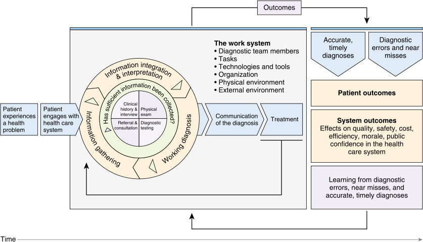
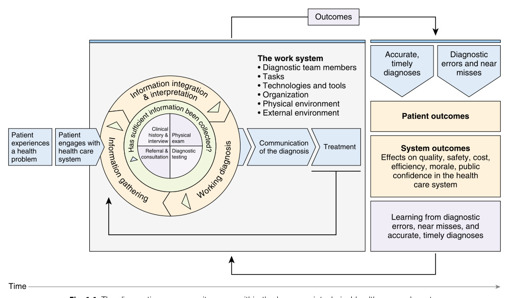
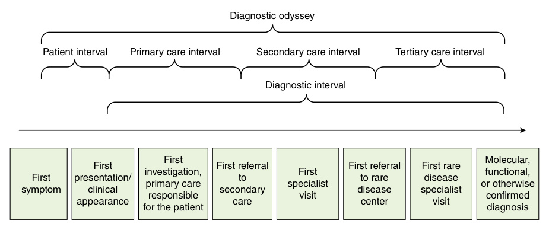

<!-- p.22 -->

## SECTION **I** 

#### Introductory Chapters 

1. Finding the Rare Among the Common: Diagnosis, Diagnostic Error, and When to Suspect a Rare Disease, 3 

2. Diagnostic Methods: Genomics, Omics, Biomarkers, Imaging, and Other Technologies, 13 

3. The Approach to Rare Diseases: From Local to Global, 41

<!-- p.23 -->

<!-- p.24 -->

# 1 

### Finding the Rare Among the Common Diagnosis, Diagnostic Error, and When to Suspect a Rare Disease 

**BRETT J. BORDINI, DONALD G. BASEL** 

The field of rare disorders is relatively nascent, having only formally organized and evolved over the last several decades, yet literary descriptions of rare disorders can be found across the globe dating back thousands of years. Over the last 100 to 200 years, advances in microbiology and environmental sciences improved the management of many acquired rare conditions, while only more recently have developments in genomic sciences and precision medicine led to better recognition, diagnosis, and treatment of rare heritable disorders. Much of this advancement in the care of rare heritable disorders has historically relied on the networking, organization, and advocacy of patients and families, as well as researchers and clinicians with interests in rare disorders. This grassroots approach has proven fruitful, leading to the development of broad national and international consortia dedicated to undiagnosed and rare diseases. Through the rare disease community, many unmet needs in diagnosis, disease-specific therapies, and broader societal support have been identified. 

There are more individuals with rare disorders across the globe than there are with many individual common disorders. Definitions of rarity vary throughout the world (see Chapter 3); in the United States, a disorder is considered rare if it affects fewer than 200,000 individuals. Collectively, more than 7,000 identified rare disorders affect nearly 6% of the population or up to 450 million individuals globally, with significant associated physical, emotional, social, and financial burdens. Up to 80% of rare diseases have or are presumed to have a genetic etiology; approximately half affect the pediatric population. These factors of heritability and oftentimes early onset compound to create significant and prolonged stressors across the lifespan. The economic impact of rare diseases is substantial, with annual direct and indirect medical expenditures estimated at approximately $8 trillion (USD) globally. The cost of rare disease diagnosis and care far exceed those for many common disorders; 

attaining a diagnosis and implementing specific treatment plans can lower these costs significantly. Despite these demonstrable costs and benefits, rare disorders have historically had far fewer resources allocated to their diagnosis and management. Over 95% of rare diseases lack specific disease-directed therapies; research for rare disorders has often required incentivization. 

_Diagnosis is essential to improving individual and broader societal outcomes for people affected by rare disorders._ Providing an accurate diagnosis permits rational treatment plans to be developed even in the absence of targeted therapies, as non-beneficial aspects of management can be eliminated, thus reducing the risk of iatrogenic harm and minimizing the amount of time invested in daily cares. Diagnosis informs reproductive counseling and prognostication, enrollment in clinical or research protocols, and connection with other individuals affected by the same or related disorders. Diagnosis can be challenging for rare and common disorders alike; there are unique challenges in diagnosing rare disorders. While some have pathognomonic presentations that allow for rapid diagnosis, most rare disorders—by virtue of infrequency, heterogeneity, subtlety, capacity to mimic more common disorders, or lack of established methods for diagnosis—are inherently more prone to _diagnostic error_ and are more likely to be affected by limitations in _diagnostic access_ . 

##### **Diagnosis and Diagnostic Error** 

Fundamental to the practice of medicine is diagnosis, the process of uncovering the cause of a patient’s health-related concerns. The diagnostic process is _iterative_ , typically proceeding stepwise from an undifferentiated symptom or concern to an established cause and appropriately tailored plan of care. Arriving at a diagnosis first begins with establishing the **history** of the patient’s primary concern and

<!-- p.25 -->

placing that concern in the context of the patient’s personal, family, social, and environmental histories to determine what internal or exogenous factors may be contributing. **Physical examination** then provides important phenotypic information; both the presence and absence of key findings inform the list of diagnoses under consideration (i.e., the differential diagnosis) and guide diagnostic testing strategies. The interpretation of the history, physical examination, and diagnostic testing results is best conceptualized not as a process of dichotomously ruling in or ruling out certain conditions, but rather as a method of determining the relative significance of each component in establishing the likelihood of a particular diagnosis. While this iterative approach to diagnosis is meant to ensure consistency and comprehensiveness, diagnosis is also _dynamic_ , wherein sudden changes in clinical status or the uncovering of new historical information may significantly alter the diagnostic formulation or the urgency of the evaluation. 

Diagnosis is also _collaborative_ , valuing input from not only the patient and primary clinician, but also from family, caregivers, community partners such as teachers who know the patient well, and all members of the healthcare team. This **team-based approach** to diagnosis incorporates diverse points of view and expands the collective knowledge base, often outperforming the diagnostic accuracy of individual experienced diagnosticians. Even when diagnostic evaluations are occurring asynchronously and in fragmented specialty care settings, open communication and close collaboration among disciplines minimize delays and redundancies in testing. 

Despite these historically well-established approaches to diagnosis, the process has the potential for error, in both rare and common disorders alike. **Diagnostic error** is _the failure to (a) establish an accurate and timely explanation of the patient’s health problem(s) or (b) communicate that explanation to the patient._ Diagnostic error can be defined from a variety of perspectives. The _type_ of error, for example, can consist of a missed, delayed, or wrong diagnosis. Many patients with rare disorders experience diagnostic error, especially from diagnostic delays. The _root causes_ of diagnostic error are diverse; they can be broadly categorized as _no-fault_ , wherein disorders present with atypical features or diagnosis is hindered secondary to a patient being unwilling or otherwise unable to participate in the evaluation; _systemsrelated_ , wherein organizational or technical factors such as the unavailability of a particular subspecialty service or testing modality obscure diagnosis; or _cognitive_ , wherein faulty clinician knowledge, data gathering, or medical reasoning produces errors. The majority of diagnostic errors are solely or at least partially attributable to cognitive errors on the part of diagnosticians; most cognitive errors are related to the ways in which various forms of cognitive bias can be introduced into diagnostic reasoning. 

The individual diagnosing clinician, when presented with patient concerns, typically engages one of two cognitive processing systems to assess available information and arrive at a diagnosis, either a **system 1 process** that is rapid, 

intuitive, and based in pattern recognition and rules of thumb termed _heuristics_ , or a more deliberate and analytical **system 2 process** that is based in hypothesis generation and counterfactual reasoning. This **dual process theory** suggests that most clinicians, under most circumstances, employ a system 1 process with relatively high diagnostic accuracy for most common medical concerns. However, these same system 1 processes are prone to fail when patient presentations are complex, multisystem, slowly evolving, or undifferentiated, instead becoming a form of **cognitive bias** that can lead to diagnostic error. 

Cognitive biases impacting medical reasoning can be classified as _heuristic failure_ , _errors of attribution_ , or _contextrelated biases._ With **heuristic failure** , the same rules of thumb and quick pattern recognition that clinicians employ to arrive at a diagnosis fail to account for the entire scope of patient information or fail to adapt to new information as it becomes available and instead bias the clarity of medical reasoning. While heuristics can fail in a variety of ways (Table 1.1), several are particularly relevant to individuals with rare diseases. **Anchoring** occurs when a clinician locks into a diagnosis based on the initial presenting features, failing to adjust diagnostic impressions when new clinical information presents itself. **Confirmation bias** occurs when clinicians seek out or respond only to evidence that affirms diagnostic impressions, to the neglect of contradictory evidence. **Diagnostic momentum** , wherein diagnostic labels are copied forward over time without being questioned, despite those labels oftentimes being outdated, incomplete, or even inaccurate, can be a significant source of cognitive bias for patients with rare disorders, especially when electronic medical records allow the perpetuation of diagnostic labels to be a more passive process. 

Cognitive bias related to **errors of attribution** occurs when perceived characteristics of patients, family members, or members of the medical evaluation team are given undue weight in the diagnostic formulation, or when the emotional state of the clinician influences cognition (Table 1.2). Important examples in the evaluation of rare disorders include the **appeal to authority** , wherein senior, supervising, or otherwise expert recommendations are treated as authoritative, independent of whether evidence supports those recommendations. Statements such as “I’ve never seen this disease present in that way,” when coming from a senior, experienced clinician, can be given undue emphasis and remove certain diagnoses from consideration. **Normalcy biases** may occur when clinicians de-emphasize the importance of certain results by labeling them as “slightly” or “mildly” abnormal, rather than treating them as objective data points to be interpreted within the context of the patient’s physiology and pathophysiology, particularly if influenced by a conscious or subconscious desire for a patient to have a benign explanation for abnormal findings. Patients with a history of mental health concerns, or with symptoms that do not immediately suggest organic pathology, can be labeled as having symptoms secondary to a functional diagnosis when organic pathology may be the sole cause.

<!-- p.26 -->

#### **TABLE 1.1** Cognitive Bias es Related to Heuristic Failure

|Bias|Definition|
|---|---|
|Anchoring|Locking into a diagnosis based on initial presenting features, failing to adjust diagnostic impressions when new information becomes available.|
|Confirmation bias|Looking for and accepting only evidence that confirms a diagnostic impression, rejecting or not seeking contradictory evidence.|
|Diagnostic momentum|Perpetuating a diagnostic label over time, usually by multiple providers both within and across health care systems, despite the label being incomplete or inaccurate.|
|Premature closure|Accepting the first plausible diagnosis prior to obtaining confirmatory evidence or considering all available evidence.|
|Unpacking principle|Failing to explore primary evidence or data in its entirety and subsequently failing to uncover important facts or findings, such as accepting a biopsy report or imaging study report without reviewing the actual specimen or image.|
|From Bordini BJ, Stephany jpeds.2017.02.065.|A, Kliegman R. Overcoming Diagnostic Errors in Medical Practice._J Pediatr._2017;185:19-25.e1.https://doi.org/10.1016/j.|

#### **TABLE 1.2** Cognitive Bia ses Related to Errors of Attribution

|Bias|Definition|
|---|---|
|Appeal to authority|Deferring to authoritative recommendations from senior, supervising, or “expert” clinicians, independent of the evidentiary support for such recommendations.|
|Countertransference|Being influenced by positive or negative subjective feelings toward a specific patient.|
|Normalcy bias|Minimizing or overemphasizing the significance of a finding or result, often based on subjective feelings about a patient or a desired outcome; the use of “slightly” to describe abnormal results.|
|Mental health bias|Maintaining biases about people with presumed mental health concerns; assuming that symptoms in individuals with a history of mental health concerns are due to a functional disorder when organic pathology may be the sole cause|
|From Bordini BJ, Stephany jpeds.2017.02.065.|A, Kliegman R. Overcoming Diagnostic Errors in Medical Practice._J Pediatr._2017;185:19-25.e1.https://doi.org/10.1016/j.|

In **context-related biases** , the setting of the diagnostic evaluation influences how clinicians perceive and process the information used in medical reasoning (Table 1.3). At the level of the individual clinician, context can introduce bias by consciously or subconsciously causing clinicians to de-emphasize relevant information and amplify impertinent information. Important examples of context-related biases include the **availability bias** , in which comparisons to other recent patients influence the diagnostic reasoning for the current patient. For example, an infant in respiratory distress secondary to decompensated heart failure in the setting of unrecognized congenital heart disease may be erroneously diagnosed with bronchiolitis when presenting to the emergency department in the middle of a busy viral season. The **framing effect** introduces bias when the setting or manner in which a patient is presented influences how information is perceived. A patient with abdominal pain may have different differential diagnoses generated for their pain depending on whether they are evaluated in an 

emergency department, a primary care office, a gynecology clinic, or a gastroenterology clinic. Individuals with rare diseases who are evaluated in fragmented specialty settings are often susceptible to their clinicians **thinking in silo** , in which concerns are considered only within the spectrum of pathophysiology relevant to that specialty. Under these circumstances, no one individual clinician appreciates the comprehensive sum of the patient’s symptoms and findings, and a unifying diagnosis is not considered. 

For individuals with rare diseases who present acutely or critically ill, efforts to stabilize abnormal vital signs or laboratory parameters may succeed despite the lack of an accurate diagnosis, leading to an **outcome bias** and **hindsight bias** in which clinicians overestimate the efficacy of their diagnostic reasoning and therapeutic interventions. In these circumstances, the underlying illness has neither been identified nor specifically treated and the possibility of ongoing disease is no longer appreciated. Common examples include the failure to consider or comprehensively evaluate

<!-- p.27 -->

###### **TABLE 1.3 Cognitive Biases Related to Errors of Context** 

|Bias|Definition|
|---|---|
|Availability bias|Basing decisions on the most recent patient with similar symptoms, preferentially recalling recent and more common diseases.|
|Base-rate neglect|Over-or underestimating the prevalence of a disease, typically overestimating the prevalence of common diseases and underestimating the prevalence of rare diseases.|
|Framing effect|Being influenced by how or by whom a problem is described, or by the setting in which the evaluation takes place.|
|Frequency bias|Believing that common things happen commonly and are usually benign in general practice.|
|Hindsight bias|Reinforcing diagnostic errors once a diagnosis is discovered in spite of these errors. May lead to a clinician overestimating the efficacy of his or her clinical reasoning and may reinforce ineffective techniques.|
|Posterior probability error|Considering the likelihood of a particular diagnosis in light of a patient’s prior or chronic illnesses. New headaches in a patient with a history of migraines may in fact be a tumor.|
|Sutton’s slip|Ignoring alternate explanations for “obvious” diagnoses (Sutton’s law is that one should first consider the obvious).|
|Thinking in silo|Restricting diagnostic considerations to a particular specialty or organ system. Each discipline has a set of diseases within its comfort zone, which reduces diagnostic flexibility or team-based communication.|
|Zebra retreat|Lacking conviction to pursue rare disorders even when suggested by evidence.|

From Bordini BJ, Stephany A, Kliegman R. Overcoming Diagnostic Errors in Medical Practice. _J Pediatr._ 2017;185:19-25.e1. https://doi.org/10.1016/j. jpeds.2017.02.065. 

for secondary causes of hypertension or chronic headache, leading disorders such as pheochromocytoma or a ruptured arachnoid cyst not to be diagnosed in a timely fashion. Furthermore, patients may improve in spite of medical intervention and not because of it, leading to the risk of clinicians reinforcing erroneous reasoning under the assumption that it was correct and directly correlated with clinical improvement. 

Further compounding these diagnostic challenges are the dynamically interacting components of the **sociotechnical systems** in which clinicians diagnose and the ways in which they can confound diagnosis. The individual clinician does not operate in isolation but rather is one of many people in the healthcare environment _work system_ interacting with a variety of tools and technologies in a rapidly changing physical space to execute patient care-related tasks, including but not limited to diagnosis. External variables—like patient volume, ambient noise, the requirement to don and doff personal protective equipment, and the relative usability of electronic health record interfaces, for example—act together with internal variables like sleep deprivation, hunger, and divided attention to produce an aggregate cognitive burden that can either positively or negatively affect the clarity and efficacy of diagnostic reasoning such that the same clinical information presented to the same clinician under different circumstances can result in vastly divergent diagnostic impressions (Fig. 1.1). 

To address these diagnostic reasoning challenges, several individual and systems-focused solutions exist. Efforts have 

included incorporating the cognitive psychology of diagnosis into medical education to drive greater awareness and use of system 2 cognitive processes; implementing cognitive forcing functions such as **diagnostic time-outs** to check for sources of bias in the diagnostic formulation (Table 1.4); organizing healthcare teams to promote more collaborative approaches to diagnosis; structuring healthcare systems to minimize disruptive environmental and technical factors; building decision support tools into electronic health records; and using human factors-based approaches that optimize the diverse sociotechnical elements of the healthcare environment. Despite these aids, diagnostic errors are frequent, impacting up to 30% of adult intensive care unit deaths and up to 20% of pediatric intensive care unit deaths, and resulting in significant morbidity and mortality across the entire healthcare spectrum. Rare disorders present additional challenges to diagnosis by virtue of their rarity. 

##### **Rare Diseases and the Diagnostic Odyssey** 

Rare disorders face unique barriers to timely and accurate diagnosis, including limited clinician recognition and knowledge. Certain rare disease phenotypes are well characterized and are rapidly recognized when presenting with typical manifestations; others are readily diagnosed based on newborn screening results or an established family history. Depending on the disorder, however, features may vary widely due to factors such as variable expression or may evolve over time in ways that confound diagnosis.

<!-- p.28 -->

- **Fig. 1.1** The diagnostic process as it occurs within the larger sociotechnical healthcare work system. The patient and diagnosing clinician exist as part of a larger system containing other members of the diagnostic team, all interacting with various technologies and tools in a dynamically changing environment working toward completion of the common task of diagnosis. Changes in any of these variables can positively or negatively impact the outcome. (Balogh, E.P., Miller, B.T., Ball, J.R., 2015. _Improving Diagnosis in Health Care_ . National Academies Press, Washington, DC.) 

###### **TABLE Examples of Diagnostic Time-Out Checklists for (A) General Medical Practice and (B) Rare Disease 1.4 Evaluations** 

###### **TABLE** 

###### **A. General Medical Diagnostic Time-Out Checklist** 

- Name the clinical concern or diagnostic dilemma 

- Remove diagnostic labels and instead list out signs and symptoms 

- Ask—“Do we currently have a leading diagnosis?” If so, 

   - What clinical data cannot be explained with the provisional diagnosis? 

   - What are the “cannot miss” or “worst case scenario” diagnoses? 

- Broaden the differential using an anatomic or age-based approach 

- Decide on next steps: 

   - Obtain further history and repeat physical exam 

   - Review labs and actual images (not just the reports) 

   - Discuss with other team members (subspecialists, consultants, nurses) and family 

   - Obtain further labs and imaging 

###### **B. Rare Disease Evaluation Diagnostic Time-Out Checklist** 

1. Have we gathered sufficient information upon which to base our analysis? 

2. Have we unpacked that information and processed it in an objective and bias-free manner? 

3. What is the ultimate phenotype suggested by the patient’s complaints and findings? 

4. Does that phenotype suggest one underlying disease process or multiple disease processes occurring simultaneously? 

5. Have we generated plausible hypotheses regarding the pathophysiology of these complaints and findings? 

6. Have we implemented a directed diagnostic testing strategy using sufficiently sensitive and specific diagnostic assays that will allow us to discern among these diagnostic hypotheses in a Bayesian probabilistic fashion, as opposed to a dichotomous, “rule in, rule out” fashion? 

7. Have we checked for additional sources of bias? 

8. Have we considered alternate diagnoses sufficiently, and in particular, “do-not-miss” diagnoses? 

From Yale S, Cohen S, Bordini BJ. Diagnostic time-outs to improve diagnosis. _Crit Care Clin._ 2022;38(2):185-194. And from Bordini BJ, Kliegman RM, Basel D, Nocton J. Undiagnosed and rare diseases in perinatal medicine: lessons in context and cognitive diagnostic error. _Clin Perinatol._ 2020;47(1):1-14.

<!-- p.29 -->

In these instances, this **ascertainment bias** arises when an individual’s findings fall outside the spectrum of features that were present in the patient cohorts upon which disease descriptions were initially based, leading that individual’s findings to appear inconsistent with the supposedly established phenotype. Other rare disorders remain undiagnosed for extended periods of time, though not by virtue of a lack of clinician familiarity with symptoms, but rather because the disease has yet to be identified. In other instances, symptoms closely mimic more common disorders, obscuring diagnosis. Not all patients with unexplained symptoms have a rare disease. Some have atypical manifestations of a common disorder, while others may have more than one underlying common disease process occurring simultaneously, with the resultant constellation of symptoms confounding diagnosis. 

Regardless of how symptoms manifest, one theme is common: individuals with rare disorders often find themselves on a **diagnostic odyssey** , the journey of developing symptoms, seeking evaluation, experiencing symptom evolution, and seeking further evaluation, all in the attempt to obtain an accurate diagnosis. The diagnostic odyssey can last months, years, or even decades, and can be thought of as occurring in several distinct phases (Fig. 1.2). First, as symptoms develop, individuals or their families start to notice the findings that will ultimately be recognized as manifestations of the underlying disease. When those symptoms persist, most individuals first seek evaluation from their primary care provider, where routine testing may fail to yield conclusive evidence of an underlying disorder, or where a diagnosis may be established. If evaluation with the primary care provider fails to reveal a diagnosis, individuals are typically referred to a specialist based on the involved organ system suggested by the symptoms. For some, specialty evaluation results in a diagnosis, and the odyssey ends. For others, referrals to additional specialists—some of whom may be explicitly focused on evaluating for rare disorders or may have deep knowledge or experience diagnosing and treating rare conditions without necessarily 

being considered rare disease experts—are required, but there can be many delays, detours, and disruptions along the path to diagnosis, and despite best intentions, individuals may remain undiagnosed after months or even years of evaluation. 

In addition to limitations in clinician recognition and knowledge of rare diseases, as well as the confounding effects of diagnostic error, the diagnostic odyssey may be prolonged due to impaired access to diagnosis. **Diagnostic access** is the ability to be evaluated in a healthcare environment with the requisite knowledge, experience, and resources capable of producing a timely, accurate, and satisfactory explanation for patient signs and symptoms. Impaired diagnostic access can broadly be divided into three categories. First, some individuals may experience impaired diagnostic access because they remain in **diagnostic stasis** , engaging in a plan of symptom management that may result in the ability to function day-to-day, but without a specific diagnosis and properly tailored management plan. These individuals may persist without a satisfactory diagnosis because their symptomatic management plan is sufficient to allow them to continue living their daily lives, despite ultimately being suboptimal or improperly matched to their true disease process. These individuals remain within the primary and specialty care intervals of the diagnostic odyssey and fail to be referred for further evaluation of a possible rare disease. _These patients have a rare disease, but do not necessarily know it._ 

In contrast, there are patients who know they are on a diagnostic odyssey, who are referred for rare disease evaluation, but who still experience impaired diagnostic access because they are not accepted for, are unable to participate in, or are in resource-limited settings that preclude the evaluation. Some may be unable to do so because their health, personal circumstances, or other social determinants of health limit the ability to be evaluated. Some may not have access to rare disease specialists in their geographic region. Others may not meet program selection criteria. Fortunately, many larger-scale rare disease evaluation 

Diagnostic odyssey 

|Patie First symptom|nt interval P First presentation/ clinical appearance|rimary care interv First investigation, primary care responsible for the patient|al Seco Dia First referral to secondary care|ndary care int gnostic interv First specialist visit|erval Ter al First referral to rare disease center|tiary care inte First rare disease specialist visit|rval Molecular, functional, or otherwise confirmed diagnosis|
|---|---|---|---|---|---|---|---|

**Fig. 1.2** The diagnostic odyssey, from first appearance of symptoms to confirmed diagnosis.  (Adapted from Soomers V, Husson O, Young R, Desar I, Van der Graaf W. The sarcoma diagnostic interval: a systematic review on length, contributing factors and patient outcomes. _ESMO Open_ . 2020 Feb;5[1]:e000592. 

doi: 10.1136/esmoopen-2019-000592. PMID: 32079621; PMCID: PMC7046415.)

<!-- p.30 -->

programs provide assistance with travel, lodging, and evaluation costs to ameliorate these barriers (see Chapter 3). Furthermore, many rare disease programs have developed virtual referral networks or have increased their capacity to engage in distance-based consultation. Nonetheless, many patients on a diagnostic odyssey are still unable to satisfactorily obtain timely or comprehensive evaluation. 

There are patients with rare or undiagnosed diseases who present acutely or critically ill and require emergent care due to physiological instability. Depending on the severity of their illness and the healthcare setting in which they are being treated, they may not have adequate access to a team of expert diagnosticians that can mobilize rapidly around them, where they are, and evaluate them directly at the bedside. The lack of such resources presents an additional point of impaired diagnostic access. 

Adequate diagnostic access consists of the relative availability of disease-specific knowledge to patients and clinicians, as well as the affordability or availability of advanced diagnostic modalities. However, access to information and advanced diagnostic technologies alone is not enough. With increasing parity in terms of access to diagnostic technology, many primary care or specialty clinicians can order advanced diagnostic testing for their patients when facing a diagnostic dilemma. Patients often present for evaluation to a rare disease specialist already having obtained at least one or more gene panels, if not having genetic sequencing already completed, and yet persisting without a diagnosis. Next-generation molecular genetic technologies, if not paired with high-quality phenotypic data, may not only fail to attain diagnosis, but can also confound the diagnostic formulation. As such, the final critical component of diagnostic access is the availability of a coordinated and collaborative team of clinicians that can recognize the possibility of a rare disease and provide high-quality and refined phenotyping to inform the ordering and interpretation of advanced diagnostic modalities such as genomic sequencing. Despite best efforts with access to advanced diagnostics, approximately two-thirds of patients remain undiagnosed because there are still a number of disease states in which the molecular etiology is unknown and there are insufficient biomarkers to assist in making a clinical diagnosis. 

##### **When to Suspect a Rare Disease** 

Medical education is structured to provide clinicians with the ability to readily recognize the key historical and physical features of common disorders and to seek common explanations for patient concerns. While rare disorders are often included in discussions of symptomatology and pathophysiology, such discussions usually highlight the relative infrequency with which rare disorders are encountered, an approach exemplified by the medical education aphorism “ _When you hear hoofbeats, think of horses, not zebras_ ,” wherein horses represent more commonly occurring conditions and zebras represent rare disorders. Medical 

trainees are frequently taught to synthesize differential diagnoses through some form of mnemonic which nearly invariably contains an _other_ category of less commonly encountered conditions, an approach that risks implicitly de-emphasizing their consideration. Even though rare diseases are seldom the primary diagnosis, they _should_ be considered when elements of the story do not fit the narrative of the presumed diagnosis or when patients fail to respond to therapy in an expected fashion. 

Suspicion of a rare disorder may arise at any time. Some rare disorders do present with pathognomonic historical, physical, laboratory, or imaging findings that allow for rapid diagnosis. In other circumstances, an established family history lends clarity to testing and management strategies for other family members. Other times, however, rare disorders present elusively or mimic more common disorders. The challenge lies in developing a properly calibrated sense of when patient features fall outside the spectrum of common disorders and instead suggest the possibility of a rare disease and the need to engage in more deliberate analytical diagnostic strategies. 

There are several critical windows across the lifespan during which rare disorders may be more likely to present. Prenatal genetic testing or ultrasounds may reveal concerning findings; newborn screening results may return abnormal; early growth or developmental delays may become evident; previously acquired developmental skills may regress; childhood illnesses may be abnormally prolonged, more severe, or more frequent; and developmental hormonal changes, such as puberty or menopause, may trigger clinical suspicions. Other times, the onset of a rare disease may be sporadic, sudden, or severe. Individuals who present with acute-onset, unexplained critical illness, or those who have recurrent episodes of significant biochemical or neurological abnormalities without clear provoking triggers readily warrant consideration of a rare disease. Alternately, the progression of a rare disease may be subtle and slow; for example, neurological regression in the setting of a presumably static developmental disorder may suggest a progressive condition that was previously mimicking a diagnosis of an entity such as cerebral palsy. 

##### **Clinical Approaches to Rare Disease Diagnosis** 

Given the wide heterogeneity of rare disorders, a single, unified, prescriptive approach to their diagnosis is not possible. Instead, there are several critical factors that when optimized can increase the likelihood that a rare diagnosis will be considered and evaluated in a timely fashion. First among these factors is _recognition_ . While medical education and rare disease advocacy efforts can increase awareness of specific disorders or classes of rare disease, with over 7,000 identified individual rare disorders, it is infeasible for any one clinician or team of clinicians to develop and maintain a comprehensive knowledge base of all rare disorders. Rather, these efforts of increasing awareness are best paired

<!-- p.31 -->

with efforts designed to enhance **diagnostic calibration** , the sense of concordance between diagnostic confidence and diagnostic accuracy. A well-calibrated diagnostician is more likely to recognize when patient features do not align with a presumptive diagnosis and pursue alternate diagnoses and more analytic diagnostic reasoning. The same approaches designed to mitigate the risks of cognitive bias and cognitive diagnostic error, when applied to individual clinicians or evaluation teams, can enhance diagnostic calibration. Beyond the level of the individual clinician or evaluation team, rare disease recognition can be optimized via the incorporation of data sciences into clinical enterprises. Artificial intelligence paired with natural language processing in electronic health records can produce phenotype candidates based on selection and filtering criteria designed to recognize features that suggest the possibility of a rare disease. 

Beyond recognition, rare disease diagnosis is optimized when referrals are streamlined and inequities in access are addressed. Many individuals with rare diseases experience diagnostic delays and impaired diagnostic access due to insufficient rare disease-focused workforce resources prolonging the time to evaluation. Incentivizing and promoting rare disease specialization, while providing enhanced support for primary care providers to recognize and refer patients with possible rare diseases, can shorten these delays. Beyond the scope of diagnostic access lie the more universal topics of healthcare access and health disparities. Increasing representation of community stakeholders in discussions of rare disease resource allocation and advocating for rare disease efforts in broader policymaking decisions can more precisely match rare disease care to the communities that are underserved. The development of local rare disease evaluation teams within community-based and academic medical centers, along with the creation of regional, national, and international collaborative rare disease consortia, can mitigate these disparities further (see Chapter 3). 

The next factor in optimizing rare disease diagnosis is ensuring that rare disease evaluations result in the generation of high-quality phenotypes. As access to advanced diagnostic modalities increases, improved diagnostic yields will become increasingly dependent on **high-quality phenotyping** , wherein a detailed list of objective physical and laboratory findings, semi-objective symptoms and findings, and subjective symptoms is generated and paired with data analysis tools that generate probability-matched descriptive terms using standardized systems such as the **human phenotype ontology** . These phenotypes can be used to generate not only a differential diagnosis, but also a **differential pathophysiology,** the list of potential underlying pathophysiological mechanisms that link seemingly unrelated findings together in a unifying diagnosis. High-quality phenotypes can also be matched with quantifiable laboratory data and genomic data to generate decision support tools which aim to limit bias and diagnostic error, as well as reduce the time to accurate diagnosis, thereby reducing the odyssey for patients impacted by a rare disease diagnosis. 

Rare disease diagnosis is optimized when high-quality phenotypic data are paired with the appropriate diagnostic modalities. Next-generation sequencing-based approaches have diagnostic yields no greater than 50% and are more commonly around 30%. While phenotypic refinement and periodic sequencing reanalysis improve the diagnostic yield, many individuals remain undiagnosed after sequencing and may benefit from more advanced diagnostic modalities such as long-read sequencing, transcriptomics, metabolomics, methylation studies, pan-genome referencing, matchmaking, functional studies (see Chapter 2), as well as the consideration of non-genetic disease. 

##### **Bibliography** 

- Adams DR, van Karnebeek CDM, Agullo SB, et al. Addressing diagnostic gaps and priorities of the global rare diseases community: recommendations from the IRDiRC Diagnostics Scientific Committee. _Eur J Med Genet_ . 2024;70:104951. 

- Andreu P, Karam J, Child C, Chiesi G, Cioffi G. _The Burden of Rare Diseases: An Economic Evaluation_ . 2022. https://chiesirarediseases. com/assets/pdf/chiesiglobalrarediseases.whitepaper-feb.-2022_ production-proof.pdf 

- Auvin S, Irwin J, Abi-Aad P, Battersby A. The problem of rarity: estimation of prevalence in rare disease. _Value Health_ . 2018;21(5): 501-507. 

- Batshaw ML, Groft SC, Krischer JP. Research into rare diseases of childhood. _JAMA_ . 2014;311(17):1729-1730. 

- Bauskis A, Strange C, Molster C, Fisher C. The diagnostic odyssey: insights from parents of children living with an undiagnosed condition. _Orphanet J Rare Dis_ . 2022;17:233. 

- Baynam G, Walters M, Claes P, et al. Phenotyping: targeting genotype’s rich cousin for diagnosis. _J Paediatr Child Health_ . 2015; 51(4):381-386. 

- Benito-Lozano J, Arias-Merino G, Gómez-Martínez M, et al. Diagnostic process in rare diseases: determinants associated with diagnostic delay. _Int J Environ Res Public Health_ . 2022;19(11):6456. 

- Black N, Martineau F, Manacorda T. _Diagnostic Odyssey for Rare Diseases: Exploration of Potential Indicators_ . Policy Innovation Research Unit (PIRU); 2015. Accessed March 9, 2020. http:// www.piru.ac.uk/assets/files/Rare%20diseases 

- Bordini BJ. Undiagnosed and rare diseases in critical care: the role of diagnostic access. _Crit Care Clin_ . 2022;38(2):159-171. 

- Boycott KM, Rath A, Chong JX, et al. International cooperation to enable the diagnosis of all rare genetic diseases. _Am J Hum Genet_ . 2017;100(5):695-705. 

- Boycott KM, Vanstone MR, Bulman DE, MacKenzie AE. Raredisease genetics in the era of next-generation sequencing: discovery to translation. _Nat Rev Genet_ . 2013;14(10):681-691. 

- Carayon P, Wooldridge A, Hoonakker P, Hundt AS, Kelly MM. SEIPS 3.0: Human-centered design of the patient journey for patient safety. _Appl Ergon_ . 2020;84:103033. 

- Cassam Q. Diagnostic error, overconfidence and self-knowledge. _Palgrave Commun_ . 2017;3:17025. 

- Committee on Diagnostic Error in Health Care, Board on Health Care Services, Institute of Medicine, The National Academies of Sciences, Engineering, and Medicine, Balogh EP, Miller BT, Ball JR, eds. _Improving Diagnosis in Health Care_ . National Academies Press (US); 2015. Accessed September 22, 2020. http://www.ncbi. nlm.nih.gov/books/NBK338596/

<!-- p.32 -->

- Cope H, Spillmann R, Rosenfeld JA, et al. Missed diagnoses: clinically relevant lessons learned through medical mysteries solved by the Undiagnosed Diseases Network. _Mol Genet Genomic Med_ . 2020;8(10):e1397. 

- Dooms MM. Rare diseases and orphan drugs: 500 years ago. _Orphanet J Rare Dis_ . 2015;10(1):161. 

- EURORDIS. _Survey of the Delay in Diagnosis for 8 Rare Diseases in Europe (EurordisCare2)_ . EURORDIS; 2007. 

- Ferreira CR. The burden of rare diseases. _Am J Med Genet_ . 2019; 179(6):885-892. 

- Fraiman YS, Wojcik MH. The influence of social determinants of health on the genetic diagnostic odyssey: who remains undiagnosed, why, and to what effect? _Pediatr Res_ . 2021;89(2):295-300. 

- Fuchs K, Atabiev BCh, Witzmann F, Gresky J. Towards a definition of Ancient Rare Diseases (ARD): Presenting a complex case of probable Legg-Calvé-Perthes Disease from the North Caucasian Bronze Age (2200-1650 cal BCE). _Orphanet J Rare Dis_ . 2021;32:61-73. 

- Gahl WA, Markello TC, Toro C, et al. The National Institutes of Health Undiagnosed Diseases Program: insights into rare diseases. _Genet Med_ . 2012;14(1):51-59. 

- Gahl WA, Tifft CJ. The NIH Undiagnosed Diseases Program: lessons learned. _JAMA_ . 2011;305(18):1904-1905. 

- Gainotti S, Mascalzoni D, Bros-Facer V, et al. Meeting patients’ right to the correct diagnosis: ongoing international initiatives on undiagnosed rare diseases and ethical and social issues. _Int J Environ Res Public Health_ . 2018;15(10):2072. 

- Haendel M, Vasilevsky N, Unni D, et al. How many rare diseases are there? _Nat Rev Drug Discov_ . 2020;19(2):77-78. 

- Hennekam RCM, Biesecker LG. Next-generation sequencing demands next-generation phenotyping. _Hum Mutat_ . 2012;33(5): 884-886. 

- Hukeľová Z, Krošláková M. Klippel-Feil syndrome cases from Slovakia. _Int J Paleopathol_ . 2021;33:188-195. 

- Jacobsen JOB, Kelly C, Cipriani V, et al. Phenotype-driven approaches to enhance variant prioritization and diagnosis of rare disease. _Hum Mutat_ . 2022;43(8):1071-1081. 

- Kaufmann P, Pariser AR, Austin C. From scientific discovery to treatments for rare diseases—the view from the National Center for Advancing Translational Sciences—Office of Rare Diseases Research. _Orphanet J Rare Dis_ . 2018;13(1):196. 

- LeBlanc K, Kelley EG, Nagy A, et al. Rare disease patient matchmaking: development and outcomes of an internet case-finding strategy in the Undiagnosed Diseases Network. _Orphanet J Rare Dis_ . 2021;16(1):210. 

- Macnamara EF, D’Souza P, Tifft CJ. The undiagnosed diseases program: approach to diagnosis. _Transl Sci Rare Dis_ . 2020;4(3-4): 179-188. 

- Marwaha S, Knowles JW, Ashley EA. A guide for the diagnosis of rare and undiagnosed disease: beyond the exome. _Genome Med_ . 2022;14(1):23. 

- Miller D. The diagnostic odyssey: our family’s story. _Am J Hum Genet_ . 2021;108(2):217-218. 

- Nguengang Wakap S, Lambert DM, Olry A, et al. Estimating cumulative point prevalence of rare diseases: analysis of the Orphanet database. _Eur J Hum Genet_ . 2020;28(2):165-173. 

- Omorodion J, Dowsett L, Clark R, et al. Delayed diagnosis and racial bias in children with genetic conditions. _Am J Med Genet A_ . 2022;188(4):1118-1123. 

- P. Fishler K, Euteneuer JC, Brunelli L. Ethical considerations for equitable access to genomic sequencing for critically ill neonates in the United States. _Int J Neonatal Screen_ . 2022;8(1):22. 

- Palau F. _Enfermedades Raras: Ciencia y Realidad de La Rareza En Medicina_ . Catarata; 2020. 

- Report: Economic Burden of Rare Diseases Is 10 Times Higher Than Mass Market Diseases. AJMC; 2022. Accessed May 22, 2023. https://www.ajmc.com/view/report-economic-burden-of-rarediseases-is-10-times-higher-than-mass-market-diseases 

- Richards J, Korgenski EK, Srivastava R, Bonkowsky JL. Costs of the diagnostic odyssey in children with inherited leukodystrophies. _Neurology_ . 2015;85(13):1167-1170. 

- Richter T, Nestler-Parr S, Babela R, et al. Rare disease terminology and definitions—A systematic global review: report of the ISPOR Rare Disease Special Interest Group. _Value Health_ . 2015;18(6): 906-914. 

- Sawyer SL, Hartley T, Dyment DA, et al. Utility of whole-exome sequencing for those near the end of the diagnostic odyssey: time to address gaps in care. _Clin Genet_ . 2016;89(3):275-284. 

- Schoch K, Esteves C, Bican A, et al. Clinical sites of the Undiagnosed Diseases Network: unique contributions to genomic medicine and science. _Genet Med_ . 2021;23(2):259-271. 

- Splinter K, Adams DR, Bacino CA, et al. Effect of genetic diagnosis on patients with previously undiagnosed disease. _N Engl J Med_ . 2018;379(22):2131-2139. 

- Thompson R, Papakonstantinou Ntalis A, Beltran S, et al. Increasing phenotypic annotation improves the diagnostic rate of exome sequencing in a rare neuromuscular disorder. _Hum Mutat_ . 2019;40(10):1797-1812. 

- Titelbaum AR, Fresh S, McNeil BE, Ibarra Asencios B. Three cases of brachydactyly type E from two commingled tombs at the Late Intermediate period—Late Horizon site of Marcajirca, Ancash, Peru. _Int J Paleopathol_ . 2021;33:146-157. 

- Undiagnosed Diseases Network (UDN). Genome.gov. September 14, 2022. Accessed May 25, 2023. https://www.genome.gov/ Funded-Programs-Projects/Undiagnosed-Diseases-Network 

- Wu AC, McMahon P, Lu C. Ending the Diagnostic Odyssey: is whole genome sequencing the answer? _JAMA Pediatr_ . 2020;174(9): 821-822. 

- Yang G, Cintina I, Pariser A, Oehrlein E, Sullivan J, Kennedy A. The national economic burden of rare disease in the United States in 2019. _Orphanet J Rare Dis_ . 2022;17(1):163. 

- Zurynski Y, Deverell M, Dalkeith T, et al. Australian children living with rare diseases: experiences of diagnosis and perceived consequences of diagnostic delays. _Orphanet J Rare Dis_ . 2017;12:68.

<!-- p.33 -->
