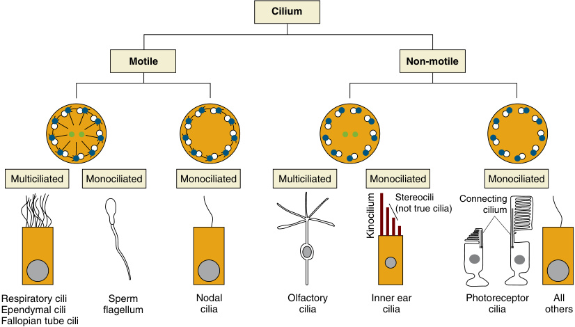
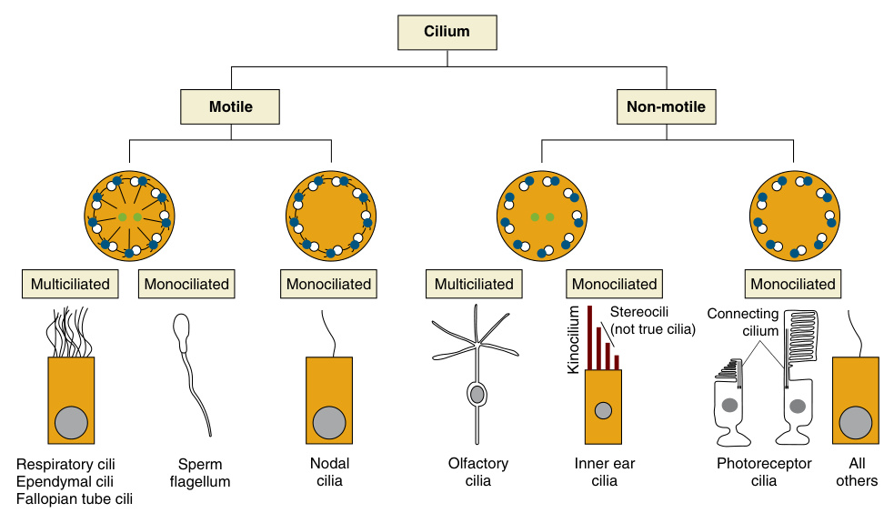
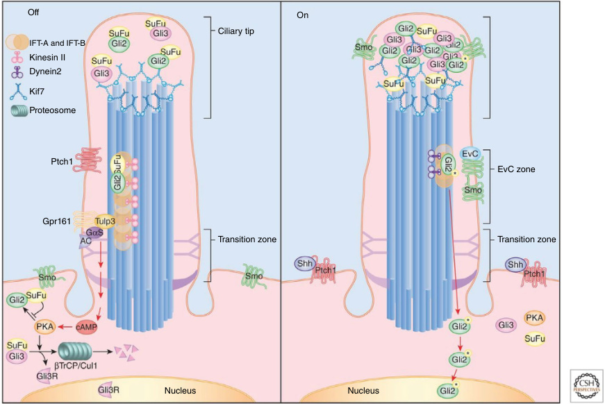
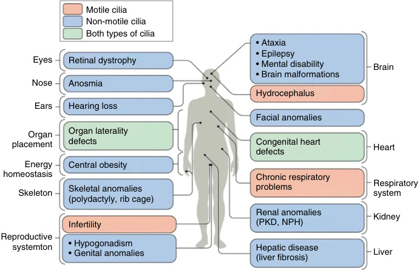

<!-- p.112 -->

# 6 Ciliary Signaling and Dysmorphology 

**FOWZAN S. ALKURAYA** 

Cilia are antenna-like microtubule-based organelles consisting of an axoneme core surrounded by a modified membrane (ciliary membrane) and a large number of proteins that mediate numerous developmental and physiological functions. Some cilia are motile (e.g., sperm flagella and airway cilia), while others lack motility as seen in nearly all non-dividing cells of the body, which gives rise to the commonly used classification of “motile cilia” vs. “primary cilia” (Fig. 6.1). The number of cilia per cell is another classification that defines multiciliated (e.g., ependymal cells), and monociliated cells (e.g., renal tubular cells). The basic structure of the axoneme is also used to classify cilia as 9+2 vs. 9+0, depending on the presence or absence, respectively, of a central pair of microtubules in the axoneme. The same cell type can harbor different types of cilia depending on the _developmental_ stage; respiratory epithelial cells feature primary cilia during early development, which are replaced by motile cilia upon maturation. Furthermore, the embryonically motile cilia of the choroid and olfactory epithelium assume sensory functions soon after birth. 

The cilium forms as a microtubular extension from the postmitotic centrosome that forms the basal body. Some of these microtubules terminate within the transition zone (TZ), while others continue to elongate as nine peripheral doublets that form the axoneme as well as a central pair in the case of 9+2 cilia. In motile cilia, the nine doublets associate with motor proteins known as dyneins. TZ functions as the cilium gatekeeper and features two major complexes: the **Meckel-Gruber syndrome (MKS)** (comprising MKS1, TMEM67, TMEM216, B9D1, B9D2, CEP290, and TCTN1-3) and **nephronophthisis (NPHP)** (comprising NPHP1, NPHP4, NPHP8, and NPHP2), disruption of which leads to major ciliary defects characterized by misrouting of non-ciliary proteins to the cilia. The assembly and normal function of the cilia require the transport of its individual components through **intraflagellar transport (IFT)** , a bidirectional “train” that moves cargo along the axoneme from the base to the tip of the cilia (anterograde transport, mediated by IFT-B complex) and in the reverse direction (retrograde transport, mediated by IFT-A complex). The actual motion of the trains is provided by the kinesin motor. BBSome is 

another protein complex empirically shown to play an important role in ciliary trafficking. Remarkably, the critical role of the cilia extends during its disassembly/resorption/ deciliation, which is considered a checkpoint in itself for the cellular re-entry into mitosis. **Ectosomes** are vesicles shed off by the plasma membrane without being preassembled by endocytic membranes like exosomes. It has been found that ciliary membrane-derived ectosomes play important roles in mediating cell-to-cell ciliary signaling and ciliary membrane protein trafficking. 

The primary cilium is a nexus for numerous signaling pathways, key among which is **Sonic Hedgehog (SHH)** . The receptor of SHH, patched (PTCH), is localized to the plasma membrane as is the GPRC protein GRP161 (Fig. 6.2). In the absence of SHH, GPR161 activates cAMPdependent kinase (PKA), which phosphorylates GLI2/ GLI3 transcription factors, leading to their proteolytic cleavage into the inactive form GLI-R. This proteolytic cleavage is maintained by PTCH through its inhibition of ciliary accumulation of smoothened (SMO), which counters this proteolytic cleavage through PKA inhibition. SHH-PTCH binding triggers the exit of PTCH and GRP161 out of the cilia, leading to accumulation of SMO. This in turn tips the balance of GLI2/GLI3 to their active form GLI-A, a potent activator that induces the expression of SHH target genes upon trafficking to the nucleus. Ubiquitylation is key to SHH signaling wherein PTCH-induced removal of SMO is mediated by recruiting WWP1, an E3 ligase that targets SMO. Similarly, SHH-induced exit of PTCH and GPR161 is ubiquitylation-dependent mediated by ARRB2 and SMURF1/2. Cilia are similarly enriched with additional well-established signaling molecules, e.g., WNT, NOTCH, HIPPO, G-protein-coupled receptors (GPCRs), platelet-derived growth factor (PDGF), mammalian target of rapamycin (mTOR), and transforming growth factor-β (TGF-β). 

Ciliopathies are clinical disorders of cilia. Although some consider ciliopathies an encompassing term of both primary cilia and motile cilia disorders, others prefer to use the term **primary ciliary dyskinesia (PCD)** for the latter and restrict the term **ciliopathies** to disorders of the primary (immotile) cilium.

<!-- p.113 -->

**Fig. 6.1** Cilia classification and location. 

The remarkable phenotypic diversity associated with ciliopathies reflects the ubiquitous nature of primary cilia and their critical role across tissues and organ systems (lymphocytes, granulocytes, and hepatocytes are notable exceptions to the general role of ubiquitously ciliated human cells) (Fig. 6.3, Table 6.1). Significant progress has been made to trace each clinical manifestation to the precise role of the primary cilium in the relevant tissue. 

## **Genotype-Phenotype Correlation in Ciliopathies** 

Ciliopathies are divided into first and second order ciliopathies depending on whether the disease gene encodes a protein that localizes the cilia (primary) or elsewhere in the cell (secondary). The correlation between individual ciliary components and the corresponding ciliopathy phenotype is highly complex. TZ is enriched in MKS, NPHP, and CEP290 complexes/modules that are abnormal in severe forms of ciliopathies such as **Meckel-Gruber syndrome (MKS)** . However, RPGRIP1L and RPGRIP1, while both necessary for TZ assembly, are linked to very distinct clinical phenotypes: _RPGRIP1L_ -related MKS and **Joubert syndrome (JS)** vs. _RPGRIP1_ -related **nonsyndromic retinitis pigmentosa (RP)** . On the other hand, TZ components CEP290 and IFT140 are known to be abnormal each in classic ciliopathies as well as nonsyndromic RP. 

The extensive genetic and allelic heterogeneity that characterizes ciliopathies adds another layer of complexity to genotype-phenotype correlation. Extensive allelism (i.e., distinct clinical entities caused by pathogenic variants in the 

same gene), and variable expressivity even for the same variant further complicate efforts to predict the genotype from the phenotype in diagnostic settings or the phenotype from the genotype in predictive settings (e.g., carrier screening, prenatal testing or reverse phenotyping). Ciliopathies are best viewed as a phenotypic spectrum ranging in severity from lethal major malformations as observed in MKS to nonsyndromic late onset retinal degeneration. Occasionally, this spectrum can be explained by the pathogenetic mechanism mediated by the specific allele. Truncating variants affecting both long and short isoforms of _CSPP1_ have been found to cause stillbirths with major ciliopathy features consistent with MKS, whereas variants that only truncate the long isoform cause a much milder form of Joubert syndrome. Similarly, variants that only affect a long retinaspecific _ARL6_ isoform cause nonsyndromic adult-onset RP unlike the classic Bardet-Biedl syndrome (BBS)-related _ARL6_ variants. A growing number of syndromic ciliopathy genes have also been found to have pathogenic variants in nonsyndromic retinal diseases. The same _SCLT1_ founder variant that was initially identified in severe **oral-facial-digital syndrome IX** with lethality in the first year of life was also found to cause a milder form of BBS in teenage sisters. This extreme variability can sometimes be mistaken for reduced penetrance, a phenomenon once proposed to be common in ciliopathies under the “triallelic inheritance” or “oligogenic” model. However, there is mounting evidence based on extensive sequencing studies that ciliopathies display true Mendelian inheritance and are no more “oligogenic” than other Mendelian disorders whose high penetrance is still compatible with variable expressivity caused by modifiers. Indeed, the literature on genetic interaction between

<!-- p.114 -->

- **Fig. 6.2** Hedgehog (Hh) signal transduction in the primary cilium. The primary cilium has several spatially distinct regions that promote normal Hh signal transduction. Entry into the cilium is gated at the transition zone; the EVC zone facilitates pathway activation in some cell types; the cilia tip compartment, defined by KIF7, is the site of enrichment and activation of the GLI/SUFU complex; and proteolytic processing to make GLI repressors that may occur at the base where protein kinase A (PKA) is localized and leads to formation of Gli3R. In the absence of Hh signal, PTCH1 and Gpr161, both negative regulators of the pathway, are present in the cilia membrane. Gpr161 trafficking into the cilium depends on TULP3 and intraflagellar transport (IFT)-A; GPR161 appears to activate Gas, which activates adenylyl cyclase, which increases the levels of cAMP, thereby activating PKA. Activated PKA phosphorylates sites on GLI3 that promote partial proteolysis by βTrCP/Cul1 and the proteasome, generating Gli3 repressor (Gli3R), which moves to the nucleus and represses expression of Hh target genes. GLI2 and GLI3 are trafficked to the tip of the cilium in the absence of ligand in a complex with SuFu, and processing of GLI3 depends on it having transited the cilium. Binding of Hh to PTCH1 triggers its removal from the cilium, allowing Smoothened (SMO) to translocate into the cilium where it can activate downstream signaling. Gpr161 also exits the cilium after exposure to ligand. Binding of EvC to SMO near the base of the cilium promotes SMO activity. In the presence of ligand, the GLI/SUFU complex accumulates to high levels at the tip of the cilium, where dissociation of the complex allows formation of the activator form of GLI2. (Copyright © 2017 Bangs F, Anderson KV. Primary cilia and mammalian hedgehog signaling. Cold Spring Harb Perspect Biol. 2017;9[5]:a028175|.) 

various ciliopathy genes in animal models seems to be more relevant to humans in the context of modification of phenotypic severity rather than penetrance per se since true non-penetrance for pathogenic variants have not been convincingly demonstrated. The highly lethal nature of mouse knockouts for various ciliopathy genes suggests that even variants that appear to result in loss of function in ciliopathy patients may in fact be hypomorphic. Alternatively, this may also reflect inter-species differences. The clear ciliopathy phenotype in mouse embryos deficient for _RTTN_ is not 

reciprocated in humans, who display a severe form of primary microcephaly with cortical malformation rather than a classical ciliopathy phenotype in association with pathogenic variants in _RTTN_ . The mere demonstration of abnormal ciliogenesis per se does not predict a particular phenotype. A dramatic example is _primary microcephalyand primordial dwarfism-related ciliogenesis_ defect observed in some subtypes even though these disorders have very little clinical overlap with classical ciliopathies. The clinical overlap between ciliopathies should not lead to a biased

<!-- p.115 -->

**Fig. 6.3** Ciliopathies of motile and/or non-motile cilia encompass most human organ systems. Different organ systems or tissues are affected in diverse ciliopathies, with the most common phenotypic manifestations for each organ highlighted in the corresponding box. Ciliopathies caused primarily by defects in motile cilia are in orange, those in non-motile (primary) cilia are in blue and those associated with defects in nodal cilia are in green. (Source: Fig. 101.4 in _Nelson Textbook of Pediatrics_ 22/e.) 

view that overlooks the possibility of non-ciliary defects unique to the variant gene. _ARL13B_ is a known ciliary gene in which pathogenic variants cause the classical ciliopathy Joubert syndrome. However, it has also been shown that Arl13b mediates axonal guidance through nonciliary localization to axons and growth cones and that cilia localization defective ARL13B is sufficient to mediate SHH axon guidance both in vitro and in vivo. 

## **Molecular Pathogenesis of Ciliopathies** 

There are at least 250 genes in which pathogenic variants have been shown to cause clinical ciliopathies. 

### **Craniofacial Defects** 

Approximately 30% of ciliopathies display craniofacial defects such as exencephaly, micrognathia (or retrognathia), cleft lip and palate, midfacial hypoplasia, abnormal nasal septum, tongue hamartoma, abnormal frenulum, craniosynostosis, and abnormal dentition. Key to these defects are imbalances in SHH and Wnt signaling and abnormal collagen biosynthesis. 

Midline facial developmental defects are common in MKS, JS, and orofaciodigital (OFD) syndrome. Hypotelorism and holoprosencephaly are both common in MKS. _Tctn2_ −/− mouse proved a helpful animal model to understand these defects mechanistically. By mouse embryonic day 10.5 (E10.5) _Tctn2_ −/− embryos display significant decrease in the distance between the nasal pits, and by E11.5 midfacial 

narrowing can be seen comprising hypoplastic frontonasal prominence and fused maxillary prominences at midline. Similar findings at midgestation were observed in mice with pathogenic variants in other TZ genes _Tmem231_ and _Cc2d2a_ . Surprisingly, this was not the case with pathogenic variants of another TZ gene, _Tmem67_ ; this may be related to the dispensability of this gene to SMO accumulation in the cilia. Although neural crest cells are known for their important role in craniofacial development, the midfacial phenotype observed in TZ pathogenic variants does not seem to be mediated by these cells because neural crest conditional _Tctn2_ knockout mouse does not recapitulate the previously mentioned phenotypes. Instead, the prechordal plate seems to play a major role. The prechordal plate is a midline mesoendoderm structure that is situated anterior to the notochord and just beneath the overlying ectoderm and has been credited as an organizing center in craniofacial and forebrain development. SHH is known to induce the prechordal plate and surgical removal of the plate recapitulates the midfacial defects observed in TZ variants. _Tctn2_ −/− mouse displays normal induction of the prechordal plate by SHH but abnormal differentiation perhaps due to decreased SHH signaling, as measured by reduced Gli1 expression in the prechordal plate. This impairment of SHH signaling need not be accompanied by reduced ciliogenesis since _Tctn2_ −/− variants show normal prechordal plate ciliogenesis but attenuated ciliary localization of ARL13B. While SHH signaling is important for both proliferation and survival, it is the increase in apoptosis in the neurectoderm, mesenchyme, and facial ectoderm that seems to explain the

<!-- p.116 -->

##### **TABLE** 

|**6.1**|
|---|

#### **Childhood Diseases and Syndromes Associated With Motile and Primary/Sensory Ciliopathies** 

|Pediatric Ciliopathy|Clinical Manifestations|Selected Gene(s)|
|---|---|---|
|**Motor**|||
|Primary ciliary dyskinesia|Chronic bronchitis, rhinosinusitis, otitis media, laterality defects, infertility, CHD|_DNAI1, DNAH5, DNAH11, DNAI2,_ _KTU, TXNDC3, LRRC50,_ _RSPH9, RSPH4A, CCDC40,_ _CCDC39_|
|**Primary/Sensory**|||
|Autosomal recessive polycystic kidney disease|RFD, CHF|_PKHD1_|
|Nephronophthisis|RFD, interstitial nephritis, CHF, RP|_NPHP1-8, ALMS1, CEP290_|
|Bardet-Biedl syndrome|Obesity, polydactyly, ID, RP, renal anomalies, anosmia, CHD|_BBS1-12, MKS1, MKS3, CEP290_|
|Meckel-Gruber syndrome|RFD, polydactyly, ID, CNS anomalies, CHD, cleft lip, cleft palate|_MKS1-6, CC2D2A, CEP290,_ _TMEM216_|
|Joubert syndrome|CNS anomalies, ID, ataxia, RP, polydactyly, cleft lip, cleft palate|_NPHP1, JBTS1, JBTS3, JBTS4,_ _CORS2, AHI1, CEP290,_ _TMEM216_|
|Alström syndrome|Obesity, RP, DM, hypothyroidism, hypogonadism, skeletal dysplasia, cardiomyopathy, pulmonary fibrosis|_ALMS1_|
|Orofaciodigital syndrome type I|Polydactyly, syndactyly, cleft lip, cleft palate, CNS anomalies, ID, RFD|_OFD1_|
|Ellis–van Creveld syndrome|Chondrodystrophy, polydactyly, ectodermal dysplasia, CHD|_EVC, EVC2_|
|Jeune asphyxiating thoracic dystrophy|Narrow thorax, RFD, RP, dwarfism, polydactyly|_IFT80_|
|Sensenbrenner syndrome|Dolichocephaly, ectodermal dysplasia, dental dysplasia, narrow thorax, RFD, CHD|_IFT122, IFT43, WDR35_|
|Short rib–polydactyly syndromes|Narrow thorax, short limb dwarfism, polydactyly, renal dysplasia|_WDR35, DYNC2H1, NEK1_|

_CHD,_ Congenital heart disease; _CHF,_ congenital hepatic fibrosis; _CNS,_ central nervous system; _DM,_ diabetes mellitus; _ID,_ intellectual disabilities; _RFD,_ renal fibrocystic disease; _RP,_ retinitis pigmentosa. From Ferkol TW, Leigh MW: Ciliopathies: the central role of cilia in a spectrum of pediatric disorders. _J Pediatr._ 2012;160:366–371. Source: Table 101.4 in _Nelson Textbook of Pediatrics_ 22/e. 

midline hypoplasia associated with TZ pathogenic variants. This strong empirical evidence in support of the prechordal plate as a major player in midline hypoplasia observed in TZ variants seems to be contradicted by the fact that prechordal plate specific conditional _Tctn2_ knockouts fail to recapitulate this phenotype. Cranial neural crest cells (CNCC), while shown to be of no obvious relevance to the midface defects seen in TZ variants, should not be overlooked for their clearly established role in craniofacial dysmorphism associated with ciliopathies. It has been shown that reduced dosage of PTCH1 rescues the apoptosis-mediated midface defects even as SHH signaling remains impaired. It should be noted that widely spaced eyes, or hypertelorism, is a far more common craniofacial feature in ciliopathies than hypotelorism (27 vs. 2% of all craniofacial defects); its pathogenesis remains unclear. 

An even more common craniofacial defect in ciliopathies is clefting (~45%). The mechanism of this phenotype seems to be related to the Shh-Foxf-Fgf18-Shh molecular circuit and its role in regulating palate development, which supports the role of SHH signaling in clefting associated with ciliopathies. Similarly, micrognathia, which accounts for 7% of ciliopathies-related craniofacial defects, may also be related to abnormal SHH signaling. Specifically, impaired SHH signaling could lead to increased apoptosis of CNCC causing failure of their migration and populating the medial nasal prominence and their differentiation into skeletal elements. WNT signaling is also thought to play a role in the craniofacial phenotype observed in ciliopathies, although the mechanism remains poorly understood.

<!-- p.117 -->

### **Skeletal Defects** 

Although certain skeletal defects (e.g., polydactyly) are very common among all ciliopathies, some ciliopathies are characterized by major skeletal involvement such as **Jeune syndrome (JeS)** , **Ellis–van Creveld syndrome (EVC)** , **oral-facialdigital syndrome (OFD)** , and **short-rib thoracic dysplasia (SRTD)** . All major cell types in skeletal development (osteoblasts, osteocytes, chondrocytes) and their progenitor cells (skeletal/mesenchymal stem cells ([SSCs/MSCs]) are ciliated. Abrogation of the ciliary-mediated mechanotransduction in MSCs has been shown to impair osteoblast differentiation. Chondrocytes also sense mechanical stress via their primary cilia and respond with deformation as part of normal bone development. Pathologies observed in mouse models of abnormal primary cilia include decreased chondrocyte proliferation and hypertrophic differentiation and inefficient replacement of the cartilage by bone leading to defective endochondral ossification. SHH signaling is known to regulate anteroposterior axis patterning of the developing limbs, which likely explains the polydactyly phenotype commonly seen in ciliopathies. Ciliary defects are also associated with dysregulated WNT signaling, which is known to regulate dorsoventral patterning of the developing limb as well as osteoblast and chondrocyte differentiation. The primary cilium has also been shown to regulate the extracellular matrix (ECM) turnover by mediating the endocytosis of ECM degradative enzymes. 

### **Neurodevelopmental Disorders** 

Neurodevelopmental defects are extremely common in ciliopathies and can be associated with highly characteristic constellation of brain malformations including hydrocephalus, cerebellar hypoplasia, corpus callosum malformations, and neural tube closure defects. Primary cilia are ubiquitous among mature neurons and astrocytes in the brain in contrast to mature oligodendrocytes and microglia that appear to be unciliated. Primary cilia regulate signaling pathways which are required for brain patterning and neuronal migration and differentiation. They can also serve as synaptic contacts (axoncilium synapse) to promote neuronal connectivity. The characteristically ventral to dorsal gradient of SHH in the floor plate is key to the differentiation of neuron subtypes, and SHH is known to regulate the closure of the neural tube. In mouse, overactivation of SHH signaling as seen in _Ptch_ −/− and _Sufu_ −/− mice leads to neural tube closure defects including exencephaly, whereas reduced signaling as in _Shh_ −/− and _Smo_ −/− mice leads to failure of forebrain separation and holoprosencephaly. The relationship between the level of SHH and the type of defects is complex. Corpus callosum anomalies are common among ciliopathies but can be a characteristic finding in **acrocallosal syndrome** , which is commonly caused by _KIF7_ biallelic variants. Deficiency of KIF7, a ciliary kinesin, causes paradoxical increase in SHH signaling and GLI3 dysregulation, which tracks well with agenesis of corpus callosum that is commonly seen in patients with **Greig syndrome** caused by _GLI3_ variants. Cerebellar involvement is highly 

characteristic of JS and closely related disorders (e.g., OFD VI). The most typical cerebellar malformation in ciliopathies is the “molar tooth sign” (MTS), which comprises vermis hypoplasia; thick, elongated, and horizontally oriented superior cerebellar peduncles; and a deep interpeduncular fossa. SHH is thought to play a critical role in cerebellar development, although WNT signaling has also been implicated. Hydrocephalus is another common feature of ciliopathies, which is surprising because the mechanism is thought to involve abnormal motile ciliary beating. Hydrocephalus in mouse models of ciliopathies has its onset before the appearance of motile cilia and is associated with increased cerebrospinal fluid (CSF) production, which implicates SHH signaling in the development of ependymal cells. 

Perhaps the most enigmatic brain malformation associated with ciliopathies is congenital microcephaly. Even though it is not a very common feature of ciliopathies, improved understanding of its pathogenesis can shed light on the mysterious lack of classical ciliopathy features in patients with primary microcephaly who often have deleterious variants in genes with essential roles in ciliogenesis. Primary microcephaly genes encode key factors in regulating microtubules and mitotic spindle organization/dynamics of neural stem and progenitor cells but have also been shown to play important roles in the primary cilium. Pathogenic variants in _PCNT_ cause **microcephalic primordial dwarfism** and the gene is essential for ciliogenesis, and yet the _Pcnt_ −/− mouse lacks any of the classical features of ciliopathies. In contrast, biallelic variants in genes encoding subunits of the origin recognition complex (ORC) are known to cause another form of microcephalic primordial dwarfism **(Meier-Gorlin syndrome)** , which lacks the classical ciliopathy phenotypes and yet _orc_ deficiency in zebrafish causes impaired ciliogenesis and typical ciliopathy defects. Even when structural brain defects are lacking on neuroimaging, intellectual disability is a very common feature of many ciliopathies, most notably BBS. Potential mechanisms include the role of the primary cilium in SHH-dependent postnatal growth spurt of the hippocampal dentate gyrus. Ciliary defects in adult progenitor cells have been shown to result in impaired learning in mice with associated reduction in hippocampal neurogenesis. Although primary cilia are absent in young adult-born hippocampal neurons, they do emerge just as these neurons approach their final destination and form synapses with cortical projections. Conversely, deletion of cilia from adult-born neurons impaired dendritic refinement and synapse formation with associated dysregulated Wnt and β-catenin signaling. 

### **Vision Loss** 

Retinal involvement is very common in ciliopathies (e.g., ~100% in BBS); a substantial proportion of nonsyndromic inherited retinal diseases are caused by pathogenic variants in cilia-related genes. The primary cilium of rod and cone photoreceptors is highly unusual compared to other cells. The outer segments of photoreceptors assume the characteristic appearances of rods and cones because the primary

<!-- p.118 -->

cilium becomes specialized to feature hundreds of opsincontaining membranous discs (in the case of rods) or lamellae (in the case of cones). The discs and lamellae represent an extreme form of highly specialized ciliary membrane, which despite being connected to the plasma membrane is highly distinct in composition. The outer segment is connected to the inner segment via the “connecting stalk,” which is a specialized TZ. Furthermore, the structure of the axoneme is also unusual in that its distal end displays an elongated microtubule singlet segment unlike the canonical axonemal outer-doublet microtubules. A major pathogenic mechanism in ciliopathies-related **inherited retinal degeneration (IRD)** is the impaired communication between the outer and inner segments of photoreceptors along the connecting cilium typically in the form of impaired IFT, leading to rhodopsin mislocalization and protein accumulation in the inner segment and subsequent activation of the unfolded protein response and ER stress leading to apoptosis. Although most ciliopathies seem to have predilection to rod degeneration more than cones, a few notable exceptions include **Alström syndrome** and _C21orf2_ - and _WDR19_ - related IRD. 

### **Cholestasis** 

Unlike hepatocytes that stand out as one of the few unciliated cell types, cholangiocytes are highly ciliated. This difference is thought to play a role in SHH-mediated cell fate determination since both cell types derive from ciliated bipotential hepatoblast progenitors. Cholangiocyte cilia are characteristically very long and have been implicated in several important functions that converge on biliary homeostasis including mechanosensing, osmosensing, chemosensing, and mediating bile acid signaling. Liver involvement in ciliopathies is a common clinical feature and can range from severe congenital fibrosis and biliary atresia to milder forms of fibrocystic liver diseases. The pathogenesis is thought to involve uncontrolled proliferation of cholangiocytes in response to biliary exosomes, which normally interact with cilia to suppress ERK-mediated proliferation. Postnatal ciliary loss can lead to progressive biliary cystogenesis through transforming growth factor-β (TGFβ) signaling and TGFβ inhibition can reverse the process. Cholestasis in ciliopathies can take many forms including grossly dilated biliary canaliculi **(Caroli disease)** and frank **congenital hepatic fibrosis** ; it can be isolated or associated with a multisystem ciliopathy as commonly observed in _TTC26_ - and _WDR19_ -related ciliopathies. 

### **Energy Homeostasis** 

There are hypothalamic regions with well-established roles in regulating energy intake and metabolic rate: ventromedial hypothalamus (VMH), arcuate nucleus (ARC), and paraventricular nucleus (PVN). Neuronal cilia in these structures have been implicated in regulating energy homeostasis and feeding. VMH cilia in the context of 

pathogenic variants can produce obesity, reduced activity, high leptin, and reduced brown adipose tissue thermogenesis even in the absence of increased food intake. Abnormal SHH signaling is suspected to play a role in the obesity phenotype seen in BBS through impaired POMC neurogenesis in the hypothalamus. 

The role of cilia in energy homeostasis remains poorly understood with conflicting results. For example, while evidence suggests that SHH activation diverts the fate of progenitor cells from adipogenesis to osteogenesis, ciliary ablation has also been shown to reduce adipogenesis. The role of ciliary IGF-1R and insulin receptor in adipogenesis is a source of additional controversy. At the level of CNS control of energy homeostasis, there is a clearer picture of the physiological role of the primary cilium. Melanocortin-4 receptor (MC4R) positive neurons in PVN are critical in regulating caloric intake and energy expenditure, and MC4R deficiency is a well-established monogenic form of obesity. MC4R neurons are ciliated and obesity-related _MC4R_ pathogenic variants have been shown to impair the ciliary localization of MC4R. This has important therapeutic implications since clinical trials with MC4R agonists show promising results in treating obesity in BBS. It remains to be elucidated why BBS and Alström syndrome are the only ciliopathies in which obesity is a major clinical feature, unlike other ciliopathies with more pronounced ciliary defects. This is especially perplexing given the inconsistency between mouse models, some of which (BBS models) faithfully recapitulate the hyperphagia seen in BBS patients, while others do not, e.g., _Rpgrip1l_ −/− and _Ahi_ −/− mice are obese, unlike _RPGRIP1L_ - and _AHI_ -related human ciliopathies of Joubert and Meckel syndromes. BBS mouse models also suggest that obesity is not only caused by hyperphagia but also decreased thermogenesis at the level of the adipose tissues. ADCY3 is highly expressed in hypothalamus where it is localized to the neuronal cilia and may provide another hint at the link between the primary cilium and obesity. Recessive loss of function variants in _ADCY3_ are known to cause monogenic obesity, consistent with the known hyperphagia and leptin resistance phenotype observed in the corresponding knockout mouse. 

### **Hearing Loss** 

Although hearing loss is not commonly viewed as a typical ciliopathy clinical feature, its association with ciliopathies is well described. The organ of Corti functions as the peripheral auditory sensory structure in the inner ear, and it is composed of mechanosensory hair cells (HCs) and various supporting cells (SCs). Both HCs and SCs have primary cilia, with those in HCs referred to as kinocilia. It is widely acknowledged that the consistent alignment of hair bundles toward the kinocilium is crucial for efficient responsiveness to sound vibrations and the maintenance of normal hearing. Mouse variants for genes responsible for the IFT complex lack kinocilia and display anomalies in the orientation and structure of their hair bundles. Additionally, the

<!-- p.119 -->

basal body, which gives rise to the kinocilium, is randomly positioned in these variants. Mice with no cilia ( _Ift88_ −/−), morphologically defective cilia ( _Tbc1d32_ −/−), and elongated cilia ( _Cilk1_ −/−) have demonstrated the role of SHH signaling in the hearing loss phenotype. They showed that impaired SHH signaling in these variants was associated with abnormal induction of the inner ear primordium leading to defective cochlear elongation and highly disorganized hair cells. 

### **Overlap With Primary Ciliary Dyskinesia (PCD)** 

Ciliopathies is a term typically reserved for clinical disorders of the primary cilium to distinguish them from PCD caused by defects of the motile cilium. The main clinical phenotype of PCD is recurrent sinopulmonary infections due to abnormal clearance by the respiratory epithelial cilia, male infertility, and laterality defects (Chapter 7). Given the remarkable structural overlap between primary and motile cilia, it is rather surprising that ciliopathy-related variants that clearly impact shared components between primary and motile cilia are not associated with PCD phenotypes. Nonetheless, the occasional clinical overlaps can be quite informative. _OFD1_ variants are known to cause a range of **X-linked ciliopathies** (OFD, JS, and nonsyndromic retinitis pigmentosa). However, truncating variants that cluster in the C-terminus have been found to also cause PCD. Similarly, pathogenic variants in ciliopathy-related genes _CEP164_ , _INVS_ , _RPGR_ , and _IFT74_ have also been found to result in PCD phenotypes, although genotype-phenotype correlation remains largely lacking. This is exemplified by the suggestion that male infertility in PCD is caused by abnormal sperm motility (the sperm tail, or flagellum, is a modified motile cilium). The same paradigm is typically invoked in explaining the infertility phenotype observed in _classical_ ciliopathies. However, another suggestion from clinical sequencing studies is that defects in PCD-related genes cause azoospermia rather than sperm motility defects. This is consistent with the role of “zygotene cilia” in the regulation of chromosomal bouquet and synaptonemal complex formation in meiosis. Human studies show normal sperm morphology in BBS patients and yet the _Ift27_ −/− mouse displays highly abnormal sperms that lack the 9+2 axoneme structure. 

While 9+2 structures are typically linked to motile cilia in multiciliated cells, and 9+0 structures are commonly associated with immotile cilia, it is important to note the exceptions that challenge this conventional understanding. The motile cilia found in the left–right organizer (LRO), also known as the ventral node in mice, Hensen’s node in chickens, Kupffer’s vesicle in zebrafish, and the gastrocoel roof plate in frog, play a critical role in determining left–right body axis asymmetry. These cilia exhibit a surprising 9+0 ultrastructure and perform a circular beating motion, contrasting with the expected planar motion of typical motile cilia. Additionally, electron tomography studies have further complicated the traditional definition of ciliary subtypes by revealing that primary cilia only exhibit 

the established 9+0 axonemal microtubule arrangement at their proximal base, with fewer microtubule doublets near the distal tip. Although frank laterality defects are rare in patients with ciliopathies when compared to PCD patients, **congenital heart defects** are common, and these may in fact represent defects in right–left patterning during heart development. Patients with conditions like nephronophthisis, Ellis–van Creveld (EvC) syndrome, JS, BBS, or autosomal dominant polycystic kidney disease face an elevated risk of mitral valve prolapse, bicuspid aortic valve disease, and defects in their tricuspid or pulmonary valves. Enrichment for cardiac defects has also been observed in patients with MKS, BBS, and EVC. Many cilia-related proteins, including Smoothened and EvC Ciliary Complex Subunits 1 and 2, are highly expressed in the endocardial cushion, and ~60% of patients with ciliopathies related to these genes exhibit defects in the endocardial cushion. Improper tissue formation in the endocardial cushions and other structures like the dorsal mesenchymal protrusion can contribute to the development of atrioventricular septal defects (AVSDs). Ciliary signaling, rather than cilia motility per se, seems to play a significant role in the development of AVSDs, and primary cilia clearly have a role in cushion formation beyond establishing left–right asymmetry. 

## **Bibliography** 

- Abrams SR, Reiter JF. Ciliary Hedgehog signaling regulates cell survival to build the facial midline. _Elife_ . 2021;10:e68558. 

- Abu-Safieh L, Al-Anazi S, Al-Abdi L, et al. In search of triallelism in Bardet–Biedl syndrome. _Eur J Hum Genet_ . 2012;20(4):420-427. 

- Abu-Safieh L, Alrashed M, Anazi S, et al. Autozygome-guided exome sequencing in retinal dystrophy patients reveals pathogenetic mutations and novel candidate disease genes. _Genome Res_ . 2013;23(2):236-247. 

- Adly N, Alhashem A, Ammari A, Alkuraya FS. Ciliary genes tbc 1 d 32/c6orf170 and sclt 1 are mutated in patients with ofd type ix. _Hum Mutat_ . 2014;35(1):36-40. 

- AlAbdi L, Maddirevula S, Shamseldin HE, et al. Diagnostic implications of pitfalls in causal variant identification based on 4577 molecularly characterized families. _Nat Commun_ . 2023;14(1):5269. 

- Alkuraya FS. Primordial dwarfism: an update. _Curr Opin Endocrinol Diabetes Obes_ . 2015;22(1):55-64. 

- Al-Qattan MM, Shaheen R, Alkuraya FS. Expanding the allelic disorders linked to TCTN1 to include Varadi syndrome (Orofaciodigital syndrome type VI). _Am J Med Genet A_ . 2017;173(9):2439-2441. 

- Amador-Arjona A, Elliott J, Miller A, et al. Primary cilia regulate proliferation of amplifying progenitors in adult hippocampus: implications for learning and memory. _J Neurosci_ . 2011;31(27):9933-9944. 

- Aoto K, Shikata Y, Imai H, et al. Mouse Shh is required for prechordal plate maintenance during brain and craniofacial morphogenesis. _Dev Biol_ . 2009;327(1):106-120. 

- Bangs F, Anderson KV. Primary cilia and mammalian hedgehog signaling. _Cold Spring Harb Perspect Biol_ . 2017;9(5):a028175. 

- Barakeh D, Faqeih E, Anazi S, et al. The many faces of KIF7. _Hum Genome Var_ . 2015;2(1):1-3. 

- Barnes CL, Malhotra H, Calvert PD. Compartmentalization of photoreceptor sensory cilia. _Front Cell Dev Biol_ . 2021;9:636737. 

- Best S, Yu J, Lord J, et al. Uncovering the burden of hidden ciliopathies in the 100 000 Genomes Project: a reverse phenotyping approach. _J Med Genet_ . 2022;59(12):1151-1164.

<!-- p.120 -->

- Billmyre KK, Klingensmith J. Sonic hedgehog from pharyngeal arch 1 epithelium is necessary for early mandibular arch cell survival and later cartilage condensation differentiation. _Dev Dyn_ . 2015;244(4):564-576. 

- Breunig JJ, Sarkisian MR, Arellano JI, et al. Primary cilia regulate hippocampal neurogenesis by mediating sonic hedgehog signaling. _Proc Natl Acad Sci U S A_ . 2008;105(35):13127-13132. 

- Brewer KM, Brewer KK, Richardson NC, Berbari NF. Neuronal cilia in energy homeostasis. _Front Cell Dev Biol_ . 2022;10:1082141. 

- Brugmann SA, Cordero DR, Helms JA. Craniofacial ciliopathies: A new classification for craniofacial disorders. _Am J Med Genet A_ . 2010;152(12):2995-3006. 

- Brun A, Yu X, Obringer C, et al. In vivo phenotypic and molecular characterization of retinal degeneration in mouse models of three ciliopathies. _Exp Eye Res_ . 2019;186:107721. 

- Bukowy-Bieryllo Z, Rabiasz A, Dabrowski M, et al. Truncating mutations in exons 20 and 21 of OFD1 can cause primary ciliary dyskinesia without associated syndromic symptoms. _J Med Genet_ . 2019;56(11):769-777. 

- Camus A, Davidson BP, Billiards S, et al. The morphogenetic role of midline mesendoderm and ectoderm in the development of the forebrain and the midbrain of the mouse embryo. _Development_ . 2000;127(9):1799-1813. 

- Cao M, Ning J, Hernandez-Lara CI, et al. Uni-directional ciliary membrane protein trafficking by a cytoplasmic retrograde IFT motor and ciliary ectosome shedding. _Elife_ . 2015;4:e05242. 

- Cuda S, Censani M. Progress in pediatric obesity: new and advanced therapies. _Curr Opin Pediatr_ . 2022;34(4):407-413. 

- Devlin LA, Coles J, Jackson CL, et al. Biallelic variants in CEP164 cause a motile ciliopathy-like syndrome. _Clin Genet_ . 2023;103(3):330-334. 

- Djenoune L, Berg K, Brueckner M, Yuan S. A change of heart: new roles for cilia in cardiac development and disease. _Nat Rev Cardiol_ . 2022;19(4):211-227. 

- Esposito G, Testa F, Zacchia M, et al. Genetic characterization of Italian patients with Bardet-Biedl syndrome and correlation to ocular, renal and audio-vestibular phenotype: identification of eleven novel pathogenic sequence variants. _BMC Med Genet_ . 2017;18:1-12. 

- Fassad MR, Rumman N, Junger K, et al. Defective airway intraflagellar transport underlies a combined motile and primary ciliopathy syndrome caused by IFT74 mutations. _Hum Mol Genet_ . 2023; 32(21):3090-3104. 

- Ferent J, Constable S, Gigante ED, et al. The ciliary protein Arl13b functions outside of the primary cilium in Shh-mediated axon guidance. _Cell Rep_ . 2019;29(11):3356-3366.e3. 

- Garcia-Gonzalo FR, Corbit KC, Sirerol-Piquer MS, et al. A transition zone complex regulates mammalian ciliogenesis and ciliary membrane composition. _Nat Genet_ . 2011;43(8):776-784. 

- Garcia-Gonzalo FR, Reiter JF. Open sesame: how transition fibers and the transition zone control ciliary composition. _Cold Spring Harb Perspect Biol_ . 2017;9(2):a028134. 

- Han YG, Spassky N, Romaguera-Ros M, et al. Hedgehog signaling and primary cilia are required for the formation of adult neural stem cells. _Nat Neurosci_ . 2008;11(3):277-284. 

- Happ JT, Arveseth CD, Bruystens J, et al. A PKA inhibitor motif within SMOOTHENED controls Hedgehog signal transduction. _Nat Struct Mol Biol_ . 2022;29(10):990-999. 

- Higgins M, Obaidi I, McMorrow T. Primary cilia and their role in cancer. _Oncol Lett_ . 2019;17(3):3041-3047. 

- Hirose Y, Itoh T, Miyajima A. Hedgehog signal activation coordinates proliferation and differentiation of fetal liver progenitor cells. _Exp Cell Res_ . 2009;315(15):2648-2657. 

- Huangfu D, Liu A, Rakeman AS, Murcia NS, Niswander L, Anderson KV. Hedgehog signalling in the mouse requires intraflagellar transport proteins. _Nature_ . 2003;426(6962):83-87. 

- Izawa I, Goto H, Kasahara K, Inagaki M. Current topics of functional links between primary cilia and cell cycle. _Cilia_ . 2015;4:1-13. 

- Koscinski I, Mark M, Messaddeq N, et al. Reproduction function in male patients with Bardet Biedl syndrome. _J Clin Endocrinol Metab_ . 2020;105(12):e4417-e4429. 

- Kumamoto N, Gu Y, Wang J, et al. A role for primary cilia in glutamatergic synaptic integration of adult-born neurons. _Nat Neurosci_ . 2012;15(3):399-405. 

- Lam WY, Tang CS, So MT, et al. Identification of a wide spectrum of ciliary gene mutations in nonsyndromic biliary atresia patients implicates ciliary dysfunction as a novel disease mechanism. _EBioMedicine_ . 2021;71:103530. 

- Lovera M, Lüders J. The ciliary impact of nonciliary gene mutations. _Trends Cell Biol_ . 2021;31(11):876-887. 

- Lv B, Stuck MW, Desai PB, Cabrera OA, Pazour GJ. E3 ubiquitin ligase Wwp1 regulates ciliary dynamics of the Hedgehog receptor Smoothened. _J Cell Biol_ . 2021;220(9):e202010177. 

- Maerz LD, Casar Tena T, Gerhards J, Donow C, Jeggo PA, Philipp M. Analysis of cilia dysfunction phenotypes in zebrafish embryos depleted of Origin recognition complex factors. _Eur J Hum Genet_ . 2019;27(5):772-782. 

- Maria BL, Quisling RG, Rosainz LC, et al. Molar tooth sign in Joubert syndrome: clinical, radiologic, and pathologic significance. _J Child Neurol_ . 1999;14(6):368-376. 

- Marwaha S, Knowles JW, Ashley EA. A guide for the diagnosis of rare and undiagnosed disease: beyond the exome. _Genome Med._ 2022;14:23. 

- Masyuk AI, Huang BQ, Ward CJ, et al. Biliary exosomes influence cholangiocyte regulatory mechanisms and proliferation through interaction with primary cilia. _Am J Physiol Gastrointest Liver Physiol_ . 2010;299(4):G990-G999. 

- McGrath J, Somlo S, Makova S, Tian X, Brueckner M. Two populations of node monocilia initiate left-right asymmetry in the mouse. _Cell_ . 2003;114(1):61-73. 

- Mill P, Christensen ST, Pedersen LB. Primary cilia as dynamic and diverse signalling hubs in development and disease. _Nat Rev Genet_ . 2023;24(7):421-441. 

- Miyoshi K, Kasahara K, Miyazaki I, et al. Pericentrin, a centrosomal protein related to microcephalic primordial dwarfism, is required for olfactory cilia assembly in mice. _FASEB J_ . 2009;23(10):3289-3297. 

- Moalem S, Keating S, Shannon P, et al. Broadening the ciliopathy spectrum: motile cilia dyskinesia, and nephronophthisis associated with a previously unreported homozygous mutation in the INVS/ NPHP2 gene. _Am J Med Genet A_ . 2013;161(7):1792-1796. 

- Moon KH, Ma JH, Min H, et al. Dysregulation of sonic hedgehog signaling causes hearing loss in ciliopathy mouse models. _Elife_ . 2020;9:e56551. 

- Moore A, Escudier E, Roger G, et al. RPGR is mutated in patients with a complex X linked phenotype combining primary ciliary dyskinesia and retinitis pigmentosa. _J Med Genet_ . 2006;43(4):326-333. 

- Moore ER. Primary cilia: the new face of craniofacial research. _Biomolecules_ . 2022;12(12):1724. 

- Mytlis A, Kumar V, Qiu T, et al. Control of meiotic chromosomal bouquet and germ cell morphogenesis by the zygotene cilium. _Science_ . 2022;376(6599):eabh3104. 

- Nager AR, Goldstein JS, Herranz-Pérez V, et al. An actin network dispatches ciliary GPCRs into extracellular vesicles to modulate signaling. _Cell_ . 2017;168(1):252-263.e14. 

- Nakamura T, Hamada H. Left-right patterning: conserved and divergent mechanisms. _Development_ . 2012;139(18):3257-3262. 

- Pal K, Hwang Sh, Somatilaka B, et al. Smoothened determines β- arrestin–mediated removal of the G protein–coupled receptor Gpr161 from the primary cilium. _J Cell Biol_ . 2016;212(7): 861-875.

<!-- p.121 -->

- Park SM, Jang HJ, Lee JH. Roles of primary cilia in the developing brain. _Front Cell Neurosci_ . 2019;13:218. 

- Patel N, Aldahmesh MA, Alkuraya H, et al. Expanding the clinical, allelic, and locus heterogeneity of retinal dystrophies. _Genet Med_ . 2016;18(6):554-562. 

- Perea-Romero I, Solarat C, Blanco-Kelly F, et al. Allelic overload and its clinical modifier effect in Bardet-Biedl syndrome. _NPJ Genom Med_ . 2022;7(1):41. 

- Place E, Manning E, Kim DW, Kinjo A, Nakamura G, Ohyama K. SHH and Notch regulate SOX9+ progenitors to govern arcuate POMC neurogenesis. _Front Neurosci_ . 2022;16:855288. 

- Pretorius PR, Aldahmesh MA, Alkuraya FS, Sheffield VC, Slusarski DC. Functional analysis of BBS3 A89V that results in non-syndromic retinal degeneration. _Hum Mol Genet_ . 2011;20(8):1625-1632. 

- Quadri N, Upadhyai P. Primary cilia in skeletal development and disease. _Exp Cell Res_ . 2023;431:113751. 

- Rauch A, Thiel CT, Schindler D, et al. Mutations in the pericentrin (PCNT) gene cause primordial dwarfism. _Science_ . 2008;319(5864): 816-819. 

- Rock N, McLin V. Liver involvement in children with ciliopathies. _Clin Res Hepatol Gastroenterol_ . 2014;38(4):407-414. 

- Rouabhi M, Guo DF, Morgan DA, et al. BBSome ablation in SF1 neurons causes obesity without comorbidities. _Mol Metab_ . 2021;48:101211. 

- Saeed S, Bonnefond A, Tamanini F, et al. Loss-of-function mutations in ADCY3 cause monogenic severe obesity. _Nat Genet_ . 2018; 50(2):175-179. 

- Safieh LA, Aldahmesh M, Shamseldin H, et al. Clinical and molecular characterisation of Bardet–Biedl syndrome in consanguineous populations: the power of homozygosity mapping. _J Med Genet_ . 2010;47(4):236-241. 

- Scamfer SR, Lee MD, Hilgendorf KI. Ciliary control of adipocyte progenitor cell fate regulates energy storage. _Front Cell Dev Biol_ . 2022;10:1083372. 

- Schock EN, Brugmann SA. Discovery, diagnosis, and etiology of craniofacial ciliopathies. _Cold Spring Harb Perspect Biol_ . 2017;9(9):a028258. 

- Shaheen R, Alsahli S, Ewida N, et al. Biallelic mutations in tetratricopeptide repeat domain 26 (intraflagellar transport 56) cause severe biliary ciliopathy in humans. _Hepatology_ . 2020;71(6):2067-2079. 

- Shaheen R, Patel N, Shamseldin H, et al. Accelerating matchmaking of novel dysmorphology syndromes through clinical and genomic characterization of a large cohort. _Genet Med_ . 2016;18(7):686-695. 

- Shaheen R, Shamseldin HE, Loucks CM, et al. Mutations in CSPP1, encoding a core centrosomal protein, cause a range of ciliopathy phenotypes in humans. _Am J Hum Genet_ . 2014;94(1):73-79. 

- Shaheen R, Szymanska K, Basu B, et al. Characterizing the morbid genome of ciliopathies. _Genome Biol_ . 2016;17:1-11. 

- Shamseldin H, Alazami AM, Manning M, et al. RTTN mutations cause primary microcephaly and primordial dwarfism in humans. _Am J Hum Genet_ . 2015;97(6):862-868. 

- Shamseldin HE, Al Mogarri I, Alqwaiee MM, et al. An exome-first approach to aid in the diagnosis of primary ciliary dyskinesia. _Hum Genet_ . 2020;139:1273-1283. 

- Shamseldin HE, AlAbdi L, Maddirevula S, et al. Lethal variants in humans: Lessons learned from a large molecular autopsy cohort. _Genome Med_ . 2021;13:1-11. 

- Shamseldin HE, Shaheen R, Ewida N, et al. The morbid genome of ciliopathies: an update. _Genet Med_ . 2020;22(6):1051-1060. 

- Sheu SH, Upadhyayula S, Dupuy V, et al. A serotonergic axon-cilium synapse drives nuclear signaling to alter chromatin accessibility. _Cell_ . 2022;185(18):3390-3407.e18. 

- Silva DF, Cavadas C. Primary cilia shape hallmarks of health and aging. _Trends Mol Med_ . 2023;29(7):567-579. 

- Sipos É, Komoly S, Ács P. Quantitative comparison of primary cilia marker expression and length in the mouse brain. _J Mol Neurosci_ . 2018;64:397-409. 

- Starr CR, Pitale PM, Gorbatyuk M. Translational attenuation and retinal degeneration in mice with an active integrated stress response. _Cell Death Dis_ . 2018;9(5):484. 

- Stevenson NL. The factory, the antenna and the scaffold: the threeway interplay between the Golgi, cilium and extracellular matrix underlying tissue function. _Biol Open_ . 2023;12(2):bio059719. 

- Sun JS, Yang DJ, Kinyua AW, et al. Ventromedial hypothalamic primary cilia control energy and skeletal homeostasis. _J Clin Invest_ . 2021;131(1):e138107. 

- Thomas S, Boutaud L, Reilly ML, Benmerah A. Cilia in hereditary cerebral anomalies. _Biol Cell_ . 2019;111(9):217-231. 

- Valente EM, Rosti RO, Gibbs E, Gleeson JG. Primary cilia in neurodevelopmental disorders. _Nat Rev Neurol_ . 2014;10(1):27-36. 

- Volta F, Gerdes JM. The role of primary cilia in obesity and diabetes. _Ann N Y Acad Sci_ . 2017;1391(1):71-84. 

- Waddell SH, Yao Y, Olaizola P, et al. A TGFβ-ECM-integrin signaling axis drives structural reconfiguration of the bile duct to promote polycystic liver disease. _Sci Transl Med_ . 2023;15(713): eabq5930. 

- Wang B, Fallon JF, Beachy PA. Hedgehog-regulated processing of Gli3 produces an anterior/posterior repressor gradient in the developing vertebrate limb. _Cell_ . 2000;100(4):423-434. 

- Wang L, De Solis AJ, Goffer Y, et al. Ciliary gene RPGRIP1L is required for hypothalamic arcuate neuron development. _JCI insight_ . 2019;4(3):e123337. 

- Wang L, Wen X, Wang Z, et al. Ciliary transition zone proteins coordinate ciliary protein composition and ectosome shedding. _Nat Commun_ . 2022;13(1):3997. 

- Wann AK, Zuo N, Haycraft CJ, et al. Primary cilia mediate mechanotransduction through control of ATP-induced Ca2+ signaling in compressed chondrocytes. _FASEB J_ . 2012;26(4):1663. 

- Wheway G, Schmidts M, Mans DA, et al. An siRNA-based functional genomics screen for the identification of regulators of ciliogenesis and ciliopathy genes. _Nat Cell Biol_ . 2015;17(8): 1074-1087. 

- Wiegering A, Dildrop R, Kalfhues L, et al. Cell type-specific regulation of ciliary transition zone assembly in vertebrates. _EMBO J_ . 2018;37(10):e97791. 

- Wood CR, Huang K, Diener DR, Rosenbaum JL. The cilium secretes bioactive ectosomes. _Curr Biol_ . 2013;23(10):906-911. 

- Xu J, Liu H, Lan Y, Aronow BJ, Kalinichenko VV, Jiang R. A ShhFoxf-Fgf18-Shh molecular circuit regulating palate development. _PLoS Genet_ . 2016;12(1):e1005769. 

- Yamaguchi H, Kitami M, Koecklin KHU, et al. Temporospatial regulation of intraflagellar transport is required for the endochondral ossification in mice. _Dev Biol_ . 2022;482:91-100. 

- Yamaguchi H, Terajima M, Kitami M, et al. IFT20 is critical for collagen biosynthesis in craniofacial bone formation. _Biochem Biophys Res Commun_ . 2020;533(4):739-744. 

- Yu K, McGlynn S, Matise MP. Floor plate-derived sonic hedgehog regulates glial and ependymal cell fates in the developing spinal cord. _Development_ . 2013;140(7):1594-1604. 

- Yue S, Tang LY, Tang Y, et al. Requirement of Smurf-mediated endocytosis of Patched1 in sonic hedgehog signal reception. _Elife_ . 2014;3:e02555. 

- Zhang Y, Liu H, Li W, et al. Intraflagellar transporter protein (IFT27), an IFT25 binding partner, is essential for male fertility and spermiogenesis in mice. _Dev Biol_ . 2017;432(1):125-139.