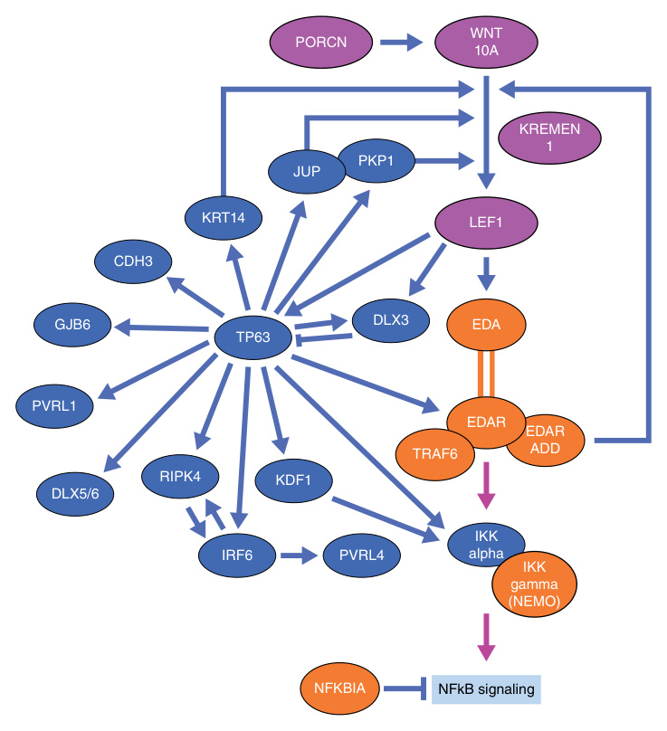
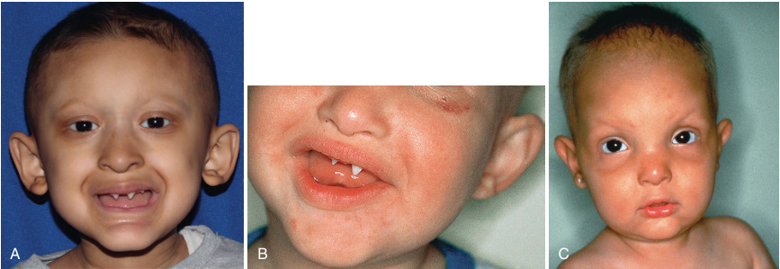
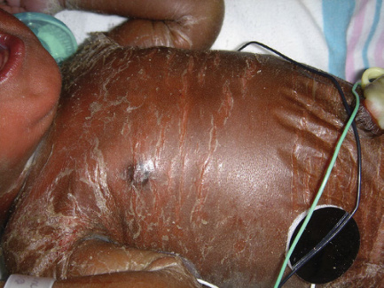
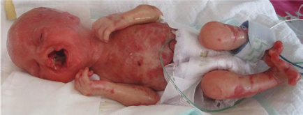
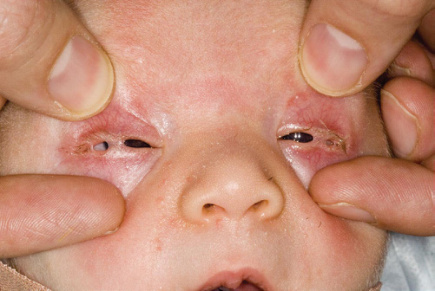
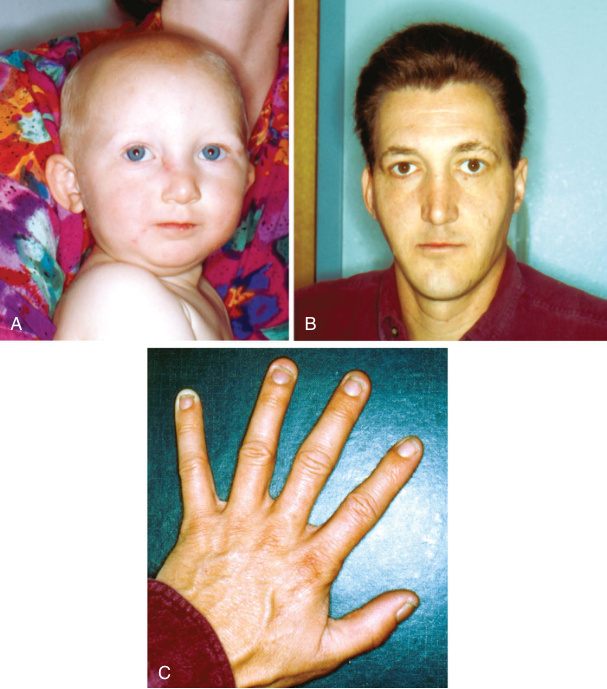
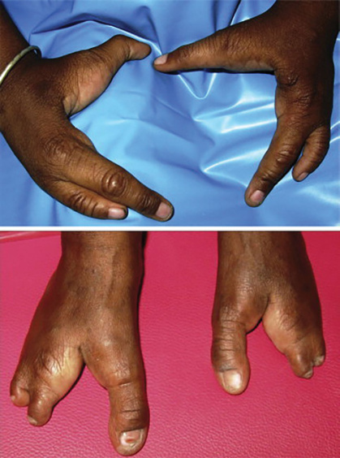
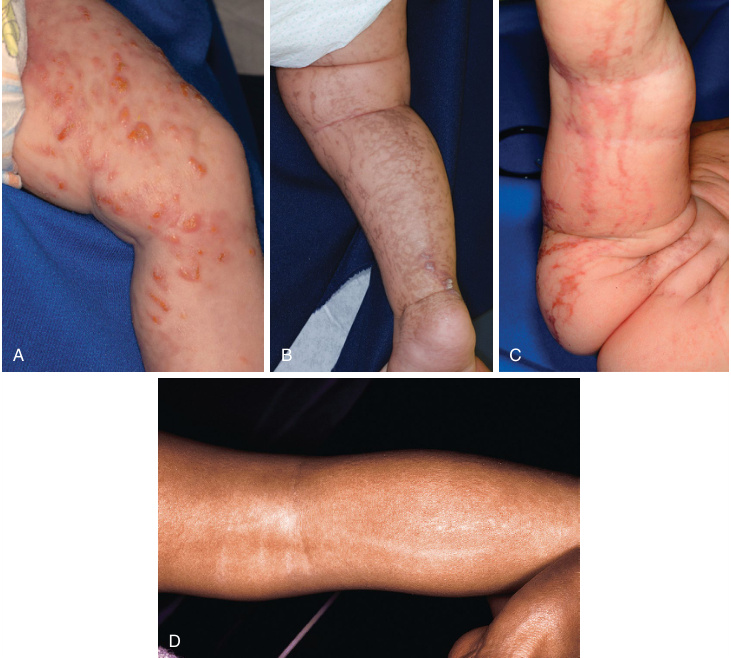
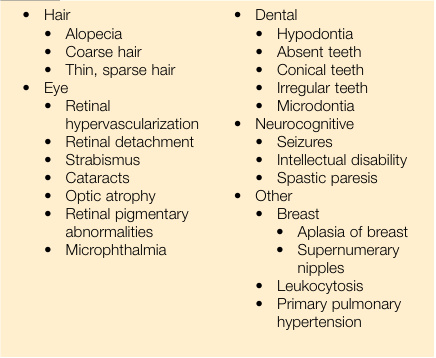
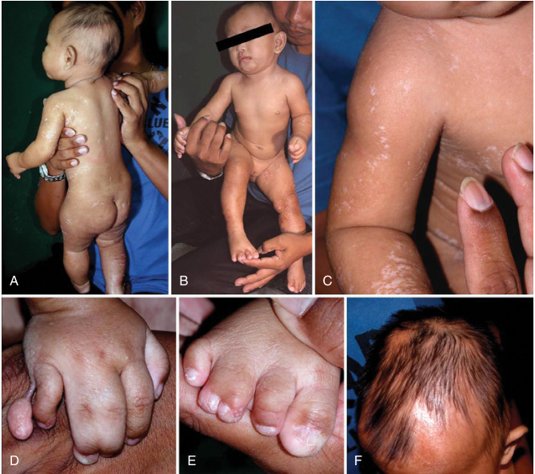

<!-- p.156 -->

# 9 Ectodermal Dysplasia 

**PILAR MAGOULAS, RAYMOND BELANGER DELOGE, V. REID SUTTON** 

**Ectodermal dysplasias (EDs)** are genetically and phenotypically diverse disorders affecting two or more structures derived from the ectoderm, including teeth, skin, and ectodermal appendages such as hair, nails, eccrine sweat glands, and sebaceous glands. There are over 150 identified ectodermal dysplasias; the precise genetic mechanisms of many are not known (Tables 9.1 and 9.2). Some patients present overtly in the perinatal period with features that strongly suggest an ectodermal dysplasia such as a collodion-like membrane, heat intolerance with hyperpyrexia, or limb defects, whereas others have subtle findings such as tooth and nail abnormalities that elude diagnosis for years, decades, or even across multiple generations. If an ED is suspected, a comprehensive history and physical examination, as well as a thorough family history with a focus on dental, skin, hair, and nail abnormalities, can refine the phenotype and direct testing strategies. Referral to specialists for phenotypic refinement, diagnosis, and long-term management is often required (Tables 9.1, 9.2, and 9.3). Various classification systems for EDs have been proposed, with some focusing on phenotypic similarities and others emphasizing genetic mechanisms and signaling pathways (Tables 9.1 and 9.2). However, given the interrelatedness of these pathways and the tendency toward pleiotropic expression in known ED-related genes, such schemata are not necessarily straightforward (Fig. 9.1). The salient clinical features, genetics, diagnosis, and management of EDs will be explored through several of the most common and prototypical EDs: hypohidrotic ectodermal dysplasias, _TP63_ -related disorders, incontinentia pigmenti, and _PORCN_ -related developmental disorders. 

## **Hypohidrotic Ectodermal Dysplasias** 

**Hypohidrotic ectodermal dysplasias (HEDs)** are phenotypically similar but genetically heterogeneous. Characteristic features include anhidrosis or hypohidrosis (absent or reduced ability to sweat), absent or abnormally shaped teeth, and hypotrichosis (sparse hair) (Fig. 9.2). There is variable expressivity of each of these characteristics both between and within families; in addition, 

there is considerable variability in modes of inheritance. The HEDs are typically distinguished by clinical features, family history, and genetic etiology. 

### **Clinical Features** 

HEDs are characterized by the combination of partial or complete absence of eccrine sweat glands, abnormal dentition, and hypotrichosis. Additional phenotypic features are presented in Table 9.4. Many neonates have extensive skin scaling and peeling that can be significant enough to suggest a collodion-like membrane (Fig. 9.3) mimicking other heritable or acquired disorders, particularly congenital ichthyosiform erythroderma (Table 9.5). Heat intolerance secondary to decreased sweating may manifest early in the neonatal period or infancy as isolated fevers without a focus of infection or episodic fussiness when exposed to warm environments. Some findings, such as the typical facies consisting of frontal bossing, sunken cheeks, depressed nasal bridge, and periorbital hyperpigmentation and wrinkling may not be apparent until later in infancy or childhood (Fig. 9.2). If these and other physical findings of ectodermal dysplasia are not overt, affected neonates may undergo repeated evaluations for serious or invasive bacterial infections in the setting of recurrent fevers (fever of unknown origin). Some affected individuals may not be diagnosed until later in infancy or childhood when hypodontia or abnormal dentition (typically conical or pegshaped teeth) are noted (Fig. 9.2). Those with congenitally absent teeth often have hypoplasia or absence of the underlying bony alveolar ridge, leading to abnormal facial development and associated speech and swallowing difficulties. Teeth, when present, may erupt later than expected; following tooth eruption, thinner enamel and decreased saliva production increase the risk of caries and dental decay. 

**Hypohidrotic ectodermal dysplasia with immune defects (HED-ID)** is characterized by recurrent, severe, and opportunistic infections along with classic findings of hypohidrotic ectodermal dysplasia. This disorder is caused by pathogenic variants in _NEMO_ and _NFkb-IA_ and most affected individuals survive only into childhood. 

_(Text continued on page 141)_

<!-- p.157 -->

#### **TABLE 9.1 Updated Classification of the Ectodermal Dysplasias With 15 Newly Added Syndromes (Bold)** 

|Pathway|Affected Gene(s)|Disease(s)/Syndrome(s)— Previously Suggested Nomenclature|OMIM No.|Hypodontia|Hair Abnormalities|Nail Feature|s Glandula|r Additional Symptoms|
|---|---|---|---|---|---|---|---|---|
|EDA-NFκB pathway|EDA|Ectodermal dysplasia 1, hypohidrotic, X-linked (Christ–Siemens–Touraine syndrome, XLHED)|305100||||||
||_EDAR_|Ectodermal dysplasia 10A and 10B, AD and AR (ECTD10A, B)|129490, 224900||||||
||_EDARADD_|Ectodermal dysplasia 11A and 11B, AD and AR (ECTD11A, B)|614940, 614941||||||
||_IKBKG_|Incontinentia pigmenti (IP)|308300||||||
||_IKBKG_|Ectodermal dysplasia and immunodeficiency 1, AD and AR (EDAID1)|300291, 300301||||||
||_CHUK_|Cocoon syndrome|613630||||||
||_NFKBIA_|Ectodermal dysplasia and immunodeficiency 2 (EDAID2)|612132||||||
||_PRKD1_|Congenital heart defects and ectodermal dysplasia (CHDED)|617364||||||
||_TRAF6_|Hidrotic form of ectodermal dysplasia, not yet OMIM-listed|602355||||||
|WNT pathway|_PORCN_|Focal dermal hypoplasia (FDH) or Goltz– Gorlin syndrome|305600||||||
||_TWIST2_|Focal facial dermal dysplasia 3/Ablepharon- macrostomia syndrome (AMS)|136500, 200110||||||
||_WNT10A_|Odonto–onycho–dermal dysplasia (OODD)/ Schöpf–Schulz–Passarge syndrome (SSPS)|257980, 224750||||||
||_KREMEN1_|Ectodermal dysplasia 13, hair/tooth type (ECTD13)|617392||||||
||_TBX3_|Ulnar-mammary syndrome (UMS)|181450||||||

_(Continued)_

<!-- p.158 -->

###### **TABLE** 

#### **Updated Classification of the Ectodermal Dysplasias With 15 Newly Added Syndromes (Bold)—cont’d** 

|**9.1** **p i** Pathway|**i** Affected Gene(s)|**i    yp** Disease(s)/Syndrome(s)— Previously Suggested Nomenclature|**i       y  y** OMIM No.|**i** Hypodontia|**i** Hair Abnormalities|Nail Feature|s Glandular Additional Symptoms|
|---|---|---|---|---|---|---|---|
||_LEF1_|Ectodermal dysplasia with or without hypohidrosis, not yet OMIM-listed|153245|||||
||_LRP6_|Ectodermal dysplasia with or without hypohidrosis, not yet OMIM-listed|(603507)|||||
||_MSX1_|Ectodermal dysplasia 3, Witkop type (ECTD3 or Witkop syndrome)|189500|||||
|p63 pathway|_TP63_|Acro–dermato–ungual–lacrimal–tooth syndrome (ADULT)|103285|||||
||_TP63_|Ectrodactyly ectodermal dysplasia–cleft lip/palate syndrome (EEC)|604292|||| |
||_TP63_|Limb–mammary syndrome (LMS)|603543|||| |
||_TP63_|Ankyloblepharon–ectodermal defects–cleft lip/palate (AEC/Rapp–Hodgkin syndrome)|106260, 129400|||| |
||_CDH3_|Ectodermal dysplasia, ectrodactyly, macular dystrophy syndrome (EEMS)|225280|||||
||_KDF1_|Ectodermal dysplasia 12, hypohidrotic/ hair/tooth/nail type (ECTD12)|617337|||||
||_DLX3_|Tricho–dento–osseous syndrome (TDO)|190320|||||
||_RIPK4_|Curly hair–ankyloblepharon–nail dysplasia syndrome (CHANDS); complex lethal subtype known as Bartsocas–Papas syndrome 1 (BPS1)|214350, 263650|||||
|Structure group|_PKP1_|Ectodermal dysplasia–skin fragility syndrome (EDSFS)|604536|||| |
||_GRHL2_|Ectodermal dysplasia–short stature syndrome (ECTDS)|616029|||||
||_PVRL1_|Cleft lip/palate–ectodermal dysplasia syndrome (CLPED1)|225060|||||

_(Continued)_

<!-- p.159 -->

###### **TABLE** 

#### **Updated Classification of the Ectodermal Dysplasias With 15 Newly Added Syndromes (Bold)—cont’d** 

|**9.1** **p i** Pathway|**i** Affected Gene(s)|**i    yp** Disease(s)/Syndrome(s)— Previously Suggested Nomenclature|**i       y  y** OMIM No.|**i** Hypodontia|**i** Hair Abnormalities|Nail Feature|s Glandular Additional Symptoms|
|---|---|---|---|---|---|---|---|
||_PVRL4_|Ectodermal dysplasia–syndactyly syndrome 1 (EDSS1)|613573|||||
||_KRT74_|Ectodermal dysplasia 7, hair/nail type (ECTD7)|614929|||||
||_KRT85_|Ectodermal dysplasia 4, hair/nail type (ECTD4)|602032|||||
||_GJB2_|Keratitis–ichthyosis–deafness syndrome, AD (KID)|148210|||||
||_GJA1_|Oculo–dento–digital dysplasia (ODDD, ODDR)|164200, 257850|||| |
||_GJB6_|Clouston syndrome or ectodermal dysplasia 2, Clouston type (ECTD2)|129500|||||
|Others|_TSPEAR_|Ectodermal dysplasia 14, hair/tooth type with or without hypohidrosis (ECTD14)|618180|||||
||_HOXC13_|Ectodermal dysplasia 9, hair/nail type (ECTD9)|614931|||||
||_CST6_|Ectodermal dysplasia 1, hypohidrotic/hair type (ECTD15)|618535|||||
||_AP1B1_|Keratitis–ichthyosis–deafness syndrome, AR (KIDAR)|242150|||| |
||_TRPS1_|Trichorhinophalangeal syndrome, type I (TRPS1) or type III (TRPS3)|190350, 190351|||||
||_TRPS11_ _EXT1_|Trichorhinophalangeal syndrome, type II (TRPS2)|150230|||||
|From Peschel N         i    i i|, Wright JT, Koster MI, et    i    i i|al. Molecular pathway-based classification of ectodermal dys i i|i   plasias: first five-ye|i    i iarly update._Genes (B_|_asel)._2022;13:2327|(Table 1).||

<!-- p.160 -->

#### **TABLE Syndromes With Features of ED That Are Related to Genes Apparently Not Involved in the Already Known Pathways and That Mainly Affect 9.2 Organs of Nonectodermal Origin or Where ED Is Just a Small Part of a Complex Syndrome** 

|Affected Gene(s)|Syndrome(s) With a Partial Ectodermal Dysplasia-like Phenotype But Classified Elsewhere|OMIM No.|Hypodontia|Hair|Nail Phenotypic Features|Glandular|Additional Symptoms|
|---|---|---|---|---|---|---|---|
|CDHI,_CTNND1_|Blepharocheilodontic syndrome 1/Blepharocheilodontic syndrome 2 (BCDS1/BCDS2|119580, 617681||||||
|_IFT43, -52. -122, -140_ _WDR19, -35_|Cranioectodermal dysplasia, types 1–4 (CED) or Sensenbrenner syndrome|218330||||||
|_EVC, EVC2_|Ellis-van Creveld syndrome (EVC)|22550000||||||
|_EVC, EVC2_|Weyers acrofacial dysostosis (WAD)|193530||||||
|_KCTDI_|Scalp-ear-nipple syndrome (SENS)|181270||||||
|_SOX9-CN/2_*|Cooks syndrome|106995||||||
|_ANTXRI_|Growth retardation, alopecia, pseudoanodontia, and optic atrophy syndrome (GAPO)|230740||||||
|_SMARCAD1_|Huriez syndrome/Basan syndrome|181600, 129200||||||
|_DSP_|Carvajal syndrome (DCWHK)|605676||||||
|_KRT14_|Dermatopathia pigmentosa reticularis (DPR)/Naegeli syndrome (NFJS)|125595, 161000||||||
|_KRT16, -17_|Pachyonychia congenita 1/Pachyonychia congenita 2 (PC1/PC2)|167200, 167210||||||
|_ARID1A, -18_ _SMARCA4, -B1, -E1_|Coffin-Siris syndrome (CSS)|135900||||||
|_ATP6V1B2_|Deafness, congenital, and onychodystrophy, AD (DDOD)| 124480||||||
|_TBC1D24_|Deafness, onychoand osteodystrophy, mental retardation, and seizures syndrome|220500||||||
|_SLC25A24_|Gorlin-Chaudhry-Moss syndrome (FPS)|612289||||||
|_PEXI, PEX6_|Heimler syndrome 1 (HMRI)/Heimler syndrome 2 (HMLR2)|234580, 616617||||||
|_UBRI_|Johanson-Blizzard syndrome (JBS)|243800||||||
|_FGFR3, -2_ _FGF10_|Lacrimo-auriculo-dento-digital syndrome (LADD)|149730||||||

_(Continued)_

<!-- p.161 -->

#### **TABLE Syndromes With Features of ED That Are Related to Genes Apparently Not Involved in the Already Known Pathways and That Mainly Affect 9.2 Organs of Nonectodermal Origin or Where ED Is Just a Small Part of a Complex Syndrome—cont’d** 

|Affected Gene(s)|Syndrome(s) With a Partial Ectodermal Dysplasia-like Phenotype But Classified Elsewhere|OMIM No.|Hypodontia|Hair|Nail Phenotypic Features|Glandular|Additional Symptoms|
|---|---|---|---|---|---|---|---|
|_SREBFI_|Mucoepithelial dysplasia, hereditary (HMD)|158310||||||
|_HEPHLI_|Pili torti and developmental delay (HJDD)|261990||||||
|_KRT81, -83, -86, DSG4_|Monilethrix (MNLIX)|15800||||||
|_RODGI_|Kohlschütter-Tonz syndrome|226750||||||
|_INSR_|Pineal hyperplasia, insulin-resistant diabetes mellitus, and somatic abnormalities|262190||||||
|_CTSK_|Pycnodysostosis (PKND)|265800||||||
|_SETBPI_|Schinzel-Giedion midface retraction syndrome (SGS)|269150||||||

Only syndromes included in the previous classification of ectodermal dysplasias were listed. Most of them could be classified elsewhere (bold, newly added disease entities). 

*The genetic abnormality is a duplication in the putative regulatory region (not the promoter) of SOX9 (located between the SOX9 and KCNJ2 genes). 

From Peschel N, Wright JT, Koster MI, et al. Molecular pathway-based classification of ectodermal dysplasias: first five-yearly update. _Genes (Basel)_ . 2022;13:2327 (Table 2).

<!-- p.162 -->

#### **TABLE Phenotypic Features and Clinical Concerns in 9.3 Ectodermal Dysplasias by Relevant Clinical Specialty** 

|Specialty|Phenotypic Features|
|---|---|
|Dermatology|Anhidrosis or hypohidrosis with overheating Collodion-like membrane at birth Diffuse xerosis Finely wrinkled skin Palmoplantar keratoderma Frequent skin rashes, infections, and sunburns Eczema Erosions Sparse, fine, lightly pigmented scalp hair Sparse or absent eyebrows, eyelashes, and vellus hair Brittle, dystrophic, absent, ridged, or pitted nails|
|Dental|Missing, pointed, or widely spaced teeth Decreased saliva Thin enamel|
|Ear, Nose and Throat (Otolaryngology)|Decreased saliva which may cause problems with tasting, lubricating, chewing, swallowing Thick mucous secretions Increased cerumen production Hearing loss (typically conductive)|
|Geneticist/Genetic counselor|Genetic testing and counseling to review inheritance, recurrence risk, reproductive screening and testing options|
|Infectious Disease|Fever of unknown origin (sweating defects) Opportunistic infections if present immune defects|
|Ophthalmology|Decreased tear production Blepharitis Corneal scarring Photophobia|
|Obstetrics/ Gynecology|Missing or absent nipples Decreased milk production Decreased fertility|
|Orthopedics|Syndactyly Polydactyly Oligodactyly Ectrodactyly (split hand/foot malformation)|
|Craniofacial surgery|Cleft lip and palate|
|Feeding specialist/ Nutrition|Constipation Poor weight gain due to swallowing difficulties or dental abnormalities|
|Therapy (Speech and Occupational)|Feeding difficulties Fine and gross motor difficulties|
|Psychology|Developmental assessment|
|Social Work|Resource and service identification|

### **Genetics** 

Genes known to be associated with HED, their inheritance patterns, and range of phenotypes are presented in Tables 9.1 and 9.6. The most common HED, **X-linked hypohidrotic ectod ermal dysplasia (XLHED)** , is caused by pathogenic variants in _EDA_ , located on the X chromosome. Pathogenic variants in _EDA_ also cause nonsyndromic hypodontia, though the variants causing nonsyndromic hypodontia are typically missense variants affecting the tumor necrosis factor domain whereas the variants causing XLHED are distributed throughout the gene and result in loss of function. 

Inheritance of XLHED is X-linked recessive and males are typically more severely affected than females with a functional allele on their other X chromosome. Findings in affected females are variable due to differences in X-inactivation and generally consist of milder expressions of any or all the features, such as faint sparseness of the hair, patchy distribution of sweat dysfunction, and a few small or missing teeth. Up to 80% of affected females have some degree of hypodontia. Nipple hypoplasia or deficient milk production during nursing may also be noted. 

Diagnosis and recurrence risk estimates for other forms of HED are challenging because certain forms demonstrate both autosomal dominant (AD) and autosomal recessive (AR) inheritance, depending on the variant (Table 9.6). Diagnosis is also complicated if the phenotype associated with the gene is variable. Carriers of AR HEDs, such as patients with heterozygous pathogenic variants in _WNT10A_ , may have mild findings, further confounding diagnosis of homozygous offspring, as well as recurrence risk estimates for future pregnancies. 

## **_TP63_ -Related Disorders** 

_TP63_ encodes a member of the p53 family of transcription factors (Fig. 9.1). Alternative splicing produces multiple isoforms with varying functions related to cellular differentiation, proliferation, and maintenance; two isoforms— TAp63α and ΔNp63α—regulate ectodermal structures. Pathogenic variants in _TP63_ affecting these isoforms produce a range of ectodermal and limb malformation phenotypes. _TP63_ -related disorders are inherited in an autosomal dominant fashion with over 99% of pathogenic alleles consisting of heterozygous single nucleotide variants. Approximately 30% of _TP63_ -related disorders are inherited from an affected parent, with the remaining 70% arising _de novo_ . 

The TP63 protein consists of transactivation (TA), DNA binding (DNA-B), oligomerization (oligo), sterile alpha motif (SAM), and transactivation inhibitory (TI) domains. The specific manifestations in _TP63_ -related disorders are determined by which domain or domains of the protein are affected and are organized into the following phenotypic clusters (Table 9.7): 

- **AEC syndrome: A** nkyloblepharon- **E** ctodermal defects- **C** left lip/palate syndrome 

- **ADULT syndrome: A** cro- **D** ermo- **U** ngual- **L** acrimal- **T** ooth syndrome

<!-- p.163 -->

**Fig. 9.1** The multiple interactions between the EDA/NF-κB, Wnt and p63 pathways (in orange, purple, and blue, respectively). _Arrows_ indicate stimulatory protein–protein or protein–gene regulatory interactions, bars are used for inhibitory interactions.  (From Peschel N, Wright JT, Koster MI, et al. Molecular pathway-based classification of ectodermal dysplasias: first five-yearly update. _Genes [Basel]_ . 2022;13[12]:2327 [Fig. 2].) 

**Fig. 9.2** Hypohidrotic ectodermal dysplasia (HED). (A) This male shows the short, sparse hair; large conspicuous nostrils; wide cheekbones with flat malar ridges; periorbital wrinkling; a thick everted lower lip; prominent chin; and low-lying, anteriorly placed, pointed ears. (B) Conical incisors in a toddler with HED. Note the periorbital wrinkling, flat malar ridges, and prominent ears. (C) This female is a carrier for a variant in ectodysplasin but shows all of the characteristic facies features. Females with HED may also have a pathogenic variant in a gene encoding the receptor for ectodysplasin, inherited as an autosomal disorder.  (From Paller AS, Mancini AJ, eds. _Hurwitz Clinical Pediatric Dermatology_ . 6th ed. Philadelphia: Elsevier; 2022 [Fig. 7.19 and Fig. 7.20, p. 173].)

<!-- p.164 -->

#### **TABLE Phenotypic Features of Hypohidrotic 9.4 Ectodermal Dysplasias** 

##### **Skin/Hair/Nails** 

- Periorbital hyperpigmentation and wrinkling 

- Fragile appearing skin 

- Sparse, thin, or slow-growing hair 

- Hypopigmented hair 

- Fragile hair that may break easily 

- Thin, fragile, and absent fingernails or toenails 

- Collodion-like membrane or extensive skin scaling and peeling in newborns 

##### **Eye** 

- Dry eyes 

##### **Dental** 

- Diminished development of alveolar ridge 

- Absent or missing teeth 

- Conical or otherwise abnormally shaped teeth 

- Small teeth 

**Fig. 9.3** Collodion membrane in a neonate.  (From Jen M, Nallasamy S. Ocular manifestations of genetic skin disorders. _Clin Dermatol._ 2016; 34[2]:242-275 [Fig. 11, p. 249].) 

##### **Facial Features** 

- Midface hypoplasia 

- Depressed nasal bridge 

##### **Other** 

- Anhidrosis or hypohidrosis 

- Hyperhidrosis on palms and soles ( _WNT10_ -related HED) 

- Decreased sebaceous and nasal secretions 

- Recurrent pneumonia 

- Asthma-like symptoms 

- Raspy voice 

- In females, deficient milk production 

- In females, underdeveloped nipples • Immune defects ( _NEMO_ and _NFkb-IA_ -related HED only): hypogammaglobulinemia, susceptibility to opportunistic infections, decreased response to polysaccharide antigens, impaired natural killer cell activity 

   - **EEC3 syndrome: E** ctrodactyly, **E** ctodermal dysplasia, **C** left lip/palate syndrome 3 

   - **Limb-mammary syndrome** 

   - **SHFM4: S** plit- **Hand** / **F** oot **M** alformation type 4 

- **Orofacial cleft 8:** an isolated cleft lip/palate syndrome 

- The latter two phenotypes, SHFM4 and orofacial cleft 8, 

- do not involve ectodermal structures. Nonectodermal manifestations among the remaining syndromes vary, though commonly include some degree of limb malformation and lacrimal duct obstruction. 

**AEC syndrome** is caused by pathogenic variants affecting the SAM or the N-terminal domains of the ΔNp63α isoform. Findings are typically noticeable at birth (Fig. 9.4). Nearly all affected individuals have dermal erosions that can 

###### **TABLE 9.5** 

#### **Disorders Associated With Collodion or Collodion-like Membrane in the Newborn** 

|Category|Disease|Pertinent Physical Findings|Ancillary Laboratory/ Radiologic Testing|Gene(s)|
|---|---|---|---|---|
|Nonsyndromic ichthyoses|Lamellar ichthyosis|Collodion membrane with ectropion and eclabium, congenital ichthyosiform erythroderma, platelike scaling, hypohidrosis|In situ transglutaminase-1 assay in cryostat-cut sections|_TGM1, ABCA12,_ _ALOX12B, NIPAL4_|
||Congenital ichthyosiform erythroderma|Collodion membrane with ectropion and eclabium, congenital ichthyosiform erythroderma, fine scaling, hypohidrosis|In situ transglutaminase-1 assay in cryostat-cut sections|_ALOX12B, ALOXE3,_ _TGM1, ABCA12,_ _CYP4F22, NIPAL4_|
||Ichthyosis vulgaris|Xerosis, generalized scaling sparing flexural areas, atopic dermatitis, pruritus, accentuated palmoplantar markings|H&E: reduced or absent stratum granulosum|_FLG_|
||Recessive X-linked ichthyosis|Generalized scaling sparing body folds, neck usually more severely involved, corneal clouding, cryptorchidism|Absent steroid sulfatase activity in leukocytes and fibroblasts, elevated blood cholesterol sulfate levels|_STS_|

_(Continued)_

<!-- p.165 -->

#### **TABLE 9.5** Disorders Associated W ith Collodion or Collodion-like Mem brane in the Newborn–Ancillary Laboratory/ cont’d

|Cate|gory|Disease|Pertinent Physical Findings|Radiologic Testing|Gene(s)|
|---|---|---|---|---|---|
|||Epidermolytic ichthyosis|Large erosions, mild scaling, and erythroderma at birth, followed by hyperkeratosis in first few months|H&E: epidermolytic hyperkeratosis; EM: aggregations and clumping of keratin filaments in suprabasal cells|_KRT1, KRT10_|
|||Bathing suit ichthyosis|Collodion membrane at birth, followed by brownish scaling restricted to bathing suit areas|In situ transglutaminase-1 assay in cryostat-cut sections|_TGM1_|
|||SHCB|Nearly complete resolution of collodion membrane and scaling within first 3 mo|In situ transglutaminase-1 assay in cryostat-cut sections|_TGM1, ALOX12B,_ _ALOXE3_|
|Syndr ich|omic thyoses|Neutral lipid storage disease with ichthyosis|Generalized ichthyosiform erythroderma, hepatosplenomegaly, mild myopathy, cataract, short stature, mild intellectual disability|Lipid vacuoles within leukocytes, monocytes, and keratinocytes, abnormal LFT results and fasting lipids, increased CPK|_ABHD5_|
|||TTD with ichthyosis|Generalized ichthyosiform erythroderma, brittle hair, impaired intelligence, short stature, with or without photosensitivity|Polarizing microscopy of hair shaft: alternating light and dark bands, other hair abnormalities, e.g., trichoschisis or trichorrhexis nodosa| _ERCC2/XPD,_ _ERCC3/XPB,_ _GTF2H5/TTDA,_ _C7Orf11/TTDN1_ (nonphotosensitive)|
|||Conradi- Hünermann- Happle syndrome|Congenital ichthyosiform erythroderma in lines of Blaschko followed by hyperkeratosis, follicular atrophoderma, stippled epiphyses, cataracts, asymmetric facial appearance|H&E: calcification in follicular keratosis in neonates, bone x-ray|_EBP_|
|||KID syndrome|Severe generalized or localized erythrokeratoderma with spiky hyperkeratosis, PPK, keratitis, hearing loss|MRI: absence of corpus callosum|_GJB2 (GJB6)_|
|||Loricrin keratoderma|Congenital ichthyosiform erythroderma, diffuse PPK with honeycomb pattern, pseudo-ainhum, knuckle pads|H&E: parakeratosis and hypergranulosis; EM: electron dense intranuclear granules in granular cells|_LOR_|
|||ARC syndrome|Generalized scaling with sparing of skin folds, arthrogryposis, renal tubular degeneration, intrahepatic bile duct hypoplasia with cholestasis, metabolic acidosis, abnormal platelet function, cerebral malformation|Liver and renal biopsy|_VPS33B_|
|||KLICK syndrome|Congenital ichthyosis, linear keratosis in skin folds, sclerosing PPK|EM: hypergranulosis and abnormally big keratohyaline granules|_POMP_|

_(Continued)_

<!-- p.166 -->

#### **TABLE 9.5** Disorders Associated Wi th Collodion or Collodion-like Mem brane in the Newborn–Ancillary Laboratory/ cont’d

|Category|Disease|Pertinent Physical Findings|Radiologic Testing|Gene(s)|
|---|---|---|---|---|
|Metabolic diseases|Holocarboxylase synthetase deficiency|Metabolic acidosis, hyperammonemia, organic aciduria, metabolic encephalopathy, poor feeding, lethargy, respiratory distress, and hypotonia|Carboxylases assay in leukocytes or cultured skin fibroblasts i|_HLCS_|
||Gaucher disease type 2|Congenital ichthyosiform erythroderma, hepatosplenomegaly, opisthotonus, hypotonia, facial anomalies, arthrogryposis, respiratory distress, and progressive neurologic deterioration|Deficiency of β-glucosidase in leukocytes or cultured skin fibroblasts, LFTs, increased serum acid phosphatase, Gaucher cells in bone marrow|_GBA_|
|Others|Hypohidrotic ectodermal dysplasia|Hypohidrosis or anhidrosis with hyperpyrexia, atopic dermatitis, sparse hair, frontal bossing, saddle nose, supraorbital ridging, hypoplastic mid face, thick everted lips, hypodontia or anodontia, peg-shaped/ conical incisors and canines, hypoplastic or absent breast and nipple-areolar complex|Hair with longitudinal groove on EM|_EDA, EDAR,_ _EDARADD,_ _WNT10A, NEMO,_ _NF-kb IA_|
||Congenital hypothyroidism|Clavicular pad; puffiness of periorbital tissues and tongue, lips, hands, and genitals; dry, cold, and pale skin; dry and brittle nails and hair; patchy alopecia; dwarfism; mental retardation; somnolence; constipation; feeding problems; poor muscle tone; persistence of jaundice; and respiratory problems|Serum total or free T4, TSH, thyroid-binding globulin|_DUOX2, PAX8,_ _SLC5A5, TG, TPO,_ _TSHB, TSHR_|
||Koraxitrachitic syndrome|A syndromic form of SHCB: collodion baby at birth, with patchy erythema, progressive thinning of hyperkeratotic membrane, generalized irregular dermal atrophy, alopecia, absent eyelashes and eyebrows, and conjunctival pannus, hypertelorism, prominent nasal root, large mouth, micrognathia, brachydactyly, syndactyly involving all interdigital spaces, and camptodactyly of fingers III–V|H&E: orthohyperkeratosis and marked atrophy of dermis, immature dermal extracellular matrix, factor XIII-a positive dendrocytes are rare and globular rather than dendritic|Unknown|
||PPK with anogenital leukokeratosis|Diffuse, nonprogressive PPK in combination with intermittently pruritic, slowly progressive anogenital leukokeratosis|Keratin immunocyto- chemistry shows marked expression of suprabasal K17 and absence of K6 and K16|Unknown|
||In utero infliximab exposure|Collodion membrane with stellate cracking, no associated nail abnormalities, bullae, ectropion, or eclabium. Response to topical emollients with complete resolution by 1–2 months of age|All laboratory studies normal|Unknown|

_ARC,_ Arthrogryposis, renal dysfunction, cholestasis; _KID,_ keratosis, ichthyosis, deafness; _KLICK,_ keratosis, linearis, ichthyosis, congenita, sclerosing keratoderma; _PPK,_ palmoplantar keratoderma; _SHCB,_ self healing collodion baby; _TTD,_ trichothiodystrophy. Modified from Prado R, Ellis LZ, Gamble R, Funk T, Arbuckle HA, Bruckner AL. Collodion baby: an update with a focus on practical management. _J Amer Acad Dermatol._ 2012;67(6):1362-1374 (Table 1, p. 1365-1368).

<!-- p.167 -->

#### **TABLE 9.6** Genes, In heritance Patterns, and P henotypes in Hypohidrotic Ectodermal Dysplasias

|Gene|Inheritance|Phenotypes|
|---|---|---|
|_EDA_|X-linked recessive|Classic HED, nonsyndromic hypodontia|
|_EDAR_|AD and AR|Mild to severe HED, isolated oligodontia, amastia, palmoplantar hyperkeratosis|
|_EDARADD_|AD and AR|Classic HED, nonsyndromic hypodontia|
|_WNT10A_|AD and AR|Variable. Some patients will have mild HED with abnormal dentition or selective tooth agenesis, while more affected individuals may have odonto-onycho- dermal dysplasia or Schopf-Schulz-Passarge syndrome. Some may have hyperhidrosis of the palms and soles with deficient sweating elsewhere.|
|_NEMO, NFkb-IA_|X-linked recessive (NEMO) and AD (NFκβ-IA)|Classic HED with dysgammaglobulinemia and significant immune deficiency|

_AD,_ Autosomal dominant; _AR,_ autosomal recessive; _HED,_ hypohidrotic ectodermal dysplasia 

#### **TABLE 9.7** Phenotypic Findings an f d Affected Protein Domains inTP63-R elated Ectode rmal Dysplasias

|Phenotypic Finding|AEC ADULT|EEC3|Limb-Mammary|
|---|---|---|---|
|**Skin**||||
|Hypohidrosis|X X||X|
|Nail dysplasia|X X|MILD|X|
|Sparse hair|X X|X||
|Dermal erosions|X|||
|Hypopigmentation|X X|X||
|Freckling of skin|X|||
|**Eye**||||
|Lacrimal duct obstruction|X X|X|X|
|Ankyblepharon filiforme adnatum|X|||
|Dental/Orofacial||||
|Missing or abnormal teeth|X X|X|X|
|Cleft lip/palate|X|X|X|
|Trismus|X|||
|**Limb**||||
|Split hand/foot malformation|X X|X|X|
|Syndactyly|X X|X|X|
|Transverse limb defects|X|||
|**Other**||||
|Hypoplastic breasts/nipples|X||X|
|Hypospadias|X|||
|Protein Domain|SAM, N-terminal domain of ΔNp63αisoform DNA-B|DNA-B|Between TA and DNA-B domains and SAM|

_ADULT,_ Acro-dermo-ungual-lacrimal-tooth syndrome; _AEC,_ ankyloblepharon-ectodermal defects-cleft lip/palate syndrome; _DNA-B,_ DNA-binding; _EEC3,_ ectrodactyly, ectodermal dysplasia, cleft lip/palate syndrome 3; _SAM,_ sterile alpha motif; _TA,_ transactivation. 

Adapted from Sutton VR, van Bokhoven H. _TP63_ -related disorders. In: Adam MP, Mirzaa GM, Pagon RA, et al., eds. _GeneReviews®_ [Internet]. Seattle, WA: University of Washington, Seattle; 2010.

<!-- p.168 -->

**Fig. 9.4** Severe findings in ankyloblepharon-ectodermal dysplasiacleft lip/palate (AEC) syndrome in a neonate. Note extensive dermal erosions, cleft lip and palate, ankyloblepharon filiforme adnatum, and ectrodactyly of the feet. While these findings are features of AEC syndrome, this neonate had additional phenotypic and genetic findings consistent with an AEC/EEC3 overlap syndrome (EEC3: ectrodactyly, ectodermal dysplasia, cleft lip/palate 3).  (From Helenius K, Ojala L, Kainulainen L, et al. Overlap between EEC and AEC syndrome and immunodeficiency in a preterm infant with a TP63 variant. _Eur J Med Genetics._ 2023;66[5]:104735 [Fig. 1A].) 

**Fig. 9.5** Ankyloblepharon filiforme adnatum. This finding is present in up to 70% of neonates with ankyloblepharon-ectodermal defects-cleft lip/palate (AEC) syndrome. The adhesions may spontaneously lyse or require surgical excision.  (From Sharkey D, Marlow N, Stokes J. Ankyloblepharon filiforme adnatum. _J Pediatr._ 2008;152[4]:594-594 [Fig 1, p. 594].) 

range from limited in number and extent to severe and widespread. Most affected neonates also have diffuse erythroderma or a collodion-like membrane. Up to 70% of neonates have _ankyloblepharon filiforme adnatum_ , partial or complete fusion of the eyelid margins that may spontaneously lyse or require excision (Fig. 9.5). Other findings notable at birth include orofacial clefts in all affected individuals that can range from isolated submucous cleft palate or isolated cleft lip to extensive cleft lip and palate, hypospadias in up to 75% of affected males, and in a minority of affected individuals, limb abnormalities such as syndactyly, camptodactyly, or ectrodactyly (i.e., split hand/foot malformation). 

With age other findings evolve or become more apparent. Facies consist of micrognathia, maxillary hypoplasia, a broad nasal root with hypoplastic alae nasi, a thin upper lip, and a short philtrum (Fig. 9.6). Most children have patchy areas of skin hypopigmentation or depigmentation, though 

fairer-skinned individuals may develop hyperpigmented thickening of the skin in intertriginous areas and the neck. Hair is lightly pigmented, coarse, and brittle. Lashes and eyebrows are thin. Lacrimal duct obstruction is common, leading to chronic or recurrent episodic conjunctivitis. Dysplastic nails are nearly universal, and some individuals have hypoplastic or absent nails. Teeth are typically conical and reduced in number. 

Additional concerns include conductive hearing loss in the majority of affected individuals, and trismus in over one-third. Weight faltering in early life is common though it improves with calorie supplementation and age; linear growth is commonly decreased. Hypohidrosis is neither as prevalent as in HED nor is it as severe; it does not tend to result in hyperthermia. 

**ADULT syndrome** is typically caused by pathogenic variants affecting the DNA-B domain. Findings present at birth include limb anomalies, which can range from finger and toe syndactyly to ectrodactyly, or a combination thereof, as well as dysplastic nails, and dry scaly skin without the erosions seen in AEC syndrome. With age, other findings become more apparent, such as lightly pigmented and fine hair, thin lashes and eyebrows, and excessive freckling in sun-exposed areas, a finding that is distinct to ADULT syndrome among the _TP63_ -related disorders. Lacrimal duct obstruction is common, leading to chronic or recurrent episodic conjunctivitis. Teeth are typically conical and reduced in number. Hypoplastic nipples and breasts are common, a feature shared with limb-mammary syndrome but not seen in other _TP63_ -related disorders. Hypohidrosis is neither as prevalent as in HED, nor is it as severe; it does not tend to result in hyperthermia. 

**EEC3 syndrome** is caused by pathogenic missense variants affecting the DNA-B domain. Findings present at birth include limb anomalies in up to 90% of affected individuals, orofacial clefts in up to 75%, genitourinary abnormalities in almost half, as well as dysplastic nails and dry skin without erosions. Limb malformations are variable and include syndactyly, oligodactyly, polydactyly, or ectrodactyly (Fig. 9.7). All four limbs are involved in nearly two-thirds of affected individuals. Orofacial clefts range from isolated submucous cleft palate or isolated cleft lip to extensive cleft lip and palate. Genitourinary abnormalities include hypospadias as well as renal and collecting system malformations. With age other findings become more apparent, such as silver or blond-colored hair that is dry and coarse; the lashes and eyebrows are thin. Lacrimal duct obstruction is common, leading to chronic or recurrent episodic conjunctivitis, and can be severe enough to lead to corneal abrasions and scarring. Teeth are typically conical and reduced in number. Hypohidrosis is rare. **Limb-mammary syndrome** is caused by pathogenic missense variants located between the TA and DNA-B domains or by truncating variants in the SAM domain. Findings present at birth include hypoplastic or absent nipples in almost all affected individuals, limb malformations in up to 85%, orofacial clefts in about one-quarter, and dysplastic nails. Skin and hair are

<!-- p.169 -->

**Fig. 9.6** Typical findings in ankyloblepharon-ectodermal dysplasia-cleft lip/palate (AEC) syndrome. (A–C) Affected father and son. Note the narrow nose with hypoplastic alae nasi, small mouth, and hypoplastic fingernails.  (From Jones KL, Jones MC, del Campo M. Ectodermal dysplasias. In: _Smith’s Recognizable Patterns of Human Malformation_ . 8th ed. Philadelphia: Elsevier; 2022 [Fig. 1, p. 766].) 

typically unaffected. With age other findings become more apparent, such as conical teeth and hypodontia. Lacrimal duct obstruction is common, leading to chronic or recurrent episodic conjunctivitis. In addition to hypoplastic or absent nipples, up to 90% of affected females will have hypoplastic or absent mammary glands. Hypohidrosis is not observed. 

# **Incontinentia Pigmenti** 

Incontinentia pigmenti (IP) is an X-linked dominant condition that affects many organ systems, particularly the skin. IP is characterized by skin abnormalities that evolve characteristically throughout childhood and adulthood. Abnormalities range from blister and/or verrucous eruptions in infancy and childhood, streaks or whorls of hyperpigmentation in childhood to early adulthood, and hypopigmentation in adulthood. Other common features of IP include hair and dental anomalies, vision loss due to 

retinal complications, seizures, intellectual disability, and an increased risk for strokes. 

Proposed criteria for establishing a diagnosis of IP are based on satisfying at least two major or one major and one or more minor criteria as presented in Table 9.8. 

## **Clinical Features** 

Characteristic skin lesions that progress through 4 stages are the hallmark of IP (Fig. 9.8). Not every affected individual noticeably develops each stage. Stage 1, which lasts from birth to as long as 18 months, consists of bullous eruptions in a linear distribution on the extremities and a circumferential distribution on the trunk. Stage 2 typically appears after stage 1 resolves and can last for months to years. Lesions consist of hypertrophic verrucous papules in a linear distribution on the extremities and a circumferential distribution on the trunk. Stage 3 can begin as early as 6 months to 1 year of age and typically lasts until early

<!-- p.170 -->

**Fig. 9.7** Four-limb ectrodactyly as seen in ectrodactyly, ectodermal dysplasia, cleft lip/plate syndrome 3 (EEC3).  (From Koul M, Dwivedi R, Upadhyay V. Ectrodactyly-ectodermal dysplasia clefting syndrome [EEC syndrome]. _J Oral Biol Craniofac Res._ 2014;4[2]:135-139 [Fig. 2, p. 137].) 

adulthood. Lesions consist of skin hyperpigmentation in a streaking or whorled pattern along the lines of Blaschko, in a linear distribution on the extremities and circumferential distribution on the trunk. Stage 4 emerges in adulthood and consists of hypopigmentation or hyperpigmentation along the lines of Blaschko, as well as areas of scarring alopecia. Extracutaneous manifestations of IP are presented in Table 9.9. 

### **TABLE Proposed Diagnostic Criteria for 9.8 Incontinentia Pigmenti** 

|Major criteria|Typical skin stages distributed along lines of Blaschko: • Vesiculobullous stage • Verrucous stage • Hyperpigmented stage • Atrophic/hypopigmented stage|
|---|---|
|Minor criteria|Dental abnormalities Ophthalmologic abnormalities Central nervous system abnormalities Alopecia Abnormal hair (thin, wooly) Abnormal lashes and eyebrows Dysplastic nails Orofacial clefts Hypoplastic or absent mammary tissue Supernumerary nipples Multiple miscarriages of male fetuses Typical skin histopathology|
|Conditions for establishing diagnosis|If no female first-degree relative with incontinentia pigmenti: • If genetic testing results unavailable or unknown, at least two major or one major and one or more minor criteria • If a pathogenic variant in NEMO is detected, then any major or minor criterion • If proband has a female first- degree relative with incontinentia pigmenti, any major criterion or two or more minor criteria|

The protein product of _NEMO_ , IKBKG, plays a regulatory role in the IKK protein complex. Activation of IKBKG activates other proteins in the complex, which allows the complex to release nuclear factor-kappa-B. Nuclear factorkappa-B regulates multiple genes and signaling pathways, including those involved in the formation of ectodermal tissues (Fig. 9.1). 

# **_PORCN_ -Related Developmental Disorders** 

## **Genetics, Inheritance, and Pathophysiology** 

Incontinentia pigmenti is caused by pathogenic variants in _NEMO_ , located on the X chromosome, and is inherited in an X-linked dominant fashion, with females most commonly affected. Approximately 65% of affected females and 16% of affected males have a common 11.7-kb pathogenic deletion in _NEMO_ . Pathogenic single nucleotide variants (SNVs) in _NEMO_ occur in up to 9% of affected females, and pathogenic deletions or duplications occur in 4% of affected females. Most pregnancies with a male who inherits an _NEMO_ pathogenic variant will result in a miscarriage. Affected liveborn males have either 47,XXY chromosome constitution, somatic mosaicism, or a hypomorphic variant in _NEMO_ . 

_PORCN_ -related developmental disorders are a spectrum of multisystemic pleiotropic X-linked dominant conditions, primarily affecting females, that are characterized by defects in mesodermal and ectodermal structures. Common features include focal areas of dermal hypoplasia, striated skin pigmentation, eye abnormalities, limb malformations, and hypoplastic nipples. Additional features are diverse, multisystemic, and variable. Most dermatologic manifestations are present at birth, except for telangiectasias and verrucoid papillomas. The phenotypic presentation can vary widely with some affected females having minimal dermatologic manifestations, mild limb malformations, or a combination thereof, while others demonstrate severe developmental defects leading to disabilities. This variability is presumably

<!-- p.171 -->

**• Fig. 9.8.** Stages of cutaneous manifestations in incontinentia pigmenti. (A) Vesiculobullous phase (stage 1). Note the linear distribution on the extremities. (B) Verrucous phase (stage 2). Note the verrucous papules on the distal lower extremity. This patient has also started to develop hyperpigmented streaks consistent with stage 3. (C) An additional example of hyperpigmented streaking consistent with stage 3. The linear pattern may sometimes be mistaken for intentional injuries. (D) Atrophic hypopigmentation seen in stage 4.  (From Paller AS, Mancini AJ. Disorders of pigmentation. In: _Paller and Mancini—Hurwitz Clinical Pediatric Dermatology_ . 11th ed. 287-325.e12. Elsevier; 2022 [Fig, 11.32A and Fig. 11.33, p. 307; Fig 11.34 and Fig. 11.35, p. 308].) 

### **TABLE Extracutaneous Manifestations of 9.9 Incontinentia Pigmenti** 

due to skewed X-chromosome inactivation, as well as the relative pathogenicity of the particular variant. 

## **Clinical Features** 

Clinical features of _PORCN_ -related disorders are presented in Table 9.10 and Figure 9.9. Not all affected individuals demonstrate all features. Findings present at birth include focal areas of atrophic skin or dermal hypoplasia; yellowpink dermal fat nodules; dysplastic nails; limb malformations including syndactyly, oligodactyly, or ectrodactyly; eye abnormalities; abdominal wall defects; and renal anomalies. With age other findings evolve or become more apparent, such as verrucous papillomas of the skin-mucous membrane junctions and thin or absent hair. Teeth are reduced in number and may be abnormally shaped. The focal areas of dermal hypoplasia may erode and become painful or pruritic.

<!-- p.172 -->

##### **TABLE** 

### **Clinical Features in** **_PORCN_ -Related Developmental Disorders** 

##### **9.10** 

#### **Skin/Hair/Nails** 

#### **Limb** 

- Atrophic and hypoplastic areas of skin 

   - Split hand/foot malformation 

- Cutis aplasia 

   - Oligodactyly 

- Fat nodules in the dermis presenting as soft, yellow-pink nodules 

   - Syndactyly 

   - Transverse limb defects 

- Pigmentary changes, typically following Blaschko lines 

#### **Neurocognitive** 

- Telangiectasias 

   - Usually unaffected but can have moderate-severe intellectual disability 

- Verrucous papillomas of skin-mucous membrane junctions (oral, nasal, anal and genital areas) 

#### **Other** 

#### **Ophthalmological** 

   - Facial features: facial asymmetry, notched alae nasi, pointed chin 

- Anophthalmia/microphthalmia 

- Iris and chorioretinal colobomas 

   - Abdominal wall defects 

- Lacrimal duct abnormalities 

- Diaphragmatic hernia 

#### **Dental/Orofacial** 

   - Structural renal abnormalities 

- Cleft lip/palate 

      - Striations of long bones, seen on plain radiographs 

- Tooth abnormalities 

   - Missing teeth 

   - Extra teeth 

   - Ridged teeth 

   - Enamel hypoplasia 

**Fig. 9.9** Phenotypic findings in _PORCN_ -related developmental disorders. (A–C) Linear lesions of hypopigmented cutaneous hypoplasia occurring along Blaschko lines are evident on the trunk and limbs. A congenital melanocytic naevus is also present on the left flank. (D) Syndactyly of the right middle and ring fingers and an accessory digit; (E) dystrophic toenails and syndactyly of the right third and fourth toes; (F) sparse scalp hair with patchy nonscarring alopecia.  (From Clements SE, Wessagowit V, Lai-Cheong JE, et al. Focal dermal hypoplasia resulting from a new nonsense mutation in the PORCN gene. _J Dermatol Sci._ 2008;49[1]:39-42 [Fig. 1, p. 40].)

<!-- p.173 -->

#### **TABLE 9.11** Additional Recognized Forms of Ectodermal Dysplasia, Inheritance Patterns, and Clinical Features

|Type|Inheritance(s)|Characteristic Clinical Findings|
|---|---|---|
|Witkop tooth and nail syndrome|AD|Usually normal hair, rarely sparse or fine Normal sweating Small primary teeth, hypodontia causing lower lip eversion (pouting lower lip) Thin, slow growing hypoplastic nails (toes>fingers) Koilonycjia|
|EEC|AD|Dry skin, aplasia, or hypoplasia of skin Normal sweating Coarse lightly pigmented hair, thick eyebrows Hypodontia (reduced number), taurodontia, premature loss of teeth, dental enamel abnormalities Ectrodactyly more common than syndactyly Nail dystrophy, transverse ridging and pitting Corneal erosion, lacrimal duct abnormality, blepharitis, GU defects, cleft lip or palate|
|_AD,_Autosomal dominant; Adapted from Abidi NY, M|_EEC,_ectrodactyly, ectode artin KL. Ectodermal dysp|rmal dysplasia and cleft lip/palate syndrome lasias. In:_Nelson Textbook of Pediatrics_. 21st ed. Vol 2. Philadelphia: Elsevier; 2020 (Table 668.3, p. 3460).|

## **Genetics, Inheritance, and Pathophysiology** 

_PORCN_ -related developmental disorders are caused by heterozygous pathogenic variants in _PORCN_ that disrupt the usual role of its protein product, porcupine, in the processing, secretion, and signaling on Wnt proteins, resulting in abnormal interactions between mesodermal and ectodermal structures during embryogenesis (Fig. 9.1). Inheritance is X-linked dominant: about 90% of affected individuals are females and the majority of affected males are mosaic for a pathogenic variant on the X chromosome; affected males with XXY karyotypes and heterozygosity have been identified. In affected females, 95% of pathogenic variants are _de novo_ and 5% are inherited from an affected parent, usually a mosaic father. Hypomorphic variants may cause developmental anomalies in males, usually without skin manifestations; inheritance in these instances is typically from a healthy, unaffected mother. 

Several additional recognized forms of ectodermal dysplasia, their modes of inheritance, and typical clinical features are presented in Table 9.11. 

# **Management** 

Management of EDs depends on the specific features of each condition. The most common findings shared among EDs include skin, hair, nail, sweat gland, and dental anomalies. Syndrome-specific management guidelines are available for many conditions. In general, given the incidence and frequency of dermatologic, ophthalmologic, and dental abnormalities shared across all EDs, referral to these specialists, preferably ones who have experience with EDs, is recommended at the time of diagnosis (Table 9.3). 

## **Dental** 

Dental treatment for hypodontia should begin at an early age to maximize function since feeding, chewing, or swallowing difficulties may be present and impact growth. Speech therapy may be required if there are difficulties with swallowing or the production of speech. Thin enamel and decreased saliva production increase the risk of caries and dental decay and may require more frequent dental cleanings and more rigorous oral hygiene. Dental implants or dentures can improve function and aesthetics for children and adults. 

## **Hair** 

In individuals with ED who have hypotrichosis, wigs or other hair care supplements can be used. Individuals with sparse scalp hair should be mindful of sun protection when outdoors. 

## **Sweating** 

Thermoregulation is impaired in hypohidrotic forms of ED; special attention is required to minimize the risk of hyperthermia. Cooling vests, spray bottles, and other tools are available to reduce the body temperature in the event of warm weather or when overheated. 

## **Skin** 

Dermatologists with experience in EDs are essential members of the care team. The skin in individuals with ED may be dry and prone to infection, rash, and sunburns. Bathing should only be done when necessary using a nonsoap wash free of fragrance and dyes. After bathing, application of

<!-- p.174 -->

fragrance-free and dye-free moisturizers should be done without towel drying or with only light toweling. If tolerated, ointments may better protect skin and minimize transepidermal water loss, though patients with hypohidrosis may report increased heat intolerance in skin areas occluded with ointments and prefer creams or even lotions. Topical steroids, topical antibiotics, or oral medications may be indicated and can help alleviate some skin symptoms. 

## **Pregnancy** 

Women with EDs should be referred to a maternal-fetal medicine specialist to determine if there are any pregnancyspecific management and surveillance considerations. In addition, women with some forms of ED may have difficulty breastfeeding due to nipple or mammary gland hypoplasia. All individuals with an ED should also be referred to a reproductive genetic counselor or genetics provider to discuss inheritance, recurrence risk, risk of miscarriage (specific to X-linked dominant EDs), and preconception or prenatal genetic screening and testing options. 

A clinical geneticist should evaluate individuals on an annual basis to assess the diagnostic and clinical needs of the patient and the psychosocial needs of the patient and family members, to discuss reproductive options, and to make appropriate specialist referrals as indicated. 

# **Diagnostic Testing and Undiagnosed EDs** 

_Although classification of ectodermal dysplasias has improved, the genetic etiology of nearly 45% of EDs remains unknown_ . Patients with abnormalities in two or more ectodermal structures or patients whose phenotype suggests a specific ED or category of EDs should undergo genetic testing. Test selection is determined by phenotype: patients with highly specific findings may undergo gene panel testing, though patients with less specific phenotypes are more likely to benefit from genomic sequencing. Given the variability in which genes are included in panels among different clinical diagnostic laboratories, providers should confirm that a particular panel includes the gene or genes of interest prior to ordering. 

In instances where molecular testing fails to establish pathogenicity of detected variants, testing affected and/or unaffected family members is often indicated. Periodic phenotypic refinement and sequence reanalysis should be performed in patients who have had nondiagnostic sequencing. 

# **Psychosocial Support and Advocacy** 

Receiving a diagnosis of a rare disorder can present significant challenges because patients and families must cope with the medical complications, uncertainties, and psychosocial implications. When an ED is suspected or confirmed, proper care, support, and counseling should be provided and can increase parental and familial satisfaction with the diagnostic experience. Given some of the characteristic facial features and limb abnormalities associated with 

certain EDs, bullying may be a concern, and patients may benefit from additional counseling or therapy. Identification and connection with other individuals with a similar diagnosis, particularly in childhood and adolescence, may alleviate feelings of isolation and improve overall quality of life. Patients and families should be referred to diseasespecific or more generalized ED advocacy and support organizations, where further information, resources, and support can be provided. Certain organizations maintain registries for patients who have a clinical diagnosis of an ED where the genetic etiology is currently unknown or has not been elucidated yet. 

Some EDs have their own syndrome-specific support organizations, whereas others may have closed member groups on social media sites where parents or individuals affected with EDs can openly share and connect with one another. National, regional, or local scientific meetings and family support conferences are also available for the larger ED community as well for individual syndromes. 

# **Bibliography** 

- Arlt A, Kohlschmidt N, Hentschel A, et al. Novel insights into PORCN mutations, associated phenotypes and pathophysiological aspects. _Orphanet J Rare Dis_ . 2022;17(1):29. 

- Cambiaghi S, Restano L, Paakkonen K, Caputo R, Kere J. Clinical findings in mosaic carriers of hypohidrotic ectodermal dysplasia. _Arch Dermatol_ . 2000;136:217-24. 

- Deshmukh S, Prashanth S. Ectodermal dysplasia: a genetic review. _Int J Clin Pediatr Dent_ . 2012;5(3):197-202. 

- Happle R. The PORCN non-Goltz spectrum (PONGOS): a new group of genetic disorders. _Am J Med Genet A_ . 2021;185(1): 13-14. 

- Kenwrick S, Woffendin H, Jakins T, et al. Survival of male patients with incontinentia pigmenti carrying a lethal mutation can be explained by somatic mosaicism or Klinefelter syndrome. _Am J Hum Genet_ . 2001;69(6):1210-1217. 

- Magoulas PL. Supporting parents throughout the genetic testing process and new diagnosis. _Pediatr Clin North Am_ . 2023;70(5): 917-928. 

- Minić S, Trpinac D, Obradović M. Incontinentia pigmenti diagnostic criteria update. _Clin Genet_ . 2014;85(6):536-542. 

- Offiah M, Brodell RT, Campbell LR, Wyatt JP. Collodion-like membrane in a newborn exposed to infliximab. _J Am Acad Dermatol_ . 2014;71(1):e22-e23. 

- Peschel N, Wright JT, Koster MI, et al. Molecular pathway-based classification of ectodermal dysplasias: first five-yearly update. _Genes (Basel)_ . 2022;13(12):2327. 

- Poziomczyk CS, Recuero JK, Bringhenti L, et al. Incontinentia pigmenti. _An Bras Dermatol_ . 2014;89(1):26-36. 

- Prado R, Ellis LZ, Gamble R, et al Collodion baby: An update with a focus on practical management. _J Am Acad Dermatol_ . 2012; 67(6):1362-1374. 

- Scheuerle AE, Ursini MV. Incontinentia pigmenti. In: Adam MP, Mirzaa GM, Pagon RA, et al., eds. _GeneReviews®_ [Internet]. Seattle, WA: University of Washington, Seattle; 1999. 

- Schneider H, Faschingbauer F, Schuepbach-Mallepell S, et al. Prenatal correction of X-linked hypohidrotic ectodermal dysplasia. _N Engl J Med_ . 2018;378(17):1604-1610.

<!-- p.175 -->

- Sutton VR. _PORCN_ -related developmental disorders. In: Adam MP, Mirzaa GM, Pagon RA, et al., eds. _GeneReviews®_ [Internet]. Seattle, WA: University of Washington, Seattle; 2008. 

- Sutton VR, van Bokhoven H. _TP63_ -related disorders. In: Adam MP, Mirzaa GM, Pagon RA, et al., eds. _GeneReviews®_ [Internet]. Seattle, WA: University of Washington, Seattle; 2010. 

   - Wright JT, Grange DK, Fete M. Hypohidrotic ectodermal dysplasia. In: Adam MP, Mirzaa GM, Pagon RA, et al., eds. _GeneReviews®_ [Internet]. Seattle,WA: University of Washington, Seattle; 2003. 

   - Wright T, Fete M, Schneider H, et al. Ectodermal dysplasias: classification and organization by phenotype, genotype and molecular pathway. _Am J Med Genet A_ . 2019;179(3):442-447. 

- Thomas C, Suranyi E, Pride H, Tyler W. A child with hypohidrotic ectodermal dysplasia with features of a collodion membrane. _Pediatr Dermatol_ . 2006;23(3):251-254.