<!-- p.336 -->

# 14 Disorders of Movement 

**HEREDITARY ATAXIAS:  SUSAN L. PERLMAN HEREDITARY CHOREAS: CARLOS ESTEVEZ-FRAGA, JUAN CARLOS MARTINEZ-CASTRILLO, PEDRO J. GARCIA-RUIZ HEREDITARY DYSTONIA: BELÉN PÉREZ-DUEÑAS, ANNA MARCÉ-GRAU, ROSER PONS** 

## Hereditary Ataxias 

##### **SUSAN L. PERLMAN** 

Genetic disorders affecting cerebellar function in childhood can alter cerebellar development (e.g., cerebellar hypoplasia) or lead to cerebellar degeneration. Cerebellar development begins in the latter part of the first gestational trimester and follows structured processes that are most important between the fifth and eighth months of gestation (cerebellar vermis development) and continue postnatally (Purkinje cell migration and cerebellar hemispheric completion) until about age 2 years. 

There are many acquired causes that can interrupt cerebellar development (prematurity, perinatal hypoxia, hemorrhage, prenatal infections, teratogenic exposures), as well as some established genetic causes. Cerebellar hypoplasia associated with dysmorphisms or syndromic and non-syndromic intellectual disability is noted with various chromosomal aberrations and monogenetic disorders, best identified with chromosomal microarray analysis or whole-exome or -genome sequencing (WES, WGS). _WES and short-read WGS will not identify large deletions or expansions_ . 

Cerebellar developmental disorders will have features that can be identified on neurological examination (hypotonia, truncal, appendicular and gait ataxia, action tremor, and eye movement abnormalities—saccadic pursuit, nystagmus, oculomotor apraxia); they are usually associated with neurodevelopmental delay and often more severe motor and cognitive impairments. Neuroimaging can help identify the presence and etiology of cerebellar hypoplasia. 

With cerebellar degenerative disorders there may also be acquired causes (acute vascular incidents, infectious/postinfectious processes, nutritional and endocrine disorders, inflammatory or autoimmune disease, and neoplastic/paraneoplastic disease). They can present with acute onset over hours or a few days. They can be episodic (often due to an inborn error of metabolism; see Chapter 43), chronic 

nonprogressive (e.g., ataxic cerebral palsy), or chronic progressive over weeks, months, or years. 

Progressive genetic disorders often cause cerebellar degeneration in early and late childhood and young adults (hereditary ataxias), which typically present with a change in gait or unexplained falls. 

Ataxia is defined as an abnormality of movement characterized by the absence of motor order and coordination and loss of equilibrium with jerky or wobbly or unsteady postures. For any patient with an ataxic presentation, intrinsic cerebellar disease vs. non-cerebellar causes (visual changes, vestibular abnormalities, sensory loss in limbs, or muscle weakness) should be differentiated. These differences are often apparent on neurological examination, but may require neuroimaging or electrodiagnostic (electromyography, nerve conduction studies, electronystagmography) testing to confirm. 

Mode of inheritance of the hereditary ataxias can help in the choice of genetic testing protocols (autosomal dominant, autosomal recessive, X-linked, or mitochondrial), but consultation with a neurogenetics specialist or genetic counseling provider may assist in determining the most cost-efficient choices. Autosomal dominant disorders are typically adult onset but can occur in childhood in the face of **genetic anticipation** sometimes before the affected parent shows symptoms. Similarly, autosomal recessive disorders are typically childhood onset but can rarely present in adulthood. 

### **Hereditary Ataxias Typically Onset Before the Age of 5 Years** 

Very early-onset hereditary ataxias include congenital ataxias, metabolic disorders with ataxic symptoms, and progressive degenerative ataxias.

<!-- p.337 -->

#### **Characteristic Symptoms and Signs** 

The earliest clue to a progressive cerebellar disorder might be present in the neonatal screening test (newborn screening— NBS), which can show certain inborn errors of metabolism that could lead to an ataxic syndrome. Markers of severe combined immunodeficiency (T-cell receptor excision circles [TRECs], a byproduct of T-cell development) if reduced can be seen as an early indicator in ataxia telangiectasia. 

The presenting clinical symptom might be a delay in developmental milestones or loss of an achieved milestone (regression). 

Symptom onset before the age of 2 years might be misdiagnosed as cerebral palsy, before progression becomes obvious. Other indicators of a possible hereditary ataxia are absent history of any perinatal risk factor for brain injury, family history of sibling with similar neurological symptoms, fluctuation of motor symptoms (e.g., during a febrile illness), isolated generalized hypotonia, and eye movement abnormalities. 

The most common hereditary ataxia presenting before age 5 is **ataxia telangiectasia** (1/100,000; carrier status 1/30–100). There can be phenotypic variations in age of onset, level of immunodeficiency, level of cellular radiosensitivity, and presence or absence of neoplasms. Presenting symptoms may be neurologic, immunologic, or neoplastic. This variability may in part be explained by the level of residual protein, but other influences may also be present. Carriers may be prone to cancer, diabetes, and cardiovascular disease. Telangiectasias are often present (Fig. 14.1). 

Point variants and deletions result in reduced transcription and deficiency of _ATM_ -encoded protein (more than 500 different variants have been described at 11q22-23 locus). Most patients are compound heterozygotes, some with milder phenotypes (producing 1–17% ATM). 

Genetic testing is essential to define the type of hereditary ataxia, which could be very relevant when a clinical phenotype is associated with locus genetic heterogeneity (e.g., Joubert syndrome). 

### **Hereditary Ataxias Onset Between the Ages of 5 and 12 Years** 

#### **Characteristic Symptoms and Signs** 

The presenting clinical symptoms are usually _clumsiness of gait_ and _unexplained falls_ . 

The most common hereditary ataxia presenting between ages 5 and 12 is **Friedreich ataxia** (1/20,000 to 1/50,000 in Caucasians; carrier status 1/60–110). Progression is stepwise, initially involving gait initially and later trunk, upper extremities, and speech. Wheelchair dependence is present _<_ 11 years after onset of symptoms. 

There can be phenotypic variations in age of onset, rapidity of progression, non-ataxic features, and non-neurologic features. Presenting symptoms may be neurologic, musculoskeletal, or cardiac. This variability may in part be explained by the level of residual protein, but other influences may also be present. Carriers are not known to be at risk for any of the non-neurologic features. 

**GAA trinucleotide** expansion in the first intron of the _FXN_ gene (9q21.11; normal is 34–43 GAA repeats; pathogenic expansion is 66–1,700 GAA repeats) results in reduced transcription and deficiency of frataxin protein. Milder phenotypes produce 10–40% of frataxin protein, determined by the smaller of the two allele expansions. Six percent of patients are compound heterozygotes (one GAA expansion and one single nucleotide variant or deletion), who may have a more severe or milder phenotype. 

#### **Diagnosis (Tables 14.1 and 14.2)** 

The diagnosis is based on the use of clinical, laboratory, imaging, and molecular genetic/genomic technologies. 

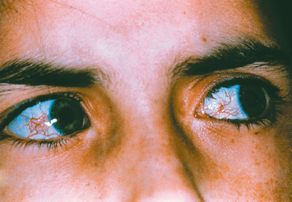

**Fig.14.1** Conjunctival telangiectasia in a patient with ataxiatelangiectasia.  (From Daroff RB, Jankovic J, Mazziotta JC, et al., eds. _Bradley’s Neurology in Clinical Practice._ 7th ed. Philadelphia: Elsevier; 2016:1468, Fig. 97.6. [Also Fig. 40.5, p. 732 in _Nelson Pediatric Symptom-Based Diagnosis_ 2/e].) 

#### **Making the Diagnosis (Tables 14.2 and 14.3)** 

The clinical and laboratory findings, and the imaging and molecular genetics/genomics technologies that allow the appropriate diagnosis to be made, are shown in Table 14.3. 

### **Hereditary Ataxias Onset in Adolescence** 

#### **Characteristic Symptoms and Signs** 

The presenting clinical symptoms are usually _clumsiness of gait_ and _unexplained falls_ . 

Although the onset of symptoms is very similar to Friedreich ataxia, which can occur in this age group, most of the adolescent-onset hereditary ataxias have cerebellar atrophy rather than the cervical cord atrophy seen in Friedreich ataxia. 

Tables 14.3 and 14.4 indicate the clinical and laboratory phenotypes and the imaging and molecular genetics/ genomics technologies that assist in the diagnosis of hereditary ataxias in adolescence and also late-onset ataxia in adults (e.g., **spinocerebellar ataxias [SCAs]** and **episodic ataxias [EAs]** ). Both SCAs and EAs have autosomal dominant

<!-- p.338 -->

**TABLE 14.1 Common Hereditary Ataxias Onset Before the Age of 5 Years** 

|Disorder|Clinical Neurologic Features|Clinical Non-Neurologic Features|Laboratory Features|Imaging Features|Genetic Features AD Autosomal Dominant AR Autosomal Recessive|
|---|---|---|---|---|---|
|Ataxia telangiectasia and variants|Cerebellar ataxia, oculomotor apraxia, extrapyramidal features, large fiber sensory neuropathy; Wheelchair confined by age 10|Telangiectases present 2–4 years after onset of ataxia; Humoral and cellular immunodeficiency Leukemia, lymphoma, other neoplasms (38%); Hypogonadism; Glucose intolerance|High serum α-fetoprotein in more than 90% of patients with A-T Serum AFP concentration may be high in unaffected children less than 24 months of age Serum Immunoglobulins— Reduced or absent IgA, IgE & IgG2 IgM: Increased (23%) Oligo-/monoclonal gammopathy (10%) Other immunodeficiency— T-cell deficiencies: 30% Thymus: Small embryonic-like Chromosome breakage-7;14 chromosomal translocation in 5 to 15% of peripheral cells Break points: 14q11; 14q32; 7p13-p15; 7q32-q35; 2p11; 2q11 Sensitivity to ionizing radiation|MRI: Small cerebellum|AR _ATM_-encoded protein; 11q22-23 Ataxia-telangiectasia-like disorder 1 (ATLD1)— MRE11; Chromosome 11q21 with milder course and no extraneural features Ataxia-telangiectasia-like disorder 2 (ATLD2)— Proliferating cell nuclear antigen (PCNA); Chromosome 20p13-p12|
|Infantile onset Spinocerebellar ataxia (IOSCA)|Ataxia, athetosis, depressed DTRs; later large fiber neuropathy, ophthalmoplegia, hearing loss, seizures, reduced mental capacity|Female hypogonadism|Mildly elevated blood lactate; Respiratory chain complex I & IV deficiency|MRI cerebellar, brainstem, and spinal cord atrophy; middle cerebellar peduncle high-signal lesions|AR Twinkle protein (c10orf2); 10q24.31|
|Spinocerebellar ataxias type 2 and 7|Loss of motor milestones. Retinitis pigmentosa, optic atrophy; seizures; dysphagia|None|None|MRI cerebral, cerebellar brainstem atrophy|AD Triplet repeats expansions Anticipation|
|Spinocerebellar ataxias type 5, 13, 29|Ataxia, nystagmus, developmental delays, non- progressive|None|None|MRI cerebellar atrophy|AD Inframe deletions, point variants|
|Episodic ataxias|Ataxia attacks lasting minutes to hours to days; occasionally associated with seizures; may respond to clonazepam or acetazolamide|None|None|Brain MRI may be normal|AD EA8 1p36.13-p34.3 EA9 FGF14 DYT9 SLC2A1(GLUT1) 1p34.2 SCN2A: Nav1.2|
|Inborn errors of metabolism and mitochondrial disorders|Discussed in Chapter 8|||||

<!-- p.339 -->

##### **TABLE 14.2 Ataxias in Which Specific Abnormalities May Confirm or Point to the Diagnosis** 

|Disorder|Diagnosis|
|---|---|
|Abetalipoproteinemia|Low vitamin E levels, abnormal lipoprotein electrophoresis|
|Aceruloplasminemia|Cognitive changes, craniofacial dyskinesia, ataxia, retinal degeneration, low serum copper, absent ceruloplasmin, abnormal MRI brain; variants in the ceruloplasmin gene|
|Adrenomyeloneuropathy|Ataxia, neuropsychiatric changes, abnormal MRI, elevated serum long-chain fatty acids; variants in the_ABCD2_gene|
|Ataxia with coenzyme Q10 (CoQ10) deficiency|Low CoQ10 in muscle biopsy|
|AOA1|High serum cholesterol, low albumin|
|AOA2|High α-fetoprotein|
|AT|High α-fetoprotein, low immunoglobulin (Ig)|
|Celiac disease|Antitissue transglutaminase antibody, duodenal biopsy, HLA-DQ2.5 or DQ8 molecules|
|Cerebrotendinous xanthomatosis|Intestinal symptoms, spastic ataxia, cognitive impairment, tendon xanthoma, high serum cholestanol; variants in the_CYP27A1_gene|
|Late-onset Tay-Sachs (LOTS)|Ataxia, neurogenic weakness, cognitive changes; hexosaminidase levels,_HEXA_variant analysis|
|Niemann-Pick type C (NPC) disease|Vertical gaze palsy, hepatosplenomegaly, fibroblast and_NPC_variants|
|Pyruvate dehydrogenase complex (PDHC) deficiency|Plasma and CSF lactate; PDHC in fibroblasts; variants in_PDHC_complex genes|
|Refsum disease|Ataxia, neural deafness, retinitis pigmentosa, ichthyosis, elevated plasma phytanic acid; variants in_PHYH_and_PEX 7_genes|
|Syndromes of myoclonic epilepsy|Many associated with ataxia|
|Vanishing white matter disease|MRI and MRS|
|Wilson disease|Serum copper, ceruloplasmin|

_AOA,_ Ataxia with oculomotor apraxia; _AT,_ ataxia-telangiectasia; _CNS,_ central nervous system; _CSF,_ cerebrospinal fluid; _MRS,_ magnetic resonance spectroscopy. From Daroff RB, Jankovic J, Mazziotta JC, et al., eds. _Bradley’s Neurology in Clinical Practice._ 7th ed. Philadelphia: Elsevier; 2016:1470, Table 97.3. (Also Table 40.13 in _Nelson Pediatric Symptom-Based Diagnosis_ ). 

inheritance, genetic heterogeneity, and clinical phenotypic diversity with associated non-ataxic symptoms. 

### **Approach to the Undiagnosed Patient** 

For any patient with progressive cerebellar ataxia, continuing to work toward a diagnosis is critically important. Identification of an exact causative factor can direct specific treatments and provide important counseling for the patient and family. The focus for undiagnosed childhood (and adult) onset hereditary ataxias is to obtain whole-exome/ genome sequencing, which can be reanalyzed every two to three years for new genetic factors or disease correlates. Even with the most advanced testing technologies, the diagnostic rate may only approach 50%. 

It is also encouraged to have patients bank DNA with a clinical site associated with the Undiagnosed Disease Network (UDN)—a research study that is funded by the National Institutes of Health—or other hospital-based Undiagnosed Disease services with functional genomics and translational diagnostics programs. The UDN has 

funded gene discovery projects and multiple rounds of gene function studies to elucidate the biologic mechanisms of genetic variants identified in patients. 

Goals of supportive care for the diagnosed and undiagnosed ataxic child include safe mobility and fall prevention, independence in activities of daily living, intelligible speech or other communication, safe swallow or other nutrition, safe airway, treatment of deconditioning, fatigue, and pain. Resources that can be offered to the patient and family include physical therapy, occupational therapy, orthotic consultation, speech and swallowing therapy, nutrition assessment, home health assistance, genetic counseling, psychosocial counseling, coordination with educational facilities, legal aid, support groups, and appropriate other medical specialties (ophthalmology, audiology, cardiology, pulmonary, immunology, urology, gastroenterology). 

Omaveloxolone (Skyclarys®) is approved for Friedreich ataxia; there are no approved symptomatic medications for the other ataxia. There are medications that can be safely used in children for associated symptoms (e.g., tremor, dizziness, spasticity, neuropathy, pain, depression, anxiety).

<!-- p.340 -->

##### **TABLE 14.3 Common Hereditary Ataxias Onset Between the Ages of 5 and 12 Years** 

|Disorder|Clinical Neurologic Features|Clinical Non-neurologic Features|Laboratory Features|Imaging Features|Genetic Features AD Autosomal Dominant AR Autosomal Recessive|
|---|---|---|---|---|---|
|Friedreich ataxia|Caudal to rostral ataxia progression, posterior column sensory loss, absent deep tendon reflexes, bilateral Babinski sign, ocular fixation instability; later stage vision and hearing loss.|Hypertrophic cardiomyopathy (75%); Scoliosis, pes cavus (60– 80%); Diabetes or glucose intolerance (20%)|ECG—non-specific ST-T wave changes|MRI cervical cord atrophy, later stage midline cerebellar atrophy|AR GAA triplet expansions (will not be picked up on WES)|
|Charlevoix- Saguenay—Spastic Ataxia (ARSACS; SPAX 6)|Ataxia, nystagmus, spasticity, motor-sensory neuropathy, slow progression|Pes cavus, hammertoes|None|MRI Atrophy cerebellar vermis; brainstem (pons and middle cerebellar peduncles) with linear hypointensities (T2)|AR Sacsin (SACS); Chromosome 13q12.12 Deletions, point variants|
|Spinocerebellar ataxias 1, 2, 3|Ataxia, spasticity, dystonia, ophthalmoplegia, polyneuropathy, dementia|Some with autonomic dysfunction affecting bladder and bowels|None|MRI cerebellar and pontine atrophy|AD CAG triplet repeats expansions Anticipation|
|Dentatorubral- Pallidoluysian Atrophy (DRPLA)|Myoclonus Epilepsy Ataxia Chorea Dementia|None|None|MRI cerebral cerebellar and brainstem atrophy|AD CAG triplet repeat expansions Anticipation|
|Juvenile onset inborn of metabolism and mitochondrial disorders|Discussed in Chapter 8|||||

<!-- p.341 -->

#### **TABLE 14.4** Common Heredita ry Ataxias Onset in Adol escence

|||Clinical|||Genetic Features|
|---|---|---|---|---|---|
|Disorder|Clinical Neurologic Features|Non-neurologic Features|Laboratory Features|Imaging Features|AD Autosomal Dominant AR Autosomal Recessive|
|Ataxia with oculomotor apraxia type 1|Ataxia, extrapyramidal features, oculomotor apraxia, motor-sensory neuropathy|None|Hypoalbuminemia|MRI cerebellar and brainstem atrophy|AR Aprataxin (APTX); Chromosome 9p21.1 Insertion, deletion, missense variants|
|Ataxia with oculomotor apraxia type 2|Ataxia, extrapyramidal features, oculomotor apraxia, motor-sensory neuropathy|Ovarian failure in some patients|Elevated alpha fetoprotein and serum CK|MRI cerebellar atrophy|AR Senataxin (SETX); Chromosome 9q34.13 Premature termination, missense|
|Vitamin E related deficiencies— abetalipoproteinemia|Ataxia, large fiber sensory loss, retinal degeneration|None|Acanthocytosis Very low circulating β-lipoproteins|Not reported|AR Microsomal Triglyceride Transfer Protein, large polypeptide (MTP); Chromosome 4q23|
|Vitamin E related deficiencies— **a**-Tocopherol transfer protein (ATTP; TTPA)|Ataxia, motor-sensory polyneuropathy, upper motor neuron features, retinitis pigmentosa, hearing loss|Xanthomas, Scoliosis, pes cavus, hammertoes,|Low serum vitamin E, High cholesterol and triglycerides|MRI brain may be normal|AR α-Tocopherol transfer protein (ATTP; TTPA); Chromosome 8q12.3|
|Spinocerebellar ataxias 1, 2, 3*|Ataxia, spasticity, dystonia, ophthalmoplegia, polyneuropathy, dementia|Some with autonomic dysfunction affecting bladder and bowels|None|MRI cerebellar and pontine atrophy|AD CAG triplet repeat expansions Anticipation|
|Episodic ataxias 1 and 2|EA-1 manifests without vertigo and it is associated with interictal myokymia; EA-2 shows vertigo and interictal nystagmus||||AD|
|Late onset inborn errors of metabolism and mitochondrial disorders|Discussed in Chapter 8|||||

*Spinocerebellar ataxias are more frequent in late-onset hereditary ataxias; they also include pure cerebellar forms caused by CAG expansions such as SCA6.

<!-- p.342 -->

## Hereditary Choreas 

##### **CARLOS ESTEVEZ-FRAGA, JUAN CARLOS MARTINEZ-CASTRILLO, PEDRO J. GARCIA-RUIZ** 

Chorea is characterized by fluctuating, brief, and unpredictable involuntary movements. The diagnosis and management of chorea is challenging because chorea can be the result of multiple processes both genetic and acquired. In the absence of an evident cause, ruling out **Huntington disease (HD)** should always be the first step in the diagnostic workup. However, despite extensive investigations, a high proportion of cases remain undiagnosed (Table 14.5). 

In addition, chorea may be present with other movement disorders, the involved genes may overlap (Fig. 14.2), and the age of onset may vary depending on the diagnosis (Fig. 14.3) 

### **Huntington Disease** 

#### **Epidemiology and Pathophysiology of Huntington Disease** 

Huntington disease is a neurodegenerative disease characterized by cognitive impairment, motor dysfunction, and psychiatric disturbance. HD is the most frequent autosomal dominant neurodegenerative condition, with an estimated worldwide prevalence of 2.71/100,000. However, its prevalence varies, being lower in Asia and higher in areas with predominantly Caucasian populations such as Australia, Europe, and North America. 

It is caused by a cytosine-adenine-guanine (CAG) trinucleotide expansion in the _HTT_ gene. The _HTT_ gene has 67 exons and encodes a large 350-kDa HTT protein. The CAG repeat tract is located in the first exon of the gene, being translated into a polyglutamine tail in the N-terminal domain of the huntingtin (HTT). 

HTT has multiple physiological functions implicated in numerous cellular processes such as vesicular transport, cell division, ciliogenesis, autophagy and transcriptional regulation. HTT is crucial for the release and delivery of several neuroprotective factors such as brain-derived neurotrophic factor (BDNF). Importantly, it plays a crucial role during early development of the central nervous system. 

The number of CAG repeats is inversely associated with age at the onset of motor symptoms and disease progression. The average CAG repeat in HD patients is 43–45, which leads to an age at onset of approximately 40 years of age and average survival of 25 years from diagnosis. 

Usually, intergenerational transmission is stable, with CAG repeat expansions of similar size in children of affected parents. However, the _HTT_ gene is unstable in the spermatogonia meiosis, with the possibility of larger CAG repeat sizes when being transmitted from the paternal side, leading to larger CAG expansions and earlier onset in a phenomenon known as genetic anticipation. 

The penetrance of HD is reduced between 36 and 39 CAG repeats, while patients with more than 39 CAG repeats invariably develop HD if they have a normal lifespan. In these cases, the enlarged polyglutamine tail results in the production of an abnormal expanded Huntingtin (mHTT) protein. The chronic expression of mHTT disrupts brain cell homeostasis, leading to cellular death and eventually the emergence of the HD phenotype. 

#### **Clinical Features of Adult-Onset Huntington Disease** 

The clinical diagnosis of manifest HD is based on the presence of unequivocal motor signs. However, subtle cognitive motor and psychiatric deficits may be present up to 15 years before the onset of manifest disease; this period is known as the _premanifest stage_ of HD. 

Because of the preferential, loss of striatal medium spiny neurons from the indirect pathway the disease in adult-onset patients is characterized by an initial _hyperkinetic phase_ with _chorea_ and _dystonia_ followed by a _hypokinetic phase_ where parkinsonism predominates. In addition, there is ocular involvement with delayed, slow saccades as well as progressive speech impairment. The cognitive decline of adult-onset patients begins with subtle deficits and follows a subcortical pattern with altered processing speed, executive dysfunction, deficits in visuomotor integration, and impaired emotion recognition. Psychiatric symptoms in adults are also frequent during and after the premanifest stage of the disease. Apathy is the most frequent psychiatric feature followed by irritability, depression, and obsessive-compulsive behaviors. Psychosis is rare. Motor and cognitive symptoms increase with disease progression and correlate with striatal and cortical atrophy. Apathy is the only psychiatric symptom that increases gradually over the years. 

#### **Clinical Symptoms of Juvenile Huntington Disease** 

Juvenile HD (JHD) patients develop symptoms before 21 years of age; patients typically possess a median CAG repeat of 60, although the range can vary from 50 to over 100 CAG repeats. The expanded repeat is usually inherited from the paternal side. Occasionally, in cases with very large intergenerational expansions, the affected parent may not have developed symptoms when the patient with JHD presents. JHD can be further subdivided. The term **pediatric HD** is used for patients who exhibit clinical signs before turning 18 years old. Pediatric HD can be further categorized

<!-- p.343 -->

##### **TABLE Genetic Causes of Chorea 14.5** 

|Syndrome (Inheritance)|Chorea|Other Movement Disorders|Ataxia|Cognitive Impairment|Clinical Features|Ancillary Tests|
|---|---|---|---|---|---|---|
|Huntington disease (AD)|++|1,2,3,4|+/−|++|Motor impersistence|Caudate atrophy (MRI)|
|HDL-1 (AD)|+|1||++|Rapid early onset dementia||
|HDL-2 (AD)|++|1,2,3,4||++|African ancestry||
|Chorea-acanthocytosis (AR)|++|1,2,3||+|Tongue/lip biting|Acanthocytes on blood smear|
|McLeod Syndrome (X-linked)|++|1,2,3||+/−|Neuropathy/ Cardiopathy|Acanthocytes on blood smear|
|SCA 17 (AD)|++|1,2,4|++|+||Cerebellar atrophy (MRI)|
|DRPLA (AD)|++|1,2,4|++|++|Asían ancestry|Cerebellar atrophy (MRI)|
|Other SCAs (1,2,3,7…)|+|1,2,4|++|+/−|Spasticity (SCA3)|Cerebellar atrophy (MRI)|
|Friedreich ataxia (AR)|+/−|2|++||Pes cavus, neuropathy|Cerebellar atrophy (MRI)|
|CANVAS (AR)|+/−||++||Vestibular areflexia Chronic cough|Cerebellar atrophy (MRI)|
|Ataxia telangiectasia (AR)|+/−|2|++||Conjunctival telangiectasias|halpha fetoprotein|
|PKAN (AR)|+/−|2,3,4|+|+|Spasticity, tongue protrusion|Eye of the tiger sign (MRI)|
|Neuroferritinopathy (AD)|+|2,3,4||++|Facial dyskinesias|Iron (basal ganglia) (MRI)|
|Aceruloplasminemia (AR)|+|2,3,4||++||ggserum ceruloplasmin|
|C9orf72 (AD)|+|1,2,4||++|Early onset dementia|Temporal atrophy (MRI)|
|TITF1 (also known as NKX 2.1) (AD)|++|1,2,3|+||Thyroid and lung dysfunction||
|ADCY5 (AD/De novo)|++|1,2,3|++|+|Hypotonia, sleep dyskinesias||
|PDE10A (AR/De novo)|++|1,2,3|++||||
|Mitochondrial (variable)|+|1,2,3,4|+|+|Deafness, short stature, diabetes|hserum lactate|
|Glut-1 deficiency (AD)|+|1,2|+|+|Epilepsy, paroxysmal dyskinesias|gCSF glucose|
|Lesch-Nyhan disease (X linked)|+/−|2||+|Self-injurious behavior|hserum uric acid|
|Idiopathic basal ganglia calcifications (AD)|+/−|2,4|+|+||Basal ganglia calcification (CT, MRI)|

**Other movement disorders (1: myoclonus; 2: dystonia; 3: tics; 4 parkinsonism)** 

(++ cardinal symptom; + frequent symptom but not always present; +/− occasional, symptom). _AD,_ Autosomal dominant; _AR,_ autosomal recessive; _CANVAS,_ cerebellar ataxia with neuropathy and vestibular areflexia syndrome; _HDL1,_ Huntington disease like 1; _HDL2,_ Huntington disease like 2; _PKAN,_ pantothenate kinase–associated neurodegeneration; _SCA,_ spinocerebellar ataxia.

<!-- p.344 -->

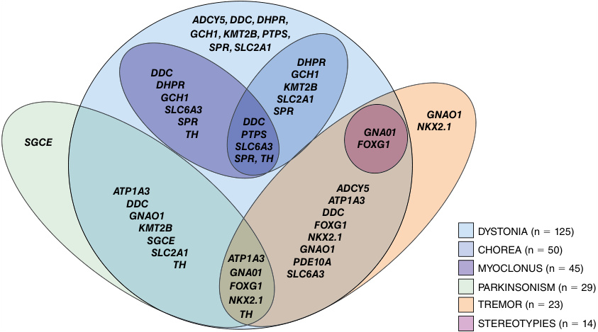

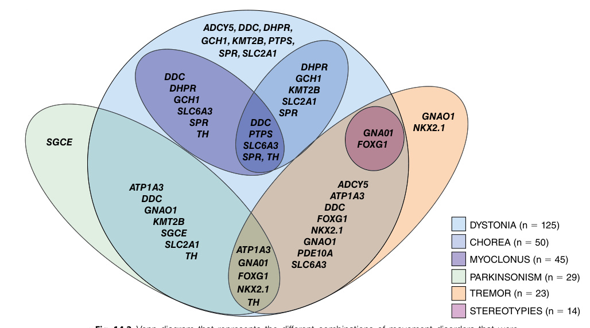

**Fig. 14.2** Venn diagram that represents the different combinations of movement disorders that were linked to a genetic variant.  (From Pérez-Dueñas B, Gorman K, Marcé-Grau A, et al. The genetic landscape of complex childhood-onset hyperkinetic movement disorders. _Mov Disorders_ 2022;37[11]:2197–2208 [Fig. 2, p. 2200].) 

into **childhood** (under 10 years) and **adolescent** onset (10–18 years). 

Although rare, approximately 10% of HD expansion _carriers_ develop juvenile HD. Mean survival from diagnosis is 11 years after the onset of symptoms, which tend to emerge faster than in standard adult-onset HD. Clinical features atypical for adult-onset HD such as falls, gait impairment, personality changes, speech disturbance, or neuropsychiatric symptoms are frequent in JHD patients. 

**Parkinsonism** appears in virtually every patient with JHD during disease progression, but it is present in only 16% of patients at onset. Bradykinesia and rigidity are more frequent than rest tremor. Dystonia tends to coexist with parkinsonism, usually being present from onset. Chorea can emerge during disease evolution, although it is more frequent in JHD cases with onset during late adolescence than in childhood. Ataxia is present in 11% of JHD patients. Other movement disorders such as myoclonus or tics, particularly in the context of Tourette syndrome, have also been described. 

Epilepsy is a common feature of JHD, being present in _<_ 30% of the patients. Generalized tonic-clonic seizures are the most frequent, followed by tonic, myoclonic, and absences. Multiple seizure types tend to be present in the same individual. Electroencephalogram (EEG) shows epileptiform findings in more than half of the patients. Seizures are controlled with monotherapy in _<_ 50%. 

Frequently there is poor school performance prior to clinical motor diagnosis and cognitive symptoms are 

frequently reported as the first deficits of JHD. When the disease progresses, other cognitive features such as attention deficits, dysexecutive syndrome, and psychomotor slowing also become apparent. 

Psychiatric symptoms appear in 80% of JHD patients, including irritability, aggression, social withdrawal, anorexia, or addiction to drugs, and up to 25% of patients with JHD may develop suicide attempts. 

Sleep disturbances with abnormal sleep-wake cycle are also frequent. Other symptoms such as speech disturbance and pain and itching are also frequent, presenting in _<_ 50% of patients with HD. 

#### **Pathology and Biomarkers in Juvenile Huntington Disease** 

There are a few histological studies investigating the distribution of pathology in JHD. Available evidence shows severe atrophy in the frontal cortex and striatum. There is also marked atrophy in the globus pallidus, which could be responsible for the marked parkinsonism present in JHD (Fig. 14.4). Thalamic involvement has also been described. 

Although the cerebellum is particularly resistant to neurodegeneration in HD, several studies have suggested that cerebellar atrophy with loss of Purkinje cells is characteristic of JHD. However, these patients had epilepsy and the cerebellar changes could be attributed to injury secondary

<!-- p.345 -->

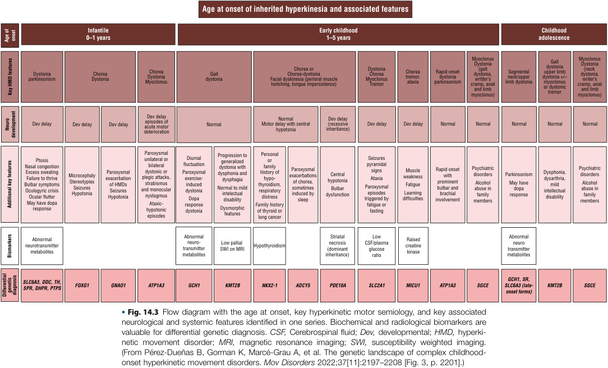

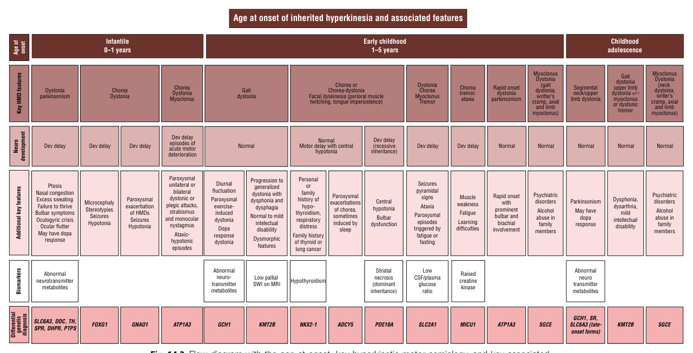

<!-- p.346 -->

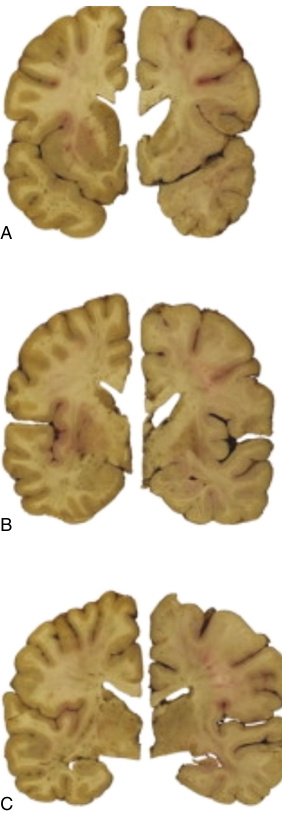

**Fig. 14.4** Coronal sections passing through the nucleus accumbens (A); through the caudal edge of the anterior commissure (B); and the lateral geniculate body (C). From a 43-year-old man, control for comparison (A, B, and C left panels, brain weight [BW] 1412.4 g); from a 24-year-old man with CAG 70/20 and onset of symptoms at age 13 years (A, B, and C right panels, BW 1167.9 g, grade 3/4). The striatum is severely atrophic compared to the control. The extent of the volume loss of the nonstriatal compartments is variable.  (From Vonsattel JPG, Keller C, Ramirez EPC: Huntington’s disease: neuropathology. _Handbook Clin Neurol_ . 2011:100;83–100. https://doi.org/ 10.1016/B978-0-444-52014-2.00004-5.) 

to the antiepileptic drugs and/or ischemic events associated with seizures; other patients have not shown cerebellar atrophy. 

A study with volumetric MRI in 19 patients with JHD identified a decreased volume of subcortical structures and hemispheric white matter. This study demonstrated larger cerebellar volumes in expansion carriers, while there were no significant cortical changes. JHD patients have increased 

neurofilament light protein (NfL) in plasma, a marker of neuroaxonal damage (Fig. 14.5). These biomarkers could be used to assess the potential benefit of a disease-modifying therapy in JHD. The rapid development of motor symptoms in JHD might facilitate the detection of a clinical effect over a clinical trial period with a potential disease-modifying therapy. 

#### **Management of Juvenile Huntington Disease** 

There are no disease-modifying therapies for HD. Numerous _symptomatic_ treatments are available to improve the disabling symptoms present in JHD. Management within a multidisciplinary team in centers with expertise in the treatment of JHD is usually beneficial to target the multiple and complex care needs present condition. 

It is recommended to involve the physiotherapy and occupational therapy teams at an early stage. Conducting swallowing assessments to prevent aspiration pneumonia and ensuring close follow-up with a dietitian for weight monitoring and provision of caloric supplements can be beneficial. Schooling with annual assessments of cognitive decline is also important. 

Evidence for the use of pharmacologic treatments is mostly limited to case reports. Mild chorea and mild parkinsonism do not require treatment. Severe parkinsonism can be treated with levodopa and there have been reports of sustained benefit, although chorea might develop as a side effect and needs to be monitored. Disabling chorea is rare in JHD, but if present, it could be treated with the same drugs used in adult-onset HD, such as tetrabenazine or olanzapine, always monitoring for side effects. Antispasticity drugs are commonly prescribed, but their side effects should also be monitored. 

**Psychiatric manifestations** such as depression or anxiety can be treated with selective serotonin reuptake inhibitors (SSRIs). SSRIs at higher doses can be used for the treatment of obsessive-compulsive symptoms when required. Antipsychotics are usually prescribed for irritability and psychosis, but these drugs may worsen parkinsonism. Antiepileptic drugs with mood-stabilizer effects can be also used to target both epilepsy and psychiatric symptoms. 

Treatment response and side effects from medications need to be regularly assessed, and drugs targeting simultaneously different symptoms affected by the disease are usually preferred to avoid polypharmacy. Most patients with JHD require a combination of drugs to target their symptoms. The neurodegenerative condition of JHD needs to be addressed. A decision about advanced-stage treatments, such as gastrostomy feeding and palliative care, should ideally be made in advance. 

### **Genetic Choreas Different From Huntington Disease** 

A proportion of patients with the HD phenotype do not have the expansion in the HTT gene. There are several

<!-- p.347 -->

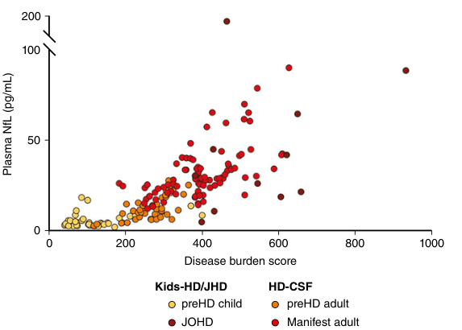

**Fig. 14.5** Plasma neurofilament light protein (NfL) is elevated in juvenile HD and children within 20 years to onset of. Plasma NfL is elevated in children and adults with HD. _HD,_ Huntington disease; _NfL,_ neurofilament light protein; _preHD,_ premotor-manifest.  (Modified from Byrne LM., Jordan L, et al: Neurofilament light protein as a potential blood biomarker for Huntington’s disease in children. _Move Disord._ 2022;37[7]:1526–1531 [Fig. 1, p. 1529]. https://doi.org/10.1002/mds.29027.) 

genes responsible for these syndromes; however, most patients remain undiagnosed despite extensive evaluations. Some of these hereditary choreas are clinically similar to HD, while others have associated features such as ataxia, dystonia, or spasticity that could guide the diagnosis. 

The absence of family history does not rule out hereditary choreas, because low penetrance dominant variants, recessive conditions, as well as X-linked or _de novo_ variants can be present. Some of these conditions can be effectively treated, and early recognition is critical. The classification of non-HD choreas is evolving and terms such as “HD-like syndromes” are likely to be replaced by more precise terminology including the disease-causing genes. 

#### **Huntington Disease-like Syndromes** 

These entities are similar to HD (frequently defined as phenocopies) and include Huntington disease-like 1 (HDL1) and HDL2, both autosomal dominants. 

**HDL1** is a prion disease, caused by an octapeptide repeat insertion in the prion protein gene, _PRNP_ . HDL1 is characterized by psychiatric features, rapidly progressive earlyonset cortical dementia, ataxia, myoclonus, and chorea in some, but not all, cases. 

**HDL2** is due to an expanded CTG repeat at the _JPH3_ gene. It is the most common HD phenocopy in some African countries. African heritage is a key element of this condition, being otherwise very similar to HD. The clinical 

symptoms include chorea, cognitive decline, and oculomotor disturbances. 

#### **Neuroacanthocytosis** 

Neuroacanthocytosis syndromes are defined by the presence of neurological symptoms alongside acanthocytes on peripheral blood smear. Classically, two conditions have been included in this category, chorea-acanthocytosis and McLeod syndrome. Acanthocytes can also be observed in other neurological conditions such as neurodegeneration with brain iron accumulation syndromes (Chapter 13). 

**Chorea-acanthocytosis** is characterized by self-injurious orofacial dyskinesia and generalized chorea. Chorea is associated with prominent facio-buccal-lingual dyskinesias leading to speech and swallowing problems as well as typically tongue and lip biting, sometimes with severe mutilations. In addition, axonal neuropathy, myopathy, seizures, and a bizarre gait described as “rubber person” can be observed. It is an autosomal recessive entity caused by variants of the _VPS13A_ gene coding for chorein, a large protein implicated in intracellular protein sorting. Deep brain stimulation in the globus pallidus might be a treatment option for selected patients. 

**McLeod syndrome** is an X-linked recessive hereditary disorder that presents only in males. The phenotype is similar to chorea-acanthocytosis. Chorea is usually present but less frequently associated with buccoorolingual dyskinesias. Typical features include peripheral neuropathy, cardiomyopathy, and elevated liver and muscular

<!-- p.348 -->

enzymes. The red blood cell Kx antigen is absent, and the expression of Kell antigens on the erythrocyte membrane surface is reduced. 

### **Ataxic Conditions** 

Hereditary ataxias can sometimes have associated chorea, especially spinocerebellar ataxia 17 (SCA17) (Caucasians) and dentatorubral-pallidoluysian atrophy (DRPLA) (Asian population). In these cases, subtle ataxic clinical signs or a mild degree of cerebellar atrophy on MRI are the clues for the correct diagnosis. 

In **SCA17** (formerly known as HDL4), clinical features include chorea, dystonia, parkinsonism, and spasticity. SCA17 is an autosomal dominant trinucleotide-repeat disorder, caused by CAG or CAA expansions in the _TBP_ gene, encoding for the TATA-box binding protein. 

In **DRPLA** (dentatorubal-pallidoluysian atrophy) chorea, myoclonus, epilepsy, and ataxia are the main key features. Asian ancestry, particularly Japanese, is a genetic risk factor. DRPLA is also an autosomal dominant disease due to a CAG-repeat expansion in the _ATN1_ gene, encoding for atrophin-1. 

Other ataxic syndromes occasionally present chorea, including SCAs 1, 2, 3, 7, 8, and 14, although chorea is rarely the predominant movement disorder in these conditions. 

Recessive ataxias such as Friedreich ataxia, cerebellar ataxia, neuropathy vestibular areflexia syndrome (CANVAS), and ataxia-telangiectasia may present with chorea. **Friedreich ataxia** is usually associated with scoliosis, pes cavus, cardiomyopathy, and ataxia, while **CANVAS** patients tend to have vestibular areflexia and dry chronic cough (cerebellar ataxia, neuropathy). **Ataxia telangiectasia** must be kept in mind for childhood-onset chorea with dyskinesias, especially dystonia and chorea, associated to ataxia and immune defects. Ataxia telangiectasia is one of the most common forms of progressive cerebellar ataxia of early childhood. 

### **Neurodegeneration With Brain Iron Accumulation (See Also Chapter 13)** 

This heterogeneous group of diseases is characterized by iron accumulation in specific brain areas, mainly the globus pallidus. Clinically neurodegeneration with brain iron accumulation (NBIAs) is variable, but a combination of dyskinesias including facial dystonia is frequently described. In addition, parkinsonism, cognitive decline, spasticity, and ataxia are frequent symptoms. Chorea is rarely the presenting symptom and tends to be associated with other extrapyramidal and pyramidal elements. These disorders should be suspected when increased iron in the basal ganglia is observed in iron-sensitive sequences such as susceptibilityweighted imaging (SWE) or T2* sequences in brain MRI imaging (see Chapter 8). 

### **Frontotemporal Dementia** 

Chorea can be present in patients with **frontotemporal dementia (FTD)** , especially in _C9orf72_ expansion variant carriers. Autosomal dominant variants in _C9orf72_ are the most frequent genetic cause of FTD and amyotrophic lateral sclerosis, and also the commonest cause of non-HD chorea in adults. Frontotemporal atrophy on neuroimaging and marked psychiatric symptoms are useful diagnostic clues. 

Chorea has also been noticed in other frontotemporal variants, including _TARDBP_ or _PGRN-_ related disorders, as well as in familial cases of FTD without known variants. 

### **Benign Hereditary Chorea** 

Several gene variants leading to childhood-onset chorea have been described. Benign hereditary chorea (BHC) is defined as an autosomal dominant disease, characterized by early-onset, non-progressive chorea. The chorea may spontaneously improve over time. Other movement disorders may be present including myoclonus, tics, dystonia, and ataxia. 

Variants in the _TITF1_ gene (also known as _NKX2-1_ ), encoding a transcription factor essential for striatal development were the first identified genetic cause of BHC. The majority of newly identified cases result from _de novo_ variants. These variants lead to a multisystem disease affecting lungs, thyroid, and basal ganglia. 

**_ADCY5_ -related chorea** is an autosomal dominant disorder characterized by early onset of chorea, frequently associated with facial dyskinesias as well as myoclonus, dystonia, and tics. Episodic exacerbations and worsening of dyskinesias at night (during drowsiness and arousal) are characteristic clinical clues. Axial hypotonia and a bizarre mobilization defined as “frog gait” can be present. Gain-offunction variants in _ADCY5_ leading to elevated striatal cAMP have been suggested to be responsible for the chorea. Caffeine or theophylline has been found to be effective for the treatment _ADCY5_ -related sleep dyskinesias. 

**Autosomal recessive** **_PDE10A_ -related chorea** is similar to _ADCY5_ -related chorea. _PDE_ genes encode for an enzyme that hydrolyses cAMP. _PDE10A_ variants have decreased enzymatic activity and result in increased cAMP levels due to loss-of-function. 

### **Other Causes of Genetic Choreas** 

Tables 14.5 and 14.6 summarize the most frequent processes and a basic approach to non-HD choreas. 

In early-onset chorea with suspected family history, if the already discussed conditions are ruled out, it is suggested to look for potentially treatable and/or easy to diagnose diseases, including mitochondrial diseases, GLUT1 deficiency, Lesch-Nyhan disease, Rett syndrome, Wilson disease, and idiopathic basal ganglia calcification. Nonetheless, the

<!-- p.349 -->

###### **TABLE 14.6** 

#### **Differential Diagnosis of Acquired Chorea** 

##### **Static Injury** 

- Kernicterus 

- Hypoxic/ischemic insult: infarct, cardiac arrest, cardiac bypass, perinatal hypoxia, polycythemia vera, Moyamoya disease, bronchopulmonary dysplasia in infants, carbon monoxide inhalation 

- Toxin-induced: Ethanol, methanol, toluene, bismuth, manganese, thallium, mercury 

- Infections: mycoplasma, Lyme disease, legionella, toxoplasmosis, human immunodeficiency virus, HSV, measles, mumps, varicella, parvovirus, cysticercosis 

- Trauma 

##### **Drug Exposure** 

   - Dopamine receptor blocking agents: Phenothiazines, butyrophenones, benzamides 

   - Antiparkinsonian drugs: L-dopa, dopamine agonists, anticholinergics 

   - • Antiepileptic drugs: Phenytoin, carbamazepine, valproic acid 

   - • Calcium-channel blockers: Cinnarizine, flunarizine, verapamil 

   - • Psychostimulants: Amphetamines, pemoline, cocaine, methylphenidate 

   - • Antihistamines 

- Midline CNS malformation disorders: Holoprosencephaly, • Oral contraceptives Joubert’s syndrome, agenesis of the corpus callosum • Antidepressants: tricyclics, selective serotonin reuptake 

- • Central pontine and extrapontine myelinolysis inhibitors • Opioid agonists 

- **Parainfectious and Autoimmune Syndromes** • Others: Lithium, baclofen, digoxin, cyclosporine, steroids, 

- • Sydenham chorea theophylline • Systemic lupus erythematosus **Metabolic Syndromes** 

- • NMDA-receptor antibody encephalitis • Other autoantibody mediated choreas: D2R, GABAAR, • Pelizaeus-Merzbacher disease type I LGI-1, CV2/CRMP5, Hu, CASPR2, Neurexin-3a IgLON5 • Glutaric aciduria type 1 

- • Behçet’s disease • Propionic academia • Antiphospholipid antibody syndrome • Homocystinuria • Acute disseminated encephalomyelitis • Phenylketonuria • Central nervous system vasculitis • Costeff syndrome (3-methyl-glutaconicaciduria) • Rasmussen encephalitis • Cerebral folate deficiency • Multiple sclerosis • Sulfite oxidase deficiency • Acute necrotizing encephalopathy • Pyruvate carboxylase deficiency • Chorea gravidarum • Biotinidase deficiency • Postinfectious or postvaccinal encephalitis • Acute intermittent porphyria **Endocrine or Nutritional Derangement Space Occupying Lesions** • Hyper or hypoglycemia • Tumor • Hyper or hyponatremia • Central nervous system lymphoma • Hyperthyroidism • Arteriovenous malformation • Hypoparathyroidism or pseudo-hypoparathyroidism • Cavernous hemangioma • Hypocalcemia • Hypomagnesemia • Vitamin B12 deficiency • Acquired hepatocerebral degeneration • Pheochromocytoma 

genetic testing is often negative in a substantial proportion of patients with non-HD choreas. 

## **Acquired Choreas** 

Many acquired choreas are treatable. The etiology of acquired chorea may include infections, autoimmune diseases, cerebral palsy, neurodegenerative disorders, cerebrovascular pathology, neoplasms, medications, drug exposure, and metabolic diseases (Table 14.6, Figs. 14.3 and 14.6). Patients with chorea typically exhibit similar 

characteristics. Therefore, the differential diagnosis of choreic syndromes is based mainly on accompanying findings. The differential diagnosis between chorea and tics can be complex in some cases; both phenomenologies can coexist in Huntington disease or Sydenham chorea. To achieve an etiological diagnosis in secondary choreas requires a comprehensive evaluation. A thorough clinical history, physical examination, and neuroimaging studies are crucial. Laboratory investigations, including metabolic and toxicology screening, may be necessary to identify specific causes.

<!-- p.350 -->

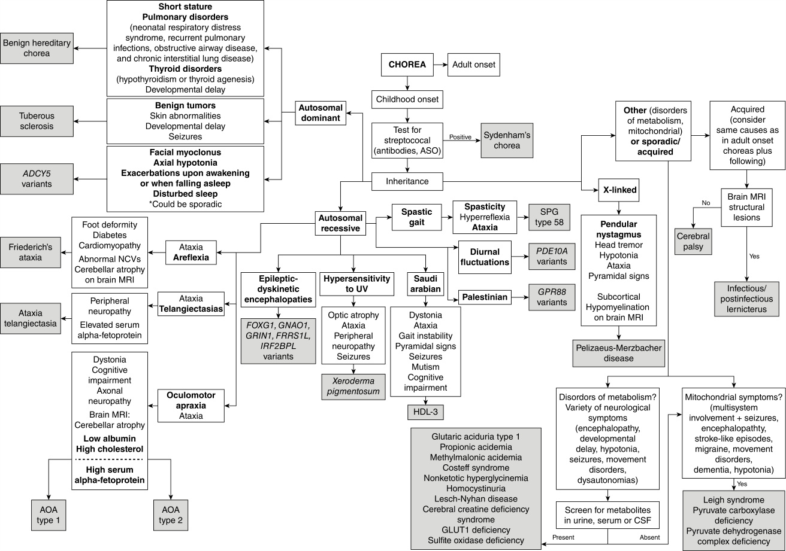

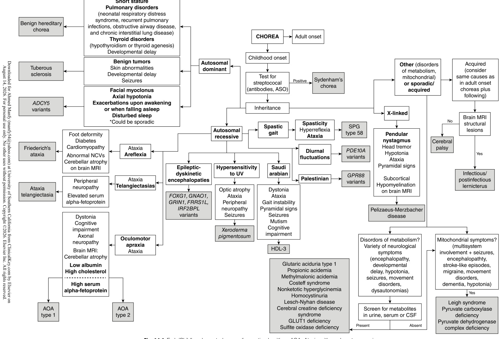

**Fig. 14.6** Early/Childhood-onset choreas diagnostic algorithm. _AOA,_ Ataxia with oculomotor apraxia; _ASO,_ antistreptolysin O; _HDL,_ Huntington-disease like; _SPG,_ spastic paraplegia.  (From Martinez-Ramirez D, Walker RH, Rodriguez-Violante M, Gatto EM: Review of hereditary and acquired rare choreas. _Tremor Other Hyperkinet Mov._ 2020;10[1]:1–24, [Fig. 2, Art 24, p. 2]. https://doi.org/10.5334/tohm.548.)

<!-- p.351 -->

# Hereditary Dystonia 

#### **BELÉN PÉREZ-DUEÑAS, ANNA MARCÉ-GRAU, ROSER PONS** 

Dystonia is a movement disorder characterized by involuntary, sustained, or intermittent muscle contractions, resulting in abnormal and often repetitive movements, postures, or a combination of both. Dystonia is a network disorder involving basal ganglia, cerebellar, thalamic, and cortical circuits, named the dystonia connectome. 

The etiology of dystonia can be acquired, idiopathic, or genetic. Acquired dystonia is the most frequent etiology in the pediatric age, and its main cause is dyskinetic cerebral palsy due to brain injury in the perinatal period. A growing number of patients with cerebral palsy are being diagnosed with genetic causes, some of which are treatable metabolic conditions. Consequently, conducting an exhaustive diagnostic assessment is crucial in children with cerebral palsy, particularly in those with a family history of consanguinity, unclear perinatal pathological events (no evidence of hypoxic ischemic encephalopathy), or initial normal brain imaging. 

The appearance of dystonic movements and postures in early life mirrors that in adults, and can manifest as hand fisting, foot inversion, toe extension, writer’s cramp, dysphonia, opisthotonos, oromandibular dystonia, torticollis, gait dystonia, and blepharospasm. Some genetic conditions exhibit distinct body distribution patterns; for instance, laryngeal dystonia is characteristic of _KMT2B, TUBBA4_ , and _THAP1_ gene disorders, while oromandibular dystonia is typical of neurodegeneration with brain iron accumulation and lysosomal disorders (Tables 14.7 and 14.8). Lower limb dystonia is common in _TOR1A_ and _KMT2B_ genetic disorders, while cervical dystonia is frequently described in _ANO3_ and _GNAL_ -related disorders. 

Drug-induced dystonia is another acquired cause of dystonia. In children, it is most frequently linked to antipsychotics, although anticonvulsants, antidepressants, antiparkinson drugs, antiemetics, and corticosteroids may also contribute. It typically presents acutely, is transient, and resolves with discontinuation of the offending agent. Chronic and tardive forms can also occur in children treated with neuroleptics or atypical antipsychotics. 

Dystonia may manifest at rest, during specific postures or actions (e.g., writer’s cramp or gait dystonia); in some instances, it can be episodic or paroxysmal, triggered by sudden movements ( _PRRT2_ gene disorders), exercise ( _SLC2A1_ or _GCH1_ ), infections, or other catabolic situations ( _ECHS1_ , _SLC19A3_ , or _PDH1_ -related disorders). Importantly, fluctuation of dystonia according to the circadian cycle (worsening along the day, improvement after sleep or rest) is typical of dominantly GTP cyclohydrolase deficiency and other disorders of dopamine synthesis. 

Dystonic features can be the only neurological sign on examination **(named isolated dystonia)** , or it can be 

associated with other movements **(combined dystonia)** or other neurological or systemic features **(complex dystonia)** . Isolated dystonia represents a minority of hereditary dystonia forms in the pediatric age, with examples including _TOR1A, THAP1, VPS16, GNAL,_ and _ANO3_ gene disorders (Table 14.7). Combined dystonia phenotypes include dystonia-parkinsonism (typical of primary disorders of dopamine synthesis), dystonia-chorea ( _ADCY5, NKX2-1_ or _GNAO1_ genes), dystonia-myoclonus _(SGCE, KCTD17)_ , and dystonia-tremor _(ANO3)_ . In children with complex forms of genetic dystonia, developmental delay is often present, along with other neurological signs such as hypotonia, microcephaly, spasticity, ataxia, abnormal ocular movements, or epilepsy (Table 14.8). The majority of dystonia genes associated with neurodegenerative and neurometabolic conditions, as well as those linked to epilepsy and channelopathies, fall into these complex forms of dystonia. The age at onset of genetic dystonia has a strong influence in clinical progression and severity. In infants and young children, dystonia emerges and evolves as the brain develops and interacts with the disease process. Dystonia in children usually begins focal and rapidly progresses to segmental, multifocal, and generalized forms, causing severe pain, physical impairment, and disability. 

Traditionally, hereditary dystonias have been classified as “DYT” followed by a number corresponding to the genetic locus. However, with the discovery of more dystonia-related genes and more complex dystonia-related phenotypes, there is a preference for using gene names alongside clinical descriptions. Currently, over 200 genetic causes of dystonia have been documented (Table 14.7). These include a number of neurometabolic and neurodegenerative disorders causing brain energy failure, metabolic strokes, lysosomal dysfunction, or trace element deposition in the brain dystonia connectome, leading to complex dystonia phenotypes. Other genetic forms of dystonia cause isolated or combined dystonia phenotypes without evidence of brain pathology. Whole-exome sequencing studies conclude a diagnostic rate between 15% and 20% in wide cohorts of dystonic patients. The diagnostic rate increases according to the complexity of the phenotype (for isolated dystonia 5%, for dystonia combined with other movement disorders 20%, and for dystonia associated with other neurologic features 45%). 

An approach to these conditions begins by considering the affected gene and its role in biological pathways (Fig. 14.7), acknowledging that in some cases the gene function may not be fully understood, or multiple pathophysiological pathways may be involved. Phenotype overlapping is becoming more common as new causal genes are being described. This correlates with the idea of the potential existence of a common or a reduced number of disease 

_(Text continued on page 340)_

<!-- p.352 -->

#### **TABLE 14.7 Genetic Disorders Associated With Dystonia in Infancy, Childhood, and Adolescence*** 

|Pathophysiological Mechanism|Gene|Function|Inheritance (Penetrance)|Dystonia Phenotype|Variable Associated Neurological Features†|Neuroradiological Findings|
|---|---|---|---|---|---|---|
|Nuclear gene expression, nuclear envelope |_KMT2B_|Regulates histone methylation and gene expression|AD (reduced penetrance)|Isolated, Complex|NDD, facial dysmorphism, short stature, spasticity|Iron accumulation in globus pallidus|
|dysfunction and stress response|_THAP6_|Zinc finger-containing transcription factors|AD|Isolated||N|
||_YY1_|Transcription factor that co- localizes with THAP1|AD|Complex|Dysmorphic NDD, intrauterine growth failure|N|
||_NUP54_|Nucleoporin 62: part of the nuclear pore complex that transport macromolecules through nuclear envelope|AR|Complex|Fever-induced episodes of neurological regression|Striatal necrosis|
||_NUP62_|Nucleoporin 54: part of the nuclear pore complex that transport macromolecules through nuclear envelope|AR|Complex|Fever-induced episodes of neurological regression|Striatal necrosis|
||_TOR1A_|Specific AAA+ATPase: regulates nuclear homeostasis and endoplasmic reticulum stress response|AD (reduced penetrance), AR|Isolated (AD), Complex (AR)|NDD, arthrogriposis, facial dysmorphism (AR)|N|
||_PRKRA_|Protein interferon-inducible double-stranded RNA- dependent protein kinase activator A|AR|Isolated, Combined (P), Complex|Fever-induced episodes of neurological regression|Striatal necrosis|
||_EIF2AK2_|Eukaryotic translation initiation factor 2 alpha kinase|AD, AR|Isolated, Complex|NDD, ataxia, hypotonia, parkinsonism, E; neurological regression with febrile illness|NS|

_(Continued)_

<!-- p.353 -->

###### **TABLE** 

#### **14.7 Genetic Disorders Associated With Dystonia in Infancy, Childhood, and Adolescence—cont’d** 

|Pathophysiological Mechanism|Gene|Function|Inheritance (Penetrance)|Dystonia Phenotype|Variable Associated Neurological Features†|Neuroradiological Findings|
|---|---|---|---|---|---|---|
|Primary dopamine dyshomeostatis disorders (synthesis and transport)|_GCH1_|GTP-cyclohydrolase deficiency: BH4 synthesis (rate limiting enzyme)|AD (incomplete penetrance, higher in women), AR|Isolated, Combined (P), Complex and paroxysmal (OCG)|Lower limb dystonia with sleep benefit in childhood, parkinsonism in second decade of life (AD) Axial hypotonia, infantile dystonia-parkinsonism, NDD, E, hyperphenylalaninemia (AR)|N|
||_SPR_|Sepiapterin reductase|AR|Complex and |Axial hypotonia, infantile or |N, NS, i|
||_DHPR_|Dihydropteridine reductase deficiency||paroxysmal (OCG)|childhood dystonia- parkinsonism, diurnal fluctuation, sleep disorder,|Calcifications|
||_PTPS_|6-pyruvoyl-tetrahydropterin synthase|||autonomic dysfunction, NDD, E, Hyperphenylalaninaemia||
||_DNAJC12_|DnaJ Heat Shock Protein (co-chaperone)|||||
||_TH_|Tyrosine hydroxylase|AR|Complex and |Axial hypotonia, infantile |N, NS|
||_DDC_|Aromatic amino acid decarboxylase||paroxysmal (OCG)|dystonia-parkinsonism, diurnal fluctuation, sleep disorder, autonomic||
||_SLC18A2_|Vesicular monoamine transporter|||dysfunction, NDD, E||
||_SLC6A3_|Dopamine transporter (re-uptake)|AR|Complex|Encephalopathy, axial hypotonia, dyskinesia, progressive dystonia– parkinsonism, NDD Late onset juvenile parkinsonism–dystonia|Absence of dopamine uptake on DAT scan|
|Synaptopathies and channelopathies|_PRRT2_|Proline-rich transmembrane protein: Regulates Synaptic Fusion by Directly Modulating SNARE Complex assembly|AD (incomplete), AR|Paroxysmal (PKD), Complex|E, Hemiplegic migraine, Episodic ataxia Dominant inheritance: mainly PKD, also PED, PNKD Recessive inheritance: NDD, E|N|
||_MR-1_|Myofibrillogenesis regulator-1|AD|Paroxysmal (PNKD)|Single report: progressive non-paroxysmal C and D|N|

_(Continued)_

<!-- p.354 -->

#### **TABLE 14.7 Genetic Disorders Associated With Dystonia in Infancy, Childhood, and Adolescence—cont’d** 

|Pathophysiological Mechanism|Gene|Function|Inheritance (Penetrance)|Dystonia Phenotype|Variable Associated Neurological Features†|Neuroradiological Findings|
|---|---|---|---|---|---|---|
||_STXBP1_|Syntaxin1-binding protein|AD|Complex|EE, NDD, A, C, T, M, |N, NS|
||_VAMP2_|Vesicle associated membrane protein 2|||hypotonia, microcephaly, sleep disorders||
||_DNM1_|Dynamin 1|||||
||_SYT1_|Synaptotagmin-1|||||
||_TSPOAP1_|Active-zone RIM-binding protein 1|||||
||_SCN1A_ _SCN2A_ _SCN8A_|Voltage-gated sodium channel subunits|AD (incomplete penetrance in SCN1A)|Complex|E, EE, NDD, hypotonia, C, OGC, A, Paroxysmal dyskinesias (SCN8A), Hemiplegic migraine (SCN1A), Episodic ataxia (SCN2A)|N, NS, brain dysplasia|
||_KCNT1_ _KCNQ2_|Sodium-activated potassium channels|AD (incomplete)|Complex|E, EE, NDD, hypotonia, C, A, S, M|N, NS, cerebellar atrophy|
||_ATP1A3_|ATPase Na+/K+Transporting Subunit Alpha 3|AD (incomplete)|Combined (P), Complex, Paroxysmal|Rapid-onset dystonia- parkinsonism, Alternating hemiplegica of childhood, Cerebellar ataxia, areflexia, pes cavus, optic atrophy, and sensorineural hearing loss (CAPOS), NDD, microcephaly, E, EE, A, C, P hypotonia, bulbar dysfunction, stress triggers onset of symptoms|N, NS, brain dysplasia|
|Calcium dyshomeostasis|_ANO3_|Anoctamin-3: Calcium-activated chloride channel|AD (incomplete)|Isolated, Combined (M, T), Complex|Early onset: NDD, progressive encephalopathy|N Cerebellar atrophy|
||_CACNA1_|Voltage-gated calcium channel|AD (incomplete)|Complex, Paroxysmal|Familial hemiplegic 1 Episodic ataxia 2 Spinocerebellar ataxia 6 NDD, EE|N Cerebellar atrophy Progressive white matter atrophy|
||_KCTD17_|Calcium-dependent potassium channel tetramerization domain-containing protein|AD|Combined (M), Complex|NDD|N|

_(Continued)_

<!-- p.355 -->

#### **TABLE 14.7 Genetic Disorders Associated With Dystonia in Infancy, Childhood, and Adolescence—cont’d** 

|Pathophysiological Mechanism|Gene|Function|Inheritance (Penetrance)|Dystonia Phenotype|Variable Associated Neurological Features†|Neuroradiological Findings|
|---|---|---|---|---|---|---|
||_CAMK4_|Calcium/calmodulin-dependent protein kinase: mediates intracellular calcium signaling|AD|Complex|NDD, C|N|
||_HPCA_|Hippocalcin: Modulates calcium and potassium channels|AR|Isolated, Complex|NDD, C, E|N|
||_KCNMA1_|Calcium-activated K+channel|AD|Complex, Paroxysmal|E, NDD, A, hypotonia, OGC, episodes reminiscent of cataplexy without associated narcolepsy|Cerebellar atrophy|
||_PRKCG_|Protein kinase C gamma: mediates intracellular calcium signaling|AD (variable)|Complex|A (Spinocerebellar ataxia 14), P, M, S, peripheral neuropathy, cognitive dysfunction|Cerebellar atrophy|
||_TMEM151_|Transmembrane Protein 151A: Intracellular Ca2+dynamics|AD (incomplete)|Paroxysmal (PKD)||N|
|Postsynaptic signal transduction and |_DRD2_|Dopamine receptor D2|AD|Combined (C), Complex|NDD|N|
|second messenger- induced effect response|_GNAL_|G protein alpha|AD (high penetrance)|Isolated||N|
||_GNAO1_|G protein alpha|AD|Isolated, Combined (C, M, P), Complex, Paroxysmal|NDD, E, EE, H|Normal or non-specific changes (atrophy)|
||_GNB1_|G protein beta|AD|Complex|NDD, H, S, E, visual impairment|Cerebral atrophy, delayed myelination|
||_ADCY5_|Adenylate cyclase 5 synthesizes cAMP|AD, AR|Combined (C, M, T), Complex, Paroxysmal|NDD, H|N|
||_PDE10A_|Phosphodiesterase 10A degradates cAMP|AD, AR|Combined (C), Complex|NDD, H|Striatal necrosis (AR)|
||_PDE2A_|Phosphodiesterase 10A degradates cAMP|AD|Combined (C), Complex, Paroxysmal|NDD, H|N|

_(Continued)_

<!-- p.356 -->

#### **TABLE 14.7 Genetic Disorders Associated With Dystonia in Infancy, Childhood, and Adolescence—cont’d** 

|Pathophysiological Mechanism|Gene|Function|Inheritance (Penetrance)|Dystonia Phenotype|Variable Associated Neurological Features†|Neuroradiological Findings|
|---|---|---|---|---|---|---|
|Lysosomal- autophagosomal pathology|_VPS11_|Core subunit of VPS-C complex that is required for vesicle transport and fusion process in the late endosomes/ lysosomes pathway.|AR|Isolated, Complex|Infantile-onset hypomyelinating leukodystrophy 12 (HLD12). Late-onset VPS11-associated neurodegeneration with progressive dystonia.|Leukoencephalopathy HLD12). T2- hypointensities in the basal ganglia|
||_VPS16_|Core subunit of VPS-C complex that is required for vesicle transport and fusion process in the late endosomes/ lysosomes pathway.|AD, AR|Isolated, Complex|NDD in 30%|T2-hypointensities in the basal ganglia|
||_VPS41_|Core subunit of VPS-C complex that is required for vesicle transport and fusion process in the late endosomes/ lysosomes pathway.|AR|Complex|NDD, A|T2-hypointensities in the basal ganglia, cerebellar atrophy/ hypoplasia|
|Mitochondrial and energy homeostasis dysfunction|_NDUFAF6_|Complex I assembly factor|AR|Isolated, Complex|LS. Isolated progressive dystonia|Leigh syndrome (basal ganglia lesions)|
||_SURF1_|Assembly factor for cytochrome c oxidase enzyme|AR|Complex|LS|Leigh syndrome (basal ganglia lesions)|
||_MT-ATP6_|Mitochondrial complex V generates cellular energy as adenosine triphosphate (ATP).|Maternal inheritance (mitochondrial DNA)|Complex|LS|Leigh syndrome (basal ganglia lesions)|
||_WARS_|Tryptophanyl-tRNA synthetase|AR|Combined (T, P), Complex|NDD. Childhood onset T followed by gait difficulties due to P, D and S.|Abnormal DAT-scan showing nigrostriatal degeneration|
||_SERAC1_|Serine active site-containing protein 1 (SERAC1) leads to defects in phosphatidylglycerol remodeling, which is important for mitochondrial function and intracellular cholesterol trafficking|AR|Complex|MEGDEL syndrome (3-methylglutaconic aciduria, deafness, neurological regression, multisystemic manifestations).|Leigh syndrome (basal ganglia lesions)|

_(Continued)_

<!-- p.357 -->

#### **TABLE 14.7** Genetic Disorder s Associated With Dystonia in Infancy, Ch ildhood, and Ado lescence—cont’d

|Pathophysiological Mechanism|Gene|Function|Inheritance (Penetrance)|Dystonia Phenotype|Variable Associated Neurological Features†|Neuroradiological Findings|
|---|---|---|---|---|---|---|
||_MECR_|Mitochondrial trans-2-enoyl- coenzyme A-reductase involved in human mitochondrial fatty acid synthesis|AR|Complex|LS|Leigh syndrome (basal ganglia lesions)|
||_PDHA1_|Pyruvate dehydrogenase complex deficiency|X-linked|Complex, Paroxysmal|LS|Leigh syndrome (basal ganglia lesions)|
||_SLC19A3_|Cellular thiamine transporter type 2|AR|Complex, Paroxysmal|Biotin thiamine responsive basal ganglia disease (BTRBGD) and LS|Leigh syndrome (basal ganglia lesions)|
||_ECHS1_|Encodes a short-chain enoyl- CoA hydratase involved in fatty acid oxidation|AR|Complex, Paroxysmal|LS|Leigh syndrome (basal ganglia lesions)|
||_GLUT1_|Glucose Transporter type 1|AD|Complex, Paroxysmal|NDD, H, E, A|N|
|Trace element deposition and brain calcifications†|_ATP7B_|Copper-transporting P-type ATPase|AR|Complex|Wilson disease|hT2 signal in basal ganglia, thalami, pons|
||_SLC30A10_|Transports manganese across cell membranes|AR|Complex|Liver disease, polycythemia, hypermagnesemia, dysarthria, T, P, S|hT1 signal in basal ganglia, cerebral and cerebellar white matter, brainstem (ventral pons sparing), gT2 signal in BG|
||_SLC39A14_|Transports manganese across cell membranes|AR|Complex|Hypermagnesemia, loss of developmental milestones, P, S, dysarthria, bulbar dysfunction|hT1 signal andgT2 signal in basal ganglia, brainstem (ventral pons sparing)|
||_SLC39A8_|Transports manganese across cell membranes|AR|Complex|Liver disease, dwarfism, hypomagnesemia, NDD, E, hypotonia|T2 signal in basal ganglia, cerebellar atrophy|

_(Continued)_

<!-- p.358 -->

#### **TABLE 14.7** Genetic Disorders Associated With Dystonia in Infancy, Chil dhood, and Ad olescence—cont’ d

|Pathophysiological Mechanism|Gene|Function|Inheritance (Penetrance)|Dystonia Phenotype|Variable Associated Neurological Features†|Neuroradiological Findings|
|---|---|---|---|---|---|---|
||_PANK2_|Pantothenate kinase-associated neurodegeneration|AR|Complex|Early onset: rapid progression. Later onset: slower progression. Gait disturbance, dysarthria, S, retinal degeneration, psychiatric disturbances|hT2 signal intensity in basal ganglia, surrounded by hypointense signal|
||_WDR45_|Beta-propeller protein|X-linked|Complex|Gait disturbance, S, E, P, optic atrophy, cognitive decline, psychiatric changes, motor neuronopathy|gT2 signal intensity in globus pallidus and substantia nigra, with nigral dominance T1-hyperintense “halo” in the substantia nigra and cerebral peduncles|
||_PLA2G6_|Phospholipase A2|AR|Complex|Peripheral nervous system involvement Infantile onset: rapid progression, developmental regression, hypotonia, S, visual impairment, E, Early childhood and adult onset: slower progression, gait disturbance, A, S, cognitive decline, neuropsychiatric disturbances, parkinsonism in adult onset|Later in disease course: gT2 signal intensity in globus pallidus, substantia nigra Cerebellar atrophy|
||_C19orf12_|Mitochondrial membrane protein|AR, AD|Complex|Cognitive decline, psychiatric disturbances, S, P, optic atrophy, motor axonal neuropathy.|gT2 signal intensity in globus pallidus, substantia nigra. T2-hyperintense linear streaking of medial medullary lamina|
||_FA2H_|Fatty acid 2 hydroxylase|AR|Complex|Gait disturbance, A, optic atrophy, E|gT2 signal intensity in globus pallidus. Brainstem and cerebellar atrophy _(Continued)_|

<!-- p.359 -->

###### **TABLE** 

#### **14.7 Genetic Disorders Associated With Dystonia in Infancy, Childhood, and Adolescence—cont’d** 

|Pathophysiological Mechanism|Gene|Function|Inheritance (Penetrance)|Dystonia Phenotype|Variable Associated Neurological Features†|Neuroradiological Findings|
|---|---|---|---|---|---|---|
||_COASY_|Coenzyme A Synthase|AR|Complex|Gait disturbance, S, P, cognitive decline, axonal neuropathy|Swollen striatum and thalamus hT2 signal intensity in the globus pallidus and substantia nigra|
||_SLC20A2_|Sodium dependent inorganic phosphate transporter|AD (60%)|Complex|P, T, C, gait disturbances, cognitive deficit, psychiatric |gT2 signal intensity,g orhT1 signal |
||_PDGFB_|Platelet-derived growth factor subunit B|AD (>85%)||disorder. Single report paroxysmal kinesigenic dyskinesias (SLC20A2)|intensity in variable locations: basal ganglia, thalamus,|
||_PDGFRB_|Platelet-derived growth factor receptor β|AD (46%)|||cerebellum, white matter Calcifications on CT|
||_XPR1_|Xenotropic and polytropic retrovirus receptor|AD (70%)|||i|
||_MYORG_|Myogenesis-regulating glycosidase|AR||||
||_JAM2_|Junctional adhesion molecule 2|AR||||
|Structural elements|_SGCE_|Epsilon sarcoglycan|AD (incomplete due to maternal imprinting)|Combined (M)|Neuropsychiatric features (>50%)|N|
||_TUBB4A_|Tubulin beta-4A involved in cytoskeletal microtubules formation|AD (incomplete); AR|Isolated, Complex (AR)|NDD, neurological regression (AR)|N (AD); Hypomyelination with atrophy of BG and cerebellum (AR)|
|*Characteristic systemic feature _†CP, FTL, ATP13A2_related dis _SLC20A2, PDGFRB, PDGFB, X_|s are included in so orders are not includ _PR1, MYORG,_and|me disorders. ed because of later onset of symptoms,  _JAM2_related disorders have adult onset bu|t early onset has also be|en reported.|||

_A,_ Ataxia; _AD,_ autosomic dominant; _AR,_ autosomic recessive; _BH4,_ tetrabiopterin; _C,_ chorea, choreoathetosis; _D,_ dystonia; _E,_ epilepsy; _EE,_ epileptic encephalopathy; _H,_ hypotonia; _LS,_ Leigh syndrome (neurodevelopmental delay, neurological regression, feeding difficulties, epilepsy, and complex dystonic phenotypes with associated neurosensorial deficits and systemic manifestations); _M,_ myoclonus; _N,_ normal, _NDD,_ neurodevelopmental (including developmental delay, autism, intellectual disability, behavioral and psychiatric features); _NS,_ nonspecific; _OGC,_ oculogyric crises; _P,_ parkinsonism; _PED,_ paroxysmal exercise induced dyskinesias; _PKD,_ paroxysmal kinesogenic dyskinesias; _PNKD,_ paroxysmal nonkinesogenic dyskinesias; _S,_ spasticity; _T,_ tremor.

<!-- p.360 -->

#### **TABLE 14.8** Selected Comp lex Dystonia Syndromes

|Associated||||
|---|---|---|---|
|Neurological Finding|Condition|Causative Genes|Other Neurological Features|
|Ataxia|Ataxia-telangiectasia|_ATM_|Chorea|
||AVED|_TTPA_|Head tremor, neuropathy|
||H-ABC|_TUBB4A_|Spasticity, seizures|
||INAD|_PLA2G6_|Spasticity|
||Niemann-Pick type C|_NPC1, NPC2_|Supranuclear gaze palsy, dementia|
|Chorea|Brain-thyroid-lung syndrome|_NKXv2.1_|Myoclonus, ADHD|
||Lesch-Nyhan|_HPRT1_|Self-injurious behavior|
||Chorea-acanthocytosis|_VPS13A_|Epilepsy|
||Huntington disease|_HTT_|Parkinsonism|
|Parkinsonism|Neurotransmitter disorders|_GCH1, TH, SPR, DDC,_ _DNAJC12_|Hypotonia, developmental delay|
||Dopamine transporter deficiency|_SLC6A3_|Hyperkinetic movement disorder in early infancy|
||Juvenile parkinsonism|_PARK2, PINK1, DJ1_||
||NBIA|_PLA2G6, PANK2, WDR45,_ _ATP13A2,_others|Spasticity±optic atrophy or retinitis pigmentosa±dementia|
||NIHID|Unknown|Oculogyric crises, ADHD|
||Wilson disease|_ATP7B_|Mood dysfunction, cognitive impairment, risus sardonicus|
||Brain manganese accumulation|_SLC30A10, SLC39A14_|Dysarthria|
||Rett syndrome|_MECP2_|Stereotypies, autism, epilepsy|
|Paroxysmal dyskinesia|Glut1 deficiency|_SLC2A1_|Ataxia, spasticity, seizures, intellectual disability|
||ADCY5-related dyskinesia|_ADCY5_|Hypotonia, nocturnal episodes of dyskinesia|
||PDH deficiency|_PDHA1_|Seizures, developmental delay|
||Alternating hemiplegia of childhood|_ATP1A3_|Monocular nystagmus, seizures, episodes of hemiplegia or quadriplegia|
|Spasticity|NBIA|_C19orf12, FA2H_|Optic atrophy|
||Pelizaeus-Merzbacher disease|_PLP1_|Nystagmus, ataxia|
||Pelizaeus-Merzbacher-like disease|_GJC2_|Seizures|
||H-ABC|_TUBB4a_|Hypotonia, ataxia,±seizures|
||Aicardi-Goutieres syndrome|_TREX1, ADAR1,_others|Developmental delay, seizures|
|Encephalopathy|Organic acidemias|_MUT, MMAA, MMAB, PCCA,_ _PCCB,_others|Developmental delay, hypotonia|
||Leigh syndrome|Various mtDNA and nuclear DNA genes|Seizures, developmental delay/ regression|

_(Continued)_

<!-- p.361 -->

#### **TABLE 14.8** Selected Comp lex Dystonia Syndromes —cont’d

|Associated||||
|---|---|---|---|
|Neurological Finding|Condition|Causative Genes|Other Neurological Features|
|Epilepsy/epileptic encephalopathy|AARS|_AARS_|Myoclonic epilepsy, spasticity, orobuccal dyskinesia, chorea, and peripheral neuropathy|
||FOXG1|_FOXG1_|Epilepsy, myoclonus, chorea|
||GNAO1|_GNAO1_|Developmental delay, chorea|
||UBA5|_UBA5_|Seizures, hypotonia, spasticity, athetosis|
||ARX|_ARX_|Intellectual disability, hand dystonia|
||SCN8A|_SCN8A_|Ataxia, chorea|
|Deafness|Dystonia-deafness syndrome|_CASK_|Growth restriction, ophthalmologic anomalies (glaucoma, megalocornea, optic atrophy), epilepsy|
|||_BCAP31_|Central hypomyelination|
||Cerebral creatine deficiency|_GAMT, AGAT, SLC6A8_|Spastic quadriplegia, optic atrophy, seizures|
||Mitochondrial encephalopathies|Various mtDNA and nuclear DNA genes|Seizures, ataxia, myopathy, developmental delay/regression, systemic involvement|

_AARS,_ Alanyl-tRNA synthase; _ADHD,_ attention-deficit/hyperactivity disorder; _AVED,_ ataxia with vitamin E deficiency; _H-ABC,_ hypomyelination with atrophy of the basal ganglia and cerebellum; _INAD,_ infantile neuroaxonal dystrophy; _NBIA,_ neurodegeneration with brain iron accumulation; _NIHID,_ neuronal intranuclear hyaline inclusion disease; _PDH,_ pyruvate dehydrogenase deficiency. From Meijer IA, Pearson TS. The twists of pediatric dystonia: phenomenology, classification, and genetics. _Sem Pediatr Neurol_ . 2018;25:65-74 (Table 4, p. 71). 

pathophysiological mechanisms, which becomes evident when attempting to classify genetic dystonia according to its genetic etiology (Table 14.7). A clinical classification of dystonias is noted in Table 14.9. 

# **Genetic Disorders Associated With the Onset of Dystonia in Infancy, Childhood, and Adolescence** 

## **Nuclear Gene Expression, Nuclear Envelope Dysfunction, and Stress Response** 

Genetic defects linked to perturbation of gene-expression control in the nucleus are associated with complex developmental syndromes with dystonia as a prominent manifestation. _KMT2B_ heterozygous loss-of-function variants present with mild intellectual disability, short stature, facial dysmorphism, and progressive dystonia that is responsive to deep brain stimulation (DBS). Heterozygous loss-offunction variants in the transcription factors _THAP1_ and _YY1_ are associated with dystonia. _THAP1_ variants present with early-onset isolated dystonia with prominent craniocervical involvement. Pathogenic variants in _ARX_ , _FOXG1_ , and 

_MECP2_ genes, which regulate other transcription activities, cause severe developmental disorders, epileptic encephalopathies, and complex dystonia phenotypes. 

Nuclear pore complexes, which allow the transport of large molecules through the nuclear membrane, are constituted by NUPs (nucleoporins). _NUP54_ and _NUP62_ variants are linked to autosomal recessive infantile striatal necrosis and generalized dystonia with prominent oromandibular involvement. 

TOR1A is embedded in the lumen of the endoplasmic reticulum and the endomembrane space of the nuclear envelope where it mediates nuclear homeostasis and stress response (Fig. 14.7). A recurrent heterozygous 3-bp deletion GAG (Glu302/303 deletion) in exon 5 of the _TOR1A_ gene is the most frequent cause of childhood-onset isolated dystonia that can generalize rapidly and is responsive to DBS. Children with bi-allelic _TOR1A_ variants can manifest with arthrogryposis, developmental delay, facial dysmorphism, and dystonia. 

_EIF2AK2_ and _PRKRA_ genes are related to the stress response driven by the endoplasmic reticulum, where they disturb the eIF2 pathway signaling in response to viral infection. _PRKRA_ variants cause isolated, combined (parkinsonismdystonia), and complex dystonia phenotypes.

<!-- p.362 -->

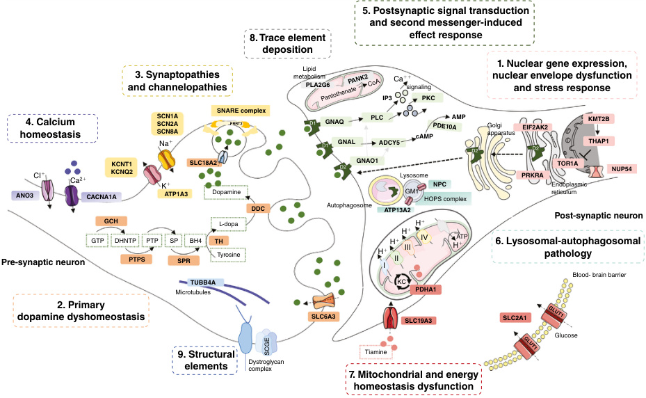

**Fig. 14.7** Scheme of biological pathways involved in dystonia depicting the most significant genetic defects. Nuclear gene expression, nuclear envelope dysfunction, and stress response (pink); primary dopamine dyshomeostasis (orange); synaptopathies and channelopathies (yellow); calcium homeostasis (violet); postsynaptic signal transduction and second messenger-induced effect response (green); lysosomal-autophagosomal pathology (turquoise); mitochondrial and energy homeostasis dysfunction (red); trace element deposition and brain calcifications (gray), and structural elements (blue). 

Genes that participate in the response to cellular stress in the endoplasmic reticulum lead to episodes of acute deterioration triggered by trauma and viral infections. 

## **Primary Dopamine Dyshomeostasis** 

Primary dopamine dyshomeostasis refers to a group of disorders associated with defects in dopamine synthesis _(GCH1, SPR, PTS, QDPR, TH, DDC, DNAJC12)_ , catabolism _(MAOA, MAOB)_ , and transport _(SLC18A2, SLC6A3)_ . 

Dopamine is an important neurotransmitter with multiple roles including motor control, learning, reward processing, emotional regulation, and cognition. The clinical presentation of disorders of dopamine synthesis varies widely in terms of severity. The most severe presentation manifests with early infantile dystonia-parkinsonism characterized by akinesia, action and postural limb dystonia, oculogyric crises, hypotonia, motor delay, and autonomic symptoms. In certain cases, encephalopathy and seizures may also occur. Moderately severe forms like autosomaldominant GTP-cyclohydrolase deficiency **(Segawa disease)** have a childhood onset, with action dystonia involving the lower limbs that worsens during the day and improves with sleep. If untreated, dystonia spreads to other limbs and in 

the second decade of life parkinsonism may appear. A marked and sustained response to low levodopa treatment is characteristic. 

In the **dopamine transporter deficiency** **_(SLC6A3)_** , the key biochemical feature is a defective dopamine reuptake into the presynaptic neuron causing persistently elevated extracellular dopamine. Patients manifest with an infantileonset hyperkinetic movement disorder (chorea, dystonia, ballismus, and orolingual dyskinesia) that progresses to severe parkinsonism in early childhood. In this disorder, in contrast with primary defects of dopamine synthesis, a contributing pathophysiological mechanism is neurodegeneration, which is explained by the fact that accumulation of extraneuronal dopamine leads to the degeneration of dopamine-containing neurons in the brain. 

## **Synaptopathies and Channelopathies** 

Synaptic vesicles are docked within the presynaptic region and undergo priming when Soluble NSF attachment protein Receptor (SNARE) core complex is formed through the association between vesicle-associated membrane proteins (VAMP/synaptobrevin) and pre-synaptic plasma membrane protein (SNAP-25, syntaxin) (Fig. 14.7). Once

<!-- p.363 -->

##### **TABLE** 

##### **14.9** 

### **Consensus Classification of Dystonia** 

||I. Clinical Characteristics|
|---|---|
|Category|Subcategory Description|
|Age at onset|Infancy Birth to 2 years|
||Childhood 3–12 years|
||Adolescence 13–20 years|
||Early adulthood 21–40 years|
||Late adulthood >40 years|
|Body distribution|Focal Only one affected body region|
||Segmental Two or more contiguous body regions|
||Multifocal Two or more noncontiguous body regions|
||Hemidystonia More body regions restricted to one body site|
||Generalized Involvement of the trunk and at least two other body regions with or without leg involvement|
|Temporal pattern: disease course|Static Progressive No progression over the course of the disease Progression over the course of the disease|
|Temporal pattern: variability|Persistent Persistent to approximately the same extent throughout the day|
||Action-specific Occurring only during a particular activity or task|
||Diurnal Fluctuations during the day with recognizable variations in occurrence, severity, and phenomenology|
||Paroxysmal Sudden self-limited episodes usually induced by a trigger with return to preexisting state|
|Associated features|Isolated dystonia Dystonia as the only motor feature, except for a possible tremor|
||Combined dystonia Dystonia combined with another movement disorder (e.g., myoclonus, parkinsonism, etc.)|
||Complex dystonia Occurrence of other neurological or systemic manifestations; dystonia may be less prominent|
||II. Etiology|
|Nervous system pathology|Evidence of degeneration Evidence of structural (often static) lesions No evidence of degeneration or structural lesions|
|Inherited, acquired, or idiopathic|Evidence of degeneration Evidence of structural (often static) lesions No evidence of degeneration or structural lesions|
|From Thomsen M, Lange|LM, Zech M, Lohmann K. Genetics and pathogenesis of dystonia._Ann Rev Path Mech Dis._2024;19:99-131 (Table 1, p. 102).|

voltage-gated calcium channels are opened by actionpotential induced depolarization, a calcium influx enters the presynaptic region which is sensed by synaptogramin. This activates the vesicle membrane fusion with plasma membrane mediated by SNARE-complex-binding proteins complexins and PRRT2, enabling neurotransmitter release. 

Sodium/potassium gradient between intra-and extracellular spaces is crucial for correct action potential propagation during neuronal depolarization. Voltage-gated sodium channels _(SCN1A, SCN2A, SCN8A)_ , voltage-gated potassium channels 

subunits _(KCNQ2, KCNQ3)_ , and sodium-activated potassium channels _(KCNT1)_ are ion channels whose opening depends on sodium and potassium concentrations, and _ATP1A3_ is a Na+/K+ ATPAse transmembrane ion-pump regulating electrochemical gradients by exporting sodium and importing potassium ions. Disturbances of these ion channels manifest with epileptic encephalopathies associated with dyskinesias (chorea, dystonia); while ATP1A3related disorders encompass a clinical spectrum in which two phenotypes feature dystonia as a prominent clinical

<!-- p.364 -->

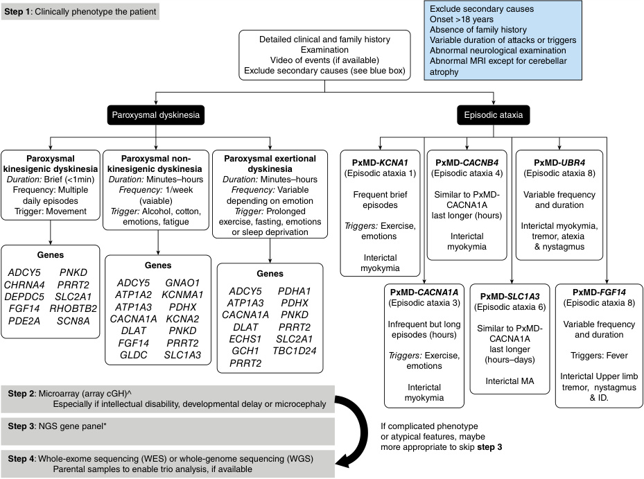

- **Fig. 14.8** Approach to the genetic investigation of paroxysmal movement disorders. ^Will not be 

- required if using whole-genome sequencing. *The number of genes varies depending on the NGS panel used. Always check what genes are included in the panel.  (From Harvey S, King MD, Gorman KM. Paroxysmal movement disorder. _Front Neurol_ . 2921;12:659064 [Fig. 1].) 

### manifestation including **rapid-onset dystonia-parkinsonism** , and **alternating hemiplegia of childhood** . 

An approach to paroxysmal dyskinesias and ataxias is noted in Figure 14.8. 

## **Calcium Homeostasis** 

Intracellular calcium serves as a second messenger and controls several neuronal functions including survival, depolarizing signals transmission, transcriptional regulation, and synaptic development, function, and plasticity. Several genes related to calcium signaling and homeostasis have been reported as dystonia-causing genes: voltagegated calcium channels such as _CACNA1A_ (P/Q-type) and _CACNA1B_ (N-type) involved in electrochemical coupling during neurotransmission; hippocalcin responsible for sensing calcium cytosol levels in neurons to 

maintain its homeostasis _(HPCA)_ ; anoctamin-3 calciumgated chloride channel _(ANO3)_ ; the calcium-dependent potassium channel tetramerization domain-containing protein 17 _(KCTD17)_ ; calcium-activated K+ channels _(KCNMA1, KCNN2)_ ; calcium/calmodulin-dependent protein kinase _(CAMTA1)_ ; genes involved in Ca2 + extrusion _(ATP2B3, ATP2B2, ATP2B4)_ , intracellular Ca2 + dynamics _(TMEM151A)_ , and downstream regulatory elements in the Ca2 + signaling cascades _(PRKCG, CAMK4)_ (Fig. 14.7). 

Calcium homeostasis defects can lead to several neurodevelopmental and neurodegenerative disorders that present with a wide range of clinical manifestations from cognitive impairment and seizures to motor disorders. In this group of disorders, dystonia often emerges early in life, typically as part of a complex phenotype. Some patients manifest with isolated dystonia _(ANO3, HPCA)_ , others

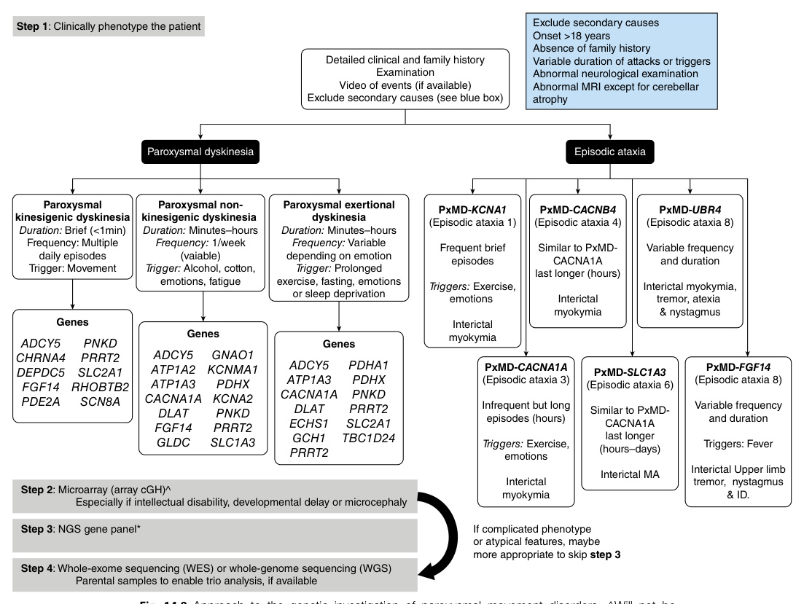

<!-- p.365 -->

with paroxysmal dystonia _(CACNA1A, KCNMA1, TMEM151)_ , and others with a combined dystonia phenotype including dystonia-myoclonus _(KCTD17)_ , dystoniatremor _(ANO3)_ , and dystonia chorea _(CAMK4)_ . The association of dystonia and progressive ataxia is also characteristic of some disorders _(CACNA1A, ATP2B3)_ . An age-related phenotype is noted in _ANO3_ -related disorders, in which adults manifest with isolated or combined focal dystonia, while in children, dystonia generalizes and is associated with neurodevelopmental disturbances. In _CACNA1A_ -related disorders **paroxysmal dystonia** including **benign paroxysmal torticollis** and **paroxysmal tonic upward gaze** are typical of the infantile period. 

## **Postsynaptic Signal Transduction and Second Messenger-Induced Effect Response** 

Dopamine receptors D1–D5 belong to the superfamily of G protein-coupled receptors (GPCRs) and are enriched in medium spiny striatal neurons. G proteins interact with dopamine receptors and mediate cAMP second messenger production signaling through adenylate cyclase type 5 (ADCY5) activity control. ADCY5 and several phosphodiesterases (PDE10A, PDE2A) regulate cAMP production. In summary, these proteins activate the signal transduction of dopamine in the postsynaptic neurons. 

Genetic defects in these genes impair the signal transduction of dopamine in medium spiny striatal neurons through dysregulation of the second messenger cAMP. Specifically, abnormal cAMP levels produce abnormal activity of protein kinase A subunits in the nucleus, resulting in phosphorylation of several transcription factors and altered gene expression. cAMP is also linked to ATP production; cAMP dysregulation can cause neuronal alterations due to depletion of available cellular energy. 

Dominant variants in genes involved in abnormal dopamine signal transduction are linked to prominent dystonia phenotypes, including isolated and complex phenotypes, but also characteristic paroxysmal dystonia. Gain-of-function missense variants in the D2 subtype receptor gene _(DRD2)_ have been described in children with chorea and dystonia. _De novo_ variants in the G protein genes _GNAL, GNAO1,_ and _GNB1_ cause epilepsy and a complex motor phenotype characterized by hypotonia, dystonia, and chorea. The most common genetic defect in children is _GNAO1_ , causing a progressive movement disorder with paroxysmal attacks of dystonia and chorea that are life-threatening and respond to deep brain stimulation (DBS). Patients with heterozygous gain-of-function variants in _ADCY5_ display a **familial benign chorea phenotype** , but also paroxysmal episodes of myoclonus, dystonia, and tremor which are triggered by several stimuli, including emotional, kinesigenic, and sleep. They have a partial response to caffeine and DBS. _De novo_ heterozygous and bi-allelic loss-offunction variants in _PDE10A_ and _PDE2A_ have been 

linked to hyperkinetic disorders with dystonia, striatal lesions, and chorea. 

## **Lysosomal-Autophagosomal Pathology** 

Autophagy, as well as the ubiquitin-proteasome system degradation, are two quality control systems that ensure longevity of neurons. Lysosomes are the organelles where all autophagic routes are released which enable degradation of organelles, macromolecules, and pathogens. _VPS16, VPS11,_ and _VPS41_ genes encode components of the HOPS (homotypic fusion and vacuole protein sorting) complex, which facilitates the autophagosome-lysosome and endosomelysosome formation. Defects on these proteins are linked to prominent dystonia phenotypes as a result of autophagy impairment (Fig. 14.7). 

Loss of function heterozygous variants in _VPS16_ cause early-onset isolated dystonia with prominent cranio-facial dysfunction. One third of patients may also have neuropsychiatric and/or developmental features. A Chinese family with a homozygous missense variant has also been reported. Patients with homozygous variants in _VPS41_ and _VPS11_ develop a progressive neurodevelopmental disorder and a complex dystonia phenotype. 

The **juvenile form of GM1 gangliosidosis** causes a dystonia-parkinsonism phenotype, associated with minor skeletal dysplasia, cardiac valve abnormalities, and basal ganglia lesions. Rare late-onset forms of **GM2 gangliosidoses** are characterized by motor neuron disease, ataxia, tremor, dystonia, and psychiatric symptoms. **GM3 gangliosidosis** has been described in a family with dystonia and choreoathetosis. Other lysosomal storage disorders causing dystonia-related phenotypes are Niemann-Pick type C, Gaucher disease, fucosidosis, and those related to _IRF2BPL_ and _ATP13A2_ genes. 

**Leigh syndrome (LS)** is the most frequent presentation of _mitochondrial_ disorders in childhood. It is a neurodegenerative condition characterized by symmetric brainstem and basal ganglia necrotizing lesions. LS is linked to approximately 70 genetic defects with 80% involving nuclear genome and 20% mitochondrial genome (Chapter 48). 

Children with LS experience developmental delay, neurological regression, feeding difficulties, epilepsy, and complex dystonic phenotypes with associated neurosensorial deficits and systemic manifestations. Less frequent dystonia phenotypes are insidious and progressive isolated dystonia, and paroxysmal dystonia and basal ganglia metabolic strokes triggered by episodes of increased energy demands or infections. Importantly, thiamine supplementation improves neurological symptoms in _PDHA1_ -related disorders causing aberrant pyruvate metabolism, and in thiamine metabolism dysfunction syndrome 2 associated with _SLC19A3_ defects. 

Genes involved in other mitochondria-related pathways that are linked to LS-related dystonia are: (1) _SURF1, NDUFAF6,_ and _MT-ATP6_ encoding OXPHOS subunits

<!-- p.366 -->

and assembly factors; (2) variants in tRNA synthetases _(FARS2, NARS2, WARS2)_ and polymerase gamma type 1 _(POLG)_ affecting mitochondrial DNA replication and expression; (3) _SERAC1_ and _MECR_ , which impair mitochondrial lipid metabolism and transport; and (4) _ECHS1_ , involved in valine catabolism and metabolism of mitochondria-toxic compounds. 

_SLC2A1_ gene encodes the glucose transporter through the blood-brain barrier, and pathogenic variants lead to energy homeostasis failure associated with several complex and paroxysmal dystonia phenotypes. 

## **Trace Element Deposition and Brain Calcifications** 

Copper (Cu), manganese (Mn), and iron (Fe) are crucial metals playing essential roles in physiological processes including metal-dependent enzyme function, gene expression regulation, oxidative stress, neurotransmitter generation, synapse function, and energy production. Excessive accumulation of these metals has detrimental intracellular consequences leading to neurodegeneration that often manifest with progressive movement disorders that include prominent dystonia. 

Toxic trace element deposition in the central nervous system includes disorders of Cu transport _(ATP7B)_ , Mn transport _(SLC30A10, SLC39A14, SLC39A8)_ , and the group of **neurodegeneration with brain iron accumulation (NBIA) syndromes** ( _PANK2, PLA2G6, FA2H, C19orf12, WDR45, CP, FTL, ATP13A2, COASY_ ; see Chapter 13). Another category of brain metal accumulation is disorders associated with abnormal calcium deposition, which can be the result of disruption of the neurovascular unit’s stability via dysfunction of cell-cell adhesion mechanisms, intracellular and extracellular calcium-phosphate balance, or blood-brain barrier functions _(SLC20A2, MYORG, PDGFB, XPR1, PDGFRB, JAM2)_ . 

In this group of disorders, dystonia manifests as part of a complex phenotype, with focal onset that generalizes as disease progresses. In some disorders the distribution of dystonia is characteristic, i.e., oromandibular involvement with the characteristic facial appearance of “risus sardonicus” in Wilson disease _(ATP7B)_ ; high-stepping gait (“cock-walk gait”) in disorders of Mn transport _(SLC30A10)_ ; and axial and oromandibular involvement in NBIAs. Some patients with NBIAs can manifest episodes of status dystonicus. Liver involvement can also be seen in some disorders ( _ATP7B-_ related Wilson disease, _SLC39A14_ -related disorders) (Table 14.8). 

Neuroimaging studies show abnormal metal deposition mainly in the basal ganglia with some characteristic findings such as the “face of the giant panda” sign in Wilson disease, T1 signal hyperintensities in the globus pallidus and striatum in Mn transporter defects, and the “eye-of-the-tiger” sign in _PANK2_ -related disorders (Table 14.10). 

### **TABLE Brain Imaging Abnormalities in Genetic 14.10 Disorders That Cause Childhood Dystonia** 

#### Imaging Abnormality Disorders 

|**Basal Ganglia Lesions**|
|---|
|T2 hyperintensity Wilson disease Mitochondrial encephalopathy Thiamine transporter deficiency syndromes Pyruvate dehydrogenase deficiency Organic acidurias|
|T2 hypointensity Neurodegeneration with brain iron accumulation Fucosidosis|
|T1 hyperintensity Brain manganese accumulation|
|Calcifications (best seen on CT) Aicardi-Goutières syndrome Primary familial brain calcification|
|Caudate atrophy Huntington disease Chorea-acanthocytosis|
|**White Matter Abnormalities**|
|Hypomyelination H-ABC syndrome Aicardi-Goutières syndrome Dystonia-deafness (BCAP31) Pelizaeus-Merzbacher, Pelizaeus-Merzbacher-like syndromes GM1-gangliosidosis Mitochondrial encephalopathy|
|_H-ABC,_Hypomyelination with atrophy of basal ganglia and cerebellum. From Meijer IA, Pearson TS. The twists of pediatric dystonia: phenomenology, classification, and genetics._Sem Pediatr Neurol._2018;25:65-74 (Table 2, p. 67).|

## **Structural Elements** 

Defects of cell adhesion or cytoskeleton proteins lead to impairment of cellular structural elements and have been associated with dystonia. These include _SGCE_ (combined myoclonus dystonia) and _TUBB4A_ -related disorders (isolated and complex dystonia according to dominant or recessive inheritance, respectively). Epsilon-sarcoglycan (SGCE) is a member of the transmembrane dystrophin-glycoprotein complex that is thought to play a role in clustering and stabilization of GABAergic synapses in the brain, while tubulin beta-4A (TUBB4A) is involved in cytoskeletal microtubules formation, intracellular transport, mitosis, and neuronal morphogenesis. 

# **Approach to Treatment** 

Some genetic dystonias have specific therapies or diseasemodifying approaches (Table 14.11). Other therapeutic interventions address the symptoms and are not specific to a pathogenic gene variant associated disease (Fig. 14.9).

<!-- p.367 -->

#### **TABLE 14.11** Common Inherited i Dystonias W i ith Specific Treatment i s

|Disease|Gene|Age of Onset|Clinical Manifestations|Diagnostic Tests|Treatment|
|---|---|---|---|---|---|
|Abetalipoproteinemia|_MTTP_|Childhood to early adulthood|Progressive ataxia, chorea, dystonia, seizures, acanthocytosis, retinitis pigmentosa, fat malabsorption syndrome|Plasma lipids and lipoproteins _MTTP_sequencing|Vitamin E and reduced fat diet (can prevent/reduce symptoms)|
|Aromatic L-amino acid decarboxylase deficiency|_AADC_|Infancy|Global developmental delay, hypotonia, dystonia, oculogyric crisis, autonomic dysfunction|CSF neurotransmitters AADC activity in the plasma _AADC_sequencing|Dopamine agonists, monoamine oxidase inhibitors, gene therapy|
|Ataxia with vitamin E deficiency|_TTPA_|Late childhood|Ataxia, dystonia, dysarthria, areflexia, vision loss, loss of proprioception, and sensory disturbance|Plasma vitamin E level Brain MRI _TTPA_sequencing|Oral vitamin E|
|Biotin and thiamine responsive basal ganglia disease|_SLC19A3_|Abrupt onset in early childhood|Dystonia, parkinsonism, ataxia, subacute encephalopathy, dysarthria, dysphagia, external ophthalmoplegia, seizures|Brain MRI _SLC19A3_sequencing|Biotin and thiamine|
|Biotinidase deficiency|_BTD_|Infancy|Encephalopathy with motor delay, ataxia, dystonia, and seizures|BTD activity in serum/plasma Brain MRI _BTD_sequencing|Biotin|
|Cerebral folate deficiency|_FOLR1_|Early childhood|Ataxia, dystonia, myoclonus, developmental regression, seizures|Brain MRI CSF neurotransmitters _FOLR1_sequencing|Folinic acid|
|Cerebrotendinous xanthomatosis|_CYP27A1_|Late childhood to adulthood|Ataxia, spasticity, dystonia, myoclonus, tendon xanthomas, peripheral neuropathy, neonatal cholestatic jaundice, bilateral childhood-onset cataracts, chronic diarrhea|Plasma cholestanol levels Plasma and urine bile alcohols Brain MRI _CYP27A1_sequencing|Chenodeoxycholic acid|
|Dopa responsive dystonia, classic|_GCH1_|Early childhood to late adulthood|Dystonia, parkinsonism|CSF neurotransmitters Phenylalanine load test Levodopa trial _GCH1_sequencing|Levodopa|

_(Continued)_

<!-- p.368 -->

#### **TABLE 14.11** Common Inherite i d Dystonias With i Specific Treatmen i ts—cont’d

|Disease|Gene|Age of Onset|Clinical Manifestations|Diagnostic Tests|Treatment|
|---|---|---|---|---|---|
|Dopa responsive dystonia, complicated Dystonia with brain manganese accumulation|_TH, PTPS, SPR_ _SLC30A10_ SLC39A14|Infancy to adolescence Childhood|Dystonia, parkinsonism, oculogyric crisis, autonomic disturbances dystonia, parkinsonism, hypermagnesemia, hepatic cirrhosis polycythemia|CSF neurotransmitters. Genetic sequencing. Blood manganese levels CBC, liver function. Brain MRI SLC30A10 and SLC39A14 sequencing|Levodopa, 5-hydroxytryptophan, tetrahydrobiopterin Chelation|
|Glucose transporter 1 deficiency syndrome|_SLC2A1_|Early childhood, adulthood|Ataxia, dystonia, myoclonus, paroxysmal exertion-induced dyskinesia, seizures, acquired microcephaly, developmental delay|CSF/plasma glucose ratio SLC2A1 sequencing|Ketogenic diet|
|Glutaric aciduria type 1|_GCDH_|Abrupt onset in early childhood|Dystonia, parkinsonism, chorea, acute encephalopathic crisis, macrocephaly, hypotonia, seizures|Plasma and urine organic acids Plasma acylcarnitines. Brain MRI GCDH enzyme analysis_GCDH_ sequencing|Lysine and tryptophan restricted diet, carnitine supplementation, avoiding and treating intercurrent illnesses|
|Methylmalonic aciduria|_MUT_|Childhood|Generalized dystonia after an encephalopathic crisis, developmental delay, renal insufficiency|Organic acids in the urine, amino acids in the blood, acylcarnitine profile in blood Genetic sequencing|Avoiding and treating intercurrent illness with protein restriction|
|Niemann-Pick disease type C|_NPC1 NPC2_|Early childhood/ adulthood|Ataxia, dystonia, developmental delay, supranuclear vertical gaze palsy, hepatosplenomegaly, seizures, gelastic cataplexy|Oxysterols, lysosphingomyelin derivatives, bile acids _NPC1/NPC2_sequencing|Miglustat|
|Propionic aciduria|_PCCA_|Early childhood to adolescence|Generalized dystonia after an encephalopathic crisis, developmental delay|Organic acids in the urine, amino acids in the blood|Avoiding and treating intercurrent illness with protein restriction|
||_PCCB_|||Acylcarnitine profile in blood _PCCA/PCCB_sequencing||
|Pyruvate dehydrogenase deficiency|Multiple|Infancy|Progressive generalized or paroxysmal dystonia|Blood lactate and pyruvate. Plasma amino acids. Pyruvate dehydrogenase complex enzyme activity. Genetic sequencing|Thiamine, ketogenic diet|
|Wilson disease|_ATP7B_|Childhood/young adulthood|Dystonia, parkinsonism, ataxia, chorea, flapping tremor, Kayser- Fleischer rings, dysarthria, liver disease, psychiatric symptoms|Slit-lamp exam Serum ceruloplasmin and 24 h urinary copper excretion Brain MRI _ATP7B_sequencing|Zinc, penicillamine, trientine|

From Gorodetsky C, Fasano AL. Approach to the treatment of pediatric dystonia. _Dystonia_ . 2022;1:Article 10287 (Table 1).

<!-- p.369 -->

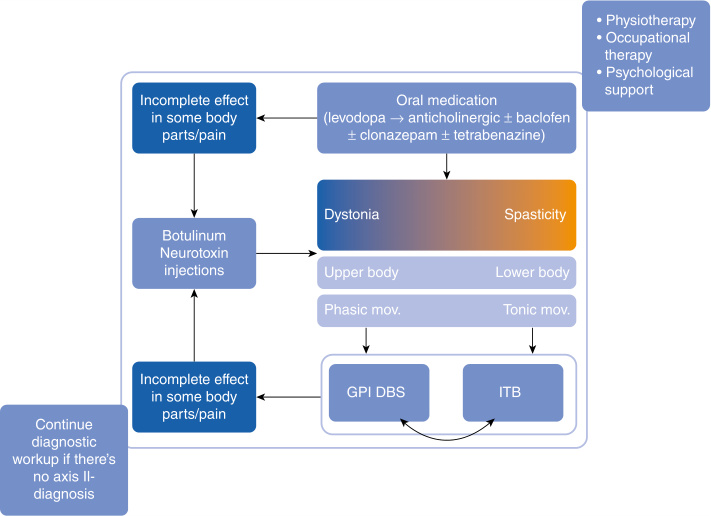

**Fig. 14.9** Overview of the therapeutic approach to dystonia in the pediatric population. It is recommended to enroll children with dystonia in formal physiotherapy and psychological support programs. The first-line treatment in generalized pediatric dystonia is oral medications. Levodopa should be tried in every child with idiopathic dystonia <18 years. If no significant improvement is seen on levodopa, other antidystonia medications should be used (most robust evidence for anticholinergic treatment). Individuals who are refractory for pharmacological treatment should be considered for neurosurgical procedures including DBS and ITB. At any point during the implementation of this algorithm BoNT can be considered in cases of incomplete effect in some body parts or to improve specific issues such as pain. _DBS,_ Deep brain stimulation; _GPI,_ globus pallidus internus; _ITB,_ intrathecal baclofen; mov, movements.  (From Gorodetsky C, Fasano AL. Approach to the treatment of pediatric dystonia. _Dystonia_ 2022; Vol 1:Article 10287 [Fig. 2].) 

# **Bibliography** 

- Accogli A, Addour-Boudrahem N, Srour M. Diagnostic approach to cerebellar hypoplasia. _Cerebellum._ 2021;20:631-658. 

- Alterman N, Fattal-Valevski A, Moyal L, et al. Ataxia-telangiectasia: mild neurological presentation despite null ATM mutation and severe cellular phenotype. _Am J Med Genet A_ . 2007;143A: 1827-1834. 

- Anderson DG, Walker RH, Connor M, Carr J, Margolis RL, Krause A. A systematic review of the Huntington disease-like 2 phenotype. _J Huntingtons Dis._ 2017;6(1):37-46. 

- Badhwar A, Jansen A, Andermann F, Pandolfo M, Andermann E. Striking intrafamilial phenotypic variability and spastic paraplegia in the presence of similar homozygous expansions of the FRDA1 gene. _Mov Disord_ . 2004;19:1424-1431. 

- Baizabal-Carvallo JF, Cardoso F. Chorea in children: etiology, diagnostic approach and management. _J Neural Transm_ . 2020;127: 1323-1342. 

- Baizabal-Carvallo JF, Jankovic J. Parkinsonism, movement disorders and genetics in frontotemporal dementia. _Nat Rev Neurol._ 2016; 12(3):175-185. 

- Bakels HS, Roos RAC, van Roon-Mom WMC, de Bot ST. JuvenileOnset Huntington Disease pathophysiology and neurodevelopment: a review. _Mov Disord._ 2022;37(1):16-24. 

Baranano KW. Leukodystrophies. _Semin Neurol_ . 2016;36:362-366. Bates GP, Dorsey R, Gusella JF, et al. Huntington disease. _Nat Rev Dis Primers._ 2015;1:15005. 

- Boyarchuk O, Makukh H, Kostyuchenko L, et al. TREC/KREC levels in children with ataxia-telangiectasia. _Immunol Res_ . 2021; 69:436-444. 

- Brandsma R, Verschuuren-Bemelmans CC, AMROM D, et al. A clinical diagnostic algorithm for early onset cerebellar ataxia. _Eur J Paediatr Neurol_ . 2019;23:692-706. 

- Byers RK, Gilles FH, Fung C. Huntington’s disease in children. Neuropathologic study of four cases. _Neurology._ 1973;23(6): 561-569. 

- Byrne LM, Schultz JL, Rodrigues FB, et al. Neurofilament light protein as a potential blood biomarker for Huntington’s disease in children. _Mov Disord._ 2022;37(7):1526-1531. 

- Cannella M, Gellera C, Maglione V, et al. The gender effect in juvenile huntington disease patients of Italian origin. _Am J Med Genet B Neuropsychiatr Genet._ 2004;125B(1):92-98. 

- Cardoso F. Sydenham’s chorea. _Curr Treat Options Neurol._ 2008;10(3): 230-235. 

- Cardoso F. Autoimmune choreas. _J Neurol Neurosurg Psychiatry._ 2017;88(5):412-417. 

- Cardoso F, Seppi K, Mair KJ, Wenning GK, Poewe W. Seminar on choreas. _Lancet Neurol._ 2006;5(7):589-602.

<!-- p.370 -->

- Cattaneo E, Zuccato C, Tartari M. Normal huntingtin function: an alternative approach to Huntington’s disease. _Nat Rev Neurosci._ 2005;6(12):919-930. 

- Chinnery PF, Crompton DE, Birchall D, et al. Clinical features and natural history of neuroferritinopathy caused by the FTL1 460InsA mutation. _Brain._ 2006;130(Pt 1):110-119. 

- Cloud LJ, Rosenblatt A, Margolis RL, et al. Seizures in Juvenile Huntington’s disease: frequency and characterization in a multicenter cohort. _Mov Disord._ 2012;27(14):1797-1800. 

- Coarelli G, Wirth T, Tranchant C, Koenig M, Durr A, Anheim M. The inherited cerebellar ataxias: an update. _J Neurol._ 2023; 270(1):208-222. 

- Cronin T, Rosser A, Massey T. Clinical presentation and features of Juvenile-Onset Huntington’s disease: a systematic review. _J Huntingtons Dis._ 2019;8(2):171-179. 

- de Gusmao CM, Waugh JL. Inherited and acquired choreas. _Semin Pediatr Neurol._ 2018;25:42-53. 

- DeJesus-Hernandez M, Mackenzie IR, Boeve BF, et al. Expanded GGGGCC hexanucleotide repeat in noncoding region of C9ORF72 causes chromosome 9p-linked FTD and ALS. _Neuron._ 2011;72(2):245-256. 

- Di Meo I, Tiranti V. Classification and molecular pathogenesis of NBIA syndromes. _Eur J Paediatr Neurol._ 2018;22(2):272-284. 

- Donis KC, Mattos EP, Silva AA. Infantile spinocerebellar ataxia type 7: case report and a review of the literature. _J Neurol Sci._ 2015; 354:118-121. 

- Duff K, Paulsen JS, Beglinger LJ, Langbehn DR, Stout JC. Psychiatric symptoms in Huntington’s disease before diagnosis: The PredictHD Study. _Biol Psychiatry._ 2007;62(12):1341-1346. 

- Estévez-Fraga C, López-Sendón Moreno JL, Martínez-Castrillo JC, et al. 2018. Phenomenology and disease progression of chorea-acanthocytosis patients in Spain. _Parkinsonism Relat Disord._ 2018;49:17-21. 

- Estevez-Fraga C, Magrinelli F, Hensman Moss D, et al. Expanding the spectrum of movement disorders associated with C9orf72 hexanucleotide expansions. _Neurol Genet._ 2021;7(2):e575. 

- Estevez-Fraga C, Zeun P, López-Sendón Moreno JL. Current methods for the treatment and prevention of drug-induced parkinsonism and tardive dyskinesia in the elderly. _Drugs Aging._ 2018; 35(11):959-971. 

- Expert Panel on Pediatric Imaging, Radhakrishnan R, Shea LAG, et al. ACR Appropriateness Criteria® Ataxia-Child. _J Am Coll Radiol_ . 2022;19:S240-S255. 

- Fogel BL. Childhood cerebellar ataxia. _J Child Neurol_ . 2012;27: 1138-1145. 

- Franklin GL, Camargo CHF, Meira AT, Lima NSC, Teive HAG. The role of the cerebellum in Huntington’s disease: a systematic review. _Cerebellum_ . 2021;20(2):254-265. 

- Frolov A, Highley JR, Charlesworth G, et al. C9ORF72 expansions, parkinsonism, and Parkinson disease: a clinicopathologic study. _Neurology._ 2013;81(9):808-811. 

- Fusilli C, Migliore S, Mazza T, et al. Biological and clinical manifestations of Juvenile Huntington’s disease: a retrospective analysis. _Lancet Neurol._ 2018;17(11):986-993. 

- Gana S, Valente EM. Movement disorders in genetic pediatric ataxias. _Mov Disord Clin Pract_ . 2020;7(4):383-393. 

- Garcia Ruiz PJ, Ezquerro JJR, Torres AG, Fanjul S. Ancient descriptions of movement disorders. _J Neurol._ 2006;253(6):731-734. 

- Garcia Ruiz PJ, Mayo D, Hernandez J, Cantarero S, Ayuso C. Movement disorders in hereditary ataxias. _J Neurol Sci._ 2002;202(1-2):59-64. 

- Gövert F, Schneider SA. Huntington’s disease and Huntington’s disease-like syndromes: an overview. _Curr Opin Neurol._ 2013; 26(4):420-427. 

- Hayflick SJ, Kurian MA, Hogarth P. Neurodegeneration with brain iron accumulation. _Handb Clin Neurol_ . 2018;147:293-305. 

- Hensman Moss DJ, Poulter M, Beck J, et al. C9orf72 expansions are the most common genetic cause of Huntington disease phenocopies. _Neurology._ 2014;82(4):292-299. 

- Hinzen W, Rosselló J, Morey C, et al. A systematic linguistic profile of spontaneous narrative speech in pre-symptomatic and early stage Huntington’s disease. _Cortex._ 2018;100:71-83. 

- Jankovic J, Roos RA. Chorea associated with Huntington’s disease: to treat or not to treat? _Mov Disord._ 2014;29(11):1414-1418. 

- Jongen PJ, Renier WO, Gabre®ls FJ. Seven cases of Huntington’s disease in childhood and levodopa induced improvement in the hypokinetic—rigid form. _Clin Neurol Neurosurg._ 1980; 82(4):251-261. 

- Kennedy L. Dramatic tissue-specific mutation length increases are an early molecular event in Huntington disease pathogenesis. _Hum Mol Genet._ 2003;12(24):3359-3367. 

- Klee EW, Cousin MA, Pinto E Vairo F, et al. Impact of integrated translational research on clinical exome sequencing. _Genet Med_ . 2021;23:498-507. 

- Kremer B, Almqvist E, Theilmann J, et al. Sex-dependent mechanisms for expansions and contractions of the CAG repeat on affected Huntington disease chromosomes. _Am J Hum Genet._ 1995;57(2):343-350. 

- Lee H, Huang AY, Wang LK, et al. Diagnostic utility of transcriptome sequencing for rare Mendelian diseases. _Genet Med._ 2020;22: 490-499. 

- Langbehn DR, Hayden MR, Paulsen JS, et al. CAG-repeat length and the age of onset in Huntington Disease (HD): a review and validation study of statistical approaches. _Am J Med Genet B Neuropsychiatr Genet._ 2010;153(2):397-408. 

- Lanska DJ. Chapter 33: The History of Movement Disorders. _Handbook of Clinical Neurology_ 2010;95:501-546. 

- Latimer CS, Flanagan ME, Cimino PJ, et al. Neuropathological comparison of adult onset and Juvenile Huntington’s disease with cerebellar atrophy: a report of a father and son. _J Huntingtons Dis._ 2017;6(4):337-348. 

- Martínez-Horta S, Perez-Perez J, Sampedro F, et al. Structural and metabolic brain correlates of apathy in Huntington’s disease. _Mov Disord._ 2018;33(7):1151-1159. 

- Martinez-Ramirez D, Walker RH, Rodríguez-Violante M, Gatto EM. Review of hereditary and acquired rare choreas. _Tremor Other Hyperkinet Mov (N Y)._ 2020;10(1):24. 

- Martino D, Stamelou M, Bhatia KP. The differential diagnosis of Huntington’s disease-like syndromes: ‘red flags’ for the clinician. _J Neurol Neurosurg Psychiatry._ 2013;84(6):650-656. 

- McColgan P, Tabrizi SJ. Huntington’s disease: a clinical review. _Eur J Neurol_ . 2018;25(1):24-34. 

- McNeill A, Birchall D, Hayflick SJ, et al. T2* and FSE MRI distinguishes four subtypes of neurodegeneration with brain iron accumulation. _Neurology._ 2008;70(18):1614-1619. 

- Mead S. Inherited prion disease with six octapeptide repeat insertional mutation—molecular analysis of phenotypic heterogeneity. _Brain._ 2006;129(9):2297-2317. 

- Mencacci NE, Carecchio M. Recent advances in genetics of chorea. _Curr Opin Neurol._ 2016;29(4):486-495. 

- Mencacci NE, Erro R, Wiethoff S, et al. ADCY5 mutations are another cause of benign hereditary chorea. _Neurology._ 2015;85(1): 80-88. 

- Méneret A, Ahmar-Beaugendre Y, Rieunier G, et al. The pleiotropic movement disorders phenotype of adult ataxia-telangiectasia. _Neurology._ 2014;83(12):1087-1095.

<!-- p.371 -->

- Méneret A, Mohammad SS, Cif L, et al. Efficacy of caffeine in ADCY5-related dyskinesia: a retrospective study. _Mov Disord._ 2022;37(6):1294-1298. 

- Mestre TA, Busse M, Davis AM, et al. Rating scales and performancebased measures for assessment of functional ability in Huntington’s disease: critique and recommendations. _Mov Disord Clin Pract._ 2018;5(4):361-372. 

- Miyasaki JM. Chorea caused by toxins. _Handb Clin Neurol._ 2011; 100:335-346. 

- Moser AD, Epping E, Espe-Pfeifer P, et al. A survey-based study identifies common but unrecognized symptoms in a large series of Juvenile Huntington’s disease. _Neurodegener Dis Manag._ 2017;7(5): 307-315. 

- Nance MA, Mathias-Hagen V, Breningstall G, Wick MJ, McGlennen RC. Analysis of a very large trinucleotide repeat in a patient with Juvenile Huntington’s disease. _Neurology._ 1999;52(2):392-394. 

- Nasir J, Floresco SB, O’Kusky JR. Targeted disruption of the Huntington’s disease gene results in embryonic lethality and behavioral and morphological changes in heterozygotes. _Cell._ 1995;81:811-823. 

- Nielsen TR, Bruhn P, Nielsen JE, Hjermind LE. Behavioral variant of frontotemporal dementia mimicking Huntington’s disease. _Int Psychogeriatr._ 2010;22(4):674-677. 

- Ngo KJ, Rexach JE, Lee H, et al. A diagnostic ceiling for exome sequencing in cerebellar ataxia and related neurological disorders. _Hum Mutat_ . 2020;41:487-501. 

- Nogueras-Ortiz C, Yudowski GA. The multiple waves of cannabinoid 1 receptor signaling. _Mol Pharmacol_ . 2016;90(5):620-626. 

- Palau F, Arpa J. Genetics and differential diagnosis of cerebellar ataxias. In: Gruol D, Koibuchi N, Manto M, Molinari M, Schmahmann J, Shen Y, eds. _Essentials of Cerebellum and Cerebellar Disorders—A Primer for Graduate Students_ . 2nd ed. Switzerland: Springer Nature, Cham; 2023:521-529. 

- Paoli RA, Botturi A, Ciammola A, et al. Neuropsychiatric burden in Huntington’s disease. _Brain Sci._ 2017;7(6):67. 

- Papoutsi M, Labuschagne I, Tabrizi SJ, Stout JC. The cognitive burden in Huntington’s disease: pathology, phenotype, and mechanisms of compensation. _Mov Disord._ 2014;29(5):673-683. 

- Paucar M, Xiang F, Moore R, Walker R, Winnberg E, Svenningsson P. Genotype-phenotype analysis in inherited prion disease with eight octapeptide repeat insertional mutation. _Prion._ 2013;7(6): 501-510. 

- Peall KJ, Kurian MA. Benign hereditary chorea: an update. _Tremor Other Hyperkinet Mov (N Y)._ 2015;5:314. 

- Pearson TS, Pons R, Ghaoui R, Sue CM. Genetic mimics of cerebral palsy. _Mov Disord._ 2019;34:625-636. 

- Peikert K, Danek A, Hermann A. Current state of knowledge in chorea-acanthocytosis as core Neuroacanthocytosis syndrome. _Eur J Med Genet._ 2018;61(11):699-705. 

- Peltsch A, Hoffman A, Armstrong I, Pari G, Munoz DP. Saccadic impairments in Huntington’s disease. _Exp Brain Res._ 2008;186(3): 457-469. 

- Petley E, Prasad M, Ojha S, Whitehouse WP. Investigating ataxia in childhood. _Arch Dis Child Educ Pract Ed_ . 2020;105:214-221. 

- Piccolo I, Defanti CA, Soliveri P, Volont MA, Cislaghi G, Girotti F. Cause and course in a series of patients with sporadic chorea. _J Neurol._ 2003;250(4):429-435. 

- Pijuan J, Rodríguez-Sanz M, Natera-de Benito D, et al. Translational diagnostics: an in-house pipeline to validate genetic variants in children with undiagnosed and rare diseases. _J Mol Diagn_ . 2021;23:71-90. 

- Pouladi MA, Morton AJ, Hayden MR. Choosing an animal model for the study of Huntington’s disease. _Nat Rev Neurosci._ 2013;14(10):708-721. 

- Pringsheim T, Wiltshire K, Day L, Dykeman J, Steeves T, Jette N. The incidence and prevalence of Huntington’s disease: a systematic review and meta-analysis. _Mov Disord_ . 2012;27(9):1083-1091. 

- Quarrell O, O’Donovan KL, Bandmann O, Strong M. The prevalence of Juvenile Huntington’s disease: a review of the literature and meta-analysis. _PLoS Curr._ 2012;4:e4f8606b742ef3. 

- Quarrell, Oliver W. J. 2014. _Juvenile Huntington’s Disease_ . Edited by Gillian Bates, Sarah Tabrizi, and Lesley Jones. _Huntington’s Disease_ . Vol. 1. Oxford University Press. 

- Quarrell OW, Nance MA, Nopoulos P, Paulsen JS, Smith JA, Squitieri F. Managing Juvenile Huntington’s Disease. _Neurodegener Dis Manag._ 2013;3(3):267-276. 

- Reilmann R. Parkinsonism in Huntington’s disease. _Int Rev Neurobiol_ . 2019;149:299-306. 

- Ribaï P, Nguyen K, Hahn-Barma V, et al. Psychiatric and cognitive difficulties as indicators of juvenile huntington disease onset in 29 patients. _Arch Neurol._ 2007;64(6):813-819. 

- Robertson L, Santini H, O’Donovan KL, et al. Current pharmacological management in Juvenile Huntington’s disease. _PLoS Curr._ 2012;4:RRN1304. 

- Rodrigues FB, Abreu D, Damásio J, et al. Survival, mortality, causes and places of death in a European Huntington’s disease prospective cohort. _Mov Dis Clin Pract_ . 2017;4(5):737-742. 

- Ross CA, Aylward EH, Wild EJ, et al. Huntington disease: natural history, biomarkers and prospects for therapeutics. _Nat Rev Neurol_ . 2014;10(4):204-216. 

- Rossi M, Perez-Lloret S, Doldan L, et al. Autosomal dominant cerebellar ataxias: a systematic review of clinical features. _Eur J Neurol_ . 2014;21:607-615. 

- Ruiz PJ, Ayerbe J, Bader B, et al. Deep brain stimulation in chorea acanthocytosis. _Mov Disord._ 2009;24(10):1546-1547. 

- Saudou F, Humbert S. The biology of Huntingtin. _Neuron._ 2016;89(5):910-926. 

- Schneider SA, Bhatia KP. Syndromes of neurodegeneration with brain iron accumulation. _Semin Pediatr Neurol._ 2012;19(2): 57-66. 

- Schneider SA, Bird T. Huntington’s disease, Huntington’s disease look-alikes, and benign hereditary chorea: what’s new? _Mov Disord Clin Pract._ 2016;3(4):342-354. 

- Schneider SA, Lang AE, Moro E, Bader B, Danek A, Bhatia KP. Characteristic head drops and axial extension in advanced choreaacanthocytosis. _Mov Disord._ 2010;25(10):1487-1491. 

- Schoch K, Esteves C, Bican A, et al. Clinical sites of the Undiagnosed Diseases Network: unique contributions to genomic medicine and science. _Genet Med_ . 2021;23:259-271. 

- Schulte J, Littleton JT. The biological function of the huntingtin protein and its relevance to Huntington’s disease pathology. _Curr Trends Neurol._ 2011;5:65-78. 

- Singh A, Faruq M, Mukerji M, Dwivedi MK, Pruthi S, Kapoor S. Infantile onset spinocerebellar ataxia 2 (SCA2): a clinical report with review of previous cases. _J Child Neurol_ . 2014;29:139-144. 

- Synofzik M, Nemeth AH. Recessive ataxias. _Handb Clin Neurol_ . 2018;155:73-89. 

- Tabrizi SJ, Estevez-Fraga C, van Roon-Mom WMC, et al. Potential Disease-modifying therapies for Huntington’s disease: lessons learned and future opportunities. _Lancet Neurol._ 2022;21(7):645-658. 

- Tabrizi SJ, Scahill RI, Owen G, et al. Predictors of phenotypic progression and disease onset in premanifest and early-stage

<!-- p.372 -->

- Huntington’s disease in the TRACK-HD study: analysis of 36-month observational data. _Lancet Neurol._ 2013;12(7):637-649. 

- Tereshchenko A, Magnotta V, Epping E, et al. Brain structure in juvenile-onset Huntington disease. _Neurology._ 2019;92(17): e1939-e1947. 

- Termsarasab P. Chorea. _Continuum (Minneap Minn)._ 2019;25(4): 1001-1035. 

- Thakor B, Jagtap SA, Joshi A. Juvenile Huntington’s disease masquerading as progressive myoclonus epilepsy. _Epilepsy Behav Rep._ 2021; 16:100470. 

- Traschütz A, Cortese A, Reich S, et al. Natural history, phenotypic spectrum, and discriminative features of multisystemic RFC1 disease. _Neurology._ 2021;96(9):e1369-e1382. 

- van Dijk JG, van der Velde EA, Roos RA, Bruyn GW. Juvenile Huntington disease. _Hum Genet._ 1986;73(3):235-239. 

- Vears DF, Savulescu J, Christodoulou J, Wall M, Newson AJ. Are we ready for whole population genomic sequencing of asymptomatic newborns? _Pharmgenomics Pers Med_ . 2023;16:681-691. 

- Vedolin L, Gonzalez G, Souza CF, Lourenco C, Barkovich AJ. Inherited cerebellar ataxia in childhood: a pattern-recognition approach using brain MRI. _AJNR Am J Neuroradiol_ . 2013;34:925-934, S1-S2. 

- Vijiaratnam N, Bhatia KP, Lang AE, Raskind WH, Espay AJ. ADCY5–related dyskinesia: improving clinical detection of an evolving disorder. _Mov Disord Clin Pract._ 2019;6(7):512-520. 

- Vonsattel JP, Keller C, Cortes Ramirez EP. Huntington’s disease— neuropathology. _Handb Clin Neurol._ 2011;100:83-100. 

- Walker RH, Jung HH, Dobson-Stone C, Rampoldi L, Sano A, Danek A. Neurologic phenoypes associated with acanthocytosis. _Neurology._ 2007;68(2):92-98. 

- Walker RH. Update on the Non-Huntington’s disease choreas with comments on the current nomenclature. _Tremor Other Hyperkinet Mov (N Y)._ 2012;2:tre-02-49-211-1. 

- Walker RH. Chorea. _Continuum (Minneap Minn)._ 2013;19: 1242-1263. 

- Walker RH. The Non–Huntington disease choreas: five new things. _Neurol Clin Pract._ 2016;6(2):150-156. 

- Walker RH, Jung HH, Danek A. Neuroacanthocytosis. _Handb Clin Neurol._ 2011;100:141-151. 

- Wild EJ, Tabrizi SJ. The differential diagnosis of chorea. _Pract Neurol._ 2007;7(6):360-373. 

- Wojaczyńska-Stanek K, Adamek D, Marszał E, Hoffman-Zacharska D. Huntington disease in a 9-year-old boy: clinical course and neuropathologic examination. _J Child Neurol._ 2006;21(12): 1068-1073. 

- Zhu D, Burke C, Leslie A, Nicholson GA. Friedreich’s ataxia with chorea and myoclonus caused by a compound heterozygosity for a novel deletion and the trinucleotide GAA expansion. _Mov Disord._ 2002;17(3):585-589.

<!-- p.373 -->
