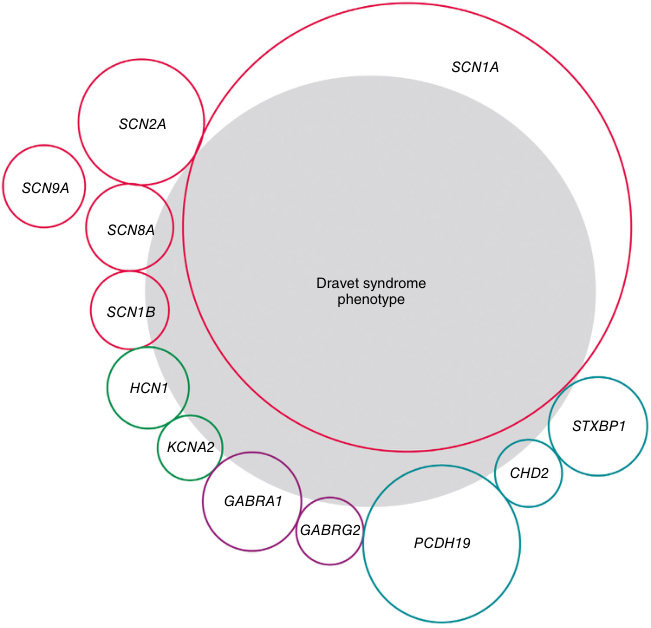
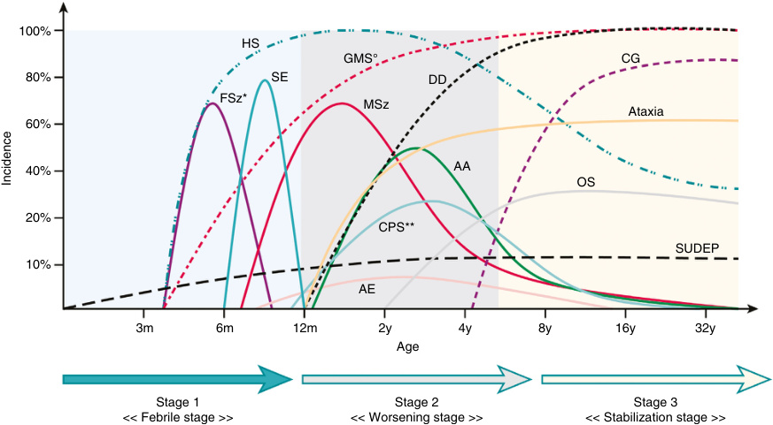
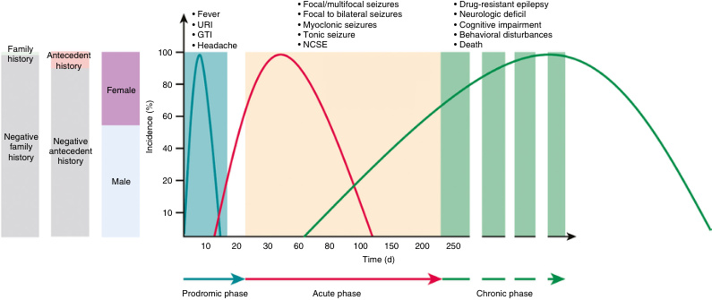
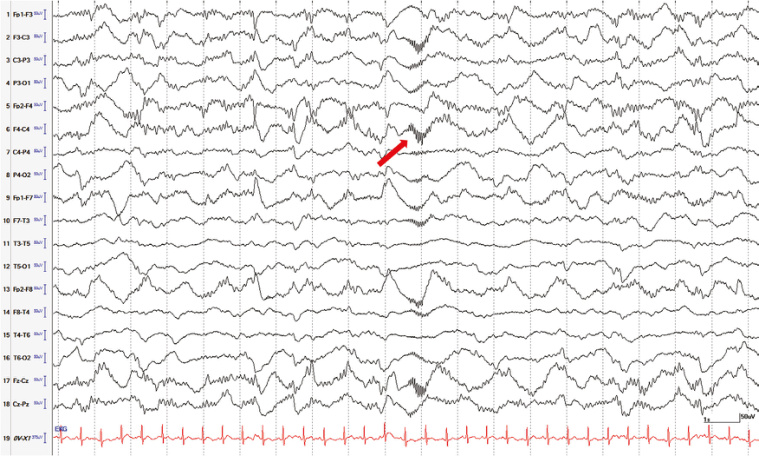
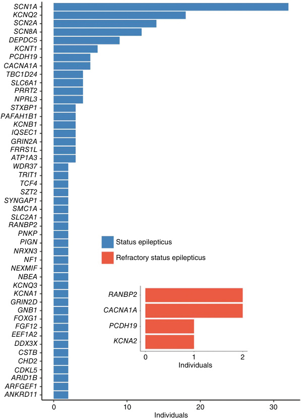

<!-- p.374 -->

# 15 Fever-Associated Seizures and Epilepsies 

**LAIA NOU FONTANET, JAUME CAMPISTOL PLANA, ALEXIS ARZIMANOGLOU** 

**Epileptic seizures** are the transient occurrence of signs or symptoms due to abnormal excessive or synchronous neuronal activity in the brain. Fever is defined by an axillary temperature of 38°C (100.4°F) or greater. Fever and seizures coexist in several disorders because fever lowers the seizure threshold. Increased brain temperature affects the sensitivity of ion channels, producing hyperexcitability which can lead to the generation of seizures. 

Seizures occurring during fever can be secondary to a wide array of etiologies: (i) acute symptomatic seizures; (ii) fever-associated seizures or epilepsy (FASE); (iii) epilepsy presenting with seizures triggered by fever; and (iv) seizures secondary to an epilepsy decompensation in a patient with a known epilepsy diagnosis. 

**Acute symptomatic seizures** can occur in the setting of direct chemical or inflammatory excitation caused by a central nervous system (CNS) or systemic infection. CNS infections (e.g., meningitis, encephalitis, and brain abscesses) are often associated with seizures in children and are not considered rare disorders. 

**Epilepsy** is a disorder consisting of (i) recurrent, unprovoked seizures (at least 2 or more unprovoked seizures occurring at least 24 hours apart); or (ii) an increased tendency toward recurrent unprovoked seizures in the next 10 years (defined as 1 unprovoked seizure along with additional clinical, radiological, or electroencephalographic evidence of an at least 60% risk for future seizures); or (iii) the clinical, genetic, electroencephalographic, or imaging-based confirmation of a known epilepsy syndrome. 

Differentiating FASE from epilepsy syndromes that present with seizures triggered by fever can be challenging, though clinical features and evolution often help identify the etiology. 

## **Fever-Associated Seizures or Epilepsy (FASE)** 

Fever-associated seizures or epilepsy (FASE) is characterized by the occurrence of seizures or epilepsy usually 

accompanied by fever and includes the following subtypes: 

- **Febrile seizures (FS)** , which are further categorized as simple, complex, or prolonged (also known as _febrile status epilepticus_ ), 

- **Febrile seizures** + **(FS1)** , 

- **Genetic epilepsy with febrile seizures** + **(GEFS1)** , 

- **Dravet syndrome (DS)** , which is further categorized as typical or atypical (also known as **developmental epileptic encephalopathy** ), and 

- **New-onset refractory status epilepticus (NORSE)** and **febrile infection-related epilepsy syndrome (FIRES)** . DS, GEFS+, and FIRES are classified by the Interna- 

- tional League Against Epilepsy (ILAE) as _epilepsy syndromes_ . 

### **Febrile Seizures (FS)** 

Febrile seizures are the most common FASE in children and consist of provoked epileptic events occurring in young children with fever, where the fever is not secondary to a metabolic disturbance or CNS infection. Children with previous afebrile seizures are excluded from the group of children with FS because fever is a seizure trigger in children with epilepsy. FS are the most common seizure of childhood, with a total incidence of up to 5% in children under 5 years in Western countries and up to 8% in Japan. Eighty-five percent of affected children have their first FS by the age of 4 years, with a median age of 17 to 23 months. Seizures occur mostly between 6 months and 5 years of age; 60% occur under 2 years, 20% between 2 and 3 years, and 20% have the first occurrence after 3 years of age. While FS are not rare diseases by themselves, several of their presentations and complications are. 

Febrile seizures are classified into simple FS, complex FS, and febrile status epilepticus (FSE)/prolonged seizures. The great majority of FS are brief, bilateral clonic or tonic-clonic seizures. A **simple FS** is a generalized epileptic seizure lasting less than 15 minutes, not recurring within 24 hours, and

<!-- p.375 -->

occurring during a febrile episode in a child aged 6 months to 5 years, with no focal neurologic deficits, with no acute brain injury, with normal psychomotor development, and with no previous afebrile seizures. Fever may not be detected before the seizure, but it must be present at least in the immediate post-acute period and be a symptom of an acute disease. A **complex FS** is a focal seizure, a generalized seizure lasting longer than 15 minutes, the recurrence of seizures more than once in 24 hours, or a seizure associated with postictal neurologic abnormalities, most frequently a postictal (Todd) paralysis, occurring in the context of a fever. Up to 35% of FS are complex. A **prolonged febrile seizure** or **febrile status epilepticus (FSE)** is defined as a seizure occurring in the context of a fever and lasting longer than 30 minutes. FSE accounts for up to half of all status epilepticus in children, although it represents a small fraction of FS occurrences. Children who have FSE have a greater risk of future adverse events, with up to 41% subsequently having FS recurrence. Children with underlying neurological abnormalities are at a greater risk of having FSE, comprising nearly a fifth of all children who experience FSE. The overall mortality and morbidity of _FSE_ are low. Compared to children with simple FS, FSE is associated with younger age, lower temperature, longer duration of recognized temperature before the seizure, female sex, structural temporal lobe abnormalities, and first-degree family member with a history of FS. 

### **_Pathogenesis_** 

Infections produce an inflammatory response resulting in the release of cytokines. Cytokines such as interleukin (IL)-1β, IL-6, and tumor necrosis factor-α (TNFα) along with pathogen-associated molecular patterns interact with the blood-brain barrier (BBB), resulting in increased BBB permeability that allows cytokine entry into the CNS. The cytokines activate microglia, which then release their own cytokines, specifically IL-1β. Abnormally increased IL-1β levels lead to progressive increases in excitatory (glutamatergic) neurotransmission and decreases in inhibitory (GABAergic) neurotransmission, mediating the pathogenesis of convulsions. 

### **_Differential Diagnosis_** 

The differential diagnosis of FS includes acute seizures provoked by CNS infections; in instances where clinical signs and symptoms suggest the possibility of CNS infection, cerebrospinal fluid (CSF) analysis should be obtained. Differentiating acute convulsive encephalopathies from FS may be difficult when the CSF is normal. Discriminating between FS and epilepsy precipitated by fever is challenging because there is a large overlap in clinical features between these categories. Repeated episodes of FSE within a short period (<2 months) can be suggestive of DS. 

### **_Genetics_** 

Up to 31% of first-degree relatives of individuals with FS also have a history of FS. While the exact mode of inheritance is not known, polygenic or multifactorial modes of transmission are presumed. There is significant genetic heterogeneity in **familial febrile seizures** , with many genes and putative loci potentially associated with FS (Table 15.1). Some genes have been designated as different familial febrile seizures (FEB) entities with an associated Mendelian Inheritance in Man (MIM) phenotype; data are not robust because genetic studies are not usually performed in patients with FS because results have historically not affected patient management. 

### **_Treatment_** 

FS are usually benign and resolve spontaneously without any antiseizure medication (ASM). _There is no evidence that antipyretic treatments are effective in the prevention of FS._ Continuous prophylactic treatment with ASM to prevent recurrences is not generally advised because the balance of risks and benefits is generally weighted against prophylactic therapy; however, treatment may be indicated based on the presence of high-risk factors (Table 15.2 and Table 15.3). Intermittent prophylaxis with oral diazepam during febrile illnesses is not an evidence-based practice. Rescue doses of rectal, buccal, or intranasal benzodiazepines are indicated when seizures last longer than 5 minutes. 

### **_Prognosis_** 

### **_Electroencephalogram (EEG) Findings_** 

EEG tracings recorded in the first days after a FS may be abnormal, with slow waves detected for a few days in approximately one-third of patients. Epileptiform discharges in the form of centrotemporal spikes or bilateral spike-wave bursts occur in one-third of children with FS followed prospectively. Such abnormalities do not correlate strongly with the later onset of epilepsy; as such, EEG recording _is not_ indicated after a first simple FS or for the treatment of FS. In complex FS, the decision to obtain an EEG is based on individual patient factors. In patients with FSE, EEG _is_ routinely performed, though optimal timing for obtaining the study to minimize falsely positive findings has not been established. 

The prognosis of FS is favorable, with most affected individuals experiencing no permanent neurologic sequelae. The primary risk of FS is recurrence; up to 70% of children will have only one episode and most of the remaining will have only 2 or 3 additional FS, with only 9% of affected individuals experiencing more than 3 episodes. Data on the risk of mortality after FS are inconclusive, with most large cohort studies reporting no deaths. 

The risk of developing afebrile seizures varies (Table 15.3) and may be at least 10 times higher than in the general population. Most epilepsies following FS are non-lesional generalized epilepsies with tonic-clonic seizures, often with only a few seizures. Rarely, following a prolonged focal FS in a child under 4 years of age, a rare epileptic encephalopathy

<!-- p.376 -->

#### **TABLE 15.1** Classii i fication of Fam i i ilial Febrile Seiz i i ures (FEB) Based on i i Identified Pathogenic i i Genetic Variants

|Phenotype|Gene|Inheritance|Gene MIM no.(*)|Cytogenetic Location|Phenotype MIM no. (#)|
|---|---|---|---|---|---|
|FEB1|—|AD|—|8q13-q21 (PL)|121210|
|FEB2|_HCN2_|AD|602781|19p13.3|602477|
|FEB3A|_SCN1A_|AD|182389|2q24.3|604403|
|FEB3B|—|AD|—|2q23-q24 (PL)|613863|
|FEB4|_ADGRV1_|AD|602851|5q14.3|604352|
|FEB5|—|AD|—|6q22-q24 (PL)|609255|
|FEB6|_IMPA2_|AD|605922|18p11.2 (PL)|609253|
|FEB7|—|—|—|21q22 (PL)|611515|
|FEB8|_GABRG2_|AD|607681|5q34|137164|
|FEB9|—|AD|—|3p24.2-p23 (PL)|611634|
|FEB10|—|—|—|3q26.2-q26.33 (PL)|612637|
|FEB11|_CPA6_|AR|609563|8q13.2|614417|
|FEB|_PRRT2_|—|614386|16q11.2|—|
|FEB|_SCN2A_|—|182390|2q24.3|—|
|FEB|_ANO3_|—|610110|11q14.3-p14.2|—|
|FEB|_SLC12A5_|—|606726|20q13.12|—|
|FEB|—|—|—|12q21.33 (PL)|—|
|FEB|_(PTGER3)_|—|176806|1p31.1 (PL)|—|
|FEB|_(IL10)_|—|124092|1q32.1 (PL)|—|
|FEB|_(BSN)_|—|604020|3p21.31 (PL)|—|
|FEB|_(ERC2)_|—|617250|3p14.3 (PL)|—|
|FEB|_(MAP3K9)_|—|600136|14q24.2 (PL)|—|
|FEB|_(HERC1)_|—|605109|15q22.31 (PL)|—|

_AD,_ Autosomal dominant; _AR,_ autosomal recessive; _PL,_ putative loci without identified disease genes. The last FEB are genes or putative loci without identified disease genes that have been associated with FS, without a MIM phenotype associated yet. In these cases, the gene indicated between brackets is located in the chromosomal loci with a possible pathophysiological effect. 

syndrome termed **hemiconvulsion-hemiplegia-epilepsy (HHE)** may develop. This disorder is characterized by a prolonged (usually hours, occasionally over 24 hours) unilateral FS followed by ipsilateral hemiplegia of variable duration and the subsequent development of focal epilepsy following the initial prolonged seizure episode. Peak onset is during the first 2 years of life, and the average interval between the initial episode and the development of chronic epilepsy is usually 1 to 2 years. HHE is classified according to whether the onset of the FS is _idiopathic_ (i.e., due to a non-CNS systemic infectious or acute inflammatory process) or _symptomatic_ (i.e., due to an identifiable CNS-based process such as head trauma, meningitis, subdural effusion, or cerebrovascular disease). Pathologic changes in HHE include unilateral cerebral edema followed by global hemiatrophy and spongiosis that is not restricted to a particular 

vascular territory. It is unclear whether idiopathic HHE is a sequela of an otherwise isolated prolonged focal FS, or if additional factors predispose certain individuals to the development of HHE. Several genetic variants have emerged as potentially predisposing to HHE, including Ser218Leu and Tyr62Cys variants in _CACNA1A_ . Chromosomal abnormalities such as a deletion at locus 1q43q44 involving _HNRNPU_ and a microdeletion in the 5q33.3q34 region have also been associated with HHE. Other potential predisposing factors include protein S deficiency and the C677T _MTHFR_ polymorphism. The incidence of HHE has declined considerably due to improvements in the management of status epilepticus and early administration of rescue medications in FSE; it appears that the most important factor in reducing the risk of developing HHE is the prompt recognition and early aggressive treatment of FSE.

<!-- p.377 -->

#### **TABLE Risk Factors for Recurrence of Febrile 15.2 Seizures* Major** 

- Age <1 yr • Duration of fever <24 hr • Fever 38–39°C (100.4–102.2°F) 

##### **Minor** 

- Family history of febrile seizures 

- Family history of epilepsy 

- Complex febrile seizure 

- Daycare 

- Male gender 

- Lower serum sodium at time of presentation 

*Having no risk factors carries a recurrence risk of approximately 12%; one risk factor, 25–50%; two risk factors, 50–59%; three or more risk factors, 73–100%. 

From Mikati MA, Tchapyjnikov D. Seizures in childhood. In: Kliegman RM, et al., eds. _Nelson Textbook of Pediatrics._ 21st ed. Philadelphia: Elsevier; 2020 (Table 611.5, p. 3093). 

hypoxic-ischemic brain injury, head trauma, or CNS infection. Mesial temporal lobe-onset seizures have distinct semiologies that can consist of an aura of a rising epigastric sensation accompanied by emotional lability, sensory hallucinations, and autonomic phenomena, followed by impaired consciousness or behavioral arrest, orofacial automatisms, and dystonic posturing. Seizures are initially straightforward to control with ASMs, though eventually become refractory; affected individuals also go on to develop progressive behavioral difficulties and memory impairments. 

The role of FSE in the genesis of focal epilepsy remains unresolved. The development of MTLE with hippocampal sclerosis after FS has been strongly associated with variants in the sodium channel gene cluster on chromosome 2q24.3. Histopathological studies of temporal lobe tissue removed during epilepsy surgery reveal a high incidence of HHV-6B viral replication in hippocampal astrocytes, suggesting a possible association among HHV-6B **(roseola infantum)** , FSE, and hippocampal sclerosis. 

### **Febrile Seizures1 (FS1)** 

FS+ is a term applied to FS appearing beyond the age of 5 to 6 years. 

#### **TABLE 15.3** Risk Factors for Occurrence Epilepsy After a Febrile Sei of Subsequent zure*

|Risk Factor|Risk for Subsequent Epilepsy|
|---|---|
|Simple febrile seizure|1%|
|Recurrent febrile seizures|4%|
|Complex febrile seizures (>15 min in duration or recurrent within 24 hr)|6%|
|Fever<1 hr before febrile seizure|11%|
|Family history of epilepsy|18%|
|Complex febrile seizures (focal)|29%|
|Neurodevelopmental abnormalities|33%|

*Having more than one risk factor is at least in part additive. From Mikati MA, Tchapyjnikov D. Seizures in childhood. In: Kliegman RM, et al., ed. _Nelson Textbook of Pediatrics._ 21st ed. Philadelphia: Elsevier; 2020 (Table 611.6, p. 3093). 

**Mesial temporal lobe epilepsy (MTLE) with hippocampal sclerosis** is a rare epilepsy syndrome characterized by seizures originating in the limbic areas of the mesial temporal lobe (e.g., hippocampus, amygdala, and parahippocampal gyrus), along with unilateral or asymmetric sclerosis of the hippocampus. MTLE with hippocampal sclerosis typically presents before 5 years of age and has historically been associated with FS, as well as with 

### **Genetic Epilepsy With Febrile Seizures** + **(GEFS** + **)** 

Genetic epilepsy with febrile seizures+ (GEFS+) is a _familial epilepsy syndrome_ with variable expressivity that includes classic FS, FS+, and generalized or focal epilepsy accompanied by FS/FS+, such as absence seizures, myoclonic seizures, atonic seizures, myoclonic-astatic epilepsy, status epilepticus, and, more rarely, severe epileptic encephalopathy. GEFS+ was first described in an extended family with an extensive history of FS, often of unusual duration or severity, as well as afebrile generalized seizures of various types, with the family pedigree suggesting apparent dominant transmission. FS constituted the most common manifestation, often after 6 years of age. 

### **_Genetics_** 

GEFS+ is genetically heterogeneous (Table 15.4). Some putative GEFS+ pathogenic variants are in genes encoding sodium channels and GABA-A receptors, suggesting channelopathy as a potential etiology. The mechanism for phenotypic variability remains uncertain. Incomplete penetrance is usual in large dominant GEFS+ pedigrees, with relatively low penetrance around 55%. 

### **_Treatment_** 

General guidelines for the treatment of epileptic seizures apply. Broad-spectrum ASMs are usually the first choice. Subsequent ASM choices depend on the type or types of seizures that subsequently predominate the phenotype.

<!-- p.378 -->

**TABLE Classification of Genetic Epilepsy With Febrile Seizures Plus (GEFS1) Based on Identified Pathogenic 15.4 Genetic Variants** 

|Phenotype|Gene|Inheritance|Gene MIM no. (*)|Cytogenetic Location|Phenotype MIM no. (#)|
|---|---|---|---|---|---|
|GEFS+1|_SCN1B_|AD|600235|19q13.11|604233|
|GEFS+2|_SCN1A_|AD|182389|2q24.3|604403|
|GEFS+3|_GABRG2_|AD|137164|5q34|607681|
|GEFS+4|—|AD|—|2p24 (PL)|609800|
|GEFS+5|_GABRD_|AD|137163|1p36.33|613060|
|GEFS+6|—|—|—|8p23-p21|612279|
|GEFS+7|—|AD|—|2q23-q24|613863|
|GEFS+8|—|—|—|6q16.3-q22.31 (PL)|613828|
|GEFS+9|_STX1B_|AD|601485|16p11.2|616172|
|GEFS**1**10|_HCN1_|AD|602780|5p12|618482|
|GEFS**1**11|_HCN2_|AD|602477|19p13.3|602781|
|GEFS+|—|AD|—|12p13.33|—|
|GEFS+|—|AD|—|12q22-q23.3|—|
|GEFS+|—|AD|—|17q12|—|
|GEFS+|—|AD|—|22q13.31|—|
|GEFS+|_SLC32A1_|—|616440|20q11.23|—|
|GEFS+|_PRRT2_|AD|614386|16q11.2|—|
|GEFS+|_SCN2A_|AD|182390|2q24.3|—|
|GEFS+|_SCN9A_|AD|603415|2q24.3|—|
|GEFS+|_CACNA1H_|AD|607904|16p13.3|—|

_AD,_ Autosomal dominant; _AR,_ autosomal recessive; _MIM,_ Mendelian Inheritance in Man; _PL,_ putative loci without identified disease genes. 

### **_Prognosis_** 

Most patients have good seizure control with ASMs, and seizures may stop before puberty; however, individual prognosis varies according to the underlying etiology. 

### **Dravet Syndrome** 

Dravet syndrome (DS) is a rare form of early-onset genetic epilepsy with age-dependent progression that manifests as neurodevelopmental delays and medically refractory epilepsy. First described under the term _severe myoclonic epilepsy in infancy_ , myoclonic seizures were later found not to be a consistent feature; even when present, myoclonic seizures are not the predominant seizure type. The incidence of DS is approximately 1 in 16,000 births; males are more often affected than females (2:1). The genetic etiology of DS was first reported in 2001: approximately 80% is caused by haploinsufficiency due to loss-of-function variants in _SCN1A_ (Fig. 15.1). Additional variants have been identified in individuals with atypical DS (Table 15.5). 

### **_Phenotype_** 

Symptoms usually begin between 4 and 10 months of age and evolve in a somewhat predictable fashion (Fig. 15.2). The first symptom is a convulsive seizure appearing in the first year of life in a previously healthy child, usually accompanied by a normal interictal electroencephalogram. This first seizure is typically generalized tonic-clonic or focal clonic (sometimes hemiclonic); about half of these seizures occur in the context of a fever. Other factors triggering seizures in DS are infection, environmental heat (e.g., hot baths, high ambient temperature), immunization, sunlight, photic stimulation, exercise, or excitement. Seizures recur at short intervals, usually less than 2 months. In this early phase of the disease, unilateral or bilateral convulsive status epilepticus with a significant clonic component is frequently present, a phenotypic feature strongly suggestive of DS. Initially, neurodevelopment is normal but other seizure types appear during the second or third year of life, including afebrile focal seizures, atypical absence seizures, myoclonic jerks, and episodes of nonconvulsive status epilepticus. Epilepsy proves to be

<!-- p.379 -->

**Fig. 15.1** Genes associated with a Dravet syndrome phenotype. Red, sodium channels; green, potassium channels; purple, chloride channels; blue, nonchannels.  (From Steel D, Symonds JD, Zuberi SM, et al. Dravet syndrome and its mimics: beyond SCN1A. _Epilepsia._ 2017;58[11]:1807–1816 [Fig. 1, p. 1812].) 

drug-resistant and neurodevelopmental delays progress to severe neurologic disability. When cognitive slowing becomes evident, symptoms such as ataxia, tremor, dysarthria, pyramidal, and extrapyramidal signs often appear. Although the frequency of seizures decreases with age, brief nocturnal generalized tonic-clonic seizures may persist throughout life. During adulthood, DS manifests as persistent motor and cognitive dysfunction. Parkinsonian syndrome has been described in some adults with DS. Patients manifest psychiatric disturbances such as aggressiveness, agitation, obsessiveness, preservation, and hoarding behavior. 

DS should be considered in a child younger than 12 months who presents with a prolonged hemiclonic or bilateral tonic-clonic seizure with fever, particularly in the absence of other underlying causes. Further convulsive seizures (often with fever, and particularly if prolonged or hemiclonic) allow for a more definitive clinical diagnosis of DS, an indication to perform genetic testing. 

### **_Electroencephalogram Findings_** 

Interictal EEG recordings are generally normal at onset, though slowing typically appears after 2 years of age. Interictal 

discharges also appear after 2 years of age and are often focal, multifocal, and generalized. A photoparoxysmal response occurs in 15% of patients, being more frequent in younger children. Ictal findings depend on seizure type. 

### **_Genetics_** 

Genomic next-generation sequencing (NGS)—including gene panels, exome sequencing, and genome sequencing— is recommended over single-gene Sanger sequencing-based methods given higher diagnostic yields. In addition, multiplex ligation-dependent probe amplification (MLPA), which detects intragenic deletions or duplications, should be performed. 

If performing gene panel analysis, an epilepsy gene panel that includes _SCN1A_ is recommended in all infants experiencing a prolonged seizure before 1 year of age, particularly if the affected individual is younger than 6 months and both brain magnetic resonance imaging and EEG recordings are normal. In addition, genetic analysis should be done in all patients, including adults, with a history suggestive of typical of DS, although obtaining early-life history in adults may be challenging.

<!-- p.380 -->

|**TABLE** **15.5**|
|---|

#### **Genetic Causes of Atypical Dravet Syndrome/Developmental Epileptic Encephalopathy** 

|Phenotype|Gene|Inheritance|Gene MIM no. (*)|Cytogenetic Location| Phenotype MIM no. (#)|Distinctive Features|
|---|---|---|---|---|---|---|
|DEE4|_STXBP1_|AD, AR|602926|9q34.11|612164|Infantile spasms, tremor, spasticity, brain hypomyelination, thin corpus callosum.|
|DEE9|_PCDH19_|XL|300460|Xq22.1|300088|Autistic features, psychosis, aggression, obsessive features.|
|DEE11|_SCN2A_|AD|182390|2q24.3|613721|Optic atrophy, oculogyric seizures, choreoathetosis, dystonia, dyskinesia, spasticity, white matter abnormalities, thin corpus callosum, autistic features.|
|DEE13|_SCN8A_|AD|600702|12q13.13|614558|Epileptic spasms, autistic features.|
|DEE19|_GABRA1_|AD|137160|5q34|615744|Optic atrophy, absence seizures.|
|DEE24|_HCN1_|AD|602780|5p12|615871|White matter abnormalities, autistic features.|
|DEE32|_KCNA2_|AD|176262|1p13.3|616366|Myoclonus, tremor.|
|DEE43|_GABRB3_|AD|617113|15q12|137192|Dyskinesia, hypomyelination, hyperactivity.|
|DEE52|_SCN1B_|AR|600235|19q13.11|617350|Myopathic facies, spasticity|
|DEE74|_GABRG2_|AD|137164|5q34|618396|Roving eye movements, nystagmus, delayed myelination.|
|DEE94|_CHD2_|AR|602119|15q26.1|615369|Autistic features.|
|—|_GABRD_|AD|137163|1p36.33|—|—|
|—|_PRRT2_|—|614386|16q11.2|—|—|

_AD,_ Autosomal dominant; _AR,_ autosomal recessive; _DEE,_ developmental and epileptic encephalopathy; _DS,_ Dravet syndrome; _XL,_ X-linked. 

### **_Typical DS—SCN1A Gene Variants_** 

Typical DS is caused by autosomal dominant pathogenic variants in _SCN1A_ , located at chromosomal locus 2q24.3. Approximately 95% of pathogenic variants are _de novo_ . 

_SCN1A_ encodes the voltage-gated sodium channel (VGSC) α1 subunit (NaV1.1), which constitutes the main pore-forming subunit of voltage-gated sodium (NaV) channels. NaV channels are large integral membrane proteins that regulate the flow of sodium ions across the cell membrane to initiate and propagate action potentials in excitable tissues. NaV channels play a crucial role in electrical signaling and regulation within the CNS. The NaV1.1 channel is an approximately 260 kD protein divided into 4 nearly homologous homomeric domains (I–IV). Within each domain are 6 transmembrane domains (S1-S6) including an S4 voltage sensor and an S3-S4 intracellular loop that folds to become the inactivation gate, and an S5-S6 extracellular linker domain that translates to a hairpin-like loop integrated in the channel pore. 

_Pathogenic variants in the SCN1A gene are the most frequent monogenic cause of epilepsy_ . Phenotypes vary widely, including patients with mild epilepsy (e.g., FEB3A, GEFS+2) 

to severe epilepsy (e.g., DS, **developmental and epileptic encephalopathy 6B [DEE6B]** ), as well as **familial hemiplegic migraine-3** . However, up to 90% of patients with _SCN1A_ variants present with DS. Other phenotypes including myoclonic atonic epilepsy and epilepsy of infancy with migrating focal seizures have also been reported. 

NaV channels are essential for action potential generation in neurons. NaV1.1 expression occurs predominantly in axon initial segments of parvalbumin-positive interneurons, which regulate the efficient firing of pyramidal neurons, which is essential for inhibitory neurotransmission. Epilepsy phenotypes are mostly caused by loss-of-function (LoF) variants. However, gain-of-function (GoF) missense variants have been reported in familial hemiplegic migraine-3 without epilepsy. In DEE6B it is suggested that a p.Thr226Met variant induces a GoF state which facilitates a depolarizing block of interneurons, resulting in profound disinhibition. 

Up to _1,500 gene variants_ have been identified in patients with DS. Truncating variants, including nonsense, frameshift, and splice site variants, are identified in over half of cases, and missense variants occur in up to one half of cases. Other variants include deletions of the whole gene, some

<!-- p.381 -->

**Fig. 15.2** Schematic representation of clinical manifestations of Dravet syndrome and their relative incidence according to age. *Moderate fever for 60%; mostly clonic generalized and unilateral motor seizures. **Difficult distinction between atypical absences and complex partial seizures without ictal EEG recording, so their precise incidence is unknown. °Including generalized tonic-clonic and unilateral seizures. However, unilateral seizures are less frequent after the age of 7 years, whereas sleep seizures increase after 6–7 years and become predominant after the age of 9–10 years. _AA,_ Atypical absences; _AE,_ acute encephalopathy; _CG,_ crouching gait; _CPS,_ complex partial seizures; _DD,_ developmental delay; _FSz,_ complex febrile seizures; _GMS,_ generalized motor seizures; _HS,_ hyperthermia sensitivity; _MSz,_ myoclonic seizures; _OS,_ obtundation status; _SE,_ convulsive status epilepticus; _SUDEP,_ sudden unexpected death in epilepsy.  (From Gataullina S, Dulac O. From genotype to phenotype in Dravet disease. _Seizure._ 2017;44:58–64 [Fig. 1, p. 59].) 

exons, or promotor regions. The high frequency of damaging variants and the impairment in cerebral inhibition suggest that DS is caused by a functional decline in the NaV1.1 subunit due to haploinsufficiency. Electrophysiological studies examining functional consequences of some DS missense variants have demonstrated that most are GoF and often nonfunctional. 

Testing for _SCN1A_ gene variants is recommended in infants suspected of DS or other early-onset infantile epileptic encephalopathies, and in normal infants with recurrent febrile or afebrile, prolonged hemiclonic or generalized status epilepticus. Because most testing modalities do not detect pathogenic variants in introns or promoter or regulatory regions, a negative conventional genetic testing result should not exclude the possibility of _SCN1A_ -related disease or exclude a possible diagnosis of DS. In such cases, _genome sequencing_ may improve diagnostic yield. 

Due to the gene pleiotropy of _SCN1A_ variants, a _SCN1A_ - epilepsy prediction model has been developed (http://scn1aprediction-model.broadinstitute.org/). This prediction model allows objective estimation at disease onset of whether a child will develop DS or GEFS+, assisting clinicians with prognostic counseling and decisions on early institution of precision 

therapies. DS may occur in families with a strong history of GEFS+. _SCN1A_ pathogenic variants may be found in other epilepsy syndromes such as GEFS+ and early infantile _SCN1A_ with profound impairment. 

### **_Atypical DS/Developmental Epileptic Encephalopathy_** 

Individuals with a clinical diagnosis of DS and negative genetic testing for _SCN1A_ were historically described as having **atypical DS;** however, patients with atypical DS and identified pathogenic variants in genes other than _SCN1A_ are considered to have **developmental epileptic encephalopathy (DEE)** followed by a number corresponding to the particular variant (Table 15.5). 

Atypical DS has additionally been described in chromosome 2q21.3 deletions, which are associated with variable epilepsy phenotypes including not only atypical DS but also partial seizures of infancy. This chromosome region includes the sodium channel genes _SCN1A_ , _SCN2A_ , _SCN3A_ , _SCN7A,_ and _SCN9A_ . Epilepsy-related pathogenic variants in _SCN2A_ and _SCN8A_ are mainly missense variants that induce GoF effects in pyramidal cells. _SCN1A, SCN2A,_ and _SCN8A_ are expressed at different levels among numerous

<!-- p.382 -->

cell types and at specific ages and are strong determinants of epilepsy phenotypes and age of seizure onset. LoF variants in _SCN2A_ and _SCN8A_ gene are related to late-onset-epilepsy and intellectual disability with or without seizures, respectively. 

### **_Treatment_** 

Individuals with DS tend to present with FSE at disease onset. Given this severity, ASMs—typically broad-spectrum agents— are often initiated before diagnosis is confirmed. Rescue medication to stop prolonged seizures is also recommended. 

DS treatment guidelines recommend valproic acid (VPA) as the first-line drug of choice. Valproic acid can decrease the number and duration of seizures but only rarely produces a seizure-free state. Clobazam monotherapy is an alternative option in some guidelines, though clobazam is used in combination with VPA in others. Second-line choices include stiripentol in combination with valproic acid and clobazam, cannabidiol with or without clobazam, topiramate, ketogenic diet, and flufenamic acid. 

Early addition of stiripentol with a combination of valproic acid and clobazam significantly reduces the duration of convulsive episodes. In older individuals, vagus nerve stimulation is an additional treatment option. Sodium channel blockers (e.g., carbamazepine, oxcarbazepine, lamotrigine, vigabatrin, and phenytoin) _should be avoided_ in DS. 

Once the diagnosis is suspected or confirmed, individuals should be advised to avoid seizure triggers, such as exposure to flickering lights, and to practice appropriate seizure safety, such as avoiding unsupervised bathing or swimming. Proper use of a rescue medication as soon as a seizure starts should be taught as well. 

It was reported that fever following vaccination might trigger seizures that will lead to earlier onset of DS in children who, because of an _SCN1A_ variant, are destined to develop the disease. Because there is no evidence that vaccination before or after disease onset influences longterm outcomes, vaccination should not be withheld from children with _SCN1A_ variants. 

### **_Prognosis_** 

The long-term prognosis of DS is determined by seizure control, the degree of developmental and cognitive impairment, and the accumulation of comorbidities. Most individuals have intellectual disability and ongoing seizures. Intellectual disability is severe in nearly 50% of affected individuals; rare individuals have no intellectual disability. Long-term course also includes brief nocturnal seizures and a characteristic deterioration in gait. 

DS is associated with higher mortality rates compared to other epilepsy syndromes; rates approach 20% by adulthood. **Sudden unexpected death in epilepsy (SUDEP)** is the most common cause of mortality, followed by status epilepticus, infections, and seizure-related injuries and accidents. Optimal treatment of seizures in DS may improve outcomes, though neurodevelopmental impairments are not solely determined by seizure burden 

and are typically related to the specific causative pathogenic variant. 

### **New-Onset Refractory Status Epilepticus (NORSE) and Febrile Infection-Related Epilepsy Syndrome (FIRES)** 

New-onset refractory status epilepticus (NORSE) and febrile infection-related epilepsy syndrome (FIRES) are rare clinical presentations characterized by _de novo_ onset of **refractory status epilepticus (RSE)** without a clearly identifiable acute or active structural, toxic, or metabolic cause. FIRES was first described in a previously typically developing child with a sudden-onset catastrophic illness mimicking infectious encephalitis. FIRES has had different descriptive titles including _devastating encephalopathy in school-age children (DESC), acute encephalitis with refractory repetitive partial seizures (AERRPS)_ , and _fever-induced epileptic encephalopathy of school-age children_ . NORSE and FIRES are relatively uncommon. In Germany, the annual incidence and prevalence of FIRES among children and adolescents is estimated to be 1:1,000,000 and 1:100,000, respectively. NORSE and FIRES present in both children and adults, with a female predominance in adults and a male predominance in children. 

NORSE should be considered as a clinical presentation rather than as a specific diagnosis (Table 15.6). FIRES is considered a subcategory of NORSE; diagnosis of FIRES requires a prior febrile illness starting between 2 weeks and 24 hours before the onset of RSE. Fever is not required to be present at the exact onset of status epilepticus. 

The definition of FIRES excludes prolonged febrile convulsions in children in whom the onset of fever is within 24 hours of, or not recognized until after, the onset of seizures. NORSE includes patients with viral infections (including HSV-1) and autoimmune syndromes of new onset (including anti-NMDA encephalitis), even when these entities are diagnosed in the initial 72 hours after seizure onset. The etiology of NORSE is found in up to 50% of cases. 

Individuals with FIRES share common clinical characteristics (Table 15.7 and Fig. 15.3), initially presenting 1 to 14 days before the onset of status epilepticus with a prodromal phase, usually a febrile illness such as a minor upper respiratory tract infection or gastroenteritis. During the infectious illness, fever may be low grade or even absent, and fever cessation occurs at the time of first seizure in about half of patients. Prodromal symptoms also precede the onset of NORSE in 60% of patients, and include mild febrile illnesses, confusion, fatigue, headache, behavioral changes, and memory symptoms. 

After onset, seizure frequency increases rapidly or progress to outright RSE. Children with FIRES commonly have multiple seizures each day. Adults experience focal motor seizures with preserved awareness and facial twitching or with impaired awareness and lateral deviation of the head, chewing movements, and autonomic features, and a strong tendency toward bilateral tonic-clonic seizures. Myoclonic seizures with a facial predominance, particularly oral-buccal, may also

<!-- p.383 -->

#### **TABLE New-Onset Refractory Status Epilepticus: Prominent Presentation Features of the 15.6 Most Frequent Etiologies** 

|Categories|*|Most Frequent Findings|Clinical Clues|
|---|---|---|---|
|Unknown|50%||No specific findings Prodromal mild febrile illness in 65% of cases Typically severe and prolonged SE|
|Inflammatory and autoimmune encephalitis|40%|Paraneoplastic limbic encephalitis (Anti-Hu, -Ma2/Ta, -CV2/CRMP-5, -amphiphysin, -VGCC, -mGluR5)|Cognitive, especially memory impairment, behavioral changes, temporal lobe seizures, sleep disturbance Hu: often more diffuse encephalomyelitis Ma2/Ta: hypothalamic dysfunction CV2/CRMP5: diffuse encephalomyelitis, chorea|
|||Surface-bindingautoantibodies||
|||Anti-NMDA-R|Mostly young females Prodromal fever, short-term memory loss, psychiatric symptoms, hallucinations, orolingual dyskinesia, autonomic and respiratory failure Children: behavioral changes, movement disorders EEG: extreme delta brushes (50%)|
|||Anti-VGKC complex|Mostly elderly males LGI-1: limbic encephalitis, faciobrachial dystonic seizures. SIADH Caspr2: episodic ataxia|
|||Anti-GABA(B)-R|Limbic encephalitis|
|||Anti-GABA(A)-R|Multifocal neocortical encephalitis|
|||Anti-AMPA-R|Prominent psychiatric symptoms, cerebellar ataxia|
|||Anti-Glycine-R|No specific features|
|||Anti-GAD|No specific features|
|||Steroid-responsive encephalopathy with autoimmune thyroiditis|Rapid-onset dementia, myoclonus, strokelike episodes Anti-TPO, anti-TG|
|Infectious encephalitis|10%|HSV1|Temporal involvement|
|||Enterovirus|Rash, acute lower motor neuron syndrome|
|||CMV|Immunodeficiency: gastrointestinal symptoms, retinitis, pneumonitis|
|||EBV|Adenopathies, ataxia Immunodeficiency: CNS lymphoma|
|||VZV|Rash|
|||_Mycoplasma pneumoniae_|Respiratory symptoms, EEG: extreme spindles|
|||_Bartonella henselae_|Children: cat-scratch disease with skin lesion and regional adenopathy|
|||Arboviruses (WNV, tick-borne virus, others)|Flulike episode WNV: parkinsonism, acute lower motor neuron syndrome, EEG: triphasic waves|
|Genetic disorders|Rare|_SCN1A_|Dravet syndrome|
|||_PCDH19_|Epilepsy and cognitive impairment limited to female|
|||CADASIL|Migraine, strokes, visual problems, cognitive deterioration|
|||Mitochondrial disorder (MELAS)|Elevated CSF lactate and strokelike episodes|
|||Mitochondrial disorder_(POLG1)_|Occipital seizures, epilepsia partialis continua, liver failure, nystagmus, ataxia|

_*_ Proportions mainly reflect adult population. There is a lack of data in pediatric population. 

_AMPA,_ α-amino-3-hydroxy-5-méthylisoazol-4-propionate; _CADASIL,_ cerebral autosomal dominant arteriopathy with subcortical infarcts and leukoencephalopathy; _CMV,_ cytomegalovirus; _CNS,_ central nervous system; _CSF,_ cerebrospinal fluid; _EBV,_ Epstein-Barr virus; _GABA,_ γ-aminobutyric acid; _GAD,_ glutamic acid decarboxylase; _HSV,_ herpes simplex virus; _LGI1,_ leucine-rich glioma inactivated 1; _MELAS,_ syndrome of mitochondrial encephalomyopathy, lactic acidosis, and strokelike episodes; _NMDA, N_ -methyl-d-aspartate; _PCDH,_ protocadherin; _POLG1,_ mitochondrial DNA polymerase gamma; _SIADH,_ syndrome of inappropriate antidiuretic hormone secretion; _SCN,_ neuronal voltage-gated sodium channel; _SE,_ status epilepticus; _TG,_ thyroglobulin; _TPO,_ thyroperoxidase; _VGKC,_ voltagegated potassium channel complex; _VZV,_ varicella zoster virus; _WNV,_ West Nile virus. 

From Sculier C, Gaspard N. New onset refractory status epilepticus (NORSE). _Seizure_ . 2019;68:72-78 (Table 1, p. 74).

<!-- p.384 -->

###### **TABLE** 

###### **15.7** 

#### **Clinical Features of Febrile Infection-Related Epilepsy Syndrome (FIRES)** 

Age of onset: 2–17 (median 8) yr Medical history: febrile seizures in rare cases, no epilepsy or other chronic disease, normal psychomotor development Family history: uninformative, e.g., no allergies and especially no other family member with FIRES Prodromal phase: Different types of febrile infections often flulike Frequently followed by an afebrile and asymptomatic interval of 1–2 days resulting in a consistent neurologic syndrome Neurologic syndrome: Peracute/explosive onset of multifocal or generalized seizures of different types directly evolving into super-refractory status epilepticus Without other neurologic features (pure seizure phenotype) EEG: global slowing or multifocal discharges with bilateral frontotemporal predominance, or both CSF: normal or pleocytosis. normal protein concentration, no oligoclonal bands MRI (during the acute phase of status epilepticus): No or nonextensive bitemporal or diffuse abnormalities Sporadic involvement of the basal ganglia, diffuse cortical edema, and/or hydrocephalus Cause: extensive infections (e.g., brain biopsies), metabolic (e.g., muscle biopsy). and genetic investigations (e.g., _POLG, SCN1A, PCDH19_ genes, CNVs, exome sequencing) _without_ causative findings Coexisting autoimmunities: some patients with autoantibodies (e.g., TPO or GluR antibodies) Treatment: resistance to nearly all drugs and even anesthetics Outcome: Almost always chronic epilepsy without silent period Often global brain atrophy after a few weeks with mild to severe neuropsychologic impairments 

_CNVs,_ Copy number variants; _GluR,_ glutamate receptor; _TPO,_ thyroid peroxidase. From van Baalen A, Vezzani A, Hausker M, et al. Febrile infection related epilepsy syndrome: clinical review and hypotheses of epileptogenesis. _Neuropediatrics._ 2017;48:5–18 (Table 1, p. 6). Source: Table 39.27 in _Nelson Pediatric Symptom-Based Diagnosis_ 2/e. 

**Fig. 15.3** Clinical findings in FIRES (febrile infection–related epilepsy syndrome) and NORSE (new-onset refractory status epilepticus) including family history, antecedents, and sex predominance. The graph shows the symptoms during the prodromic phase, type of seizures in the acute phase, and clinical findings during the chronic phase. _GTI,_ Gastrointestinal tract infections; _NCSE,_ nonconvulsive status epilepticus; _URI,_ upper respiratory infection.  (From Specchio N, Pietrafusa N. New-onset refractory status epilepticus and febrile infection-related epilepsy syndrome. _Dev Med Child Neurol._ 2020;62:897–905, Fig. 1, p. 899.) 

be present. Consciousness is decreased, including during the interictal period. This acute phase duration is variable, lasting from days to months. The clinical course is typically biphasic, with no silent period between the two phases: an initial acute catastrophic phase followed by a chronic phase with refractory epilepsy and neurological impairment. 

### **_Pathophysiology_** 

FIRES was first considered an autoimmune-mediated disease. However, the response to immunotherapy is poor; there is little to no evidence supporting an autoimmune etiology. FIRES is more likely to be an _immuneinflammatory-mediated epileptic encephalopathy_ . Intrathecal

<!-- p.385 -->

overproduction of proinflammatory, pro-convulsive cytokines and chemokines has been identified in individuals with FIRES. Several mechanisms link neuroinflammation to a lowered seizure threshold, including posttranslational changes in neuronal voltage-gated and receptor-coupled ion channels, alteration of glutamate and GABA release and cellular re-uptake, modifications in glutamate and GABA receptor trafficking at neuronal membranes, and deficient buffering capacity of astrocytes for rapid removal of extracellular potassium and glutamate. Cytokine hyperproduction alone may not underlie RSE, and additional mechanisms may contribute, such as mitochondrial dysfunction or synaptic plasticity. Allelic variations in human leukocyte antigen subtypes or cytokine pathways may support a genetically mediated predisposition, as has been hypothesized in other postinfectious neurological disorders. 

Individuals with NORSE and FIRES have been found to have increased serum and CSF levels of IL-1β and IL-1RA, decreased expression of the secreted and intracellular isoforms of IL-1RA, pathogenic variants in _IL1RN_ , and inhibited activity of endogenous IL-1RA. Taken together, these findings suggest functional and genetic defects in the IL-1 pathway in individuals with NORSE. Sequencing of _IL1RN_ has identified several variants associated with reduced expression of intracellular, but not secreted, isoforms of 

IL-1RA in the peripheral blood mononuclear cells of affected individuals. It is possible that HHE, FIRES, and NORSE are a part of the same spectrum of **acute encephalopathy with inflammation-mediated status epilepticus syndromes (AEIMSE)** , and the difference in clinical expression is related only to the stage of brain maturation. 

### **_Electroencephalogram Findings_** 

There are three major EEG findings in FIRES: (i) brief and relatively infrequent seizures at onset, with a gradual evolution to status epilepticus; (ii) seizures beginning with prolonged focal fast activity, followed by the gradual appearance of rhythmic spike or spike-and-wave complexes; and (iii) betadelta complexes resembling extreme delta brush (Fig. 15.4). Ictal discharges frequently shift, indicating that both hemispheres are affected, whereas interictal EEG abnormalities remain generalized. Unilateral seizure onset is the most common pattern in NORSE; EEG findings between cryptogenic and symptomatic etiologies did not differ. 

### **_Differential Diagnosis and Diagnostic Evaluation_** 

The differential diagnosis is broad (Table 15.8). Uncommon CNS infections; anti-NMDA, anti-LGI1, and anti-Caspr2 autoimmune encephalitis; encephalitis with GABA(A)R antibodies; _POLG_ -related disorders; and other 

**Fig. 15.4** Delta brush. A 6-year-old with FIRES. EEG shows beta frequency waves superimposed on a delta wave _(red arrow)_ . Settings LFF 1 HZ.  (Reproduced with permission from Stredny CM, FariasMoeller R, Febrile infection-related epilepsy syndrome [FIRES]. In Sansevere AJ, Harrar DB, editors. _Atlas of pediatric and neonatal ICU EEG_ . New York: Demos Medical Publishing. Copyright Springer Publishing Company, LLC; 2021. p. 501. Or Harrar D, Mondok L, Adams S, Farias-Moeller R: Zebras seize the day: rare causes of status epilepticus across the continuum of critical care. _Crit Care Clin_ . 2022;38:349–373 [Fig. 5, p. 362].)

<!-- p.386 -->

## **_Treatment_** 

### **TABLE 15.8 Differential Diagnoses of FIRES** 

|Febrile seizure and febrile status epilepticus Infectious encephalitis: can occur without significant CSF pleocytosis or MRI changes Limbic encephalitis and other neuronal antibody-associated epileptic encephalitis Hashimoto encephalopathy/steroid responsive encephalopathy Posterior reversible encephalopathy syndrome Alpers disease: hepatic mitochondrial DNA depletion caused by_POLG1_variants affecting the posterior cortex Acute necrotizing encephalopathy caused by_RANP2_ variants|
|---|
|Acute-onset epilepsy triggered by fever in young females associated with_PCDH19_variants Dravet syndrome Primary angiitis of the CNS in childhood Biotin- (and/or thiamin-) responsive basal ganglia disease with_SLC19A3_variants Citrullinemia with elevation of the amino acid citrulline in the CSF, mimicking encephalitis HLH|
|_CNS,_Central nervous system;_CSF,_cerebrospinal fluid;_FIRES,_ febrile infection–related epilepsy syndrome;_HLH,_hemophagocytic lymphohistiocytosis. Adapted from van Baalen A, Vezzani A, Hausler M, et al. Febrile infection-related epilepsy syndrome: clinical review and hypotheses of epileptogenesis._Neuropediatrics_. 2017;48:5–18. Source: Table 39.28 in_Nelson Pediatric Symptom-Based Diagnosis_ 2/e with edits.|

There is no specific treatment for FIRES and NORSE. Traditional antiseizure management has low success rates, especially during the acute phase. High doses of barbiturates, inducing burst-suppression coma, have some efficacy against seizure activity in the acute phase. A ketogenic diet should be considered early in the course of treatment. Cannabidiol is another potential therapeutic option for the treatment of seizures in FIRES. 

Given the putative role of inflammation in FIRES and NORSE, various antiinflammatory drugs have been trialed. Use of first-line immunotherapy (e.g., corticosteroids, immunoglobulins, plasma exchange) and second-line immunotherapy (e.g., tacrolimus, rituximab, cyclophosphamide, anakinra) has been associated with improved outcomes in adults, while these interventions seem less effective in children. 

Deep brain stimulation and vagus nerve stimulation seems to favorably affect RSE in NORSE, as well as generalized convulsive seizures in children with post-FIRES drug-resistant epilepsy. 

During the chronic phase of the resultant epilepsy, most ASMs are ineffective, and no clear evidence supports superiority of one drug over another. Overtreatment and irrational polytherapy should be avoided, and ASMs that do not have a meaningful effect at an individual level withdrawn. A ketogenic diet, phenobarbital, and cannabidiol could be used as first-line therapy during the chronic phase. 

## **_Prognosis_** 

mitochondrial defects can mimic NORSE and FIRES. A nonspecific anti-voltage-gated potassium channel complex antibody has been associated with pediatric cases of refractory status epilepticus. 

In one case series, the etiology of NORSE in children was cryptogenic in approximately 58%, viral-associated (e.g., enterovirus, Epstein-Barr, and herpes simplex) in 20%, related to acute disseminated encephalomyelitis in approximately 7% and to autoimmune encephalitis in another 7%. Approximately 8% had a genetic etiology, with pathogenic variants in _DNM1L_ , _KCNT1_ , and _POLG_ . Genes associated with refractory status epilepticus include _RANBP2_ , _CACNA1A_ , _PCDH19_ , and _KCNA2_ (Fig. 15.5). 

Consensus guidelines on a standardized diagnostic evaluation for NORSE and FIRES are presented in Table 15.9. 

Super-refractory status epilepticus is frequent in patients with FIRES and NORSE, often necessitating prolonged intensive care unit stays. Overall outcome is unfavorable, with a mortality rate around 12% in children and as high as 27% in adults. Most individuals that survive develop long-term neurological sequelae, cognitive impairment, and functional disability. Nearly all children develop chronic epilepsy, often drug resistant. 

# **Genetic Epilepsy With Atypical Fever-Induced Seizures** 

Several other genetic epilepsies can present with _feverinduced seizures_ , when increased body temperature produces neuronal hyperexcitability with reduced threshold. Examples are provided in Table 15.10.

<!-- p.387 -->

**Fig. 15.5** Status epilepticus and RSE in the most common genetic etiologies in a cohort of individuals with known or presumed genetic epilepsies. Inset shows numbers of individuals with genetic diagnoses who presented with RSE as first seizure presentation.  (Modified from deCampo, D, Xian J, Karlin A, et al: Investigating the genetic contribution in febrile infection-related epilepsy syndrome and refractory status epilepticus. _Front Neurol_ . 2023;14:1161161 [Fig. 4].)

<!-- p.388 -->

### **Diagnostic Workup for New-Onset Refractory Status Epilepticus and Febrile Infection-Related Epilepsy Syndrome** 

##### **TABLE** 

##### **15.9** 

#### Screen 

#### Disease/Agent Tested 

Initial workup 

   - Recommended in most or all patients: • Whole blood/serum: complete blood cell count (CBC), bacterial and fungal cultures, RPR-VDRL, HIV-1/2 immunoassay with confirmatory viral load if appropriate 

   - • Serum: immunoglobulin G (IgG) and immunoglobulin M (IgM) testing (acute and convalescent) for _Chlamydia pneumoniae, Bartonella henselae, Mycoplasma pneumoniae, Coxiella burnetii, Shigella_ species, and _Chlamydia psittaci_ 

   - • Nares or nasopharyngeal swab (the latter preferred): respiratory viral panel; SARS-CoV2 PCR • CSF: • Cell counts, protein, and glucose, bacterial and fungal stains and cultures • PCR for HIV, PCR for HSV1, HSV2, VZV. EBV, parechovirus, tuberculosis; consider WNV, VDRL, encephalitis panel 

   - • PCR for _C pneumoniae and psittaci, Bartonella henslae, Mycoplasma pneumoniae, Coxiella burnetti,_ and _Shigella_ species 

   - • Autoimmune epilepsy panel (see section 2) • Consider metagenomics for any nonhuman nucleic acid material 

   - Consider cytokine profile (section 7) • Consider cytology and flow cytometry 

   - Recommended in immunocompromised patients: • Serum: IgG _Cryptococcus_ species, IgM and IgG _Histoplasma capsulatum_ , IgG _Toxoplasma gondii_ 

   - Sputum: Tuberculosis Gene Xpert • CSF: eosinophils, silver stain for CNS fungi, PCR for JC virus, CMV, EBV, HHV6, EEE, enterovirus, influenza A/B, HIV, WNV, parvovirus. _Listeria_ Ab, measles (rubeola) 

   - • Stool: adenovirus PCR, enterovirus PCR Recommended if geographic/seasonal/occupational risk of exposure: • Serum buffy coat and peripheral smear • Lyme EIA with IgM and IgG reflex 

- Hepatitis C immunoassay and viral load if appropriate • Send further serum and CSF samples to CDC DVBD Arbovirus Diagnostic Laboratory, CSF and serum rickettsial disease panel, flavivirus panel, bunyavirus panel 

- • Serum testing for _Acanthamoeba_ spp., _Balamuthia mandrillaris,_ and _Baylisascaris procyonis_ • Consider CSF metagenomics for any infectious genetic material 

- Autoimmune/ Recommended: paraneoplastic • Serum and CSF paraneoplastic and autoimmune epilepsy antibody panel-to include antibodies to: LGI-1, CASPR2, Ma1, Ma2/TaDPPX, GAD65, NMDA, AMPA, GABA-B. GABA-A, glycine receptors, Tr, amphiphysin, CV-2/CRMP-5, Neurexin-3alpha, adenylate kinase, antineuronal nuclear antibody types 1/2/3 (Hu, Yo, and Ri), Purkinje cell cytoplasmic antibody types 1,2, GFAP-alpha, anti-SOX1, N-type calcium Ab, PQ-type calcium channel, Acetylcholine receptor (muscle) binding Ab, Ach-R ganglionic neuronal Ab, AQP4, MOG Ab, IgLON5 Ab, D2R Ab 

- • Additional serologic studies-serum (likely not pathogenic but hint toward an autoimmune etiology) ANA (detection and identification), ANCA, antithyroid antibodies (antithyroglobulin, anti-TPO), antiendomysial, ESR, CRP, IFE, RA, ACE, serum protein electrophoresis, cold and warm agglutinins, tests for MAS/HLH (serum triglycerides and sIL2-r, ferritin) 

- • Suggestion: store extra frozen CSF and serum for possible further autoimmune testing in a research laboratory 

- Neoplastic Recommended: Computed tomography (CT) chest/abdomen/pelvis, pelvic or scrotal ultrasound, mammogram, CSF cytology, flow cytometry, cancer serum markers. Pelvic MRI. Whole-body positron emission tomography (PET)-CT if previous tests are not conclusive 

- Optional: Bone marrow biopsy 

- Metabolic Recommended: Whole-blood/serum: blood urea nitrogen (BUN)/Cr, lactate dehydrogenase (LDH), liver function tests, electrolytes, Ca/Mg/Phos, ammonia 

- Urine: Porphyria screen (spot urine), urinalysis with microscopic urinalysis Consider: Vitamin B1 level, B12 level, homocysteine, folate, lactate, pyruvate, creatine kinase, troponin; tests for mitochondrial disorder (lactate, pyruvate, MR spectroscopy, muscle biopsy) 

- Toxicologic Recommended: Benzodiazepines, amphetamines, cocaine, fentanyl, alcohol, ecstasy, heavy metals, synthetic cannabinoids Consider: Extended opiate and overdose panel, LSD, heroin, PCP, marijuana 

_(Continued)_

<!-- p.389 -->

**TABLE Diagnostic Workup for New-Onset Refractory Status Epilepticus and Febrile Infection-Related 15.9 Epilepsy Syndrome—cont’d** Screen Disease/Agent Tested Genetic Consider: Obtain genetics consult, if possible Genetic screens for mitochondrial disorders _(MERRF, MELAS, POLG1, SURF1, MT-ATP6)_ and VLCFA screen, ceruloplasmin and 24-h urine copper, mendeliome, or exome sequencing (also look for gene polymorphisms in _IL1B, IL6, IL10, TNF-alpha, HMBG1, TLR4, IL1RN, SCN1A,_ and _SCN2A)_ , mitochondrial genome sequencing and deletion/duplication array Cytokine assay Serum and CSF: cytokine assay for quantitative measure of IL-1β, IL-1Ra, IL-2, IL-4, IL-5, IL-6, IL-10, IL-12, IL-17, granulocyte-macrophage colony stimulating factor, tumor necrosis factor-α, HMGB1, CCL2, CXCL8, CXCL9, CXCL10, CXCL11 Published with permission from the NORSE Institute. See http://www.norseinstitute.org for additional information, tables, and future updates. 

##### **TABLE 15.10** 

### **Genetic Epilepsies Associated With Fever-Induced Seizures** 

|Phenotype|Gene|Inheritance|Gene MIM no. (*)|Cytogenetic Location|Description|
|---|---|---|---|---|---|
|DEE94|_CHD2_|AD|602119|15q26.1|Multiple seizure types in the first years of life with cognitive regression.|
|FFEVF1|_DEPDC5_|AD|614191|22q12.2-q12.3|Focal seizures arising from different cortical regions in different family members.|
|Intellectual developmental disorder|_DYRK1A_|AD|600855|21q22.13|Intellectual disability and autistic behavior with microcephaly. Ataxia can be present. Short stature. Micrognathia, large and simple ears with thick helix, hypotelorism and deep-set eyes, bulbous and pointed nose and prominent incisors.|
|FFEVF3|_NPRL3_|AD|600928|16q13.3|Focal seizures arising from different cortical regions in different family members. Seizure types typically include TLE, FLE and NFLE.|
|DEE56|_YWHAG_|AD|605356|7q11.23|Early onset of seizures followed by impaired intellectual development, autistic behavior, and sometimes additional neurologic features such as ataxia.|
|Infantile epilepsy with multifocal myoclonus|_TBC1D24_|AR|613577|16q13.3|Early onset of seizures. Multifocal myoclonus and epilepsia partialis continua. Psychomotor developmental delay. Hearing loss.|
|Mowat-Wilson syndrome|_ZEB2_|AD|235730|2q22.3|Intellectual disability with seizures and psychomotor developmental delay. Genitourinary, cardiac and eye anomalies. Short stature. Microcephaly, pointed chin, cupped ears, hypertelorism, ptosis, deep-set eyes, downslanting palpebral fissures, broad and medially flared eyebrows, wide nasal bridge, prominent nasal tip, widely spaced teeth. Delayed tooth eruption.|
|Angelman syndrome|_UBE3A_|AD|601623|15q11.2|Ataxic jerky movements, happy sociable disposition and unprovoked bouts of laughter in association with seizures, learning disabilities and language impairment. Prominent chin, deep-set eyes, macrostomia with a protruding tongue, widely-spaced teeth and brachycephaly.|

_(Continued)_

<!-- p.390 -->

#### **TABLE 15.10** Genetic Epilepsies Associated W ith Fever-Ind uced Seizures— cont’d

|Phenotype|Gene|Inheritance|Gene MIM no. (*)|Cytogenetic Location|Description|
|---|---|---|---|---|---|
|Prader-Willi syndrome|—|AD|—|15q11-q13|Severe hypotonia and feeding difficulties in early infancy. Followed by excessive eating, global neurodevelopment delay. Dolichocephaly, almond shaped eyes, thin upper lip, down- turned corners of mouth. Short stature. Lower risk of fever-induced seizure in comparison with Angelman syndrome.|
|Sturge-Weber syndrome|_GNAQ_|—|600998|9q21.2|Intracranial vascular anomaly and leptomeningeal angiomatosis which lead to calcification and cortical necrosis. The most common symptoms and signs are facial cutaneous vascular malformation (port-wine stains), seizures, and glaucoma.|

_AD,_ Autosomal dominant; _DEE,_ developmental and epileptic encephalopathy; _FFEVF,_ familial focal epilepsy with variable foci; _FLE,_ frontal lobe epilepsy; _NFLE,_ nocturnal frontal lobe epilepsy; _TLE,_ temporal lobe epilepsy. 

# **Bibliography** 

- Arzimanoglou A. _Aicardi’s Disease of the Nervous System in Childhood_ . 4th ed. Wiley Blackwell Publishing; 2018. 

- Audenaert D, Claes L, Claeys KG, et al. A novel susceptibility locus at 2p24 for generalised epilepsy with febrile seizures plus. _J Med Genet._ 2005;42(12):947-952. 

- Baulac S, Gourfinkel-An I, Couarch P, et al. A novel locus for generalized epilepsy with febrile seizures plus in French families. _Arch Neurol_ . 2008;65(7):943-951. 

- Baumann RJ, Duffner PK. Treatment of children with simple febrile seizures: the AAP practice parameter. American Academy of Pediatrics. _Pediatr Neurol_ . 2000;23(1):11-17. 

- Beghi E, Musicco M, Viani F, Bordo B, Hauser WA, Nicolosi A. A randomized trial on the treatment of the first epileptic seizure. Scientific background, rationale, study design and protocol. First Seizure Trial Group (FIR.S.T. Group). _Ital J Neurol Sci._ 1993;14(4):295-301. 

- Belhedi N, Bena F, Mrabet A, et al. A new locus on chromosome 22q13.31 linked to recessive genetic epilepsy with febrile seizures plus (GEFS+) in a Tunisian consanguineous family _. BMC Genet_ . 2013;14:93. 

- Berecki G, Bryson A, Terhag J, et al. SCN1A gain of function in early infantile encephalopathy. _Ann Neurol_ . 2019;85(4):514-525. 

- Brunklaus A, Pérez-Palma E, Ghanty I, et al. Development and validation of a prediction model for early diagnosis of _SCN1A_ -related epilepsies. _Neurology_ . 2022;98(11):e1163-e1174. 

- Cardenal-Muñoz E, Auvin S, Villanueva V, et al. Guidance on Dravet syndrome from infant to adult care: road map for treatment planning in Europe. _Epilepsia Open._ 2022;7(1):11-26. 

- Carvill GL, Weckhuysen S, McMahon JM, et al. GABRA1 and STXBP1: novel genetic causes of Dravet syndrome. _Neurology_ . 2014;82(14):1245-1253. 

- Catterall WA. From ionic currents to molecular mechanisms: the structure and function of voltage-gated sodium channels. _Neuron_ . 2000;26(1):13-25. 

- Capovilla G, Mastrangelo M, Romeo A, Vigevano F. Recommendations for the management of “febrile seizures”: Ad Hoc Task Force of LICE Guidelines Commission. _Epilepsia_ . 2009;50(suppl 1):2-6. 

- Caraballo RH, Reyes G, Avaria MFL, et al. Febrile infection-related epilepsy syndrome: a study of 12 patients. _Seizure_ . 2013;22: 553-559. 

- Claes L, Del-Favero J, Ceulemans B, Lagae L, Van Broeckhoven C, De Jonghe P. De novo mutations in the sodium-channel gene SCN1A cause severe myoclonic epilepsy of infancy. _Am J Hum Genet_ . 2001;68(6):1327-1332. 

- Claes L, Audenaert D, Deprez L, et al. Novel locus on chromosome 12q22-q23.3 responsible for familial temporal lobe epilepsy associated with febrile seizures. _J Med Genet_ . 2004;41(9):710-714. 

- Dai XH, Chen WW, Wang X, et al. A novel genetic locus for familial febrile seizures and epilepsy on chromosome 3q26.2-q26.33. _Hum Genet_ . 2008;124(4):423-429. 

- deCampo, D, Xian J, Karlin A, et al: Investigating the genetic contribution in febrile infection-related epilepsy syndrome and refractory status epilepticus. _Front Neurol_ . 2023;14:1161161. 

- Deng H, Zheng W, Song Z. The genetics and molecular biology of fever-associated seizures or epilepsy. _Expert Rev Mol Med_ . 2018; 20:e3. 

- Depienne C, Trouillard O, Saint-Martin C, et al. Spectrum of SCN1A gene mutations associated with Dravet syndrome: analysis of 333 patients. _J Med Genet_ . 2009;46(3):183-191. 

- Depienne C, Bouteiller D, Keren B, et al. Sporadic infantile epileptic encephalopathy caused by mutations in PCDH19 resembles Dravet syndrome but mainly affects females [published correction appears in PLoS Genet. 2009 Apr;5(4)]. _PLoS Genet_ . 2009;5(2):e1000381. 

- Deprez L, Claes LR, Claeys KG, et al. Genome-wide linkage of febrile seizures and epilepsy to the FEB4 locus at 5q14.3-q23.1 and no MASS1 mutation. _Hum Genet_ . 2006;118(5):618-625. 

- Ding J, Li X, Tian H, et al. _SCN1A_ mutation-beyond Dravet syndrome: a systematic review and narrative synthesis. _Front Neurol_ . 2021;12:743726. 

- Djémié T, Weckhuysen S, von Spiczak S, et al. Pitfalls in genetic testing: the story of missed SCN1A mutations. _Mol Genet Genomic Med_ . 2016;4(4):457-464. 

- Dravet C. Les epilepsie grave de l’enfant. _Vie Med._ 1978;543-548. 

- Farias-Moeller R, Bartolini L, Staso K, Schreiber JM, Carpenter JL. Early ictal and interictal patterns in FIRES: the sparks before the blaze. _Epilepsia._ 2017;58(8):1340-1348.

<!-- p.391 -->

- Farias-Moeller R, LaFrance-Corey R, Bartolini L, et al: Fueling the FIRES: Hemophagocytic lymphohistiocytosis in febrile infectionrelated epilepsy syndrome. _Epilepsia_ . 2018;59:1753-1763. 

- Feenstra B, Pasternak B, Geller F, et al. Common variants associated with general and MMR vaccine-related febrile seizures. _Nat Genet._ 2014;46(12):1274-1282. 

- Fisher RS, van Emde Boas W, Blume W, et al. Epileptic seizures and epilepsy: definitions proposed by the International League Against Epilepsy (ILAE) and the International Bureau for Epilepsy (IBE). _Epilepsia._ 2005;46(4):470-472. 

- Fisher RS, Acevedo C, Arzimanoglou A, et al. ILAE official report: a practical clinical definition of epilepsy. _Epilepsia_ . 2014;55(4):475-482. 

- Fiumara A, Pittalà A, Cocuzza M, Sorge G. Epilepsy in patients with Angelman syndrome. _Ital J Pediatr_ . 2010;36:31. 

- Gaspard N, Foreman BP, Alvarez V, et al. New-onset refractory status epilepticus: Etiology, clinical features, and outcome. _Neurology_ . 2015;85(18):1604-1613. 

- Gedela S, Sitwat B, Welch WP, Krafty RT, Sogawa Y. The effect of vagus nerve stimulator in controlling status epilepticus in children. _Seizure._ 2018;55:66-69. 

- Gilboa T, Gross-Tsur V. Epilepsy in Prader-Willi syndrome: experience of a national referral centre. _Dev Med Child Neurol_ . 2013;55(9): 857-861. 

- Gofshteyn JS, Wilfong A, Devinsky O, et al. Cannabidiol as a potential treatment for Febrile Infection-Related Epilepsy Syndrome (FIRES) in the acute and chronic phases. _J Child Neurol._ 2017;32(1):35-40. 

- Gould L, Delavale V, Plovnick C, Wisniewski T, Devinsky O. Are brief febrile seizures benign? A systematic review and narrative synthesis [published online ahead of print, 2023 Jul 19]. _Epilepsia_ . 2023; 64(10):2539-2549. 

- Guella I, McKenzie MB, Evans DM, et al. De novo mutations in YWHAG cause early-onset epilepsy. _Am J Hum Genet_ . 2017; 101(2):300-310. 

- Gupta R, Agarwal M, Boqqula VR, Phadke RV, Phadke SR. Hemiconvulsion-hemiplegia-epilepsy syndrome with 1q44 microdeletion: causal or chance association. _Am J Med Genet A_ . 2014; 164A(1):186-189. 

- Hardies K, Weckhuysen S, Peeters E, et al. Duplications of 17q12 can cause familial fever-related epilepsy syndromes. _Neurology._ 2013;81(16):1434-1440. 

- He ZW, Qu J, Zhang Y, et al. PRRT2 mutations are related to febrile seizures in epileptic patients. _Int J Mol Sci_ . 2014;15(12): 23408-23417. 

- Hedera P, Ma S, Blair MA, et al. Identification of a novel locus for febrile seizures and epilepsy on chromosome 21q22. _Epilepsia_ . 2006;47(10):1622-1628. 

- Hedera P, Ma S, Blair MA, et al. Identification of a novel locus for febrile seizures and epilepsy on chromosome 21q22. _Epilepsia._ 2006;47(10):1622-1628. 

- Heron SE, Regan BM, Harris RV, et al. Association of SLC32A1 missense variants with genetic epilepsy with febrile seizures plus. _Neurolog_ y. 2021;96(18):e2251-e2260. 

- Hessel EV, de Wit M, Wolterink-Donselaar IG, et al. Identification of Srp9 as a febrile seizure susceptibility gene. _Ann Clin Transl Neurol_ . 2014;1(4):239-250. 

- Higurashi N, Broccoli V, Hirose S. Genetics and gene therapy in Dravet syndrome. _Epilepsy Behav_ . 2022;131(Pt B):108043. 

- Hirsch LJ, Gaspard N, van Baalen A, et al. Proposed consensus definitions for new-onset refractory status epilepticus (NORSE), febrile infection-related epilepsy syndrome (FIRES), and related conditions. _Epilepsia_ . 2018;59(4):739-744. 

- Husari KS, Labiner K, Huang R, Said RR. New-onset refractory status epilepticus in children: etiologies, treatments, and outcomes. _Pediatr Crit Care Med._ 2020;21(1):59-66. 

- Iizuka T, Kanazawa N, Kaneko J, et al. Cryptogenic NORSE: Its distinctive clinical features and response to immunotherapy. _Neurol Neuroimmunol Neuroinflamm_ . 2017;4(6):e396. 

- Jang SS, Kim SY, Kim H, et al. Diagnostic yield of epilepsy panel testing in patients with seizure onset within the first year of life. _Front Neurol_ . 2019;10:988. 

- Johnston AJ, Kang JQ, Shen W, et al. A novel GABRG2 mutation, p.R136*, in a family with GEFS+ and extended phenotypes. _Neurobiol Dis_ . 2014;64:131-141. 

- Kasperaviciute D, Catarino CB, Matarin M, et al. Epilepsy, hippocampal sclerosis and febrile seizures linked by common genetic variation around SCN1A. _Brain._ 2013;136(Pt 10):3140-3150. 

- Kim LG, Johnson TL, Marson AG, Chadwick DW, MRC MESS Study group. Prediction of risk of seizure recurrence after a single seizure and early epilepsy: further results from the MESS trial [published correction appears in _Lancet Neurol_ . 2006 May;5(5): 383]. _Lancet Neurol_ . 2006;5(4):317-322. 

- Knudsen FU. Febrile seizures—treatment and outcome. _Brain Dev._ 1996;18(6):438-449. 

- Lee J, Lee C, Park WY, Lee J. Genetic diagnosis of Dravet syndrome using next generation sequencing-based epilepsy gene panel testing. _Ann Clin Lab Sci_ . 2020;50(5):625-637. 

- Lee YJ. Febrile infection-related epilepsy syndrome: refractory status epilepticus and management strategies. _Ann Child Neurol_ . 2020;28(1):8-15. 

- Lerche H, Weber YG, Baier H, et al. Generalized epilepsy with febrile seizures plus: further heterogeneity in a large family. _Neurology_ . 2001;57(7):1191-1198. 

- Lim BC, Hwang H, Kim H, et al. Epilepsy phenotype associated with a chromosome 2q24.3 deletion involving SCN1A: migrating partial seizures of infancy or atypical Dravet syndrome? _Epilepsy Res_ . 2015;109:34-39. 

- Lopes-Cendes I, Scheffer IE, Berkovic SF, Rousseau M, Andermann E, Rouleau GA. A new locus for generalized epilepsy with febrile seizures plus maps to chromosome 2. _Am J Hum Genet_ . 2000; 66(2):698-701. 

- Ma S, Abou-Khalil B, Blair MA, Sutcliffe JS, Haines JL, Hedera P. Mutations in GABRA1, GABRA5, GABRG2 and GABRD receptor genes are not a major factor in the pathogenesis of familial focal epilepsy preceded by febrile seizures. _Neurosci Lett._ 2006; 394(1):74-78. 

- Macdonald RL, Kang JQ, Gallagher MJ. GABAA receptor subunit mutations and genetic epilepsies. In: Noebels JL, Avoli M, Rogawski MA, Olsen RW, Delgado-Escueta AV, eds. _Jasper’s Basic Mechanisms of the Epilepsies_ . 4th ed. Bethesda, MD: National Center for Biotechnology Information (US); 2012. 

- Marini C, Porro A, Rastetter A, et al. HCN1 mutation spectrum: from neonatal epileptic encephalopathy to benign generalized epilepsy and beyond. _Brain_ . 2018;141(11):3160-3178. 

- Martin C, Meloche C, Rioux MF, et al. A recurrent mutation in DEPDC5 predisposes to focal epilepsies in the French-Canadian population. _Clin Genet._ 2014;86(6):570-574. 

- McIntosh AM, McMahon J, Dibbens LM, et al. Effects of vaccination on onset and outcome of Dravet syndrome: a retrospective study. _Lancet Neurol_ . 2010;9(6):592-598. 

- Miller IO, Sotero de Menezes MA. _SCN1A_ seizure disorders. In: Adam MP, Everman DB, Mirzaa GM, et al., eds. _GeneReviews_ ®[Internet]. Seattle, WA: University of Washington, Seattle; November 29, 2007.

<!-- p.392 -->

- Mondal RK, Chakravorty D, Das S. Hemiconvulsion, hemiplegia, epilepsy syndrome and inherited protein S deficiency. _Indian J Pediatr_ . 2006;73(2):157-159. 

- Morar B, Zhelyazkova S, Azmanov DN, et al. A novel GEFS+ locus on 12p13.33 in a large Roma family. _Epilepsy Res._ 2011;97 (1-2):198-207. 

- Mosili P, Maikoo S, Mabandla MV, Qulu L. The pathogenesis of fever-induced febrile seizures and its current state. _Neurosci Insights_ . 2020;15:2633105520956973. 

- Moulard B, Chaigne D, Malafosse A. Clinical heterogeneity in pedigrees with 2q-linked febrile seizures. _Ann Neurol_ . 2000;47(6): 839-840. 

- Nabbout R, Prud’homme JF, Herman A, et al. A locus for simple pure febrile seizures maps to chromosome 6q22-q24. _Brain._ 2002;125 (Pt 12):2668-2680. 

- Nabbout R, Baulac S, Desguerre I, et al. New locus for febrile seizures with absence epilepsy on 3p and a possible modifier gene on 18p. _Neurology_ . 2007;68(17):1374-1381. 

- Nabbout R. FIRES and IHHE: Delineation of the syndromes. _Epilepsia_ . 2013;54(suppl 6):54-56. 

- Nabbout R, Mistry A, Zuberi S, et al. Fenfluramine for treatmentresistant seizures in patients with Dravet syndrome receiving stiripentol-inclusive regimens: a randomized clinical trial. _JAMA Neurol_ . 2020;77(3):300-308. 

- Nakayama J, Yamamoto N, Hamano K, et al. Linkage and association of febrile seizures to the IMPA2 gene on human chromosome 18. _Neurology._ 2004;63(10):1803-1807. 

- Nakamura Y, Shi X, Numata T, et al. Novel HCN2 mutation contributes to febrile seizures by shifting the channel’s kinetics in a temperature-dependent manner. _PLoS One_ . 2013;8(12):e80376. 

- Nava C, Dalle C, Rastetter A, et al. De novo mutations in HCN1 cause early infantile epileptic encephalopathy. _Nat Genet_ . 2014; 46(6):640-645. 

- O’Roak BJ, Vives L, Fu W, et al. Multiplex targeted sequencing identifies recurrently mutated genes in autism spectrum disorders. _Science_ . 2012;338(6114):1619-1622. 

- Ohba C, Kato M, Takahashi S, et al. Early onset epileptic encephalopathy caused by de novo SCN8A mutations. _Epilepsia._ 2014; 55(7):994-1000. 

- Ogiwara I, Ito K, Sawaishi Y, et al. De novo mutations of voltagegated sodium channel alphaII gene SCN2A in intractable epilepsies. _Neurology_ . 2009;73(13):1046-1053. 

- Ogiwara I, Miyamoto H, Morita N, et al. Nav1.1 localizes to axons of parvalbumin-positive inhibitory interneurons: a circuit basis for epileptic seizures in mice carrying an Scn1a gene mutation. _J Neurosci_ . 2007;27(22):5903-5914. 

- Pavone P, Pappalardo XG, Parano E, et al. Fever-associated seizures or epilepsy: an overview of old and recent literature acquisitions. _Front Pediatr_ . 2022;10:858945. 

- Peiffer A, Thompson J, Charlier C, et al. A locus for febrile seizures (FEB3) maps to chromosome 2q23-24. _Ann Neurol_ . 1999;46(4): 671-678. 

- Petersen AK, Streff H, Tokita M, Bostwick BL. The first reported case of an inherited pathogenic CHD2 variant in a clinically affected mother and daughter. _Am J Med Genet A._ 2018;176(7): 1667-1669. 

- Pinto A, Sahin M, Pearl PL. Epileptogenesis in neurocutaneous disorders with focus in Sturge Weber syndrome. _F1000Res_ . 2016;5:F1000 Faculty Rev-370. 

- Poduri A, Wang Y, Gordon D, et al. Novel susceptibility locus at chromosome 6q16.3-22.31 in a family with GEFS+. _Neurology._ 2009;73(16):1264-1272. 

- Puskarjov M, Seja P, Heron SE, et al. A variant of KCC2 from patients with febrile seizures impairs neuronal Cl- extrusion and dendritic spine formation. _EMBO Rep._ 2014;15(6):723-729. 

- Ramadan W, Patel N, Anazi S, et al. Confirming the recessive inheritance of SCN1B mutations in developmental epileptic encephalopathy. _Clin Genet_ . 2017;92(3):327-331. 

- Sa M, Singh R, Pujar S, et al. Centromedian thalamic nuclei deep brain stimulation and Anakinra treatment for FIRES—Two different outcomes. _Eur J Paediatr Neurol_ . 2019;23(5):749-754. 

- Sadleir LG, Mountier EI, Gill D, et al. Not all _SCN1A_ epileptic encephalopathies are Dravet syndrome: early profound Thr226Met phenotype. _Neurology_ . 2017;89(10):1035-1042. 

- Sakuma H, Awaya Y, Shiomi M, et al. Acute encephalitis with refractory, repetitive partial seizures (AERRPS): a peculiar form of childhood encephalitis. _Acta Neurol Scand_ . 2010;121(4):251-256. 

- Salzmann A, Guipponi M, Lyons PJ, et al. Carboxypeptidase A6 gene (CPA6) mutations in a recessive familial form of febrile seizures and temporal lobe epilepsy and in sporadic temporal lobe epilepsy. _Hum Mutat_ . 2012;33(1):124-135. 

- Sawires R, Buttery J, Fahey M. A review of febrile seizures: recent advances in understanding of febrile seizure pathophysiology and commonly implicated viral triggers. _Front Pediatr_ . 2022;9:801321. 

- Scantlebury MH, David M, Carmant L. Association between factor V Leiden mutation and the hemiconvulsion, hemiplegia, and epilepsy syndrome: report of two cases. _J Child Neurol_ . 2002; 17(9):713-717. 

- Scheffer IE, Nabbout R. SCN1A-related phenotypes: epilepsy and beyond. _Epilepsia_ . 2019;60:S17-S24. 

- Seo SE, Kim SH, Lee ST, et al. Mowat-Wilson syndrome presenting with fever-associated seizures. _Epileptic Disord_ . 2017;19(4):481-485. 

- Shimada S, Oguni H, Otani Y, et al. An episode of acute encephalopathy with biphasic seizures and late reduced diffusion followed by hemiplegia and intractable epilepsy observed in a patient with a novel frameshift mutation in HNRNPU. _Brain Dev._ 2018;40(9):813-818. 

- Scheffer IE. Diagnosis and long-term course of Dravet syndrome. _Eur J Paediatr Neurol._ 2012;16(suppl 1):S5-S8. 

- Schubert J, Siekierska A, Langlois M, et al. Mutations in STX1B, encoding a presynaptic protein, cause fever-associated epilepsy syndromes. _Nat Genet._ 2014;46(12):1327-1332. 

- Shen D, Hernandez CC, Shen W, et al. De novo GABRG2 mutations associated with epileptic encephalopathies. _Brain._ 2017;140(1):49-67. 

- Skotte L, Fadista J, Bybjerg-Grauholm J, et al. Genome-wide association study of febrile seizures implicates fever response and neuronal excitability genes. _Brain._ 2022;145(2):555-568. 

- Specchio N, Pietrafusa N. New-onset refractory status epilepticus and febrile infection-related epilepsy syndrome. _Dev Med Child Neurol_ . 2020;62(8):897-905. 

- Stenhouse SA, Ellis R, Zuberi S. SCN1A genetic test for Dravet Syndrome (severe myoclonic epilepsy of infancy and its clinical subtypes) for use in the diagnosis, prognosis, treatment and management of dravet syndrome. _PLoS Curr._ 2013;5:ecurrents. eogt.c553b83d745dd79bfb61eaf35e522b0b. 

- Suleiman J, Brenner T, Gill D, et al. VGKC antibodies in pediatric encephalitis presenting with status epilepticus. _Neurology._ 2011; 76(14):1252-1255. 

- Suls A, Jaehn JA, Kecskés A, et al. De novo loss-of-function mutations in CHD2 cause a fever-sensitive myoclonic epileptic encephalopathy sharing features with Dravet syndrome. _Am J Hum Genet_ . 2013; 93(5):967-975. 

- Syrbe S, Hedrich UBS, Riesch E, et al. De novo lossor gain-of-function mutations in KCNA2 cause epileptic encephalopathy. _Nat Genet_ . 2015;47(4):393-399.

<!-- p.393 -->

- Theodore WH, Epstein L, Gaillard WD, Shinnar S, Wainwright MS, Jacobson S. Human herpes virus 6B: a possible role in epilepsy? _Epilepsia._ 2008;49(11):1828-1837. 

- Uhari M, Rantala H, Vainionpää L, Kurttila R. Effect of acetaminophen and of low intermittent doses of diazepam on prevention of recurrences of febrile seizures _. J Pediatr._ 1995;126(6):991-995. 

- Vadlamudi L, Dibbens LM, Lawrence KM, et al. Timing of de novo mutagenesis—a twin study of sodium-channel mutations. _N Engl J Med_ . 2010;363(14):1335-1340. 

- van Baalen A, Häusler M, Boor R, et al. Febrile infection-related epilepsy syndrome (FIRES): a nonencephalitic encephalopathy in childhood. _Epilepsia_ . 2010;51(7):1323-1328. 

- Wallace RH, Scheffer IE, Barnett S, et al. Neuronal sodium-channel alpha1-subunit mutations in generalized epilepsy with febrile seizures plus. _Am J Hum Genet_ . 2001;68(4):859-865. 

- Wallace RH, Marini C, Petrou S, et al. Mutant GABA(A) receptor gamma2-subunit in childhood absence epilepsy and febrile seizures. _Nat Genet_ . 2001;28(1):49-52. 

- Weckhuysen S, Marsan E, Lambrecq V, et al. Involvement of GATOR complex genes in familial focal epilepsies and focal cortical dysplasia. _Epilepsia._ 2016;57(6):994-1003. 

- Wirrell EC, Laux L, Donner E, et al. Optimizing the diagnosis and management of Dravet syndrome: recommendations from a North American Consensus Panel. _Pediatr Neurol_ . 2017;68: 18-34.e3. 

- Wirrell EC, Nabbout R, Scheffer IE, et al. Methodology for classification and definition of epilepsy syndromes with list of syndromes: report of the ILAE Task Force on Nosology and Definitions. _Epilepsia_ . 2022;63(6):1333-1348. 

- Xu C, Zhang Y, Gozal D, Carney P. Channelopathy of Dravet syndrome and potential neuroprotective effects of cannabidiol. _J Cent Nerv Syst Dis._ 2021;13:11795735211048045. 

- Xue J, Song Z, Yi Z, et al. Hemiconvulsion-hemiplegia-epilepsy syndrome with 5q33.3q34 microdeletion: causal or chance association. _Int J Dev Neurosci._ 2021;81(6):539-543. 

- Yamazaki S, Ikeno K, Abe T, Tohyama J, Adachi Y. Hemiconvulsionhemiplegia-epilepsy syndrome associated with CACNA1A S218L mutation. _Pediatr Neurol_ . 2011;45(3):193-196. 

- Zhang YH, Burgess R, Malone JP, et al. Genetic epilepsy with febrile seizures plus: refining the spectrum. _Neurology._ 2017;89(12): 1210-1219. 

- Zhang J, Chen J, Zeng Q, et al. Infantile epilepsy with multifocal myoclonus caused by TBC1D24 mutations. _Seizure._ 2019;69:228-234. 

- Zhang L, Wen Y, Zhang Q, et al. CACNA1A gene variants in eight chinese patients with a wide range of phenotypes. _Front Pediatr_ . 2020;8:577544. 

- Zuberi SM, Wirrell E, Yozawitz E, et al. ILAE classification and definition of epilepsy syndromes with onset in neonates and infants: Position statement by the ILAE Task Force on Nosology and Definitions. _Epilepsia._ 2022;63(6):1349-1397.