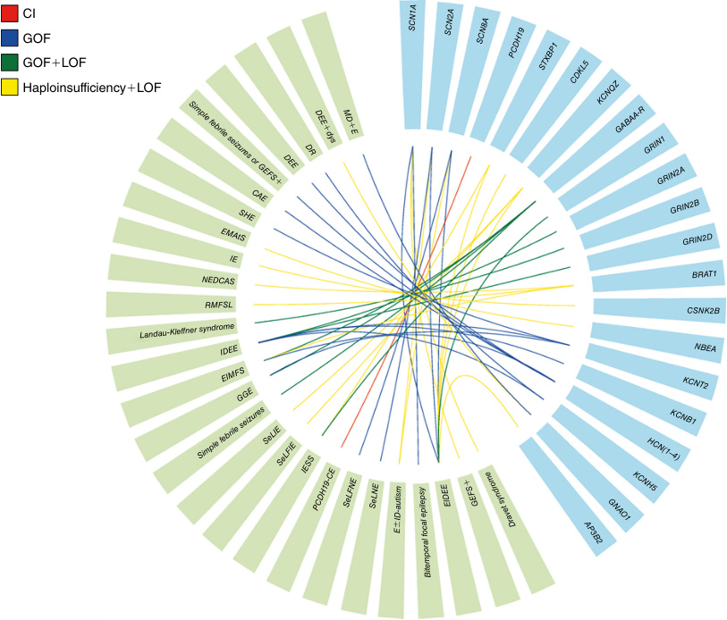
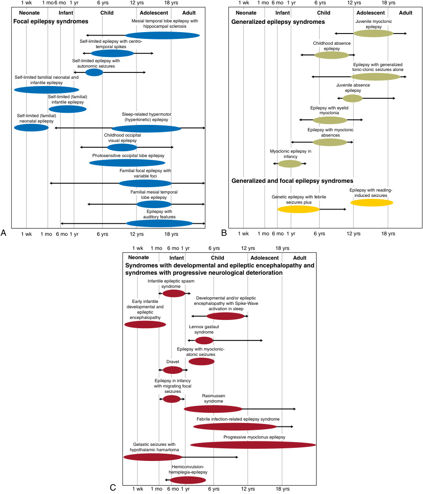
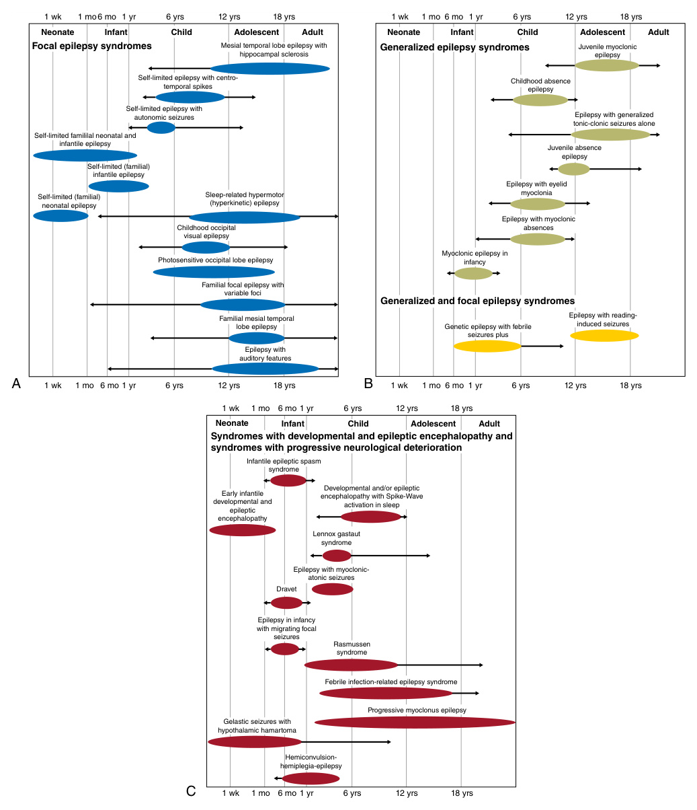
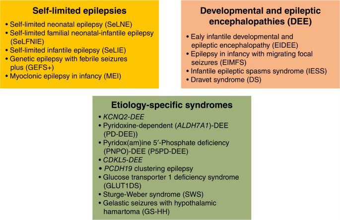
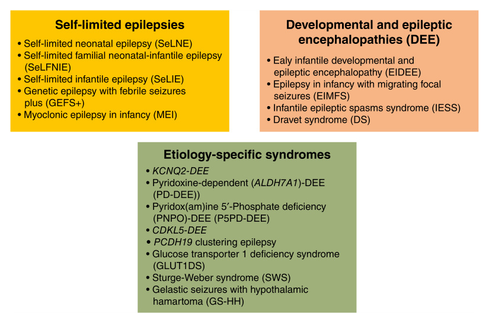
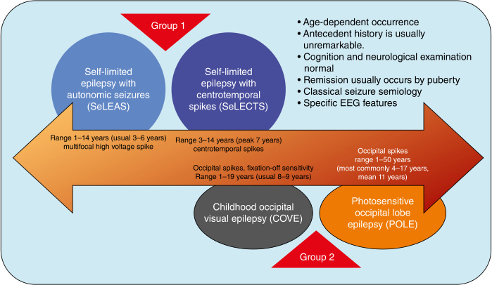
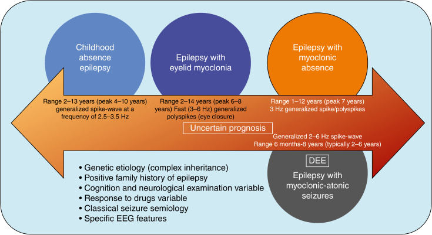
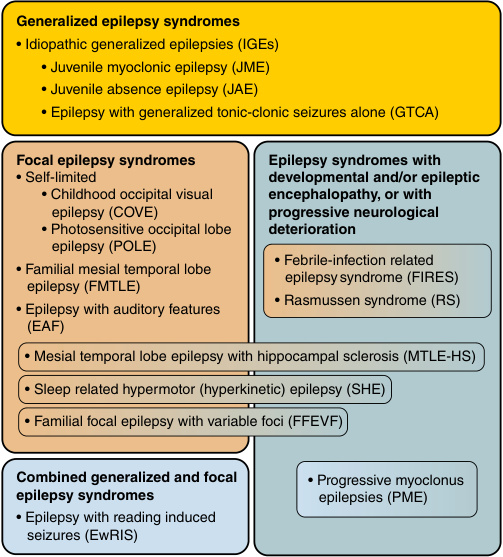
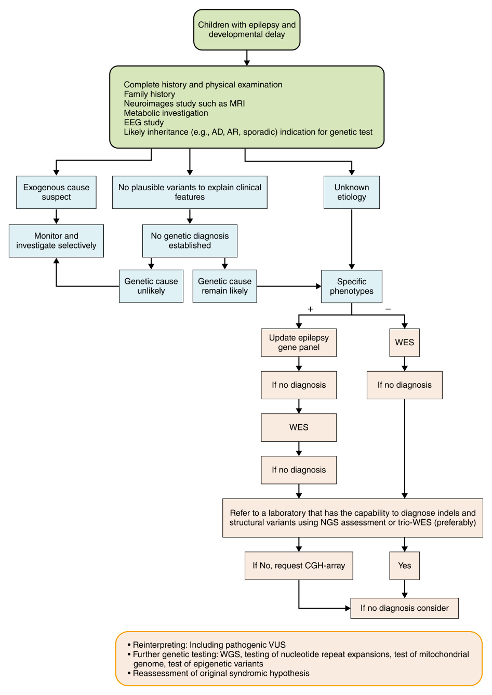
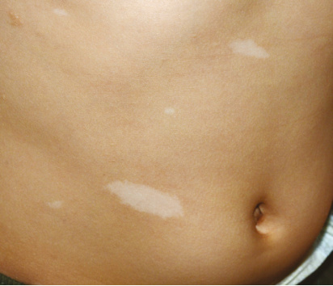

<!-- p.394 -->

# 16 Nonfebrile Epilepsy Syndromes Including Epileptic Encephalopathies **SUSANA BORONAT** 

Epilepsy may be idiopathic and an isolated symptom but may also be associated with specific syndromes and when associated with intellectual disability and/or regression, a component of a developmental epileptic encephalopathy syndrome (DEEs) (Fig. 16.1). Most DEEs are genetic (Table 16.1); however, individual pathogenic gene variants causing DEEs may produce overlapping syndromes (Fig. 16.2). 

In addition, epilepsy syndromes may have an age specific time of presentation (Fig. 16.3); in the neonate/infant (Fig. 16.4) or older child (Figs. 16.5 and 16.6) or at variable ages (Fig. 16.7). The diagnostic approach to a suspected epilepsy syndrome is similar regardless of age (Fig. 16.8). 

## **Epilepsies Due to Chromosomal Rearrangements** 

### **Copy Number Variants** 

Some patients with aneuploidies (i.e., 13,18, 21 trisomy) have epilepsy related to their neurodevelopmental disorder. These are diagnosed by karyotype and frequently detected prenatally. 

The use of microarrays has enabled the diagnosis of copy number variants (CNVs), which allows the detection of losses or gains of genetic material in a specific area. If this CNV involves several genes, a clinical phenotype will appear, characterized by the sum of the phenotype of the dose-sensitive involved genes (contiguous gene syndrome), although occasionally there is a CNV involving a single gene (e.g., total or partial deletion or duplication of a gene). 

In one study of European patients with epilepsy including patients with developmental and epileptic encephalopathy (DEE), generalized epilepsies, lesional focal epilepsies and nonacquired focal epilepsies revealed that 1.5–3% of patients had CNVs associated with epilepsy. The chromosomal regions that confer the highest risk are 1q.21, 15q11.2, 15q13.3, 16p11.2, 16p12.1, 16p13.11 and 22q11.2. CNVs in these regions have a higher risk mainly for generalized 

genetic epilepsy, with the 15q13.3 deletion conferring the highest risk. Some of these CNVs also conferred a higher risk of epilepsy in nonacquired focal epilepsies, mainly 16p13.11, and in focal lesional epilepsies, mainly 16p13.11, which supports the hypothesis of the interaction of genetic and environmental factors to establish the epileptic phenotype. 

One of the most frequent recurrent CNVs that usually presents with a refractory epilepsy phenotype is the 15q11-q13 region (of maternal origin), which can cause epilepsy either by deletion, causing Angelman syndrome, or by duplication, resulting in Dup15q syndrome. 

### **_Angelman Syndrome_** 

The PWACR region (Prader-Willi/Angelman Critical Region) is a region in 15q11-q13 that is subject to imprinting: some genes in the region are only expressed in the maternal copy and others in the paternal copy (Chapter 4). If the maternal genes (mainly _UBE3A_ ) are not well expressed, either due to deletion of the maternal copy, dysfunction of the imprinting mechanism or intragenic pathogenic variant of _UBE3A_ , Angelman syndrome will appear. This is a disorder that responds well to benzodiazepines (unlike duplication of the same region). Carbamazepine and other sodium channel inhibitors should be avoided because they can cause the appearance of other types of seizures and nonconvulsive status epilepticus (myoclonic or absence). Antiepileptic treatments also include better tolerated drugs, such as levetiracetam, lamotrigine, topiramate or ethosuximide. Dietary therapy, such as a ketogenic diet or a low glycemic index diet, may be useful. 

It is important to have a high suspicion of **nonconvulsive status epilepticus** in these patients, which will require rescue with benzodiazepines. Levetiracetam and cannabidiol may be useful in some patients. Adult patients may present with dystonia and/or nonepileptic myoclonus, which may require specific treatment. 

### **_Dup15q Syndrome (Maternal Origin)_** 

Dup15q encompasses a series of neurodevelopmental disorders caused by an excess of genetic material from the 15q11q13 chromosomal region of maternal origin, which

<!-- p.395 -->

**Fig. 16.1** Concept of genetic generalized epilepsy (GGE) versus idiopathic generalized epilepsy (IGE). The IGEs are a subgroup of GGEs, comprised of the following four syndromes: childhood absence epilepsy, juvenile absence epilepsy, juvenile myoclonic epilepsy, and epilepsy with generalized tonic-clonic seizures alone. These four syndromes may show some degree of overlap. In addition to the IGEs, GGEs include (1) individuals with generalized seizure types who do not meet criteria for a specific syndrome, and (2) less common generalized epilepsy syndromes. These latter syndromes also have a genetic basis and may occur in the setting of normal intellect or intellectual disability. Some present with an epileptic encephalopathy such as epilepsy with myoclonic–atonic seizures, whereas other syndromes, such as epilepsy with myoclonic absences and epilepsy with eyelid myoclonia, may be associated with a developmental and epileptic encephalopathy, an epileptic encephalopathy, or a developmental encephalopathy. Other syndromes such as myoclonic epilepsy in infancy may present as a generalized epilepsy in a child with a developmental encephalopathy (i.e., intellectual disability) or normal intellect.  (From Wirrell EC, Nabbout R, Scheffer IE, et al. Methodology for classification and definition of epilepsy syndromes with list syndromes: reports of the ILAE Task force on Nosology and Definitions. _Epilepsia._ 2022;63:1333-1348 [Fig. 2, p. 1344].) 

can appear in the form of an extra chromosome or within chromosome 15q (interstitial duplication). Patients with more severe phenotypes may present hypotonia, intellectual disability, autism spectrum disorder and epilepsy, often with onset as infantile spasms, which is frequently refractory. They are associated with a characteristic electroclinical syndrome, with frequent rapid β rhythms in the electroencephalogram (EEG) and the presence of a continuous spikewave during sleep. The response to certain GABAergic antiseizure medications such as vigabatrin and benzodiazepines is poorer than in other epilepsies; the clinical course may worsen with the their use. This is thought to be due to the clustering of several genes encoding GABA receptor subunits in the region. Patients seem more susceptible to **sudden unexpected death related to epilepsy (SUDEP)** . Other clinical aspects are the high frequency of gastrointestinal features such as gastroesophageal reflux and constipation, as well as an insensitivity to pain. Basmisanil is a selective negative allosteric modulator of GABAA-α5 that can be administered orally. It has been _postulated_ that its mechanism of action may be useful in Dup15q because _GABRA5_ encoding this GABAA-α5 subunit is in the affected region. 

### **_Deletion 1p36_** 

This syndrome is due to the loss of the terminal region of the short arm of chromosome 1; 60% develop epilepsy. They may have infantile spasms and multiple types of seizures. A cardiology assessment is appropriate because there may be alterations such as noncompacted dilated cardiomyopathy, interatrial or interventricular communication. There are no specific therapies. 

### **_Duplication of MECP2_** 

In this disorder, epilepsy appears in 50% of cases, which is drug-resistant in 70% of cases. They present with multiple types of seizures (atonic, myoclonic, atypical absences). Some cases present with apneas and hypoventilation during sleep, spasticity and dyskinesias. There is no specific therapy. 

### **Chromosomal Rings** 

Disorders associated with chromosomal rings consist of the aberrant formation of ringed chromosomal figures that join the ends of the chromosome and are detected by karyotype. They may be associated with loss of genetic material (deletion) in the region of the fusion; it is believed that this

<!-- p.396 -->

##### **TABLE** 

##### **16.1** 

#### **Summary of the Main Genetic and Clinical Findings of the Most Frequent Developmental Epileptic Encephalopathy Syndromes (DEEs)** 

|Gene|Encoded Protein|Protein Function|Type of Pathogenic Variant|Epilepsy Phenotype|Main Clinical Features|Targeted Treatments|
|---|---|---|---|---|---|---|
|_SCN1A_|Voltage-gated sodium channel Nav1.1|Initiates action potential firing in GABAergic inhibitory interneurons|Haploinsufficiency and LOF|Dravet syndrome and GEFS+|Fever sensitivity, seizure onset <6 months of age, ataxia, mild-to-severe intellectual disability, and autism|Established use of fenfluramine in clinical practice, under exploration for possible effect as disease- modifying treatment; avoidance of sodium channel blockers|
|_SCN1A_|Voltage-gated sodium channel Nav1.1|Initiates action potential firing in GABAergic inhibitory interneurons|GOF|EIDEE and bitemporal focal epilepsy|Neonatal-onset seizures, movement disorder, congenital arthrogryposis, severe-to-profound intellectual disability|Sodium channel blockers established|
|_SCN2A_|Voltage-gated sodium channel Nav1.2|Regulating the flow of sodium ions across neuronal membranes|Haploinsufficiency and LOF|Epilepsy with or without intellectual disability and autism|Infantile onset, mainly generalized seizures and myoclonic seizures, intellectual disability, and autism| Avoidance of sodium channel blockers|
|_SCN2A_|Voltage-gated sodium channel Nav1.2|Regulating the flow of sodium ions across neuronal membranes|GOF|SeLNE, SeLFNE, and EIDEE|Epilepsy onset<3 months of age, often neonatal, with mainly focal seizures; severe- to-profound intellectual disability in EIDEE|Sodium channel blockers established, antisense oligonucleotide treatment under exploration|
|_SCN8A_|Voltage-gated sodium channel Nav1.6|Regulating the membrane excitability of neurons|Haploinsufficiency and LOF|Infantile onset epilepsy with or without intellectual disability and autism|Infantile onset, mainly generalized seizures and myoclonic seizures, intellectual disability, and autism|Avoidance of sodium channel blockers|
|_SCN8A_|Voltage-gated sodium channel Nav1.6|Regulating the membrane excitability of neurons|GOF|SeLFIE, SeLIE, and EIDEE|Epilepsy onset<3 months of age, often neonatal, with focal seizures and generalized seizures; severe- to-profound intellectual disability in EIDEE|Sodium channel blockers established|
|_PCDH19_|Protocadherin-19|Regulates synaptic transmission|Cellular interference|PCDH19-clustering epilepsy|Mainly female subjects; seizure clusters, fever sensitivity, mild-to-moderate intellectual disability, and autism|Ganaxolone under exploration|

_(Continued)_

<!-- p.397 -->

|Gene|Encoded Protein|Protein Function|Type of Pathogenic Variant|Epilepsy Phenotype|Main Clinical Features|Targeted Treatments|
|---|---|---|---|---|---|---|
|_STXBP1_|Syntaxin-binding protein 1*|Key organizer of the neuronal SNARE complex, the molecular machine driving synaptic vesicle fusion|Haploinsufficiency and LOF|IESS and EIDEE|Seizure onset<1 year (90%), moderate-to-severe intellectual disability, and movement disorders|Phenylbutyrate under exploration (NCT04937062)|
|_CDKL5_|CDKL5|CDKL5 is localized at excitatory synapses and contributes to correct dendritic spine structure and synapse activity|Haploinsufficiency and LOF|EIDEE|Infantile-onset refractory epilepsy, movement disorders, hypotonia, moderate-to-severe intellectual disability, autism, and central visual impairment|NA|
|_KCNQ2_|Voltage-gated potassium channel subunit Kv7.2|Regulating the membrane excitability of neurons|Haploinsufficiency and LOF|EIDEE, SeLFIE, and SeLIE|Neonatal onset epilepsy with focal seizures and severe-to- profound intellectual disability|Sodium channel blockers established|
|_GABRA1–5_, _GABRB1–3_ _GABRG2_, and_GABR_|,   _D_ GABAA receptors†|GABAA receptors represent the major class of inhibitory ion channels in the mammalian brain|GOF and LOF|Ranging from simple febrile seizures or GGE to severe DEEs, such as EIMFS, IESS, and LGS|Intellectual disability, autism spectrum disorder, ataxia, microcephaly, and hypotonia|GOF: nitrazepam and phenobarbital established; LOF: vigabatrin established and vinpocetine under exploration|
|_GRIN1_, _GRIN2A_, _GRIN2B_, and _GRIN2D_|NMDA receptors|Mediate a slow component of excitatory synaptic transmission|GOF and LOF|GRIN1: EIDEE; GRIN2B: DEE, neurodevelopmental disorder with or without epilepsy, and schizophrenia; GRIN2A: epileptic spectrum ranging from LKS to epilepsy with centrotemporal spikes and speech or language impairment; GRIN2D: DEE|Intellectual disability and movement disorders|GOF: memantine, radiprodil under exploration; LOF: D-serine established|
|_BRAT1_|BRCA-1-associated ATM activator 1|Essential for mitochondrial function, cell proliferation, and cell cycle progression by recruitment of growth factors|LOF|RMFSL, EIMFS, and NEDCAS|Microcephaly, bradycardia, and cardiac arrest leading to early death| NA|

_(Continued)_

<!-- p.398 -->

#### **TABLE 16.1 Summary of the Main Genetic and Clinical Findings of the Most Frequent Developmental Epileptic Encephalopathy Syndromes (DEEs)—cont’d** 

|Gene|Encoded Protein|Protein Function|Type of Pathogenic Variant|Epilepsy Phenotype|Main Clinical Features|Targeted Treatments|
|---|---|---|---|---|---|---|
|_CSNK2B_|Regulatory subunit of CK II, a ubiquitous serine and threonine kinase complex|Takes part in various signaling pathways, including NF-kB, PTEN, PI3K-AKT and Wnt-b-catenin|Haploinsufficiency and LOF|Infantile-onset epilepsy with both focal and generalized seizures|Hypotonia, dysmorphism, mild-to-severe intellectual disability, and behavioral disorders|NA|
|_NBEA_|Neurobeachin, a brain-specific kinase-anchoring protein|Implicated in vesicle trafficking and synaptic structure and function|Haploinsufficiency and LOF|Early childhood epilepsy and EMAtS-like phenotype|PKD and autism|NA|
|_KCNt1_|Sodium-activated potassium channel|Regulates neuronal excitability by contributing to the resting membrane potential and hyperpolarization following a train of action potentials| GOF|EIFMS, SHE, and DEE|Sleep and psychiatric disorders|Fluoxetine under exploration and quinidine established|
|_KCNB1_|Voltage-gated potassium channel subunit Kv2.1|Regulates excitability in pyramidal neocortical neurons|GOF|DEE|Epileptic spasms, generalized seizures and focal seizures, early developmental delay (mostly severe to profound), and autism|NA|
|_KCNB1_|Voltage-gated potassium channel subunit Kv2.1|Regulates excitability in pyramidal neocortical neurons|LOF|Developmental encephalopathy with or without epilepsy|Less frequent and less severe epilepsy|NA|
|_HCN1_|HCN channels 1–4|Key roles in the regulation of cellular excitability, synaptic integration, and neuronal network dynamics|HCN1 and HCN2: GOF or dominant negative effects; HCN3: NA; HCN4: GOF and LOF|CAE, simple febrile seizures, GEFS+, GGE, and DEE|Generalized seizures, intellectual disability, and autism|Ivabradine, a pan-HCN channel blocker approved for heart failure, under exploration|
|_KCNH5_|Voltage-gated potassium channel Kv10.2|Localizes to the somatodendritic region where it has a role in controlling the electrical coupling between cell bodies and distal dendrites|GOF|EIDEE and drug-responsive or self-limited focal or generalized epilepsy with normal cognitive outcome|Infantile-onset epilepsy and focal and generalized seizures|NA|

_(Continued)_

<!-- p.399 -->

##### **TABLE** 

**16.1 Summary of the Main Genetic and Clinical Findings of the Most Frequent Developmental Epileptic Encephalopathy Syndromes (DEEs)—cont’d** 

|Gene|Encoded Protein|Protein Function|Type of Pathogenic Variant|Epilepsy Phenotype|Main Clinical Features|Targeted Treatments|
|---|---|---|---|---|---|---|
|_GNAO1_|Guanine nucleotide- binding protein G(o) subunit α subunit (forms a heterotrimeric G-protein complex)|Role in transmembrane signaling pathways|Haploinsufficiency and LOF|DEE and late-onset dystonia|Language impairment, intellectual disability, tremor, and learning difficulties|NA|
|_GNAO1_|Guanine nucleotide- binding protein G(o) subunit α subunit (forms a heterotrimeric G-protein complex)|Role in transmembrane signaling pathways|GOF|Early-onset hyperkinetic movement disorder associated with intellectual disability, with or without epilepsy|Status distonicus, hyperkinetic movements, and acute motor exacerbations|NA|
|_AP3B2_|AP3B2 (heterotetrameric adaptor protein)|Key role in signal-mediated trafficking of integral membrane proteins|LOF|EIDEE|Optic atrophy, microcephaly, severe-to-profound developmental delay, and movement disorders|NA|

*Alternative names N-Sec1 and MUNC18–1. 

†Formed by a pentameric assembly from 19 different subunits, with most receptors containing two α-subunits, two β-subunits, and a γ or δ subunit. 

_CAE,_ Childhood absence epilepsy; _DEE,_ developmental and epileptic encephalopathy; _EIDEE,_ early infantile developmental and epileptic encephalopathies; _EIMFS,_ epilepsy of infancy with migrating focal seizures; _EMAtS,_ epilepsy with myoclonic-atonic seizures; _GABAA_ , γ-aminobutyric acid type A; _GEFS1_ , genetic epilepsy with febrile seizures plus; _GGE,_ genetic generalized epilepsy; _GOF,_ gain of function; _HCN,_ hyperpolarization-activated cyclic nucleotide-gated; _IESS,_ infantile epileptic spasms syndrome; _LGS,_ Lennox-Gastaut syndrome; _LKS,_ Landau-Kleffner syndrome; _LOF,_ loss of function; _NA,_ not available; _NEDCAS,_ neurodevelopmental disorder with cerebellar atrophy and with or without seizures; _NMDA,_ N-methyl-d-aspartate; _PKD,_ paroxysmal kinesigenic dyskinesia; _RMFSL,_ lethal neonatal rigidity and multifocal seizure syndrome; _SeLFIE,_ self-limited familial infantile epilepsy; _SelFNE,_ self-limited familial neonatal epilepsy; _SeLIE,_ self-limited infantile epilepsy; _SHE,_ sleep-related hypermotor epilepsy; _SNARE,_ soluble _N_ -ethylmaleimide-sensitive factor attachment protein receptor. From Specchio N, Trivisano M, Aronica E, et al. The expanding field of genetic developmental and epileptic encephalopathies: current understanding and future perspectives. _Lancet Child Adolesc Health._ 2024;8:821-834 (Table 1, p. 824-826).

<!-- p.400 -->

**Fig. 16.2** Relationship between different genes and their associated epilepsy phenotypes. The plot illustrates the connections between gene variants (blue, right) and their respective abnormal functions (green, left), highlighting the genetic complexity of epilepsy; the colors used for the connections correspond to the nature of the genetic abnormality. _CAE,_ Childhood absence epilepsy; _CI,_ complex inheritance; _DEE 1 dys,_ developmental and epileptic encephalopathy and late-onset dystonia; _DR,_ drugresponsive or self-limited focal or generalized epilepsy; _E±ID-autism,_ epilepsy with or without intellectual disability and autism; _EIDEE,_ early infantile developmental and epileptic encephalopathy; _EIMFS,_ epilepsy of infancy with migrating focal seizures; _EMAtS,_ epilepsy with myoclonic-atonic seizures; _GEFS1_ , genetic epilepsy with febrile seizures plus; _GGE,_ genetic generalized epilepsy; _GOF,_ gain of function; _IDEE,_ infantile developmental and epileptic encephalopathy; _IE,_ infantile onset epilepsy with both focal and generalized seizures; _IESS,_ infantile epileptic spasms syndrome; _LOF,_ loss of function; _MD1E,_ early-onset hyperkinetic movement disorder associated with epilepsy; _NEDCAS,_ neurodevelopmental disorder with cerebellar atrophy, with or without seizures; _PCDH19-CE,_ PCDH19-clustering epilepsy; _RMFSL,_ lethal neonatal rigidity and multifocal seizure syndrome; _SelFIE,_ self-limited familial infantile epilepsy; _SelFNE,_ self-limited familial neonatal epilepsy. _SeLIE,_ self-limited infantile epilepsy; _SeLNE,_ self-limited neonatal epilepsy; _SHE,_ sleep-related hypermotor epilepsy.  (From Specchio N, Trivisano M, Aronica E, et al. The expanding field of genetic developmental and epileptic encephalopathies: current understanding and future perspectives. _Lancet Child Adolesc Health._ 2024;8:821-834 [Fig. 2, p. 827].) 

is not the only mechanism causing the symptoms because epilepsy may also appear in cases without proven CNVs. In these situations, other pathological mechanisms are suggested, such as instability of the ring itself, which causes monosomy of the chromosome in a proportion of brain cells, or a positional effect of other genes not included in the region that is usually deleted. 

The ring chromosomes that are most frequently associated with epilepsy are r(20), r(14) and r(17). Although it has also been described in r(7), r(18), r(21) and r(22). Some of these may present distinctive clinical symptoms apart from refractory epilepsy, such as retinal abnormalities in the case of r(14). Table 16.2 shows specific EEG features related to some chromosomal abnormalities.

<!-- p.401 -->

**Fig. 16.3** Classification of epilepsy syndromes, based on age at presentation. Shown are the typical ages of presentation, with ranges indicated by _arrows_ . Focal epilepsy syndromes are indicated in blue, generalized epilepsy syndromes in green, focal, and generalized syndromes in yellow, and syndromes with developmental and/or epileptic encephalopathy or with progressive neurological deterioration in red. (From Wirrell EC, Nabbout R, Scheffer IE, et al. Methodology for classification and definition of epilepsy syndromes with list syndromes: reports of the ILAE Task Force on Nosology and Definitions. _Epilepsia._ 2022;63:1333-1348 (Fig. 1, p. 1340].)

<!-- p.402 -->

**Fig. 16.4** Organization of epilepsy syndromes that begin in the neonates and infants. Syndromes are broadly divided into Self-Limited Epilepsies (where there is likely to be spontaneous remission) and Developmental and Epileptic Encephalopathies (disorders where there is developmental impairment related to both the underlying etiology independent of epileptiform activity and the epileptic encephalopathy). Etiology-specific epilepsy syndromes are due to specific genetic, structural, metabolic, immune, or infectious etiologies, and have consistent electroclinical features, management, and prognostic implications. Most etiology-specific syndromes that begin in the neonatal or infantile period are DEEs. _ALDH7A1,_ Aldehyde dehydrogenase 7 family member A1; _CDKL5,_ cyclin-dependent kinase-like 5; _KCNQ2,_ potassium voltage-gated channel subfamily Q member 2; _PCDH19,_ protocadherin19; _PNPO,_ pyridoxamine 5′-phosphate oxidase.  (From Zuberi SM, Wirrell E, Yozawitz E, et al. ILAE classification and definition of epilepsy syndromes with onset in neonates and infants: position statements by the ILAE Task Force on Nosology and Definitions. _Epilepsia._ 2022;63:1349-1397 [Fig. 1, p. 1353].) 

## **Monogenic Syndromes** 

The pathogenic variants producing epilepsy syndromes detected by NGS (next generation sequencing) may be loss or gain of function which may determine specific treatments. 

Determining which cell subtype is affected by the genetic variant is a priority. For example, in **Dravet syndrome** , pathogenic variants in the Nav1.1 sodium channel, encoded by _SCN1A_ have a loss-of-function effect (LoF) in GABAergic inhibitory interneurons, resulting in a loss of inhibitory tone of these neurons on pyramidal excitatory neurons, which promotes hyperexcitability. In contrast, variants in _SCN8A_ , which encodes the Nav1.6 channel that is expressed in excitatory neurons, will cause epilepsy and neurodevelopmental disorders in the case of a gain-offunction (GoF) variant effect. These effects determine a targeted mechanism-based therapy. For example, in the case of Dravet syndrome, the use of sodium channel inhibitors (e.g., carbamazepine, oxcarbazepine) should be avoided because they may worsen the symptoms and further decrease the function of a less active sodium channel due to its loss-of-function variant. The efficacy of the ketogenic diet in epileptic spasms varies depending on the genetic etiology; one study showed 

significant efficacy in the case of _CDKL5_ -related disorders but not in other disorders associated with _KCNT1_ , _PCDH19_ or _STXBP1_ . 

### **Developmental and Epileptic Encephalopathies** 

Developmental and epileptic encephalopathies (DEEs) are genetic disorders characterized by early-onset epilepsy, generally in the first year of life with significant impairment of psychomotor development. The OMIM compendium currently contains more than 100 DEEs. 

Dravet syndrome is discussed in Chapter 15, along with other phenotypes associated with _SCN1A_ variants. 

### **_SCN2A-Related Disorder_** 

Early-onset (<3 months of age) DEE due to pathogenic variants in _SCN2A_ is very severe and causes clinical phenotypes such as **Ohtahara syndrome** or **focal migratory epilepsy of infancy** . The variants are gain-of-function; the seizures usually respond well to sodium channel inhibitor agents (phenytoin, carbamazepine, oxcarbazepine, lamotrigine, lacosamide), although neurodevelopmental impairment persists.

<!-- p.403 -->

**Fig. 16.5** Self-limited focal epilepsies of childhood (SeLFE) syndromes are a group of conditions characterized by age-dependent occurrence in otherwise normal children. Cognition and neurological evaluation are typically normal. Remission occurs in almost all patients by puberty. Presumed genetic factors have an important role. Seizure semiology and electroencephalographic (EEG) features are specific for each of the syndromes included in this group. Within the SeLFEs, we recognize two levels of syndromes, based on the long-term prognosis. The first subgroup (Group 1) includes two syndromes: the former syndromes of childhood epilepsy with centrotemporal spikes or benign epilepsy of childhood with centrotemporal spikes or benign Rolandic epilepsy, now renamed as self-limited epilepsy with centrotemporal spikes; and of Panayiotopoulos syndrome or early onset benign occipital epilepsy, now renamed as selflimited epilepsy with autonomic seizures. The second subgroup (Group 2) includes two syndromes: the former syndromes of late onset benign occipital epilepsy or Gastaut syndrome or idiopathic childhood occipital epilepsy–Gastaut type, now renamed as childhood occipital visual epilepsy; and of idiopathic photosensitive occipital lobe epilepsy, now renamed as photosensitive occipital lobe epilepsy. In Group 1, remission is expected in all cases. In Group 2, remission is highly likely; however, a few patients may have persistence of seizures after adolescence. In the figure are represented the age at onset and EEG findings for each of the syndromes.  (From Specchio N, Wirrell EC, Scheffer IE, et al. International league against epilepsy classification and definition of epilepsy syndromes with onset in childhood: position paper by the ILAE Task Force on Nosology and Definitions. _Epilepsia._ 2022;63:1398-1442 [Fig. 1, p. 1401].) 

DEE due to _SCN2A_ variants with onset beyond 3 months has a wide phenotypic range, from **West syndrome** , **myoclonic-atonic epilepsy** to **Lennox-Gastaut syndrome** . These variants are usually _loss-of-function_ , and in this case sodium channel inhibitors can worsen the phenotype. 

### **_SCN8A-Related Disorder_** 

In the phenotype due to gain-of-function _SCN8A_ variants, sodium channel inhibitors can significantly reduce the number of seizures in some but not in all patients. 

### **_KCNQ2 and KCNQ3-Related Disorders_** 

Pathogenic variants in _KCNQ2_ give rise to two phenotypes of very different severity: 

#### **Benign Neonatal Epilepsy** 

**Benign neonatal epilepsy** , which presents with selflimiting seizures in the neonatal period and normal neurodevelopment _(due to loss-of-function variants)_ . 

#### **_KCNQ2-_ DEE** 

**_KCNQ2-_ DEE** **_,_** which can be due to two types of pathogenic variants: 

- _Gain-of-function:_ causes seizures and myoclonus sensitive to stimuli (startle-like) 

- Severe _loss-of-function_ (variants that cause a more serious functional impact than those that cause benign neonatal epilepsy): in this case, the treatment of choice is sodium channel inhibitor drugs. In some cases, pyridoxine has been very effective, although the mechanism of action is not known. One study suggests that the administration of donepezil through compassionate use in patients with pathogenic gain-of-function variants in _KCNQ2_ or _KCNQ3_ may improve their cognitive outcomes. 

### **_KCNT1-Related Disorder_** 

_KCNT1_ encodes a sodium-activated potassium channel. There are two distinct associated phenotypes: 

- **Severe sleep-related hypermotor epilepsy** , due to inherited or _de novo_ variants.

<!-- p.404 -->

**Fig. 16.6** Genetic generalized epilepsies of childhood are a group of conditions characterized by genetic etiology with complex inheritance, namely, with polygenic basis. A positive family history of epilepsy is frequent. Cognition, neurological examination, and response to drugs are variable. Seizure semiology and electroencephalographic (EEG) features are specific for each of the syndromes included in this group. Genetic generalized epilepsies of childhood encompass childhood absence epilepsy, which is discussed in the paper on idiopathic generalized epilepsy syndromes, epilepsy with eyelid myoclonia, epilepsy with myoclonic absence, and epilepsy with myoclonic atonic seizures. Epilepsy with myoclonic absence and epilepsy with eyelid myoclonia have a variable prognosis. Epilepsy with Myoclonic Atonic Seizures is classified under the developmental and/or epileptic encephalopathies (DEEs), as children typically show developmental stagnation or regression. In the figure are represented the age at onset and EEG findings for each of the syndromes.  (From Specchio N, Wirrell EC, Scheffer IE, et al. International league against epilepsy classification and definition of epilepsy syndromes with onset in childhood: position paper by the ILAE Task Force on Nosology and Definitions. _Epilepsia._ 2022;63:1398-1442 [Fig. 3, p. 1413].) 

- Severe childhood DEE, which usually presents as **focal migratory epilepsy of infancy** . Pathogenic variants are _gain-of-function_ , with a correlation between the most severe variants and severe clinical forms. Clinical control is not achieved with conventional antiseizure medications. Some patients may show a response to quinidine, although close monitoring of cardiac side effects is required. Cannabidiol or a ketogenic diet may be helpful in some patients. Preclinical studies suggest that carvedilol may inhibit hyperexcitability induced by gain-offunction variants in _KCNT1_ . 

### **_KCNB1-Related Disorder_** 

In this entity it is especially important to perform a sleep EEG recording that allows the detection of **status epilepticus during sleep** , which may benefit from targeted treatment. A patient with a continuous spike-wave pattern with good response to cannabidiol has been described. 

### **_STXBP1-Related Disorder_** 

Pathogenic variants in _STXBP1_ cause neurotransmission dysfunction by decreasing the release of synaptic vesicles. It has been postulated that the good response to levetiracetam in many patients could be related to the mechanism of action of this drug, which acts by binding to SV2A, a 

glycoprotein of the membrane of synaptic vesicles. The ketogenic diet has been shown to be very effective in some patients, especially in those with a later onset of seizures (>6 months). Some patients may respond to cannabidiol. A clinical trial with glycerol 4-phenylbutyrate in 10 children affected by pathogenic variants in _STXBP1_ has shown a reduction in seizures in six of them. 

### **_CDKL5-Related Disorder_** 

This is an X-linked dominant disorder, meaning it affects almost exclusively females because males are so severely affected that they have a high mortality rate. The few males described are severely affected. Females usually present early-onset epilepsy with multiple seizures (spasms, myoclonus and generalized tonic-clonic seizures). Approximately 50% show remission of seizures from the age of 3. A transient effect of antiseizure medication has been described. Cannabidiol is effective in some patients. Ganaxolone, a neuroactive steroid that increases GABAergic activity, has shown safety and efficacy in a randomized, placebocontrolled III clinical trial. 

### **_PCDH19-Related Disorder_** 

This is an X-linked disorder that affects females and some patients with **Klinefelter syndrome** (47, XXY karyotype).

<!-- p.405 -->

**Fig. 16.7** The epilepsy syndromes that begin at a variable age grouped by epilepsy type and whether they are associated with developmental and/or epileptic encephalopathy (D and/or EE) or progressive neurological deterioration. Some patients with the focal epilepsy syndromes MTLE-HS, SHE, and FFEVF may have cognitive, neurologic, or psychiatric impairment related to their etiology or epilepsy (D and/or EE). All patients with established PME (a combined generalized and focal epilepsy syndrome) and FIRES and RS (focal epilepsy syndromes) will have D and/or EE or progressive neurological impairment.  (From Riney K, Bogacz A, Somerville E, et al. International league against epilepsy classification and definition of epilepsy syndromes with onset at a variable age: position statement by the ILAE Task Force on Nosology Definitions. _Epilepsia._ 2022;63:1443-1474 [Fig. 1, p. 1445].) 

The pathophysiological hypothesis is that the abnormal connection between neurons that express the normal and pathogenic gene variant protein is what generates the dysfunction of aberrant circuits between the two cell subtypes. Males, by expressing only the variant protein, would not present this alteration of connectivity between different cell types and would behave as healthy carriers. The symptoms are usually in the form of clusters of seizures in infants _with fever_ , which decrease in frequency over time. Corticosteroids have improved cluster seizures in some patients, but with no long-term effect. There is frequent recurrence of seizures after withdrawal of medication. Levetiracetam shows more efficacy in this disorder than in other genetic epilepsies. Preliminary results with ganaxolone show a 60% reduction in seizures. In some cases, ketogenic diet may be useful, and one case showed a good response to stiripentol, which achieved the longest period without seizure clusters. 

### **_SLC6A1-Related Disorders_** 

The _SLC6A1_ gene encodes the GABA transporter GAT-1, which is responsible for the reuptake of GABA in presynaptic 

neurons and glia that modulates neurotransmission. The most typical phenotype is **myoclonic-atonic epilepsy** , although other epileptic phenotypes or even neurodevelopmental disorders without epilepsy may occur. Valproate is the most effective drug to date, although seizure control does not correlate with better psychomotor development. A clinical trial with glycerol 4-phenylbutyrate in 10 children affected by pathogenic variants in _SLC6A1_ has shown a reduction in seizures in 7. Other medications, already approved for other diseases, that could be useful in this condition, are acetazolamide or betaine, although evidence in a clinical setting is still lacking. 

### **_SYNGAP1-Related Disorder_** 

Those affected have generalized epilepsy in 85%, with multiple types of seizures, including seizures triggered by chewing. The most used treatment regimen is valproate and lamotrigine. Some patients have shown a good response to cannabidiol. Some cases have been reported showing improvement in seizures and/or cognitive function with statins, drugs commonly used to lower cholesterol levels.

<!-- p.406 -->

**Fig. 16.8** Flowchart illustrating the investigation process for developmental and epileptic encephalopathies. _AD,_ Autosomal dominant; _AR,_ autosomal recessive; _CGH,_ comparative genomic hybridization; _EEG,_ electroencephalography; _MRI,_ magnetic resonance imaging; _VUS,_ variant of unknown significance; _WES,_ whole-genome sequencing.  (From Chang YT, Hong SY, Lin WD, et al. Genetic testing in children with developmental and epileptic encephalopathies: a review of advances in epilepsy genomics. _Children._ 2023;10:556 [Fig. 1].)

<!-- p.407 -->

### **TABLE 16.2 EEG Findings in Some Chromosomal Abnormalities** 

|Chromosomal Abnormalities 1p36 deletion|EEG Findings Focal and multifocal spikes, generalized spike/wave complexes and fast recruiting rhythms and hypsarrhythmia|
|---|---|
|4p16.3 deletion (Wolf-Hirschhorn syndrome)|1. Frequent, diffuse atypical spike and wave complexes occurring in long bursts 2. Frequent high amplitude, fast spikes-polyspikes, and wave complexes over the posterior areas triggered by eye closure|
|6q terminal deletion|Multifocal epileptiform discharges|
|15q13.3 deletion|Generalized and focal epileptiform discharges with posterior dominant rhythm slowing|
|Dup15q|Fast rhythms (excessive beta oscillations). Continuous Spike-Waves during Sleep (CSWS)|
|17p13.3 deletion (Miller-Dieker syndrome)|High-amplitude alpha or beta activity altering with high amplitude slow rhythms and slow-wave complexes or hypsarrhythmia|
|17q21.31 deletion|Focal/multifocal epileptiform discharges|
|Xp11.22-11.23 duplication|Continuous Spike-Waves during Sleep (CSWS)|
|Xq28 duplication|Generalized slowing with generalized and focal/multifocal discharges|
|Angelman syndrome|1. Persistent rhythmic 4–6 Hz, 200 mV theta waves during wakefulness 2. Prolonged runs of anterior dominant, rhythmic 2–3 Hz (200–500 mV) with or without mixed spike-wave complexes 3. Posterior dominant 3–4 c/s, 200 mV notched delta, and theta waves (mixed with ill-defined spike-wave) facilitated with eye closure|
|Prader-Willi syndrome|Focal or multifocal, localized mainly over the middle–posterior regions, generalized epileptiform discharges, rarely high-voltage theta activities at 4–6 Hz|
|14q deletion and duplication|Multifocal pattern with spikes and sharp waves. Hypsarrhythmic pattern|
|Ring 14|Slow and poorly organized background activity during wakefulness and sleep, frequent bursts of asynchronous rhythmic high amplitude slow waves over the frontal and temporal-posterior regions, and multifocal spikes and spike-wave complexes over the posterior regions, sometimes diffuse and activated by eye closure, followed by secondary generalization|
|Ring 20|Normal or nearly normal EEG pattern with runs of theta waves activity of 5 Hz in fronto- centro-temporal areas or background slowing (interictal) Long-lasting bifrontal high voltage slow waves with occasional spikes, sometimes unilateral side (ictal)|
|Down syndrome|The commonest EEG pattern: symmetrical hypsarrhythmia Single rather than clustered spasms on ictal EEG No interictal paroxysmal activity between consecutive spasms Electrographic seizure initiated by or combined with focal discharges|
|18 trisomy|Generalized and focal discharges mainly over the posterior region|
|Fragile X|Many children have abnormal electroencephalograms without overt epileptic seizures, frequently with a pattern of centrotemporal spikes|

## **_GNAO1-Related Disorder_** 

These patients present disabling **movement disorders** (dystonia, ataxia, chorea, dyskinesia) and **epilepsy** in 65%, which is usually refractory. In some cases, deep brain stimulation has been helpful in controlling the movement disorder. Zinc supplementation appears to be useful in preclinical studies and a clear clinical response has been described in one patient, with a reduction in epileptic and dystonic seizures. 

## **_GRIN-Related Disorders_** 

These are disorders caused by pathogenic variants in the genes encoding the subunits of the NMDA GRIN receptors 

(Glutamate Ionotropic Receptor N-methyl-D-aspartate). Neurocognitive disorders, which may or may not be associated with epilepsy, have been described due to pathogenic variants of _GRIN1_ , _GRIN2A_ , _GRIN2B_ and _GRIN2D_ . Some variants in _GRIN1_ , _GRIN2B_ and _GRIN2D_ cause DEE and missense variants in certain regions of _GRIN1_ and _GRIN2B_ have been correlated with malformations of cortical development. Variants in _GRIN2A_ can cause epilepsy-aphasia spectrum disorders with spike-wave activation in sleep (SWAS), such as **Landau-Kleffner syndrome** . Some patients with gain-offunction variants respond to memantine (an NMDAR antagonist) and a clinical trial with L-serine in loss-of-function

<!-- p.408 -->

variants has shown improved motor and cognitive function and seizure reduction. 

## **Familial Focal Epilepsies** 

## **_Nocturnal Frontal Lobe Epilepsy_** 

It is usually caused by variants in _CHRNA4_ , _CHRNA2_ or _CHRNB2_ . Inheritance is autosomal dominant or autosomal recessive. Pathogenic variants in _KCNT1_ can also cause this phenotype. Transdermal nicotine patches achieve a significant reduction in seizures and cognitive improvement in some patients. 

## **_Lateral Temporal Epilepsy (or Epilepsy With Auditory Manifestations)_** 

It is usually due to variants in _LGI1_ , but pathogenic variants have been described in other genes, such as _GAL_ , _RELN_ or _CPA6_ . Inheritance is autosomal dominant, although autosomal recessive inheritance has also been described associated with _CPA6_ . They usually respond to common antiseizure medications. 

**Fig. 16.9** Hypomelanotic macules in tuberous sclerosis complex. Lance-ovate and oval hypomelanotic (ash leaf) macules. (Courtey Julie V. Schaffer, MD. From Tsao H, Luo S. Neurofibromatosis and tuberous sclerosis complex. In: Bolognia JL, Schaffer JV, Cerroni L, eds. _Dermatology_ . 5th ed. Vol 1. 2025 [Fig. 61.14, p. 1004].) 

## **_mTORopathies_** 

The mTOR pathway is involved in a series of neurodevelopmental disorders with epilepsy, the best-known is **tuberous sclerosis complex** . They are characterized by hyperactivation of this pathway, so the mTOR inhibitor, rapamycin (or sirolimus) was proposed as a modulating drug, showing its efficacy in certain manifestations of the disease. mTORopathies include: 

- **Tuberous sclerosis complex (TSC)** . Disease due to variants in _TSC1_ or _TSC2_ that generates hyperactivation of the mTOR pathway. It is characterized by hypomelanotic macules (ash-leaf spots) (Fig. 16.9), shagreen patches, facial angiofibromas and benign tumors (hamartomas) in various organs, mainly skin, brain, kidney, lung and by several areas of brain dysplasia that usually cause early-onset epilepsy that is frequently refractory. Everolimus is an mTOR inhibitor similar to sirolimus but with better bioavailability and is an approved therapy for use in epilepsy associated with TSC. Vigabatrin, a GABAergic drug has some effect on mTOR activation, which could explain its great effectiveness in infantile spasms associated with TSC. Cannabidiol or ketogenic diet can be useful in some patients. 

- **Polyhydramnios-megalencephaly syndrome and symptomatic epilepsy (PMSE)** . It is an autosomal recessive syndrome due to variants in _STRADA_ . PMSE syndrome is associated with generalized brain hyperactivation. A series of five patients treated with the mTOR inhibitor sirolimus showed a marked reduction in seizure frequency and improved eye contact, emotional interaction, and receptive language. 

- **Familial focal epilepsy with variable focus (GATORopathies)** . This epilepsy syndrome with an autosomal dominant pattern affects several family members that may present epileptic foci in different locations. 

In these families some members show cortical dysplasia visible on cranial MR imaging and others do not. The underlying molecular cause involves _NPRL2_ , _NPRL3_ and _DEPDC5_ , which form a complex called GATOR1. This complex is a component of the mTOR pathway. 

Vigabatrin is the drug of choice in infantile spasms of TSC and it is started in the first months of life when interictal abnormalities appear in the EEG. Treatment with mTOR inhibitors (everolimus, sirolimus) can improve some cases of refractory epilepsy, apart from being clearly indicated in other manifestations such as renal angiomyolipomas. In some cases of GATORopathies, mTOR inhibitors may be useful. The ketogenic diet and cannabidiol may be effective in some cases of epilepsy related to mTORopathies and some of these patients may benefit from epilepsy surgery. 

## **Metabolic Epilepsies** 

Although inborn errors of metabolism (IEM) are not frequent causes of seizures, their diagnosis is of vital importance as it will allow the direct application of appropriate therapy (Chapters 43, 44, and 45). Many IEMs can benefit, in addition to antiepileptic drugs, from targeted treatments including diet, vitamins or detoxifying compounds, which can radically change the vital and neurological prognosis. 

A metabolic cause of epilepsy should be suspected with the following: 

- Dysmorphic features (e.g., peroxisomal diseases, glycosylation defects). 

- Organomegaly. 

- Family history of deaths due to similar symptoms and of unknown cause.

<!-- p.409 -->

- Parental consanguinity. 

- Regression of neurodevelopment after a period of apparent normality. 

- Fluctuating course of the disease. 

- Ophthalmological problems (cataracts, retinitis pigmentosa, cherry red spot, optic nerve atrophy, external ophthalmoplegia). 

- Metabolic acidosis with increased anion gap. 

- Neonatal ketonuria. 

- Unusual odor of body fluids. 

- Seizures that worsen with fasting (GLUT1) or with high protein meals (urea cycle defects). 

- Seizures that worsen with antiepileptic drugs. 

• Progressive myoclonic epilepsy in adolescence. In the event of an epileptic onset that generates suspicion of an IEM, empiric treatment with cofactors, including pyridoxine, pyridoxal phosphate, and biotin, is usually started until the results confirm that the seizures are due to a specific IEM. This will allow a specific treatment to be started, which may also require adding antiseizure medications for symptomatic control of the seizures. 

## **_GLUT1 Deficiency_** 

The transport of glucose from the bloodstream through the blood-brain barrier requires the glucose transport protein (GLUT1). Pathogenic variants in _SLC2A1_ , which codes for this transporter, are the cause of GLUT1 deficiency syndrome, due to a deficit in the transport of glucose to the central nervous system. Patients begin in the first years of life with treatment-resistant seizures, developmental delay, acquired microcephaly, hypotonia, spasticity and movement disorders. The treatment consists of the ketogenic diet, which provides ketone bodies as an alternative source of brain energy. 

It is recommended to avoid some drugs that hinder the transport of glucose through the transporter, such as phenobarbital, valproic acid and substances such as methylxanthines found in coffee, tea, or cocoa. 

Nonepileptic seizures due to transient brain dysfunction caused by energy deficiency after prolonged fasting or exercise may occur. Supplementary food can be effective in preventing the development of sustained exercise-induced movement disorders. 

## **_Pyridoxine Metabolism-Related Epilepsy_** 

There are several diseases caused by variants in different genes that encode enzymes and proteins belonging to the pyridoxine metabolic pathway. The two best known are: 

- **Pyridoxine-dependent epilepsy** due to pathogenic variants in _ALDH7A1_ , which encodes an enzyme responsible for lysine catabolism in the brain. Patients with biallelic variants usually present with encephalopathy with burstsuppression in the EEG and status epilepticus in the neonatal period that is refractory to conventional antiepileptics. They show a robust response to treatment with pyridoxine, which is complemented with a lysinerestricted diet and supplementation with L-arginine, 

which competitively inhibits lysine transport in the cerebrospinal fluid. 

- **Pyridoxal-phosphate-dependent epilepsy** . Pyridoxamine 5′-phosphate oxidase _(PNPO)_ gene encodes an enzyme responsible for the conversion of pyridoxine to pyridoxal 5′-phosphate. This autosomal recessive disease has a clinical picture similar to pyridoxine-dependent epilepsy. Treatment consists of the administration of pyridoxal phosphate. 

## **_Molybdenum Cofactor Deficiency_** 

It usually begins in the form of refractory neonatal seizures. It can occur due to biallelic variants in three genes: _MOCS1, MOCS2_ or _GPHN_ . The evaluation shows decreased uric acid in plasma and an increase in sulfites (xanthine and hypoxanthine) in urine. There is no curative treatment, but a low-purine or low-protein diet and, in some cases, pyridoxine (because the accumulation of sulfites can inhibit antiquitin, encoded by _ALDH7A1_ ) may improve the symptoms. In some patients with pathogenic variants in _MOCS1_ , treatment with cyclic pyranopterin monophosphate has been shown to be highly effective, if started early after birth. 

## **_Creatine Deficiency_** 

It is characterized by a neurodevelopmental disorder with epilepsy. Brain MRI _with_ spectroscopy shows the absence or decrease of the normal peak of cerebral creatine. It includes two disorders of creatine biosynthesis: one due to guanidinoacetate methyltransferase (GAMT) deficiency and another to L-arginine:glycine amidinotransferase (AGAT) deficiency, as well as an X-linked disorder due to creatine transporter deficiency _(SLC6A8)_ . The treatment of the first two disorders consists of the administration of creatine. The transporter defect due to truncating variants does not respond to this supplement because creatine cannot enter the CNS, but hypomorphic variants that do not completely decrease function of the transporter can respond. A drug-resistant patient has been described who became seizure-free after starting cannabidiol and clobazam. 

## **_Nonketotic Hyperglycemia_** 

This is a disorder characterized primarily by elevated glycine levels in the brain (blood, CSF) and manifest in the severe form with intractable seizures, coma, hypotonia, and poor development progression. The more common severe form presents during the neonatal period and is an autosomal recessive disorder due to pathogenic variants in _GLDC_ or _AMT_ . Treatment in the severe form is difficult and includes sodium benzoate, dextromethorphan, ketamine, or a combination of these drugs. 

## **Genetic Syndromes With Facial Dysmorphism and Epilepsy** 

There are multiple genetic syndromes that present with intellectual disability, developmental delay, and/or autism

<!-- p.410 -->

that are associated with epilepsy, which is frequently drug resistant. Achieving an etiological diagnosis is essential to offer a specific treatment, and in many cases the evaluation by a clinical geneticist can be of great help in reaching a diagnosis. For example, the diagnosis of Pitt-Hopkins syndrome in a patient with facial dysmorphism, interictal EEG abnormalities, and episodes of hyperventilation that have been classified as possible seizures may be re-evaluated with new information because it is known that such patients may present with nonepileptic hyperventilation that may improve with acetazolamide. 

# **Epileptic Syndromes With Etiological Heterogeneity** 

The International League Against Epilepsy (ILAE) Task Force on Nosology and Definitions proposes a classification and definition of epilepsy syndromes. 

An Epilepsy Syndrome is “a characteristic cluster of clinical and EEG features, often supported by specific etiological findings (structural, genetic, metabolic, immune, and infectious).” The diagnosis of a syndrome in an individual with epilepsy frequently carries prognostic and treatment implications. Syndromes often have age-dependent presentations and a range of specific comor bidities (Fig. 16.3). 

Epilepsy syndromes are broadly divided into Self-Limited Epilepsies (where there is likely to be spontaneous remission) and Developmental and Epileptic Encephalopathies (as already mentioned above, DDE are disorders where there is developmental impairment related to both the underlying etiology independent of epileptiform activity and the epileptic encephalopathy). 

Etiology-specific epilepsy syndromes have consistent electroclinical features, management, and prognostic implications. 

## **Epilepsy Syndromes in the Neonate and Infant With Seizure Onset Up to 2 Years of Age** 

## **_Self-Limited Epilepsies_** (Fig. 16.5) 

### **Self-Limited Neonatal Epilepsy (SeLNE)** 

Self-limited neonatal epilepsy and self-limited familial neonatal epilepsy (previously known as benign familial neonatal seizures) have similar clinical and electrical features but can be distinguished on family history. These entities have similar genetic etiologies, with _de novo_ pathogenic gene variants responsible for nonfamilial cases. Seizures typically start between days 2 and 7 of life and often have focal tonic or focal clonic features or may progress sequentially. Seizures can recur over hours to days. Seizures usually remit by 6 months of age, the majority ceasing by 6 weeks of age. Developmental progress is usually normal. Up to one third of individuals have seizures in later life. There is often variability in the duration of the epilepsy in familial 

cases. In more than 90% of families, a pathogenic variant is identified. Pathogenic loss-of-function variants in _KCNQ2_ are the most common cause of the syndrome, being present in over 80%. _KCNQ3_ and _SCN2A_ pathogenic variants are much less frequent. 

### **Self-Limited Familial Neonatal-Infantile Epilepsy (SeLFNIE)** 

SeLFNIE is an autosomal dominant syndrome with onset in the neonatal or infantile period in different family members. It is caused by dominantly inherited _SCN2A_ pathogenic variants and less often by _KCNQ2_ variants. Seizures start between day 2 and 7 months of life and have focal clonic or focal tonic features, often occurring in clusters. Seizures can recur over hours to days. Developmental milestones are typically normal. It usually starts around 3 months of age (1 day to 23 months of life). Seizures cease by age 12–24 months, with no recurrences later in life. The EEG background is typically normal. 

### **Self-Limited Infantile Epilepsy (SeLIE)** 

SeLIE, formerly called benign familial (and nonfamilial) infantile seizures, is a syndrome characterized by the onset of seizures around 6 months of age (3 to 20 months). Seizures are focal and often frequent and may be difficult to control at onset, but they usually resolve spontaneously within 1 year from onset. Children have normal developmental progress. The syndrome was first described in families with a dominant inheritance of infantile seizures. Later, it was expanded to include the familial syndrome of **Infantile Convulsions ChoreoAthetosis** with a movement disorder of paroxysmal kinesigenic dyskinesia/dystonia. Affected family members may have either seizures or movement disorder, or both. Genetic etiology can be identified in about 80% of cases and pathogenic variants in _PRRT2_ are the most common genetic etiology. Other genes rarely associated with this syndrome include _SCN8A_ , in which a movement disorder is also observed, and _SCN2A_ . 

## **_Developmental and Epileptic Encephalopathies_** 

### **Early-Infantile Developmental and Epileptic Encephalopathy (EIDEE)** 

EIDEE is a syndrome characterized by onset of epilepsy in the first 3 months of life with frequent seizures that are typically drug resistant and moderate to profound developmental impairment evident with time. Patients show abnormal interictal EEG, which may include a burstsuppression pattern, diffuse slowing, or multifocal discharges. Neuroimaging, metabolic, and genetic testing allows precise etiological classification in 80% of cases. EIDEE includes neonates and infants previously classified as **Ohtahara syndrome** and **Early Myoclonic Encephalopathy** . The syndrome may have many and varied underlying etiologies including genetic (i.e, CNVs, ring chromosomes, _SCN2A_ , _SCN8A_ ) in more than half of patients, metabolic (i.e., pyridoxine dependent epilepsy) and structural changes.

<!-- p.411 -->

Abnormal neurological development often presents prior to onset of seizures and most children have moderate to profound developmental impairment. Patients often have movement disorders including tremor, myoclonus, chorea, and dystonia. 

### **Epilepsy of Infancy With Migrating Focal Seizures (EIMFS)** 

EIMFS is a rare DEE with drug-resistant, focal seizures and severe encephalopathy. It usually begins in the first 6 months (mean 3 months), with rare cases beginning in the latter half of the first year of life. Focal seizures can arise in both hemispheres and migrate from one cortical region to another within a seizure. Seizures are often prolonged with episodes of status epilepticus. The cause is mainly genetic with _KCNT1_ as the major gene but more than 25 other genes are linked to this syndrome (i.e., _SCN1A, SCN2A, BRAT1, TBC1D24, SLC12A5_ , genes related to congenital disorders of glycosylation). Prognosis is usually poor, with severe neurological disability and reduced life expectancy. The EEG background can be normal at onset, however, diffuse slowing of the background occurs with time. Multifocal discharges appear with time in all cases. 

### **Infantile Epileptic Spasms Syndrome (IESS)** 

IESS is a term proposed to encompass both West syndrome as well as infants presenting with epileptic spasms. Epileptic spasms consist of brief tonic contractions of axial muscles, each typically lasting <3 seconds, which may be flexor, extensor, or mixed. These usually occur in series or clusters, often seen on awakening, over a period of minutes. West syndrome is classically referred to the _triad_ of epileptic spasms, hypsarrhythmia (interictal EEG pattern with chaotic, high amplitude and excessive slowing), and developmental stagnation or regression. Infants with IESS often lack one of these three criteria. IESS is characterized by the onset of epileptic spasms between 3 and 12 months, with a range of 1–24 months and frequently evolves to other epilepsy types or syndromes, especially **Lennox-Gastaut syndrome** (~30%), or drug-resistant focal epilepsies. Approximately 60% of cases are thought to be structural, metabolic (i.e pyridoxine dependency) or infectious in nature, with the remainder genetic or of unknown cause. They are caused by a wide spectrum of genetic etiologies (i.e., chromosomal disorders, single-gene disorders, trinucleotide repeat disorders and mitochondrial disorders). Over 28 CNVs and 70 single gene pathogenic variants related to IESS have been discovered to date. Some of the most reported genetic etiologies include trisomy 21 and pathogenic variants in genes, including _TSC1_ , _TSC2_ , _CDKL5_ , _ARX_ , _KCNQ2_ , _STXBP1_ , and _SCN2A_ . 

## **Epilepsy Syndromes With Onset on Childhood** 

## **_Self-Limited Focal Epilepsies (SeLFEs)_** 

Focal epilepsies with onset during childhood are often self-limited and usually of unknown cause. Many SeLFEs have a characteristic electroclinical presentation. These 

conditions have been referred to in the past as _benign_ or _idiopathic_ . Presumed genetic factors play an important etiological role, as supported by the higher incidence of a positive family history of epilepsy and age-dependent, focal EEG abnormalities. However, no specific genetic variants have been identified. Rarely, genetic variants may be associated with more severe phenotypes of these syndromes (i.e., _GRIN2A_ in **self-limited epilepsy with centrotemporal spikes [SeLECTS]** evolving to an epileptic encephalopathy with **Spike Wave Activation in Sleep [EE-SWAS]** ). The SeLFEs account for up to 25% of all pediatric epilepsies. They usually respond well to antiseizure medication and remission usually occurs by puberty. Neurodevelopment is normal and there is a genetic predisposition for the EEG trait. Seizures are focal motor or sensory with or without impaired awareness and may evolve to bilateral tonic–clonic seizures. They show epileptiform abnormalities with distinctive morphology and location (depending on the epilepsy syndrome), often activated with sleep. The EEG has a normal background. In most cases, children with SeLFEs have features characteristic of one specific syndrome. However, some have a mixed picture, or may evolve from one syndrome to another over time. These syndromes are: 

- Self-limited epilepsy with centrotemporal spikes (SeLECTS) 

- Self-limited epilepsy with autonomic seizures (SeLEAS) 

- Childhood occipital visual epilepsy (COVE) 

- Photosensitive occipital lobe epilepsy (POLE) The specific SeLFEs characteristics are depicted in 

- Table 16.3. 

## **_Epileptic Encephalopathies_** 

### **Epilepsy With Myoclonic–Atonic Seizures (EMAtS)** 

EMAtS, formerly known as **Doose syndrome** , begins in early childhood, with normal development in two-thirds of cases. These children typically show developmental stagnation or even regression during the active seizures phase, which improves afterward. Despite seizures being drug-resistant initially, two-thirds of children achieve remission, usually within 3 years of onset. In the remaining third, persisting seizures and cognitive impairment are often seen. Once seizures are controlled and the EEG improves, developmental progress is seen. Development may return to premorbid levels of function, or the child may be left with a variable degree of intellectual disability. In most children, EMAtS has complex polygenic inheritance. In some cases, pathogenic variants have been seen in genes including _SCN1A, SCN1B, SCN2A, STX1B, SLC6A1, CHD2, SYNGAP1, NEXMIF, KIAA2022_ . Approximately 5% of patients with EMAtS have GLUT1 deficiency associated with pathogenic variants in _SLC2A1_ . 

### **Lennox–Gastaut Syndrome (LGS)** 

Lennox-Gastaut syndrome is a DEE associated with a wide range of etiologies. It is characterized by high frequency, synchronized activity in bilaterally distributed brain networks that develops in a susceptible age period in childhood.

<!-- p.412 -->

#### **TABLE** 

#### **16.3** 

### **Self-Limited Focal Epilepsies (SeLFEs) of Childhood** 

|Syndrome|Seizures|EEG|Age at Onset and Remission|
|---|---|---|---|
|SeLECTS (Rolandic epilepsy)|Focal seizures with dysarthria, sialorrhea, dysphasia, and unilateral clonic or tonic– clonic movement of mouth in wakefulness or sleep and/or nocturnal focal to bilateral tonic–clonic seizures in sleep only. If seizures occur during sleep, they are seen within 1 h of falling asleep or 1–2 h prior to awakening|High amplitude, centrotemporal biphasic epileptiform abnormalities|Onset 3–12 years Remission by mid to late adolescence|
|SeLEAS (Panayiotopoulos syndrome)|Focal autonomic seizures, with or without impaired awareness. Autonomic symptoms often involve prominent retching and vomiting, but may also include malaise, pallor, flushing, abdominal pain, and pupillary or cardiorespiratory changes|High-amplitude focal or multifocal epileptiform abnormalities that increase in drowsiness and sleep|Onset 3–8 years Remission by early to mid-adolescence|
|COVE (Late onset benign occipital syndrome, Gastaut type)|Focal sensory visual seizures with elementary visual phenomena (multicolored circles), with or without impaired awareness, and with or without motor signs (deviation of the eyes or turning of the head). Seizures arise predominantly or exclusively from wakefulness|Occipital spikes or spikes- and-wave abnormalities (awake or sleep)|Onset 6–14 years|
|POLE|Focal sensory visual seizures (see text), which may evolve to bilateral tonic–clonic seizures. Seizures are triggered by photic stimuli, such as flickering sunlight|Occipital epileptiform abnormalities facilitated by eye closure and intermittent photic stimulation|Onset 4–17 years. Prognosis varies; some patients will have only a few seizures, others have seizure remission over time, and others continue to have photic-induced seizures Remission within 2–7 years from onset|

_COVE,_ Childhood occipital visual epilepsy; _POLE,_ photosensitive occipital lobe epilepsy; _SeLEAS,_ self-limited epilepsy with autonomic seizures; _SeLECTS,_ self-limited epilepsy with centrotemporal spikes. 

This syndrome is noted for the presence of multiple types of drug-resistant seizures with onset prior to 18 years (one of which must include tonic), cognitive impairments, which may not be present at seizure onset, and diffuse slow spike-and-wave and generalized paroxysmal fast activity on EEG. LGS usually begins between 18 months and 8 years of age, with a peak age at onset of 3–5 years. Most children have developmental impairment prior to seizure onset, but developmental stagnation or decline can occur with onset of frequent seizures. LGS persists into adulthood in nearly all cases, and seizures remain drug resistant. CNVs and pathogenic variants in many genes have been associated with the etiologies that causes LGS and are usually _de novo_ in the child. 

### **Epileptic Encephalopathy With Spike-and-Wave Activation in Sleep** 

Epileptic encephalopathy with spike-and-wave activation in sleep (EE-SWAS) refers to a spectrum of conditions characterized by various combinations of cognitive, language, 

behavioral, and motor regression associated with marked spike-and-wave activation in sleep. Regression is seen within weeks from the EEG pattern. Epileptiform abnormalities during wakefulness are not continuous. In drowsiness and sleep, there is marked activation of epileptiform activity, with slow (1.5–2 Hz) spike-and-wave complexes in N-REM sleep. Some cases have a genetic basis and may follow monogenic or complex inheritance. A family history of seizure is seen in up to 50% of patients with EE-SWAS. The major monogenic cause is _GRIN2A_ . 

# **Bibliography** 

- Arkilo D, Devinsky O, Mudigoudar B, et al. Electroencephalographic patterns during sleep in children with chromosome 15q11.2-13.1 duplications (Dup15q). _Epilepsy Behav_ . 2016;57(Pt A):133-136. 

- Baer S, Schalk A, Miguet M, et al. Copy number variation and epilepsy: state of the art in the era of high-throughput sequencing-a multicenter cohort study. _Pediatr Neurol_ . 2024;159:16-25.

<!-- p.413 -->

- Bayat A, Bayat M, Rubboli G, Møller RS. Epilepsy syndromes in the first year of life and usefulness of genetic testing for precision therapy. _Genes (Basel)_ . 2021;12:1051. 

- Berg AT, Thompson CH, Myers LS, et al. Expanded clinical phenotype spectrum correlates with variant function in SCN2A-related disorders. _Brain_ . 2024;147(8):2761-2774. 

- Daniels C, Greene C, Smith L, et al. CDKL5 deficiency disorder and other infantile-onset genetic epilepsies. _Dev Med Child Neurol_ . 2024;66(4):456-468. 

- Fang C, Yang L, Xiao F, Yan K, Zhou W. Genotype and phenotype features and prognostic factors of neonatal-onset pyridoxinedependent epilepsy: a systematic review. _Epilepsy Res_ . 2024;202: 107363. 

- Gjerulfsen CE, Krey I, Klöckner C, Rubboli G, Lemke JR, Møller RS. Spectrum of NMDA receptor variants in neurodevelopmental disorders and epilepsy. _Methods Mol Biol_ . 2024;2799:1-11. 

- Gras M, Bearden D, West J, Nabbout R. Efficacy of anti-seizure medications and alternative therapies (ketogenic diet, CBD, and quinidine) in KCNT1-related epilepsy: a systematic review. _Epilepsia Open_ . 2024;9(4):1176-1191. 

- Hack JB, Watkins JC, Schreiber JM, Hammer MF. Patients carrying pathogenic SCN8A variants with lossand gain-of-function effects can be classified into five subgroups exhibiting varying developmental and epileptic components of encephalopathy. _Epilepsia_ . 2024;65(11):3324-3334. 

- Ito Y, Nakatsukasa H, Toyoma Y, Nagata S, Oguni H. Differentiating non-epileptic seizures from epileptic seizures in Glut1 deficiency syndrome. _Dev Med Child Neurol_ . 2024;66(11):1466-1475. 

- Jacquin C, Landais E, Poirsier C, et al. PCDH19-clustering epilepsy, pathophysiology and clinical significance. _Epilepsy Behav_ . 2024; 154:109730. 

- Kalachikov S, Evgrafov O, Ross B, et al. Mutations in LGI1 cause autosomal-dominant partial epilepsy with auditory features. _Nat Genet_ . 2002;30(3):335-341. 

- Lasa-Aranzasti A, Larasati YA, da Silva Cardoso J, et al. Clinical and molecular profiling in GNAO1 permits phenotype-genotype correlation. _Mov Disord_ . 2024;39(9):1578-1591. 

- Longo N, Voss LA, Frigeni M, Balakrishnan B, Pasquali M. Response to therapy of creatine transporter deficiency caused by a hypomorphic variant in SLC6A8. _Mol Genet Metab_ . 2024;143(3):108595. 

- Lorenzo J, Dolce A, Lowden A. Electroclinical features in _MECP2_ Duplication syndrome: pediatric case series. _J Child Neurol_ . 2021; 36(12):1086-1094. 

- Mignot C, von Stülpnagel C, Nava C, et al. Genetic and neurodevelopmental spectrum of SYNGAP1-associated intellectual disability and epilepsy. _J Med Genet_ . 2016;53(8):511-522. 

- Myers KA. Genetic epilepsy syndromes. Continuum _(Minneap Minn)._ 2022;28(2):339-362. 

- Nam S, Von Stein EL, Meador KJ, Levy RJ, Gallentine W, Li Y. Pearls & Oy-sters: exquisite response of sleep-related hypermotor epilepsy to a nicotine patch. _Neurology_ . 2024;103(7):e209790. 

- Niestroj LM, Perez-Palma E, Howrigan DP, et al. Epilepsy subtypespecific copy number burden observed in a genome-wide study of 17 458 subjects. _Brain_ . 2020;143(7):2106-2118. 

- Northrup H, Aronow ME, Bebin EM, et al. Updated international tuberous sclerosis complex diagnostic criteria and surveillance and management recommendations. _Pediatr Neurol_ . 2021;123:50-66. 

- Nowak M, Chuchra P, Paprocka J. Nonketotic hyperglycinemia: insight into current therapies. _J Clin Med_ . 2022;11:3027. 

- Paprocka J, Coppola A, Cuccurullo C, Stawicka E, Striano P. Epilepsy, EEG and chromosomal rearrangements. _Epilepsia Open_ . 2024;9(4):1192-1232. 

- Pietrafusa N, De Palma L, Armando M, Corsetti T, Vigevano F, Specchio N. Successful use of cannabidiol in nonconvulsive status epilepticus in Angelman syndrome. _Epilepsia Open_ . 2024;9(5):1997-1999. 

- Pirozzi F, Berkseth M, Shear R, et al. Profiling PI3K-AKT-MTOR variants in focal brain malformations reveals new insights for diagnostic care. _Brain_ . 2022;145(3):925-938. 

- Snyder HE, Jain P, Ramachandran Nair R, Jones KC, Whitney R. Genetic advancements in infantile epileptic spasms syndrome and opportunities for precision medicine. _Genes (Basel)_ . 2024; 15(3):266. 

- Specchio N, Curatolo P. Developmental and epileptic encephalopathies: what we do and do not know. _Brain._ 2021;144:32-43. 

- Specchio N, Wirrell EC, Scheffer IE, et al. International League Against Epilepsy classification and definition of epilepsy syndromes with onset in childhood: position paper by the ILAE Task Force on Nosology and Definitions. _Epilepsia_ . 2022;63(6): 1398-1442. 

- Stefanski A, Pérez-Palma E, Brünger T, et al. SLC6A1 variant pathogenicity, molecular function and phenotype: a genetic and clinical analysis. _Brain_ . 2023;146(12):5198-5208. 

- Tabet AC, Verloes A, Vieville G, Yardin C, Vialard F, Doco-Fenzy M. 1p36 deletion syndrome: review and mapping with further characterization of the phenotype, a new cohort of 86 patients. _Am J Med Genet A_ . 2023;191(2):445-458. 

- Tang S, Addis L, Smith A, et al. Phenotypic and genetic spectrum of epilepsy with myoclonic atonic seizures. _Epilepsia_ . 2020;61(5): 995-1007. 

- Thalwitzer KM, Xian J, de Campo D, et al. Early life seizures and epileptic spasms in STXBP1-related disorders. _Epilepsia_ . 2024; 65(3):805-816. 

- Vaisfeld A, Spartano S, Gobbi G, Vezzani A, Neri G. Chromosome 14 deletions, rings, and epilepsy genes: a riddle wrapped in a mystery inside an enigma. _Epilepsia_ . 2021;62(1):25-40. 

- van Karnebeek CDM, Sayson B, Lee JJY, et al. Metabolic evaluation of epilepsy: a diagnostic algorithm with focus on treatable conditions. _Front Neurol_ . 2018;9:1016. 

- Viswanathan S, Oliver KL, Regan BM, et al. Solving the etiology of Developmental and Epileptic Encephalopathy with Spike-Wave Activation in Sleep (D/EE-SWAS). _Ann Neurol_ . 2024;96(5): 932-943. 

- von Stülpnagel C, van Baalen A, Borggraefe I, et al. Network for Therapy in Rare Epilepsies (NETRE): lessons from the past 15 years. _Front Neurol_ . 2021;11:622510. 

- Weckhuysen S, Marsan E, Lambrecq V, et al. Involvement of GATOR complex genes in familial focal epilepsies and focal cortical dysplasia. _Epilepsia_ . 2016;57(6):994-1003. 

- Wirrell EC, Nabbout R, Scheffer IE, et al. Methodology for classification and definition of epilepsy syndromes with list of syndromes: report of the ILAE Task Force on Nosology and Definitions. _Epilepsia_ . 2022;63(6):1333-1348. 

- Zheng Y, Chen J. Voltage-gated potassium channels and genetic epilepsy. _Front Neurol_ . 2024;15:1466075. 

- Zuberi SM, Wirrell E, Yozawitz E, et al. ILAE classification and definition of epilepsy syndromes with onset in neonates and infants: position statement by the ILAE Task Force on Nosology and Definitions. _Epilepsia_ . 2022;63(6):1349-1397.