<!-- p.414 -->

# 17 

## Hereditary Motor-Sensory Neuropathies or Charcot-Marie-Tooth Disease and Related Neuropathies 

**DAVIDE PAREYSON, ISABELLA MORONI** 

Chronic, length-dependent polyneuropathies are the most typical pattern of peripheral nerve disorders. They present with progressive distal motor wasting and weakness, and sensory loss starting from the feet and slowly extending to involve the legs, the hands, and in the most severe forms the proximal segments of the limbs. The differential diagnosis is broad and based on clinical, age of onset, laboratory and electrophysiological considerations enriched in selected cases by additional tests such as cerebrospinal fluid (CSF) examination, nerve biopsy, magnetic resonance imaging (MRI), and nerve ultrasound. The **hereditary** forms represent a significant proportion of such cases. The availability of next-generation sequencing (NGS) techniques has greatly increased the rate of diagnostic success in the neuropathy field, but at the same time, the interpretation of genetic testing has become more and more complicated and needs specific knowledge and an active interaction between the neurologists and geneticists. 

_When to suspect that the peripheral neuropathy is of genetic origin?_ The first questions to consider are: is it familial? Are there other affected family members? The answer is not always clear: there may be relatives unaware of being affected because of the variability of disease expression; it may be necessary to directly examine the at-risk relatives to demonstrate if they are affected and to uncover the inherited nature of the neuropathy. An accurate family history is therefore fundamental (Table 17.1). Particularly for children, the family history may actually be negative because of recessive inheritance or the occurrence of _de novo_ genetic variants. 

The personal history as well as the general and neurological examinations help characterize the type of neuropathy and in confirming its genetic nature and severity. _Most genetic neuropathies have an early onset and have a slowly progressive course_ . A neuropathy with onset in infancy-childhood has a high likelihood of being genetic, onset in middle age 

suggests an acquired neuropathy, whereas late-onset neuropathies have a high chance to remain idiopathic. _Most genetic neuropathies are symmetric_ , with few exceptions (like hereditary neuropathy with liability to pressure palsies HNPP, and hereditary neuralgic amyotrophy HNA). _Skeletal deformities are considered stigmata of hereditary neuropathy_ and indicate an early onset of weakness and imbalance in muscles of the feet (leading to pes cavus or planus with hammer toes), lower limbs, and trunk (resulting in scoliosis or kyphoscoliosis). Positive sensory symptoms, like neuropathic pain and paresthesias, are more likely to occur in acquired neuropathies, but there are many exceptions. _The distal predominance of motor or sensory-motor symptoms and signs with slowly progressive course are suggestive of inherited neuropathy_ . **CharcotMarie-Tooth neuropathy (CMT)** , also named hereditary motor and sensory neuropathy (HMSN), is by far the most frequent hereditary neuropathy, with a pooled prevalence across different populations of about 17:100,000. 

### **The Main CMT/HMSN Types** 

CMT represents a genetically highly heterogeneous group of inherited neuropathies characterized by a common clinical phenotype, usually consisting of slowly progressive wasting and weakness of distal muscles of lower and then upper limbs, with distal sensory loss, reduced-to-absent deep tendon reflexes, and skeletal deformities. In most cases, onset occurs during the first or second decade of life, though the disease may start at any age, depending on the CMT type and individual factors (Fig. 17.1). _CMT is classified according to nerve conduction studies and inheritance pattern_ . **Demyelinating CMT** , characterized by a primary myelinopathy with slowed nerve conduction velocities (NCVs), below the conventional limit of 38 m/s in upper limb motor nerves, is termed **CMT1** (HMSN I) when autosomal

<!-- p.415 -->

#### **TABLE 17.1** Diagnostic Approach

|Family history|Investigate carefully See at risk family members if possible Determine inheritance pattern: • Autosomal dominant • Autosomal recessive • X-linked (dominant or recessive) • Sporadic • Matrilineal (mitochondrial) Difficulties for sporadic cases:_de novo_occurrence or possible recessive inheritance Consider X-linked for males Consider also false paternity or maternity|
|---|---|
|Personal history|Onset and course; motor milestones, walking and running, trips and falls Muscle wasting and weakness, cramps and fasciculations, positive and negative sensory symptoms; fatigability Other known comorbidities|
|Neurological examination|Presence, site and degree of muscle wasting and weakness and sensory loss; muscle tone, deep tendon reflexes; skeletal deformities; cranial nerves’ function; hearing; presence of cerebellar signs|
|Additional neurological and extraneurological features|SeeTable 17.4|
|Nerve conduction studies and EMG|Assess the presence, degree, and pattern of nerve conduction slowing (upper and lower limbs); presence and degree of CMAP and SAP amplitude reduction. Presence of neurogenic changes and neuromyotonia at needle EMG. Look at entrapment sites for HNPP|
|Genetic testing|See text|
|**Additional Investigations for S**|**elected Cases**|
|CSF examination|Increased protein content|
|MRI|Lumbo-sacral root hypertrophy, contrast enhancement Brain abnormalities|
|Nerve ultrasound|Increased CSA, homogeneous or non-homogeneous|
|Nerve biopsy|Degree of axonal loss and axonal changes (fiber density, active axonal degeneration, regeneration clusters, giant axons), myelin abnormalities (onion bulbs, myelin outfoldings, tomacula, myelin uncompaction)|

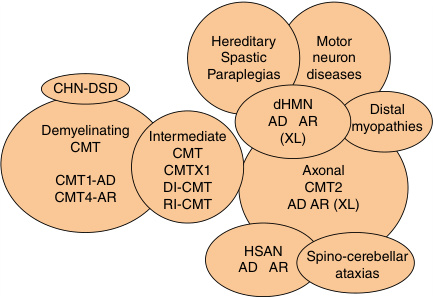

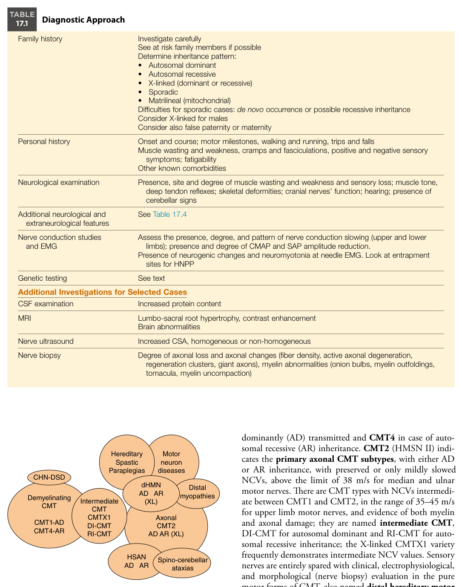

**Fig. 17.1** Representation of the different CMT and related neuropathy types and the overlap with other neurogenetic disorders to be considered in the differential diagnosis. 

dominantly (AD) transmitted and **CMT4** in case of autosomal recessive (AR) inheritance. **CMT2** (HMSN II) indicates the **primary axonal CMT subtypes** , with either AD or AR inheritance, with preserved or only mildly slowed NCVs, above the limit of 38 m/s for median and ulnar motor nerves. There are CMT types with NCVs intermediate between CMT1 and CMT2, in the range of 35–45 m/s for upper limb motor nerves, and evidence of both myelin and axonal damage; they are named **intermediate CMT** , DI-CMT for autosomal dominant and RI-CMT for autosomal recessive inheritance; the X-linked CMTX1 variety frequently demonstrates intermediate NCV values. Sensory nerves are entirely spared with clinical, electrophysiological, and morphological (nerve biopsy) evaluation in the pure motor forms of CMT, also named **distal hereditary motor neuropathies (dHMN). Sensory (and autonomic) hereditary neuropathies (HSN/HSAN)** are linked disorders

<!-- p.416 -->

with different phenotypes (see Chapter 18). **DejerineSottas disease (DSD)** , (CMT3/HMSN III) includes the most severe forms of CMT1/CMT4, with onset before age 2, very low NCVs (<12 m/s), and nerve biopsy evidence of hypomyelination-dysmyelination. Further subdivision of all these types is based on the involved gene (Table 17.2 and Fig. 17.2). The list of genes associated with CMT and related neuropathies is continuously increasing (~125 genes when this chapter was being prepared); _the vast majority of CMT cases, both in children and adults, is caused by pathogenic variants in six genes_ ( _PMP22_ duplication of CMT1A, _MPZ_ in CMT1B and CMT2I/J, _GJB1_ in CMTX1, _MFN2_ in CMT2A, _SH3TC2_ in CMT4C, _GDAP1_ in CMT4A/ CMT2K); ~30% of cases remain without a genetic diagnosis. 

#### **CMT1** 

The 1.4 Mb duplication on chromosome 17p11.2 encompassing the _PMP22_ gene is the most common pathogenic variant and is responsible for 40–50% of all patients and for 80–90% of autosomal dominant CMT1; the _PMP22_ duplication is associated with CMT1A, the prototype of CMT, which presents with the typical phenotype of lengthdependent sensory-motor polyneuropathy; disease severity is on average mild to moderate, but it may range from patients who remain asymptomatic even late in life to rather severely affected patients, although most patients remain ambulatory. The onset may be very early in some cases, causing delay in motor milestones; it most commonly occurs during childhood/late adolescence/early adulthood. Nerve conduction is markedly slowed from the beginning of myelination in the first months of life and remains relatively stable after the age of 2 years or shows only minimal decrease for the rest of life. Clinical worsening over time is correlated with the progressive secondary loss of axons caused by the primary myelin derangement, which has its electrophysiological counterpart in the reduction of compound muscle and sensory action potential (CMAP and SAP, respectively) amplitude. Nerve biopsy demonstrates loss of myelinated fibers and prominent myelin changes, consisting of onion bulb formations with layers of Schwann cell cytoplasm arranged concentrically around axons in a chronic process of demyelination and defective remyelination (Fig. 17.3). Approximately 5% of patients carry pathogenic variants in the _MPZ_ gene (CMT1B) and they show two main phenotypes, both with onset in the first years of life: one with milder progression more similar to CMT1A, and one with more severe and disabling course, depending on the genetic variant (CMT1B, DSD, and Congenital Hypomyelinating Neuropathy—CHN). Pathogenic variants in the _LITAF_ (CMT1C), _EGR2_ (CMT1D), _NEFL_ (CMT1F), _FBLN5_ , _PMP2_ (CMT1G), and _ITP3_ genes as well as intragenic small variants in the _PMP22_ gene (all rare) account for the remaining CMT1 patients (Table 17.2); less than 5% of the patients with CMT1 remain genetically undiagnosed after extensive genetic investigations. 

#### **CMT4** 

_Autosomal recessive demyelinating_ CMT types are less common than CMT1 in Western countries; they are more common in areas of high rates of consanguinity and in ethnic communities with high endogamy. They often demonstrate early onset during infancy or childhood and are severe. There are many causative genes (Table 17.2), the most frequent being _SH3TC2_ associated with CMT4C, characterized by relevant scoliosis in almost all cases, frequent cranial nerve involvement, including possible hearing loss. **Vocal cord palsy** may be seen in CMT4B1 and CMT4B2 associated with _MTMR2_ and _MTMR13_ gene variants, respectively; in the latter form glaucoma, either congenital or with later onset, is evident in ~25% of patients. Peculiar abnormal myelin figures (myelin outfoldings) formed by redundant loop of excessive myelin are very typical of CMT4B1-2 and also of another demyelinating autosomal recessive subtype, CMT4H associated with variants in the _FDG4_ gene encoding Frabin. 

#### **CMTX1** 

Pathogenic variants in the _GJB1_ gene on chromosome Xq13.1 encoding connexin-32 (Cx32) are associated with an X-linked form of CMT, CMTX1, which accounts for ~10–12% of all patients with CMT and is therefore the second most common type of CMT. Hemizygous males carry only one copy of _GJB1_ and usually have a phenotype more severe than average CMT1A, starting during adolescence and progressing over time with distal weakness, often requiring use of foot orthoses and late in life not infrequently some support for walking; nerve conduction slowing is moderate, often in the intermediate range. CMAP amplitudes decrease over time, reflecting axonal loss; nerve biopsy shows prominent axonal changes. Heterozygous females usually have less severe disease, including asymptomatic carriers manifesting only extremity cramps and pain; ~10–20% of females are moderately to severely affected with a phenotype similar to males. This wide range of disease expression is thought to be related to the random inactivation of the X-chromosome, which preferentially involves the variant allele in mildly affected patients and the normal allele in the severe cases. In females, NCVs are more frequently in the range of CMT2. There are five other rare CMT types with X-linked inheritance (CMTX2, locus Xp22.2; CMTX3, complex structural variation; CMTX4, _AIFM1_ ; CMTX5, _PRPS1_ ; CMTX6, _PDK3_ ; Table 17.2). 

#### **CMT2** 

The _axonal_ CMT2 is a very heterogeneous group of disorders with a wide range of disease severity, age of onset, and progression rate. Autosomal dominant forms are more frequent; _MFN2_ is the most prevalent associated gene in the United States and Northern Europe. _MFN2_ pathogenic variants cause CMT2A, frequently showing early onset and severe disease with loss of ambulation in the first decade of

<!-- p.417 -->

##### **TABLE 17.2 Genes Associated With the Different CMT and Related Neuropathies Subtypes** 

|Dem AD|yelinatingC AR|MT X-Linked|Int AD|ermediate C AR|MT X-Linked||Axona|l CMT AR||d|HMN AR|HS|AN|
|---|---|---|---|---|---|---|---|---|---|---|---|---|---|
|CMT1|CMT4|CMT|DI-CMT|RI-CMT|CMTX|A|D CMT2|CMT2|X-Linked|AD|(X-Linked)|AD|AR|
|_PMP22_|_GDAP1_|_GJB1_|_GBF1_|_GDAP1_|_GJB1_|_MFN2_|_NEFH_|_GDAP1_|_AIFM1_|_UBE3C_|_IGHMBP2_|_SPTCL1_|_WNK1_|
|_MPZ_|_MTMR2_||_DNM2_|_KARS_|_AIFM1_|_RAB7_|_DCAF8_|_LMNA_|_PRPS1_|_HSPB8_|_SIGMAR1_|_SPTCL2_|_FAM134B_|
|_LITAF_|_MTMR13_||_YARS_|_PLEKHG5_|_(DRP2)_|_TRPV4_|_TUBB3_|_MFN2_|_PDK3_|_HSPB1_|_PLEKHG5_|_ATL1_|_KIF1A_|
|_EGR2_|_MTMR5_||_INF2_|_COX6A1_||_GARS_|_DGAT2_|_HINT1_||_HSPB3_|_DNAJB2_|_DNMT1_|_SCN9A_|
|_NEFL_|_SH3TC2_||_GNB4_|||_NEFL_|_ATP1A1_|_TRIM2_||_FBXO38_|_HINT1_|_ATL3_|_IKBKAP_|
|_PMP2_|_NDRG1_||_NEFL_|||_HSPB1_|_KIF5A_|_IGHMBP2_||_BSCL2_|_VRK1_||_NTRK1_|
|_FBLN5_|_EGR2_||_MPZ_|||_MPZ_|_DCAF8_|_HSJ1/_ _DNAJB2_||_GARS_|_LAS1L_|_SCN11A_|_NGF-B_|
|_ITP3_|_PRX_||_C1orf194_|||_GDAP1_|_TUBB3_|_SPG11_||_REEP1_|_SORD_|_RAB7_|_DST_|
|_(ARHGEF10)_|_HK1_||_EBP50_|||_HSPB8_|_DGAT2_|_MME_||_SLC5A7_|_HSPB1_|_PRNP_ **RFN170**|_SC11A_|
|_(POLR3B)_|_FGD4_||_SARS1_|||_DNM2_|_CADM3_|_C12ORF65_||_DCTN1_|||_PRDM12_|
|_(C1orf194)_|_FIG4_|||||_AARS_|_GBF1_|_SORD_||_DYNC1H1_|_SLC5A6_||_CLTCL1_|
||_SURF1_|||||_DYNC1H1_|_JAG1_|_SLC25A46_||_BICD2_|_COQ7_||_CCT5_|
||_CTDP1_|||||_LRSAM1_|_SCL12A6_|_SACS_||_TRPV4_|_BANF1_||_FLVCR1_|
||_AHNAK2_|||||_DHTKD1_|_DHX9_|_MPV17_||_AARS_|_SYT2_||_ZFHX2_|
|||||||_MARS_|_BAG3_|_MCM3AP_||_HARS_|||_PIEZO2_|
|||||||_NAGLU_||_PNKP_||_MYH14_|||_TECPR2_|
|||||||_HARS_||_HSPB1_||_SETX_|_X-linked_||_NMNAT2_|
|||||||_VCP_|_Maternal_ _inheritanc_|_e_ _LRSAM1_||_CHCHD10_|_ATP7A_||_PLD3_|
|||||||_MORC2_|_MTATP6_|_AHNAK2_||_TBX5_||||
|||||||_TFG_|_MT-TV_|_EGR2_||_WARS1_||||
|||||||_BSCL2_||_PDXK_||_EMELIN-1_||||
|||||||||_MYO9B_||_KCC3_ _SPTAN1_||||

The most frequent genes are in bold.

<!-- p.418 -->

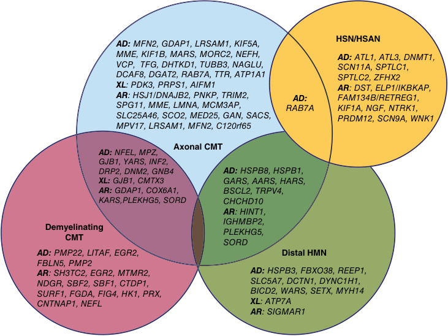

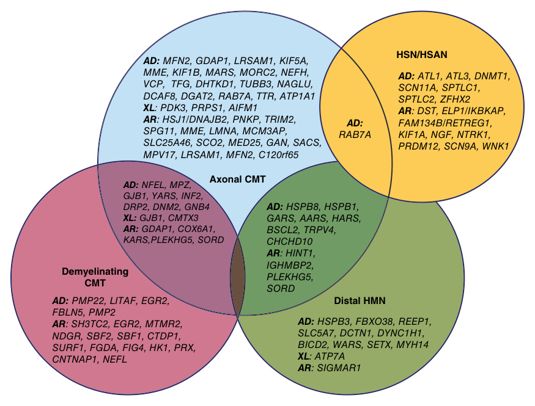

**Fig. 17.2** VENN diagram showing the distribution of pathogenic variants among clinical and electrophysiological groups of hereditary neuropathies. _CMT,_ Charcot-Marie-Tooth; _dHMN,_ distal hereditary motor neuropathy; _HSAN,_ hereditary sensory autonomic neuropathy.  (From Korinthenberg R, Trollmann R, Plecko B, et al. Differential diagnosis of acquired and hereditary neuropathies in children and adolescents: consensus-based practice guidelines. _Children (Basel)._ 2021;8:687 [Fig. 1].) 

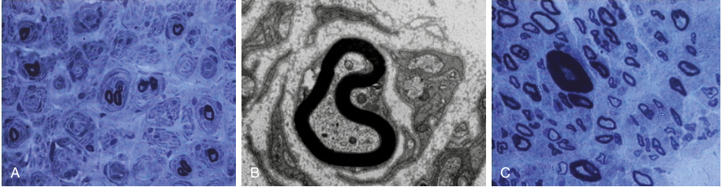

**Fig. 17.3** Examples of nerve pathology in CMT and HNPP. (A) Sural nerve biopsy of a CMT1A patient showing loss of myelinated fibers and diffuse onion bulb formations with leaflets of Schwann cell cytoplasm surrounding surviving myelinated fibers of small caliber or without any central axon (blue toluidine, semithin section); (B) Electron microscopy imagine of an onion bulb in a CMT1 patient; (C) Sural nerve biopsy of an HNPP patient showing a central fiber with thick myelin (tomaculum) (blue toluidine, semithin section). 

life; CMT2A cases with later onset and mild disease severity are also observed. In Southern Europe, CMT2A is less common and _GDAP1_ variants are more frequent, accounting for both dominant CMT2K (usually with onset during adulthood and variable disease severity) and recessive mainly axonal CMT (named CMT4A) but more correctly classified among the axonal types in spite of some conduction 

slowing; it is also frequent in Maghreb countries. CMT4A is a severe disease with onset during infancy and rapid progression to loss of ambulation, complete loss of distal movements, and proximal lower limb weakness before age 20–30 years; **vocal cord palsy** causing hoarse voice is a frequent finding. Late-onset CMT2 is common and due to certain pathogenic variants in _MPZ_ : this phenotype

<!-- p.419 -->

associated with _MPZ_ is therefore completely different from CMT1B, with onset later than 35 years (even later than 70) and an axonal neuropathy with a progressive course, sometimes so severe to lead to the use of a wheelchair; it is termed **CMT2I** if the phenotype is just neuropathic, and **CMT2J** if more complicated, with pupillary abnormalities, hearing loss, neuropathic pain, and dysphagia, depending of the _MPZ_ variant. CMT- _SORD_ , associated with biallelic variants in the gene encoding sorbitol dehydrogenase converting sorbitol to fructose is the most frequent type of recessive CMT2 and dHMN and is important because the accumulation of sorbitol, thought to be neurotoxic and to constitute the disease pathomechanism, can be lowered by inhibitors of aldose reductase, the enzyme involved in the preceding metabolic step of conversion of glucose into sorbitol. The yield of genetic diagnosis with extensive NGS in CMT2 is less than 50%, with many cases still unsolved on genetic grounds. 

#### **dHMN** 

The pure motor forms of CMT are less common, although there is an overlap with CMT2 with motor predominance because sensory nerves may initially be spared and involved only at a later stage or are involved in some family members and not in others, or in some families but not others. Therefore, the distinction between CMT2 with motor predominance and dHMN is artificial. There are autosomal dominant and recessive forms, and one X-linked type, with many different genes involved (Fig. 17.7 and Table 17.2). However, the rate of success in genetic diagnosis remains ~30%. 

#### **HNPP** 

The CMT-related neuropathies include **hereditary neuropathy with liability to pressure palsies** , which is caused by a 1.4 Mb deletion at chromosome 17p11.2 that includes the _PMP22_ gene, or rarely by _PMP22_ nonsense variants, and is transmitted as an autosomal dominant trait. Clinically, HNPP is characterized by episodes, which may be recurrent focal mononeuropathies or brachial plexopathies that are typically acute, painless, and transient, occurring after minor compression or trauma or without any evident precipitating factor. The most affected nerves are the ulnar, radial, median, and peroneal nerves and the brachial plexus at their common entrapment or compression sites. Prolonged leg crossing, leaning on the elbow, pressure on the radial groove, and kneeling may precipitate an acute neuropathy. Recovery occurs after hours, days, weeks, or even months, and is frequently complete; severe residual deficits are rare. However, over time, patients may accumulate nerve damage and develop a sensory-motor asymmetric multineuropathy or a symmetric polyneuropathy; sometimes the phenotype overlaps with CMT. Patients frequently complain of compression paresthesias with common actions such as those already discussed or using scissors and carrying shopping bags. Nerve conduction studies typically show conduction abnormalities at entrapment sites, with prolonged distal latencies of ulnar, 

median, and peroneal nerves, and slowing across the elbow and the fibular head for the ulnar and peroneal nerves, respectively (Fig. 17.4). Nerve conduction velocities may be normal or variably slowed outside compression sites, and SAPs are frequently decreased in amplitude or absence. Nerve biopsy demonstrates the typical myelin figures named tomacula, which are sausage-shaped myelin thickenings occurring often in the paranodal position (Fig. 17.3); segmental demyelination may also be seen. 

#### **Clinical Presentations** 

The approach, diagnosis, and care for CMT and related neuropathies in the pediatric age raise several challenges. Presentations may begin at different ages, from birth and infancy to childhood and adolescence; patients often present with early disability and may show severe progression; the high genotype-phenotype heterogeneity, together with the high frequency of sporadic or apparently sporadic cases and the rarity of several subtypes, make it difficult to reach a definite diagnosis, which is crucial for appropriate familial counseling and prenatal or preimplantation diagnosis. Although most of the common CMT subtypes produce similar clinical manifestations, the rarer subtypes may be associated with peculiar clinical features or involvement of other organ systems and present with more complex phenotypes than simple CMT. Moreover, different pathogenic variants in the same gene may lead to heterogeneous and variable phenotypes (Table 17.3). An accurate history and an in-depth clinical characterization are essential to address the proper investigations and molecular testing (Figs. 17.5 and 17.6). 

The group of early-onset and often severe neuropathy ranges from neurogenic **arthrogryposis multiplex congenita (AMC)** for the most affected cases with onset _in utero_ and diffuse contractures, to **congenital hypomyelinating neuropathies** for the patients with onset at birth and no or poor myelin formation, to **Dejerine-Sottas disease** , or early-onset demyelinating CMT1-CMT4 or axonal CMT2 and dHMN in the less dramatic cases. 

#### **Congenital** 

Generalized hypotonia with features of a floppy infant, distal weakness associated with skeletal deformities (congenital hip dysplasia, clubfoot, hand joint limitations, chest deformity), and deep tendon areflexia are the main features of the hereditary neuropathies causing signs since birth. They frequently involve cranial nerves, with pupillary abnormalities, sensory-neural hearing loss, facial weakness, and possible swallowing and respiratory impairment. In some, the course leads to early death. In the majority, however, children have motor development delay in achieving head control and sitting position, followed by delay of walking, which is frequently reached only with aid, or is an unsteady gait with frequent falls; the involvement of distal upper limbs impairs the ability of grasp and use objects (toys) appropriately. Although the clinical course is not progressive, these patients

<!-- p.420 -->

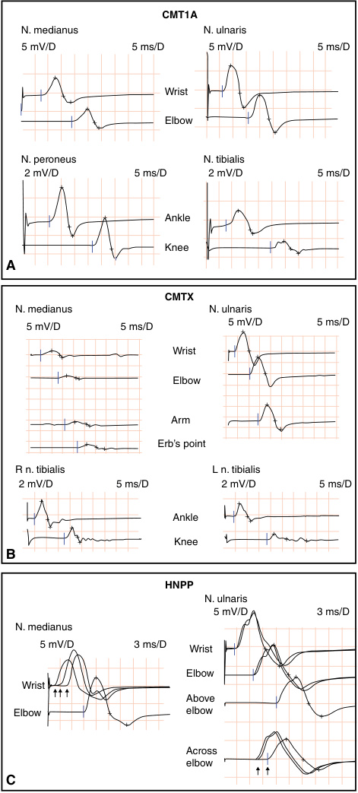

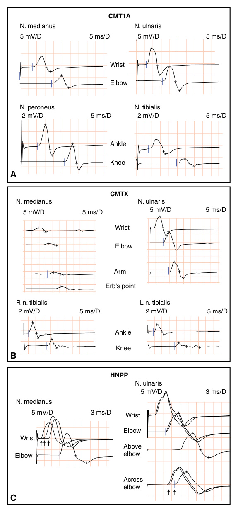

**Fig. 17.4** Examples of nerve conduction studies (NCS) in CMT and HNPP. (A) NCS in a CMT1A subject showing homogeneous nerve conduction slowing in all investigated nerves; note that the shape of the CMAP is similar in proximal and distal sites without desynchronization, temporal dispersion, or conduction block; only the proximal CMAP at the popliteal fossa for the tibial nerve shows some differences in shape. (B) NCS in a CMTX1 patient showing much more severe reduction of CMAP amplitude from the abductor pollicis brevis (median nerve) than from the first dorsal interosseous (ulnar nerve) and there is a clear desynchronization of the proximal CMAP for the left tibial nerve and also for the right one although to a lesser extent (evidence of non-homogeneous nerve conduction slowing requiring a careful differentiation from CIDP). (C) NCS in an HNPP patient showing focal conduction slowing at entrapment sites: for stimulation across the wrist (median nerve) and elbow (ulnar nerve).

<!-- p.421 -->

###### **TABLE** 

###### **17.3** 

##### **Phenotypes and Main Associated Genes** 

|Disease Neurogenic arthrogryposis multiplex congenita (AMC)|Features In utero—congenital—onset: reduced fetal movements, multiple proximal and distal joint contractures, severe muscle weakness, global developmental delay. Neurogenic EMG changes or demyelinating predominantly motor; usually non-progressive; possible association with brain malformations of cortical development (MCD) and intellectual disability|Main Genes Involved _DYNC1H1, BICD2, TRPV4,_ _DCTN1, MORC2_ CNTNAP|
|---|---|---|
|Congenital hypomyelinating neuropathy (CHN)|Congenital onset, global hypotonia, possible respiratory distress; severe course. No or poor myelin formation, very low NCV|_PMP22, MPZ, EGR2,_ _PRX_ _CNTNAP1_|
|Dejerine-Sottas disease (DSD or CMT3/HMSN III)|Onset age<2 years, early foot deformities, motor global developmental delay, frequent cranial nerve involvement, relatively milder course, hypo-dysmyelination, very low NCV (≤12 m/s)||
|Early onset demyelinating |Delayed motor milestones, distal LL weakness, severe course, low NCV|_PMP22, MPZ, PRX, MTMR2, SBF2/_ _MTMR13, FIG4_|
|CMT (CMT1 and CMT4)|Less severe course, slowed NCV (<38 m/s median nerve)|_PMP22, MPZ, SH3TC2, NDRG1,_ _HK1, NEFL, LITAF, PMP22_dupl, _GDAP1 (recessive)_|
|Early onset axonal sensory-motor CMT|Early onset, severe course, relatively preserved NCV, altered SAP, possible cranial nerves involvement|_MFN2, GDAP1 (recessive), TRPV4,_ _IGHMBP2,_ _TRIM2_|
|Early-onset pure motor neuropathy|Early foot deformities, contractures, scoliosis|_TRPV4, IGHMBP2, DYNC1H1,_ _BICD2_|
|Typical demyelinating CMT|Onset childhood/adolescence/early adulthood, slowed NCV, variable disease course|_PMP22 duplication, MPZ, SH3TC2_|
|Typical axonal CMT2|Onset childhood-adolescence-early adulthood, relatively preserved NCV, variable disease course|_MFN2, SORD, GDAP1_(dominant), _GARS, HSPB1, HSPB8,_ _LMNA, HINT1_|
|Intermediate CMT|Variable onset and course, intermediate NCV|_GJB1, AIFM1, DNM2, INF2, GDAP1_ _(CMTRIA),_|
|dHMN|Variable onset and course, pure motor involvement May show pyramidal involvement|_HSPB1, HSPB8, SORD,_ _HINT1_|
|||_GARS, BSCL2, SIGMAR1_may show predominant UL involvement|
|Late onset CMT|CMT1|_PMP22 duplication (unrecognized_ _CMT1A)_|
||CMT2|_MPZ, LRSAM1, HSPB1, MME,_ _GDAP1_(dominant)_MARS1_|

have significant disabilities and require surgery for correction of scoliosis or foot deformities. 

If the clinical presentation is consistent with AMC and the EMG examination suggests a neurogenic origin, the molecular investigations should include the following genes: _DYNC1H1, BICD2, TRPV4_ (mainly dominant _de novo_ variants). 

For the patients whose neurophysiological examination shows a _dysmyelinating_ (DSD-CMT3/CMT1-4) or _hypomyelinating_ (CHN) neuropathy with extremely slowed median motor nerve conduction velocity of 12 m/s or less, the most 

common genes are dominant _de novo_ variants in _PMP22_ , _MPZ_ , and _EGR2_ genes; less often recessively inherited variants involve the periaxin gene _(PRX)_ or _CNTNAP1_ , a very rare form which, in addition to severe congenital hypotonia, causes polyhydramnios, hearing and visual impairment, severe respiratory insufficiency, and profound developmental delay/intellectual disability. 

When the neurophysiological evaluation demonstrates normal conduction velocities at this age, the precise diagnosis is more challenging, given the considerable clinical and genetic overlap between the early-onset dHMN and

<!-- p.422 -->

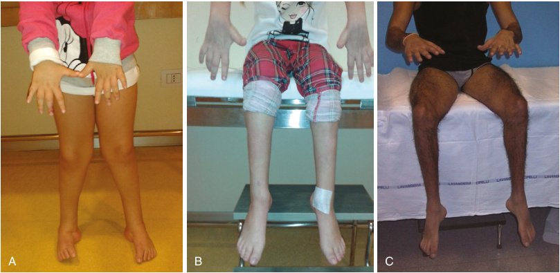

**Fig. 17.5** Hand and foot involvement in early and childhood onset CMT. (A) Patient with recessive CMT2 associated with _GDAP1_ variants. (B) Patient with recessive CMT2 associated with _TRIM2_ variants. (C) Patient with recessive dHMN associated with a _HINT1_ variant. 

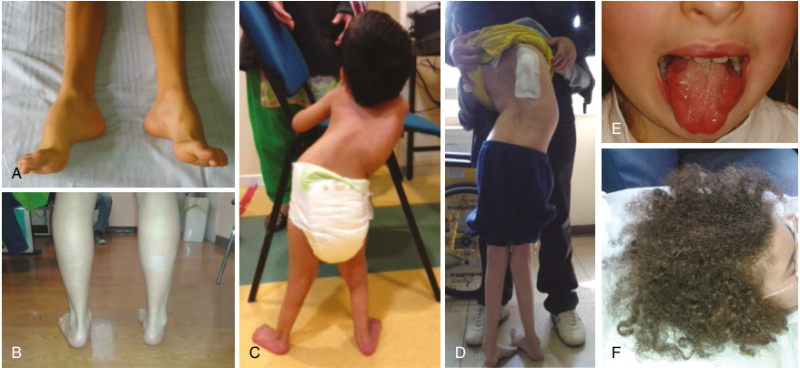

**Fig. 17.6** Examples of peculiar clinical features in CMT children. (A) Severe symmetric bilateral cavovarus foot deformity in a CMT1A patient. (B) Asymmetric foot deformity (left valgus and right cavus) in a CMT1A patient. (C) Severe scoliosis in congenital recessive CMT2 associated with _IGHMBP2_ variant. (D) Severe scoliosis requiring surgery in early-onset CMT1 associated with _CTDP1_ variants. (E) Tongue atrophy in congenital CMT2 associated with _TRIM2_ variants. (F) Kinky hair in a child with giant axonal neuropathy. 

CMT2 forms (including _spinal muscular atrophy with lower extremities predominance_ , SMA-LED) with lower limb underdevelopment and weakness but no further evolution, associated with _DYNC1H1_ and _BICD2_ variants; the different types of SMAs and some distal myopathies must also be considered (Fig. 17.7). 

The clinical pictures observed in _early-onset axonal_ CMT2/dHMN include: diffuse weakness or predominantly affecting lower limb muscles, sometimes in proximal more 

than distal regions (early phase), and distal muscle wasting; proximal (hip/knees) and distal (Achilles’ tendon) contractures and feet deformities (calcaneus valgus talipes) that can present prenatally; respiratory and feeding difficulties due to swallowing impairment; and cranial nerve involvement including tongue fasciculations. 

The disease course is variable; infants with early weakness and motor delay can reach the ability to walk with or without support or evolve into early wheelchair dependency; early

<!-- p.423 -->

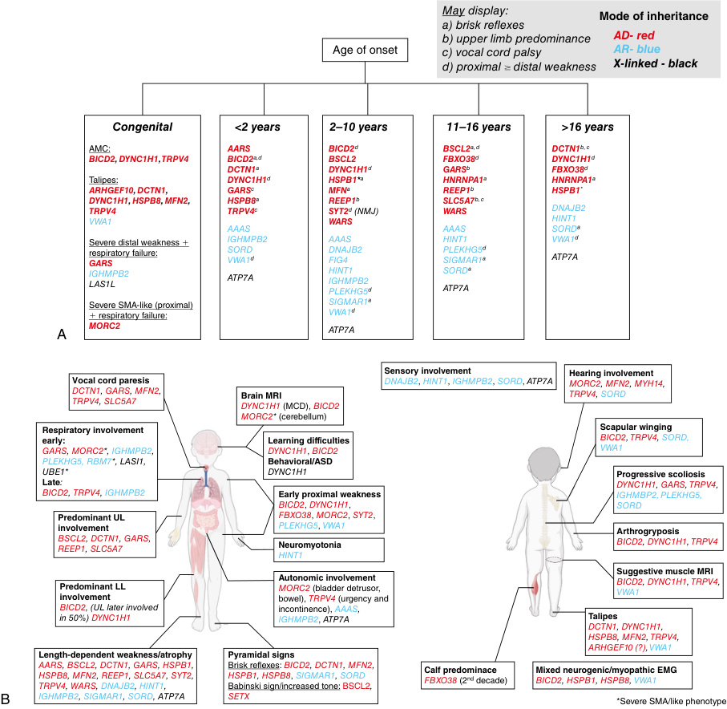

**Fig. 17.7** Pure motor forms: Diagnostic clues based on age of onset (A) and relevant clinical features (B). Relevant clinical features (B) may or may not be present due to disease spectrum or stage at assessment. Genes are listed in alphabetical order and according to mode of inheritance: autosomal dominant (AD) pattern, bold font and red; autosomal recessive (AR), regular font and blue; X-linked in black (LAS1L and ATP7A). Asterisk indicates when more than one mode of inheritance has been associated with the same gene. _EMG,_ Electromyography; _MCD,_ malformation of cortical development.  (From Zambon AA, Pini V, Bosco L, et al. Early onset hereditary neuronopathies: an update on non-5q motor neuron disease. _Brain_ 2023;146:806-822 [Fig. 1, p. 808].) 

respiratory involvement requiring mechanical assistance may be a feature of the most severe forms; orthopedic complications such as joint abnormalities, hip dislocation, scoliosis, and kyphosis can have a progressive course. In these patients, the most common genetic causes to investigate are _DYNC1H1, BICD2_ , _TRPV4,_ and _IGHMBP2._ 

Notably, patients with pathogenic variants in the _DYNC1H1_ and _BICD2_ genes can also show cognitive 

impairment, variably associated with malformations of cortical development (MCD) on brain MRI. 

Muscle MRI can be helpful in identifying potential discriminatory markers, such as the initial involvement of specific muscles (vastus intermedius and lateralis, soleus and medial gastrocnemii) with sparing of others (biceps femoris) in patients with _TRPV4_ variants, or the pattern of small areas of muscle tissue with normal signal intensity surrounded by

<!-- p.424 -->

areas with similar intensity to subcutaneous fat in patients with SMA-LED phenotype. 

#### **Childhood** 

Children can present with normal motor development in the first or second year of life, but then have slowing of achievements and delayed motor milestones with evidence of distal lower limb weakness, producing clumsy or tiptoe gait and frequent falls. The subsequent clinical progression in these patients is variable, ranging from severely disabling involvement of lower and upper limbs to milder course with minor difficulties in running and then in walking or gymnastic performances without involvement of upper extremities. 

Many CMT types can have onset during early childhood and the diagnosis is driven by family and personal history, clinical phenotyping, as well as nerve conduction and EMG studies. If nerve conductions are decreased, the lesions include many CMT1 and CMT4 types to consider, particularly those associated with _MPZ_ (CMT1B), _PMP22_ (CMT1E), and _SH3TC2_ (CMT4C) variants (Table 17.3) that may have different courses with variable severity. Sensory symptoms like pain or paresthesias are unusual in children, especially at an early age; however, sensory ataxia is seen in some demyelinating CMT forms with onset in infancy and variable severity, such as those associated with dominant _MPZ_ and the very rare _PRX_ recessive variants (CMT4F). 

There are reports of patients with the _PMP22_ duplication (CMT1A) with very early onset, (sometimes congenital) foot deformities, normal or delayed motor development, and progressive gait difficulties later on during childhood, representing the far extreme of CMT1A severity spectrum. Such findings underscore the importance of ruling out the CMT1A duplication in any patient with a demyelinating neuropathy, even in very young children. 

The _most frequent axonal_ CMT2 forms presenting at this age are those caused by pathogenic variants in _GDAP1_ (recessive CMT4A) and _MFN2_ (dominant CMT2A, mostly _de novo_ ). In both diseases, the clinical presentation is fairly homogeneous: onset with falls and tripping due to foot drop and subsequent evidence of difficulties in movements of the hands. Foot deformity is usually of the valgus/ planus type. The disease progression is rapid with distal weakness and wasting leading to complete loss of foot and hand movements within the first decade, followed by involvement of proximal muscles causing loss of autonomous gait and need for a wheelchair in the second or third decade of life. 

Additional features can be present when neuropathy progresses. Voice hoarseness due to _vocal cord paresis_ is frequent in _GDAP1_ -related CMT; careful otorhinolaryngoiatric and pneumological evaluation is important to evaluate the timely need for procedures like a cordectomy. _MFN2_ pathogenic variants may cause additional symptoms in children and adults such as optic atrophy, vocal cord involvement, hearing loss, tremor, and occasionally more complicated clinical pictures. 

Vocal cord palsy and respiratory involvement can also be associated features in other rare early-onset CMT, as _MTMR2_ (CMT4B1), _SBF2/MTMR13_ (CMT4B2) both characterized by demyelinating neuropathy; the latter may also be complicated by congenital or later-onset glaucoma. 

Other early-onset CMT2/dHMN types may have a slow worsening of motor performances, less marked lower limb weakness, which allows to maintain autonomous gait, and later involvement of upper limbs, with minor difficulties in school activities. 

Nevertheless, such neuropathies lead to variable degrees of disability and require multidisciplinary care, in particular because of the association with foot deformities and scoliosis. Scoliosis is seen in children affected with different types of CMT and is a hallmark of CMT4C _(SH3TC2)_ , probably the most frequent recessive CMT at this age. 

The involvement of cranial nerves must be carefully evaluated to prevent and manage the impact on nutrition, auditory and respiratory functions, as well as to investigate specific CMT forms and address the appropriate genetic analyses (Table 17.4). 

#### **Adolescence—Early Adulthood** 

This is the most typical age of presentation of CMT and dHMN; the patient manifesting the first neuropathic signs with a slow onset, often with foot deformities, then some clumsiness and difficulties in sports activities, followed later by clear-cut development of foot weakness and later of hand weakness with slow worsening over the years. In patients with CMT, sensory loss may become apparent in distal limbs, particularly for pinprick, touch, and vibration sense. Sensory ataxia is uncommon. Scoliosis develops during adolescence in ~30% of the patients. Additional findings are uncommon and may suggest a specific CMT/dHMN diagnosis (Table 17.4). The phenotype for CMT1/4, CMT2, and dHMN and the diagnostic approach are noted in Table 17.1; the genes to be investigated are noted in Table 17.2. 

#### **Late-Onset CMT** 

CMT may present after the age of 40 or even in the seventh or eighth decade of life. This may occur because a pre-existing slowly progressive neuropathy (CMT1A) has been unrecognized and the patient becomes aware of the neuropathy: nerve conduction studies performed for other reasons, worsening of CMT over the threshold of patient awareness, or intercurrent unrelated diseases. In other situations, the neuropathy does actually begin late in life and then has a progressive, sometimes aggressive course. This is typical of some _MPZ_ variants associated with late-onset axonal CMT2 (autosomal dominant) and pathogenic variants of the _MME_ gene, associated with late-onset recessive CMT2. Other genes that may cause late-onset CMT are _LRSAM1_ (CMT2P), _HSPB1_ (CMT2F, dHMN IIB), _GDAP1_ (AD-CMT2K), and _MARS1_ (CMT2U). The diagnosis may be difficult because pes cavus

<!-- p.425 -->

#### **TABLE 17.4** Additional Neurological and Extraneurol ogical Features That Address Diagnosis

|Organ Involved|Description|Genes|
|---|---|---|
|Eye|Optic atrophy|_MFN2, PRPS1, SLC25A46, C12orf65, PDXK_|
||Cataract|_DNM2, CTDP1_|
||Glaucoma|_SBF2/MTMR13_|
||Retinal pigmentation|_MORC2_|
||Retinal degeneration|_PRPS1, FLVCR1_|
||Macular degeneration|_FBLN5_|
||Pupillary abnormalities|_MPZ, PMP22, GJB1, SH3TC2, EGR2, NDRG1, FGD4, MTMR2, TRPV4_|
||External ophthalmoplegia/ ophthalmoparesis|_DNM2, MTMR2, MFN2, EGR2_|
|Cranial nerves (and/or throat)|Vocal cord palsy|_GDAP1, TRPV4, MTMR2, SBF2/MTMR13, DCTN1, TRIM2, SLC5A7,_ _HK1, MFN2,_|
||Hearing impairment|_MPZ, MORC2, MFN2, MYH14, DNMT1, TRPV4, NDRG1, AIFM1,_ _PRPS1, PMP22, MPZ, GJB1, PRX, EGR2, PDK3, SURF1, NEFL_|
||Facial weakness|_HK1, SBF1, TRIM2, MTMR2, PMP22, MPZ, EGR2, MFN2, GDAP1,_ _NEFL, SH3TC2, FIG4, DNM2, NDRG1_|
|Central nervous |Intellectual disability|_MCM3AP, CNTNAP1, AIFM1, FIG4, MFN2, KIF1A, MORC2, DYNC1H1_|
|system|Pyramidal signs From increased tendon reflexes to overt spasticity|_NEFL, MORC2, MFN2, BSCL2, HSPB1, HSPB8, DYNC1H1, DCTN1,_ _BICD2, SORD, KIF5A, SIGMAR1, REEP1, COQ7_|
||MRI cortical abnormalities|_KIF1A, DYNC1H1, FIG4_|
||MRI white matter abnormalities|_GJB1,MCM3AP, MFN2, NDRG1_|
||Dementia|_DNMT1, PRNP_|
||Cerebellar syndrome|_MORC2, NEFL, SLC45A6, PNKP, FIG4, MFN2, DYNC1H1_|
|Autonomic involvement|Bladder detrusor, bowel; urgency/incontinence|_MORC2, TRPV4, IGHMBP2, ATP7A_|
|Skeletal |Severe early scoliosis|_DYNC1H1, GARS, TRPV4, SH3TC2, IGHMBP2_|
|abnormalities|Scapular winging|_DYNC1H1, BICD2, SORD, TRPV4_|
||Distal arthrogryposis|_DYNC1H1, BICD2, FIG4, CNTNAP1, TRPV4, PIEZO2_|
|Respiratory |Early|_GARS, MORC2, IGHMBP2, UBE1_|
|involvement|Late|_BICD2, TRPV4, IGHMBP2_|
|Other peculiar |Leukopenia|_DNM2_|
|features|Focal glomerulosclerosis|_INF2_|
||Neuromyotonia|_HINT1_|

is often absent or mild, and the family history may be negative or overlooked. The differential diagnosis includes other genetic neuropathies such as _TTR_ -related amyloid neuropathy or acquired or idiopathic chronic axonal neuropathies. 

### **Additional or Peculiar Features** 

Additional neurological and extraneurological features may be specific for some CMT subtypes and may help address the investigations (Table 17.4). 

Central nervous system (CNS) involvement may occur, particularly but not only in early-onset types, and may consist of intellectual disability, delay of language development or global impairment of cognitive skills, visual impairment, brain cortical or white matter abnormalities, cerebellar ataxia, and even dementia. 

**Pyramidal tract involvement** , ranging from brisk deep tendon reflexes to overt spasticity and overlap with _hereditary spastic paraplegia_ , may occur for several gene variants and onset at all ages (Table 17.4). **Visual impairment** may occur

<!-- p.426 -->

due to optic atrophy, retinopathy/maculopathy, cataract, and glaucoma. **Cranial nerves** may be affected by pupillary abnormalities, ophthalmoplegia, facial weakness, hearing loss, vocal cord palsy, and dysphagia. **Hearing loss** may occur as a specific feature in several CMT/dHMN types, including CMT1A associated with the _PMP22_ duplication (up to 5% of the cases) and CMT1B with _MPZ_ variants, whereas in other forms it is frequent (CMT4C— _SH3TC2_ , late-onset CMT2J— _MPZ_ ) or typical (CMT4D— _NDRG1_ ). **Urinary urgency** and incontinence are rare but occur in some cases. **Parkinson disease** may be seen in association with CMT in some patients carrying variants in _LRSAM1_ and _DNAJB2_ genes. 

The neuropathy does not always display a lengthdependent pattern: while anterolateral leg compartment is typically more affected than the posterior leg section in CMT1A, CMT1B, and many other CMT types, the posterior leg compartment may be more affected in other cases, such as some patients with CMT- _SORD_ or _HSPB1_ - related neuropathies; upper limb predominance is typically seen in association with _GARS_ variants (CMT2DdHMN V) and may be observed in _BSCL2_ -related neuropathy. **Split hand** with predominance of first dorsal interosseous and thenar eminence over hypothenar weakness and atrophy is often found in CMTX1 _(GJB1)_ and with _SIGMAR1_ -related neuropathies. 

The presence of neuromyotonia in patients with axonal CMT2 or pure motor dHMN (NMAN, neuromyotonia with axonal neuropathy) is a very specific diagnostic clue in recessive _HINT1_ variants, which are particularly frequent in Eastern Europe. Disease onset is typically in the first decade, with severe distal weakness and atrophy of both lower and upper limbs. Patients may present with muscle stiffness, clinical myotonic phenomenon (50%), or cramps in the hands and legs. Needle EMG findings are typical, with high-frequency motor unit action potentials consistent with neuromyotonic or myokymic discharges. Patients presenting later in life, sometimes with _asymmetric_ weakness and without myotonia, have been reported. 

**Leukopenia** , sometimes with anemia and low platelet count, may be seen in association with _DNM2_ variants, while **focal segmental glomerulosclerosis (FSGS)** typically occurs in DI-CMTE associated with pathogenic variants in the _INF2_ gene. 

Geographic region of origin may be important because of the high prevalence of pathogenic variants in certain ethnic groups and/or founder variants in some regions. _GDAP1_ variants are frequently found in Southern Europe (i.e., Spain and Southern Italy) and Maghreb countries; the P70S variant in _MPZ_ causing late-onset CMT2I is seen in Lombardy, a region of Italy. Three recessively inherited demyelinating CMT forms are typically observed in populations of Romani origin: (1) CMT4D/HMSN-Lom associated with the p.R148X nonsense variants in the _NDRG1_ gene; (2) CMT4C caused by some variants in the _SH3TC2_ gene; and (3) CMT4G/ HMSN-Russe associated with a homozygous pathogenic variant in the _HK1_ gene. CMT4D is a severe sensory-motor 

demyelinating neuropathy with onset in the first years of life, characterized by early foot weakness with severe deformities, walking difficulties and need of ankle foot orthoses, involvement of hands since the first years of life, progressive course with proximal involvement, loss of autonomous walking and wheelchair use, frequent severe sensorineural hearing loss, and scoliosis. NCVs are markedly slowed. 

# **Diagnostic Approach** 

_The diagnostic approach is dependent on the clinical presentation and age of onset_ . The provider must verify if the patient’s condition conforms to one of the CMT/HMSN categories; the diagnosis for every patient replicates the classification steps (Fig. 17.1 and Table 17.1). The questions are: Is it a neuropathy? What is the presentation pattern (length-dependent polyneuropathy, sensory-motor, predominantly motor, pure motor, pure sensory; age of onset; rapidly or slowly progressive; symmetric, greatly asymmetric? Chronic progressive or with relapses)? Is it genetic? Is there a family history? Which is the inheritance pattern (autosomal dominant, autosomal recessive, X-linked, sporadic presentation, possible _de novo_ occurrence, matrilineal inheritance)? Are there additional features? 

The next step consists of the electrophysiological examination, with nerve conduction studies in upper and lower limbs, in both motor and sensory nerves, and EMG examination. The presence and degree in conduction slowing and the presence and degree of CMAP and SAP amplitude reduction should be determined and compared. The pattern of conduction slowing is also important to assess, as hereditary demyelinating neuropathies usually show a homogeneous and symmetric conduction slowing, at proximal and distal sites (Fig. 17.4). Acquired demyelinating neuropathies (such as chronic inflammatory demyelinating polyneuropathy [CIDP] and its variants) are characterized by non-homogeneous nerve conduction abnormalities, differing among individual nerves and in different segments, with asymmetries, conduction blocks, and temporal dispersion. However, asymmetries, non-homogeneous nerve conduction slowing, conduction blocks, and temporal dispersion may be seen to a certain degree also in some inherited neuropathies, such as CMTX1 _(GJB1)_ (Fig. 17.4), CMT1C _(LITAF)_ , CMT4C _(SH3TC2)_ , CMT4H _(FDG4)_ , CMT4J _(FIG4)_ , and even CMT1B _(MPZ)_ . 

The assessment of patients with CNS involvement should include brain MRI and visual and auditory evoked potentials to better address genetic analyses and rule out other diseases (Tables 17.4 and 17.5). 

The clinical and electrophysiological assessment should classify the patient into one of the categories (Fig. 17.1, Tables 17.1 and 17.3): CMT1/4, CMT2, dHMN, HSN, HNPP or, for the very early onset cases, in AMC, CHN, DSD. _Genetic testing can start at this stage_ . NGS testing may be customized gene panels for CMT and related neuropathies, whole-exome sequencing (WES), or whole-genome sequencing (WGS) (Fig. 17.8). In case of abnormal nerve

<!-- p.427 -->

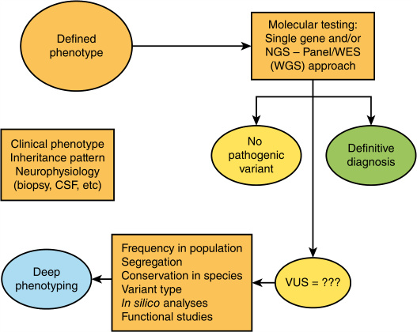

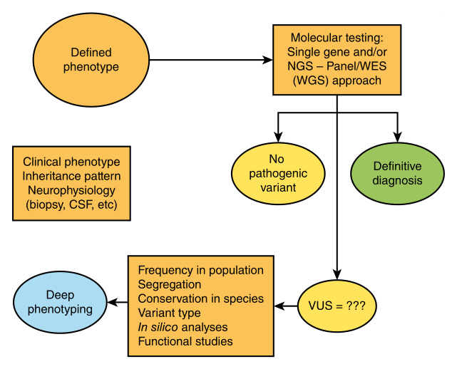

**Fig. 17.8** Schematic representation of the genetic diagnostic approach and subsequent actions after results interpretation. 

conduction velocities, it is important to exclude the CMT1A/ _PMP22_ 1.4 Mb duplication, usually with multiplex ligationdependent probe amplification (MLPA) or indirect analysis by microsatellites. Genetic testing for _PMP22_ duplication should not be performed in axonal neuropathies. There are still some instances where you might decide to first look for specific genes: e.g., for _PMP22_ , _MPZ_ , and _EGR2_ point variants in early-onset cases with demyelinating/hypomyelinating features, and for _GDAP1_ and _MFN2_ variants in early-onset cases with axonal features; for _GJB1_ variants (CMTX1) if there is no male-to-male transmission in a family, the male patient has intermediate NCV with split hand, females in the family are less severely affected and have NCV in the range of CMT2; or according to the geographic/ethnic origin if there are specific gene variants (e.g., late-onset CMT2 with some _MPZ_ variants; people of Romani origin for _SH3TC2, HK1,_ or _NDRG1_ variants, especially in some countries in Europe; or if there are specific associated findings (see Table 17.4). If HNPP is suggested by clinical and/ or electrophysiological findings, the presence of the _PMP22_ deletion should be investigated, mainly by MLPA; if absent, the _PMP22_ gene should be sequenced looking for nonsense variants. If there is no specific clue and CMT1A/HNPP have been excluded or are not compatible with the clinical electrophysiological pattern, NGS, either CMT gene panel, WES, or WGS should be performed. 

A final genetic diagnosis is not achievable in all patients. The diagnostic success rate is variable depending on the CMT phenotypes; currently, with NGS the rate of genetically undiagnosed patients is ~4% for CMT1, more than 50% for CMT2 and dHMN. The most difficult situation occurs when the testing discloses only _variants of unknown significance_ 

_(VUS)_ not previously described in CMT (either in CMT genes or in neuropathy genes or in genes associated with phenotypes including neuropathy). In such cases, phenotype and VUS compatibility should be verified and deep phenotyping performed. It is also important to investigate whether the variant is present in the _different_ databases in the normal population (how frequently does this variant occur in the general population?), if it segregates with the disease in the family, if the affected codon is conserved across species, and how important is the region for the encoded protein function and the variant type. There are _in silico_ models to predict pathogenicity of variants that are helpful; eventually functional studies in cellular models may be performed to assess the consequences of the VUS (see Chapter 2). There is increasing evidence that some CMT types are associated with complex structural variations (i.e., CMTX3 and dHMN I) and may account for a proportion of undiagnosed cases. 

Other investigations may help define the patient’s condition or determine the differential diagnosis. 

## **Cerebrospinal Fluid** 

CSF examination is rarely needed, but it may be helpful to differentiate demyelinating CMT from acquired neuropathy with slow NCV such as CIDP (for children and adults), anti-MAG neuropathy, and paraproteinemic neuropathies (for adults). In CMT, the CSF protein level is normal or somewhat increased (sometimes 70 to >100 mg/dl), whereas in CIDP it is typically increased. Normal values are suggestive of CMT; levels above 100–120 mg/dl point to CIDP and related neuropathies. Increased CSF cellularity is not seen in CMT.

<!-- p.428 -->

## **MRI and Ultrasound** 

Root and nerve _hypertrophy_ are a typical feature of chronic demyelinating neuropathies; they can be seen in either demyelinating CMT, particularly in CMT1A, and in acquired neuropathies like CIDP. In CMT1A, it is possible to palpate nerve enlargement (the ulnar nerve at the elbow). Lumbar root enlargement is typically observed with MRI in CMT1A (and other demyelinating CMT types, though often to a lesser extent) but also in CIDP; contrast enhancement of the roots if remarkable points to CIDP, if mild does not rule out CMT1/4. Nerve enlargement can be striking as demonstrated with ultrasound of nerve, plexuses and roots and homogeneously diffuse in all segments in CMT1A (and also to some extent in many demyelinating CMT type). In CIDP it is less homogeneous and tends to be more evident in the proximal segments (roots and plexuses). 

## **Nerve Biopsy** 

Nerve biopsy, usually of the sensory sural nerve, is seldom necessary for diagnosis; it is only useful in selected cases, either for the differential diagnosis with acquired neuropathies such as CIDP or when the genetic investigations are negative and further diagnostic clues may come from neuropathology. 

Biopsy of CMT2 is characterized by myelinated fiber loss, axonal degeneration, and regeneration clusters. Giant axons, focal enlargement of axons filled with neurofilaments, typical of **giant axonal neuropathy** _(GAN)_ , may also be seen in CMT associated with _NEFL_ pathogenic variants. CMT1A and most demyelinating CMT show, beyond myelinated fiber loss, segmental demyelination and remyelination leading to the diffuse formation of onion bulbs (Fig. 17.3). Other myelin figures are found in some specific neuropathy, such as: tomacula, sausage-shaped myelin thickenings usually in paranodal position, typical in HNPP (Fig. 17.3) and that can be found to a lesser extent also in CMT1B _(MPZ)_ ; myelin uncompaction (separation of myelin lamellae) which may be found in CMT1B; myelin outfoldings (myelin redundant loops) observed in the majority of fibers in CMT4B1 _(MTMR2)_ and CMT4B2 _(MTMR13)_ and less frequently in CMT4H _(FDG4)_ . Inflammatory infiltrates are rarely found in some demyelinating CMT types, but the presence of edema, large inflammatory infiltrates, irregularly distributed fiber loss favors the diagnosis of CIDP as opposed to CMT1/CMT4. Sometimes the nerve biopsy is useful to reveal the presence of Schwann cell inclusions such as in **metachromatic leukodystrophy (MLD)** and **Krabbe disease** . 

## **Biomarkers** 

The levels of neurofilament light chain in the serum or plasma are usually increased in adult patients with CMT but with a loose correlation with disease severity; this is a generic marker of axonal degeneration. Blood sorbitol levels 

are greatly increased in CMT- _SORD_ ; this is a diagnostic biomarker found only in this condition. Serum CK levels are often mildly increased in CMT/dHMN, usually less than 2- or 3-fold; greater increases raise the possibility of a myopathy, either concurrent such as in _HSPB1_ and _HSPB8_ - related neuropathies, where a vacuolar or fibrillary myopathy may be seen, or of the alternative diagnosis of a distal myopathy. 

# **Differential Diagnosis** 

CMT and related neuropathies need to be differentiated from other inherited and acquired neuropathies, systemic more complex diseases which include neuropathy as a relevant feature, metabolic and mitochondrial disorders, and other diseases which may overlap with CMT or simulate a neuropathy (Tables 17.5, 17.6, 17.7, and 17.8). 

CIDP is the most important differential diagnosis for demyelinating CMT. While CMT is characterized by slowly progressive course, distal predominance of motor involvement, skeletal deformities, usually homogeneous and diffuse conduction slowing at NCS and nerve/root hypertrophy at ultrasound and MRI examination, findings favoring CIDP diagnosis are: fluctuating or relapsing-remitting course, weakness of both proximal and distal limb muscles, absence of skeletal deformities, non-homogeneous conduction slowing with conduction blocks and temporal dispersion, non-homogeneous nerve and root enlargement at ultrasound (multifocal and more proximal) and MRI (with possible root contrast enhancement), and presence of antiganglioside antibodies. A positive family history suggests CMT, as do additional neurological and extraneurological features. However, in CMT the family history may be unremarkable, foot deformities are lacking in some forms and in late-onset cases, fluctuations and even sudden worsening may infrequently occur and some CMT types display nonhomogeneous conduction slowing. Contrariwise CIDP may run a chronic progressive course and cause foot deformities if onset is early. CSF examination (high protein levels favors CIDP) and nerve biopsy may be useful in selected cases. Response to therapy is an important diagnostic feature, as CIDP improves with steroids, high-dose IV immunoglobulins, plasma exchange, and rituximab. However, nonresponsive CIDP exists; there is also evidence of CMT types with superimposition of an inflammatory neuropathy (particularly in CMT1B associated with _MPZ_ pathogenic variants). In adults, the differential diagnosis includes also paraproteinemic neuropathies and anti-MAG neuropathy. In all cases, genetic testing may eventually solve the diagnostic uncertainties. 

Other inherited diseases, some treatable, need to be differentiated from demyelinating CMT (Table 17.6). **Refsum disease** , associated with pathogenic variants in the genes encoding phytanoyl-CoA α-hydroxylase or peroxisome biogenesis factor-7, is a rare autosomal recessive neurometabolic disorder characterized by phytanic acid accumulation and a demyelinating sensory-motor neuropathy with pes cavus, high CSF protein levels, and non-homogeneous 

_(Text continued on page 412)_

<!-- p.429 -->

#### **TABLE** 

| **17.5** **Differential Di**|**f agnosis**||
|---|---|---|
|Disease|Versus|Criteria|
|Demyelinating CMT|Immune mediated: • CIDP and variants • Anti-MAG neuropathy (adult patients)|• Onset, weakness distribution, clinical course, electrophysiological features, CSF, nerve roots/plexus MRI with gadolinium • Laboratory analyses (MGUS, anti- ganglioside and anti-MAG antibodies)|
||Other genetic diseases: Refsum disease, MLD, Krabbe, MNGIE, ARSACS|• Clinical course, weakness distribution, presence of other neurological and extraneurological features. • Biochemical (lactate, ASA, beta- galactocerebrosidase, phytanic and pristanic acid) and genetic investigations|
|Early-onset CMT2|• Friedreich ataxia • Metabolic neuropathies (mitochondrial disorders— e.g., NARP—MTP/LCHAD, Vitamin E deficiency); giant axonal neuropathy (GAN) • Spinal dysraphism|• ECG; spine X-ray; brain MRI, • Biochemical (lactate) and genetic investigations|
|Typical or late-onset CMT2|• Chronic axonal neuropathies (idiopathic, inflammatory) •_TTR_-related amyloid neuropathy • Metabolic neuropathies (MTP/LCHAD, PHARC, AMACRD), mitochondrial disorders (NARP, SANDO,_MPV17_), Allgrove syndrome_(AAAS)_ • Nutritional, acquired metabolic, toxic neuropathies|• Onset, clinical course, signs of autonomic system and sensory dysfunction • Laboratory analyses: blood chemistry tests, biochemical and genetic investigations, biopsies for amyloid|
|dHMN|SMA-LED (early age), distal myopathies, slowly progressive motor neuron disorders (SMA, SBMA)|• CK, EMG, muscle MRI, muscle biopsy • Genetic testing|
|HNPP|Entrapments, multiple mononeuropathies, trauma, nerve tumors|EMG, ENG, nerve US, nerve MRI|
|CMT with CNS involvement (Demyelinating CMT, CMTX1 and CMT2)|Leukodystrophies (MLD, Krabbe, PMD), Spastic paraplegias, AMN (adults), mitochondrial disorders, ADEM, stroke (adults)|• Clinical course, involvement of other organs; • Biochemical (ASA, beta-galactocerebrosidase, VLCFA) and genetic investigations; • Brain MRI (with gadolinium in some cases)|

_AAAS,_ Alacrimia-achalasia-adrenal insufficiency syndrome; _AMACRD,_ alpha-methylacyl-CoA racemase deficiency; _ADEM,_ acute disseminated encephalomyelitis; _AMN,_ adrenomyeloneuropathy; _ARSACS,_ autosomal recessive spastic ataxia of Charlevoix-Saguenay; _ASA,_ arylsulfatase A; _CIDP,_ chronic inflammatory demyelinating polyneuropathy; _CK,_ creatine kinase; _CSF,_ cerebrospinal fluid; _MAG,_ anti-myelin-associated glycoprotein; _MGUS,_ monoclonal gammopathy of undetermined significance; _MLD,_ metachromatic leukodystrophy; _MNGIE,_ mitochondrial neuropathy, gastrointestinal encephalopathy; _MRI,_ magnetic resonance imaging; _MTP/LCHAD,_ mitochondrial trifunctional protein/long-chain 3-hydroxyacyl CoA-dehydrogenase; _NARP,_ neuropathy with ataxia and retinitis pigmentosa; _PHARC,_ polyneuropathy, hearing loss, ataxia, retinitis pigmentosa, cataract; _PMD,_ Pelizaeus Merzbacher disease; _SANDO,_ sensory ataxic neuropathy with dysarthria and ophthalmoplegia; _SBMA,_ spino-bulbar muscle atrophy; _SMA-LED,_ spinal muscular atrophy-lower extremities predominance; _VLCFA,_ very long chain fatty acids. 

#### **TABLE 17.6** Main IEM Disorders A ccording to the Electrophysiological Type of Neuropathy

|Disease|Symptoms|Biological Test|
|---|---|---|
|**Sensory Neuropathy**|||
|Vitamin E deficiency|Cerebellar ataxia Pigmentary retinitis|Vitamin E|
|Abetalipoproteinemia|Malabsorption Vit. E deficiency|Lipid profile|
|SCA3|Cerebellar and pons atrophy Parkinsonism||
|Friedreich Ataxia|Cerebellar ataxia||

_(Continued)_

<!-- p.430 -->

#### **TABLE 17.6** Main IEM Disorders Accord ing to the Electrophysiological Type of Neur opathy—cont’d

|Disease|Symptoms|Biological Test|
|---|---|---|
|FXTAS|Tremor, cerebellar ataxia Corpus callosum splenium hyperintensity and/or as middle cerebellar peduncles hyperintensities||
|**Axonal Neuropathy**|||
|SCA 1, 2, 3, 6, 7|Cerebellar and pons atrophy||
|AOA 1 & 2|Cerebellar ataxia|α-fetoprotein Hypoalbuminemia|
|Homocysteine methylation disorders|Psychiatric Encephalopathy Spinal cord|Homocysteine|
|Ornithine aminotransferase deficiency|Epilepsy Mild intellectual disability|Amino acid chromatography (Hyperornithinemia)|
|CDG syndrome||Transferrin isoelectrofocusing|
|HSP_(KIF1A, CCT5,_and_SPG1)_|||
|TF and LCHAD|Rhabdomyolysis|Carnitine/acylcarnitines|
|Fabry||α-galactosidase, lysoGB3|
|Serine deficiency||Amino acids (plasma) Serine (CSF)|
|Ataxia-telangectasia|Skin Parkinsonism Oculomotor apraxia|α-fetoprotein|
|**Demyelinating Neuropathy**|||
|Tangier disease|Tonsils, splenomegaly, cytopenia, cornea||
|Refsum disease|Hearing loss, ichthyosis, cerebellar ataxia||
|CDG syndrome|||
|Adrenoleukodystrophy Adrenomyeloneuropathy|Cerebral/medullar MRI|Very long chain fatty acids|
|Cerebrotendinous xanthomatosis|Spastic paraparesis, ataxiacataract, xanthomas Cerebral MRI|Cholestanol|
|Krabbe disease|HSP, cerebellar ataxia, MRI_(corticospinal tract)_|Galactocerebrosidase|
|Metachromatic leukodystrophy|Diffuse leukopathy|Aryslufatase|
|Niemman Pick B disease|||
|ARSACS|Retin Cerebral MRI||
|Polyglucosan disorders|Bladder dysfunction, myelopathic symptoms|Polyglucosan bodies on biopsy|
|**b**-mannosidosis|Developmental or behavioral abnormalities, infections, hearing loss||
|**Acute Exacerbation** Refsum disease|||
|Tyrosinemia type 1|||
|Porphyria|Psychiatric, digestive, dysautonomic symptoms|Aminolaevulinic acid and porphobilinogen concentrations in urine|
|PDH deficiency MNM|Encephalopathy|Lactate, pyruvate, PDH activity|

_(Continued)_

<!-- p.431 -->

### **TABLE 17.6 Main IEM Disorders According to the Electrophysiological Type of Neuropathy—cont’d** 

|Disease|Symptoms|Biological Test|
|---|---|---|
|Tangier disease|||
|Porphyria|||
|Mucopolysaccharidosis|||
|**Motor Neuron**|||
|Riboflavin transporters 2 & 3|Hearing loss, cranial nerves|Riboflavin|
|GM2 gangliosidosis|Psychiatric, cognitive impairment, macula|Hexoaminidases|
|Biotinidase deficiency|Optic neuropathy Myelopathy||
|HSP overlap|||

_MNM,_ Mononeuropathy/mononeuropathy multiplex. From Masingue M, Fernandez-Eulate G, Debs R, et al. Strategy for genetic analysis in hereditary neuropathy. _Rev Neurol (Paris)._ 2023;179:10-29 (Table 2, p. 19). 

### **TABLE 17.7 Examples of Complex Syndrome With Neuropathy** 

|Causal Gene|Disorder Descriptions (OMIM Phenotype Number)|Neuropathy Presentation|
|---|---|---|
|_FBLN5_|Neuropathy with/without macular degeneration (608895) with/without scoliosis, joint laxity, cutis laxa; can mimic Charcot-Marie-Tooth disease|Demyelinating or axonal neuropathy|
|_FXN (repeat expansion)_|Friedreich ataxia (229300), AR|Sensory predominant, axonal|
|_RFC1 (repeat expansion)_|Late-onset cerebellar ataxia, sensory axonal neuropathy, vestibular areflexia syndrome (CANVAS, 614575), AR|Sensory predominant, axonal|
|_TTRA_|Ataxia with isolated vitamin E deficiency (277460), AR|Sensory predominant, axonal|
|_APTX_|Ataxia, early onset, with oculomotor apraxia and hypoalbuminemia (208920), AR|Sensory predominant, axonal|
|_SETX_|Spinocerebellar ataxia, AR, with axonal neuropathy (SCAN2, 606002), AR||
|_SACS_|Spastic ataxia, Charlevoix-Saguenay type (SACS, 270550), AR|Sensorimotor with slowed nerve conduction velocities|
|_SIL1_|Marinesco-Sjögren syndrome (248800), AR|Sensorimotor, axonal|
|_ATM_|Ataxia-telangiectasia (208900), AR|Sensory predominant, axonal|
|_ATXN1, ATXN2, ATXN3, ATXN7,_ _ATXN10, PPP2R2B, NOP56_ _(all repeat expansions);_ _PRKCG, PDYN, FGF14_|Spinocerebellar ataxia, AD, types 1, 2, 3, 7, 10, 12, 36; 14, 23, 27|Sensory and/or motor, axonal|
|_SETX, VPS13D, SCYL1_|Spinocerebellar ataxia, AR, types 1, 4, 21|Sensory and/or motor, axonal|
|_KLC2_|Spastic paraplegia, optic atrophy, and neuropathy (SPOAN, 609541), AR|Sensorimotor, axonal|
|_ATL1, SPAST, ALDH18A1,_ _KIF5A, RTN2, BSCL2_|Spinocerebellar ataxia, AD, types 3A, 4, 9A, 10, 12, 17|Sensory and/or motor, axonal|
|_SPG7, SPG11, ZFYVE26,_ _SPART, B4GALNT1, DDHD1,_ _KIF1A, PNPLA6, GBA2,_ _C12ORF65, CYP2U1_|Spinocerebellar ataxia, AR, types 7, 11, 15, 20, 26, 28, 30, 39, 46, 55, 56|Sensory and/or motor, axonal|

_(Continued)_

<!-- p.432 -->

#### **TABLE** 

### **Examples of Complex Syndrome With Neuropathy—cont’d** 

|Causal Gene **17.7** **p**|Disorder Descriptions (OMIM Phenotype Number) **p y  py**|Neuropathy Presentation|
|---|---|---|
|_CCT5_|HSN with spastic paraplegia (256840), AR|Severe sensory neuropathy|
|_GBE1_|Adult polyglucosan body disease (263570), AR|Sensorimotor, axonal|
|_PHYH_|Refsum disease (266500), AR|Sensorimotor with normal or slowed nerve conduction velocities|
|_ABCD1_|Adrenoleukodystrophy (300100), XLR|Sensorimotor, axonal|
|_GLA_|Fabry disease (301500), XLR|Painful sensory axonal and small fiber neuropathy|
|_TTR_|Amyloidosis, hereditary, transthyretin-related (105210), AD|Painful sensorimotor neuropathy, axonal, slowed nerve conduction velocities|
|_ARSA_|Metachromatic leukodystrophy (250100), AR|Sensorimotor with normal or slowed nerve conduction velocities|
|_GALC_|Krabbe disease (245200), AR|Sensorimotor with normal or slowed nerve conduction velocities|
|_ABCA1_|Tangier disease (205400), AR|High-density lipoprotein deficiency, 1 (604091)|
|_CYP27A1_|Cerebrotendinous xanthomatosis (213700), AR|Sensorimotor, axonal|
|_MTTP_|Abetalipoproteinemia (200100), AR|Sensory predominant, axonal|
|_GAN_|Giant axonal neuropathy 1 (256850), AR|Sensorimotor, axonal|
|_HMBS_|Porphyria, acute intermittent (AIP) (176000), AR|Motor predominant, axonal|

_AD,_ Autosomal dominant; _AR,_ autosomal recessive; _XLR,_ X-linked recessive. 

From Klein C. Charcot-Marie-Tooth disease and other hereditary neuropathies. _Continuum (Minneap Minn)._ 2020;26(5):1224-1256 (Table 5.8, p. 1244). 

#### **TABLE 17.8** Mitoch ondrial Disorders With Neuropathy

|Gene|Gene Function|Clinical Phenotype (OMIM Phenotype Number)|
|---|---|---|
|**Neuropathy a** |**s a Prominent Symptom** ||
|_MFN2_|Mitofusin 2|CMT2A, HMSN V, HMSN VI|
|_GDAPI_|Ganglioside induced differentiation associated protein 1|CMT2K, CMT4A|
|_MT-ATP6_|MT-ATP synthase|CMT2, dHMN|
|_DHTKDI_|Thiamine diphosphate-dependent 2-oxo acid dehydrogenase|CMT2Q|
|_AIFMI_|Mitochondrial FAD-dependent oxidoreductase|CMTX4|
|_PDK3_|Pyruvate dehydrogenase kinases|CMTX3|
|**Neuropathy a**|**s a Key Symptom**||
|_MT-ATP6_|MT-ATP synthase|Neuropathy, ataxia, and retinitis pigmentosa (NARP, 551500)|
|_POLG_|DNA polymerase gamma|Sensory ataxic neuropathy, dysarthria, and ophthalmoparesis (SANDO, 607459); mitochondrial DNA depletion syndrome 4B (MNGIE type, 613662)|
|_TYMP_|Thymidine phosphorylase|Mitochondrial DNA depletion syndrome 1 (MNGIE type, 603041)|

_(Continued)_

<!-- p.433 -->

### **TABLE 17.8 Mitochondrial Disorders With Neuropathy—cont’d** 

|Gene|Gene Function|Clinical Phenotype (OMIM Phenotype Number)|
|---|---|---|
|_TWNK_|TWINKLE mtDNA HELICASE|Mitochondrial DNA depletion syndrome 7 (271245)|
|_RRM2B_|Ribonucleotide reductase|Mitochondrial DNA depletion syndrome 8B (MNGIE type, 612075)|
|_SLC25A19_|Mitochondrial thiamine pyrophosphate carrier|Thiamine metabolism dysfunction syndrome 4 (613710)|
|_MT-ND5_|NADH dehydrogenase subunit-5|Mitochondrial cerebellar ataxia renal failure neuropathy encephalopathy (MCARNE)|

_CMT,_ Charcot-Marie-Tooth disease; _dHMN,_ distal hereditary motor neuropathy; _DNA,_ deoxyribonucleic acid; _HMSN,_ hereditary motor and sensory neuropathy; _MNGIE,_ mitochondrial neurogastrointestinal encephalomyopathy; _mtDNA,_ mitochondrial deoxyribonucleic acid. From Klein C. Charcot-Marie-Tooth disease and other hereditary neuropathies. _Continuum (Minneap Minn)._ 2020;26(5):1224-1256 (Table 5.9, p. 1247). 

conduction slowing. It was once classified as HMSN type IV. The diagnosis is important because a specific diet (avoidance of high phytanic acid food products: beef, lamb, some fish, dairy) and plasma exchange are useful treatments. The concurrent presence of other features of Refsum disease include hearing loss, anosmia, cataract, retinal degeneration, cardiomyopathy, ichthyosis, abnormalities of hand and foot bones, and, in the late phases, cerebellar ataxia. 

**Late-infantile MLD** and late infantile and juvenile forms of **Krabbe disease** may present with a rapidly progressive demyelinating neuropathy with severe slowing of motor and sensory conduction, preceding the appearance of white matter alterations and CNS symptoms and is characterized by clumsiness, muscle weakness, and areflexia. When the disease worsens, symptoms of peripheral neuropathy are overshadowed by the development of spastic tetraparesis and other CNS manifestations. 

A demyelinating neuropathy may be the first manifestation of autosomal recessive spastic ataxia of **CharlevoixSaguenay** (ARSACS), an autosomal recessive disease characterized by cerebellar ataxia and pyramidal involvement with spasticity; peculiar MRI abnormalities of the pons and of the optic nerve with fundus examination and OCT are useful in diagnosis. 

CMTX1 associated with _GJB1_ variants may rarely be characterized by sudden onset of CNS symptoms (ataxia, motor and/or sensory hemi-syndromes, tetraplegia, confusion, and even coma) which are transient (lasting hours to few days) and with transient white matter changes at brain MRI. Cx32 is also expressed in oligodendrocytes and exceptionally particular conditions (fever, travels from high altitudes, pregnancy) lead to gap junction failure and probable transient intramyelinic oedema. Such acute episodes of CNS dysfunction are often misdiagnosed as manifestations of stroke, ADEM, MELAS (mitochondrial myopathy, encephalopathy, lactic acidosis, and stroke-like episodes), or even leukodystrophies. 

**MNGIE (mitochondrial neurogastrointestinal encephalopathy syndrome or mitochondrial DNA depletion syndrome type 1)** may present with a CMT-like demyelinating neuropathy with pes cavus and chronic progressive course; other 

relevant features of this recessive mitochondrial disease caused by defective _TYMP_ gene are severe gastrointestinal dysmotility, ophthalmoparesis, asymptomatic leukoencephalopathy with diffuse white matter changes, ragged red fibers, mtDNA multiple deletions, and mtDNA depletion (Table 17.8). 

An axonal sensory or sensory-motor neuropathy (much less commonly a demyelinating neuropathy) may be a relevant feature since onset in additional mitochondrial diseases, often associated with other neurological and non-neurological symptoms (e.g., cardiomyopathy, hepatopathy), and the identification of the underlying neuropathy may assist the classification into characteristic syndromes. The most frequent in pediatric age is the maternally inherited **NARP (neuropathy, ataxia, retinitis pigmentosa) syndrome** due to pathogenic variants in the _MT-ATP6_ gene that combines signs of neuropathy with the presence of ataxia and retinitis pigmentosa. _MT-ATP6_ variants may also present as isolated CMT2 or dHMN, sometimes with intellectual disability. _MPV17_ -related mitochondrial DNA depletion syndrome-6, once called **Navajo neuropathy** with prominent sensory involvement may present as a pure neuropathy. **SANDO** , associated with _POLG1_ variants, is characterized by sensory ataxic neuropathy, dysarthria, and ophthalmoplegia, although the last component may be absent or missed. 

The differential diagnosis of _axonal CMT_ is indeed more complex and includes several diseases, depending also on the age of onset. Early-onset CMT2 needs to be differentiated from **Friedreich ataxia,** which is associated with an axonal sensory neuropathy, and some metabolic neuropathies such as PDH deficiency, disorders of the beta-oxidation (LCHAD), vitamin E deficiency, or abetalipoproteinemia. It is important to consider the rare **giant axonal neuropathy** associated with variants in the _GAN_ gene encoding gigaxonin, an intermediate filament. From the first years of life, beyond neuropathy, these patients show evidence of cerebellar ataxia, pyramidal signs and cognitive impairment, and brain MRI reveals signal abnormalities in the white matter of cerebellum, cerebral hemispheres and brainstem, and in the dentate nuclei and thalami. Gigaxonin is expressed also in hair, which is usually and typically kinky or curly (Fig. 17.6). **Allgrove syndrome**

<!-- p.434 -->

is characterized by an axonal sensory-motor neuropathy associated with alacrimia-achalasia-adrenal insufficiency ( _triple A syndrome_ ) due to defects in the _AAAS_ gene. 

For adult patients the differential diagnosis of _axonal neuropathies_ is complex and includes acquired neuropathies such as diabetes and other metabolic neuropathies, toxic and nutritional neuropathies, chronic inflammatory axonal neuropathy, idiopathic axonal neuropathies, and also, though uncommon, inherited metabolic neuropathies. Such inherited metabolic neuropathies may appear early in life or, in other cases, later in life: mitochondrial diseases, LCHAD, PHARC, peroxisomal disorders (alpha-methylacyl-CoA racemase deficiency, leukoencephalopathy with dystonia and sterol-carrier protein-2 deficiency, adrenomyeloneuropathy). _TTR_ -related inherited **amyloid neuropathy** (ATTRv) is an important differential diagnosis particularly for lateonset axonal neuropathies: rapid progression, carpal tunnel syndrome, early signs of small fiber involvement with dysautonomia, neuropathic pain and loss of touch, pain and thermal sensations; signs of cardiac involvement should always raise the suspicion of ATTRv because this is a treatable disease with _TTR_ gene silencers and TTR stabilizers. Spastic paraplegia with motor or sensory motor neuropathy overlaps with CMT2 and dHMN with pyramidal involvement, making diagnosis difficult: appropriate genetic testing is particularly important. **Spinocerebellar ataxias** are another area of overlap as they are often characterized by sensory or sensory-motor neuropathies, rarely as presenting symptoms. Spinal dysraphism sometimes mimics CMT2/dHMN in children and adults: involvement limited to lower limbs and possible occurrence of micturition disorders may raise the suspect and inspection of the lumbosacral region during examination and when appropriate lumbar MRI address diagnosis. 

dHMN are sometimes difficult to differentiate from: lower motoneuron diseases with slow evolution such as **SMA** and **SBMA** (spino-bulbar muscle atrophy, or Kennedy’s disease, in adult patients), or even slowly evolving ALS (some genes are associated with both dHMN and ALS such as _VCP_ ); spastic paraplegia with motor neuropathy; acquired motor neuropathies such as multifocal motor neuropathy with conduction blocks; distal myopathies, which are also characterized by distal muscle weakness and wasting, with variable CK elevation, EMG evidence of myopathic changes (but these are not always evident or easy to assess); in such cases, muscle MRI, muscle biopsy of distal muscles may be needed together with targeted genetic testing. 

HNPP may escape diagnosis if not considered in the diagnostic process. Entrapments may go undetected at nerve conduction studies if not specifically searched for. Acute compression and entrapment neuropathies, particularly when painless and in a young patient, should always be investigated for HNPP. Recurrence of episodes, compression paresthesias, and clinical/electrophysiological evidence of a generalized neuropathy are all suggestive elements. Other differential diagnoses include diabetic, uremic, and 

alcoholic neuropathies presenting with compression neuropathies favored by a subclinical generalized neuropathy, ischemic or vasculitic mononeuropathies (though these are usually painful). HNPP may also present as painless multiple mononeuropathy or chronic asymmetric polyneuropathy, or with a CMT-like phenotype. 

# **Management** 

There is no effective drug treatment available for any CMT type. Current management relies on rehabilitation, surgery for foot and spine deformities, and symptomatic treatment of pain; fatigue and cramps are frequent complaints difficult to treat. Affected individuals need to be evaluated and managed by a multidisciplinary team that includes neurologists and child neurologists, physiatrists, orthopedic surgeons, and physical and occupational therapists. Shoe inserts, orthopedic shoes, and ankle foot orthoses (AFOs) are often needed to reduce points of pressure, improve foot alignment, correct foot drop, and aid walking. Stretching, muscle strengthening, aerobic conditioning, and exercises for proprioception and balance are all important rehabilitation interventions. 

# **Bibliography** 

- Abdelnaby R, Elgenidy A, Sonbol YT, et al. Nerve sonography in Charcot-Marie-Tooth disease: a systematic review and metaanalysis of 6061 measured nerves. _Ultrasound Med Biol_ . 2022; 48(8):1397-1409. 

- Argente-Escrig H, Burns J, Donlevy G, et al. Clinical, genetic, and disability profile of pediatric distal hereditary motor neuropathy. _Neurology_ . 2021;96(3):e423-e432. 

- Argente-Escrig H, Frasquet M, Vázquez-Costa JF, et al. Pediatric inherited peripheral neuropathy: a prospective study at a Spanish referral center. _Ann Clin Transl Neurol_ . 2021;8(9):1809-1816. 

- Baets J, Deconinck T, De Vriendt E, et al. Genetic spectrum of hereditary neuropathies with onset in the first year of life. _Brain_ . 2011;134 (Pt 9):2664-2676. 

- Beerepoot S, Nierkens S, Boelens JJ, et al. Peripheral neuropathy in metachromatic leukodystrophy: current status and future perspective. _Orphanet J Rare Dis_ . 2019;14(1):240. 

- Bharucha-Goebel DX, Norato G, Saade D, et al. Giant axonal neuropathy: cross-sectional analysis of a large natural history cohort. _Brain_ . 2021;144(10):3239-3250. 

- Bird TD. Charcot-Marie-Tooth hereditary neuropathy overview. September 28, 1998 [updated February 23, 2023]. In: Adam MP, Mirzaa GM, Pagon RA, et al., eds. _GeneReviews®_ [Internet]. Seattle, WA: University of Washington, Seattle; 1993–2023. 

- Boyling A, Perez-Siles G, Kennerson ML. Structural variation at a disease mutation hotspot: strategies to investigate gene regulation and the 3D genome. _Front Gene_ t. 2022;13:842860. 

- Cornett KM, Menezes MP, Bray P, et al. Phenotypic variability of childhood Charcot-Marie-Tooth disease. _JAMA Neurol_ . 2016;73(6): 645-651. 

- Cornett KMD, Menezes MP, Shy RR, et al. Natural history of Charcot-Marie-Tooth disease during childhood. _Ann Neurol_ . 2017;82(3):353-359.

<!-- p.435 -->

- Cortese A, Wilcox JE, Polke JM, et al. Targeted next-generation sequencing panels in the diagnosis of Charcot-Marie-Tooth disease. _Neurology_ . 2020;94(1):e51-e61. 

- Estévez-Arias B, Carrera-García L, Nascimento A, et al. Genetic approaches and pathogenic pathways in the clinical management of Charcot-Marie-Tooth disease. _J Transl Genet Genom_ . 2022;6: 333-352. 

- Fernandez-Garcia MA, Stettner GM, Kinali M, et al. Genetic neuropathies presenting with CIDP-like features in childhood. _Neuromuscul Disord_ . 2021;31(2):113-122. 

- Frasquet M, Sevilla T. Hereditary motor neuropathies. _Curr Opin Neurol._ 2022;35:565-570. 

- Fridman V, Bundy B, Reilly MM, et al. CMT subtypes and disease burden in patients enrolled in the Inherited Neuropathies Consortium natural history study: a cross-sectional analysis. _J Neurol Neurosurg Psychiatry_ . 2015;86(8):873-878. 

- Fridman V, Sillau S, Bockhorst J, et al. Disease progression in CharcotMarie-Tooth disease related to MPZ mutations: a longitudinal study. _Ann Neurol_ . 2023;93(3):563-576. 

- Garel P, Lesca G, Ville D, et al. CNTNAP1-encephalopathy: Six novel patients surviving the neonatal period. _Eur J Paediatr Neurol_ . 2022;37:98-104. 

- Higuchi Y, Takashima H. Clinical genetics of Charcot-Marie-Tooth disease. _J Hum Genet_ . 2023;68(3):199-214. 

- Hoebeke C, Bonello-Palot N, Audic F, et al. Retrospective study of 75 children with peripheral inherited neuropathy: genotypephenotype correlations. _Arch Pediatr_ . 2018;25(8):452-458. 

- Hobbelink SMR, Brockley CR, Kennedy RA, et al. Dejerine-Sottas disease in childhood-genetic and sonographic heterogeneity. _Brain Behav_ . 2018;8(4):e00919. 

- Horvath R, Medina J, Reilly MM, et al. Peripheral neuropathy in mitochondrial disease. _Handb Clin Neurol_ . 2023;194:99-116. 

- Ma Y, Duan X, Liu X, Fan D. Clinical and mutational spectrum of paediatric Charcot-Marie-Tooth disease in a large cohort of Chinese patients. _Front Genet_ . 2023;14:1188361. 

- Magri S, Danti FR, Balistreri F, et al. Expanding the phenotypic spectrum of TRIM2-associated Charcot-Marie-Tooth disease. _J Peripher Nerv Syst_ . 2020;25(4):429-432. 

- Masingue M, Fernández-Eulate G, Debs R, et al. Strategy for genetic analysis in hereditary neuropathy. _Rev Neurol (Paris)_ . 2023;179 (1-2):10-29. 

- Morel V, Campana-Salort E, Boyer A, et al. HINT1 neuropathy: expanding the genotype and phenotype spectrum. _Clin Genet_ . 2022; 102(5):379-390. 

- Nemani T, Steel D, Kaliakatsos M, et al. KIF1A-related disorders in children: a wide spectrum of central and peripheral nervous system involvement. _J Peripher Nerv Syst_ . 2020;25(2): 117-124. 

- Pająk R, Mendela E, Będkowska N, et al. Update on neuropathies in inborn errors of metabolism. _Brain Sci_ . 2021;11(6):763. 

- Paketci C, Karakaya M, Edem P, et al. Clinical, electrophysiological and genetic characteristics of childhood hereditary polyneuropathies. _Rev Neurol (Paris)_ . 2020;176(10):846-855. 

- Pareyson D, Stojkovic T, Reilly MM, et al. A multicenter retrospective study of Charcot-Marie-Tooth disease type 4B (CMT4B) associated with mutations in myotubularin-related proteins (MTMRs). _Ann Neurol_ . 2019;86(1):55-67. 

- Pipis M, Feely SME, Polke JM, et al; Inherited Neuropathies Consortium–Rare Disease Clinical Research Network (INC-RDCRN). Natural history of Charcot-Marie-Tooth disease type 2A: a large international multicentre study. _Brain_ . 2020;143(12):3589-3602. 

- Pipis M, Rossor AM, Laura M, et al. Next-generation sequencing in Charcot-Marie-Tooth disease: opportunities and challenges. _Nat Rev Neurol_ . 2019;15(11):644-656. 

- Pisciotta C, Pareyson D. Gene therapy and other novel treatment approaches for Charcot-Marie-Tooth disease. _Neuromuscul Disord_ . 2023;33(8):627-635. 

- Pisciotta C, Bertini A, Tramacere I, et al. Clinical spectrum and frequency of Charcot-Marie-Tooth disease in Italy: data from the National CMT Registry. _Eur J Neurol_ . 2023;30(8):2461-2470. 

- Previtali SC, Zhao E, Lazarevic D, et al. Expanding the spectrum of genes responsible for hereditary motor neuropathies. _J Neurol Neurosurg Psychiatry_ . 2019;90(10):1171-1179. 

- Rambelli C, Mazzoli D, Galletti M, et al. Foot assessment clinical scales in Charcot-Marie-Tooth patients: a scoping review. _Front Hum Neurosci_ . 2022;16:914340. 

- Record CJ, Skorupinska M, Laura M, et al. Genetic analysis and natural history of Charcot-Marie-Tooth disease CMTX1 due to GJB1 variants. _Brain_ . 2023;146(10):4336-4349. 

- Rehbein T, Wu TT, Treidler S, et al. Neuropathy due to bi-allelic SH3TC2 variants: genotype-phenotype correlation and natural history. _Brain_ . 2023;146(9):3826-3835. 

- Reilly MM, Pareyson D, Burns J, et al. 221st ENMC International Workshop: foot surgery in Charcot-Marie-Tooth disease. 10-12 June 2016, Naarden, The Netherlands. _Neuromuscul Disord_ . 2017;27(12): 1138-1142. 

- Reilly MM, Herrmann DN, Pareyson D, et al. Trials for slowly progressive neurogenetic diseases need surrogate endpoints. _Ann Neurol_ . 2023;93(5):906-910. 

- Rossor AM, Reilly MM. Neurogenic arthrogryposis and the power of phenotyping. _Neuromuscul Disord_ . 2021;31(10):1062-1069. 

- Sanmaneechai O, Feely S, Scherer SS, et al. Genotype-phenotype characteristics and baseline natural history of heritable neuropathies caused by mutations in the MPZ gene. _Brain_ . 2015;138(Pt 11):3180-3192. 

- Tazir M, Hamadouche T, Nouioua S, et al. Hereditary motor and sensory neuropathies or Charcot-Marie-Tooth diseases: an update. _J Neurol Sci_ . 2014;347(1-2):14-22. 

- Werheid F, Azzedine H, Zwerenz E, et al. Underestimated associated features in CMT neuropathies: clinical indicators for the causative gene? _Brain Behav_ . 2016;6(4):e00451. 

- Yiu EM, Bray P, Baets J, et al. Clinical practice guideline for the management of paediatric Charcot-Marie-Tooth disease. _J Neurol Neurosurg Psychiatry_ . 2022;93(5):530-538. 

- Zambon AA, Pini V, Bosco L, et al. Early onset hereditary neuronopathies: an update on non-5q motor neuron diseases. _Brain_ . 2023; 146(3):806-822.