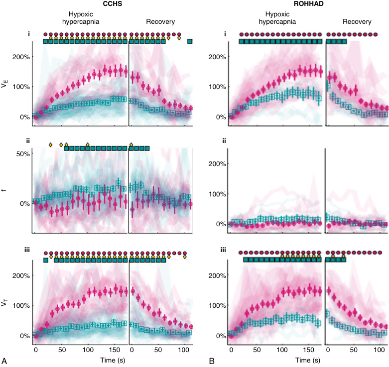
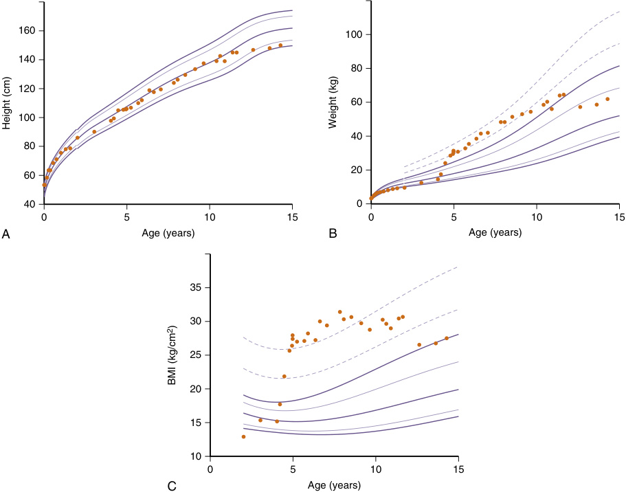
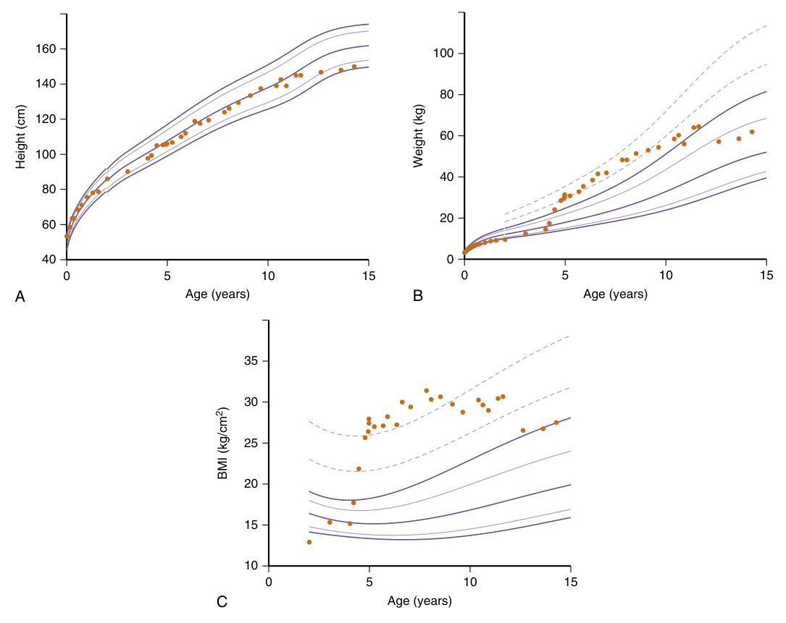
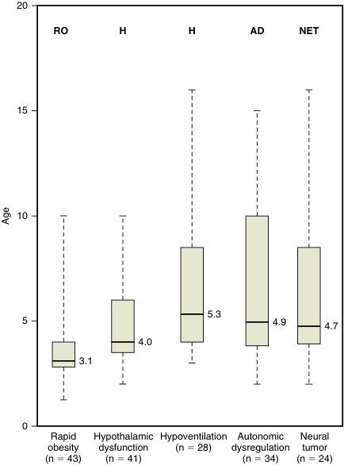
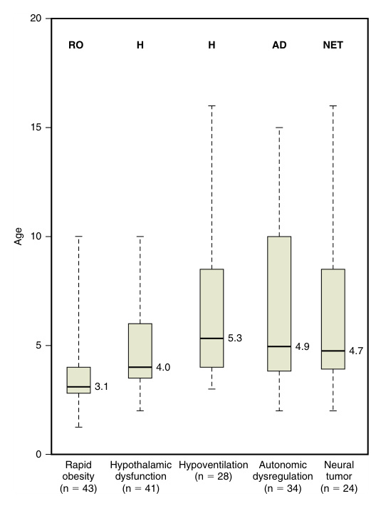
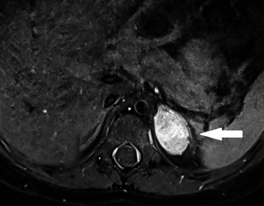
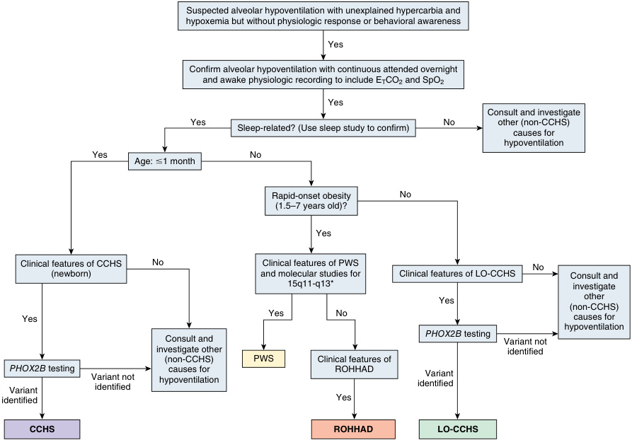
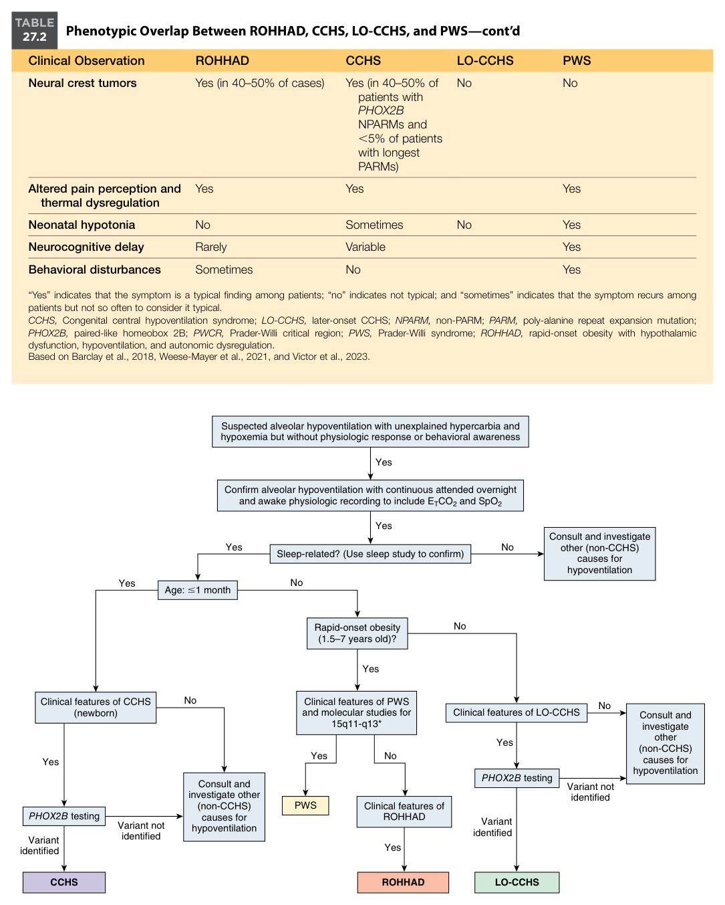
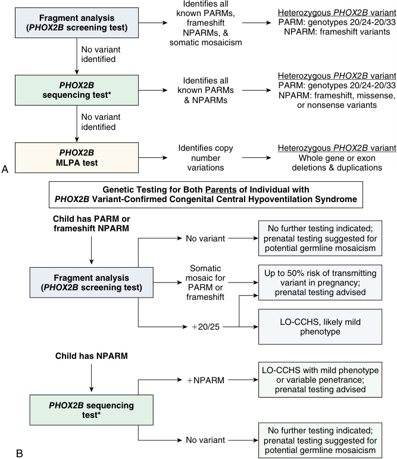
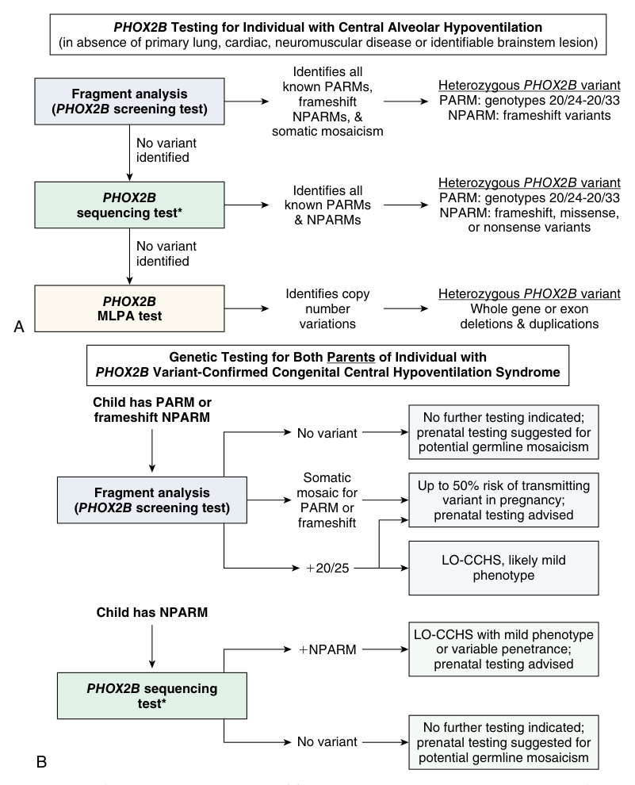

<!-- p.610 -->

# 27 

Respiratory and Autonomic Disorders of Infancy, Childhood, and Adulthood (RADICA) Congenital Central Hypoventilation Syndrome (CCHS) and Rapid-Onset Obesity With Hypothalamic Dysfunction, Hypoventilation, and Autonomic Dysregulation (ROHHAD) 

**JOELY R. GENDLER, CASEY M. RAND, DEBRA E. WEESE-MAYER** 

## **Alveolar Hypoventilation and Altered Control of Breathing** 

A hallmark feature of CCHS and ROHHAD is alveolar hypoventilation due to shallow breathing with resultant hypoxemia and hypercarbia, necessitating assisted ventilation at minimum during sleep and for some during wakefulness, as well. For individuals with CCHS and ROHHAD, the physiological response, perception, and behavioral awareness with exposure to hypercarbia/hypoxemia (which typically occurs during exertion) is attenuated to absent, including an absence of the sensation of shortness of breath. Individuals with CCHS and ROHHAD have a reduced ventilatory response to peripheral and central chemoreceptor challenges. During combined hypoxemia/hypercarbia challenges, unaffected controls took deeper and slower breaths compared to both affected patient groups who only increased respiratory frequency modestly and minute ventilation insufficiently (Fig. 27.1). Patients with CCHS and ROHHAD lacked behavioral awareness in response to hypoxia/hypercarbia challenge, continuing undisturbed with their quiet activities; in 

contrast, controls developed labored breathing and reported anxiety during the challenge. Given the severe alveolar hypoventilation and often profound hypoxemia and hypercarbia, prompt physiological assessment when awake and in sleep with diagnosis of CCHS and ROHHAD is necessary; introduction of artificial ventilation as life support is imperative for the child’s safety and ongoing management. 

## **Clinical Presentation** 

### **Clinical Findings Suggestive of ROHHAD** 

The first sign of ROHHAD is rapid weight gain (20–30 pounds in 3–12 months) between 1.5 and 7 years of age in previously healthy, non-overweight children, placing their body mass index (BMI) > 95th percentile (Figs. 27.2 and 27.3). Subsequent signs of hypothalamic dysfunction such as partial diabetes insipidus, hyperprolactinemia, growth hormone insufficiency, and hypothyroidism will follow (Table 27.1). Alveolar hypoventilation and autonomic nervous system dysregulation will gradually unfold over

<!-- p.611 -->

**Fig. 27.1** Ventilatory response to hypoxic hypercapnia (14% O2/7% CO2) combined gas challenges in CCHS (A) and ROHHAD (B). Percent change from baseline is shown during gas exposure and recovery (left and right panels of each figure, respectively). Reported values are for weight-normalized minute ventilation (VE, row i), respiratory frequency (f, row ii), and weight-normalized tidal volume (VT, row iii). Measurements in CCHS/ROHHAD cases are indicated as _teal squares_ with crossbars as mean ± SEM; controls are shown as _fuchsia circles_ with crossbars. Significant changes from baseline are indicated with filled markers above each data panel ( _teal squares_ for CCHS/ROHHAD, _fuchsia circles_ for controls). Significant differences between CCHS/ROHHAD and controls for each time point are indicated by _yellow diamonds_ . Transparent background lines illustrate per-subject raw data.  (Reproduced with permission from Carroll MS, et al. Residual chemosensitivity to ventilatory challenges in genotyped congenital central hypoventilation syndrome. _J Appl Physiol [1985]_ . 2014;116[4]:443; Carroll MS, et al. Rapid-onset obesity with hypothalamic dysfunction, hypoventilation, and autonomic dysregulation [ROHHAD]: response to ventilatory challenges. _Pediatr Pulmonol_ . 2015;50[12]:1341.) 

time but may take months to years, making initial diagnosis particularly challenging. Often, a cardiorespiratory arrest will precede identification of hypoventilation. Accordingly, hypoventilation needs to be sought with serial physiological studies (as frequently as every 2 months) as soon as the diagnosis is suspected, for prompt diagnosis, intervention, and conservative respiratory management to minimize this risk. Hypoventilation will first be identified during sleep with later progression to wakefulness. 

**Neural crest tumors** (ganglioneuroma, ganglioneuroblastoma, neuroblastoma) in the chest or adrenals may provide an early clue of ROHHAD in 40–50% of patients; in most cases, the tumor is discovered with serial imaging after the diagnosis of ROHHAD is made (Fig. 27.4). While the term ROHHADNET distinguishes patients with ROHHAD _and_ neural crest tumors, this distinction in phenotype does not seem to impact the core presentation and/ or unfolding course of the ROHHAD phenotype.

<!-- p.612 -->

**Fig. 27.2** (A) Height, (B) weight, and (C) BMI with advancing age beginning before ROHHAD diagnosis to age 14.3 years. Height, weight, and BMI percentiles were calculated using published CDC growth charts and methods (Centers for Disease Control and Prevention, access date: March 18, 2024; Gulati et al., 2012). _Dots_ are individual measurements for the case report. _Bold solid lines_ represent 3rd, 50th, and 97th percentile. _Nonbold solid lines_ represent 10th and 90th percentiles. The _two dotted lines_ in the graphs of weight and BMI indicate the 125th and 150th of 95th percentiles.  (Reproduced with permission from Khaytin I, et al. Evolution of physiologic and autonomic phenotype in rapid-onset obesity with hypothalamic dysfunction, hypoventilation, and autonomic dysregulation over a decade from age at diagnosis. _J Clin Sleep Med_ . 2022;18[3]:940.) 

### **Other Childhood Obesity Syndromes to Consider** 

ROHHAD presents diagnostic challenges due to its unknown etiology and phenotypical overlap with other syndromes including CCHS as well as other childhood obesity syndromes. Diagnosis therefore relies on clinical features and exclusion of other conditions with overlapping phenotypes (many of which can be clinically confirmed with screening tests; Table 27.2). **Prader-Willi syndrome (PWS)** , another neurodevelopmental disorder, is one childhood obesity syndrome that shares features with ROHHAD including obesity, hypoventilation with hypothalamic 

dysfunction without a neuroanatomical lesion, and autonomic dysregulation (see Table 27.2 for overlapping and distinct features). However, the distinct onset and rapid trajectory of weight gain in previously healthy children sets ROHHAD apart. Additionally, as with many other childhood obesity syndromes, a distinct genetic alteration causes PWS, aiding in the differential diagnosis. 

### **Clinical Findings Suggestive of CCHS and Late Onset-CCHS (LO-CCHS)** 

Diagnosis of CCHS relies on clinical indicators that vary by age at onset (Fig. 27.5). Assessment of spontaneous

<!-- p.613 -->

**Fig. 27.3** Rapid-onset obesity with hypoventilation, hypothalamic dysfunction, and autonomic dysregulation syndrome (neural crest tumor) (ROHHAD[NET]) general timeline. Age of outcome for each specific term of the ROHHAD(NET) acronym. Box plots show the median values and the first and third quartiles for each group. T-bars represent the rest of the data. Outlier data were not removed.  (Modified from Harvengt J, Gernay C, Mastouri M, et al. ROHHAD[NET] syndrome: systematic review of the clinical timeline and recommendations for diagnosis and prognosis. _J Clin Endocrinol Metab_ . 2020;105[7]:2119-2131 [Fig. 3, p. 2123].) 

ventilation in a controlled and safe environment, both awake and asleep (stage-specific), is crucial to gauge the extent of hypoventilation for diagnosis and tailor artificial ventilatory support accordingly. 

### **CCHS (Neonatal Onset; #1 Month Old)** 

For patients recognized in the first 30 days of life, the neonate exhibits unexplained hypoventilation due to shallow breathing during sleep and, for more extreme phenotypes, while awake, as well. Abnormal ventilatory drive is suggested by absent arousals and diminished perception/ responsiveness (i.e., shortness of breath) to hypercarbia/ hypoxemia. Various symptoms of autonomic nervous system dysregulation may be evident such as extreme cyanotic breath-holding spells, esophageal dysmotility, severe constipation, profuse sweating, reduced peripheral skin 

and basal body temperature, altered pupillary response to light, and others (Table 27.3). 

### **Later-Onset-CCHS (LO-CCHS; .1 Month Old Into Adulthood)** 

Later-Onset-CCHS (LO-CCHS) typically presents due to some environmental cofactor that unmasks the phenotype (antiseizure medication, severe intercurrent illness, sedation, anesthesia, or central nervous system (CNS) depressant medications). Affected individuals may experience delayed recovery with difficulty weaning from artificial ventilation after severe respiratory or pulmonary illness with related hypoventilation despite no intrinsic lung disease. The individual may have a history of apparent life-threatening events, unexplained seizures, and cyanosis with unexplained hypercarbia and/or hypoxemia while asleep. The individual may be seemingly _unresponsive_ to apparent events of hypercarbia or hypoxemia following prolonged underwater swimming, breath-holding, and severe pneumonia. It is worth considering a missed diagnosis of LO-CCHS with **sudden infant death syndrome (SIDS)** and **sudden unexplained death of childhood (SUDC)** , especially with a family history of sudden death or CCHS. Signs of autonomic dysregulation may be evident upon diagnosis. Individuals with LO-CCHS typically hypoventilate during sleep only, necessitating mechanical ventilation while asleep. 

## **_PHOX2B:_ The Disease Defining Gene for CCHS** 

Heterozygous variants of the coding region of the _PHOX2B_ gene are responsible for CCHS. _PHOX2B_ encodes a highly conserved homeodomain transcription factor, key to the development of the autonomic nervous system. The most common pathogenic gene variants (~90% of CCHS patients) are heterozygous Poly-Alanine Repeat expansion Mutations (PARM) of the normal 20-alanine repeat sequence (normal denotated 20/20) in exon 3 of _PHOX2B_ . Known diseasecausing expansions vary from four to thirteen extra alanines on the affected allele (genotypes 20/24-20/33), although the most common are those with five, six, or seven additions. Less common (~10% of patients) are non-PARMs (NPARMs), which include missense, nonsense, frameshift, and stop codon variants. Though very rare (<1% of patients), large deletions of exon 3 or of the whole _PHOX2B_ gene with and without neighboring genes may cause CCHS. The severity of the disease usually correlates with the length of PARM expansion (Table 27.4). Patients with shorter PARMs (20/24, 20/25) often have milder phenotypes or later-onset with asleep hypoventilation only, while those with longer PARMs have more affected autonomic impairment such as prolonged sinus cardiac pauses and

<!-- p.614 -->

##### **TABLE** 

|**27.1**|
|---|

#### **Clinical Presentation of Children With ROHHAD** 

|Clinical Findings|Percentage of Patients (%)|Clinical Findings|Percentage of Patients (%)|
|---|---|---|---|
|Hypothalamic Dysfunction||Autonomic Dysregulation—cont’d||
|Rapid-onset obesity|100|Altered sweating|53|
|Failed growth hormone stimulation test|60|Cold hands and feet|40|
|Hyperphagia|53|Bradycardia|33|
|Polydipsia|53|Tumors of neural crest origin|33|
|Hypernatremia|47|Syncopal episodes|7|
|Hyperprolactinemia*|47 (100%)|Other Findings||
|Diabetes insipidus|33|Altered perception of pain|53|
|Hypothyroidism|33|Seizure|33|
|Adrenal insufficiency|27|Enuresis|27|
|Hypodipsia|27|Hypotonia|27|
|Polyuria|27|Hypercholesterolemia|20|
|Short stature|20|Scoliosis|20|
|Delayed puberty|13|Hypersomnolence|13|
|Hyponatremia|13|Recurrent pneumonia|13|
|Low IGF-1 and IGFBP-3 levels|13|Impaired glucose tolerance|6|
|Precocious puberty|13|Type 2 diabetes mellitus|6|
|Premature adrenarche|13|Developmental Disorders||
|Transient SIADH|13|Developmental delay|20|
|Amenorrhea|7|Developmental regression|20|
|Hypogonadotropic hypogonadism|7|Behavioral Disorders||
|Irregular menses|7|Depression|13|
|Transient diabetes insipidus|7|Flat affect|13|
|Respiratory Manifestations||Psychosis|13|
|Alveolar hypoventilation|100|Behavioral outbursts|7|
|Cardiorespiratory arrest|60|Bipolar disorder|7|
|Reduced CO2ventilatory response|60|Emotional lability|7|
|Obstructive sleep apnea|53|Obsessive-compulsive disorder|7|
|Cyanotic episodes|27|Oppositional-defiant disorder|7|
|Autonomic Dysregulation||Tourette’s syndrome|7|
|Ophthalmological manifestations|87|Hallucinations|7|
|Thermal dysregulation|73|||
|Gastrointestinal dysmotility|67|||

*Prolactinemia nearly 100% in the Ann and Robert H. Lurie Children’s Hospital of Chicago cohort. _IGFB,_ IGF factor-binding protein; _SIADH,_ syndrome of inappropriate antidiuretic hormone secretion. 

From Khaytin I, Victor AK, Barclay SF, et al. Rapid-onset obesity with hypothalamic dysfunction, hypoventilation, and autonomic dysregulation (ROHHAD): a collaborative review of the current understanding. _Clin Autonomic Res_ . 2023;33:251-268 (Table 2, p. 255).

<!-- p.615 -->

**Fig. 27.4** MRI: Left suprarenal mass showing contrast enhancement of a left adrenal mass, which was confirmed on histology to be a ganglioneuroma.  (From Aldirawi M, Yavuz L, Ghoweba Y, et al. Rapid-onset obesity with hypothalamic dysfunction, hypoventilation, autonomic dysregulation, and neuroendocrine tumor [ROHHADNET] syndrome: a case report. _Cureus_ . 2023;15[7]:e41413 [Fig. 2].) 

Hirschsprung disease (Table 27.4). The ventilatory needs of individuals with the 20/26 genotype are variable based on level of exertion whereas those with 20/27 to 20/33 typically require continuous, 24-hour per day artificial ventilation. The phenotypical presentation of NPARMs is more variable, but they tend to require continuous ventilatory support and have more severe disease phenotypes including Hirschsprung disease and neural crest tumors. 

### **Inheritance of CCHS,** **_PHOX2B_ Variants, and** **_PHOX2B_ Mosaicism** 

Most _PHOX2B_ pathogenic gene variants occur _de novo_ . However, an autosomal dominant inheritance pattern has also been established. For 5–25% of known patients, the variant has been inherited from an unaffected parent, who is typically mosaic or a full carrier with incomplete penetrance of a _PHOX2B_ variant. Germline mosaicism has been reported in some families with CCHS recurrence. 

It is advised that in any individual with CCHS, that their parents, and sometimes even specific family members take part in genetic counselling. Parents should be screened for 

#### **TABLE 27.2** Phenotypic Overlap Between ROHHAD, CCH S, LO-CCHS, and PWS

|Clinical Observation|ROHHAD|CCHS LO-CCHS|PWS|
|---|---|---|---|
|Age at presentation|1.5–7 years old|≤1 month old >1 month old into adulthood|Symptoms first present in neonates and continue to unfold into childhood.|
|Genetic etiology|Unknown|Yes (_PHOX2B_variant)|Yes (PWCR at 15q11.2-q13)|
|Obesity|Yes (over 3–12 months)|No|Yes (less steep and not rapid onset trajectory)|
|Hypoventilation|Yes (but no lung disease)|Yes (but no lung disease)|Sometimes|
|Obstructive sleep apnea|Sometimes: in a subset initially (resolves with surgical intervention)|Rarely|Yes|
|Elevated prolactin level|Yes|No|No|
|Inability to maintain normal salt-water balance|Yes|No|No|
|Failed growth hormone stimulation test or growth hormone insufficiency|Sometimes (in a subset, manifest as slowed growth rate or short stature)|Rarely (isolated reports)|Yes (growth hormone deficiency appears to play a role in the short stature of PWS patients)|
|Altered pubertal onset|Sometimes|No|Sometimes|
|Autonomic dysfunction|Yes|Yes|Yes|
|Bradycardia|Sometimes (usually during sleep)|Sometimes (manifests as abrupt prolonged sinus pauses)|No|
|Hirschsprung disease|No|Yes (in 20–30% of patients) No|No|

_(Continued)_

<!-- p.616 -->

#### **TABLE 27.2** Phenotypic Overlap Between ROHHAD, CCH S, LO-CCHS, and P WS—cont’d

|Clinical Observation|ROHHAD|CCHS|LO-CCHS|PWS|
|---|---|---|---|---|
|Neural crest tumors|Yes (in 40–50% of cases)|Yes (in 40–50% of patients with _PHOX2B_ NPARMs and <5% of patients with longest PARMs)|No|No|
|Altered pain perception and thermal dysregulation|Yes|Yes||Yes|
|Neonatal hypotonia|No|Sometimes|No|Yes|
|Neurocognitive delay|Rarely|Variable||Yes|
|Behavioral disturbances|Sometimes|No||Yes|

“Yes” indicates that the symptom is a typical finding among patients; “no” indicates not typical; and “sometimes” indicates that the symptom recurs among patients but not so often to consider it typical. 

_CCHS,_ Congenital central hypoventilation syndrome; _LO-CCHS,_ later-onset CCHS; _NPARM,_ non-PARM; _PARM,_ poly-alanine repeat expansion mutation; _PHOX2B,_ paired-like homeobox 2B; _PWCR,_ Prader-Willi critical region; _PWS,_ Prader-Willi syndrome; _ROHHAD,_ rapid-onset obesity with hypothalamic dysfunction, hypoventilation, and autonomic dysregulation. 

Based on Barclay et al., 2018, Weese-Mayer et al., 2021, and Victor et al., 2023. 

**Fig. 27.5** Diagnostic flowchart for differentiating disorders of alveolar hypoventilation. *Molecular studies for 15q11-q13 include methylation studies, chromosome microarray to determine 15q11-q13 deletion, and microsatellite/SNP studies to determine maternal uniparental disomy (UPD).

<!-- p.617 -->

#### **TABLE 27.3** Nonrespirator Syndrome y Clinical Findings, Considerations, and Sur veillance in Congenital Hypoventilation

|System|Clinical Findings|Considerations and Surveillance|
|---|---|---|
|Cardiac|• Bradycardia • Sinus pauses≥3 s, may present as syncope • Exercise intolerance • Blood pressure dysregulation|• Annual echocardiogram after age 3 yrs; every 6 mo before age 3 yr • Annual 24–72 h Holter or implantable cardiac monitor • Pacemaker as clinically indicated • Cardiopulmonary exercise testing • 24 h blood pressure|
|Ophthalmologic|• Strabismus • Pupillary response abnormalities • Ptosis • Convergence abnormalities|• Annual surveillance as directed by ophthalmology • Refractive correction as needed • Strabismus/ptosis surgery as needed|
|Neurodevelopmental|• Developmental delays • Cognitive differences • Reduced anxiety • Difficulties in social interactions|• Surveillance every 6–12 months in early childhood and school age • Early identification of cognitive, behavioral, and learning issues • Establish educational plans for school|
|Endocrine|• Glucose dysregulation • Hormonal imbalances (growth hormone [GH], thyroid) • Body temperature dysregulation, low basal temperature • Abnormal diaphoresis|• Glucose monitoring • Symptomatic support for hyper-or hypothermia • Discuss reproductive health and family planning|
|Gastroenterological|• Hirschsprung disease • Gastroesophageal reflux disease • Esophageal and Intestinal dysmotility • Chronic constipation • Dysphagia or oral aversion|• Surveillance and treatment as needed— directed by gastroenterology|
|Neoplasms|• Neural crest tumors Mostly in nonpolyalanine repeat expansions (NPARMs) Neuroblastomas, ganglioneuroblastomas, or ganglioneuromas|• Surveillance in PARMs with≥28 repeats and NPARMs • Cervical, thoracic, and abdominal imaging, urine catecholamines every 6 months until age 3 years, annually from age 3–7 years, then as needed • Treatment directed by oncology|
|Neurologic|• Seizures • Syncope • Pronounced response to any respiratory depressants including anesthesia, sedation, pain medications, alcohol, or drug use|• Treatment for epilepsy • Evaluation for syncope as needed • Preanesthesia evaluations • Objective monitoring with sedation, anesthesia, and pain medications. • Consider ICU following anesthesia/surgery • Counseling starting in early adolescence of alcohol/drug use and risk for respiratory depression|

From Narang I, Chen ML. Complex sleep hypoventilation disorders in children. In: _Kendig and Wilmott’s Disorders of the Respiratory Tract in Children_ . 10th ed. Philadelphia: Elsevier; 2024 (Table 67.1, p. 948). 

mosaicism, especially if planning to have subsequent children. If a parent is identified as mosaic for a _PHOX2B_ variant, there will be up to a 50% chance of recurrence in future children. Regardless of results, prenatal testing for subsequent pregnancies should be considered because germline mosaicism cannot be definitively eliminated. This allows parents to make an informed decision with proper support during pregnancy, delivery, and birth/transition of the baby to extrauterine life. If the parent is identified as an 

unaffected carrier of a _PHOX2B_ variant, it is possible that other members of the family are carriers, despite no obvious symptoms, outlining a situation in which other family members who are in positions of possibly carrying the variant should also have genetic counselling and screening. Available methods of antenatal diagnosis or preimplantation genetic diagnosis should also be discussed as well as any possible future intervention for mosaic parents and probands with CCHS.

<!-- p.618 -->

#### **TABLE Select Features of Congenital Central Hypoventilation Syndrome by PARM (Poly-Alanine Repeat 27.4 Expansion Mutations) Genotypes vs. NPARM (Non-PARM)** 

||PA|_PHO_ RM Genotype|_X2B_Genotype|NP|ARMs|
|---|---|---|---|---|---|
|Feature|20/24*, 20/25|20/26|20/27|NPARM in General|38bp Deletion|
|Hypoventilation|Asleep only|Awake (variable based on exertion) and asleep|Awake and asleep|Awake and as|leep|
|Abrupt sinus pauses**$**3 sec warranting cardiac pacemaker|Variable: None with childhood onset; a subset will have prolonged sinus pauses in adulthood|19%|>80%|None with chil date|dhood onset to|
|Hirschsprung disease|<0.1%|20–30%||80–90%|95–100% severe long segment disease (i.e., entire colon and some small intestine)|
|Severe constipation||~50+%||||
|Esophageal dysmotility/dysphagia||First year of life||||
|Neural crest  Neuroblastoma|0%|0%|See footnote†|50%||
|tumors Ganglioneu roblastoma|0%|0%|0%|<5%||
|Ganglioneuroma|0%|0%|0%|<5%||
|Altered pupillary response to light|Normal response|Midsize pupils with attenuated response to light|Small pupils at rest; nearly absent response to light|Large pupils a response to|t rest; negligible light|

*Genotype 20/24 would be considered susceptibility allele (needs another factor to manifest) or a low or variable penetrance allele with features that can be triggered by pharmacological agents (a pharmaco-genetic phenomenon), or a gene × environment interaction (without main efforts). †Generally 0%; however, an infant with the 20/33 genotype had metastatic neuroblastoma (Armstrong et al., 2015). Weese-Mayer DE, Rand CM, Zhou A, Carroll MS, Hunt CE. Congenital central hypoventilation syndrome (CCHS): a bedside-to-bench success story for advancing early diagnosis and treatment and improved survival and quality of life. _Pediatr Res_ . 2017;81:192–201. 

### **Molecular Genetic** **_PHOX2B_ Testing Approach** 

Molecular genetic testing is the standard approach to identify variants in _PHOX2B_ for CCHS diagnosis (Fig. 27.6A). **Step 1** is the _PHOX2B_ Fragment Analysis or Screening Test done by gel electrophoresis that targets the polyalanine repeat region. This will detect all PARMs, most frameshift NPARMs, and those with multiple base pair deletions, allowing identification of ~95% of CCHS patients. Fragment analysis also identifies low-level mosaicism, which is important for parental testing. If the fragment testing (Step 1) is negative but the patient’s phenotype remains strongly suggestive of CCHS, **Step 2** is the _PHOX2B_ Sequencing Test. Step 2 may also be 

performed if the fragment results are positive, and a more precise understanding of the expansion/contraction or insertion/deletion is required. While Step 2 can identify all PARMs and NPARMs, fragment analysis is recommended as the first step because sequencing can result in a false-negative due to allele dropout. Additionally, sequencing may fail to detect low-level mosaicism. **Step 3** , _PHOX2B_ multiplex ligation-dependent probe amplification (MLPA), detects exon 3 and whole-gene deletions, and potentially neighboring genes. This test should be considered if clinical suspicion for CCHS remains high despite negative results from Steps 1 and 2. _PHOX2B_ testing is recommended for both parents of a child with CCHS (Fig. 27.6B).

<!-- p.619 -->

**_PHOX2B_ Testing for Individual with Central Alveolar Hypoventilation** (in absence of primary lung, cardiac, neuromuscular disease or identifiable brainstem lesion) 

**Fig. 27.6** _PHOX2B_ genetic testing algorithms. (A) Algorithm to determine when and what type of _PHOX2B_ genetic testing should be performed in various clinical scenarios in which CCHS and LO-CCHS are suspected or confirmed and (B) in parents of a CCHS proband. *The _PHOX2B_ Sequencing Test has been previously demonstrated to fail detection of low-level mosaicism of some CCHS-causing variants.  (WeeseMayer DE, Patwari PP, Rand CM, Diedrich AM, Kuntz NL, Berry-Kravis EM. Congenital central hypoventilation syndrome [CCHS] and _PHOX2B_ mutations. In: Robertson D, Biaggioni I, Burnstock G, Low PA, Paton JFR, eds. _Primer on the Autonomic Nervous System_ . Oxford, UK: Academic Press; 2012:445-50.) 

## **Etiology of ROHHAD** 

The etiology of ROHHAD remains elusive with two main theories proposed: a genetic (or epigenetic) basis or an autoimmune basis. 

### **Genetic Theory** 

Patients with ROHHAD exhibit similar phenotypes, suggesting a possible genetic link. Additionally, considering the overlapping phenotypes with CCHS and PWS (Table 27.2), two 

syndromes with known genetic etiologies, it seems plausible that ROHHAD would also be genetically based. Molecular overlap (gene and protein-level) has been reported between CCHS and ROHHAD dental pulp stem cell-derived neurons, implying that there may be a similar transcriptional pathway affected or causing these similar phenotypes. _However, despite extensive genetic studies, no consistent ROHHAD-related variants have been identified to date._ In exome sequencing of seven ROHHAD trios, no two subjects shared the same _de novo_ variants. Monozygotic twins discordant for ROHHAD have no genetic coding differences. Whole genome studies with up to

<!-- p.620 -->

40 individuals with ROHHAD have not identified a single candidate gene, likely suggesting that there is not a “simple” monogenic basis for ROHHAD. 

It is possible that the theoretical genetic basis is a somatic mosaic pathogenic genetic variant in which the genetic alteration occurs postmitotically and therefore is only present in a subset of patients’ cells and tissues deriving from the neural crest. If true, this would make ROHHAD a neurocristopathy disorder, like CCHS. This could be plausible considering the high occurrence of neural crest tumors in the ROHHAD patient population. The lack of candidate genes identified in initial studies is suggestive that if the cause is a somatic variant, it may truly be restricted to the central nervous system. It is also possible that some form of epigenetic dysregulation leads to aberrant expression of certain relevant genes, leading to the ROHHAD phenotype with apparently _normal_ DNA sequencing, as seen in Beckwith-Wiedemann syndrome. 

human hypothalamus, a target tissue that is affected with the ROHHAD phenotype. The neural crest tumor tissue from one patient with ROHHAD expressed ZSCAN1, consistent with other paraneoplastic neurological syndrome onconeural antigens. Anti-ZSCAN1 autoantibody positivity was examined in 14 patients diagnosed with ROHHAD without a neural crest tumor, 15 controls, and 5 subjects with an autoimmune disorder. Twelve of the 14 patients with ROHHAD were positive for ZSCAN1 autoantibodies in serum samples despite no associated neural crest tumor, whereas all the controls and subjects with an autoimmune disorder were negative for ZSCAN1 autoantibodies. ZSCAN1 protein is found in the human nervous system and endocrine tissues and RNA expression is elevated in the pituitary gland, hypothalamus, pons, and amygdala, all areas likely involved in driving the ROHHAD phenotype. These results provide initial potential toward (1) a paraneoplastic autoimmune etiology and (2) a biomarker for diagnosing ROHHAD. 

### **Autoimmune Theory** 

There is increasing evidence to support a **paraneoplastic autoimmune theory** of etiology, similar to the neuroblastoma associated _opsoclonus-myoclonus syndrome_ , in which the cause is thought to be a tumor that activates the immune system to affect the nervous system. While there is little phenotypic overlap between ROHHAD and opsoclonusmyoclonus syndrome, this may be due to distinct central nervous system regions targeted in the two diseases, where opsoclonus-myoclonus syndrome is specific to the cerebellum, resulting in pathways specific to oculomotor function and coordination being affected, while ROHHAD is specific to the brainstem and hypothalamus, leading to the observed autonomic and respiratory dysfunction. 

Oligoclonal bands in cerebrospinal fluid (CSF) and immune cell infiltrates in the brain, including hypothalamus and brainstem at autopsy, have been demonstrated in some case reports. Moreover, variable improvements to some of the ROHHAD phenotypes (although not consistent as to which feature improvement is noticed) have been reported in response to different immunotherapies. Taken together, the young onset in previously healthy children, CNS inflammatory markers present, associated low-grade neural crest tumors in ~50% of the patients, and variable response to immunosuppression seen in case reports is consistent with other paraneoplastic syndromes, further supporting such an etiology. 

### **ZSCAN1 Autoantibodies** 

Autoantibodies to zinc finger and SCAN domain-containing 1 (ZSCAN1) have been identified in seven of nine patients with ROHHAD, all of whom had neural crest tumors. Of the two patients negative for ZSCAN1 autoantibodies, the first was in clinical remission (CSF was collected 22 years from symptom onset) and the other had no identified neural crest tumor. This possible biomarker was not seen in any of the 125 controls. Notably, ZSCAN1 is expressed in 

## **Select Subsystems and Features of Autonomic Nervous System Dysregulation** 

CCHS and ROHHAD share symptoms of autonomic nervous system dysregulation that exist or affect various organ systems (Table 27.2). 

### **Hirschsprung Disease and Neural Crest Tumors** 

#### **_CCHS_** 

#### **Hirschsprung Disease** 

Hirschsprung disease, caused by an absence of intestinal parasympathetic intrinsic ganglion cells, is a comorbidity of CCHS. Although it typically presents in the newborn period, it has also been diagnosed in later infancy and early childhood with development of abdominal distension, vomiting, diarrhea, and constipation that responds poorly to medical management. The affected intestinal segment can vary in length from distal rectum and sigmoid colon to extending into more of the proximal large and small intestine. Hirschsprung disease is more prevalent in patients with CCHS with NPARMs (87–100% of reported cases) than PARMs (genotype 20/26-33; 13–20% of reported cases). For any individual with CCHS and suspicious symptoms, Hirschsprung disease should be investigated with rectal suction biopsy (Table 27.5). Treatment involves surgical removal of the affected intestine and dietary adjustments. 

#### **Neural Crest Tumors** 

Neural crest tumors are more prevalent in NPARMs (40–50%; nearly all neuroblastomas) and patients with longer PARMs (20/30-33 genotype, 1%; benign neural crest tumors with rare exception). Age at presentation of tumors vary based on type: neuroblastomas typically are discovered before 2 years old whereas ganglioneuromas and ganglioneuroblastomas are discovered later, typically as incidental

<!-- p.621 -->

#### **TABLE Recommended Testing With Frequency for Individuals With Confirmed CCHS and With Suspected or 27.5 Confirmed ROHHAD** 

|Objective Measures|TestingF CCHS|requency ROHHAD|
|---|---|---|
|Serial sleep studies (including ETCO2and waveform, SpO2and pulse waveform, ECG, BP, RIP, HR, cNIRS, and sleep- state staging measures)|<3 years old: every 6 months ≥3 years old: annually and as often as needed if symptoms|At first consideration of ROHHAD diagnosis* Repeat every 2–3 months depending on observed symptom progression trajectory Upon diagnosis, annually and as often as needed if symptoms|
|Serial physiological recording during wakefulness in varied activities of daily living (including ETCO2and waveform, SpO2and pulse waveform, ECG, BP, RIP, HR, and cNIRS)|<3 years old: every 6 months ≥3 years old: annually and as often as needed if symptoms|At first consideration of ROHHAD diagnosis* Repeat every 2–3 months depending on observed symptom progression trajectory Upon diagnosis, annually and as often as needed if symptoms|
|Echocardiogram|Annually, and as often as needed if symptoms|At first consideration of ROHHAD diagnosis*then every 6–12 months|
|Holter recording (ideally, 72 h during typical daily schedule)|Annually, and as often as needed if symptoms|At first consideration of ROHHAD diagnosis*then every 6–12 months|
|Neurocognitive assessment|<3 years old: Every 6 months <6 years old: Annually ≥6 years old: Every 2 years and as often as needed if disorders or symptoms|At first consideration of ROHHAD diagnosis*then annually|
|Neural crest tumor screen (chest X-ray to view along sympathetic chain and abdominal ultrasound to view both adrenal glands) ideally without sedation|For 20/28-20/33 PARMs and NPARMS: <2 years old: Every 6 months 2–7 years old: Annually or biannually >7 years old: according to local oncologist protocols|At first consideration of ROHHAD diagnosis*, then every 3 months until tumor is found After age 7 years old, if no tumor, can widen interimaging intervals|
|MRI of brain and brainstem with hypothalamus/pituitary protocol (with and without contrast) ideally without sedation|N/A|At first consideration of ROHHAD diagnosis*|
|Growth chart of weight, height, and BMI (if<36 months, include head circumference)|N/A|Every 3 months|
|Comprehensive metabolic profile, urine osmolarity, serum or plasma prolactin, FT4, TSH, IGF factor binding protein 3, IGF I, cortisol, 24 h glycemia, OGTT|Once, then as needed|At first consideration of ROHHAD diagnosis*, then every 2–3 months during the first 3 years, then every 4–6 months for next 3 years, then every 6 months|
|Endocrine-related bloodwork if precocious or delayed puberty: DHEA-s; LH; FSH; testosterone; GN-RH|As often as needed if symptoms|At first consideration of precocious or delayed puberty, then every 3 months|
|CBC with differential; reticulocytes|<3 years old: every 6 months ≥3 years old: annually and as often as needed if symptoms|At first consideration of ROHHAD diagnosis*, then every 3 months during first 3 years, then every 6 months|
|Lipid screen; leptin|N/A|At first consideration of ROHHAD diagnosis*, then every 3 months during first 3 years, then every 6 months|

_(Continued)_

<!-- p.622 -->

### **TABLE Recommended Testing With Frequency for Individuals With Confirmed CCHS and With Suspected or 27.5 Confirmed ROHHAD—cont’d** 

||TestingF|requency|
|---|---|---|
|Objective Measures|CCHS|ROHHAD|
|Assessment of digestive symptom including physical examination, barium enema, or manometry (if symptoms) and if Hirschsprung disease suspected, rectal suction biopsy|<3 years old: Every 6 months <6 years old: Annually and as often as needed if disorders or symptoms|At first consideration of ROHHAD diagnosis*then annually and as often as needed if disorders or symptoms|
|Comprehensive ocular testing and pupillometry (autonomic measures)|<3 years old: Every 6 months <6 years old: Annually ≥6 years old: According to ophthalmologist|<3 years old: Every 6 months <6 years old: Annually ≥6 years old: According to ophthalmologist|
|Autonomic cardiorespiratory response assessments: Head-Up Tilt (HUT) Test, Valsalva Maneuver, Heart-Rate Deep Breathing, exogenous ventilatory challenges, spontaneous breathing challenges (awake and asleep), thermoregulatory sweat test, quantitative sudomotor axon reflex test|>6 years old annually and as often as needed if symptoms|>6 years old annually and as often as needed if symptoms|
|Other autonomic assessments: circadian core and peripheral temperature patterns|<3 years old: every 6 months ≥3 years old: annually and as often as needed if symptoms|At first consideration of ROHHAD diagnosis*then annually|

*For timepoints at first consideration of ROHHAD diagnosis, this is ideally done at time of rapid-onset weight gain. _BMI,_ Body mass index; _BP,_ blood pressure; _CBC,_ complete blood count; _CCHS,_ congenital central hypoventilation syndrome; _cNIRS,_ cerebral near-infrared spectroscopy; _DHEA-s,_ dehydroepiandrosterone sulfate; _ECG,_ electrocardiography; _ET_ CO _2_ , end-tidal carbon dioxide; _FSH,_ follicle-stimulating hormone; _FT4_ , free thyroxine; _GN-RH,_ gonadotropin-releasing hormone; _HR,_ heart rate; _IGF,_ insulin-like growth factor; _LH,_ luteinizing hormone; _MRI,_ magnetic resonance imaging; _NPARM,_ non-PARM; _OGTT,_ oral glucose tolerance test; _PARM,_ poly-alanine repeat expansion mutation; _RIP,_ respiratory inductance plethysmography; _ROHHAD,_ rapid-onset obesity with hypothalamic dysfunction, hypoventilation, and autonomic dysregulation; _SpO2_ , oxygen saturation; _TSH,_ thyroid-stimulating hormone. Based on Weese-Mayer et al., 2010, Trang et al., 2020, and Khaytin et al., 2023. 

findings. Serial chest X-rays and abdominal ultrasound imaging allow prospective discovery of neural crest tumors and are essential as a part of clinical care for children with NPARMs and longer PARMs (20/28-33; Table 27.5). Tumors typically will be surgically removed, even if benign. 

avoid compression of adjacent structures and spreading. While to date no case of recurrence has been reported, it is recommended that annual imaging and urine catecholamines (urine VMA and urine HMA) be followed for screening with advancing age. 

## **_ROHHAD_** 

Children with ROHHAD may have anatomic findings that suggest altered development of neural crest-derived structures including tumors of neural crest origin (40–50% of patients), but they _do not_ develop Hirschsprung disease. Given a high risk of neural crest tumors occurring anywhere along the sympathetic chain (including a mediastinal presentation) or in the adrenal glands, serial chest X-ray and abdominal ultrasound of both adrenal glands are essential at and beyond diagnosis to detect emergence of neural crest tumors (Table 27.5). Besides the signature rapid-onset weight gain, neural crest tumors are one of the earliest signs of ROHHAD in a subset of children. They are typically benign, and the most common types are ganglioneuromas (Fig. 27.4) and ganglioneuroblastomas, but neuroblastomas have been reported. While removal of neural crest tumors does not impact the ROHHAD phenotype in any significant way, it is advised that tumors be promptly removed to 

## **Ophthalmological Phenotype** 

### **_CCHS_** 

Forty to 92% of patients with CCHS have an ocular disorder including pupillary abnormalities, convergence insufficiency, strabismus, or ptosis. Pupillometry often reveals an altered, _asymmetric_ pupillary response to light from early infancy but will vary by genotype with a normal response typically seen in patients with the 20/25 genotype to nearly absent responses to light and small pupils at rest in patients with the 20/27 genotype (Table 27.4). There is a negligible response to light in patients with NPARMs but with larger baseline pupil diameters at rest compared to those with the 20/27 genotype. 

## **_ROHHAD_** 

Ophthalmological abnormalities are consistently reported as one of the most prevalent phenotypes of autonomic

<!-- p.623 -->

dysregulation in ROHHAD. Phenotypes include early presentation of strabismus, variably altered pupillary response to light, blurred vision, and, for a subset of patients, oculomotor apraxia, ptosis, and decreased tearing. 

## **Cardiovascular Phenotype** 

### **_CCHS_** 

Concurrent cardiovascular problems as a result or in addition to the impaired autonomic nervous system are observed in CCHS. Studies suggest vagal dysfunction in CCHS with vagal withdrawal and baroreflex failure. Patients with CCHS may be asymptomatic despite profound orthostatic hypotension during head-up tilt testing. Blood pressure (BP) dysregulation is also prevalent in CCHS, with elevated nocturnal BP, abnormal nocturnal dipping, and arterial hypotension during the day. Patients with CCHS present with reduced beat-to-beat heart rate variability, especially during wakefulness and rapid eye movement (REM) sleep. Cardiac arrhythmias, including abrupt prolonged sinus pauses, reduced heart rate response to exercise, reduced respiratory sinus arrhythmia, and rarely vasovagal syncope, are also observed. 

The length of the longest R-R sinus pause corresponded to genotype (positive correlation with repeat number PARM) and has been related to risk of sudden death (Table 27.4). In one pediatric cohort, none of individuals with 20/25 had sinus pauses ≥3.0 s. However, a few case reports of _LO-CCHS adults_ with the 20/25 genotype have been reported with sinus pauses ≥3.0 s. This finding raises the possibility that pauses may develop later in life, and/or that delayed diagnosis and management may contribute to development of these pauses. Prolonged sinus pauses ≥3.0 s warrant placement of a cardiac pacemaker to prevent sudden death. 

## **_ROHHAD_** 

Patients with ROHHAD may experience syncope, decreased heart rate variability, decreased circadian-related heart rate changes, and exaggerated bradycardia during sleep. There is also a risk for _cor pulmonale_ and/or right ventricular hypertrophy given the intermittent hypoxia/hypercapnia; patients with ROHHAD also have altered vasomotor tone, characterized by extremely cold extremities. 

## **Hypothalamic-Pituitary Phenotype** 

### **_CCHS_** 

In CCHS, hypoglycemia, associated with hyperinsulinemia and sometimes seizures, has been documented. Isolated CCHS cases of growth hormone deficiency and hyperthyroidism have been reported. 

## **_ROHHAD_** 

Critical to the diagnosis of ROHHAD is evidence of hypothalamic dysfunction. However, the rate of unfolding, age at onset, and number of symptoms will vary from child to child. Often hyponatremia is identified with an assessment of electrolytes. An evaluation and then confirmation of partial 

**diabetes insipidus** typically follows. **Hyperprolactinemia** is consistently noted early in ROHHAD development. When the condition progresses, other manifestations of hypothalamic dysfunction may emerge including reduced levels of insulin-like growth factor binding protein 3 (IGFBP-3), insulin-like growth factor I (IGF-1), free thyroxine (FT4), thyroid-stimulating hormone (TSH), and cortisol. Additionally, growth hormone (GH) stimulation tests may indicate GH deficiency. Pubertal development abnormalities, including _both_ delayed or precocious puberty and premature adrenarche, may also arise. 

## **Gastrointestinal Phenotypes** 

### **_CCHS (Non-Hirschsprung Gastrointestinal Phenotypes)_** 

In CCHS, severe constipation is a prominent gastrointestinal phenotype, even among individuals _without_ Hirschsprung disease. Patients can have diarrhea and bloating without Hirschsprung disease as well as dysphagia and drooling. Neonates may experience feeding difficulties. Abnormal esophageal motility including esophageal dysmotility with swallowing difficulties and gastroesophageal reflux (GER) may necessitate gastrostomy tube feeding in early infancy but improve with advancing age. 

## **_ROHHAD_** 

Patients with ROHHAD commonly experience constipation, with gastrointestinal dysmotility or diarrhea. Management typically involves dietary adjustments and, if needed, pharmacological intervention guided by a pediatric gastroenterologist familiar with ROHHAD to improve motility. 

## **Thermoregulation and Diaphoresis** 

### **_CCHS_** 

Patients with CCHS often have altered temperature regulation and sweating. Specific phenotypes include sporadic diffuse sweating, poor heat tolerance, decreased basal body temperatures, and attenuated circadian thermal patterning. Peripheral skin temperature is lower overall and at night in CCHS versus controls, as well as more variable at night, likely reflecting altered autonomic control of peripheral vascular tone. 

## **_ROHHAD_** 

Thermal dysregulation in ROHHAD manifests as hyperthermia (with unexplained temperature spikes) or more typically hypothermia with an attenuated fever response and circadian patterning. Patients with ROHHAD present with altered peripheral vasomotor tone with ice-cold and swollen hands, decreased core temperature, aberrant sweating, and poikilothermal-like temperature regulation. 

## **Neurocognition and Development** 

Given the risk of exposure to chronic intermittent hypoxemia/hypercapnia in CCHS and ROHHAD, neurocognitive

<!-- p.624 -->

outcomes can be less than optimal for these patients depending on their physiological profile and clinical management. 

## **_CCHS_** 

A reduced IQ (mean IQ of 85 ± 15; normal population mean is 100) in school-age children with CCHS has been reported, with distinct weaknesses in fluid cognitive factors including working memory, processing speed, perceptual reasoning, and visuographic skills. Because of small cohorts and varied methods of data collected, the association between CCHS _PHOX2B_ genotypes and cognitive outcomes in school-aged children is inconsistent. This inconsistency may be owed to the fact that cognitive outcomes may be more dependent on proper, optimized ventilation (and minimize exposure to hypoxemia/hypercapnia) as opposed to the genetic profile, though the genotype may act as a confounding or mediating variable in this hypothesized relationship. It could also be due to disease-extrinsic factors that have known potential effects on neurocognitive outcomes such as socioeconomic status and parental education. 

Early childhood is a period of vulnerability and predictive of neurodevelopment in CCHS. While preschool age children with the 20/26 and 20/27 genotypes are described to already have reduced IQs, those with the 20/25 genotype demonstrate normal IQs. In accordance, CCHS-related cyanotic breath holding, prolonged sinus pauses, need for 24 hours/day artificial ventilation, and seizures (phenotypic features more prevalent in severe genotypes) negatively impact neurodevelopmental testing scores in preschool age children, while children with conservative and compliant ventilatory management often have normal IQ results. Taken together, these results suggest that intrinsic factors like suboptimal ventilation and more severe genotypes— likely introducing recurrent intermittent hypoxia, altered cerebral autoregulation, and the corresponding deleterious effects on cognitive development—playing a role on cognitive performance and outcome. For that reason, the quality of ventilation and proper oxygenation during the first years of life (or diagnosis in the case of LO-CCHS) are critical for neurodevelopment. 

## **_ROHHAD_** 

Children with ROHHAD under optimal care generally maintain stable neurocognitive scores comparable to the average population. However, one study reported significantly lower perceptual reasoning, working memory, and processing speed scores and Beery measure of visuographic skills in patients with ROHHAD compared to the general population. In this cohort of 22 patients surveyed, 3 were unable to be administered the Wechsler intelligence scale due to severe developmental delay and/or behavioral disturbances. Although **neuropsychiatric dysfunction** (including severe behavioral disturbances and developmental delay) has been noted and described as a key feature of ROHHAD, it may be more telling of poor management and compliance as opposed to a characteristic feature. In a systematic review of ROHHAD, 60% of the sample had behavioral impairments, 6% poor school performance, 6% 

developmental delay, and 4% intellectual disability. Several of the early case studies of ROHHAD reported behavioral disturbances of attention, personality, mood, and social behavior, including autistic spectrum symptomatology. 

# **Management** 

CCHS and ROHHAD currently lack curative treatments. The primary and best source of management is lifetime assisted ventilation and multidisciplinary care, ideally under the collaboration and guidance of a referral center with extensive expertise in CCHS and/or ROHHAD, respectively. The care should be coordinated by a pediatrician with the input of pulmonologists, cardiologists, autonomic specialists, sleep medicine specialists, oncologists, ophthalmologists, gastroenterologists, neurodevelopmental psychologists, and neurologists. 

## **Neurocognitive Management** 

Routine neurocognitive monitoring is crucial to ensure early introduction to optimal educational support and disability accommodations (as needed), allowing enhanced neurocognitive and developmental outcomes in children with CCHS and ROHHAD. Age-adapted neurodevelopmental assessments should be performed annually until school age and continue throughout childhood and adolescence to evaluate current educational needs and support (Table 27.5). 

## **Ventilatory Support** 

All patients with CCHS and ROHHAD will require lifetime artificial ventilation. Proper ventilation should be provided at all needed times and adjusted based on level of exertion, activities, growth, and sleep/wakefulness to achieve normal oxygenation and carbon dioxide levels. Not only is this necessary to prevent deleterious physiological effects of any form of hypoventilation but also to promote neurocognitive development and outcomes. 

The selection of a specific ventilatory method depends on many factors including the patient’s age at diagnosis, current age, ventilatory dependence, medical center preference and experience, patient’s and family’s wishes, and therefore requires an individualized approach. Since CCHS is traditionally diagnosed in infants and young children, a tracheotomy is often performed. Most will continue to use their tracheostomy for ventilatory support at night throughout their lifetime. Some patients with ROHHAD are initially provided with bilevel positive airway pressure (BiPAP) for support. However, as the hypoventilation becomes more severe, frequently patients are moved to a different form of support, typically ventilation via tracheostomy, to support children’s acute and chronic needs. 

For individuals with CCHS who require 24-hour/day artificial ventilation, phrenic nerve-diaphragm pacing allows for mobility while awake. However, even if patients use phrenic nerve pacing for day support, tracheostomy

<!-- p.625 -->

ventilation is used during sleep because there are no known advantages to using pacers at night as far as mobility goes and, in fact, may cause airway obstruction if used during sleep in a decannulated young child. Unlike individuals with CCHS, diaphragm pacing may not be a good option for those with ROHHAD who require 24-hour/day artificial ventilation because of the distance imposed by adipose tissue between the external radiofrequency antennae and the surgically implanted receiver. Each diaphragm excursion/breath would also require moving significant amount of added adipose tissue abdominal weight. For both CCHS and ROHHAD, mask ventilation requires cooperation from the patient as well as a normal airway and is typically only used in patients who require ventilatory support only during sleep and whose facial configuration is fully matured. 

Once diagnosed with CCHS or ROHHAD, all patients should have in-home pulse oximetry and end-tidal capnography for continuous beat-to-beat and breath-to-breath monitoring while asleep and hourly spot checks while awake, with appropriate alarms set to allow caregivers time to respond to possible emergencies. Of primary importance, caregivers must be educated on custom artificial ventilation management/support and oximetry and capnography record-keeping to establish when and what are the child’s physiological needs, allowing them to begin to identify for themselves levels that signify that the child is unwell to promptly address the need for evaluation or intervention. The highly trained in-home registered nurses should be providing continuous care awake and asleep for these vulnerable children. 

## **Clinical Evaluations** 

The American Thoracic Society (ATS) statement on CCHS outlines management recommendations that include detailed physiological assessments while awake and asleep to optimize artificial ventilatory management. The recommendation is that this assessment is incorporated into an annual in-hospital comprehensive physiological evaluation in patients 3 years and older, and biannual in the first 3 years of life (Table 27.5). The evaluation should occur over multiple days/nights with all testing done in-laboratory during a hospital stay. 

Given that there is still no ROHHAD-related diagn ostic test or disease-defining gene, children diagnosed or suspected to have ROHHAD should undergo frequent in-laboratory physiological and endocrine (re-)evaluations, as shown in Table 27.5, which outlines the suggested course and considerations for diagnosis. For the first 3 years following diagnosis or clinical suspicion, these evaluations should occur every 2–3 months to monitor for life-threatening issues, particularly cardiorespiratory evaluations awake and asleep. Given that the rate and unfolding of endocrine abnormalities may last throughout development into at least puberty, the child’s entire endocrine lab work panel should be monitored every 2–3 months with the vigilance of the primary care physician and pediatric endocrinologist. Once confident that the child’s ROHHAD phenotype has fully manifested, comprehensive evaluations can be spaced out to every 6–12 months, 

occurring over multiple days/nights with all testing done in-laboratory during a hospital stay (Table 27.5). 

During the in-hospital evaluation for both CCHS and ROHHAD patients, ventilatory needs (spontaneous, if safe, or artificial support) during varying levels of age-appropriate daily living activities including eating, physical exertion, mental concentration, and sleep should be assessed. These studies typically involve awake and asleep audiovisual surveillance and supervision by highly trained personnel with continuous physiological recording (Table 27.5). An annual, comprehensive assessment (ideally during in-hospital evaluation if available) of all organ systems served by the autonomic nervous system should be incorporated to evaluate any corresponding autonomic dysfunction (Table 27.5). Annual 72-hour Holter monitoring should be performed to determine aberrant cardiac rhythms and sinus pauses that will warrant bipolar cardiac pacemaker implantation (≥3 s). If the patient presents with syncope, one should first exclude seizures, breath-holding episodes, hypoglycemia, postural hypotension, or other illnesses. Assuming no known cause is determined, Holter recordings should be more frequent (3–6 months) or longer and insertion of an implantable loop recorder in CCHS patients should be considered. Additionally, clinically indicated autonomic testing to assess autonomic nervous system function including symptoms of syncope and orthostatic hypotension may include head-up-tilt testing, heart rate deep breathing, Valsalva maneuver, peripheral skin temperature, quantitative sudomotor axon reflex test (QSWEAT) test/thermal stressors, pupillometry, and more. 

Given the sentinel ROHHAD feature of rapid-onset weight gain, it is necessary to establish care with a pediatric endocrinologist and a dietician for the child to help manage weight and potentially even reverse BMI trajectory. Tight regulation of salt and fluid intake can help manage electrolyte abnormalities observed in ROHHAD and at times may require treatment with desmopressin acetate in the event of diabetes insipidus. Appropriate replacement therapies can help manage cortisol deficiency and hypothyroidism. To help with pubertal development, hormone replacement therapy may be a needed course of action. Children with ROHHAD may require growth hormone therapy. 

# **Outcomes** 

## **CCHS** 

Early identification of _PHOX2B_ pathogenic gene variants enables prompt intervention and management with conservative and consistent ventilatory support to enhance outcomes; this is especially essential to optimize neurodevelopmental outcomes. With optimal ventilation and surveillance on a day-to-day basis, most children with CCHS achieve excellent survival with an optimized quality of life. At present, patients identified as neonates have pursued higher education, employment, marriage, and parenthood with knowledge of risk with the autosomal dominant inheritance pattern. While pregnant and in labor/delivery,

<!-- p.626 -->

women with CCHS typically need increasing ventilatory support secondary to elevated abdominal pressure. 

Swimming is _discouraged_ for individuals with CCHS due to their inability to perceive asphyxia and typically the presence of a tracheostomy. Alcohol and illicit drugs, known respiratory depressants, pose particular risk to this patient population given their inability to perceive physiological compromise. Substance use disorder has led to adverse outcomes in adolescents/young adults with CCHS including coma and death. Therefore, counseling on substance misuse should start early to mitigate risks, especially during adolescence, a normal time of temptation. The National Institutes of Health ClinicalTrials.gov International Registry for CCHS can be accessed at https://clinicaltrials.gov/study/NCT03088020. 

## **ROHHAD** 

Prompt diagnosis and intervention are essential for optimized care and outcomes in children with ROHHAD: up to 50% will experience a cardiorespiratory arrest if not promptly diagnosed and managed conservatively and consistently. However, with timely identification and introduction of optimal support and management for all features of ROHHAD, children with ROHHAD can achieve favorable outcomes including continuing to participate in age-appropriate activities with mild to moderate exertion and maintaining a normal neurodevelopment trajectory. A subset of children may experience gradual symptom improvements after several years of disease, but this requires aggressive, consistent, and conservative management of ventilatory support, endocrine abnormalities, autonomic abnormalities, and surgical removal of neural crest tumors. The National Institutes of Health ClinicalTrials.gov International Registry for ROHHAD can be accessed https://clinicaltrials.gov/study/NCT03135730. 

# **Bibliography** 

- Abaci A, Catli G, Bayram E, et al. A case of rapid-onset obesity with hypothalamic dysfunction, hypoventilation, autonomic dysregulation, and neural crest tumor: ROHHADNET syndrome. _Endocr Pract_ . 2013;19(1):e12-e16. 

- Al-Harbi AS, Al-Shamrani A, Al-Shawwa BA. Rapid-onset obesity, hypothalamic dysfunction, hypoventilation, and autonomic dysregulation in Saudi Arabia. _Saudi Med J_ . 2016;37(11): 1258-1260. 

- Amiel J, Laudier B, Attié-Bitach T, et al. Polyalanine expansion and frameshift mutations of the paired-like homeobox gene _PHOX2B_ in congenital central hypoventilation syndrome. _Nat Genet_ . 2003;33(4):459-461. 

- Amos L. Later onset congenital central hypoventilation syndrome. _Med Clin North Am_ . 2024;108:215-226. 

- Antic NA, Malow BA, Lange N, et al. _PHOX2B_ mutation-confirmed congenital central hypoventilation syndrome: presentation in adulthood. _Am J Respir Crit Care Med_ . 2006;174(8):923-927. 

- Armangue T, Petit-Pedrol M, Dalmau J. Autoimmune encephalitis in children. _J Child Neurol_ . 2012;27(11):1460-1469. 

- Armstrong AE, Weese-Mayer DE, Mian A, et al. Treatment of neuroblastoma in congenital central hypoventilation syndrome with a _PHOX2B_ polyalanine repeat expansion mutation: New twist on a neurocristopathy syndrome. _Pediatr Blood Cancer_ . 2015;62(11): 2007-2010. 

- Bachetti T, Parodi S, Di Duca M, Santamaria G, Ravazzolo R, Ceccherini I. Low amounts of _PHOX2B_ expanded alleles in asymptomatic parents suggest unsuspected recurrence risk in congenital central hypoventilation syndrome. _J Mol Med (Berl)_ . 2011;89(5): 505-513. 

- Bachetti T, Ceccherini I. Causative and common _PHOX2B_ variants define a broad phenotypic spectrum. _Clin Genet_ . 2020;97(1): 103-113. 

- Barclay SF, Rand CM, Borch LA, et al. Rapid-Onset Obesity with Hypothalamic dysfunction, Hypoventilation, and Autonomic Dysregulation (ROHHAD): exome sequencing of trios, monozygotic twins and tumours. _Orphanet J Rare Dis_ . 2015;10:103. 

- Barclay SF, Rand CM, Nguyen L, et al. ROHHAD and Prader-Willi syndrome (PWS): clinical and genetic comparison. _Orphanet J Rare Dis_ . 2018;13(1):124. 

- Berry-Kravis EM, Zhou L, Rand CM, Weese-Mayer DE. Congenital central hypoventilation syndrome: _PHOX2B_ mutations and phenotype. _Am J Respir Crit Care Med_ . 2006;174(10):1139-1144. 

- Bougnères P, Pantalone L, Linglart A, Rothenbühler A, Le Stunff C. Endocrine manifestations of the Rapid-onset Obesity with Hypoventilation, Hypothalamic, Autonomic Dysregulation, and neural tumor syndrome in childhood. _J Clin Endocrinol Metab_ . 2008;93(10):3971-3980. 

- Carroll MS, Patwari PP, Kenny AS, Brogadir CD, Stewart TM, Weese-Mayer DE. Residual chemosensitivity to ventilatory challenges in genotyped congenital central hypoventilation syndrome. _J Appl Physiol (1985)_ . 2014;116(4):439-450. 

- Carroll MS, Patwari PP, Kenny AS, Brogadir CD, Stewart TM, WeeseMayer DE. Rapid-onset Obesity with Hypothalamic dysfunction, Hypoventilation, and Autonomic Dysregulation (ROHHAD): response to ventilatory challenges. _Pediatr Pulmonol_ . 2015;50(12): 1336-1345. 

- Cemeroglu AP, Eng DS, Most LA, Stalsonburg CM, Kleis L. Rapidonset Obesity with Hypothalamic dysfunction, Hypoventilation, and Autonomic Dysregulation syndrome and celiac disease in a 13-year-old girl: further evidence for autoimmunity? _J Pediatr Endocrinol Metab_ . 2016;29(1):97-101. 

- Centers for Disease Control and Prevention, National Center for Health Statistics. _CDC Growth Charts_ . https://www.cdc.gov/ growthcharts/clinical_charts.htm. Accessed March 18, 2024. 

- Charnay AJ, Antisdel-Lomaglio JE, Zelko FA, et al. Congenital central hypoventilation syndrome: neurocognition already reduced in preschool-aged children. _Chest_ . 2016;149(3):809-815. 

- Chen ML, Turkel SB, Jacobson JR, Keens TG. Alcohol use in congenital central hypoventilation syndrome. _Pediatr Pulmonol_ . 2006;41(3):283-285. 

- Dudoignon B, Bokov P, Couque N, Denjoy I, Matrot B, Delclaux C. Neurogenic hypertension characterizes children with congenital central hypoventilation syndrome and is aggravated by alveolar hypoventilation during sleep. _J Hypertens_ . 2023;41(8): 1339-1346. 

- Dudoignon B, Denjoy I, Patout M, et al. Heart rate variability in congenital central hypoventilation syndrome: relationships with hypertension and sinus pauses. _Pediatr Res_ . 2023;93(4):1003-1009. 

- Erensoy H, Ceylan M, Evrensel A. Psychiatric symptoms in Rapidonset Obesity with Hypothalamic Dysfunction, Hypoventilation, and Autonomic Dysregulation Syndrome and its treatment: a case report. _Chin Med J_ . 2016;129(2):242-243.

<!-- p.627 -->

- Faure C, Viarme F, Cargill G, Navarro J, Gaultier C, Trang H. Abnormal esophageal motility in children with congenital central hypoventilation syndrome. _Gastroenterology_ . 2002;122(5): 1258-1263. 

- Fishman LS, Samson JH, Sperling DR. Primary Alveolar Hypoventilation syndrome (Ondine’s curse): association with manifestations of hypothalamic disease. _Am J Dis Child_ . 1965;110(2):155-161. 

- Fox DA, Weese-Mayer DE, Wensley DF, Stewart LL. Hyperthyroidism hidden by congenital central hypoventilation syndrome. _J Pediatr Endocrinol Metab_ . 2015;28(5-6):705-708. 

- Gelwane G, Trang H, Carel JC, Dauger S, Léger J. Intermittent hyperglycemia due to autonomic nervous system dysfunction: a new feature in patients with congenital central hypoventilation syndrome. _J Pediatr_ . 2013;162(1):171-176. 

- Gharial J, Ganesh A, Curtis C, et al. Neuroimaging and pathology findings associated with Rapid Onset Obesity, Hypothalamic Dysfunction, Hypoventilation, and Autonomic Dysregulation (ROHHAD) syndrome. _J Pediatr Hematol Oncol_ . 2021;43(4):e571-e576. 

- Giacomozzi C, Guaraldi F, Cambiaso P, et al. Anti-Hypothalamus and Anti-Pituitary auto-antibodies in ROHHAD syndrome: additional evidence supporting an autoimmune etiopathogenesis. _Horm Res Paediatr_ . 2019;92(2):124-132. 

- Gronli JO, Santucci BA, Leurgans SE, Berry-Kravis EM, WeeseMayer DE. Congenital central hypoventilation syndrome: _PHOX2B_ genotype determines risk for sudden death. _Pediatr Pulmonol_ . 2008;43(1):77-86. 

- Grossi A, Rusmini M, Cusano R, et al. Whole genome sequencing in ROHHAD trios proved inconclusive: what’s beyond? _Front Genet_ . 2023;14:1031074. 

- Grudnikoff E, Foley C, Poole C, Theodosiadis E. Nocturnal anxiety in a youth with Rapid-onset Obesity, Hypothalamic Dysfunction, Hypoventilation, and Autonomic Dysregulation (ROHHAD). _J Can Acad Child Adolesc Psychiatry_ . 2013;22(3):235-237. 

- Gulati AK, Kaplan DW, Daniels SR. Clinical tracking of severely obese children: a new growth chart. _Pediatrics_ . 2012;130(6): 1136-1140. 

- Heide S, Masliah-Planchon J, Isidor B, et al. Oncologic phenotype of peripheral neuroblastic tumors associated with _PHOX2B_ NonPolyalanine Repeat Expansion Mutations. _Pediatr Blood Cancer_ . 2016;63(1):71-77. 

- Hennewig U, Hadzik B, Vogel M, et al. Congenital central hypoventilation syndrome with hyperinsulinism in a preterm infant. _J Hum Genet_ . 2008;53(6):573-577. 

- Hino A, Terada J, Kasai H, et al. Adult cases of late-onset congenital central hypoventilation syndrome and paired-like homeobox 2Bmutation carriers: an additional case report and pooled analysis. _J Clin Sleep Med_ . 2020;16(11):1891-1900. 

- Hopkins E, Stark J, Mosquera RA. Central Congenital Hypoventilation syndrome associated with hypoglycemia and seizure. _Respir Med Case Rep_ . 2017;20:75-76. 

- Huppke P, Heise A, Rostasy K, Huppke B, Gärtner J. Immunoglobulin therapy in idiopathic hypothalamic dysfunction. _Pediatr Neurol_ . 2009;41(3):232-234. 

- Iannello G, Sena C, Pais L, et al. Genetic study in a cohort of children with ROHHAD syndrome. _J Endocr Soc_ . 2021;5(suppl 1): A503-A504. 

- Ibáñez-Micó S, Marcos Oltra AM, de Murcia Lemauviel S, Ruiz Pruneda R, Martínez Ferrández C, Domingo Jiménez R. Rapidonset Obesity with Hypothalamic dysregulation, Hypoventilation, and Autonomic Dysregulation (ROHHAD syndrome): a case report and literature review. _Neurologia_ . 2017;32(9):616-622. 

- Ize-Ludlow D, Gray JA, Sperling MA, et al. Rapid-onset obesity with hypothalamic dysfunction, hypoventilation, and autonomic dysregulation presenting in childhood. _Pediatrics_ . 2007;120(1):e179-e188. 

- Jacobson LA, Rane S, McReynolds LJ, Steppan DA, Chen AR, Paz-Priel I. Improved behavior and neuropsychological function in children with ROHHAD after high-dose cyclophosphamide. _Pediatrics_ . 2016;138(1):e20151080. 

- Jennings LJ, Yu M, Zhou L, Rand CM, Berry-Kravis EM, WeeseMayer DE. Comparison of _PHOX2B_ testing methods in the diagnosis of congenital central hypoventilation syndrome and mosaic carriers. _Diagn Mol Pathol_ . 2010;19(4):224-231. 

- Jennings LJ, Yu M, Rand CM, et al. Variable human phenotype associated with novel deletions of the _PHOX2B_ gene. _Pediatr Pulmonol_ . 2012;47(2):153-161. 

- Kasi AS, Perez IA. Congenital central hypoventilation syndrome and disorders of control of ventilation. _Clin Chest Med_ . 2024;45:663-673. 

- Katz ES, McGrath S, Marcus CL. Late-onset central hypoventilation with hypothalamic dysfunction: a distinct clinical syndrome. _Pediatr Pulmonol_ . 2000;29(1):62-68. 

- Khaytin I, Stewart TM, Zelko FA, et al. Evolution of physiologic and autonomic phenotype in rapid-onset obesity with hypothalamic dysfunction, hypoventilation, and autonomic dysregulation over a decade from age at diagnosis. _J Clin Sleep Med_ . 2022;18(3):937-944. 

- Khaytin I, Victor AK, Barclay SF, et al. Rapid-onset obesity with hypothalamic dysfunction, hypoventilation, and autonomic dysregulation (ROHHAD): a collaborative review of the current understanding. _Clin Auton Res_ . 2023;33(3):251-268. 

- Kocaay P, Şıklar Z, Çamtosun E, Kendirli T, Berberoğlu M. ROHHAD syndrome: reasons for diagnostic difficulties in obesity. _J Clin Res Pediatr Endocrinol_ . 2014;6(4):254-257. 

- Kot K, Moszczyńska E, Lecka-Ambroziak A, Migdał M, Szalecki M. ROHHAD in 9-year-old boy—clinical case. _Endokrynol Pol_ . 2016;67(2):226-231. 

- Lee JM, Shin J, Kim S, et al. Rapid-Onset Obesity with Hypoventilation, Hypothalamic, Autonomic Dysregulation, and Neuroendocrine Tumors (ROHHADNET) syndrome: a systematic review. _Biomed Res Int_ . 2018;2018:1250721. 

- Mandel-Brehm C, Benson LA, Tran B, et al. ZSCAN1 Autoantibodies are associated with pediatric paraneoplastic ROHHAD. _Ann Neurol_ . 2022;92(2):279-291. 

- Marics G, Amiel J, Vatai B, Lódi C, Mikos B, Tóth-Heyn P. Autonomic dysfunction of glucose homoeostasis in congenital central hypoventilation syndrome. _Acta Paediatr_ . 2013;102(4):e178-e180. 

- Matera I, Bachetti T, Puppo F, et al. _PHOX2B_ mutations and polyalanine expansions correlate with the severity of the respiratory phenotype and associated symptoms in both congenital and late onset Central Hypoventilation syndrome. _J Med Genet_ . 2004;41(5):373-380. 

- Mellins RB, Balfour HH, Turino GM, Winters RW. Failure of autonomic control of ventilation (Ondine’s Curse): report of an infant born with this syndrome and review of the literature. _Medicine_ . 1970;49(6):487. 

- Mitacchione G, Bontempi L, Curnis A. Clinical approach to cardiac pauses in congenital central hypoventilation syndrome. _Pediatr Pulmonol_ . 2019;54(2):E4-E6. 

- Mondal A, De H, Ghosh A, et al. Rapid-onset obesity with hypoventilation, hypothalamic dysfunction, and autonomic dysregulation neuroendocrine tumor syndrome: a rare cause of hypothalamic obesity—a case report with review of literature. _Indian Pediatr Case Rep_ . 2023;3(2):72-76. 

- Nakamura-Utsunomiya A, Yamaguchi K, Goshima N. Anti-ZSCAN1 Autoantibodies are a feasible diagnostic marker for ROHHAD

<!-- p.628 -->

- Syndrome not associated with a tumor. _International Journal of Molecular Sciences_ . 2024;25(3):1794. 

- Ogawa T, Kojo M, Fukushima N, et al. Cardio-respiratory control in an infant with Ondine’s curse: A multivariate autoregressive modelling approach. _J Auton Nerv Syst_ . 1993;42(1):41-52. 

- Pattyn A, Morin X, Cremer H, Goridis C, Brunet JF. Expression and interactions of the two closely related homeobox genes _Phox2a_ and _Phox2b_ during neurogenesis. _Development_ . 1997;124(20):4065-4075. 

- Pattyn A, Morin X, Cremer H, Goridis C, Brunet JF. The homeobox gene _Phox2b_ is essential for the development of autonomic neural crest derivatives. _Nature_ . 1999;399(6734):366-370. 

- Patwari PP, Rand CM, Berry-Kravis EM, Ize-Ludlow D, WeeseMayer DE. Monozygotic twins discordant for ROHHAD phenotype. _Pediatrics_ . 2011;128(3):e711-e715. 

- Patwari PP, Stewart TM, Rand CM, et al. Pupillometry in Congenital Central Hypoventilation Syndrome (CCHS): quantitative evidence of autonomic nervous system dysregulation. _Pediatr Res_ . 2012; 71(3):280-285. 

- Paz-Priel I, Cooke DW, Chen AR. Cyclophosphamide for rapid-onset obesity, hypothalamic dysfunction, hypoventilation, and autonomic dysregulation syndrome. _J Pediatr_ . 2011;158(2):337-339. 

- Rand CM, Patwari PP, Rodikova EA, et al. Rapid-onset obesity with hypothalamic dysfunction, hypoventilation, and autonomic dysregulation: analysis of hypothalamic and autonomic candidate genes. _Pediatr Res_ . 2011;70(4):375-378. 

- Repetto GM, Corrales RJ, Abara SG, et al. Later-onset congenital central hypoventilation syndrome due to a heterozygous 24-polyalanine repeat expansion mutation in the _PHOX2B_ gene. _Acta Paediatr_ . 2009;98(1):192-195. 

- Rossor T, Yeh EA, Khakoo Y, et al. Diagnosis and management of opsoclonus-myoclonus-ataxia syndrome in children: an international perspective. _Neurol Neuroimmunol Neuroinflamm_ . 2022;9(3):e1153. 

- Saiyed R, Rand CM, Carroll MS, et al. Congenital central hypoventilation syndrome (CCHS): circadian temperature variation. _Pediatr Pulmonol_ . 2016;51(3):300-307. 

- Sartori S, Priante E, Pettenazzo A, et al. Intrathecal synthesis of oligoclonal bands in rapid-onset obesity with hypothalamic dysfunction, hypoventilation, and autonomic dysregulation syndrome: new evidence supporting immunological pathogenesis. _J Child Neurol_ . 2014;29(3):421-425. 

- Sasaki A, Kanai M, Kijima K, et al. Molecular analysis of congenital central hypoventilation syndrome. _Hum Genet_ . 2003;114(1):22-26. 

- Serafim AB, Olivé-Cirera G, Ortega-González Á, et al. Antibodies Against ZSCAN1 in Pediatric and Adult Patients With NonParaneoplastic ROHHAD Syndrome. _Neurol Neuroimmunol Neuroinflamm_ . 2024;11(5):e200276. 

- Severinghaus JW, Mitchell RA. Ondine’s curse-failure of respiratory center automaticity while asleep. _Clin Res_ . 1962;10:122. 

- Silvestri JM, Hanna BD, Volgman AS, Jones PJ, Barnes SD, WeeseMayer DE. Cardiac rhythm disturbances among children with idiopathic congenital central hypoventilation syndrome. _Pediatr Pulmonol_ . 2000;29(5):351-358. 

- Sirvent N, Bérard E, Chastagner P, Feillet F, Wagner K, Sommelet D. Hypothalamic dysfunction associated with neuroblastoma: evidence for a new Paraneoplastic syndrome? _Med Pediatr Oncol_ . 2003;40(5):326-328. 

- Tissue expression of ZSCAN1—Summary—The Human Protein Atlas. The Human Protein Atlas. Accessed March 18, 2024. https://www. proteinatlas.org/ENSG00000152467-ZSCAN1/tissue 

- Trang H, Boureghda S, Denjoy I, Alia M, Kabaker M. 24-hour BP in children with congenital central hypoventilation syndrome. _Chest_ . 2003;124(4):1393-1399. 

- Trang H, Girard A, Laude D, Elghozi JL. Short-term blood pressure and heart rate variability in congenital central hypoventilation syndrome (Ondine’s curse). _Clin Sci (Lond)_ . 2005;108(3):225-230. 

- Trang H, Samuels M, Ceccherini I, et al. Guidelines for diagnosis and management of congenital central hypoventilation syndrome. _Orphanet J Rare Dis_ . 2020;15(1):252-273. 

- Trochet D, Hong SJ, Lim JK, et al. Molecular consequences of _PHOX2B_ missense, frameshift and alanine expansion mutations leading to autonomic dysfunction. _Hum Mol Genet_ . 2005;14(23): 3697-3708. 

- Valika T, Chin AC, Thompson DM, et al. Airway obstruction during sleep due to diaphragm pacing precludes decannulation in young children with CCHS. _Respiration_ . 2019;98(3):263-267. 

- Victor AK, Hedgecock T, Donaldson M, et al. Analysis and comparisons of gene expression changes in patient-derived neurons from ROHHAD, CCHS, and PWS. _Front Pediatr_ . 2023;11:1090084. 

- Vu EL, Dunne EC, Bradley A, et al. Cerebral autoregulation during orthostatic challenge in congenital central hypoventilation syndrome. _Am J Respir Crit Care Med_ . 2022;205(3):340-349. 

- Weese-Mayer DE, Berry-Kravis EM, Zhou L, et al. Idiopathic congenital central hypoventilation syndrome: analysis of genes pertinent to early autonomic nervous system embryologic development and identification of mutations in _PHOX2B_ . _Am J Med Genet A_ . 2003;123A(3):267-278. 

- Weese-Mayer DE, Berry-Kravis EM, Ceccherini I, et al. An official ATS clinical policy statement: congenital central hypoventilation syndrome: genetic basis, diagnosis, and management. _Am J Respir Crit Care Med_ . 2010;181(6):626-644. 

- Weese-Mayer DE, Rand CM, Khaytin I, et al. Congenital central hypoventilation syndrome. 2004 Jan 28 [Updated January 28, 2021]. In: Adam MP, Feldman J, Mirzaa GM, et al., eds. _GeneReviews®_ [Internet]. Seattle, WA: University of Washington, Seattle; 1993-2025. https://www.ncbi.nlm.nih.gov/books/NBK1427/ 

- Weese-Mayer DE, Rand CM, Yap KL. Congenital central hypoventilation syndrome (CCHS) and _PHOX2B_ pathogenic variants. In: Biaggioni I, Browning K, Fink G, Jordan J, Low PA, Paton JFR, eds. _Primer on the Autonomic Nervous System._ 4th ed. Academic Press; 2023:515-520. 

- Welbel RZ, Rand CM, Zhou A, et al. Neurocognitive monitoring in congenital central hypoventilation syndrome with the NIH Toolbox®. _Pediatr Pulmonol_ . 2022;57(9):2040-2047. 

- Woo MS, Woo MA, Gozal D, Jansen MT, Keens TG, Harper RM. Heart rate variability in congenital central hypoventilation syndrome. _Pediatr Res_ . 1992;31(3):291-296. 

- Zelko FA, Nelson MN, Leurgans SE, Berry-Kravis EM, Weese-Mayer DE. Congenital central hypoventilation syndrome: neurocognitive functioning in school age children. _Pediatr Pulmonol_ . 2010; 45(1):92-98. 

- Zelko FA, Welbel RZ, Rand CM, et al. Neurocognition as a biomarker in the rare autonomic disorders of CCHS and ROHHAD. _Clin Auton Res_ . 2023;33(3):217-230. 

- Zhou A, Rand CM, Hockney SM, et al. Paired-like homeobox gene ( _PHOX2B_ ) nonpolyalanine repeat expansion mutations (NPARMs): genotype-phenotype correlation in congenital central hypoventilation syndrome (CCHS). _Genet Med_ . 2021;23(9): 1656-1663.

<!-- p.629 -->
