<!-- p.654 -->

# 29 Congenital/Familial Arrhythmia Syndromes 

**ANOOP SINGH, DANIEL BEACHER** 

## **Cardiac Electrophysiology: Pathology and Pathophysiology** 

Cardiac ion channels and their genes are critical for the coordinated action of the heart by coordinating the cycling of sodium, calcium, and potassium ions into and out of cardiac myocytes (Figs. 29.1. 29.2, and 29.3). The cellular cycle is initiated by sodium channels that release extracellular sodium across the cellular membrane into the myocyte. This is referred to as phase 0 of the action potential. This depolarization of the previously negative membrane potential is then counteracted by the movement of intracellular potassium out of the cell (phase 1 of the action potential). The unique feature of the cardiac action potential is the work of calcium channels to initially delay the repolarization effect of potassium cations during the plateau phase (i.e., phase 2) of the action potential. During this plateau phase there is additionally intracellular calcium release that initiates cardiac muscular contraction (excitation-contraction coupling). At the conclusion of the calcium phase there is unopposed potassium efflux which serves to restore the negatively charged resting membrane potential (phases 3 and 4 of the action potential). When patients have abnormalities in either the protein structure of ion channels (channelopathies) (Fig. 29.2) or the signaling/modulating proteins that interact with ion channels, there is the potential for an arrhythmia. The known underpinnings of the major inherited arrhythmogenic diseases are disruptions to the function of cardiac ion channels (Table 29.1). While these abnormalities may be completely asymptomatic, there are situational triggers that abruptly alter normal rhythm to a chaotic atrial or ventricular arrhythmia. This disorganized electrical signal produces areas of myocardium contracting at different times which can be symptomatic in the atria (e.g., atrial fibrillation) and life-threatening in the ventricles (e.g., ventricular fibrillation). For many inherited disorders, there may be significant genetic overlap of genes and phenotypes (Table 29.1 and Fig. 29.2) 

## **Long QT Syndrome** 

Long QT syndrome (LQTS) is an inherited arrhythmogenic disease characterized by abnormal repolarization which manifests clinically as a prolonged QT interval on the electrocardiogram (ECG) and a propensity for lifethreatening ventricular arrhythmias. It is a common cause of **sudden cardiac death (SCD)** and resuscitated **sudden cardiac arrest (SCA)** in those with structurally normal hearts. 

### **Epidemiology** 

The prevalence of LQTS in European infants (both phenotype and genotype positive) is estimated to be as high as 1 in 2,000 with perhaps a slight female predominance. There are a considerable number of individuals who are genotype positive but phenotype negative (i.e., asymptomatic with a normal QT interval on ECG). In addition, there are individuals who are phenotype positive but currently genotype negative (i.e., have a prolonged QT interval on ECG and/or history of ventricular arrhythmia). In younger patients with structurally normal hearts, LQTS is thought to be a common etiology of sudden cardiac arrest (perhaps up to 12–20% of cases), and the most common inherited arrhythmogenic disease. 

### **Genetic Basis** 

Congenital deafness, syncope, and sudden cardiac death along with a prolongation of the QT interval on ECG is the first identified genetic LQTS **(Jervell and LangeNielsen syndrome)** . Subsequent reports without the associated congenital deafness appeared to be inherited in an autosomal dominant (AD) pattern. This was known as **Romano-Ward syndrome** but is generally referred to as LQTS (Table 29.1). 

All genetic variants that cause the clinical LQTS result in a prolongation of the action potential. The vast majority are

<!-- p.655 -->

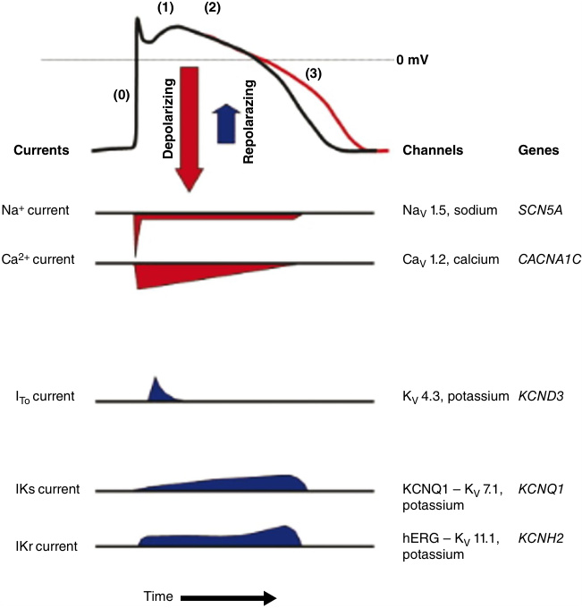

**Fig. 29.1** The cardiac myocyte action potential is shown as well as the depolarizing/hyperpolarizing currents, associated channels, and genes.  (From Abriel, Hugues, MD, PhD. _Cardiac Electrophysiology Clinics_ . Published December 1, 2014. Volume 6, Issue 4. © 2014.) 

loss-of-function variants in channels involved in the potassium delayed rectifier current, which prolongs repolarization. Forty to 55% of LQTS are caused by loss-of-function variants in _KCNQ1_ (LQT1) and 30–45% by loss-of-function variants in _KCNH2_ (LQT2). Gain-of-function variants in the voltage-gated sodium channel prolong depolarization and thus also prolong the action potential. Approximately 5–10% of LQTS cases are due to gain-of-function variants in _SCN5A_ (LQT3). These 3 genes have excellent evidence that they cause the LQTS and are referred to as **canonical LQTS genes** . 

### **Genetic Basis of Arrhythmogenesis in LQTS** 

Arrhythmogenesis in LQTS is due to a number of factors. The prolongation of the action potentials favors formation of _early after depolarizations_ . These are brief, abnormal depolarizations that occur during the normal repolarization phase of the action potential (Fig. 29.4). When large enough, they may trigger another action potential before the previous repolarization can finish and thus may initiate an arrhythmia. The characteristic **torsades de pointes (TdP)** 

seen clinically is likely caused by differences in action potential duration between the various layers of the myocardial wall (epicardial, midmyocardial, endocardial). When the arrhythmia propagates, it may migrate transmurally, thus producing the change in QRS axis seen on the surface ECG. Sympathetic stimulation also affects the voltage-gated ion channels and explains some of the clinical manifestations seen in the various LQTS. Beta-adrenergic stimulation normally increases the current through the potassium channel encoded by _KCNQ1_ but in LQT1; this effect is muted, and therefore QT prolongation with exercise is seen as well as increased clinical events during exercise or stress. In LQT2 and LQT3, this effect is less noticeable; these patients are more likely to have clinical events at rest. 

### **Genes Associated With LQTS** 

A host of genes cause various forms of LQTS and up to 17 forms of LQTS (LQT1-17) with 17 corresponding genes have been described. However, the evidence that variants in many of these genes cause a clinical LQTS is limited or disputed. Only those canonical genes associated with

<!-- p.656 -->

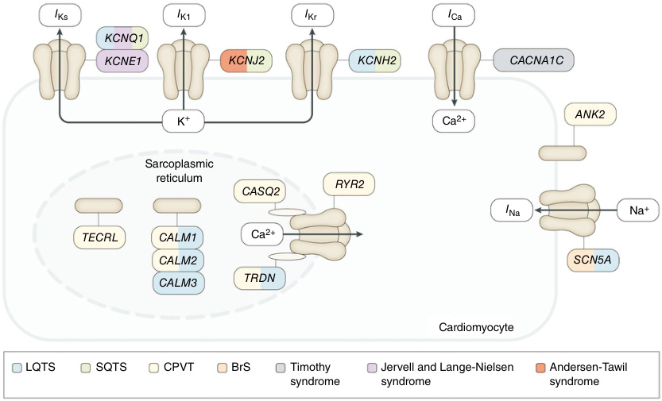

**Fig. 29.2** Genes and proteins involved in the pathogenesis of inherited cardiac arrhythmias. The figure shows the transmembrane ionic channels that are responsible for the potassium (IKs, IK1, and IKr), calcium (ICa), and sodium (INa) currents that contribute to the cardiac action potential. Proteins of the sarcoplasmic reticulum that are involved in calcium handling (encoded by _CASQ2, RYR2, CALM1, CALM2, CALM3,_ and _TRDN_ ) are also shown. Other proteins that can be abnormal in inherited cardiac arrhythmias are encoded by _ANK2_ and _TECRL_ . The genes that encode all these proteins or their subunits are colored according to the disease with which they have been associated. _BrS,_ Brugada syndrome; _CPVT,_ catecholaminergic polymorphic ventricular tachycardia; _LQTS,_ long QT syndrome; _SQTS,_ short QT syndrome.  (From Schwartz PJ, Ackerman MJ, Antzelevitch C, et al. Inherited cardiac arrhythmias. _Nat Rev Dis Primers_ . 2020;6[58] [Fig. 1].) 

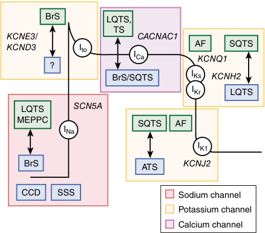

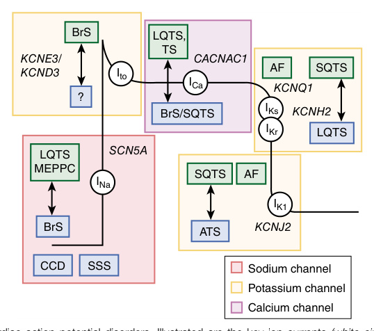

**Fig. 29.3** Cardiac action potential disorders. Illustrated are the key ion currents _(white circles)_ along the ventricular cardiomyocyte’s action potential that are associated with potentially lethal cardiac arrhythmia disorders. Disorders resulting in gain-of-function variants are shown in _green rectangles_ and those with loss-offunction pathogenic variants shown in _blue rectangles._ For example, while gain-of-function variants in the _SCN5A_ encoding cardiac sodium channel responsible for INa lead to LQTS, loss-of-function _SCN5A_ variants result in BrS, CCD, and SSS. _AF,_ Atrial fibrillation; _ATS,_ Andersen-Tawil syndrome; _BrS,_ Brugada syndrome; _CCD,_ cardiac conduction disease; _LQTS,_ long QT syndrome; _MEPPC,_ multifocal ectopic Purkinje-related premature contractions; _SSS,_ sick sinus syndrome; _SQTS,_ short QT syndrome; _TS,_ Timothy syndrome. (From Giudicessi JR, Tester DJ, Ackerman MJ. Genetics of cardiac arrhythmias. In: Libby P, Bonow RO, Mann DL, et al., eds. _Braunwald’s Heart Disease_ . 12th ed. Philadelphia: Elsevier, 2022 [Fig. 63.2, p. 1192].)

<!-- p.657 -->

#### **TABLE 29.1** Genoty pe-Phenoty pe Inherited. A rrhythmogenic. Syndromes C orrelation

|Cardiac Phenotype|Inheritance Model|Frequency|Gene Curation|Genes|Main Type of Variants|Current Affected|Noncardiac Phenotype|Phenotypic Overlap (Both LOF/GOF Variants)|
|---|---|---|---|---|---|---|---|---|
|**LQTS**|||||||||
|LQT1|AD|30–35%||_KCNQ1_|LOF|IKs|SNHL (AR), seizures|JLNS (AR), SQTS, AF|
|LQT2|AD|25–30%||_KCNH2_|LOF|IKr|Seizures|SQTS, BrS, AF|
|LQT3|AD|5–10%|Definitive genes|_SCN5A_|GOF|INa|Multiple (including seizures)|BrS, SQTS, CPVT, ERS, AF, AFL, ARVC/D, HCM, DCM, LVNC, SVT, AVB, SND, PCCD, WPW|
|LQT14-16|AD|<1%|Definitive genes |_CALM1-3_|GOF|ICa|Seizures, DD|CPVT|
|LQT17 (TKOS)|AR|<1%|with atypical characteristics|_TRDN_|LOF|ICa|Muscle weakness|CPVT|
|LQT5|AD|<1%|Genes with |_KCNE1_|LOF|IKs|SNHL (AR)|JLNS (AR)|
|LQT8|AD|<1%|moderate or limited evidence, associated with|_CACNA1C_|GOF|ICa|Dysmorphic and neurodevelopmental features|TS, SQTS, BrS, ERS, HCM, AF, SND, CND|
|LQT7|AD|<1%|multiorgan syndromes|_KCNJ2_|LOF|IK1|Muscle weakness, dysmorphic features, DD, seizures|ATS, SOTS, AF, CPVT, DCM|
|LQTS|AD|<1% each|Other genes|_ANK2_|LOF|Many|Seizures|CPVT, BrS, CND AF, SND AF|
||||with limited|_KCNJ5_|LOF|IK-Ach|||
||||evidence|_KCNE2_ |LOF |IKr |||
|||||_AKAP9_|LOF|IKs|||
|||||_SCN4B_|GOF|INa|||
|||||_CAV3_|GOF|INa|||
|||||_SNTA1_|GOF|INa|||
|**BrS**|||||||||
|BrS1|AD|20–30%|Definitive gene|_SCN5A_|LOF|INa|Multiple (including seizures)|BrS, SQTS, CPVT, ERS, AF, AFL, ARVC, HCM, DCM, LVNC, SVT, AVB, SND, PCCD, WPW|
|Brs|AD|<5%|Genes with|_ABCC9_|GOF|IK-ATP|Seizures|ERS, AF, DCM|
||||moderate|_ANK2_|GOF|Many|Seizures|LQTS, CPVT, CND|
||||or limited|_KCNH2_|GOF|IKr|Seizures, SCA|LQTS, SQTS, AF|
||||evidence|_KCNJ8_|GOF|IK-ATP|(See LQT8)|ERS, AF|
|||||_KCND3_|GOF|Ito||ERS, AF, CND|
|||||_KCNE3_|GOF|Ito||AF|
|||||_CACNA1C_|LOF|ICa||Multiple (see LQT8)|
|||||_CACNB2_|LOF|ICa||SQTS, ERS, CND|
|||||_CACNA2D1_|LOF|ICa||SQTS, ERS, CND|
|||||_HCN4_|LOF|Ih||AF, SND|
|||||_PKP2_|LOF|INa||ARVC, DCM, ACM, CPVT|
|||||_GPD1-L_|LOF|INa||DM|
|||||_TRPM4_|LOF|INa||LQTS|
|||||_SCN1B-3B_|LOF|INa||AF|
|||||_SCN10A_|LOF|INa||AF|
|||||_SLMAP_|LOF|INa|||
|||||_RANGRF_|LOF|INa|||
||XD|||_KCNE5_|LOF|Ito||AF|

_(Continued)_

<!-- p.658 -->

###### **TABLE** 

###### **29.1** 

#### **Genotype-Phenotype Inherited. Arrhythmogenic. Syndromes Correlation—cont’d** 

|Cardiac Phenotype|Inheritanc Model|e Frequency|Gene Curation|Genes|Main Type of Variants|Current Affected|Noncardiac Phenotype|Phenotypic Overlap (Both LOF/GOF Variants)|
|---|---|---|---|---|---|---|---|---|
|**CPVT**|||||||||
|CPVT1|AD|55–60%|Definitive genes|_RYR2_|GOF|ICa||LQTS, HCM, LVNC, CRDS|
|CPVT2|AR|3–5%||_CASQ2_|LOF|ICa|||
|CPVT3|AR|1–2%||_TECRL_|LOF|ICa|||
|CPVT4|AD|<1%||_CALM1-3_|LOF|ICa|Seizures, DD|LQTS|
|CPVT5|AR|1–2%||_TRDN_|LOF|ICa|Muscle weakness|LQTS|
|CPVT|AD|<1%|Genes with|_SCN5A_|LOF|INa|Multiple seizures|Multiple (see BrS1)|
||||moderate or|_PKP2_|LOF|INa|Seizures|ARVC, DCM, ACM, CPVT|
||||limited|_ANK2_|LOF|Many|(see LQT7)|LQTS, BrS, CND|
||||evidence|_KCNJ2_|LOF|IK1||Multiple (see LQT7)|

_ACM,_ Arrhythmogenic cardiomyopathy; _AF,_ atrial fibrillation; _AFL,_ atrial flutter; _AR,_ autosomal recessive; _ATS,_ Andersen-Tawil syndrome; _AVB,_ atrioventricular block; _BrS,_ Brugada syndrome; _CDSP,_ systemic primary carnitine deficiency; _CPVT,_ catecholaminergic polymorphic ventricular tachycardia; _CND,_ complex neurodevelopmental disorder; _CRDS,_ Ca2+ -release deficiency syndrome; _DCM,_ dilated cardiomyopathy; _DD,_ developmental delay; _DM,_ diabetes mellitus; _ERS,_ early repolarization syndrome; _HCM,_ cardiomyopathy, hypertrophic; _GOF,_ gain-of-function; _ICa,_ voltage-gated calcium currents; _Ih,_ Hyperpolarization-activated nonselective cation channels/currents; _IK,_ delayed rectifier potassium currents; _IK-Ach_ , acetylcholine-activated inward rectifier potassium currents; _IK-ATP_ , ATP-sensitive inward rectifier potassium currents; _IKr,_ rapidly activating IK; _IKs,_ slowly activating IK; _IK1,_ inward rectifier potassium currents; _INa,_ voltage-gated sodium currents; _Ito,_ transient outward potassium currents; _JLNS,_ Jervell and Lange–Nielsen syndrome; _LOF,_ loss-of-function; _LQTS,_ long QT syndrome; _LVNC,_ left ventricular noncompaction; _PCCD,_ progressive cardiac conduction disease; _SCA,_ spinocerebellar ataxia; _SND,_ sinus node dysfunction; _SNHL,_ sensorineural hearing loss; _SVT,_ supraventricular tachyarrhythmia; _TKOS,_ triadin knockout syndrome, _TS,_ Timothy syndrome; _WPW,_ Wolff–Parkinson–White; _XD,_ X-linked dominant. 

Modified from Martínez-Barrios E, Cesar S, Cruzalegui J, et al: Clinical genetics of inherited arrhythmogenic disease in the pediatric population. _Biomedicines_ 2022;10:106 (Table 1).

<!-- p.659 -->

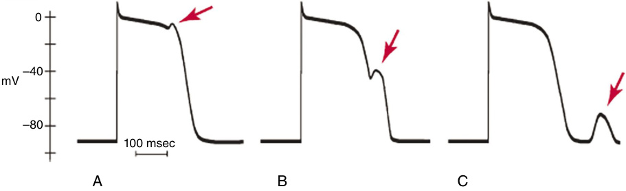

**Fig. 29.4** The cardiac myocyte action potential is shown, with early after depolarizations denoted by the _red arrow_ in (A) and (B). delayed after depolarizations are shown in (C).  (From Issa ZF, Miller JM, Zipes DP. Electrophysiological mechanisms of cardiac arrhythmias. In: _Clinical Arrhythmology and Electrophysiology_ . Elsevier; 2019:51-80. doi:10.1016/B978-0-323-52356-1.00003-7.) 

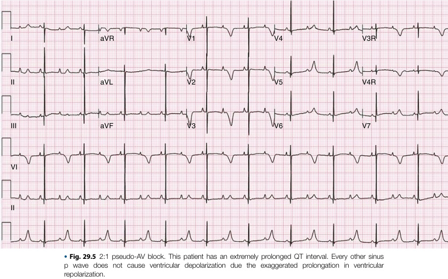

LQT1-3 ( _KCNQ1, KCNH2,_ and _SCN5A,_ respectively) have definitive evidence that they cause the typical clinical LQTS (Table 29.1). 

Defects in the **calmodulin** (calcium sensing signal transducing protein) genes such as _CALM1-3_ (LQT14-16) cause an atypical LQTS mainly manifest by severe presentation in infancy, with extremely long QT interval, 2:1 atrioventricular block (Fig. 29.5), and a high propensity for T wave alternans (Fig. 29.6). Other cardiac manifestations in these patients include cardiomyopathy, congenital heart disease, as well as 

an overlap with catecholaminergic polymorphic tachycardia (CPVT). These genes encode the calcium-binding protein which modulates various ion channels and have wide-ranging effects on ion signaling. It should be noted that all 3 genes encode the same protein but are located on different chromosomes. Some have advocated that these diseases be referred to as **_CALM_ -LQTS** , rather than their numerical LQT descriptors. 

Variants in _TRDN_ cause LQT17 or **triadin knockout syndrome** ; however, the clinical descriptions of this entity

<!-- p.660 -->

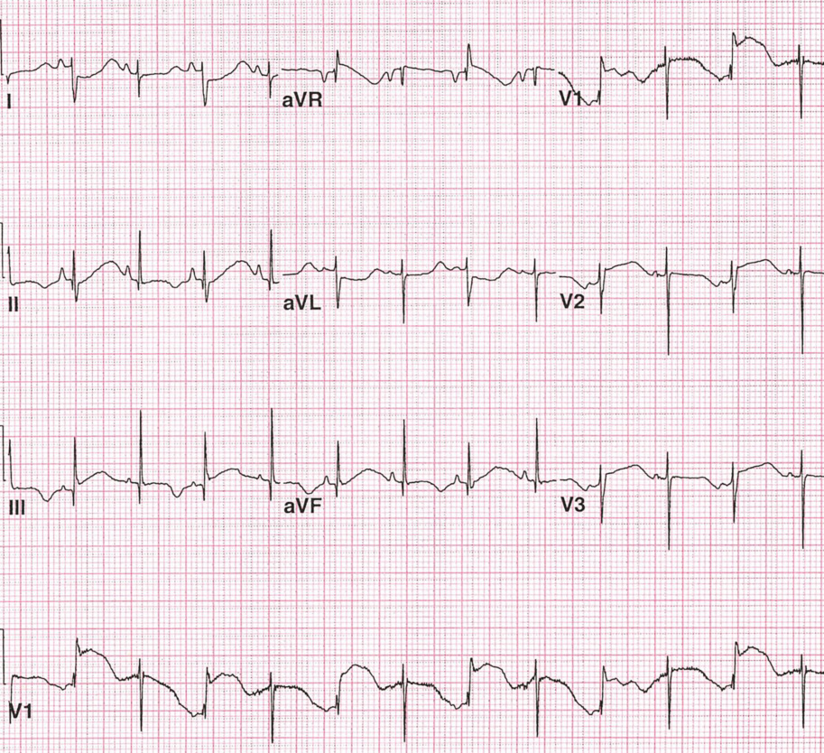

**Fig. 29.6** T wave alternans is characterized by an alternating T wave axis with each beat. 

are few. There is some debate as to the exact phenotype of this disease because there are some similarities to CPVT; a prolonged QT interval may be seen, and it can be classified as an atypical LQTS. 

**Timothy syndrome** (LQT8) is caused by variants in _CACNA1C_ . It is characterized by multisystem abnormities, including skeletal abnormalities (particularly syndactyly), facial dysmorphisms, developmental delay, autism spectrum disorder, and congenital heart disease, in addition to a rather severe LQTS phenotype. T wave alternans and 2:1 pseudo-AV block may be seen in this condition as well (Figs. 29.5 and 29.6). 

**Andersen-Tawil syndrome (LQT7)** is caused by variants in _KCNJ2_ , which codes for an inward rectifier potassium 

channel. While Andersen-Tawil syndrome has historically been grouped as a LQTS, there is not typically QT prolongation on the ECG, but rather a prominent U wave; there is limited evidence that it causes a clinical LQTS. In addition, there is overlap between Andersen-Tawil and CPVT, including a propensity for bidirectional VT. The arrhythmic burden is typically significant, and in addition to the cardiac manifestations, periodic paralysis and dysmorphic features are seen. 

The genes _KCNE1_ and _KCNE2_ (LQT5 and LQT6, respectively) which encode for subunits of the voltagegated potassium channel are relevant. There is limited evidence that heterozygous variants in these genes cause a clinical LQTS. However, homozygotes (or compound

<!-- p.661 -->

heterozygotes) for a _KCNE1_ variant have been associated with the autosomal recessive Jervell and Lange-Nielsen syndrome. Heterozygous variants in both _KCNE1_ and _KCNE2_ have also demonstrated an association with QT prolongation with the addition of a provoking factor such as a QT prolonging medication. Some call this _acquired LQTS_ (aLQTS). 

### **Clinical Diagnosis** 

Long QT syndrome is diagnosed by assessment of clinical history, family history, and ECG findings. Genetic testing adds vital information, although there are patients who are phenotype positive and genotype negative. In all patients with suspected LQTS, their LQTS risk score (also known as the “Schwartz score”) should be calculated (Table 29.2). The Schwartz score incorporates criteria such as ECG findings (e.g., the degree of QT prolongation, presence of T wave alternans, etc.), patient’s clinical history, and family history. Those with a high probability score have been shown to have a sensitivity and specificity 

#### **TABLE 1993–2011 Long QT Syndrome Diagnostic 29.2 Criteria** 

##### **ECG Findings** 

- Electrocardiogram (ECG) findings can be included in the score in the absence of medications or disorders known to affect ECG features. Corrected QT (QTc) is calculated by Bazett’s formula, in which QTc = QT/√RR. 

- • QTc 450–459 ms (in male individuals) (1 point) • QTc 460–479 ms (2 points) 

- QTc ≥480 ms (3 points) 

- QTc on fourth minute of recovery from exercise stress test ≥480 ms (1 point) 

- Torsades de Pointes (2 points) 

- T wave alternans (1 point) 

- Notched T wave in three leads (1 point) 

- Resting heart rate below the second percentile for the patient’s age (0.5 point) 

##### **Clinical History** 

- Syncope* with stress (2 points) • Syncope* without stress (1 point) 

- Congenital deafness (0.5 point) 

##### **Family History** 

- Family members with definite long QT syndrome (LQTS) diagnosis† (1 point) 

- • Unexplained sudden cardiac death before 30 years of age among first-degree relatives† (0.5 point) 

- A score of ≤1 point indicates a low probability of LQTS, a score of 1.5–3 points indicates an intermediate probability of LQTS, and a score of ≥3.5 points indicates a high probability of LQTS. 

*Mutually exclusive. †Mutually exclusive. From Schwartz PJ, Ackerman MJ, Antzelevitch C, et al. Inherited cardiac arrhythmias. _Nat Rev Dis Primers._ 2020;6(58) (Box 1). 

of 88% and 80%, respectively, for diagnosis of LQTS. Long QT syndrome can be diagnosed if a patient has a high probability Schwartz score or a QTc greater than or equal to 500 msec on repeated 12 lead ECG (in the absence of a secondary cause for QT prolongation). In addition, LQTS can be diagnosed in the presence of a QTc between 480 and 499 msec on repeated 12 lead ECGs in a patient with unexplained syncope (again in the absence of a second QT prolongation). LQTS can also be diagnosed in a patient with an _unequivocal pathogenic variant in one of the LQTS genes_ . Full evaluation of the LQTS score requires an exercise stress test. 

### **History** 

Clinical manifestations of LQTS commonly seen in clinical practice are due to life-threatening ventricular arrhythmias (in particular, TdP) which cause syncope and/or sudden cardiac arrest. Cardiac output is severely diminished during these arrhythmias, and therefore a sudden loss of consciousness is seen rather than complaints of palpitations without loss of consciousness. Atrial arrhythmias may be seen in LQTS but are not a defining feature. There are some classically recognized associations between subtypes of LQTS and specific situational triggers. In LQT1, the episodes are often seen during exertion because the genetic defect in _KCNQ1_ is related to control of action potential duration during increased HR. **Swimming** is a notable activity shown to trigger events in LQT1. Those with LQT2 or LQT3 often have episodes **at rest** . In particular, those with LQT2 may have events related to a **loud sound** (e.g., ringing of a telephone) or in the postpartum period. Emotional stress may be a trigger in any of the LQTS. 

In addition to a presentation of syncope, those with LQTS may initially be diagnosed with seizures; the sudden cerebral hypoperfusion caused by the ventricular arrhythmias may cause sudden loss of consciousness and myoclonic jerks that can be quite similar clinically to a generalized tonic-clonic seizures. In addition, there is some overlap between those with LQTS and epilepsy, likely due to changes in cerebral potassium currents. Therefore, episodes previously labeled as neurological seizures should be revisited, especially if there is a family history concerning for LQTS or the episodes occur primarily with the triggers (exertion, auditory stimuli, emotional stress) noted above. It should also be noted that many antiepileptic drugs may prolong the QT interval. A family history of congenital deafness may be notable as the autosomal recessive Jervell and Lange-Nielsen syndrome is characterized by congenital deafness and LQTS. 

### **Measurement of the QT Interval on ECG** 

Accurate measurement of the QT interval on the ECG, as well as the proper correction for heart rate (corrected QT interval, QTc), is essential for identification of those who require further investigation for LQTS as well as for risk

<!-- p.662 -->

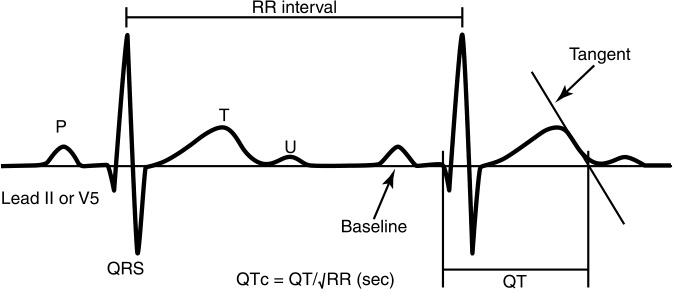

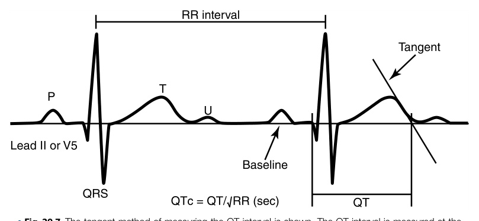

**Fig. 29.7** The tangent method of measuring the QT interval is shown. The QT interval is measured at the beginning of the Q wave and extends to the end of the T wave. The end of the T wave is denoted by where a tangent line intersects the baseline.  (From Walsh KA, Deom R. Genetics of electrophysiologic disorders. In: _Emery and Rimoin’s Principles and Practice of Medical Genetics and Genomics: Cardiovascular, Respiratory, and Gastrointestinal Disorders_ . 7th ed. Elsevier; 2020.) 

stratification of those with known LQTS. While measurement of the beginning of the QT interval is usually straightforward, measurement of the end of the QT interval is sometimes difficult owing to the presence of ST segment or T wave abnormalities and/or the presence of U waves. Therefore, a standardized approach is recommended. There are a number of techniques that have been described, but the tangent method is widely used and has been shown to have good reproducibility. In this method, the end of the T wave is defined as the point where a tangent line drawn from the descending slope of the T wave intersects the baseline (Fig. 29.7). Importantly, the U wave must be excluded from QT interval measurement. However, the terminal portion of a bifid T wave is included. The QT interval varies with heart rate (HR): it shortens at higher HRs and lengthens at lower HRs. Therefore, the QT interval must be corrected to the patient’s HR; this is especially important in pediatrics as infants and young children have a higher resting HR than adults. There are a number of HR correction methods, but that described by Bazett is the most widely used: QTc (sec) = QT (sec)/√(RR interval in sec). The QT interval is preferably measured in lead II or V5 as these leads have been shown to have both good diagnostic power as well as prognostic risk stratification in those with known LQTS (Table 29.2). However, the most accurate QT measurement should be sought; if the QT interval is more accurately measured in other leads owing to a more defined T wave terminus, then those leads should be utilized for measurement. It should be noted that different leads have been shown to produce slightly different QT intervals at baseline. The _longest measured QT interval on a given ECG_ should be used for diagnosis and risk stratification. In those with significant variation in the RR interval (because of sinus arrhythmia or frequent ectopy), at least 3 QT intervals per lead should be measured and averaged to obtain a more accurate baseline QT interval. In addition to the duration of the QT interval, the morphology of the T waves 

should be noted because the 3 most common forms of LQTS have characteristic T wave morphologies (Fig. 29.8). T wave alternans is rare, but pathognomonic for LQTS (Fig. 29.5); it is often a risk for TdP and requires urgent medical attention. 

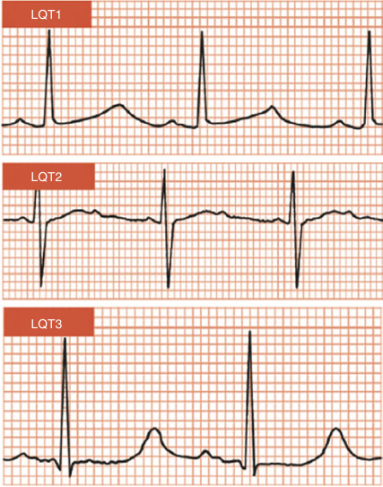

**Fig. 29.8** Class T wave morphologies in LQTS1-3. T waves in LQT1 are often described as “broad based.” Those in LQT2 are often bifid. Those in LQT3 are often “late-appearing,” with the T wave arising after a prolonged isoelectric ST segment.  (From Krahn AD, Laksman Z, Sy RW, et al. Congenital long QT syndrome. _JACC Clin Electrophysiol_ . 2022;8[5]:687-706.)

<!-- p.663 -->

### **Acquired QT Prolongation** 

Secondary causes of QT prolongation are numerous and must be investigated to avoid overdiagnosis of LQTS, and to direct treatment toward the underlying causes for the QT prolongation and also proper management of the prolonged QT itself. The secondary causes of prolonged QT are sometimes grouped under the name _acquired long QT syndrome_ ; care must be taken to avoid confusion with LQTS. Secondary causes of QT prolongation include medications, electrolytes abnormalities (in particular, hypokalemia), myocardial ischemia, cardiomyopathies, hypothermia, hypothyroidism, and intracranial hemorrhage. Patients with severe bradycardia, in particular due to complete heart block, can show an exaggeratedly prolonged QT and be at risk for TdP. In the outpatient setting, medications are the most common cause for QT prolongation; a careful drug reconciliation (including dosage changes) should be performed at every visit and correlated to the QT interval obtained. The website _crediblemeds.org_ is an excellent resource that lists known QT-prolonging medications and can be useful in the diagnosis of acquired QT prolongation, as well as a reference for patients with known LQTS to help them avoid offending medications. TdP in acquired QT prolongation is related to a number of risk factors and is thought to be less common than those with genetic LQTS. A number of risk factors have been identified, but in general a QTc >500 msec likely represents an increased risk for TdP. Treatable secondary causes should be managed (in particular, normalization of electrolytes), and a careful assessment of the risk/benefit of QT prolonging medications (and their dosages) should be performed in a multidisciplinary manner. A QT prolonging medication may unmask a latent LQTS, especially in heterozygous variants of _KCNE1_ or _KCNE2_ . 

### **Exercise Stress Testing in LQTS** 

Patients with LQTS often have an abnormal repolarization response to exercise, in particular the acceleration in HR during the initial phases of exercise and the deceleration of HR during the recovery phase. A normal QT response to exercise is characterized by a decrease in QT with peak exercise, and subsequent increase in QT interval during recovery back to baseline (usually within 3–5 minutes) without significant lagging (i.e., QT hysteresis) or ballooning out (i.e., abnormal QT recovery latency). Most studies on exercise testing in LQTS were performed using the Bruce treadmill protocol; other protocols have been used. Perhaps the best single measurement of an abnormal exercise response is the QTc at 4 minutes of recovery. A QTc of ≥445 msec at 4 minutes recovery has a sensitivity and specificity of 90% and 90%, respectively, for LQTS; if ≥480 msec, the specificity increases to 100% but the sensitivity decreases to 36%. Given this, a QTc ≥480 msec was included in the most recent LQTS risk score. Studies in children have demonstrated that a 

QTc at 7 minutes >460 msec is similarly predictive (sensitivity and specificity 86% and 96%, respectively). A significant increase in the QT interval upon abrupt change from supine to standing is also seen in those with LQTS (and often incorporated in the initial part of the exercise stress test). Healthy children also increase their QT interval upon standing; this marker must be used with caution in pediatrics. 

### **Genetic Testing in LQTS** 

Patients with high clinical suspicion for LQTS should undergo genetic testing, and in general those with a higher Schwartz score have a higher yield on genetic testing. Genetic testing may also be warranted at a lower risk score if there is a particularly concerning personal or family history. The yield on genetic testing for LQTS is as high as 50–80% and increases with higher pretest probability (i.e., is highest in those with clinical LQTS). Negative or uncertain genetic results should not deter management in those who meet the clinical diagnosis for LQTS; 20–25% of phenotype positive patients are genotype negative. These patients should be treated as aggressively as those with positive genetic testing. 

### **Natural History and Risk Stratification** 

Patients with LQTS are at a high risk for cardiac events (i.e., syncope and/or sudden cardiac arrest), with an annual incidence of cardiac events ranging from 0.2% to 1.1% for those with LQT1-3, to as high as 2.1% in those with QTc ≥500 msec. The degree of QT prolongation is closely related to risk of ventricular arrhythmias, syncope, and SCA. Those with a QTc of ≥550 msec have a risk of cardiac events twice that of those with QTc <470 msec. The maximum QTc on repeated measurements may have greater prognostic value compared to the baseline measurement. In addition, risk for cardiac events is higher in childhood than adulthood. In preadolescent patients, males have a significantly increased risk for cardiac events compared to females. During puberty, the risk is fairly similar between the sexes, but in adulthood females have a greater risk. 

### **Treatment** 

#### **_Avoidance_** 

In all patients with suspected or proven LQTS, avoidance of secondary causes of QT prolongation, in particular QT prolonging medications, is a mainstay of treatment. _crediblemeds.org_ is an excellent resource for updated and reviewed information on QT prolonging medications. Avoidance of known triggers is important for certain genotypes, in particular swimming for those with LQT1. Caregivers should be trained in cardiopulmonary resuscitation, and schools, daycares, and places of work should have automated external defibrillators present.

<!-- p.664 -->

Previously, patients with LQTS were restricted from competitive athletics owing to the increase in events with activity, particularly in LQT1. Some have reported fairly reassuring outcomes in select LQTS athletes who were allowed to return to sports after a shared decision-making process. Such a discussion is complex and should focus on specific patient factors (genotype, history of events, maximum QTc), adherence to therapies, type of activity, and patient risk tolerance. 

### **_Medications_** 

Beta blockers are the primary pharmacological treatment for LQTS. They have consistently been shown to decrease the risk for syncope, ventricular arrhythmias, and sudden cardiac arrest. The majority of the data for the efficacy of beta blockers in LQTS is in patients with LQT1 and LQT2. Beta blockers are recommended in all symptomatic patients as well as asymptomatic patients with QTc ≥470 msec. Beta blockers may be considered for asymptomatic patients with QTc <470 msec, especially if there is an abnormal QT response to exercise. The nonselective beta blockers nadolol and propranolol are more effective than the selective beta blockers such as metoprolol or atenolol. In most cases, beta blocker dosage is titrated until there is evidence of sufficient beta blockade on exercise stress testing (i.e., blunting of the maximum HR) rather than to a certain degree of QT shortening because beta blockers have fairly modest and nonuniform decreases in the resting QT interval. Beta blockers are also titrated up in those with recurrent syncope. In addition to beta blockers, mexiletine has demonstrated some efficacy in LQT3. 

### **_Implantable Cardioverter-Defibrillators_** 

Implantable cardioverter-defibrillators (ICDs) are recommended as secondary prevention in all patients with LQTS _and_ history of sudden cardiac arrest. ICDs for primary prevention are controversial and may be considered in those with LQTS who are symptomatic despite beta blockade and in whom cardiac sympathetic denervation and/or other medical therapies are not considered effective. A decision for primary prevention ICD should be made in a shared decision-making environment with consideration of the risk (hardware malfunction, infection, inappropriate shocks) and benefits. 

### **_Left Cardiac Sympathetic Denervation_** 

Left cardiac sympathetic denervation, in which part of the left stellate and thoracic ganglia are resected, is a treatment for patients who are symptomatic despite beta blockade, or who are intolerant of beta blockade. While outcomes are good, this procedure may not be as effective for those with LQT3. In addition, breakthrough events are reported and therefore this should not be regarded as a cure. 

## **Catecholaminergic Polymorphic Ventricular Tachycardia (CPVT)** 

CPVT is an inherited arrhythmogenic disease characterized by life-threatening ventricular arrhythmias which are 

induced by catecholamines, usually during exercise or emotional stress. 

### **Epidemiology** 

CPVT is less common than LQTS with an estimated prevalence of 1 in 10,000 persons. CPVT is a notable cause of sudden cardiac death/sudden cardiac arrest in younger patients with structurally normal hearts. 

### **Genetic Basis** 

Variants in _RYR2_ , which encodes the cardiac ryanodine receptor gene, are the genetic basis for _autosomal dominant_ CPVT syndrome. Variants in _CASQ2_ (encoding calsequestrin) are associated with a rarer _autosomal recessive_ version of the CPVT syndrome. Five other genes have been implicated as causing atypical CPVT syndrome or _CPVT overlap syndromes_ . Four of these were discussed in the section on LQTS: _CALM1, CALM2, CLM3,_ and _TRDN_ . Variants in these genes cause an overlap syndrome between CPVT and LQTS (Fig. 29.2). An autosomal recessive syndrome caused by variants in _TECRL_ which encodes the trans-2,3-enoyl-CoA reductase like protein has also been described and appears to also be a CPVT and LQTS overlap syndrome. Reports of this condition are limited; there is more to be learned about these rare atypical CPVT/LQTS overlap syndromes. **Typical CPVT** includes those clinical syndromes caused by AD variants in _RYR2_ and AR variants in _CASQ2_ . Approximately 20–25% of clinical CPVT cases have an unknown genetic basis. 

### **Genetic Basis of Arrhythmogenesis in CPVT** 

_RYR2_ encodes the ryanodine receptor, which is located in the sarcoplasmic reticulum (Fig. 29.9). The ryanodine receptor is involved in calcium-induced calcium release which is an integral part of excitation-mechanical coupling. When the cardiomyocyte membrane is depolarized by an action potential, the L-type calcium channel Cav1.2 opens, allowing Ca2+ into the cell. This Ca2+ binds the ryanodine receptor and triggers a rapid efflux of Ca2+ from the sarcoplasmic reticulum into the cell, which causes a myocyte contraction. _CASQ2_ encodes calsequestrin which is also located in the sarcoplasmic reticulum. It appears that calsequestrin serves to decrease the probability that the ryanodine receptors will open and is also involved in the deactivation of the ryanodine receptor, especially after Ca2+ is released. Typical CPVT is caused by gain-of-function variants in _RYR2_ or loss of function variants in _CASQ2_ . Both types of variants serve to increase the amount of Ca2+ released from the sarcoplasmic reticulum during calciuminduced calcium release. This causes a transient depolarizing current during phase 4 of the action potential, which is called a delayed after depolarization (Fig. 29.4). Similar to early depolarizations, if the delayed after depolarization is significant enough (i.e., depolarizes the cell beyond a

<!-- p.665 -->

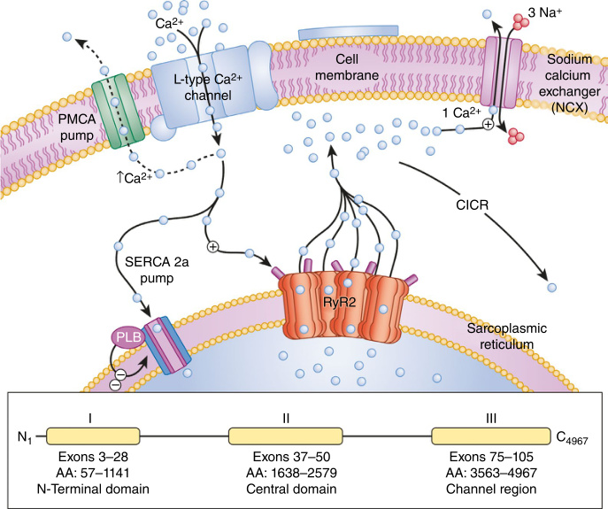

**Fig. 29.9** Catecholaminergic polymorphic ventricular tachycardia: a disorder of intracellular calcium handling. Perturbations in key components of the calcium-induced calcium release (CICR) mechanism responsible for cardiac excitation-contraction coupling is the pathogenic basis for CPVT. At the center of this mechanism is the _RYR2_ -encoded cardiac ryanodine receptor/calcium release channel located in sarcoplasmic reticulum membrane. Variants in RyR2 are clustered and distributed in three “hot-spot” regions of this 4967 amino acid (AA) protein; Domain I or N-terminal Domain (AA 57-1141), Domain II or the Central Domain (AA 1638-2579), and Domain III or Channel Region (AA 3563-4967).  (From Giudicessi JR, Tester DJ, Ackerman MJ. Genetics of cardiac arrhythmias. In: Libby P, Bonow RO, Mann DL, et al., eds. _Braunwald’s Heart Disease_ . 12th ed. Philadelphia: Elsevier; 2022 [Fig. 63.8, p. 1203].) 

certain threshold), an action potential may be triggered. These triggered beats may be seen as premature ventricular contractions (PVCs) on the surface ECG. It is likely that these PVCs originate from the Purkinje cells of the heart. Frequent PVCs may degenerate into salvos of bidirectional VT or polymorphic VT which are the hallmark of this disorder. If these PVCs occur in a bigeminal pattern, delayed after depolarizations causing triggered action potentials in a second focus can cause bidirectional VT with its characteristic alternating QRS morphology. Triggered action potentials from 3 or more foci may cause polymorphic VT. Lastly, association between ventricular arrhythmias and exercise (or emotional stress) is mediated by a further increase in ryanodine receptor opening caused by adrenergic stimulation, as well as an increase in sarcoplasmic reticulum Ca2+ via phospholamban. It would appear that at resting conditions a gain-of-function variant in _RyR2_ or loss-of-function variant in _CASQ2_ is not sufficient to cause arrhythmias unless sarcoplasmic reticulum calcium efflux is enhanced by adrenergic stimulation. 

### **Clinical Diagnosis** 

The diagnosis of CPVT requires a personal history of syncope during periods of increased catecholamines (primarily during exertion), as well as the presence of characteristic ventricular arrhythmias on an exercise stress test. Patients with CPVT have a structurally normal heart and a normal baseline ECG. Those with a prolonged QT interval on baseline ECG and exertional symptoms/finding reminiscent of CPVT may have a _LQTS/CPVT overlap syndrome_ . Family history adds important information, but it should be noted that CPVT has decreased penetrance compared to LQTS. Similarly, genetic testing is helpful to confirm a high clinical suspicion and to aid in family cascade screening, but care must be taken in interpreting genetic results in cases with lower clinical suspicion. 

### **History** 

Patients present with exertional syncope or sudden cardiac arrest. Some may present with syncope during other periods

<!-- p.666 -->

of catecholamine surge—for example, while riding a roller coaster. Patients with CPVT tend to present at a relatively young age (<10 years). The syncopal events may be initially diagnosed as seizures. The rate of initial misdiagnosis in children with CPVT is high. 

## **Exercise Stress Testing** 

The clinical diagnosis of CPVT requires the evaluation of characteristic ventricular arrhythmias during an exercise stress test; an exercise stress test is a mandatory part of the evaluation for all those with sudden cardiac arrest and normal baseline echocardiogram and ECG. CPVT is diagnosed based on otherwise unexplained exercise or catecholamine induced bidirectional VT, polymorphic PVCs, or polymorphic VT in an individual <40 years old with a structurally normal heart and normal baseline ECG. It may also be diagnosed in those with a pathogenic variant, as well as family members of an index case who show exercise induced PVCs or VT (regardless of echocardiogram or ECG status). 

Exercise testing is usually performed via a standard Bruce treadmill protocol; studies have suggested that a standard exercise stress test does not have high sensitivity. Some have proposed that a _burst protocol_ exercise stress test better reveals the characteristic ventricular arrhythmias in CPVT. A burst protocol, which consists of starting the test at high/ maximal intensity rather than a gradual increase to maximal intensity, may better mimic the clinical finding of CPVT events during periods of sudden or abrupt surges in 

catecholamines. The burst protocol should be considered for those with a high suspicion for CPVT despite normal or equivocal tradition exercise stress findings. 

The characteristic findings during an exercise stress test follow a predictable pattern. There is rarely significant ectopy at rest. With an increase in exercise (and thus HR), isolated monomorphic PVCs are seen usually at relatively low heart rates (100–130 bpm). 

With an increasing heart rate, the PVCs become more frequent often in a bigeminy pattern. Polymorphic PVCs may be seen, as well as couplets (either monomorphic or polymorphic). The unusual arrhythmia bidirectional VT may be seen, as well as polymorphic VT (Fig. 29.10). Ventricular fibrillation may also be seen late but is less common. The differential diagnosis for bidirectional VT is limited to 3 primary conditions: (1) CPVT; (2) digitalis toxicity; and (3) Andersen-Tawil syndrome. Digitalis toxicity and AndersenTawil syndrome are usually easily suspected clinically and relatively rare; therefore, in almost all cases, a patient with bidirectional VT should be assumed to have CPVT until proven otherwise. The ventricular arrhythmias resolve rather abruptly when exercise is stopped and are rarely seen into late recovery. Supraventricular arrhythmias may also be seen but are not pathognomonic for CPVT. At peak heart rate, some of the ventricular arrhythmias may suppress and this should not rule out a CPVT diagnosis. In addition, while bidirectional VT or polymorphic VT during exercise is essentially diagnostic of CPVT, the lack of these arrhythmias during exercise does not rule out CPVT. The distinction of CPVT is 

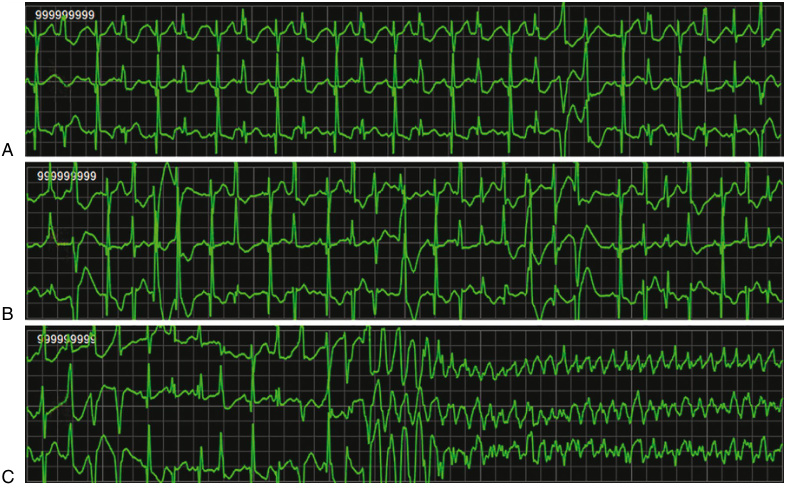

**Fig. 29.10** Telemetry strips from a child with CPVT. (A) Isolated PVCs noted; (B) increasing agitation and tachycardia with resultant bidirectional and polymorphic ventricular ectopy and couplets; (C) degeneration into sustained, polymorphic VT.

<!-- p.667 -->

frequent ventricular ectopy (especially polymorphic or in a bigeminy pattern) during exercise stress testing that often occurs early in exercise and increases in frequency with HR. Exercise test interpretation in these patients must be performed carefully because misinterpreted stress tests have been reported in those with a delayed CPVT diagnosis. In an individual patient, the heart rate threshold at which ventricular arrhythmias start and the morphology of the arrhythmias is usually consistent across serial exercise tests. 

## **Genetic Testing** 

Patients suspected of CPVT based on exercise stress testing should be considered for genetic testing. However, interpretation of genetic testing results of the _RYR2_ in particular may be complicated due to the relatively high rate of rare but benign variants in the general population. Therefore, a high index of suspicion is essential because those with a definitive clinical diagnosis have a genetic yield of only ~60%. Pathogenic variants in _RYR2_ have primarily been isolated to _hotspot_ regions of the gene; thus, care must be taken in interpreting variants outside these regions. Cascade screening of the family members of an index case is essential. This is particularly important in CPVT because there may be variable penetrance of the clinical phenotype. Genetic testing in CPVT may not report many prognostic or therapeutic implications; however, it may be vital for subsequent familial screening. 

## **Natural History and Risk Stratification** 

Unfortunately, CPVT is a lethal and malignant disease with a rate of sudden cardiac arrest as high as 25% in untreated individuals. Even in those treated with medications, breakthrough syncope and sudden cardiac arrest are common. In a study of 226 patients who were enrolled before 19 years of age, there were 6 deaths (3%) over a cumulative follow-up of 788 patient-years despite 97% of patients being prescribed beta blockers. There are no clear markers for increased risk of events besides having a previous sudden cardiac arrest. Those with a _CASQ2_ variant may be at higher risk. In children, chronotropic incompetence may be a risk factor. 

## **Treatment** 

### **_Avoidance_** 

Avoidance of catecholamine surges is essential; therefore, these patients are restricted from competitive sports, and strongly advised to avoid known stressful environments (e.g., roller coasters). 

## **_Medications_** 

The primary medical treatment is beta blockade. Beta blockers decrease the sympathetic stimulation that is thought to underlie the increased Ca2+ release during exercise. Beta blockers have consistently been shown to decrease events in patients with CPVT and are recommended in all patients with the clinical diagnosis. In those who are genotype 

positive but phenotype negative (e.g., family members identified after cascade testing), beta blockers should be considered. The nonselective beta blockers nadolol and propranolol have been shown to be most effective and are the preferred agents. While practice varies among centers, the highest tolerated beta blocker dose is usually the goal, especially in those with a history of syncope or sudden cardiac arrest. 

In addition to beta blockers, flecainide, a class 1c antiarrhythmic, decreases the burden of ventricular arrhythmias on exercise stress tests in those on beta blockers. This is a widely used treatment and should be considered especially for patients with breakthrough symptoms on maximally tolerated beta blockade, as well as those at increased risk (e.g., history of sudden cardiac arrest). ECGs must be closely monitored upon the initiation of flecainide for evidence of conduction delay and QRS prolongation; depending on the patient, this may need to be performed in the hospital. 

## **_Implantable Cardioverter-Defibrillators_** 

ICD implantation is recommended for those with CPVT who have sudden cardiac arrest or recurrent syncope despite maximal medical management (which would include beta blocker and flecainide). ICD implantation in those who present with sudden cardiac arrest (prior to initiation of therapy) is more controversial and may be deferred in favor of intensive medical management. Besides the usual risks seen in all ICD implantations (infection, lead malfunction, need for battery replacement), those with CPVT have unique concerns. In particular an inappropriate shock may cause a catecholamine response, which causes ventricular arrhythmias, which the ICD tries to treat with another (in this case, appropriate) shock. This leads to further catecholamine release and further shocks, in a cycle known as _electrical storm_ , which may occur in up to 29% of patients. In addition, there is some evidence that with CPVT, bidirectional VT and polymorphic VT are not always terminated with ICD discharges. Therefore, while ICDs may be lifesaving, the clinician must carefully consider the risks and benefits; in general, maximal medical therapy is attempted prior to ICD implantation. 

## **_Left Cardiac Sympathetic Denervation_** 

Left cardiac sympathetic denervation is a potential therapeutic option, especially for those who have events despite maximal medical therapy. However, the degree of arrhythmia suppression after denervation may be variable in CPVT; medical treatment (primarily with beta blockers) is usually continued afterwards. 

# **Brugada Syndrome** 

The Brugada syndrome (BrS) is distinguished by characteristic ECG patterns and a propensity for ventricular arrhythmias, syncope, and sudden cardiac death. It represents the same syndrome as the **sudden unexplained nocturnal death syndrome** .

<!-- p.668 -->

## **Epidemiology** 

The prevalence in adults has been reported between 1:2,000 to 1:5,000; this may be an overestimate as the presence of a Brugada pattern on ECG is higher than those with symptomatic Brugada syndrome. The Brugada syndrome is usually manifest in adults and is quite rare in children (perhaps 1 in 20,000). 

## **Genetic Basis and Arrhythmogenesis in Brugada Syndrome** 

Brugada syndrome is caused by a loss of function variant in _SCN5A_ which encodes the Nav1.5 voltage-gated sodium channel (Fig. 29.11). The net effect of a loss-of-function variant is that the action potential is shortened. The exact mechanism by which these loss-of-function variants causes 

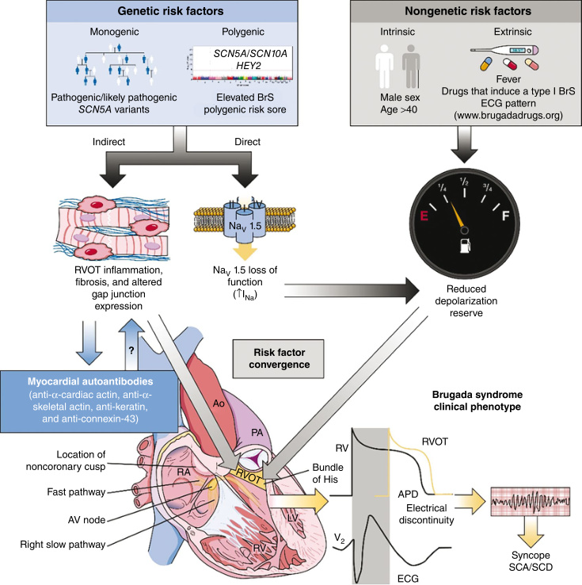

**Fig. 29.11** The evolving genetic architecture and pathophysiology of Brugada syndrome. The contribution of genetic _(blue box)_ and nongenetic _(gray box)_ risk factors to Brugada syndrome pathogenesis. _Black arrows_ denote the potential myocardial and electrophysiological effect(s) of known genetic and nongenetic risk factors. _Blue arrows_ demonstrate the recent identification of myocardial autoantibodies sensitive and specific for Brugada syndrome, as well as their potential role in disease pathogenesis. _Gray arrows_ demonstrate the convergence of myocardial and electrophysiological effects in the right ventricular outflow tract resulting in a localized delay in depolarization/conduction. _Yellow arrows_ demonstrate how electrical discontinuity between the right ventricular (black tracing) and right ventricular outflow tract (yellow tracing) are capable of generating the classic electrocardiogram findings observed in Brugada syndrome as well as an increased risk of syncope and/or sudden cardiac arrest/death secondary to sustained ventricular arrhythmias. _AP,_ Action potential; _BrS,_ Brugada syndrome; _ECG,_ electrocardiogram; _INa_ , inward sodium current; _RV,_ right ventricle; _RVOT,_ right ventricular outflow tract; _SCA,_ sudden cardiac arrest; _SCD,_ sudden cardiac death. (From Giudicessi JR, Tester DJ, Ackerman MJ. Genetics of cardiac arrhythmias. In: Libby P, Bonow RO, Mann DL, et al., eds. _Braunwald’s Heart Disease_ . 12th ed. Philadelphia: Elsevier; 2022 [Fig. 63.7, p. 1202].)

<!-- p.669 -->

arrhythmias (and in particular, the life-threatening arrhythmia seen in Brugada syndrome, ventricular fibrillation) is not clear. It may be due to an abnormality with depolarization, repolarization, a combination of the two, or perhaps a developmental abnormality related to neural crest cells in the right ventricular outflow tract (RVOT). It should be noted that the genetic yield in Brugada syndrome is low (~20%); perhaps many patients with Brugada syndrome actually have multiple single nucleotide polymorphisms which cause their disease rather than a single, known, pathogenic variant. 

## **Clinical Diagnosis** 

Brugada syndrome is diagnosed based on a personal and family history of clinical events as well as characteristic ECG findings. Genetic testing is less helpful in the diagnosis of Brugada syndrome; at this time, the diagnosis is clinical. A _Shanghai score_ has been proposed to help clinicians with the diagnosis of Brugada syndrome. There are points for ECG findings, clinical history, and family history (as well genetic testing); total scores are categorized as probable/ definite, possible, and nondiagnostic. It should be noted that the only single category that has enough points to classify as probable/definite is a spontaneous type 1 Brugada pattern on ECG. 

## **History** 

Patients may present with syncope, sudden cardiac arrest, or a family history of Brugada syndrome. The primary life-threatening arrhythmia seen in Brugada syndrome is ventricular fibrillation and is the etiology behind episodes of malignant syncope and sudden cardiac arrest. Atrial arrhythmias, including atrial fibrillation or flutter, can be seen in those with Brugada syndrome; some patients present with palpitations or tachycardia. Sinus node dysfunction and conduction delays can be seen as well. Symptomatic presentations are less common in children, and Brugada syndrome is a rare cause of sudden cardiac arrest in the young compared to LQTS or CPVT. 

## **ECG Findings** 

There are 3 commonly recognized Brugada ECG patterns, all characterized by a right bundle branch block morphology with ST segment elevation in leads V1 and V2. However, only a spontaneous (i.e., nonprovoked) type 1 Brugada pattern has been considered definitely diagnostic for Brugada syndrome (Figs. 29.12 and 29.13). There are a number of in-depth criteria for diagnosing the various Brugada patterns. The Brugada pattern may become more apparent when leads V1 and V2 are placed at higher than standard positions (i.e., the second or third intercostal space rather than the standard fourth intercostal space). The rationale behind this increase in ECG sensitivity is because of anatomic variations in the position of the right ventricular outflow tract in different patients (the right ventricular 

Type 1: Coved pattern 

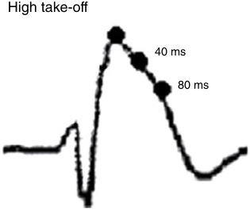

**Fig. 29.12** Type 1 Brugada pattern. The classic type 1 Brugada pattern which is seen in leads V1-V2. It resembles a right bundle branch block (RBBB) pattern, but has associated ST elevation, lack of clear r’ wave, and no reciprocal V6 changes. (From Bayés de Luna A, Brugada J, Baranchuk A, et al. Current electrocardiographic criteria for diagnosis of Brugada pattern: a consensus report. _J Electrocardiol_ . 2012;45[5]:433-442.) 

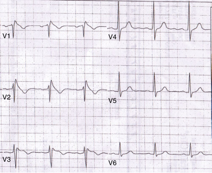

**Fig. 29.13** ECG from a patient with BrS showing the classic type 1 Brugada pattern in leads V1 and V2. 

outflow tract is a critical region for arrhythmogenesis in Brugada syndrome). Even in those with a spontaneous type 1 pattern, there may be intermittent periods when the patient does not show a Brugada pattern on ECG, even though they do have the disease. A Brugada pattern can be provoked by _fever_ as well as _class 1 antiarrhythmics_ (which block Na+ channels). In some Brugada syndrome variants, higher temperatures result in increased loss of function in the voltage-gated sodium channel which is manifest as a fever-induced type 1 pattern on ECG. There are protocols for intravenous administration of class I antiarrhythmics (primarily procainamide is used in the United States; ajmaline is used in Europe) to provoke or unmask a type 1 pattern in those with suspicion for Brugada syndrome. Many would consider a type 1 Brugada pattern that is unmasked

<!-- p.670 -->

by drug challenge to be diagnostic of Brugada syndrome. Similarly, fever-induced type 1 pattern is consistent with a diagnosis of Brugada syndrome; some do not consider it definitively diagnostic in an asymptomatic patient with no family history of Brugada syndrome. 

## **Genetic Testing** 

A pathogenic/likely pathogenic loss-of-function variant in _SCN5A_ is not considered sufficient to diagnosis Brugada syndrome in the absence of other findings (symptoms, ECG findings, and/or family history). However, it is reasonable to pursue genetic testing in all those with a spontaneous or provoked type 1 pattern. If a pathogenic or likely pathogenic variant is found in the proband, cascade family screening should be offered; the penetrance of Brugada syndrome is modest and it has been shown that some family members of a proband with known Brugada syndrome are genotype negative but phenotype positive. Therefore, all at-risk family members should also be screened with ECGs. Because children often do not manifest an ECG Brugada pattern, serial screening is recommended; families and providers should be prepared to obtain an ECG during febrile states. Routine drug challenge is not recommended for screening in children. 

## **Natural History and Risk Stratification** 

The development of a Brugada pattern on ECG and/or symptoms attributable to Brugada syndrome appears to be rare in children and is likely age dependent. However, children can be affected (in some, severely). Those who become symptomatic in childhood have a high lifetime burden of arrhythmias and are at risk for cardiac events. Brugada syndrome typically presents in middle age (fourth or fifth decade of life). Risk factors for arrhythmic events in children include: a spontaneous type 1 Brugada pattern, history of previous syncopal events, atrial arrhythmias, sinus node dysfunction, and conduction abnormalities. 

Electrophysiology study (EPS) with programmed ventricular stimulation is a controversial method of risk stratification in Brugada syndrome. Those in whom ventricular arrhythmias are easily provoked during EPS may be at greater risk of cardiac events. An EPS may not be more predictive than other noninvasive markers and, given that it is an invasive (albeit generally safe) procedure, its utility remains a matter of debate. 

## **Treatment** 

### **_Avoidance_** 

Patients and providers need to be aware of medications that may provoke a Brugada pattern, foremost the class I antiarrhythmics (sodium channel blockers). The website _brugadadrugs.org_ is helpful in this regard. Avoidance of fever is 

also important, particularly in children because they have both a higher risk of cardiac events during febrile states and often have more febrile illnesses than adults. Aggressive and timely treatment with antipyretics is essential. Alcohol should be avoided because it has been associated with syncope. 

## **_Medications_** 

The drugs quinidine and hydroquinidine have been used in Brugada syndrome. The exact mechanism of action by which they are helpful in decreasing arrhythmogenesis in Brugada syndrome is unclear. However, it is likely related to potassium channel blockade and subsequent prolongation of the action potential. There are no randomized controlled trials conclusively showing decreased cardiac events in those taking quinidine. Along with the lack of proven efficacy, difficulties with access and side effects limit its use, although some may trial it in patients with ICDs and continued events. Some have suggested that it is particularly useful in atrial fibrillation in Brugada syndrome. While not a chronic therapy, intravenous isoproterenol is useful in patients with Brugada syndrome and electrical storm. 

## **_Implantable Cardioverter-Defibrillators_** 

ICDs should be implanted as secondary prevention in all those with sudden cardiac arrest and Brugada syndrome. Those with evidence of spontaneous ventricular arrhythmias and/or a type 1 pattern and a history of unexplained syncope likely also benefit from ICD implantation. 

## **_Ablation_** 

An EPS with radiofrequency ablation of ventricular arrhythmic foci is an adjunctive therapy especially for those with continued events despite other treatments. 

# **When to Suspect an Inherited Arrhythmogenic Disease** 

Syncope is one of the most important symptoms to evaluate in a patient because the underlying etiology could be an arrhythmia syndrome. Benign faints in childhood are more common than an arrhythmia and are due to vasovagal syncope which is frequently preceded by a prodrome of dizziness, palpitations, the sensation of warmth or coldness, tunnel vision, and diminution of hearing frequently in the setting of postural changes. Syncope due to sudden, malignant ventricular arrhythmias occurs with little to no warning, resulting, most often, in a lack of prodromal events. These patients classically have violent falls with injuries to the face and head. The observed event may be notable for tonic or convulsive activity with urinary incontinence. The clinician must also probe for syncope triggers associated with inherited arrhythmogenic diseases such as exertion, loud noises, a startling event, and fever; the history should include details about any events where an unstable tachyarrhythmia could be described as something other than

<!-- p.671 -->

syncope (e.g., generalized seizures, a near drowning event, and an unexplained automobile accident where the patient was the driver). A medication history should be taken looking for potential drugs that could trigger an arrhythmic event. 

A detailed family history is equal in importance to the patient’s own personal history. While the entire spectrum of disease inheritance is seen with inherited arrhythmogenic disorders, an autosomal dominant inheritance pattern is the most prevalent. Thus, a detailed family history inquiring about all first, second, and third-degree relatives is critical. In particular, a first-degree relative with concerning syncope, a cardiac arrest, or sudden death merits further investigation regarding the details of the event(s). The proximate cause of death may be deemed noncardiac by the family, but upon further history may be classified as concerning by the clinician. Examples would include a drowning death and a death in solo motor vehicle accident, which may have actually been caused by a ventricular arrhythmia. A negative family history does not preclude an arrhythmogenic diagnosis. There may be asymptomatic relatives, or the patient might have a spontaneous pathogenic variant in an arrhythmia gene. In some of the most malignant forms of LQTS, CPVT, and Brugada syndrome, the proband has a spontaneous variant where lethality in childhood prohibits achieving reproductive age. 

## **Diagnostic Tools in the Evaluation of an Inherited Arrhythmogenic Disease** 

While the physical examination will often be normal in primary arrhythmia conditions, any abnormal findings on the cardiac examination may point to other conditions in the differential diagnosis. Similarly, while an echocardiogram is highly likely to be normal for a patient with an 

inherited arrhythmogenic disease, the test is useful if there are events concerning for malignant arrhythmias as conditions such as hypertrophic cardiomyopathy, myocarditis, and coronary artery anomalies can be detected. 

The 12-lead ECG is the standard tool for assessing patients with a possible inherited arrhythmogenic disease. In pediatrics, proper lead placement is essential. This test primarily screens for LQTS, via measurement of the QT interval (Fig. 29.7). However, it may also show a type 1 Brugada pattern (Figs. 29.12 and 29.13). It should be noted that the QT interval is often transiently increased following a vasovagal event and this may lead to an overdiagnosis of LQTS. An exercise stress test may unmask an arrhythmia condition in a person with a baseline normal ECG. In particular, exercise testing is useful at uncovering CPVT and in the evaluation of LQTS. Since exertion may trigger an arrhythmic event, the testing facility must be comfortable in dealing with the possibility of a malignant arrhythmia during stress testing (Fig. 29.10). 

While the ECG and stress test provide information at baseline and with exertion, situational syncope may merit rhythm documentation during the acute event. Ambulatory ECG monitoring (Holter or event monitors) is a short-term option but is limited in usefulness only to patients with frequent events. To capture rhythm data during infrequent events, clinicians may utilize an implantable loop recorder (ILR). This small device can be easily inserted subcutaneously into the chest wall and thereafter provide up to 4+ years of data. The ILR can be activated by the patient or bystander to record recent historical rhythm data. At implantation an ILR is programmed by the heart rhythm medical team to autodetect tachyand bradyarrhythmias (e.g., pauses >3 seconds, tachyarrhythmias >220 bpm, etc.). The data from an ILR may be used to rule out cardiac rhythm disorder in those with infrequent events (Fig. 29.14). 

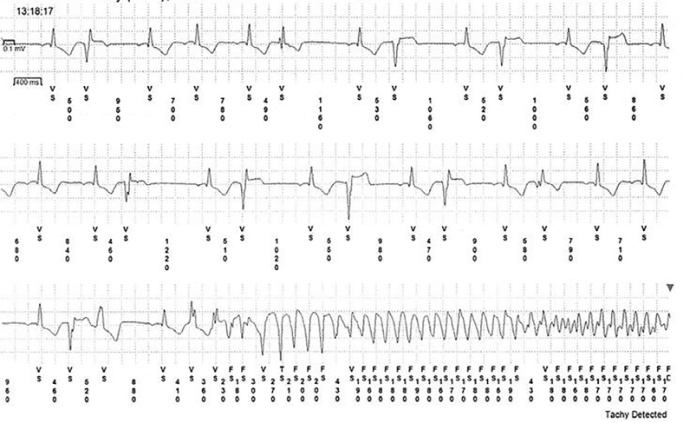

**Fig. 29.14** This patient had intermittent syncope, and to better characterize these events, an ILR was implanted. This strip shows the development of PVCs and then polymorphic VT.

<!-- p.672 -->

Genetic testing serves as a highly useful tool in the evaluation of inherited arrhythmogenic diseases, in particular LQTS and CPVT. Genetic testing can confirm a clinical diagnosis, and it may offer prognostic information (severity, specific triggers to avoid); it may also allow cascade screening of family members. Nonetheless, not all patients with the phenotype have an identifiable pathogenic gene variant. 

# **Bibliography** 

- Ackerman MJ, Priori SG, Dubin AM, et al. Beta-blocker therapy for long QT syndrome and catecholaminergic polymorphic ventricular tachycardia: are all beta-blockers equivalent? _Heart Rhythm_ . 2017;14:e41-e44. 

- Ackerman MJ, Priori SG, Willems S, et al. HRS/EHRA expert consensus statement on the state of genetic testing for the channelopathies and cardiomyopathies. _Heart Rhythm._ 2011;8: 1308-1339. 

- Adler A, Novelli V, Amin AS, et al. An international, multicentered, evidence-based reappraisal of genes reported to cause congenital long QT syndrome. _Circulation_ . 2020;141:418-428. 

- Adler A, Topaz G, Heller K, et al. Fever-induced Brugada pattern: how common is it and what does it mean? _Heart Rhythm_ . 2013;10:1375-1382. 

- Altmann HM, Tester DJ, Will ML, et al. Homozygous/compound heterozygous triadin mutations associated with autosomalrecessive Long-QT syndrome and pediatric sudden cardiac arrest: elucidation of the Triadin Knockout syndrome. _Circulation_ . 2015;131:2051-2060. 

- Andorin A, Gourraud J-B, Mansourati J, et al. The QUIDAM study: hydroquinidine therapy for the management of Brugada syndrome patients at high arrhythmic risk. _Heart Rhythm_ . 2017;14: 1147-1154. 

- Antzelevitch C, Yan G-X, Ackerman MJ, et al. J-Wave syndromes expert consensus conference report: emerging concepts and gaps in knowledge. _Heart Rhythm_ 2016;13:e295-e324. 

- Aziz PF, Wieand TS, Ganley J, et al. Genotypeand mutation site– specific QT adaptation during exercise, recovery, and postural changes in children with Long-QT syndrome. _Circ Arrhythm Electrophysiol_ . 2011;4:867-873. 

- Bagnall RD, Weintraub RG, Ingles J, et al. A prospective study of sudden cardiac death among children and young adults. _N Engl J Med_ . 2016;374:2441-2452. 

- Baher AA, Uy M, Xie F, Garfinkel A, Qu Z, Weiss JN, Bidirectional ventricular tachycardia: ping pong in the His–Purkinje system. _Heart Rhythm._ 2011;8:599-605. 

- Bains S, Neves R, Bos JM, Giudicessi JR, MacIntyre C, Ackerman MJ. Phenotypes of overdiagnosed long QT syndrome. _J Am Coll Cardiol_ . 2023;81:477-486. 

- Bayés de Luna A, Brugada J, Baranchuk A, et al. Current electrocardiographic criteria for diagnosis of Brugada pattern: a consensus report. _J Electrocardiol_ . 2012;45:433-442. 

- Bazett HC. An analysis of the time relations of electrocardiograms. _Heart_ . 1920;7:353-370. 

- Behr ER, Dalageorgou C, Christiansen M, et al. Sudden arrhythmic death syndrome: familial evaluation identifies inheritable heart disease in the majority of families. _Eur Heart J_ . 2008;29:1670-1680. 

- Bezzina CR, Barc J, Mizusawa Y, et al. Common variants at SCN5ASCN10A and HEY2 are associated with Brugada syndrome, a rare 

   - disease with high risk of sudden cardiac death. _Nat Genet_ . 2013;45:1044-1049. 

- Bos JM, Bos KM, Johnson JN, Moir C, Ackerman MJ. Left cardiac sympathetic denervation in long QT syndrome: analysis of therapeutic nonresponders. _Circ Arrhythm Electrophysiol_ . 2013;6(4):705-711. 

- Brugada P. 95—Brugada syndrome. In: _Zipes and Jalife’s Cardiac Electrophysiology: From Cell to Bedside_ . Elsevier; 2022. 

- Brugada P, Brugada J. Right bundle branch block, persistent ST segment elevation and sudden cardiac death: a distinct clinical and electrocardiographic syndrome. _J Am Coll Cardiol_ . 1992;20: 1391-1396. 

- Brugada J, Campuzano O, Arbelo E, Sarquella-Brugada G, Brugada R. Present status of Brugada syndrome. _J Am Coll Cardiol_ . 2018;72:1046-1059. 

- Cerrone M, Noujaim SF, Tolkacheva EG, et al. Arrhythmogenic mechanisms in a mouse model of catecholaminergic polymorphic ventricular tachycardia. _Circ Res_ . 2007;101:1039-1048. 

- Chen Q, Kirsch GE, Zhang D, et al. Genetic basis and molecular mechanism for idiopathic ventricular fibrillation. _Nature_ . 1998; 392:293-296. 

- Chockalingam P, Crotti L, Girardengo G, et al. Not all beta-blockers are equal in the management of long QT syndrome types 1 and 2. _J Am Coll Cardiol_ . 2012;60:2092-2099. 

- Costa J, Lopes CM, Barsheshet A, et al. Combined assessment of sexand mutation-specific information for risk stratification in type 1 long QT syndrome. _Heart Rhythm_ . 2012;9:892-898. 

- Coumel P, Fidelle J, Lucet V, Attuel P, Bouvrain Y. Catecholamineinduced severe ventricular arrhythmias with Adams-Stokes syndrome in children: report of four cases. _Br Heart J_ . 1978;40:28-37. 

- Crotti L, Johnson CN, Graf E, et al. Calmodulin mutations associated with recurrent cardiac arrest in infants. _Circulation_ . 2013;127: 1009-1017. 

- Curran ME, Splawski I, Timothy KW, Vincen GM, Green ED, Keating MT. A molecular basis for cardiac arrhythmia: HERG mutations cause long QT syndrome. _Cell_ . 1995;80:795-803. 

- Devalla HA, Gelinas R, Aburawi E, et al. TECRL, a new life-threatening inherited arrhythmia gene associated with overlapping clinical feastures of both LQTS and CPVT. _EMBO Mol Med_ . 2016;8:1390-1408. 

- Dionne A, Fournier A, Dahdah N, Abrams D, Khairy P, Abadir S. Dynamic QT interval changes from supine to standing in healthy children. _Can J Cardiol_ . 2018;34:66-72. 

- Drew BJ, Ackerman MJ, Funk M, et al. Prevention of torsade de pointes in hospital settings: a scientific statement from the American Heart Association and the American College of Cardiology Foundation. _Circulation_ . 2010;121:1047-1060. 

- Faggioni M, Hwang HS, van der Werf C, et al. Accelerated sinus rhythm prevents catecholaminergic polymorphic ventricular tachycardia in mice and in patients. _Circ Res_ . 2013;112:689-697. 

- Fernandes GC, Fernandes A, Cardoso R, et al. Ablation strategies for the management of symptomatic Brugada syndrome: a systematic review. _Heart Rhythm_ . 2018;15:1140-1147. 

- Filippini LHPM, Postema PG, Zoubin K, et al. The brisk-standingtest for long QT syndrome in prepubertal school children: defining normal. _Europace_ . 2018;20:f108-f112. 

- Franciosi S, Roston TM, Perry FKG, Knollmann BC, Kannankeril PJ, Sanatani S. Chronotropic incompetence as a risk predictor in children and young adults with catecholaminergic polymorphic ventricular tachycardia. _J Cardiovasc Electrophysiol_ . 2019;30:1923-1929. 

- George CH, Jundi H, Thomas NL, Fry DL, Lai FA. Ryanodine receptors and ventricular arrhythmias: Emerging trends in mutations, mechanisms and therapies. _J Mol Cell Cardiol_ . 2007;42:34-50.

<!-- p.673 -->

- Giudicessi JR, Ackerman MJ. Exercise testing oversights underlie missed and delayed diagnosis of catecholaminergic polymorphic ventricular tachycardia in young sudden cardiac arrest survivors. _Heart Rhythm_ . 2019;16:1232-1239. 

- Giustetto C, Cerrato N, Gribaudo E, et al. Atrial fibrillation in a large population with Brugada electrocardiographic pattern: Prevalence, management, and correlation with prognosis. _Heart Rhythm_ . 2014;11:259-265. 

- Goldenberg I, Mathew J, Moss AJ, et al. Corrected QT variability in serial electrocardiograms in long QT syndrome. _J Am Coll Cardiol_ . 2006;48:1047-1052. 

- Gonzalez Corcia MC, Sieira J, Sarkozy A, et al. Brugada syndrome in the young: an assessment of risk factors predicting future events. _Europace_ . 2017;19:1864-1873. 

- Hayashi M, Denjoy I, Extramiana F, et al. Incidence and risk factors of arrhythmic events in catecholaminergic polymorphic ventricular tachycardia. _Circulation_ . 2009;119:2426-2434. 

- Hobbs JB, Peterson DR, Moss AJ, et al. Risk of aborted cardiac arrest or sudden cardiac death during adolescence in the long-QT syndrome. _JAMA_ . 2006;296(10):1249-1254. 

- Hofman N, Tan HL, Alders M, et al. Yield of molecular and clinical testing for arrhythmia syndromes: report of 15 years’ experience. _Circulation_ . 2013;128:1513-1521. 

- Hofman N, Wilde AAM, Kaab S, van Langen IM, Tanck MWT. Diagnostic criteria for congenital long QT syndrome in the era of molecular genetics: do we need a scoring system? _Eur Heart J_ . 2007;28:575-580. 

- Issa ZF, Miller JM, Zipes DP. Ventricular arrhythmias in inherited channelopathies. In: _Clinical Arrhythmology and Electrophysiology_ . Elsevier; 2019:976-1041. 

- Jervell A, Lange-Nielsen F. Congenital deaf-mutism, functional heart disease with prolongatin of the Q-T interval and sudden death. _Am Heart J_ . 1957;54:59-68. 

- Jiménez-Jáimez J, Peinado R, Grima EZ, et al. Diagnostic approach to unexplained cardiac arrest (from the FIVI-Gen Study). _Am J Cardiol_ . 2015;116:894-899. 

- Johnson JN, Hofman N, Haglund CM, Cascino GD, Wilde AAM, Ackerman MJ. Identification of a possible pathogenic link between congenital long QT syndrome and epilepsy. _Neurology_ . 2009;72:224-231. 

- Kannankeril PJ, Moore JP, Cerrone M, et al. Efficacy of flecainide in the treatment of catecholaminergic polymorphic ventricular tachycardia: a randomized clinical trial. _JAMA Cardiol_ . 2017;2:759. 

- Kapplinger JD, Pundi KN, Larson NB, et al. Yield of the _RYR2_ genetic test in suspected catecholaminergic polymorphic ventricular tachycardia and implications for test interpretation. _Circ Genom Precis Med_ . 2018;11:e001424. 

- Kapplinger JD, Tester DJ, Alders M, et al. An international compendium of mutations in the SCN5A-encoded cardiac sodium channel in patients referred for Brugada syndrome genetic testing. _Heart Rhythm_ . 2010;7:33-46. 

- Kirchhof P, Eckardt L, Franz MR, et al. Prolonged atrial action potential durations and polymorphic atrial tachyarrhythmias in patients with long QT syndrome. _J Cardiovasc Electrophysiol_ . 2003;14: 1027-1033. 

- Krahn AD, Behr ER, Hamilton R, Probst V, Laksman Z, Han HC. Brugada syndrome. _JACC Clin Electrophysiol_ . 2022a;8:386-405. 

- Krahn AD, Healey JS, Chauhan V, et al. Systematic assessment of patients with unexplained cardiac arrest: cardiac arrest survivors with preserved ejection fraction registry (CASPER). _Circulation_ . 2009;120:278-285. 

- Krahn AD, Laksman Z, Sy RW, et al. Congenital long QT syndrome. _JACC Clin Electrophysiol_ . 2022b;8:687-706. 

- Kushnir A, Marks AR. The ryanodine receptor in cardiac physiology and disease. In: _Advances in Pharmacology_ . Elsevier; 2010:1-30. 

- Lahat H, Pras E, Olender T, et al. A missense mutation in a highly conserved region of CASQ2 is associated with autosomal recessive catecholamine-induced polymorphic ventricular tachycardia in Bedouin families from Israel. _Am J Hum Genet_ . 2001;69(6):1378-1384. 

- Laitinen PJ, Brown KM, Piippo K, et al. Mutations of the cardiac ryanodine receptor (RyR2) gene in familial polymorphic ventricular tachycardia. _Circulation_ . 2001;103(4):485-490. 

- Landstrom AP, Kim JJ, Gelb BD, et al. Genetic testing for heritable cardiovascular diseases in pediatric patients. _Circ Genom Precis Med._ 2021;14(5):e000086. 

- Leenhardt A, Denjoy I, Guicheney P. Catecholaminergic polymorphic ventricular tachycardia. _Circ Arrhythm Electrophysiol_ . 2012;5: 1044-1052. 

- Liu N, Colombi B, Memmi M, et al. Arrhythmogenesis in catecholaminergic polymorphic ventricular tachycardia: insights from a RyR2 R4496C knock-in mouse model. _Circ Res_ . 2006;99: 292-298. 

- Macfarlane PW, McLaughlin SC, Rodger JC. Influence of lead selection and population on automated measurement of QT dispersion. _Circulation_ . 1998;98:2160-2167. 

- Mariani MV, Pierucci N, Fanisio F, et al. Inherited arrhythmias in the pediatric population: an updated overview. _Medicina (Kaunas)_ . 2024;60:94. 

- Marx SO, Reiken S, Hisamatsu Y, et al. PKA phosphorylation dissociates FKBP12.6 from the calcium release channel (ryanodine receptor): defective regulation in failing hearts. _Cell_ . 2000;101(4):365-376. 

- Mazzanti A, Guz D, Trancuccio A, et al. Natural history and risk stratification in Andersen-Tawil Syndrome type 1. _J Am Coll Cardiol_ . 2020;75:1772-1784. 

- Mazzanti A, Maragna R, Faragli A, et al. Gene-specific therapy with mexiletine reduces arrhythmic events in patients with long QT syndrome type 3. _J Am Coll Cardiol_ . 2016;67:1053-1058. 

- Medeiros-Domingo A, Bhuiyan ZA, Tester DJ, et al. The RYR2encoded ryanodine receptor/calcium release channel in patients diagnosed previously with either catecholaminergic polymorphic ventricular tachycardia or genotype negative, exercise-induced long QT syndrome. _J Am Coll Cardiol_ . 2009;54:2065-2074. 

- Michowitz Y, Milman A, Andorin A, et al. Characterization and management of arrhythmic events in young patients with Brugada syndrome. _J Am Coll Cardiol_ . 2019;73:1756-1765. 

- Miyake CY, Webster G, Czosek RJ, et al. Efficacy of implantable cardioverter defibrillators in young patients with catecholaminergic polymorphic ventricular tachycardia: success depends on substrate. _Circ Arrhythm Electrophysiol_ . 2013;6:579-587. 

- Miyazaki T, Mitamura H, Miyoshi S, Soejima K, Aizawa Y, Ogawa S. Autonomic and antiarrhythmic drug modulation of ST segment elevation in patients with Brugada syndrome. _J Am Coll Cardiol_ . 1996;27:1061-1070. 

- Monnig, G. Electrocardiographic risk stratification in families with congenital long QT syndrome. _Eur Heart J_ . 2006;27:2074-2080. 

- Moss AJ, Robinson JL, Gessman L, et al. Comparison of clinical and genetic variables of cardiac events associated with loud noise versus swimming among subjects with the long QT syndrome. _Am J Cardiol_ . 1999;84:876-879. 

- Nannenberg EA, Sijbrands EJG, Dijksman LM, et al. Mortality of inherited arrhythmia syndromes: insight into their natural history. _Circ Cardiovasc Genet_ . 2012;5:183-189.

<!-- p.674 -->

- Napolitano C, Mazzanti A, Porta-Sanchez A, Priori SG. 98—Timothy syndrome. In: _Zipes and Jalife’s Cardiac Electrophysiology: From Cell to Bedside_ . Elsevier; 2022. 

- Niaz T, Bos JM, Sorensen KB, Moir C, Ackerman MJ. Left cardiac sympathetic denervation monotherapy in patients with congenital long QT syndrome. _Circ Arrhythm Electrophysiol_ . 2020;13: e008830. 

- Oe H, Takagi M, Tanaka A, et al. Prevalence and clinical course of the Juvenile with Brugada-type ECG in Japanese population. _Pacing Clin Electrophysiol_ . 2005;28:549-554. 

- Postema PG, Neville J, de Jong JS, Romero K, Wilde AA, Woosley RL. Safe drug use in long QT syndrome and Brugada syndrome: comparison of website statistics. _Europace_ . 2013;15:1042-1049. 

- Postema PG, Wolpert C, Amin AS, et al. Drugs and Brugada syndrome patients: review of the literature, recommendations, and an up-to-date website (www.brugadadrugs.org). _Heart Rhythm_ . 2009;6:1335-1341. 

- Postma AV, Denjoy I, Hoorntje TM, et al. Absence of calsequestrin 2 causes severe forms of catecholaminergic polymorphic ventricular tachycardia. _Circ Res_ . 2002;91:e21-e26. 

- Priori SG, Mazzanti A, Santiago DJ, Kukavica D, Trancuccio A, Kovacic JC. Precision medicine in catecholaminergic polymorphic ventricular tachycardia. _J Am Coll Cardiol_ . 2021;77:2592-2612. 

- Priori SG, Schwartz PJ, Napolitano C, et al. Risk stratification in the long-QT syndrome. _N Engl J Med_ . 2003;348(19):1866-1874. 

- Priori SG, Wilde AA, Horie M, et al. HRS/EHRA/APHRS expert consensus statement on the diagnosis and management of patients with inherited primary arrhythmia syndromes. _Heart Rhythm_ . 2013; 10:1932-1963. 

- Probst V, Denjoy I, Meregalli PG, et al. Clinical aspects and prognosis of Brugada syndrome in children. _Circulation_ . 2007;115: 2042-2048. 

- Roberts JD, Asaki SY, Mazzanti A, et al. An international multicenter evaluation of type 5 long QT syndrome: a low penetrant primary arrhythmic condition. _Circulation_ . 2020;141:429-439. 

- Romano C, Gemme G, Pongiglione R. Rare cardiac arrythmias of the pediatric age. II. Syncopal attacks due to paroxysmal ventricular fibrillation (Presentation of 1st case in Italian Pediatric literature). _Clin Pediatr (Bologna)_ . 1963;45:656-683. 

- Rooryck C, Kyndt F, Bozon D, et al. New family with catecholaminergic polymorphic ventricular tachycardia linked to the triadin gene: sudden death linked to the Triadin gene. _J Cardiovasc Electrophysiol_ . 2015;26:1146-1150. 

- Rosso R, Adler A, Strasberg B, et al. Long QT syndrome complicating atrioventricular block: arrhythmogenic effects of cardiac memory. _Circ Arrhythm Electrophysiol_ . 2014;7:1129-1135. 

- Roston TM, Kallas D, Davies B, et al. Burst exercise testing can unmask arrhythmias in patients with incompletely penetrant catecholaminergic polymorphic ventricular tachycardia. _JACC Clin Electrophysiol_ . 2021;7:437-441. 

- Roston TM, Vinocur JM, Maginot KR, et al. Catecholaminergic polymorphic ventricular tachycardia in children: analysis of therapeutic strategies and outcomes from an international multicenter registry. _Circ Arrhythm Electrophysiol_ . 2015;8(3):633-642. 

- Rucinski C, Winbo A, Marcondes L, et al. A population-based registry of patients with inherited cardiac conditions and resuscitated cardiac arrest. _J Am Coll Cardiol_ . 2020;75:2698-2707. 

- Saadeh K, Shivkumar K, Jeevaratnam K. Targeting the Beta-adrenergic receptor in the clinical management of congenital long QT syndrome. _Ann N Y Acad Sci_ . 2020;1474:27-46. 

- Sauer AJ, Moss AJ, McNitt S, et al. Long QT syndrome in adults. _J Am Coll Cardiol_ . 2007;49:329-337. 

- Schwartz PJ. Cardiac sympathetic denervation to prevent life-threatening arrhythmias. _Nat Rev Cardiol_ . 2014;11:346-353. 

- Schwartz PJ, Crotti L. Long QT syndrome. _N Engl J Med_ . 2025;393;20:2023-2034. 

- Schwartz PJ, Crotti L. QTc Behavior during exercise and genetic testing for the long-QT syndrome. _Circulation_ . 2011;124: 2181-2184. 

- Schwartz PJ, Crotti L, Insolia R. Long-QT syndrome: from genetics to management. _Circ Arrhythm Electrophysiol_ . 2012;5:868-877. 

- Schwartz PJ, Dagradi F, Crotti L. 96—Long and short QT syndromes. In: _Zipes and Jalife’s Cardiac Electrophysiology: From Cell to Bedside_ . Elsevier; 2022. 

- Schwartz PJ, Priori SG, Spazzolini C, et al. Genotype-phenotype correlation in the long-QT syndrome: gene-specific triggers for lifethreatening arrhythmias. _Circulation_ . 2001;103(1):89-95. 

- Schwartz PJ, Stramba-Badiale M, Crotti L, et al. Prevalence of the congenital long-QT syndrome. _Circulation_ . 2009;120:17611767. 

- Schwartz PJ, Woosley RL. Predicting the unpredictable. _J Am Coll Cardiol_ . 2016;67:1639-1650. 

- Seth R, Moss AJ, McNitt S, et al. Long QT syndrome and pregnancy. _J Am Coll Cardiol_ . 2007;49:1092-1098. 

- Sgrò A, Drake TM, Lopez-Ayala P, Phan K. Left cardiac sympathetic denervation in the management of long QT syndrome and catecholaminergic polymorphic ventricular tachycardia: a meta-regression. _Congenit Heart Dis_ . 2019;14:1102-1112. 

- Shah MJ, Silka MJ, Silva JNA, et al. 2021 PACES expert consensus statement on the indications and management of cardiovascular implantable electronic devices in pediatric patients. _Heart Rhythm_ . 2021;18:1888-1924. 

- Silka MJ, Kobayashi RL, Hill AC, Bar-Cohen Y. Pediatric survivors of out-of-hospital ventricular fibrillation: Etiologies and outcomes. _Heart Rhythm_ . 2018;15:116-121. 

- Skinner JR, Winbo A, Abrams D, Vohra J, Wilde AA. Channelopathies that lead to sudden cardiac death: clinical and genetic aspects. _Heart Lung Circ_ . 2019;28:22-30. 

- Sroubek J, Probst V, Mazzanti A, et al. Programmed ventricular stimulation for risk stratification in the Brugada syndrome: a pooled analysis. _Circulation_ . 2016;133:622-630. 

- Sy RW, Gollob MH, Klein GJ, et al. Arrhythmia characterization and long-term outcomes in catecholaminergic polymorphic ventricular tachycardia. _Heart Rhythm_ . 2011a;8:864-871. 

- Sy RW, van der Werf C, Chattha IS, et al. Derivation and validation of a simple exercise-based algorithm for prediction of genetic testing in relatives of LQTS probands. _Circulation_ . 2011b;124:2187-2194. 

- Tan HL, Hofman N, van Langen IM, van der Wal AC, Wilde AAM. Sudden unexplained death: heritability and diagnostic yield of cardiological and genetic examination in surviving relatives. _Circulation_ . 2005;112:207-213. 

- Tester DJ, Ackerman MJ. Postmortem long QT syndrome genetic testing for sudden unexplained death in the young. _J Am Coll Cardiol_ . 2007;49:240-246. 

- Tester DJ, Will ML, Haglund CM, Ackerman MJ. Effect of clinical phenotype on yield of long QT syndrome genetic testing. _J Am Coll Cardiol_ . 2006;47:764-768. 

- Tobert KE, Bos JM, Garmany R, Ackerman MJ. Return-to-play for athletes with long QT syndrome or genetic heart diseases predisposing to sudden death. _J Am Coll Cardiol_ . 2021;78:594-604. 

- Tristani-Firouzi M, Etheridge SP. 97—Andersen-Tawil syndrome. In: _Zipes and Jalife’s Cardiac Electrophysiology: From Cell to Bedside_ . Elsevier; 2022.

<!-- p.675 -->

- van der Werf C, Hofman N, Tan HL, et al. Diagnostic yield in sudden unexplained death and aborted cardiac arrest in the young: the experience of a tertiary referral center in The Netherlands. _Heart Rhythm_ . 2010;7:1383-1389. 

- van der Werf C, Nederend I, Hofman N, et al. Familial evaluation in catecholaminergic polymorphic ventricular tachycardia: disease penetrance and expression in cardiac ryanodine receptor mutation– carrying relatives. _Circ Arrhythm Electrophysiol_ . 2012;5:748-756. 

- van der Werf C, Zwinderman AH, Wilde AAM. Therapeutic approach for patients with catecholaminergic polymorphic ventricular tachycardia: state of the art and future developments. _Europace_ . 2012;14:175-183. 

- van der Werf C, Wilde AM. 91—Catecholaminergic polymorphic ventricular tachycardia. In: _Zipes and Jalife’s Cardiac Electrophysiology: From Cell to Bedside_ . Elsevier; 2022. 

- Veltmann C, Papavassiliu T, Konrad T, et al. Insights into the location of type I ECG in patients with Brugada syndrome: Correlation of ECG and cardiovascular magnetic resonance imaging. _Heart Rhythm_ . 2012;9:414-421. 

- Vincent GM, Jaiswal D, Timothy KW. Effects of exercise on heart rate, QT, QTc and QT/QS2 in the Romano-Ward inherited long QT syndrome. _Am J Cardiol_ . 1991;68(5):498-503. 

- Vink AS, Hermans BJM, Pimenta J, et al. Diagnostic accuracy of the response to the brief tachycardia provoked by standing in children 

suspected for long QT syndrome. _Heart Rhythm O2_ . 2021;2: 149-159. 

- Vink AS, Neumann B, Lieve KVV, et al. Determination and interpretation of the QT interval: comprehensive analysis of a large cohort of long QT syndrome patients and controls. _Circulation_ . 2018; 138:2345-2358. 

- Wang Q, Shen J, Splawski I, et al. SCN5A mutations associated with an inherited cardiac arrhythmia, long QT syndrome. _Cell_ . 1995; 80:805-811. 

- Ward OC. A new familial cardiac syndrome in children. _J Ir Med Assoc_ . 1964;54:103-106. 

- Wilde AAM, Amin AS. Clinical spectrum of SCN5A mutations. _JACC Clin Electrophysiol_ . 2018;4:569-579. 

- Wleklinski MJ, Kannankeril PJ, Knollmann BC. Molecular and tissue mechanisms of catecholaminergic polymorphic ventricular tachycardia. _J Physiol_ . 2020;598:2817-2834. 

- Woosley RL, Romero K. Assessing cardiovascular drug safety for clinical decision-making. _Nat Rev Cardiol_ . 2013;10:330-337. 

- Wu Q, Hayashi H, Hira D, et al. Genetic variants of alcoholmetabolizing enzymes in Brugada syndrome: insights into syncope after drinking alcohol. _J Arrhythm_ . 2019;35:752-759. 

- Yang F, Hanon S, Lam P, Schweitzer P. Quinidine revisited. _Am J Med_ . 2009;122:317-321.