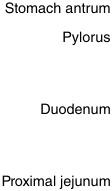
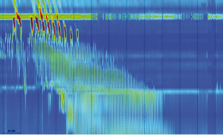

<!-- p.730 -->

# 32 Pediatric Intestinal Pseudo-Obstruction 

**GEETANJALI BORA, MANU SOOD** 

Chronic intestinal pseudo-obstruction (CIPO) is an umbrella term which encompasses a heterogenous group of rare disorders that lead to signs of chronic intestinal obstruction _in the absence_ of an anatomical lesion. Unlike acute intestinal pseudo-obstruction where symptoms are transient, CIPO is defined by presence of chronic symptoms which are caused by conditions affecting the structure or function of components of intestinal neuromusculature. 

There are important differences between pediatric and adult onset of chronic intestinal pseudo-obstruction (Table 32.1). The European Society for Pediatric Gastroenterology, Hepatology, and Nutrition (ESPGHAN) proposed that CIPO in children should be treated as a separate entity and referred to it as pediatric intestinal pseudo-obstruction (PIPO). Due to the nonspecific nature of symptoms and rarity of this disorder, children with PIPO often undergo repeated invasive evaluations and surgeries before the correct diagnosis is made. 

## **Epidemiology** 

A national survey in the United States by the American Pseudo-Obstruction and Hirschsprung’s Disease Society estimated that 100 infants are born with congenital pseudoobstruction every year in the United States. This study did not account for children with onset of symptoms beyond infancy and may therefore have underestimated the prevalence of PIPO. A Japanese survey estimated the prevalence of PIPO at 3.7 in 1 million children with an equal sex distribution. A nationwide survey in the United States found an incidence of inpatient admission of 29 per 100,000 were attributed to the diagnosis of PIPO. Overall, available data suggest that PIPO is a rare disease and the effect of ethnicity, gender, and geography on its prevalence is not well known. 

## **Etiology** 

The intestinal neuromusculature is made up of three components: neural, muscular, and mesenchymal (Fig. 32.1). 

The neural component comprises enteric neurons located in the _myenteric_ and _submucosal_ plexus. The muscular component is made of intestinal smooth muscle cells arranged in longitudinal and circular layers. The _interstitial cell of Cajal_ , a type of specialized mesenchymal cell, serves as an electric pacemaker and mediates enteric motor neurotransmission. The peristalsis of the intestine is a result of interaction between all these components. 

PIPO is broadly categorized into _primary_ disease which is usually of genetic origin; _secondary_ or acquired forms that are related to an array of recognized pathological conditions; and _idiopathic_ forms, where the cause is unknown. Based on the component of intestinal neuromusculature, which is primarily involved, PIPO can also be subcategorized into neuropathies, myopathies, mesenchymopathies, or mixed type. 

Most primary forms of PIPO are sporadic in nature and family history is often negative. However, a few studies have reported a familial pattern of inheritance including autosomal dominant, autosomal recessive, and X-linked recessive forms of both neuropathies and myopathies. **Mitochondrial myopathies** can also present with features of intestinal pseudo-obstruction. They are a heterogenous group of disorders caused by genetic variations of nuclear or mitochondrial DNA leading to defects in the oxidative phosphorylation pathway and, as a result, impaired production of ATP. Various novel pathogenic genetic variations have been linked to its pathogenesis (Table 32.2). 

**Megacystis-microcolon-intestinal hypoperistalsis syndrome (MMIHS)** is a form of severe visceral myopathy characterized by early onset and impaired smooth muscle contractility of the urinary bladder and the intestines leading to bladder dysfunction and intestinal pseudo-obstruction. Five genes _(ACTG2, LMOD1, MYH11, MYLK, MYL9)_ have been linked to this syndrome. _ACTG2_ is the most commonly described gene with pathogenic variants. This gene encodes gamma 2 enteric actin, a protein crucial for correct enteric muscle contraction. _ACTG2_ visceral myopathy is inherited in an autosomal dominant fashion; 73% of reported cases have a _de novo_ pathogenic variant.

<!-- p.731 -->

#### **TABLE 32.1** Common and Distinctive Features of Pediatric Chronic Intes tinal Pseudo-Obstruction

||Children|Adolescents and Young Adults|
|---|---|---|
|Etiology|Majority of cases appear to be congenital (up to 80%) and primary. Secondary forms rare (<10%)|Secondary forms (mostly to systemic disease) common and account for up to 50% of cases|
|Disease subtype|Neuropathies more common (~70%) with myopathic forms seen in~30%|Predominantly neuropathies (majority inflammatory) (~45%) with myopathies accounting for (~30%)|
|Symptom onset|In utero, from birth or early infancy (65–80% of patients by 12 months of age)|Median age of onset is 20–40 years|
|Clinical features|Recurrent or continuous episodes of intestinal pseudo-obstruction with symptoms present from birth/early life Pain infrequently seen (approximately 30%) Urologic involvement common (36–100%) Intestinal malrotation in about 30% of cases High risk of colonic and small bowel volvulus|Chronic abdominal pain and distension with superimposed acute episodes of pseudo- obstruction Pain is a cardinal symptom present in at least 80% of patients Urologic involvement rare Intestinal malrotation rarely seen Low risk of colonic and small bowel volvulus|
|Natural history|Poor outcome predicted by myopathic forms of PIPO; urinary involvement; concurrent intestinal malrotation; and inability to tolerate enteral feeds Risk of mortality in approximately 20% of cases|Low mortality if ability to restore oral feeding and the presence of symptoms<20 years of age High mortality if systemic sclerosis or paraneoplasia and severe/diffuse esophageal and intestinal dysmotility|
|Diagnostic approach|Diagnosis relies on clinical picture and radiology together with specialized tests (e.g., intestinal manometry, histopathology) Dilated bowel loops with fluid levels commonly absent (~40%) in patients presenting in the neonatal period Histopathology yield high and used to inform management, for example, use of parenteral nutrition in intestinal myopathies and prokinetics in intestinal neuropathies Apart from specific indications, little yield from investigating for secondary PIPO Need to differentiate from feeding problems and fabricated or induced illness|Diagnosis made on clinical picture and radiology with variable use of intestinal manometry On radiology defined by the presence of dilated loops of bowel with fluid levels Histopathology has a positive yield in the majority of patients but guides treatment only in minority May help support a diagnosis of secondary CIPO with other clinical findings/investigations|
|Nutritional therapy|Significant number (~80%) require parenteral nutrition to maintain normal growth and development. Specialized feeds (e.g., hydrolyzed protein feeds) and feeding routes (e.g., jejunal) used to promote enteral feed tolerance|Approximately 20–50% need home parenteral nutrition to prevent malnutrition|
|Pharmacological therapy|Virtually no evidence base from controlled trials. Use of medication mostly anecdotal, case reports, or drawn from adult literature|Few controlled trials, often small studies; few conclusions can be drawn|
|Surgical therapy|Venting ostomies very commonly used to decompress and reduce pseudo-obstructive events; surgery as a “bridge” to transplantation may be indicated in highly selected cases|Venting or defunctioning ostomies may help some patients. Little role for surgical resection|
|_PIPO,_Pediatric intestinal pse Modified from Thapar N, Sa ESPGHAN-led expert group.|udo-obstruction. i    liakellis E, Benninga M, et al. Paediatric intestinal pseudo-obstructio  _J Pediatr Gastroenterol Nutr_. 2018;66(6):991-1019, Table 2 (Table|i            n: evidence and consensus-based recommendations from an 378.3 in_Nelson Textbook of Pediatrics_22/e).|

<!-- p.732 -->

**Fig. 32.1** Schematic representation of the enteric nervous system and connections between the neurons in the submucosal and myenteric plexus. The submucosal plexus is mainly responsible for regulating bowel secretions and blood supply. The myenteric plexus, which is located between the circular and longitudinal smooth muscle layers, regulates the bowel motor function. The interstitial cells of Cajal act as the pacemaker cells for the intestinal myocytes. The gastrointestinal tract also receives innervation from the autonomic nervous system (not shown).  (Adapted from Bernardazzi C, Pêgo B, de Souza HS. Neuroimmunomodulation in the gut: focus on inflammatory bowel disease. _Mediators Inflamm_ . 2016; 2016:1363818.) 

#### **TABLE 32.2** Primary P i ediatric Intestinal Pseudo i -Obstruction i With Identified Genetic Pathogenic i Variants

|Gene|Syndrome|Inheritance|Phenotype|Age of Onset|
|---|---|---|---|---|
|_SOX10_|Type IV Waardenburg syndrome|Autosomal dominant|Peripheral neuropathy with hypomyelination, sensorineural deafness and pseudo-obstruction|Neonatal period|
|_POLG1_(DNA- polymerase gamma)|Congenital myopathy and gastrointestinal pseudo- obstruction|Autosomal recessive|Associated with mitochondrial depletion and deletions. Severe hypotonia and generalized muscle weakness, severe abdominal distension and hypoactive bowel|Neonatal period|
|_FLNA_(filamin A)|Chronic idiopathic intestinal pseudo-obstruction (CIIPX)|X-linked recessive|Abnormal filamin A leads to cytoskeletal abnormalities and potentially disrupts enteric-neuron structure and function. Seizures and progressive abdominal distension and obstruction|Neonatal period|
|_L1CAM_(L1 cell adhesion molecule)|Hydrocephalus with stenosis of the aqueduct of Sylvius (HSAS) and congenital idiopathic intestinal pseudo-obstruction|Autosomal recessive|Defect in the differentiation of the interstitial cells of Cajal leading to progressive distension and intermittent episodes of obstruction|Neonatal period|
|_ACTG2_ (enteric smooth muscle actin– gamma 2)|Familial visceral myopathy; megacystis-microcolon- intestinal hypoperistalsis syndrome|Autosomal dominant, sporadic|Altered ACTG2 protein in the muscularis propria leads to impaired contractility|Neonatal to third decade in life|
|_MYH11_(myosin heavy chain 11)|Megacystis-microcolon- intestinal hypoperistalsis syndrome|Autosomal recessive|Abnormal MYH11 in smooth muscle myosin leads to impaired contractility|Neonatal to third decade in life|

_(Continued)_

<!-- p.733 -->

#### **TABLE 32.2** Primary P i ediatric Intestinal Pseudo i -Obstruction i With Identified Genetic Pathogenic i Variants—cont’

|Gene|Syndrome|Inheritance|Phenotype|Age of Onset|
|---|---|---|---|---|
|_MYLK_(myosin light chain kinase)|Megacystis-microcolon- intestinal hypoperistalsis syndrome|Autosomal recessive|Abnormal MYLK leads to impaired smooth muscle cell contraction|Neonatal to third decade in life|
|_LMOD1_ (leiomodin 1)|Megacystis-microcolon- intestinal hypoperistalsis syndrome|Sporadic|Abnormal LMOD1 leads to impaired intestinal smooth muscle contractility|Neonatal to third decade in life|
|_MYL9_(myosin regulatory light chain 9)|Megacystis-microcolon- intestinal hypoperistalsis syndrome|Autosomal recessive|Abnormal MYL9 leads to impaired intestinal smooth muscle contractility|Neonatal to third decade in life|
|_RET_ protoonco gene (receptor tyrosine kinase)|Multiple endocrine neoplasia type 2B|Autosomal dominant|Gain-of-function variant associated with intestinal ganglioneuromas leading to increased cell number in the myenteric plexus and dysmotility|Infancy to third decade of life|
|_TYMP_(thymidine phosphorylase)|Mitochondrial neurogastrointestinal encephalomyopathy (MNGIE)|Autosomal recessive|Accumulation of thymidine in mitochondrial DNA leads to impaired function. Multisystem mitochondrial disease with progressive gastrointestin dysmotility, leukodystrophy, neuropath|al y Infancy to third decade of life|
|_RAD21_|Mungan syndrome|Autosomal recessive|Pseudo-obstruction, megaduodenum, long segment Barrett esophagus, and cardiac abnormalities|First to second decade of life|
|_SGOL1_|Chronic atrial and intestinal dysrhythmia (CAID)|Autosomal recessive|Accelerated cell cycle progression and enhanced activation of transforming growth factor-βsignaling leading to changes in both the enteric nervous system and smooth muscle|First to fourth decade of life|
|_ACTA2_ (multisystem smooth muscle dysfunction syndrome)|Malrotation hypoperistalsis, atonic bladder|Autosomal dominant|Smooth muscle dysfunction, congenital mydriasis, PDA|Neonatal period|

#### **Primary Pediatric Intestinal Pseudo-Obstruction With Identified Genetic Pathogenic Variants—cont’d** 

_PDA,_ Patent ductus arteriosus. Modified from Gamboa H, Sood M. Pediatric intestinal pseudo-obstruction in the era of genetic sequencing. _Curr Gastroenterol Rep_ . 2019;21:1-12, Table 1. (Also Table 378.2 in _Nelson Textbook of Pediatrics_ 22/e). 

**Chronic atrial and intestinal dysrhythmia (CAID) syndrome** is caused by the homozygous pathogenic variants of _SGOL1_ and is characterized by pacemaker failure in both the heart and gut leading to cardiac arrhythmias and chronic intestinal pseudo-obstruction. CAID syndrome is a form of chromatid segregation disorder in which pathogenic variants impact microtubules that are key in centromere cohesion, essential for chromosomal segregation in dividing cells. 

**Neurocristopathies** are disorders associated with defects of neural crest cell development. **Hirschsprung disease (HD)** is a form of neurocristopathy characterized by absence of ganglion cells in the submucosal and myenteric plexuses over a variable length of the distal part of the gut leading to signs of intestinal obstruction. Hirschsprung disease is not generally included in PIPO. Whole exome sequencing (WES) led to the identification of patients who had small bowel involvement with **hypoganglionosis** , along with HD-like involvement of the colon. Variants in 

the ERBB family of receptor tyrosine kinases, particularly the _ERBB2_ and _ERBB3_ , were reported in 8 individuals with this type of syndromic presentations, and 6/8 individuals had features of diffuse GI motility disorders, including HD, hypoganglionosis, and intestinal pseudo-obstruction. 

**Mitochondrial neurogastrointestinal encephalopathy (MNGIE)** is an autosomal recessive condition caused most commonly by pathogenic variants in the thymidine phosphorylase gene, which encodes enzymes for normal mitochondrial DNA synthesis and leads to intestinal pseudo-obstructions apart from neurological morbidities (later-onset leukodystrophy). PIPO has also been reported in association with other mitochondrial disorders such as **Alpers disease** _(POLG)_ and **mitochondrial encephalopathy, lactic acidosis, and strokelike episodes syndrome (MELAS)** . 

Acquired PIPO may be a rare complication of infection from cytomegalovirus, Epstein-Barr virus, or JC virus. Immunocompromised children and immunosuppressed

<!-- p.734 -->

transplant recipients are at higher risk than the general population. Toxin exposure during critical developmental periods in utero can disturb neuronal migration or maturation and may affect the development of the enteric plexus, leading to PIPO. Fetal alcohol syndrome and in utero exposure to opiates can damage the enteric neurons, resulting in intestinal pseudo-obstruction. Acquired PIPO might result from myenteric plexus neuritis, ganglionitis, and/or leiomyositis caused by inflammatory (including autoimmune) conditions. 

PIPO-like presentation with chronic obstructive bowel symptoms has also been reported in celiac disease, Crohn’s disease, and other inflammatory bowel conditions and is thought to result from inflammatory involvement of mucosal afferent sensory nerves or motor nerves in the enteric plexuses. Table 32.3 lists the causes of secondary PIPO. 

## **Pathology** 

The normal development and changes in enteric neurons and intestinal musculature with age are poorly understood and this makes the histopathological interpretation in PIPO challenging. It is therefore common to find no recognizable abnormalities despite a thorough microscopic evaluation of full-thickness intestinal biopsies in children with PIPO, thus classifying these cases as idiopathic. A standardized approach to evaluation of the enteric neuromusculature has helped provide more clarity of histopathological findings in PIPO. This approach has also tried to define the relationship between the various clinical entities and histopathological phenotypes which will enable healthcare providers to discuss with the patients and caregivers the nature of the disorder and its prognosis. The schematic representation of the enteric nervous system and how it regulates the bowel motor function is shown in Figure 32.1. 

## **Intestinal Neuropathies** 

#### **TABLE Secondary Causes of Pediatric Intestinal 32.3 Pseudo-Obstruction** 

##### **Conditions Affecting GI Smooth Muscles** 

Rheumatological Conditions 

- Dermatomyositis/polymyositis 

- Scleroderma 

- Systemic lupus erythematosus Other 

- Duchenne muscular dystrophy 

- Myotonic dystrophy 

##### **Conditions Affecting Enteric Nervous System** 

- Familial dysautonomia 

- Primary dysfunction of the autonomic nervous system 

- Autoimmune GI dysmotility 

- Neurofibromatosis 

- Fetal alcohol syndrome 

- Postinfectious related inflammatory neuropathy: CMV, EBV, HSV, VZV, JC virus, Lyme disease 

##### **Endocrine Disorders** 

- Diabetes mellitus 

- Hypothyroidism 

- Hypoparathyroidism 

##### **Metabolic Conditions** 

- Mitochondrial cytopathies 

- Uremia 

- Porphyria 

- Electrolyte imbalance (potassium, magnesium, calcium) 

- Carnitine or vitamin E deficiency 

##### **Drugs** 

- Clonidine, atropine, vinblastine, vincristine, neuroleptics, antidepressants, phenothiazine, opiates, calcium channel blockers 

##### **Miscellaneous** 

- Eosinophilic gastroenteritis 

- Crohn’s disease 

- Celiac disease 

- Kawasaki disease 

**Neuronal intranuclear inclusion disease** is a rare neurodegenerative disorder that can affect the central, peripheral, and/or autonomic nervous system. In addition to episodes of intestinal pseudo-obstruction, it can also present with ataxia, dysautonomia, dementia, and extrapyramidal symptoms. There is progressive ganglion cell loss and large eosinophilic inclusions in nuclei of enteric ganglion cells are the pathognomonic histopathological finding. Infantile, juvenile, and adult forms of this disease have been described. Longread sequencing has identified GGC repeat expansions in _NOTCH2NLC_ to be associated with neuronal intranuclear inclusion disease. 

**Diffuse intestinal ganglioneuromatosis** is characterized by diffusely distributed transmural hamartomatous lesions which are composed of benign ganglion cells. They are well‐ differentiated tumors, often associated with multiple endocrine neoplasia type IIB, neurofibromatosis, and Cowden disease. It is a rare condition which is more common in children than in adults and presents with chronic constipation and megacolon. 

- Chagas disease 

- Ganglioneuroblastoma (paraneoplastic syndrome) 

- Radiation injury 

- Ehlers-Danlos syndrome 

_CMV,_ Cytomegalovirus; _EBV,_ Epstein-Barr virus; _HSV,_ herpes simplex virus; _VZV,_ varicella zoster virus. Adapted from Turcotte MC, Faure C. Pediatric intestinal pseudoobstruction: progress and challenges. _Front Pediatr_ . 2022;10:837462. 

**Intestinal myenteric hypoganglionosis** presents with severe and persistent neonatal intestinal pseudo-obstruction. Full-thickness biopsies are needed to make the diagnosis. In contrast to Hirschsprung disease myenteric and submucosal ganglionic cells line the entire length of the small intestine and colon; however, the number of myenteric ganglionic cells are markedly diminished due to true paucity of neurons and poorly differentiated neurocytological features. 

**Inflammatory enteric ganglionitis** can be either primary or secondary to a wide array of diseases (i.e., autoimmune,

<!-- p.735 -->

infectious, and paraneoplastic disorders) and is characterized by a dense infiltrate of inflammatory/immune cells mainly confined to the enteric ganglia and enteric nerves which can lead to degeneration and sometimes complete loss of enteric ganglia. This neuronal dysfunction can affect any part of the gut and can present with pseudo-obstruction, megacolon, gastroparesis, or achalasia. Based on the predominant type of inflammatory cell, it can be subclassified as _eosinophilic_ or _lymphoplasmacytic_ enteric ganglionitis. The detection of antineuronal antibodies supports the diagnosis. Symptoms can be acute in onset (infectious) or can be chronic (paraneoplastic). Early diagnosis is important because a short course of steroids or immunosuppressants can be an effective treatment. 

**Neuronal intestinal dysplasia type B** is a controversial histopathological phenotype that has been associated with intestinal dysmotility. It can be an isolated condition or present in conjunction with established pathological disorders (e.g., Hirschsprung disease). Typical histological features of neuronal intestinal dysplasia type B include hyperganglionosis, giant ganglia, ectopic ganglion cells, and increased activity of acetylcholinesterase (AChE) in the lamina propria and around submucosal blood vessels. The clinical significance remains unclear because of the lack of correlation between clinical symptoms and histological findings. In some patients the histological abnormalities improve with age. 

## **Intestinal Myopathies** 

**Muscularis propria malformations** refers to abnormalities with any departure from the two muscle layers of the intestinal tract (externa [longitudinal] and interna [circular]), which are normally oriented perpendicular to one another. There are two forms of primary muscular malformation associated with PIPO, the segmental additional muscle coat (circular or oblique) and diffuse abnormality of the muscle layering. Infantile and adolescent cases have been reported with presentations ranging from megacolon to intestinal pseudo-obstruction. 

**Degenerative leiomyopathy** is associated with progressive loss of enteric smooth muscle and replacement with fibrous tissue. This condition largely occurs in African children aged 6 months to 16 years of age. The colon is most commonly affected but degeneration can extend into the small bowel and urinary bladder as well. The exact mechanism and inheritance pattern is unknown; however, the role of an _ACTG2_ gene variation is being studied. 

**Intestinal leiomyositis** is a rare disease that predominantly affects children; approximately 12 cases have been reported in world literature. It is characterized by dense and diffuse lymphocytic infiltration of the muscularis propria, with limited extension into the myenteric plexus, submucosa, or lamina propria. In later stages fibrosis of the muscularis propria sets in. It can involve both the small and large intestine. Serological presence of SMA (smooth muscle antibody) and ANCA (antineutrophil cytoplasmic antibody) have been reported. 

In addition to the above diseases, a variety of other conditions, such as bowel ischemia, drug toxicity, and autoimmune disorders, can cause secondary myopathies. 

## **Mesenchymopathies** 

Interstitial cells of Cajal (ICCs) are present within the submucosal, intramuscular, and intermuscular layers of the entire gastrointestinal tract. ICCs are located between the nerve endings of motor neurons and smooth muscle cells, modulating inhibitory and excitatory signals from the enteric nervous system. They are the pacemaker cells of gastrointestinal tract which generate and transmit electrical slow waves to the smooth muscle lining of the intestinal wall. This results in phasic contractions as well as coordinated peristalsis. Traditionally ICCs were defined by the expression of the CD117 (c-kit) protein, a membrane receptor with tyrosine kinase activity; however, the Ca2+-activated chloride channel, anoctamin-1, has been introduced as a more specific marker of ICCs. Alterations in the ICC network have been reported in children with PIPO. Electron microscopy and immunochemistry studies have shown a decreased number of ICCs along with structural abnormalities of cell cytoskeleton. 

Connective tissue similar to that found in the skeletal muscle tendons is present in the circular and longitudinal intestinal muscle layers. Complete or partial absence of this connective tissue network has been identified in a few cases of intestinal pseudo-obstruction and termed **desmosis** . Systemic sclerosis, an autoimmune disease of connective tissue, can cause small bowel peristaltic dysfunction; pediatric cases are rare. 

## **Clinical Features** 

_Prenatal_ symptoms are present in ~20% of cases of PIPO, and MMHIS accounts for a majority of them (Table 32.1). In a retrospective study a total of 50 cases of MMHIS, 54% of patients had detectable abnormalities on antenatal scans (Fig. 32.2). Fetal megacystis with or without hydroureteronephrosis was the most common finding, followed by bilateral hydronephrosis and isolated dilated stomach. Polyhydramnios was noted in 27% of cases. The initial sonographic abnormality was commonly detected in the second trimester. It is important to remember that nonobstructive megacystis and neonatal urological symptoms may be the initial presentation of PIPO and precede the onset of GI symptoms by several months. 

Typical _postnatal_ PIPO presents with difficulty tolerating enteral feeds, abdominal distension, vomiting, constipation, and growth faltering. The severity of the symptoms varies between individuals based on age of symptom onset, location, and extent of GI tract and may progressively worsen with age. The small intestine is the most common site of involvement, followed by the colon. Isolated involvement of the stomach or the esophagus is rare. Quite often the entire GI tract is affected. More than 50% of patients with PIPO

<!-- p.736 -->

**Fig. 32.2** Synoptic view of the chronic intestinal pseudo-obstruction (CIPO) spectrum. (A and B) The most severe pediatric cases with antenatal (in utero) evidence of multivisceral dilation, often gut (B) and urinary system, commonly associated with an extremely poor prognosis. (C and D) CIPO phenotype with rapid progression to intestinal dilation (± ureter/bladder) and failure, often occurring as a result of an anamnestically reported gastroenteritis. Massive bowel dilation (C) and associated histopathology (D; corresponds to white squared area in C) revealed an intense inflammatory (mainly lymphocytic) neuropathy (hence, myenteric ganglionitis). Alkaline phosphatase anti-alkaline phosphatase immunohistochemical technique using specific anti-CD8 monoclonal antibodies was used to identify a subset of T lymphocytes. (E and G) Examples of another phenotype of the syndrome that may be seen in patients who have more insidious mild and nonspecific symptoms progressing to a classic CIPO over time. (E) Markedly distended abdomen of a 32-year-old man who presented with subocclusive episodes after years of unspecific (dyspeptic-like/irritable bowel syndrome–like) symptoms. Note the evident airfluid levels detectable in upright position in anteroposterior (F) and laterolateral (G) plain abdominal radiographs.  (B–G from Di Nardo G, Di Lorenzo C, Lauro A, et al. Chronic intestinal pseudo-obstruction in children and adults: diagnosis and therapeutic options. _Neurogastroenterol Motil_ . 2017;29:e12945.) 

present in the neonatal period and ~80% of the patients will have symptoms in infancy. The others can present sporadically until late adolescence. In the neonatal period, PIPO presents with abdominal distension, bilious emesis, and constipation. Obstructive urinary symptoms and an enlarged bladder may be seen in the megacystis-intestinal hypoperistalsis syndromes. 

Abdominal X-ray usually shows distended bowel loops with air fluid levels causing concern for intestinal obstruction (Fig. 32.2). Contrast studies are performed to exclude mechanical obstruction, and it is important to remember that barium can sometimes induce complete bowel obstruction in PIPO because it is slow to move in a dysmotile bowel. A _microcolon_ may be noted on a contrast enema study in MMHIS. Rectal suction biopsy should be performed to rule out HD. Sometimes, infants with PIPO develop diarrhea and steatorrhea due to **small intestinal bacterial overgrowth (SIBO)** caused by intestinal stasis. SIBO is a form of _dysbiosis_ that involves increased bacterial colonization of the small intestine with bacteria more characteristic of the colon 

microbiota, leading to multiple GI symptoms such as diarrhea, bloating, abdominal pain, and, in more severe cases, malabsorption. 

In infantile and later-onset subtypes patients usually present with an insidious course superimposed by recurrent episodes of worsening abdominal distension, vomiting, and feeding intolerance. Abdominal pain _is not a common feature of the infantile subtype_ but commonly reported by older children. These episodes can be triggered by stressful conditions (infections, procedures, emotional distress) and are hard to distinguish from acute intestinal obstructions. **Congenital intestinal malrotation** is present in 28–36% of cases of primary PIPO and requires corrective surgery. Additionally, children with PIPO often undergo abdominal surgeries which can lead to the development of **adhesions** . Chronic bowel dilation can also increase the risk for **volvulus** . Dehydration and malnutrition are common due to repeated periods of gut rest, chronic vomiting, and malabsorptive diarrhea secondary to small intestinal bacterial overgrowth (SIBO). However, malnutrition can be missed if weight is used as a defining

<!-- p.737 -->

criterion because these children can pool large amounts of fluid in their dilated bowel loops. 

Patients with suspected inflammatory or autoimmunerelated PIPO can present with acute or subacute (<8 weeks) onset of GI symptoms, family history of autoimmune diseases, an infectious episode preceding the onset, and extraintestinal neurological symptoms like dysautonomia. 

Because of the nonspecific nature of the symptoms associated with PIPO, the condition may go unrecognized for a long time and can be confused with aerophagia, gastroparesis, functional constipation, cyclic vomiting syndrome, drug toxicity, hypothyroidism, and factitious disorders. 

## **Comorbidities** 

Intestinal malrotation is 10 times more likely in children with PIPO compared to healthy children. PIPO should be suspected in patients with intestinal malrotation who continue to vomit after Ladd’s procedure. Some patients may also present with dysmotility of the gallbladder and cholelithiasis. Urological involvement is seen in 33–92% of cases with higher risk noted in the primary myopathic subtype. Mitochondrial disorders are associated with comorbidities such as seizures, strokes, leukodystrophies, lactic acidosis, and ophthalmoplegias. Orthostatic intolerance may result secondary to autonomic neuropathy. Cardiomyopathies and cardiac arrythmias have been described with certain cohesinopathies. Dermatological signs of connective tissue disorders (systemic sclerosis, SLE) such as Raynaud phenomenon (systemic sclerosis) may precede GI symptoms. 

## **Diagnosis** 

Diagnosis of PIPO requires an objective documentation of small intestinal neuromuscular abnormality on manometry testing, full-thickness bowel biopsy histopathology abnormality, nuclear transit studies. Radiological evidence of recurrent and/or persistently dilated loops of small intestine with air fluid levels. Genetic testing helps confirm the diagnosis of patients with PIPO (see Table 32.2). 

### **Contrast Studies and Other Radiological Studies** 

Nonspecific signs on abdominal radiographs such as dilated bowel loops and air fluid levels cannot differentiate true obstruction from pseudo-obstruction. Contrast study of the small intestine helps to exclude an anatomical obstruction and should be performed in all suspected cases of PIPO. Use of water-soluble contrast is preferred to barium contrast because prolonged stasis of the latter can lead to bezoar formation in patients with PIPO. MRI enterography should be used instead of or in addition to contrast studies because they allow better identification of intra-and extraluminal causes of obstruction. Excretory urogram is recommended in all suspected cases of PIPO because of high rates of lower urinary tract involvement. 

### **Manometry and Scintigraphy** 

Manometric tests are diagnostic tools that evaluate the strength and coordination of contractions in the esophagus, gastric antrum, small intestine, colon, and anorectum by recording intraluminal pressure changes within the corresponding organs. Because PIPO usually involves the small bowel, antroduodenal manometry (ADM) test can be a helpful test. The stomach antrum normally contracts at a frequency of 3 contractions per minute and the fasting normal small intestine contraction pattern known as migrating motor complex (MMC) is divided into four phases: phase I is period of quiescence; during phase II there are low-amplitude, random phasic contractions; phase III is associated with coordinated contractions lasting approximately 10–15 seconds (Fig. 32.3); and phase IV is characterized by a rapid decrease in contractions. The presence of normal fasting MMC and its replacement with a fed pattern following the ingestion of a test meal are suggestive of a normal neuromuscular function. The _neuropathic_ form of PIPO is characterized by disorganized contractions with normal amplitude, which is distinguishable from myopathic form, characterized by coordinated contractions with reduced amplitude. A significantly abnormal ADM study can be helpful in confirming the diagnosis of PIPO. However, subtle abnormalities can be challenging to interpret; normal ADM findings and absence of dilated bowel on imaging essentially rule out PIPO. Antroduodenal manometry is abnormal in partial and complete bowel obstruction; therefore anatomical lesions should be excluded with contrast studies before attempting ADM study. 

Colonic involvement in children with PIPO is very common; chronic constipation has been described in up to 70% of patients. Colon manometry can show lack of gastrocolic reflex, absence of high-amplitude propagating contractions either in the entire colon or a segment of the colon. Esophageal manometry is abnormal in half of patients with PIPO. 

Nuclear gastric emptying scans are commonly used to assess gastric motility. A meal containing eggs labeled with technetium-99m is used to evaluate gastric emptying of solids in older children. The recommended duration of this test is 4 hours. If the meal exits the stomach in a normal time, then gastroparesis is less likely. Breath tests involving the ingestion of a stable isotope and measurement of exhaled 13-carbon are an indirect measure of gastric emptying. Breath tests have shown good correlation with nuclear gastric emptying scans and do not have a radiation risk; they are affected by body size, pubertal status, and gender. While the use of nuclear gastric emptying is recommended to assess gastric motility in PIPO, the use of nuclear scintigraphy to assess small bowel and colon transit is not recommended due to lack of normative data in pediatrics. 

Wireless motility capsule (WMC) is a noninvasive diagnostic tool to assess regional and entire gut transit time. The WMC continuously measures pH, pressure, temperature, and regional transit times as it passes through the GI tract. In adults, it is approved for assessment of gastric emptying

<!-- p.738 -->

**Fig. 32.3** A normal fasting high-resolution antroduodenal manometry in a child. The cold colors _(blue)_ depict low pressure, and hot colors _(red)_ depict high pressure. In the top left-hand corner red streaks show three per minute gastric antrum contractions and phase III of the migrating motor complex in the duodenum and proximal jejunum following erythromycin stimulation. MMC is followed by a period of motor quiescence also called phase I, depicted by dark blue color in the bottom right. A normal antroduodenal manometry in child excludes chronic intestinal pseudo-obstruction.  (Adapted from El-Chammas K, Sood M. Chronic intestinal pseudo-obstruction. _Clin Colon Rectal Surg_ . 2018;31(2):99-107.) 

in gastroparesis and colon transit in constipation. One pediatric study demonstrated fair agreement of WMC transit times with NGES and strong agreement with colonic radioopaque marker study. Another pediatric study on children with upper GI symptoms noted that wireless motility capsule test was more sensitive than ADM in detecting motor abnormalities. Although a promising tool, no study has been conducted using the wireless motility capsule in patients with PIPO. 

Advances in magnetic resonance imaging (MRI) have led to the development of _cine MRI_ , a noninvasive radiationfree tool which may be able to provide quantitative data on small bowel motility, thus making it applicable to GI disorders such as PIPO. Establishing normative parameters and inter-and intraobserver discrepancy remain a hindrance in objective diagnosis. 

### **Role of Full-Thickness Biopsies** 

The role of histopathology in the diagnosis of PIPO is considered uncertain due to our incomplete understanding of the normal development of enteric neurons and musculature and the wide variability of available histopathological techniques. A majority of children with PIPO have no identifiable histopathological abnormality and are labeled as having idiopathic PIPO. Standardized approaches to evaluating and reporting of histopathological abnormalities in PIPO have helped to identify well-defined clinical phenotypes (e.g., intestinal hypoganglionosis, ganglioneuromatosis, muscularis propria malformations, and severe degenerative ([vacuolar]) myopathies) based on histopathological findings. 

In children undergoing surgery with therapeutic intent, full-thickness tissue may be either available (resection) or obtained with minimal additional risk. In instances where 

such surgery is not being performed but histopathological assessment is deemed helpful, minimally invasive fullthickness biopsy can be performed safely and effectively in children utilizing modern laparoscopic surgery techniques. 

### **Role of Gastrointestinal Endoscopy** 

The main role of endoscopies is to rule out obstruction and secondary causes of PIPO. 

### **Role of Genetic Testing and Metabolic Screening** 

Intestinal pseudo-obstruction gene sequencing panels are available. There is little published evidence that knowledge of histological or genetic diagnosis directly influences clinical care and therapeutic decision-making, with the exception of a few cases of inflammatory enteral leiomyositis where early histopathological diagnosis facilitated initiation of immunosuppression therapy. Diagnosis may offer useful prognostic information (for the patient and family) or direct investigations toward secondary etiologies or associated extraintestinal involvement. Among metabolic disorders, MNGIE is the most common association with PIPO. Testing for thymidine phosphorylase activity in patients is therefore recommended. 

### **General Lab Testing** 

Laboratory investigations aim at identifying secondary causes of PIPO and should be guided by specific clinical signs and symptoms. Cytomegalovirus, Epstein-Barr virus, or other neurotropic viruses capable of infecting enteric neurons should be tested for in patients with primary or secondary immunodeficiency states. In acute onset of symptoms with

<!-- p.739 -->

suspicion for autoimmune/inflammatory etiology checking for antineuronal antibodies, mixed connective tissue disorders (ANA, anti-ds-DNA, ANCA), and celiac disease is encouraged. Abnormal thyroid function can affect gut motility; therefore thyroid function should be considered. 

## **Treatment** 

The treatment of children with PIPO is primarily aimed at optimizing gut function and minimizing the dependence on parenteral nutrition support. A multidisciplinary approach is recommended to medically manage these children. The medical team should ideally consist of a primary pediatrician, pediatric gastroenterologist with expertise in motility disorders, surgeon, pathologist, dietician, geneticist, psychologist, and social worker. Other specialties such as urology, neurology, and cardiology need to be involved depending on comorbidities. 

### **Nutrition** 

PIPO is associated with suboptimal nutrition because of symptoms restricting dietary intake and malabsorption. Approximately 30% of patients with PIPO can be adequately maintained on oral feeds, ~30% require enteral feeding via feeding tubes (bolus or continuous), and the remaining ~30% need to be supplemented with parenteral nutrition (PN). Dietary modifications that make feeding more tolerable in patients with PIPO include small frequent meals of low fat and low fiber food with increased liquid content. A low residue diet is recommended to reduce the risk for bezoar formation. Some studies have reported that a low fermentable carbohydrate diet (low lactose, low sucrose, and low fiber) may play a role in SIBO prevention. Medium-chain triglycerides (MCT) are associated with a faster GI transit time in neonates and may be better tolerated than long-chain triglycerides (LCT) in PIPO. 

In tube-fed children, whey-based hydrolyzed formulas is the first line of approach. Casein-based formulas increase the risk for lacto-bezoar formations. In patients with significant gastric dysmotility, continuous gastric or postpyloric feeds are better tolerated. Minimizing the need for PN support helps reduce the associated complications of central line infections, central venous thrombosis, and PN-associated liver disease. Factors such as neonatal onset, acute onset, urinary tract involvement, primary myogenic forms, and requirement for surgery predict a low probability of reaching intestinal autonomy. It is recommended that all patients on PN support should have access to a specialist multidisciplinary intestinal failure rehabilitation team. 

### **Pharmacotherapy** 

The objectives of pharmacological therapy are prevention of SIBO, improvement of GI motor function, and management of pain. Pediatric studies on the efficacy of prokinetic use in PIPO are scant. Table 32.4 describes the commonly used prokinetics, mechanism of action, recommended dosing, and common or serious side effects. A trial of medications could be tried in PIPO at the discretion of the specialist caring for the patient. 

**SIBO** can be treated with antibiotics such as amoxicillinclavulanate, metronidazole, trimethoprim sulfamethoxazole, and aminoglycosides. Prolonged use of antibiotics is not recommended due to risk for antimicrobial resistance and pseudomembranous colitis. Rifaximin which has minimal systemic absorption and lower bacterial resistance has shown efficacy in treating SIBO in adults. 

A trial of immunotherapy, such as high doses of intravenous steroids, intravenous immunoglobulins, or apheresis, should be considered in patients with a suspected autoimmune-related intestinal dysmotility. Presence of 

#### **TABLE 32.4 Prokinetic Drugs Used in Pediatric Intestinal Pseudo-Obstruction** 

|Medication|Dosage|Mechanism|Side Effect|
|---|---|---|---|
|**5HT-4 Agonists**||||
|Cisapride|0.2–0.3 mg/kg/dose 3–4 times a day, 30 min prior to a meal|5HT4 agonist with acetylcholine release in the gut. 5HT3 antagonist|Nausea Vomiting Diarrhea Constipation Abdominal cramps Headache Cardiac arrythmia QTc prolongation (Withdrawn from US market because of arrhythmogenic action)|
|Prucalopride|0.02–0.04 mg/kg/day max 2 mg daily|5HT4 agonist with acetylcholine release in the gut|Nausea Vomiting Diarrhea Abdominal pain Headache Mild tachycardia|

_(Continued)_

<!-- p.740 -->

#### **TABLE 32.4** Prokinet ic Drugs Used in Pediatric Inte stinal Pseudo-Obstruction—c ont’d

|Medication|Dosage|Mechanism|Side Effect|
|---|---|---|---|
|**Cholinergics**||||
|Bethanechol|0.1–0.2 mg/kg/dose 3–4 times a day|Cholinergic acting on muscarinic receptor|Nausea Vomiting Diarrhea Abdominal pain Bronchial constriction Urinary frequency Miosis Lacrimation Flushing|
|Neostigmine|0.01–0.05 mg/kg/dose up to five times a day|Acetylcholinesterase inhibitor|Nausea Vomiting Diarrhea|
|Pyridostigmine|Start with 0.1–0.3 mg/kg/dose 2–3 times daily and increase as tolerated to a max of 7 mg/kg/day||Abdominal pain Increased salivation Bradycardia Wheezing|
|**Macrolides**||||
|Erythromycin|3–5 mg/kg/dose 3–4 times daily Max 10 mg/kg/dose or 250 mg/dose|Motilin receptor agonist|Nausea Vomiting Abdominal cramps Abdominal pain Diarrhea Cardiac arrythmia QTc prolongation Cholestasis Allergic reactions Pruritic rash|
|**Dopamine-2 Re**|**ceptor Antagonists**|||
|Domperidone|0.1–0.3 mg/kg/dose to 0.6 mg/kg/dose 2–4 times daily 30 min prior to a meal Max 10 mg/dose|Dopamine-2 receptor antagonist Peripheral action (gut)|Nausea Diarrhea Abdominal cramps QTc interval prolongation Cardiac arrythmia Headache Hyperprolactinemia|
|Metoclopramide|0.1–0.2 mg/kg/dose 3–4 times a day 30 min prior to a meal Max 10 mg/dose|Dopamine-2 receptor antagonist 5HT4 antagonist in the gut|Extrapyramidal reactions Late-onset dyskinesia Agitation Depression Drowsiness Fatigue Agranulocytosis Leucopenia Hyperprolactinemia Galactorrhea Gynecomastia|

_(Continued)_

<!-- p.741 -->

#### **TABLE 32.4** Prokine tic Drugs Used in Pediatric Int estinal Pseudo-Obstruction —cont’d

|Medication|Dosage|Mechanism|Side Effect|
|---|---|---|---|
|**Others**||||
|Octreotide|1–10 mcg/kg/dose every 8–12 hrs|Somatostatin analog|Nausea Vomiting Diarrhea Abdominal cramps Cholelithiasis Hepatitis Hyperglycemia Hypoglycemia Hypokalemia Bradycardia Cardiac arrythmia Arthralgia Hypothyroidism Pancreatitis|
|Amoxicillin/ clavulanate|20 mg/kg/day divided into two doses, up to antibiotic dose||Nausea Vomiting Diarrhea Dizziness Urticaria Hypersensitivity reaction Pseudomembranous colitis Hepatitis Headache|

Adapted from Thapar N, Saliakellis E, Benninga MA, et al. Paediatric intestinal pseudo-obstruction: evidence and consensus-based recommendations from an ESPGHAN-led expert group. _J Pediatr Gastroenterol Nutr_ . 2018. 

antibodies (antineuronal, SMA, ANCA), acute or subacute onset of symptoms, and/or histopathological evidence of neuronitis or leiomyositis should prompt a trial of immunotherapy. 

### **Role of Surgery** 

The role of surgery in PIPO is mostly palliative. The most commonly performed surgical procedures include feeding/ venting gastrostomies or jejunostomies and defunctioning enterostomy (ileostomy and colostomy). The main goals of creating a gastrostomy and/or jejunostomy in patients with PIPO are to establish a convenient and durable method of gastrointestinal decompression, enteral feeding, and administration of medications. In patients with recurrent episodes of pseudo-obstruction or those that require parenteral nutrition, a defunctioning ileostomy is recommended. This facilitates intestinal decompression, reduces intestinal stasis with associated risks of episodic SIBO, and may lead to better tolerance of enteral feeds with decreased reliance on PN. 

Pediatric studies evaluating the implementation of devices to provide electrical pacing to the GI musculature are limited; additional studies are needed to confirm its safety and efficacy in PIPO patients. 

The number of surgical interventions in PIPO patients should be minimized to avoid potential complications (e.g., adhesion formation, prolonged paralytic ileus post‐surgery). 

### **Intestinal Transplantation** 

Intestinal (isolated or multivisceral) transplantation is presently the only curative treatment available for PIPO. It should be considered in patients with recurrent life-threatening central line infections with sepsis, intestinal failure associated end-stage liver disease, inability to maintain nutrition status due to loss of central venous access, and poor quality of life secondary to recurrent painful pseudo-obstruction episodes. Advances in surgical techniques, postoperative care, and immunosuppressive therapy have led to improvement in the posttransplant outcome and survival rates. A 20-year retrospective study on children and adults with chronic intestinal pseudo-obstruction has reported a survival rate 89% at 1 year and 69% at 5 years, with approximately 70% of survivors achieving enteral autonomy. Moreover, in the rare cases of MMIHS, the survival of these patients has significantly increased in the current era of intestinal rehabilitation and transplantation (100%, 100%, and 86% at 5, 10, and 20 years, respectively). 

## **Prognostic Factors** 

The mortality rate associated with chronic intestinal pseudoobstruction is reported as 10–25%. Poor prognostic factors reported by studies include primary PIPO, myopathic subtype, associated intestinal malrotation, short bowel

<!-- p.742 -->

length, generalized (vs. localized) PIPO, and urinary tract involvement as poor prognostic factors. The reported cause of death was frequently associated with long-term PN complications including central catheter-associated sepsis and intestinal failure associated with liver disease. The use of ethanol lock therapy (to prevent catheter sepsis) and lipid reduction strategies (to treat PN-associated cholestasis) may lead to improved survival. 

# **Bibliography** 

- Abrahamsson H, Ahlfors F, Fransson S, Nilsson S, Linander H, Martinsson T. Familial intestinal degenerative neuropathy with chronic intestinal pseudo-obstruction linked to a gene locus with duplication in chromosome 9. _Scand J Gastroenterol_ . 2019;54(12): 1441-1447. 

- Agaimy A, Vassos N, Croner RS. Gastrointestinal manifestations of neurofibromatosis type 1 (Recklinghausen’s disease): clinicopathological spectrum with pathogenetic considerations. _Int J Clin Exp Pathol_ . 2012;5(9):852-862. 

- Ahlfors F, Linander H, Lindström M, Veress B, Abrahamsson H. Familial intestinal degenerative neuropathy associated with chronic intestinal pseudo-obstruction. _Neurogastroenterol Motil_ . 2011;23(4):347-355.e159. 

- Alstead EM, Murphy MN, Flanagan AM, Bishop AE, Hodgson HJ. Familial autonomic visceral myopathy with degeneration of muscularis mucosae. _J Clin Pathol_ . 1988;41(4):424-429. 

- Amiot A, Tchikviladzé M, Joly F, et al. Frequency of mitochondrial defects in patients with chronic intestinal pseudo-obstruction. _Gastroenterology_ . 2009;137(1):101-109. 

- Angkathunyakul N, Treepongkaruna S, Molagool S, Ruangwattanapaisarn N. Abnormal layering of muscularis propria as a cause of chronic intestinal pseudo-obstruction: a case report and literature review. _World J Gastroenterol_ . 2015;21(22):7059-7064. 

- Barros LL, Farias AQ, Rezaie A. Gastrointestinal motility and absorptive disorders in patients with inflammatory bowel diseases: prevalence, diagnosis and treatment. _World J Gastroenterol_ . 2019;25(31): 4414-4426. 

- Batra S, Rahman S, Rana MS, Matta S, Darbari A. Epidemiology and healthcare utilization of inpatient admissions in children with pediatric intestinal pseudo-obstruction. _Neurogastroenterol Motil_ . 2020;32(4):e13781. 

- Benarroch EE. Enteric nervous system: functional organization and neurologic implications. _Neurology_ . 2007;69(20):1953-1957. 

- Besnard M, Faure C, Fromont-Hankard G, et al. Intestinal pseudoobstruction and acute pandysautonomia associated with EpsteinBarr virus infection. _Am J Gastroenterol_ . 2000;95(1):280-284. 

- Bhagwat PK, Wangler MF. ACTG2 Visceral Myopathy. In: Adam MP, Mirzaa GM, Pagon RA, et al., eds. _GeneReviews®_ . University of Washington, Seattle; 1993. Accessed September 17, 2023. http://www.ncbi.nlm.nih.gov/books/NBK299311/. 

- Bianco F, Lattanzio G, Lorenzini L, et al. Enteric neuromyopathies: highlights on genetic mechanisms underlying chronic intestinal pseudo-obstruction. _Biomolecules_ . 2022;12(12):1849. 

- Blackburn KM, Kubiliun M, Harris S, Vernino S. Neurological autoimmune disorders with prominent gastrointestinal manifestations: a review of presentation, evaluation, and treatment. _Neurogastroenterol Motil_ . 2019;31(10):e13611. 

- Bruder E, Meier-Ruge WA. Intestinale neuronale dysplasie Typ B: Wie verstehen wir sie heute? _Pathol_ . 2007;28(2):137-142. 

- Chanpong A, Cronin H, Rampling D, et al. Enhancing the utility of antroduodenal manometry in pediatric intestinal pseudo-obstruction. _Neurogastroenterol Motil_ . 2022;34(5):e14259. 

- Charagundla SR, Levine MS, Torigian DA, Campbell MS, Furth EE, Rombeau J. Diffuse intestinal ganglioneuromatosis mimicking Crohn’s disease. _AJR Am J Roentgenol_ . 2004;182(5):1166-1168. 

- Costa M, Brookes SJ, Hennig GW. Anatomy and physiology of the enteric nervous system. _Gut_ . 2000;47 Suppl 4(suppl 4):iv15-iv26. 

- Cucchiara S, Bassotti G, Castellucci G, et al. Upper gastrointestinal motor abnormalities in children with active celiac disease. _J Pediatr Gastroenterol Nutr_ . 1995;21(4):435-442. 

- De Giorgio R, Guerrini S, Barbara G, et al. Inflammatory neuropathies of the enteric nervous system. _Gastroenterology_ . 2004;126(7): 1872-1883. 

- Department of Pediatric Surgery, Hacettepe University School of Medicine, Ankara, Turkey, Boybeyi Turer O, Soyer T, et al. Challenges in management and prognosis of pediatric intestinal pseudo-obstruction. _Turk J Gastroenterol_ . 2020;31(8):596-602. 

- Diamanti A, Fusaro F, Caldaro T, et al. Pediatric intestinal pseudoobstruction: impact of neonatal and later onset on clinical and nutritional outcomes. _J Pediatr Gastroenterol Nutr_ . 2019;69(2): 212-217. 

- Di Lorenzo C. Pseudo-obstruction: current approaches. _Gastroenterology_ . 1999;116(4):980-987. 

- DiMauro S, Schon EA. Mitochondrial respiratory-chain diseases. _N Engl J Med_ . 2003;348(26):2656-2668. 

- Di Nardo G, Di Lorenzo C, Lauro A, et al. Chronic intestinal pseudo-obstruction in children and adults: diagnosis and therapeutic options. _Neurogastroenterol Motil_ . 2017;29(1):e12945. 

- Ducastelle T, Tranvouez JL, Lerebours E, et al. [Hereditary visceral myopathy: an entity in idiopathic intestinal pseudo-obstruction]. _Gastroenterol Clin Biol_ . 1986;10(4):355-363. 

- Dudley HA, Sinclair IS, McLAREN IF, McNAIR TJ, Newsam JE. Intestinal pseudo-obstruction. _J R Coll Surg Edinb_ . 1958;3(3): 206-217. 

- El-Chammas K, Sood M. Chronic Intestinal Pseudo-obstruction. _Clin Colon Rectal Surg_ . 2018;31(02):099-107. 

- Emery JD, Samedi VM, Bingham WT. Paralytic ileus in the neonate as a rare complication of maternal methadone treatment-a case report. _Oxf Med Case Rep_ . 2021;2021(3):omab004. 

- Essa M. Neonatal intestinal diffuse ganglioneuromatosis with plexiform neurofibromas; Diagnostic and management pitfalls-A case report. _Clin Case Rep_ . 2022;10(2):e05173. 

- Faure C, Goulet O, Ategbo S, et al. Chronic intestinal pseudoobstruction syndrome: clinical analysis, outcome, and prognosis in 105 children. French-Speaking Group of Pediatric Gastroenterology. _Dig Dis Sci_ . 1999;44(5):953-959. 

- Feldstein AE, Miller SM, El-Youssef M, et al. Chronic intestinal pseudoobstruction associated with altered interstitial cells of cajal networks. _J Pediatr Gastroenterol Nutr_ . 2003;36(4):492-497. 

- Fournier N, Fabre A. Smooth muscle motility disorder phenotypes: a systematic review of cases associated with seven pathogenic genes (ACTG2, MYH11, FLNA, MYLK, RAD21, MYL9 and LMOD1). _Intractable Rare Dis Res_ . 2022;11(3):113-119. 

- Friedmacher F, Rolle U. Interstitial cells of Cajal: clinical relevance in pediatric gastrointestinal motility disorders. _Pediatr Surg Int_ . 2023; 39(1):188. 

- Gamboa HE, Sood M. Pediatric intestinal Pseudo-obstruction in the era of genetic sequencing. _Curr Gastroenterol Rep_ . 2019;21(12):70. 

- Garone C, Tadesse S, Hirano M. Clinical and genetic spectrum of mitochondrial neurogastrointestinal encephalomyopathy. _Brain J Neurol_ . 2011;134(Pt 11):3326-3332.

<!-- p.743 -->

- Geraghty RM, Orr S, Olinger E, et al. Use of whole genome sequencing to determine the genetic basis of visceral myopathies including Prune Belly syndrome. _J Rare Dis Berl Ger_ . 2023;2(1):9. 

- Gomez-Pinilla PJ, Gibbons SJ, Bardsley MR, et al. Ano1 is a selective marker of interstitial cells of Cajal in the human and mouse gastrointestinal tract. _Am J Physiol Gastrointest Liver Physiol_ . 2009; 296(6):G1370-G1381. 

- Goulet O, Sauvat F, Jan D. Surgery for pediatric patients with chronic intestinal pseudo-obstruction syndrome. _J Pediatr Gastroenterol Nutr_ . 2005;41 Suppl 1:S66-S68. 

- Green AD, Belkind-Gerson J, Surjanhata BC, Mousa H, Kuo B, Di Lorenzo C. Wireless motility capsule test in children with upper gastrointestinal symptoms. _J Pediatr_ . 2013;162(6):1181-1187. 

- Haas S, Bindl L, Fischer HP. Autoimmune enteric leiomyositis: a rare cause of chronic intestinal pseudo-obstruction with specific morphological features. _Hum Pathol_ . 2005;36(5):576-580. 

- Hashizume N, Yagi M, Ushijima K, et al. Pharmacotherapy for pediatric chronic intestinal pseudo-obstruction: Nationwide survey in Japan. _Pediatr Int_ . 2017;59(4):467-472. 

- Hashmi SK, Ceron RH, Heuckeroth RP. Visceral myopathy: clinical syndromes, genetics, pathophysiology, and fall of the cytoskeleton. _Am J Physiol Gastrointest Live Physiol_ . 2021;320(6):G919-G935. 

- Heneyke S, Smith VV, Spitz L, Milla PJ. Chronic intestinal pseudoobstruction: treatment and long term follow up of 44 patients. _Arch Dis Child_ . 1999;81(1):21-27. 

- Hukkinen M, Merras-Salmio L, Pakarinen MP. Health-related quality of life and neurodevelopmental outcomes among children with intestinal failure. _Semin Pediatr Surg_ . 2018;27(4):273-279. 

- Kapur RP. Pathology of intestinal motor disorders in children. _Surg Pathol Clin_ . 2010;3(3):711-741. 

- Kapur RP, Bellizzi AM, Bond S, et al. Congenital myenteric hypoganglionosis. _Am J Surg Pathol_ . 2021;45(8):1047-1060. 

- Kapur RP, Correa H. Architectural malformation of the muscularis propria as a cause for intestinal pseudo-obstruction: two cases and a review of the literature. _Pediatr Dev Pathol_ . 2009;12(2):156-164. 

- Kapur RP, Reyes-Mugica M. Intestinal neuronal dysplasia Type B: an updated review of a problematic diagnosis. _Arch Pathol Lab Med_ . 2019;143(2):235-243. 

- King SK, Sutcliffe JR, Hutson JM. Laparoscopic seromuscular colonic biopsies: a surgeon’s experience. _J Pediatr Surg_ . 2005;40(2): 381-384. 

- Knowles CH, De Giorgio R, Kapur RP, et al. The London Classification of gastrointestinal neuromuscular pathology: report on behalf of the Gastro 2009 International Working Group. _Gut_ . 2010; 59(7):882-887. 

- Knowles CH, Veress B, Tornblom H, et al. Safety and diagnostic yield of laparoscopically assisted full-thickness bowel biospy. _Neurogastroenterol Motil_ . 2008;20(7):774-779. 

- Ko D, Yang HB, Youn J, Kim HY. Clinical outcomes of pediatric chronic intestinal pseudo-obstruction. _J Clin Med_ . 2021;10(11):2376. 

- Lapointe SP, Rivet C, Goulet O, Fékété CN, Lortat-Jacob S. Urological manifestations associated with chronic intestinal pseudoobstructions in children. _J Urol_ . 2002;168(4 Pt 2):1768-1770. 

- Le TL, Galmiche L, Levy J, et al. Dysregulation of the NRG1/ERBB pathway causes a developmental disorder with gastrointestinal dysmotility in humans. _J Clin Invest_ . 2021;131(6):e145837. 

- Lindberg G, Törnblom H, Iwarzon M, Nyberg B, Martin JE, Veress B. Full-thickness biopsy findings in chronic intestinal pseudoobstruction and enteric dysmotility. _Gut_ . 2009;58(8):1084-1090. 

- Maluleke T, Mangray H, Arnold M, Moore HA, Moore SW. Recurrent ACTG2 gene variation in African degenerative visceral leiomyopathy. _Pediatr Surg Int_ . 2019;35(4):439-442. 

- Matera I, Bordo D, Di Duca M, et al. Novel _ACTG2_ variants disclose allelic heterogeneity and bi-allelic inheritance in pediatric chronic intestinal pseudo-obstruction. _Clin Genet_ . 2021;99(3):430-436. 

- Mazziotti MV, Langer JC. Laparoscopic full-thickness intestinal biopsies in children. _J Pediatr Gastroenterol Nutr_ . 2001;33(1):54-57. 

- Meier-Ruge WA, Holschneider AM, Schärli AF. New pathogenetic aspects of gut dysmotility in aplastic and hypoplastic desmosis of early childhood. _Pediatr Surg Int_ . 2001;17(2-3):140-143. 

- Mutalib M, Kammermeier J, Vora R, Borrelli O. Prucalopride in intestinal pseudo obstruction, paediatric experience and systematic review. _Acta Gastro Enterol Belg_ . 2021;84(3):429-434. 

- Muto M, Matsufuji H, Tomomasa T, et al. Pediatric chronic intestinal pseudo-obstruction is a rare, serious, and intractable disease: a report of a nationwide survey in Japan. _J Pediatr Surg_ . 2014;49(12): 1799-1803. 

- Nardo GD, Viscogliosi F, Esposito F, et al. Pyridostigmine in Pediatric Intestinal Pseudo-obstruction: case report of a 2-year old girl and literature review. _J Neurogastroenterol Motil_ . 2019;25(4):508-514. 

- Nham S, Nguyen ATM, Holland AJA. Pediatric intestinal pseudoobstruction: a scoping review. _Eur J Pediatr_ . 2022;181:2619-2632. 

- Nishino I, Spinazzola A, Hirano M. Thymidine phosphorylase gene mutations in MNGIE, a human mitochondrial disorder. _Science_ . 1999;283(5402):689-692. 

- Nishino I, Spinazzola A, Papadimitriou A, et al. Mitochondrial neurogastrointestinal encephalomyopathy: an autosomal recessive disorder due to thymidine phosphorylase mutations. _Ann Neurol_ . 2000;47(6):792-800. 

- Ooms AHAG, Verheij J, Hulst JM, et al. Eosinophilic myenteric ganglionitis as a cause of chronic intestinal pseudo-obstruction. _Virchows Arch Int J Pathol_ . 2012;460(1):123-127. 

- Ortiz-Alvarez O, Cabral D, Prendiville JS, Stringer D, Petty RE, Malleson PN. Intestinal pseudo-obstruction as an initial presentation of systemic sclerosis in two children. _Br J Rheumatol_ . 1997;36(2):280-284. 

- Oton E, Moreira V, Redondo C, et al. Chronic intestinal pseudoobstruction due to lymphocytic leiomyositis: is there a place for immunomodulatory therapy? _Gut_ . 2005;54(9):1343-1344. 

- Pakarinen MP, Kurvinen A, Koivusalo AI, et al. Surgical treatment and outcomes of severe pediatric intestinal motility disorders requiring parenteral nutrition. _J Pediatr Surg_ . 2013;48(2):333-338. 

- Pescarin M, Day H, Thapar N, et al. Optimizing nutrition in pediatric intestinal pseudo-obstruction syndrome. _Neurogastroenterol Motil_ . 2023;35(5):e14562. 

- Piché J, Van Vliet PP, Pucéat M, Andelfinger G. The expanding phenotypes of cohesinopathies: one ring to rule them all!. _Cell Cycle_ . 2019;18(21):2828-2848. 

- Prathapan KM, King DE, Raghu VK, et al. Megacystis microcolon intestinal hypoperistalsis syndrome: a case series with long-term follow-up and prolonged survival. _J Pediatr Gastroenterol Nutr_ . 2021;72(4):e81-e85. 

- Pulkes T, Liolitsa D, Eunson LH, et al. New phenotypic diversity associated with the mitochondrial tRNA(SerUCN) gene mutation. _Neuromuscul Disord NMD_ . 2005;15(5):364-371. 

- Rodriguez L, Heinz N, Colliard K, Amicangelo M, Nurko S. Diagnostic and clinical utility of the wireless motility capsule in children: a study in patients with functional gastrointestinal disorders. _Neurogastroenterol Motil_ . 2021;33(4):e14032. 

- Saneto RP, Cohen BH, Copeland WC, Naviaux RK. AlpersHuttenlocher syndrome. _Pediatr Neurol_ . 2013;48(3):167-178. 

- Sato H, Ogihara H, Takahashi K, et al. New cine magnetic resonance imaging parameters for the differential diagnosis of chronic intestinal pseudo-obstruction. _Sci Rep_ . 2021;11(1):22974.

<!-- p.744 -->

- Schreiner RL, Brady MS, Ernst JA, Lemons JA. Lack of lactobezoars in infants given predominantly whey protein formulas. _Am J Dis Child_ . 1982;136(5):437-439. 

- Sekino Y, Inamori M, Yamada E, et al. Characteristics of intestinal pseudo-obstruction in patients with mitochondrial diseases. _World J Gastroenterol_ . 2012;18(33):4557-4562. 

- Selgrad M, De Giorgio R, Fini L, et al. JC virus infects the enteric glia of patients with chronic idiopathic intestinal pseudo-obstruction. _Gut_ . 2009;58(1):25-32. 

- Sipponen T, Karikoski R, Nuutinen H, Markkola A, Kaitila I. Threegeneration familial visceral myopathy with alpha-actin-positive inclusion bodies in intestinal smooth muscle. _J Clin Gastroenterol_ . 2009;43(5):437-443. 

- Sogawa H, Costa G, Armanyous S, et al. Twenty years of gut transplantation for chronic intestinal pseudo-obstruction: technical innovation, long-term outcome, quality of life, and disease recurrence. _Ann Surg_ . 2021;273(2):325-333. 

- Sone J, Mitsuhashi S, Fujita A, et al. Long-read sequencing identifies GGC repeat expansions in NOTCH2NLC associated with neuronal intranuclear inclusion disease. _Nat Genet_ . 2019;51(8):1215-1221. 

- Sonsino E, Mouy R, Foucaud P, et al. Intestinal pseudoobstruction related to cytomegalovirus infection of myenteric plexus. _N Engl J Med_ . 1984;311(3):196-197. 

- Stanghellini V, Cogliandro RF, De Giorgio R, Barbara G, Salvioli B, Corinaldesi R. Chronic intestinal pseudo-obstruction: manifestations, natural history and management. _Neurogastroenterol Motil_ . 2007;19(6):440-452. 

- Teich S, Mousa HM, Punati J, Di Lorenzo C. Efficacy of permanent gastric electrical stimulation for the treatment of gastroparesis and functional dyspepsia in children and adolescents. _J Pediatr Surg_ . 2013;48(1):178-183. 

- Thapar N, Saliakellis E, Benninga MA, et al. Paediatric intestinal Pseudo-obstruction: evidence and consensus-based recommendations from an ESPGHAN-Led Expert Group. _J Pediatr Gastroenterol Nutr_ . 2018;66(6):991-1019. 

- Turcotte MC, Faure C. Pediatric intestinal Pseudo-obstruction: progress and challenges. _Front Pediatr_ . 2022;10:837462. 

- Tuzovic L, Anyane-Yeboa K, Mills A, Glassberg K, Miller R. Megacystis-microcolon-intestinal hypoperistalsis syndrome: case report and review of prenatal ultrasonographic findings. _Fetal Diagn Ther_ . 2014;36(1):74-80. 

- Uc A, Vasiliauskas E, Piccoli DA, Flores AF, Di Lorenzo C, Hyman PE. Chronic intestinal pseudoobstruction associated with fetal alcohol syndrome. _Dig Dis Sci_ . 1997;42(6):1163-1167. 

- Uchida K, Otake K, Inoue M, et al. Chronic intestinal pseudoobstruction due to lymphocytic intestinal leiomyositis: case report and literature review. _Intractable Rare Dis Res_ . 2012;1(1):35-39. 

- Verkijk M, Vecht J, Gielkens HA, Lamers CB, Masclee AA. Effects of medium-chain and long-chain triglycerides on antroduodenal motility and small bowel transit time in man. _Dig Dis Sci_ . 1997; 42(9):1933-1939. 

- Ward SM, Sanders KM, Hirst GDS. Role of interstitial cells of Cajal in neural control of gastrointestinal smooth muscles. _Neurogastroenterol Motil_ . 2004;16 Suppl 1:112-117. 

- Yadak R, Breur M, Bugiani M. Gastrointestinal dysmotility in MNGIE: from thymidine phosphorylase enzyme deficiency to altered interstitial cells of Cajal. _Orphanet J Rare Dis_ . 2019;14(1):33. 

- Zenzeri L, Tambucci R, Quitadamo P, et al. Update on chronic intestinal pseudo-obstruction. _Curr Opin Gastrointerol_ . 2020;36(3): 230-237.

<!-- p.745 -->
