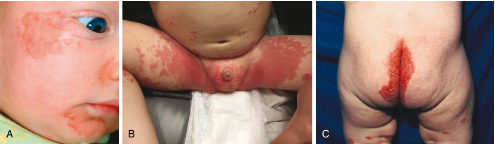

<!-- p.746 -->

# 33 Rare Inborn Defects Causing Malabsorption 

**ZEENAT GAIBEE, ALEIXO MUISE, JULIA UPTON** 

The gastrointestinal tract has an essential role in the absorption and digestion of nutrients such as fats, carbohydrates, proteins, vitamins, minerals, and trace elements. **Digestion** often refers to the _endoluminal_ steps, both mechanical and chemical, occurring inside the lumen of the digestive tract, while **absorption** involves the entry of the nutrient into the enterocyte at the apical pole and its secretion at the basolateral pole into the systemic circulation. Although malabsorption and maldigestion differ, digestion and absorption are interdependent, and in much of the literature, the term malabsorption refers to process of this interdependence. 

Malabsorption can arise from any defect in the digestion/ absorption process (Table 33.1). These defects can result from an inherent disease of the mucosa, conditions that lead to acquired damage of the mucosa, congenital defects in the intestinal membrane transport systems, impaired absorption of specific nutrients, impaired GI motility, disrupted bacterial flora, infection, or compromised blood flow or compromised lymphatics. Additional contributors to digestion and absorption are the gallbladder, pancreas, blood vessels, and lymphatics, each having direct relationships with the small intestine. Several single gene defects have been identified in children experiencing malabsorption (Table 33.2). 

A detailed history, particularly diet history and physical examination, are invaluable when initiating the evaluation of malabsorption syndromes (Table 33.3). A malabsorption syndrome should be suspected when a patient’s history includes but is not limited to ongoing or chronic diarrhea (lasting >2 weeks), unintentional weight loss despite normal nutrient intake, and greasy, voluminous, foul-smelling stools that reportedly float. Additional components of the history may include flatulence, bloating, and borborygmi. Abdominal pain might be reported but is less common in most malabsorption syndromes. 

## **Carbohydrate Malabsorption Disorders** 

Carbohydrates account for ~50–55% of total energy intake in most diets. These are made up of starch, oligosaccharides, 

disaccharides, and glucose polymers. Starch is hydrolyzed into oligosaccharides by the action of both the pancreatic and salivary amylase. Brush border oligosaccharidases and disaccharidases are responsible for further digestion of starch derivatives as well as the digestion of dietary disaccharides (lactose and sucrose). The derived monosaccharides, glucose, galactose, and fructose are then absorbed by carrier-mediated transport systems located in the brush border membrane of small intestine. The active transport of glucose and galactose absorption is achieved by the sodium-dependent glucose co-transporter (SGLT1), while fructose is transported by facilitated diffusion (GLUT5 transporter) from the intestinal lumen into the enterocytes. 

Deficiency of one or more of the brush border’s disaccharidases or oligosaccharidases may cause diarrhea, bloating, and flatulence after the ingestion of a sugar. The symptoms are understood to be due to colonic bacterial fermentation of unabsorbed carbohydrates into CO2, hydrogen, methane, and short-chain fatty acids. Patients present with watery _osmotic_ diarrhea secondary to the hyperosmolar state by maldigested carbohydrates drawing water into the intestinal lumen from the plasma; reducing substances are often identified in the stool. The stool tends to be acidic, secondary to unabsorbed carbohydrates fermented by the digestive flora, production of short-chain fatty acids and acidification of the stool, and often causes local perianal skin irritation. Abdominal bloating and pain are also a consequence of unabsorbed carbohydrates fermented by digestive flora with the production of hydrogen. 

### **Glucose-Galactose Malabsorption** 

Glucose transporters are a varied group of membrane proteins involved in facilitating the transport of glucose across the plasma membrane. These glucose transporters are divided into two families: the facilitated-diffusion glucose transporters (GLUT) and the sodium-dependent glucose transporters (SGLT). The _SLC5A1_ gene, specifically, mapped to chromosome 22q12.3, encodes the sodium-dependent glucose/galactose co-transporter 1 (SGLT1), a 73 k-Da 

_(Text continued on page 732)_

<!-- p.747 -->

##### **TABLE** 

#### **Systemic Diseases That Cause Nutrient Malabsorption** 

##### **33.1** 

- **Gastric Diseases** • Helminthic infections • Tuberculosis 

- • Atrophic gastritis • Whipple disease 

- • Autoimmune gastritis (pernicious anemia) • Immunoproliferative small intestinal disease 

- • Gastric resection or bypass surgery • Intestinal ischemia 

- **Pancreatic Diseases** • Intestinal lymphoma • Congenital pancreatic enzyme deficiencies • Intestinal resections or bypass • Co-lipase deficiency • Mastocytosis • Lipase deficiency • Nongranulomatous chronic idiopathic enterocolitis • Trypsinogen deficiency • Postinfection malabsorption • Primary immunodeficiency diseases 

- • Pancreatic insufficiency • Radiation enteritis 

- • Chronic pancreatitis • Cystic fibrosis • Refractory sprue • Sarcoidosis 

- • Johanson-Blizzard syndrome • SIBO 

- • Pearson marrow-pancreas syndrome • Tropical sprue 

- • Shwachman syndrome 

   - SIBO • Tropical sprue **Lymphatic Diseases** 

- Pancreatic tumors **Liver Diseases** 

- **Liver Diseases** • Primary intestinal lymphangiectasia • Secondary intestinal lymphangiectasia 

- • Inborn errors of bile acid biosynthesis and transport • Cirrhosis and other liver diseases • Lymphoma • Solid tumors 

- • Portal hypertension • Thoracic duct trauma, damage, or obstruction 

- **Obstructive Biliary Diseases Neuroendocrine Tumors** 

- • Biliary tumors • Carcinoid syndrome 

- • Primary and secondary sclerosing cholangitis • Gastrinoma (ZES) 

- **Intestinal Diseases** • Glucagonoma • Somatostatinoma 

- • Amyloidosis • Autoimmune enteropathy **Cardiovascular Diseases** 

- Biliary tumors • Primary and secondary sclerosing cholangitis **Intestinal Diseases** • Amyloidosis • Autoimmune enteropathy • Celiac disease • Collagenous sprue • Congenital intestinal defects • Crohn disease • Enteroendocrine cell deficiency • Autoimmune Polyendocrinopathy, Candidiasis, Ectodermal Dystrophy (APECED) 

- • Enteric anendocrinosis 

   - Constrictive pericarditis • Heart failure **Endocrine Diseases** 

   - Addison disease 

   - Diabetes mellitus • Hyperthyroidism **Systemic Diseases** 

- Enterokinase deficiency 

- Eosinophilic gastroenteritis 

   - Cronkhite-Canada syndrome 

- Fistulas 

   - Mixed connective tissue disease • Neurofibromatosis type 1 • Protein-calorie malnutrition 

- Food allergy 

- Graft-versus-host disease 

- Hypolactasia 

   - Scleroderma 

- Ileal bile acid malabsorption 

      - SLE 

- Intestinal infections 

   - AIDS (HIV infection): cryptosporidiosis, _Mycobacterium avium_ complex infection, viral infections 

   - • Giardiasis 

_SIBO,_ Small intestine bacterial overgrowth; _ZES,_ Zollinger-Ellison syndrome. From Hoegenauer C, Hammer HF. Maldigestion and malabsorption. In: _Sleisenger and Fordtran’s Gastrointestinal and Liver Disease_ . 11th ed. Philadelphia: Elsevier; 2021 (Box 104.1, p. 1678).

<!-- p.748 -->

#### **TABLE 33.2** Congenital Disorders of the Gastrointestina Suggested l Mucosa That Resu lt in Malabsorption

|Disorder|Causative Gene|Mode of Inheritance|Malabsorbed Substrate(s)|Suggested Mechanism of Malabsorption|Clinical Features|
|---|---|---|---|---|---|
|**Malabsorption of Amin**|**o Acids**|||||
|Hartnup disorder|_SLC6A19_|AR|Neutral amino acids (tryptophan, leucine, methionine, phenylalanine, tyrosine, valine, ?histidine, ?lysine)|Decreased intestinal absorption of free neutral amino acids i|Most patients are asymptomatic; some patients have photosensitive skin rash, intermittent ataxia, psychotic behavior, intellectual disability, diarrhea|
|Cystinuria (types A, B, AB)|Type A: _SLC3A1_ Type B: _SLC7A9_|AR (type A) and incomplete AR (type B)|Cystine and/or dibasic amino acids (lysine, ornithine, arginine)|Decreased intestinal absorption of specific free amino acids owing to a defective amino acid transporter at the brush border membrane Type A: no transport of cystine, lysine, or arginine Type B: reduced or normal cystine transport and reduced or no lysine and arginine transport|Aminoaciduria, cystine stones in the urinary tract|
|Lysinuric protein intolerance|_SLC7A7_|AR|Dibasic amino acids (lysine, ornithine, arginine)|Defect of the basolateral transporter (y+LAT-1) for dibasic amino acids (also malabsorption of di- and oligopeptides)|Sparse hair, hyperammonemia, nausea, vomiting, diarrhea, protein malnutrition, failure to thrive, aversion to protein-rich food, HLH|
|Isolated lysinuria*|?|?|Lysine|Decreased intestinal absorption of lysine|Intellectual disability, malnutrition, failure to thrive|
|Iminoglycinuria|_SLC6A20_ _SLC6A19_ _SLC36A2_|AR|l-Proline|Impaired intestinal absorption of l-proline in a subgroup of subjects|Aminoaciduria; benign disorder|
|Blue diaper syndrome*|?|AR|Tryptophan|Intestinal tryptophan absorption defect|Blue discoloration of diapers, failure to thrive, hypercalcemia, nephrocalcinosis|
|Methionine malabsorption syndrome*(Oasthouse syndrome)|?|AR|Methionine|Intestinal methionine absorption defect|Intellectual disability, convulsions, diarrhea, white hair, hyperpnea; urine has characteristic sweet smell of dried celery|
|Lowe oculocerebral syndrome|_OCRL1_|XR|Lysine, arginine|Impaired intestinal lysine and arginine absorption|Aminoaciduria, intellectual disability, cataracts, rickets, choreoathetosis, renal disease|

_(Continued)_

<!-- p.749 -->

#### **TABLE 33.2** Congenital Disorders of the Suggested Gastrointestina l Mucosa That Res ult in Malabsorption—cont’d

|Disorder|Causative Gene|Mode of Inheritance|Malabsorbed Substrate(s)|Suggested Mechanism of Malabsorption|Clinical Features|
|---|---|---|---|---|---|
|**Malabsorption of Carb**|**ohydrates**||||i|
|Congenital lactase deficiency|_LCT_|AR|Lactose|Permanent very low lactase activity|Diarrhea, bloating, and dehydration in the first days of life|
|Sucrase-isomaltase deficiency|_SI_|AR|Sucrose, starch|Sucrase activity is absent; isomaltase activity is absent or reduced; reduced maltase activity|Osmotic diarrhea after starch or sucrose ingestion; failure to thrive|
|Trehalase deficiency|_TREH_|AR|Trehalose|Lack of intestinal trehalase activity|Diarrhea and/or vomiting after ingesting mushrooms|
|Glucose-galactose malabsorption|_SLC5A1_|AR|Glucose, galactose|Defect of the brush border sodium-glucose co-transporter (SGLT1)|Neonatal onset of osmotic diarrhea, dehydration, intermittent or constant glycosuria|
|**Malabsorption of Fat**||||||
|Abetalipoproteinemia|_MTP_|AR|Fat, fat-soluble vitamins|Defective lipoprotein assembly owing to a lack of MTP, resulting in TG accumulation in the enterocyte and no chylomicron formation|Steatorrhea, diarrhea, neurological symptoms, retinitis pigmentosa, failure to thrive, absence of chylomicrons and VLDL in the blood, acanthocytosis|
|Familial hypobetali po- proteinemia|_APOB_|Incomplete AD|Fat, fat-soluble vitamins|TG accumulation in the enterocyte in homozygotes owing to formation of a truncated apolipoprotein B|Homozygotes: clinical manifestations as for abetalipoproteinemia Heterozygotes: fat absorption probably normal; hypolipidemia, neurological manifestations|
|Chylomicron retention disease (Anderson disease)|_SAR1B_|AR|Fat|Defective chylomicron formation and accumulation in the enterocyte|Steatorrhea, failure to thrive, absence of chylomicrons and reduced LDL levels in the blood; neurological symptoms in some patients|
|Cholesteryl ester storage disease (Wolman disease)|_LIPA_|AR|Fat|Deficient activity of hLAL, cholesteryl ester hydrolase, causing accumulation of cholesteryl esters and TGs in various body tissues; infiltration of intestinal mucosa with foamy cells, intestinal damage|Steatorrhea, hepatosplenomegaly, abdominal distention; failure to thrive, adrenal calcifications|
|**Malabsorption of Vitam**|**ins**|||||
|Congenital IF deficiency (congenital pernicious anemia)|_GIF_|AR|Cobalamin (vitamin B12)|Defective synthesis of IF or synthesis of an abnormal IF with either reduced affinity for cobalamin or for the ileal IF receptor, or increased susceptibility to proteolysis|Megaloblastic anemia, neurological symptoms, delayed development|
|Imerslund-Gräsbeck syndrome (ileal B12 malabsorption, megaloblastic anemia type I)|_CUBN_or _AMN_|AR|Cobalamin (vitamin B12)|Impaired ileal absorption of IF-cobalamin complex owing to defects in the cubilin- AMN complex (IF-cobalamin receptor)|Megaloblastic anemia, neurological symptoms, proteinuria|

_(Continued)_

<!-- p.750 -->

#### **TABLE 33.2** Congenital Disorders of the Gastrointestin Suggested al Mucosa That Re sult in Malabsorption—cont’d

|Disorder|Causative Gene|Mode of Inheritance|Malabsorbed Substrate(s)|Suggested Mechanism of Malabsorption|Clinical Features|
|---|---|---|---|---|---|
|Transcobalamin II deficiency|_TCN2_|AR|Cobalamin (vitamin B12)|Defective transport of cobalamin out of enterocytes into the portal blood owing to absence or malfunction of transcobalamin II|Vomiting, diarrhea, failure to thrive, anemia, immunodeficiency, neurological symptoms|
|Hereditary folate malabsorption|_SLC46A1_|AR|Folate|Defective folate transport across the intestinal mucosa|Megaloblastic anemia, diarrhea, neurological symptoms|
|**Malabsorption of Mine** |**rals** |||||
|Acrodermatitis enteropathica|_SLC39A4_|AR|Zinc|Defective zinc absorption in the small intestine owing to a defect in the zinc transport protein (hZIP4)|Diarrhea, scaling erythematous dermatitis, alopecia, neuropsychiatric symptoms; onset after weaning|
|Isolated magnesium malabsorption (hypomagnesemia with secondary hypocalcemia [HOMG])|_TRPM6_|AR|Magnesium|Selective defect in intestinal magnesium absorption|Tetany, convulsion, diarrhea, hypomagnesemia with secondary hypocalcemia|
|Menkes disease|_ATP7A_|XR|Copper|General copper transport disorder; intestinal copper malabsorption with copper accumulation in the intestinal mucosa owing to a defective transmembrane copper- transporting ATPase (MNK)|Cerebral degeneration, diarrhea, abnormal hair, hypopigmentation, arterial rupture, thrombosis, hypothermia, bone changes|
|Occipital horn syndrome (X-linked cutis laxa)|_ATP7A_|XR|Copper|Milder form of same defect as in Menkes disease; low levels of functional MNK|Inguinal hernias, bladder and ureteral diverticula, skin and joint laxity, chronic diarrhea, bone changes|
|Iron-refractory iron- deficient anemia|_TMPRSS6_|AR|Iron|Intestinal iron transport disorder|Iron-deficient anemia that is unresponsive to oral iron supplementation|
|Hereditary selective deficiency of 1α,25(OH)2D (pseudo– vitamin D deficiency rickets)|_CYP27B1_|AR|Calcium|Defective 25(OH)D 1α-hydroxylase, resulting in 1α,25(OH)2D deficiency and reduced intestinal calcium absorption|Bone pain, deformities and fractures, muscle weakness|
|Hereditary generalized resistance to 1α,25(OH)2D (vitamin D-resistant rickets)|_VDR_|AR|Calcium|Malfunction of the vitamin D receptor owing to defective hormone binding, defective receptor translocation to nucleus, or defective receptor binding to DNA, resulting in malabsorption of calcium|Bone pain, deformities and fractures, muscle weakness, alopecia|

_(Continued)_

<!-- p.751 -->

##### **TABLE** 

#### **33.2 Congenital Disorders of the Gastrointestinal Mucosa That Result in Malabsorption—cont’d** 

|Disorder|Causative Gene|Suggested Mode of Inheritance|Malabsorbed Substrate(s)|Suggested Mechanism of Malabsorption|Clinical Features|
|---|---|---|---|---|---|
|**Other Defects** i||||||
|Enterokinase deficiency|_PRSS7_|AR|Protein, fat|Defective activation of pancreatic proenzymes owing to lack of intestinal enterokinase|Diarrhea, failure to thrive, hypoproteinemia, edema, anemia|
|Congenital bile acid malabsorption|_SLC10A2_|AR|Bile acids, fat|Defect of the ileal ASBT|Steatorrhea, diarrhea, failure to thrive|
|Microvillus inclusion disease|_MYO5B_|AR|Carbohydrates, fat, cobalamin, electrolytes, water|Villus atrophy with microvillus inclusions in enterocytes, absent or shortened brush border microvilli|Severe watery diarrhea and steatorrhea requiring total parenteral nutrition|
|Hyperinsulinism, with enteropathy and deafness|_USH1C,_ _ABCC8,_or _KCNJ11_|AR|Generalized malabsorption|Enteropathy with villus atrophy and inflammation|Hyperinsulinism, profound congenital sensorineural deafness, enteropathy, renal tubular dysfunction|
|Immune dysregulation polyendocrinopathy and enteropathy, X-linked (IPEX)|_FOXP3_|XR|Generalized malabsorption|Villus atrophy|Polyendocrinopathies, severe diarrhea, hemolytic anemia|
|Enteric anendocrinosis*|_NEUROG3_|AR|Generalized malabsorption|Lack of enteroendocrine cells|Severe diarrhea, failure to thrive, type 1 diabetes mellitus|
|Congenital proprotein convertase 1/3 deficiency|_PCSK1_|AR|Generalized malabsorption|Lack of functional hormone production by enteroendocrine cells|Severe diarrhea, polyendocrinopathies, failure to thrive, overweight at later age|
|Congenital tufting enteropathy|_EpCAM_|AR|Generalized malabsorption|Intestinal epithelial cell dysplasia and villus atrophy|Severe diarrhea, failure to thrive|
|CHAPLE syndrome CD55deficiency with hyperactivation of complement, angiopathic thrombosis, andprotein-losing enteropathy|_CD55_|AR|Protein losing enteropathy, vitamin and micronutrient deficiencies|Intestinal lymphangiectasia|Anemia, growth restriction, diarrhea, abdominal pain, hypoproteinemia, thrombosis|
|DGAT1|_DGAT1_|AR|Congenital diarrhea, PLE, vitamin deficiencies|Unknown|Diarrhea (watery) from birth, watery, hypertriglyceridemia, failure to thrive|

*Reported in only a few cases. 

% sign (in place of #) means that the gene causing the disease is unknown in this case. 

_AD,_ Autosomal dominant; _AMN,_ amnionless; _AR,_ autosomal recessive; _ASBT,_ sodium bile acid co-transporter; _CUBN,_ cubilin; _DGAT1,_ diacylglycerol O-acyltransferase 1; _hLAL,_ human lysosomal acid lipase; _HLH,_ hemophagocytic lymphohistiocytosis; _IF,_ intrinsic factor; _LDL,_ low-density lipoprotein; _MTP,_ microsomal transfer protein; _TG,_ triglyceride; _1a_ , _25(OH)2D,_ 1α,25-dihydroxyvitamin D; _25(OH)D,_ 25-hydroxyvitamin D; _PLE,_ protein-losing enteropathy; _VLDL,_ very-low-density lipoprotein; _XR,_ X-linked recessive. 

Modified from Hoegenauer C, Hammer HF. Maldigestion and malabsorption. In: _Sleisenger and Fordtran’s Gastrointestinal and Liver Disease_ 11th ed. Philadelphia: Elsevier; 2021 (Table 104.10, pp. 1702–1705).

<!-- p.752 -->

##### **TABLE** 

#### **33.3 Symptoms and Signs of Malabsorption and Relevant Pathophysiology** 

|Symptom or Sign|Pathophysiological Explanation|
|---|---|
|**Cutaneous and Mucosal**||
|Acrodermatitis, scaly dermatitis|Deficiency of zinc and essential fatty acids|
|Easy bruisability, ecchymoses, petechiae|Deficiency of vitamin K, vitamin C (scurvy)|
|Edema|Protein loss or malabsorption|
|Follicular hyperkeratosis|Deficiency of vitamin A|
|Glossitis, cheilosis, stomatitis|Deficiency of vitamin B complex, vitamin B12, folate, or iron|
|Hyperpigmented dermatitis|Deficiency of niacin (pellagra)|
|Perifollicular hemorrhage|Malabsorption of vitamin C|
|Spiral or curly hair|Malabsorption of vitamin C|
|Thin nails with spoon-shaped deformity|Deficiency of iron|
|**Gastrointestinal** Abdominal distention, flatulence|Gas production from bacterial fermentation of carbohydrates in the colon, SIBO|
|Ascites|Protein loss or malabsorption|
|Diarrhea|Osmotic activity of carbohydrates or short-chain fatty acids Secretory effect of bile acids and fatty acids|
||Decreased absorptive surface|
||Intestinal loss of conjugated bile acids: • Ileal resection • Severe ileal mucosal disease • Congenital defects of the ileal sodium-bile acid co-transporter|
|Foul-smelling flatulence or stool|Malabsorption of proteins or intestinal protein loss|
|Pain|Gaseous distention of the intestine|
|**Musculoskeletal**||
|Bone pain, osteomalacia, fractures|Protein, calcium, or vitamin D deficiency; secondary hyperparathyroidism|
|Tetany, muscle weakness, paresthesias|Malabsorption of vitamin D, calcium, magnesium, and phosphate|
|**Other**||
|Amenorrhea, impotence, infertility|Multifactorial (including protein malabsorption, secondary hypopituitarism, anemia|
|Anemia|Deficiency of iron, folate, or vitamin B12|
|Fatigue, weakness|Calorie depletion, iron and folate deficiency, anemia|
|Growth and weight retardation, infantilism|Nutrient malabsorption in childhood and adolescence|
|Kidney stones|Increased colonic oxalate absorption|
|Night blindness, xerophthalmia|Deficiency of vitamin A|
|Neurological symptoms, ataxia|Deficiency of vitamin B12, vitamin E, or folate|
|Peripheral neuropathy|Deficiency of vitamin B12 or thiamine|
|Weight loss, hyperphagia|Nutrient malabsorption|
|_SIBO,_Small intestinal bacterial overgrowth.||

From Hoegenauer C, Hammer HF. Maldigestion and malabsorption. In: _Sleisenger and Fordtran’s Gastrointestinal and Liver Disease_ . 11th ed. Philadelphia: Elsevier; 2021 (Table 104.3, p. 1684).

<!-- p.753 -->

transmembrane protein, which is mainly present in the small intestine, the heart, and the kidneys. It is the primary transporter mediating glucose absorption in the small intestine, and is important for normal glucose, sodium, and fluid absorption in the proximal small intestine. SGLT1 is a highaffinity, low-capacity transporter located primarily on the luminal side of mucosal intestinal cells and in the renal proximal tubule. Its function is to transport one molecule of glucose along with two sodium molecules into the cell, taking advantage of the electrochemical gradient established by the Na+/K+ ATPase pump. It plays a critical role in the absorption of D-glucose and D-galactose across the apical brush-border membrane of enterocytes. Glucose then reaches the circulation through the GLUT2 transporter located in the basolateral membrane. Loss of SGLT1 function results in glucose-galactose malabsorption (GGM), an autosomal recessive inherited disorder that manifests within the first weeks of life because of the inability to absorb and utilize the monosaccharides glucose and galactose. Children with GGM present with a diet-induced diarrhea that begins when they are fed breastmilk or formula. This diarrhea can cause severe dehydration and metabolic acidosis, making early diagnosis and management critical. An initial diagnosis can be established clinically, by dietary reversal of symptoms with glucose/galactose-free formula substitution, but should be followed by confirmatory genetic testing. Management of GGM consists of instituting a strict glucose/galactose-free diet, limiting carbohydrate intake to fructose initially, but the addition of small amounts of glucose in the diet can occur as patients grow older. Once past infancy, patients can manage diarrhea with diet alone and generally do well, although there are no systematic studies of long-term health outcomes in GGM patients. 

### **Sucrase-Isomaltase Deficiency** 

The sucrase-isomaltase (SI) gene, mapped to chromosome 3q26.1, codes for sucrase-isomaltase, a heterodimeric protein with two subunits, sucrase and isomaltase. Sucraseisomaltase is a type II transmembrane disaccharidase glycoprotein expressed in the intestinal brush border. The protein encoded by the SI gene is a precursor protein that is later cleaved by pancreatic proteases into sucrase and isomaltase. While sucrase hydrolyzes sucrose, isomaltase processes starch, isomaltose, and maltose. Therefore, patients with biallelic pathogenic variants of the SI gene are unable to metabolize these carbohydrates; their consumption leads to a diet-induced diarrhea accompanied by different degrees of abdominal bloating and pain. 

The prevalence of SI is estimated to be ~0.2% in individuals of European descent, 5–10% in Greenland Inuits, and 3–7% in Canadian and Alaskan Inuits. Four variants are estimated to represent over 80% of congenital SI deficiency (CSID) in European populations: p.G1073D, p.V577G, p.F1745C, and p.R1124X. A molecular and cellular analysis of 13 missense variants has established their classification into three major phenotypes, based on 

whether protein trafficking, enzymatic activity, or lipid raft association is affected. These variants result in some degree of improper targeting to the plasma membrane and a combined deficiency of both sucrase and isomaltase. Diagnosis of congenital SI deficiency is made definitively with a duodenal or jejunal biopsy and a disaccharidase assay. Patients are advised to adhere to a sucrose and starch-free diet, which only partially relieves symptoms. Enzyme replacement therapy with sacrosidase may be instituted, allowing for a return to close-to-normal intestinal activity. 

### **Fructose Malabsorption Disorder** 

Fructose is a natural monosaccharide of fruits and vegetables. An inborn error of fructose metabolism is caused by a deficiency of the enzyme aldolase B. Individuals affected with hereditary fructose intolerance (HFI) are asymptomatic until they ingest fructose, sucrose, or sorbitol. If fructose is ingested, the enzymatic block at aldolase B causes an accumulation of fructose-1-phosphate which over time accumulates in the liver with resultant liver damage. HFI is an autosomal recessive condition caused by pathogenic variants in _ALDOB_ , located at 9q31.1. HFI is typically suspected based on dietary history, especially in infants who become symptomatic after weaning from breastfeeding. This suspicion is typically confirmed by molecular analysis. Treatment of HFI involves strict avoidance of fructose in the diet. Older patients with HFI typically self-select a diet low in fructose, even before being formally diagnosed. 

### **Lactose Malabsorption Disorders** 

_Congenital_ lactase deficiency is very rare, with only a dozen cases described, mainly in Finland. It is very different from _lactose intolerance_ , which is related to decreased lactase enzyme activity found commonly in adults, particularly in Asia, West Africa, and parts of Europe. 

Congenital lactase deficiency induces a neonatal watery diarrhea starting rapidly at the beginning of breastfeeding or after a few weeks in some other children. A metabolic acidosis is frequent. Hypercalcemia is found in 70% of the children and may be related to chronic metabolic acidosis and increased ileal calcium absorption due to the presence of undigested lactose. In intestinal biopsies, the lactase activity is absent. After the diagnosis, or if there is a strong suspicion of congenital lactase deficiency, a lactose-free milk is prescribed. Treatment of lactose intolerance is different and is best treated with a lactose-reduced diet with lactase enzyme replacement. 

## **Fat Malabsorption** 

Several biochemical, physiological, and morphological requirements must be met to perform _intraluminal_ digestion and _intracellular transport_ of triglycerides (TG), phospholipids (PL), and cholesterol (CHOL). Lipid digestion involves breakdown of TGs into fatty acids (FA) and

<!-- p.754 -->

2-monoglyceride (MG) by lipase, hydrolysis of cholesteryl ester into free CHOL and FA by CHOL esterase, and decomposition of PL into lysoPL and FA by phospholipase A2 in the intestinal lumen. The three enzymes are produced in the **pancreas** and delivered through the exocrine acinar cells together with an alkaline mixture composed of water and bicarbonate, to maintain the ideal pH for enzyme activity. **Bile salts** , released from gallbladder stores, assist in breaking down large fat globules into small droplets, forming micelles and solubilizing the lipids allowing enzymes to get to emulsified lipid droplets. Impairment of the enzymatic activity, bicarbonate supply, or bile acid leads to malabsorption symptoms, including steatorrhea, deficiency of essential FAs and fat-soluble vitamins (vitamins A, D, E, and K), weight loss, abdominal discomfort, and abdominal bloating. 

Following intraluminal fat digestion, the lipolytic products need to cross the small intestinal brush border. The access of FA to enterocytes is achieved either by passive diffusion pattern following a favorable concentration gradient or involving protein-facilitated FA transfer in view of its saturation gradient. Apical microvillus membrane proteins such as fatty acid transport protein 4 (FATP4) and CD36 mediate the FA transfer inside the enterocyte. FATP4 is highly expressed in villus enterocytes and functions in FA incorporation by trapping FA through their conversion into CoA derivative, given its endogenous acyl CoA synthetase activity. CD36 is also abundant in the small intestine and facilitates FA uptake and exhibits various functions in lipid absorption. For the intestinal transport of alimentary CHOL, various microvillus transporters have been described, including Niemann-Pick C1-Like 1 (NPC1L1), scavenger receptor-BI (SR-BI), and CD36. While these transporters regulate CHOL influx, the heteromeric complex ATP-binding cassette G5 (ABCG5)/G8 on villus brush-border membrane is responsible for CHOL efflux directly toward intestinal lumen. ABCA1 is a basolateral efflux pump that transfers CHOL to apolipoprotein (Apo) A-I, thereby contributing to high-density lipoprotein (HDL) particles. Through the action of these transporters, lipolytic products move into the enterocyte. With the assistance of cytosolic binding proteins such as intestinal fatty acid-binding protein (I-FABP) and liver-FABP (L-FABP), they are directed to the membrane of the endoplasmic reticulum (ER), where they are re-esterified. The 2-MG and FAs are reconstituted to form TG by the MG pathway involving monoacylglycerol transferase (MGAT) and diacylglycerol transferase (DGAT). Microsomal triglyceride transfer protein (MTTP) shuttles TG, CE, and PL to the structural Apo B-48 to promote chylomicron (CM) assembly. While MTTP appears as an essential protein to uphold CM biogenesis by lipidation of the critical Apo B-48, Sar1B GTPase is another crucial component of COPII vesicles that buds from the ER to transport pre-CM to the Golgi apparatus. In this intracellular compartment, CM particles fuse into another transport vesicle and are vectorially transported to the basolateral membrane for secretion into the circulation via the lymphatic system. 

### **Abetalipoproteinemia** 

Abetalipoproteinemia (ABL) is a homozygous autosomal recessive disorder caused by pathogenic variants of _MTTP_ . MTTP resides in the ER lumen and orchestrates the transfer of TG, CE, and PL onto Apo B-48 to produce pre-CM particles. In view of the aberrations of _MTTP_ , there is a total absence of circulating CM (following fat feeding) and Apo B-containing lipoproteins along with extremely low levels of plasma TG, total CHOL, and Apo B-100. Young children present with diarrhea, malabsorption, and severe steatorrhea, with additional features such as deficiency of EFAs and fatsoluble vitamins, red blood cell acanthocytosis, retinal degeneration and neurological dysfunction (likely due to the paucity of vitamins A, D, E, K), and steatohepatitis. 

Rapid validation of the diagnosis with genetic testing should prevent progression of neurological sequelae. Patients with ABL need permanent maintenance on a low-fat diet and long-term supplementation of high-dose vitamin A and E to improve retinal and neurological functions. Their serum levels seldom return to normal range. 

### **Hypobetalipoproteinemia** 

Familial hypolipoproteinemia (FHBL) is a monogenic disorder associated with a gene defect of _APOB_ on chromosome 2. This is associated with the total absence of circulating CMs and Apo B-48 in response to fatty meals. The liver is also unable to secrete VLDL (very low-density lipoprotein), and extremely low plasma concentrations of LDL, TG, and total CHOL are common in FHBL. Homozygous FHBL presents in infancy or early childhood with variable clinical manifestations, including failure to thrive, steatorrhea, undetectable fat-soluble vitamins, EFA deficiency, acanthocytosis, and neurological deficits with macular degeneration. In adulthood, FHBL may be affected by hepatic steatosis and later liver cirrhosis and hepatocellular carcinoma. Management, like ABL, involves lifelong low-fat diet and fat-soluble vitamin and EFA supplementation. 

### **Chylomicron Retention Disorder** 

Pathogenic variants of _SAR1-ADP ribosylation factor, type B (SAR1B)_ prevent the conveyance of chylomicron (CM)containing vesicles through the early secretory pathway, leading to the accumulation of pre-CM. _SAR1B_ , belonging to the Ras superfamily of guanosine triphosphatases (GTPases), is essential for the coatomer COPII that transports proteins from the rough ER to the Golgi apparatus, a process requiring the small Sar1b GTPase for the exchange of GDP for GTP. _SAR1B_ is able to initiate vesicle formation by recruiting first the inner COPII coat components and subsequently the components of the outer flexible coat. _SAR1B_ aberrations affect the transport of pre-CM from the ER to the Golgi in prechylomicron transport vesicles, including their fusion with the cis-Golgi.

<!-- p.755 -->

Chronic diarrhea, vomiting, abdominal distension, and failure to thrive are among the most frequent and earliest symptoms affecting CRD patients. Incapacity to export CM in CRD impairs the intestinal transport of fat-soluble vitamins and the status of EFA. Furthermore, plasma levels of CHOL, PL, LDL, HDL, and Apos (B, A-I) are usually below 50% of control values. Additional clinical findings comprise ophthalmological (micro-nystagmus, mild deficit in the perception of the blue-yellow axis, and delayed dark adaptation) and neurological complications (areflexia, proprioceptive aberrancy, ataxia, myopathy, and sensory neuropathy), which are of lesser significance compared with those of ABL and FHPL. Elevated creatine kinase and cardiomyopathy have also been reported along with muscle weakness. There is also inadequate mineralization and delayed bone maturation. Chronic diarrhea, fat malabsorption, fat-laden enterocytes, and atypical lipid and vitamin profile are suggestive of CRD, and genetic testing identifying Sar1B variant is confirmatory. 

Management involves a fat-free diet, enriched in EFA, medium-chain TGs, and liposoluble vitamins, particularly vitamins A, E, and D. 

## **DGAT1 Defects** 

_DGAT1_ encodes the DGAT1 protein, a microsomal enzyme with abundant expression in the small intestine. DGAT1 catalyzes the final step in TG synthesis using DG and FA-CoA, supporting lipid absorption. _DGAT1_ variants may also cause elevated fecal alpha-1-antitrypsin, high serum TGs, vomiting, low albumin, elevated transaminases, and low IgG and result in a **protein-losing enteropathy** with significant congenital diarrhea. A fat-restricted diet is required as nutritional therapy. 

### **Shwachman–Diamond Syndrome (SDS)** 

SDS, also known as Shwachman–Bodian–Diamond syndrome, is a rare congenital disorder characterized by exocrine pancreatic insufficiency, bone marrow dysfunction, skeletal and cardiac abnormalities, and short stature. SDS is inherited in an autosomal recessive mode and associated with _SDS_ , found at the cytogenetic position on chromosome 7q11. Patients often present with significant neutropenia, anemia, and thrombocytopenia and progressive bone marrow failure. Pancreatic exocrine insufficiency is due to absent acinar cells that produce digestive enzymes. These are extensively depleted and replaced by fat. The deficiency of pancreatic digestive enzymes results in fat malabsorption. In some individuals, pancreatic status may improve with age. 

### **Other Genetic Conditions Affecting Lipid Digestion and Malabsorption** 

**Niemann-Pick C1-Like 1 (NPC1L1)** mediates CHOL trafficking from the apical microvillus membrane to the ER. NPC1L1 also participates in a control mechanism for competent CM packaging and output by restraining intracellular 

CHOL movement at a cellular level. The clinical presentation is heterogenous with manifestations in the perinatal period being predominantly visceral and later clinical presentations predominated by neurological manifestations. 

**Intestinal SR-BI** is understood to be more involved in postprandial TG handling than in CHOL uptake and is a critical regulator of CM transport. 

**Angiopoietin-like Protein 4 (ANGPTL4)** and **ANGPTL3** inhibit lipoprotein lipase (LPL) activity through unfolding and destabilization, leading to its degradation. ANGPTL3 is mostly secreted and expressed in the liver, and in humans, homozygous loss of ANGPTL3 leads to familial combined hypolipidemia characterized by low plasma levels of TGs, HDH-CHOL, and LDL-CHOL. 

## **Protein Malabsorption** 

Proteins represent 6–8% of caloric intake in breastfed infants and 10–15% in adults, with dietary protein making up 70–100 g and endogenous protein, comprising desquamated cells and digestive enzymes making up 35–220 g. A variety of proteolytic enzymes are required to break down dietary proteins into amino acids and small peptides, each with its specificity for different types of peptide bonds. Consumed protein or polypeptides begin to be broken down in the stomach under the action of the protease pepsin. Pepsin is secreted, in its larger, inactive form, pepsinogen, by chief cells in the gastric mucosa. Gastric acid secreted by the parietal cells alters the conformation of pepsinogen allowing it to cleave itself to become active pepsin. Gastric acid also denatures proteins, which partially unfolds them, permitting access for proteases to the peptide bonds. Pepsin hydrolyzes proteins into smaller peptides. 

Partially digested food **(chyme)** enters the small intestine and pancreatic bicarbonate neutralizes the stomach acid, raising the pH. Bicarbonate is released together with pancreatic proteases as zymogens. The zymogen trypsinogen is cleaved to form trypsin by **enteropeptidase** (formerly called enterokinase), a jejunal brush-border enzyme that is released by the action of bile salts. Trypsin then catalyzes the cleavage of the other zymogens to their active forms. The pancreatic proteases (trypsin, chymotrypsin, elastase, and carboxypeptidases) cleave the polypeptides into oligopeptides and amino acids. Trypsin, chymotrypsin, and elastase are serine proteases and act as endopeptidases. Trypsin is the most specific and cleaves peptide bonds next to lysine or arginine. Chymotrypsin is less specific and cleaves peptide bonds adjacent to hydrophobic amino acids. Elastase cleaves elastin and peptide bonds adjacent to alanine, glycine, and serine. The remaining oligopeptides are then acted on by exopeptidases, like carboxypeptidases, which cleave one amino acid at a time from one another or from the chain. The products of protease digestion of polypeptides and proteins are 30% free amino acids and 70% oligopeptides (2–8 amino acids). Some of the oligopeptides are further hydrolyzed at the amino terminus by **aminopeptidases** located on the brush-border membranes to free amino acids and di- and tripeptides. Specific transport

<!-- p.756 -->

proteins facilitate the uptake of amino acids and di- and tripeptides across the brush-border membrane of the absorptive enterocytes. **Amino acid transporters** are defined by either the type of amino acid transported, or the transport mechanism used. Neutral L-amino acids are absorbed across the intestinal epithelial cells by entering via secondary active Na+ - dependent co-transporter and exiting via a Na+ -independent facilitated diffusion transporter. 

Several loss-of-function pathogenic variants in amino acid transporters have been characterized based on the expression of similar transporters in small intestinal epithelial cells and renal proximal tubule cells. Loss of functional transporters in the kidney tubules results in easily measured amino acid excretion in the urine. 

Absorption of peptides is possible by 3 ways: (1) the peptide transporter peptide PepT1 allows entry of di- or tripeptides with co-transport H+ ions; (2) cell-penetrating peptides (CPP) which are cargo proteins of the cell membrane allow entry of peptides by endocytosis; and (3) the para-cellular pathway by which increasing permeability at tight junctions. 

PepT1 is a low-affinity, high-capacity transport system found primarily in the duodenum and jejunum. PepT1 transports almost any di- or tripeptide and prefers bulky hydrophobic side chains and free amino and carboxy termini. Peptides with l-amino acids show greater affinity of binding than those with d-amino acids. Some of the di- and tripeptides that are transported intact into the enterocytes are hydrolyzed by _intracellular peptidases_ within the cells to free amino acids. Immediately after birth, intestinal epithelial cells can absorb some peptides larger than three amino acids by transcytosis. 

Two autosomal recessive disorders of amino acid transport across the apical membrane have given extensive insights into the absorption of amino acids and oligopeptides. **Hartnup disease** presents as defective intestinal and renal transport of neutral amino acids involving system B transporters. Hartnup disease is most often seen in children, who ultimately exhibit _pellagra-like skin changes_ , _cerebellar ataxia_ , and _psychiatric abnormalities_ . Another disorder, **cystinuria** , results in the abnormal absorption of cationic amino acids with normal absorption of neutral amino acids. Patients with cystinuria usually present with kidney stones made of cystine that may lodge in the ureter, causing genitourinary bleeding and pain. Neither of these conditions involves the oligopeptide co-transporter, and patients rarely exhibit protein deficiencies, indicating that the alternative oligopeptide co-transporter can compensate for the absence of these individual apical amino acid transport systems and that the basolateral transporters for the amino acids are unaffected. 

### **Congenital Enterokinase Deficiency and Congenital Trypsinogen Deficiency** 

**Congenital enterokinase deficiency** is due to a _PRSS7_ variant on chromosome 21q21, inducing a deficiency 

in enterokinase synthesis. **Congenital trypsinogen deficiency** is related to a pathogenic variant of _PRRS1_ on chromosome 7q35 inducing an absence of trypsinogenic activity. Patients present with chronic diarrhea in the neonatal period or at the time of weaning, growth failure, hypoalbuminemia, and edema. Deficiencies in both enzymes result in a _functional_ exocrine pancreatic insufficiency with significant protein maldigestion due to the inability to activate pancreatic zymogens. Protein hydrolysate is used as a treatment but a spontaneous increased tolerance over years is described, with an ability to return to a normal diet. 

### **Lysinuric Protein Intolerance** 

Lysinuric protein intolerance is caused by a pathogenic variant of _SLC7A7_ on chromosome 14q11 which has a role in the hydrolysis of exoand endopeptidases and amino acid basolateral transport. Infants with LPI are usually symptom-free when breastfed because of the low protein concentration in human milk but develop vomiting and diarrhea after weaning. The patients show failure to thrive, poor appetite, growth delay, enlarged liver and spleen, prominent osteoporosis and osteopenia, delayed bone age, and spontaneous protein aversion. 

### **Celiac Disease** 

Celiac disease, one of the most common protein-related malabsorption conditions, is precipitated in genetically predisposed persons by the ingestion of gluten, the major storage protein of wheat and similar grains. Celiac disease is recognized as a common condition that may be diagnosed at any age and that affects many extraintestinal organ systems. Undigested molecules of gliadin, such as a peptide from an α-gliadin fraction made up of 33 amino acids, are resistant to degradation by gastric, pancreatic, and intestinal brush-border membrane proteases in the human intestine and thus remain in the intestinal lumen after gluten ingestion. These peptides pass through the epithelial barrier of the intestine, possibly during intestinal infections or when there is an increase in intestinal permeability and interact with antigen-presenting cells in the lamina propria. Celiac disease predominantly develops in a person with alleles that encode for HLA-DQ2 or HLA-DQ8 proteins. 

Clinical manifestations of celiac disease vary greatly according to age group. Infants and young children present with diarrhea, abdominal distention, and failure to thrive. However, vomiting, irritability, anorexia, and even constipation is also common. Older children and adolescents often present with extraintestinal manifestations, such as short stature, neurological symptoms, or anemia. Other cases are diagnosed because of increased surveillance for celiac disease among those with Down syndrome, Turner syndrome, or type 1 diabetes, all of which have a known association with celiac disease.

<!-- p.757 -->

## **Malabsorption of Nutrients and Electrolytes** 

### **Congenital Chloride Diarrhea (CCD)** 

This monogenic disease is caused by pathogenic variants in the gene encoding the solute-linked carrier family 26-member A3 _(SLC26A3)_ protein which is found on the apical surface of enterocyte and acts as a plasma membrane anion exchanger for Cl− and HCO3− (Table 33.4). In addition, it interacts with the R-domain of _CFTR_ . Found on chromosome 7q31, a number of founder variants are described in certain ethnic groups, with 90% of Saudi and Kuwaiti patients having the p.G187X variant and 90% of Finns the p.V317del variant; over 30 variants have been described across diverse global ethnicities with a discordant phenotype. Classically patients present with a watery diarrhea rich in Cl− content and a low pH, dehydration, and **hyperchloremic metabolic alkalosis** . Prompt management with fluid and electrolyte correction 

|**Congenit** **TABLE** **33.4**|**al Chloride Diarrhea**|
|---|---|
|OMIM|OMIM 126650|
|Gene|_SLC26A3_|
|Transmission|AR|
|Physiopathology|Alteration of the Cl/HCO3− exchanger DRA Malabsorption of intestinal fluids Acidification of intestinal fluids|
|Clinic|Non syndromic form Antenatal symptoms: polyhydramnios, bowel dilatation—Prematurity and IUGR Abundant neonatal watery diarrhea Severe and rapid dehydration risk|
|Biology|Excessive stool chloride level (>90 mmol/L) Metabolic alkalosis Hypochloremia and electrolyte abnormalities Secondary hyperreninemic hyperaldosteronism|
|Complications if no optimal rehydration|Failure to thrive Chronic kidney disease Psychomotor delay Death|
|Treatment|NaCl/KCl salt substitution therapy +++ Butyrate Cholestyramine|

_AR,_ Autosomic recessive; _OMIM,_ Online Mendelian Inheritance in Man; _SLC26A3,_ solute carrier family 26 member 3. Extracted from Peretti N, Mas E. Congenital disorders of intestinal digestion and absorption (sugars, protein, lipids, ions). _Best Prac Res Clin Gastroenterol_ . 2022;56-57:101785 (Table 4). 

and parenteral nutrition is required. The long-term prognosis is favorable, but complications including renal disease, hyperuricemia, and subfertility are possible. While the mechanism underlying its therapeutic effect is still unclear, butyrate has been beneficial in patients with CCD, and may be related, at least in part to the stimulation of the Cl− /butyrate exchanger activity. 

### **Congenital Sodium Diarrhea (CSD)** 

Congenital sodium diarrhea presents in the neonatal period with persistent severe diarrhea with increased sodium content and subsequently hyponatremia, metabolic acidosis, and a high mortality related to electrolyte alterations (Table 33.5). It is a rare disease involving the apical membrane Na+ /H+ exchanger and sodium proton antiporter 3(NHE3), which absorbs a major part of intestinal Na+ and is essential in overall fluid volume and acid-base regulation. The loss of function of this transporter induces CSD, which is clinically and genetically heterogeneous and attributed to pathogenic variants in 3 different genes: _SPINT2_ , _SLC9A3_ (autosomal recessive, affecting the Na+/H+ exchanger, NHE3), and _GUCY2C_ (autosomal dominant, affecting the guanylin receptor GC-C, cyclic guanosine monophosphate). The **syndromic form of CSD** is associated with choanal and anal atresia, hypertelorism and corneal erosions, double renal collecting system, cleft palate, and digital anomalies. The syndromic form is attributed to a variant in _SPINT2_ which encodes a serine-protease inhibitor on chromosome 19q13.1. Treatment generally involves rehydration with ionic replacement therapy, and for the syndromic type, which can be associated with tufting enteropathy, parenteral nutrition is required. 

### **Cystic Fibrosis** 

Cystic fibrosis transmembrane conductance regulator (CFTR), which is cAMP/CGMP-regulated, is the primary chloride channel at the apical membrane of intestinal epithelial cells and plays a major role in intestinal fluid secretion and homeostasis. CFTR forms macromolecular complexes at discrete microdomains at the plasma membrane, and its chloride channel function is regulated spatiotemporally through protein–protein interactions and cAMP/cGMP-mediated signaling. 

Cystic fibrosis is a result of a pathogenic variant in _CFTR_ . These variants are in membrane-spanning domains of the protein and affect the protein in varying degrees, normally responsible for ion fluxes. In the pancreas, this results in occlusion of ducts preventing pancreatic enzymes from reaching the lumen of the intestine and with a lack of HCO3− may lead to premature activation of digestive enzymes inside the pancreas, resulting in pancreatic exocrine and endocrine damage. Lack of digestive enzymes in the intestinal lumen can cause symptoms including frequent, loose, oily, and malodorous stools caused by steatorrhea. 

In the intestine, obstruction of the lumen by thick, dehydrated, mucoid plugs leads to meconium ileus that

<!-- p.758 -->

### **TABLE 33.5 Congenital Sodium Diarrhea** 

|OMIM|OMIM 616868|OMIM 601330|OMIM 613217|
|---|---|---|---|
|Gene|_SLC9A3_|_GUCY2C_|_SPINT2_|
|Transmission|AR|AD|AR|
|Physiology|Alteration of the Na/H+ exchanger, NHE3|Down regulation of NHE3 by elevated intracellular cGMP levels due to activating variant of the guanylin receptor GC-C; cGMP, cyclic guanosine monophosphate|Perturbation of the epithelial sodium channel ENaC. Impairment of sodium reabsorption in the distal colon.|
|Clinic|||Rare antenatal symptoms— Syndromic form: Choanal atresias Intestinal atresias, recurrent corneal erosions Polydactyly|
|Biology|Excessive stool sodium level Metabolic acidosis, hyponatremia||Intestinal biopsies: epithelial “tufting” dysplasia|
|Complications if no optimal rehydration|Dehydration Risk of IBD||Malnutrition and dehydration|
|Treatment|Rehydration||Parenteral nutrition|

_AD,_ Autosomic dominant; _AR,_ autosomic recessive; _ENaC,_ epithelial sodium channel; _IBD,_ inflammatory bowel disease; _IUGR,_ intrauterine growth restriction; _OMIM,_ Online Mendelian Inheritance in Man; _SLC9A3,_ solute carrier family 9 member 3; _GUCY2C,_ guanylate cyclase 2C; _SPINT2,_ serine peptidase inhibitor, Kunitz type 2. Extracted from Peretti N, Mas E. Congenital disorders of intestinal digestion and absorption (sugars, protein, lipids, ions). _Best Prac Res Clin Gastroenterol_ . 2022;56-57:101785 (Table 4). 

necessitates surgery in 10% of newborns with CF. Constipation and distal intestinal obstruction syndrome also occur in older CF patients who have also been shown to have loss of CFTR function in their colon. 

Approximately 80–85% of CF patients have **pancreatic insufficiency** , which leads to decreased availability of both digestive enzymes and HCO3− in the intestinal lumen and clinical maldigestion and malabsorption based on the lack of Cl− secretion. Fortunately, oral pancreatic enzyme supplementation after meals appears to override the digestive problems, and the introduction of CFTR inhibitors have shown promise with drug-induced secretory diarrheas. 

## **Acrodermatitis Enteropathica** 

Affected individuals suffer from a severe general **zinc deficiency** with marked epithelial manifestations with dry blistering skin, glossitis, and diarrhea (Fig. 33.1). Zinc is an essential trace nutrient required for the proper function of more than 100 enzymes and plays a crucial role in nucleic acid metabolism. Acrodermatitis enteropathica is an autosomal recessive disorder occurring because of pathogenic variants in _SLC39A4_ (solute carrier family 39 member A4) located on band 8q24.3. _SLC39A4_ encodes a transmembrane protein that is part of the zinc/iron-regulated transporter–like protein (ZIP) family required for zinc uptake. This protein is highly expressed in the enterocytes in the duodenum and 

jejunum; therefore, affected individuals have a decreased ability to absorb zinc from dietary sources. Absence of a binding ligand needed to transport zinc may further contribute to zinc malabsorption. Differentiating _acquired_ zinc deficiency disorders from acrodermatitis enteropathica is difficult because they have similar clinical presentations. 

## **Primary Familial Hypomagnesemia** 

Primary familial hypomagnesemia is a rare genetically determined disorder characterized by a selective defect in magnesium (Mg) absorption. Pathogenic variants of the transient receptor potential melastatin 6 _(TRPM6)_ gene, which codes for TRPM6, the basic channel for intestinal Mg absorption and a member of the transient receptor potential (TRP) family of cation channels, result in primary hypomagnesemia. Symptoms often involve bouts of tetany, seizures, polyuria, and impaired vitamin D absorption, but minimal gastrointestinal symptoms. 

# **Vitamin Malabsorption** 

## **Hereditary Folate Malabsorption** 

Hereditary folate malabsorption (HFM) is a rare autosomal recessive disorder caused by loss-of-function variants in the proton-coupled folate transporter _(PCFT)_ gene. Affected

<!-- p.759 -->

**Fig. 33.1** Acrodermatitis enteropathica. (A) Moist, sharply marginated psoriasiform plaques around the mouth, nose, and eyes of an infant; (B) psoriasiform plaques of the groin, inner thighs, and lower abdomen; (C) sharply marginated psoriasiform plaques of the perianal area and buttock.  (From Paller AS, Mancini AJ. _Hurwitz Clinical Pediatric Dermatology_ . 6th ed. Philadelphia: Elsevier; 2022 [Figs. 24.1, 24.2, 24.3, p. 648].) 

infants present within a few months after birth with failure to thrive and severe folate deficiency manifested as macrocytic anemia and developmental delays. There can be pancytopenia, diarrhea and/or mucositis and/or immune deficiency due to T-cell dysfunction, and hypogammaglobulinemia resulting in pneumonia due to _Pneumocystis jirovecii_ . Several infants with the reversible severe combined immune deficiency syndrome were described secondary to a pathogenic variant of a proton-coupled folate transporter. Untreated, or with inadequate treatment, there are progressive systemic and neurological signs with a spectrum of manifestations including seizures that are often intractable. 

## **Congenital Defect of Transcobalamin II** 

Transcobalamin deficiency is a disorder that impairs the transport of cobalamin, also known as vitamin B12, within the body. Cobalamin is usually obtained from the diet; this vitamin is found in animal products such as meat, eggs, and shellfish. An inability to transport cobalamin impairs many functions including cell growth and division (proliferation) and DNA production. The absence of cobalamin leads to impaired growth, megaloblastic anemia, and other manifestations which become apparent within the first weeks or months of life. The first signs of transcobalamin deficiency are typically a failure to gain weight and grow at the expected rate (failure to thrive), vomiting, diarrhea, and open sores (ulcers) on the mucous membranes such as the lining inside the mouth. Neurological function is impaired in affected individuals, and they can experience progressive stiffness and weakness in their legs (paraparesis), muscle twitches (myoclonus), or intellectual disability. Pathogenic variants in _TCN2_ cause transcobalamin deficiency. 

# **Structural Abnormalities** 

## **Protein-Losing Enteropathies (PLE)** 

Protein-losing enteropathies are characterized by excessive loss of serum proteins into the gastrointestinal tract, resulting 

in hypoproteinemia (hypoalbuminemia and varying degrees of hypogammaglobulinemia), edema, and in some cases pleural and pericardial effusions. Protein-losing gastroenteropathy occurs when the losses into the gastrointestinal tract exceed the liver’s production capacity. This loss of serum proteins into the gastrointestinal tract occurs independent of molecular weight. Thus, the serum proteins most affected by this disrupted equilibrium are those with longer half-lives or lower catabolic rate, like albumin, immunoglobulin A (IgA), IgG, IgM, ceruloplasmin, and fibrinogen. By contrast, there is little change in the serum concentrations of proteins with a rapid turnover rate (e.g., insulin, IgE). 

Protein-losing enteropathies can be caused by a diverse group of disorders, and the increase in intestinal leakage of plasma proteins can occur via one of two mechanisms: 

1. Mucosal injury, with or without erosions or ulcerations as in inflammatory bowel disease or celiac disease. 

2. Increased lymphatic pressure in the gut due to granulomatous and neoplastic involvement of the lymphatic system or after dilated lymph vessels leak protein via the surface epithelium into the gut. The latter mechanism occurs in intestinal lymphangiectasia, congenital abnormalities of the lymphatic system, or disorders of venous stasis such as congestive heart failure or constrictive pericarditis. Enteral protein loss is a relatively common problem in 

inflammatory bowel disease (Crohn’s and ulcerative colitis) and some GI malignancies and can be associated with mucosal damage, erosions, and ulcerations. The overt mucosal injury results in absorptive cell loss and ulcerations. Both Crohn’s and malignancy can cause lymphatic obstruction in the mesentery, leading to increased lymphatic pressure and the leakage of lymph into the gut lumen. 

_PLEs are also associated with mucosal injury without erosions or ulcerations._ 

**Giant hypertrophic gastropathy** or Ménétrier disease is a _protein losing gastroenteropathy_ , characterized by large mucosal folds, usually involving the body of the stomach. Hyperplasia of gastric pits and superficial epithelium and replacement of normal gastric glands and parietal cells by the hyperplastic glands of mucus-secreting cells results in

<!-- p.760 -->

hypochlorhydria in association with protein loss due to increased permeability. Clinical symptoms include epigastric pain, vomiting, and upper GI bleeding. 

# **PVLAP** 

The loss of functional PLVAP (plasmalemma vesicle-associated protein) results in disruption of fenestral diaphragms in the intestinal vasculature. It is characterized by intractable secretory diarrhea and massive protein loss due to leaky fenestrated capillaries. Features include early-onset anasarca, severe hypoalbuminemia, hypogammaglobulinemia, and hypertriglyceridemia, as well as electrolyte abnormalities. Some patients exhibit facial dysmorphism and cardiac and renal anomalies. Intrafamilial variability has been observed, and the disease can be severe, with death occurring in infancy in some patients. 

## **Bile Acid Malabsorption (BAM)** 

Bile acid malabsorption (BAM) has an estimated prevalence of 4 to 5% as a cause of chronic diarrhea. BAM is classified as **type 1** (secondary to ileal dysfunction), **type 2** (idiopathic), or **type 3** (secondary to gastrointestinal disorders 

not associated with ileal dysfunction). The estimated prevalence of BAM is >90% in patients with resected Crohn disease (CD), and 11–52% of unresected CD patients (type 1); 33% in diarrhea-predominant irritable bowel syndrome (type 2); and is a frequent finding postcholecystectomy (type 3). Investigations include BAM fecal bile acid assay, 23-seleno-25-homo-tauro-cholic acid (SeHCAT) testing, and high-performance liquid chromatography of serum 7-α-OH-4-cholesten-3-one (C4) to determine the level of bile acid synthesis. A less time-consuming and expensive alternative in practice is an empirical trial of the bile acid sequestering agent cholestyramine. 

# **Immunodeficiency Disorders Associated With Malabsorption** (Table 33.6) 

See also Chapters 53, 54, 60, and 61. 

## **Selective IgA Deficiency** 

Selective IgA deficiency is defined as an absent or near-absent serum IgA, usually <10 mg/dL, with normal IgG and 

#### **TABLE 33.6** Immunodeficienc i iy Syndromes Causing Malabsorption

|Immunodeficiency|Predominant Gastrointestinal Feature|Molecular Defect|
|---|---|---|
|Selective IgA deficiency|Chronic diarrhea Nodular hyperplasia Celiac-like disease|Defective maturation of B cells into IgA-secreting plasma cells|
|Hyper-IgM syndrome|Chronic diarrhea (noninfectious or infectious-_Giardia_) Progressive liver disease|Pathogenic variants in_CD40L_,_CD40_,_AICDA_, _UNG_,_NEMO_,_IKBA_,_PI3K_|
|Agammaglobulinemia X-linked or AR|Chronic diarrhea, malabsorption, IBD like disease, perirectal abscesses, and fistulas|Defective B-cell maturation Genes: X-linked: BTK AR: (μheavy chain,λ5, Ig α, Ig β,_BLNK_, _PIK3R1_,_LRRC8_, and_TCF3_)|
|Common variable immunodeficiency|Chronic diarrhea and malabsorption Chronic infectious diarrhea Flat villous lesions and nodular hyperplasia Atrophic gastritis and recurrent_H. pylori_ infections Granulomatous enteropathy|Mostly unknown Pathogenic variants in_ICOS_,_CD19_, variants in_ICOS_, _CD19_,_CD20_,_CD81_,_TNFRSF13B_, _TNFRSF13C_have been described|
|Severe combined immunodeficiency|Chronic diarrhea and malabsorption Oral and esophageal candidiasis IBD-like disease|Defects in T and B cells Multiple defects:_RAG1/2_,_JAK3_,_CD45_,_CD3_ chain,_ZAP70_, Artemis, ligase 4, Cernunnos, IL-7Rα, ADA; IL-2RG (x-linked)|
|Chronic granulomatous disease|Granulomatous colitis Perianal fistula Gastric outlet obstruction or small bowel obstruction Granulomatous stomatitis and oral ulcers Esophageal dysmotility Hepatic abscess|Multiple defects: X-linked owing to defects in_CYBB_encoding the gp91 phox component of NADPH oxidase Autosomal recessive owing to defects_NCF1_, _NCF2_, or_CYBA_defects in components of NADPH oxidase|

_(Continued)_

<!-- p.761 -->

#### **TABLE 33.6** Immunodeficiency Sy i ndromes Causing Malabsorption—cont i ’d

|Immunodeficiency|Predominant Gastrointestinal Feature|Molecular Defect|
|---|---|---|
|Interleukin-10 and interleukin- 10-receptor defects|Early onset enterocolitis with IBD-like disease and perianal abscess and fistulas.|Abnormal phosphorylation of STAT3 mediated by IL-10 with variants in IL-10, IL-10 receptor (IL10RA/IL10RB)|
|Wiskott-Aldrich syndrome|Colitis and malabsorption, IBD-like disease. Decreased platelets lymphopenia|Variants in_WAS_; cytoskeletal defect affecting hematopoietic stem cell derivatives|
|Hermansky-Pudlak syndrome type 1|Granulomatous colitis|Variant in_HPS1_on chromosome 10q23 that forms part of BLOC-3, HPS2, HPS3, HPS4, HPS5, HPS6, HPS7, HPS8, HPS9, HPS10|
|IPEX-related disorders (X-linked immune dysregulation, polyendocrinopathy, enteropathy)|Often severe enteropathy with watery+/− bloody diarrhea with eosinophilic inflammation.|Variant in_FOXP3_,_STAT1_|
|Complement hyperactivation, angiopathic thrombosis, and protein-losing enteropathy (CHAPLE)|Abdominal pain and diarrhea, primary intestinal lymphangiectasia, hypoproteinemic edema, and malabsorption|Homozygous variant in_CD55_on chromosome 1q32|
|_AD,_Autosomic dominant;_AR,_autosomi _OMIM,_Online Mendelian Inheritance in cyclase 2C;_SPINT2,_serine peptidase in Extracted from Peretti N, Mas E. Cong 2022;56-57:101785 (Table 4).|c recessive;_ENaC,_epithelial sodium channel;_IBD,_inflamm Man;_SLC26A3,_solute carrier family 26 member 3;_SLC9_ hibitor, Kunitz type 2. enital disorders of intestinal digestion and absorption (sug|latory bowel disease;_IUGR,_intrauterine growth retardation; _A3,_solute carrier family 9 member 3;_GUCY2C,_guanylate ars, protein, lipids, ions)._Best Prac Res Clin Gastroenterol_.|

IgM levels (although IgG2 subclass deficiency may be present) and, in some patients, an impaired specific antibody response. The gene defect is unknown but results in defective maturation of B cells into IgA-secreting plasma cells. _Giardia lamblia_ infections can occur in these patients, causing bloating, cramping, excessive flatus, and watery diarrhea. The infection may be chronic, despite treatment with metronidazole, resulting in malabsorption with steatorrhea and villus flattening and the degree of mucosal damage is related to duration of infection. Secretory IgA can also bind to wheat gluten and gliadin, and the absence of IgA may lead to abnormal processing of these antigens with celiac disease. Histologically GI mucosal appearance shows nodular lymphoid hyperplasia. Multiple nodules are found in the lamina propria and/or the superficial submucosa of the small bowel and occasionally in the stomach and large intestine. The lesions are associated with mucosal flattening, causing malabsorption and partial obstruction if large. These patients may benefit from oral steroid and eradication of _Giardia_ and _H. pylori_ . If the patient experiences recurrent infection, continuous or seasonal prophylactic antibiotics are indicated or targeted IL-21 therapies. 

## **Agammaglobulinemia (XLA)** 

Agammaglobulinemia is characterized by absent IgM, IgG, and IgA, B cells less than 1% of lymphocytes, and an absent specific antibody response and is inherited either X-linked _(BTK)_ or autosomal recessive. IBD is a common finding in XLA patients with an 8 times higher prevalence than the general population. Some patients with XLA present like 

Crohn disease with small bowel strictures and transmural intestinal fissures but without granulomas or plasma cells. The most common GI manifestations are intermittent diarrhea (38%), chronic diarrhea (26%), abdominal pain, gastroesophageal, reflux disease, and gastroenteritis. Chronic diarrhea is often accompanied by a secondary malabsorptive syndrome associated with a protein-losing enteropathy. Cases of malabsorption and bacteremia due to infection of _Helicobacter pylori_ and _Campylobacter jejuni_ resistant to many antibiotics have been described. XLA treatment consists of replacement IgG intravenously. 

## **Common Variable Immunodeficiency** 

Common variable immunodeficiency with an estimated prevalence of 1/100,000 is characterized by low IgG and IgA and/or IgM, with absent specific antibody response, normal or decreased B-cell numbers, and variably decreased T-cell responses. GI symptoms are among the second most common symptoms, with almost 50% of patients developing chronic diarrhea and malabsorption. Noninfective diarrhea has also been ascribed to onset of IBD or intestinal villus atrophy mimicking celiac disease. CVID mucosal alterations are characterized by the lack of eosinophils, diffuse superficial lesions with apoptotic bodies, and high levels of lymphocytes in the crypts. Atypical sarcoid-like lesions have also been described, as well as liver involvement in 10% of CVID and atrophic gastritis, resembling an autoimmune gastritis with pernicious anemia. Treatment involves immune modulators, Ig replacement, and in severe cases of malabsorption, total parenteral nutrition.

<!-- p.762 -->

## **Complement-Related Enteropathy** 

Complement hyperactivation, angiopathic thrombosis, and protein-losing enteropathy (CHAPLE) is characterized by abdominal pain and diarrhea, primary intestinal lymphangiectasia, hypoproteinemic edema, and malabsorption. Some patients also exhibit bowel inflammation, recurrent infections associated with hypogammaglobulinemia, and/or angiopathic thromboembolic disease. Patient T lymphocytes show increased complement activation, causing surface deposition of complement and generating soluble C5a. **CHAPLE** is caused by homozygous pathogenic variants in _CD55_ on chromosome 1q32. The complement-mediated pathogenicity has prompted treatment with the terminal complement inhibitor eculizumab, with a notable reduction in observed clinical and laboratory responses, including a decrease by approximately 60% in complement activation, a continuous increase in serum albumin and total protein concentrations, and a decrease in the number of stools as well as an improvement in stool consistency. 

## **Disorders Related to PI3Kd Hyperactivation** 

**Activated PI3-kinase delta syndrome (APDS)** is often associated with sinopulmonary infections, bronchiectasis, lymphoproliferation, susceptibility to herpesvirus, and malignancy, as well as more rare nonimmune features such as short stature and neurodevelopmental abnormalities. Enteropathy occurs in patients with APDS in 25% of cases, manifesting as diarrhea and/or malabsorption. The underlying pathology can be autoimmune, infectious, or both. This childhood-onset, autosomal dominant, combined immunodeficiency is caused by heterozygous gain-of-function (GOF) variants in _PIK3CD_ and _PIK3R1_ or LOF variants in _PTEN_ leading to APDS1, APDS2, and APDS-Like (APDS-L), respectively. 

## **Severe Combined Immunodeficiency** 

Severe combined immunodeficiency (SCID) is a group of rare disorders caused by pathogenic variants in different genes involved in the development and function of the immune system crucial for lymphoid cell development. Infants with SCID appear healthy at birth but are highly susceptible to severe infections. The condition is fatal, usually within the first year or two of life, unless infants receive immune-restoring treatments, such as stem cell transplants, gene therapy, or enzyme therapy. Intractable diarrhea may begin slowly and progress to massive, watery, bloody, and mucopurulent. The stool should be sent to a laboratory to check for viral and opportunistic infections, especially rotavirus. GI biopsy specimens show hypocellular lamina propria, without plasma cells or lymphocytes. Villous atrophy may occur in some infants, probably secondary to the damage of the intestine after viral or bacterial infections. A hereditary **multiple intestinal atresia syndrome** is also described as an unusual and rare form of recurrent intestinal atresia, which can be associated with SCID. 

## **Chronic Granulomatous Disease (CGD)** 

CGD is an uncommon primary immunodeficiency (affecting 1 in 250,000 live births) caused by an inability of the phagocytes to produce adequate reactive oxygen metabolites to kill ingested microorganisms and leads to recurrent or persistent intracellular bacterial and fungal infections and to granuloma formation. GI clinical manifestations are reported in almost 50% of patients with CGD and can sometimes be the first symptom. Up to one-third report diffuse or lower abdominal pain but the main manifestations reported are chronic diarrhea, malabsorption with steatorrhea, and vitamin B12 malabsorption. Perianal abscesses, fistulae, GI tract infections, liver abscesses, hepatosplenomegaly, oral ulceration, noninfective esophageal ulcers, esophageal dysmotility, and characteristic obstructive lesions associated with granulomatous infiltration are also characteristic. CGD subjects with inflammatory bowel disease (IBD) often present with signs and symptoms like those seen in Crohn’s disease (CD) and ulcerative colitis (UC). However, in contrast to CD and UC, CGD-IBD may have distinctive histopathological findings: in acute and chronic colitis, the main findings are crypt abscess and lymphoplasmacytic with more eosinophils, fewer neutrophils, and numerous lipid-laden macrophages located in the lower third of the mucosa near crypt bases. Management of CGD includes antibiotic prophylaxis with trimethoprim-sulfamethoxazole and itraconazole to reduce the incidence of bacterial and fungal infections or prophylactic administration of subcutaneous interferon-γ also has been used. Hematopoietic stem cell transplantation from an HLA-identical donor can be curative for CGD, and gene therapy may be an option in the future. 

# **Diseases Associated With** 

# **Impaired Lymphatic Drainage** 

Intestinal lymphangiectasia refers to impaired small intestinal lymph drainage associated with dilation of intestinal lymphatic channels. It can be due to primary disorders of intestinal lymphatics or to secondary causes, such as heart failure. The impaired flow and increased pressure in the intestinal lymphatics have consequences including: 

1. Decreased absorption of chylomicrons and fat-soluble vitamins (A, D, E, K) 

2.  Reduced recirculation of intestinal lymphocytes into the peripheral circulation 

3.  Leakage of intestinal lymph into the intestinal lumen **Primary intestinal lymphangiectasia** is characterized by diffuse or localized ectasia of enteric lymphatics, which is often associated with lymphatic abnormalities elsewhere in the body. The ectatic lymphatics may be in the mucosa, submucosa, or subserosa. 

The disease primarily affects children and young adults, the mean age of onset is approximately 11 years, and it exhibits no gender specificity. Although most cases are sporadic, intestinal lymphangiectasia has been reported in multiple siblings of several families, suggesting that at least in certain cases, it may have a genetic etiology.

<!-- p.763 -->

## **Clinical Manifestations** 

The most common symptoms of patients with primary intestinal lymphangiectasia include intermittent diarrhea, nausea, and vomiting. Some patients develop steatorrhea. Peripheral edema is often present and may be pitting if it results from hypoalbuminemia, or asymmetric and nonpitting if it results from an underlying lymphatic abnormality of the affected extremity. Reversible blindness can rarely occur due to macular edema. Chylothorax or chylous ascites may also be present and should be differentiated from pleural effusions or ascites resulting from hypoproteinemia. 

## **Diagnosis** 

The diagnosis of primary intestinal lymphangiectasia is established based on the clinical manifestations, laboratory, imaging, and pathological findings. Laboratory findings are similar to other forms of protein-losing enteropathy and include hypoproteinemia with decreased serum levels of albumin, IgG, IgM, IgA, transferrin, and ceruloplasmin. Clotting factors are also frequently decreased, but this rarely leads to clinical consequences. Loss of lymphocytes into the gut can result in significant lymphocytopenia, with detectable alteration in cellular immunity. Patients who have steatorrhea may develop fat-soluble vitamin deficiencies. 

Small bowel contrast studies may show thickened, nodular mucosal folds that simulate stacked coins. On endoscopy, scattered white spots, which have been described as having small white snowflake-like lesions after a high fat meal, may overlie the small intestinal evaluation mucosa. 

Histopathological examination reveals markedly dilated lymphatics, which are most apparent in the tips of the villi. In addition, electron microscopy reveals dilated lymphatic vessels filled with chylomicrons and precipitated lymph proteins. These findings are also present in the dilated intraepithelial 

gaps extending from the basal membrane to the luminal part of the epithelium. The abnormal intestinal lymphatics can also be demonstrated by contrast lymphangiography, nuclear scintigraphy, and magnetic resonance lymphangiography. Contrast lymphangiography involves injection of contrast material via the pedal vein or inguinal lymph node. Dilated lacteals in the bowel appear as punctuate densities. Nuclear scintigraphy also demonstrates the abnormal intestinal lymphatics by using a technetium labeled tracer (usually albumin or dextran) and assessing intestinal leakage. 

## **Treatment** 

The principles of treatment of primary intestinal lymphangiectasia are similar to the treatment of other forms of protein-losing gastroenteropathy. The mainstay of therapy is a low-fat, high-protein, medium-chain triglyceride diet. Some patients require additional supplementation with calcium salts and water-soluble forms of fat-soluble vitamins. The need for dietary therapy is often permanent, although occasional spontaneous remissions do occur. 

Not all patients respond completely to this dietary approach. Intestinal resection or anastomosis of abnormal lymphatics to venous channels may be beneficial for selected patients or use of octreotide. 

# **Diagnostic Approach to Malabsorption** 

Screening tests for malabsorption are noted in Table 33.7. A phenotype-based approach is noted in Table 33.8. Nonetheless, many of these tests may not identify the specific etiology, especially in neonates and infants with congenital diarrhea or associated extraintestinal manifestations or syndromes. For these and many other patients with an undiagnosed malabsorption syndrome, specific gene panels and/or whole exome/genome sequencing is recommended. 

### **TABLE 33.7 General Diagnostic Approach** 

|**Screening Tests for Malabsorption**|
|---|
|• Complete blood cell count|
|Hemoglobin i|
|Red blood cell indices: to identify nutritional deficiencies of iron, folate, or vitamin B12, or with anemia of chronic disease Lymphocyte count: low in lymphangiectasia|
|Eosinophils: could see peripheral eosinophilia in allergic conditions Acanthocytes in abetalipoproteinemia Platelets: increased in inflammatory diseases l|
|• C-reactive protein and erythrocyte sedimentation rate: as markers of inflammation|
|• Low total serum protein and albumin: secondary to protein loss, malabsorption, or inadequate intake i|
|• Prealbumin (Transthyretin): a marker of acute malnutrition (shorter half-life than albumin) and to assess efficacy of nutritional therapy i|
|• Serum iron, ferritin, and iron binding capacity in iron-deficiency anemia|
|• Fat-soluble vitamins (vitamins A, E, and 25-hydroxyvitamin D): in malabsorption syndromes|
|• Prothrombin times (vitamin K)|
|• Vitamin B12 level|
|• Zinc level|
|• Liver biochemical tests i   i|
|• Immunoglobulins: immunodeficiency syndromes, IgA deficiency|

_(Continued)_

<!-- p.764 -->

**TABLE** 

##### **33.7** 

### **General Diagnostic Approach—cont’d** 

##### Stool tests: 

- Stool pH: low in carbohydrate malabsorption. 

- Reducing substances: suggest carbohydrate malabsorption (glucose, lactose, and fructose). 

- Stool electrolytes (in watery stools) to differentiate secretory from osmotic diarrhea. 

- Fecal occult blood and leukocytes: indicate inflammatory process. 

- Fecal fat (qualitative or quantitative): gives diagnostic clues for fat malabsorption. A 72-h quantitative fecal fat analysis is considered the gold standard for fecal fat analysis. However, this study has several limitations and is difficult to perform, especially in young children. Acid steatocrit is an alternative and simpler test to perform but has limited applicability in patients with mild steatorrhea. 

- Stool ova and parasites: several studies may be needed to detect _Giardia lamblia_ . 

#### **Specific Studies** 

- Serologic studies for celiac disease: endomysial and tissue transglutaminase antibodies. 

- Carbohydrate malabsorption: Lactose malabsorption: lactose breath hydrogen testing. An increase in breath hydrogen concentration of greater than 20 ppm over baseline after ingestion of lactose is considered positive. Early increase within the first 30 min must be disregarded because it may reflect fermentation of lactose by oral bacterial flora. 

- Fructose malabsorption: fructose breath hydrogen testing. 

- Pancreatic insufficiency: fecal elastase or chymotrypsin. Both are reduced in exocrine pancreatic insufficiency but have variable sensitivity and specificity. 

- Protein malabsorption: enteral protein loss could be demonstrated by measuring stool alpha-1 antitrypsin and alpha-1 antitrypsin clearance. 

- Small intestinal bacterial overgrowth: by glucose or lactulose breath hydrogen testing 

#### **Endoscopic Examination** 

- Macroscopic appearance: 

   - Reduced number of duodenal folds or scalloping is suggestive of celiac disease. Mucosal aphthous ulcers suggest Crohn’s disease. 

- Histology 

   - Celiac disease: 

   - Villous atrophy. Intraepithelial lymphocytes are very suggestive of celiac disease. However, definite diagnosis of celiac disease cannot be established by mucosal biopsy alone. 

   - • Eosinophilic gastroenteritis: Main feature is eosinophilic infiltration of mucosa. • Crohn’s disease: Patchy inflammation and granulomas. 

   - Abetalipoproteinemia: Lipid accumulation and vacuolization of enterocytes. 

   - Lymphangiectasia: Dilated lymph vessels. 

   - Microvillous inclusion disease: Lack of microvilli and presence of secretory granules and inclusion bodies. 

   - • Infectious: 

      - Giardiasis: Parasites may be seen on histological examination. 

      - Mycobacterium-avium complex infection: Acid-fast bacilli. 

##### **TABLE** 

##### **33.8** 

### **Tests to Establish the Cause of Malabsorption Based on Main Symptoms** 

#### **Weight Loss, Osteomalacia or Osteopenia, Diarrhea, Suspected Steatorrhea, and/or Deficiency of Fat-Soluble Vitamins** 

#### First-Line Tests 

Abdominal and small intestinal US Elastase or chymotrypsin concentration in stool EGD with small intestinal biopsies Endomysial or tissue transglutaminase antibodies Laboratory tests (CBC, white blood cell differential, cholesterol, TGS, electrolytes, calcium, magnesium, serum ALT, AST, AP, bilirubin levels, prothrombin time, serum albumin level, ESR and C-reactive protein, TSH) Ova, parasites, calprotectin and leukocytes in stool 

_(Continued)_

<!-- p.765 -->

### **TABLE 33.8 Tests to Establish the Cause of Malabsorption Based on Main Symptoms—cont’d** 

#### Second-Line Tests 

Abdominal CT, MRI Endoscopic examination of the terminal ileum, including ileal biopsies Enteroscopy, including biopsies ERCP/MRCP More extensive laboratory investigation (immunoglobulins, HIV ELISA, antinuclear antibodies, ferritin, food allergen-specific IgE, ACTH cortisol, chromogranin A, gastrin, urinary 5-HIAA) Quantitative fecal fat Quantitative small intestinal culture or breath tests for SIBO Small bowel series/small bowel MRI Special staining of small intestinal biopsies (e.g., Congo red for amyloid, PAS for Whipple disease) Tests for bile acid malabsorption Therapeutic trial of pancreatic enzymes, antibiotics (tetracycline, metronidazole), cholestyramine, or a gluten-free diet Video capsule endoscopy 

Tests in Unusually Difficult Cases (Third-Line Tests) 

Antienterocyte antibodies EUS Mesenteric angiography MRA PET Serum or plasma glucagon, somatostatin Somatostatin (octreotide) scan Special tests of intestinal biopsies (e.g., flow cytometry of intraepithelial lymphocytes for lymphoma and refractory celiac disease, PCR for _Tropheryma whipplei_ or other infective organisms, chromogranin A stain for enteroendocrine cells) Spiral CT of the pancreas Tube test for exocrine pancreatic secretion (secretin, CCK, or Lundh test) 

**Bloating, With or Without Diarrhea** First-Line Tests Fructose H2 breath test Lactose H2 breath test Lactose tolerance test 

#### Second-Line Tests 

Chymotrypsin or elastase concentration in stool EGD with duodenal biopsies Endomysial or tissue transglutaminase antibodies Genetic testing Quantitative small intestinal culture or breath tests for SIBO Stool pH (in patients with diarrhea) 

**Anemia and Suspected Malabsorption Microcytic or Hypochromic Anemia (Low MCV, MCH)** Calprotectin EGD with duodenal biopsies Endomysial and tissue transglutaminase antibodies FOBT Iron, ferritin, and transferrin in serum Ova and parasites in stool Video capsule endoscopy 

**Macrocytic Anemia (High MCV, MCH)** First-Line Tests Folic acid in serum or red blood cells Vitamin B12 in serum 

_(Continued)_

<!-- p.766 -->

##### **TABLE 33.8** 

### **Tests to Establish the Cause of Malabsorption Based on Main Symptoms—cont’d** 

#### Second-Line Tests in Cases of Vitamin B12 Deficiency 

Calprotectin CT, small bowel series, enteroclysis, video capsule endoscopy EGD with gastric and duodenal biopsies Endomysial and tissue transglutaminase antibodies Evaluation of ileum (e.g., colonoscopy to ileum with biopsy, balloon enteroscopy with biopsy) Ova and parasites in stool Quantitative small intestinal culture or breath tests for SIBO 

Second-Line Tests in Cases of Folate Deficiency 

EGD with duodenal biopsies Endomysial or tissue transglutaminase antibodies 

_AP,_ Alkaline phosphatase; _CBC,_ complete blood cell count; _EUS,_ endoscopic ultrasonography; _FOBT,_ fecal occult blood test; _5-HIAA,_ 5-hydroxyindoleacetic acid; _IgE,_ immunoglobulin E; _MCH,_ mean corpuscular hemoglobin; _MCV,_ mean corpuscular volume; _PAS,_ periodic acid-Schiff; _TSH,_ thyroid-stimulating hormone. From Hoegenauer C, Hammer HF. Maldigestion and malabsorption. In: _Sleisenger and Fordtran’s Gastrointestinal and Liver Disease_ . 11th ed. Philadelphia: Elsevier; 2021. (Box 104.2, p. 1687). 

# **Bibliography** 

- _ALDOB gene: MedlinePlus Genetics_ . https://medlineplus.gov/genetics/ gene/aldob/ 

- Ballinger AB, Farthing MJ. Octreotide in the treatment of intestinal lymphangiectasia. _Eur J Gastroenterol Hepatol_ . 1998;10:699-702. 

- Barkun AN, Love J, Gould M, Pluta H, Steinhart, H. Bile acid malabsorption in chronic diarrhea: pathophysiology and treatment. _Can J Gastroenterol J Can Gastroenterol_ . 2013;27:653-659. 

- Barmettler S, et al. Gastrointestinal Manifestations in X-linked Agammaglobulinemia. _J Clin Immunol_ . 2017;37:287-294. 

- Berni Canani R, Terrin G, Cardillo G, Tomaiuolo R, Castaldo G. Congenital diarrheal disorders: improved understanding of gene defects is leading to advances in intestinal physiology and clinical management. _J Pediatr Gastroenterol Nutr_ . 2010;50:360-366. 

- Bhatnagar A, Lahoti D, Singh AK, et al. Scintigraphic diagnosis of protein losing enteropathy using Tc-99m dextran. _Clin Nucl Med._ 1995;20:1070-1073. 

- Black DD, Hay RV, Rohwer-Nutter PL, et al. Intestinal and hepatic apolipoprotein B gene expression in abetalipoproteinemia. _Gastroenterology_ . 1991;101:520-528. 

- Borzutzky A, Crompton B, Bergmann AK, et al. Reversible severe combined immunodeficiency phenotype secondary to a mutation of the proton-coupled folate transporter. _Clin Immunol Orlando Fla_ . 2009;133:287-294. 

- Canani RB, Terrin G, Cirillo P, et al. Butyrate as an effective treatment of congenital chloride diarrhea. _Gastroenterology_ . 2004;127: 630-634. 

- Chan AP, Namjoshi SS, Jardack PM, et al. Long-term dietary changes in subjects with glucose galactose malabsorption secondary to biallelic mutations of SLC5A1. _Dig Dis Sci_ . 2021;66:4414-4422. 

- Cunningham-Rundles C, Bodian C. Common variable immunodeficiency: clinical and immunological features of 248 patients. _Clin Immunol_ . 1999;92:34-48. 

- D’Amico MA, Holmes J, Stavropoulos SN, et al. Presentation of pediatric celiac disease in the united states: prominent effect of breastfeeding. _Clin Pediatr (Phila)_ . 2005;44:249-258. 

- Devalia V, Hamilton MS, Molloy AM, British Committee for Standards in Haematology. Guidelines for the diagnosis and treatment of cobalamin and folate disorders. _Br J Haematol_ . 2014;166:496-513. 

- Devlin TM. _Textbook of Biochemistry with Clinical Correlations_ . 7th ed. Hoboken, NJ: John Wiley and Sons Publications; 2015:852-855. 

- El Baba M. Approach to a Child with Malabsorption. In: Elzouki AY, Harfi HA, Nazer H, et al., eds. _Textbook of Clinical Pediatrics_ . 2nd ed. Springer; 2012:1823-1928. 

- Elangovan R, Baruteau J. Inherited and acquired vitamin B12 deficiencies: which administration route to choose for supplementation? _Front Pharmacol_ . 2022;13:972468. 

- Elkadri A, Thoeni C, Deharvengt SJ, et al. Mutations in plasmalemma vesicle associated protein result in sieving protein-losing enteropathy characterized by hypoproteinemia, hypoalbuminemia, and hypertriglyceridemia. _Cell Mol Gastroenterol Hepatol_ . 2015;1:381-394.e7. 

- Falcone EL, Holland SM. Gastrointestinal complications in chronic granulomatous disease. In: Knaus UG, Leto TL, eds. _NADPH Oxidases: Methods and Protocols_ . Springer; 2019:573-586. 

- Fernandez-Banares F. Carbohydrate maldigestion and intolerance. _Nutrients_ . 2022;14:1923. 

- Fiedorová K, et al. Bacterial but not fungal gut microbiota alterations are associated with Common Variable Immunodeficiency (CVID) phenotype. _Front Immunol_ . 2019;10:1914. 

- Geller J, Kronn D, Jayabose S, Sandoval C. Hereditary folate malabsorption: family report and review of the literature. _Medicine (Baltimore)_ . 2002;81:51. 

- Gene: PLVAP (Paediatric disorders—additional genes). https:// panelapp.genomicsengland.co.uk/panels/479/gene/PLVAP/ 

- Gericke B, Amiri M, Scott CR, Naim HY. Molecular pathogenicity of novel sucrase-isomaltase mutations found in congenital sucraseisomaltase deficiency patients. _Biochim. Biophys Acta Mol Basis Dis_ . 2017;1863:817-826. 

- Gnodi E, Meneveri R, Barisani D. Celiac disease: from genetics to epigenetics. _WJG_ . 2022;28(4):449-463. 

- Goobie S, Popovic M, Morrison J, et al. Shwachman-diamond syndrome with exocrine pancreatic dysfunction and bone marrow failure maps to the centromeric region of chromosome 7. _Am J Hum Genet_ . 2001;68:1048-1054. 

- Goodman BE. Insights into digestion and absorption of major nutrients in humans. _Adv Physiol Educ_ . 2010;34:44-53. 

- Goodman BE, Percy WH. CFTR in cystic fibrosis and cholera: from membrane transport to clinical practice. _Adv Physiol Educ_ . 2005;29:75-82.

<!-- p.767 -->

- Green PHR, CellierC. Celiac disease. _N Engl J Med_ . 2007;357: 1731-1743. 

- Greco L, Romino R, Coto I, et al. The first large population based twin study of coeliac disease. _Gut._ 2002;50:624-628. 

- Guatibonza Moreno P, Pardo LM, Pereira C, et al. At a glance: the largest Niemann-Pick type C1 cohort with 602 patients diagnosed over 15 years. _Eur J Hum Genet_ . 2023;31:1108-1116. 

- Gupta A, Dsouza NR, Zarate YA, et al. Genetic variants in DGAT1 cause diverse clinical presentations of malnutrition through a specific molecular mechanism. _Eur J Med Genet_ . 2020;63:103817. 

- Heinz-Erian P, Müller T, Krabichler B, et al. Mutations in SPINT2 Cause a Syndromic Form of Congenital Sodium Diarrhea. _Am J Hum Genet_ . 2009;84:188-196. 

- Holzinger A, Maier EM, Bück C, et al. Mutations in the proenteropeptidase gene are the molecular cause of congenital enteropeptidase deficiency. _Am J Hum Genet_ . 2002;70:20-25. 

- Huang X, Yang W, Yao S, et al. IL-21 Promotes Intestinal Memory IgA Responses. _J Immunol_ . 2020;205:1944-1952. 

- Janecke AR, Heinz-Erian P, Yin J, et al. Reduced sodium/proton exchanger NHE3 activity causes congenital sodium diarrhea. _Hum Mol Genet_ . 2015;24:6614-6623. 

- Jimenez J, Loveridge-Lenza B, Horvath K. Celiac disease in children. _Pediatr Clin N Am_ . 2021;68:1205-1219. 

- Kere J, Höglund P. Inherited disorders of ion transport in the intestine. _Curr Opin Genet Dev_ . 2000;10:306-309. 

- Kurolap A, Eshach-Adiv O, Hershkovitz T, et al. Loss of CD55 in eculizumab-responsive protein-losing enteropathy. _N Engl J Med_ . 2017;377:87-89. 

- Küry S, Dréno B, Bézieau S, et al. Identification of SLC39A4, a gene involved in acrodermatitis enteropathica. _Nat Genet_ . 2002;31: 239-240. 

- Levy E, Spahis S, Sinnett D, et al. Intestinal cholesterol transport proteins: an update and beyond. _Curr Opin Lipidol_ . 2007;18:310. 

- Levy E, Beaulieu JF, Spahis S. From Congenital Disorders of Fat Malabsorption to Understanding Intra-Enterocyte Mechanisms Behind Chylomicron Assembly and Secretion. _Front. Physiol_ . 2021; 12:629222. 

- Lieberman M, Marks AD. _Marks’ Basic Medical Biochemistry: A Clinical Approach_ . Lippincott Williams & Wilkins; 2009. 

- Montoro-Huguet MA, Belloc B, Dominguez-Cajal M. Small and large intestine (I): malabsorption and nutrients. _Nutrients_ . 2021;13:1254. 

- Moon C, Zhang W, Sundaram N, et al. Drug-induced secretory diarrhea: a role for CFTR. _Pharmacol Res_ . 2015;102:107-112. 

- Naim HY, Roth J, Sterchi EE, et al. Sucrase-isomaltase deficiency in humans. Different mutations disrupt intracellular transport, processing, and function of an intestinal brush border enzyme. _J Clin Invest_ . 1988;82:667-679. 

- Nesibe A, Sinasi O. Primary familial hypomagnesemia syndrome: a new approach in treatment. _J Pediatr Endocrinol Metab_ . 2012; 599-602. 

- Noguchi A, Takahashi T. Overview of symptoms and treatment for lysinuric protein intolerance. _J Hum Genetics_ . 2019;64:849-858. 

- Othman MO, Harb D, Barkin JA. Introduction and practical approach to exocrine pancreatic insufficiency for the practicing clinician. _Int J Clin Pract_ . 2018;72:e13066. 

- Ozen A, Comrie WA, Ardy RC, et al. CD55 deficiency, early-onset protein-losing enteropathy, and thrombosis. _N Engl J Med_ . 2017; 377:52-61. 

- Panarelli NC, Yantiss RK. Inflammatory and infectious manifestations of immunodeficiency in the gastrointestinal tract. _Mod Pathol_ . 2018;31:844-861. 

- Peretti N, Mas E. Congenital disorders of intestinal digestion and absorption (sugars, proteins, lipids, ions). _Best Pract Res Clin Gastroenterol_ . 2022;56-57:101785. 

- Puntis JWL, Zamvar V. Congenital sucrase–isomaltase deficiency: diagnostic challenges and response to enzyme replacement therapy. _Arch Dis Child_ . 2015;100:869-871. 

- Raabe M, Flynn LM, Zlot CH, et al. Knockout of the abetalipoproteinemia gene in mice: reduced lipoprotein secretion in heterozygotes and embryonic lethality in homozygotes. _Proc. Natl Acad Sci_ . 1998;95:8686-8691. 

- Redenbaugh V, Coulter T. Disorders related to PI3Kδ hyperactivation: characterizing the clinical and immunological features of activated PI3-Kinase Delta syndromes. _Front Pediatr_ . 2021;9:702872. 

- Sané AT, Sinnett D, Delvin E, et al. Localization and role of NPC1L1 in cholesterol absorption in human intestine. _J Lipid Res_ . 2006; 47:2112-2120. 

- Scheepers A, Joost H, Schurmann A. The glucose transporter families SGLT and GLUT: molecular basis of normal and aberrant function. _J Parenter Enter Nutr_ . 2004;28:364-371. 

- Schmitt S, Küry S, Giraud M, Dréno B, Kharfi M, Bézieau S. An update on mutations of the SLC39A4 gene in acrodermatitis enteropathica. _Hum Mutat_ . 2009;30:926-933. 

- Shamaly H, Hartman C, Pollack S, et al. Tissue transglutaminase antibodies are a useful serological marker for the diagnosis of celiac disease in patients with down syndrome. _J Pediatr Gastroenterol Nutr_ . 2007;44:583. 

- Shammas C, Menne TF, Hilcenko C, et al. Structural and mutational analysis of the SBDS protein family: Insight into the leukemiaassociated shwachman-diamond syndrome. _J Biol Chem._ 2005; 280:19221-19229. 

- Simell O, Perheentupa J, Rapola J, Visakorpi JK, Eskelin LE. Lysinuric protein intolerance. _Am J Med_ . 1975;59:229-240. 

- Sukonina V, Lookene A, Olivecrona T, Olivecrona G. Angiopoietinlike protein 4 converts lipoprotein lipase to inactive monomers and modulates lipase activity in adipose tissue. _Proc Natl Acad Sci_ . 2006;103:17450-17455. 

- Takeda H, Ishihama K, Fukui T, et al. Significance of rapid turnover proteins in protein-losing gastroenteropathy. _Hepatogastroenterology_ . 2003;50:1963-1965. 

- Treem WR. Clinical aspects and treatment of congenital sucraseisomaltase deficiency. _J. Pediatr. Gastroenterol Nutr_ . 2015;55 Suppl 2:S7-S13. 

- van den Bruele T, Mourad-Baars PE, Claas EC, van der Plas RN, Kuijper EJ, Bredius RG. Campylobacter jejuni bacteremia and Helicobacter pylori in a patient with X-linked agammaglobulinemia. _Eur J Clin Microbiol Infect Dis_ . 2010;29:1315-1319. 

- Vardy PA, Lebenthal E, Shwachman H. Intestinal lymphagiectasia: a reappraisal. _Pediatrics_ . 1975;55:842-851. 

- Vignes S, Bellanger J. Primary intestinal lymphangiectasia (Waldmann’s disease). _Orphanet J Rare Dis_ . 2008;3:5. 

- Wiedemann A, Oussalah A, Lanireau N, et al. Clinical, phenotypic and genetic landscape of case reports with genetically proven inherited disorders of vitamin B12 metabolism: a meta-analysis. _Cell Rep Med_ . 2022;3:100670. 

- Wright EM. Glucose transport families SLC5 and SLC50. _Mol Aspects Med._ 2013;34:183-196. 

- Xu L, Gu W, Luo Y, et al. DGAT1 mutations leading to delayed chronic diarrhoea: a case report. _BMC Med Genetics_ . 2020;21:239. 

- Yel L. Selective IgA Deficiency. _J Clin Immunol._ 2010;30:10-16. 

- Yen CLE, Stone SJ, Koliwad S, Harris C, Farese RV. Thematic review series: glycerolipids. DGAT enzymes and triacylglycerol biosynthesis. _J Lipid Res._ 2008;49:2283-230.