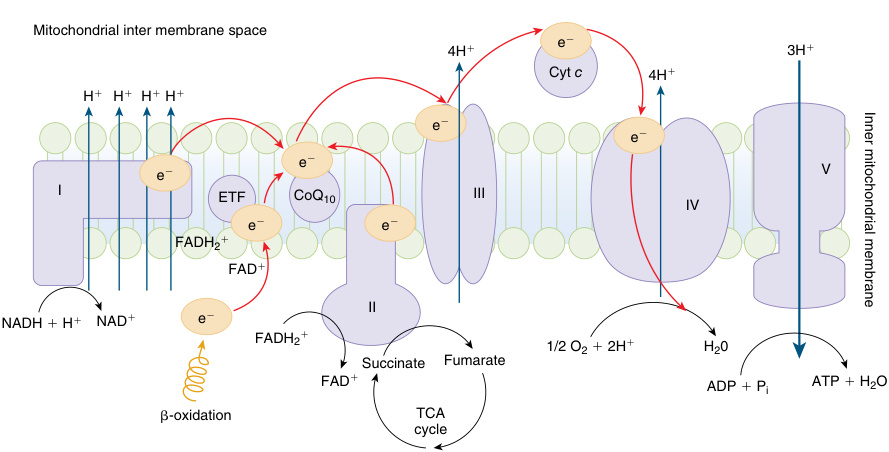
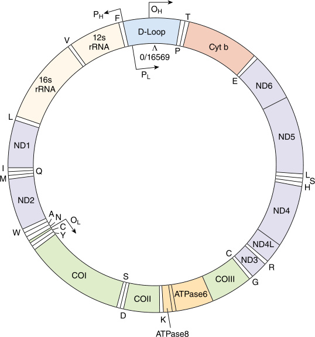
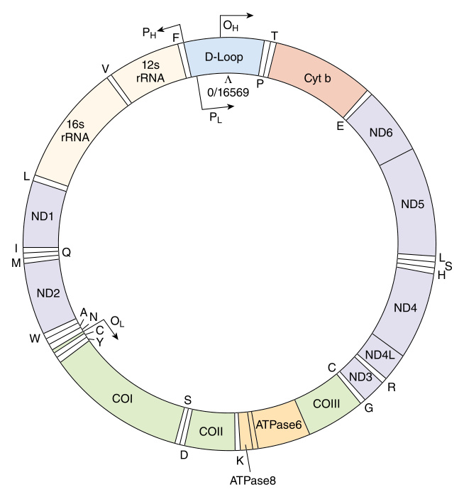
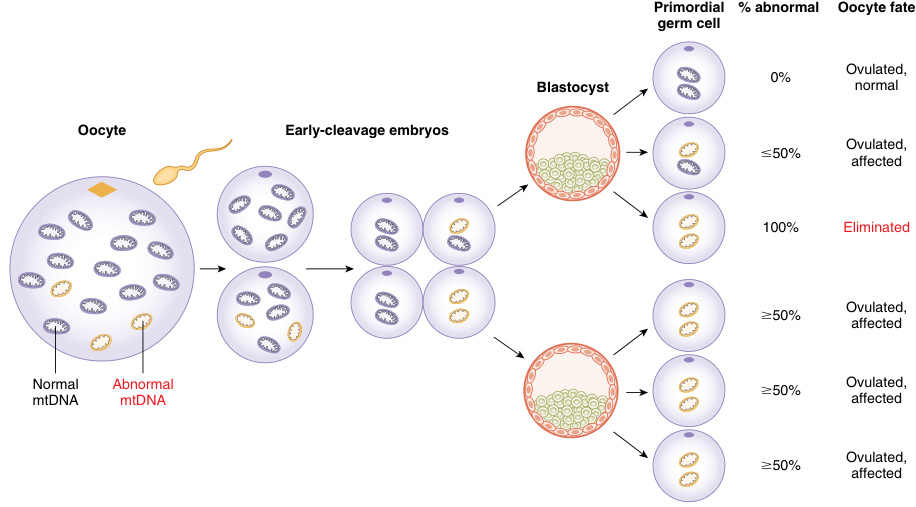
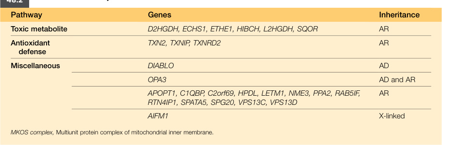
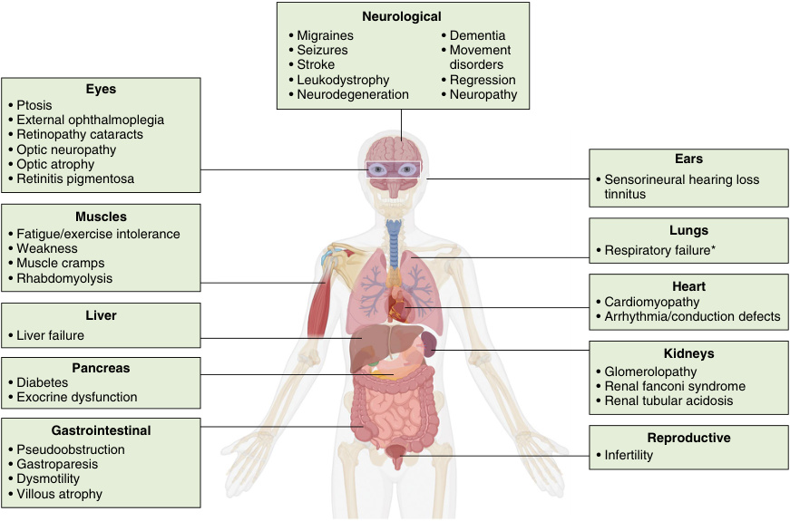
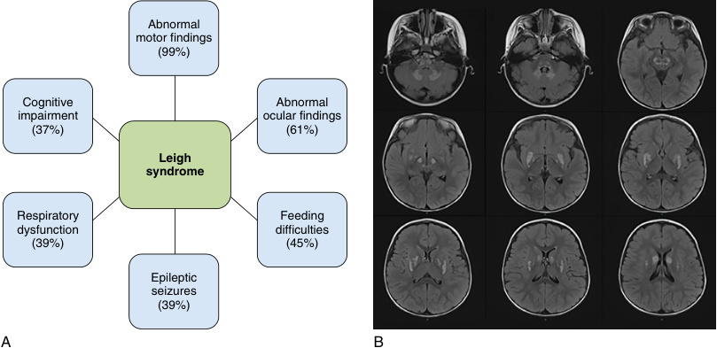
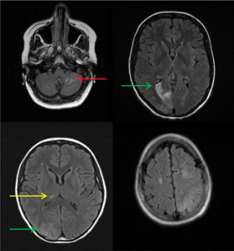
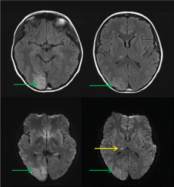
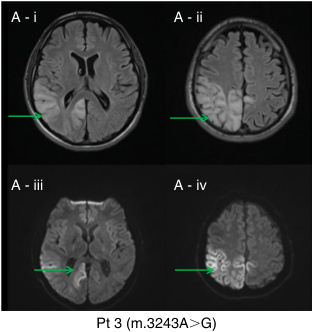

<!-- p.1090 -->

# 48 Mitochondrial Disorders 

**SHAMIMA RAHMAN, ROBERT MCFARLAND** 

Mitochondria are dynamic organelles that are at the center of cellular metabolism and signaling pathways. They have multiple interconnected functions, the most well recognized being energy generation via the mitochondrial respiratory chain and oxidative phosphorylation (OXPHOS) system. The **OXPHOS system** comprises five enzyme complexes embedded in the inner mitochondrial membrane: NADH:ubiquinone oxidoreductase (complex I), succinate:ubiquinone oxidoreductase (complex II), ubiquinone:cytochrome _c_ oxidoreductase (complex III), cytochrome _c_ oxidase (complex IV), and the ATP synthase (complex V), together with two mobile electron carriers coenzyme Q10 (CoQ10, also known as ubiquinone) and cytochrome _c_ (Fig. 48.1). Other metabolic functions of the mitochondrion include catabolism of pyruvate (in the Krebs tricarboxylic acid cycle), fatty acids (in the beta oxidation spiral), and numerous amino acids, notably glutamine and branched chain amino acids. Biosynthetic mitochondrial functions include synthesis of nucleotides, amino acids, CoQ10, iron-sulfur clusters, heme, and steroidogenesis. Mitochondria are signaling hubs, transducing information within and between cells. Mitochondrial signals include the membrane potential, succinate, and other Krebs cycle intermediates, mtDNA, and fragments of mitochondria or even entire mitochondria within extracellular vesicles. The dynamic and complex nature of mitochondria makes them ideally suited to adjust to energetic, environmental, and other stressors and thus they are essential for cellular homeostasis. Many mitochondrial functions are cell-specific, which may contribute to the tissue specificity of some mitochondrial diseases. 

## **Mitochondrial DNA** 

The prevailing theory on the origin of mitochondria is that these organelles initially existed as aerobic prokaryotes, but subsequently formed an endosymbiotic relationship with an anaerobic host cell (likely _Asgard Archaea_ ), resulting in the eukaryotic cell lineage. One major consequence of this primeval fusion event is the persistence of a remnant of that original prokaryotic DNA in the form of a 16.5 kb double stranded circular molecule of DNA known as **mitochon drial DNA (mtDNA)** . Present in almost all human cells, 

with the notable exception of mature red blood cells, this mtDNA encodes 22 tRNAs, 2 rRNAs, and 13 proteins essential for the process of OXPHOS and has few noncoding areas (Fig. 48.2). MtDNA consists of two strands known as heavy and light based on their ratio of GC:AT bases. Only one protein (MTND6; a subunit of complex I of the respiratory chain) and eight of the tRNAs are encoded on the light strand, while both ribosomal proteins, 14 tRNAs and 12 proteins are encoded on the heavy strand. 

Mitochondria are maternally inherited; sperm contain a small number of mitochondria that are thought to be rapidly ubiquitinated after fertilization of the egg and subsequently removed during early embryogenesis through autophagic processes. Consequently, in the absence of defective processes of ubiquitination and autophagy, mtDNA is exclusively maternally inherited and therefore does not undergo recombination events. Mitochondria contain multiple copies of mtDNA (10–100 copies per mitochondrion) and cells densely packed with mitochondria, such as oocytes and cardiomyocytes, may contain several hundred thousand molecules of mtDNA. Replication of mtDNA is independent of the cell cycle and occurs continuously in both mitotic and postmitotic cells. Key elements of the mtDNA replication machinery include a mitochondrial specific polymerase gamma (POLγ), a helicase (Twinkle), and mitochondrial single-stranded binding protein (mtSSBP). Additional proteins such as the DNA dependent RNA polymerase (POLRMT) and the topoisomerase-3-alpha (TOP3α) improve efficiency and processivity of the replication process. 

The polyploid nature of mtDNA allows for a phenomenon known as heteroplasmy, where a proportion of the mtDNA molecules present in a cell or tissue carry a pathogenic variant (Fig. 48.3). Heteroplasmy of the pathogenic variant form of mtDNA is typically expressed as a percentage that reflects the mean value for all cells in a sample, but cell-to-cell variation in heteroplasmy can be crucially important, particularly with oocytes and reproductive options. At the cell and tissue level, many pathological mtDNA variants are tolerated until a cell and pathogenic variant specific threshold is exceeded, typically in the region of 60%. Above this threshold the process of OXPHOS is disrupted and the cell cannot produce an adequate supply of

<!-- p.1091 -->

#### **MITOCHONDRIAL OXIDATIVE PHOSPHORYLATION SYSTEM** 

**Fig. 48.1** Oxidative phosphorylation. Schematic representation of the process of oxidative phosphorylation which occurs on the inner mitochondrial membrane. Electrons donated from the tricarboxylic acid cycle enter the mitochondrial respiratory chain at complex I, through the oxidation of nicotinamide adenine dinucleotide (NADH), and at complex II through oxidation of succinate and reduction of ubiquinone to ubiquinol. A third entry point for electrons derived from fatty acid oxidation occurs via the electron transfer flavoprotein. Through a series of electrochemical reactions electrons are exchanged or shuttled via CoQ10 (ubiquinone/ubiquinol) through the complexes until they reach complex IV, where oxygen acts as the ultimate electron acceptor. As electrons move through the mitochondrial respiratory chain, electrical neutrality is maintained by the extrusion of protons at complexes I, III, and IV forming a potential electrochemical gradient across the inner mitochondrial membrane, which is then dissipated through complex V, driving the condensation of inorganic phosphate (Pi) with adenosine dinucleotide (ADP) to form adenosine triphosphate (ATP), the energy currency of the cell. 

adenosine triphosphate (ATP), resulting in an energy deficit, attempted metabolic remodeling and cellular dysfunction triggering a cell stress response or cell death. 

The mtDNA is physically located in the hostile environment of the mitochondrial matrix and unlike nuclear DNA has no protective histones, making it particularly vulnerable to developing pathogenic variants. Most variation in human mtDNA is thought to have little pathological consequence, though there are claims that particular benign variants are associated with improved fitness for hot or cold climate survival. In addition, the temporal fixation of some benign variants in the human mitochondrial phylogenetic tree, the haplogroup markers, have been used to map the evolutionary migration of the human species out of Africa and across the globe. However, a substantial number of pathogenic mtDNA variants have recurred in multiple, ethnically distinct human populations and give rise to a wide range of diseases. Several cohort studies have indicated that pathogenic mtDNA variants are carried by approximately 1 in 200 of the general population, though for most of these individuals, variant heteroplasmy will be extremely low and will not put them at risk of developing mitochondrial disease during their lifetime. 

## **Genetics of Primary Mitochondrial Diseases** 

**Primary mitochondrial diseases (PMD)** are defined as genetic disorders affecting mitochondrial function, structure, or dynamics, and are estimated to affect at least 1 in 4,300 people. The first mitochondrial disorders to be characterized at a molecular level were those caused by pathogenic variants of mtDNA. The multicopy nature of mtDNA means that the principles of Mendelian genetics do not apply. The coexistence of two mtDNA sequences is known as **heteroplasmy** , whereas homoplasmy refers to the situation where all copies of mtDNA are identical. There can be anything from 1 to 99% of pathogenic mtDNA in a tissue, and random segregation of variants during embryogenesis means that the percentage heteroplasmy can vary widely between different tissues (Fig. 48.3). 

The majority of the ~1,500 proteins that constitute the mitochondrial proteome are encoded by nuclear genes; ~400 of these nuclear genes are linked to PMD. This means that PMD can be inherited by any mode (autosomal recessive, autosomal dominant, and X-linked) in addition to maternal inheritance of pathogenic mtDNA variants

<!-- p.1092 -->

**Fig. 48.2** Mitochondrial DNA. A schematic representation of mitochondrial DNA (mtDNA), a double stranded loop of approximately 16.5 kb in size, comprising light (L) and heavy (H) strands, encoding 13 proteins (red, blue, green, and orange), 22 tRNAs (white), and 2 ribosomal RNAs (yellow). The displacement or D-loop (cyan) is a triple-stranded noncoding region essential for the replication and transcription of mtDNA. The D-loop houses the both the light strand (PL) and heavy strand (PH) promoters, as well as the origin of heavy strand replication (OH). 

(Tables 48.1 and 48.2). In addition, _de novo_ occurrence of both mtDNA and nuclear pathogenic variants is increasingly recognized as an emerging cause of PMD. 

### **Disease Mechanisms Recognized to Cause PMD Include:** 

- Defects of OXPHOS complexes and their assembly 

- Defects of mtDNA maintenance, including disorders of enzymes involved in mtDNA replication and those needed for nucleoside salvage to provide building blocks for mtDNA synthesis 

- Defects of mitochondrial gene expression and protein synthesis 

- Defects of mitochondrial protein and solute import 

- Defects of cofactor biosynthesis (CoQ10, coenzyme A, iron-sulfur clusters, lipoic acid) 

- Defects of mitochondrial protein quality control 

- Defects of mitochondrial antioxidant defense 

- Defects of mitochondrial membrane complex lipid biosynthesis and remodeling 

- Defects of mitochondrial dynamics and trafficking 

## **Clinical Recognition of Primary Mitochondrial Disorders (PMDs)** 

### **Syndromes** 

In the past, many of the PMDs were characterized clinically as syndromes with typical constellations of symptoms and signs; these include Kearns-Sayre syndrome, Pearson marrow pancreas syndrome, mitochondrial epilepsy with ragged red fibers (MERRF), and mitochondrial encephalomyopathy with lactic acidosis and stroke-like episodes (MELAS). In addition, Leigh syndrome was characterized neuropathologically as subacute necrotizing encephalomyelopathy. It should be noted that many patients have complex multisystem presentations that do not fit these narrowly defined syndromes (Fig. 48.4). Many additional clinical mitochondrial syndromes have been described and characterized (Table 48.1). 

### **Single Organ Involvement** 

#### **Optic neuropathy: Leber hereditary optic neuropathy** 

- **(LHON)** is a maternally inherited disorder with incomplete penetrance, predominantly but not exclusively

<!-- p.1093 -->

**Fig. 48.3** Germline mtDNA heteroplasmy segregation. Normal mitochondria with functional mtDNAs are blue. Defective mitochondria with abnormal mtDNAs are brown. Oocytes bear hundreds of thousands of mtDNAs. After fertilization of a heteroplasmic oocyte, nDNA replication and cell division form a blastocyst, but the mtDNAs do not replicate and are randomly distributed into daughter cells. Some inner-cell-mass cells become primordial germ cells (PGCs), which form the oocytes in the female embryos. Each PGC receives only a few functional mtDNA elements, thus generating a broad distribution of PGC mtDNA heteroplasmy levels. The PGCs replicate and increase their mtDNAs and form proto-oocytes. After hormonal stimulation, multiple oocytes mature toward ovulation. Those proto-oocytes and/or embryos with the most robust mitochondria outcompete those with deficient mitochondria and survive. If all of a woman’s PGCs receive a high proportion of mutant mtDNAs, no normal proto-oocytes or embryos are available to outcompete the mutant, and multiple affected offspring result.  (Modified from Wallace DC. Mitochondrial genetic medicine. _Nat Genet_ . 2018;50:164201649 [Fig. 1A, p. 1643].) 

affecting males, with sequential bilateral subacute visual loss with a peak incidence late in the second decade. It is most frequently caused by one of three homoplasmic pathogenic mtDNA variants; m.11778G>A in _MT-ND4_ , m.3460G>A in _MT-ND1_ , and m.14484T>C in _MTND6_ . Dominant optic atrophy or **Kjer’s disease** , is caused by dominant variants of the OPA1 mitochondrial fusion protein and is the most common genetic optic atrophy. 

**Cardiomyopathy:** Mitochondrial cardiomyopathy is typically **hypertrophic** , with deep trabeculation of the myocardial wall that may extend to noncompaction and may be dilated in end-stage disease. Although mitochondrial cardiomyopathy may be part of a multisystem presentation, frequently involving the skeletal muscle and central nervous system, occasionally it is an isolated feature. **Liver failure:** Isolated liver failure in infancy or early childhood is a well-recognized clinical presentation of PMD that is often complicated by neurological involvement. The more frequent causes of mitochondrial hepato-encephalopathy are mtDNA depletion syndromes and defects of mitochondrial gene expression and protein synthesis. 

- **Steroid resistant nephrotic syndrome:** The presence of steroid-resistant nephrotic syndrome in a child, variably associated with hearing loss and/or seizures, should raise the suspicion of a disorder of CoQ10 biosynthesis, potentially treatable by high dose CoQ10 supplementation. 

## **Pathogenic Point Variants in mtDNA** 

### **Leber Hereditary Optic Neuropathy** 

LHON is recognized as the most frequent cause of new onset blindness in young males with estimates of disease prevalence varying from 1 in 27,000 to 1 in 45,000 (Chapter 22). Typically, the disease onset manifests with acute or subacute painless visual loss associated with the development of a large central scotoma. Early symptoms may be asymmetric, sometimes causing clinical confusion with optic neuritis, but involvement of the other eye, over the course of the next 3–6 months, is almost inevitable. 

Over 90% of cases are caused by one of three variants: m.11778G>A _(MT-ND4)_ , m.3460G>A _(MT-ND1)_ , and

<!-- p.1094 -->

##### **TABLE** 

##### **48.1** 

#### **Mitochondrial Clinical Syndromes** 

|Syndrome|Canonical Clinical Features|Gene(s)|Inheritance|
|---|---|---|---|
|Alpers-Huttenlocher syndrome|Triad of intractable seizures, developmental regression+/−liver failure|_POLG_ rarely_CARS2, FARS2,_ _NARS2, PARS2, TWNK_|AR|
|ANS|Ataxianeuropathyspectrum|_POLG, OPA1, TWNK_|AR|
|ARSACS|Autosomalrecessivespasticataxia of Charlevoix-Saguenay|_SACS_|AR|
|Barth syndrome|DCM, cyclical neutropenia, myopathy, 3MGA|_TAFAZZIN_|X-linked|
|Bjornstad syndrome|Congenital SNHL, pili torti|_BCS1L_|AR|
|CoQ10biosynthesis defects|3 main phenotypes: Complex multisystem disease Ataxia+/−seizures Steroid resistant nephrotic syndrome|_COQ2, COQ4, COQ7,_ _COQ9, PDSS1_ _COQ8A_ _COQ2, COQ6, COQ8B, PDSS_|_2_ AR|
|DCMA|DCMwithataxia|_DNAJC19_|AR|
|DOA|Dominantopticatrophy|_OPA1_|AD|
|Ethylmalonic encephalopathy|Encephalopathy, acrocyanosis, petechiae, diarrhea, ethylmalonic aciduria|_ETHE1_|AR|
|Friedreich ataxia|Progressive ataxia, muscle weakness, dysarthria, sensory neuropathy, HCM|_FXN_|AR|
|GRACILE|Growthretardation,aminoaciduria,cholestasis,iron overload,LA andearly death|_BCS1L_|AR|
|HUPRA|Hyperuricemia,pulmonary hypertension,renal failure, alkalosis|_SARS2_|AR|
|IOSCA|Infantile-onsetspinocerebellarataxia|_TWNK_|AR|
|KSS|Kearns-Sayre syndrome—triad of PEO, pigmentary retinopathy and cardiac conduction defects with variable multisystem features|_SLSMD_|Usually sporadic|
|LHON|Leberhereditaryopticneuropathy—acute or subacute mid-life painless visual loss, usually in second/third decade, male preponderance|_MT-ND1, MT-ND4_|Maternal|
|Leigh syndrome spectrum|Progressive neurological deterioration with hypotonia/ dystonia/spasticity, muscle weakness, tremor, ataxia|>113 mtDNA and nuclear genes|Maternal AR, AD, X-linked Sporadic|
|MDDS|MitochondrialDNAdepletion syndrome—3 main phenotypes: Hepatocerebral|_DGUOK, MPV17, POLG,_ _TWNK_|AR|
||Myopathic Encephalomyopathic|_TK2_ _MGME1, RRM2B, SUCLA2,_ _SUCLG1_ _SSBP1_|AR AR AD or AR|
|MEGDEL|3MGA,deafness,encephalopathy, andLeigh-like disease|_SERAC1_|AR|
|MELAS|Mitochondrialencephalomyopathy,LA,stroke-like episodes|_MT-TL1_m.3243A>G, also other mtDNA variants|Maternal|
|MEMSA|Myoclonic epilepsy, myopathy, sensory ataxia|_POLG_|AR|
|MERFF|Myoclonicepilepsy,ragged-redfibers|_MT-TK_m.8344A>G, also other mtDNA variants|Maternal|
|MIDD|Maternallyinheriteddiabetes anddeafness|_MT-TL1_|Maternal|
|MLASA|Myopathy,lacticacidosis,sideroblasticanemia|_PUS2_ _YARS2_|AR|

_(Continued)_

<!-- p.1095 -->

##### **TABLE** 

##### **48.1** 

#### **Mitochondrial Clinical Syndromes—cont'd** 

|Syndrome|Canonical Clinical Features|Gene(s)|Inheritance|
|---|---|---|---|
|MNGIE|Mitochondrialneurogastrointestinalencephalopathy|_TYMP_|AR|
|Mohr-Tranebjærg|Deafness, dystonia|_TIMM8A_|X-linked|
|NARP|Neuropathy,ataxia andretinitispigmentosa|_MT-ATP6_m.8993T>G/C|Maternal|
|Pearson marrow- pancreas syndrome|Sideroblastic anemia, exocrine pancreatic insufficiency, LA, DD, growth failure, enteropathy|_SLSMD_|Usually sporadic|
|Perrault syndrome|SNHL, ovarian failure in females|_CLPP, ERAL1, HARS2,_ _LARS2, TWNK_|AR|
|PEO|Progressiveexternalophthalmoplegia,+/−proximal myopathy|_SLSMD_ _POLG, TWNK, SLC25A4,_ _POLG2_(nuclear gene causes associated with multiple mtDNA deletions)| Usually sporadic AD, AR|
|RIRCD|Reversibleinfantilerespiratorychaindeficiency—2 main phenotypes: Myopathic phenotype Reversible liver failure|_MT-TE_m.14674T>C/G, _TRMU_|Maternal* AR|
|Sengers syndrome|Congenital cataracts, HCM, LA, 3MGA|_AGK_|AR|
|SIFD|Sideroblastic anemia,immune deficiency (B cell), periodicfever,DD|_TRNT1_|AR|
|Wolfram (DIDMOAD)|Diabetesinsipidus,diabetesmellitus,opticatrophy, deafness|_WFS1_|AR|

_Note:_ Where acronyms are given in the first column, these are explained by bold letters in the second column. Only the core clinical features are listed; it should be noted that additional features may occur in each of these syndromes. 

*Variants in nuclear modifier genes have been reported to be necessary for expression of RIRCD caused by _MT-TE_ variants. 

_3MGA,_ 3-methylglutaconic aciduria; _AD,_ autosomal dominant; _AR,_ autosomal recessive; _DCM,_ dilated cardiomyopathy; _DD,_ developmental delay; _HCM,_ hypertrophic cardiomyopathy; _LA,_ lactic acidosis; _SLSMD,_ single large-scale mtDNA deletion; _SNHL,_ sensorineural hearing loss. 

##### **TABLE 48.2** 

#### **Genetics of Primary Mitochondrial Disorders** 

|Pathway||Genes|Inheritance|
|---|---|---|---|
|OXPHOS |Complex I|_MT-ND1, MT-ND2, MT-ND3, MT-ND4, MT-ND4L, MT-ND5, MT-ND6_|mtDNA|
|subunits||_NDUFA2, NDUFA6, NDUFA8, NDUFA9, NDUFA10, NDUFA11,_ _NDUFA12, NDUFA13, NDUFB3, NDUFB7, NDUFB8, NDUFB9,_ _NDUFC2, NDUFS1, NDUFS2, NDUFS3, NDUFS4, NDUFS6,_ _NDUFS7, NDUFS8, NDUFV1, NDUFV2_|AR|
|||_NDUFA1, NDUFB11_|X-linked|
||Complex II|_SDHA, SDHB, SDHD_|AD and AR|
|||_SDHC_|AD|
||Complex III|_MT-CYB_|mtDNA|
|||_UQCRC1_|AD|
|||_CYC1, UQCRB, UQCRC2, UQCRFS1, UQCRH, UQCRQ_|AR|
||Complex IV|_MT-CO1, MT-CO2, MT-CO3_|mtDNA|
|||_COX4I1, COX4I2, COX5A, COX6A1, COX6A2, COX6B1, COX8A,_ _NDUFA4_|AR|
|||_COX7B_|X-linked|

_(Continued)_

<!-- p.1096 -->

#### **TABLE 48.2** Genetics of Primary Mitoch ondrial Disorders—cont'd

|Pathway||Genes|Inheritance|
|---|---|---|---|
||Complex V|_MT-ATP6, MT-ATP8_|mtDNA|
|||_ATP5F1B, ATP5MC3_|AD|
|||_ATP5F1A_|AD and AR|
|||_ATP5F1D, ATP5F1E, ATP5MK, ATP5PO_|AR|
|OXPHOS assembly factors and |Complex I|_ACAD9, DNAJC30, FOXRED1, NDUFAF1, NDUFAF2, NDUFAF3,_ _NDUFAF4, NDUFAF5, NDUFAF6, NDUFAF8, NUBPL, PYURF,_ _TIMMDC1, TMEM126A, TMEM126B_|AR|
|chaperones|Complex II|_SDHAF2_|AD|
|||_SDHAF1_|AR|
||Complex III|_BCS1L, LYRM7, TTC19, UQCC2, UQCC3_|AR|
|||_HCCS_|X-linked|
||Complex IV|_CEP89, COA3, COA5, COA6, COA7, COX10, COX11, COX14,_ _COX15, COX16, COX20, FASTKD2, PET100, PET117, SCO1,_ _SCO2, SURF1_|AR|
||Complex V|_ATPAF2, TMEM70_|AR|
|Electron carrier|Cytochrome_c_|_CYCS_|AD|
|mtDNA maintenance|mtDNA replication and repair|_DNA2, POLG2, SSBP1_|AD|
|||_POLG, POLRMT, TWNK_|AD and AR|
|||_LIG3, MGME1, RNASEH1, TOP3A_|AR|
||Nucleotide metabolism|_RRM2B, SLC25A4, SAMHD1_|AD and AR|
|||_ABAT, CMPK2, DGUOK, GUK1, MPV17, SUCLA2, SUCLG1,_ _TK2, TYMP_|AR|
|mtDNA |Regulation|_LRPPRC, POLRMT, TFAM_|AR|
|transcription|RNA processing and modification|_ELAC2, GTPBP3, MTO1, MTPAP, NSUN3, PDE12, PNPT1,_ _PRORP, PUS1, SLIRP, THG1L, TRIT1, TRMT10C, TRMT5,_ _TRMU, TRNT1_|AR|
|||_HSD17B10_|X-linked|
|Mitochondrial translation|Transfer RNA|_MT-TA, MT-TC, MT-TD, MT-TE, MT-TF, MT-TG, MT-TH, MT-TI,_ _MT-TK, MT-TL1, MT-TL2, MT-TM, MT-TN, MT-TP, MT-TQ,_ _MT-TR, MT-TS1, MT-TS2, MT-TT, MT-TV, MT-TW, MT-TY_|mtDNA|
||tRNA aminoacylation|_GARS1_|AD|
|||_AARS2, CARS2, DARS2, EARS2, FARS2, GATB, GATC, HARS2,_ _IARS2, KARS1, LARS2, MARS2, NARS2, PARS2, QRSL1,_ _RARS2, SARS2, TARS2, VARS2, WARS2, YARS2_|AR|
||Start-tRNA|_MTFMT_|AR|
||Ribosomal RNA|_MT-RNR1, MT-RNR2_|mtDNA|
||Ribosomal protein|_MRPL3, MRPL12, MRPL24, MRPL39, MRPL44, MRPL50, MRPS2,_ _MRPS7, MRPS14, MRPS16, MRPS22, MRPS23, MRPS25,_ _MRPS28, MRPS34_|AR|
||Regulation|_ERAL1, GFM1, GFM2, GUF1, MRM2, MTRFR, PTCD3, RMND1,_ _TACO1, TSFM, TUFM_|AR|

_(Continued)_

<!-- p.1097 -->

#### **TABLE 48.2** Genetics of Primary Mitoc hondrial Disorders—cont'd

|Pathway||Genes|Inheritance|
|---|---|---|---|
|Cofactors|CoQ10|_ADCK2_|AD|
|||_COQ2, COQ4, COQ5, COQ6, COQ7, COQ8A, COQ8B, COQ9,_ _PDSS1, PDSS2_|AR|
||Heme|_PPOX_|AD|
|||_SLC25A38, SFXN4_|AR|
|||_ALAS2_|X-linked|
||Iron-sulfur cluster|_BOLA3, FDX2, FDXR, FXN, GLRX5, IBA57, ISCA1, ISCA2, ISCU,_ _LYRM4, NFS1, NFU1_|AR|
|||_ABCB7_|X-linked|
||Lipoic acid|_LIAS, LIPT1, LIPT2, MCAT, MECR_|AR|
|Vitamins|Biotin|_BTD, HLCS_|AR|
||Niacin|_NADK2, NAXD, NAXE, NMNAT1, NNT_|AR|
||Pantothenate|_COASY, PANK2, PPCDC, PPCS, SLC25A42_|AR|
||Riboflavin|_FLAD1, SLC25A32_|AR|
||Thiamine|_SLC25A19, TPK1_|AR|
|Pyruvate ||_DLAT, DLD, MPC1, PC, PDHB, PDHX, PDP1, PDPR_|AR|
|metabolism||_PDHA1, PDK3_|X-linked|
|Krebs cycle||_IDH2_|AD|
|||_FH_|AD and AR|
|||_ACO2, DLST, IDH1, IDH3A, IDH3B, MDH2, OGDH, OGDHL_|AR|
|Lipid ||_AGK, CRLS1, PISD, PNPLA8, SERAC1, TAMM41_|AR|
|biosynthesis||_PNPLA4, TAZ_|X-linked|
|MICOS complex||_CHCHD2, CHCHD10_|AD|
|||_MICOS13_|AR|
|||_APOO_|X-linked|
|Mitochondrial ||_DNAJC19, GFER, PAM16, TIMM22, TIMM50, TOMM7, TOMM70_|AR|
|protein import||_TIMM8A_|X-linked|
|Mitochondrial ||_SLC25A11, SLC25A24_|AD|
|solute carriers||_GOT2, GPD1, MICU1, MICU2, SLC25A1, SLC25A3, SLC25A10,_ _SLC25A12, SLC25A13, SLC25A15, SLC25A20, SLC25A21,_ _SLC25A22, SLC25A26, SLC25A36, SLC25A38, SLC25A46_|AR|
|Mitochondrial||_CLPX, HSPE1_|AD|
|quality control||_ATAD3A, AFG3L2, HSPA9, HSPD1, LONP1, SPG7_|AD and AR|
|||_CLPB, CLPP, FBXL4, HTRA2, MIPEP, OXA1L, PINK1, PITRM1,_ _PMPCA, PMPCB, PRKN, SACS, VCP, XPNPEP3, YME1L1_|AR|
|Mitochondrial|Fission|_MIEF1_|AD|
|dynamics||_DNM1L, GDAP1_|AD and AR|
|||_MIEF2, MFF, STAT2_|AR|
||Fusion|_OPA1, MFN2, MSTO1_|AD and AR|
||Trafficking|_TRAK1_|AR|

_(Continued)_

<!-- p.1098 -->

#### **TABLE 48.2 Genetics of Primary Mitochondrial Disorders—cont'd** 

- **Fig. 48.4** Clinical features of primary mitochondrial disease. The multisystem nature of mitochondrial 

- disease can affect individuals across the age spectrum. Almost every organ in the body may be involved and often a specific combination of organ dysfunction (e.g., pancreas and cochlea) is the first indication of the diagnosis of mitochondrial disease. *Secondary to poor central drive, aspiration, diaphragm weakness. 

m.14484T>C _(MT-ND6)_ . These variants tend to be homoplasmic and associated with variable disease penetrance, with ~50% of all male carriers, but less than 20% of females, developing symptoms. In addition, recessive nuclear genetic variants, such as those in _DNAJC30,_ have caused LHON. 

The marked variation in the expression of LHON is thought to be a consequence of both environmental (smoking 

and alcohol) and unidentified genetic factors, such as those that govern mitochondrial biogenesis and mtDNA copy number, particularly in the retinal ganglion cells that appear to be specifically affected in this condition. Despite the preponderance of affected males, extensive genetic analyses of the X chromosome have not yielded a disease modifier. Spontaneous remission of symptoms occurs to a variable degree in between 25–50% of those clinically affected by

<!-- p.1099 -->

LHON depending on genotype, with those patients carrying the m.14484T>C most likely to benefit. This aspect of LHON natural history is an important consideration when conducting clinical trials of treatment. Furthermore, all three of the common mtDNA variants causing LHON have also been associated with a slowly progressive generalized dystonia phenotype in several different families, where optic neuropathy is not always evident. 

LHON is one of the few mitochondrial diseases for which treatment is available. Idebenone, a synthetic benzoquinone similar in structure to CoQ10, has been shown to be effective treatment for some individuals affected by LHON. Patients with the m.11778G>A variant have been reported to benefit most. Another promising approach to treatment of LHON is that of allotopic gene therapy, which has undergone phase III clinical trials examining the therapeutic response in those affected for less than 6 months (RESCUE) and those visually impaired for between 6 and 12 months (REVERSE); in both there appears to be clear benefit. However, one rather unexpected outcome from these studies was the improvement in visual acuity noted in the contralateral (placebo injected) eye. A subsequent phase III study, REFLECT, examined the response to bilateral intravitreal injection of lenado gene nolparvovec (a replication defective single stranded DNA recombinant adeno-associated virus 2 vector that contains a cDNA for human wild-type _MT-ND4_ ) in patients with LHON due m.11778G>A. REFLECT demonstrated an improvement in best corrected visual acuity in LHON eyes when compared with natural history studies. 

### **The Disease Spectrum Associated With m.3243A** > **G** 

One of the most frequent pathogenic variants in mtDNA is an adenine to guanine substitution occurring at position 3243 in the mitochondrial tRNALeu[UUR] gene _(MT-TL1)_ . This pathogenic variant has a prevalence of 1 in 400 and has arisen _de novo_ in multiple different ethnic lineages. The precise pathological impact of the A>G substitution at position 3243 remains unclear, but it is thought to affect the tertiary folding of the mitochondrial tRNALeu[UUR] molecule, adversely impacting mtDNA translation. In addition, it is likely that the m.3243A>G variant also causes hypomethylation of mitochondrial tRNALeu[UUR] thereby disrupting many nuclear-encoded mitochondrial enzymes including mitochondrial leucyl-tRNA synthetase, a key enzyme in aminoacylation. 

The clinical spectrum of disease associated with m.3243A>G is vast, but a few clinical syndromes are particularly well recognized. **Mitochondrial encephalo myopathy with lactic acidosis and strokelike episodes (MELAS)** is a devastating disorder usually affecting individuals with high (>70%) heteroplasmy for m.3243A>G. Estimates from national cohort studies suggest that 15–20% of carriers of m.3243A>G are affected by MELAS. The age of onset of the first (syndrome defining) stroke-like episode 

ranges from childhood to middle age, but typically, patients are first affected in adolescence or early adult life. Strokelike events will often begin with visual aura and headache, followed by nausea, vomiting, and unilateral sensory phenomena with a subsequent stuttering onset of hemiparesis over the course of minutes to hours, in contrast to the rapid onset of vascular stroke. Recurrent stroke-like episodes are associated with cerebral atrophy and a neurodegenerative process like dementia. Concomitant with stroke-like episodes, patients often experience a potentially life-threatening acute or subacute **intestinal pseudoobstruction** , which usually requires conservative management rather than surgical intervention and is a significant contributor to the mortality of these stroke-like events. Prediction of strokelike episodes is remarkably difficult, but for some patients, premorbid indicators include a positive maternal family history for stroke-like episodes, a thin and short body habitus with rapid satiety for food, bowel dysmotility, lanugo hair and seizures. 

The etiology of stroke-like episodes is uncertain, but the cranial magnetic resonance imaging (MRI) appearance typically involves more than one vascular territory, often occipito-parietal or occipito-temporal lobes; postmortem neuropathological examination reveals areas of cortical laminar necrosis, both findings supporting an epileptic basis for the pathology. Vascular abnormalities, especially involvement of the smooth muscle of the tunica media of cerebral blood vessels, may also contribute to the central nervous system pathology and while this is not universally accepted, this does provide some justification for the use of L-Arginine, both acutely and prophylactically, in patients treated in Japan and the USA. Large double-blind randomized controlled trials have not been conducted for either anticonvulsants or L-Arginine in acute stroke-like events, but guidelines on management are available through the NHS Highly Specialized Service for Rare Mitochondrial Disorders (UK) and the Mitochondrial Medicine Society (USA). 

More commonly, m.3243A>G results in a clinical syndrome of **maternally inherited diabetes mellitus and deafness (MIDD)** (Chapter 42). Typically, individuals with this syndrome will develop a slowly progressive hearing loss in their third decade with a requirement for bilateral hearing aids usually within 5–10 years of onset. Cochlear implant may be a suitable treatment for some individuals and should be given early consideration in families where this diagnosis is known. Following the onset of hearing loss, glucose intolerance and overt diabetes mellitus may become evident; in females, this may arise as gestational diabetes mellitus. In many patients the diabetes mellitus progresses rapidly to require exogenous insulin administration. Autoantibody tests for type I diabetes mellitus are typically negative, and the body habitus is usually not that associated with type II diabetes; the condition has been labeled as Type 1.5. Given the combination of decreased insulin production and increased insulin resistance on a background of impaired energy metabolism, this form of diabetes mellitus can be difficult to manage.

<!-- p.1100 -->

Bilateral ophthalmoplegia, often associated with symmetrical ptosis is a common finding in many forms of mitochondrial disease; a clinical phenotype of **progressive external ophthalmoplegia (PEO)** is a recognized manifestation of disease associated with m.3243A>G. Patients usually experience a degree of proximal muscle weakness in conjunction with this chronic PEO, but this may be a very subtle examination finding that requires repetitive testing. 

Many patients with m.3243A>G _do not_ fall neatly into a particular clinical syndrome, experiencing a wide range of problems relating to their disease that include, in addition to those mentioned above, dysphagia, hypertrophic cardiomyopathy, cardiac arrhythmia (Wolff-Parkinson-White syndrome), fatigue, myalgia, migraine-like headache, renal failure, and retinal (macular) dystrophy. In isolation it is doubtful that any of these nonspecific clinical problems would be attributed to mitochondrial disease, making diagnosis unlikely and highlighting the difficulties in determining accurate population prevalence for this and other forms of mitochondrial (mtDNA) disease. 

### **Myoclonic Epilepsy With Ragged Red Fibers** 

Myoclonic epilepsy with ragged red fibers (MERRF) syndrome is the association of progressive cortical myoclonus with the histopathological observation of prominent subsarcolemmal accumulations of mitochondria in skeletal muscle fibers. However, this is a somewhat limited description of a syndrome that is multisystem in nature, characterized by progressive ataxia and photosensitive epilepsy, but frequently includes other features such as proximal myopathy, cardiac arrhythmia (Wolff-Parkinson-White syndrome), hypertrophic cardiomyopathy, sensorineural hearing loss, neurodegeneration, optic atrophy, and multiple lipomata. The single most common cause of MERRF is the m.8344A>G pathogenic variant in the mitochondrial tRNALys gene _(MTTK)_ , but a number of other variants (e.g., m.8356T>C and m.8363G>A) in _MT-TK_ and other mitochondrial tRNA genes, including m.3243A>G in _MT-TL1_ can cause this disease. An overlap syndrome of MERRF/MELAS is also recognized; patients with m.8344A>G experience problems associated with MERRF as well as the stroke-like episodes of MELAS. 

The prevalence of MERRF has been estimated in several European epidemiological studies to be between 0.25 and 1.5 per 100,000 adults. Onset of disease in association with the m.8344A>G variant can be from early childhood, when the clinical phenotype is one of fatal, **maternally inherited Leigh syndrome (MILS)** rather than MERRF, or more typically in late childhood or early adult life. Myoclonus is typically photosensitive and also action induced; other seizure types include absence, atonic, and generalized tonic clonic. Myoclonus responds to some degree to treatment with benzodiazepines (clonazepam) but is difficult to eradicate. Combinations of antiseizure medicines are usually necessary as the disease progresses and typically include levetiracetam/brivaracetam, clonazepam and 

occasionally sodium valproate. Although valproate is empirically avoided in mitochondrial disease, largely because of the association with fatal hepatic failure in patients with _POLG_ -related disease, it remains an effective treatment for myoclonus, one of the most debilitating aspects of MERRF. Lipomata tend to grow in brown fat tissue of the cervical collar and back, with some becoming grossly enlarged, limiting movement and potentially compromising breathing. Lipomata tend to regrow after resection and repeated surgeries may be necessary. 

### **Maternally Inherited Hypertrophic Cardiomyopathy** 

Often a complicating feature of a number of mitochondrial diseases, hypertrophic cardiomyopathy can occasionally occur in isolation as the only manifestation of mitochondrial disease (Chapter 28). This presentation is commonly associated with the m.4300A>G pathogenic variant in _MT-TI_ , though it has also been observed with other mtDNA variants including m.1624C>T, m.3250T>C, and m.3271T>C. The m.4300A>G and m.1624C>T variants have been reported at homoplasmic levels in almost all affected individuals, but disease penetrance is considerably less than 100%, with some family members remaining unaffected. This variable penetrance has led to an as yet unsuccessful search for a nuclear or environmental modifier. Pre-emptive cardiac health surveillance with echocardiography (or cardiac MRI) in families with maternally inherited cardiomyopathy, as well as other forms of mitochondrial disease where cardiomyopathy is a prominent feature (e.g., m.3243A>G, m.8344A>G and m.3260A>G), can help identify preliminary signs of pathology. Treatment with beta-blockers and angiotensinconverting enzyme inhibitors can then be initiated early and potentially slow progression of the cardiomyopathy. Cardiac transplant should be considered as a therapeutic option, particularly in those patients with isolated cardiomyopathy. 

### **Maternally Inherited Leigh Syndrome** 

Leigh syndrome (Fig. 48.5), a subacute necrotizing encephalomyelopathy, is seen in a clinical spectrum that comprises more than 113 different monogenic disorders, mostly recessively inherited (Table 48.1). Approximately 20–30% of cases are caused by pathogenic mtDNA variants and are said to have maternally inherited Leigh syndrome (MILS), although some of these cases appear to be sporadic, with mothers having undetectable levels of the pathogenic mtDNA variant in blood samples. The overall prevalence of Leigh syndrome spectrum is approximately 1 in 30,000; the prevalence of MILS is likely to be of the order of 1 in 100,000. Clinical presentation is typically in infancy, often with initial feeding difficulties and vomiting, followed by an episode of developmental regression frequently associated with elevated lactic acid levels in blood and/or cerebrospinal fluid (CSF). This episode may follow a viral illness, fasting or other metabolic stressor, but often no specific trigger can

<!-- p.1101 -->

**Fig. 48.5** Leigh syndrome. Major features and typical neuroradiological appearance of Leigh syndrome. Abnormalities of tone (spasticity and dystonia), movement and posture are the most prominent features of Leigh syndrome (A) and likely result from a combination of symmetric basal ganglia, corticospinal tract and cerebellar damage as illustrated by the high signal observed in these areas on T2 weighted MRI (B). Brainstem involvement impairs swallowing and causes apneic episodes in some patients with Leigh syndrome. More widespread cortical dysfunction is often not evident on neuroradiological imaging but is responsible for the cognitive impairment and epileptic seizures observed in a substantial proportion of patients. 

be identified. Onset may also be later in childhood, or occasionally in adult life. Neurological signs reflect the presence of bilateral symmetrical lesions in the basal ganglia, midbrain, and brainstem, sometimes also extending to the cerebellum and spinal cord, which appear as T2 hyperintense lesions on MRI and necrotic lesions on neuropathological examination. Clinical features may include dystonia and other extrapyramidal signs, ataxia, tremor, spasticity, hypotonia, bulbar dysfunction, peripheral neuropathy, ophthalmoplegia, optic atrophy, pigmentary retinopathy, and sensorineural hearing loss (SNHL). Involvement of central nuclei in the brainstem eventually lead to breathing abnormalities and death from respiratory failure. 

Two pathogenic variants at the same nucleotide position, m.8993T>G and m.8993T>C in _MT-ATP6_ encoding a subunit of the ATP synthase (complex V), are the most frequent causes of MILS and together comprise approximately 10% of Leigh syndrome. Other mtDNA variants are also recognized to cause Leigh syndrome, particularly in the mtDNA encoded subunits of complex I ( _MT-ND1_ , _MT-ND3_ , _MT-ND5_ , and _MT-ND6_ ). Most causes of the Leigh syndrome spectrum are clinically indistinguishable; the most efficient method to achieve a genetic diagnosis is through whole genome or exome sequencing, making sure that the mtDNA is adequately covered. 

## **Large-Scale Deletions of mtDNA** 

Deletions (and rearrangements) of mtDNA have been associated with a range of pathologies and syndromes. Multiple 

deletions and depletion of mtDNA are most often a consequence of ageing (multiple deletions) or disruption of the mtDNA maintenance and repair machinery (multiple deletions and mtDNA depletion) due to recessively or dominantly inherited nuclear genetic defects. In contrast, single large-scale mtDNA deletions (SLSMDs) are frequently sporadic with a low maternal transmission risk estimated at 1 in 24. Patients with large-scale single deletions will typically fall into one of three syndromic categories: Pearson, KearnsSayre, and chronic progressive external ophthalmoplegia plus syndromes. Transition from Pearson to Kearns-Sayre is well documented. Disease progression in these conditions seems to be correlated with deletion size and heteroplasmy, though additional factors, including a widespread tissue distribution of the deletion, are also likely to be important. 

### **Pearson Syndrome** 

This mitochondrial disease affects children in the first year of life and may even be present at birth. Initially described as a refractory sideroblastic anemia with vacuolization of erythroid and myeloid marrow precursors in association with exocrine pancreatic dysfunction, the condition is also recognized to include severe (potentially fatal) metabolic acidosis, renal tubulopathy and multiple endocrine organ dysfunction with hypothyroidism, hypoparathyroidism, diabetes mellitus and adrenal and growth hormone insufficiency. Many of these aspects of Pearson syndrome become evident in children who survive the initial pancytopenia and _evolve_ into a Kearns-Sayre phenotype.

<!-- p.1102 -->

Treatment is largely supportive with regular administration of blood and platelet transfusions while waiting for marrow function to improve. It often does so over months to years and the interval between transfusions can be slowly extended until they are no longer required. Endocrine replacement therapies will be dictated by the precise pattern of endocrinopathy. Formal audiology should be undertaken at diagnosis and annually thereafter so that early detection of SNHL will lead to prompt fitting of hearing aids. 

## **Kearns-Sayre Syndrome** 

Kearns-Sayre syndrome (KSS) is a multisystem disorder characterized by the onset of ptosis, ophthalmoplegia, pigmentary retinopathy and cardiac conduction defects usually before the age of 20 years. Ataxia, dysphagia, renal tubulopathy, proximal myopathy, bilateral SNHL, and multiple endocrine organ insufficiencies (growth hormone, thyroid, parathyroid, pancreatic, and adrenal) are also prominent clinical features. CSF lactate and protein are typically elevated with CSF protein often >100 mg/dL (normal range 15–60 mg/dL); other central nervous system manifestations can include generalized brain atrophy and a cystic leukoencephalopathy associated with a low CSF 5-methyltetrahydrofolate (typically in the range 10–50 nmol/L) and focal or myoclonic seizures. 

Management of patients with KSS focuses on health surveillance for early detection of endocrine dysfunction, deafness, and heart block, so that appropriate hormone replacement, hearing aid fitting and pacemaker device insertion can occur promptly. Administration of folinic _(not folic)_ acid may be helpful in ameliorating the effects of low CSF folate, but precisely how much to give is debated, with doses of between 1 and 5 mg/kg/day being administered. Ptosis correction surgery can significantly improve visual axis but carries a risk of over-correction with incomplete eye closure and exposure keratopathy. 

## **Chronic Progressive External** 

## **Ophthalmoplegia Plus (CPEO1) Syndrome** 

Bilateral progressive external ophthalmoplegia with ptosis and proximal myopathy are the hallmarks of CPEO+ syndrome, but may be accompanied by hearing loss, dysphagia, and pigmentary retinopathy. Onset is typically in the third or fourth decade of life and manifests as a painless, slowly progressive typically asymmetric ptosis and ophthalmoplegia. While strabismus is common in patients with CPEO+, at times the ophthalmoplegia is remarkably symmetric and slowly evolving, such that the debilitating symptom of diplopia can be minimal, and the condition goes unreported by the patient for many years. 

Single large-scale deletions of mtDNA are usually detectable in blood from patients with Pearson syndrome and KSS but may be absent in older patients with CPEO, where analysis of skeletal muscle biopsy may prove more helpful, not only in detecting SLSMDs, but the associated 

features of mitochondrial disease including ragged red and cytochrome c oxidase deficient muscle fibers. The size and heteroplasmy (in skeletal muscle) of the SLSMD deletion have been shown to correlate with disease burden as estimated by the Newcastle Mitochondrial Disease Adult Scale (https://www.newcastle-mitochondria.com/wp-content/ uploads/2016/03/NMDAS-Scale-neurology-2006261114.pdf ). 

# **Nuclear DNA Encoded Mitochondrial Disorders** 

## **Nuclear Genes** 

Approximately 400 nuclear encoded proteins have been linked to PMDs (Table 48.2). 

## **Disorders of Oxidative Phosphorylation** 

Defects of nuclear-encoded subunits and assembly factors have been reported for all five OXPHOS complexes. Twentyfour of the 37 nuclear-encoded subunits of complex I have been linked to **Leigh syndrome** or **leukoencephalopathies** , variably associated with **cardiomyopathy** . Defects of the SDHA and SDHB subunits of complex II may also cause Leigh syndrome, whilst dominant variants in the SDHC and SDHD subunits are linked to **phaeochromocytomas** and **paragangliomas** . Pathogenic variants in nuclear-encoded subunits of complexes III and IV are less frequently reported and are associated with heterogeneous phenotypes. _De novo_ dominant variants have been reported in nuclear subunits of the ATP synthase (Table 48.2), associated with metabolic abnormalities (increased blood lactate, alanine, and ammonia levels), developmental delay, movement disorders and intellectual disability. 

More than 40 monogenic OXPHOS disorders are caused by assembly factor deficiencies. Defects of assembly factors of complexes I and II are most frequently associated with encephalomyopathic phenotypes, leukoencephalopathies, or fatal infantile lactic acidosis. _BCS1L_ , encoding a protein responsible for the incorporation of the Rieske iron-sulfur protein into the nascent complex III holoenzyme, is the complex III assembly factor most frequently linked to disease. Biallelic variants in _BCS1L_ have been linked to heterogeneous phenotypes ranging from the fatal neonatal Finnish heritage disorder **g** rowth **r** etardation, **a** minoaciduria, **c** holestasis, **i** ron overload, **l** actic acidosis, and **e** arly death **(GRACILE) syndrome** to complex childhood-onset multisystem disorders with prominent renal tubulopathy and movement disorders. Biallelic pathogenic variants in the complex IV assembly factor SURF1 are among the most frequent causes of **Leigh syndrome** , typically presenting with developmental regression in infancy associated with a progressive course leading to death from respiratory failure related to brainstem lesions in early childhood. However, biallelic _SURF1_ variants are also associated with a milder phenotype of **CharcotMarieTooth disease** type 4K

<!-- p.1103 -->

presenting late in the first decade of life with a demyelinating peripheral neuropathy leading to distal muscle weakness and impaired sensation, with a more indolent course; survival has been reported into the sixth decade. The most frequent complex V assembly defect is deficiency of TMEM70, associated with neonatal onset hypertrophic cardiomyopathy, lactic acidosis, hyperammonemia and 3-methylglutaconic aciduria. This disorder is particularly prevalent in the Roma population, owing to a founder variant. 

resembling **mitochondrial neurogastrointestinal encepha lopathy (MNGIE)** . The usual cause of MNGIE is deficiency of thymidine phosphorylase encoded by _TYMP_ , leading to adolescent or adult-onset of gastrointestinal dysmotility (dysphagia, early satiety, nausea, vomiting, bloating, constipation, diarrhea, and episodes of pseudo-obstruction) and cachexia, associated with ptosis and/or ophthalmoplegia, proximal myopathy and demyelinating peripheral neuropathy. 

## **Disorders of Mitochondrial Gene Expression** 

# **Disorders of Mitochondrial DNA Maintenance** 

Maintenance of the mtDNA is a complex process that requires the concerted action of a large number of proteins. DNA polymerase γ is the only polymerase that can replicate the mtDNA. Other proteins present at the mitochondrial replication fork are the twinkle helicase, needed to unwind the mtDNA, mitochondrial single-stranded binding protein (mtSSBP) and transcription factors A and B. Maintenance of the mtDNA also requires the provision of building blocks of DNA synthesis, namely nucleotides. _De novo_ nucleotide synthesis only occurs at cell division, but mtDNA replication takes place throughout the cell cycle and relies on nucleotides derived from a dedicated mitochondrial nucleotide salvage pathway. More than 20 disorders of the mitochondrial replication fork and nucleotide salvage enzymes have been linked to human disease caused by multiple deletions and/or depletion of the mtDNA. Pathogenic variants in nuclear genes encoding proteins involved in the mtDNA replication and repair processes lead to mtDNA deletions and, more often in children, an absolute depletion of mtDNA content in the cell and tissue. Both mtDNA deletions and mtDNA depletion are associated with human diseases that typically result in functionally compromising proximal muscle weakness. In some cases, this skeletal muscle weakness may extend to involve the diaphragm and respiratory muscles of the thorax so that artificial ventilatory support is required. In others, often children, mtDNA depletion will cause a fatal multisystem disorder. 

The **mtDNA depletion syndromes** may be subdivided according to clinical presentation: hepatocerebral, encephalomyopathic, and myopathic (Table 48.2). The most frequent cause of mtDNA depletion is biallelic variants of _POLG_ encoding the catalytic subunit of DNA polymerase γ. Biallelic _POLG_ variants often present in early childhood with **AlpersHuttenlocher syndrome** , a triad of intractable epilepsy, developmental regression, and variable hepatic failure (triggered by exposure to sodium valproate, which is contraindicated in _POLG_ disease). Other causes of **infantile onset hepatocerebral mtDNA depletion syndromes** are disorders of nucleoside metabolism caused by deficiencies of _DGUOK_ , _MPV17_ , and _SUCLG1_ . Another peak of _POLG_ disease is with seizures in teenage years, but clinical presentation of _POLG_ disease is heterogeneous and includes progressive external ophthalmoplegia (which may be recessive or dominantly inherited), distal myopathy and a severe enteropathy 

Mitochondrial gene expression requires a large number of proteins, including enzymes responsible for modification of the mitochondrial tRNAs and mRNAs, as well as aminoacyl tRNA synthetases needed to attach each the 20 amino acids to their cognate tRNAs, and a dedicated mitochondrial protein synthesis apparatus. The latter includes approximately 80 mitochondrial ribosomal proteins that are structural components of the large and small ribosomal subunits, as well as enzymes needed to initiate, propagate, and terminate mitochondrial protein synthesis. Nearly one hundred disorders of mitochondrial gene expression are now recognized, including defects of each of the above steps of mitochondrial protein synthesis, and associated with phenotypic heterogeneity and complex multisystem disorders spanning the whole spectrum of primary mitochondrial disease. 

## **Disorders of Mitochondrial Lipid Biosynthesis and Membrane Stability** 

The inner mitochondrial membrane (IMM) has a unique structure, including a dedicated complex lipid called cardiolipin whose structural properties contribute to the integrity of the IMM and its curvature into deep invaginations known as cristae, where OXPHOS and other essential mitochondrial reactions occur. A growing group of mitochondrial disorders relate to defective synthesis and remodeling of cardiolipin, a complex lipid that is unique to the IMM. The most notable of these is **Barth syndrome** , an X-linked disorder comprising dilated cardiomyopathy, neutropenia and myopathy caused by deficiency of Tafazzin, an enzyme required for the final stages of cardiolipin synthesis. 3-methylglutaconic aciduria (3MGA), deafness and encephalopathy Leigh-like (MEGDEL) syndrome is also a disorder of mitochondrial membrane lipid remodeling. 

Dedicated proteins also contribute to cristae structure, notably components of the mitochondrial contact site and cristae organizing system (MICOS) complex. Disorders of MICOS proteins are emerging as novel causes of PMD; MICOS13 deficiency has been reported in infants with hypotonia, faltering growth, neurodegeneration with developmental regression, and liver dysfunction, variably associated with hypertrophic cardiomyopathy, loss of vision and hearing, and seizures. Dominant variants in two proteins associated with the MICOS, CHCHD2 and CHCHD10, may cause Parkinson disease, frontotemporal dementia, or amyotrophic lateral sclerosis.

<!-- p.1104 -->

## **Disorders of Mitochondrial Import** 

The outer mitochondrial membrane (OMM) is freely diffusible, but the inner mitochondrial membrane (IMM) is an impermeable barrier that contains highly organized systems for importing proteins and solutes into the mitochondrion. Disorders of mitochondrial import include the X-linked deafness-dystonia **(MohrTranebjaerg)** syndrome and **Sengers syndrome** of bilateral congenital cataracts and hypertrophic cardiomyopathy. Acylglycerol kinase (AGK), the enzyme deficient in Sengers syndrome, appears to have a dual role in mitochondrial lipid biosynthesis and protein import, an example of efficiency and coordination of mitochondrial functions. 

There are greater than 40 dedicated solute carriers across the IMM, and defects of many of these have been linked to human disease (Table 48.2). Associated phenotypes include epilepsy syndromes (e.g., SLC25A22), mtDNA depletion (SLC25A4), myopathy (e.g., MICU1, SLC25A32), hypertrophic cardiomyopathy (SLC25A3), pontocerebellar hypoplasia (SLC25A46), and Amish lethal microcephaly (SLC25A19). 

## **Disorders of Mitochondrial Dynamics** 

Mitochondria are extremely dynamic organelles, undergoing frequent episodes of fission and fusion that are essential for intracellular trafficking of numerous molecules including ATP, and for the renewal of mitochondrial components via the processes of _mitophagy_ (degradation of dysfunctional mitochondria or mitochondrial segments) and mitochondrial biogenesis. Defects of the IMM fusion factor OPA1 may cause dominant optic atrophy, variably associated with SNHL, myopathy and ataxia, or a recessively inherited mtDNA depletion syndrome. Dominant and recessive variants of another fusion factor MFN2, a GTPase located in the OMM, also cause optic neuropathy. Defects of the mitochondrial fission factors DRP1 (encoded by _DNM1L_ ) and MFF have been linked to early-onset infantile disorders presenting with epileptic encephalopathy. 

## **Disorders of Mitochondrial Cofactor Biosynthesis** 

Mitochondria are the sites of biosynthesis of several cofactors that are essential for normal functioning of the OXPHOS system: CoQ10, lipoic acid, heme, and iron sulfur clusters. The most well documented of these, and potentially amenable to therapy with high-dose CoQ10 supplementation, are the disorders of CoQ10 biosynthesis, which may present with seizures, ataxia, sensorineural hearing loss and nephrotic syndrome. Disorders of lipoic acid and iron-sulfur cluster biosynthesis have been linked to infantile epileptic encephalopathies, myopathies, and multisystem disorders, while heme biosynthesis disorders may cause sideroblastic anemia, porphyria, or multisystem infantile disorders. 

## **Disorders of Mitochondrial Vitamin Transport and Metabolism** 

Mitochondria are also responsible for metabolism of several of the B vitamins: thiamine (B1), riboflavin (B2), nicotinamide (B3), pantothenate (B5), biotin (B7), folate (B9), and cobalamin (B12). Inherited disorders of vitamin metabolism are associated with heterogeneous clinical presentations including profound myopathy and cardiac arrhythmias (B2), neuronal brain iron accumulation and cardiomyopathy (B5), congenital lactic acidosis (B7) and methylmalonic aciduria and homocystinuria (B12) (Table 48.2). 

## **Disorders of Protein Quality Control** 

Several primary mitochondrial disorders share impaired mitochondrial protein quality control as a pathomechanism (Table 48.2). Deficiency of CLPB has been linked to a range of phenotypes including congenital cataracts, neutropenia, premature ovarian insufficiency (POI) and 3MGA, CLPP to **Perrault syndrome** (SNHL and POI) and leukodystrophy, and the serine protease HTRA to neonatal-onset movement disorders, seizures, and 3MGA. Other proteins involved in mitochondrial quality control (including AFG3L2, HSPD1, and SPG7) are associated with spastic paraplegia and ataxia syndromes. 

## **Disorders of Mitochondrial Antioxidant Defense and Toxicity** 

Mitochondria are sites of high oxidative stress and reactive oxygen species (ROS) production and have developed sophisticated mechanisms for antioxidant defense. Mitochondrial antioxidant systems include manganese superoxide dismutase, glutathione and peroxiredoxin. Disorders of mitochondrial antioxidant include: **Ethylmalonic encephalopathy** , characterized by acrocyanosis, petechiae and diarrhea, is caused by deficiency of a sulfur dioxygenase responsible for intramitochondrial sulfur detoxification. Another related disorder of sulfur detoxification, SQOR deficiency, has been reported to cause **Leigh syndrome spectrum disorder** . Two defects of valine degradation, deficiencies of 3-hydroxyisobutyryl-CoA hydrolase (HIBCH) and short-chain enoyl-CoA hydratase (ECHS1), are also associated with Leigh syndrome spectrum, with the pathogenic mechanism thought to be toxicity from accumulation of a toxic metabolite, methylacrylylCoA, that attacks exposed thiol groups on mitochondrial enzymes including respiratory chain complexes and pyruvate dehydrogenase. Two disorders of antioxidant defense: **nicotinamide nucleotide transhydrogenase (NNT)** and **thioredoxin reductase 2 (TXNRD2) deficiencies** can cause a familial syndrome of isolated _glucocorticoid deficiency_ . It is not clear why the adrenal glands are particularly vulnerable in these disorders and whether other variants may be reported in future to be associated with multisystemic mitochondrial diseases.

<!-- p.1105 -->

## **Mitochondrial Disorders of Intermediary Metabolism** 

Other metabolic pathways are housed in the mitochondrion, but there is no consensus about whether these should be regarded as primary mitochondrial disorders, highlighting the difficulties inherent in the classification of inherited metabolic diseases. Intramitochondrial metabolic pathways include the Krebs tricarboxylic acid cycle, fatty acid betaoxidation and part of the urea cycle and the mitochondrial one carbon cycle, as well as ketogenesis, degradation of branched chain and other amino acids, and biosynthesis of steroid hormones. 

## **Secondary Disorders Leading to Mitochondrial Dysfunction** 

Secondary mitochondrial dysfunction has been reported in an increasing number of disorders caused by gene defects without known (direct or indirect) mitochondrial roles. Examples of these include ion channel disorders, other inherited metabolic disorders (e.g., lysosomal storage disorders and congenital disorders of glycosylation), Aicardi-Goutières syndrome, and DNA repair disorders, as well as more common disorders including cancer, diabetes, and neurodegenerative disorders such as Parkinson, Huntington, and Alzheimer diseases. 

# **Approach to Diagnosis** 

## **Clinical Assessment** 

The patient with a suspected PMD should first be evaluated with a detailed history, including a three-generation family history, and full clinical examination encompassing 

comprehensive neurological examination and assessment of multisystem involvement, which should include cardiological, audiological, and ophthalmological review and blood tests to investigate hematological, renal, and liver function and hormonal profile. Much has been written about diagnostic “red flags” for PMD, but the truth is that there are no pathognomonic symptoms or signs of PMD. Concerning symptoms of a PMD include developmental regression, cognitive decline, parkinsonism, and progressive ophthalmoplegia. Often the biggest diagnostic clue is multisystem involvement of seemingly unrelated organs. 

## **Neuroimaging** 

The most frequently observed neuroimaging features of PMD are bilateral symmetrical T2 hyperintense lesions, variably involving the basal ganglia, thalamus, midbrain, brainstem, cerebellum, and spinal cord in patients with LSS. Stroke-like lesions in MELAS syndrome most commonly affect parieto-occipital or parieto-temporal regions but are not confined to vascular territories. In the acute phase these are characterized by swollen gyri, T2 hyperintensity, and involvement of subcortical white matter. Chronic MRI changes in MELAS typically involve multiple vascular territories, may be symmetrical or asymmetrical, and are often associated with cerebral atrophy. Characteristic imaging changes observed in mitochondrial syndromes are listed in Table 48.3 and illustrated in Figure 48.6. Magnetic resonance spectroscopy (MRS) is a noninvasive imaging methodology that enables some degree of assessing intracranial biochemical metabolites. A lactate peak in association with reduced N-acetyl-aspartate (NAA) may be helpful in the evaluation of a patient with suspected PMD. Identification of a succinate peak is a useful clue to succinate dehydrogenase deficiency, a rare cause of PMD. 

#### **TABLE 48.3** Neuroimaging Features of Primary Mitochon drial Diseases

|Neuroimaging Feature|Class of Mitochondrial Disorder|Gene Defect(s)|
|---|---|---|
|Bilateral symmetrical T2-hyperintense lesions involving basal ganglia+/−brainstem, thalamus, midbrain, cerebellum, spinal cord (Leigh syndrome spectrum)|Multiple|>113 mtDNA and nuclear genes|
|Bilateral symmetrical T2 hyperintense lesions in basal ganglia initially sparing putamina (MEGDEL)|Mitochondrial membrane lipid remodeling|_SERAC1_|
|Cystic leukoencephalopathy without differentiating features|Complex I deficiency|_NDUFV1_|
||Complex III deficiency|_LYRM7_|
||Iron-sulfur cluster biosynthesis defect|_IBA57, ISCA2, NFU1_|
|Cystic leukoencephalopathy with tigroid-like changes|Complex I deficiency|_NDUFA2_|
|Complex leukoencephalopathy involving deep cerebral white matter, basal ganglia, thalami, and corpus callosum, with progressive cerebellar atrophy|Complex I deficiency|_NUBPL_|
|Cystic leukoencephalopathy with succinate peak on MRS|Complex II deficiency|_SDHA, SDHB, SDHAF1_|

_(Continued)_

<!-- p.1106 -->

#### **TABLE 48.3** Neuroimaging Features of Primary Mitochon drial Diseases—cont'd

|Neuroimaging Feature|Class of Mitochondrial Disorder|Gene Defect(s)|
|---|---|---|
|Cystic leukoencephalopathy with posterior predominance|Complex IV deficiency|_COA8_|
|Cystic leukoencephalopathy with spinal cord hypotrophy|Complex IV deficiency|_COA7_|
|Demyelinating leukoencephalopathy|Disorder of mtDNA maintenance|_TYMP_|
|Leukoencephalopathy withbrainstem andspinal cord calcifications (LBSC)|Disorder of mitochondrial and cytosolic translation|_KARS1_|
|Leukoencephalopathy withBrainstem andSpinal cord involvement andLactate elevation on proton MRS (LBSL)|Disorder of mitochondrial translation|_DARS2_|
|Leukoencephalopathy (sparing periventricular rim) with Thalamus andBrainstem involvement andLactate elevation on proton MRS (LTBL)|Disorder of mitochondrial translation|_EARS2_|
|Pontocerebellarhypoplasia type 6 (PCH6)|Disorder of mitochondrial translation|_RARS2_|
|T2-hyperintense abnormalities of subcortical cerebral white matter, globus pallidus, and substantia nigra|Disorder of mitochondrial translation|SLSMD (KSS)|
|T2-hyperintense lesions in gray and subcortical white matter of temporal, parietal, and occipital lobes, sparing deep white matter and crossing vascular boundaries,+/−basal ganglia calcification, generalized cerebral atrophy|Disorder of mitochondrial translation|_MT-TL1_(MELAS)|

Disorders listed by imaging appearance in alphabetical order. _SLSMD,_ Single large-scale mtDNA deletion. 

Pt 1 (POLG) 

Pt 2 (POLG) 

Three patients exhibiting typical cranial MRI (T2) findings of seizure associated stroke-like episodes (SLE). Patients 1 & 2 have POLG-related epilepsy and Pt 3 has MELAS. Red arrow = cerebellar lesion; yellow arrows = thalamic lesions; green arrows = posterior SLE crossing vascular boundaries. 

- **Fig. 48.6** Imaging findings in _POLG_ disease. Three patients exhibiting typical cranial MRI (T2) findings of seizure associated stroke-like episodes (SLE). Patients 1 and 2 have POLG-related epilepsy and Patient 

- 3 has MELAS. _Red arrow_ = cerebellar lesion; _yellow arrows_ = thalamic lesions; _green arrows_ = posterior SLE crossing vascular boundaries. 

## **Metabolic Investigations** 

There are no universally observed biochemical abnormalities in patients with PMD, many lack both sensitivity and specificity for accurate diagnosis. Some suggested biomarkers include lactate (in blood and CSF), fibroblast 

growth factor 21 (FGF21), and growth and differentiation factor 15 (GDF15). However, normal values of any or all these molecules do not exclude a diagnosis of PMD, and, similarly, elevations of these biomarkers are observed in a number of more common disease states. Persistently elevated lactate may lead to elevated plasma alanine levels.

<!-- p.1107 -->

Proline may be elevated in some patients with PMD (possibly because of inhibition of proline oxidase by lactate) and arginine, citrulline, and serine have been reported to be low in others, but none of these is a consistent finding. Urinary organic acids may reveal 3-methylglutaconic aciduria, which may suggest a specific diagnosis, depending on the clinical context, but can also be a nonspecific feature of PMD and other inherited metabolic diseases. Ethylmalonic aciduria is present in patients with ethylmalonic encephalopathy caused by ETHE1 deficiency. Nonspecific abnormalities in the urinary organic acids include increased excretion of lactate, Krebs cycle intermediates and dicarboxylic acids. 

## **Muscle Biopsy** 

Muscle biopsy was the traditional route to establishing a diagnosis of a PMD but has been largely superseded by next generation sequencing (NGS). Needle or open muscle biopsy is subjected to histochemical, electron microscopy, and biochemical analysis. Historically, ragged red fibers caused by subsarcolemmal accumulation of mitochondria visualized using the modified Gomori trichrome stain were considered morphological hallmarks of PMD but while these are helpful if present, their absence by no means excludes a PMD, especially in the pediatric population. Biochemical methods for analysis of muscle biopsies include spectrophotometric assays of individual OXPHOS complexes, polarography to measure global oxygen consumption, blue native gel electrophoresis to assess OXPHOS complex assembly, and direct measurement of CoQ10 levels. 

## **Genetics** 

Exome or genome sequencing are being used as first-line approaches to diagnosis. The advantages of sequencing a targeted panel of genes are assured coverage of genes or regions of interest, whereas the genomic approach allows for identification of genetic variants with atypical presentations, discovery of new disease-causing genes and re-interrogation of the same sequence data if initial analysis was nondiagnostic. Analysis of mtDNA in exomes needs specialized pipelines and some centers continue to sequence the mtDNA separately. In children, blood DNA can detect most mtDNA variants and large-scale deletions, but muscle may need to be analyzed to detect these variants in adult patients. Diagnosis of mtDNA depletion also requires analysis of an affected tissue (i.e., muscle). 

## **Differential Diagnosis** 

A major problem when faced with the diagnostic consideration is that PMDs are frequently complex multisystem disorders with a wide differential diagnosis. Advances in genomic methods have further distorted the boundaries between PMD and disorders that apparently have secondary mitochondrial dysfunction, by revealing non-PMD genetic diagnoses in patients with strong clinical and/or 

biochemical suspicion of PMD. The list of causes of secondary mitochondrial dysfunction is rapidly expanding and includes sodium channel disorders, DNA repair disorders, interferonopathies, and lysosomal storage disorders. 

# **Management** 

## **Treatable Disorders** 

There are no universally licensed disease-modifying therapies for PMDs, but there are many aspects of the management of these complex disorders that should be considered. There is a group of disorders that are potentially amenable to treatment with high-dose vitamins or cofactors. These treatable disorders include disorders of transport and metabolism of the B vitamins thiamine (B1), riboflavin (B2), pantothenate (B5), and biotin (B7). Deficiency of the SLC19A3 thiamine transporter, initially recognized to cause biotin-thiamine responsive basal ganglia disease, has emerged as a frequent cause of infantile-onset Leigh syndrome, and can be treated with high doses of both thiamine and biotin. Biotinidase deficiency can be detected using a blood assay, and treatment with low dose biotin is extremely effective in curing the lactic acidosis, skin, and neurological manifestations of this disorder. Plasma membrane riboflavin transporter deficiencies cause severe neuropathies which can mimic PMDs, including respiratory chain deficiencies in skeletal muscle biopsies. Deficiency of the mitochondrial riboflavin transporter SLC25A32 or of the FAD synthase enzyme involved in riboflavin metabolism causes a lipid storage myopathy. These disorders are amenable to therapy with high-dose riboflavin, although efficacy may be variable. Disorders of pantothenate metabolism include **neu ronal brain iron accumulation** caused by pantothenate kinase or coenzyme A synthase deficiencies, and a dilated cardiomyopathy caused by phosphopantothenoylcysteine synthetase (PPCS) and phosphopantothenoylcysteine decarboxylase (PPCDC) deficiencies. Studies have reported therapeutic responses to vitamin B5 or its derivatives in some of these disorders, but long-term outcomes are not yet known. CoQ10 is a cofactor rather than a vitamin since it can be synthesized in human cells. Ten genetic disorders of CoQ10 biosynthesis have been reported, with variable clinical features including hearing and vision loss, seizures, ataxia, myopathy, and steroid-resistant nephrotic syndrome. Response to highdose CoQ10 supplementation is variable, ranging from reversal of chronic kidney disease to progressive encephalopathy and cardiomyopathy leading to early death. There are no clear prognostic indicators, so high-dose CoQ10 supplementation should be attempted in all affected cases. The role of vitamins and cofactors in other PMDs is less clear. 

## **Supportive Therapies** 

A central aspect of the management of PMDs is surveillance for the multisystem complications of these disorders, and implementation of symptomatic therapies as indicated. These measures may include antiseizure medicines,

<!-- p.1108 -->

hearing aids, cochlear implantation, brow suspension for ptosis, gastrostomy feeding, management of constipation, pancreatic enzyme supplements, treatment of diabetes, hormone supplements, blood transfusions, electrolyte supplements, cardiac pacing, implantable cardioverter defibrillator insertion, and cardiac or renal transplantation, as clinically indicated. 

## **Emerging Therapies** 

Emerging therapies can be divided into pharmacological and genetic therapies. So far, these are mostly at preclinical stages, although a few therapies have been the subject of clinical trials. The pharmacological therapies can be further divided into a disease agnostic group and other therapies that specifically address individual mitochondrial diseases. The former includes therapies targeting reactive oxygen species and oxidative stress (antioxidants including vatiquinone and sonlicromanol), mitochondrial biogenesis (for example, bezafibrate and resveratrol), the mitochondrial membrane lipids (such as Elamipretide) and mitophagy (mTOR inhibitors such as sirolimus and everolimus). Preclinical data for these agents have been conflicting and where clinical trials have been performed, none has met the primary endpoints in a randomized double-blinded placebo-controlled phase 3 clinical trial to date. A diseasespecific therapy is nucleoside supplementation for the myopathic mtDNA depletion syndrome thymidine kinase 2 deficiency. Thymidine and deoxycytidine have shown promising results following compassionate use therapy, although long-term efficacy is unknown. 

Genetic therapies can be divided into those that target the mtDNA, and gene therapy for nuclear DNA encoded PMDs. One strategy for mtDNA is allotopic expression of a mitochondrial protein, by recoding the gene in the nuclear rather than the mitochondrial genetic code and adding a mitochondrial targeting sequence, so that it can be expressed from the nucleus, synthesized on cytosolic ribosomes, and then imported into the mitochondria. This method has been the subject of clinical trials for the most common mtDNA variant associated with LHON and is currently being evaluated by regulatory agencies. Another method to target variant mtDNA is to selectively degrade pathogenic mtDNA sequences using zinc finger nucleases or mitoTALENs. These techniques have been used successfully in cell and animal models of PMD but have not yet progressed to human trials. mtDNA base editors, based on a bacterial cytidine deaminase, have shown off-target effects on nuclear DNA in preclinical studies; further optimization is needed. Preclinical AAV-based gene replacement therapies have been reported for several nuclear encoded PMDs, but none of these has progressed to clinical trials to date. 

## **Reproductive Options** 

Reproductive options in PMDs depend on the underlying genetic cause. Prenatal diagnosis is available for nuclear 

DNA variants and some mtDNA variants that are known to have skewed oocyte loads, for example the m.8993T>G variant in _MT-ATP6_ associated with Leigh syndrome. Preimplantation genetic diagnosis is available for many nuclear gene and mtDNA variants. For some mtDNA variants, such as those with high heteroplasmy loads or homoplasmy in mothers, mitochondrial donation therapy using the techniques of pronuclear transfer or spindle cell transfer may prevent transmission of a mtDNA variant but is still the subject of clinical research. 

# **Bibliography** 

- Arena IG, Pugliese A, Volta S, et al. Molecular genetics overview of primary mitochondrial myopathies. _J Clin Med_ . 2002;11:632. 

- Emmanuele V, Ganesh J, Vladutiu G, et al. Time to harmonize mitochondrial syndrome nomenclature and classification: a consensus from the North American Mitochondrial Disease Consortium (NAMDC). _Mol Genet Metab_ . 2022;136(2):125-131. 

- Ferreira CR, Rahman S, Keller M, Zschocke J. An International Classification of Inherited Metabolic Disorders (ICIMD). _J Inherit Metab Dis_ . 2021;44(1):164-177. 

- Gorman GS, Chinnery PF, DiMauro S, et al. Mitochondrial diseases. _Nat Rev Dis Primers_ . 2016;2:16080. 

- Gorman GS, Schaefer AM, Ng Y, et al. Prevalence of nuclear and mitochondrial DNA mutations related to adult mitochondrial disease. _Ann Neurol_ . 2015;77(5):753-759. 

- Gray MW. Lynn Margulis and the endosymbiont hypothesis: 50 years later. _Mol Biol Cell_ . 2017;28(10):1285-1287. 

- Herbert M, Choudhary M, Zander-Fox D. Assisted reproductive technologies at the nexus of fertility treatment and disease prevention. _Science_ . 2023;380(6641):164-167. 

- Keshavan N, Minczuk M, Viscomi C, Rahman S. Gene therapy for mitochondrial disorders. _J Inherit Metab Dis_ . 2024;47(1):145-175. 

- Lightowlers RN, Chinnery PF, Turnbull DM, Howell N. Mammalian mitochondrial genetics: heredity, heteroplasmy and disease. _Trends Genet_ . 1997;13(11):450-455. 

- Mahmud S, Biswas S, Afrose S, et al. Use of next-generation sequencing for identifying mitochondrial disorders. _Curr Issues Mol Biol_ . 2022;44:1127-1148. 

- Mancuso M. Complex neurological and multisystem presentations in mitochondrial disease. _Handb Clin Neurol_ . 2023;194:117-124. 

- Monzel AS, Enríquez JA, Picard M. Multifaceted mitochondria: moving mitochondrial science beyond function and dysfunction. _Nat Metab_ . 2023;5(4):546-562. 

- Morava E, van den Heuvel L, Hol F, et al. Mitochondrial disease criteria: diagnostic applications in children. _Neurology_ . 2006;67:1823-1826. 

- Newman NJ, Yu-Wai-Man P, Biousse V, Carelli V. Understanding the molecular basis and pathogenesis of hereditary optic neuropathies: towards improved diagnosis and management. _Lancet Neurol_ . 2023;22(2):172-188. 

- Ng YS, Bindoff LA, Gorman GS, et al. Consensus-based statements for the management of mitochondrial stroke-like episodes. _Wellcome Open Res_ . 2019;4:201. 

- Ng YS, Bindoff LA, Gorman GS, et al. Mitochondrial disease in adults: recent advances and future promise. _Lancet Neurol_ . 2021; 20(7):573-584. 

- Paredes-Fuentes AJ, Oliva C, Urreizti R, Yubero D, Artuch R. Laboratory testing for mitochondrial diseases: biomarkers for diagnosis and follow-up. _Crit Rev Clin Lab Sci_ . 2023;60(4):516.

<!-- p.1109 -->

- Parikh S, Karaa A, Goldstein A, et al. Diagnosis of ‘possible’ mitochondrial disease: an existential crisis. _J Med Genet_ . 2019; 56(3):123-130. 

- Pizzamiglio C, Hanna MG, Pitceathly RDS. Primary mitochondrial diseases. _Handb Clin Neurol_ . 2024;204:53-76. 

- Rahman J, Rahman S. Mitochondrial medicine in the omics era. _Lancet_ . 2018;391(10139):2560-2574. 

- Rahman S. Mitochondrial disease in children. _J Intern Med_ . 2020; 287(6):609-633. 

- Russell OM, Gorman GS, Lightowlers RN, Turnbull DM. Mitochondrial diseases: hope for the future. _Cell_ . 2020;181(1):168-188. 

- Schlieben LD, Prokisch H. Genetics of mitochondrial diseases: current approaches for the molecular diagnosis. _Handb Clin Neurol_ . 2023;194:141-165. 

- Schon KR, Ratnaike T, van den Ameele J, et al. Mitochindrial diseases: a diagnostic revolution. _Trends Genet_ . 2020;36(9): 702-717. 

- Stenton SL, Prokisch H. Genetics of mitochondrial diseases: identifying mutations to help diagnosis. _EBioMedicine_ . 2020; 56:102784. 

- Suomalainen A, Nunnari J. Mitochondria at the crossroads of health and disease. _Cell_ . 2024;187(11):2601-2627. 

- Tinker RJ, Lim AZ, Stefanetti RJ, McFarland R. Current and emerging clinical treatment in mitochondrial disease. _Mol Diagn Ther_ . 2021;25(2):181-206. 

- Witters P, Saada A, Honzik T, et al. Revisiting mitochondrial diagnostic criteria in the new era of genomics. _Genet Med_ . 2018;20(4): 444-451.