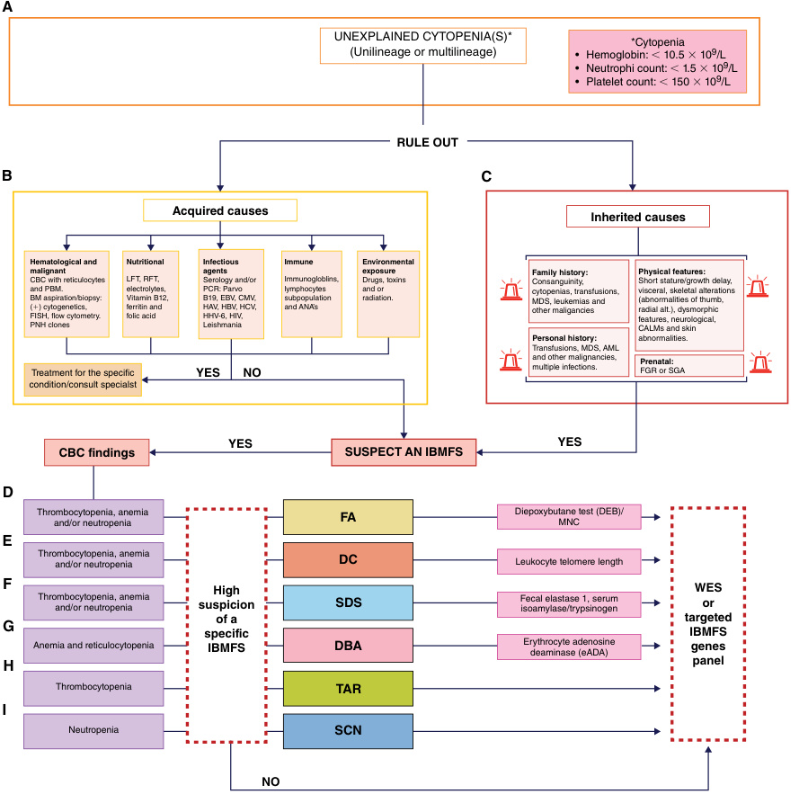
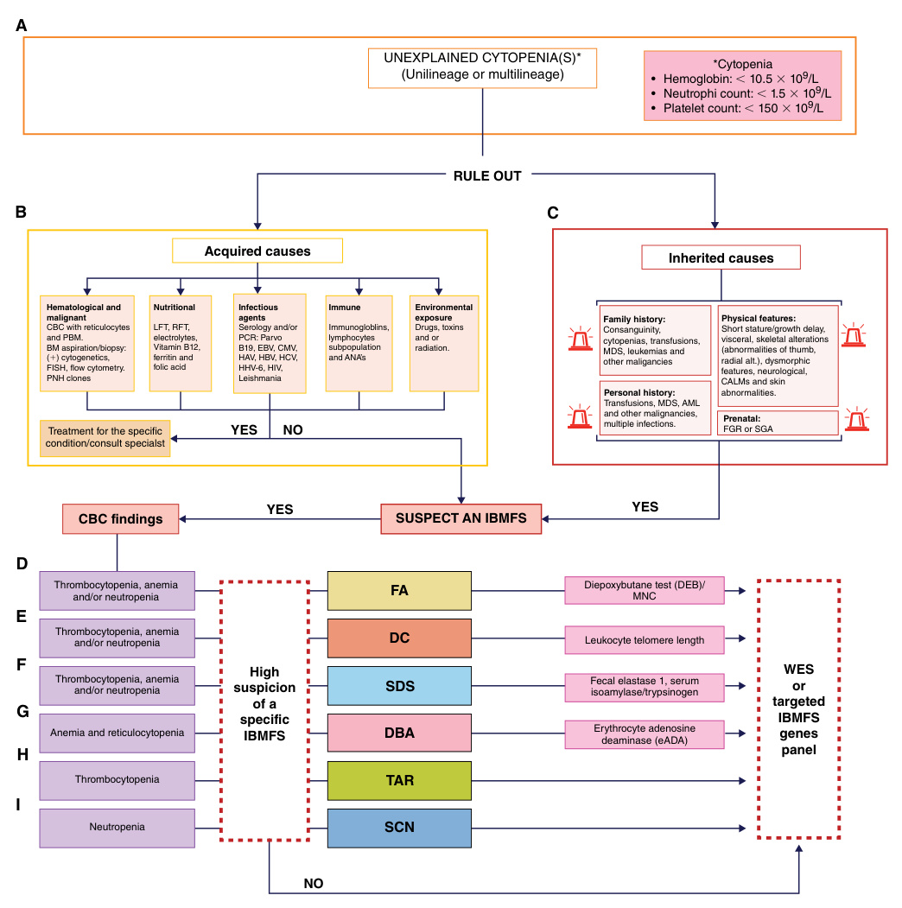
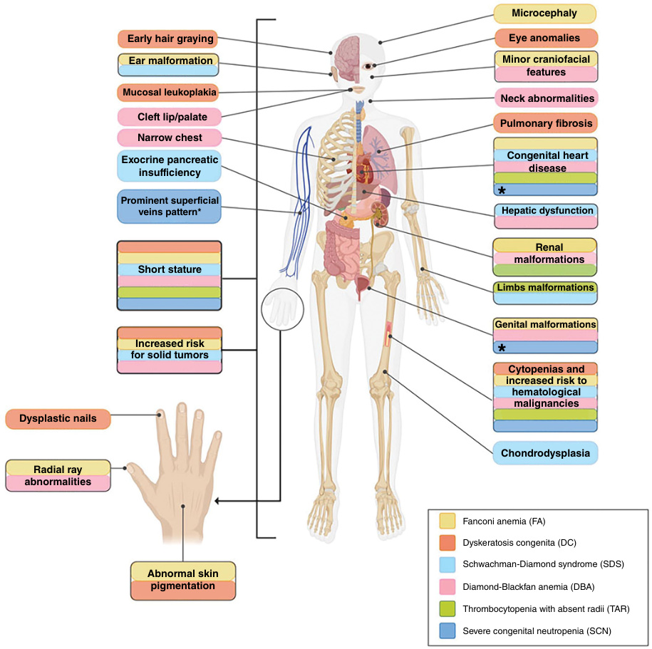
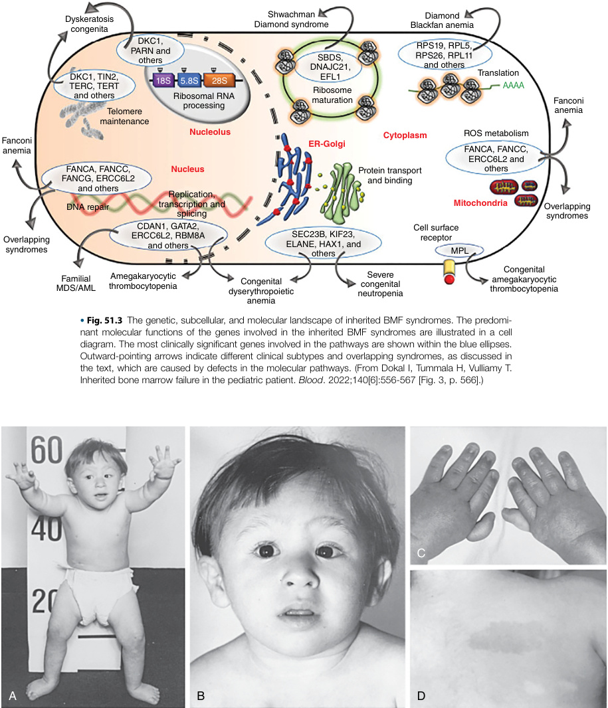
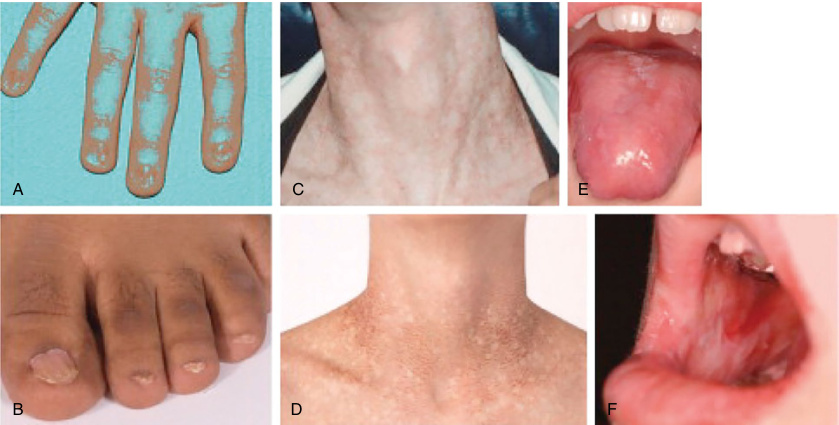
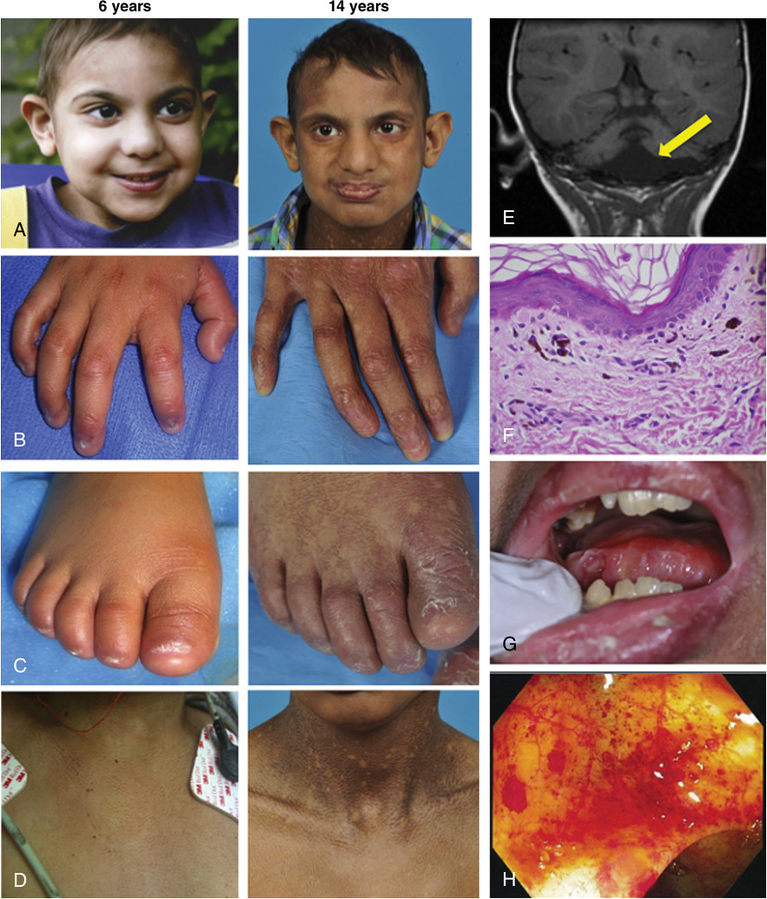
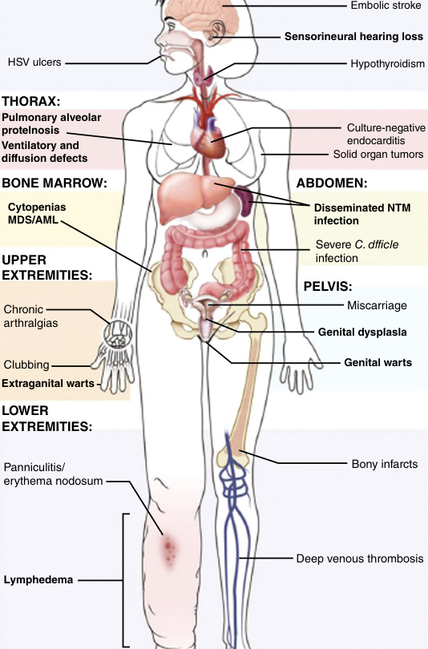

<!-- p.1164 -->

# 51 Hereditary Bone Marrow Failure Syndromes 

#### **RACHEL PHELAN** 

**Pancytopenia** refers to reductions below age-related normal levels in each of the three peripheral blood cell types: erythrocytes, leukocytes, and platelets. Normal values are presented in Table 51.1. **Hereditary bone marrow failure syndromes (HBMFS)** are genetically determined disorders characterized by insufficient production of these three blood cell lineages resulting in pancytopenia, though individuals with HBMFS may initially present with an isolated cytopenia or deficiencies in two cell lines prior to the development of pancytopenia. Symptoms are often mostly related to the individual cell line deficiencies: anemia is characterized by fatigue, pallor, and activity intolerance; leukopenia is marked by an increased susceptibility to infection; while thrombocytopenia is suggested by easy bruising or bleeding, or in severe cases, hemorrhage. Most HBMFS typically present in childhood; beyond symptoms related to cytopenias, clinical manifestations vary according to underlying diagnosis. Many are associated with a predisposition to malignancy; some may progress to hematopoietic aplasia. Therapeutic approaches depend on the specific diagnosis. Because some treatment modalities are associated with an increased risk of secondary malignancy or toxicity, and because some HBMFS are associated with an increased susceptibility to such complications, establishing a specific diagnosis is critical in any individual with unexplained isolated cytopenias or pancytopenia, as well as some leukemias, myelodysplasia, and aplastic anemia. Improvements in the depth and turnaround time of diagnostic testing have allowed for the ongoing discovery of new causative pathogenic variants and have improved diagnostic accuracy and time to treatment. 

## **General Diagnostic Approach** 

A thorough physical examination, medical history, and family history should be obtained, evaluating for clinical features associated with _HBMFS_ , as well as features associated with _acquired_ causes of pancytopenia (Figs. 51.1 and 51.2). Individuals without a clear cause for their isolated cytopenias or pancytopenia should be referred to 

a hematologist/oncologist, ideally with expertise in bone marrow failure and transplantation, for bone marrow biopsy and aspirate to determine if the etiology is a HBMFS or an acquired condition. The cellularity of the marrow helps focus the differential diagnosis (Table 51.2). The marrow compartment in HBMFS is often hypocellular; however, if biopsy is performed prior to the onset of peripheral cytopenias, the marrow may be normocellular. Since several HBMFS are associated with a predisposition to clonal evolution to **myelodysplastic syndrome (MDS)** or **acute myeloid leukemia (AML)** , cytogenetics and a fluorescence in situ hybridization panel for MDS should also be performed at the time of bone marrow evaluation. Similarly, individuals with MDS or AML and characteristic features suggestive of specific HBMFS should also undergo evaluation for HBMFS. Individuals may present prior to the onset of symptomatic hematological abnormalities with phenotypic features consistent with an underlying HBMFS (Tables 51.3, 51.4, and 51.5) or a family history concerning for such; appropriate diagnostic testing should also be conducted in these individuals. 

Focused genetic panels testing for pathogenic variants known to be associated with HBMFS are clinically available; exome or genome sequencing should be considered in individuals with a suspected HBMFS but a negative gene panel because variants are being reported with increasing frequency (Tables 51.6 and 51.7). Specialized testing for certain disorders may be required in the setting of ongoing clinical suspicion and negative genetic testing. 

Treatment options in HBMFS are often directed at the hematopoietic aspect of the underlying syndrome and include **hematopoietic stem cell transplantation (HSCT)** or other supportive therapies, such as androgens. Gene therapy is being explored for some conditions. The subcellular sites and genetic etiologies of some HBMFS are noted in Figure 51.3. Timing and indication for treatment is based on the underlying disease as well as its severity and course. Many HBMFS are associated with an increased risk of long-term nonhematological complications, necessitating

<!-- p.1165 -->

#### **TABLE 51.1 Age-Specific Blood Cell Indices** 

|Age|Hb (g/dL)*|HCT (%)*|MCV (fL)*|MCHC (g/dL RBC)*|Reticulocytes|WBCs (**3**103/mL)†|Platelets (103/mL)†|
|---|---|---|---|---|---|---|---|
|26–30 wk gestation‡|13.4 (11)|41.5 (34.9)|118.2 (106.7)|37.9 (30.6)|—|4.4 (2.7)|254 (180–327)|
|28 wk|14.5|45|120|31.0|(5–10)|—|275|
|32 wk|15.0|47|118|32.0|(3–10)|—|290|
|Term§(cord)|16.5 (13.5)|51 (42)|108 (98)|33.0 (30.0)|(3–7)|18.1 (9–30)¶|290|
|1–3 days|18.5 (14.5)|56 (45)|108 (95)|33.0 (29.0)|(1.8–4.6)|18.9 (9.4–34)|192|
|2 wk|16.6 (13.4)|53 (41)|105 (88)|31.4 (28.1)|—|11.4 (5–20)|252|
|1 mo|13.9 (10.7)|44 (33)|101 (91)|31.8 (28.1)|(0.1–1.7)|10.8 (4–19.5)|—|
|2 mo|11.2 (9.4)|35 (28)|95 (84)|31.8 (28.3)|—|—|—|
|6 mo|12.6 (11.1)|36 (31)|76 (68)|35.0 (32.7)|(0.7–2.3)|11.9 (6–17.5)|—|
|6 mo–2 yr|12.0 (10.5)|36 (33)|78 (70)|33.0 (30.0)|—|10.6 (6–17)|(150–350)|
|2–6 yr|12.5 (11.5)|37 (34)|81 (75)|34.0 (31.0)|(0.5–1.0)|8.5 (5–15.5)|(150–350)|
|6–12 yr|13.5 (11.5)|40 (35)|86 (77)|34.0 (31.0)|(0.5–1.0)|8.1 (4.5–13.5)|(150–350)|
|12–18 yr||||||||
|Male|14.5 (13)|43 (36)|88 (78)|34.0 (31.0)|(0.5–1.0)|7.8 (4.5–13.5)|(150–350)|
|Female|14.0 (12)|41 (37)|90 (78)|34.0 (31.0)|(0.5–1.0)|7.8 (4.5–13.5)|(150–350)|
|Adult||||||||
|Male|15.5 (13.5)|47 (41)|90 (80)|34.0 (31.0)|(0.8–2.5)|7.4 (4.5–11)|(150–350)|
|Female|14.0 (12)|41 (36)|90 (80)|34.0 (31.0)|(0.8–4.1)|7.4 (4.5–11)|(150–350)|
|*Data are mean ( †Data are mean ( ‡Values are from §1 mo, capillary h ¶Mean (95% coni _Hb,_Hemoglobin; From Gajjar R, J     i Philadelphia: Sau|−2 SD). ±2 SD). fetal samplings. emoglobin exceed fidence limits).  _HCT,_hematocrit; alazo E. Hematolo   i nders; 2014:305-3|s venous: 1 hr: 3. _MCHC,_mean cell gy, Table 14-1 Agi 06.|6-g difference; 5 day: hemoglobin concentr e-Specific Blood Ce|2.2-g difference; 3 w ation;_MCV,_mean co i  ll Indices. In:_Harriet_|k: 1.1-g difference. rpuscular volume;_RBC,_  _Lane Handbook: A Ma_|red blood cell;_WB_ _nual for Pediatric H_|_C,_white blood cell. _ousestaff_. 20th ed.|

lifelong multidisciplinary care and surveillance. Genetic counseling should be offered to families once a diagnosis is established. 

## **Fanconi Anemia** 

Fanconi anemia (FA) is a genetic disorder associated with congenital anomalies, cancer predisposition, and bone marrow failure, and is the most frequently diagnosed HBMFS. In the general population, FA occurs in 1:200,000 with a carrier frequency of 1:200. Abnormal DNA repair and crosslinking mechanisms result in the clinical manifestations (Table 51.6), and pathogenic variants have been identified in over 20 genes (Table 51.6), with most of the inheritance being autosomal recessive. Individuals with FA generally experience progressive bone marrow failure in childhood and symptoms related to cytopenias are often the presenting manifestations. In rare occasions, affected 

individuals are not diagnosed until adulthood. FA is associated with heterogeneous and sometimes characteristic clinical features. There are known genotype-phenotype correlations, but there is significant overlap. Clinical features include skeletal anomalies (notably involving hypoplasia of the radii and thumbs), short stature, caféau-lait macules, ear malformations that can result in conductive hearing loss, renal anomalies, and genitourinary malformations (Fig. 51.4). Characteristic craniofacial findings include microcephaly, small eyes, a broad nasal base, and epicanthal folds. Features consistent with **VACTERL-H association** (vertebral anomalies, anal atresia, cardiac defects, tracheoesophageal fistula, esophageal atresia, renal abnormalities, limb abnormalities, and hydrocephalus) may be present. Up to 40% of patients with FA _will not_ display any characteristic physical features of the disease. Endocrinopathies may occur, including insulin resistance, hypothyroidism, low bone density,

<!-- p.1166 -->

**Fig. 51.1** Decision algorithm for the clinical classification of patients with bone marrow failure. (A) Unexplained cytopenia(s) leading to the suspicion of an IBMFS can include a CBC of hemoglobin of <10.5 × 109 /L, neutrophils of <1.5 × 109 /L, and/or platelets of <150 × 109 /L. (B) The first decision point implies ruling out acquired causes of BMF including hematological malignancies and nutritional, infectious agents, immune, or drug exposure. (C) If acquired causes have been ruled out, we consider an IBMFS and complete a thorough physical examination, as well as prenatal, personal, and family history. Classification of the cytopenia and physical examination should be taken into consideration to guide clinical suspicion of a specific IBMFS. (D) If multilineage cytopenia and clinical features are compatible with FA, we perform the chromosome breakage test with DEB, if available. (E) If multilineage cytopenia and clinical features are compatible with DC, we perform the leukocyte telomere length test, if available (less often FA and DC can present with unilineage cytopenias). (F) If multilineage cytopenia and clinical features are compatible with SDS, we perform diagnostic screening with serum trypsinogen or pancreatic isoamylase. (G) If there is confirmation of anemia plus reticulocytopenia and clinical features are compatible with DBA, we perform diagnostic screening with erythrocyte adenosine deaminase (eADA). If a screening test is positive for a specific IBMFS, targeted testing should be considered for molecular confirmation. (H) If unilineage cytopenia (thrombocytopenia) and clinical features are compatible with TAR, genetic confirmation is followed. (I) If unilineage cytopenia (neutropenia) and clinical features are compatible with SCN, genetic confirmation is followed. In cases where a specific IBMFS suspicion is not made, but hereditary suspicion remains, we perform WES or a molecular panel, if available. _ANAs,_ Antinuclear antibodies; _BMF,_ bone marrow failure; _CALMs,_ cafe-au-lait macules; _CBC,_ complete blood count; _CMV,_ cytomegalovirus; _DEB,_ diepoxybutane; _EBV,_ Epstein–Barr virus; _FA,_ Fanconi anemia; _FGR,_ fetal growth restriction; _HAV,_ hepatitis A virus; _HBV,_ hepatitis B virus; _HCV,_ hepatitis C virus; _HHV-6,_ human herpesvirus type 6; _HIV,_ human immunodeficiency virus; _IBMFS,_ inherited bone marrow failure syndrome; _LFT,_ liver function test; _MDS,_ myelodysplastic syndrome; _NGS,_ next-generation sequencing; _PNH,_ paroxystic nocturnal hemoglobinuria; _ParvoB19,_ parvovirus B19; _PCR,_ polymerase chain reaction; _RFT,_ renal function test; _SGA,_ small for gestational age; _PBS,_ peripheral blood smear; _WES,_ whole-exome sequencing.  (From Leak-Anaya P, Kimball TN, Yanez-Felix A, et al. Inherited bone marrow failure syndromes: phenotype as a tool for early diagnostic suspicion at a major reference center in Mexico. _Front Genet_ . 2024;14:1293929 [Fig. 1].)

<!-- p.1167 -->

- **Fig. 51.2** Comparative outline of the common anomalies observed in patients with IBMFS. Features that help build the suspicion of a specific IBMFS are given. The clinical manifestations of various IBMFS exhibit overlap in certain organs and systems. This includes cytopenias, an elevated risk of hematological malignancies, and short stature, which are common features among the classical IBMFS discussed in this paper. Highlighted in yellow, patients with FA are characterized by short stature, abnormal skin pigmentation, facial features, congenital heart disease, ear malformations, genitourinary malformations, renal malformations, and thumb defects. Highlighted in orange, patients with DC exhibit the following characteristics: nail dystrophy, mucosal leukoplakia, early hair graying, reticulated skin pigmentation, pulmonary fibrosis, short stature, and eye abnormalities. Highlighted in light blue, patients with SDS present pancreatic insufficiency, skeletal dysplasia, short stature, congenital heart disease, and hepatic dysfunction. Highlighted in pink, patients with DBA present short stature, thumb defects, asymmetric scapula, fusion of cervical vertebrae, webbed neck, genitourinary malformations, and congenital heart disease. Highlighted in green, patients with TAR present short stature, hypoplastic ulnae, hypoplastic humeri, and renal malformations. Highlighted in dark blue, patients with SCN present with short stature and inflammatory bowel disease. *Increased visibility of superficial veins, congenital heart disease, and genitourinary malformations are commonly observed in patients with SCN harboring pathogenic variants in the G6PC3 gene.  (From Leak-Anaya P, Kimball TN, Yanez-Felix A, et al. Inherited bone marrow failure syndromes: phenotype as a tool for early diagnostic suspicion at a major reference center in Mexico. _Front Genet_ . 2024;14:1293929 [Fig. 2].)

<!-- p.1168 -->

###### **TABLE** 

#### **51.2 Differential Diagnosis of Pancytopenia** 

##### **Pancytopenia With Hypocellular Bone Marrow** 

- Acquired aplastic anemia 

- Hereditary bone marrow failure syndromes 

- Some myelodysplasia syndromes 

- Rare aleukemic leukemia (acute myelogenous leukemia) 

- Some acute lymphoblastic leukemias 

- Some lymphomas of bone marrow 

##### **Pancytopenia With Cellular Bone Marrow** 

- Primary bone marrow diseases 

- Myelodysplasia syndromes 

- Paroxysmal nocturnal hemoglobinuria 

- Myelofibrosis 

- Some aleukemic leukemias 

- Myelophthisis 

- Bone marrow lymphoma 

- Hairy cell leukemia 

- Secondary to systemic diseases 

- Systemic lupus erythematosus, Sjögren syndrome 

- Hypersplenism 

- HLH 

- Vitamin B12, folate deficiency 

- Overwhelming infection 

- Alcohol 

- Brucellosis 

- Ehrlichiosis 

- Sarcoidosis 

- Tuberculosis and atypical mycobacteria 

**Hypocellular Bone Marrow ± Cytopenia** 

- Q fever 

- Legionnaires disease 

- Mycobacteria 

- Tuberculosis* 

- Anorexia nervosa, starvation 

- Hypothyroidism 

_*_ Pancytopenia in tuberculosis only rarely is associated with a hypocellular bone marrow at biopsy or autopsy. Marrow failure in the setting of tuberculosis is almost always fatal; exceptional patients probably had underlying myelodysplasia or acute leukemia. _HLH,_ Hemophagocytic lymphohistiocytosis (may also have hypocellular marrow). 

From Young NS, Maciejewski JP. Aplastic anemia. In: Hoffman R, Benz EJ Jr, Silberstein LE, et al., eds. _Hematology: Basic Principles and Practice_ . 8th ed. Philadelphia: Elsevier; 2023 (Table 31.1, p. 398). 

###### **TABLE** 

#### **Clinical Manifestations and Laboratory Findings in Inherited Bone Marrow Failure Syndrome** 

|**51.3** |**y g**|**y**|
|---|---|---|
|Syndrome|Nonhematological Clinical Manifestations|Laboratory Findings|
|Fanconi anemia|Short stature, low birth weight, microcephaly, microphthalmia, hearing loss, triangular face, micrognathia, cardiac anomalies, tracheoesophageal fistula, esophageal atresia, kidney anomalies, hypoplastic thenar eminence, clinodactyly, café-au-lait macules|Pancytopenia, macrocytosis, elevated Hb F, increased chromosome breakage in clastogenic assay|
|Dyskeratosis congenita|Mucocutaneous triad (skin pigmentation, nail dysplasia, oral leukoplakia), short stature, low birth weight, failure to thrive, pulmonary fibrosis, stenosis of the esophagus, liver fibrosis|Pancytopenia, macrocytosis, elevated Hb F, very short telomeres|
|Diamond-Blackfan anemia|Low birth weight, short stature, developmental delay, anomalies in craniofacial skeleton, eyes, heart, visceral organs, and limbs|Anemia, elevated red blood cell adenosine deaminase, macrocytosis, elevated Hb F|
|Shwachman- Diamond syndrome|Exocrine pancreatic insufficiency, failure to thrive, malabsorption, short stature, neurodevelopment and skeletal abnormalities|Neutropenia, low serum isoamylase, low serum trypsinogen|
|Severe congenital neutropenia|Recurrent infection|Neutropenia|
|Congenital amegakaryocytic thrombocytopenia|Nonsyndromic (occasionally, growth faltering, cardiac anomalies, psychomotor developmental delay)|Thrombocytopenia, reduced megakaryocytes|
|_GATA2_deficiency|Lymphedema, immunodeficiency, atypical mycobacterial infections|Neutropenia, anemia, thrombocytopenia|
|_SAMD9/SAMD9L_ disorders|MIRAGE (SAMD9): MDS, infection, restriction of growth, adrenal hypoplasia, genital phenotypes, and enteropathy|Transient or permanent cytopenia|
||Ataxia-pancytopenia syndrome (SAMD9L): cerebellar atrophy and white matter hyperintensities, gait disturbance, nystagmus||
|_MECOM_-associated syndromes|Radioulnar synostosis, clinodactyly, hearing loss, cardiac/renal malformation|Thrombocytopenia|
|Pearson syndrome _Hb F,_Hemoglobin F;_MDS,_  Modified from Park M. Ove _Pediatrics_22/e.)|Pancreatic insufficiency, failure to thrive, microcephaly, ptosis, Kearns-Sayre syndrome myelodysplastic syndrome. i    rview of inherited bone marrow failure syndromes._Blood Res_. 2022;57(S1):49-5|Neutropenia, anemia, pancytopenia, lactic acidosis, hyperglycemia 4. Table 1. (Table 517.2 in_Nelson Textbook of_|

<!-- p.1169 -->

###### **TABLE** 

###### **51.4** 

#### **Specific Types of Anomalies in Fanconi Anemia** 

|**Skin(40%)**|**Eyes(20%)**|
|---|---|
|Generalized hyperpigmentation on the trunk, neck, and intertriginous areas; café-au-lait macules; hypopigmented areas|Small eyes, strabismus, epicanthal folds, short or almond-shaped palpebral fissures, hypertelorism, ptosis, slanting, cataracts, astigmatism, blindness, epiphora, nystagmus, proptosis, small iris|
|**Body (40%)**|**Ears(10%)**|
|Short stature, delicate features, small size, underweight|Deafness (usually conductive); abnormal shape; atresia; dysplasia; low set, large, or small; infections; abnormal middle ear; absent eardrum; dimples; rotated; canal stenosis|
|**Upper Limbs(35%)**|**Kidney (20%)**|
|_Thumbs (35%):_absent or hypoplastic; supernumerary, bifid, or duplicated; rudimentary; short, low set, attached by a thread; triphalangeal, tubular, stiff, hyperextensible |Ectopic or pelvic; abnormal, horseshoe, hypoplastic, or dysplastic; absent; hydronephrosis or hydroureter; infections; duplicated; rotated; reflux; hyperplasia; no function; abnormal artery|
|_Radii (7%):_absent or hypoplastic (only with abnormal thumbs); absent or weak pulse|**Gastrointestinal System(5%)**|
| _Hands (5%):_clinodactyly; hypoplastic thenar eminence; six fingers; absent first metacarpal; enlarged, abnormal fingers; short fingers; transverse crease _Ulnae (1%):_dysplastic or absent|High-arched palate, atresia (esophagus, duodenum, jejunum), imperforate anus, tracheoesophageal fistula, Meckel diverticulum, umbilical hernia, hypoplastic uvula, abnormal biliary ducts, megacolon, abdominal diastasis, Budd-Chiari syndrome|
||**Urogenital** _Males (25%):_micropenis, penile-scrotal fusion, undescended or|
|**Lower Limbs(5%)** l|atrophic or absent testes, hypospadias, chordae, phimosis, azoospermia|
|_Feet:_toe syndactyly, abnormal toes, flat feet, short toes, clubfeet, six toes, supernumerary toe _Legs:_congenital hip dislocation, Perthes disease, coxa vara, abnormal femur, thigh osteoma, abnormal legs|_Females (2%):_bicornuate uterus, aplasia or hypoplasia of vagina and uterus, atresia of vagina, hypoplastic uterus, hypoplastic or absent ovary, hypoplastic fused labia|
|**Gonads**|**Cardiopulmonary System(6%)**|
|_Males (25%):_hypogenitalia, undescended testes, hypospadias, abnormal genitalia, absent testis, atrophic testes, azoospermia, phimosis, abnormal urethra, micropenis, delayed development _Females (2%):_hypogenitalia; bicornuate uterus; abnormal genitalia; aplasia of uterus and vagina; atresia of uterus, vagina, and ovary|Patent ductus arteriosus, ventricular septal defect, peripheral pulmonic stenosis, aortic stenosis, coarctation, absent lung lobes, vascular malformation, aortic atheromas, atrial septal defect, tetralogy of Fallot, pseudotruncus, hypoplastic aorta, abnormal pulmonary venous drainage, double aortic arch, cardiac myopathy|
|**Other Skeletal Anomalies**|**Central Nervous System(3%)**|
|_Head (20%) and face (2%):_microcephaly, hydrocephalus, micrognathia, peculiar face, birdlike face, flat head, frontal bossing, scaphocephaly, sloped forehead, choanal atresia, dental abnormalities _Neck (1%):_Sprengel deformity; short, low hairline; webbed _Spine (2%):_spina bifida (thoracic, lumbar, cervical, occult sacral), scoliosis, abnormal ribs, sacral agenesis, sacrococcygeal sinus, Klippel-Feil syndrome, vertebral anomalies, extra vertebrae|Hyperreflexia, Bell palsy, central nervous system arterial malformation, moyamoya syndrome, Arnold-Chiari malformation, stenosis of internal carotid artery, small pituitary gland, absent corpus callosum Developmental delay (10%)|
|Abnormalities are listed in the approximate order of frequency within each c Adapted from Shimamura A, Alter BP. Pathophysiology and management o|ategory. f inherited bone marrow failure syndromes._Blood Rev_. 2010:24:101-122.|

growth hormone deficiency, and infertility, with up to 80% of affected individuals having at least one endocrinopathy. Short stature is common even in the absence of growth hormone deficiency; screening for growth hormone deficiency should be universally obtained because replacement treatment can maximize adult height deficiency. 

Fanconi anemia is associated with a greatly increased predisposition to squamous cell carcinoma (SCC), with rates 

up to hundreds to thousands-fold higher than in the general population. Tumors are typically aggressive and appear at an earlier age, and metastatic disease is often present at the time of SCC diagnosis. The head and neck, esophagus, and in females the vulva are commonly affected locations; close surveillance by otolaryngologists and gynecologists is recommended. Exposure to alcohol and tobacco further increases the risk of head and neck and esophageal cancers,

<!-- p.1170 -->

#### **TABLE Major Clinical Features of Schwachman51.5 Diamond Syndrome** 

|Clinical Feature|Total/Average|
|---|---|
|Number of patients|225|
|Neutropenia|90%|
|Severe (≤500/μL)|46%|
|Anemia|46%|
|Thrombocytopenia|42%|
|Pancytopenia|21%|
|Exocrine pancreatic insufficiency|98%|
|Liver (elevated transaminases)|61%|
|Skeletal abnormalities|70%|
|Metaphyseal dysostosis|53%|
|Rib cage abnormalities|35%|
|Short stature (<3rd percentile)|66%|

Data from Ginzberg H, Shin J, Ellis L, et al. Shwachman syndrome: phenotypic manifestations of sibling sets and isolated cases in a large patient cohort are similar. _J Pediatr_ . 1999;135:81-88; Cipolli M, D’Orazio C, Delmarco A, et al. Shwachman’s syndrome: pathomorphosis and long-term outcome. _J Pediatr Gastroenterol Nutr_ . 1999:29:265-272; and Kuijpers TW, Alders M, Tool AT, et al. Hematologic abnormalities in Shwachman-Diamond syndrome: lack of genotype-phenotype relationship. _Blood_ . 2005;106:356-361. 

and human papillomavirus exposure increases the risk of genitourinary tumors. Ionizing radiation should be avoided when possible. 

Definitive treatment for bone marrow aplasia in FA, as well as for most other inherited bone marrow failure syndromes, is HSCT. Androgens have also been successfully used to delay marrow failure progression. Due to faulty DNA repair, patients with Fanconi anemia traditionally did poorly with HSCT as a result of their sensitivity to chemotherapy and radiation, with an overall past survival of no higher than 30%. Changes to HSCT treatment protocols resulted in drastically improvements, with up to 90% overall survival following transplantation. With this increased survival, there is a growing population of Fanconi anemia patients who are living into adulthood. Although hematological issues are often corrected with HCT, underlying DNA crosslinking and repair defects, as well as exposures during transplantation, increase the risk for many other long-term complications. 

### **Diagnostic Approach** 

Because the pathogenic variants responsible for the diagnosis of FA are implicated in DNA crosslinking and repair, screening via **chromosomal breakage analysis** of peripheral blood lymphocytes is initially performed. The most common crosslinking agent used in this analysis is 

#### **TABLE Inherited Bone Marrow Failure Syndromes With Multilineage Cytopenia and Familial MDS/AML: 51.6 Inheritance, Variant Genes, and Affected Pathways** 

|Disorder|Inheritance|Gene|Affected Pathways|
|---|---|---|---|
|Fanconi anemia|AR|_FANCA, FANCC, FANCD1/BRCA2, FANCD2,_ _FANCE, FANCF, FANCG/XRCC9, FANC1,_ _FANCJ/BRIP1, FANCL/PHF9, FANCM,_ _FANCN/PALB2, FANCO/RAD51C, FANCP/_ _SLX4, FANCQ/ERCC4, FANCR/RAD51,_ _FANCS/BRCA1, FANCT/UBE2T, FANCU/_ _XRCC2, FANCV/REV7, FANCW/RFWD3_|DNA repair, homologous recombination, ribosome biogenesis_(FANC1)_|
||XLR|_FANCB_|DNA repair, homologous recombination|
|Mixed Fanconi anemia/ xeroderma pigmentosa/ Cockayne syndrome|AR|_ERCC1/XPF_|DNA repair|
|Shwachman-Diamond |AR|_SBDS, DNAJC21, EFL1_|Ribosome biogenesis|
|syndrome|AD|_SRP54_|Co-translational protein modification|
|Dyskeratosis congenita|XLR|_DKC1_|Telomere maintenance, ribosome biogenesis|
||AD|_TINF2, TERC, TERT, RTEL1, ACD(TPP1),_ _PARN_|Telomere maintenance, RNA processing|
||AR|_TERT, RTEL1, ACD(TPP1), WRAP53(TCAB1),_ _CTC1, POT1, RPA1, PARN, NOP10, NHP2_|Telomere maintenance, RNA processing, ribosome biogenesis|

_(Continued)_

<!-- p.1171 -->

#### **TABLE 51.6** Inherited Bone Marro Inheritance, Variant G f w Failure Syn enes, and Aff dromes With Multilineage Cytopenia a fected Pathways—cont'd nd Familial MDS/AML:

|Disorder|Inheritance|Gene|Affected Pathways|
|---|---|---|---|
|Congenital amegakaryocytic thrombocytopenia|AR|_MPL_|Hematopoietic cytokine receptor|
|_SRP72_-associated hereditary aplastic anemia/MDS|AD|_SRP72_|Co-translational protein modification|
|_ERCC6L2_-associated hereditary aplastic anemia/MDS|AR|_ERCC6L2_|Transcription|
|_THPO_-associated hereditary aplastic anemia/MDS|AR/AD|_THPO_|Hematopoietic cytokine|
|Reticular dysgenesis|AR|_AK2_|Nucleotide metabolism|
|Cartilage-hair hypoplasia|AR|_RMRP, POP1, NEPRO_|rRNA and mitochondrial RNA processing|
|Pearson syndrome|Maternal|_mtDNA_|Mitochondrial DNA genes|
|Familial thrombocytopenia with |AD|_RUNX1/CBFA2_|Hematopoietic cytokines|
|predisposition to AML|AD|_ETV6_|Transcription repression|
|GATA2-associated disorders (MonoMac syndrome, Emberger syndrome, familial MDS syndrome)|AD|_GATA2_|Transcription|
|Bone marrow failure and diabetes||_DUT_|Nucleotide metabolism|
|Familial MDS/AML (others)||_CEBPA_|Transcription|
|Familial MDS/AML (others)||_DDX41_|RNA helicase|
|Seckel syndrome|AR|_CEP152, CENPJ, CEP63, NIN, PLK4,_ _CDK5RAP2;_ _ATR, RBBP8, ATRIP, DNA2_|Centriole/Centrosome duplication and function; DNA damage sensing and repair, and checkpoint signaling activation|
|Schimke immuno-osseous dysplasia|AR|_SMARCAL1_|Chromatin remodeling|
|Dubowitz syndrome|AR|_NSUN2;_ _LIG4_|Cytosine methylation in various RNA types DNA nonhomologous end joining repair|
||AD|−14q32,−17q24,−19q13||
|Rothmund-Thomson syndrome|AR|_RECQL4_|Chromosome segregation|
|Nijmegen breakage syndrome|AR|_NBN_|DNA repair|

_AD,_ Autosomal dominant; _AML,_ acute myeloid leukemia; _AR,_ autosomal recessive; _MDS,_ myelodysplastic syndrome; _UK,_ unknown; _XLR,_ X-linked recessive. (Table 517.1 in _Nelson Textbook of Pediatrics_ 22/e). 

diepoxybutane (DEB), although mitomycin C (MMC) is also used. Increased breakage with exposure to these agents is considered diagnostic for FA. Up to 15% of affected individuals have somatic mosaicism for FA-related pathogenic variants; if DEB or MMC chromosomal breakage analysis is negative in the blood but clinical suspicion for FA remains high, testing can be performed on cultured 

skin fibroblasts. Individuals with a positive breakage analysis are referred for genetic testing because different genotypes have different phenotypic implications for prognosis and management. Genetic testing should also be considered in individuals with a negative chromosomal breakage analysis whose family history or clinical findings continue to suggest FA.

<!-- p.1172 -->

**TABLE 51.7 Overview of Emerging Bone Marrow Failure Syndromes Including Genetic and Phenotypic Features** 

||Inheritance Consanguinity/|||||Acquired Somatic|Risk of Heme|
|---|---|---|---|---|---|---|---|
|Gene|De Novo Occurrence|Mechanism of Disease|Phenotype|Heterogeneity|Age of Onset|Variants/Disease Progression|Malignancy Type|
|_ADH5/_ _ALDH2_|Digenic, AR for_ADH5_|LOF (missense and truncating SNVs), either heterozygous or homozygous for_ALDH2_*_2_|Cytopenia/BMF and/or MDS/AML [100%] Short stature [100%] Intellectual disability [100%] Microcephaly [67%] Abnormal skin pigmentation [58%] _(retinal degeneration, facial dysmorphia,_ _skeletal, and endocrine_ _abnormalities)_|High penetrance, severe BMF and MDS/AML often requiring HSCT|MDS/AML: age 7 years (range 0 to 18, n=9)|73% with gain of the long arm of chromosome 1, other recurrent cytogenetic alterations included monosomy 7, trisomy 8, and 21p alterations|80%, MDS/ AML|
|_DNAJC21_|AR, consanguinity in 57%|LOF (missense and truncating SNVs and CNVs)|Cytopenia/BMF and/or AML [100%] Growth delay and/or short stature [95%] Developmental delay, intellectual disability, and/or neurological abnormalities [68%] Skeletal abnormalities [63%] Skin abnormalities [63%] Microcephaly [42%] Facial dysmorphia [37%] Dental abnormalities [32%] Osteopenia/osteoporosis [32%] (high) myopia, astigmatism, and other visual field defects [32%] retinal (rod-cone) dystrophy and other retinal abnormalities [32%] Pancreas lipomatosis/exocrine pancreatic dysfunction [26%]|Although penetrance is high, spontaneous, intermittent, or prolonged improvement of cytopenia has been reported|Cytopenia/BMF: age 2 years (range 0 to 15, n=19) AML: ages 12 and 15 years (n=2)|Complex karyotype, deletions of 17p13 and 20q and a derivative chromosome 15 with translocation t(1;15) described in four patients without hematological malignancy|   11%, AML|
|_ERCC6L2_|AR, consanguinity in 33%|LOF (truncating SNVs and CNVs), two missense variants (D272N and S658N)|Cytopenia, BMF [66%] MDS, AML (particularly acute erythroid leukemia) [31%] _(neurological abnormalities such as_ _microcephaly, congenital mirror_ _movements and intellectual disability)_|May vary from subtle intermittent cytopenia to severe BMF and/or early- onset MDS/AML|Cytopenia/BMF: age 14 years (range 2 to 47, n=24) MDS/AML: age 35 years (range 2 to 59, n=12)|Complex or monosomal karyotype with loss of chromosomes 5, 7, or 17 or isolated monosomy 7, _TP53_variants (often multi-hit)|33%, MDS/ AML|

_(Continued)_

<!-- p.1173 -->

||Inheritance Consanguinity/|||Acquired Somatic|Risk of Heme|
|---|---|---|---|---|---|
|Gene|De Novo Occurrence|Mechanism of Disease|Phenotype Heterogeneity Age of Onset|Variants/Disease Progression|Malignancy Type|
|_MECOM_|AD,_de novo_ in 16%|LOF (missense and truncating SNVs and CNVs)|Cytopenia, BMF [80%] RUS [54%] Brachy-, campto-, and clinodactyly and/ or other finger abnormalities [38%] Sensorineural hearing impairment/ congenital deafness [20%] Cardiac abnormalities [18%] Prematurity, hydrops fetalis or polyhydramnios [13%] Microor macrocephaly, structural brain abnormalities or intellectual disability/ cognitive impairment [11%] Patellar hypoplasia [10%] Metatarsus adductus, hallux valgus, and other toe abnormalities [9%] Clubfoot [7%] Renal abnormalities [7%] MDS or MDS/MPN-U [5%] _(hip dysplasia, cleft palate, early-onset_ _ischemic insults, facial dysmorphia,_ _precocious puberty/gynecomastia in_ _infancy, paralysis of the larynx/_ _laryngomalacia)_|||
|_AD,_Autosom myelodysplas Modified from|al dominant,_AML,_acut tic syndrome;_MPN,_my i  Feurstein S. Emerging|e myeloid leukemia;_AR,_  eloproliferative neoplasm; i     bone marrow failure synd|autosomal recessive;_BMF,_bone marrow failure;_CNV,_copy number variant;_HSCT,_hematopoietic stem cell  _RUS,_radioulnar synostosis;_SNV,_single-nucleotide variant;_MPN-U,_myeloproliferative neoplasm–unclassified. i        romes—new pieces to an unsolved puzzle._Front Onc_. 2023;13:1128533 (Table 1).|transplantation;_LOF,_loss|-of-function;_MDS,_|

<!-- p.1174 -->

**• Fig 51.4** A 3-year-old male with Fanconi anemia who exhibits several classic phenotypic features. (A) Front view. (B) Face. (C) Hands. (D) Back right shoulder. The features to be noted include short stature, dislocated hips, microcephaly, a broad nasal base, epicanthal folds, micrognathia, thumbs attached by a thread, and café-au-lait macules with hypopigmented areas beneath.  (From Nathan DC, Orkin SH, Ginsburg D, et al., eds. _Nathan and Oski’s Hematology of Infancy and Childhood._ 6th ed. Vol I. Philadelphia: Saunders; 2003:285.)

<!-- p.1175 -->

## **Dyskeratosis Congenita** 

Dyskeratosis congenita (DC) is a rare multisystemic disorder caused by abnormalities in _telomere biology_ . Telomeres are located at the ends of chromosomes and serve a protective role in maintaining chromosomal integrity. With each cell division cycle, telomere length shortens; critical shortening is a signal for cell quiescence. The telomerase enzyme complex repairs and renews telomeres; the pathogenic variants in DC lead to defects in telomerase and the inheritance and development of shortened telomeres, which leads to stem cell exhaustion and eventually pancytopenia. Inheritance can be autosomal recessive, autosomal dominant, or X-linked recessive (Table 51.6). 

Clinical features are varied, but a classic triad of reticular skin pigmentation (most commonly on the neck and chest), oral leukoplakia, and dysplastic nails is characteristic (Fig. 51.5). Varying degrees of bone marrow failure are seen in 90% of affected individuals. DC is also associated with progressive hepatic and pulmonary fibrosis (see Chapter 24), ocular findings such as lacrimal duct obstruction, dental caries, short stature, and gastrointestinal abnormalities (including abnormal vasculature and ulcers leading to gastrointestinal bleeding). Immunodeficiency or immunological dysregulation may also be present, including hypo-or hypergammaglobulinemia and T or B cell deficiencies. The progression of cytopenias as well as other phenotypic features is variable, with some individuals presenting in childhood and others in adulthood. 

Individuals with DC are at risk for malignancies, including both solid tumors (SCC and others) and MDS and AML. 

A multidisciplinary team approach should be employed to screen for disease manifestations and subsequent neoplasms. Affected individuals should be counseled to avoid smoking and obtain recommended DC-specific screening to allow for early identification of complications. 

Treatment for the hematological complications of DC is similar that of FA. HSCT is the only available option to correct the underlying marrow failure and predisposition to AML or MDS. Due to underlying comorbidities such as pulmonary fibrosis, the risk for transplant-related complications is high. Androgen therapy has been successfully used to maintain marrow function for years in some patients. Cytopenias do not respond to corticosteroid therapy. 

### **Diagnostic Approach** 

Due to wide phenotypic variability, DC should be considered in all individuals with a new diagnosis of bone marrow failure. The pathogenic variants responsible for DC affect telomere maintenance, and as such the initial screening approach consists of assessing for shortened telomeres. Flow cytometry with fluorescence _in situ_ hybridization (flow-FISH) performed on leukocytes is highly sensitive and specific for identifying shortened telomeres length. Different genotypes have different phenotypic associations; as such, genetic testing should be performed to identify the specific causative variant. This process may identify variants associated with more severe forms of DC that generally present in early childhood, such as **HoyeraalHreidarsson syndrome** (Fig. 51.6), **Revesz syndrome** , and **Coats plus syndrome** (Table 51.8 and see Chapter 24). 

**Fig. 51.5** Features of the diagnostic triad in dyskeratosis congenita. (A, B) Dystrophic nails on hands and feet. (C, D) Lacy reticular pigmentation on neck and upper thorax. (E, F) Oral leukoplakia on tongue and buccal mucosa.  (A–C and E, From Shimamura A, Alter BP. Pathophysiology and management of inherited bone marrow failure syndromes. _Blood Rev_ . 2010;24:101-122, Fig. 8; D and F, from Savage SA, Alter BP. Dyskeratosis congenita. _Hematol Oncol Clin North Am_ . 2009;23:215-231.)

<!-- p.1176 -->

**Fig. 51.6** Clinical features in Hoyeraal-Hreidarsson syndrome. (A) Facial features (top panels) include protuberant ears, broad nasal tip, broad prominent nasal root, full lips. Also noted are thin hair, microcephaly, and reticulated hyperpigmentation that are progressive with age. (B, C) Dry thickened skin of the hands and feet with progressive nail dystrophy leading to anonychia. (D) Reticulated hyperpigmentation with areas of hypopigmentation, covering the entire skin surface that become more pronounced with age. (E) Magnetic resonance imaging illustrating cerebellar hypoplasia _(yellow arrow)_ at age 2 years. (F) Skin biopsy at age 6 years shows mild epidermal atrophy with pigmentary incontinence and melanin-laden macrophages. (G) Leukoplakia and ulcers of the tongue and small teeth at age 13 years. (H) Colonoscopy at age 14 years with multiple diffuse telangiectasias.  (From Burris AM, Ballew BJ, et al. Hayeraal-Hreidarsson syndrome due to _PARN_ mutations: fourteen years of follow-up. _Pediatr Neurol_ . 2016;56:62-68 [Fig. 1, p. 68].)

<!-- p.1177 -->

### **TABLE Clinical Manifestations of Dyskeratosis Congenita, Hoyeraal-Hreidarsson Syndrome, and 51.8 Related Disorders** 

|System|Feature|Dyskeratosis Congenita|Hoyeraal- Hreidarsson Syndrome|Revesz Syndrome|Coats Plus|
|---|---|---|---|---|---|
|Neurological|Intracranial calcifications|+/−|+/−|+|+|
||Cerebellar hypoplasia|+/−*|+†|+/−|+/−|
||Microcephaly|+/−|+/−|+/−|+/−|
||Developmental delay|+/−|+|+/−|+/−|
||Progressive neurological complications|+/−|+|+/−|+/−|
||Leukodystrophy|−|−|−|+|
||Parenchymal brain cysts|−|−|−|+/−|
|Growth|Intrauterine growth restriction|+/−|+/−|+/−|+|
||Extrauterine growth faltering|+/−|+/−|+/−|+|
|Dermatological|Nail dysplasia|+|+/−|+|+/−|
||Lacy, reticular skin pigmentation|+|+/−|+/−|+|
||Oral leukoplakia|+|+|+/−|−|
||Early gray or sparse hair|+/−|+/−|+/−|+|
||Nail dysplasia|+|+/−|+|+/−|
|Ophthalmological|Exudative retinopathy|−|−|+*|+|
||Retinal telangiectasias, hemorrhages|+/−|+/−|−|+|
||Lacrimal duct stenosis|+/−|+/−|−|−|
|Gastrointestinal|Gastrointestinal vascular ectasias|−|−|−|+|
||Esophageal stenosis|+/−|+/−|−|−|
||Diarrhea, colitis|−|+/−|−|−|
||Nonalcoholic liver disease|+/−|−|−|−|
|Pulmonary|Pulmonary fibrosis|+/−|−|−|−|
|Hematopoietic|Immunodeficiency|+/−|+|−|−|
||Bone marrow failure|+/−|+|+/−|+|
|Orthopedic|Osteopenia, fractures, poor bone healing|+/−|−|−|+|
||Avascular necrosis of hips or shoulders|+/−|−|−|−|
|Urogenital|Urethral stenosis (males)|+/−|+/−|−|−|
|Other|Increased risk of cancer|+/−|−|−|−|

The + symbol indicates the feature has been reported in at least 50% of affected individuals; +/− denotes it is present in some affected individuals but absent in others and could develop with age; features with − have not yet been reported in the disorder. Table derived from literature review and unpublished data from the National Cancer Institute cohort study of inherited bone marrow failure syndromes. 

*Individuals reported as dyskeratosis congenita with cerebellar hypoplasia may have been misclassified and actually have Hoyeraal-Hreidarsson syndrome. †Required for diagnosis. 

From Burris AM, Ballew BJ, Kentosh JB, et al. Hayeraal-Hreidarsson syndrome due to _PARN_ mutations: fourteen years of follow-up. _Pediatr Neurol_ . 2015;56:62-68.

<!-- p.1178 -->

Therefore, individuals with shortened telomere length or clinical features highly consistent with DC should subsequently have next-generation sequencing testing to assess for known pathogenic variants. 

# **Shwachman-Diamond Syndrome** 

Shwachman-Diamond syndrome is a rare autosomal recessive HBMFS secondary to pathogenic variants in genes involved in ribosomal biogenesis that leads to defects in ribosome assembly. Characteristic features include _exocrine pancreatic insufficiency_ , which can present as steatorrhea with malabsorption or fat-soluble vitamin deficiency, as well as short stature, developmental delay, and distinct skeletal abnormalities, including metaphyseal dysostosis and rib abnormalities (Table 51.5). Fatty infiltration of the pancreas may be apparent on imaging. Bone marrow failure most commonly presents initially as isolated neutropenia, followed by progression to pancytopenia. Recurrent or invasive infections due to neutropenia are common. Similar to FA and DC, individuals with SDS are at risk for transformation to MDS or AML. 

Affected individuals require lifelong multidisciplinary care and screening. HSCT can be considered, although clinical experience is even more limited than that with FA and DC; there are significant rates of complications. Androgens and corticosteroids have been used in limited instances, but granulocyte colony stimulating factor and transfusion support can also be given for progressive cytopenias. Pancreatic enzyme supplementation should be administered. 

## **Diagnostic Approach** 

Initial screening for SDS should include pancreatic isoamylase testing for children over 3 years of age or stool elastase testing for children under 3 years of age. Pancreatic imaging and fat-soluble vitamin levels should be obtained. Diagnosis is confirmed by genetic testing demonstrating pathogenic variants in associated genes (Table 51.6). 

# **Congenital Amegakaryocytic Thrombocytopenia** 

Congenital amegakaryocytic thrombocytopenia (CAMT) is an autosomal recessive HBMFS that results from pathogenic variants in genes associated with thrombopoietin (TPO) receptor development (Table 51.6). CAMT typically presents in infancy with symptomatic isolated thrombocytopenia but eventually progresses to pancytopenia and bone marrow failure. Plasma TPO levels are elevated as the body attempts to compensate for receptor dysfunction. 

Most individuals with CAMT have no characteristic physical features. However, neurological abnormalities and developmental delays are more common in CAMT than in other HBMFS. Brain imaging may reveal atrophy of the cerebellum and cerebrum. CAMT is associated with an increased risk of MDS and AML, though not with an increased risk for solid tumor malignancies. TPO-mimetics may be considered to treat thrombocytopenia, though data are limited, and the risk of marrow dysplasia must be considered. HSCT has been used successfully as curative treatment for CAMT. 

## **Diagnostic Approach** 

Infants presenting with thrombocytopenia unexplained by other mechanisms, such as immune-mediated or infectious, should undergo further evaluation for CAMT. Bone marrow evaluation reveals low numbers of megakaryocytes. Genetic testing confirms the diagnosis. 

# **Diamond-Blackfan Anemia** 

Diamond-Blackfan anemia (DBA) is the result of abnormal ribosome biogenesis. However, the pathogenic variants implicated in DBA have the most profound effect on hemoglobin production; the most common presentation is that of anemia, often in infancy. In rare instances, DBA can progress to aplastic anemia. DBA can be associated with the development of MDS, AML, or solid tumors such as osteosarcoma, colon cancer, or genitourinary malignancies. Tailored screening for subsequent neoplasms is an essential part of care. DBA can also be associated with other clinical features, such as short stature, craniofacial defects, and thumb abnormalities (Table 51.3). 

Affected individuals often respond initially to corticosteroids, which ameliorate or lessen the need for red blood cell transfusions. However, corticosteroid response generally wanes over time and transfusion support is subsequently required. Treatment with HSCT is a well-described option. HSCT alleviates transfusion dependence and subsequent iron overload and decreases the risk of malignant transformation to MDS or AML. Gene therapy is being investigated. 

## **Diagnostic Approach** 

Individuals with profound anemia and reticulocytopenia without evidence of other causes such as immune-mediated or infectious should be evaluated for DBA. Bone marrow biopsy demonstrates isolated erythroblastopenia early in the disease course, with the possibility of multi-lineage involvement over time. Elevated erythrocyte adenosine deaminase is characteristic of the disease but is rarely

<!-- p.1179 -->

performed in the setting of available genetic testing, which is confirmatory. 

# **Other Genetic Syndromes** 

Several other rare genetic syndromes can result in progressive marrow failure and should be considered when evaluating patients for HBMFS (Tables 51.3, 51.7, and 51.9). 

_GATA2_ encodes for a hematopoietic transcription factor involved in early stages of hematopoiesis. Pathogenic variants have been associated with MDS and AML, monocytopenia with _Mycobacterium avium_ complex infection (MonoMac syndrome), cytopenias, immunodeficiencies, and other multisystem features (Fig. 51.7). HSCT is the treatment of choice, as well as specific therapy for infectious complications. 

#### **TABLE 51.9** Other Rare Genetic Syndromes Associated With Pancytopenia

|Syndrome|Classic Clinical Features|Possible Bone Marrow Findings|
|---|---|---|
|Down syndrome|Up-slanted palpebral fissures, flattened nasal bridge, nuchal folds, single palmar flexion crease, clinodactyly of the fifth finger, hypotonia|Pancytopenia MDS Acute myeloid leukemia|
|Noonan syndrome|Hypertelorism, ptosis, short neck, low-set ears), short stature, congenital heart disease, and multiple skeletal and hematological abnormalities|JMML Amegakaryocytic thrombocytopenia Pancytopenia|
|Dubowitz syndrome|Eczema, short stature, mild microcephaly, micrognathia|Pancytopenia Hypoplastic anemia Bone marrow hypoplasia|
|Seckel syndrome|Growth failure, developmental delay, microcephaly, hypoplastic face with prominent nose|Pancytopenia Malignancies|
|Reticular dysgenesis|Severe combined immunodeficiency with congenital agranulocytosis|Lymphopenia and neutropenia Variable anemia and thrombocytopenia Pancytopenia|
|Schimke immuno-osseous dysplasia|Pigmentary skin changes, discolored and configured teeth, renal dysfunction, nephrotic syndrome|Pancytopenia|
|Cartilage-hair hypoplasia|Metaphyseal dysostosis and other skeletal findings, short-limbed dwarfism, and fine, sparse hair, GI abnormalities|Macrocytic anemia Neutropenia, lymphopenia, lymphoma|
|Thrombocytopenia with absent radius|Radial hypoplasia, congenital heart disease|Thrombocytopenia MDS Acute myeloid leukemia|
|Hemophagocytic lymphohistiocytosis|Fever, splenomegaly, hepatitis, rash, neurological symptoms, hypertriglyceridemia, hypofibrinogenemia, low/absent NK-cell activity, elevated serum ferritin, soluble CD25>2400 U/mL|Pancytopenia Hemophagocytosis (consumption of hematopoietic cells by activated macrophages)|
|_GI,_Gastrointestinal;_JMML,_juvenil Adapted from_Nelson Pediatric Sy_|e myelomonocytic leukemia;_MDS,_myelodysplastic syndrome. _mptom-Based Diagnosis_. 2nd ed. Philadelphia: Elsevier; 2020 (Tables|50.8 and 50.12, pp. 927–942).|

<!-- p.1180 -->

#### **HEAD & NECK:** 

**Fig. 51.7** Clinical features of GATA2 deficiency by organ system. Common clinical problems are indicated in bold. _AML,_ Acute myelogenous leukemia; _MDS,_ myelodysplastic syndrome; _NTM,_ nontuberculous mycobacterium.  (From _National Institute of Allergy and Infectious Diseases [NIAID] Health Information Fact Sheet_ . https://www.niaid.nih. gov/sites/default/files/GATA2-Factsheet.pdf. Fig. 517.3 in _Nelson Textbook of Pediatrics_ 22/e.) 

# **Bibliography** 

- Alter BP. Inherited bone marrow failure syndromes: considerations pre-and posttransplant. _Blood_ . 2017;130(21):2257-2264. 

- Bartels M, Bierings M. How I manage children with DiamondBlackfan anaemia. _Br J Haematol_ . 2019;184(2):123-133. 

Bhoopalan SV, Suryaprakash S, Sharma A, Wlodarski MW. Hematopoietic cell transplantation and gene therapy for Diamond-Blackfan anemia: state of the art and science. _Front Oncol_ . 2023;13:1236038. 

Dokal I, Tummala H, Vulliamy T. Inherited bone marrow failure in the pediatric patient. _Blood_ . 2022;140(6):556-570.

<!-- p.1181 -->

- Fadeel B, Garwicz D, Carlsson G, Sandstedt B, Nordenskjöld M. Kostmann disease and other forms of severe congenital neutropenia. _Acta Paediatr_ . 2021;110(11):2912-2920. 

- Gálvez E, Vallespin E, Arias-Salgado EG, et al. Next-generation sequencing in bone marrow failure syndromes and isolated cytopenias: experience of the Spanish network on bone marrow failure syndromes. _Hemasphere_ . 2021;5(4)e539. 

- Germeshausen M, Ballmaier M. CAMT-MPL: congenital amegakaryocytic thrombocytopenia caused by MPL mutations—heterogeneity of a monogenic disorder—a comprehensive analysis of 56 patients. _Haematologica_ . 2021;106(9):2439-2448. 

- Kawashima N, Oyarbide U, Cipolli M, Bezzerri V, Corey SJ. ShwachmanDiamond syndromes: clinical, genetic, and biochemical insights from the rare variants. _Haematologica_ . 2023;108(10):2594-2605. 

- Kim HY, Kim HJ, Kim SH. Genetics and genomics of bone marrow failure syndrome. _Blood Res_ . 2022;57(51):86-91. 

- Kliegman R. _Nelson Textbook of Pediatrics_ . 21st ed. Philadelphia, PA: Elsevier; 2020. 

- Kliegman R, Lye PS, Bordini, BJ. _Nelson Pediatric Symptom-Based Diagnosis_ . 2nd ed. Philadelphia, PA: Elsevier; 2020. 

- Moore CA, Krishnan K. Bone marrow failure. In: _StatPearls_ . Treasure Island, FL: StatPearls Publishing; July 10, 2023. 

- Pagliuca S, Kulasekararaj AG, Eikema DJ, et al. Current use of androgens in bone marrow failure disorders: a report from the Severe Aplastic Anemia Working Party of the European Society for Blood and Marrow Transplantation. _Haematologica_ . 2024;109(3): 765-776. 

- Park M. Overview of inherited bone marrow failure syndromes. _Blood Res_ . 2022;57(S1):49-54. 

- Savage SA. Dyskeratosis congenita and telomere biology disorders. _Hematol Am Soc Hematol Educ Program_ . 2022;2022(1):637-648. 

- Shimamura A, Alter, BP. Pathophysiology and management of inherited bone marrow failure syndromes. _Blood Rev_ . 2010;24:101-122. 

- Vissers L, van der Burg M, Lankester A, Smiers F, Mohseny A. Optimizing diagnostic methods and stem cell transplantation outcomes in pediatric bone marrow failure: a 50-year single center experience. _Eur J Pediatr_ . 2023;182(9):4195-4203. 

- Wegman-Ostrosky T, Savage SA. The genomics of inherited bone marrow failure: from mechanism to the clinic. _Br J Haematol_ . 2017;177(4):526-542.