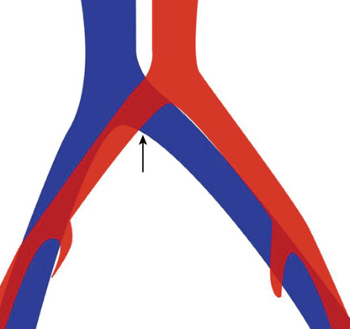

<!-- p.1182 -->

# 52 Hereditary Etiologies of Thrombosis **JOSÉ MANUEL SORIA, JOAN CARLES SOUTO** 

Hereditary thrombophilia has been defined by a joint committee of experts from the WHO and the ISTH (International Society on Thrombosis and Hemostasis) as a genetically determined predisposition to venous thromboembolism. Major pathogenic abnormalities in some cases or a combination of milder defects in others may cause thrombotic events at an early age, frequent recurrences, or a family history of thrombosis. However, the full spectrum of genetic influences and their interactions remains unknown and poorly understood. Because it is evident that a venous thromboembolic episode in a patient is influenced in part by genetics, this definition of hereditary thrombophilia has proven inadequate. It may be more appropriate to refer simply to thrombophilia, retaining its clinical meaning of an increased tendency or risk for venous thrombotic events. In addition, clinical evidence has shown that routine testing for hereditary thrombophilia is often limited because the data are insufficient to alter prognosis and therapeutic strategies. Furthermore, risk factors outside the hemostatic system may interact with other metabolic pathways to create welldefined thrombosis risk states. 

## **Background** 

Thrombophilia (and indeed, any venous thrombosis) is a complex condition arising from the interaction of genetic (intrinsic to the patient) and environmental factors (Table 52.1). The explanatory model for the genetic basis of thrombosis has conceptually evolved through three progressive phases: 

- **The Mendelian Phase:** Hereditary alterations related to hemostatic proteins included protein C (PC) deficiency, protein S (PS) deficiency, or dysfibrinogenemias. Each of these deficiencies was identified as an independent risk factor for familial thrombophilia, following classical Mendelian inheritance patterns. However, the genetic heterogeneity of thrombosis, where pathogenic variants in different genes could result in identical phenotypes (thrombosis), underscored the complexity of the condition. 

- **Challenging of Simple Inheritance Models:** Studies of protein C deficiency revealed significant exceptions to a simple dominant inheritance model for thrombosis: 

- Homozygous patients for protein C deficiency typically exhibit severe thrombotic symptoms, while many heterozygous relatives remain asymptomatic. 

   - The prevalence of heterozygous protein C deficiency in the healthy population is 0.2–0.5%, yet most of these individuals, as well as many of their heterozygous relatives, do not experience thrombotic events. 

   - In symptomatic thrombophilic families with protein C deficiency, approximately 45% of heterozygous relatives are symptomatic, leaving 55% asymptomatic. 

- These findings shifted thrombophilia toward a polygenic inheritance model, where pathological clinical traits result from the simultaneous presence of variants in multiple genes. 

- **Polygenic Hypotheses:** The identification of activated protein C resistance (APCR) and its genetic basis, the G1691A variant in coagulation factor V **(Factor V Leiden)** , supported polygenic inheritance hypotheses in many affected families. Similarly, the discovery of the G20210A variant in the prothrombin gene reinforced this view because carriers of _multiple_ genetic defects demonstrated higher thrombosis risk compared to those with a single defect. 

- Nonetheless, genetic heterogeneity and polygenic inheritance models remain insufficient to explain many thrombophilia cases. Complex traits arise when simple genotypephenotype correlations do not align due to environmental interactions or genetic variation. A contemporary view of venous thromboembolic disease (VTE) emphasizes its multicausal nature, where genetic and environmental factors interact in a complex manner. 

## **Genetic Basis of Classical Hereditary Thrombophilia** 

Two types of deficiencies can be distinguished: 

- **Type I:** Characterized by decreased or absent protein levels in plasma due to either nonexpression of the variant allele or failure of the variant protein to be secreted.

<!-- p.1183 -->

#### **TABLE Risk Factors for Thrombosis 52.1** 

##### **Inherited Thrombophilia (See Also Table 52.3)philia (See Also Table 52.3)hilia (See Also Table 52.3)(See Also Table 52.3)See Also Table 52.3)** 

**General Inherited Thrombophilia (See Also Table 52.3)philia (See Also Table 52.3)hilia (See Also Table 52.3)(See Also Table 52.3)See Also Table 52.3)** Indwelling catheter, especially PICC lines Factor V Leiden pathogenic variant Infection Prothrombin pathogenic variant Trauma Antithrombin deficiency Surgery Protein C deficiency Cancer Protein S deficiency Immobility Homocystinuria Cardiac disease/prosthetic valve Elevated factor VIII Systemic lupus Dysfibrinogenemia Rheumatoid arthritis _GATA-2_ deficiency Inflammatory bowel disease Hereditary thrombotic thrombocytopenic purpura Celiac disease **Anatomic** Polycythemia/dehydration Nephrotic syndrome Thoracic outlet obstruction (Paget-Schroetter syndrome) Diabetes Iliac vein compression syndrome (May-Thurner syndrome) Pregnancy Absence of inferior vena cava Obesity **Medications** Prematurity Paroxysmal nocturnal hemoglobinuria Estrogen-containing contraceptives Thrombotic thrombocytopenic purpura (acquired) Asparaginase COVID-19 Heparin (heparin-induced thrombocytopenia) Antiphospholipid antibody syndrome Corticosteroids Homocystinuria Immune checkpoint inhibitors Hemophilia bypassing agents 

Factor V Leiden pathogenic variant Prothrombin pathogenic variant Antithrombin deficiency Protein C deficiency Protein S deficiency Homocystinuria Elevated factor VIII Dysfibrinogenemia _GATA-2_ deficiency Hereditary thrombotic thrombocytopenic purpura 

**Anatomic** Thoracic outlet obstruction (Paget-Schroetter syndrome) Iliac vein compression syndrome (May-Thurner syndrome) Absence of inferior vena cava 

_PICC,_ Peripherally inserted central venous catheter. 

From Raffini LJ, Branchford BR. Thrombotic disorders in children. In: Kliegman RM, St. Gene JW III, eds. _Nelson Textbook of Pediatrics_ . 22nd ed. Philadelphia: Elsevier; 2025 (Table 528.1, p. 3041). 

|**TABLE** **52.2**|
|---|

#### **Incidence and Thrombotic Risk Associated With Major Hereditary Thrombophilias** 

|Condition|General Population|Patients With First VTE Episode|Annual VTE Risk in Asymptomatic Individuals|
|---|---|---|---|
|No known defect|85%|65%|0,01%|
|Antithrombin deficiency|0.01%|0.5–2%|1.7%|
|Protein C deficiency|0.2–0.5%|2–3%|0.7%|
|Protein S deficiency|0.2–0.5%|2–3%|0.8%|
|Heterozygous Factor V Leiden|4%|10–20%|0.1–0.2%|
|Heterozygous Prothrombin 20210A|2–3%|6–10%|0.1%|
|Homozygous Factor V Leiden|0.1%|1%|0.8%|
|Compound Heterozygotes (Factor V Leiden/Prothrombin 20210A)|0.1%|2%|0.4%|

_AT,_ Antithrombin; _FV,_ factor V; _PC,_ protein C; _PS,_ protein S; _PT,_ prothrombin 20210A; _VTE,_ venous thromboembolic disease. 

#### **Type II:** Characterized by relatively conserved plasma protein levels with reduced or null functional activity. 

These deficiencies are generally associated with a high thrombotic risk. Embryonic lethality and neonatal purpura fulminans are caused by a complete lack of antithrombin, protein C, or protein S. This underscores the importance of identifying these deficiencies for primary or secondary prevention of VTE (Tables 52.2, 52.3, and 52.4). 

### **Antithrombin Deficiency** 

AT is a serpin that inhibits the primary serine proteases involved in coagulation, especially thrombin and activated factor X (FXa), as well as FIXa, FXIa, and FXIIa. Its activity is enhanced in the presence of glycosaminoglycans, forming the basis of the anticoagulant mechanism of both unfractionated and low-molecular-weight heparins.

<!-- p.1184 -->

###### **TABLE** 

#### **Thrombophilia: OMIM Phenotypic Series** 

|**52.3**   |**p  yp** |||
|---|---|---|---|
|Location|Phenotype|Inheritance|Gene/Locus|
|1p36.22|{Thromboembolism, susceptibility to}|AD|_MTHFR_|
|1q24.2|Thrombophilia-2 due to activated protein C resistance|AD|_F5_|
|1q24.2|{Thrombophilia, susceptibility to, due to factor V Leiden}|AD|_F5_|
|1q25.1|Thrombophilia-7 due to antithrombin III deficiency|AD, AR|_SERPINC1_|
|2q14.3|Thrombophilia-3 due to protein C deficiency, autosomal recessive|AR|_PROC_|
|2q14.3|Thrombophilia-3 due to protein C deficiency, autosomal dominant|AD|_PROC_|
|3q11.1|Thrombophilia-5 due to protein S deficiency, autosomal recessive|AR|_PROS1_|
|3q11.1|Thrombophilia-5 due to protein S deficiency, autosomal dominant|AD|_PROS1_|
|3q27.3|Thrombophilia-11 due to HRG deficiency|AD|_HRG_|
|6p25.1|{Venous thrombosis, protection against}|AD|_F13A1_|
|8p12|?Thrombophilia-9 due to decreased release of tissue plasminogen||_THPH9_|
|10q25.3|{Venous thromboembolism, susceptibility to}|AD|_HABP2_|
|11p11.2|Thrombophilia-1 due to thrombin defect|AD|_F2_|
|20p11.21|Thrombophilia-12 due to thrombomodulin defect|AD|_THBD_|
|22q11.21|Thrombophilia-10 due to heparin cofactor II deficiency|AD|_HCF2_|
|Xq27.1|Thrombophilia-8, X-linked, due to factor IX defect|XLR|_F9_|
|Xq27.1|{Deep venous thrombosis, protection against}|XLR|_F9_|

OMIM is intended for use primarily by physicians and other professionals concerned with genetic disorders, by genetics researchers, and by advanced students in science and medicine. While the OMIM database is open to the public, users seeking information about a personal medical or genetic condition are urged to consult with a qualified physician for diagnosis and for answers to personal questions. 

_AD,_ Autosomal dominant; _AR,_ autosomal recessive; _XLR,_ X-linked recessive. Modified from: Online Mendelian Inheritance in Man, OMIM®. Johns Hopkins University, Baltimore, MD. MIM Number: PS188050. Retrieved November 11, 2025, from https://www.omim.org/phenotypicSeries/PS188050. © 1966–2025 Johns Hopkins University. Used with permission. 

#### **TABLE Genetic Biomarkers or Factors Associated With VTE Risk 52.4** 

|Gene or Genetic Variant|RR|Commentary|
|---|---|---|
|_SERPINC1_(Antithrombin)|10.0|Over 130 private variants associated with antithrombin deficiency|
|AT Cambridge II (Ala384Ser)|10.0|Very difficult to detect in plasma|
|_SERPINC1 (AT)_rs2227589|1.30||
|_PROC_(Protein C)|8.00|Over 160 private variants causing protein C deficiency|
|_PROCR_(Receptor endothelial) rs867186|1.22||
|_PROS1_(Protein S)|8.00|Over 200 private variants causing protein S deficiency|
|_F5_rs6025 (FV Leiden)|3.00|Causes activated protein C resistance (APCR)|
|_F5_rs4524|1.21|Independent of FV Leiden|
|_F5_Cambridge (Arg306Thr)|–|Causes APCR. RR unknown|
|_F5_Hong-Kong (Arg306Gly)|–|Causes APCR. RR unknown|
|_F2_rs1799963 (PT20210A)|1.88||
|_ABO_rs8176719 y rs8176750|1.50|Correspond to B and A1 carriers in the ABO blood group|
|_VWF_rs1063856-C|1.15|Increases vWF levels and VTE risk|

_(Continued)_

<!-- p.1185 -->

#### **TABLE 52.4** Genetic Biomarkers or Factors A ssociated With VTE Risk—cont'd

|Gene or Genetic Variant|RR|Commentary|
|---|---|---|
|_STAB2_rs4981021|1.29||
|_TC2N_rs1884841|1.22||
|_STXBP5_rs1039084-G|1.11|Increases vWF levels|
|_FGG_rs2066865|1.47|This SNP reduces A/γratios|
|_FGA_rs6050|1.66||
|_F11_rs2036914 y rs2289252|1.35|These SNPs modulate plasma FXI levels|
|_GP6_rs1613662|1.15||
|_HIVEP1_rs169713-C|1.20||
|_KNG1_rs710446 (Kininogen)|1.19|Modulates FXI, shortens aPTT, and increases VTE risk|
|_KLKB1_rs3733402 (Kallicrein)|1.55||
|_F12_rs1801020 (FXII C46T)|5.00|Risk associated with homozygotes (T/T)|
|_F13A1_rs5985 (FXIII Val34Leu)|0.85|Protective factor associated with Leu/Leu genotype|
|_SLC44A2_rs2288904|1.19||
|_SERPINA10_rs2232698|3.30|SNP in the gene encoding Z-dependent protease inhibitor|
|_THBD_(Thrombomodulin) rs1042579|0.72|Linked to increased protein C anticoagulant activity|
|_THBD_rs16984852|2.80|Only in Chinese populations|
|_TSPAN15_rs78707713|1.28||
|_ZFPM2_rs4734879|1.09||
|_CD93_rs6083037|1.09||
|_EDEM2_rs 1074751|1.12||
|_BRCC3_rs7051718|1.07||

_APCR,_ Activated protein C resistance; _aPTT,_ activated partial thromboplastin time; _AT,_ antithrombin; _F5,_ factor V; _F13,_ factor XIII; _F11,_ factor XI; _F12,_ factor XII; _OR,_ odds ratio; _PC,_ protein C; _PS,_ protein S; _RR,_ relative risk; _SNP,_ single nucleotide polymorphism; _VTE,_ venous thromboembolism; _vWF,_ von Willebrand Factor. Modified from: Online Mendelian Inheritance in Man, OMIM®. Johns Hopkins University, Baltimore, MD. MIM Number: PS188050. Retrieved November 11, 2025, from https://www.omim.org/phenotypicSeries/PS188050. © 1966–2025 Johns Hopkins University. Used with permission. 

The initial diagnosis of AT deficiency is performed using functional assays based on anti-Xa or anti-IIa activity. If abnormalities are detected, antigenic AT levels and heparin affinity are measured. Genetic testing is the third step and can provide relevant information about the mechanism underlying the deficiency, with potential prognostic value. 

**Type I Deficiency:** Quantitative, associated with a high thrombotic risk. 

- **Type II Deficiency:** Qualitative, with greater clinical heterogeneity. Among Type II deficiencies, three subgroups can be identified: 

   - **Reactive Site Defects:** Pathogenic variants affect the molecule’s reactive site, impairing or nullifying AT’s anticoagulant capacity. Clinical severity ranges from moderate (e.g., AT Cambridge II [Ala384Ser]) to severe (e.g., AT London [Arg393 deletion]). 

   - **Heparin-Binding Site Defects:** These reduce heparin affinity, diminishing AT activation by glycosaminoglycans and generally associating with lower thrombotic risk. 

- **Pleiotropic Defects:** Variants that affect both heparin affinity and inhibitory function, typically associated with severe clinical presentations. 

Despite the high thrombotic risk associated with AT deficiency (10–50 times increased risk), its very low prevalence in the general population (0.01%) explains why only a small fraction of patients with VTE exhibit this hereditary thrombophilia (0.5–2%) (Table 52.2 and Table 52.4). However, the high recurrence rate in carriers and the clinical benefits of diagnosis justify testing patients and their relatives. 

**Transient congenital AT deficiency** is associated with specific genetic alterations that may temporarily lower functional AT levels under external circumstances (e.g., febrile episodes). 

### **Protein C Deficiency** 

PC is activated by thrombin in the presence of thrombomodulin. Activated PC (APC) exerts its anticoagulant function by inactivating factors Va and VIIIa.

<!-- p.1186 -->

The diagnosis of PC deficiency begins with functional assays (using coagulometric or chromogenic methods) and antigenic measurements, which differentiate **Type I** (quantitative) from **Type II** (qualitative) deficiencies. Genetic testing is relatively straightforward but has less clinical utility. Studies in families with PC deficiency highlight the genetic heterogeneity of this condition, providing useful information for genetic counseling. 

**Prevalence:** PC deficiency is rare in the general population (0.2–0.5%) but more frequent in patients with VTE (2–3%) (Table 52.2). 

- **Risk:** The relative risk of thrombosis is approximately tenfold and increases with age. 

- **Recurrence:** Recurrence rates in PC-deficient patients are high, underscoring the value of diagnosis in both patients and asymptomatic relatives. 

### **Protein S Deficiency** 

PS functions as a cofactor for APC. Approximately 60–80% of plasma PS circulates bound to C4b-binding protein (C4b-BP), a complement regulator. Only the free fraction of PS has anticoagulant activity. 

Antigenic measurements of total and free PS levels, along with functional assays assessing PS cofactor activity for APC, permit classification into three deficiency types: 

- **Type I:** Reduced total and free PS antigen levels, with correspondingly low functional activity. These cases represent two-thirds of PS deficiencies. 

- **Type II:** Normal antigen levels (total and free), with reduced functional activity as an APC cofactor. This is the rarest type. 

- **Type III:** Normal total protein levels but low free protein levels due to increased PS bound to C4b-BP. This type accounts for ~30% of PS deficiencies. 

- **Prevalence:** PS deficiency affects 0.2–0.5% of the general population and 2–3% of VTE patients. 

- **Risk:** The relative risk of venous thrombosis is approximately tenfold, with a high recurrence rate after discontinuing anticoagulant therapy (Table 52.2). 

The genetic analysis of PS is complex due to the presence of two homologous genes encoding the protein: _PROS1_ (responsible for most Type I and Type II deficiencies) and the pseudo gene _PROSP_ . Over 200 different point variants have been described. 

### **Factor V Leiden** 

This point variant results in an amino acid substitution, replacing arginine with glutamine, at the first proteolytic cleavage site of factor Va by APC (Arg506Gln). The functional consequence is a factor Va that is more resistant to inactivation by APC. 

- **Prevalence:** The prevalence of this variant in the general population is relatively high, affecting 4–5% of the Spanish 

population and up to 10% in Northern Europe. Among unselected patients with venous thrombosis, prevalence increases to 15–20%. 

- **Risk:** In heterozygotes, Factor V Leiden moderately increases the risk of venous thromboembolism (VTE), with an estimated 3–5-fold risk elevation. In homozygotes, the risk rises significantly, up to 20-fold. However, the risk of developing venous thrombosis in carriers of Factor V Leiden is considerably lower than that associated with deficiencies in natural anticoagulants. 

- **Recurrence Risk:** Although statistically significant in larger cohorts, the recurrence risk is relatively low, with a hazard ratio of approximately 1.3. 

### **Prothrombin G20210A** 

This variant involves a single nucleotide substitution in the 3′ untranslated region of the prothrombin (factor II) gene, resulting in a slight increase in plasma levels of this molecule. 

- **Prevalence:** The 20210Ala allele is present in approximately 3% of the healthy Spanish population but increases to 6–9% among patients with VTE. 

#### **Risk:** 

   - Heterozygous carriers exhibit a 3–4-fold higher risk of venous thrombosis compared to noncarriers. 

   - In _homozygotes_ , the risk rises to 10–20 times that of noncarriers. 

   - The absolute risk of developing venous thrombosis in individuals carrying this polymorphism is similar to Factor V Leiden. 

- **Recurrence Risk:** The recurrence risk in carriers is also low, with a hazard ratio of approximately 1.2 

### **Other Genetic Variants Implicated in Hereditary Thrombophilia** 

Several additional genetic variants have been described with diagnostic value for VTE risk: 

**AT Cambridge Variant:** A rare antithrombin variant. 

**C46T in the** **_FXII_ Gene:** This variant is linked to VTE risk. **ABO blood group genotypes:** Individuals with non-O blood types have a 2–4 times higher VTE risk compared to O-type individuals. 

The high prevalence of these polymorphisms in patients with VTE, along with the relative simplicity of diagnosis (using commercial kits for real-time polymerase chain reaction), has led to a high rate of study requests in laboratories, but the clinical significance is limited to defects in homozygosity or heterozygosity combinations of multiple pathogenic variants. The study of these polymorphisms in other contexts, such as obstetric complications, arterial thrombosis, or exposure to high thrombotic risk situations is confined to cases with a significant personal or family history of VTE.

<!-- p.1187 -->

The genetic variants or polymorphisms listed in Table 52.4 have a weaker, though statistically significant, relationship with VTE risk. They have been detected more through global genome studies. Table 52.4 summarizes a large number of genes and genetic variants associated with VTE, which are likely part of the heritability of VTE. Some of these are classic genetic factors. In total, 28 genes with well-established variants are listed; another 60 distinct genes may be potential risk variants. The classic thrombophilia genes ( _SERPINC1_ for antithrombin, _PROC_ for protein C, and _PROS1_ for protein S) harbor hundreds of private variants (present in only a few families each), which confer a high VTE risk for heterozygous carriers. Homozygous carriers are nearly incompatible with life and usually die from intrauterine thrombotic events. 

Research focused on other candidate genes related to hemostasis has identified various risk variants in the _F2_ , _F5_ , _F12_ , _F13_ , _PROCR_ (protein C receptor), _FGG_ (gamma chain of fibrinogen), _HIVEP1_ , _SERPIN10_ (Protein Z-dependent protease inhibitor), or _THBD_ (thrombomodulin) genes. Advancements in GWAS (Genome-wide association studies) and next-generation sequencing have expanded the list of genes associated with VTE, which contain common variants in the general population. Among these genes are _GP6_ (glycoprotein VI), _ABO_ (blood group), _VWF_ (von Willebrand factor), _STXBP5_ (syntaxin binding protein 5), _KNG1_ (kininogen), _KLKB1_ (kallikrein), _TC2N_ , STAB2, _F11, TSPAN15, SLC44A2, ZFPM2, CD93, EDEM2_ , and _BRCC3_ . All these GWAS-derived variants are weak risk factors, with statistically significant odds ratios between 1.1 and 1.5. 

A few extremely rare genetic alterations (with allele frequencies below 0.005), detected in families with very intense thrombophilia include the _F. IX_ Padua variant (R338L or g31134t), which is a gain of function, leading to an activity level of factor IX eight times higher than normal. The Yukuashi variant in prothrombin (F II) (Arg596Leu) and the Belgrade variant in prothrombin (Arg596Gln), which cause significant resistance to antithrombin, and the F.V Nara variant (Trp1920Arg), which leads to factor V deficiency and a very intense increase in resistance to protein C (by a mechanism distinct from that of factor V Leiden). 

**Epigenetic biomarkers** may be associated with VTE including circulating microRNAs in the blood. These are RNA fragments 20–25 nucleotides in length, involved in post-transcriptional regulation of gene expression, having a role in cell differentiation, proliferation, apoptosis, and other physiological and pathological functions. They are highly stable in whole blood, serum, and plasma. One study identified miR-134 as the microRNA most associated with VTE. A subsequent study revealed four additional miRNAs linked to VTE risk, with odds ratios ranging from 1.3 to 1.8. 

## **Nongenetic Biomarkers of Intermediate Phenotypes of VTE Risk** 

A biomarker for a disease can be defined as any biological product that helps to understand the differences between a 

patient and a healthy person (unaffected by the disease in question). A biomarker can be a cellular parameter, a human organic molecule (proteins, lipids, carbohydrates, trace elements, vitamins), a genetic polymorphism, a biological process (clotting time) or an anthropomorphic measurement (weight). Ideally, a biomarker should be measurable with objective and standardized methods, comparable across different laboratories. 

VTE biomarkers can be grouped into four categories: plasmatic, cellular, anthropomorphic, and genetic. All nongenetic biomarkers can also be termed **intermediate phenotypes** (i.e., observable and measurable biological data situated between the genotype or genetic basis of the subject and the phenotype under study, in this case, the thrombotic disease). The majority of intermediate phenotypes are measurable on continuous quantitative scales. Elevated levels of those promoting coagulation, or low levels of those functioning as anticoagulants, are associated with a higher risk of VTE. Table 52.5 lists those with scientific evidence. 

In the concept of VTE as a complex disease, where 60% of the risk is attributed to genetic causes interacting with environmental factors, a wide range of variables are involved in the individual risk of each patient. The study of this risk should incorporate other biomarkers that are not strictly “genetic,” although many of them are also influenced or regulated by genes. These are known as intermediate phenotypes. In addition to those already described as genetic or plasmatic (e.g., AT, PC, or PS levels), two other categories can be investigated: 

### **Cellular Biomarkers** 

This category includes hematocrit, which is directly related to the number of red blood cells as well as the platelet count, and the absolute number of monocytes. Other parameters of cells, such as RDW (red blood cell distribution width) and mean platelet volume (MPV), are also considered. Additionally, the measurement of global platelet function using PFA-100 technology and measurements related to neutrophil extracellular traps (NETs) are notable. 

### **Anthropomorphic Biomarkers** 

Some of these anthropomorphic biomarkers are listed in Table 52.5: age, sex, and race. Obesity (considered an associated disease), measured through body mass index (BMI), is also linked to risk. In addition to these four, other anatomical measurements appear in Tables 52.5, 52.6, and 52.7, such as those related to venous valves and the length of the lower limbs. 

## **Laboratory Studies of Thrombophilia Risk** 

A biological thrombophilia study should help explain the occurrence of thrombosis (although always considering the presence or absence of exogenous provoking causes to the patient’s biology). These causes are summarized in

<!-- p.1188 -->

|**TABLE** **52.5**|
|---|

#### **Intermediate Blood or Vascular Phenotypes Associated With the Risk of VTE** 

|Intermediate Phenotype|Risk|Comment|
|---|---|---|
|Antithrombin|2.0 (OR)|Associated with borderline low values|
|Protein C|2.2 (OR)|Associated with borderline low values|
|Protein S|1.8 (OR)|Associated with borderline low values|
|Homocystein|2.5 (OR)|Associated with levels>95th percentile|
|Factor II|2.1 (OR)|Associated with levels>115%|
|Factor VII|2.4 (HR)|Associated with levels>95th percentile|
|Factor VIII|3.7 (OR)|Associated with levels>90th percentile|
|Factor IX|2.5 (OR)|Associated with levels>130%|
|Factor XI|2.2 (OR)|Associated with levels>90th percentile|
|aPCR|1.7 (OR)|In absence of Factor V Leiden Variant (FVL)|
|Fibrinogen|2.9 (OR)|Associated with levels>90th percentile|
|vW Factor|4.0 (OR)|Associated with levels>90th percentile|
|ADAMTS13|4.2 (OR)|Levels<5th percentile, only in women|
|PCI (Protein C inhibitor)|1.6 (OR)|Associated with levels>95th percentile|
|TFPI|1.9 (OR)|Associated with levels<5th percentile|
|aPTT|2.4 (OR)|Associated with values below 0.90 (ratio)|
|Dynamic parameters of aPTT|–|Risk has not yet been quantified|
|t-PA|1.8 (OR)|Associated with levels>75th percentile|
|PAI-1|1.6 (OR)|Associated with levels>75th percentile|
|TAFI|1.7 (OR)|Associated with levels>90th percentile|
|CLT (clot lysis time)|2.0 (OR)|Associated with levels>90th percentile|
|TGT (endogen thrombin potential)|1.03 (OR)|Per each 1% increase|
|TEM (maximum amplitude)|–|Risk has not yet been quantified|
|Platelet count|2.3 (OR)|Levels>90th percentile, only in women|
|Mean platelet volume (MPV)|1.3 (HR)|Associated with MPV>9.5 fL|
|PFA-100 Epinephrine closure time|3.3 (OR)|Associated with levels<10th percentile|
|PFA-100 ADP Closure time|4.0 (OR)|Associated with levels<10th percentile|
|VAMP8|3.2 (OR)|Levels>75th percentile, only in women|
|SERT|2.5 (OR)|Levels>75th percentile, only in women|
|Hematocrit|1.25 (HR)|Associated with each 5% increment|
|Protein Z|2.20 (OR)|Associated with decreased levels|
|Free thyroxine (T4)|2.50 (OR)|Associated with levels>98th percentile|
|Serum folate|–|Risk has not yet been quantified|
|Monocyte count|2.2 (OR)|Levels>0.7×109/L|
|RDW|3.0 (OR)|Associated with values>15%|
|Venous valve thickness|2.3 (OR)|Associated with values>75th percentile|
|Venous valve closure time|2.8 (OR)|Associated with time>1 second|
|Leg length|1.6 (HR)|Associated with length>80th percentile|

_(Continued)_

<!-- p.1189 -->

#### **TABLE 52.5 Intermediate Blood or Vascular Phenotypes Associated With the Risk of VTE—cont'd** 

|Intermediate Phenotype|Risk|Comment|
|---|---|---|
|Circulating nucleosomes (NETs)|3.0 (OR)|Associated with levels>80th percentile|
|EN/**a**1-AT complex (NETs)|2.4 (OR)|Associated with levels>80th percentile|
|Lupus anticoagulant|4-16 (OR)|Positivity vs. negativity|
|aCL (antibodies to cardiolipin)|1.5 (OR)|Positivity vs. negativity|
|a**b**2GPI (anti-**b**2-glycoprotein I antibodies)|2.1 (OR)|Positivity vs. negativity|
|TNF**a** (tumor necrosis factor**a**)|1.7 (OR)|Associated with detectable levels in plasma|
|IL-1**b**(interleukin-1**b**)|1.7 (OR)|Associated with detectable levels in plasma|
|IL-6 (interleukin-6)|2.4 (OR)|Associated with detectable levels in plasma|
|IL-8 (interleukin-8)|2.8 (OR)|Associated with detectable levels in plasma|
|D-dimer|3.2 (HR)|Associated with values>80th percentile|

_AAF,_ Antiphospholipid antibodies; _ab2GPI_ , anti-β2-glycoprotein I; _aCL,_ anticardiolipin; _ADAMTS13,_ a disintegrin-like and metalloprotease with thrombospondin type 1 motif number 13; _aPCR,_ resistance to activated protein C; _aPTT,_ activated partial thromboplastin time; _CLT,_ clot lysis time; _EN/a1-AT,_ elastase-alpha 1 antitrypsin complex; _HR,_ hazard ratio; _IL,_ interleukin; _NETs,_ neutrophil extracellular traps; _OR,_ odds ratio; _PAI-1,_ plasminogen activator inhibitor-1; _PCI,_ protein C inhibitor; _RDW,_ red cell distribution width; _SERT,_ serotonin transporter; _TAFI,_ thrombin-activatable fibrinolysis inhibitor; _TEM,_ thromboelastometry; _TFPI,_ tissue factor pathway inhibitor; _TGT,_ thrombin generation test; _TNFa_ , tumor necrosis factor α; _t-PA,_ tissue plasminogen activator; _VAMP8,_ vesicle-associated membrane protein 8. 

Adapted from Vilalta N, Souto JC. Venous thrombophilia investigation. Present and future. _Angiologia_ . 2014; 224:1-9. 

#### **TABLE Risk Factors for Provoked VTE. Different 52.6 Environmental Risk Factors Grouped According to Risk Intensity** 

|Risk Intensity|Risk Factors|
|---|---|
|High-riskfactors (risk greater than 10)|Hip or long bone fracture Hip or knee prosthesis surgery Major general surgery Severe trauma Spinal cord injury Plaster cast application|
|Moderate-riskfactors (risk between 2–10)|Central venous catheters Knee arthroscopic surgery Chemotherapy Cancer Congestive heart failure Autoimmune inflammatory diseases Stroke with paralysis sequelae Postpartum period Thrombophilia (nonacquired) History of VTE|
|Low-riskfactors (risk between 1–2)|Bed rest for more than 3 days Prolonged travel by airplane or car Laparoscopic surgery Obesity Pregnancy Hormone replacement therapy Oral contraceptives Varicose veins|

Tables 52.6 and 52.7. An adequate study also allows for better understanding of the individual risk of recurrence once the necessary anticoagulant therapy to treat the first episode is completed. The detection of high-risk hereditary defects allows for the identification of relatives of patients who have not yet had VTE, in whom preventive measures can be adopted. 

There is a debate regarding the appropriateness of thrombophilia studies. For specialists who pragmatically decide to indefinitely anticoagulate spontaneous VTE cases and discontinue treatment after 3–6 months in cases of VTE associated with a provoking factor, conducting special studies may seem unnecessary. However, many unprovoked cases do not recur (70%) and a substantial number of provoked cases (~20%) recur within 10 years. Additionally, patients with hereditary deficiencies of natural anticoagulants have a high recurrence risk and cannot be diagnosed without laboratory studies. It is also known that relatives (still asymptomatic) of these patients with hereditary thrombophilia are exposed to an increased risk of VTE and may benefit from special prophylactic measures if identified. 

Physicians should provide their patients with a correct understanding of the implications of the results, whether normal or abnormal. If not performed with these principles in mind, a thrombophilia study carries several potential risks, namely: 

- If the result is negative, anticoagulation may be withdrawn in patients who may have a high recurrence risk due to unidentified biological factors.

<!-- p.1190 -->

#### **TABLE 52.7** Acquired or Environmental Factors A ssociated With th e Risk of VTE

|Risk factor|Risk|Comment|
|---|---|---|
|Age**.**75 years*|2.25–12.60 (HR)|According to the decade, compared to<45 years|
|Male sex*|1.60 (RR)|Only increases the risk of recurrence|
|Black people*|1.60 (HR)|Compared to white people|
|Obesity (BMI**.**30)|2.33 (OR)||
|Smoking|1.06–1.49 (HR)|According to the intensity of exposure|
|Hypertension (HTA)|1.51 (OR)||
|Diabetes mellitus|1.41 (OR)||
|Varicose veins|1.40 (HR)||
|Any serious illness|1.70 (OR)|Variable between 1.4 and 4.9 depending on the type|
|Congestive heart failure (CHF)|1.30–1.40 (HR)|Variable by sex|
|Chronic kidney disease (CKD)|1.60–1.90 (HR)|Variable by sex|
|Cancer|1.80–2.20 (HR)|Variable by sex|
|Chronic obstructive pulmonary disease (COPD)|1.40–1.60 (HR)|Variable by sex|
|Autoimmune disease|3.90–16.40 (SIR)|Variable by type|
|Infections|1.74–2.70 (RR)|Variable by type|
|Hospital admission|1.90 (HR)||
|Antipsychotic drugs l|1.55–1.84 (HR)|Variable by sex|
|NSAIDs (nonsteroidal antiinflammatory drugs)|2.50 (IRR)||
|Tamoxifen|1.50 (HR)||
|Oral contraceptives|1.33 (HR)||
|Hormone replacement therapy (HRT)|1.20 (HR)||
|Polycystic ovary syndrome|1.9 (OR)|Independent of contraceptive use|
|Erythropoietin|9.3 (IRR)||
|Blood transfusion|2.6 (IRR)||
|Pregnancy and postpartum period|4.30 (RR)||
|Severe trauma|4.80–8.60 (OR)|Variable by type|
|General surgery|9.50 (OR)||
|Orthopedic surgery|16.25 (OR)||
|Prolonged bed rest|5.60 (OR)||
|Casting|36.5 (OR)||
|Travel**.**5 h in the previous month|2.80 (RR)|Variable by trip duration|
|Use of computers (**.**8 h/day)|2.80 (RR)|Variable by studies|
|Watching TV (**.**5 h/day)|2.50 (HR)||
|Season of the year (winter)|1.14 (RR)||
|Environmental pollution|1.47 (OR)||
|Coffee consumption|0.70 (OR)|Protective factor|
|Alcohol|0.75 (HR)|Protective factor|

Risk indicators are provided as point estimates, without confidence intervals, but all are statistically significant 

_*_ Age, sex, and ethnicity are not strictly acquired or environmental factors, but are included here for practical reasons and because they cannot be classified as genetic markers. 

_BMI,_ Body mass index; _CHF,_ congestive heart failure; _CKD,_ chronic kidney disease; _COPD,_ chronic obstructive pulmonary disease; _HR,_ hazard ratio; _HRT,_ hormone replacement therapy; _HTA,_ hypertension; _IRR,_ incidence rate ratio; _NSAIDs,_ nonsteroidal antiinflammatory drugs; _OR,_ odds ratio; _RR,_ relative risk; _SIR,_ standardized incidence ratio; _TV,_ television.

<!-- p.1191 -->

- On the other hand, a positive finding of a low-risk biomarker may cause disproportionate fear and lead to long-term anticoagulation. 

- Inadequate thrombophilia testing incurs significant and unnecessary costs. 

- Occasionally, improper testing leads to false positives, such as when performed under the influence of vitamin K antagonists (VKAs), which can result in deficiencies of protein C and protein S, or when performed without suspending direct oral anticoagulants, which can produce false positives for lupus anticoagulants. 

- In nonexpert hands, incorrect interpretations may occur. Such studies can cause anxiety in patients. 

Results may lead to genetic discrimination. 

### **Classic Study** 

Laboratory evaluation includes measurements of fibrinogen, to rule out dysfibrinogenemia; lupus anticoagulant and antiphospholipid antibodies, to rule out antiphospholipid syndrome; measurements of antithrombin, protein C, and protein S, to rule out plasmatic deficiencies; and the factor V Leiden variants and Gly20210Ala in the prothrombin or factor II gene. 

### **Extended Study** 

It includes other biomarkers, both intermediate phenotypes (Table 52.5) and other genetic markers (Tables 52.3 and 52.4), which help describe the patient’s prothrombotic status and assess recurrence risk. In addition to the classic study measurements, it is proposed to add: 

- Other proteins, such as Factor VIII or D-dimer, to assess recurrence. 

- Global tests like aPTT, RPCA, or thrombin generation. 

- Consider hemogram parameters like hematocrit, MPV, or absolute monocyte count. 

- Platelet function, using PFA-100. 

- Homocysteine, vitamin B12, and folate levels. 

- Other genetic biomarkers such as the ABO group, antithrombin Cambridge, Protein Z inhibitor, F12 Cys46Thr variant. 

- Typically, clinical practice is limited to the classic study, which is insufficient to answer all the most relevant questions: Why has this patient suffered a VTE? Why now? What is the risk of recurrence once anticoagulant therapy is completed? 

The extended study provides more information and a better biological perspective on each individual case. Beyond practical decisions regarding the duration of treatment, which are based almost exclusively on the circumstances of the event (provoked versus spontaneous, see Tables 52.1 and 52.6), answering the previous questions requires a deeper laboratory study. 

## **Evolution and Expansion of the Concept of Thrombophilia** 

### **Heritability Yet to Be Discovered in VTE** 

Despite the importance of genes in VTE and the already considerable list of genes identified in relation to the risk of this disease, it is currently believed that we have discovered less than 15% of the genetic factors involved. Most of the genetic variants contributing to the risk of VTE are in coding regions of the genome (exons). However, in other complex diseases, it has been demonstrated that up to 80% of their heritability is explained by noncoding regions (either introns or intergenic regions), and that possibly less than 10% is due to regions detectable in the exome, which translate into proteins. It is possible that something similar happens in the case of VTE. Variants discovered in GWAS of VTE have only explained a small part of the heritability. There are several explanations to try to understand this somewhat disappointing result: 

- It is possible that the undiscovered heritability is due to rare variants (often with a population allele frequency of less than 0.005, or 0.5%) or even low-frequency variants (between 0.5% and 5%); these are not well studied in GWAS. Rare variants are more likely harmful, but they are very difficult to detect in association studies (GWAS) unless they have a major effect on the disease, as is the case in monogenic disorders. 

- The markers included in a GWAS do not always capture the effect of the variant responsible for the disease. In this sense, it is possible that genes with frequent variants of small effect also contain rare variants with more significant effects. 

- It is possible that an accumulation of rare variants in the already widely studied candidate genes such as _SERPINC1, PROC, PROS1, PROCR, ABO, F5, F11, FGG, F11, VWF,_ or _GP6_ , among others, could explain part of the heritability. Analysis using massive sequencing techniques in these genes already associated with VTE and applied to patients with thrombosis has revealed a deficit of rare variants that change the protein sequence in several procoagulant genes, while an excess of rare variants is detected in anticoagulant genes. This causes a loss of hemostasis balance in the direction of a procoagulant state. 

- Structural variants that are barely explored in GWAS studies include copy number variations (CNVs), inversions, or translocations. These anomalies have been studied in several Mendelian diseases, but their participation in complex diseases such as VTE has not been widely studied. 

- Heritability due to gene-gene interaction has not been described. 

- Family studies may be needed (as opposed to the classic casecontrol studies of unrelated individuals, such as GWAS). Family studies can facilitate the detection of rare or lowfrequency variants. It is obvious that these variants will be

<!-- p.1192 -->

more easily found in relatives of patients. They also allow for the study of specific effects known as parent-of-origin, meaning inherited specifically from one parent or the other. If not considered, these effects may mask the effects and reduce the explained heritability. Family studies can be very useful for identifying gene-gene interactions because affected relatives are more likely to share nearby epistatic loci, in linkage disequilibrium, than unrelated individuals (typical of GWAS studies). 

### **Permanent Components** 

The permanent components of the individual risk profile for VTE are genetic. Other components considered permanent for practical purposes are gender and ethnicity. 

It is also important to highlight the significance of epigenetics; processes that modify DNA activity without altering the sequence. 

### **Changing Components** 

### **Individualization of VTE Risk** 

The high complexity of VTE is seen due to the multiplicity of already known genetic factors (Table 52.4), intermediate phenotypes involved (Table 52.5), and environmental circumstances that increase the risk (Tables 52.6 and 52.7). We do not have objective tools (algorithms) that allow us to individualize the risk of disease with high precision. Individuals, whether previously healthy or having already experienced an event, present a unique set of genetic and environmental characteristics. A better understanding of this set of risk factors leads us to the concept of the _individual risk profile_ . 

Among the large number of variables to be considered are permanent genetic risks, and those that change in relation to environmental factors. The current genetic profile is still limited because only ~15% of the genetic contribution has been identified. A better understanding of the environmental variables will enhance the understanding of risk. 

The list is sizable (Tables 52.6 and 52.7). 

## **Case Example** 

**May-Thurner syndrome** is an anatomic predisposition to left sided ileo-femoral venous thrombosis. External compression of the left common ileac vein by the overriding right ileac artery predisposed to distal obstruction with subsequent venous thrombosis (Fig. 52.1). In addition, significant weight loss (eating disorders) enhances this thrombotic risk. 

Nonetheless in a systematic review, 52% of patients with May-Thurner syndrome also had acquired or genetic major thrombophilia risk factors including antiphospholipid syndrome, and antithrombin, protein S or protein C deficiencies; ~30% had minor genetic thrombophilia risk factors. This case highlights the interaction of genetic, anatomic, and environmental risk factors in the development of VTE. 

### **Concept of the Individual Risk Profile** 

There are models to predict the risk of a first event in individuals still asymptomatic. One study used a model with 14 exclusively clinical variables that include comorbidities and concurrent medications. In contrast, another study proposed adding two classical genetic factors, FV Leiden and PT20210A variant, to other clinical variables. A different study significantly increased the predictive power of previous purely clinical models by including more genomic information and combining it with clinical and environmental data from the patient. The five genetic variables included were FV Leiden, PT20210A variant, blood group A1, an SNP in the _FGG_ gene (rs2066865), and another SNP in the _F11_ gene (rs2036914). This approach with multiple genetic information has been confirmed and improved by another group including 9 genetic variants: FV Leiden (rs6025), _F5_ rs118203906, _F5_ rs11820395, PT20210A variant, blood group A1, _F12_ rs1801020, _F13_ rs5985, _SERPINC1_ rs121909548, and _SERPIN10_ rs2232698. 

As proof of concept, the previous models have been improved by adding, in addition to clinical and genetic information, data on intermediate phenotypes (Table 52.5), such as plasma levels of antithrombin, proteins C and S, F. II, F. VII, F. VIII, F. IX, F. X, F.XI, and fibrinogen. 

**Fig. 52.1** May-Thurner syndrome. Right common iliac artery compressing the left common ileac vein _(arrow)_ .  (From Abu Jebbeh F, Glick Y, Niknejad M, et al. May-Thurner syndrome. Reference article, Radiopaedia.org [accessed on 15 Jan 2025] https://radiopaedia.org/ articles/3967.)

<!-- p.1193 -->

## **Bibliography** 

##### **_Introduction and Historical Perspective_** 

- Bertina RM, Koeleman BPC, Koster T, et al. Mutation in blood coagulation factor V associated with resistance to activated protein C. _Nature_ . 1994;369:64-67. 

- Comp P, Esmon C. Recurrent venous thromboembolism in patients with a partial deficiency of protein S. _N Engl J Med_ . 1984;311: 1525-1528. 

- Dahlbäck B, Carlsson M, Svensson PJ. Familial thrombophilia due to a previously unrecognized mechanism characterized by poor anticoagulant response to activated protein C: prediction of a cofactor to activated protein C. _Proc Natl Acad Sci_ . 1993;90:1004-1008. 

- Egeberg O. INHERITED ANTITHROMBIN DEFICIENCY CAUSING THROMBOPHILIA. _Thromb Diath Haemorr_ . 1965; 13:516-530. 

- Griffin JH, Evatt B, Zimmerman TS, et al. Deficiency of protein C in congenital thrombotic disease. _J Clin Invest_ . 1981;68:1370-1373. 

- Havertake F, Samama M. Familial dysfibrinogenemia and thrombophilia. Report on a study of the SSC subcommittee on fibrinogen. _Thromb Haemost_ . 1995;73:151-161. 

- Lander ES, Schork NJ. Genetic dissection of complex traits. _Science_ . 1994;265:2037-2048. 

- Lane DA, Mannucci PM, Bauer KA, et al. Inherited thrombophilia: Part 1. _Thromb Haemost_ . 1996;76:651-662. 

- Lane DA, Mannucci PM, Bauer KA, et al. Inherited thrombophilia: Part 2. _Thromb Haemost_ . 1996;76:824-834. 

- Miletich JP, Prescott SM, White R, et al. Inherited predisposition to thrombosis. _Cell_ . 1993;72:477-480. 

- Poort SR, Rosendaal FR, Reitsma PH, et al. A common genetic variation in the 3′-untranslated region of the prothrombin gene is associated with elevated plasma prothrombin levels and increase in venous thrombosis. _Blood_ . 1996;88:3698-3703. 

- Rosendaal FR. Venous thrombosis: a multicausal disease. _Lancet_ . 1999;353:1167-1173. 

- Schwarz HP, Fischer M, Hopmeier P, et al. Plasma protein S deficiency in familial thrombotic disease. _Blood_ . 1984;64:1297-1300. 

- Souto JC, Almasy L, Borrell M, et al. Genetic susceptibility to thrombosis and its relationship with physiological risk factors: the GAIT Study. _Am J Hum Genet_ . 2000;67:1452-1459. 

##### **_Genetic Basis of Classical Hereditary Thrombophilia_** 

- Alhenc-Gelas M, Plu-Bureau G, Hugon-Rodin J, et al. Thrombotic risk according to SERPINC1 genotype in a large cohort of subjects with antithrombin inherited deficiency. _Thromb Haemost_ . 2017;117:1040-1051. 

- Bravo-Pérez C, De la Morena-Barrio ME, De la Morena-Barrio B, et al. Molecular and clinical characterization of transient antithrombin deficiency: a new concept in congenital thrombophilia. _Am J Hematol_ . 2022;97:216-225. 

- Cooper PC, Coath F, Daly ME, et al. The phenotypic and genetic assessment of antithrombin deficiency. _Int J Lab Hematol_ . 2011;33:227-237. 

- Croles FN, Borjas-Howard J, Nasserinejad K, et al. Risk of venous thrombosis in antithrombin deficiency: a systematic review and bayesian meta-analysis. _Semin Thromb Hemost_ . 2018;44:315-326. 

- D’Angelo A,Viganò-D’Angelo S. Protein S deficiency. _Haematologica_ . 2008;93:498-501. 

- Djordjeviv V, Kovac M, Miljic P, et al. A novel prothrombin mutation in two families with prominent thrombophilia. The firs case of antithrombin resistance in a Caucasian population. _J Thromb Haemost_ . 2013;11:1936-1939. 

- Hinds DA, Buil A, Ziemek D, et al. Genome-wide association analysis of self-reported events in 6135 individuals and 252827 controls identifies 8 loci associated with thrombosis. _Hum Mol Genet_ . 2016;25:1867-1874. 

- Klarin D, Busenkell E, Judy R, et al. Genome-wide association analysis of venous thromboembolism identifies new risk loci and genetic overlap with arterial vascular disease. _Nat Genet_ . 2019; 51:1574-1579. 

- Lijfering WM, Brouwer JLP, Veeger NJ, et al. Selective testing for thrombophilia in patients with first venous thrombosis: results from a retrospective family cohort study on absolute thrombotic risk for currently known thrombophilic defects in 2479 relatives. _Blood_ . 2009;113:5314-5322. 

- Lindström S, Brody JA, Turman C, et al. A large-scale exome array analysis of venous thromboembolism. _Genet Epidemiol_ . 2019; 43:449-457. 

- Lindström S, Wang L, Smith E, et al. Genomic and transcriptomic association studies identify 16 novel susceptibility loci for venous thromboembolism. _Blood_ . 2019;134:1645-1657. 

- Mahmoodi BK, Brouwer JL Ten Kate MK, et al. A prospective cohort study on the absolute risks of venous thromboembolism and predictive value of screening asymptomatic relatives of patients with hereditary deficiencies of protein S, protein C or antithrombin. _J Thromb Haemost_ . 2010;8:1193-2000. 

- Martos L, Fernández-Pardo A, López-Fernández MF, et al. Identification of 58 mutations (26 Novel) in 94 of 109 symptomatic Spanish Probands with Protein C deficiency. _Thromb Haemost_ . 2019; 119:1409-1418. 

- Middeldorp S. Evidence-based approach to thrombophilia testing. _J Thromb Thrombolysis_ . 2011;31:275-281. 

- Miyawaki Y, Suzuki A, Fujita J, et al. Thrombosis from a prothrombin mutation conveying anti-thrombin resistance. _N Engl J Med_ . 2012;366:2390-2396. 

- Morange PE, Suchon P, Trégouët DA. Genetics of venous thrombosis: update in 2015. _Thromb Haemost_ . 2015;114:910-919. 

- Nogami K, Shinizawa K, Ogiwara K, et al. Novel FV mutation (W1920R, FV Nara) associated with serious deep vein thrombosis and more potent APC resistance relative to FV Leiden. _Blood_ . 2014;123:2420-2428. 

- Reitsma PH. Protein C deficiency: from gene defects to disease. _Thromb Haemost_ . 1997;78:344-350. 

- Rodriguez-Rius A, López S, Martínez-Pérez A, et al. Identification of a plasma microRNA profile associated with venous thrombosis. _Arterioscler Thromb Vasc Biol_ . 2020;40:1392-1399. 

- Simioni P, Tormene D, Tognin G, et al. X-linked thrombophilia with a mutant factor IX (factor IX Padua). _N Engl J Med_ . 2009; 361:1671-1675. 

- Xiang Q, Zhang HX, Wang Z, et al. The predictive value of circulating microRNAs for venous thromboembolism diagnosis: a systematic review and diagnostic meta-analysis. _Thromb Res_ . 2019; 181:127-134. 

##### **_Expansion of the Concept of Thrombophilia. Intermediate Phenotypes. Predictive Models_** 

- De Haan HG, Bezemer ID, Doggen CJM, et al. Multiple SNP testing improves risk prediction of first venous thrombosis. _Blood_ . 2012;120:656-663. 

- Eichinger S, Heinze G, Jandek LM, et al. Risk assessment of recurrence in patients with unprovoked Deep vein thrombosis or pulmonary embolism: the Vienna prediction model. _Circulation_ . 2010;121:1630-1636. 

- Franco-Moreno AI, García-Navarro MJ, Ortíz-Sánchez J, et al. A risk score for prediction of recurrences in patients with unprovoked

<!-- p.1194 -->

venous thromboembolism (DAMOVES). _Eur J Intern Med_ . 2016;29:59-64. 

- Gusev A, Lee SH, Trynka G, et al. Partitioning heritability of regulatory and cell-type-specific variants across 11 common diseases. _Am J Hum Genet_ . 2014;95:535-552. 

- Heinemann LA, Dominh T, Assmann A, et al. VTE Risk assessment—a prognostic model: BATER cohort study of young women. _Thromb J_ . 2005;3:5. 

- Hippisley-Cox J, Coupland C. Development and validation of risk prediction algorithm (QThrombosis) to estimate future risk of venous thromboembolism: prospective cohort study. _BMJ_ . 2011; 343:d4656. 

- Manderstedt E, Lind-Halldén C, Svensson P, et al. Nex-generation sequencing of 17 genes associated with venous thromboembolism reveals a deficit of non-synonymous variants in procoagulant genes. _Thromb Haemost_ . 2019;119:1441-1450. 

- Manolio TA, Collins FS, Cox NJ, et al. Finding the missing heritability of complex diseases. _Nature_ . 2009;461:747-753. 

study in patients without active cancer. _Thromb Haemost_ . 2014; 112:255-263. 

   - Rodger MA, Kahn SR, Wells PS, et al. Identifying unprovoked thromboembolism patients at low risk for recurrence who can discontinue anticoagulant therapy. _CMAJ_ . 2008;179:417-426. 

   - Soria JM, Morange PE, Vila J, et al. Multilocus genetic risk scores for venous thromboembolism risk assessment. _J Am Heart Assoc_ . 2014;3:e001060. 

   - Timp JF, Braekkan SK, Lijfering WM, et al. Prediction of recurrent venous thrombosis in all patients with a first thrombotic event: the Leiden Thrombosis Recurrence Risk Prediction model (L-TRRiP). _PLoS Med_ . 2019;16:e1002883. 

   - Tosseto A, Iorio A, Marcucci M, et al. Predicting disease recurrence in patients with previous unprovoked venous thropmboembolism: a proposed prediction score (DASH). _J Thromb Haemost_ . 2012; 10:1019-1025. 

   - Vilalta N, Souto JC. Investigación de la trombofilia venosa. Presente y futuro. _Angiologia_ . 2014;224:1-9. 

- Martínez C, Cohen AT, Bamber L, et al. Epidemiology of first and recurrent venous thromboembolism: a population-based cohort

<!-- p.1195 -->
