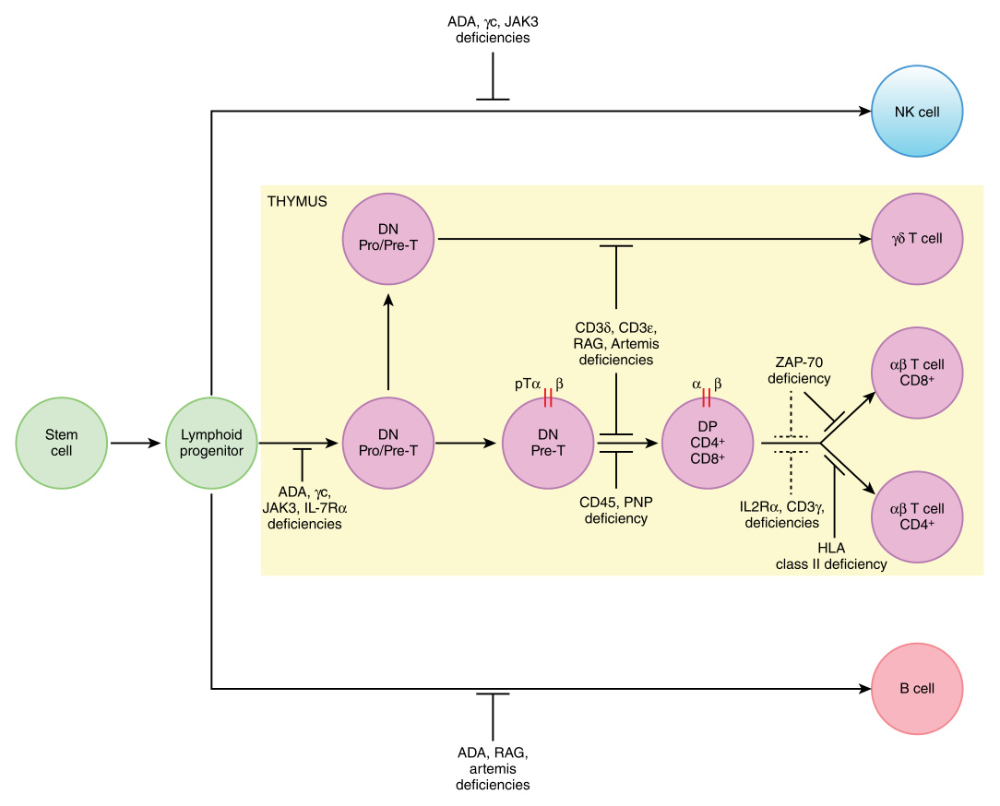
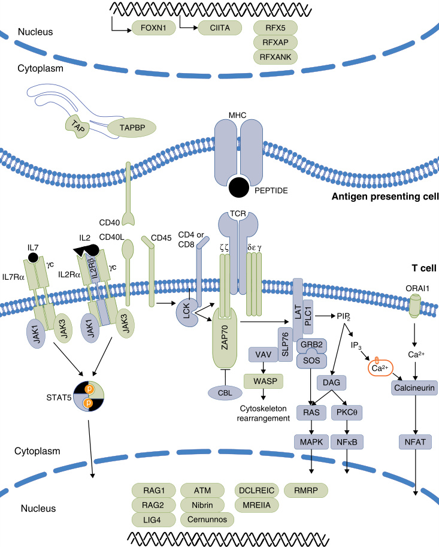
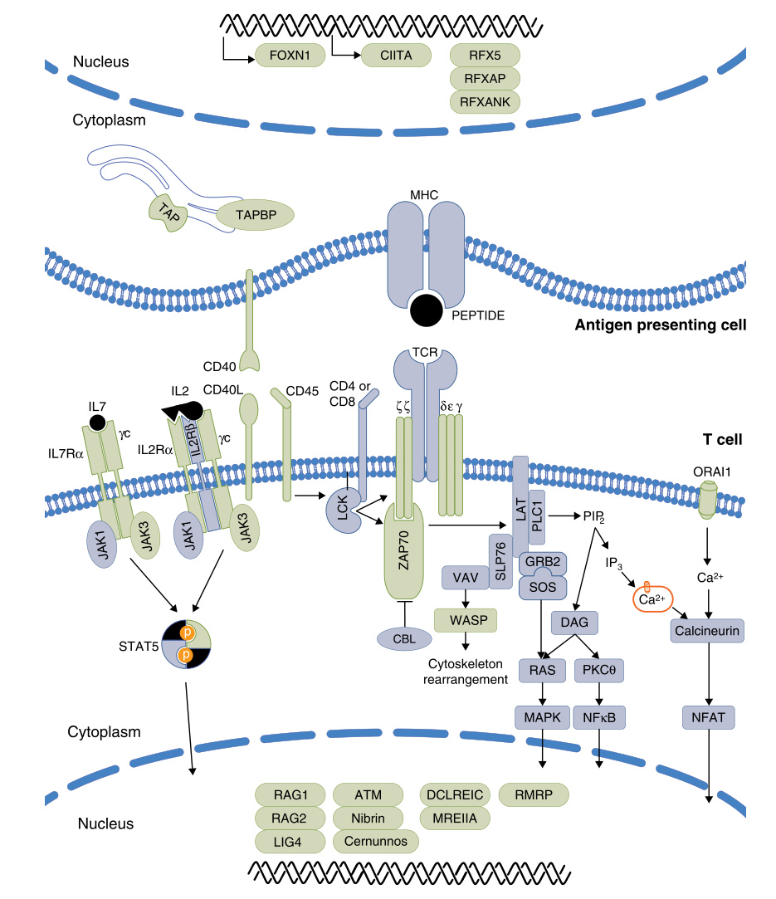

<!-- p.1224 -->

# 54 Primary T Cell Immunodeficiencies 

**CHAIM M. ROIFMAN** 

## **T Cell Immunodeficiencies** 

T cell immunodeficiencies are the most serious of immune deficiencies due to their broad range of infectious susceptibilities and limited treatment options. Their severity can vary significantly as can their age of onset, with severe combined immunodeficiency (SCID) presenting very early with life-threatening infections to later-onset disorders with variable severity of infections. 

One defining characteristic of T cell immunodeficiencies is susceptibility to opportunistic pathogens, including viruses (e.g., CMV), fungal pathogens (e.g., _Candida_ , _Pneumocystis_ ), and parasites (e.g., _Cryptosporidium_ ). Since B cell function depends on T cell function, hypogammaglobulinemia occurs and results in susceptibility to bacterial pathogens. A variety of other features are observed, including autoimmunity and immune dysregulation, depending on the genetic defect (Figs. 53.1 and 53.2). 

## **Severe Combined Immunodeficiency (SCID)** 

Severe combined immunodeficiency (SCID) is the most critical form of immune deficiency which presents during the first year of life with repeated and life-threatening bacterial, fungal, or viral infections, chronic diarrhea, and failure to thrive. SCID is characterized by near complete absence of peripheral T cells and impaired B cell function with or without reduction in B cell numbers. Defects in the differentiation and maturation of thymocytes in the thymus are a primary cause of T cell deficiency (Figs. 53.1 and 54.1). Pathogenic variants affecting T cell activation or downstream signaling molecules can result in SCID or combined immunodeficiency (CID) (Figs. 53.1 and 54.2). 

Immune evaluation typically reveals profound T cell lymphopenia of <500/μL CD3+ T cells. Naïve CD4+ T cells are low and _in vitro_ lymphocyte proliferation responses to mitogens are usually markedly reduced. Engraftment of transplacental maternally derived T cells may be detected, and in some cases autologous and autoreactive T cells may develop and cause pathology (Ommen syndrome). In these cases, the total T cell count may be higher than 500/μL, but 

the naïve T cell numbers are very low. Evaluation of T cell receptor excision circle (TREC) numbers, a marker of naïve T cell development, are low or undetectable and forms the basis of TREC-based newborn screening (NBS) for SCID and other disorders with low T cell numbers (Table 54.1). 

With the advent of NBS for SCID, most of these patients are detected at birth, which has greatly improved outcomes in these patients. Ideally, SCID patients should be placed in protective isolation, provided anti-infective therapies, and offered hematopoietic stem cell transplantation (HSCT) or, in some cases, gene therapy. Diagnosis is made by evaluating lymphocyte subpopulations with certain genetic defects resulting in different patterns of T, B, and NK lymphopenia. Genetic testing is the mainstay of diagnosis, and an essential part of the evaluation of a suspected SCID (Table 54.2). Thymus biopsies can be helpful in isolated cases since abnormal thymus architecture and abnormal Hassall’s corpuscles are specific and sensitive predictors of primary T cell deficiency. This invasive procedure should be restricted to cases where all other diagnostic tools remain inconclusive, where it is imperative to determine if the T cell lymphopenia is due to a thymic defect or an inherent T cell defect, and when life-saving procedures are considered such as stem cell transplantation or thymic transplantation. In vitro thymic development assays are available on a research basis  to help differentiate a T cell intrinsic developmental defect from a thymic defect. 

### **SCID With T Cell Lymphopenia and Normal B Lymphocytes (T**− **B**+ **)** 

Patients with SCID without T cells but with B cells are designated T− B+ SCID (Table 54.3) and represents the most prevalent form of SCID (28–50% of all cases). With NBS the true incidence of SCID is more common than thought and occurs at a frequency of ~1:50,000 live births. 

### **_IL-2Rgc Deficiency_** 

Interleukin-2 receptor gamma (IL-2Rγ) or common gamma chain (γc) deficiency is an X-linked disorder.  Affected males have pathological variants in _IL2RG_ , which forms the coreceptor required for signaling downstream of IL-2,  IL-4,

<!-- p.1225 -->

**Fig. 54.1** Profound T cell deficiency arising from impaired maturation of T lineage cells in the thymus. Lymphoid progenitor cells from the bone marrow enter the thymus where they undergo differentiation and maturation into functional T cells. Naïve thymocytes ( _DN_ , double negative cells) undergo T cell receptor rearrangement, namely β-chain rearrangement and pairing of the β-chain with the pre-TCRα chain, giving rise to cells expressing both CD4 and CD8 ( _DP_ , double positive cells). After positive and negative selection in the cortex, thymocytes downregulate the expression of either CD4 or CD8, resulting in single positive cells. These cells are exported from the thymus to the blood and secondary lymphatic organs, where they encounter antigens and exert their biological functions. Various defects in this process can cause profound T cell deficiencies. Blocked lines indicate specific stages impaired by known genetic abnormalities. Some defects may also interfere with maturation of B and natural killer (NK) cells. _ADA,_ Adenosine deaminase deficiency; _DN,_ double negative; γc, gamma common chain of the interleukin (IL) 2 receptor; _IL2R_ α, alpha chain of the IL2 receptor; _IL7R_ α, alpha chain of the IL7 receptor; _JAK3,_ Janus activated kinase 3; _MHC,_ major histocompatibility complex; _PNP,_ purine nucleoside phosphorylase; _RAG,_ recombination activating genes; _ZAP-70,_ zeta chain associated protein kinase 70. 

IL-7, IL-9, IL-15, and IL-21 receptors. These are involved in regulating the differentiation, growth, and function of T cells, B cells, and NK cells. Deficiency of IL-2Rγ results in an abnormal immune profile with profound defects in T cell and NK cell development, but with normal B cell development. IL-7 is crucial for T cell development in the thymus and IL-15 is important for NK development. 

In the absence of NBS for SCID, patients typically present at 3–6 months of age with failure to thrive and repeated 

bacterial, fungal infections, and viral infections. Respiratory failure can occur due to CMV pneumonitis or _Pneumocystis_ , and a variety of bacterial and opportunistic organisms can affect the gastrointestinal tract resulting in weight loss or poor growth. Extensive candidal infection is common. Infections are fatal in the absence of curative treatment with HSCT. Immune evaluation usually reveals extremely low to absent T and NK cells, while B cells are unaffected (T− B+ NK− ). _In vitro_ lymphocyte responses to mitogens are

<!-- p.1226 -->

- **Fig. 54.2** T cell signaling. T cells are activated following T cell receptor engagement with peptide-major histocompatibility complex (MHC) or following engagement of interleukin (IL) receptors, co-receptors, and calcium channels. Recruitment of additional intracellular molecules trigger changes in gene expression, cytokine secretion, and receptor expression. _ATM,_ Ataxia telangiectasia gene; _CIITA,_ class II MHC transactivator; _CBL,_ casitas B-lineage lymphoma; _CD40L,_ CD40 ligand; _DAG,_ diacylglycerol; _DCLRE1C,_ DNA cross-link repair 1C; γc, gamma common chain of the IL2 receptor; _GRB2,_ growth factor receptorbound protein 2; _IL7,_ interleukin (IL) 7; _IL7R_ α, alpha chain of the IL7 receptor; _JAK,_ Janus activated kinase; _LAT,_ linker for activation of T cells; _LCK,_ lymphocyte-specific protein tyrosine kinase; _LIG4,_ DNA ligase 4; _MAPK,_ mitogen-activated protein kinase; _MHC,_ major histocompatibility complex; _MRE11A,_ MRE11 meiotic recombination 11 homolog A; _NFAT,_ nuclear factor of activated T-cells; _NF_ κB, nuclear factor kappalight-chain-enhancer of activated B cells; _PKC,_ protein kinase C; _PLC1,_ phospholipase C 1; _RAG,_ recombination activating genes; _RAS,_ rat sarcoma; _RMRP,_ RNA component of mitochondrial RNA processing endoribonuclease; _SLP76,_ SH2 domain containing leukocyte protein of 76kDa; _STAT,_ signal-transducer and activator of transcription; _TAP,_ transporter associated with antigen presentation; _TAPBP,_ TAP binding protein; _WASP,_ Wiskott-Aldrich syndrome protein; _ZAP70,_ zeta chain associated protein kinase 70.

<!-- p.1227 -->

#### **TABLE Non-SCID Disorders With Low T Cell Numbers 54.1 Potentially Identified by TREC-Based Newborn Screening** 

##### **Disorder** 

- Combined immunodeficiency, including single-gene and syndromic disorders of T cell development, such as the following: • Ataxia-telangiectasia • Disorders of folate absorption or metabolism • MHC class I and II defects • Nijmegen breakage syndrome 

- Trisomy 21 and other chromosomal aneuploidies 

- Disorders of thymic stromal cell development, such as the following: 

- CHARGE syndrome • DiGeorge syndrome (complete or partial) • Other disorders of thymic stromal cell development (e.g., pathogenic variants in genes such as _FOXN1_ , _FOXI3_ , _TBX1_ , _TBX2_ , _CHD7_ , or _PAX1_ ) 

- Idiopathic T cell lymphopenia Secondary T cell lymphopenia due to: 

   - Advanced _in utero_ HIV infection • Chylous effusions, spontaneous or postsurgery • Gastrointestinal or cardiac malformations • Hydrops • Maternal immunosuppressive medications • Preterm birth, very low birth weight 

From Dvorak CC, Haddad E, Heimall J, et al. The diagnosis of severe combined immunodeficiency (SCID): the primary immune deficiency treatment consortium (PIDTC) 2022 definitions. _J Allergy Clin Immunol_ . 2023;151(2):539-546 (Table II). 

profoundly depressed, TRECs are undetectable, and the thymus appears dysplastic with absence of Hassall’s corpuscles. Cure can be achieved with HSCT, although application of gene therapy has also been successful in select defects. 

Hypomorphic variants in IL-2Rγc may result in an atypical presentation with varying degrees of T cell or NK cell deficiency. Patients with the deleterious R222C variant have been reported with SCID-like presentation, yet with normal numbers of T cells and NK cells, near normal responses to mitogens, normal TREC levels, and structurally normal thymus gland. 

### **_JAK3 Deficiency_** 

Janus kinase-3 (JAK3) deficiency is an autosomal recessive disorder whose presentation closely resembles that of IL-2Rγc deficiency with loss of T and NK cells, but preservation of B cell development. JAK3 is a lymphoid-specific cytosolic tyrosine kinase that signals downstream of IL2Rγc receptor. Upon cytokine binding to receptors that utilize IL-2Rγc, JAK3 is activated and phosphorylates STAT transcription factors which dimerize and translocate to the nucleus to initiate target gene transcription. 

Similar to IL-2Rγc deficiency, patients typically manifest SCID features including viral, bacterial, and fungal infections of the respiratory and gastrointestinal tract, and failure to 

thrive. Milder phenotypes associated with hypomorphic variants in JAK3 have been described that can present as a CID with delayed onset of presentation (e.g., age 6 years), asymptomatic cases, or those with lymphoproliferation despite harboring the same genetic variant. 

### **_CD3/TCR Complex Defects_** 

The CD3/T cell receptor (TCR) complex is essential for antigen recognition and subsequent signal transduction. It consists of a TCR heterodimer, composed of either αβ or γδ chains that recognize peptide fragments bound to MHC molecules, and CD3 dimers which transduce signals needed for downstream T cell activation. Biallelic variants affecting the CD3δ, CD3ε, CD3ζ, and CD3γ can result in a typical SCID phenotype (T− B+ NK+ ) since neither NK cells or B cells require the TCR for survival. 

CD3δ deficiency results in loss of both the αβ and γδ TCR on circulating CD3+ cells due to developmental block at the CD4− CD8− double negative to CD4+ CD8+ double positive stage. The thymus appears normal in size but lacks Hassall’s corpuscles. Complete deficiencies in CD3ε and CD3ζ also result in a lack of circulating T cells. 

Leaky defects in CD3ε or CD3δ are associated with a sizeable number of autologous T cells (T+ B+ NK+ ), with varying presentation from typical SCID to more atypical symptoms. Curative treatment of CD3 deficiencies can be achieved with HSCT. It is critical to have a genetic diagnosis in these cases because there are conditions that affect thymic development, such as 22q11deletion syndrome, which result in a T− B+ NK+ phenotype and are not cured by HSCT (Table 54.1). 

### **_CD45 Deficiency_** 

CD45 deficiency is an extremely rare autosomal recessive form of SCID. CD45 is a transmembrane tyrosine phosphatase encoded by _PTPRC_ which regulates Src tyrosine kinases involved in TCR and BCR signaling. In the absence of functional CD45, thymocytes are prevented from transitioning from CD4+ CD8+ double positive cells to single positive CD4+ or CD8+ mature T cells. B cell signaling is also hypothesized to be affected since patients have had hypogammaglobulinemia. 

Patients present with a SCID phenotype including recurrent infections, failure to thrive, hepatosplenomegaly, and lymphadenopathy, while immune assessment reveals low to absent T cells but preserved or elevated B and NK cells (T− B+ NK+ ). Notably, TCRαβ+ T cells are absent while TCRγδ+ T cell populations are preserved. 

### **_IL-7Ra Deficiency_** 

Interleukin-7 receptor-α (IL-7Rα) deficiency is an autosomal recessive disorder caused by variants in the IL-7Rα chain (encoded by _IL7R_ ). The IL-7Rα chain dimerizes with IL2Rγc to form the IL-7R which is indispensable for normal T cell development. The IL-7R transmits survival and proliferative signals to thymocytes during the earliest stages of cell maturation during the double negative stage. Patients with

<!-- p.1228 -->

###### **TABLE 54.2** 

#### **Genotypes and Associated SCID Subtypes** 

||||SCID Subtype†||
|---|---|---|---|---|
|Genotype|Overall Frequency*|Typical SCID (69% of Total)|Leaky/Atypical SCID (26% of Total)|Omenn Syndrome (5% of Total)|
|_IL2RG_‡|~30%|Most common (42%)§|Common||
|_RAG1_|~17%|Common|Most common (26%)|Most common (79%)|
|_ADA_|~12%|Common|Common||
|_IL7R_|~7%|Common||Very rare|
|_DCLRE1C_|~7%|Common|Rare||
|_JAK3_|~5%|Common|Unusual||
|_RAG2_|~4%|Unusual|Common|Common|
|_RMRP_|<4%|Very rare|Common|Possible|
|_CD3D_|<2%|Unusual|Rare||
|_AK2_|<2%|Unusual||Very rare|
|_PNP_|<1%|Very rare|Rare||
|_MSN_‡|<1%|Very rare|Very rare||
|_LIG4_|<1%||Rare||
|_NHEJ1_|<1%||Rare||
|_BCL11B_‡|<1%||Very rare||
|_MAN2B2_|<1%||Very rare||
|_RAC2_‡|<1%||Very rare||
|_TTC7A_|<1%||Very rare||

*Of all SCIDs, including 7% without identified pathogenic variant(s). Data derived from 346 patients (diagnosed 2010–2021) from the PIDTC 6901 prospective natural history study. 

> †Other rare genotypes that might produce a phenotype overlapping with SCID include _CD3E_ , _CD3Z_ , _CORO1A_ , _DIAPH1_ , _DOCK2_ , _EPG5_ , _EXTL3_ , _FCHO1_ , _ICOSLG_ , _IKBKB_ , _ITPKB_ , _LAT_ , _LCK_ , _LIG1_ , _MYSM1_ , _POLE1_ , _POLE2_ , _PRKDC_ , _SLP76_ , _SMARCAL1_ , _TRAC_ , and _ZAP70_ . 

> ‡ _IL2RG and MSN_ variants are X-linked recessive; _BCL11B_ and _RAC2_ are autosomal-dominant; all others are autosomal-recessive. A hemizygous pathogenic variant in a gene on the X chromosome is required for male patients. A heterozygous variant with dominant function is required for autosomal-dominant genes. Autosomal-recessive genes require 2 compound heterozygous variants or a single homozygous pathogenic variant. Abnormal adenosine deaminase or purine nucleoside phosphorylase enzyme activity is also acceptable. 

§Frequency of genotypes within a particular SCID subtype. Common genotypes are those found in >5% of cases within that subtype; unusual genotypes are those found in 2–5% of cases; rare genotypes are those found in more than 1 patient; very rare genotypes are those seen in only a single patient; possible genotypes have been reported in the literature, but not found among PIDTC 6901 prospective natural history cases. From Dvorak CC, Haddad E, Heimall J, et al. The diagnosis of severe combined immunodeficiency (SCID): the primary immune deficiency treatment consortium (PIDTC) 2022 definitions. _J Allergy Clin Immunol_ . 2023;151(2):539-546 (Table III). 

variants in IL-7Rα present during early infancy with typical features of SCID, regardless of whether expression of the defective IL-7Rα is preserved. Immune evaluation reveals the absence of circulating T cells but normal B and NK cells (T− B+ NK+ ). Cure can be achieved with HSCT. 

### **SCID With T Cell Lymphopenia (T****2** **B****1** **) and Syndromic Features** 

### **_Coronin-1A Deficiency_** 

Coronin-1A is an actin regulatory protein essential for T cell development and homeostasis, including cell polarization, migration, and phagocytosis. Coronin-1A deficiency is 

an autosomal recessive condition with variable presentation. Some may present early in life with typical SCID (T− B+ NK+ ), including oral thrush, recurrent respiratory infections, BCG lymphadenitis, or EBV-associated lymphoproliferation. Others come to attention during late childhood with T+ B+ NK+ CID phenotype with EBV-associated lymphoproliferation. 

Immune evaluation reveals a profound reduction in the number of peripheral T cells, absent naïve T cells, abnormal T cell repertoire, and markedly reduced TREC levels. _In vitro_ lymphocyte proliferation responses in mitogens are reduced. Serum immunoglobulin levels are within normal range but production of specific antibodies in response to

<!-- p.1229 -->

#### **TABLE 54.3 SCID With T Cell Lymphopenia (T**− **B**+ **)** 

|Disease (Immune||Molecular Defect/Presumed|||
|---|---|---|---|---|
|Phenotype)|Inheritance|Pathogenesis|Additional Features|Treatment|
|IL-2Rγ(γc) deficiency (T−B+NK−)|X-linked|Abnormal signaling through IL-2R and other receptors containing IL-2Rγ (γc) (IL-4, IL-7, IL-9, IL-15, IL-21)|None|HSCT|
|CD3δdeficiency (T−B+NK+)|AR|Arrest of thymocytes differentiation at the CD4−CD8−stage|Thymus size may be normal|HSCT|
|CD3εdeficiency (T−B+NK+)|AR|Arrest of thymocytes differentiation at the CD4−CD8−stage; absent γ/δT cells|None|HSCT|
|CD3ζdeficiency (T−B+NK+)|AR|Abnormal signaling|None|HSCT|
|CD45 deficiency (T−B+NK+)|AR|Impaired TCR and BCR signaling|None|HSCT|
|Coronin-1A deficiency (T−B+NK+)|AR|Abnormal T cell egress from thymus and lymph nodes; defect in actin assembly|Normal thymus size; attention deficit disorder; growth retardation|HSCT|
|FOXN1 deficiency (T−B+NK+)|AR|Impaired maturation of thymus and epithelial cells|Alopecia; nail dystrophy|HSCT, thymus transplant|
|IL-7Rαdeficiency (T−B+NK+)|AR|Abnormal IL-7R signaling|None|HSCT|
|JAK3 deficiency (T−B+NK−)|AR|Abnormal signaling downstream of IL-2Rγ(γc)|None|HSCT|

vaccination is impaired. The thymus is usually present. Coronin-1A deficiency has associated syndromic features consisting of growth restriction and cognitive abnormalities. Restoration of immune function can be achieved with HSCT. 

### **_FOXN1 Deficiency_** 

The Forkhead box protein N1 (FOXN1) transcription factor has a critical role in the development of skin and thymic epithelial cells. Crosstalk between the thymic stroma, including cortical and medullary thymic epithelial cells, and thymocytes is needed to guide normal T cell differentiation, maturation, and function. FOXN1 deficiency is transmitted in an autosomal recessive manner and presents with T cell deficiency due to thymic abnormalities. Alopecia affecting the scalp, eyebrows, and eyelashes and nail dystrophy are noted from birth, but can be missed. 

Patients may present at 2 to 4 months with recurrent infections and failure to thrive. T cells may be low or normal with CD4 lymphopenia, and T cell repertoire is restricted. Omenn syndrome can also occur. TREC levels are low and dependent on the T cell count. 

Because FOXN1 deficiency is a thymic defect, thymus transplantation appears successful, with recovery of lymphocyte repertoire and function. Notably, heterozygous 

variants in FOXN1 can present with mild to severe lymphopenia, although T cell subsets recover spontaneously over time. 

### **SCID With T Cell and B Cell Lymphopenia (T**− **B**− **)** 

Some genetic defects that affect T cell development also affect B cells. Both T and B cells utilize genomic rearrangement to generate their antigen receptors, and thus defects that affect DNA rearrangement and DNA repair can present with loss of T and B cells. Up to 30% of all SCID cases lack both circulating T cells and B cells ( Table 54.4, Fig. 53.1). 

### **_RAG1/2 Deficiency_** 

The recombination-activating genes _RAG1_ and _RAG2_ encode proteins that are critical for initiating V(D)J recombination. V(D)J rearrangement is a process where small segments of genomic DNA, named variable (V), diversity (D) and joining (J) segments, are randomly rearranged to generate the T cell (i.e., TCR) and B cell (i.e., immunoglobulin) antigen receptors. RAG1 and RAG2 are required to start the process of V(D)J rearrangement and defective production of antigen receptors. Proper generation of B and T cell receptors are critical for survival of these lineages, as well as

<!-- p.1230 -->

**TABLE 54.4 SCID With T and B Cell Lymphopenia (T**− **B**− **)** 

|Disease (Immune||Molecular Defect/|||
|---|---|---|---|---|
|Phenotype)|Inheritance|Presumed Pathogenesis|Additional Features|Treatment|
|Adenosine deaminase deficiency (T−B−NK−)|AR|Accumulation of toxic purine nucleosides|Neurological, hepatic, renal, lung, skeletal and bone marrow abnormalities|HSCT, PEG- ADA, Gene therapy|
|Artemis deficiency (T−B−NK+)|AR|Defective V(D)J recombination, Radiation sensitivity; DCLRE1C gene defects|None|HSCT|
|Cernunnos deficiency (T−B−NK+)|AR|Defective V(D)J recombination, Radiation sensitivity|Growth delay; microcephaly; bird-like facies; bone defects|HSCT|
|DNA Ligase IV deficiency (T−B−NK+)|AR|Defective V(D)J recombination, Radiation sensitivity|Growth delay; microcephaly; bone marrow abnormalities; lymphoid malignancies|HSCT|
|DNA-PK deficiency (T−B−NK+)|AR|Defective V(D)J  recombination|None|HSCT|
|RAG1/2 deficiency (T−B−NK+)|AR|Defective V(D)J  recombination|None|HSCT|

clonal expansion. Null variants in _RAG1_ and _RAG2_ result in loss of T and B cell receptor formation, leading to a SCID phenotype in infancy. This condition is inherited in an  autosomal recessive manner. 

Immune evaluation reveals marked reduction in circulating T and B cells in those with complete loss of RAG  protein and TREC levels typically absent. Immunoglobulin titers and specific antibodies are also low. Curative treatment can be achieved with HSCT, and gene therapy is currently being investigated as an alternative option to HSCT. 

Hypomorphic variants in _RAG1/2_ can be associated with **Omenn syndrome** . Omenn syndrome is an inflammatory condition associated with a “leaky SCID” phenotype where inefficient T and B cell receptor rearrangement occurs, but with a tendency to expand autoreactive lymphocytes.  Although most commonly associated with hypomorphic variants in _RAG1/2_ , other defects including _DCLRE1C, LIG4, RMRP, ZAP70, IL2RG, IL7R_ , _CD3D_ , and _ADA_ have all been associated with Omenn  syndrome (Table 54.5). 

In addition to increased susceptibility to infections, chronic diarrhea, and failure to thrive, patients usually present with erythroderma and desquamation, and may be accompanied by alopecia, lymphadenopathy and hepatosplenomegaly. The hallmarks of laboratory findings are elevated serum IgE levels and eosinophilia. T cell number may be normal or even elevated, yet development is severely restricted as demonstrated by a skewed T cell receptor repertoire. B cells are very low/absent, with low IgG, IgA, and IgM. Skin biopsies may reveal acanthosis and parakeratosis. 

Omenn syndrome is fatal if left untreated and thus Omenn syndrome should be considered in any infant who fails the TREC screen with an inflammatory skin disorder because they need immune suppression to survive. Corticosteroids and cyclosporine A are effective in controlling inflammation, improving skin lesions, and reducing lymphadenopathy and hepatosplenomegaly. However, a cure can only be achieved with HSCT. 

Other _RAG1/2_ phenotypes have been reported in patients with hypomorphic variants in these genes, including moderate CD4 lymphopenia, hypogammaglobulinemia, autoimmunity, EBV-associated lymphoproliferation, or noninfectious granulomas of the skin, bones, lymphoid tissues, and respiratory system. 

### **_Artemis Deficiency_** 

The endonuclease Artemis is encoded by the DNA CrossLink Repair 1C _(DCLRE1C)_ gene and is an essential part of the V(D)J recombination and non-homologous endjoining (NHEJ) pathway in which diverse antigen receptors are formed. Artemis opens the RAG-generated hairpins and is critical for the repair of genomic lesions and genomic stability. 

Artemis deficiency is transmitted in an autosomal recessive manner and is one of the most common forms of radiosensitive SCID (T− B− NK+ ). Affected patients may present with a typical SCID phenotype although hypomorphic variants can present with Omenn syndrome and EBVassociated lymphoma has also been reported. HSCT is the only curative treatment for this condition. Due to the genomic instability, patients may be sensitive to ionizing

<!-- p.1231 -->

|**TABLE** **54.5**|
|---|

#### **T Cell Immunodeficiency With Autologous T Cells Associated With Omenn Syndrome** 

|Gene Defect|Immune Phenotype|Additional Features|
|---|---|---|
|22q11.2 microdeletion|T+B+NK+|DiGeorge syndrome|
|IL-2Rγc|T+B+NK−|None|
|Adenosine deaminase|T+B−/+NK−/+|Multisystem involvement|
|Artemis|T+B−NK+|Irradiation sensitivity|
|CD3δ|T+B+NK+|None|
|DNA ligase IV|T+B−NK+|Irradiation sensitivity, microcephaly|
|IL-7Rα|T+B+NK+|None|
|RAG1|T+B−NK+|None|
|RAG2|T+B−NK+|None|
|RMRP|T+B+NK−|Short stature, metaphyseal dysplasia|
|ZAP-70|T+B+NK+|None|
|T+ = >500 CD3+cells/μL.|||

radiation and therefore reduced intensity conditioning is recommended. 

### **SCID With T and B Cell Lymphopenia (T****2** **B****2** **) and Syndromic Features** 

#### **_Adenosine Deaminase Deficiency_** 

Adenosine deaminase (ADA) is a key enzyme that supports the degradation and salvage of purine pathway metabolites and is involved in multiple processes including energy transfer and DNA metabolism. ADA deficiency is caused by deleterious variants in _ADA_ and is an autosomal recessive metabolic disorder. The toxic accumulation of undegraded metabolites, such as deoxyadenosine, causes damage to various tissues and cells of the immune system in a lineagespecific and time-dependent manner. 

Patients with ADA deficiency typically have SCID features (T− B− or T− B+ phenotype) and tend to lack NK cells. Omenn syndrome can occur, while patients with _partial deficiencies_ can present with CID, autoimmunity, and susceptibility to malignancy. Other associated features include developmental delay, bone defects, as well as liver, lung, and kidney anomalies. Gene variants that preserve some ADA activity may result in a delayed onset of symptoms. 

Biochemical testing reveals near absence (<1%) of ADA enzyme activity and increased accumulation of purine metabolites in blood or urine. Diagnosis can also be achieved and confirmed with molecular genetic testing. Polyethylene glycol-conjugated ADA (PEG-ADA) treatment may provide short-lived detoxification with varying degrees of immune recovery. HSCT remains the treatment of choice, although gene therapy is becoming the standard of care if a full HLA-matched related donor is not available. 

### **_AK2 Deficiency (Reticular Dysgenesis)_** 

Mitochondrial adenylate kinase-2 (AK2) regulates mitochondrial ATP production and is needed for hematopoietic stem cell differentiation and proliferation. Defects in AK2 cause impaired mitochondrial energy metabolism, leading to apoptosis of lymphoid and myeloid precursors. AK2 deficiency, also known as reticular dysgenesis, is transmitted in a recessive manner and causes profound lymphopenia, absence of most myeloid cells, and bone marrow failure. Patients have recurrent bacterial, viral, and fungal infections and have bilateral sensorineural hearing loss. They typically present early in life and immune evaluation reveals profound neutropenia, lymphopenia, and low/undetectable TREC levels. Imaging studies show a small and dystrophic thymus. The only cure is HSCT. 

### **_Cernunnos Deficiency_** 

Cernunnos, encoded by _NHEJ1_ , is an essential component of the non-homologous end joining (NHEJ) pathway and forms a complex with DNA ligase II and XRCC4 to repair double strand brakes. Cernunnos deficiency is associated with radiosensitivity, and patients present early in life with typical SCID phenotype. Additional features include microcephaly, developmental delay, urogenital and bone malformations, and facial dysmorphism. Immune evaluation reveals profound T cell lymphopenia and progressive decrease in B cells (T− B− SCID). 

### **_DNA-PKcs Deficiency_** 

DNA-dependent protein kinase catalytic subunit (DNAPKcs), encoded by _PRKDC_ , is a critical component to the NHEJ pathway and is obligatory for correct V(D)J recombination. The serine/threonine kinase takes part in the formation of coding and signal joints.

<!-- p.1232 -->

DNA-PKcs deficiency is a rare autosomal recessive condition and, similar to Artemis deficiency, patients are sensitive to ionizing radiation. Those affected present with a typical SCID phenotype with almost absent T cells and B cells but normal NK cells. Severe neurological abnormalities have been reported. Cure may be achieved with HSCT, although caution must be taken due to the underlying  defect in DNA repair. 

### **_DNA Ligase IV Deficiency_** 

DNA ligase IV, encoded by _LIG4_ , is part of the NHEJ complex, and participates in the repair of DNA double strand breaks during V(D)J recombination. DNA ligase IV deficiency is an autosomal recessive condition with a broad phenotypic presentation ranging from intact immunity to typical SCID. Common features include facial dysmorphology, severe microcephaly, and a spectrum of developmental delay. Affected patients have sensitivity to ionizing radiation. Hypomorphic variants may lead to EBVassociated lymphoproliferation and T cell leukemia. 

The condition may be difficult to diagnose, with immune evaluation revealing low to absent T cells and B cells 

during infancy, or in cases of delayed onset in the second decade, lymphopenia and hypogammaglobulinemia. Pancytopenia also occurs. Cases of HSCT in these patients have been associated with toxicity due to conditioning regimens as well as graft-versus-host disease. 

## **Combined Immunodeficiencies** 

These represent a large, heterogeneous group of disorders with T cell defects and are differentiated from SCID by the presence of >300–500/μL autologous naive CD3+ T cells. Many CID patients may present with signs and symptoms indistinguishable from SCID with susceptibility to a variety of opportunistic organisms, while others can have milder infectious susceptibilities with later onset (Table 54.6, Fig. 53.1). A variety of other clinical manifestations can occur, such as autoimmunity, EBV-driven lymphoproliferation, and lymphoid malignancy. Some of these defects are associated with syndromic findings affecting other organ systems (Fig. 53.2). 

Laboratory values are also highly variable, but generally reflect T cell dysfunction. T cell numbers can be depressed 

**TABLE 54.6 Combined Immunodeficiencies** 

|Disease|Inheritance|Molecular Defect/Presumed Pathogenesis|Features|Treatment|
|---|---|---|---|---|
|CD40/CD40L|AR/XL|Impaired T cell activation of B cells and phagocytes|Opportunistic infections|HSCT|
|CARD11|AD|Abnormal signaling upstream of NFκB pathway|Severe atopy; autoimmunity; infections|Supportive|
|CARD11/BCL10/MALT1|AR|Abnormal signaling upstream of NFκB pathway|Opportunistic infections|HSCT|
|CD3γdeficiency|AR|Arrest of thymocyte differentiation at the CD4−CD8−stage|Thymus size may be normal|HSCT|
|DOCK2 deficiency|AR|Impaired T cell homing|Viral and bacterial infections|HSCT|
|MHC Class I deficiency|AR|Impaired expression of HLA Class I molecules|Respiratory infections; skin granulomatous lesions|Supportive|
|MHC Class II deficiency|AR|Absence of HLA Class II molecules|Recurrent infections; gastrointestinal manifestations; hepatic abnormalities|Supportive|
|ORAI-1, STIM-1||Impaired Ca2+fluxes|Autoimmunity; ectodermal dysplasia|HSCT|
|TTC7A deficiency|AR|TTC7A gene defects; impaired regulation of transcription, cell cycle, protein degradation and trafficking|Intestinal atresia|HSCT|
|ZAP-70 deficiency|AR|Abnormal T cell receptor signaling|Normal thymus size; increased corticomedullary ratio|HSCT|
|IKK2 deficiency|AR|Disruption of NFκB pathway|Recurrent fungal and viral infections; failure to thrive|HSCT|
|RelB|AR|Disruption of NFκB non-canonical pathway|Failure to thrive; autoimmunity|HSCT|
|STK4 deficiency|AR|Abnormal apoptosis|EBV lymphoproliferation|HSCT|

<!-- p.1233 -->

or normal, mitogen responses can be depressed or normal, and antibody responses can be similarly variable. T cell receptor repertoire and T cell subsets (T regulatory and memory cells) are frequently abnormal, but these are rarely diagnostic. The types of infections are important and can be informative, but given the vast number of these disorders, their variable presentation and severity, and the lack of clinically available diagnostic tests available, genetic testing with extensive genetic panels is often necessary for diagnosis. 

### **_Hyper-IgM Syndrome_** 

X-linked and autosomal hyper-IgM syndromes are CIDs with deficient T cell function due to defects in CD40 ligand (X-linked) and CD40 (autosomal recessive) (Table 54.6). This nomenclature is somewhat misleading because it implies a primary antibody deficiency, but it is more accurately a CID. CD40L on T cells binds CD40 on B cells and phagocytes and thus affects humoral and cellmediated immunity. Hyper-IgM syndrome is characterized by a failure of Ig isotype switching from IgM and IgD to IgG, IgA, or IgE. In addition, there is a lack of affinity maturation and memory responses. CD40/CD40L deficiency is also characterized by opportunistic infections. Affected patients have very low or absent IgG, IgA, and IgE levels; IgM levels are typically elevated but can be normal. CD40 ligation results in activation of nuclear factor κB (NF-κB) and two enzymes critical to class switching and affinity maturation, activation-induced cytidine deaminase (AID) and uracil-DNA glycosylase (UNG). AID or UNG deficiencies lead to a similar pattern in serum immunoglobulins but without a cellular immune defect, and present as an antibody deficiency without susceptibility to opportunistic infections. Activation of CD40 on B cells and antigen presenting cells leads to upregulation of  costimulatory molecules important for promoting T cell activation, and activation of CD40 on phagocytes results in effective activation and clearance of opportunistic organisms. 

Patients with hyper-IgM syndrome present with infections similar to other antibody deficiencies with increased susceptibility to sinopulmonary infections with encapsulated bacteria. In addition, patients with defects in CD40 ligand or CD40 are susceptible to opportunistic infections particularly _Pneumocystis jirovecii_ and _Cryptosporidium parvum_ . 

### **_CARD11/BCL10/MALT1 (CBM) Complex Deficiencies_** 

CARD11/BCL10/MALT1 (CBM) deficiencies are caused by variants in signaling molecules upstream of the NF-κB pathway and are transmitted in an autosomal recessive manner. The CBM complex is essential for activation of NF-κB during innate and adaptive immune responses. Stimulation of T and B cell receptors trigger phosphorylation of caspase recruitment domain family member 11 (CARD11), resulting in association with BCL10-MALT1 and formation of the CARD11-BCL10-MALT1(CBM) 

complex. The CBM complex then activates the NEMOIκB kinase (IKK) complex, inducing phosphorylation of IκB and release of NF-κB where it translocates into the nucleus and functions as a transcription factor to control a host of cellular processes including cell proliferation, differentiation, and survival. 

Some patients with CARD11 deficiency may present early in life with a SCID phenotype, and experience gingivitis and aphthous ulcers. In contrast, MALT1-deficient patients present during childhood with severe enterocolitis and recurrent lung infections. Immune evaluation in CARD11 deficiency reveals normal numbers of circulating T cells, B cells, and NK cells, but Tregs are absent. _In vitro_ lymphocyte responses to mitogens are depressed though not absent, while TREC levels and T cell receptor repertoire are normal. Patients have hypogammaglobulinemia due to B cells being immature. Defects in MALT1 result in a similar clinical presentation except for poor specific antibody  production despite normal immunoglobulin levels. Curative treatment can be achieved with HSCT. Although typically autosomal recessive, autosomal dominant CARD11 deficiency can occur due to dominant negative monoallelic variants and results in CID, severe atopy, and autoimmunity. 

### **_CD3g Deficiency_** 

CD3γ deficiency is caused by variants in the CD3γ chain of the CD3/TCR complex and is transmitted in an autosomal recessive manner. Affected patients can present with a SCID phenotype or with delayed atypical features consisting of infections or autoimmunity. This heterogeneous range of manifestations has been reported in Turkish and Spanish kindreds. 

Immune evaluation reveals reduced CD3/TCR expression and mild T cell lymphopenia. _In vitro_ lymphocyte responses of mitogens are depressed and TREC levels may be reduced. While some patients present as typical SCID or with severe colitis, other family members with an identical CD3γ variant remain well even into adulthood. 

### **_ZAP-70 Deficiency_** 

Zeta-associated protein-70 (ZAP-70) is a protein tyrosine kinase that phosphorylates a variety of molecules downstream of CD3ζ, part of the CD3/TCR complex, leading to T cell maturation and proliferation. ZAP-70 deficiency is transmitted in an autosomal recessive manner. Affected patients usually present within the first two years of life with recurrent severe microbial infections indistinguishable from SCID. Yet, patients have palpable lymph nodes, visible tonsils, and a normal thymus on imaging. Very rarely, patients may have autoimmune manifestations, or present with Omenn syndrome, hemophagocytic lymphohistiocytosis (HLH), subcutaneous nodules, or lymphoma. 

Evaluation of the immune system reveals normal numbers of circulating CD4+ cells but marked CD8+ lymphopenia. _In vitro_ lymphocyte responses to mitogens are low, while T cell receptor repertoire appears normal. Thymic

<!-- p.1234 -->

evaluation reveals a fully developed gland with normal architecture and normal corticomedullary distinction, including the presence of Hassall’s corpuscles. B cell number and immunoglobulin levels are normal. Some patients may have NK cells may be reduced in some patients. Curative treatment can be achieved with allogeneic HSCT. 

### **_DOCK2 Deficiency_** 

Dedicator of cytokinesis 2 (DOCK2) deficiency is a CID with an autosomal recessive  pattern of inheritance. DOCK2 regulates cytoskeletal reorganization through activation of the small G protein Rac, and is required for lymphocyte adhesion, migration, and homing to lymphoid tissues. It is expressed predominately in immune cells and plays further roles in T and B cell activation, as well as plasma cell differentiation. 

Affected patients suffer severe invasive bacterial and viral infections during early childhood. Immune evaluation reveals T cell lymphopenia and reduced _in vitro_ lymphocyte responses to mitogens, reduced circulating B cells, defective NK cell activity, and antibody deficiency. Although experience remains limited, HSCT may be curative. 

### **_MHC Class I Deficiency_** 

MHC class I deficiency is a rare autosomal recessive disorder characterized by partial or decreased expression of MHC class I (or human leukocyte antigen, HLA, class I) molecules which are involved in presentation of intracellular antigen peptides to CD8+ T cells. The deficiency arises from variants in TAP1 or TAP2, endoplasmic ATP-binding transporters that are essential for supplying endogenous peptides to MHC class I molecules, leading to instability and loss of MHC class I molecule surface expression. Pathogenic variants in the genes encoding tapasin and β2 microglobulin, involved in antigen and MHC class I molecule processing, result in a similar deficiency. 

Patients typically present during childhood or later in life with lung infections, skin granulomatous lesions, and hearing loss. Immune evaluation reveals low CD8+ cells and reduced NK cell activity. Immunophenotyping reveals decreased MHC class I expression and can be confirmed by genetic analysis. Treatment for MHC class I deficiency remains supportive in nature. 

### **_MHC Class II Deficiency (Bare Lymphocyte Syndrome)_** 

MHC class II deficiency is a rare immunodeficiency caused by variants in regulatory factors that are critical for controlling transcription of MHC class II genes, including class II transactivator (CTIIA) and three proteins that comprise the regulatory factor X (RFXANK, RFX5, RFXAP). MHC class II molecules present peptides to CD4 T cells and are obligatory for their development. MHC class II is expressed on thymic epithelial cells, antigen presenting cells, and activated lymphocytes. Immune evaluation typically reveals mildly low to normal lymphocyte counts but with significant CD4 lymphocytopenia with a low CD4 to CD8 ratio. 

_In vitro_ lymphocyte responses to mitogens are generally normal, and TREC levels can be within normal ranges. Autoimmune cytopenias are common. 

The spectrum of manifestations varies widely from those who present with typical SCID features, including oral thrush, _Pneumocystis jirovecii_ pneumonia, and failure to thrive, to others who experience a milder clinical course. Infectious complications including chronic enterocolitis and sclerosing cholangitis; chronic viral infections are frequently reported. Meningoencephalitis associated with enteroviruses, herpes simplex, or adenoviruses have also been described. 

A diagnosis was historically made showing the absence of MHC class II expression on antigen presenting cells using flow cytometry-based methods, though currently genetic analysis is sufficient to confirm the presence of a pathogenic variant. 

The prognosis for this disorder is poor. Affected patients usually succumb to infections or infection-related organ damage within the first or second decade of life. HSCT is offered, but is associated with high rates of engraftment failures, severe GvHD, and poor immune reconstitution, likely because transplantation does not correct the lack of MHC class II expression on thymic epithelial cells. Supportive treatment consists of antibiotics and immunoglobulin replacement. 

### **Combined Immunodeficiency With SCID Phenotype and Syndromic Features** 

#### **_Calcium Channel Defects (ORAI-1, STIM-1 Deficiencies)_** 

Defects in the calcium channels, ORAI-1 and STIM-1, are autosomal recessive inherited conditions that prevent the influx of calcium and lead to impaired lymphocyte activation. While ORAI-1 is a transmembrane protein which at tetramer configuration constitutes the poreforming structure of a Ca2+ channel, STIM-1 is a calcium sensor of the endoplasmic reticulum and controls calcium entry. Both Ca2+ influx into the cell as well as release from cytosolic stores are triggered by T and B cell receptor stimulation and are essential for downstream signaling. 

Patients may present during infancy with a SCID phenotype. Patients with STIM1 deficiency may also have autoimmune and lymphoproliferative manifestations. Severe eczema and syndromic features, including nail dysplasia and anhydrosis, ectodermal dysplasia, and generalized myopathy, have been reported in both ORAI-1 and STIM-1 deficiency. 

Evaluation of the immune system reveals normal to elevated lymphocyte numbers and TREC levels, while _in vitro_ lymphocyte responses to mitogens are depressed. Immunoglobulin levels are normal, but specific antibody levels can be variable. T cell receptor-mediated cytosolic rise in Ca2+ is low. HSCT can be effective in reversing immune dysfunction but not the syndromic features including the ectodermal dysplasia and myopathy.

<!-- p.1235 -->

### **_TTC7A Deficiency (MIA Syndrome)_** 

Tetratricopeptide repeat domain 7A (TTC7A) deficiency, also known as **multiple intestinal atresia (MIA) syndrome** , is an autosomal recessive condition that causes multiple obstructions in the bowel, intestinal inflammation, and diarrhea. In some cases, intestinal atresia is _absent_ , but patients suffer severe colitis with characteristic features of mucosal atrophy and massive enterocyte apoptosis. Severe lung disease and pulmonary calcifications have also been reported. Immune dysfunction is commonly reported in affected patients and usually severe. Patients may present with a SCID phenotype, albeit with heterogeneous T cell numbers. 

TTC7A encodes a protein containing nine tetratricopeptide repeat (TPR) domains. These motifs serve as scaffolding proteins and are involved in multiple cellular processes including as transcription, cell cycle, protein degradation, and trafficking. 

Immune evaluation reveals T cell lymphopenia and markedly depressed _in vitro_ lymphocyte responses to mitogens. T cell receptor repertoire is restricted and TRECs are low. The thymus appears dysplastic with poor corticomedullary demarcation and poorly developed Hassall’s  corpuscles. 

The prognosis of this condition is poor. While HSCT can correct the hematopoietic system, the complex and fatal gastrointestinal manifestations remain. A combined intestinal and bone marrow transplant could be attempted. 

### **_RelB Deficiency_** 

RelB deficiency is inherited in an autosomal recessive manner, and is caused by variants in _RELB_ , a key component of the NF-κB pathway. The NF-κB signaling pathway, which is used by lymphocyte antigen receptors, various cytokines, and infectious agents, consists of five members: RelA, RelB, c-Rel, and the precursor proteins NFκB1 (p105) and NFκB2 (p100), which are processed into the active forms p50 and p52. 

Patients with this type of deficiency present with failure to thrive during the first year of life, recurrent infections, and autoimmune disorders. Immune evaluation reveals depressed _in vitro_ lymphocyte responses to mitogens, a restricted T cell receptor repertoire, abnormal TREC levels, and impaired antibody production in response to vaccination. The thymus is moderately dysplastic, and both memory T and B cells are reduced or absent. HSCT has been successful patients who received the procedure. 

### **_STK4 (MST1) Deficiency_** 

This condition is an autosomal recessive disorder characterized by a _progressive_ decline in T cells and T cell function and is due to underlying biallelic variants in serine threonine kinase 4 (STK4). Studies in STK4-null mice reveal increased apoptosis leading to lymphopenia in T and B cells, along with thymic gland depletion. 

Patients usually present with oral thrush, mucocutaneous candidiasis, recurrent bacterial and viral lung infections, and B cell lymphoproliferation due to EBV. Dermatological manifestations can be seen in the form of widespread warts and molluscum contagiosum. Immune evaluation shows a 

progressive decline in T and B cells, alterations in T cell receptor repertoire, elevated serum immunoglobulins (including IgE), and the presence of autoantibodies. Autoimmune cytopenias are also observed. HSCT is the preferred treatment option. 

### **Combined Immunodeficiency With Immune Dysregulation** 

CIDs characterized by immune dysregulation, including autoimmune and lymphoproliferative complications, are summarized in Table 54.7. 

### **_Combined Immunodeficiency With EBVLymphoproliferation_** 

Epstein-Barr virus (EBV)-induced chronic infection and lymphoproliferation are features of several inherited immunodeficiencies, with inheritance patterns ranging from X- linked to autosomal recessive depending on the affected gene. 

**X-linked lymphoproliferative syndromes** , XLP-1 and XLP-2, result from variants in _SH2DIA_ and _BIRC4_ , respectively, and occur in an X-linked manner. _SH2D1A_ encodes SLAM associated protein (SAP) and _BIRC4_ encodes the X-linked inhibitor of apoptosis (XIAP). Patients affected by these syndromes frequently manifest severe EBV infections, which can progress to liver necrosis, aplastic anemia, or malignant lymphoma. Some may also experience hypogammaglobulinemia, antibody deficiency, or develop hemophagocytic lymphohistiocytosis. Chronic colitis is a common feature of XLP-2. Lymphocyte counts and responses to mitogens are generally normal, although NK cell function may be impaired. HSCT represents a potential cure for these conditions by reversing susceptibility to EBV. 

Hemizygous variants in the magnesium transporter 1 (MAGT1) gene result in reduced TCR-mediated influx of Mg2+ and Ca2+ into T cells, leading to abnormal downstream activity of transcription factors. CD4+ T cell counts are reduced, while total CD3+ cells, B cells, and NK cell numbers remain normal in affected patients. EBV-related infections or lymphoma can manifest at any age. 

Patients with biallelic variants in cytidine 5′ triphosphate (CTP) synthase present with a similar clinical profile. CTP is essential for RNA and DNA metabolism. Patients present with variable  circulating lymphocyte counts, while immunoglobulin levels are generally within normal range. Most patients demonstrate normal responses to mitogens. Additionally, some individuals may develop bacterial infections and chronic EBV viremia, with occasional success observed following HSCT. 

Biallelic variants in the IL-2 inducible T cell kinase (ITK) gene can also lead to EBV-induced lymphoid proliferation and lymphoma. 

### **_IKK2 Deficiency_** 

IKK2 deficiency is an autosomal recessive condition resulting from variants in _IKBKB_ that impair the nuclear factor κB (NF-κB) pathway.

<!-- p.1236 -->

|**TABLE** **54.7**|
|---|

### **Combined Immunodeficiency With Immune Dysregulation** 

|Disease|Inheritance|Molecular Defect/ Presumed Pathogenesis|Features|Treatment|
|---|---|---|---|---|
|Ataxia telangiectasia|AR|Impaired DNA repair and cell cycle regulation|Cerebellar ataxia; telangiectases; predisposition to malignancy; radiosensitivity|Supportive|
|DiGeorge syndrome|AD|Deletion in chromosome 22q11.2 resulting in impaired TBX1 transcription factor, affecting developmental processes|Ommen syndrome; TDA; autoimmunity; cardiac defects; hypocalcemia; dysmorphism; cleft palate; short stature; neuropsychiatric problems|Supportive|
|DOCK8 deficiency|AR|Disruption in cell adhesion and migration|Recurrent infections; atopy; early-onset malignancy; autoimmunity|HSCT|
|Folate receptor defects (SLC19A1, SLC46A1)|AR|Impaired folate uptake affecting thymidine synthesis and DNA stability|Revere recurrent infections; neurological and hematological disorders; megaloblastic anemia; gastroenteropathy;|Folic acid supplementation|
|FOXP3 deficiency|X-linked|Impaired Treg development|Autoimmunity; impaired barrier function in skin and gut; enteropathy|HSCT|
|IL-2Rα/CD25 deficiency|AR|Impaired T cell  differentiation|Recurrent infections; autoimmunity|HSCT|
|IL-6R deficiency|AR|Impaired JAK–STAT and Ras mitogen-activated protein kinase pathways|Recurrent sinopulmonary and deep skin infections; atopy; impaired inflammatory responses during infection|Supportive|
|MAGT1/CTPS1/ SH2DIA/BIRC 4|X-linked, AR|Variable depending on associated defect|EBV lymphoproliferation|HSCT|
|Nijmegen breakage syndrome|AR|Impaired DNA repair and cell cycle regulation|Microcephaly; growth retardation; predisposition to malignancy; radiosensitivity|Supportive|
|PNP deficiency|AR|Abnormal purine metabolism|Recurrent infections; autoimmunity, neurological abnormalities|HSCT|
|RHOH deficiency|AR|Defective Rho GTPase expression resulting in impaired TCR signaling|HPV infections|HSCT|
|Pre-TCRαdeficiency|AR|Impaired αβT cell lineage development|Lymphoproliferation; autoimmunity|Supportive|
|Wiskott-Aldrich syndrome|X-linked recessive|Impaired actin cytoskeleton rearrangement and immunological synapse formation|Eczema; autoimmunity; malignancy|HSCT|

The NF-κB pathway is critical for regulating immune responses, cell activation, growth, and survival. The canonical pathway involves the NF-κB essential modulator (IKKγ, or NEMO), IKK1 (IKKα), and IKK2 (IKKβ). When the complex is activated, IKK2 phosphorylates inhibitors of NF-κB, leading to their degradation and allowing NF-κB to translocate to the nucleus and bind to DNA. 

Patients with IKK2 deficiency typically present with oral thrush, pulmonary infections, and invasive bacterial infections. Evaluation of the immune system reveals normal circulating T cells, although NK cell numbers are reduced. Responses to mitogens are variable, TREC levels are within normal range, and the T cell receptor repertoire remains intact. Notably, the B cell compartment shows an absence of memory B cells (T+ B+ NK− ).

<!-- p.1237 -->

HSCT is a potential treatment option, but outcomes have been limited and variable. Similar to other NF-κB pathway disorders, engraftment may be incomplete. 

## **_DOCK8 Deficiency_** 

Dedicator of cytokinesis 8 (DOCK8) deficiency is an autosomal recessive CID accompanied by severe atopy. DOCK8 interacts with Rho GTPases, crucially influencing cytoskeletal rearrangement and thereby impacting cell adhesion and motility. Affected individuals experience recurrent respiratory infections and, sometimes, invasive bacterial and fungal infections. They commonly exhibit severe eczema and may develop extensive warts and molluscum contagiosum. Additionally, food allergies, asthma, and episodes of anaphylaxis are common. 

Immune evaluation reveals variability in T cell and B cell numbers, often accompanied by elevated eosinophil counts. Lymphocyte proliferation responses to mitogens are generally normal. While IgG levels are elevated, other serum immunoglobulin levels and specific antibodies can vary. Elevated levels of IgE have been reported. Management of DOCK8 deficiency focuses on addressing the  diverse atopic and infectious complications; HSCT has been effective. 

## **_IL-2Ra (CD25) Deficiency_** 

IL-2 receptor α (IL-2Rα or CD25) deficiency is an autosomal recessive immune dysregulation disorder. Biallelic variants in the CD25 gene lead to CID (T+ B+ NK+ ). The IL-2 receptor needs the γ chain (γc), β chain (CD122), and α chain (CD25) to function with high affinity. The β and γ chains are always present on T cells, but the presence of the α chain is confined to early thymocytes, regulatory T cells, and activated T cells. The lack of a functional highaffinity receptor leads to defective T cell differentiation and activation, loss of central and  peripheral tolerance, and an inadequate response to  infections. This immune deficiency has features of Foxp3 deficiency and immune polyendocrinopathy enteropathy X-linked (IPEX) but with more infectious susceptibility.  IPEX is covered in Chapter 59. 

Infants affected by this deficiency often present with recurrent bacterial and viral infections, lymphadenopathy, hepatosplenomegaly, various autoimmune symptoms, and eczematous skin lesions. Some may also show signs of diabetes mellitus soon after birth and develop severe chronic lung disease or pulmonary bleeding. Autoimmune lymphocytic infiltrates can be detected in tissues such as the lungs, liver, gut, and bones. These patients may also suffer from autoimmune disorders like primary cirrhosis, colitis, thyroiditis, or insulin-dependent diabetes mellitus. 

Reduced number of circulating T cells with normal B cell counts occurs, and _in vitro_ mitogen responses are absent since IL2 is critical to this assay. The thymus is dysplastic with an absence of Hassall’s corpuscles and loss of corticomedullary demarcation. Lack of CD1 expression on thymocytes and failure to downregulate the anti-apoptotic protein Bcl-2 leads to reduced apoptosis and expansion of autoreactive clones in various tissues. The absence of CD25 leads to 

defective regulatory T cell function, causing uncontrolled expansion of autoreactive T cells and resulting in autoimmunity. HSCT can cure this disorder. 

## **_IL-6R Deficiency_** 

IL-6 is a proinflammatory cytokine involved in immune regulation, blood cell production, inflammation, and cancer. IL-6 operates through a receptor complex comprising IL-6 receptor (IL-6R) and gp130, which signal via the JAK–STAT and Ras mitogen-activated protein kinase pathways. IL-6R expression is limited to specific cell types, including hepatocytes, monocytes, and lymphocytes. 

IL-6R deficiency is described as an autosomal recessive condition characterized by recurrent sinopulmonary and deep skin infections, atopy, and impaired inflammatory responses during infection. Immune evaluation reveals normal to elevated T cells and B cells, in addition to high IgE levels. IL-6 is elevated in serum. IgG and IgA range from normal to low. _In vitro_ lymphocyte responses to mitogens are preserved. Specific antibody responses vary from normal to depressed. 

## **_IL-10 and IL-10R Deficiencies_** 

Interleukin-10 (IL-10) is an important anti-inflammatory cytokine primarily produced by T cells and macrophages. Biallelic deleterious variants in IL-10 or its receptor IL-10R, which consists of α and β chains, cause early onset severe inflammatory bowel disease. Patients are often afflicted with perianal abscesses and fistulas, frequently necessitating surgical intervention. Moreover, individuals affected by IL-10/ IL-10R deficiency may also experience additional autoimmune manifestations such as rheumatoid arthritis. Treatment with immunosuppressive therapies can offer partial and temporary relief in these cases. 

HSCT is the only treatment that has been effective in completely reversing colitis, although autoimmune symptoms, such as arthritis, may persist. 

## **_Pre-TCRa Deficiency_** 

This deficiency affecting pre-T cell receptor-α (pre-TCRα), encoded by _PTCRA_ , is inherited in an autosomal recessive manner and leads to variable clinical manifestations. Maturation of αβ T cells in the thymus relies on the formation and cell surface expression of a pre-T cell receptor (TCR) complex, composed of TCRβ chain and pre-T cell  receptor-α chain heterodimers, ultimately giving rise to CD4+ or CD8+ T cells with diverse T cell repertoires. Whereas αβ T cells are the predominant subset of CD3+ cells, γδ lineage T cells undergo an alternate developmental trajectory resulting in diverse antigen recognition abilities. Loss of pre-TCRα skews thymic output toward γδ lineage T cell development; however, αβ T cell production is  reduced by not abolished. 

Patients present with a spectrum of manifestations. The condition may be identified early in life due to low TREC levels and immune evaluation reveals low circulating CD3+ T cells, yet normal leukocyte subsets. Specific antibody responses are unaffected and _in vitro_ lymphocyte responses to mitogens are normal. T cell lymphopenia may improve

<!-- p.1238 -->

over time, alongside normalization T cell receptor repertoire. Imaging may reveal an absent or small thymus. While some patients remain asymptomatic, others can present in the teenage years or adulthood with progressive cytopenia in multiple lineages, lymphoproliferation, and/or autoimmunity. Autoantibodies against the thyroid or type I interferons have been reported in affected patients. 

## **_Moesin Deficiency_** 

Also referred to as **X-linked moesin-associated immune deficiency (XMAID)** , this condition is caused by pathogenic variants in the cytoskeletal protein moesin and is transmitted in an X-linked manner. Moesin, part of the ezrin-radixin-moesin family, links cortical actin filaments to the plasma membrane. Moesin is predominantly found in lymphocytes, where it has essential roles in maintaining cell shape, polarization, and synapse formation. 

Immune evaluation of these patients reveals T cell lymphopenia, hypogammaglobulinemia, antibody deficiency, and neutropenia. Affected individuals are known to be highly susceptible to severe varicella-zoster virus infections and recurrent molluscum contagiosum. Thymus histopathology findings show significant cortical atrophy and dysplasia, with reduced CD3+ T cells, suppressor T cells, and T helper cells. Immunoglobulin replacement therapy effectively controls the infections. 

## **_RHOH Deficiency_** 

This autosomal recessive immunodeficiency is caused by pathogenic variants in the Ras homolog gene family member H gene ( _RHOH_ ), which is predominantly expressed in the hematopoietic system. Following T cell receptor ligation, RhoH undergoes phosphorylation on tyrosine residues, facilitating the recruitment of Zap-70 and Lck to downstream signaling pathways. 

Patients with this condition may exhibit persistent skin infections, granulomatous lung disease, and occasionally Burkitt’s lymphoma. Circulating lymphocytes, immunoglobulin levels, and antibody production are typically within normal ranges. However, _in vitro_ lymphocyte responses to mitogens can vary. 

## **Combined Immunodeficiency With Immune Dysregulation and Syndromic Features** **_Wiskott-Aldrich Syndrome_** 

Wiskott-Aldrich syndrome is a rare X-linked recessive disorder caused by variants in _WAS_ , predominantly expressed in hematopoietic cells. The WAS protein is primarily involved in activating actin assembly through its interaction with the Arp2/3 complex. This is essential for the formation of the immunological synapse during T cell receptor signaling, which relies on actin rearrangement. 

Patients typically receive a diagnosis in infancy and present with _thrombocytopenia, eczema, and recurrent infections_ . Platelet size is reduced, leading to rapid clearance from circulation and contributing to abnormal 

coagulation, which can manifest as bloody stools and lifethreatening intracranial bleeding. Patients also exhibit increased susceptibility to bacterial, viral, and opportunistic infections, including _Pneumocystis jirovecii_ pneumonia. Autoimmune manifestations and an elevated risk of lymphoma are common. Over time, T cell numbers decrease, resulting in mild-to- moderate lymphopenia, while _in vitro_ responses to mitogens are often normal. Immunoglobulin levels typically show low IgM, normal IgG, and elevated IgA and IgE. 

HSCT is an effective cure for Wiskott-Aldrich syndrome, and research into gene therapy for this condition is underway. 

One patient with a clinical phenotype resembling Wiskott-Aldrich syndrome was found to have a pathogenic variant in the WASP-interacting protein (WIP). WIP plays a role in stabilizing WASP, preventing its degradation. 

## **_Ataxia-Telangiectasia_** 

Ataxia-telangiectasia (AT) is an autosomal recessive multisystem disorder defined by cerebellar ataxia, telangiectasias, immunodeficiency, and markedly elevated predisposition to malignancy (Fig. 53.2). It results from deleterious variants in _ATM_ which is crucial for DNA repair. ATM functions as a serine/threonine protein kinase, activating signaling pathways in response to double-strand DNA breaks occurring during immunoglobulin and TCR rearrangement or due to ionizing radiation-induced stress. Additionally, ATM has a role in cell cycle regulation and acts as a tumor suppressor gene. 

Symptoms develop in early childhood with progressive truncal ataxia, often initially misdiagnosed as cerebral palsy. Choreoathetosis, dystonia, ocular motor apraxia, and dysarthria are common. By ages 3 to 5, telangiectasias, visible as blood vessel dilation in the eyes and earlobes, become increasingly pronounced. Most patients require a wheelchair by their second decade, with a life expectancy usually not exceeding 30 years. Rarely, individuals may survive into their late 40s. Progressive restrictive lung disease, infections, or cancer, particularly lymphoma, leukemia, ovarian, and stomach cancers, are frequent causes of mortality. Heterozygotes have an elevated risk of breast cancer. 

Diagnosis involves demonstrating increased chromosomal breakage and elevated alpha-fetoprotein levels, indicative of impaired DNA repair and immature liver tissue, respectively. Immune evaluations reveal reduced circulating T cells, abnormal _in vitro_ responses to mitogens, dysplastic thymus, and markedly decreased TREC levels. IgA deficiency is observed in approximately half of patients, while IgG levels vary widely from severely low to normal. Elevated IgM levels can resemble hyper-IgM syndrome. Genetic testing confirms _ATM_ variants. 

Treatment primarily focuses on supportive care with immunoglobulin replacement therapy, antibiotics as needed, and physiotherapy. 

**Nijmegen breakage syndrome** , resembling AT, stems from biallelic variants in _NBN_ , impacting cell division and DNA repair. It additionally features microcephaly, bird-like facial characteristics, and growth retardation.

<!-- p.1239 -->

## **_DiGeorge Syndrome_** 

DiGeorge syndrome is characterized by thymic hypoplasia, parathyroid hypoplasia, and heart outflow tract malformations, resulting from a hemizygous deletion spanning 1.8–3.0 Mb on chromosome 22q11.2. Haploinsufficiency of _TBX1_ , located within this deleted region, is primarily responsible for the syndrome. In some cases, DiGeorge syndrome may also stem from defects on other chromosomes, notably 10p13. DiGeorge syndrome overlaps phenotypically with other conditions such as conotruncal anomaly face syndrome (or CHARGE syndrome) and velocardiofacial syndrome (Table 54.8). 

Clinically, patients may present with neonatal hypocalcemia and an enhanced susceptibility to opportunistic infections. Common cardiac anomalies include tetralogy of 

Fallot, truncus arteriosus, and interrupted aortic arch.  Facial features typically include retro-micrognathia, small teeth, a short philtrum, hypertelorism, and rotated and malformed ears. Additional manifestations can involve the pulmonary, renal, skeletal, ophthalmologic, and gastrointestinal  systems. 

Diagnosis is typically made through chromosomal microarray analysis, array comparative genomic hybridization, or _TBX1_ sequencing. Due to underdevelopment of the thymus, DiGeorge syndrome patients often exhibit T cell lymphopenia that may improve with age but frequently remains below normal levels. A subset of patients are born with minimal to no  detectable circulating T cells, classified as having _complete_ DiGeorge syndrome. 

Management strategies vary based on the specific manifestations of this heterogeneous syndrome. Treatment may 

### **TABLE 54.8 Common Clinical Features in Patients With 22q11.2 DiGeorge Syndrome and CHARGE Syndrome** 

|Clinical Phenotype|22q11.2del|CHARGE|
|---|---|---|
|Congenital heart disease|49–84|52–85|
|Interrupted aortic arch type B|6–15|1|
|Truncus arteriosus|6–9|2|
|Tetralogy of Fallot|17–22|16–27|
|Ventricular septal defect|13–21|2|
|Vascular ring|6|8|
|Patent ductus arteriosus||10|
|Atrial septal defect||17|
|**Parathyroid**|||
|Hypoparathyroidism|17–77||
|Transient neonatal hypoparathyroid|47||
|**Thymic Related Findings**|||
|Small thymus or low T cells|67–80|10–70|
|Delayed IgG production|10||
|**Developmental Delay**|||
|Developmental delay in infancy|75|53–100|
|Developmentally normal or mild delay|62||
|Speech delay|79–84|81|
|**Psychiatric Disease**|||
|Attention deficit hyperactivity and disorder|25–54||
|Phobias|42||
|Autism spectrum disorders|20–50|40|
|Schizophrenia|6–30||
|**Ophthalmic Anomaly**|||
|Strabismus|18||
|Ptosis|4||
|Ocular coloboma||68–90|
|Cranial nerve dysfunction (usually VII, VIII)||32–100|

_(Continued)_

<!-- p.1240 -->

#### **TABLE** 

#### **54.8** 

### **Common Clinical Features in Patients With 22q11.2 DiGeorge Syndrome and CHARGE Syndrome—cont’d** 

|Clinical Phenotype|22q11.2del|CHARGE|
|---|---|---|
|**Ear**|||
|Ear anomalies|25|80–98|
|Conductive hearing loss|31–40||
|Semicircular canal anomaly|2|39–98|
|Choanal atresia||35–71|
|**Palatal** i|||
|Velopharyngeal insufficiency|27–75||
|Submucous cleft palate|16||
|Cleft lip and/or palate|9–37|15–70|
|Delayed eruption|17–26||
|Enamel hypoplasia|30–32||
|**Gastrointestinal** i|||
|Tracheoesophageal fistula||15–27|
|Aspiration||60|
|Esophageal dysmotility|36||
|Gastroesophageal reflux||Common|
|Feeding difficulties in first 3 years|54|65|
|Requiring tube feeding||32–93|
|Constipation|Common|Common|
|Diarrhea in first 3 years|18.7||
|Abdominal defects||27|
|Single kidney or other renal anomalies|36–37|12–36|
|Genital hypoplasia||39–93|
|**Bony Abnormalities**|||
|Hand anomalies||Rare to 30|
|Vertebral anomalies|19|Rare to 27|
|Butterfly vertebrae|11||
|C-spine instability|33||
|Scoliosis|47||
|Short stature|10–36|13–79|
|Growth hormone deficiency|2–4||
|Weight/height<3rd percentile at<5 years|8|70–82|
|**Autoimmunity**|||
|Thrombocytopenia|4||
|Hypothyroidism, hyperthyroidism|3||

Values indicate % patients of patients affected. 

Modified from Markey ML. Defects in thymic development. In: Sullivan KE, Stiehm ER, eds. _Stiehm’s Immune Deficiencies_ . 2nd ed. Philadelphia: Elsevier; 2020 (Table 13.1, p. 358–359).

<!-- p.1241 -->

include calcium supplements and 1,25-cholecalciferol for hypocalcemia management. For surgeries requiring blood products, CMV-free and irradiated products are used to prevent allogeneic T cell transfer and graft-versus-host disease. Thymic tissue transplantation has been explored in cases of complete DiGeorge syndrome. 

## **_Folate Receptor Defects_** 

## **_(SLC19A1, SLC46A1 Deficiencies)_** 

Folate (folic acid, vitamin B9) plays a critical role in onecarbon metabolism. It is essential for actively growing and dividing cells, including DNA and RNA synthesis. Folate uptake in humans is dependent on the ubiquitously expressed membrane-localized reduced folate carrier (RFC) encoded by solute carrier family 19 member 1 _(SLC19A1)_ , and gut epithelial proton-coupled folate transporter (PCFT) encoded by _SLC46A1_ . 

Null biallelic variants in _SLC19A1_ were reported in 2 cohorts with varying degrees of severe recurrent infections, neurological and hematological disorders, megaloblastic anemia, gastroenteropathy, thrombocytopenia, hypogammaglobulinemia, and lymphopenia, while a patient was also described with megaloblastic anemia although without immune defects. 

Hereditary folate malabsorption associated with _SLC46A1_ pathogenic variants can result in SCID-like features, and immunodeficiency due to MTHFD1 deficiency, a key enzyme in the folate pathway, has also been described. 

Immune evaluation reveals low T and B cells. Serum IgG levels can be low, and patients may benefit from immunoglobulin replacement therapy. Supplementation with folic acid can resolve the immune abnormalities, though it may not fully correct the neurological effects. 

## **_Purine Nucleoside Phosphorylase Deficiency_** 

Purine nucleoside phosphorylase (PNP) is a key enzyme in the purine salvage pathway. PNP deficiency is an autosomal 

recessive multisystem disorder resulting from variants in the _PNP_ gene. PNP catalyzes the phosphorylation of guanosine, deoxyguanosine, inosine, and deoxyinosine, and plays a vital role in regulating purine production and degradation to uric acid. 

The accumulation of dGTP in mitochondria induces lymphocyte apoptosis, particularly affecting T cells due to their high deoxyguanosine phosphorylation activity. Gene targeted PNP-deficient mice show reduced numbers and impaired function of T cells, from double positive CD4+ CD8+ progenitors to peripheral T cells. Patients with PNP deficiency exhibit similar abnormalities in T cell maturation and function. Circulating T cell numbers are decreased with impaired function and the thymus may show partial dysplasia. Immunoglobulin and specific antibody levels can vary, while B and NK cell counts also show variability. 

Clinical manifestations of PNP deficiency typically include recurrent infections, autoimmune disorders such as cytopenias, systemic lupus erythematosus, and arthritis, as well as neurological abnormalities like ataxia and varying degrees of cognitive impairment. 

Diagnosis is established through the identification of markedly diminished PNP enzyme activity in red blood cells or T cells, elevated uric acid levels, increased concentrations of deoxyguanosine and other metabolites in blood and urine, and genetic analysis of the PNP gene. 

HSCT may restore immune function but does not typically resolve neurological symptoms. 

## **Combined Immunodeficiency With ImmunoOsseus Dysplasia** 

This group of CIDs are characterized by immunological and osseous defects resulting in growth disturbances is summarized in Table 54.9. 

#### **TABLE 54.9** Combined Immui nodeficiency i With Immuno-Osseus Dysplasi Molecular Defect/Presumed i a

|Disease|Inheritance|Pathogenesis|Features|Treatment|
|---|---|---|---|---|
|Cartilage hair hypoplasia|AR|Defect in RMRP gene resulting in Impaired ribosomal assembly and cell cycle regulation|Metaphyseal dysplasia; fine and sparse hair|HSCT|
|Schimke immuno-osseous dysplasia|AR|Impaired DNA stress response enzyme|Epiphyseal dysplasia; renal dysfunction; autoimmunity; non-Hodgkin lymphoma|Supportive|
|SPENCDI—Roifman immunoskeletal Syndrome|AR|Impaired tartrate-resistant phosphatase (TRAP) enzyme function, accumulation of phosphorylated osteopontin|Spondyloenchondrodysplasia; autoimmunity; neurological abnormalities|Supportive|
|Roifman Syndrome|AR|Regulator of minor spliceosome RNU4ATAC|Spondyloepiphyseal dysplasia; dysmorphic features; retinal dystrophy;  autoimmunity|Supportive|

<!-- p.1242 -->

## **_Cartilage Hair Hypoplasia_** 

Cartilage hair hypoplasia, or McKusick type **metaphyseal chondrodysplasia** , is an autosomal recessive syndrome initially observed in the Amish and later in the Finnish population. The syndrome features short-limb dwarfism, differing levels of T cell immunodeficiency, sparse and fine hair, Hirschsprung disease, and an increased susceptibility to malignancies. 

This condition arises from variants in _RMRP_ , a ribonuclease found in both the nucleus and mitochondria. The RNA component of the mitochondrial RNA-processing endoribonuclease (RMRP) protein is involved in RNA cleavage during mitochondrial DNA synthesis and nuclear pre-rRNA processing. 

The immune function in individuals affected by the syndrome varies, frequently showing severe T cell lymphopenia, diminished responses to mitogens, and abnormal development of the thymus. Some cases present with **Omenn syndrome** (T+ B+ SCID), while others display heterogenous levels of T cell deficiency. Nonimmunological features include spondylometaphyseal dysplasia, sparse and fine hair lacking a central pigment core, and hypopigmented skin. Additionally, there is an elevated risk of developing non-Hodgkin lymphoma and basal cell carcinoma. HSCT has been successful in curing the immune abnormalities associated with this syndrome. 

## **_Schimke Immuno-Osseous Dysplasia (SIOD)_** 

SIOD is an autosomal recessive syndrome characterized by **spondyloepiphyseal dysplasia** , progressive renal failure, and moderate cellular immunodeficiency. 

It is caused by pathogenic variants in the SWI/SNF matrix actin-dependent regulator of chromatin subfamily A-like gene _(SMARCAL1)_ , which encodes an enzyme involved in DNA stress response. Individuals with SIOD typically exhibit pre-and postnatal growth restrictions. In addition to progressive renal failure, they may manifest cerebral vascular accidents, dental and skin abnormalities, and dysmorphic features. Focal segmental glomerulosclerosis is the primary kidney pathology associated with proteinuria in SIOD, often accompanied by steroid resistant nephrotic syndrome. 

Immune function varies among SIOD patients, with mild to moderate lymphopenia and somewhat diminished responses to mitogens. Consequently, they are prone to recurrent viral and fungal infections. Management primarily involves supportive care, and renal transplantation may offer benefit to some patients. 

## **_Roifman Syndrome_** 

Roifman syndrome is characterized as a unique combination of immunodeficiency, spondyloepiphyseal chondro-osseous dysplasia, retinal dystrophy, growth and developmental delay, and distinct facial dysmorphism. 

This syndrome results from specific variants in the small nuclear RNA (snRNA) gene _RNU4ATAC_ , crucial for minor intron splicing. Minor introns are essential for the correct 

splicing of approximately 800 genes involved in fundamental cellular processes such as DNA replication, repair, and RNA processing. Cell survival and function are highly dependent on precise splicing. Variants in the Stem II domain of this gene are considered pivotal for the syndrome’s manifestation. 

Patients with Roifman syndrome commonly experience recurrent bacterial infections such as otitis media, cellulitis, and pneumonia, as well as viral and fungal infections (HSV, PJP). Atopic and autoimmune conditions are also prevalent, including eczema, asthma, arthritis, hemolytic anemia, colitis, and autoimmune hepatitis. Antibody deficiency and hypogammaglobulinemia are consistently present, often accompanied by reduced circulating B cells, particularly memory B cells. T cell lymphopenia, low CD8+ T cells, abnormal T cell repertoire, and diminished _in vitro_ lymphocyte responses to antigens are additional features observed in most patients. 

Immunoglobulin replacement therapy has been successful in controlling infections and boosting the immune response against pathogens. 

## **_Spondyloenchondrodysplasia With Immune Dysregulation (SPENCDI)—Roifman Immunoskeletal Syndrome_** 

SPENCDI is characterized by a constellation of features involving CID, autoimmunity, and spondyloenchondrodysplasia. This disorder is caused by  bi-allelic variants in _ACP5_ which encodes tartrate-resistant alkaline phosphatase. 

SPENCDI is a rare skeletal dysplasia characterized by lesions of the chondroid tissue in metaphyseal and vertebral regions. In addition to skeletal dysplasia, a wide spectrum of immune defects and autoimmunity occur. Recurrent upper respiratory infections, disseminated varicella, and mycobacterial infections have been reported in addition to autoimmune manifestations such as immune thrombocytopenia, systemic lupus erythematosus, arthritis, and interstitial lung disease. In addition, neurological complications such as spasticity, developmental delay, and cerebral calcifications. 

Immune evaluation reveals T cell lymphopenia with diminished responses to mitogens and antigens, as well as an inability to produce specific antibodies. Patients often exhibit autoantibodies such as ANA and anti-DNA. Current treatment approaches remain primarily supportive, focusing on immunoglobulin replacement, antibiotics, and immunomodulatory therapies to manage the various immune manifestations. 

## **_Combined Immunodeficiency With Bone Marrow Failure_** 

Immune deficiencies associated with bone marrow failure are presented in Table 54.10. 

### **Dyskeratosis Congenita** 

Dyskeratosis congenita is a complex and often fatal disorder resulting from variants in genes that encode telomere processing proteins. The inheritance patterns differ: X-linked

<!-- p.1243 -->

### **TABLE 54.10 Immune Deficiencies With Bone Marrow Failure** 

|Disease|Inheritance|Molecular Defect/Presumed Pathogenesis|Features|Treatment|
|---|---|---|---|---|
|AK2 deficiency (Reticular dysgenesis)|AD|Impaired mitochondrial energy metabolism, severe lymphopenia|Severe marrow failure; bilateral sensorineural deafness|HSCT|
|Dyskeratosis congenita|X-linked, AR, AD|Defective telomere processing proteins, genomic instability|Nail and skin defects; noninfectious enteropathy; developmental delay; microcephaly; cerebellar hypoplasia|HSCT|
|IKAROS deficiency|AD|Impaired lymphocyte development and proliferation, V(D)J rearrangement|Recurrent infections; severe aplastic anemia|HSCT|

in cases with pathogenic variants in dyskerin encoded by _DKC1_ (the most common cause), autosomal recessive with variants in telomerase reverse transcriptase _(TERT_ ), NOP10 Ribonucleoprotein _(NOP10)_ , NHP2 Ribonucleoprotein _(NHP2)_ , U6 SnRNA Biogenesis Phosphodiesterase 1 _(USB1)_ , and autosomal dominant with variants in telomerase RNA component _(TERC)_ , _TERT_ , and TERF1 Interacting Nuclear Factor 2 _(TINF2)_ . 

Common features of these disorders include bone marrow failure, recurrent infections, nail dystrophy, and leukoplakia. Pulmonary fibrosis and colitis are generally observed. Some patients demonstrate multiple syndromic features early in life including significant intrauterine growth restriction, short stature, microcephaly, and cerebellar hypoplasia, a constellation of symptoms known as **Hoyeraal-Hreidarsson syndrome** . Others may present in adolescence or later with progressive bone marrow failure. Immune abnormalities vary widely, ranging from severe T cell and occasional profound B cell lymphopenia (T− B− SCID) to mild lymphopenia. T cell function, serum immunoglobulin levels, and specific antibody formation also show considerable  variability. 

Attempts to treat dyskeratosis congenita patients with allogeneic HSCT have been attempted, primarily to address bone marrow failure or malignancy; however, outcomes have been hampered by drug toxicity and frequent failure of engraftment. 

## **_IKAROS Deficiency_** 

IKAROS deficiency is an extremely rare CID associated with bone marrow failure. It is caused by pathogenic variants in IKAROS, encoded by _IKZF1_ , a hematopoietic-specific transcription factor that influences pluripotent stem cells, T cell differentiation, B cell V(D)J recombination, and NK cell development. Patients may present during infancy with bone marrow aplasia and near absent B and NK cells, or in the second decade of life with recurrent pulmonary infections or disseminated viral infections. Immune evaluation reveals normal T cell counts, but in-vitro 

lymphocyte responses to mitogens are absent (T+ B− NK− ) and immunoglobulin levels are low. A large and typically hyperplastic thymus is observed in patients with IKAROS deficiency. HSCT is the only effective treatment recommended for this condition. 

# **Diagnosis, Management, and Treatment of T Cell And Combined Immunodeficiency** 

The approach toward diagnosis and treatment of primary immunodeficiencies involves prevention and treatment of infections and, when possible, restoration of a functional immune system. Early diagnosis is critical for reducing morbidity and improving quality of life. In the case of SCID, newborn screening has greatly changed the natural history of disease as infants are diagnosed shortly after birth. For most combined immunodeficiencies, screening is not available. 

## **Diagnostic Considerations** 

Immune testing for CID is  difficult due to the diversity and sheer number of different disorders. Basic immune testing such as immunoglobulin levels and vaccine responses is required because T cell defects often affect B cell function. Lymphocyte subpopulation enumeration is important to evaluate T and B cell numbers and to assess for the risk of infection. A variety of other tests can be sent depending on the suspicion of a diagnosis.  Expression of CD40 and CD40L can be done by flow cytometry which are defective in hyper-IgM disease. Some diseases, such as CD25 deficiency or other defects in T cell signaling, can be confirmed with T cell mitogen  testing. However, for most CIDs there is not a specific functional test for diagnosis; genetic testing is the basis for diagnosing these disorders. 

## **Newborn Screening** 

One important advancement in the diagnosis and treatment of SCID, the most severe form of CID, is newborn screening.

<!-- p.1244 -->

Newborn screening has revolutionized the diagnosis and management of SCID, enabling early diagnosis and access to treatment. Screening is based on the quantitative measurement of TREC levels, a by-product of T cell receptor rearrangement, which are only present in naïve T cells. Since the thymus is invariably dysfunctional in SCID, the use of TREC detection in blood from Guthrie spots serves as an ideal screening tool. Since TRECs do not replicate, they remain low in conditions where autoreactive T cells expand in a patient, such as with Omenn syndrome, or in cases of maternal engraftment of T cells. Patients born with SCID succumb to overwhelming infections and complications after maternally transferred antibodies have waned, usually within 3–6 months after birth. However, if diagnosed within the first few months of life and before the onset of serious infections, most of these patients can be treated successfully with HSCT. 

Most cases of SCID are detected by TREC measurement, especially those with lymphopenia of less than 300–500 CD3+ cells/μL. Other conditions that are characterized by profound lymphopenia at birth may also be flagged, including ataxia-telangiectasia, DiGeorge syndrome, Nijmegen breakage syndrome, trisomy 21, CHARGE, Rac2, and DOCK8 deficiencies (Table 54.1). However, conditions that are phenotypically similar to SCID, such as ZAP-70 deficiency, IKBKB deficiency, bare lymphocyte syndrome (i.e., HLA class II deficiency), or other CIDs with a T cell count greater than 300–500 cells/μL may not be detected. This highlights the need to consider other methodologies, such as sequencing panel or whole exome sequencing, which have the capacity to identify these cases at birth. 

## **Isolation and Prophylaxis** 

Patients with primary immunodeficiencies are susceptible to life-threatening recurrent and opportunistic infections. Aseptic environments are recommended and have been shown to protect against infections for extended periods. For patients with SCID or CID requiring HSCT, isolation protocols frequently involve placement within reverse isolation rooms equipped with high-efficiency air filtration and laminar air flow (LAF). Limits are also placed on the number of visitors. The use of sterile gloves, gowns, clean hair covers, masks, boots, and surgical hand-washing methods have been shown to lower the incidence of surgical infections. Measures that reduce exposure of patients to infections, including the use of irradiated and filtered blood products, avoidance of live vaccines, and nutritional support, should also be considered as part of therapy. 

For patients detected with SCID at birth, HSCT cannot be performed until the child is over 3 months of age due to risk of the conditioning regimens on infants. Thus isolation and prophylaxis are key to prevent the acquisition of infections prior to transplant. There are no studies determining the best manner of isolation; some centers will admit the infant and isolate the child in the hospital until transplant, while others place the child at home as long as there is an environment that limits exposures. 

In addition to isolation, prophylaxis is also key to the prevention of infections. IVIG, antiviral, antifungal, and anti-pneumocystis prophylaxis is a reasonable treatment plan until transplant is performed. 

## **Hematopoietic Stem Cell Transplantation** 

In many cases, HSCT serves as the only potential curative treatment for patients with SCID and other forms of CID. The replacement of dysfunctional hematopoietic stem cells with healthy donor cells, typically bone marrow, enables T cell precursors to repopulate the native thymus and allows reconstitution of a functional immune system. Due to advancements made in preparation of the host, donor cells, conditioning regimens, and supportive therapy, survival rates for HSCT have markedly improved in the modern era. 

## **Gene Therapy** 

Gene therapy offers a promising treatment for patients with primary immunodeficiency who do not have an HLA-identical donor. This approach utilizes retroviruses to introduce a functional copy of the defective gene into the patient’s own hematopoietic stem cells, thereby eliminating the need for a donor and avoiding complications associated with HLA incompatibility. 

Gene therapy has proven effective in treating patients with ADA, Wiskott-Aldrich syndrome, IL-2Rγ deficiency, leading to variable increases in T and B cell numbers and observable improvements in immune function. Notably, there have not been any reports of serious adverse events or malignancies related to this treatment using newer viral vectors. Initial reports on the use of gene therapy for IL-2RG deficiency exposed several drawbacks with first-generation vectors. Serious adverse events, including leukemia, were observed due to the preferential integration of retroviral vectors near transcription initiation sites, which led to increased and dysregulated expression of onco genes. The use of a γ-retrovirus vector in patients affected by Wiskott-Aldrich syndrome resulted in partial or complete resolution of immunodeficiency, but 7 out of 10 patients developed malignancy. Similarly, in patients with chronic granulomatous disease, long-term immune reconstitution was inconsistent, and 3 out of 10 patients developed myelodysplastic  syndrome. 

Studies in patients with IL-2RG deficiency using a selfinactivating γ-retrovirus vector have shown promising results, with excellent immune reconstitution and no evidence of insertional mutagenesis. Another study demonstrated successful use of lentiviral vectors in Wiskott-Aldrich syndrome following multi-lineage engraftment of corrected cells in both the bone marrow and peripheral blood, with no reports of clonal expansion or leukemia. 

## **Gene Editing** 

Gene editing technologies provide a precise method to correct defective genomic DNA and presents a promising

<!-- p.1245 -->

alternative to HSCT. Engineered endonucleases such as CRISPR/Cas9, zinc finger nucleases, and transcription activator-like effector nucleases are utilized to introduce specific double-stranded breaks into the genomic DNA. These breaks are then repaired through homology-directed repair. If a DNA repair template containing a functional version of the defective gene is present, the break is accurately repaired, incorporating the corrected sequence. 

Gene editing provides greater control over site-specific integration compared to retrovirus-based gene therapy; however, transfection efficiency remains lower compared to lentiviral transduction and ongoing efforts to minimize errors such as off-target mutagenesis are needed. Zinc finger nucleases have been used to correct IL-2Rγ variant hotspots in hematopoietic and embryonic stem cells. When corrected cells were transplanted into immunodeficient mice, they demonstrated multilineage hematopoietic differentiation. Preclinical testing or phase 1 and/or phase 2 trials are ongoing for various primary immunodeficiencies including X-linked agammaglobulinemia, hyper IgM syndrome, X-linked SCID, and CGD. 

# **Bibliography** 

- Aiuti A, Biasco L, Scaramuzza S, et al. Lentiviral hematopoietic stem cell gene therapy in patients with Wiskott-Aldrich syndrome. _Science_ . 2013;341(6148):1233151. 

- Aiuti A, Cattaneo F, Galimberti S, et al. Gene therapy for immunodeficiency due to adenosine deaminase deficiency. _N Engl J Med_ . 2009;360(5):447-458. 

- Al Ghamdi A, Vong L, Roifman CM, Ngan B. Characterization of thymic architecture and lymphocyte populations in X-MAID due to an underlying pathogenic moesin mutation. _LymphoSign J_ . 2024;11(2). 

- Aldrich RA, Steinberg AG, Campbell DC. Pedigree demonstrating a sex-linked recessive condition characterized by draining ears, eczematoid dermatitis and bloody diarrhea. _Pediatrics_ . 1954;13(2): 133-139. 

- Antoine C, Muller S, Cant A, et al. Long-term survival and transplantation of haemopoietic stem cells for immunodeficiencies: report of the European experience 1968-99. _Lancet_ . 2003;361(9357):553-560. 

- Arpaia E, Shahar M, Dadi H, Cohen A, Roifman CM. Defective T cell receptor signaling and CD8+ thymic selection in humans lacking zap-70 kinase. _Cell_ . 1994;76(5):947-958. 

- Avitzur Y, Guo C, Mastropaolo LA, et al. Mutations in tetratricopeptide repeat domain 7A result in a severe form of very early onset inflammatory bowel disease. _Gastroenterology_ . 2014;146(4): 1028-1039. 

- Baccelli F, Gottardi F, Muratore E, et al. Ruxolitinib for the treatment of acute and chronic graft-versus-host disease in children: a systematic review and individual patient data meta-analysis. _Bone Marrow Transplant_ . 2024;59(6):765-776. 

- Ben-Barouch S, Cohen O, Vidal L, Avivi I, Ram R. Busulfan fludarabine vs busulfan cyclophosphamide as a preparative regimen before allogeneic hematopoietic cell transplantation: systematic review and meta-analysis. _Bone Marrow Transplant_ . 2016;51(2): 232-240. 

- Booth C, Gilmour KC, Veys P, et al. X-linked lymphoproliferative disease due to SAP/SH2D1A deficiency: a multicenter study on 

the manifestations, management and outcome of the disease. _Blood_ . 2011;117(1):53-62. 

- Braun CJ, Boztug K, Paruzynski A, et al. Gene therapy for WiskottAldrich syndrome—long-term efficacy and genotoxicity. _Sci Transl Med_ . 2014;6(227):227ra33. 

- Briggs TA, Rice GI, Daly S, et al. Tartrate-resistant acid phosphatase deficiency causes a bone dysplasia with autoimmunity and a type I interferon expression signature. _Nat Genet_ . 2011;43(2):127-131. 

- Byun M, Abhyankar A, Lelarge V, et al. Whole-exome sequencingbased discovery of STIM1 deficiency in a child with fatal classic Kaposi sarcoma. _J Exp Med_ . 2010;207(11):2307-2312. 

- Caillat-Zucman S, Le Deist F, Haddad E, et al. Impact of HLA matching on outcome of hematopoietic stem cell transplantation in children with inherited diseases: a single-center comparative analysis of genoidentical, haploidentical or unrelated donors. _Bone Marrow Transplant_ . 2004;33(11):1089-1095. 

- Cavazzana-Calvo M, Fischer A, Hacein-Bey-Abina S, Aiuti A. Gene therapy for primary immunodeficiencies: Part 1. _Curr Opin Immunol_ . 2012;24(5):580-584. 

- Chan AY, Punwani D, Kadlecek TA, et al. A novel human autoimmune syndrome caused by combined hypomorphic and activating mutations in ZAP-70. _J Exp Med_ . 2016;213(2):155-165. 

- Chen R, Giliani S, Lanzi G, et al. Whole-exome sequencing identifies tetratricopeptide repeat domain 7A (TTC7A) mutations for combined immunodeficiency with intestinal atresias. _J Allergy Clin Immunol_ . 2013;132(3):656-664.e17. 

- Chiesa R, Veys P. Reduced-intensity conditioning for allogeneic stem cell transplant in primary immune deficiencies. _Expert Rev Clin Immunol_ . 2012;8(3):255-267. 

- Crequer A, Troeger A, Patin E, et al. Human RHOH deficiency causes T cell defects and susceptibility to EV-HPV infections. _J Clin Invest_ . 2012;122(9):3239-3247. 

- Dalal I, Reid B, Doyle J, et al. Matched unrelated bone marrow transplantation for combined immunodeficiency. _Bone Marrow Transplant_ . 2000;25(6):613-621. 

- De Ravin SS, Reik A, Liu PQ, et al. Targeted gene addition in human CD34(+) hematopoietic cells for correction of X-linked chronic granulomatous disease. _Nat Biotechnol_ . 2016;34(4):424-429. 

- Dobbs K, Dominguez Conde C, Zhang SY, et al. Inherited DOCK2 deficiency in patients with early-onset invasive infections. _N Engl J Med_ . 2015;372(25):2409-2422. 

- Dvorak CC, Haddad E, Heimall J, et al. The diagnosis of Severe Combined Immunodeficiency (SCID): The Primary Immune Deficiency Treatment Consortium (PIDTC) 2022 Definitions. _J Allergy Clin Immunol_ . 2023;151(2):539-546. 

- Dvorak CC, Hassan A, Slatter MA, et al. Comparison of outcomes of hematopoietic stem cell transplantation without chemotherapy conditioning by using matched sibling and unrelated donors for treatment of severe combined immunodeficiency. _J Allergy Clin Immunol_ . 2014;134(4):935-943.e15. 

- Faitelson Y, Bates A, Shroff M, Grunebaum E, Roifman CM, Naqvi A. A mutation in theSTAT1DNA-binding domain associated with hemophagocytic lymphohistocytosis. _LymphoSign J_ . 2014;1(2):87-95. 

- Fischer A, Hacein-Bey Abina S, Touzot F, Cavazzana M. Gene  therapy for primary immunodeficiencies. _Clin Genet_ . 2015;88(6):507-515. 

- Fischer A, Picard C, Chemin K, Dogniaux S, le Deist F, Hivroz C. ZAP70: a master regulator of adaptive immunity. _Semin Immunopathol_ . 2010;32(2):107-116. 

- Fox TA, Booth C. Gene therapy for primary immunodeficiencies. _Br J Haematol_ . 2021;193(6):1044-1059. 

- Gambineri E, Perroni L, Passerini L, et al. Clinical and molecular profile of a new series of patients with immune dysregulation,

<!-- p.1246 -->

polyendocrinopathy, enteropathy, X-linked syndrome: inconsistent correlation between forkhead box protein 3 expression and disease severity. _J Allergy Clin Immunol_ . 2008;122(6):1105-1112.e1. 

- Gaspar HB, Aiuti A, Porta F, Candotti F, Hershfield MS, Notarangelo LD. How I treat ADA deficiency. _Blood_ . 2009;114(17):3524-3532. 

- Gennery AR, Slatter MA, Grandin L, et al. Transplantation of hematopoietic stem cells and long-term survival for primary immunodeficiencies in Europe: entering a new century, do we do better? _J Allergy Clin Immunol_ . 2010;126(3):602-610.e1-e11. 

- Genovese P, Schiroli G, Escobar G, et al. Targeted genome editing in human repopulating haematopoietic stem cells. _Nature_ . 2014; 510(7504):235-240. 

- Georgopoulos K, Moore DD, Derfler B. Ikaros, an early lymphoidspecific transcription factor and a putative mediator for T cell commitment. _Science_ . 1992;258(5083):808-812. 

- Glocker EO, Kotlarz D, Boztug K, et al. Inflammatory bowel disease and mutations affecting the interleukin-10 receptor. _N Engl J Med_ . 2009;361(21):2033-2045. 

- Gök V, Erdem Ş, Haliloğlu Y, et al. Immunodeficiency associated with a novel functionally defective variant of SLC19A1 benefits from folinic acid treatment. _Genes Immun_ . 2022;24(1):12-20. 

- Goldman FD, Gurel Z, Al-Zubeidi D, et al. Congenital pancytopenia and absence of B lymphocytes in a neonate with a mutation in the Ikaros gene. _Pediatr Blood Cancer_ . 2012;58(4):591-597. 

- Grunebaum E, Kim VH, Somers GR, Shammas A, Roifman CM. Bone marrow transplantation for monoallelic signal transducer and activator of transcription 1 deficiency. _J Allergy Clin Immunol_ . 2016;138(2):612-615.e1. 

- Grunebaum E, Mazzolari E, Porta F, et al. Bone marrow transplantation for severe combined immune deficiency. _JAMA_ . 2006;295(5):508-518. 

- Hacein-Bey-Abina S, Pai SY, Gaspar HB, et al. A modified gammaretrovirus vector for X-linked severe combined immunodeficiency. _N Engl J Med_ . 2014;371(15):1407-1417. 

- Haynes A, Kamra P, Roifman CM. Heterozygous mutations in RelB can be associated with immune dysregulation and lymphoma. _LymphoSign J_ . 2016;3(2). 

- Hubbard N, Hagin D, Sommer K, et al. Targeted gene editing restores regulated CD40L function in X-linked hyper-IgM syndrome. _Blood_ . 2016;127(21):2513-2522. 

- Huck K, Feyen O, Niehues T, et al. Girls homozygous for an IL2-inducible T cell kinase mutation that leads to protein deficiency develop fatal EBV-associated lymphoproliferation. _J Clin Invest_ . 2009;119(5):1350-1358. 

- Husain M, Grunebaum E, Naqvi A, et al. Burkitt’s lymphoma in a patient with adenosine deaminase deficiency-severe combined immunodeficiency treated with polyethylene glycol-adenosine deaminase. _J Pediatr_ . 2007;151(1):93-95. 

- Jyonouchi S, Forbes L, Ruchelli E, Sullivan KE. Dyskeratosis congenita: a combined immunodeficiency with broad clinical spectrum—a single-center pediatric experience. _Pediatr Allergy Immunol_ . 2011; 22(3):313-319. 

- Lacruz RS, Feske S. Diseases caused by mutations in ORAI1 and STIM1. _Ann N Y Acad Sci_ . 2015;1356:45-79. 

- Lagresle-Peyrou C, Six EM, Picard C, et al. Human adenylate kinase 2 deficiency causes a profound hematopoietic defect associated with sensorineural deafness. _Nat Genet_ . 2009;41(1):106-111. 

- Lankester AC, Neven B, Mahlaoui N, et al. Hematopoietic cell transplantation in severe combined immunodeficiency: the SCETIDE 2006-2014 European cohort. _J Allergy Clin Immunol_ . 2022; 149(5):1744-1754.e8. 

- Lausch E, Janecke A, Bros M, et al. Genetic deficiency of tartrateresistant acid phosphatase associated with skeletal dysplasia, 

cerebral calcifications and autoimmunity. _Nat Genet_ . 2011;43(2): 132-137. 

- Li FY, Chaigne-Delalande B, Kanellopoulou C, et al. Second messenger role for Mg2+ revealed by human T-cell immunodeficiency. _Nature_ . 2011;475(7357):471-476. 

- Liu L, Okada S, Kong XF, et al. Gain-of-function human STAT1 mutations impair IL-17 immunity and underlie chronic mucocutaneous candidiasis. _J Exp Med_ . 2011;208(8):1635-1648. 

- Marcus N, Takada H, Law J, et al. Hematopoietic stem cell transplantation for CD3delta deficiency. _J Allergy Clin Immunol_ . 2011;128(5):1050-1057. 

- Martin E, Palmic N, Sanquer S, et al. CTP synthase 1 deficiency in humans reveals its central role in lymphocyte proliferation. _Nature_ . 2014;510(7504):288-292. 

- Materna M, Delmonte OM, Bosticardo M, et al. The immunopathological landscape of human pre-TCRα deficiency: From rare to common variants. _Science_ . 2024;383(6686);eadh4059. 

- Mazzolari E, Forino C, Guerci S, et al. Long-term immune reconstitution and clinical outcome after stem cell transplantation for  severe T-cell immunodeficiency. _J Allergy Clin Immunol_ . 2007;120(4):892-899. 

- McKinnon ML, Rozmus J, Fung SY, et al. Combined immunodeficiency associated with homozygous MALT1 mutations. _J Allergy Clin Immunol_ . 2014;133(5):1458-1462.e1-e7. 

- Merico D, Sharfe N, Hu P, Herbrick JA, Roifman CM. RelB deficiency causes combined immunodeficiency. _LymphoSign J_ . 2015;2(3):147-155. 

- Messina C, Faraci M, de Fazio V, Dini G, Calo MP, Calore E. Prevention and treatment of acute GvHD. _Bone Marrow Transplant_ . 2008;41 Suppl 2:S65-S70. 

- Millet P, McCall C, Yoza B. RelB: an outlier in leukocyte biology. _J Leukoc Biol_ . 2013;94(5):941-951. 

- Nahum A, Reid B, Grunebaum E, Roifman CM. Matched unrelated bone marrow transplant for Omenn syndrome. _Immunol Res_ . 2009;44(1-3):25-34. 

- Nahum A, Sharfe N, Broides A, et al. Defining the biological responses of IL-6 by the study of a novel IL-6 receptor chain immunodeficiency. _J Allergy Clin Immunol_ . 2020;145(3):1011-1015.e6. 

- Newell A, Dadi H, Goldberg R, Ngan BY, Grunebaum E, Roifman CM. Diffuse large B-cell lymphoma as presenting feature of Zap70 deficiency. _J Allergy Clin Immunol_ . 2011;127(2):517-520. 

- Ngan B, Merico D, Marcus N, et al. Mutations in tetratricopeptide repeat domain 7A (TTC7A) are associated with combined immunodeficiency with dendriform lung ossification but no intestinal atresia. _LymphoSign J_ . 2014;01(01):10-26. 

- Oeckinghaus A, Hayden MS, Ghosh S. Crosstalk in NF-kappaB signaling pathways. _Nat Immunol_ . 2011;12(8):695-708. 

- Pachlopnik Schmid J, Canioni D, Moshous D, et al. Clinical similarities and differences of patients with X-linked lymphoproliferative syndrome type 1 (XLP-1/SAP deficiency) versus type 2 (XLP-2/XIAP deficiency). _Blood_ . 2011;117(5):1522-1529. 

- Paczesny S, Choi SW, Ferrara JL. Acute graft-versus-host disease: new treatment strategies. _Curr Opin Hematol_ . 2009;16(6):427-436. 

- Pai SY, Logan BR, Griffith LM, et al. Transplantation outcomes for severe combined immunodeficiency, 2000-2009. _N Engl J Med_ . 2014;371(5):434-446. 

- Pannicke U, Baumann B, Fuchs S, et al. Deficiency of innate and acquired immunity caused by an IKBKB mutation. _N Engl J Med_ . 2013;369(26):2504-2514. 

- Pannicke U, Honig M, Hess I, et al. Reticular dysgenesis (aleukocytosis) is caused by mutations in the gene encoding mitochondrial adenylate kinase 2. _Nat Gen_ . 2009;41(1):101-105. 

- Pasternak Y, Vong L, Merico D, et al. Utilization of next-generation sequencing to define the role of heterozygous FOXN1 variants in immunodeficiency. _J Allergy Clin Immunol_ . 2024;3(3):100267.

<!-- p.1247 -->

- Patel NC, Chinen J, Rosenblatt HM, et al. Outcomes of patients with severe combined immunodeficiency treated with hematopoietic stem cell transplantation with and without preconditioning. _J Allergy Clin Immunol_ . 2009;124(5):1062-1069.e1-4. 

- Pavel-Dinu M, Wiebking V, Dejene BT, et al. Gene correction for SCID-X1 in long-term hematopoietic stem cells. _Nat Commun_ . 2019;10(1):1634. 

- Pessach IM, Notarangelo LD. Gene therapy for primary immunodeficiencies: looking ahead, toward gene correction. _J Allergy Clin Immunol_ . 2011;127(6):1344-1350. 

- Poliani PL, Facchetti F, Ravanini M, et al. Early defects in human T-cell development severely affect distribution and maturation of thymic stromal cells: possible implications for the pathophysiology of Omenn syndrome. _Blood_ . 2009;114(1):105-108. 

- Puck JM. Laboratory technology for population-based screening for severe combined immunodeficiency in neonates: the winner is T-cell receptor excision circles. _J Allergy Clin Immunol_ . 2012; 129(3):607-616. 

- Renella R, Superti-Furga A. A new case of spondyloenchondrodysplasia with immune dysregulation confirms the pleiotropic nature of the disorder: comment on “A syndrome of immunodeficiency, autoimmunity, and spondylometaphyseal dysplasia” by M.L. Kulkarni, K. Baskar, and P.M. Kulkarni [2006]. _Am J Med Genet A_ . 2007;143A(12):1394-1395. 

- Riballo E, Critchlow SE, Teo SH, et al. Identification of a defect in DNA ligase IV in a radiosensitive leukaemia patient. _Curr Biol_ . 1999;9(13):699-702. 

- Roifman CM, Costa TC. A novel syndrome including combined immunodeficiency, autoimmunity, and spondylometaphyseal dysplasia. _Can J Allergy Clin Immunol_ . 2000;5(1):6-9. 

- Roifman CM, Dadi H, Somech R, Nahum A, Sharfe N. Characterization of zeta-associated protein, 70 kd (ZAP70)-deficient human lymphocytes. _J Allergy Clin Immunol_ . 2010;126(6):1226-1233.e1. 

- Roifman CM, Grunebaum E, Dalal I, Notarangelo L. Matched unrelated bone marrow transplant for severe combined immunodeficiency. _Immunol Res_ . 2007;38(1-3):191-200. 

- Roifman CM, Somech R, Kavadas F, et al. Defining combined immunodeficiency. _J Allergy Clin Immunol_ . 2012;130(1):177-183. 

- Roifman CM, Zhang J, Atkinson A, Grunebaum E, Mandel K. Adenosine deaminase deficiency can present with features of Omenn syndrome. _J Allergy Clin Immunol_ . 2008;121(4):1056-1058. 

- Roifman CM. Immunological aspects of a novel immunodeficiency syndrome that includes antibody deficiency with normal immunoglobulins, spondyloepiphyseal dysplasia, growth and developmental delay, and retinal dystrophy. _Can J Allergy Clin Immunol_ . 1997;2:94-98. 

- Schiroli G, Ferrari S, Conway A, et al. Preclinical modeling highlights the therapeutic potential of hematopoietic stem cell gene editing for correction of SCID-X1. _Sci Transl Med_ . 2017;9(411):eaan0820. 

- Sharfe N, Merico D, Karanxha A, et al. The effects of RelB deficiency on lymphocyte development and function. _J Autoimmun_ . 2015;65:90-100. 

- Sharfe N, Nahum A, Newell A, et al. Fatal combined immunodeficiency associated with heterozygous mutation in STAT1. _J Allergy Clin Immunol_ . 2014;133(3):807-817. 

- Sharfe N, Shahar M, Roifman CM. An interleukin-2 receptor gamma chain mutation with normal thymus morphology. _J Clin Invest_ . 1997;100(12):3036-3043.14. 

- Shearer WT, Dunn E, Notarangelo LD, et al. Establishing diagnostic criteria for Severe Combined Immunodeficiency Disease (SCID), leaky SCID, and Omenn syndrome: the primary immune deficiency 

treatment consortium experience. _J Allergy Clin Immunol_ . 2014;133(4):1092-1098. 

- Shiraishi A, Uygun V, Sharfe N, et al. Novel immunodeficiency caused by homozygous mutation in SLC19A1 encoding the reduced folate carrier. _Blood_ . 2023:141(26):3226-3230. 

- Somech R, Kavadas FD, Atkinson A, Grunebaum E, Roifman CM. High-dose methylprednisolone is effective in the management of acute graft-versus-host disease in severe combined immune deficiency. _J Allergy Clin Immunol_ . 2008;122(6):1215-1216. 

- Somech R, Lai YH, Grunebaum E, Le Saux N, Cutz E, Roifman CM. Polyethylene glycol-modified adenosine deaminase improved lung disease but not liver disease in partial adenosine deaminase deficiency. _J Allergy Clin Immunol_ . 2009;124(4):848-850. 

- Somech R, Simon AJ, Lev A, et al. Reduced central tolerance in Omenn syndrome leads to immature self-reactive oligoclonal T cells. _J Allergy Clin Immunol_ . 2009;124(4):793-800. 

- Staal FJT, Aiuti A, Cavazzana M. Autologous stem-cell-based gene therapy for inherited disorders: state of the art and perspectives. _Front Pediatr_ . 2019;7:443. 

- Stepensky P, Keller B, Buchta M, et al. Deficiency of caspase recruitment domain family, member 11 (CARD11), causes profound combined immunodeficiency in human subjects. _J Allergy Clin Immunol_ . 2013;131(2):477-485.e1. 

- Sullivan KE, Stiehm ER. _Stiehm’s Immune Deficiencies_ . Academic Press; 2014: 2. 

- Sun XH, Kincade PW. Gatekeeper mechanisms for immature B cells. _Nat Immunol_ . 2002;3(10):898-899. 

- Thakar MS, Logan BR, Puck JM, et al. Measuring the effect of newborn screening on survival after haematopoietic cell transplantation for severe combined immunodeficiency: a 36-year longitudinal study from the Primary Immune Deficiency Treatment Consortium. _Lancet_ . 2023;402(10396):129-140. 

- Urnov FD, Miller JC, Lee YL, et al. Highly efficient endogenous human gene correction using designed zinc-finger nucleases. _Nature_ . 2005;435(7042):646-651. 

- van de Veerdonk FL, Plantinga TS, Hoischen A, et al. STAT1 mutations in autosomal dominant chronic mucocutaneous candidiasis. _N Engl J Med_ . 2011;365(1):54-61. 

- van der Burg M, van Dongen JJM, van Gent DC. DNA-PKcs deficiency in human: long predicted, finally found. _Curr Opin Allergy Clin Immunol_ . 2009;9(6):503-509. 

- van der Spek J, Groenwold RH, van der Burg M, van Montfrans JM. TREC based newborn screening for severe combined immunodeficiency disease: a systematic review. _J Clin Immunol_ . 2015;35(4): 416-430. 

- Villa A, Notarangelo LD, Roifman CM. Omenn syndrome: inflammation in leaky severe combined immunodeficiency. _J Allergy Clin Immunol_ . 2008;122(6):1082-1086. 

- Walne AJ, Vulliamy T, Kirwan M, Plagnol V, Dokal I. Constitutional mutations in RTEL1 cause severe dyskeratosis congenita. _Am J Hum Genet_ . 2013;92(3):448-453. 

- Worthey EA, Mayer AN, Syverson GD, et al. Making a definitive diagnosis: successful clinical application of whole exome sequencing in a child with intractable inflammatory bowel disease. _Genet Med_ . 2011;13(3):255-262. 

- Zeiser R, Burchert A, Lengerke C, et al. Ruxolitinib in corticosteroidrefractory graft-versus-host disease after allogeneic stem cell transplantation: a multicenter survey. _Leukemia_ . 2015;29(10):2062-2068. 

- Zhang Q, Davis JC, Lamborn IT, et al. Combined immunodeficiency associated with DOCK8 mutations. _N Engl J Med_ . 2009;361(21): 2046-2055.