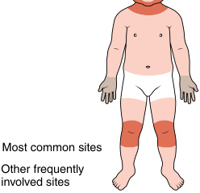
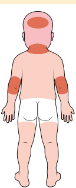
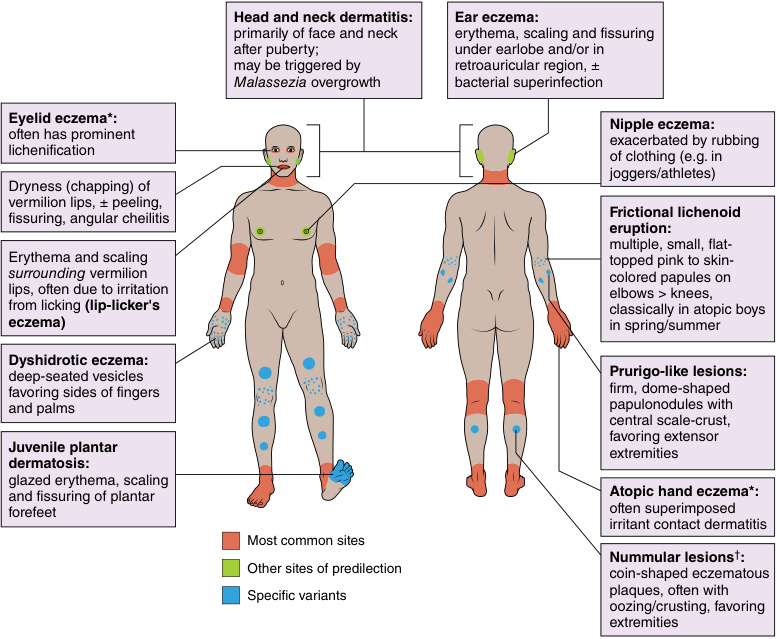
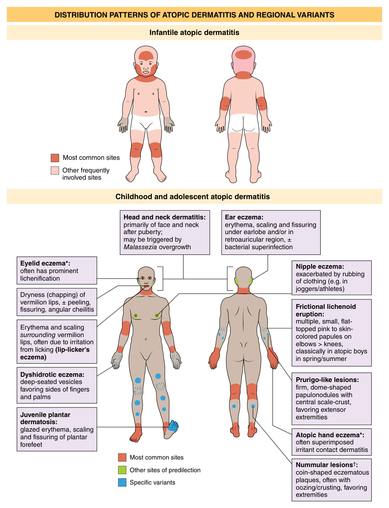
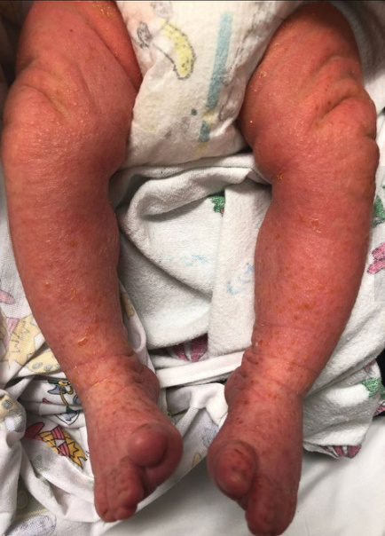
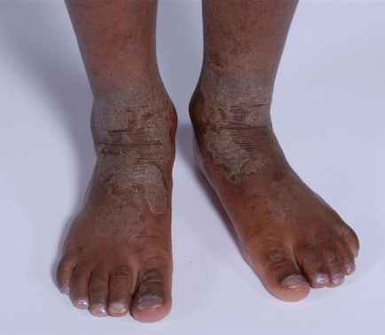
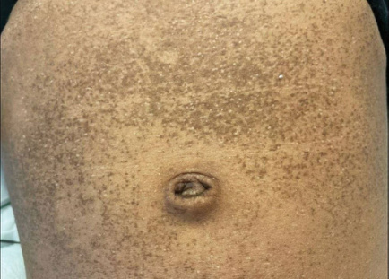
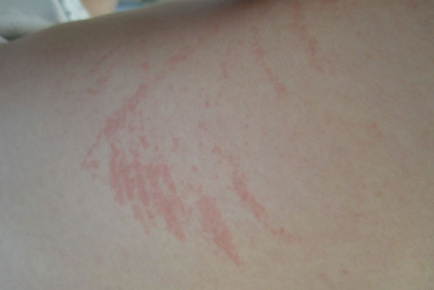

<!-- p.1266 -->

# 56 

## Rare and Unusual Etiologies of Atopic Diseases (Eczema, Urticaria) 

**MOLLY J. YOUSSEF, YVONNE E. CHIU** 

Eczema and urticaria are commonly observed skin conditions in children, typically following a benign course and limited to the skin. However, in rare cases, they could indicate a more significant underlying condition. Eczematous skin lesions may be a sign of a primary immunodeficiency syndrome, nutritional deficiency, or cutaneous lymphoma, whereas urticaria-like lesions can signal an autoinflammatory syndrome. 

   - Disorders of T cell signaling/development 

      - Omenn syndrome _(RAG1/RAG2)_ 

      - _DOCK8_ deficiency 

      - Wiskott-Aldrich syndrome (WAS) 

   - Disorders of T regulatory cells 

      - IPEX syndrome (immune dysregulation, polyendocrinopathy, enteropathy, X-linked syndrome) 

      - CD25 deficiency 

- Skin barrier disorders 

### **Disorders Presenting With Eczematous Dermatitis** 

Eczematous eruptions are characterized by scaly pink papules and plaques, which are typically pruritic. **Atopic dermatitis** is the most common eczematous eruption of childhood, affecting approximately 15 to 20% of children in the United States. Skin manifestations appear before 1 year of age in approximately 65% of children but typically after 2 months of age. In infants and young children, atopic dermatitis tends to involve the face, scalp, and extensor extremities, whereas older children and adults have more flexural sites involved (Fig. 56.1). A personal or family history of atopy such as asthma, food allergies, and environmental allergies are also clues for the diagnosis. Although the term eczema is often used interchangeably with atopic dermatitis, there are several other conditions that cause eczematous eruptions of the skin. 

Because atopic dermatitis is such a common condition in childhood, it is important to recognize unusual clinical presentations that may indicate the need for further investigation. Many of the childhood diseases associated with eczematous eruptions benefit tremendously from early diagnosis. Some unusual, but very important, causes of eczema in childhood include: 

- Primary Immunodeficiencies 

   - Disorders of Signal Transducers and Activators of Transcription (STATs) 

      - _STAT3_ -autosomal dominant hyper-IgE syndrome (AD-HIES) 

      - _STAT1_ gain of function (GOF) disease 

      - _STAT6_ GOF disease 

   - Netherton syndrome (NS) 

   - Phosphoglucomutase 3 (PGM3) deficiency 

- Nutritional deficiencies 

   - Pellagra 

   - Kwashiorkor 

   - Zinc deficiency 

- Mycosis fungoides 

#### **Primary Immunodeficiencies** 

Eczematous dermatitis can serve as a clue to the presence of a primary immunodeficiency disorder. It is imperative to consider primary immunodeficiency disorders when dermatitis develops in the early neonatal period, or in children with severe, recalcitrant, or widespread eczematous dermatitis. Other important warning signs for primary immunodeficiency include family history of immunodeficiency disease, recurrent infections, history of intravenous antimicrobials to treat infections, failure to thrive, abscesses, recalcitrant oral thrush, and the presence of autoimmune disorders. Primary immunodeficiencies with associated eczematous dermatitis along with other clinical features are listed in Table 56.1. Additional details about the primary immunodeficiencies can be found in Chapters 54 and 55. 

#### **_Disorders of Signal Transducers and Activators of Transcription (STATs)_** 

##### **_STAT3_ -Autosomal Dominant Hyper-Immunoglobulin E** 

##### **Syndrome** 

Autosomal dominant hyperimmunoglobulin E (hyper-IgE) syndrome (AD-HIES) is characterized by severe eczematous

<!-- p.1267 -->

###### **DISTRIBUTION PATTERNS OF ATOPIC DERMATITIS AND REGIONAL VARIANTS** 

###### **Infantile atopic dermatitis** 

###### **Childhood and adolescent atopic dermatitis** 

**Fig. 56.1** Distribution patterns of atopic dermatitis (AD) and regional variants. *May be the only manifestation of AD in adults.† Not to be confused with nummular eczema occurring outside the setting of AD. (From McAleer MA, Irvine AD. Atopic dermatitis. In Bolognia JL, Schaffer JV, Cerroni L, (eds). Dermatology. 5th ed. Philadelphia: Elsevier; 2025 [Fig. 12.3, p. 214].)

<!-- p.1268 -->

#### **TABLE 56.1** Feat i ures of Prim i ary Immunodei ficiencies Associated With Eczematous Derm i atitis

|Disease|Gene|Inheritance|Clinical Features|Lab Abnormalities|
|---|---|---|---|---|
|AD-HIES|_STAT3_|AD, less commonly sporadic|• Cold abscesses • Recurrent sinopulmonary infections • Mucocutaneous candidiasis • Coarse facies • Minimal trauma fractures • Scoliosis • Joint hyperextensibility • Retained primary teeth • Coronary artery tortuosity or dilation • Lymphoma|• High IgE (>2,000 IU/μL) • Eosinophilia|
|STAT3GOF|_STAT3_|AD|• Lymphoproliferation (e.g., lymphadenopathy, splenomegaly) • Growth failure • Autoimmune enteropathy • Various autoimmune endocrinopathies (e.g., diabetes mellitus, thyroiditis) • Hepatitis • Pulmonary disease • Juvenile-onset arthritis • Dermatitis|• Cytopenias common •+/−Hemolytic anemia|
|STAT1 GOF|_STAT1_|AD|• Chronic candidal infections • Bacterial infections • Autoimmune conditions • Cerebral aneurysms •+/−Disseminated viral and/or fungal infections •+/−Dermatitis|• Cytopenias common|
|STAT6 GOF|_STAT6_|AD|• Multiple food, drug, and environmental allergies • Recurrent anaphylaxis • Asthma • Allergic eosinophilic gastroenteritis and eosinophilic esophagitis • Lymphoproliferation • Coarse facies • Minimal trauma fractures • Joint hyperextensibility • Vascular anomalies|• High IgE • Eosinophilia|
|SCID|Variable, depends upon type|XLR and AR most common|• Recurrent, severe infections • Failure to thrive • Persistent diarrhea • Recalcitrant oral candidiasis • Omenn: lymphadenopathy, hepatosplenomegaly, erythroderma|• Lymphopenia common • Variable patterns of reduced lymphocyte subsets (T, B, NK cells) • Omenn syndrome: high lymphocytes, eosinophilia, high IgE|
|DOCK8 deficiency|_DOCK8_|AR|• Severe mucocutaneous viral infections • Mucocutaneous candidiasis • Atopic features (asthma, allergies) • Squamous cell carcinoma • Lymphoma|• High IgE • Eosinophilia •+/−Decreased IgM|
|WAS|_WASP_|XLR|• Hepatosplenomegaly • Lymphadenopathy • Atopic diathesis • Autoimmune conditions (especially hemolytic anemia) • Lymphoreticular malignancies|• Thrombocytopenia (<80,000) • Low mean platelet volume • Eosinophilia is common • Lymphopenia • Low IgM, variable IgG|

_(Continued)_

<!-- p.1269 -->

#### **TABLE 56.1** Featu i res of Prim i ary Immunodei ficiencies Associated With Eczematous Der i matitis—cont’d

|Disease|Gene|Inheritance|Clinical Features|Lab Abnormalities|
|---|---|---|---|---|
|IPEX|_FOXP3_|XLR|• Severe diarrhea (autoimmune enteropathy) • Various autoimmune endocrinopathies (e.g., diabetes mellitus, thyroiditis) • Food allergies|• High IgE • Eosinophilia • Various autoantibodies|
|CD25 Deficiency|_IL2RA_|AR|• Severe diarrhea (autoimmune enteropathy) • Autoimmune disease|• Normal or mildly elevated IgE • Various autoantibodies|
|Netherton syndrome|_SPINK5_|AR|• Hair shaft abnormalities • Erythroderma • Ichthyosis linearis circumflexa • Food allergies • Recurrent gastroenteritis • Neonatal hypernatremic dehydration • Upper and lower respiratory infections|• High IgE • Eosinophilia|
|PGM3 deficiency|_PGM3_|AR|• Neurological abnormalities • Leukocytoclastic vasculitis • Atopic features (asthma, allergies) • Sinopulmonary infections • Mucocutaneous viral infections|• High IgE • Eosinophilia|

_HIES,_ Hyper IgE syndrome; _IPEX,_ immune dysregulation, polyendocrinopathy, enteropathy, X-linked; _SCID,_ severe combined immunodeficiency; _WAS,_ Wiskott Aldrich syndrome. Modified from Youssef MJ, Chiu YE. Eczema and urticaria as manifestations of undiagnosed and rare diseases. _Pediatr Clin North Am_ . 2017;64:39-56. 

eruptions, skin abscesses, recurrent sinopulmonary infections, and elevated serum IgE levels. Most cases of ADHIES are due to dominant negative pathogenic variants in the signal transducer and activator of transcription 3 _(STAT3)_ gene, leading to loss of function and failure of Th17 cell differentiation and reduced IL-17 and IL-22 production. In patients with AD-HIES, dermatitis often presents at birth or in the neonatal period, most commonly on the face and scalp before becoming generalized. There may be a facial inflammatory pustular eruption mimicking neonatal acne. The dermatitis tends to be very pruritic, becoming lichenified, and more recalcitrant to treatment when compared to typical atopic dermatitis. Recurrent skin infections are an important clue in diagnosing AD-HIES. _Staphylococcal aureus_ is the most common bacteria causing infection: both superinfection of the dermatitis as well as cutaneous abscesses. Notably, patients with HIES develop cold abscesses, which lack warmth and erythema. **Chronic mucocutaneous candidiasis** and recurrent sinopulmonary infections are also commonly seen. 

Children with AD-HIES typically have serum IgE levels above 2,000 IU/μL along with eosinophilia. Serum IgE levels tend to rise throughout the first year of life, so AD-HIES should still be considered in infants with IgE <2,000 IU/ μL. Of note, it is common to see marked elevations in IgE levels and eosinophils in children due to severe atopic dermatitis; these laboratory findings alone cannot confirm the diagnosis of AD-HIES. 

In addition to cutaneous manifestations, skeletal anomalies such as joint hyperextensibility, minimal trauma 

fractures, scoliosis and craniosynostosis should also increase the suspicion for AD-HIES. Furthermore, there are characteristic facial features which often develop by later childhood in those with AD-HIES. This includes coarse facies with deep-set eyes, prominent forehead and chin, and bulbous nose. Specific dental and vascular abnormalities, such as delayed loss of primary teeth and aneurysms, can also aid in the diagnosis of AD-HIES. AD-HIES is associated with an increased risk of malignancy, most commonly lymphomas. 

##### **_STAT3_ Gain of Function (GOF) Disease** 

Individuals with _STAT3_ gain-of-function genetic variations have a variety of autoimmune and inflammatory complications. Lymphoproliferation (e.g., lymphadenopathy, splenomegaly), autoimmune cytopenias, and growth failure are common features of _STAT3_ GOF syndrome. Furthermore, type 1 diabetes, enteropathy, thyroid disease, hepatitis, pulmonary disease, and/or juvenile-onset arthritis are frequently observed. Dermatitis is the most common cutaneous manifestation, ranging from mild atopic-like dermatitis to generalized exfoliating dermatitis. 

##### **_STAT1_ Gain of Function Disease** 

_STAT1_ facilitates type 1 and type 2 interferon (IFN)mediated gene transcription. _STAT1_ GOF variants lead to increased _STAT1_ levels and the production of type 1 (i.e., IFN α/β) and type 2 (i.e., IFN-γ) interferons, as well as reduction in numbers of Th17 cells. _STAT1_ GOF can result in a broad clinical phenotype. An autosomal dominant

<!-- p.1270 -->

form of chronic mucocutaneous candidiasis (CMC) occurs secondary to _STAT1_ GOF and is characterized by susceptibility to chronic candidal infections of the skin, nails, and mucous membranes. Additional clinical features may include bacterial infections, such as sinusitis, pneumonia, and folliculitis, along with autoimmune conditions and cerebral aneurysms. Viral and disseminated fungal infections have also been reported. Some individuals with _STAT1_ GOF variants have an **IPEX-like syndrome** , with mild to severe dermatitis reported. 

(Fig. 56.2). Other common features of Omenn syndrome include hepatosplenomegaly, lymphadenopathy, alopecia, eosinophilia, and elevated IgE levels. These features usually occur with hypomorphic variants in genes causing SCID (e.g., _RAG1_ ) resulting in the generation of some T cells that tend to be autoreactive. Depending upon the subtype, treatments for SCID can include hematopoietic stem cell transplant, enzyme replacement therapy, or gene therapy. Omenn syndrome must be treated immediately with immunosuppressants, usually steroids and FK506, until transplantation occurs as this condition can be fatal. 

##### **_STAT6_ Gain of Function Disease** 

_STAT6_ is a transcription factor important in allergic immune responses activated in response to IL-4 and IL-13. Heterozygous GOF variants in _STAT6_ cause a primary atopic disorder. Affected infants have severe early-onset atopic dermatitis developing within the first few weeks of life with lichenification as a key feature. Patients also have multiple food allergies and subsequently develop recurrent anaphylactic reactions, asthma, allergic rhinitis, drug allergies, eosinophilic gastrointestinal diseases (including allergic eosinophilic gastroenteritis and eosinophilic esophagitis), and lymphoproliferation. Some features resemble _STAT3_ - AD-HIES, including recurrent skin and respiratory infections, coarse facies, joint hyperextensibility, fractures with minor trauma, and vascular anomalies. Successful treatment of _STAT6_ GOF disease has been reported with dupilumab, ruxolitinib, and tofacitinib. 

#### **_Disorders of T Cell Signaling/Development_** 

##### **Severe Combined Immunodeficiency** 

Severe combined immunodeficiency (SCID) describes a heterogenous group of inherited disorders characterized by deficiency of T lymphocytes, leading to defective cellular and humoral immunity. SCID is further classified into numerous subtypes, each with a different genetic pathogenic variant and with variation in B lymphocytes and/or natural killer (NK) cell number and function. The most common subtype of SCID is an X-linked recessive form (X-SCID) accounting for ~29% of cases, caused by _IL2RG_ pathogenic variants with loss of T and NK cell development. A variety of other proteins can cause SCID including IL-7 receptor deficiency, deficiency of recombinase activating genes 1 and 2 ( _RAG1_ , _RAG2_ ), and adenosine deaminase (ADA) deficiency. The addition of SCID testing within the newborn screening panel lead to earlier diagnosis. Common presenting features of SCID include recurrent and/or severe infections, diarrhea, chronic mucocutaneous candidiasis, and failure to thrive. 

Several forms of SCID can present with skin involvement, including erythroderma or a seborrheic dermatitislike eruption. **Omenn syndrome** is an autosomal recessive variant of SCID typically caused by deficiency of RAG proteins; it has also been reported in other genetic causes of SCID such as ADA deficiency. Nearly all infants with Omenn syndrome present with exfoliative erythroderma 

##### **_DOCK8_ Deficiency** 

An autosomal recessive form of **hyper-IgE syndrome** is due to pathogenic variants in the dedicator of cytokinesis 8 gene _(DOCK8)_ and is called DOCK8 deficiency. DOCK8 deficiency shares many similar clinical features with AD-HIES, including eczematous dermatitis, staphylococcal skin and sinopulmonary infections, elevated serum IgE levels, and eosinophilia. The eczematous dermatitis commonly presents beyond the neonatal period for those with DOCK8 deficiency. The incidence of newborn rash is 24 to 35% in DOCK8-deficient patients, whereas 

**Fig. 56.2** This neonate has an eczematous dermatitis due to SCID/ Omenn syndrome.  (Photo courtesy of Dr. Sarah Thill.)

<!-- p.1271 -->

approximately 80% of neonates with AD-HIES develop rash. Neonates with DOCK8 deficiency do not exhibit the pustular eruption that often occurs in AD-HIES. There is also a higher frequency of food and environmental allergies, asthma, and eosinophilic esophagitis compared to those with AD-HIES. 

Another important distinguishing feature of DOCK8 deficiency is the presence of extensive, recurrent, and treatment-resistant cutaneous viral infections. Absence of DOCK8 leads to impaired migration and function of T cells and NK cells, leading to viral susceptibility. Common viral infections for these patients include viral warts, herpes simplex virus, molluscum contagiosum, severe primary varicella, and herpes zoster. Viral-associated malignancies such as HPV-associated squamous cell carcinoma and EBV-related lymphomas may occur and may be more aggressive in patients with DOCK8 deficiency. DOCK8 deficiency is associated with nearly 50% mortality rate before the age of 20 years, with hematopoietic stem cell transplant being the only curative treatment option. 

##### **Wiskott-Aldrich Syndrome** 

Wiskott-Aldrich syndrome (WAS) is an X-linked recessive condition caused by loss of function pathogenic variants in the gene that encodes the Wiskott-Aldrich syndrome protein (WASP). Defects in WASP impair function of myeloid and lymphoid cells, as well as platelets. It almost exclusively occurs in males; there are rare reports of affected females. Although there is much heterogeneity in the clinical spectrum of disease, classical WAS is characterized by a triad of recalcitrant eczematous dermatitis, recurrent bacterial infections, and thrombocytopenia with small dysfunctional platelets. 

The initial presentation of WAS is commonly due to the platelet abnormalities. Within the neonatal period, cephalohematoma or prolonged bleeding after circumcision may be seen. Patients may also present with petechiae, abnormal bruising, or spontaneous bleeding (e.g., epistaxis or bloody stools). The dermatitis usually begins within the first few months of life and is indistinguishable from atopic dermatitis. The face, scalp, and flexural sites are often the most affected areas, although the dermatitis may be generalized and severe. Due to the bleeding diathesis, excoriated areas are more likely to demonstrate serosanguinous crust and/or purpura. Secondary bacterial skin infections are common. When maternal antibodies wane, infections with encapsulated bacterial organisms start to emerge causing illnesses such as otitis media, sinusitis, pneumonia, meningitis, and sepsis. Many children with WAS also develop autoimmune or inflammatory disease; hemolytic anemia is the most common. Other autoimmune conditions reported in patients with WAS include autoimmune neutropenia, small vessel vasculitis, arthritis, inflammatory bowel disease, and renal disease. The presence of early autoimmunity predicts severe refractory course of WAS and increased risk of malignancy. In one study, 25% of patients with a history of autoimmunity developed malignancy compared to 5% of patients without autoimmune disease. The most common 

malignancies are lymphomas (often EBV-associated) and leukemias. 

#### **_Disorders of T Regulatory (Treg) Cells_** 

##### **IPEX Syndrome** 

IPEX (immune dysregulation, polyendocrinopathy, enteropathy, X-linked) syndrome is an X-linked recessive disorder due to a pathogenic variant in the _FOXP3_ gene encoding a transcription factor required for Tregs (Chapter 55). IPEX is the prototypical immune dysregulation disorder and causes severe, early onset autoimmune and atopic disease. Affected males often present during the first year of life with failure to thrive secondary to severe watery diarrhea caused by autoimmune enteropathy, as well as food allergies. Furthermore, various autoimmune endocrinopathies (e.g., early onset diabetes mellitus, thyroiditis) and chronic dermatitis complete the triad of the classic features. The dermatitis in infancy tends to be eczematous with predilection for the lower extremities, trunk, and face. Frequent infections are common, especially with _Staphylococcus_ , and may result in sepsis. Other reported cutaneous manifestations of IPEX syndrome include psoriasiform dermatitis, erythroderma, fissuring cheilitis, urticaria, alopecia, and onychodystrophy. In addition, patients with IPEX frequently have severe IgEmediated food allergies and immune-mediated cytopenias. Renal disease occurs as well, affecting one-third of patients, with interstitial nephritis being most common. The majority of patients with IPEX have markedly elevated IgE and eosinophils, and a variety of autoantibodies. This disorder is fatal without aggressive immune suppression and stem cell transplant. There are hypomorphic variants that present with later onset disease characterized by significant atopy and inflammatory bowel disease. 

##### **CD25 Deficiency** 

Deficiency of CD25 (α chain of the interleukin-2 receptor) results in an **IPEX-like** disorder due to a functional defect in Treg cells. Foxp3+ Tregs express high levels of CD25 at rest but do not make IL-2. During an immune response, IL-2 is made by other T lymphocytes which is then “sensed” by Tregs resulting in their growth and immune suppressive functions. CD25 deficiency exhibit similar findings to IPEX including chronic diarrhea, autoimmunity, and eczematous dermatitis. However, they are also susceptible to certain herpetic infections (e.g., EBV, CMV) which is not a common observation in IPEX, highlighting the importance of IL-2 in immune activation and regulation. Because STAT5 mediates IL-2 signaling, STAT5b defects have been described with some of the features of CD25 deficiency, but with the additional feature of growth hormone insensitive growth failure because growth hormone also uses STAT5b to signal. 

#### **_Skin Barrier Defects_** 

##### **Netherton Syndrome** 

Netherton syndrome (NS) is an autosomal recessive condition with a classic triad of ichthyosiform erythroderma, hair

<!-- p.1272 -->

shaft deformities, and atopic diathesis. It is caused by pathogenic variants in _SPINK5_ , which encodes a serine protease inhibitor (LEKTI) resulting in degradation of desmosomal proteins and profoundly impaired epidermal barrier function. Netherton syndrome typically presents in the neonatal or early infantile period with generalized scaling erythroderma along with failure to thrive. Many infants with NS are born prematurely; collodion membrane is usually not present. The scaly erythroderma tends to improve over time, but approximately 70% of patients with NS will develop ichthyosis linearis circumflexa after 2 years of age. **Ichthyosis linearis circumflexa** is characterized by migratory, polycyclic, scaly erythematous plaques with a characteristic peripheral double-edged scale which usually responds poorly to topical steroids (Fig. 56.3). 

Hypernatremic dehydration is common in infancy due to transepidermal water loss and may be life-threatening. Patients may have diarrhea which further contributes to failure to thrive. Patients with NS are particularly susceptible to staphylococcal skin infections, respiratory infections, and sepsis. This predilection for infection is thought to be secondary to the impaired skin barrier and malnutrition. One study did not find evidence for a systemic immunodeficiency in a population of Dutch patients with NS. 

Patients with NS usually have dry, easily broken hair caused by a hair shaft abnormality called **trichorrhexis invaginata** . Under magnification, hairs demonstrate “bamboo hair” or “ball and socket” abnormalities. Multiple hairs should be examined as only 20 to 50% of hairs may show this classic finding. The majority of patients with NS also demonstrate an atopic diathesis with pruritic atopic dermatitis, severe food allergies, and/or asthma. IgE and eosinophils are often elevated. For patients with NS, topical medications must be applied with caution because systemic absorption is increased due to the impaired epidermal barrier. Careful 

**Fig. 56.3** This 4-year-old with Netherton syndrome has lichenified erythematous plaques with peripheral scale. 

skin care and bland thick emollients are usually the mainstay of cutaneous treatment. There have been rare reports utilizing IVIG to effectively reduce infection, along with TNF-alpha inhibitors and anti-IL-17 agents to reduce skin inflammation. 

##### **Phosphoglucomutase 3 Deficiency** 

Phosphoglucomutase 3 (PGM3) deficiency is a **disorder of glycosylation** which leads to multiple immune defects (Chapter 47). The condition often presents with features similar to other hyper-IgE syndromes. This includes eczematous dermatitis, atopic conditions, elevated IgE, neutropenia and lymphopenia, as well as soft tissue and sinopulmonary infections. Unique features of PGM3 deficiency include autoimmunity, with findings such as leukocytoclastic vasculitis or membranoproliferative glomerulonephritis, as well as neurological impairment that develops early in life. 

#### **Nutritional Deficiencies** 

Nutritional deficiencies may present as recalcitrant dermatitis in children. Even children with adequate access to food can develop nutritional deficiencies secondary to chronic medical conditions, poor nutritional literacy of the caregiver, food allergen avoidance, or restrictive diets. Nutritional deficiencies are often easily treatable, and prompt identification of these conditions can be lifesaving for some children. 

#### **_Pellagra_** 

Pellagra results from a severe deficiency of vitamin B3 (niacin) due to inadequate dietary nicotinic acid or its precursor essential amino acid, tryptophan. It may also occur in children taking medications that reduce body niacin, such as certain antiseizure medications. Pellagra rarely occurs in developed countries because of the availability of niacin in the diet; those with malabsorptive states, restrictive eating behaviors, and poor social circumstances (e.g., food insecurity) are at particular risk. Pellagra remains a concern in countries where nutritional deficiencies are common, especially those areas with high dietary corn intake. 

Pellagra is characterized by the classic triad of dermatitis, diarrhea and dementia. The dermatitis is photo-induced and begins as well-defined erythema and superficial scaling, resembling a sunburn. In acute cases, there may be vesicles, ulceration, weeping and cracking of the skin. The eruption may be pruritic, burning, or painful. **Casal’s necklace** is a term used for a characteristic red eruption with well-defined borders on the lower neck. The face, dorsal hands and arms, feet and inguinal area may be affected as well. Dermatitis can also occur in areas of friction, with the diaper area frequently involved in infants. When the redness subsides, the affected areas appear brownish red in color, and later stages may demonstrate hyperkeratosis, scaling, fissuring, and shellac-like shiny appearance. Oral involvement, such as glossitis (including red or darkened tongue), angular cheilitis, aphthous ulcers and fissuring, occurs in 30% of patients. Gastrointestinal symptoms may include chronic diarrhea,

<!-- p.1273 -->

poor appetite, vomiting and abdominal pain. Neuropsychiatric disturbances can range from headache and irritability to confusion and psychosis. Measurement of urinary metabolites of niacin (N1-methylnicotinamine and/or pyridine) can aid in the diagnosis of pellagra. Treatment of pellagra consists of a high-protein diet and nicotinic acid supplementation. 

In a child with symptoms of pellagra, it is important to consider conditions interfering with the absorption or processing of niacin. **Hartnup disease** is a rare autosomal recessive disorder caused by a pathogenic variant in _SLC6A19_ , which leads to inability to resorb tryptophan and other amino acids by the small intestine and renal tubules. Hartnup disease typically presents in childhood with a pellagralike skin eruption and neurological abnormalities, such as cerebellar ataxia. 

#### **_Kwashiorkor_** 

Kwashiorkor is a condition caused by severe protein deficiency and is characterized by edema, hypoalbuminemia, and dermatitis. The condition is most commonly seen in developing countries due to limited access to protein-rich foods and often presents after the child is weaned from breastfeeding. In higher-income countries, protein deficiency may develop due to food allergen avoidance and other restrictive diets, poor nutritional literacy, and malabsorptive conditions. The substitution of rice milk as a dietary staple for infants is a known cause of protein deficiency in the United States. In patients with kwashiorkor, the skin eruption appears as a blanching erythema with reddishbrown scale that has a sharply marginated, raised edge. This eruption has a classic appearance which has been compared to peeling paint, leading to the term “flaky paint dermatosis” to describe the cutaneous changes of kwashiorkor (Fig. 56.4). The flexures, face, perioral area, and diaper area are most frequently affected, which differs from the rash on sun-exposed sites seen in pellagra. Due to hypoalbuminemia, children with kwashiorkor often develop edema of the face, feet, and abdomen. They may also become irritable or 

**Fig. 56.4** This 7-year-old has the flaky paint dermatosis of kwashiorkor. 

apathetic. Treatment of children with kwashiorkor involves gradual introduction of a high-protein diet with careful attention to electrolyte imbalances and hydration status. 

#### **_Zinc Deficiency_** 

Zinc deficiency often manifests with eczematous dermatitis involving acral and periorificial areas and can arise secondary to malnutrition or malabsorptive conditions. **Acrodermatitis enteropathica (AE)** is an autosomal recessive disorder with pathogenic variants in _SLC39A_ , which results in dysfunction of an intestinal zinc transporter (ZIP4), leading to severe zinc deficiency. AE usually manifests shortly after birth in infants who are formula-fed and shortly after weaning in those who are breastfed. Zinc deficiency can also occur in breastfed infants when a maternal genetic variant results in poor secretion of zinc into the breastmilk. Furthermore, premature infants who are exclusively breastfed and do not receive zinc supplementation are at risk. Zinc deficiency may also be seen in children with malabsorptive conditions such as inflammatory bowel disease and cystic fibrosis, as well as those receiving parenteral nutrition without zinc additive. Findings resembling acrodermatitis enteropathica have also been described in patients with biotin deficiency and certain organic acid disorders. 

Zinc deficiency classically presents with a triad of diarrhea, acral and periorificial dermatitis, and alopecia. The dermatitis consists of eczematous pink scaly plaques which can become crusted, eroded, vesicular, pustular, and/or desquamative. The plaques are localized over the anogenital and periorificial areas, extensor extremities, scalp, fingers, and toes. Secondary infection with _Candida albicans_ is common on the face and may also cause paronychia of the digits. Infants with zinc deficiency are typically irritable or listless, feed poorly, and demonstrate growth delay. Diagnosis is based upon clinical suspicion and low serum zinc levels (≤50 μg/dL). Both acrodermatitis enteropathica and acquired forms of zinc deficiency are treated with zinc supplementation, and infants often show dramatic improvement of their symptoms within days. 

#### **Mycosis Fungoides** 

Mycosis fungoides (MF) is a cutaneous T-cell lymphoma primarily affecting older adults, with pediatric cases comprising less than 5% of all instances. The clinical manifestations of MF in children are diverse, with onset possible at any age, even during infancy. In its classic form, MF is characterized by pruritic, pink, scaly patches and plaques that are frequently misdiagnosed as atopic dermatitis. A particular variant, known as hypopigmented MF, is more prevalent in children, particularly those with darker skin. Children with hypopigmented MF typically present with round, hypopigmented macules and patches that may have slight scaling. These lesions are usually asymptomatic and appear in areas shielded from sun exposure. Hypopigmented MF may mimic postinflammatory hypopigmentation resulting from conditions like atopic dermatitis,

<!-- p.1274 -->

though persistent hypopigmentation beyond a few months should prompt consideration of hypopigmented MF. Identifying subtle clues of MF, such as poikilodermatous changes, atrophy, and telangiectasia, may aid in the diagnosis. The chronicity and resistance to conventional therapies often prompt a skin biopsy. Unfortunately, skin biopsy of MF is not always diagnostic in early stages, and it may take repeated skin biopsies over the course of months or years to make the diagnosis. Because of the clinical and histological difficulty in diagnosis, most children experience a delay of diagnosis of years after the first lesions appeared. Fortunately, most cases of pediatric MF represent early-stage disease without affecting lymph nodes, viscera, or blood. A staging work-up is recommended, with algorithms proposed by the International Society for Cutaneous Lymphoma/European Organization of Research and Treatment of Cancer and the National Comprehensive Cancer Network. The condition generally follows a slow and nonaggressive course, and progression to advancedstage MF during childhood is rare. Narrowband ultraviolet B phototherapy, topical retinoids, and topical steroids are commonly employed treatment options for early-stage skin-limited MF in children. 

### **Disorders Presenting With Urticaria** 

Urticaria results from localized edema in the superficial dermis, leading to distinct pink papules and plaques known as wheals. These wheals can vary in size from a few millimeters to several centimeters and may form annular lesions with central clearing or polycyclic and serpiginous patterns from wheal coalescence. Classic urticaria is characterized by pruritus and short-lived wheals where _individual_ lesions disappear within 24 hours even as the eruption as a whole continues. In children, acute urticaria is a common hypersensitivity response that often arises as a self-limiting condition that can be idiopathic or linked to infections, medications, or food allergies. Even though urticaria lasting longer than 6 weeks is defined as **chronic urticaria** , it still tends to be a spontaneously resolving disease with an average duration of months to years. Most cases of chronic urticaria are idiopathic, known as chronic spontaneous urticaria, but some cases may be associated with atopic disorders, thyroid disease, urticarial vasculitis, and other autoimmune disorders. In rare cases, a chronic urticaria-like rash can serve as a clue to an underlying autoinflammatory syndrome. 

### **Autoinflammatory Diseases Associated With an Urticarial Eruption** 

Autoinflammatory syndromes represent a rare group of inherited disorders characterized by episodic fevers and inflammation affecting multiple organ systems. Unlike autoimmune diseases, which involve autoreactive T lymphocytes or autoantibodies, autoinflammatory syndromes result from 

the dysregulation of the innate immune system. This leads to the activation of cytokine signaling pathways even in the absence of a recognizable infection. When a child experiences recurring episodes of an urticaria-like rash lasting for months to years, coupled with other signs of inflammation such as fever, arthritis, serositis, hepatosplenomegaly, and ocular and/or neurological involvement, an autoinflammatory syndrome should be considered. To ensure an accurate diagnosis, it is essential to rule out infections or malignancies through appropriate investigations. More information about the individual autoinflammatory disorders can be found in Chapter 57. 

Several autoinflammatory syndromes can have urticarialike rashes, although these rashes are not true urticaria because they lack prominent edema and pruritis that is seen in classical urticaria due to mast cell activation. These rashes may be intermittent and come and go similar to urticaria and are thus often diagnosed as urticaria. These rashes are also not mediated by mast cells, but rather by neutrophil infiltration of the skin. Several autoinflammatory disorders present in childhood with prominent urticaria-like rash (Table 56.2), including: 

- Inflammasomopathies and other IL-1-related conditions 

   - Cryopyrin-associated periodic syndromes (CAPS) 

      - Familial cold autoinflammatory syndrome (FCAS) 

      - Muckle-Wells syndrome (MWS) 

      - Neonatal-onset multisystem inflammatory disease (NOMID); also known as chronic infantile neurological cutaneous articular syndrome (CINCA) 

   - Hyperimmunoglobulinemia D with periodic fever syndrome (HIDS); also known as mevalonate kinase deficiency (MKD) 

- Other autoinflammatory syndromes 

   - Tumor necrosis factor receptor-associated periodic syndrome (TRAPS) 

   - Systemic onset juvenile idiopathic arthritis (SoJIA) 

   - PLCγ2-associated antibody deficiency and immune dysregulation (PLAID); also known as familial cold autoinflammatory syndrome 3 (FCAS3) 

#### **Inflammasomopathies and Other IL-1-Related Conditions** 

##### **_Cryopyrin-Associated Periodic Syndromes_** 

Cryopyrin-associated periodic syndromes (CAPS) are autoinflammatory disorders caused by pathogenic variants in _NLRP3_ (nucleotide-binding domain and leucine-rich repeat containing family, pyrin domain-containing 3), encoding the cryopyrin protein. When exposed to danger-associated molecular patterns (DAMPs) and pathogen-associated molecular patterns (PAMPs), cryopyrin forms an inflammasome by associating with other proteins including caspase-1 which converts pro-IL-1β to active IL-1β. This results in the release of active interleukin-1β (IL-1β) and resulting fever and systemic inflammation. _NLRP3_ pathogenic variants lead to spontaneous inflammasome activity, often precipitated by cold exposure, and subsequent secretion of IL-1β.

<!-- p.1275 -->

#### **TABLE 56.2** Al utoinflammator ly Diseases Ca l using Urtica l ria in Childre l n

|Disease|Gene (Protein)|Inheritance|Attack Length|Timing of Onset|Cutaneous Features|Extracutaneous Clinical Features|
|---|---|---|---|---|---|---|
|FCAS|_NLRP3_ (cryopyrin)|AD|Brief; Minutes– 3 d|Neonatal or infantile|• Cold-induced urticaria|• Arthralgia • Conjunctivitis • Headache|
|MWS|_NLRP3_ (cryopyrin)|AD|1–3 d|Neonatal, infantile, childhood (can be later)|• Intermittent widespread urticaria|• Arthralgia/arthritis • Sensorineural hearing loss • Conjunctivitis/episcleritis • Headache • Amyloidosis|
|CINCA/ NOMID|_NLRP3_ (cryopyrin)|AD|Continuous flares|Neonatal or infantile|• Persistent but migratory urticaria|• Deforming osteoarthropathy, epiphyseal overgrowth • Sensorineural hearing loss • Dysmorphic facies • Chronic aseptic meningitis, headaches, papilledema, seizures • Conjunctivitis/uveitis, optic atrophy • Poor growth • Developmental delay • Amyloidosis|
|HIDS|_MVK_ (mevalonate kinase)|AR|3–7 d|Infancy (<2 yrs)|• Intermittent morbilliform or urticarial rash • Aphthous ulcers • Erythema nodosum-like nodules • Petechiae|• Arthralgia/arthritis • Cervical lymphadenopathy • Severe abdominal pain • Diarrhea/vomiting • Headache • Elevated IgD and IgA antibody levels • Elevated urine mevalonic acid during attacks|
|TRAPS|_TNFRSF1A_ (TNFR1)|AD|>7 d|Childhood|• Intermittent migratory erythematous macules and edematous plaques on limbs • Periorbital edema|• Migratory myalgia • Conjunctivitis • Serositis • Amyloidosis|
|SoJIA|Polygenic|Varies|Daily (quotidian)|Peak onset at 1–6 yrs|• Evanescent macules and papules, urticarial plaques •+/− Dermatographism •+/−Periorbital edema|• Polyarthritis • Myalgia • Hepatosplenomegaly • Lymphadenopathy • Serositis|
|PLAID|AD|PLCG2|N/A|Infancy|• Urticaria induced by evaporative cooling • Angioedema • Ulcers and granulomatous lesions in cold- exposed areas|• Allergies • Autoimmune disease • Recurrent sinopulmonary infections • Elevated IgE antibody levels • Decreased IgA and IgM antibody levels • Often elevated antinuclear antibody titers|

_CINCA,_ Chronic infantile neurologic cutaneous articular syndrome; _FCAS,_ familial cold autoinflammatory disease; _HIDS,_ hyperimmunoglobulin D syndrome; _MWS,_ Muckle-Wells syndrome; _NOMID,_ neonatal onset multisystem inflammatory disease; _PLAID,_ PLCγ2 associated antibody deficiency and immune dysregulation; _SoJIA,_ systemic onset juvenile idiopathic arthritis; _TRAP,_ tumor necrosis factor receptor associated periodic syndrome. Modified from Youssef MJ, Chiu YE. Eczema and urticaria as manifestations of undiagnosed and rare diseases. _Pediatr Clin North Am_ . 2017;64:39-56.

<!-- p.1276 -->

The three CAPS disorders have a phenotypic spectrum, with familial cold autoinflammatory syndrome (FCAS) the least severe and neonatal-onset multisystem inflammatory disease (NOMID) the most severe. 

Typically, the first noticeable symptom is migratory pink macules and plaques resembling urticaria which often occurs after birth. However, this rash is often nonpruritic but painful, and lacks the classic edema seen in urticaria. A prominent neutrophil-rich infiltrate is characteristic on skin biopsy. The severity of the rash usually follows a diurnal variation, with minimal rash in the morning, gradual increase throughout the day, and the most severe rash in the evening. In FCAS, the urticarial eruption starts hours after exposure to cold temperatures and lasts less than 24 hours before resolving. The attacks in Muckle-Wells syndrome (MWS) are more frequent, typically lasting 1 to 2 days before resolving, but can occur daily. NOMID is characterized by persistent rash and significant systemic inflammation. Along with the rash, all forms of CAPS are characterized by recurrent fevers, systemic inflammation, and joint symptoms. MWS commonly leads to sensorineural hearing loss due to aseptic meningitis, whereas NOMID is the most severe type with neurological abnormalities, ocular signs, sensorineural hearing loss, deforming osteoarthropathies/epiphyseal overgrowth resembling tumors, and characteristic facies with frontal bossing, midface hypoplasia, and saddle nose deformity. Approximately 25% of patients with MWS and NOMID develop secondary amyloidosis. Amyloid deposition in the kidneys can lead to renal failure and significantly impacts the overall prognosis. The treatment of CAPS is focused on reducing IL-1β activity using medications like anakinra (IL-1 receptor antagonist), rilonacept (IL-1 trap), and canakinumab (IL-1β monoclonal antibody). 

#### **_Hyperimmunoglobulinemia D With Periodic Fever Syndrome_** 

Hyperimmunoglobulinemia D with periodic fever syndrome (HIDS) is a genetic disorder with autosomal recessive inheritance linked to pathogenic variants in _MVK_ . These pathogenic variants cause reduced activity of mevalonate kinase, leading to decreased production of isoprenoids, increased pyrin activity, and subsequently, increased release of IL-1β. Inflammation typically begins in the first 1 to 2 years of life, often triggered by routine vaccinations but also infections, stress, and other factors. The acute onset of high fever and lymphadenopathy are common, but abdominal pain, splenomegaly, arthritis, and rash can occur. Cutaneous manifestations typically involve a morbilliform eruption, but urticariallike eruptions, erythema nodosum-like nodules, and petechiae can occur. Acral sites are affected more commonly than the trunk. Nearly half of the patients develop aphthous ulcers in the mouth and/or genital area, which can lead to an incorrect initial diagnosis of Behçet disease. 

#### **_Tumor Necrosis Factor Receptor-Associated Periodic Syndrome_** 

Tumor necrosis factor receptor-associated periodic syndrome (TRAPS) results from pathogenic variants in 

_TNFR1_ , although the exact pathogenesis is uncertain. The age of onset is more variable, with most cases presenting in childhood although adult-onset cases have been reported. It stands out for its longer-lasting febrile attacks, lasting from 1 to 6 weeks. Skin manifestations in TRAPS can resemble urticaria and may present as migratory erythematous macules or patches, edematous dermal plaques, serpiginous or annular lesions, and periorbital edema. It is common to observe warm, tender, erythematous swollen plaques on the limbs near the trunk, which then migrate distally. These skin lesions typically correlate with underlying myalgias and limb pain. Gastrointestinal symptoms such as abdominal pain, vomiting, and diarrhea are also common. In about 25% of patients, there is a risk of developing secondary AA amyloidosis. 

#### **_Systemic Onset Juvenile Idiopathic Arthritis_** 

Despite being officially classified as a subtype of juvenile idiopathic arthritis, systemic onset juvenile idiopathic arthritis (SoJIA) shares numerous similarities with hereditary autoinflammatory syndromes and is increasingly recognized as a polygenic autoinflammatory syndrome. The hallmark of this condition is the presence of daily high spiking fevers and an urticaria-like rash. The diagnosis of SoJIA requires the inflammatory arthritis lasting at least 6 weeks, although this feature may not always be present early in the disease course, making diagnosis difficult. Distinguishing it from other forms of JIA, the specific diagnosis of systemic onset JIA requires the presence of an additional extraarticular finding, which may include hepatomegaly, splenomegaly, lymphadenopathy, serositis, or an evanescent rash. 

The characteristic rash in SoJIA typically consists of evanescent, salmon pink or erythematous macules and plaques affecting the trunk, neck, and extremities and sparing the face, palms, and soles (Fig. 56.5). The eruption often exhibits dermatographism with papules and plaques arising in a linear fashion at sites of scratching, The urticarial eruption in SoJIA varies throughout the day, being most 

**Fig. 56.5** This is a 16-year-old with systemic onset juvenile idiopathic arthritis. Note the urticarial papules demonstrating dermatographism.

<!-- p.1277 -->

severe during the evening hours, which coincides with fever spikes and arthritis flares. 

#### **_PLC_** γ **_2-Associated Antibody Deficiency and Immune Dysregulation_** 

PLAID is caused by an autosomal dominant pathogenic variant in _PLCG2_ , leading to constitutive and cold-enhanced activation of the PLCγ2 signaling molecule. Urticaria, sometimes accompanied by angioedema, start in early childhood. The lesions are usually triggered by evaporative cooling from cold air rather than touching cold objects. Ulcers and granulomatous lesions may develop in cold-exposed areas. Individuals with PLAID may develop autoimmune diseases and suffer from recurrent sinopulmonary infections. Some patients may exhibit a more severe inflammatory syndrome known as APLAID (autoinflammation and PLCγ2-associated antibody deficiency and immune dysregulation), characterized by pneumonitis, enterocolitis, eye inflammation, arthralgias, and blistering skin lesions. 

### **Bibliography** 

- Bergerson JRE, Freeman AF. An Update on syndromes with a HyperIgE phenotype. _Immunol Allergy Clin North Am_ . 2019;39(1):49-61. 

- Eichenfield LF, Frieden IJ, Mathes EF, et al. Eczematous disorders; erythrodermas, immunodeficiency and metabolic disorders. In: _Neonatal and Infant Dermatology_ . 3rd ed. Elsevier; 2015: 229-232; 269-274. 

- Jung JM, Lim DJ, Won CH, Chang SE, Lee MW, Lee WJ. Mycosis fungoides in children and adolescents: a systematic review. _JAMA Dermatol_ . 2021;157:431-438. 

- Nigrovic PA, Lee PY, Hoffman HM. Monogenic autoinflammatory disorders: conceptual overview, phenotype, and clinical approach. _J Allergy Clin Immunol_ . 2020;146:925-937. 

- Pichard DC, Freeman AF, Cowen EW. Primary immunodeficiency update: Part I. Syndromes associated with eczematous dermatitis. _J Am Acad Dermatol_ . 2015;73:355-364. 

- Rigante D. Phenotype variability of autoinflammatory disorders in the pediatric patient: a pictorial overview. _J Evid Based Med_ . 2020;13:227-245.