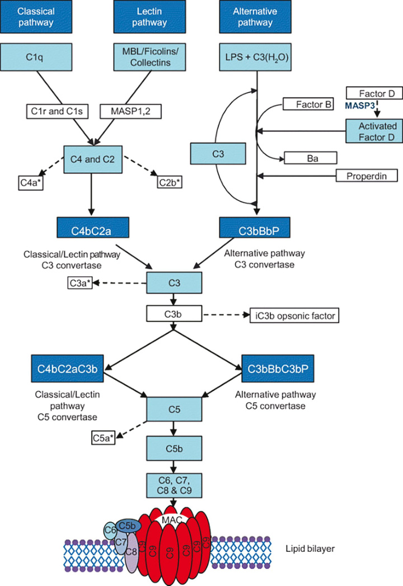
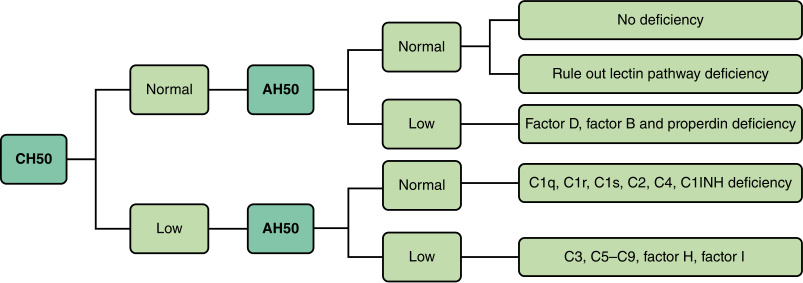
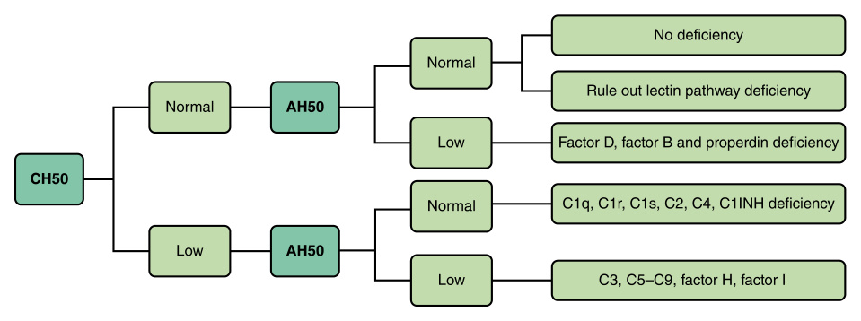
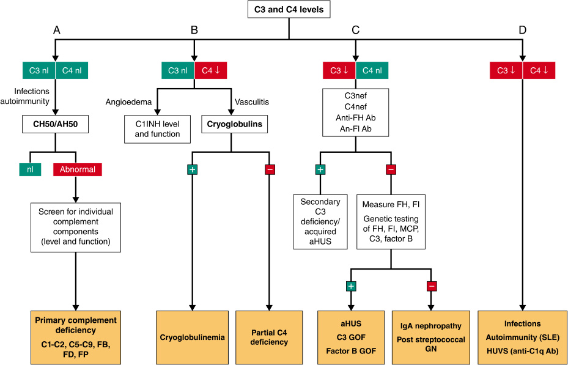
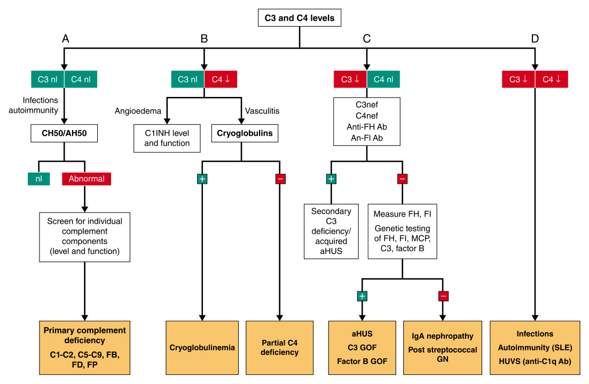

<!-- p.1330 -->

# 60 Complement Deficiencies 

**ANETE SEVCIOVIC GRUMACH, KATHLEEN SULLIVAN** 

Complement is a central part of innate immunity that serves as a first line of defense against foreign microorganisms and altered host cells. It is a highly conserved part of the innate immune system, comprising over 40 membranebound and soluble components. The complement system can be initiated depending on the context by three distinct pathways: classical (CP), lectin (LP), and alternative (AP), each leading to a common terminal pathway activation and generation of the _membrane attack complex_ . Complement activation results in inflammation, opsonization, phagocytosis, and destruction of the pathogen and ultimately aids in the activation of the adaptive immune response. Complement also aids in the elimination of senescence cells and immune complexes without further activation of other innate or adaptive immune components. The activity of the complement system is far beyond simple elimination of danger; it acts in immune surveillance discriminating among healthy host tissue, cellular debris, apoptotic cells, and foreign intruders and tunes its response accordingly. Complement has also been associated with early embryonic development and tissue repair. 

The **classical pathway (CP)** is triggered by binding of C1q to immunoglobulin-G (IgG) and IgM-containing immune complexes or by C-reactive protein (CRP) resulting in activation of the C1r and C1s proteases. The **lectin pathway (LP)** is activated by the interaction of carbohydrate binding proteins, known as lectins (mannose binding lectin [MBL], collectin-10, collectin-11, ficolin-1, ficolin-2, or ficolin-3) with carbohydrate residues on microorganism surfaces. This results in the activation of MBL-associated serine protease 1 (MASP1) and MASP2. The CP and LP have clearly identified recognition molecules, which trigger each pathway only when and where it is necessary. The recognition event induces a structural change in the recognition molecule (e.g., C1q or MBL) which results in the activation of C1r/C1s proteases or MASP and cleavage of C4 into C4a and the bound subunit C4b. C2 binds to C4b and is then cleaved by C1r/C1s or MASP into C4b2b, which is a C3 convertase and able to cleave C3 into C3a and C3b (Fig. 60.1). 

During normal physiological conditions, the dominant active complement pathway in serum is the **alternative** 

**pathway (AP)** . The AP monitors for pathogen invasion by maintaining a low level of constitutive activation by a process known as C3 tick-over. Tick-over is the spontaneous hydrolysis of a labile thioester bond, which converts C3 to a bioactive form C3(H2O) which can bind a variety of targets. C3 undergoes a structural change that exposes a binding site for Factor B (FB) which is then cleaved by the serine protease Factor D (FD), allowing the formation of a C3 convertase complex C3bBb. C3bBb can interact and cleave native C3 molecules to C3a and C3b. Properdin stabilizes the alternative pathway C3 convertase. 

Each of these three pathways converges toward the cleavage of central C3 by a C3 convertase which can lead to more deposition of C3b on the surface that can bind Factor B and generate more C3bBb amplifying the response. Alternatively, C3bBb or C4b2b can bind to C3b and form the C5 convertase, which cleaves C5 into C5a and C5b. This results in the activation of the terminal pathway, the subsequent insertion of terminal pathway components into the cell wall and lysis via the _membrane attack complex (MAC)_ , which is composed of complement proteins C5b–9. In addition, cleavage of C3 and C5 results in release of C3a and C5a which are known as _anaphylatoxins_ as these can activate mast cells and act as chemoattractants for neutrophils. 

Because C3 can activate without a recognition signal through C3 tick-over, it can theoretically spontaneously bind any foreign target or self-tissues. To prevent this, there are a variety of soluble and cell-bound complement regulators that help to control complement activation. This results in the prevention of complement activation on host cells while allowing complement activation on pathogens, in essence an ancient self/nonself-discrimination system. C1 inhibitor is a serine protease inhibitor that regulates C1 by binding to C1s and C1r, leading to dissociation from C1q. It is thought that C1 inhibitor acts on MASP-1 and -2 through a similar mechanism. Factor I, Factor H, and membrane cofactor protein regulate the alternative pathway. Together, these two regulators ensure that the spontaneous activation of the alternative pathway remains at a low level unless an activator surface is available to support a more intensive and sustained activation. The membrane-bound regulators of complement consist of the

<!-- p.1331 -->

**Fig. 60.1** Complement system activation pathways. _LPS,_ Lipopolysaccharide; _MAC,_ membrane attack complex; _MASP,_ mannose-binding lectin-associated serine protease; _MBL,_ mannose-binding lectin. *Examples of anaphylatoxins from the complement pathways.  (From Brodszki N, Frazer-Abel A, Grumach AS, et al. European society for immunodeficiencies [ESID] and European reference network on rare primary immunodeficiency, autoinflammatory and autoimmune diseases [ERN RITA] complement guideline: deficiencies, diagnosis, and management. _J Clin Immunol_ . 2020;40:576-591.)

<!-- p.1332 -->

ubiquitous 70-kD molecule DAF (CD55), MCP (CD46), C8 binding protein, and CD59. DAF, C8 binding protein, and CD59 are glycosylphosphatidylinositol (GPI)-linked proteins, and MCP is an integral membrane glycoprotein. 

## **Complement Deficiencies** 

Both inefficient activation and overactivation of the complement system can be detrimental to the host. The clinical consequences of inherited defects in the complement system include: 

- Increased susceptibility to infections caused by encapsulated organisms (pneumococcus) or _Neisseria_ sp. (meningococcus >>> gonococcus) 

- Autoimmunity, in particular systemic lupus erythematosus (SLE) 

- Hyperactivation due to deficiencies in regulatory proteins that result in specific disorders, such as kidney and eye diseases. 

The inheritance of complement deficiencies is autosomal recessive in all conditions, except for properdin and C1 inhibitor deficiencies with X-linked recessive and autosomal dominant inheritance, respectively. However, there are gain of function variants in C3 and alternative pathway components that are inherited in an autosomal dominant manner. Secondary or acquired complement deficiencies are most often linked to systemic autoimmunity, including anticomplement autoantibodies (anti-C1q or C3-nephritic factors) or protein-losing states (Chapters 30, 31, and 35). 

Primary (inherited) complement deficiencies associated with clinical disease collectively account for approximately 5% of the inborn errors of immunity (Chapter 53). Mannose-binding lectin (MBL) deficiency has a prevalence of ~5% and loss of some alleles of C4A or C4B are quite common (1:250); these disorders do not cause severe illness on their own. C2 deficiency is one of the most common complement deficiencies, with an estimated prevalence of 1:20,000 in the Swedish population. Certain pathogenic variants are more common in different ethnic groups, such as higher frequencies of C6 deficiency in African Americans, C7 deficiency in Moroccan Jews, and C9 deficiency in Japan. Deficiency of C1 inhibitor is estimated between 1:50,000 and 1:100,000. Nearly a quarter of the published complement component deficient cases (excluding MBL) are terminal complex deficiencies. The significance of partial deficiencies is less clear but may be relevant in some situations because clinical manifestations can occur with residual complement activity. Considering the redundancies in immune defense mechanisms, the frequency of complement deficiencies is likely underestimated (Table 60.1). 

## **Deficiencies of the Classical Pathway** 

Deficiencies in genes of the early classical complement pathway (i.e., _C1Q, C1R, C1S, C2_ , and _C4_ ) are among the strongest risk factors for **monogenic systemic lupus erythematosus (SLE)** and lupus-like diseases (Table 60.2). 

The approximate frequency of SLE is more than 90% in patients with C1q deficiency, 70% in those with complete C4 deficiency, 60% in those with C1r or C1s deficiency, and 30% in those with C2 deficiency. These deficiencies also represent a risk for the development of other autoimmune manifestations, such as glomerulonephritis, juvenile idiopathic arthritis, and dermatomyositis. The pathogenic mechanism linking complement deficiencies with autoimmunity may depend on a reduced clearance of apoptotic cells and immune complexes which are important functions of the complement system. This causes enhanced availability of autoantigens such as cell free DNA which are chronically exposed to the immune system, thus triggering a self-reactive immune response. Complement deficiency can impair B- cell negative selection, allowing the expansion of self-reactive B-lymphocytes which can contribute to the development of autoimmunity. Complement breakdown products also activate B cells, and thus complement is called nature’s adjuvant. The main **infectious susceptibilities** in classical pathway complement deficiencies are pyogenic encapsulated organisms (i.e., _S. pneumonia_ , _H. influenza_ ) and _Neisseria_ sp. ( _N. meningitidis_ and _N. gonorrhea_ ), but infections with _S. aureus_ , _S. pyogenes_ , and _S. agalactiae_ can also occur. Single or repeated invasive infections, mainly pneumonia, meningitis, or septicemia caused by _S. pneumoniae_ and less frequently _N. meningitidis_ , are seen. However, many individuals experience only minor infections such as recurrent otitis media, sinusitis, and upper airway infections. Infections with _N. meningitidis_ are much more common with terminal complement components. The most common early complement deficiency to present with bacterial infections is C2 deficiency, which often presents with pneumococcal bacteremia. Complete C4 deficiency is extremely rare and presents like C2 deficiency; it is determined when two pairs of alleles are defective ( _C4A_ and _C4_ ). C3 deficiency is the most severe complement defect presenting with severe infections because it has a role in _both_ the classical and alternative pathway; it is very rare. Encapsulated bacterial infections and _Neisseria_ sp. infections have been reported in C1q, C1r, and C1s deficiency. 

## **Deficiencies of Lectin Pathway** 

Lectin pathway deficiency has been associated with susceptibility to infections as well as autoimmunity, although this is somewhat controversial given the prevalence of these disorders in the population. The frequency of **MBL deficiency** in the general Caucasian population has been estimated to be between 5% and 10%. Nonetheless, it is not included as an inborn error of immunity. The serum levels of MBL are genetically determined because of single-nucleotide polymorphisms embedded in the promoter and exon 1 of _MBL2_ . MBL deficiency has been reported to be associated with chronic _Aspergillus_ lung infections, severe malaria, hepatitis C, cystic fibrosis, common variable immunodeficiency, and recurrent herpes virus, among others. However, most patients do not have severe infections and MBL

<!-- p.1333 -->

### **TABLE 60.1 Complement Deficiencies: Inheritance and Clinical Presentation** 

|Deficiency|Inheritance|Clinical Presentation|
|---|---|---|
|**Disorders Characterize** |**d by Defective Complement** |**Activation** |
|C1q C1r,C1s C2 C4 (total)|Autosomal recessive|SLE, infections due to encapsulated bacteria|
|C4A or C4B|Complex|Susceptibility to autoimmunity and infections|
|C3|Autosomal recessive|Pyogenic infections, Neisserial infections, Glomerulonephritis|
|C5, C6, C7, C8, C9|Autosomal recessive|Neisserial infections, including meningococcal meningitis|
|Factor B|Autosomal recessive|Neisserial and pneumococcal infections, aHUS|
|Factor D|Autosomal recessive|Bacterial infections|
|Properdin|X-linked recessive|Meningococcal meningitis|
|MBL|Polymorphism|Controversial results|
|Ficolin 3 (H-ficolin)|Polymorphism|Variable phenotype|
|MASP1|Autosomal recessive|3MC syndrome|
|MASP2|—|Respiratory infections|
|**Disorders Characterize**|**d by Excessive Complement**|**Activation**|
|C1-INH|Autosomal dominant|Hereditary Angioedema|
|Factor H|Autosomal recessive|aHUS, AMD, C3G|
|Factor I|Autosomal recessive|aHUS, AMD|
|CD46/MCP|Heterozygous or compound heterozygous variants|aHUS|
|CD55/DAF|Autosomal recessive|PNH* CHAPLE Syndrome|
|CD59|Autosomal recessive|PNH* Chronic hemolysis and relapsing peripheral demyelinating disease, cerebral infarction|
|C3 gain-of-function|Autosomal dominant|C3 glomerulopathy|
|Factor B gain-of-function|Autosomal dominant|C3 glomerulopathy, aHUS|

*PNH can occur with somatic variant. _aHUS,_ Atypical hemolytic uremic syndrome; _AMD,_ age-related macular degeneration; _CHAPLE,_ complement hyperactivation, angiopathic thrombosis, and early-onset protein-losing enteropathy; _PNH,_ paroxysmal nocturnal hemoglobinuria; _SLE,_ systemic lupus erythematosus; _3MC,_ facial dysmorphology, cleft lip/ palate, intellectual disability. 

deficiency is considered a possible _modifier_ for infection. **MASP2 deficiency** has been associated with pyogenic infections, inflammatory lung disease, and autoimmunity. MASP2 homozygosity was identified in approximately 6 in 10,000 individuals with a low clinical penetrance because most individuals with MASP2 insufficiency are asymptomatic. Cases of **ficolin-3 deficiency** manifest variable clinical symptoms, particularly infections, autoimmune disorders, and neurological complications. Only a few homozygous cases have been described; clinical symptoms include enterocolitis, respiratory and skin infections, brain abscess, refractory seizures, and nephrotic syndrome. **MASP1 deficiency** has been associated with the **3MC (Malpuech,** 

**Michels, and Mingarelli-Carnevale)** syndrome type 1 characterized by facial dysmorphia and other developmental defects, such as cleft lip and palate, postnatal growth deficiency, cognitive deficit, and hearing loss. 

## **Deficiencies of Alternative Pathway** 

The alternative pathway is activated by the classical pathway and acts as an amplification mechanism (Fig. 60.1). It is also activated _spontaneously_ by C3 tick-over which is constantly active at low levels; activation of this pathway depends on complement proteins Factor B, Factor D, and properdin to generate the alternative pathway

<!-- p.1334 -->

#### **TABLE 60.2** Autoimmune Di i seases Associated With Complement Deficiencies

|Component|Autoimmune Phenotype|
|---|---|
|C1q|Severe lupus-like disease, including nephritis, discoid rash, oral ulcers and anti-Smith antibodies with an unusually negative anti-dsDNA and less frequent arthritis. Female to male ratio approximately 1:1.|
|C1r|Glomerulonephritis, severe cutaneous lupus-like disease. May have increased interferon signaling. Female to male ratio approximately 1.5:1.|
|C1s|Glomerulonephritis, severe cutaneous lupus-like disease. May have increased interferon signaling. Female to male ratio approximately 1.5:1.|
|C2|Childhood onset but more limited lupus-like symptoms with more severe skin manifestations but milder kidney disease; may include sun-sensitive skin lesions, alopecia, febrile episodes, and arthritis. Anti-DNA antibody tests are usually negative, and severe kidney disease is rare. The penetrance of C2 deficiency on SLE is only about 10%. Anti-Ro often positive. Female predominance.|
|C3|More likely to present with increased risk of severe infections. Autoimmune phenotype may be very mild or even asymptomatic. Very few known cases of autoimmune phenotype.|
|C4|Early disease onset, a severe photosensitive skin rash, presence of anti-Ro/SSA, and high ANA titers are common. May also present with vasculitis, lupus nephritis. Nearly 80% of homozygous deficient patients develop SLE. Complete deficiencies are associated with a female to male ratio of approximately 1:1.|
|Other components: MBL, complement factor H, membrane cofactor protein, Factor I, Factor B|More commonly present with increased infection susceptibility. May develop atypical hemolytic uremic syndrome. MBL deficiency has been seen in SLE, and anti-MBL antibodies have been detected, though their clinical significance is unclear at this time.|
|From Coss SL, Zhou D, Chua G|T, et al. The complement system and human autoimmune diseases._J Autoimmun_. 2023;137:102979 (Table 1).|

C3 convertase and generate more C3b. Defects in components of the alternative pathway (properdin, factor D, and factor B) account for only 2.5% of all complement deficiencies and are associated with the inability to opsonize invading pathogens. 

**Factor D deficiency** , which is very rare, and **properdin deficiency** both result in selective impairment of the alternative pathway. In both cases, meningococcal disease is the most common presentation. Other studies have also associated factor D deficiencies with _N. gonorrhoeae_ infection and respiratory infections. Properdin deficiency is rare and is the only complement protein with X-linked inheritance. It may present with complete absence of the molecule (type I), partial deficiency (type II), or a normal level of dysfunctional protein (type III). Individuals with properdin deficiency are susceptible to meningococcal disease. Factor B deficiency has been described in two patients who presented recurrent infections with encapsulated bacteria. 

## **C3 Defects** 

C3 plays a central role in the classical, lectin, and alternative pathways of complement, and its deficiency is associated with severe and recurrent pyogenic bacterial infections and immune complex-mediated diseases. Patients are prone to infections such as sinusitis, otitis, pneumonia, meningitis, osteomyelitis, or sepsis. The main causative agents are 

encapsulated bacteria, both gram-negative and grampositive, including the following: _Neisseria meningitidis_ , _Enterobacter aerogenes_ , _Haemophilus influenzae_ , _Escherichia coli_ , _Streptococcus pyogenes_ , and _Staphylococcus aureus_ . These infections are early-onset and prone to recurrence. Patients may also present with membranous glomerulonephritis, and less frequently symptoms consistent with SLE. C3 deficiency is very rare. 

Any defect in a complement regulation can result in consumption of C3 and other complement proteins and an increased risk of infection. Examples include gain-of-function (GoF) variants in C3 that cause atypical hemolytic uremic syndrome an increased risk of age-related macular degeneration but also leads to C3 consumption and an increased risk of infection. Gain-of-function variants in factor B have been implicated in cases of atypical hemolytic uremic syndrome (aHUS) (Chapter 38). 

Factor H (FH) and Factor I (FI) are the main regulators of the alternative pathway, and deficiency of these regulatory proteins generates low levels of circulating C3, resulting in recurrent infections. Homozygous FH deficiency results in activation of the alternative pathway, cleavage, and consumption of C3 and factor B, and consequently increased susceptibility to pyogenic infections. Partial FI deficiency has also been associated with clinical manifestations, including recurrent tonsillitis, urinary tract infections, otitis, pyelonephritis, severe meningitis, and sepsis.

<!-- p.1335 -->

## **Deficiency of Components of the Terminal Pathway** 

The components of the terminal pathway are activated by the classical, lectin, and alternative pathways and are responsible for the formation of the membrane attack complex (MAC) composed of the proteins C5b, C6, C7, C8, and C9 (Fig. 60.1). The lectin and classical pathways activate the terminal pathway by the C5 convertase composed of C4bC2bC3b, while the alternative pathway activates the terminal pathway through the C5 convertase composed of C3bBbC3b. Defects in the terminal components (e.g., C5, C6, C7, C8, or C9) are associated with an increased risk of recurrent, invasive meningococcal disease and disseminated gonococcal infection. In comparison to the general population, patients lacking any one of the terminal complement components have a 1,000–10,000-fold higher risk of acquiring neisserial infections. C9 deficiency is extremely rare in Caucasians, although it occurs in approximately 0.1% of Japanese blood donors, with only infrequent clinical consequences. 

The probability of diagnosing complement deficiency is higher in children over 5 years of age who acquire meningococcal meningitis with the average age of onset being in adolescence. In younger children who contract meningococcal disease complement defects are not typically found and the thought is that immunological immaturity with poor antibody production is the cause of the infection in this age group. _Recurrent_ meningococcal infection is another characteristic with almost 50% of individuals with deficiencies in components of the terminal pathway experiencing at least one additional episode. Access to specific immunization can change this profile. Terminal pathway component deficiency is also more likely in infections with an unusual meningococcal serotype. 

Individuals with hereditary terminal pathway component deficiency have a _lower mortality_ rate per meningococcal episode compared with patients without complement deficiency (1.5% versus 19% mortality per 100 episodes). These data suggest that mortality and severity of meningococcal disease are proportional to the degree of complement activation and plasma endotoxin levels. 

## **Deficiency of Complement Regulatory Proteins and Receptors** 

The powerful activation cascades of the complement system require tight regulation to maintain proper homeostasis and prevent excessive damage. These complement regulators can be soluble or membrane bound; most have autosomal recessive inheritance. These factors work in several ways: • Binding C3b or C4b leading to decay of C3 convertases (e.g., Factor H, DAF or CD55), also known as decayaccelerating activity 

- Binding C3b or C4b and acting as a cofactor for cleavage of C3b or C4b by Factor I (e.g., Factor H and membrane cofactor protein) disrupting C3 convertases 

- Blocking generation of the membrane attack complex (e.g., CD59) 

In general, complete deficiency is needed to cause disease, but haploinsufficiency may increase risk of the same diseases. In addition, deficiency of these factors can lead to consumption of complement and increased risk of infection. 

Deficiency of these factors leads to a diverse array of clinical syndromes: 

- Hereditary angioedema 

- Renal and ocular disease 

- Paroxysmal nocturnal hemoglobinuria 

- Lymphangiectasia of the gastrointestinal tract 

C1 inhibitor is a protein that binds to C1r and C1s and inhibits its function, but also inhibits the clotting system. Deficiency of this protein leads to **hereditary angioedema** characterized by repeated attacks of angioedema. The cause of HAE is not unregulated complement activation, but rather uncontrolled activation of the bradykinin cascade, which is also controlled by C1 inhibitor. In addition to controlling complement activation, C1 inhibitor regulates the fibrinolytic and coagulation systems. Lack of inhibition, especially of the kallikrein-bradykinin system, results in excessive generation of bradykinin, increasing vascular permeability, and angioedema. The disease begins early in life, causing subcutaneous and submucosal edema. Angioedema attacks affect the face, limbs, genitals, abdomen, and larynx and are triggered by infections, estrogen, emotional factors, trauma, procedures such as dental treatment and endoscopy, extreme temperatures, and alcohol. However, in many cases the initiating event is unknown. Obstruction of the upper airways can result in asphyxia if left untreated. Attacks last 3 to 5 days and result in disfiguring edema, severe abdominal pain simulating acute abdomen or causing upper airway obstruction. Laboratory findings include low C4 with normal C3 levels, as well as low expression or function of the C1 inhibitor. An _acquired_ form of C1 inhibitor deficiency occurs mainly after the fourth decade of life and is associated with lymphoproliferative or autoimmune disorders and the presence of autoantibodies to C1 inhibitor. 

**Atypical hemolytic uremic syndrome (aHUS)** is seen in several complement regulatory protein deficiencies (Chapter 38). Atypical HUS is familial and is characterized by microangiopathic hemolytic anemia, thrombocytopenia, and acute renal failure, but unlike classical HUS is not associated with diarrheal illness. It is caused by uncontrolled activation of the complement system at the renal endothelium. Approximately 50% of patients with aHUS have pathogenic variants in FH, FI, membrane cofactor protein (MCP), and FH related to complement proteins 1 and 3 (CFHR1/CFHR3). **C3 glomerulopathy** describes conditions that lead to C3 deposition in the kidney but not the other features of HUS, such as microangiopathic hemolytic anemia. Causes of C3 glomerulopathy include damaging variants in FH, MCP, and FI, but also include gainof-function variants in C3 and Factor B.

<!-- p.1336 -->

There is an association of variants in FH, C3, CFB, and FI with **age-related macular degeneration** (AMD), a leading cause of blindness in the elderly. Although the pathophysiology of AMD is complex with genetic and nongenetic risk factors, one feature is the deposition of drusen which is composed of many modified proteins and lipoproteins, and even includes the complement proteins C5b–C9, demonstrating that the membrane attack complex may have a role. 

Two of the important membrane-bound inhibitors of the complement system, decay-accelerating factor (DAF or CD55) and membrane inhibitor of reactive lysis (MIRL or CD59), are tethered to the cell surface through a glycosyl phosphatidylinositol (GPI) anchor which is added to these proteins by _PIGA_ (phosphatidylinositol glycan anchor biosynthesis class A protein). CD55 and CD59 have regulatory properties of complement cascade activation. This regulation occurs through the inhibition of C3 convertase by CD55 and the prevention of the final step of membrane attack complex polymerization by CD59. CD59 is the key membrane regulator of the terminal pathway that prevents MAC insertion into host tissue. Pathogenic somatic variants in bone marrow precursors results in **paroxysmal nocturnal hemoglobinuria** thought to occur because of sleep-related hypoventilation, acidosis, and alternative pathway activation on RBCs. 

**Isolated deficiency of CD59** results in early-onset Coombs-negative hemolytic anemia and recurrent episodes of chronic inflammatory demyelinating polyradiculoneuropathy (CIDP). Isolated **CD55 deficiency** is the molecular cause of a rare autosomal recessive syndrome characterized by complement hyperactivation, angiopathic thrombosis, and early-onset protein-losing enteropathy **(CHAPLE syndrome)** . Protein-losing enteropathy likely results from primary lymphangiectasia, possibly linked to mucosal inflammation. Clinical symptoms include gastrointestinal disease (diarrhea, abdominal pain, vomiting), edema due to hypoalbuminemia, growth faltering, and anemia; patients may be affected by multiple severe thrombotic events. 

## **Laboratorial Complement Diagnosis** 

Although the complement cascade is complex, testing is straightforward with functional complement activity assays using RBC hemolytic assays (Figs. 60.2 and 60.3). To evaluate classical pathway activation, antibody-sensitized sheep erythrocytes are mixed with serial dilutions of the patient’s serum and the dilution that results in 50% hemolysis of the RBCs gives the CH50. This assay tests the classical pathway as well as the terminal or MAC pathway which is necessary for lysis. Alternative pathway activation can be assessed using rabbit (or chicken) erythrocytes, specifically activating the alternative pathway due to decreased sialic acid content. The AH50 is the reciprocal dilution at which 50% hemolysis is seen. The simultaneous assessment of CH50 and AH50 allows the identification of abnormalities in specific pathways of the complement system. 

- Absent CH50 values and normal AH50 suggests defects in C1q/C1r/C1s, C4, and C2 

- Absent AH50 with normal CH50 suggests deficiency Factor B, Factor D, or properdin (although some patients with properdin deficiency will be normal) 

- Absent AH50 and CH50 suggest deficiency of C3 or components of the terminal pathway C5, C6, C7, C8) It is important to measure C3 and C4 levels when 

- analyzing the complement system to ensure that any defects in the AH50 or CH50 are due to a factor deficiency and not complement consumption. This can be due to a variety of disease states or poorly handled serum samples. 

- A low C3 and C4 suggest complement consumptions, such as in SLE, cryoglobulinemia, hypocomplementemic urticarial vasculitis, and protein-losing states 

- An isolated low but detectable C3 with normal C4 suggests a defect in a complement regulatory protein such as Factor I, Factor H or MCP, or gain-of-function variants in C3 and Factor B. 

- An isolated low C4 with normal C3 can be suggestive of C1-inhibitor deficiency or genetic deficiency of C4A or C4B 

**Fig. 60.2** Initial evaluation of potential complement pathway defects based on CH50 and AH50 levels.

<!-- p.1337 -->

**Fig. 60.3** Interpretation of C3 and CD4 complement levels. (A) Normal C3 and C4 levels in the presence of recurrent infections should prompt the physician to analyze the functional integrity of the complement cascade. In this situation, an undetectable CH50 test indicates deficiency of a complement component. (B) Normal C3 but reduced C4 levels are indicative of activation of the classical pathway but without alternative pathway activation. Testing for C1INH and cryoglobulins, which typically give only a low C4, is indicated. If these two assays are negative and C4 levels are repetitively low, genetic deficiency of one or more alleles of C4 is suspected. (C) Low C3 but normal C4 levels suggest alternative pathway activation without activation of the classical pathway. This can occur nephritic factors (C3 nephritic factor or C4 nephritic factor), autoantibodies against complement regulatory proteins (i.e., Factor H and Factor I), or genetic defects in Factor, Factor I, MCP, C3, or Factor B. Poststreptococcal glomerulonephritis and IgA nephritis can also cause this pattern. (D) Simultaneous low C3 and C4 levels indicate significant complement consumption by immune complexes due to infections or autoimmune disease. ↓, Low; _1_ , positive; _2,_ negative; _aHUS,_ atypical hemolytic uremic syndrome; _C1INH,_ C1 esterase inhibitor; _GN,_ glomerulonephritis; _GOF,_ gain of function; _HUVS,_ hypocomplementemic urticarial vasculitis syndrome; _MCP,_ membrane cofactor protein; _nef,_ nephritic factor; _nl,_ normal; _SLE,_ systemic lupus erythematosus. (Adapted from Lopez-Lira et al. _Semin Cell Dev Biol_ . 2019 Jan;85:86-97.) 

Once the likely pathway is narrowed down, factor levels can be sent to specialized laboratories. Most of the deficiencies of the classical, alternative, and terminal pathways can be directly measured, as can any soluble complement regulators (e.g., FH, FI). C1 inhibitor testing includes the serum level as well a functional testing. Tests to look for complement activation are also available, including C3a, C5a, and soluble sC5b–9. 

## **Treatment of Complement System Deficiencies** 

Because complement and antibodies cooperate to fight encapsulated organisms or _Neisseria_ , vaccination is a key 

approach and can help prevent recurrent infections. There are no restrictions to vaccines for primary complement deficiency. Vaccination for _S. pneumoniae, H. influenzae,_ and _N. meningitidis_ is recommended. Household contacts should also receive the same vaccines to reduce the possibility of transmission. It is also recommended to check the _vaccination response_ of these patients. The use of antibiotic prophylaxis in complement deficiencies is generally indicated in patients with recurrent infections despite appropriate vaccination, in those with a higher risk of endemic or occupational exposure, aiming to protect against encapsulated bacteria. 

Specific therapies for deficiencies in complement regulatory proteins have been developed. Eculizumab, a

<!-- p.1338 -->

humanized monoclonal antibody that binds to C5 preventing its cleavage, is used to block activation of the terminal complement pathway (C5b-9) and has shown some effects in aHUS and paroxysmal nocturnal hemoglobinuria. Ravulizumab, a long-acting second-generation C5 inhibitor, is approved for intravenous administration every 8 weeks, with results comparable to eculizumab. Other complement inhibitors including pegcetacoplan (a targeted C3 inhibitor) and iptacopan (a factor B inhibitor) have been used in patients with PNH. Importantly, these complement inhibitors lead to an increased susceptibility infection. 

Hereditary angioedema has been the focus of several therapies not only for attacks, but also for long-term prophylactic therapy. Treatment resulted in better quality of life and control of the disease. For attacks, access to intravenous C1 inhibitor, the bradykinin receptor inhibitor icatibant, and the kallikrein inhibitor ecallantide has reduced the morbidity and mortality of patients with HAE. Modern drugs substituting for danazol, an attenuated androgen that was the mainstay of therapy, including the kallikrein inhibitors lanadelumab and berotralstat are effective as prophylaxis to prevent angioedema attacks with few adverse effects. Garadacimab, a monoclonal antibody which blocks Factor XIIa, is another agent used to prevent HAE episodes. 

## **Bibliography** 

- Abolhassani H, Azizi G, Sharifi L, et al. Global systematic review of primary immunodeficiency registries. _Expert Rev Clin Immunol_ . 2020;16(7):717-732. 

- Al-Shaikhly T, Hayward K, Basiaga ML, Allenspach EJ. Bacterial infections in a pediatric cohort of primary and acquired complement deficiencies. _Pediatr Rheumatol Online J_ . 2020;18(1):74. 

- Babaha F, Abolhassani H, Hamidi Esfahani Z, Yazdani R, Aghamohammadi A. A new case of congenital ficolin-3 deficiency with primary immunodeficiency. _Expert Rev Clin Immunol_ . 2020;16(7): 733-738. 

- Barratt J, Weitz I. Complement factor d as a strategic target for regulating the alternative complement pathway. _Front Immunol_ . 2021; 9;12:712572. 

- Brodszki N, Frazer-Abel A, Grumach AS, et al. European Society for Immunodeficiencies (ESID) and European Reference Network on Rare Primary Immunodeficiency, Autoinflammatory and Autoimmune Diseases (ERN RITA) Complement Guideline: Deficiencies, Diagnosis, and Management. _J Clin Immunol_ . 2020; 40(4):576-591. 

- Conigliaro P, Triggianese P, Ballanti E, Perricone C, Perricone R, Chimenti MS. Complement, infection, and autoimmunity. _Curr Opin Rheumatol_ . 2019;31:532-541. 

- D’Apolito M, Santacroce R, Vazquez DO, et al. DAB2IP associates with hereditary angioedema: Insights into the role of VEGF signaling in HAE pathophysiology. _J Allergy Clin Immunol_ . 2024; 154(3):698-706. 

- Degn SE, Jensenius JC, Thiel S. Disease-causing mutations in genes of the complement system. _Am J Hum Genet_ . 2011;88(6): 689-705. 

- El Sissy C, Rosain J, Vieira-Martins P, et al. Clinical and genetic spectrum of a large cohort with total and sub-total complement deficiencies. _Front Immunol_ . 2019;10:1936. 

- Falcão DA, Reis ES, Paixão-Cavalcante D, et al. Deficiency of the human complement regulatory protein factor H associated with low levels of component C9. _Scand J Immunol_ . 2008;68(4):445455. 

- Frazer-Abel A, Kirschfink M, Prohászka Z. Expanding horizons in complement analysis and quality control. _Front Immunol_ . 2021; 12:697313. 

- García-Laorden MI, Hernández-Brito E, Muñoz-Almagro C, et al. Should MASP-2 Deficiency Be Considered a Primary Immunodeficiency? Relevance of the Lectin Pathway. _J Clin Immunol_ . 2020;40(1):203-210. 

- Geerlings MJ, de Jong EK, den Hollander AI. 2017. The complement system in age related macular degeneration: a review of rare genetic variants and implications for personalized treatment. _Mol Immunol_ . 2017;84:65-76. 

- Grumach AS, Kirschfink M. Are complement deficiencies really rare? Overview on prevalence, clinical importance and modern diagnostic approach. _Mol Immunol_ . 2014;61(2):110-117. 

- Grumach AS, Leitão MF, Arruk VG, Kirschfink M, Condino-Neto A. Recurrent infections in partial complement factor I deficiency: evaluation of three generations of a Brazilian family. _Clin Exp Immunol_ . 2006;143(2):297-304. 

- Grumach AS, Veronez CL, Csuka D, Farkas H. Angioedema without wheals: challenges in laboratorial diagnosis. _Front Immunol_ . 2021;12:785736. 

- Grumach AS, Vilela MM, Gonzalez CH, et al. Inherited C3 deficiency of the complement system. _Braz J Med Biol Res_ . 1988;21(2):247-257. 

- Hill A, De Zern AE, Kinoshita T, Brodsky RA. Paroxysmal nocturnal haemoglobinuria. _Nat Rev Dis Primers_ . 2017;3:17028. 

- Johnson CA, Densen P, Wetsel RA, Cole FS, Goeken NE, Colten HR. Molecular heterogeneity of C2 deficiency. _N Engl J Med_ . 1992;326:871-874. 

- Jonsson G, Lood C, Gullstrand B, et al. Vaccination against encapsulated bacteria in hereditary C2 deficiency results in antibody response and opsonization due to antibody-dependent complement activation. _Clin Immunol_ . 2012;144:214-227. 

- Leitão MF, Vilela MM, Rutz R, Grumach AS, Condino-Neto A, Kirschfink M. Complement factor I deficiency in a family with recurrent infections. _Immunopharmacology_ . 1997;38(1-2): 207-213. 

- Lewis LA, Ram S. Complement interactions with the pathogenic Neisseriae: clinical features, deficiency states, and evasion mechanisms. _FEBS Lett_ . 2020;594(16):2670-2694. 

- Lintner KE, Wu YL, Yang Y, et al. Early components of the complement classical activation pathway in human systemic autoimmune diseases [review]. _Front Immunol_ . 2016;7:36. 

- Liszewski MK, Atkinson JP. Complement regulators in human disease: lessons from modern genetics. _J Intern Med_ . 2015; 277(3):294-305. 

- Macedo AC, Isaac L. Systemic lupus erythematosus and deficiencies of early components of the complement classical pathway. _Front Immunol_ . 2016;7:55. 

- Madsen HO, Garred P, Thiel S, et al. Interplay between promoter and structural gene variants control basal serum level of mannanbinding protein. _J Immunol_ . 1995;155(6):3013-3020. 

- Maurer M, Magerl M, Betschel S, et al. The international WAO/ EAACI guideline for the management of hereditary angioedemaThe 2021 revision and update. _Allergy_ . 2022;77(7):1961-1990. 

- McMurray JC, Schornack BJ, Weskamp AL, et al. Immunodeficiency: complement disorders. _Allergy Asthma Proc_ . 2024;45: 305-309.

<!-- p.1339 -->

- Medical Advisory Committee of the Immune Deficiency Foundation; Shearer WT, Fleisher TA, et al. Recommendations for live viral and bacterial vaccines in immunodeficient patients and their close contacts. _J Allergy Clin Immunol_ . 2014;133(4):961-966. 

- Merle NS, Church SE, Fremeaux-Bacchi V, Roumenina LT. Complement system Part I—molecular mechanisms of activation and regulation. _Front Immunol_ . 2015;6:262. 

- Merle NS, Noe R, Halbwachs-Mecarelli L, Fremeaux-Bacchi V, Roumenina LT. Complement system Part II: role in immunity. _Front Immunol_ . 2015;6:257. 

- Nesargikar PN, Spiller B, Chavez R. The complement system: history, pathways, cascade and inhibitors. _Eur J Microbiol Immunol (Bp)_ . 2012;2(2):103-111. 

- Nilsson B, Ekdahl KN. Complement diagnostics: concepts, indications, and practical guidelines. _Clin Dev Immunol_ . 2012;2012: 962702. 

- Paakkanen R, Vauhkonen H, Eronen KT, Jarvinen A, Seppanen M, Lokki ML. Copy number analysis of complement C4A, C4B and C4A silencing mutation by real-time quantitative polymerase chain reaction. _PLoS One_ . 2012;7(6):e38813. 

- Platonov AE, Beloborodov VB, Vershinina IV. Meningococcal disease in patients with late complement component deficiency: studies in the U.S.S.R. _Medicine (Baltimore)_ . 1993;72(6):374-392. 

- Reis ES, Falcao DA, Isaac L. Clinical aspects and molecular basis of primary deficiencies of complement component C3 and its regulatory proteins factor I and factor H. _Scand J Immunol_ . 2006;63: 155-168. 

- Ricklin D, Hajishengallis G, Yang K, Lambris JD. Complement: a key system for immune surveillance and homeostasis. _Nat Immunol_ . 2010;11(9):785-797. 

- Schröder-Braunstein J, Kirschfink M. Complement deficiencies and dysregulation: pathophysiological consequences, modern analysis, and clinical management. _Mol Immunol_ . 2019;114:299-311. 

- Shears A, Steele C, Craig J, et al. Clinical outcome and underlying genetic cause of functional terminal complement pathway deficiencies in a multicenter UK cohort. _J Clin Immunol_ . 2022; 42:665-671. 

- Shi Y, Wang C. Where we are with acquired angioedema due to C1 inhibitor deficiency: a systematic literature review. _Clin Immunol_ . 2021;230:108819. 

- Sirmaci A, Walsh T, Akay H, et al. MASP1 mutations in patients with facial, umbilical, coccygeal, and auditory findings of Carnevale, Malpuech, OSA, and Michels syndromes. _Am J Hum Genet_ . 2010;87(5):679-686. 

- Smith TD, Riedl MA. The future of therapeutic options for hereditary angioedema. _Ann Allergy Asthma Immunol_ . 2024;133(4): 380-390. 

- Sullivan KE. The yin and the yang of early classical pathway complement disorders. _Clin Exp Immunol_ . 2022;209(2):151-160. 

- Sullivan KE, Grumach AS. The complement system. In: _Middleton’s Allergy: Principles and Practice_ . 8th ed. Philadelphia: Elsevier Inc.; 2017:113-138. 

- Szilágyi Á, Csuka D, Geier CB, Prohászka Z. Complement genetics for the practicing allergist immunologist: focus on complement deficiencies. _J Allergy Clin Immunol Pract_ . 2022;10(7):1703-1711. 

- Tangye SG, Al-Herz W, Bousfiha A, et al. Human inborn errors of immunity: 2022 update on the classification from the international union of immunological Societies Expert Committee. _J Clin Immunol_ . 2022;42(7):1473-1507. 

- Turley AJ, Gathmann B, Bangs C, et al. Spectrum and management of complement immunodeficiencies (excluding hereditary angioedema) across Europe. _J Clin Immunol_ . 2015;35:199-205. 

- Turner MW. The role of mannose-binding lectin in health and disease. _Mol Immunol_ . 2003;40(7):423-429. 

- Veronez CL, Csuka D, Sheikh FR, Zuraw BL, Farkas H, Bork K. The expanding spectrum of mutations in hereditary angioedema. _J Allergy Clin Immunol Pract_ . 2021;9(6):2229-2234. 

- Vignesh P. Rawat A. Sharma M, Singh, S. Complement in autoimmune diseases. _Clin Chim Acta_ . 2017;465:123-130. 

- Wong EKS, Kavanagh D. Diseases of complement dysregulation-an overview. _Semin Immunopathol_ . 2018;40(1):49-64. 

- Zuraw BL, Christiansen SC. Classification, diagnosis, and pathology of angioedema without hives. _Immunol Allergy Clin North Am_ . 2024;44(3):529-541.