# Chapter 2: Diagnostic Methods: Genomics, Omics, Biomarkers, Imaging, and Other Technologies
> **Course:** Vikkypaedia Rare Disease Learner Course (*Nelson Pediatric Textbook of Rare Diseases: Genomic Etiologies and Genetic Diagnosis (1st Edition)*)  
> **Section I:** Introductory Chapters  
> **Authors:** Francesc Palau, Guerau Fernandez, Janet Hoenicka, Rafael Artuch, Jordi Muchart  
> **Metrics:** 11,367 words · 11 tables · 25 figures · 8 genes · 26 flashcards · 14 MCQs  
> **Quick Navigation:** [🃏 Study 26 Flashcards](../flashcards/002_flashcards.md) · [📝 Take 14-Q MCQ Quiz](../mcqs/002_mcqs.md) · [📚 Section I Guide](../sections/Section_I.md) · [🧬 Master OMIM/Gene Atlas](../omim_gene_atlas.md) · [💊 Precision Therapies Matrix](../therapies_matrix.md) · [🏠 Course Index](../../index.md)

## Key Chapter Topics
`Diagnostic Methods Genomics, Omics, Biomarkers, Imaging, and Other Technologies` · `Genetic and Genomic Testing in Precision Molecular Diagnosis` · `Genetic and Genomic Testing for Chromosomal and Genome Abnormalities` · `Genetic and Genomic Tests, Genetic Variants Detected, and Resolution Level` · `Genetic Testing for Moderateto Small-Scale Gene Variants` · `Genetic and Genomic Testing for DNA Single Nucleotide Variants` · `Bioinformatics and Data Analysis` · `Beyond the Exome and the Genome in the Diagnostic Testing of Undiagnosed Rare Diseases` · `Primary Stages of the Genomic Bioinformatic Pipeline` · `2.8` · `FAIR Data Principles` · `Transcriptomics` · `The Epigenome: Beyond the Structure of the Gene` · `Functional Genomics`

## Key Genes & Molecular Targets
`CFTR`, `DMD`, `FXN`, `GDAP1`, `GNB5`, `NSD1`, `PACS1`, `PMP22`

## Indexed OMIM Identifiers
`#118220`, `#152215`, `#601002`, `#611913`, `#615009`

## ⚡ High-Yield Clinical & Diagnostic Pearls
- WES is considered the gold standard approach in clinical practice because it allows the reanalysis of novel genes compared to CES, generates a smaller amount of data, and is more affordable than WGS.
- Uniparental disomy can be due to abnormal genomic imprinting, which leads to recessive variant effects.
- In the clinical setting, genomic imprinting disorders can be diagnosed by specific MLPA tests determining the methylation profiling to determine the genes preferentially expressed from only one of the two parental chromosomes (i.e., Prader-Willi syndrome vs.
- Sometimes, imaging findings can be pathognomonic, but often they help narrow the differential diagnosis.
- Clinical applications in pediatrics are extensive, the most common in nephro-urology, oncology, and inflammatory diseases.
- Medical diagnosis is necessary for adequate clinical management of people living with a rare disease.
- Human cells have two dialoguing genomes: the nuclear genome (nDNA) and the mitochondrial genome (mtDNA).

---
## Full Chapter Text, Tables & Figures

<!-- p.34 -->

# 2 Diagnostic Methods Genomics, Omics, Biomarkers, Imaging, and Other Technologies 

**FRANCESC PALAU, GUERAU FERNANDEZ, JANET HOENICKA, RAFAEL ARTUCH, JORDI MUCHART** 

Medical diagnosis is necessary for adequate clinical management of people living with a rare disease. It is also the gateway for applying the appropriate treatment for each patient and developing new therapies, whether they are curative or allow to modify the natural history of the disease and improve the patient’s quality of life. This process can be very complex for patients whose symptoms suggest a rare disease and who have been searching for the appropriate diagnosis for some time. Clinical suspicion, based on symptoms and signs, often requires the analysis of biomarkers to confirm or rule out a diagnosis. Many rare diseases, especially inherited metabolic diseases, have detectable biochemical biomarkers in accessible specimens such as blood (plasma, serum, cells), urine, saliva, or cerebrospinal fluid (CSF). Markers from radiological or diagnostic imaging tests offer an accurate diagnosis of the disease or an organic structural alteration relevant to the clinical and therapeutic management of the patient. However, many rare diseases do not have biomarkers or imaging markers to reach an etiological diagnosis or to assess the individual’s physiological state and response to treatment. Incorporating genomics and other omics approaches into the clinical setting promises to reverse these difficulties and improve the ability to obtain a diagnosis. 

Knowledge of the human genome and its comparison between individuals has revealed that humans differ in at least 0.1% of the nucleotide sequence of their genome. These genetic variants can be polymorphic if present in more than 1% of the population, or they can be rare and low frequency. Variations in the human genome can be found in genes that code for proteins, those that code for noncoding RNA, and in regulatory regions; most are found in noncoding, intragenic, or especially intergenic regions. In clinical terms, much attention has focused on those variations that affect the protein-coding regions and are presumed to be mostly disease-causing. 

## **Genetic and Genomic Testing in Precision Molecular Diagnosis** 

Human cells have two dialoguing genomes: the nuclear genome (nDNA) and the mitochondrial genome (mtDNA). The complete haploid nDNA has approximately 3.3 billion nucleotides or base pairs (bp), containing approximately 21,300 protein-coding genes and at least 25,000 noncoding RNA genes. The mtDNA has approximately 16.5 kb encoding 37 genes. Genetic variants range from changes affecting a single nucleotide base pair to those involving several kilobases (kb) or megabases (Mb) and even an entire chromosome (Table 2.1). In the diagnostic process, studying these variants requires applying genetic and genomic tests with different levels of resolution. 

Genetic diagnosis is the process of attempting to confirm or rule out a suspected clinical diagnosis by applying genetic tests and methods (Fig. 2.1). To achieve the genetic diagnosis, the chromosomes, the genome, or specific genes (sometimes also the gene product or function) are investigated to detect or exclude an alteration possibly associated with a genetic disorder. The genetic analysis looks for variations of the DNA sequences (also of the RNA) in the _germinal_ line or _somatic_ lines (e.g., tumors or postzygotic mosaics in affected tissues). When investigating the genome to find out variants that may be the cause of a rare genetic disease, three issues must be considered: (i) the level of resolution sought based on the suspected diagnosis, (ii) the type of genetic variant to be analyzed, either structural variant (SV) or single nucleotide variant (SNV), and (iii) what genetic test or method must be applied to achieve the diagnosis (Table 2.2). 

### **Genetic and Genomic Testing for Chromosomal and Genome Abnormalities** 

The study of **chromosomes** is carried out through (i) karyotyping, which uses specific stains such as Giemsa staining to

<!-- p.35 -->

##### **TABLE** 

#### **2.1 Types of Genomic and Genetic Variants** 

|Genetic|||
|---|---|---|
|Resolution Level|Genetic Variants|Definition|
|Chromosome|Deletion|Loss of a sequence of DNA and chromatin from a chromosome observed in the karyotype|
||Duplication|Gain of a sequence of DNA and chromatin (duplicated) from a chromosome observed in the karyotype|
||Insertion|DNA material inserted in a chromosome from another chromosome or exogenous source|
||Translocation|Transfer of a segment of one chromosome to another chromosome|
|Genome|Structural variants (SV) and cop|y number variants (CNV):|
||• Microdeletion|Chromosomal deletion usually less than 3 Mb (below microscope resolution)|
||• Microduplication|Chromosomal duplication usually less than 3 Mb|
||• Other SVs|Small insertions, other rearrangements|
|DNA nucleotide sequence|Single Nucleotide Variant (SNV)|A single base pair change of the DNA sequence. When the allelic variant is polymorphic, it is usually referred to as single nucleotide polymorphism (SNP)|
||Variable Number of Tandem Repeat (VNTR)|Minisatellite DNA sequences of tandem arrangement of variable number of copies, which are highly polymorphic|
||Short Tandem Repeat (STR)|Microsatellite polymorphic locus consisting of variable tandem repeats, mainly (TG)n dinucleotides, but also trinucleotides or tetranucleotides|

**Fig. 2.1** Genetic and genomic tests. Diagnostic rates (green) and resolution levels (red) are indicated for each test. _bp,_ Base pair; _CMA,_ chromosomal microarray; _Kb,_ kilobases; _LRS,_ long read sequencing; _Mb,_ megabases; _MLPA,_ multiplex ligation probe amplification; _SRS,_ short read sequencing; _SNV,_ single nucleotide variant.

<!-- p.36 -->

|**TABLE** **2.2**|
|---|

#### **Genetic and Genomic Tests, Genetic Variants Detected, and Resolution Level** 

|||Gen|etic Variants|||
|---|---|---|---|---|---|
|Genetic Test|Chromosomal Abnormalities and Rearrangements|Genome Structural Variants (SV) and Copy Number Variants (CNV)|Single Nucleotide Variants (SNV)|Dynamic Variants (STRs)|Resolution Level|
|Karyotype (G-banding)|+|+/−|−|−|Chromosomes (5–10 Mb)|
|FISH|+|+|−|−|Locus-specific on chromosomes|
|MLPA|−|+|−|−|Locus-specific (10–50 specific zones, usually exons)|
|Chromosomal microarrays (CMA): CGH array and SNP-array|+|+|−|−|Genome, except repetitive zones (aCGH 60K: 50–100 kb)|
|TP-PCR and capillary electrophoresis|−|−|−|+|Gene (number of microsatellite repeats)|
|Sanger (dideoxy) DNA sequencing|−|−|+|+/−|Gene (bp)|
|Gene panels and clinical exome (CES, Mendelian panel)|−|−|+|−|Exome of disease genes (bp) [most included in OMIM]|
|Whole exome sequencing (WES)|−|+/−|+|−|Complete exome (bp)|
|Whole genome sequencing (WGS)|−|+|+|+/−|Complete genome (bp)|

_bp,_ Base pairs; _CGH-array,_ comparative genomic hybridization array; _CMA,_ chromosomal microarrays; _CNVs,_ copy number variants; _FISH,_ fluorescent in situ hybridization; _kb,_ kilobases; _Mb,_ megabases; _MLPA,_ multiplex ligation probe amplification; _OMIM,_ Online Mendelian Inheritance in Man; _SNP-array,_ single nucleotide polymorphisms array; _SNVs,_ single nucleotide variants; _STRs,_ single tandem repeats or microsatellites; _SVs,_ structural variants. 

recognize the banding pattern of the different chromosomes in metaphase or prometaphase during cell division (Fig. 2.2A and B); (ii) chromosomal microarray analysis (CMA) (Fig. 2.2C), and (iii) recognition of a particular chromosomal locus with fluorochrome-labeled molecular probes using fluorescent in situ hybridization (FISH) (Fig. 2.2D). The karyotype can determine the presence of numerical (complete or partial aneuploidies such as trisomy and monosomy) and structural (balanced translocations, Robertsonian translocations, inversions, insertions) chromosomal abnormalities. 

**CMA** is designed to detect large-scale genome and chromosome rearrangements. The CMA or molecular karyotype provides information about SVs, either deletions or duplications of genomic regions, whose size varies between 100 kb and three or more Mb. The technology is based on hybridization between the patient’s DNA under study and multiple probes fixed on a solid support (chip), with distribution along the set of chromosomes, allowing a scan of each chromosome. In **comparative genomic hybridization (CGH) array** , relative copy number losses 

and gains can be detected by hybridizing the patient’s DNA with control DNA on such microarrays, which contain genome-distributed probes representative of each chromosome (Fig. 2.2C and Fig. 2.3). A reduction of the patient’s signal indicates the presence of a _segmental deletion_ , whereas the signal overrepresentation suggests the presence of a _duplication_ . Another type of CMA uses single oligonucleotide polymorphism (SNP) arrays that contain the two alleles of multiple SNVs distributed along the chromosomes and allows detection of uniparental disomy. 

**In situ hybridization** studies use probes that hybridize to _specific_ satellite sequences of the centromeres of the chromosomes in both metaphase and nucleus interphase, which can be helpful to determine the presence of trisomy or monosomy, such as trisomy 21 of Down syndrome or monosomy X of Turner syndrome. **Locus-specific molecular probes** are a diagnostic tool for recognizing microdeletions, such as 22q11.2 deletion syndrome with its phenotypic variants (e.g., DiGeorge syndrome, velocardiofacial syndrome [Fig. 2.2D]), Williams syndrome due to 7q11.23 microdeletion, or Prader-Willi and Angelman

<!-- p.37 -->

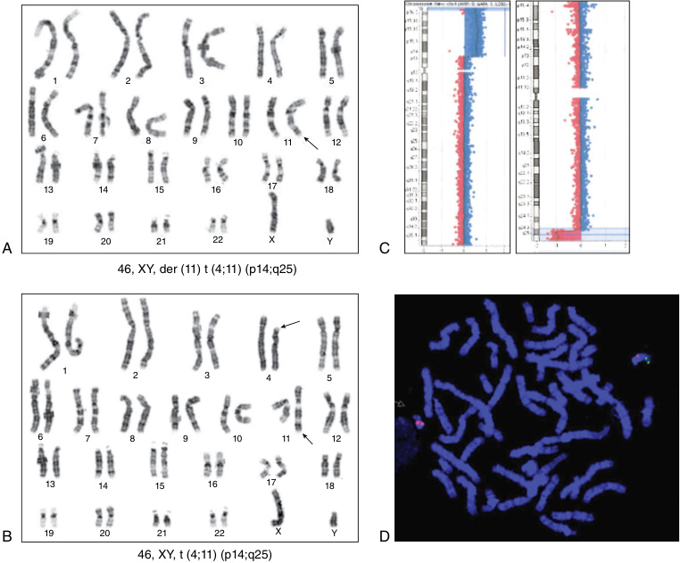

**Fig. 2.2** Cytogenetic analysis of a syndromic patient with a chromosomal anomaly that affects chromosomes 4 and 11. The patient has a duplication at 4p14 and deletion at 11q25 due to meiotic abnormal segregation of the paternal reciprocal translocation between chromosome 4p and 11q. (A) G-banding karyotype of the patient with 46 chromosomes is observed, a derivative chromosome 11 _(arrow)_ that contains duplicated material from paternal chromosome 4p and is missing chromosomal 11q material. (B) Paternal G-banding karyotype, 46 chromosomes, and a reciprocal translocation between chromosomes 4p14 and 11q25. (C) The patient’s CMA shows partial 4p14 duplication (left panel) and 11q25 deletion (right panel). (D) FISH study on a patient with 22q11.2 deletion syndrome: single locus probe TUPLE1 is absent in one of the chromosomes 22 (green); chromosome 22 is labeled with a specific probe (red). (Images courtesy of C. Hernando and E. Cuatrecasas, Sant Joan de Déu Children’s Hospital.) 

syndromes as the consequence of a 15q11.2 microdeletion. Locus-targeted FISH probes are also used to detect oncogenic amplifications and translocations in rare cancers, such as childhood acute lymphoblastic leukemia. Prenatal diagnosis of chromosomal aneuploidies is performed through noninvasive prenatal testing (NIPT) of circulating fetal DNA in the mother’s blood by applying massive DNA sequencing technology. 

**Optical genome mapping** has advanced ways to analyze SVs, labeling DNA molecules with fluorochromes and subsequently linearizing them into nanochannel arrays to detect submicroscopic rearrangements. 

### **Genetic Testing for Moderateto Small-Scale Gene Variants** 

Structural variation affects moderate to small genomic regions, between 50 bp to several kb in length, in most cases 

within a gene. Two classes of these genomic variants are distinguished: (i) intragenic deletion or duplication involving one to several exons that may affect protein domains or generate a frameshift in the open reading frame of the gene, and (ii) dynamic repeat expansions within exons, introns, or the 5′ or 3′ untranslated regions of the gene. 

**Intragenic deletions and duplications** are typically analyzed by multiplex ligation-dependent probe amplification (MLPA), which allows exons to be amplified quantitatively. This technique allows the detection of intragenic CNVs in patients homozygous for autosomal recessive traits or affected males hemizygous for recessive X-linked variants but also heterozygous parents (Fig. 2.4). Another option to analyze gene dose is the _quantification of PCR products_ . Real-time PCR quantifies copies of the amplified gene segment. Still, it requires normalization with reference standards of a well-defined gene that does not show any structural variant, either deletion or duplication. Digital

<!-- p.38 -->

A B 

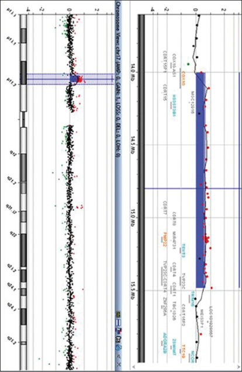

**Fig. 2.3** Chromosomal microarray analysis of genomic rearrangements or contiguous gene syndromes. Both panels show, from left to right, the ideogram of the chromosome, the genomic alteration in low resolution and the alteration in higher resolution, with an indication of the genes involved. (A) Microdeletion of approximately 593 kb on chromosome 16p11.2, associated with 16p11.2 deletion syndrome (MIM #611913), and (B) microduplication of 1.4 Mb causing the CMT1A form of Charcot-Marie-Tooth neuropathy (MIM #118220), which affects the expression of the myelin gene _PMP22_ . (Images courtesy of C. Hernando and A. Alcalá, Sant Joan de Déu Children’s Hospital.) 

PCR, however, offers precise and absolute quantification of the product without normalization. 

**Unstable repeat expansions** , also known as dynamic variants, represent genetic variants of a single trinucleotide repeat sequence or, less frequently, other small repeats that are the cause of several monogenic disorders, most of them related to the nervous system (Fig. 2.5A). _Short expansions_ , such as exonic CAG triplet-repeats that are translated into polyglutamine tracts (Fig. 2.5B) (i.e., Huntington disease and some spinocerebellar ataxias), are generally analyzed by PCR amplification with 5′ fluorophore-labeled primers, capillary electrophoresis, and fragment analysis. _Large expansions_ , such as those associated with myotonic dystrophy, fragile X syndrome, and Friedreich ataxia, are detected by triplet-repeat-primer PCR (TP-PCR) (Fig. 2.5C). When precise quantification of the expansion is required, long 

PCR or Southern blotting are appropriate methods to apply (Fig. 2.5D). Southern blotting is the oldest molecular method to detect polymorphic or rare DNA variants; it is needed to investigate the 3.3 kb D4Z4 repeats at locus 4q35 for molecular diagnosis in **facioscapulohumeral muscular dystrophy type 1 (FSHD1)** . The disease results from a heterozygous contraction of the D4Z4 repeat units in the subtelomeric region of chromosome 4q35 (Fig. 2.6). 

### **Genetic and Genomic Testing for DNA Single Nucleotide Variants** 

Analysis of point or few nucleotide genetic variants is performed by linear reading of the nucleotide bases of both DNA strands. The DNA sequencing (DNA-seq) method depends on the objective of interest and the automated

<!-- p.39 -->

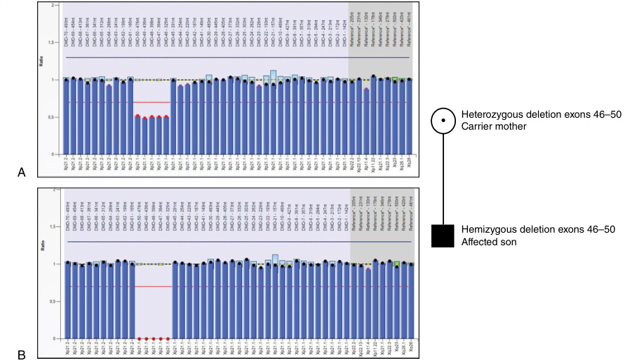

**Fig. 2.4** Analysis of exon deletions and duplications by MLPA of the _DMD_ gene. (A) The mother’s study shows that she has a 50% amplification of exons 46 to 50, which confirms who is a carrier of the deletion. (B) The son affected by Duchenne muscular dystrophy showing the outframe deletion of exons 46 to 50. (Images courtesy of L. Martorell, Sant Joan de Déu Children’s Hospital.) 

technology available. The development of massive parallel sequencing or next-generation sequencing (NGS), with different technologies and chemistries, has made it possible to read the genome, allowing many genes to be sequenced at once. There are two broad approaches for DNA-seq: (i) sequencing of PCR-amplified DNA that produces _short-read sequences (SRS)_ (Fig. 2.7A) and direct sequencing of a single DNA molecule (nonamplified) with long-read sequences (LRS); (ii) the classic Sanger sequencing method (dideoxy), which allows detecting variants in small amplicons or PCR products separately and consecutively (e.g., exons, gene fragments) (Fig. 2.7B). Regardless of the sequencing method, the description of the SNVs follows the same reference genome (Table 2.3) and the same terminology to indicate the change of the gene and product (Table 2.4). 

**Next-generation sequencing** technology can be used to detect variants by interrogating _gene panels_ encompassing a spectrum from under a hundred to several thousand proteincoding genes, the set of gene exons in the genome _(whole exome sequencing, WES)_ , or the entire genome _(whole genome sequencing, WGS)_ . Gene panels are generally designed to detect protein-coding variants of genes related to a specific group of diseases or phenotypes (e.g., lists of genes in the Genomics England PanelApp, such as intellectual disability or muscular dystrophies, at https://panelapp.genomicsengland.co.uk/panels/). A large non-phenotypically targeted panel are the clinical or Mendelian exome panels (CES) 

containing between 5,000 and 7,000 genes already associated with clinical disorders and MIM number (http://www.omim. org). In general for undiagnosed patients, WES/WGS performs better than targeted gene panels. 

One of the challenges of genome sequencing by NGS technology is the large number of variants detected and the need to establish the pathogenicity of candidate causative variants. Pathogenicity assessment requires limiting the eligible variants after filtering according to frequency (distinguishing rare variants, common variants, and polymorphisms), genetic inheritance, interspecies evolutionary conservation (genomic constraint), and pathological precedents and reports (Table 2.5). After narrowing down the candidate variant by applying these filters, predicting the pathogenicity of a variant requires additional criteria. The American College of Medical Genetics and Genomics (ACMG) and the Association of Molecular Pathology (AMP) Committee reported guidelines and recommendations for categorizing the pathological effect of the variant and the combination of criteria to define such pathogenicity (Fig. 2.8). The categories and their specific standard terminology are “pathogenic,” “likely pathogenic,” “uncertain significance,” “likely benign,” and “benign” to describe identified variants in genes (Fig. 2.9). Notably, pathogenicity predictors have limitations. New efforts are needed to understand the biology of genetic variation and its effects on disease pathophysiology to improve the diagnostic capacity of genomic analysis.

<!-- p.40 -->

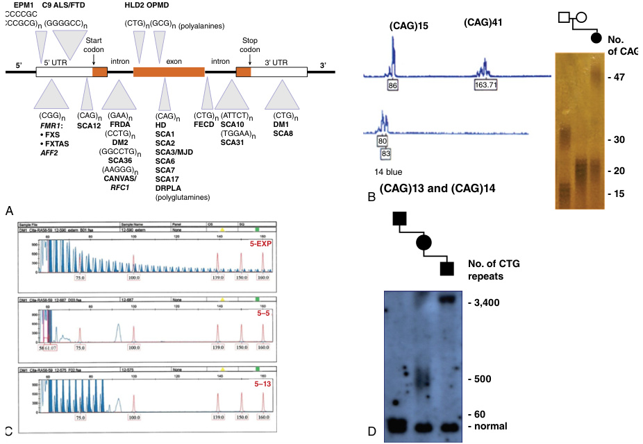

**Fig. 2.5** Dynamic variants due to expansion of microsatellite sequences. (A) Representative diagram of the genetic bases of neurological diseases caused by repeat expansions, some of them associated with genetic anticipation. The diseases are indicated according to the microsatellite sequence and its location in the gene. (B) Analysis of CAG exon expansion in Huntington disease (HD): left panel, capillary electrophoresis analysis of an HD patient heterozygous for 15 (normal allele) and 41 (pathogenic allele) CAG trinucleotide repeats (control individual is heterozygous for 13 and 14 CAG repeats); right panel, familial CAG repeat analysis using PCR DNA amplification, acrylamide gel electrophoresis, and silver nitrate staining: patient HD is heterozygous for alleles of 20 CAG (normal) and 47 CAG (pathogenic expansion), while the father is compound heterozygous (15 and 30 CAG repeats) and the mother is homozygous for the 20 CAG repeats allele; the 47 CAG allele is interpreted as a _de novo_ expanded variant, probably originating from the paternal 30 CAG allele (false paternity and motherhood were excluded). (C) Analysis of the _DMPK_ gene by TP-PCR of three DNA samples; (D) Southern blot study of the _DMPK_ CTG expansion in a family with myotonic dystrophy type 1 (DM1), segregating the CTG expansion associated with genetic expansion: from left to right, lane 1, grandfather (early cataracts); lane 2, mother (classic DM1), lane 3: congenital DM1 in a newborn. _ALS/FTD,_ Amyotrophic lateral sclerosis/frontotemporal dementia; _CANVAS,_ cerebellar ataxia, neuropathy, and vestibular areflexia syndrome; _DM1,_ myotonic dystrophy type 1; _DM2,_ myotonic dystrophy type 2; _DRPLA,_ dentate-rubro-pallid-luysian atrophy; _EPM1,_ progressive myoclonic epilepsy 1A; _FECD,_ Fuchs corneal endothelial dystrophy; _FRDA,_ Friedreich ataxia; _FXS,_ fragile X syndrome; _FXTAS,_ fragile X-associated tremor/ataxia syndrome; _HD,_ Huntington disease; _HDL2,_ Huntington disease type 2; _MJD,_ Machado-Joseph disease; _OPMD,_ oculopharyngeal muscular dystrophy; _SCA,_ spinocerebellar ataxia. 

Other challenges of genomic approaches using NGS technology in medicine are related to the capture of sequences that may be inefficient, reducing the detection quality of some genes. This limitation can occur in WES, which also interrogates some untranslated sequences, splice site boundaries, regulatory sequences, and sequences of 

some microRNAs. WGS does not suffer the disadvantage of reducing the coverage due to missing sequences. WES is considered the gold standard approach in clinical practice because it allows the reanalysis of novel genes compared to CES, generates a smaller amount of data, and is more affordable than WGS. New approaches such as long-read

<!-- p.41 -->

sequencing are entering clinical laboratories, and other methods are available or are being developed (Table 2.6, Fig. 2.10), some of which are being incorporated into clinical medicine. 

## **Bioinformatics and Data Analysis** 

NGS is a high-throughput and cost-effective technology that can detect various types of alterations, including 

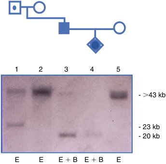

**Fig. 2.6** Molecular analysis of pathogenic contraction of the _D4Z4_ repeat array in the subtelomeric region of chromosome 4q35. Southern blot of a prenatal diagnosis in a family with a _D4Z4_ 23 kb rearrangement. The paternal grandfather is an asymptomatic carrier of the 23 kb variant after EcoRI digestion. In lane 3, a 20 kb band is shown after the EcoRI (E) and BlnI (B) double digestion, which reduces the 23 kb band by three kb, indicating that it corresponds to the locus on chromosome 4q35. In lane 4, the fetal DNA sample obtained by chorionic villus biopsy is analyzed. Observing the 20 kb EcoRI + BlnI band confirms that the fetus is a carrier of the pathogenic contraction on chromosome 4q35. 

nucleotide polymorphisms, copy number variation, transcriptome abnormalities, gene fusions, and epigenetic modifications. In this genomic data-driven analysis era, bioinformatic tools are paramount for the comprehensive processing, storage, and presentation of detected variability within an individual’s genome. 

The advancement of DNA-seq using NGS technology has revolutionized genomics research but has also introduced substantial challenges related to the storage and computational analysis of the vast data generated. The complexity of DNA-seq data formats, including raw sequence reads, alignment files, and variant call files, demands specialized storage solutions to ensure data integrity and accessibility. Computationally, the analysis of NGS data is resource-intensive and complex. Alignment, variant calling, and downstream analysis steps demand substantial processing power, memory, and time. Efforts are directed toward optimizing algorithms, developing scalable and parallelized workflows, and leveraging cloud computing and high-performance computing clusters. Controlled computational environments such as NextFlow are required to ensure reproducibility. 

Each step in the bioinformatic pipeline leading to the detection of genomic variants **(“variant calling”)** is fundamental to generating high-quality data. Considering the proportion of DNA targeted by NGS technology, the extent of identified variability demonstrates significant disparity (Fig. 2.11). DNA-seq enables the exploration of genomic variations within different sequence ranges for an agnostic diagnosis. 

Various bioinformatic tools have been created to handle distinct analyses, and comprehending the limitations of each procedure is essential for establishing the boundaries of the analysis. The nature of the specific genomic variation under investigation, whether it involves SNVs, SVs such as substantial deletions or duplications, splice sites, or DNA 

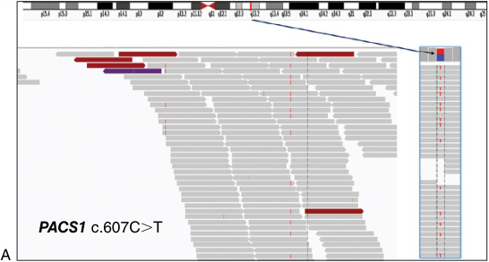

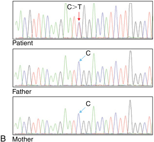

**Fig. 2.7** DNA-seq of a patient with _PACS1_ -related neurodevelopmental disorder (Schuurs-Hoeijmakers syndrome, MIM #615009). (A) Integrative genomics viewer (IGV) of the whole-exome sequencing by short-read sequencing (NextSeq500, Illumina), which shows the c.607C>T (p.Arg203Trp) variant in the _PACS1_ gene. (B) An electropherogram of Sanger sequencing confirms the presence of the _de novo_ heterozygous C>T substitution variant _(red arrow)_ that is not present in parents _(blue arrows)_ .  (Modified from Palau F, Hoenicka J. Genoma humano y análisis genético. In: _Neuropediatría. Fundamentos Prácticos_ . Caraballo RH, Campistol J, González Rabelino G eds. Buenos Aires; 2022: 94-112, with permission from Editorial Médica Panamericana.)

<!-- p.42 -->

#### **TABLE 2.3** Nomenclature f or the Si i ngle Nucleotide Variants Position to the Reference Molecule Sequence

|Numbering Scheme*,†|Prefix|Numbering System|
|---|---|---|
|**Genomic DNA**|g.|Genomic reference sequence nucleotide numbering is g.1, g.2, g.3, …, etc., from the first to the last nucleotide of the reference sequence|
|**Circular DNA**|o.|Circular reference sequence nucleotide numbering is o.1, o.2, o.3, …, etc., from the first to the last nucleotide of the reference sequence|
|**Mitochondrial DNA**|m.|Mitochondrial reference sequence nucleotide numbering is m.1, m.2, m.3, …, etc., from the first to the last nucleotide of the reference sequence (special case of a circular genomic reference sequence)|
|**Coding DNA**|c.|Numbering starts with c.1 at the A of the ATG translation initiation (start) codon and ends with the last nucleotide of the translation termination (stop) codon, i.e., TAA, TAG, or TGA (based on a protein-coding transcript)|
|**Noncoding DNA**|n.|Nucleotide numbering is n.1, n.2, n.3, …, etc., from the first to the last nucleotide of the reference sequence (based on a transcript not coding for a protein)|
|**RNA**|r.|Nucleotide numbering for an RNA reference sequence follows that of the associated coding or noncoding DNA reference sequence; nucleotide r.123 relates to c.123 or n.123|
|**Protein**|p.|Amino acid numbering is p.1, p.2, p.3, …, etc., from the first to the last amino acid of the reference sequence|
|*For diagnostic applications, it is †Reference sequence added aft (https://hgvs-nomenclature.org/|strongly rec er Communit stable/backg|ommended to use either RefSeq sequence (NCBI) or Ensembl sequence (EBI). y Consultation by the HGVS Nomenclature version 21.1.3, update 2025-06-04 round/refseq/#reference-sequence-types).|

#### **TABLE 2.4** Nomenclature an Type of Variant d Characteristics of SNVs and Gene SVs Gene and Protein Nomenclature* [Disease Example] Interpretation and Comments Percentage of Disease-Causing Variants

|**Single Nucleotide Varian** Nucleotide Substitutions |**ts(SNVs)** || |
|---|---|---|---|
|Missense|NM_000518.5_(HBB)_: c.20A>T (p.Glu7Val) _[Sickle cell disease]_|A single base-pair point variant (GAG to GTG) results in the substitution of the amino acid glutamic acid (hydrophilic) to valine (hydrophobic) in the 7th position of the β-chain of hemoglobin referred to as hemoglobin S (HbS)|   40%|
|Nonsense|NM_018972.4_(GDAP1)_:c.487C>T (p.Gln163Ter) _[Charcot-Marie-Tooth disease type 4A/2K]_|Premature stop codons|10%|
|RNA processing variants|NM_000144.5_(FXN)_:c.385-2A>G (acceptor site) _[Friedreich ataxia]_ NM_016194.4_(GNB5)_:c.628-6G>A, which creates a new alternative splicing aggcagATCC site to the canonical site gggcagATCC between intron 7 and exon 8 _[GNB5-related neurodevelopmental disorders;_ _Intellectual developmental disorder with_ _cardiac arrythmia]_| Variants affecting RNA transcription, processing, and translation: (a) those involving splicing canonical sites, either donor or acceptor; (b) splicing substitutions that create an alternative donor or acceptor site|   10%|

_(Contiuned)_

<!-- p.43 -->

#### **TABLE 2.4** Nomenclature an Type of Variant d Characteristics of SNVs and Gene SVs Gene and Protein Nomenclature* [Disease Example] I a —cont’d nterpretation nd Comments Percentage of Disease-Causing Variants

|Regulatory variants|||Rare|
|---|---|---|---|
|Deletions and Insertions |(delins) |||
|Addition or deletion of a small number of base pairs **Gene Structural Variants**|NM_000492.3_(CFTR)_: c.[1522_1524delCTT] (NP_000483.3:p.[Phe508del] _[Cystic fibrosis]_ NM_018972.4_(GDAP1)_: c.862dupA (NP_061845.2: p.[Thr288AsnfsTer3 or p. Thr288fs]) _[Charcot-Marie-Tooth disease type 4A/2K]_  **(SVs)**|Three bp deletion within exon 10 with loss of the phenylalanine residue in position 508 of the CFTR protein Duplication of adenine as a variant that alters threonine 288 as the first amino acid and shifts the reading frame (frameshift), replacing it with asparagine and terminating after three more.|25%|
|Large gene deletions, duplications, inversions, and fusions|Intragenic complex mechanisms and variable variant nomenclature: e.g., intron 22 inversion of the_F8_gene _[hemophilia A]_|Involving one or several exons and/ or introns|Rare|
|Insertions or rearrangements of LINE or_Alu_ sequences|• Insertion of L1 element into exon 14 of the_F8_gene _[hemophilia A]_ • Deletion caused by intrastrand recombination between two repetitive sequences of the_Alu_ family in the_LDLR_gene _[familial hypercholesterolemia]_| Variants caused by repetitive sequences|Rare|
|Unstable repeat expansions (dynamic variants)|CAG trinucleotide repeat expansion in gene exon: (CAG)n, with n variable _[Huntington disease; spinocerebellar ataxias_ _SCA1, SCA2, SCA3, SCA6, SCA12;_ _DRPLA]_|Exon, intron, 5′UTR, and 3′UTR single nucleotide repeats that may expand during gametogenesis|Rare|

*Specific transcripts (NM, NP) include NCBI reference sequences (RefSeq). Sequence annotation follows either GRCh37 or GRCh38 to define the genomic position. Matched Annotation from NCBI and EMBL-EBI (MANE) transcript represents an exact match in exonic regions between a Refseq transcript and its counterpart in the Ensembl/GENCODE annotation. 

nucleotide repeat expansions, governs the tailoring of bioinformatic pipelines and software tools. This tailored approach ensures optimal alignment with the unique demands posed by each variant type, thus enabling robust and accurate identification. Variations in sequencing depth and quality across the genome can introduce biases and complicate variant calling, potentially leading to false positives or missed variants. 

The description of the four primary stages that are required in any given variant calling bioinformatic pipeline will highlight the importance of controlling every step of this process (Fig. 2.12): 

- _Quality Control:_ the sequencer generates fragments of a given length base by base. Each fragment is called a “read,” and each base in each read has a quality score assigned **(Phred Score)** . The initial reads are stored in a file called **Fastq** . In the quality control step, bases with low-quality reading and reads too short to be informative in the alignment step are removed. 

- _Alignment:_ once only high-quality reads are present in the Fastq file, these reads are mapped to a reference genome. The output file of this process is called the Bam file **(Binary Alignment Map)** . This file can be visualized using software such as Integrative Genomics Viewer (IGV; Fig. 2.7A). Reads are displayed throughout the reference genome, and differences between the sample reads and the reference genome are highlighted. 

- _Variant Calling:_ visualization tools such as **integrative genomic viewer (IGV)** are not variant callers, and specific software has been developed to determine when a variant is reliable and worth reporting. The file produced is called a Vcf file **(Variant Call Format)** . The most used tools for these first _three_ steps are listed in 

- Table 2.7. Multiple software tools have been developed for each step, and choosing which software is better suited for each task and their combination has critical implications for the final results. All callers detect most variation,

<!-- p.44 -->

#### **TABLE 2.5** Filtering Elem ents to Identify the Pathogenicity of a Genetic Variant

|Filtering Criteria|Element Concept|Characteristics And Tools|
|---|---|---|
|Population frequency (rarity)|MAF<1%, so it cannot be considered a polymorphism Data in the gnomAD database to see the frequency of the allelic variant: • heterozygous variant in dominant disorders requires frequency in controls to be less than the frequency of the disorder • biallelic variants in recessive disorders must be less frequent than the estimated heterozygous carriers|Comparison between patients and controls, so it is present in very few controls* The Genome Aggregation Database is a resource of human variation developed by an international coalition of investigators, intending to aggregate and harmonize both exome and genome sequencing data from a variety of large-scale sequencing projects https://gnomad.broadinstitute.org|
|Expected inheritance pattern of the disease|Single gene disease, either dominant or recessive, autosomal or X-linked, or mitochondrial|The Online Mendelian Inheritance in Man (OMIM) offers a comprehensive, authoritative compendium of human genes and genetic phenotypes https://www.omim.org|
|Evolutionary conservation (genomic constraint)|Criterion based on the concept that natural selection maintains sequences between species due to their functional relevance; this is especially relevant for highly conserved amino acids that do not tolerate nonsense changes|• PolyPhen-2: is a tool that predicts the possible impact of an amino acid substitution on the structure and function of a human protein using straightforward physical and comparative considerations; http://genetics.bwh.harvard.edu/pph2 • SIFT: Sorting Intolerant From Tolerant predicts whether an amino acid substitution affects protein function based on sequence homology and the physical properties of amino acids;https://sift.bii.a-star.edu.sg|
|Pathogenicity prediction _*_It is essential to take into acc _MAF,_Minority allele frequency.|Predictor resources for interpretation of sequencing variants and clinical pathological impact ount local population frequencies if available. |•  ClinVar: information on the relationship between genetic variants and diseases, with published evidence; www.clinvar.com • HGMD: the Human Gene Mutation Database collects published pathogenic variants causing human genetic disease;https://www.hgmd.cf.ac.uk/ac/index.php • gnomAD: facilitates constraint monitoring analysis of missense variants with pLI and Z-scores to indicate the level of variation intolerance; and the pLoF program measures the intolerance of a transcript to loss-of- function variants;https://gnomad.broadinstitute.org • Websites and programs for prediction of the biological effect of variants. Some examples: • REVEL: an ensemble method for predicting the pathogenicity of missense variants based on a combination of scores from 13 individual tools (freely available);https://sites.google.com/site/revelgenomics • Alamut Visual Plus: variant curation, annotation, and interpretation along with missense and splicing preditors; https://www.sophiagenetics.com/platform/alamut- visual-plus/ • CADD: the Combined Annotation Dependent Depletion is a tool for scoring the deleteriousness of single nucleotide variants as well as insertion/deletion variants in the human genome;https://cadd.gs.washington.edu • SpliceAI: a deep learning-based tool to identify splice site variants by modeling mRNA splicing of genomic sequence that allows prediction of noncoding alternative splicing sites; https://github.com/Illumina/SpliceAI|

<!-- p.45 -->

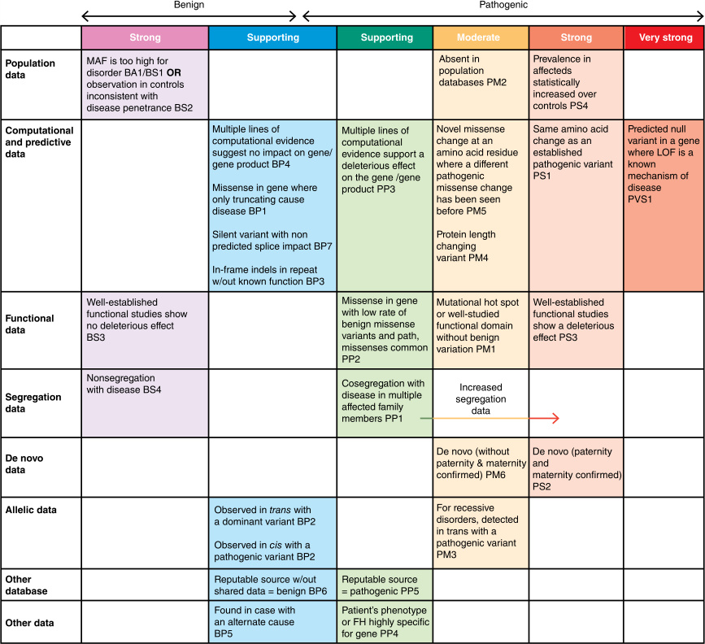

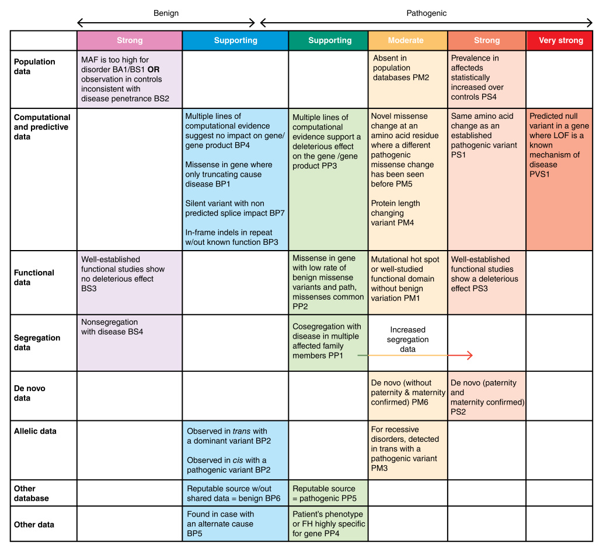

**Fig. 2.8** Evidence framework for variant pathogenicity. This matrix organizes each of the criteria by type of evidence category and by the strength of the criteria for a benign (left side) or pathogenic (right side) claim. _BS,_ Benign strong; _BP,_ benign supporting; _FH,_ family history; _LOF,_ loss of function; _MAF,_ minor allele frequency; _path.,_ pathogenic; _PM,_ pathogenic moderate; _PP,_ pathogenic supporting; _PS,_ pathogenic strong; _PVS,_ pathogenic very strong.  (Modified from Richards S et al. _Genet Med._ 2015, with permission.) 

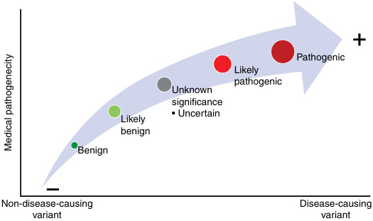

- **Fig. 2.9** Degrees of the pathogenicity of genetic variants.

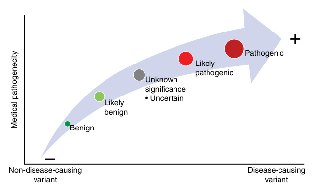

<!-- p.46 -->

#### **TABLE** 

### **Beyond the Exome and the Genome in the Diagnostic Testing of Undiagnosed Rare Diseases** 

|**2.6** **y**|**g**|**g  g**|
|---|---|---|
|Omics Test|Characteristics|Applications|
|Short-read sequencing (SRS)*|Reads typically 100–300 bp long; are mapped to a consensus reference during the alignment step|Exome and genome sequencing|
|Long-read sequencing (LRS)|Improved alignment of very long sequences to the reference genome|• Better detection of SVs, especially within repetitive elements, segmental duplications, or high GC content • Allows haplotype phasing of paternal or maternal chromosomes • Direct detection of methylated nucleotides|
|Reanalysis|Periodic automated revision of sequencing data with the latest analytical pipelines, variant frequency databases, literature, and updates in patient’s phenotype|Improve diagnosis rate with the already available exome and genome sequences|
|Pangenome reference|A linear haploid consensus sequence of the human reference genome representing the diversity of human populations|Allows reads aligning to a pan-genome that considers many alternate haplotypes at each locus, which reduces the reference bias|
|Transcriptomics RNA-seq|/ Sequencing of gene transcripts with prioritization and interpretation of potential disease-causing variants and noncoding variants|RNA sequencing data with the analysis of expression outliers, aberrant splicing, allele-specific expression, and transcriptomic structural variants. Single-cell transcriptomics allows for elucidating cellular and molecular mechanisms|
|Epigenomics|Epigenetic modifications like DNA methylation and histone code modifications|Detection of epigenetic patterns of DNA: epi variants (includes genomic imprinting) and episignatures|
|Functional geno|i mics||
|**_in silico_**|From the genetic variant to the consequences on the gene transcripts and protein functions and structure|Prediction of the effect on splicing and pre-mRNA transcripts and the impact on protein domains and structure|
|_in vitro_|Analysis of the cellular phenotypes and biochemical interactions and functions|Functional biological studies in cell lines and patient’s cells: lymphocytes, fibroblasts, iPSCs, organoids|
|_in vivo_|Generation of disease models and organ changes|Non-mammalian animal models: yeast_(S. cerevisiae)_, worm _(C. elegans)_, fly_(D. melanogaster)_, zebrafish_(D. rerio)_|
|Metabolomics|Metabolites profile in human clinical samples, either targeted or non-targeted metabolomics|Functional metabolomic studies may help to diagnose the disease (biomarkers) and uncover the pathogenic mechanism|
|Proteomics|Tissue and cellular protein profiles that may represent a disease state|Definition of known and new disease biomarkers|
|Case matching and phenomics networks *It is the current stan|International databases, compendia, and federated networks relating and supporting phenotype and genotype relationships in patients dard NGS technology in clinical genetic/genomic laboratories.|Different actions and networks such as OMIM, Orphanet, Matchmaker Exchange (genomic matching across several databases (e.g., DECIPHER, GeneMatcher, PhenomeCentral)|

but a small fraction of variability is only spotted by any individual software. This software specificity is due to the software’s fine-tuning options and the specific algorithms used. 

- _Annotation:_ once the variants have been detected, it is fundamental to know where they fall and the consequences at the genetic or regulatory level. Different databases that provide this information are needed so variants can be annotated and analyzed adequately by annotation databases (Table 2.8). Although DNA-seq is one of the most powerful tools for 

- detecting genetic variability, understanding the effects of 

this variability at the organism level and detecting the causative pathogenic variant of a given disorder is not easy. In addition to the noteworthy rise in diagnostic yield (50% globally), NGS has amplified both the volume of generated data and, consequently, the level of diagnostic uncertainty. Interpretation of the biological significance of variants remains an ongoing challenge. 

While DNA-seq undeniably yields vast data, a more comprehensive approach to understanding a patient’s pathophysiology is necessary. Thus, a broader spectrum of information beyond genomic data alone must be incorporated while

<!-- p.47 -->

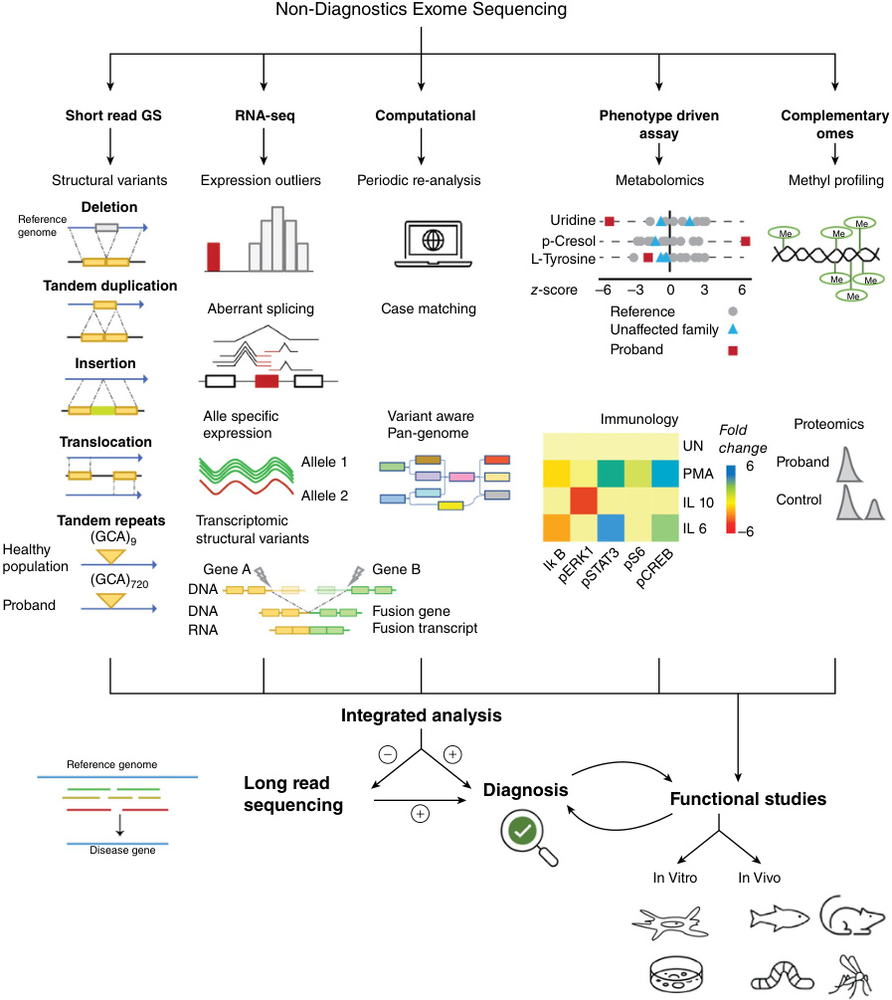

**Fig. 2.10** Technologies and methods to diagnose rare diseases when ES is unrevealing. Many of these technologies complement each other, fill the missing gaps, and should be analyzed in an integrated manner. The selection between metabolomics, proteomics, methyl profiling, and immune assays should be guided by the patient’s clinical presentation and existing candidate genes identified through sequencing. Functional studies can be used to validate strong candidate variants or elucidate the underlying molecular mechanism of the disease after identifying the causative gene. _ES,_ Exome sequencing; _GS,_ genome sequencing; _UN,_ unstimulated.  (From Marwaha S, Knowles JW, Ashley EA. A guide for the diagnosis of rare and undiagnosed disease: beyond the exome. _Genome Med_ . 2022;14:23 [Fig. 1].)

<!-- p.48 -->

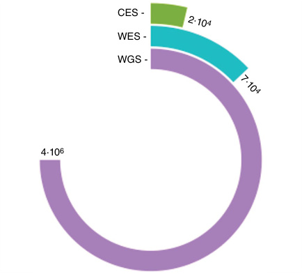

**Fig. 2.11** The number of genetic variants detected according to the massive DNA sequencing strategy. _CES,_ Clinical exome sequencing (Mendelian exome); _WES,_ whole exome sequencing; _WGS,_ whole genome sequencing. 

facing the patient’s clinical diagnosis. Integrating data from diverse sources, including imaging, wearables, other highthroughput omics technologies, and functional biology data, enriches the depth of analysis. However, clinical and phenotypic assessment is the cornerstone of this array of data. Genomic variability analysis must be anchored in a clinical hypothesis, guiding the exploration of the vast genomic landscape. _The understanding of genome variability demands the involvement of clinical expertise_ . The synergy between the clinical insights and the geneticists’ know-how is fundamental for an accurate diagnosis. Knowledge-based databases that relate genes to phenotypes, such as virtual gene panels or structured ontologies like the **human phenotype ontology (HPO)** , are crucial to enhancing this interaction. Experts in a specific field create virtual gene panels, while HPOs are generated by combining different databases and scientific 

literature. HPO is a knowledge repository and a systematic framework for categorizing human clinical traits. Each distinctive abnormality or manifestation is tagged with a unique identifier and is assigned as a term within the ontology. These terms are intricately linked to genes that have been associated with the described phenotype. The hierarchical architecture of HPO allows for the finer categorization of phenotypes, creating a tree-like structured branching. In essence, the utilization of HPO ensures a standardized and unified language for articulating phenotypic traits, promoting precision and consistency across analyses. HPO also significantly facilitates seamless data-sharing collaboration among researchers and institutions. Through the concerted integration of clinical expertise, genetic exploration, and standardized ontologies, the genome becomes more decipherable and conducive to enhancing medical understanding and patient care. 

Collaborative efforts are needed to pool and disseminate valuable information for research, diagnosis, and treatment to overcome the challenges posed by the scarcity of data and resources for rare diseases. All the data generated from a given individual must be shared to increase the knowledge of a rare disease. These initiatives involve collecting, aggregating, and sharing various types of data, including omics data, clinical data, phenotypic information, and patient outcomes. Open-access platforms and databases encourage researchers to share their findings and insights, facilitating cross-disciplinary collaboration and the discovery of new disease mechanisms, biomarkers, and therapeutic targets. Patient registries, another essential component of these initiatives, enable the collection of longitudinal data, which is invaluable for tracking disease progression (natural history of the disease, not always adequately characterized in rare diseases) and treatment outcomes over time. All these data must be structured following principles that underpin the effective management and sharing of research and scientific data. These principles, known as **FAIR data principles** , are designed to enhance the usability and value of data across various disciplines. FAIR data is an acronym for Findable, Accessible, Interoperable, and Reusable data (Table 2.9). 

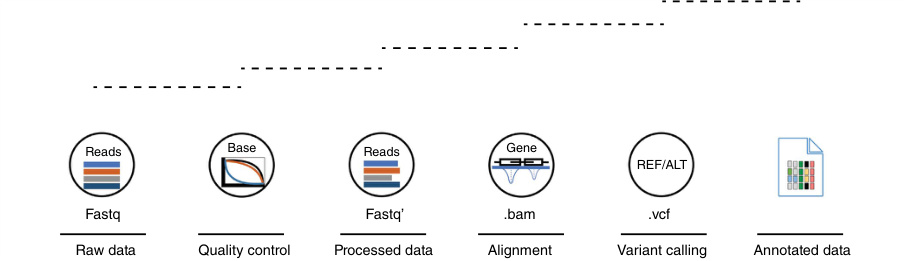

- **Fig. 2.12** Variant calling pipeline. Different steps of the bioinformatic DNA-seq pipeline lead to the annotated variants. Intermediate file names are boxed. Bam, Binary Alignment Map; Fastq, text-based format for storing both nucleotide sequence reads and its corresponding quality scores; Fastq’ refers to the reads subjected to modifications once passed the quality control step. _Vcf,_ Variant Call Format.

<!-- p.49 -->

|**TABLE** **2.7**|
|---|

### **Primary Stages of the Genomic Bioinformatic Pipeline** 

||Software|URL|
|---|---|---|
|Quality Control|FastQC|https://www.bioinformatics.babraham.ac.uk/projects/fastqc/|
||Cutadapt|https://cutadapt.readthedocs.io/en/stable/|
||Trimomatic|http://www.usadellab.org/cms/?page=trimmomatic|
|Aligners|BWA|https://bio-bwa.sourceforge.net/bwa.shtml|
||STAR|https://github.com/alexdobin/STAR|
||DRAGMAP|https://github.com/Illumina/DRAGMAP|
|Variant Calling SNVs|GATK|https://gatk.broadinstitute.org/hc/en-us|
||DeepVariant|https://github.com/google/deepvariant|
||Octopus|https://luntergroup.github.io/octopus/|
|Variant Caller SVs|Manta|https://github.com/Illumina/manta|
||Lumpy|https://github.com/arq5x/lumpy-sv|
||ExomeDepth|https://github.com/vplagnol/ExomeDepth|

### **TABLE Annotation Databases** 

#### **2.8** 

|Database|Description|URL|
|---|---|---|
|gnomAD|Offers insights into allele frequencies and genetic diversity across different human populations|https://gnomad.broadinstitute.org/|
|dbNSFP|Compiles predicted functional impact scores for non-synonymous variants|https://sites.google.com/site/jpopgen/ dbNSFP|
|CADD|Scores potentially pathogenic variants by considering evolutionary conservation and functional annotations|https://cadd.gs.washington.edu/|
|OMIM|It provides detailed information on the genetic basis of various diseases, their clinical presentations, and molecular mechanisms|https://www.omim.org/|
|ClinVar|Aggregates and curates clinical interpretations of genetic variants|https://www.ncbi.nlm.nih.gov/clinvar/|
|ClinGen|It focuses on curating genes and variants relevant for genetic diagnosis|https://clinicalgenome.org/|
|SpliceAI|Database that predicts the impact of genetic variants on RNA splicing|https://github.com/Illumina/SpliceAI|
|DGV|Catalogues structural variations found in healthy individuals|http://dgv.tcag.ca/dgv/app/home|

#### **TABLE** 

### **FAIR Data Principles** 

|**2.9** **a**|**a rncpes**|
|---|---|
|Findable|This involves assigning unique and persistent identifiers to datasets, along with comprehensive metadata describing the data’s context, origin, and relevance.|
|Accessible|This involves employing standardized protocols and formats that facilitate seamless access and clear access rights.|
|Interoperable|This requires adhering to common data standards and formats, enabling different datasets and tools to work cohesively.|
|Reusable|This principle encourages data to be well-structured and adequately annotated, enabling it to be repurposed for various studies.|

_FAIR,_ Findable, accessible, interoperable, reusable.

<!-- p.50 -->

# **Transcriptomics** 

The current knowledge about the genomic variability that occurs deep within the introns or close to the consensus sequences for identifying exon/intron boundaries is not sufficient to determine the origin of the molecular pathophysiology of a rare monogenic disease. The most widely used strategy to determine the detrimental effect of these uncharacterized genetic alterations is detecting transcriptomic abnormalities using RNA-seq. RNA-seq is a highthroughput technique that is able to characterize the _expression_ of all genes within a given sample. 

Three primary analyses are being performed to interlace genomic and transcriptomic data: 

- _Differential gene expression_ (DGE): When studying rare diseases, one of the most challenging problems is the availability of enough samples of the same kind to generate statistically significant results. Machine learning algorithms have made the comparison of one to many samples possible. These algorithms can determine genes significantly _up-_ or _downregulated_ from one sample compared to a reference cohort (usually representative of the same tissue of the studied sample). 

- _Allele-specific expression:_ Although genomic variability within one specific gene or genes might suggest that each allele comes from one parent, it might be possible that only one of both copies is being _expressed_ . **Uniparental disomy** can be due to abnormal genomic imprinting, which leads to recessive variant effects. 

- _Alternative splicing:_ Boundaries between exons and introns are very specific, and the process of cutting and pasting exons, which leads to the final transcript, is called splicing. The presence of variants in the consensus donor or acceptor splicing sites can cause the skip of critical exons or generate _alternative splicing sites (ASS)_ that could truncate the protein structure or function. When using transcriptomics to identify the molecular origin of a rare disease, the target tissue is not always available (e.g., the brain), and it is necessary to have a surrogate tissue that expresses the putative disease-causing genes. Another issue that might arise is gene expression variability within a given tissue. Transcriptomic studies use reference data sets that will be compared to the test sample. The composition of this standard cohort is fundamental to extracting nonbiased results; thus, it is essential to control the gender, ancestry, and disease health records of the different samples within this cohort. 

# **The Epigenome: Beyond the Structure of the Gene** 

Epigenetics refers to any factor that alters gene function without any change in the nucleotide sequence (the genotype). These modifications can be transmitted or heritable (from one cell to its daughter cell in cell division during mitosis and sometimes from generation to generation). 

Epigenetic changes to the genome determine which genes are expressed, in which cell type, and when. In cells, these modifications are stable and are transmitted in mitosis. The epigenome, therefore, can be defined as the global composition of chromatin (DNA and protein complex) that introduces patterns and marks in the genome, which regulate the functioning of genes (Chapter 4). 

Epigenetic patterns of DNA include _epivariants_ , which involve a change in the **DNA methylation (DNAm)** pattern of a small number of CpGs at a specific locus of the genome, and _episignatures_ , which are unique combinations of DNA methylation changes at multiple loci across the genome that are specific for different genetic syndromes. Episignatures are studied by genome-wide DNAm assay (Fig. 2.13). In the clinical setting, genomic imprinting disorders can be diagnosed by specific MLPA tests determining the _methylation profiling_ to determine the genes preferentially expressed from only one of the two parental chromosomes (i.e., Prader-Willi syndrome vs. Angelman syndrome at chromosome 15q12). 

# **Functional Genomics** 

The widespread use of genomic testing leads to frequently detecting variants of uncertain significance (VUS). The functional study of the variant can unravel the altered molecular mechanisms and show abnormal biological patterns, supporting the causality of the disease. There are several clinical situations that may be solved with the support of functional studies: (i) genetic findings without sufficient evidence of pathogenicity, even being in genes already related to a clinical phenotype (i.e., OMIM); (ii) phenotype/ genotype incongruence, with new phenotypes associated with the gene; (iii) complex clinical phenotype with discrepancies or partial congruence with the genotype; (iv) suspicion of the presence of a second disease (comorbidity); (v) difficulty in the interpretation of the segregation studies of the genetic variant; (vi) difficulties in the interpretation of the inheritance pattern, which may be caused by a hypomorphic variant; and (vii) the gene candidate has not been associated with an OMIM phenotype, which suggests the presence of a novel gene. Functional studies can be addressed in _in silico_ , _in vitro,_ and _in vivo_ biological experiments (Fig. 2.10). To incorporate functional studies in the clinical setting, it is crucial to develop an in-house “Translational Diagnostics Program” to functionally validate candidate variants and genes (Fig. 2.14). It requires tight interaction and collaboration between the medical center and the associated research institutes and university departments. 

# **Metabolomics** 

Metabolomics encompasses studying small molecules (typically known as metabolites), lipids, or carbohydrates using different technical approaches. High-throughput analytical techniques are based on NMR spectroscopy or mass spectrometry coupled with liquid chromatography or gas

<!-- p.51 -->

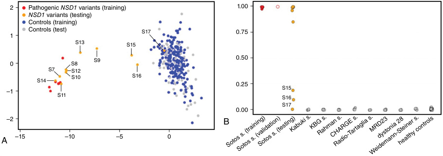

**Fig. 2.13** Use of DNAm array analyses in Sotos syndrome. Inactivating _NSD1_ variants causing Sotos syndrome have been associated with a specific genome-wide DNA methylation (DNAm) pattern. Sotos syndrome is characterized by phenotypic overlap with other overgrowth syndromes, and a definite diagnosis might not be easily reached due to the high prevalence of VUS that is identified in patients with a suggestive phenotype. (A) Taking advantage of the Sotos syndrome-specific DNAm signature, DNAm profiles in individuals carrying _NSD1_ VUS were determined, and an MDS plot was used to test samples _(orange, solid circles)_ for the Sotos syndrome training cohort _(red, solid circles)_ and a control group including 295 healthy individuals and subjects with rare neurodevelopmental disorders _(blue, solid circles)_ . An independent control group used for testing is also shown _(gray, solid circles)_ . (B) The plot for SVM probability scores based on a machine learning-based classifier shows classification results for the tested samples (VUS, n = 8, _orange solid circles_ ; validation samples, n = 1, _red open circle_ ), and the in-house control cohort (blue = training, gray = testing). _MDS,_ Multidimensional scaling; _SVM,_ support vector machine learning. (Images courtesy of Tartaglia M, Ferilli M, et al. _Genes [Basel]_ 2022, with permission.) 

chromatography techniques, which separate metabolites. Some intrinsic characteristics of metabolomics studies differentiate it from genomic studies. Metabolomics are much more variable due to environmental factors such as diet, treatments, or the microbiome effect that can remarkably modify the metabolic profiles, even in the same individual, for a short time. Two approaches are currently being used in clinical laboratories to diagnose metabolic-genetic diseases, namely, targeted and untargeted metabolomics (Fig. 2.15). 

## **Targeted Metabolomics** 

The targeted methods are the most universally employed for diagnostic purposes for rare genetic conditions in general and in inborn errors of metabolism in particular. This analytical approach is based on hypothesis-driven measurements of metabolites in body fluids, mainly in the blood (plasma or serum), urine, and cerebrospinal fluid. As an advantage, these methods are robust and allow absolute quantification of metabolites. Interlaboratory comparison quality control schemes (such as the ERNDIM program: www.ERNDIM.org; last accessed August 30, 2023) are available, with the final aim of harmonizing the different methodologies employed. Moreover, the deep knowledge accumulated over decades allows to screen healthy versus disease states and perform a biomedical metabolic profile interpretation. _Thus, although discovering new metabolites is unlikely, new associations of known_ 

_metabolites with diagnostic or prognostic features for different genetic conditions can be identified._ As a disadvantage, a limited number of metabolites can be analyzed with different dedicated methods. Typically, in a laboratory dealing with a diagnosis of inborn error of metabolism, around 30 different procedures to determine metabolic biomarkers are routinely used (Table 2.10). Because this approach focuses on targeted metabolites, no new biomarkers can be discovered, and it only provides a partial view of the metabolic landscape and its relationship with the genetic background. 

## **Untargeted Metabolomics** 

This analytical approach is based on hypothesis-generating measurements by analyzing as many metabolites as possible in body fluids. Therefore, it has the potential to screen known and novel metabolites together and provide extensive information regarding overall genomic/environmental interactions. Thus, discovering new biomarkers for diagnosis or treatment follow-up purposes is possible. However, metabolite quantifications are less robust than the targeted techniques, and no external quality control schemes for interlaboratory comparisons are available. It is estimated that approximately 35,000 different “metabolic features” can be obtained after an untargeted metabolomic analysis. Bioinformatic pipelines are necessary to process and filter such features, and this number can be reduced to around 20,000

<!-- p.52 -->

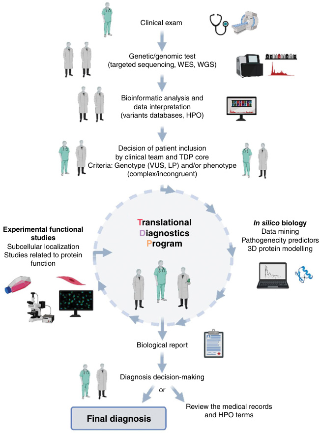

**Fig. 2.14** Flow diagram showing the process of the in-house Translational Diagnostics Program (TDP). (Adapted from Pijuan J et al. _J Mol Diagn._ 2021 and Yubero D et al. _Int J Mol Sci._ 2021.) Illustration generated with BioRender (https://biorender.com, last accessed September 1, 2023, with permission). _HPO,_ Human phenotype ontology; _LP,_ likely pathogenic; _VUS,_ variant of uncertain significance. 

features. Some of these features can be classified as _features of uncertain significance (FUS)_ . The untargeted metabolomics techniques are approaching maturity to be used in diagnosing and following patients with metabolic and other genetic diseases. However, they are only used for this purpose in a few highly specialized laboratories worldwide. Integration of metabolomics data in “multiomics” platforms (with phenotypic features, genomic, proteomic, and transcriptomic data, among others) is a challenge. International efforts will require integrating all these data in databases 

(e.g., The Human Metabolome Database, https://hmdb. ca/; last accessed August 30, 2023). 

Other promising tools to elucidate the pathophysiological basis of metabolic diseases are intracellular metabolomic analyses, which need to be fully standardized. Several critical methodological issues that may change metabolomic profiles have been identified, such as differences in culture media composition, cell harvesting, halting cell metabolism procedures, or the degradation of labile metabolites during metabolite extraction. Thus, one of the main challenges of

<!-- p.53 -->

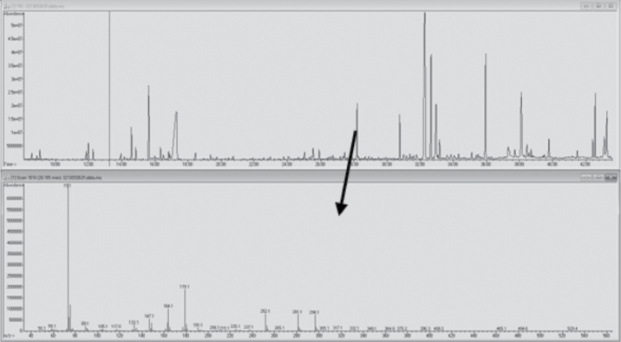

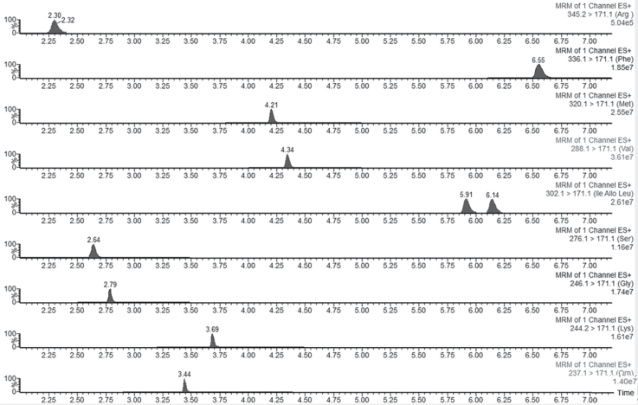

**Fig. 2.15** Chromatography mass spectrometry studies in metabolomics. (A) Gas chromatography mass spectrometry: typical chromatogram of urine organic acids where a large number of peaks corresponding to individual metabolites (upper panel) is observed, which are identified by the mass spectrometer like a fingerprint (ion fragments); this fragment profile is compared with that present in a library (lower panel and _black arrow_ ). The selected metabolite is pyroglutamic acid (the _arrow_ marks its ion fragments). The patient was diagnosed with pyroglutamic aciduria (glutathione synthetase deficiency; _GSS_ gene: MIM*601002). The panel indicates the difference between this patient (peak in black) and healthy control (very low peak in blue). (B) Chromatographic representation from a liquid chromatograph coupled to a tandem mass spectrometer: some plasma amino acids are measured (every single peak represents one different amino acid). 

intracellular metabolomics studies is to reduce variability in the results due to technical factors. 

# **Proteomics** 

Proteomics gives insight into the proteome’s composition, structure, and function, allowing the identification of specific signatures, mainly in cells. Thousands of protein species in a given cell type can be detected. Sensitivity is a limitation due to the extensive dynamic range of protein concentrations across sample tissues. Regarding biological 

fluids, the proteomic approach is one step behind the metabolomic one, at least from a diagnostic point of view. However, it has tremendous potential in discovering new biomarkers, as has already been demonstrated in different inherited metabolic diseases. Proteomic techniques are classified into untargeted and targeted proteomics. The general aim of untargeted proteomics is quantifying all proteins, leading to protein discovery and displaying advantages and limitations similar to those of untargeted metabolomic studies. Targeted proteomics is better suited to biomarker candidate verification and clinical applications.

<!-- p.54 -->

### **TABLE 2.10 Updated Inborn Errors of Metabolism Categories** 

|Disease Categories|Main Laboratory Biomarkers in Biological Fluids (Blood, Urine, and Cerebrospinal Fluid)|
|---|---|
|Amino acid metabolism|Amino acids, organic acids, acylcarnitines|
|Peptide and amines metabolism|Peptides, polyamines, amines, other|
|Carbohydrate metabolism|Carbohydrates|
|Fatty acid and ketone body metabolism|Acylcarnitines, organic acids|
|Energy substrate metabolism|Organic acids, creatine.|
|Mitochondrial disorders*|Organic acids, amino acids, acylcarnitines, cytokines, other|
|Metabolite repair/proofreading|Organic acids, acylcarnitines|
|Intermediary metabolism (miscellaneous)|Organic acids|
|Lipid metabolism|Fatty acids, very long chain fatty acids, sterols, bile acids, complex lipids|
|Lipoprotein metabolism|Lipid profile, lipoproteins|
|Nucleotide metabolism|Purines and pyrimidines|
|Tetrapyrrole metabolism|Porphyrins, heme|
|Congenital disorders of glycosylation|Sialotransferrin, other glycoproteins|
|Organelle biogenesis, dynamics, and interactions|Very long-chain fatty acids, organic acids, mucopolysaccharides, others|
|Complex molecule degradation|Mucopolysaccharides, oligosaccharides, complex lipids|
|Vitamin and cofactor metabolism|Vitamins, amino acids, organic acids|
|Trace elements/metals metabolism|Trace elements/metals|
|Neurotransmitter disorders|Biogenic amines, amino acids, organic acids|
|Endocrine-metabolic disorders|Insulin/steroids|

*The category of mitochondrial disorders has been simplified. In IEMbase (www.IEMBASE.org), mitochondrial disorders are classified into different categories: mitochondrial DNA disorders, nuclear-encoded mitochondrial genes, mitochondrial cofactors biosynthesis, mitochondrial DNA maintenance and replication, mitochondrial gene expression, and other mitochondrial disorders. 

# **Imaging Techniques, Radiomics, and Imaging Biomarkers** 

Imaging is an extremely useful adjuvant method for diagnosis, supporting evidence to the clinical suspicion, or providing some clues about alternative diagnosis. Sometimes, imaging findings can be pathognomonic, but often they help narrow the differential diagnosis. It can be of invaluable help in guiding genetic or other tests toward a specific disease or group of diseases. This approach applies to fetal studies, newborns, toddlers, and older children. 

Quantitative radiological findings are rapidly moving from research to becoming more and more integrated into the clinical practice, moving radiology from classical and fundamentally descriptive interpretation toward scientific data-based analysis, which at the same time can provide better and easier integration with other quantitative biological omics data. Proper testing and standardization are mandatory in this setting before incorporating any image biomarker into clinical practice. 

## **Imaging Techniques** 

Imaging techniques differ in the types of physical tools used and how they are applied. Each has its strengths and weaknesses. Most study structural tissue properties, but some can also be used to evaluate normal or abnormal tissue functioning. Contrast media can be used to enhance different tissue properties in many imaging techniques. Biomarkers can technically be developed from any imaging technique. 

## **_Plain Films_** 

Plain film uses X-ray to provide information on the density of the tissues in a single bidimensional image and was historically the first modality. However, it is the most used medical imaging due to its affordability and excellent initial approach to bone and lung abnormalities (Fig. 2.16A). In the context of rare diseases, it is an essential tool in evaluating patients with **skeletal dysplasia** . Extracting quantitative data from plain films is feasible, but that information is lower than that of other imaging options.

<!-- p.55 -->

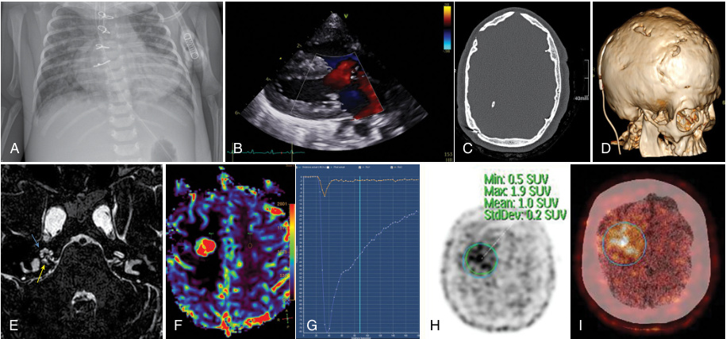

**Fig. 2.16** A pictorial review of the different imaging modalities. (A) Chest X-ray: postsurgical X-ray of a neonate with truncus arteriosus. The heart’s widening and abnormal shape, together with basal left lung opacities. (B) Echocardiography: morphology and function synchronized with the ECG can be assessed accurately. (C) Brain CT: 10 years patient with Crouzon syndrome. Axial CT with bone algorithm and window shows detailed abnormalities of the bone. 3D volume renders reconstruction. (D) shows complex craniosynostosis, surgical changes, and ventriculoperitoneal shunting catheter. (E) Brain MRI: axial T2DRIVE sequence, same patient as in C and D. The right cochlea _(yellow arrow)_ and cochlear nerve _(blue arrow)_ are easily identified. (F and G) Brain MRI T2* perfusion: relative Cerebral Blood Flow map (F) and quantification (G). The red-colored nodule shows very high perfusion, consistent with relapse in a patient with ependymoma. Values can be measured; the _orange line_ is normal perfusion in the contralateral hemisphere, and the _blue line_ corresponds to the lesion. (H) PET-DOTA: same patient as in F and G. High uptake is consistent with high amino acid metabolism and thus relapse. (I) PET-DOTA fusion with the CT scan. 

## **_Ultrasound_** 

Ultrasound uses high-frequency sound waves to create realtime images of soft tissues and solid organs that are not hidden behind bone or air. It is considered the safest biological imaging technique and is widely used in pediatrics. Besides acquiring 2D images or 3D volume, vascular flow can be assessed with Doppler studies (Fig. 2.16B), and tissue stiffness can be evaluated using shear wave techniques. 

## **_Computed Tomography_** 

CT can be visually processed in multiple planes and analyzed with many postprocessing techniques for 3D viewing, building 3D models, or printing. Because the acquisition is very fast, sedation is usually not required. CT provides excellent detail of the bone structure (Fig. 2.16C and D) and the lungs. Spectral CT can identify different atomic number (Z) components of the tissue and provide different maps according to its composition. The development of photon-counting detectors can also provide even higher spatial resolution (far below 1 mm) and better image quality with an improved contrast-to-noise ratio. Numeric quantification of the voxels is straightforward and widely used in radiological clinical practice. However, due to 

radioprotection concerns, CT use should be restricted, and the minimum possible radiation dose should be consistently applied to provide the required clinical information, following the ALARA principle (As Low As Reasonably Achievable). 

## **_Magnetic Resonance Imaging_** 

Magnetic resonance imaging (MRI) uses electromagnetic waves inside a strong magnetic field, usually between 1.5 and 3 T, to study different tissue properties and generates different sets of data (Fig. 2.16E), classically images (2D or 3D volumes) or tissue spectroscopy composition, but can also be used to assess microstructure properties, perfusion (Fig. 2.16F and G), connectivity, and function, among other options. Loosely speaking, each combination of electromagnetic waves combined with minor field strength variations are called sequences, and they provide different tissue information. H nuclei are studied in the clinical setting, but P31, C13, or Na23 can also be analyzed with dedicated equipment. 

Clinical applications are enormous; MRI is widely used to study the brain and spine, soft tissues, heart, and musculoskeletal pathologies. Because many undiagnosed diseases may include inflammatory or infiltrative disorders, whole-body

<!-- p.56 -->

rapid short time inversion recovery (STIR) MRI has been useful in detecting abnormal marrow signals, soft tissue and bone or joint findings, and other abnormalities. A critical drawback of MRI is that it requires a considerable amount of acquisition time and usually complete stillness of the patient, so sedation or even general anesthesia in children is sometimes needed. 

## **_Nuclear Medicine_** 

Nuclear medicine involves the application of small amounts of radioactive material combined with a carrier molecule (radiotracer) to examine organ function. Once it is administered, it follows the metabolic pathway that the bound molecule normally would, and radioactivity maps are taken and measured. This approach can sometimes also be used to deliver targeted radiation therapy. The most used imaging 

modalities are scintigraphy, single photon emission (SPECT), and positron emission tomography (PET). There are many different radiopharmaceuticals available: metaiodo-benzyl-guanidine (mIBG) for neuroblastoma, fluorodeoxyglucose as a biomarker of glucose metabolism or amino acids in brain tumors, and dotatate (an analogue of somatostatin) for neuroendocrine tumors (Fig. 2.16H and I, Fig. 2.17). Drawbacks of these techniques are the use of radiation, long acquisition times, and low spatial resolution, which can be overcome by imaging fusion with CT or MRI. Clinical applications in pediatrics are extensive, the most common in nephro-urology, oncology, and inflammatory diseases. 

**Magnetic resonance spectroscopy** often with MRI is helpful in providing information in many mitochondrial diseases (Fig. 2.18). 

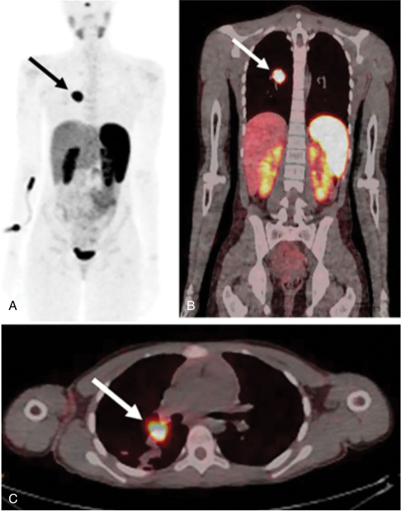

**Fig. 2.17** Bronchial carcinoid in a 13-year-old female with incidentally discovered right lower lobe mass on a chest radiograph obtained for evaluation of cough and pneumonia. (A–C) Maximum-intensity projection coronal (A), fused coronal (B), and fused axial (C) images from a68 Ga-Dotatate positron emission tomography (PET)/CT scan demonstrate marked tracer localization near the right hilum _(arrow)_ , with maximum standardized uptake value (SUVmax) = 47.6, consistent with a neuroendocrine tumor. This was resected and was confirmed to be a carcinoid tumor.  (From McElroy KM, Binkovitz LA, Trout AT, et al: Pediatric applications of dotatate: early diagnostic and therapeutic experience. _Pediatr Radiol_ . 2020;50:882–897 [Fig. 7, p. 888].)

<!-- p.57 -->

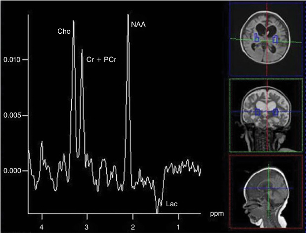

**Fig. 2.18** Bilateral putaminal nuclei in a 19-month-old patient with Leigh syndrome due to the 8993T>G variant in the mtDNA. An elevated inverted lactate is found at this echo time (135 ms) acquired on a 1.5 T Avanto scanner (Siemens Medical System, TE = 135, TR = 1.5 s, 16 16 matrix, interpolated to 32 32, 16 cm). (From Saneto RP, Friedman SD, Shaw DWW. Neuroimaging of mitochondrial disease. _Mitochondrion._ 2008;8:396-413.) 

## **Radiomics and Biomarker Development in Radiology** 

Radiomics focuses on pulling out quantitative data from medical images so this information can be data-mined to provide meaningful and valuable clinical information and data from other medical sources for precision medicine. There is one important advantage in comparison with the other omics, along with its noninvasiveness: it is not limited to the analysis of a specific tissue sample, but it can study the whole acquired anatomy. 

The quantitative extraction approach of the imaging data provides a new framework for analyzing completely new tissue properties and identifying very subtle abnormalities or changes that might be very difficult to assess or quantify visually (Fig. 2.19). 

Most radiomics research has been first developed for oncological applications but is rapidly expanding to other areas. This approach, combined with machine learning and artificial intelligence, which can handle large data sets and analyze new features, proposes great expectations to enable more precise research analysis that could be transformed into better clinical practice and outcomes. This path, though, has many challenges, such as appropriate data sample size and process standardization. An important reference 

guideline can be found on the International Biomarker Standardisation Initiative’s (IBSI) website (https://ibsi. readthedocs.io/en/latest/index.html). In the context of rare diseases, this approach is even more difficult. The sample size is inherently scarcer than in other diseases, and, as in the clinical phenotype, there can be important variations among patients suffering from the same disease, so a multiinstitutional approach is desired to gather as much data as possible. Each institution has imaging equipment, probably from different vendors, so acquisition standardization should be mandatory for a correct analysis. The best current approach is using a phantom to calibrate the equipment acquisition combined with some statistical analysis correction approach for multiple comparisons such as ComBat. Also, standardization of the postprocessing pipeline is mandatory, as sometimes different pipelines or software versions have produced different results. There is the need to compare this information with standard data sets. Because recruiting controls is an option but can be very difficult, the tendency is to acquire large databases open to the scientific community. Some examples of brain MRI are the Developing Human Connectome Project initiative (https://www.developingconnectome.org/) for newborns and the Adolescent Brain Cognitive Development repository (ABCD) from the NIH (https://nda.nih.gov/abcd/) for older children.

<!-- p.58 -->

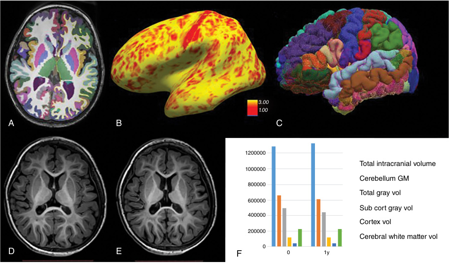

**Fig. 2.19** Morphometric quantitative brain MRI analysis. (A) Axial 3D T1 with segmentation and labeling with FreeSurfer (Laboratory for Computational Neuroimaging, Athinoula A. Martinos Center for Biomedical Imaging, Harvard Medical School). This approach allows the quantification of many different metrics of the brain tissue, such as cortical thickness maps (B, in mm) and surface representation (C). (D and E) Patient with mucopolysaccharidosis type III, at 3 and 4 years old, without evident visual changes. However, with this quantitative approach (F, in mm3 ) we can clearly see a global loss of gray matter, specifically cortical volume. 

# **Bibliography** 

- Abdelsalam EM, Ashamallah GA, Lateef MA, Fathy K. Proton MR spectroscopy in leukodystrophies. _Egypt J Radiol Nuc Med_ . 2015; 46:1091-1097. 

- Bonkowsky JL, Pastinen T, White P. The post-diagnostics world: charting a path for pediatric genomic medicine in the twenty-first century. _Pediatr Res._ 2023;93(3):457-459. 

- Casas-Alba D, Hoenicka J, Vilanova-Adell A, Vega-Hanna L, Pijuan J, Palau F. Diagnostic strategies in patients with undiagnosed and rare diseases. _J Transl Genet Genom._ 2022;6:322-332. 

- Caskey T. Precision medicine: functional advancements. _Annu Rev Med._ 2018;69:1-18. 

- Chantada-Vázquez MDP, Bravo SB, Barbosa-Gouveia S, Alvarez JV, Couce ML. Proteomics in inherited metabolic disorders. _Int J Mol Sci._ 2022;23(23):14744. 

- Chaudhari BP, Manickam K, McBride KL. A pediatric perspective on genomics and prevention in the twenty-first century. _Pediatr Res._ 2020;87:338-344. 

- Cloney T, Gallacher L, País LS, et al: Lessons learnt from multifaceted diagnostic approaches to the First 150 families in Victoria’s undiagnosed diseases program. _J Med Genet._ 2022;59:748-758. 

- Coene KLM, Kluijtmans LAJ, van der Heeft E, et al. Next-generation metabolic screening: targeted and untargeted metabolomics for the diagnosis of inborn errors of metabolism in individual patients. _J Inherit Metab Dis._ 2018;41(3):337-353. 

- den Dunnen JT, Dalgleish R, Maglott DR, et al. HGVS recommendations for the description of sequence variants: 2016 update. _Hum Mutat._ 2016;37:564-569. 

- Di Tommaso P, Chatzou M, Floden EW, Prieto Barja P, Palumbo E, Notredame C. Nextflow enables reproducible computational workflows. _Nat Biotechnol._ 2017;35(4):316-319. 

- Ellard S, Baple EL, Callaway A, et al. _ACGS Best Practice Guidelines for Variant Classification in Rare Disease_ . 2020. https://www.acgs.uk. com/media/11631/uk-practice-guidelines-for-variant-classificationv4-01-2020.pdf. 

- Ferilli M, Ciolfi A, Pedace L, et al. Genome-wide DNA methylation profiling solves uncertainty in classifying _NSD1_ variants. _Genes (Basel)_ . 2022;13(11):2163. 

- Ferraro NM, Strober BJ, Einson J, et al. Transcriptomic signatures across human tissues identify functional rare genetic variation. _Science_ . 2020;369(6509):eaaz5900. 

- FitzPatrick DR, Firth HV. Genomically aided diagnosis of severe developmental disorders. _Annu Rev Genomics Hum Genet._ 2020;21: 327-349. 

- Foreman J, Perrett D, Mazaika E, Hunt SE, Ware JS, Firth HV. DECIPHER: Improving genetic diagnosis through dynamic integration of genomic and clinical data. _Annu Rev Genomics Hum Genet._ 2023;24:151-176. 

- Giles HH, Hegde MR, Lyon E, et al. The science and art of clinical genetic variant classification and its impact on test accuracy. _Annu Rev Genomics Hum Genet._ 2021;22:285-307.

<!-- p.59 -->

- Gulani V, Seiberlich N. Quantitative MRI: rationale and challenges. In: Seiberlich N, Gulani V, Calamante F, et al., eds. _Advances in Magnetic Resonance Technology and Applications_ . Vol. 1. Cambridge, MA: Academic Press; 2020:xxxvii-li. 

- Haddad SMH, Scott CJM, Ozzoude M, et al. Comparison of quality control methods for automated diffusion tensor imaging analysis pipelines. _PLoS One_ . 2019;14(12):e0226715. 

- Hockings P, Saeed N, Simms R, et al. MRI biomarkers. In: Seiberlich N, Gulani V, Calamante F, et al., eds. _Advances in Magnetic Resonance Technology and Applications_ . Vol. 1. Cambridge, MA: Academic Press; 2020:liii-lxxxvi. 

- Hoegen B, Hampstead JE, Engelke UFH, et al. Application of metabolite set enrichment analysis on untargeted metabolomics data prioritises relevant pathways and detects novel biomarkers for inherited metabolic disorders. _J Inherit Metab Dis._ 2022;45(4): 682-695. 

- Horng H, Singh A, Yousefi B, et al. Generalized ComBat harmonization methods for radiomic features with multi-modal distributions and multiple batch effects. _Sci Rep_ . 2022;12(1):4493. 

- Hou YC, Yu HC, Martin R, Cirulli ET, et al. Precision medicine integrating whole-genome sequencing, comprehensive metabolomics, and advanced imaging. _Proc Natl Acad Sci U S A_ . 2020; 117(6):3053-3062. 

- Kingsmore SF, Cole FS. The role of genome sequencing in neonatal intensive care units. _Annu Rev Genomics Hum Genet._ 2022;23: 427-448. 

- Klee EW, Cousin MA, Pinto E Vairo F, et al. Impact of integrated translational research on clinical exome sequencing. _Genet Med._ 2021;23(3):498-507. 

- Kliegman RM, Bordini BJ, Basel D, Nocton JJ. How doctors think: common diagnostic errors in clinical judgment-lessons from an undiagnosed and rare disease program. _Pediatr Clin North Am._ 2017;64(1):1-15. 

- Köhler S, Gargano M, Matentzoglu N, et al. The human phenotype ontology in 2021. _Nucleic Acids Res._ 2021;49(D1):D1207-D1217. 

- Krokhmal AA, Kwatra N, Drubach L, et al.68 Ga-DOTATATE PET and functional imaging in pediatric pheochromocytoma and paraganglioma. _Pediatr Blood Cancer._ 2022;69:e29740. 

- Lagorce D, Lebreton E, Matalonga L, et al. Phenotypic similaritybased approach for variant prioritization for unsolved rare disease: a preliminary methodological report. _Eur J Hum Genet._ 2024; 32(2):182-189. 

- Lambin P, Rios-Velazquez E, Leijenaar R, et al. Radiomics: extracting more information from medical images using advanced feature analysis. _Eur J Cancer._ 2012;78(2):441-446. 

- Levy MA, Relator R, McConkey H et al. Functional correlation of genome-wide DNA methylation profiles in genetic neurodevelopmental disorders. _Hum Mutat._ 2022;43(11):1609-1628. 

- Lionel AC, Costain G, Monfared N, et al. Improved diagnostic yield compared with targeted gene sequencing panels suggests a role for whole-genome sequencing as a first-tier genetic test. _Genetic Med._ 2018;20(4):435-443. 

- Loisel M, Henry R, Vernon A, et al. Coronal STIR MRI sequences in unexplained limping in children under 6 years old: a single-center retrospective study of 130 cases. _Arch de Pédiatr_ 2022;29: 494-496. 

- Martin AR, Williams E, Foulger RE, et al. PanelApp crowdsources expert knowledge to establish consensus diagnostic gene panels. _Nat Genet._ 2019;51(11):1560-1565. 

- Marwaha S, Knowles JW, Ashley EA. A guide for the diagnosis of rare and undiagnosed disease: beyond the exome. _Genome Med._ 2022;14(1):e23. 

- McCague C, Ramlee S, Reinius M, et al. Introduction to radiomics for a clinical audience. _Clin Radiol._ 2023;78(2):83-98. 

- Moosa S, Coetzer KC, Lee E, Seo GH. Undiagnosed disease program in South Africa: results from First 100 exomes. _Am J Med Genet_ 2022;188A:2684-2692. 

- Morley TJ, Han L, Castro VM, et al. Phenotypic signatures in clinical data enable systematic identification of patients for genetic testing. _Nat Med_ . 2021;27(6):1097-1104. 

- Pijuan J, Rodríguez-Sanz M, Natera-de Benito D, et al. Translational diagnostics: an in-house pipeline to validate genetic variants in children with undiagnosed and rare diseases. _J Mol Diagn._ 2021;23(1):71-90. 

- Platt CD, Zaman F, Bainter W, et al. Efficacy and economics of targeted panel versus whole exome sequencing in 878 patients with suspected primary immunodeficiency. _J Allery Clin Immunol_ . 2021;147(2):723-726. 

- Preston MK, Tawil R, Wang LH. Facioscapulohumeral Muscular Dystrophy. March 8, 1999 [Updated 2020 Feb 6]. In: Adam MP, Feldman J, Mirzaa GM, et al., editors. _GeneReviews®_ [Internet]. Seattle, WA: University of Washington, Seattle; 1993-2024. 

- Quaio CRDC, Obando MJR, Perazzio SF, et al. Exome sequencing and targeted gene panels: a simulated comparison of diagnostic yield using data from 158 patients with rare diseases. _Genet Mol Biol_ . 2021;44:20210061. 

- Richards S, Aziz N, Bale S, et al. ACMG Laboratory Quality Assurance Committee. Standards and guidelines for the interpretation of sequence variants: a joint consensus recommendation of the American College of Medical Genetics and Genomics and the Association for Molecular Pathology. _Genet Med._ 2015;17(5): 405-424. 

- Sadikovic B, Levy MA, Kerkhof J, et al. Clinical epigenomics: genome-wide DNA methylation analysis for the diagnosis of Mendelian disorders. _Genet Med._ 2021;23:1065-1074. 

- Segal MM, George R, Waltman P, et al. Clinician-centric diagnosis of rare genetic diseases: performance of a gene pertinence metric in decision support of clinicians. _Orphanet J Rare Dis_ . 2020; 15:191. 

- Sobsey CA, Ibrahim S, Richard VR, et al. Targeted and untargeted proteomics approaches in biomarker development. _Proteomics._ 2020;20:1900029. 

- Sorantin E, Grasser MG, Hemmelmayr A, et al. The augmented radiologist: artificial intelligence in the practice of radiology. _Pediatr Radiol._ 2022;52(11):2074-2086. 

- Stenton SL, Kremer LS, Kopajtich R, Ludwig C, Prokisch H. The diagnosis of inborn errors of metabolism by an integrative “MultiOmics” approach: a perspective encompassing genomics, transcriptomics, and proteomics. _J Inherit Metab Dis._ 2020;43(1): 25-35. 

- Uhlén M, Hallström BM, Lindskog C, Mardinoglu A, Pontén F, Nielsen J. Transcriptomics resources of human tissues and organs. _Mol Syst Biol_ . 2016;12(4):862. 

- Warburton PE, Sebra RP. Long-read DNA sequencing: recent advances and remaining challenges. _Annu Rev Genomics Hum Genet._ 2023;24:109-132. 

- Wevers RA, Blau N. Think big—think omics. _J Inherit Metab Dis._ 2018;41(3):281-283. 

- Wilczewski CM, Obasohan J, Paschall JE, et al. Genotype first: clinical genomics research through a reverse phenotyping approach. _Am J Hum Genet_ . 2023;110:3-12. 

- Wright CF, FitzPatrick DR, Firth HV. Paediatric genomics: diagnosing rare disease in children. _Nat Rev Genet._ 2018;19: 253-268.

<!-- p.60 -->

- Yamamoto S, Kanca O, Wangler MF, Bellen HJ. Integrating nonmammalian model organisms in the diagnosis of rare genetic diseases in humans. _Nat Rev Genet._ 2024;25(1):46-60. 

- Yépez VA, Mertes C, Müller MF, et al. Detection of aberrant gene expression events in RNA sequencing data. _Nat Protoc._ 2021;16(2): 1276-1296. 

- Yubero D, Natera-de Benito D, Pijuan J, et al. The increasing impact of translational research in the molecular diagnostics of neuromuscular diseases. _Int J Mol Sci._ 2021;22(8):4274. 

the detection and grading of high signal bone marrow changes. _Eur Radiol_ . 2023;33:5045-5053. 

   - Zadig P, von Brandis E, Lein RK, et al. Whole-body magnetic resonance imaging in children—how and why? A systematic review. _Pediatr Radiol_ . 2021;51:14-24. 

   - Zwanenburg A, Vallières M, Abdalah MA, et al. The image biomarker standardization initiative: standardized quantitative radiomics for high-throughput image-based phenotyping. _Radiology._ 2020;295(2): 328-338. 

- Zadig P, von Brandis E, Müller LSO, et al: Pediatric whole-body magnetic resonance imaging: comparison of STIR and T2 Dixon sequences in

<!-- p.61 -->
