# Chapter 4: Epigenetics, Genomic Imprinting, and Imprinting Disorders
> **Course:** Vikkypaedia Rare Disease Learner Course (*Nelson Pediatric Textbook of Rare Diseases: Genomic Etiologies and Genetic Diagnosis (1st Edition)*)  
> **Section II:** Developmental Structural Disorders  
> **Authors:** Nada Derar, Yong-Hui Jiang  
> **Metrics:** 7,319 words · 8 tables · 16 figures · 28 genes · 28 flashcards · 14 MCQs  
> **Quick Navigation:** [🃏 Study 28 Flashcards](../flashcards/004_flashcards.md) · [📝 Take 14-Q MCQ Quiz](../mcqs/004_mcqs.md) · [📚 Section II Guide](../sections/Section_II.md) · [🧬 Master OMIM/Gene Atlas](../omim_gene_atlas.md) · [💊 Precision Therapies Matrix](../therapies_matrix.md) · [🏠 Course Index](../../index.md)

## Key Chapter Topics
`Developmental Structural Disorders` · `Terminology` · `Prader-Willi Syndrome (PWS) (OMIM #176270)` · `Angelman Syndrome (AS) (OMIM #105830)` · `Beckwith-Wiedemann Syndrome (BWS) (OMIM #130650)` · `Silver-Russell Syndrome (SRS) (OMIM #180860)` · `Minor Clinical Findings` · `The First-Tier Diagnostic Test` · `Uniparental Disomy 14 (UPD 14) (OMIM #616222 and #608149)` · `Diagnostic Approach` · `6q24-Related Transient Neonatal Diabetes Mellitus (6q24-TNDM) (OMIM: #601410)`

## Key Genes & Molecular Targets
`CDKN1C`, `DIO3`, `DLK1`, `F2`, `GNAS`, `GNASAS1`, `H19`, `HMGA2`, `IGF2`, `KCNK9`, `KCNQ1OT1`, `MAGEL2`, `MEG3`, `MEG8`, `MKRN3`, `MRKN3`, `NDN`, `PLAG1`

## Indexed OMIM Identifiers
`#103580`, `#105830`, `#130650`, `#166350`, `#176270`, `#180860`, `#601410`, `#603233`, `#608149`, `#612292`, `#612462`, `#612463`, `#615547`, `#616222`

## ⚡ High-Yield Clinical & Diagnostic Pearls
- The IC or ICR is frequently modified epigenetically in an allelic specific manner in the imprinting domain.
- Genetic or epigenetic defect in IC or ICR can lead to imprinting disorders if they disrupt the normal parent-of-origin-specific gene expression patterns.
- Genomic imprinting is a specific form of epigenetic modifications that involves the epigenetic marking of genes and results in a parent-of-origin specific expression pattern.
- Genomic imprinting is crucial for the early development and physiological function in mammals.
- When this process fails, it can lead to imprinting disorders; each condition has a distinct genetic/epigenetic defect and clinical presentations.
- Despite their diverse presentations, the imprinting disorders share underlying disruptions in genomic imprinting, often resulting in developmental, neurological, and growth abnormalities.
- There is no clinical genetic test to specifically examine the imprinting center defect.
- The size of imprinting center defect is expected to be small and probably less than 10 kb.

---
## Full Chapter Text, Tables & Figures

<!-- p.76 -->

## SECTION **II** 

### Developmental Structural Disorders 

4. Epigenetics, Genomic Imprinting, and Imprinting Disorders, 57 

5. Dysmorphology and Phenotyping, 73 

6. Ciliary Signaling and Dysmorphology, 91 

7.  Ciliopathies: Clinical Presentations and Syndromes, 101 

8.  Mosaic Overgrowth Syndromes, 121 

9.  Ectodermal Dysplasia, 135 

10. Heritable Disorders of Connective Tissue, 155 

11. Genetic Disorders of Bone, 207

<!-- p.77 -->

<!-- p.78 -->

# 4 Epigenetics, Genomic Imprinting, and Imprinting Disorders 

**NADA DERAR, YONG-HUI JIANG** 

#### **Terminology** 

- **Genomic imprinting:** An epigenetic phenomenon describes the expression of specific genes in a _parent-of-origin_ specific manner: they are expressed only from either the maternal or from the paternal gene copy, but not biparentally. 

- **Imprinting disorders (IDs):** A group of genetic conditions that are caused by the disturbance in the expression of imprinted genes by genetic _or_ epigenetic defects. 

- **Uniparental disomy (UPD):** UPD is the inheritance of both chromosome homologues from the same parent. 

- **DNA methylation test:** DNA methylation is a form of epigenetic modification that has a crucial role in gene regulation and various biological processes including development and disease. DNA methylation tests consist of examining the methyl group on cytosine bases in the CpG dinucleotides to determine whether the cytosine is methylated or unmethylated. 

- **Imprinting domain:** A chromosomal region that harbors a cluster of imprinted genes. The parent-of-origin specific expression of these imprinted genes is coordinately regulated. 

- **Imprinting center (IC) or imprinting control region (ICR)** is a specific genomic region or DNA sequence element that regulates the process of establishing and maintaining genomic imprinting for a set of imprinted genes in an imprinting domain. The IC or ICR is frequently modified epigenetically in an allelic specific manner in the imprinting domain. Genetic _or_ epigenetic defect in IC or ICR can lead to imprinting disorders if they disrupt the normal parent-of-origin-specific gene expression patterns. 

- **Chromosomal microarray (CMA):** A high-resolution genome wide genomic copy number variant (CNV) analysis method that is used in clinical diagnostic labs to examine the copy number gain or loss in chromosomal regions. It is a diagnostic method for identifying chromosomal imbalances across an individual’s entire genome. 

- **Uniparental disomy testing:** A genetic test to identify cases where an individual has inherited both copies of a particular chromosome (or part of a chromosome) from a single parent, instead of one copy from each parent. 

Epigenetics or epigenomics is a field of study focused on changes in DNA that do not involve alterations to the underlying gene sequence, but modifications of DNA expression, histones, and chromatin. DNA methylation, histone methylation, histone acetylation, and histone ubiquitination are common forms of epigenetic modifications (Fig. 4.1). These modifications are essential for the gene regulations during the normal development, aging, and many physiological functions. Disruptions of epigenetic modifications are implicated in a wide spectrum of disease processes such as congenital anomalies, neurodevelopmental disorders, and cancers. 

**Genomic imprinting** is a specific form of epigenetic modifications that involves the epigenetic marking of genes and results in a _parent-of-origin_ specific expression pattern. Genomic imprinting is crucial for the early development and physiological function in mammals. When this process fails, it can lead to imprinting disorders; each condition has a distinct genetic/epigenetic defect and clinical presentations. The most common imprinting disorders include Angelman syndrome (AS), Prader-Willi syndrome (PWS), Beckwith-Wiedemann syndrome (BWS), and Silver-Russell syndrome (SRS) (Table 4.1). These disorders are rare; the estimated incidence is <1 in 10,000. Despite their diverse presentations, the imprinting disorders share underlying disruptions in genomic imprinting, often resulting in developmental, neurological, and growth abnormalities. 

#### **Prader-Willi Syndrome (PWS) (OMIM #176270)** 

PWS is characterized by neonatal and infantile hypotonia and feeding difficulties in early infancy with the subsequent development of hyperphagia and morbid obesity, short stature, hypogonadism, moderate intellectual disability,

<!-- p.79 -->

**Fig. 4.1** Schematic representation of epigenetic modifications at multiple levels of DNA packaging. (A) Nucleosomes consist of histone proteins (shown in blue) surrounded by two loops of DNA and when assembled as beads on a string form chromatin, the building block of a chromosome. Reversible and site-specific histone modifications occur at multiple sites through acetylation, methylation, and phosphorylation. DNA methylation occurs at 5 position of cytosine residues in a reaction catalyzed by DNA methyltransferases (DNMTs). Together, these modifications provide a unique epigenetic signature that regulates chromatin organization and gene expression. (B) Schematic of the reversible changes in chromatin organization that influence gene expression: genes are expressed (switched on) when the chromatin is open (active) in the form of euchromatin, and they are inactivated (switched off) when the chromatin is condensed (silent) in the form of heterochromatin. White circles = unmethylated cytosines; red circles = methylated cytosines.  (From Bellanti JA. Epigenetic studies and pediatric research. _Pediat Res_ . 2020;87:378-384 [Fig. 2, p. 379].) 

neuropsychiatric disorders of obsessive-compulsive features, and variable psychiatric disorders including psychosis in adolescence (Fig. 4.2). 

##### **Clinical Features** 

The key clinical presentations of PWS differ by age group. 

- **Hypotonia:** Occurs at birth but improves during infancy and childhood and mostly resolves before teenage years. 

   - Feeding difficulty: Hypotonia leads to feeding difficulties due to poor suck, which usually resolves at the end of infancy. 

   - Delayed motor development: Hypotonia leads to the delay of motor development but usually improves and resolves later childhood. 

- **Hyperphagia:** One of the hallmark features of PWS. The insatiable appetite and a compulsive urge to eat often lead to morbid obesity. Onset in early childhood and often persists into adulthood. 

- **Short stature:** A common feature that benefits from growth hormone (GH) treatment. 

- **Hypogonadism:** Presents in both males and females and manifests as genital hypoplasia, incomplete pubertal development, and in most cases, infertility.

<!-- p.80 -->

#### **TABLE 4.1** List of Known I mprinting Disorders i n Humans

|Imprinting Disorder [OMIM Number]|Chromosome/ Imprinted Gene|Molecular Defect|Key Clinical Features|Current Treatment|
|---|---|---|---|---|
|Diabetes mellitus, transient neonatal,1 [601410]|6q24/_PLAGL1_,_HYMAI_|UPD (chr6) pat, paternal duplications, methylation defects on_PLAGL1_ TSS (caused by pathogenic variants in _ZFP57_gene at chr6p22)|Intrauterine growth restriction, neonatal diabetes mellitus, hyperglycemia, macroglossia|Insulin|
|Silver-Russell syndrome [180860] [618905] [616489]|11p15.5/_H19, IGF2_ 7p13-q32/_C7ORF10_ 11p15.5/_IGF2_|UPD (chr11p15) mat chr11p15 CNVs UPD (chr7) mat methylation defects on _H19_and_IGF2_genes|Pre-and postnatal growth deficiency, asymmetry, broad forehead, facial dysmorphism, macrocephaly, gastrointestinal symptoms|Growth hormone|
|Birk–Barel syndrome [612292]|8q24.3/_KCNK9_|_KCNK9_missense pathogenic variants on maternal gene|Developmental delay, central hypotonia, facial dysmorphism, intellectual disability|Symptomatic care|
|Beckwith–Wiedemann syndrome [130650]|11p15.5/_H19, IGF2_|UPD (chr11p15) pat, hypermethylation on _H19_and_IGF2_genes imprinting control region (ICR1)|Hypoglycemia, hyperinsulinism, macroglossia, overgrowth, visceromegaly|Surgery to correct omphalocele or umbilical hernia, diazoxide|
|Kagami–Ogata syndrome [608149]|14q32/_DLK1,MEG3,_ _RTL1, MEG8,_ _miRNAs, SNORDs,_ _DIO3, RTL1as_|UPD (chr14) pat, 14q32 mat deletion, hypermethylation on _MEG3_–_DLK1_region|Polyhydramnios, macrosomia, placentomegaly, hypotonia, developmental delay, abdominal wall defects, cardiac/thoracic abnormalities, coat hanger deformity on X-rays|Growth hormone|
|Temple syndrome [616222]|14q32/_DLK1,MEG3,_ _RTL1, MEG8_, miRNAs,_SNORDs,_ _DIO3, RTL1as_|UPD (chr14) mat, 14q32 pat deletion, hypomethylation on _MEG3_–_DLK1_region|Postnatal short stature, hypotonia, developmental delay, small hands and feet, intellectual disability|Growth hormone|
|Prader–Willi syndrome [176270]|15q11.2-q13/_MRKN3,_ _MAGEL2, NDN,_ _PWRN4, PWRN3,_ _SNURF-SNRPN,_ _SNORDs_ IPW|chr15q11.2-q13 pat deletion, UPD (chr15) mat, imprinting defect, deletion of paternal _SNORD116_|Hypotonia, developmental delay, intellectual disability, hyperphagia, hypogonadism, diabetes type II|Growth hormone|
|Angelman syndrome [105830]|15q11.2-q13/_UBE3A_|chr15q11.2-q13 mat deletion, UPD (chr15) pat, imprinting defect, _UBE3A_pathogenic variants on the maternal allele|Unmotivated laughing, ataxia, microcephaly, developmental delay, seizures, hyperreflexia|Antiepileptic drug|
|Schaaf–Yang syndrome [615547]|15q11.2/_MAGEL2_|_MAGEL2_pathogenic variants in the paternal allele|Psychomotor developmental delay, hypotonia, behavioral abnormalities, intellectual disability|Growth hormone, antipsychotic medication, noninvasive ventilation|
|Pseudohypoparathy- roidism1A (PHP1A) [103580]/PHP1C [612462]|20q13.32/_GNAS_|Inactivating pathogenic variants on the maternal allele of_GNAS_|Albright hereditary osteodystrophy, resistance to parathyroid/ other hormones, obesity, cognitive impairment|Growth hormone, vitamin D|

_(Continued)_

<!-- p.81 -->

#### **TABLE 4.1** List of Known I mprinting Disorders i n Humans—cont’d

|Imprinting Disorder [OMIM Number]|Chromosome/ Imprinted Gene|Molecular Defect|Key Clinical Features|Current Treatment|
|---|---|---|---|---|
|Pseudohypoparathy- roidism1B (PHP1B) [603233]|20q13.32/_STX16,_ _GNASAS1, GNAS_|Imprinting defect on the maternal allele of _GNAS_, 20q13 mat deletion, UPD (chr20) pat|Albright hereditary osteodystrophy, resistance to parathyroid/ other hormones, cognitive impairment|Calcium, vitamin D|
|Pseudopseudohypo- parathyroidism (PPHP) [612463]|20q13.32/_GNAS_|Inactivating pathogenic variants on the paternal allele of_GNAS_|Albright hereditary osteodystrophy, intellectual disability|Calcium, vitamin D|
|Progressive osseous heteroplasia [166350]|20q13.32/_GNAS_|Inactivating pathogenic variants on the paternal allele of_GNAS_|Heterotopic ossification|Amidronate used but not effective|
|Mulchandani–Bhoj– Conlin syndrome [617352] OMIM numbers for the above d _MAT,_Maternal;_PAT,_paternal;_U_|20q11-q13/_GNAS_ isorders are included inside br _PD,_uniparental disomy.|UPD (chr20) mat ackets <omim.org>.|Prenatal growth restriction, severe short stature, proportional head circumference, profound feeding difficulty|Growth hormone|
|A||B|D C||

   - **Fig. 4.2** Prader-Willi syndrome. (A, B) Individual showing morbid obesity with facial features as shown. (C) Upper extremities are notable for small hands relative to body size. (D) External genitalia after laparoscopic orchiopexy at 13 months.  (From Sahoo T, del Gaudio D, German JR, et al. Prader-Willi phenotype caused by paternal deficiency for the HBII-85 C/D box small nucleolar RNA cluster. _Nat Genet_ . 2008;40[6]:719-721 [Fig. 1].) 

- **Cognitive and behavioral issues:** Moderate intellectual disability, learning disorders, autistic-like behavior, and other behavioral issues such as obsessive-compulsive characteristics and psychosis. 

- **Dysmorphic facial features and minor anomaly:** Almondshaped eyes, a thin upper lip, a downturned mouth, and small hands and feet. 

**Others:** Sleep difficulty, skin picking, hypopigmentation, scoliosis, and seizure. 

##### **Molecular Genetics** 

PWS is caused by the deficiency of paternally expressed genes in the chromosome 15q11-q13 imprinted domain

<!-- p.82 -->

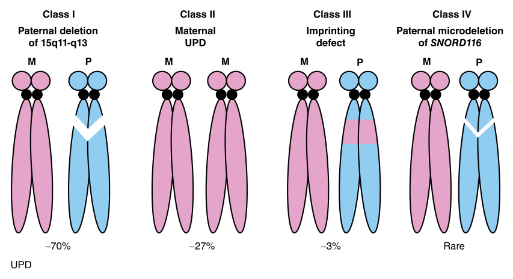

**Fig. 4.3** Molecular basis of Prader-Willi syndrome (PWS). _UPD,_ Uniparental disomy. 

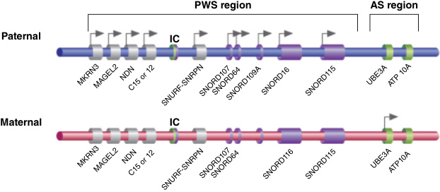

**Fig. 4.4** The genetics and epigenetics of Prader–Willi syndrome (PWS) and Angelman syndrome (AS). The imprinted gene clusters associated with PWS and AS, indicating genes that are normally maternally or paternally expressed. The bipartite regulatory imprinted control (IC) region is indicated, showing the region critical for imprinted AS cluster control (green) and PWS gene cluster control (purple).  (From Zoghbi HY, Beaudet AL. Epigenetics and human disease. _Cold Spring Harb Perspect Biol_ . 2016;8:a019497 [Fig. 3B].) 

due to 4 types of molecular defects (Fig. 4.3). This region contains four protein coding genes ( _SNURF/SNRPN, MAGEL2, NDN_ , and _MKRN3_ ), several small nucleolar RNA clusters including _SNORD116,_ and long noncoding RNA transcripts of _SNHG14_ which are exclusively paternally expressed (Fig. 4.4). In PWS patients with class I–IV defects, the expression of all these paternally expressed genes or transcripts are deficient. The exact molecular basis responsible for the PWS clinical features remains to be fully elucidated. There are rare cases of PWS patients with typical features which only have a small microdeletion restricted to _SNORD116_ . These findings support the critical role of _SNORD116_ in the pathophysiology mechanism of PWS. Pathogenic variants of paternal origin in _MAGEL2_ have been found in patients with autism spectrum disorder (ASD) and some overlapping features with PWS—the **Schaaf-Yang syndrome (SHFYNG)** . 

##### **_The First-Tier Genetic Diagnostic Test_** 

**DNA methylation test:** DNA methylation analysis of the CpG island in the PWS IC of the chromosome 15q11-q13 region is a clinical test. The CpG island is methylated in the maternal chromosome and unmethylated in the paternal chromosome. The detection of only the unmethylated pattern implies one of the following types. 

- Deletion of the paternally inherited 15q11-q13 region (in ~70% of PWS cases). 

- Uniparental disomy of entire maternal chromosome of 15 (UPD15) or rarely the segmental UPD of the maternal chromosome 15q11-q13 region (~27% of PWS cases). In most cases there is a maternal heterodisomy with both maternal chromosomes and no paternal contribution. 

- Imprinting defect of the 15q11-q13 region with or without a small deletion in the imprinting center (IC).

<!-- p.83 -->

The cases without an identifiable deletion in the IC is referred as epigenetic variant presumably due to a transacting factor (in ~3% of PWS cases). 

##### **_The Second-Tier Genetic Diagnostic Test_** 

If DNA methylation is positive for a maternal chromosome pattern _(no paternal contribution)_ , an SNP-based chromosome microarray (CMA) is offered. 

- **Single nucleotide polymorphisms (SNP)–based chromosome microarray (CMA):** CMA can confirm whether a paternal deletion of 15q11-q13 is the cause for the positive DNA methylation pattern. SNP chromosome microarray could detect _UPD_ but cannot determine whether it is paternal or maternal _without_ testing both parents. 

- **UPD15 Test:** A specific UPD15 test can be considered if CMA did not detect a deletion of the 15q11-q13 region. This will require concomitant testing of both parents to determine inheritance of the involved region and determine parent of origin. 

There is no clinical genetic test to specifically examine the imprinting center defect. The size of imprinting center defect is expected to be small and probably less than 10 kb. The high resolution of copy number analysis by research whole genome sequencing analysis and other methods may be able to detect imprinting center defect but this is not currently available as a _clinical_ test. 

##### **_The Third-Tier Genetic Diagnostic Test_** 

If DNA methylation is negative but the clinical indication for PWS remains strong, CMA should still be considered to evaluate whether a rare and a small microdeletion restricted to _SNORD116_ is present. 

If both DNA methylation and CMA are negative, the sequencing test of _MAGEL2_ may be considered to evaluate for the **Schaaf-Yang syndrome** (SHFYNG). 

##### **Genetic Counseling** 

Individuals with PWS typically present as a single affected family member and have the disorder as the result of a _de novo_ genetic alteration. Most families have a recurrence risk of less than 1%. But an IC microdeletion could have a risk of recurrence as high as 50%. The risk could be as high as 100% in rare cases where the mother presents with a chromosome 15/15 Robertsonian translocation. Reliable PWS recurrence risk assessment therefore requires identification of the genetic mechanism of PWS in the proband (15q deletion, UPD 15, or an imprinting defect) as well as parental testing to identify the presence of a predisposing genetic alternation (i.e., a parental chromosome rearrangement or paternal heterozygosity for an imprinting center deletion). The detail for the recurrence risk estimation is described in Table 4.2. 

##### **Management** 

There are no effective treatments that target the molecular genetic defect in PWS. The optimal care for PWS requires a coordination among pediatrics, endocrinology, developmental pediatrics, child psychiatry, clinical genetics, and gastroenterology. 

- **Feeding and nutritional management:** Feeding tube placement may be necessary during the newborn period and infancy to treat the feeding difficulties and poor weight gain. Due to the risk of the later onset of obesity, individuals with PWS require strict dietary control to prevent overeating and manage weight gain after infant age. 

- **Physical and occupational therapy:** Therapies help address hypotonia and motor delays, promoting physical, psychosocial, and emotional development. 

- **Behavioral and educational interventions:** Individuals with PWS often benefit from special behavioral therapies, educational support, and social skills training. 

#### **TABLE 4.2** The Genetics Mechanisms and R ecurrence Risk for PWS

|Class|Genetic Mechanism||Percentage of PW|S Recurrence Risk|
|---|---|---|---|---|
|Class I|Paternal 15q11-q13 deletion|_De novo_interstitial deletion|70%|<1%|
|||Deletion resulting from unbalanced chromosome rearrangement|<1%|Up to 25%|
|Class II|Maternal UPD 15|_De novo_UPD 15|27%|<1%|
|||UPD 15 caused by paternal 15/15 Robertsonian translocation, marker chromosome)|<1%|<1 to 100%|
|Class II|Imprinting center (IC) deletion|_De novo_|<0.5%|<1%|
|||IC deletion inherited from father|<0.5%|50%|
||Imprinting defect by epigenetic variant|_De novo_|<1%|<1%|
|Class VI|Deletion of_SNORD116s_|_De novo_|rare|<1%|

<!-- p.84 -->

- **Medication:** Growth hormone (GH) therapy should be discussed at the time of diagnosis to help improve growth and body muscle mass. The time of starting the GH treatment varies among different clinics. Some clinics start the treatment before 1 year of age. However, the evidence-based practice for the early treatment is not available. 

#### **Angelman Syndrome (AS) (OMIM #105830)** 

AS is characterized by profound developmental delay and intellectual disability, absent or severe speech impairment, gait ataxia and tremulousness of the limbs, unique behavior with an apparent happy demeanor that includes frequent laughing, smiling, and excitability. Postnatal onset microcephaly is common. The majority of patients with AS have an abnormal EEG and develop seizures at infant and childhood age (Fig. 4.5). 

##### **Clinical Features** 

AS is a severe neurodevelopmental disorder characterized by: 

**Happy demeanor:** A distinctive characteristic of seemingly happy demeanor with frequent laughter and smiling. **Hypotonia** in the newborn period and infancy. 

**Postnatal microcephaly** onset. 

- **Motor delays** and tremulous movements of limbs are common. 

- **Abnormal EEG** with a characteristic pattern of largeamplitude slow-spike waves. 

- **Seizures:** A frequent feature that varies in type and severity. Onset is usually before 3 years of age. 

- **Developmental delay** and **intellectual disability:** Individuals with AS experience significant developmental delays in reaching motor and cognitive milestones. Severe intellectual disabilities are seen in ~100% of cases. 

- **Severe speech impairment:** Absence or minimal speech development is a characteristic feature, with communication often relying on gestures, signs, or other alternative methods like augmentative and alternative communication (AAC) devices. 

- **Gait abnormalities:** Individuals with AS may exhibit a jerky and stiff gait due to peripheral hypertonia. 

- **Craniofacial features:** Flat occiput, occipital groove, wide mouth, widely spaced teeth, protruding tongue, and mandibular prognathia. 

- **Behavioral features:** Maladaptive behaviors (hitting, biting, pinching), hand flapping, tongue thrusting, frequent drooling, excessive chewing, and mouthing behavior. 

- **Sleep disorders:** These children have poor sleep, difficulties initiating and maintaining sleep that can worsen maladaptive behaviors. 

- **Others:** Hypopigmented skin, strabismus, obesity, and scoliosis. 

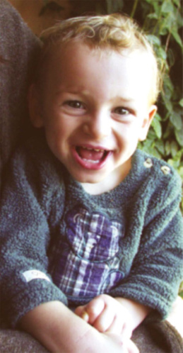

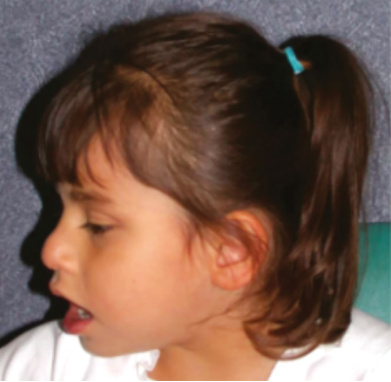

**Fig. 4.5** Angelman syndrome. Photographs of affected children with maxillary hypoplasia, deep-set eyes, a large mouth, and prognathism.  (Courtesy Dr. Lynne M. Bird, Children’s Hospital, San Diego, California. From Jones KL, Jones MC, del Campo M. _Smith’s Recognizable Patterns of Human Malformation_ . 8th ed. Philadelphia: Elsevier; 2022 [Fig. 1A and 1D, p. 277].)

<!-- p.85 -->

##### **Molecular Genetics** 

AS is caused by the deficiency of the maternally expressed gene in the human chromosome15q11-q13 region imprinting domain (Fig. 4.4). _UBE3A_ is the only gene that is solely expressed from the maternal chromosome. Specifically, _UBE3A_ is expressed from the maternal chromosome in neurons in different brain regions. There are four different types of molecular defects that result in the deficiency of _UBE3A_ (Fig. 4.6). 

##### **_The First-Tier Genetic Diagnostic Test_** 

- **DNA methylation test:** DNA methylation of the CpG island of PWS IC in the 15q11-q13 region should be offered. The test protocol for DNA methylation is the same as for PWS. The CpG island is methylated in the maternal chromosome and unmethylated in the paternal chromosome. The detection of only the unmethylated pattern implies one of the following: 

- Deletion of the maternally inherited 15q11-q13 region (which includes _UBE3A_ ) 

- Uniparental disomy (UPD) of the paternal chromosome 15 and rarely segmental UPD of the region of 15q11-q13 

- Imprinting defect in the 15q11-q13 region with or without a small deletion in the Angelman imprinting center (IC). The case without an identifiable deletion in the IC is referred as _epigenetic variant_ presumably due to a transacting factor. 

##### **_The Second-Tier Genetic Diagnostic Test_** 

If DNA methylation is positive for paternal chromosome pattern, SNP-based chromosome microarray (CMA) should be offered. 

- **SNP CMA:** CMA test can confirm whether a maternal deletion of 15q11-q13 is the cause for the positive DNA methylation pattern. Technically, SNP array can detect the UPD but cannot determine whether it is paternal or maternal without testing both parents. If the SNP array 

shows isodisomy (single set of SNPs for the entire chromosome 15), it is likely consistent with paternal UPD that results from monosomy rescue. 

- **UPD15 test:** A specific UPD15 test can be considered if CMA did not detect a deletion of the 15q11-q13 region. That requires parental and patient samples to determine SNPs or polymorphisms inheritance and to determine parent of origin. 

- There is no clinical genetic test to specifically examine the imprinting center defect. The size of IC defect is expected to be less than 10 kb and the smallest IC deletion of ~1 kb has been reported in an AS case. The high resolution of copy number analysis from research whole genome sequencing analysis and other methods may be able to detect a small IC defect but is currently not clinically available. 

- **_UBE3A sequencing test:_** If DNA methylation is negative but the clinical indication for AS remains strong, the sequencing of _UBE3A_ should be considered as a single gene test or as part of a panel that includes _UBE3A_ . A pathogenic variant in the maternally derived _UBE3A_ confirms the diagnosis. Parental test is often necessary. 

##### **_The Third-Tier Genetic Diagnostic Test_** 

In the case where there are negative tests of tier 1 and 2 but the clinical features are suggestive of Angelman syndrome, the request for a gene panel of neurodevelopmental disorders or exome sequencing (ES) should be considered. These tests may detect the pathogenic variants in a few dozen genes that may _mimic_ the clinical features of AS. The yield of gene panel and exome sequencing has not been clinically established. 

##### **Genetics Counseling** 

AS typically is the result of a _de novo_ genetic alteration associated with an estimated <1% of recurrence risk. In cases 

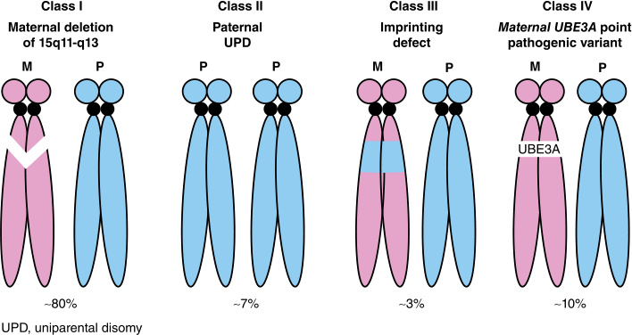

- **Fig. 4.6** Molecular basis of Angelman syndrome (AS).

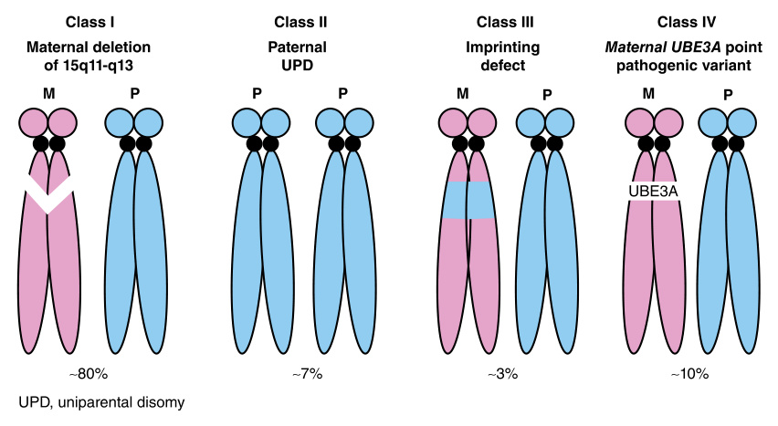

<!-- p.86 -->

#### **TABLE 4.3** The Genetic Mechanisms and Recurrence Risk for Angelman Syndro me (AS)

|Class|Genetic Mechanism|Perc|entage of AS|Recurrence Risk|
|---|---|---|---|---|
|Class I|Maternal 15q11. |_De novo_interstitial deletion||<1%|
||2-q13 deletion|Deletion resulting from unbalanced chromosome rearrangement from mother|~80%|Possible as high as 50%|
|Class II|Paternal UPD15|_De novo_||<1%|
|||UPD 15 caused by paternal 15/15 Robertsonian translocation, marker chromosome)|~7%|~100%|
|Class III|Imprinting center |_De novo_imprinting center deletion||<1%|
||deletion|IC deletion inherited from mother|~3%|50%|
||Imprinting defect by epigenetic variant|_De novo_||<1%|
|Class VI|_UBE3A_pathogenic |Maternal inherited||~50%|
||variants|_De novo_|~10%|<1%|

with pathogenic variant in _UBE3A_ , the mother should be tested. If the mother is negative, it is reassuring but gonadal mosaicism cannot be entirely ruled out and prenatal diagnosis will be recommended. If the _UBE3A_ is found in the mother, the risk for affected children may reach 50%. A pathogenic variant found in the mother can be inherited from her healthy father with a recurrence risk of 50%. Similarly, in the case that an IC defect is found in the mother, the recurrence risk can reach 50%. See Table 4.3 for recurrence risks. 

##### **Management** 

There is no FDA-approved treatment targeting the molecular defect causing AS. Consultation with clinical geneticists and pediatric neurologists is recommended. The following interventions are offered in clinics: 

- **Early development intervention:** Including physical, occupational, and speech therapy that is essential to promote the developmental potential. 

- **Behavioral interventions:** Behavior therapies and interventions help manage challenging behaviors and promote social interactions. 

- **Seizure management:** Seizures are managed with antiepileptic medications according to seizure types. The use of AED drugs like carbamazepine, oxcarbazepine (Trileptal), and vigabatrin are discouraged in this population because they can worsen the seizures. 

- **Multidisciplinary approach:** A coordination of a team of specialists including pediatricians, geneticists, neurologists, developmental pediatricians, physical medicine and rehabilitation, and psychologists is often necessary to provide comprehensive care. 

#### **Beckwith-Wiedemann Syndrome (BWS) (OMIM #130650)** 

BWS is a rare genetic disorder characterized by a wide range of physical abnormalities and an increased risk of childhood tumors. This syndrome results from genetic _and_ epigenetic changes affecting imprinted genes in an imprinting domain of chromosome 11p15.5. BWS is heterogenous and considered a clinical spectrum. The affected individuals may have many or only one or two of the characteristic clinical features. The presence of the following features may support a diagnosis of BWS (Fig. 4.7). 

##### **Clinical Features** 

##### **_Cardinal Features_** 

- Large for gestational age or birthweight >2 SDS above the mean 

- Omphalocele 

- Macroglossia 

- Hemihypertrophy/hemihyperplasia: often appreciated at birth but may become more or less evident over time. May affect segmental regions of the body or selected organs and tissues and may be limited to one side of the body (ipsilateral) or involve opposite sides of the body (contralateral) 

- Hyperinsulinism with hypoglycemia 

- Embryonal tumors: Wilms tumor (unilateral or bilateral), hepatoblastoma, or nephroblastomatosis 

##### **_Minor Features_** 

- Umbilical hernia and/or diastasis recti 

- Polyhydramnios and/or placentomegaly

<!-- p.87 -->

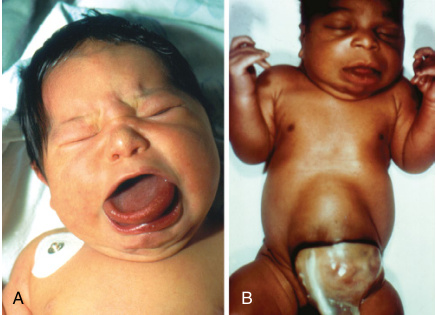

**Fig. 4.7** Beckwith-Wiedemann syndrome. (A, B) Newborn infants. (Courtesy Dr. Michael Cohen, Dalhousie University, Halifax, Nova Scotia. From Jones KL, Jones MC, del Campo M. _Smith’s Recognizable Patterns of Human Malformation_ . 8th ed. Philadelphia: Elsevier; 2022 [Fig. 1, p. 221].) 

- Transient hypoglycemia 

- Facial nevus simplex 

- Earlobe creases and/or pits 

- Nephromegaly and/or hepatomegaly 

- Other tumors: rhabdomyosarcoma or adrenal tumors (pheochromocytoma, neuroblastoma, adrenocortical carcinoma) 

##### **Molecular Genetics** 

The genetic defects causing BWS are mapped to the chromosome 11p15.5 imprinted domain (Fig. 4.8). The 11p15.5 imprinted domain harbors two imprinting control regions (IC1 and IC2) that regulate the expression of a cluster of both maternally and paternally expressed genes. The IC1 region is a CpG island that is mapped to the intergenic region between _H19_ and _IGF2_ . The IC1 region is methylated on the paternal and unmethylated on the maternal chromosome. The IC2 region is associated with transcriptional start site of _KCNQ1OT1_ . The IC2 region is methylated on the maternal and unmethylated on the paternal chromosome. The DNA methylation patterns 

of IC1 and IC2 are used for molecular diagnosis in BWS. 

The following are known genetic and epigenetic defects that are detected in around 80% of cases with features suggesting a clinical diagnosis of BWS (Table 4.4 and Fig. 4.9). 

- Gain of methylation of IC1 (~5%) 

- Loss of methylation of IC2 (~50%) 

- Paternal uniparental disomy (UPD) of 11p15.5 (~20%) 

- A heterozygous and maternal origin pathogenic variant of _CDKN1C_ (~5%) 

- Rare genomic copy number variants involving chromosome 11p15.5 including cytogenetically visible duplications, inversions or translocations, small duplications or deletions (~1%) 

##### **_The First-Tier Diagnostic Tests_** 

###### **DNA Methylation of IC1 and IC2 Test** 

- DNA methylation analysis: Abnormal DNA methylation of IC1 and IC2 in 11p15.5: i.e., loss of methylation of IC2 or gain of methylation of IC1. Abnormal DNA methylation of IC1 or IC2 may indicate 

- one of following: 

- An epigenetic defect 

- Abnormal genomic copy number variant in chromosome 11p15.5 

- Paternal UPD of 11p15.5 

- **A SNP chromosome microarray** should be requested at 

- the same time of DNA methylation or as a follow-up test if DNA methylation of IC1 or IC2 is positive. 

##### **_The Second-Tier Diagnostic Test_** 

###### **Sequencing of CDKN1C** 

If DNA methylation of IC1 and IC2 and SNP chromosome microarray are negative, a single gene sequencing test of _CDKN1C_ should be requested. The detection of a pathogenic variant in _CDKN1C_ with a maternal origin is diagnostic for BWS. 

##### **_The Third-Tier Diagnostic Test_** 

###### **Exome Sequencing Test** 

Exome sequencing could be considered in the case of a negative result from tier 1 and 2 tests, especially when clinical suspicion for another genetic etiology is considered. 

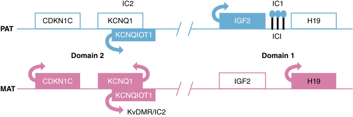

- **Fig. 4.8** 11p15 imprinted domain and molecular mechanisms for Beckwith-Wiedemann syndrome. _IC1,_ Imprinting center 1; _IC2,_ imprinting center 2.

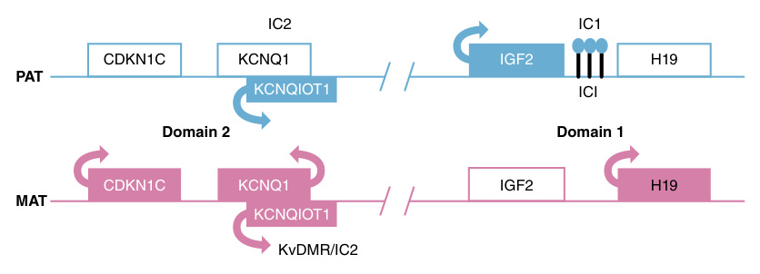

<!-- p.88 -->

#### **TABLE 4.4** The Genetic Mechanism and Recurr ence Risk for Beckwith-Wiedemann Syndrome

|Pathogenic Variants/Alterations Detected|Percentage of BWS Alterations Detected|Recurrence Risk|
|---|---|---|
|Loss of methylation at IC2 (maternal)|~50%|<1%|
|Gain of methylation at IC1 (maternal)|~5%|<1%|
|Paternal UPD|~20%|<1%|
|Heterozygous maternal_CDKN1C_pathogenic |5% in cases without family history of BWS|<1%|
|variants|~40% in case with positive family history of BWS|~50%|
|Cytogeneticor microduplication, inversion, or translocation of 11p15.5|<1%|<1%|
|Unknown|~20%|Low|

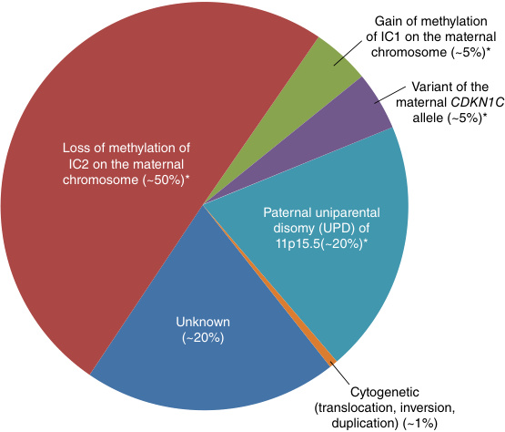

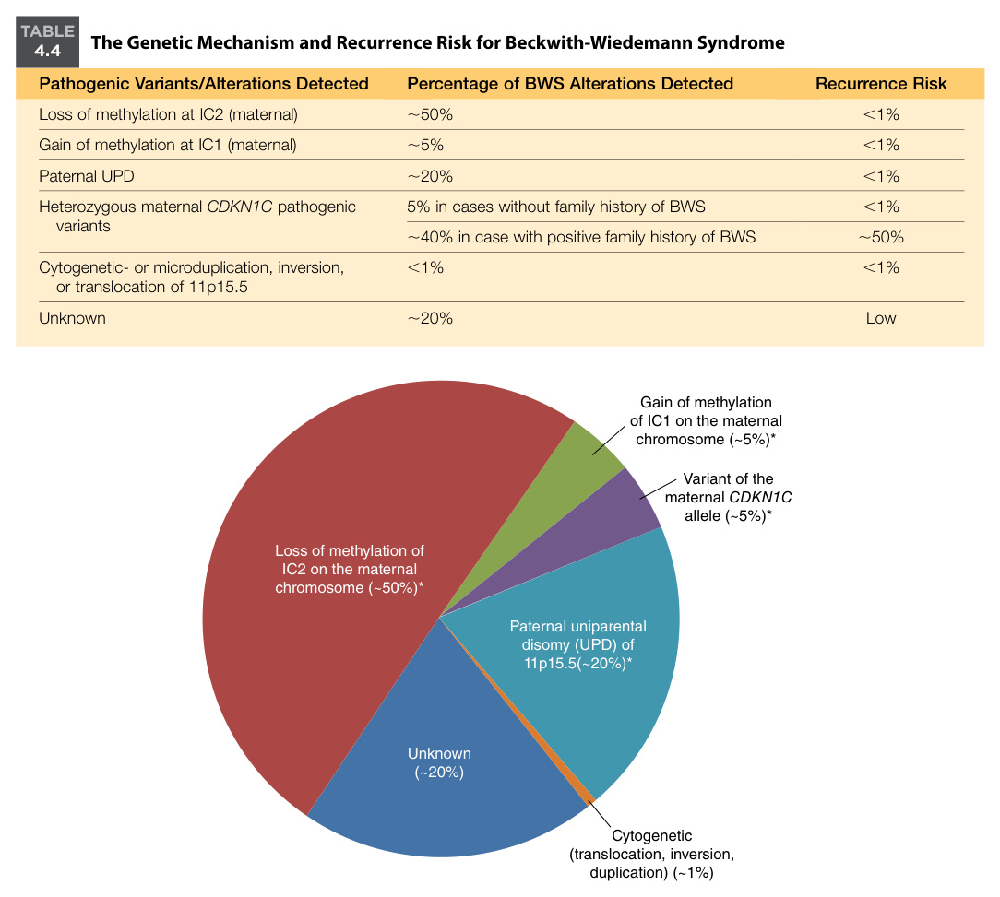

**Fig. 4.9** Causes of Beckwith-Wiedemann syndrome by genetic mechanism. *These molecular subgroups, defined by DNA methylation abnormalities, may also be the result of an underlying genomic alteration. Such genomic aberrations are most common for hypermethylation.  (From Shuman C, Kalish JM, Weksberg R. Beckwith-Wiedemann syndrome. 2000 Mar 3 [Updated 2023 Sep 21]. In: Adam MP, Feldman J, Mirzaa GM, et al., eds. _GeneReviews_ ® [Internet]. Seattle, WA: University of Washington, Seattle; 1993-2024. Figure 2. [Causes of Beckwith-Wiedemann syndrome by genetic mechanism]. https://www. ncbi.nlm.nih.gov/sites/books/NBK1394/figure/bws.F2/.) 

## **Genetic Counseling** 

The identification of a definitive molecular defect of the proband in the BWS critical region will provide information for a reliable recurrence risk estimate. Most families have a recurrence risk of less than 1% but some underlying genetic mechanisms (such as _CDKN1C_ pathogenic variants) may be associated with a recurrence risk as high as 50% if the mother carries the same pathogenic variant. In families with recurrences of BWS, maternally inherited _CDKN1C_ pathogenic variants account for approximately 40% of genetic alterations (Table 4.4). 

## **Management** 

Because of the wide spectrum of clinical features at initial diagnosis, management must be tailored to the specific presentations. Surgical correction of omphalocele, management of macroglossia associated with respiratory issues, and orthopedic care for hemihypertrophy should be managed accordingly as clinically indicated. The increased risk of embryonic tumor is one of the most important clinical aspects for the management of BWS. The tumor risk is different among different genotypes or molecular defects (Table 4.5). The most common type of embryonal tumor is

<!-- p.89 -->

### **TABLE 4.5 Estimated Tumor Risk by Molecular Mechanism in BWS** 

|Tumor Type|Molecular Mechanism|Estimated Tumor Risk|
|---|---|---|
|All types of tumors |Loss of methylation at IC2 (maternal)|2.6%|
|(Wilms tumor, hepatoblastoma,|Gain of methylation at IC1 (maternal)|28.1%|
|neuroblastoma, and others)|Paternal UPD|16%|
||Heterozygous maternal_CDKN1C_pathogenic variants|5.6%|
||Classic BWS phenotype with normal molecular genetic testing|6.2%|
|Wilms tumor|Loss of methylation at IC2 (maternal)|0.2%|
||Gain of methylation at IC1 (maternal)|24%|
||Paternal UPD|7.9%|
||Heterozygous maternal_CDKN1C_pathogenic variants|Not increased|
||Classic BWS phenotype with normal molecular genetic testing|4.1%|

Wilms tumor (52%) and others include hepatoblastoma (14%), neuroblastoma (10%), rhabdomyosarcoma (5%), and adrenal carcinoma (3%). The overall tumor risk is highest in the first 2 years of life. 

The estimated risk for major tumors by molecular defects has been described. The gain of methylation at IC1 carries higher risk for all types of tumors (28.1%), followed by paternal UPD (16%), _CDKN1C_ pathogenic variants (5.6%), and loss of methylation at IC2 (2.6%). For the cases with typical BWS phenotypes with negative molecular genetic testing, the tumor risk is ~6.%. Individually, gain of IC1 methylation has the highest risk for Wilms tumor, paternal UPD has the highest risk for hepatoblastoma, and pathogenic variants in _CDKN1C_ have the highest risk for the neuroblastoma (Table 4.5). However, genotype or molecular defects specific guidelines for the clinical monitoring of the tumor risk have not been established. 

The following surveillance protocol for Wilms tumor, hepatoblastoma, and neuroblastoma is followed by most clinics in North America for the BWS diagnosis that is molecular confirmed or typical presentations of BWS, but no molecular defect is identified. 

- Serum AFP level at the diagnosis and then every 3 months until age 4 years of age 

- Full abdominal ultrasound at the diagnosis and then every 3 months until age 4 years of age 

- Renal ultrasound every 3 months from age 4 to 7 years 

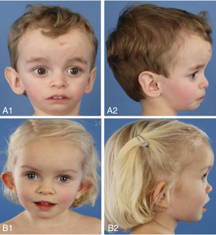

**Fig. 4.10** Patients with Silver–Russell syndrome due to hypomethylation 11p15 (A1-2 and B1-2) and maternal uniparental disomy of chromosome 7. (From Marsaud C, Rossignol S, Tounian P, et al. Prevalence and management of gastrointestinal manifestations in Silver-Russell syndrome. _Arch Dis Child._ 2015;100:353-358 [Fig. 1, p. 354].) 

## **Cardinal Features** 

# **Silver-Russell Syndrome (SRS) (OMIM #180860)** 

SRS is an imprinting disorder characterized by intrauterine growth restriction, postnatal feeding issues and poor growth, relative macrocephaly, prominent forehead and dysmorphic face, and asymmetric body growth (Fig. 4.10). 

- Small for gestational age (birth weight and/or length less than 2 SD below the mean for gestational age) 

- Postnatal growth failure (length/height less than SD below the mean at 24 months) 

- Relative macrocephaly at birth and postnatally (head circumference >1.5 SD above birth weight and/or length)

<!-- p.90 -->

- Frontal bossing or prominent forehead 

- Asymmetric body growth 

- Feeding difficulties and failure to thrive 

- Motor delay 

- Genitourinary anomalies 

## **Molecular Genetics** 

## **Minor Clinical Findings** 

- Delayed closure of anterior fontanelle 

- Triangular face 

- Micrognathia 

- Dental crowding 

- Down-turned corners of the mouth 

- High-pitched voice 

- Diminished muscle mass 

- Shoulder dimples 

- Hypoplastic elbow joints 

- Fifth-finger clinodactyly and/or brachydactyly 

- Scoliosis 

- Excessive sweating 

- Fasting hypoglycemia 

- Speech delay 

SRS is a genetically heterogeneous condition. Five types of molecular defects are detected in approximately 60% of affected individuals with typical features of SRS (Fig. 4.10, Fig. 4.11, and Table 4.6). These molecular defects include: 

- Hypomethylation of the imprinted control region 1 (IC1) at 11p15.5 (~45%) 

- Maternal uniparental disomy of chromosome 7 (mUPD7) (~10%) 

- Duplications, deletions, or translocations involving the imprinting centers at 11p15.5 (rare) 

- Duplications, deletions, or translocations involving chromosome 7 (rare) 

- Pathogenic variants in _CDKN1C, IGF2, PLAG1_ , and _HMGA2_ in case reports (rare) 

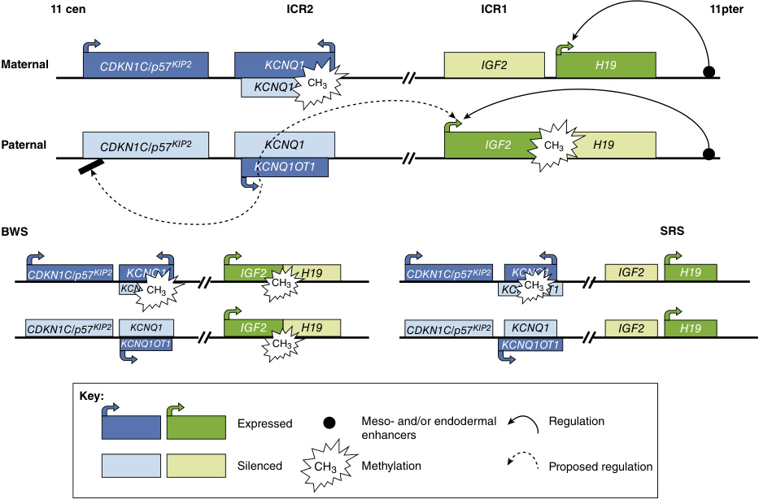

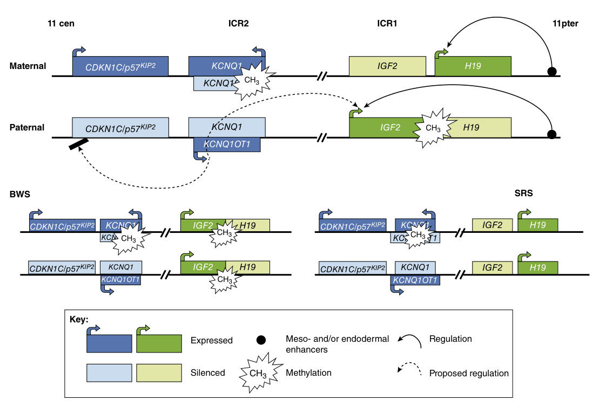

**Fig. 4.11** Epigenetic regulation of the two imprinting control regions (ICRs) in 11p15 and illustration of the hyper-/hypomethylation of the ICR1 observed in Beckwith-Wiedemann syndrome (BWS) and SilverRussell syndrome (SRS). In the ICR1, hypermethylation of the H19 promotor and loss of imprinting of IGF2 are detectable in 2–7% of BWS patients, whereas loss of methylation in the same region is a frequent finding in SRS. The majority of BWS shows hypomethylation in the ICR2 or variants in the ICR2-regulated _CDKN1C_ gene.  (Eggermann T, Eggermann K, Schönherr N. Growth retardation versus overgrowth: SilverRussell syndrome is genetically opposite to Beckwith-Wiedemann syndrome. _Trends Genet._ 2008;24[4]: 195-204. doi:10.1016/j.tig.2008.01.003.)

<!-- p.91 -->

#### **TABLE** 

### **4.6 The Genetic Mechanism and Recurrence Risk for Silver-Russell Syndrome (SRS)** 

|Chromosome Location/Gene|Genetic Mechanism|Percentage in SRS|Recurrence Risk|
|---|---|---|---|
|11p15.5 IC1 region|Hypomethylation (paternal)|~40%|Low|
|Chromosome 11p15.5|Somatic mosaicism for maternal UPD11|rare|<1%|
||Microduplication|rare|0 to 50% depending on parental carrier status|
|Chromosome 7|Maternal UPD7|~10%|<1%|
||Microdeletions or microduplication of 7p|rare|0 to 50% depending on parental carrier status|
||Mosaic trisomy 7|rare|Low|
|_CDKN1C_||1 family reported|Unknown|
|_IGF2_|_De novo_or inherited pathogenic |A few cases reported|0 or 50% depending on parental carrier status|
|_PLAG1_|variants|rare|0 or 50%|
|_HMGA2_||rare||
|Unknown|Unknown|~40%|Unknown|

## **_The First-Tier Diagnostic Test_** 

- Methylation analysis of IC1 of chromosome 11p15.5 region. The test protocol is the same as for methylation studies in BWS 

- Maternal UPD7 test 

- SNP CMA 

## **_The Second-Tier Diagnostic Test_** 

Sequence analysis of _IGF2, CDKN1C, PLAG1_ , and _HMGA2_ by gene panel or exome sequencing. 

Parental test is indicated to determine the parent origin of the variant if a likely pathogenic or pathogenic variant is found in these genes. 

## **Management** 

There is no effective treatment that targets molecular defects associated with SRS. The care by a multidisciplinary team and close follow-up are necessary for optimal management. The multidisciplinary team should be composed of pediatric subspecialists including an endocrinologist, gastroenterologist, dietician, clinical geneticist, craniofacial team, orthopedic surgeon, neurologist, speech and language therapist, and psychologist as indicated by the clinical presentations. 

Growth delay with or without identifiable growth hormone deficiency is usually treated with growth hormone. 

Hypoglycemia is not common but should be prevented or aggressively managed by frequent feeding and other nutritional approaches. 

Management for feeding disorders include nutritional and caloric supplements, medication for gastroesophageal 

reflux, therapy for oral motor problems and feeding aversion, as well as enteral tube feeding as needed. 

# **Uniparental Disomy 14 (UPD 14) (OMIM #616222 and #608149)** 

UPD14 presents as either paternal (UPD14pat) or maternal (UPD14mat) in origin. UPD14mat is the cause of the imprinting disorder known as **Temple syndrome (TS)** and UPD 14pat is the cause of a different imprinting disorder known as **Kagami-Ogata syndrome (KOS)** . The 14q32.2 region is an imprinted domain with a cluster of both maternal and paternally imprinted genes. The deficiency of these imprinted genes is the molecular cause for both TS and KOS. TS and KOS present with distinct clinical features. 

## **Clinical Features** 

The maternal and paternal UPD chromosome 14 cause distinct phenotypes (Table 4.7). 

## **Molecular Genetics** 

The human chromosome 14q32.2 is an imprinted domain that harbors a cluster of both paternal and maternal imprinted genes. _DLK1_ and _RTL1_ are paternally expressed genes. _MEG3, MEG8, RTL1as_ , _SnoRNA_ cluster, and microRNA cluster are maternally expressed. An intergenic differentially methylated region (IG-DMR) is identified in the region. The IG-DMR region is typically methylated in

<!-- p.92 -->

### **TABLE 4.7 Chromosome 14 UPD Syndromes** 

|Maternal UPD 14 (UPD14mat) Temple Syndrome (TS) (OMIM 616222)|Paternal UPD 14 (UPD14pat) Kagami-Ogata Syndrome (KOS) (OMIM 608149)|
|---|---|
|• Growth restriction: pre-and postnatal growth restriction|• Polyhydramnios and placentomegaly|
|• Developmental delay|• Thoracic dysplasia: coat hanger sign on chest X-rays and|
|• Muscular hypotonia|respiratory failure|
|• Joint laxity|• Abdominal wall defects|
|• Small hands and feet|• Postnatal growth restriction|
|• Truncal obesity|• Developmental delay|
|• Precocious or early onset of puberty • Short stature|• Dysmorphic face with full cheeks and protruding philtrum|
|• Dysmorphic facial features||

the paternal chromosome and unmethylated in the maternal chromosome. However, the molecular and epigenetic mechanisms of imprinted gene regulations in 14q32.2 imprinted domain remain to be fully elucidated. 

Maternal UPD14 causes ~60–75% of TS and paternal UPD14 causes approximately 55–70% of KOS. Microdeletion of either maternal or paternal copy of 14q32.2 and epigenetic change at the imprinting control region (IG-DMR) can cause TS and KOS. 

In UPD14pat or KOS, both _DLK1_ and _RTL1_ are expressed from both chromosomes, which significantly increases _RTL1_ expression because of the absence of the functional _RTL1_ as (antisense of _RTL1_ ) and the maternally expressed genes are missing. 

In UPD14mat or TS, the maternally expressed genes are expressed in excess from both chromosomes, while the paternally expressed genes are missing. These molecular changes are considered the key mechanism of UPD14. 

In rare cases, paternal or maternal microdeletion of the 14q32.2 region and epigenetic variant of the IG-DMR region mimic the molecular defect of either maternal or paternal UPD14. 

## **Diagnostic Approach** 

Testing for UPD14, DNA methylation studies of IG-DMR, and SNP CMA should be offered as a tier approach or together if clinical presentations suggest a differential diagnosis of TS or KOS. 

## **Genetic Counseling** 

The causes for maternal or paternal UPD14 are likely related to chromosome nondisjunction and trisomy/ monosomy rescue. In these circumstances, the recurrence risk is therefore low and usually below 1%. 

In rare cases with microdeletion and epigenetic variant due to identifiable genetic defect, the recurrence risk could be as high as 50%. The counseling for the recurrence risk must be determined individually based on the nature of exact genetic defect. 

## **Management** 

There is no specific and effective treatment that targets the molecular defects of UPD14. 

A comprehensive management should be tailored to the individual’s clinical presentations and medical needs. Early intervention programs, specialized educational services, and speech, occupational, and physical therapy can help support their development and improve their quality of life. 

Psychosocial support, including counseling and support groups, can provide emotional support, guidance, and resources to help families navigate the practical and emotional aspects of living with UPD14. 

# **6q24-Related Transient Neonatal Diabetes Mellitus (6q24-TNDM) (OMIM: #601410)** 

6q24-TNDM is defined as transient neonatal diabetes mellitus caused by genetic aberrations of the imprinted locus at 6q24. 6q24-TNDM is an extremely rare intrauterine growth deficiency syndrome characterized by persistent hyperglycemia during the first few months of life. Low insulin levels and hyperglycemia usually resolve before 2 years of age. 

## **Clinical Features** 

- Severe intrauterine growth restriction, which reflects the lack of insulin in utero. 

- Postnatal failure to thrive. 

- Hyperglycemia that begins in the neonatal period in a term infant and resolves by 2 years of age. Insulin is usually required initially; the need for insulin gradually declines over time. Intermittent episodes of hyperglycemia may occur in childhood, particularly during intercurrent illnesses. **Diabetes mellitus** may recur in adolescence or later in adulthood. Women who have had 6q24-TNDM are at risk for diabetes to relapse during pregnancy. 

- Absence of ketoacidosis. 

- Macroglossia and umbilical hernia may be present.

<!-- p.93 -->

- Marked hypotonia, congenital heart disease, deafness, neurological features including epilepsy, and renal malformations may be associated with a multilocus imprinting disturbance caused by pathogenic variants in _ZFP57._ 

## **Molecular Genetics** 

6q24-TNDM has been initially linked to paternal uniparental disomy of chromosome 6 (UPD6pat) and to large duplications of region 6q24 on the paternal chromosome. TNDM is caused by the overexpression of the paternal allele of the imprinted locus in chromosome 6q24, which contains only two paternally expressed genes, _PLAGL1_ and _HYMAI_ . Normally, the expression of the maternal alleles of _PLAGL1_ and _HYMAI_ is silenced by the DMR methylation and only the paternal alleles of _PLAGL1_ and _HYMAI_ are expressed. Identified molecular mechanisms in cases with 6q24TNDM include: 

- Duplication of 6q24 on the paternal allele 

- Paternal uniparental disomy of chromosome 6 

- Hypomethylation of the maternal allele _PLAGL1_ DMR, resulting in inappropriate expression of the maternal _PLAGL1_ and _HYMAI_ alleles 

- Pathogenic variants in ZFP57 gene that cause hypomethylation of multiple imprinted loci including 6q24 loci 

## **_The First-Tier Diagnostic Test_** 

Methylation test of the 6q24 imprinted locus. 

## **_The Second-Tier Diagnostic Test_** 

SNP-based chromosome microarray (CMA) and UPD6 test. 

## **Genetic Counseling** 

- 6q24-TNDM caused by paternal UPD6: The recurrence risk is low and <1%. 

- 6q24-TNDM caused by paternal duplication of 6q24: The recurrence risk is low and <1% if it is _de novo_ . The recurrence risk may reach as high as 50% if the duplication is inherited from the father or caused by a complex chromosome rearrangement. 

- 6q24-TNDM caused by hypomethylation of the _PLAGL1_ DMR: The recurrence risk is low and <1%. 

- 6q24-TNDM caused by pathogenic variants in _ZFP57:_ The reported cases have an autosomal recessive inheritance, and the recurrence risk is 25%. 

## **Management** 

During the neonatal period, the patients are treated with insulin until remission. After relapse of diabetes, older patients have traditionally been treated using insulin or sulfonylureas. Sulfonylureas are effective to achieve an optimal glycemic control, sometimes for an extended period. Typically, the requirement of insulin may only be needed for a few months after birth, and hyperglycemia usually resolves before 2 years of age. 

# **Bibliography** 

- Bertini V, Fogli A, Bruno R, et al. Maternal uniparental disomy 14 (temple syndrome) as a result of a Robertsonian translocation. _Mol Syndromol_ . 2017;8(3):131-138. 

- Butler MG. Imprinting disorders in humans: a review. _Curr Opin Pediatr_ . 2020;32(6):719-729. 

- Carli D, Riberi E, Battista Ferrero G, Mussa A. Syndromic disorders caused by disturbed human imprinting. _J Clin Res Pediatr Endocrinol_ . 2020;12(1):1-16. 

- Dagli AI, Mathew J, Williams CA. Angelman syndrome. In: Adam MP, Feldman J, Mirzaa GM, et al., eds. _GeneReviews_ ®. University of Washington, Seattle; 1998, updated April 22, 2021. https:// www.ncbi.nlm.nih.gov/books/NBK1144/ 

- Driscoll DJ, Miller JL, Cassidy SB. Prader-Willi syndrome. In: Adam MP, Feldman J, Mirzaa GM, et al., eds. _GeneReviews_ ®. University of Washington, Seattle; October 6, 1998, updated November 2, 2023. https://www.ncbi.nlm.nih.gov/books/NBK1330/ 

- Elbracht M, Binder G, Hiort O, et al. Clinical spectrum and management of imprinting disorders. _Med Genet_ 2020;32(4):321-334. 

- Kagami M, Matsuoka K, Nagai T, et al. Paternal uniparental disomy 14 and related disorders: placental gene expression analyses and histological examinations. _Epigenetics._ 2012;7(10):1142-1150. 

- Kim Y, Wang SE, Jiang YH. Epigenetic therapy of Prader-Willi syndrome. _Transl Res_ . 2019;208:105-118. 

- Saal HM, Harbison MD, Netchine I, et al. Silver-Russell syndrome. In: Adam MP, Feldman J, Mirzaa GM, et al., eds. _GeneReviews_ ®. University of Washington, Seattle; November 2, 2002. https:// www.ncbi.nlm.nih.gov/books/NBK1324/ 

- Shuman C, Kalish JM, Weksberg R. Beckwith-Wiedemann syndrome. In: Adam MP, Feldman J, Mirzaa GM, et al., eds. _GeneReviews_ ®. University of Washington, Seattle; March 3, 2000. https://www. ncbi.nlm.nih.gov/books/NBK1394/. 

- Temple IK, Mackay DJG. Diabetes mellitus, 6q24-related transient neonatal. In: Adam MP, Feldman J, Mirzaa GM, et al., eds. _GeneReviews_ ®. University of Washington, Seattle; October 10, 2005. https://www.ncbi.nlm.nih.gov/books/NBK1534/