# Chapter 11: Genetic Disorders of Bone
> **Course:** Vikkypaedia Rare Disease Learner Course (*Nelson Pediatric Textbook of Rare Diseases: Genomic Etiologies and Genetic Diagnosis (1st Edition)*)  
> **Section II:** Developmental Structural Disorders  
> **Authors:** Andrea Superti-Furga, Sheila Unger, Carlos Ferreira  
> **Metrics:** 34,728 words · 52 tables · 11 figures · 504 genes · 28 flashcards · 14 MCQs  
> **Quick Navigation:** [🃏 Study 28 Flashcards](../flashcards/011_flashcards.md) · [📝 Take 14-Q MCQ Quiz](../mcqs/011_mcqs.md) · [📚 Section II Guide](../sections/Section_II.md) · [🧬 Master OMIM/Gene Atlas](../omim_gene_atlas.md) · [💊 Precision Therapies Matrix](../therapies_matrix.md) · [🏠 Course Index](../../index.md)

## Key Chapter Topics
`Nosology` · `Dysplasias vs. Dysostoses` · `Naming the Genetic Disorders of the Skeleton` · `Genetic Heterogeneity, Allelic Series, and Clinical Variability` · `The Nosology of Constitutional Skeletal Disorders: 2023 Revision—cont’d` · `The Diagnostic Approach to Genetic Skeletal Disorders` · `Antenatal Manifestations` · `Manifestations at or Around Birth` · `Radiography in the Diagnosis of Genetic Bone Disorders` · `The Diagnostic Role of Blood and Urine Chemistry and Molecular Investigations` · `Therapeutic Approaches` · `Osteogenesis Imperfecta: Collagen 1, Its Biosynthetic Machinery, and Disorders of Bone Homeostasis` · `Pharmaceutical Approaches to OI and Bone Fragility` · `Non-Skeletal Manifestations of OI`

## Key Genes & Molecular Targets
`ABCC9`, `ACAN`, `ACP5`, `ACTG1`, `ACVR1`, `ADAMTS10`, `ADAMTS17`, `ADAMTSL2`, `AFF3`, `AIFM1`, `AKT1`, `AKT2`, `ALG9`, `ALK2`, `ALX1`, `ALX3`, `ALX4`, `AMER1`

## Indexed OMIM Identifiers
`#123880`, `#125853`, `#611228`, `#611307`, `#611886`, `#612577`, `#613319`, `#615139`, `#617054`, `#619773`

## ⚡ High-Yield Clinical & Diagnostic Pearls
- Osteogenesis imperfecta is among the most common genetic disorders of bone.
- AD, Autosomal dominant, ALP, alkaline phosphatase; AR, autosomal recessive, RIP, receptor interacting protein; XR, X-linked recessive.
- This form of spondyloepiphyseal dysplasia is inherited as an X-linked recessive disorder and affects males.
- Enzyme replacement therapy (ERT) is available for several of these conditions; ERT improves the soft tissues (including skin, joints, and heart valves) but does not substantially improve the skeletal features.
- The development of targeted enzyme replacement has profoundly changed the clinical course and prognosis of hypophosphatasia.
- Newborns who have severe or intermediate forms and whose ventilation can be stabilized may benefit from early enzyme replacement: stability of the rib cage is improved, ventilation becomes more stable, and motor development improves and may return within normal limits.
- Other forms of hypophosphatemic rickets, both autosomal dominant and autosomal recessive, are rarer.
- It is inherited as an autosomal recessive and is caused by genetic variants in SBDS that encodes a ribosomal maturation factor localized in the cell nucleus.

---
## Full Chapter Text, Tables & Figures

<!-- p.228 -->

# 11 Genetic Disorders of Bone 

**ANDREA SUPERTI-FURGA, SHEILA UNGER, CARLOS FERREIRA** 

## **Nosology** 

The skeleton has a fundamental function in shaping the human body and in allowing for physical activity. It also provides physical protection for organs, such as the brain, the eyes, the lungs, and the heart. Because of their mass and composition, bones have an impact on calcium and phosphate metabolism. The skeleton is the organ primarily responsible for human growth, providing the framework to which growing organs attach and accommodate. 

Genetic disorders of formation, growth, and homeostasis of the skeleton may impair the mechanical properties of the bone, making it too fragile or too malleable, and result in fractures and in deformities; or change the growth pattern of individuals bones, resulting in short stature with a change in the proportion of the head or the limbs to the trunk. While medical morbidity of genetic disorders of the skeleton is determined mainly by the altered mechanical and physical properties of the affected skeleton, the social stigmatization of short stature, deformity, and disproportions contribute to a significant extent to the burden of disease for the affected individuals. 

### **Dysplasias vs. Dysostoses** 

Genetic disorders of the skeleton are a very broad concept. A fundamental distinction to be made is between _bone dysplasias_ and _dysostoses_ . **Dysplasias** are disorders of skeletal growth; they tend to affect all skeletal elements, and are progressive, because they continue to evolve throughout childhood and adolescence. **Dysostoses** , in contrast, may affect one or a group of skeletal elements (the clavicle, the vertebrae, the ribs, or the proximal or distal limb bones) and are disorders of embryonic patterning (skeletal blueprinting) rather than of growth; they are akin to organ malformations, and they are usually not progressive. The _Nosology of Genetic Disorders of Bone_ , updated on a regular basis, lists more than 700 conditions, dysplasias, and dysostoses, with the responsible genes, organized in 41 groups (Table 11.1). The pathogenic processes may involve many different mechanisms. Some disorders arise from changes in the extracellular matrix of bone and of cartilage that render 

the matrix mechanically insufficient; the outstanding examples are molecular diseases of **collagen type 1** (the _main collagen of bone_ ) and **collagen type 2** (the _main collagen of cartilage_ ). Other disorders affect the metabolic homeostasis of bone and cartilage, such as disorders of calcium and phosphate metabolism (affecting bone) and disorders of glycosaminoglycan and sulfate metabolism (affecting cartilage). Additional processes affect growth of skeletal elements by interfering with the proliferation of cartilage cells at the growth plate of tubular bones (dominant _FGFR3_ pathogenic variants). Another large class of disorders, the **dysostoses** , have their origin in genetic defects in the embryonic patterning processes that lay out the blueprint for the development of skeletal elements: they are primary malformations of the skeleton that can range from relatively harmless conditions (like simple polydactyly) to vertebral or limb dysostosis with major deformities. The pathogenetic basis of dysostoses has little to do with the primary components of bone and cartilage but can be found in genetic variants that impair gene transcription factors or signaling systems that establish the morphogenic gradients in the developing embryo. While the pathogenic processes responsible for genetic disorders of the skeleton are very heterogeneous, knowledge of the underlying genetic, biochemical, or cellular processes is the basis for correct genetic counseling as well as, in a rapidly increasing number of cases, for the design of targeted therapeutic approaches (Table 11.2). 

### **Naming the Genetic Disorders of the Skeleton** 

Many genetic skeletal conditions named in the past, when their pathogenesis was unknown, were often based on phenotypic or radiographic features. Since the 2023 _Nosology_ , the dyadic approach has been implemented that uses the name of the responsible gene (when known) in combination with the clinical or phenotypic descriptor. 

### **Genetic Heterogeneity, Allelic Series, and Clinical Variability** 

Over 700 distinct entities are recognized in the 2023 revision of the _Nosology of Genetic Disorders of Bone_ (Table 11.1). 

_(Text continued on page 252)_ **207**

<!-- p.229 -->

#### **TABLE 11.1 The Nosology of Constitutional Skeletal Disorders: 2023 Revision** 

|Group Number/ Number of Disorder|Name of Group/Name of Disorder|Inheritance|Gene or Loc|us Notes|
|---|---|---|---|---|
|**Group 1**|**FGFR3 Chondrodysplasias**||||
|NOS 01-0010|Thanatophoric dysplasia (type 1), FGFR3-related|AD|_FGFR3_|Includes previous “platyspondylyic dysplasia type San Diego”|
|NOS 01-0020|Thanatophoric dysplasia (type 2), FGFR3-related|AD|_FGFR3_|Radiographic differences between types 1 and 2 are correlated to specific_FGFR3_variants|
|NOS 01-0030|Severe achondroplasia with developmental delay and acanthosis nigricans (SADDAN), FGFR3-related|AD|_FGFR3_||
|NOS 01-0040|Achondroplasia, FGFR3-related|AD|_FGFR3_||
|NOS 01-0050|Hypochondroplasia, FGFR3-related|AD|_FGFR3_||
||See also group 33 for craniosynostosis syndromes linke _FGFR3_-related phenotypes; rare_FGFR3_missense va their significance remains unclear.|d to_FGFR3_varia riants have been|nts, as well as reported in idio|CATSHL in group 30 and LADD syndrome in group 40 for other pathic short stature but a causal link is not yet established, and|
|**Group 2**|**Type 2 Collagen Disorders**||||
|NOS 02-0010|Achondrogenesis, COL2A1-related (formerly type 2, type Langer-Saldino)|AD|_COL2A1_|Achondrogenesis type 2 and hypochondrogenesis form one phenotypic continuum|
|NOS 02-0020|Hypochondrogenesis, COL2A1-related|AD|_COL2A1_|Achondrogenesis type 2 and hypochondrogenesis form one phenotypic continuum|
|NOS 02-0030|Platyspondylic dysplasia, type Torrance, COL2A1- related|AD|_COL2A1_|Often variants in the C-propeptide of collagen 2|
|NOS 02-0040|Spondyloepiphyseal dysplasia congenita (SEDC), COL2A1-related|AD, AR*|_COL2A1_|Includes mild SED with premature onset arthrosis, also known as osteoarthrosis with mild chondrodysplasia; includes Namaqualand type hip dysplasia. Mild SED cases may resemble MED (see note). AR*: very rare SED cases with biallelic_COL2A1_variants have been reported|
|NOS 02-0050|Spondyloepimetaphyseal dysplasia, COL2A1-related|AD|_COL2A1_|Also known as “SED with marked metaphyseal changes.” Includes SEMD type Strudwick, SMD type Algerian, SED type Stanescu, dysspondyloenchondromatosis, and some cases of SMD “corner fracture” type|
|NOS 02-0060|Kniest dysplasia, COL2A1-related|AD|_COL2A1_||
|NOS 02-0070|Spondyloperipheral dysplasia, COL2A1-related|AD|_COL2A1_|Like Torrance dysplasia, often variants in the C-propeptide of collagen 2|
|NOS 02-0080|SED with metatarsal shortening, COL2A1-related|AD|_COL2A1_|Often associated with the p.R275C variant; formerly “Czech dysplasia”|
|NOS 02-0090|Stickler syndrome, COL2A1-related|AD|_COL2A1_|Monoallelic loss-of-function variants; see also_COL11A1_, _COL11A2_,_COL9A1_,_COL9A2_,_COL9A3_|

_(Continued)_

<!-- p.230 -->

#### **TABLE 11.1 The Nosology of Constitutional Skeletal Disorders: 2023 Revision—cont’d** 

|Group Number/ Number of Disorder|Name of Group/Name of Disorder|Inheritance|Gene or Loc|us Notes|
|---|---|---|---|---|
|NOS 02-0100|Dysplasia of the proximal femoral epiphyses, COL2A1-related|AD|_COL2A1_|Heterogeneous condition, not all cases are due to COL2A1 variants (usually p.G393S; p.G717S; p.G1170S). The condition called “Meyer dysplasia of the hip” is not associated with_COL2A1_variants|
||See also the pseudoachondroplasia-multiple epiphyseal d phenotypes with normal stature and premature onset a|ysplasia group fo rthrosis; as well|r recessively inh as spondylomet|erited variants of Stickler syndrome as well as for overlapping aphyseal dysplasia Sutcliffe (or “corner fractures” type),_FN1_-related.|
|**Group 3**|**Type 11 Collagen Disorders**||||
|NOS 03-0010|Stickler syndrome, COL11A1-related|AD, MOS|_COL11A1_|Can also result from somatic mosaicism for a_COL11A1_ variant|
|NOS 03-0020|Marshall syndrome, COL11A1-related|AD|_COL11A1_|One report with homozygous p.G901E variant in two affected sibs (PMID 22499343)|
|NOS 03-0030|Stickler syndrome, COL11A2-related (non-ocular type)|AD|_COL11A2_||
|NOS 03-0040|Fibrochondrogenesis, COL11A1-related|AR, AD|_COL11A1_||
|NOS 03-0050|Fibrochondrogenesis, COL11A2-related|AR, AD|_COL11A2_||
|NOS 03-0060|Otospondylomegaepiphyseal dysplasia (OSMED), recessive type, COL11A2-related|AR|_COL11A2_||
|NOS 03-0070|Otospondylomegaepiphyseal dysplasia (OSMED), dominant type, COL11A2-related|AD|_COL11A2_|Formerly Weissenbacher-Zweymüller syndrome and Stickler syndrome type 3|
||See also Stickler syndrome type 1 in collagen 2 group ( epiphyseal dysplasia group (Group 9).|Group 2) as well|as recessive for|ms of Stickler syndrome in the pseudoachondroplasia-multiple|
|**Group 4**|**Sulfation Disorders**||||
|NOS 04-0010|Achondrogenesis, SLC26A2-related (formerly achondrogenesis type 1B, or type Fraccaro)|AR|_SLC26A2_|Formerly known as achondrogenesis, type Fraccaro|
|NOS 04-0020|Atelosteogenesis, SLC26A2-related (formerly atelosteogenesis type 2)|AR|_SLC26A2_|Includes former entities de la Chapelle dysplasia, McAlister dysplasia, and neonatal osseous dysplasia|
|NOS 04-0030|Diastrophic dysplasia, SLC26A2-related|AR|_SLC26A2_||
|NOS 04-0040|Multiple epiphyseal dysplasia, SLC26A2-related (autosomal recessive type, rMED)|AR|_SLC26A2_|See also multiple epiphyseal dysplasias and pseudoachondroplasia group (group 9)|
|NOS 04-0050|Spondylo-epi-metaphyseal dysplasia, PAPSS2-related|AR|_PAPSS2_|Formerly “SEMD Pakistani type”; includes the former “recessive brachyolmia, recessive type” as well as the older entities “Toledo brachyolmia” and “Hobaek brachyolmia”|
|NOS 04-0060|Chondrodysplasia with congenital joint dislocations, IMPAD1-related|AR|_IMPAD1_|Some features similar to Catel-Manzke syndrome,_TGDS_- related, as well as to Desbuquois syndrome,_CANT1_-related|
|NOS 04-0070|Chondrodysplasia with congenital joint dislocations, CHST3-related|AR|_CHST3_|Includes recessive Larsen syndrome, humero-spinal dysostosis, and SED type Omani|

_(Continued)_

<!-- p.231 -->

#### **TABLE 11.1 The Nosology of Constitutional Skeletal Disorders: 2023 Revision—cont’d** 

|Group Number/ Number of Disord|er Name of Group/Name of Disorder|Inheritance|Gene or Loc|us Notes|
|---|---|---|---|---|
|NOS 04-0080|Chondrodysplasia with hypomyelinating leukodystrophy, SLC35B2-related|AR|_SLC35B2_||
|NOS 04-0090|Ehlers-Danlos syndrome, musculocontractural type, CHST14-related|AR|_CHST14_|Includes adducted thumb-clubfoot syndrome|
|NOS 04-0100|Ehlers-Danlos syndrome, musculocontractural type, DSE-related|AR|_DSE_||
|NOS 04-0110|Osteochondrodysplasia, brachydactyly, and overlapping malformed digits (OCBMD), CHST11-related|AR|_CHST11_||
|NOS 04-0120|Developmental delay with corpus callosum, skeletal, and renal abnormalities, HS2ST1-related|AR|_HS2ST1_||
||See also filamin disorders (Group 6) and dysplasias with _CHSY1_-related, for phalangeal changes reminiscent o|i       multiple joint dis f the sulfation di|i         locations (Grou sorders.|i          p 5) for other conditions with dislocations, as well as brachydactyly,|
|**Group 5**|**Dysplasias With Multiple Joint Disorders**||||
|NOS 05-0010|Baratela-Scott syndrome, XYLT1-related|AR|_XYLT1_|May have intellectual disability; formerly Desbuquois dysplasia type 2|
|NOS 05-0020|Desbuquois dysplasia (with accessory ossification center in digit 2), CANT1-related|AR|_CANT1_||
|NOS 05-0030|Desbuquois dysplasia (with short metacarpals and elongated phalanges, Kim type), CANT1- related|AR|_CANT1_||
|NOS 05-0040|SEMD with joint laxity (Hall type or leptodactylic type), KIF22-related|AD|_KIF22_||
|NOS 05-0050|SEMD with joint laxity, EXOC6B-related|AR|_EXOC6B_|Phenotype resembles SEMD-JL leptodactylic or type Hall (preceding line)|
|NOS 05-0060|SEMD with joint laxity (Beighton type), B3GALT6- related (Ehlers-Danlos syndrome, spondylodysplastic type 2, EDSSPD2)|AR|_B3GALT6_|Includes MIM 609465—Al-Gazali syndrome as neonatal form|
|NOS 05-0070|Ehlers-Danlos syndrome, spondylodysplastic type 1 (EDSSPD1), B4GALT7-related|AR|_B4GALT7_|Formerly known as “EDS, progeroid form”; includes Larsen syndrome, La Reunion type; see also_B3GALT6_deficiency above|
|NOS 05-0080|Multiple joint dislocations, short stature, craniofacial dysmorphisms, and skeletal dysplasia, with or without heart defects, B3GAT3-related|AR|_B3GAT3_|The phenotype is very variable and has been reported also as “Larsen-like” or as “pseudodiastrophic dysplasia.” Intellectual disability and severe osteopenia with fractures have been observed. The OMIM entry includes older descriptions that are probably unrelated.|

_(Continued)_

<!-- p.232 -->

|Group Number/ **TABLE** **11.1** **The Nosolog**|**y of Constitutional Skeletal Disorders: 2023 Revi**|**sion—cont**|**’d**||
|---|---|---|---|---|
| Number of Disorder|Name of Group/Name of Disorder|Inheritanc|e Gene or Loc|us Notes|
|NOS 05-0090|Skeletal dysplasia with joint laxity and advanced bone age (SDJLABA), CSGALNACT1-related|AR|_CSGALNACT_|_1_|
|NOS 05-0100|Skeletal dysplasia with joint dislocations and amelogenesis imperfecta, SLC10A7-related|AR|_SLC10A7_||
||Note: remarkably, this group contains several disorders o (dysplasias with joint dislocations), the phenotypes in t Group 6 (filamin disorders) justifying its placement here retinal dystrophy and hearing loss,_PISD_-related (Liberf _SLC39A13_-related, in the SEMD group.|f glycosamin his group are i     . See also: T arb syndrom|oglycan synthesis. related to those o i        emtamy type brac e), for other condit|In spite of this group being named after a clinical feature f the preceding Group 4 (sulfation disorders) and of the following i          hydactyly,_CHSY1_-related, as well as SEMD with microcephaly, ions with congenital dislocations, as well as EDSSPD3,|
|**Group 6**|**Filamins and Related Disorders**||||
|NOS 06-0010|Frontometaphyseal dysplasia, FLNA-related|XL|_FLNA_|_FLNA_gene also associated with MIM 300049, MIM 300321, MIM 314400, MIM 300048, MIM 300049 (see) and conditions below in this group|
|NOS 06-0020|Frontometaphyseal dysplasia, MAP3K7-related|AD|_MAP3K7_||
|NOS 06-0030|Frontometaphyseal dysplasia, TAB2-related|AD|_TAB2_|No MIM entry yet;_TAB2_gene also associated with MIM 614980—congenital heart defects, nonsyndromic, 2|
|NOS 06-0040|Cardiospondylocarpofacial syndrome, MAP3K7-related|AD|_MAP3K7_||
|NOS 06-0050|Melnick-Needles syndrome, FLNA-related|XL|_FLNA_|Includes osteodysplasty|
|NOS 06-0060|Otopalatodigital syndrome type 1 (OPD1), FLNA-related|XL|_FLNA_||
|NOS 06-0070|Otopalatodigital syndrome type 2 (OPD2), FLNA-related|XL|_FLNA_||
|NOS 06-0080|Terminal osseous dysplasia (TOD), FLNA-related|XL|_FLNA_|Includes digitocutaneous dysplasia|
|NOS 06-0090|Larsen syndrome, FLNB-related|AD|_FLNB_||
|NOS 06-0100|Atelosteogenesis type 1, FLNB-related|AD|_FLNB_|Includes Boomerang dysplasia, Piepkorn dysplasia, and spondylohumerofemoral (giant cell) dysplasia|
|NOS 06-0110|Atelosteogenesis type 3, FLNB-related|AD|_FLNB_||
|NOS 06-0120|Spondylocarpotarsal synostosis syndrome, FLNB-related|AR|_FLNB_||
|NOS 06-0130|Spondylocarpotarsal synostosis syndrome, RFLNA-related|AR|_RFLNA_|Entity proven, no MIM entry yet|
|NOS 06-0140|Spondyocarpotarsal synostosis syndrome with contractures and pterygia, MYH3-related|AD, AR|_MYH3_|Frequently biallelic loss of function variants; monoallelic missense variants in the_MYH3_gene associated with MIM 193700-Arthrogryposis 2A, and MIM 618436-Arthrogryposis 2B3|

_(Continued)_

<!-- p.233 -->

#### **TABLE 11.1 The Nosology of Constitutional Skeletal Disorders: 2023 Revision—cont’d** 

|Group Number/ Number of Disorder|Name of Group/Name of Disorder|Inheritance|Gene or Locu|s Notes|
|---|---|---|---|---|
|NOS 06-0150|Frank-ter Haar syndrome, SH3PXD2B-related|AR|_SH3PXD2B_|Includes previous Borrone dermatocardioskeletal syndrome|
||See also chondrodysplasia with congenital joint dislocat dislocations, above (Group 5).|ions,_CHST3_-re|lated (“recessive L|arsen syndrome”) and the group of dysplasias with multiple|
|**Group 7**|**Proteoglycan Core Proteins Disorders**||||
|NOS 07-0010|Dyssegmental dysplasia, HSPG2-related|AR|_HSPG2_|Variable severity; Includes both former Silverman-Handmaker and Rolland-Desbuquois types|
|NOS 07-0020|Myotonic chondrodystrophy, HSPG2-related (Schwartz-Jampel syndrome)|AR|_HSPG2_|Variable severity; includes previous Burton dysplasia|
|NOS 07-0030|Spondylo-epiphyseal dysplasia, ACAN-related (dominant, Kimberley type)|AD|_ACAN_||
|NOS 07-0040|Spondylo-epi-metaphyseal dysplasia, ACAN-related (recessive, aggrecan type)|AR|_ACAN_||
|NOS 07-0050|Short stature with advanced bone age, ACAN-related|AD|_ACAN_|Sometimes with osteochondritis dissecans; other cases short stature with no skeletal features and normal bone age|
|NOS 07-0060|SEMD, BGN-related (Camera type)|XL|_BGN_|The_BGN_gene is also associated with a connective tissue-arterial aneurysms disorder (Meester-Loeys syndrome, MIM300989)|
|**Group 8**|**TRPV4 Disorders**||||
|NOS 08-0010|Metatropic dysplasia, TRPV4-related|AD, MOS|_TRPV4_|Includes so-called “hyperplastic,” lethal, and non-lethal forms. Can also result from somatic mosaicism for a_TRPV4_variant.|
|NOS 08-0020|Spondyloepimetaphyseal dysplasia, TRPV4-related (Maroteaux type)|AD|_TRPV4_|Previously known as “pseudo-Morquio syndrome type 2”. Includes the obsolete MIM 168400-parastremmatic dwarfism entry, a phenotypic variant.|
|NOS 08-0030|Spondyloepiphyseal dysplasia, Kozlowski type|AD|_TRPV4_||
|NOS 08-0040|Brachyolmia, TRPV4-related|AD|_TRPV4_||
|NOS 08-0050|Familial digital arthropathy with brachydactyly, TRPV4-related|AD|_TRPV4_||
||Missense variants in the_TRPV4_gene can be responsib phenotypes can sometimes be associated with neuro|le for different ty pathy.|pes of peripheral|neuropathies (see under MIM 605427). The_TRPV4_skeletal|
|**Group 9**|**Pseudoachondroplasia and the Multiple Epiphy **|**seal Dysplasi**|**as**||
|NOS 09-0010|Pseudoachondroplasia, COMP-related|AD|_COMP_||
|NOS 09-0020|Multiple epiphyseal dysplasia, COMP-related|AD|_COMP_||
|NOS 09-0030|Multiple epiphyseal dysplasia, MATN3-related|AD|_MATN3_||
|NOS 09-0040|Multiple epiphyseal dysplasia, CANT1-related|AR|_CANT1_||

_(Continued)_

<!-- p.234 -->

#### **TABLE 11.1 The Nosology of Constitutional Skeletal Disorders: 2023 Revision—cont’d** 

|Group Number/ Number of Disorder|Name of Group/Name of Disorder|Inheritance|Gene or Locu|s Notes|
|---|---|---|---|---|
|NOS 09-0050|Multiple epiphyseal dysplasia, COL9A1-related|AD|_COL9A1_||
|NOS 09-0060|Multiple epiphyseal dysplasia, COL9A2-related|AD|_COL9A2_||
|NOS 09-0070|Multiple epiphyseal dysplasia, COL9A3-related|AD|_COL9A3_||
|NOS 09-0080|Stickler syndrome, recessive type, COL9A1-related|AR|_COL9A1_|See also Groups 2 and 3|
|NOS 09-0090|Stickler syndrome, recessive type, COL9A2-related|AR|_COL9A2_||
|NOS 09-0100|Stickler syndrome, recessive type, COL9A3-related|AR|_COL9A3_||
|NOS 09-0110|Multiple epiphyseal dysplasia with microcephaly and nystagmus (Lowry-Wood syndrome), RNU4ATAC-related|AR|_RNU4ATAC_|See also Microcephalic osteodysplastic primordial dwarfism, _RNU4ATAC_-related, as well as Roifman syndrome, _RNU4ATAC_-related, both in the primordial dwarfism group (Group 21), for conditions with different severity from the _RNU4ATAC_gene|
||See also multiple epiphyseal dysplasia, recessive type,_S_ Some MED or MED-like phenotypes remain geneticall|_LC26A2_-related, y unclear.|as well as ASP|ED. Some_COL2A1_variants can make a MED-like phenotype.|
|**Group 10**|**Skeletal Disorders Caused by Abnormalities of C**|**ilia or Ciliary **|**Signaling**||
|NOS 10-0010|Short rib–polydactyly syndrome (SRPS), DYNC2H1- related|AR|_DYNC2H1_|There is significant clinical and radiological overlap between SRP1/3 and ATD. Some forms of both remain unlinked to the known genes. This gene can also be responsible for chondroectodermal dysplasia (Ellis-van Creveld); see below.|
|NOS 10-0020|Short rib–polydactyly syndrome (SRPS), IFT80-related|AR|_IFT80_||
|NOS 10-0030|Short rib–polydactyly syndrome (SRPS), IFT81-related|AR|_IFT81_||
|NOS 10-0040|Short rib–polydactyly syndrome (SRPS), WDR34-related|AR|_WDR34_||
|NOS 10-0050|Short rib–polydactyly syndrome (SRPS), WDR60-related|AR|_WDR60_||
|NOS 10-0060|Short rib–polydactyly syndrome (SRPS), DYNC2LI1- related|AR|_DYNC2LI1_||
|NOS 10-0070|Short rib–polydactyly syndrome (SRPS), NEK1-related|AR|_NEK1_|Possibly also digenic inheritance combining_NEK1_with _DYNC2H1_variants|
|NOS 10-0080|Short rib–polydactyly syndrome (SRPS), IFT122-related|AR|_IFT122_||
|NOS 10-0090|Short rib–polydactyly syndrome (SRPS), WDR19-related|AR|_WDR19_|_WDR19_is associated with MIM 614091, 614376, 614378, 615633 as well as with nephronopthisis (MIM 614377), Senior-Loken syndrome (MIM 616307) and Mainzer- Saldino syndrome (see below)|
|NOS 10-0100|Short rib-polydactyly syndrome (SRPS), INTU-related|AR|_INTU_||
|NOS 10-0110|Short rib-polydactyly syndrome (SRPS), TRAF3IP1-related|AR|_TRAF3IP1_|_TRAF3IP1_also known as_IFT154_|

_(Continued)_

<!-- p.235 -->

|**TABLE** **11.1**|**The Nosology of Constitutional Skeletal Disorders: 2023 Revision—cont’d**|
|---|---|

|Group Number/ Number of Disorde|r Name of Group/Name of Disorder|Inheritance|Gene or Loc|us Notes|
|---|---|---|---|---|
|NOS 10-0120|Endocrine-cerebro-osteo dysplasia (ECO), CILK1-related|AR|_CILK1_||
|NOS 10-0130|Short-rib thoracic dysplasia (formerly asphyxiating thoracic dysplasia—Jeune syndrome), DYNC2H1-related|AR|_DYNC2H1_||
|NOS 10-0140|Short-rib thoracic dysplasia (formerly asphyxiating thoracic dysplasia—Jeune syndrome), DYNC2LI1-related|AR|_DYNC2LI1_||
|NOS 10-0150|Short-rib thoracic dysplasia (formerly asphyxiating thoracic dysplasia—Jeune syndrome), WDR34-related|AR|_WDR34_||
|NOS 10-0160|Short-rib thoracic dysplasia (formerly asphyxiating thoracic dysplasia—Jeune syndrome), TCTEX1D2-related|AR|_TCTEX1D2_||
|NOS 10-0170|Short-rib thoracic dysplasia (formerly asphyxiating thoracic dysplasia—Jeune syndrome), WDR60-related|AR|_WDR60_||
|NOS 10-0180|Short-rib thoracic dysplasia (formerly asphyxiating thoracic dysplasia—Jeune syndrome), WDR19-related|AR|_WDR19_|_WDR19_is associated with MIM 614091, 614376, 614378, 615633 as well as with nephronopthisis (MIM 614377), Senior-Loken syndrome (MIM 616307) and Mainzer- Saldino syndrome (see below)|
|NOS 10-0190|Short-rib thoracic dysplasia (formerly asphyxiating thoracic dysplasia—Jeune syndrome), IFT140-related|AR|_IFT140_||
|NOS 10-0200|Short-rib thoracic dysplasia (formerly asphyxiating thoracic dysplasia—Jeune syndrome), TTC21B-related|AR|_TTC21B_|Gene also known for nephronophthisis (MIM 613820)|
|NOS 10-0210|Short-rib thoracic dysplasia (formerly asphyxiating thoracic dysplasia—Jeune syndrome), IFT122-related|AR|_IFT122_|Subsumed under SRPS (MIM 269860)|
|NOS 10-0220|Short-rib thoracic dysplasia (formerly asphyxiating thoracic dysplasia—Jeune syndrome), WDR35-related|AR|_WDR35_||
|NOS 10-0230|Short-rib thoracic dysplasia (formerly asphyxiating thoracic dysplasia—Jeune syndrome), IFT43-related|AR|_IFT43_||
|NOS 10-0240|Short-rib thoracic dysplasia (formerly asphyxiating thoracic dysplasia—Jeune syndrome), IFT80-related|AR|_IFT80_||
|NOS 10-0250|Short-rib thoracic dysplasia (formerly asphyxiating thoracic dysplasia—Jeune syndrome), IFT172-related|AR|_IFT172_||
|NOS 10-0260|Short-rib thoracic dysplasia (formerly asphyxiating thoracic dysplasia—Jeune syndrome), IFT81-related|AR|_IFT81_||

_(Continued)_

<!-- p.236 -->

#### **TABLE 11.1** The Nosolo gy of Constitutional Skeletal Disorders: 2023 Revi sion—co nt’d

|Group Number/|||||
|---|---|---|---|---|
|Number of Disorde|r Name of Group/Name of Disorder|Inherita|nce Gene or Loc|us Notes|
|NOS 10-0270|Short-rib thoracic dysplasia (formerly asphyxiating thoracic dysplasia—Jeune syndrome), IFT52-related|AR|_IFT52_||
|NOS 10-0280|Short-rib thoracic dysplasia (formerly asphyxiating thoracic dysplasia—Jeune syndrome), CFAP410-related|AR|_CFAP410_||
|NOS 10-0290|Short-rib thoracic dysplasia (formerly asphyxiating thoracic dysplasia—Jeune syndrome), CEP120-related|AR|_CEP120_|Described in severe cases resembling SRPS; the_CEP120_ gene is also associated with Joubert syndrome (MIM 617761)|
|NOS 10-0300|Short-rib thoracic dysplasia (formerly asphyxiating thoracic dysplasia—Jeune syndrome), KIAA0586- related|AR|_KIAA0586_|Gene also associated with Joubert syndrome (MIM 616490)|
|NOS 10-0310|Short-rib thoracic dysplasia (formerly asphyxiating thoracic dysplasia—Jeune syndrome), GRK2-related|AR|_GRK2_||
|NOS 10-0320|Short-rib thoracic dysplasia (formerly asphyxiating thoracic dysplasia—Jeune syndrome), TRAF3IP1-related|AR|_TRAF3IP1_|_TRAF3IP1_also known as _IFT154_|
|NOS 10-0330|Short-rib thoracic dysplasia (formerly asphyxiating thoracic dysplasia—Jeune syndrome), KIAA0753-related|AR|_KIAA0753_|_KIAA0753_variants also associated with orofaciodigital syndrome (MIM 617127) and with Joubert syndrome (MIM 619476)|
|NOS 10-0340|Axial spondylometaphyseal dysplasia, CFAP410-related|AR|_CFAP410_||
|NOS 10-0350|Axial spondylometaphyseal dysplasia, NEK1-related|AR|_NEK1_||
|NOS 10-0360|Chondroectodermal dysplasia (Ellis-van Creveld), EVC1-related|AR|_EVC1_|See also Weyers acrofacial (acrodental) dysostosis (MIM 193530)|
|NOS 10-0370|Chondroectodermal dysplasia (Ellis-van Creveld), EVC2-related|AR|_EVC2_||
|NOS 10-0380|Chondroectodermal dysplasia (Ellis-van Creveld), WDR35-related|AR|_WDR35_||
|NOS 10-0390|Chondroectodermal dysplasia (Ellis-van Creveld), DYNC2LI1-related|AR|_DYNC2LI1_||
|NOS 10-0400|Chondroectodermal dysplasia (Ellis-van Creveld), GLI1-related|AR|_GLI1_||
|NOS 10-0410|Chondroectodermal dysplasia (Ellis-van Creveld), SMO-related|AR|_SMO_|A single case with compound heterozygosity missense variants reported|
|NOS 10-0420|Orofaciodigital syndrome type 4 (Mohr-Majewski), TCTN3-related|AR|_TCTN3_||

_(Continued)_

<!-- p.237 -->

|**TABLE** **11.1**|**The Nosology of Constitutional Skeletal Disorders: 2023 Revision—cont’d**|
|---|---|

|Group Number/ Number of Disorder|Name of Group/Name of Disorder|Inheritance|Gene or Loc|us Notes|
|---|---|---|---|---|
|NOS 10-0430|Orofaciodigital syndrome type 2 (Mohr syndrome), NEK1-related|AR|_NEK1_||
|NOS 10-0440|Cranioectodermal dysplasia (Levin-Sensenbrenner), IFT122-related|AR|_IFT122_||
|NOS 10-0450|Cranioectodermal dysplasia (Levin-Sensenbrenner), WDR35-related|AR|_WDR35_||
|NOS 10-0460|Cranioectodermal dysplasia (Levin-Sensenbrenner), WDR19-related|AR|_WDR19_|_WDR19_is associated with MIM 614091, 614376, 614378, 615633 as well as with nephronopthisis (MIM 614377), Senior-Loken syndrome (MIM 616307) and Mainzer- Saldino syndrome (see below)|
|NOS 10-0470|Cranioectodermal dysplasia (Levin-Sensenbrenner), IFT40-related|AR|_IFT40_|See short rib thoracic dysplasia,_IFT140-_associated, above|
|NOS 10-0480|Cranioectodermal dysplasia (Levin-Sensenbrenner), IFT43-related|AR|_IFT43_||
|NOS 10-0490|Joubert syndrome with short-rib thoracic dysplasia, CSPP1-related|AR|_CSPP1_|In OMIM as “Joubert syndrome type 21”; not all cases have thoracic dysplasia|
|NOS 10-0500|Atrial defects-polydactyly-multiple congenital malformation syndrome, PRKACA-related|AD|_PRKACA_|OMIM created the name of “Cardioacrofacial syndrome 1”|
|NOS 10-0510|Atrial defects-polydactyly-multiple congenital malformation syndrome, PRKACB-related|AD, MOS|_PRKACB_|OMIM created the name of “Cardioacrofacial syndrome 2”; one published patient later reclassified as “Ellis-van Creveld syndrome”|
|NOS 10-0520|Mainzer-Saldino syndrome, IFT140-related|AR|_IFT140_|_IFT140_also associated with isolated retinitis pigmentosa (MIM 617781)|
|NOS 10-0530|Mainzer-Saldino syndrome, IFT172-related|AR|_IFT172_|_IFT172_also associated with Bardet-Biedl syndrome (MIM 619471) and isolated retinitis pigmentosa (616394)|
|NOS 10-0540|Mainzer-Saldino syndrome, WDR19-related|AR|_WDR19_|_WDR19_is also associated with MIM 614091, 614376, 614378, 615633 as well as with nephronophthisis (MIM 614377), and Senior-Loken syndrome (MIM 616307)|
|NOS 10-0550|Meckel syndrome, MKS1-related|AR|_MKS1_||
|NOS 10-0560|Meckel syndrome, TMEM216-related|AR|_TMEM216_||
|NOS 10-0570|Meckel syndrome, TMEM67-related|AR|_TMEM67_||
|NOS 10-0580|Meckel syndrome, CEP290-related|AR|_CEP290_||
|NOS 10-0590|Meckel syndrome, RPGRIP1L-related|AR|_RPGRIP1L_||
|NOS 10-0600|Meckel syndrome, CC2D2A-related|AR|_CC2D2A_||

_(Continued)_

<!-- p.238 -->

|**TABLE** **11.1**|**The Nosology of Constitutional Skeletal Disorders: 2023 Revision—cont’d**|
|---|---|

|Group Number/ Number of Disorder|Name of Group/Name of Disorder|Inheritan|ce Gene or Loc|us Notes|
|---|---|---|---|---|
|NOS 10-0610|Thoracolaryngopelvic dysplasia (Barnes)|SP||Dominant transmission reported, but diagnostic criteria not stringent. The existence of this entity is disputed|
||Given the common genetic basis of several entries in thi between chondroectodermal dysplasia, asphyxiating conditions is historical and restricted to the clinical ph “asphyxiating thoracic dysplasia,” to avoid the negativ mandibular syndrome (rib gap syndrome),_SNRPB_-rel been included in spite of minor skeletal involvement,|s group and thoracic dys enotypes. W e connotati ated, both in as the predo|the absence (so fa trophy (see below fo e have followed MI on and inaccuracy o Group 36. The Bar minant clinical featu|r) of clear genotype-phenotype correlations, the distinction r name change), short rib-polydactyly syndromes and related M and used the term “short-rib thoracic dysplasia” instead of f “asphyxiating.” See also paternal UPD14 and Cerebro-costo- det-Biedl syndrome with its large phenotypic spectrum has not res are non-skeletal|
|**Group 11**|**Metaphyseal Dysplasias**||||
|NOS 11-0010|Metaphyseal dysplasia Schmid (MCS), COL10A1- related|AD|_COL10A1_|Pathogenic variants are typically located in the C-terminal domain of the protein|
|NOS 11-0020|Cartilage-hair hypoplasia (CHH; metaphyseal dysplasia, McKusick type), RMRP-related|AR|_RMRP_|The phenotype of CHH is variable and includes MIM 607095-anauxetic dysplasia as well as MIM 250460-metaphyseal dysplasia without hypotrichosis|
|NOS 11-0030|Metaphyseal dysplasia with short stature (CHH-like), POP1-related|AR|_POP1_|The clinical spectrum is variable. The denomination of “anauxetic dysplasia 2” in MIM is confusing as anauxetic dysplasia is a variant of cartilage-hair hypoplasia|
|NOS 11-0040|Metaphyseal dysplasia with short stature (CHH-like), NEPRO-related|AR|_NEPRO_|Facial features and hypotrichosis reminiscent of cartilage-hair hypoplasia|
|NOS 11-0050|Metaphyseal dysplasia with pancreatic insufficiency and cyclic neutropenia (Shwachman-Bodian- Diamond syndrome), SBDS-related|AR|_SBDS_|See also severe spondylodysplastic dysplasia, Sedaghatian-like|
|NOS 11-0060|Metaphyseal dysplasia with pancreatic insufficiency and cyclic neutropenia (SBDS type 2), EFL1-related|AR|_EFL1_||
|NOS 11-0070|Metaphyseal dysplasia with pancreatic insufficiency and cyclic neutropenia, DNAJC21-related|AR|_DNAJC21_|Known in OMIM as bone marrow failure syndrome 3; BMFS3|
|NOS 11-0080|Shwachman-Diamond like syndrome, SRP54-related|AD|_SRP54_|Known in OMIM as Neutropenia, severe congenital, 8|
|NOS 11-0090|Metaphyseal dysplasia Spahr, MMP13-related|AR|_MMP13_|Recessive, biallelic variants|
|NOS 11-0100|Metaphyseal anadysplasia, MMP13-related|AD|_MMP13_|Dominant, monoallelic type; includes SEMD Missouri type|
|NOS 11-0110|Metaphyseal anadysplasia, MMP9-related|AR|_MMP9_||
|NOS 11-0120|Metaphyseal dysplasia with maxillary hypoplasia, RUNX2-related|AD|_RUNX2_|Frequently associated with intragenic duplication of exons 3 to 5 or 3 to 6. See also Cleidocranial dysplasia, RUNX2- related (below; MIM 119600), as well as non-syndromic midline craniosynostosis, RUNX2-related, below|
||See Rhizomelic spondylo-metaphyseal dysplasia with re|mission, LB|R-related (Group 13|), for another anadysplasia-like disorder|

_(Continued)_

<!-- p.239 -->

#### **TABLE 11.1 The Nosology of Constitutional Skeletal Disorders: 2023 Revision—cont’d** 

|Group Number/ Number of Disorder|Name of Group/Name of Disorder|Inheritance|Gene or Loc|us Notes|
|---|---|---|---|---|
|**Group 12**|**Spondylometaphyseal Dysplasias(SMD)**||||
|NOS 12-0010|Spondyloenchondrodysplasia with immune dysregulation (SPENCD), ACP5-related|AR|_ACP5_||
|NOS 12-0020|Odontochondrodysplasia (ODCD), TRIP11-related|AR|_TRIP11_|See also Achondrogenesis, TRIP11-related (formerly type 1A)|
|NOS 12-0030|Spondylometaphyseal dysplasia Sutcliffe (or “corner fractures” type), FN1-related|AD|_FN1_|Some cases are linked to_COL2A1_but not the original family|
|NOS 12-0040|Spondylometaphyseal dysplasia with cone-rod dystrophy, PCYT1A-related|AR|_PCYT1A_||
|NOS 12-0050|Spondylometaphyseal dysplasia with corneal dystrophy, PLCB3-related|AR|_PLCB3_||
|NOS 12-0060|Chondrodysplasia-pseudohermaphroditism syndrome, HHAT-related|AR|_HHAT_|Also known as Nivelon-Nivelon-Mabille syndrome_(sic)_|
||See also SMD Kozlowski, TRPV4-related, Severe spondy dysplasia,_CFAP410_-related and Axial spondylometaph unclassified SMD variants|lometaphyseal d yseal dysplasia,|ysplasia (Sedag  _NEK1_-related. I|hatian type),_GPX4_-related, as well as Axial spondylometaphyseal n addition, there are many reports of sporadic patients with|
|**Group 13**|**Spondyloepi(meta)physeal Dysplasias(SE(M)D)**||||
|NOS 13-0010|SED tarda, X-linked (SED-XL), TRAPPC2-related|XL|_TRAPPC2_||
|NOS 13-0020|SED with diabetes mellitus (Wolcott-Rallison syndrome), EIF2AK3-related|AR|_EIF2AK3_||
|NOS 13-0030|Dyggve-Melchior-Clausen dysplasia, DYM-related|AR|_DYM_||
|NOS 13-0040|Smith-McCort dysplasia, DYM-related|AR|_DYM_||
|NOS 13-0050|Smith-McCort dysplasia, RAB33B-related|AR|_RAB33B_||
|NOS 13-0060|SEMD, BNIP1-related|AR|_BNIP1_||
|NOS 13-0070|SEMD, MATN3-related|AR|_MATN3_|See also_MATN3-_related MED in Group 9|
|NOS 13-0080|SEMD, DDRGK1-related (Shohat type)|AR|_DDRGK1_||
|NOS 13-0090|SEMD with leucodystrophy, AIFM1-related|XL|_AIFM1_||
|NOS 13-0100|SEMD, RSPRY1-related|AR|_RSPRY1_||
|NOS 13-0110|SEMD, TMEM165-related|AR|_TMEM165_|Congenital disorder of glycosylation type IIk|
|NOS 13-0120|SEMD with microcephaly, retinal dystrophy and hearing loss, PISD-related (Liberfarb syndrome)|AR|_PISD_|Phenotypically variable; in some affected individuals hearing and vision may be unaffected|
|NOS 13-0130|SEMD, UFSP2-related|AD|_UFSP2_|Includes Familial hip dysplasia (Beukes)|

_(Continued)_

<!-- p.240 -->

# **TABLE 11.1 The Nosology of Constitutional Skeletal Disorders: 2023 Revision—cont’d** 

|Group Number/ Number of Disorder|Name of Group/Name of Disorder|Inheritance|Gene or Locus|Notes|
|---|---|---|---|---|
|NOS 13-0140|SEMD, short limb–abnormal calcification type, DDR2-related|AR|_DDR2_|See also other dysplasias with stippling|
|NOS 13-0150|Immuno-osseous dysplasia, SMARCAL1-related (Schimke type)|AR|_SMARCAL1_|Nephrotic syndrome is an important manifestation; see also EXTL3 deficiency, below|
|NOS 13-0160|SEMD with immune deficiency and intellectual disability, EXTL3-related|AR|_EXTL3_|Also known as “Immunoskeletal dysplasia with developmental abnormalities”; includes Omenn syndrome with chondrodysplasia; see also_SMARCAL1_, above|
|NOS 13-0170|SEMD with immune deficiency, PGM3-related|AR|_PGM3_|Known in OMIM as “immunodeficiency 23”|
|NOS 13-0180|SEMD with intellectual disability, NANS-related|AR|_NANS_||
|NOS 13-0190|SEMD with severe short stature, RPL13-related|AD|_RPL13_||
|NOS 13-0200|SEMD with elevated lysosomal enzymes, MBTPS1-related|AR|_MBTPS1_|Only two unrelated individuals known so far; in OMIM as “Kondo-Fu type”; possible role of lysosomal dysfunction in pathogenesis is unclear|
|NOS 13-0210|Short stature, skeletal dysplasia, liver failure, optic nerve atrophy and Pelger-Huet anomaly, NBAS-related|AR|_NBAS_|Combination of clinical features is variable; also known as infantile liver failure syndrome type 2|
|NOS 13-0220|Short stature, skeletal dysplasia and liver failure, RINT1-related|AR|_RINT1_|Combination of clinical features is variable; also known as infantile liver failure syndrome type 3|
|NOS 13-0230|Spondylodysplastic Ehlers-Danlos syndrome (SDEDSS type 3), SLC39A13-related|AR|_SLC39A13_|_SLC39A13_/ZIP13 zinc transporter|
|NOS 13-0240|Spondylar and nasal alterations with striated metaphyses (SPONASTRIME dysplasia), TONSL-related|AR|_TONSL_|Possibly genetically heterogeneous|
|NOS 13-0250|Spondyloepiphyseal dysplasia, sensorineural hearing loss, impaired intellectual development, and Leber congenital amaurosis (SHILCA) syndrome, NMNAT1-related|AR|_NMNAT1_|Nonsyndromic Leber congenital amaurosis (LCA9; MIM 608553) is also caused by biallelic_NMNAT1_variants|
|NOS 13-0260|Platyspondyly (brachyolmia) with amelogenesis imperfecta, LTBP3-related|AR|_LTBP3_||
|NOS 13-0270|Cerebral, ocular, dental, auricular, and skeletal anomalies (CODAS syndrome), LONP1-related|AR|_LONP1_|Mitochondrial chaperonopathy|
|NOS 13-0280|Epiphyseal and vertebral dysplasia, microtia, flat nose plus associated malformation (EVEN-PLUS syndrome), HSPA9-related|AR|_HSPA9_|Mitochondrial chaperonopathy|
|NOS 13-0290|Cataracts, growth hormone deficiency, sensory neuropathy, sensorineural hearing loss, and skeletal dysplasia (CAGSSS syndrome), IARS2-related|AR|_IARS2_||

_(Continued)_

<!-- p.241 -->

#### **TABLE 11.1** The Nosolo gy of Constitutional Skeletal Disorders: 2023 Rev ision—cont’d

|Group Number/|||||
|---|---|---|---|---|
|Number of Disorde|r Name of Group/Name of Disorder|Inheritance|Gene or Loc|us Notes|
|NOS 13-0300|Steel syndrome, COL27A1-related|AR|_COL27A1_||
|NOS 13-0310|Rhizomelic spondylo-metaphyseal dysplasia with remission, LBR-related|AR|_LBR_||
|NOS 13-0320|Rhizomelic spondylo-epi-metaphyseal dysplasia, GNPNAT1-related|AR|_GNPNAT1_||
||See also: Opsismodysplasia,_INPPL1_-related; Mucopoly pseudorheumatoid dysplasia (PPRD),_WISP3_-related. early hematopoietic stem cell transplantation,” ***http|saccharidosis ty See also the no s://doi.org/10.10|pe 4,_GALNS_-rel n-genetic SEMD 02/ajmg.a.6202|ated (type 4A; Morquio disease), as well as Progressive phenocopy, “Chondrodysplasia and growth failure following 1, PMID: 33398909.|
|**Group 14**|**Severe Spondylodysplastic Dysplasias**||||
|NOS 14-0010|Achondrogenesis, TRIP11-related (formerly type 1A)|AR|_TRIP11_||
|NOS 14-0020|Schneckenbecken dysplasia, SLC35D1-related|AR|_SLC35D1_||
|NOS 14-0030|Severe spondylometaphyseal dysplasia (Sedaghatian type), GPX4-related|AR|_GPX4_||
|NOS 14-0040|Severe spondylometaphyseal dysplasia (SMD Sedaghatian-like), SBDS-related|AR|_SBDS_||
|NOS 14-0050|Opsismodysplasia, INPPL1-related|AR|_INPPL1_|Includes lethal and milder cases|
|NOS 14-0060|Spondylometaphyseal dysplasia, PAM16-related|AR|_PAM16_||
|NOS 14-0070|Carbohydrate deficient glycoprotein syndrome, ALG9- related (ALG9-CDG; Gillessen-Kaesbach-Nishimura syndrome)|AR|_ALG9_||
||See also Thanatophoric dysplasia,_FGFR3_-related; acho Achondrogenesis,_SLC26A2_-related; and Metatropic|ndrogenesis and Dysplasia,_TRPV_|Torrance dyspla _4_-related.|sia,_COL2A1_-related; Fibrochondrogenesis,_COL11A1_-related;|
|**Group 15**|**Mesomelic and Rhizo-Mesomelic Dysplasias**||||
|NOS 15-0010|Dyschondrosteosis (Leri-Weill), SHOX-related|Pseudo-AD|_SHOX_|Includes Reinhardt-Pfeiffer dysplasia, MIM 191400. Clinical continuum with Idiopathic short stature (MIM 300582)|
|NOS 15-0020|Mesomelic dysplasia (Langer type), SHOX-related|Pseudo-AR|_SHOX_||
|NOS 15-0030|Omodysplasia, recessive type, GPC6-related|AR|_GPC6_||
|NOS 15-0040|Omodysplasia, dominant type, FZD2-related|AD|_FZD2_||
|NOS 15-0050|Robinow syndrome, WNT5A-related|AD|_WNT5A_||
|NOS 15-0060|Robinow syndrome, DVL1-related|AD|_DVL1_||
|NOS 15-0070|Robinow syndrome, DVL3-related|AD|_DVL3_||
|NOS 15-0080|Robinow syndrome, FZD2-related|AD|_FZD2_||
|NOS 15-0090|Robinow syndrome, recessive type, ROR2-related|AR|_ROR2_|Includes previous COVESDEM (costo-vertebral segmentation defect with mesomelia); see also brachydactyly type B|

_(Continued)_

<!-- p.242 -->

## **TABLE** 

# **11.1 The Nosology of Constitutional Skeletal Disorders: 2023 Revision—cont’d** 

|Group Number/ Number of Disorder|Name of Group/Name of Disorder|Inheritance|Gene or Locu|s Notes|
|---|---|---|---|---|
|NOS 15-0100|Robinow syndrome, recessive type, NXN-related|AR|_NXN_||
|NOS 15-0110|Mesomelic dysplasia, HOXD-related (Kim or Korean type, Kantaputra type, Fryns type)|AD|_HOXD_|Duplications at HOXD gene cluster locus; phenotypes are variable also within families|
|NOS 15-0120|Mesomelic dysplasia, Nievergelt type|AD|||
|NOS 15-0130|Mesomelic dysplasia, Kozlowski-Reardon type|AR|||
|NOS 15-0140|Mesomelic dysplasia with acral synostoses (Verloes- David-Pfeiffer type)|AD|_SULF1,_ _SLCO5A1_|Microdeletion syndrome involving two adjacent genes|
|NOS 15-0150|Mesomelic dysplasia (Savarirayan type), ID4-related|AD|_ID4_|Microdeletions on 6p22.3|
|NOS 15-0160|Mesomelic dysplasia with digital anomalies and intellectual disability (KINSSHIP syndrome), AFF3- related|AD|_AFF3_|In spite of the acronym, this condition is quite different from both Nievergelt and Savarirayan mesomelic dysplasias|
|NOS 15-0170|Oculo-skeletal syndrome with rhizomelic shortening, MAB21L2-related|AD|_MAB21L2_|In OMIM as “Microphthalmia/Coloboma and skeletal dysplasia syndrome.” Skeletal involvement not in all individuals. Two brothers with biallelic variants (AR?) had ocular but no skeletal involvement|
||See also Tibial hemimelia-polysyndactyly-triphalangeal th of which remains unconfirmed|umb,_ZRS_-relate|d, also consider|: mesomelic dysplasia, Camera type (MIM#611886), the status|
|**Group 16**|**Acromesomelic Dysplasias**||||
|NOS 16-0010|Acromesomelic dysplasia (type Maroteaux), NPR2-related|AR|_NPR2_||
|NOS 16-0020|Acromesomelic dysplasia, PRKG2-related|AR|_PRKG2_|Condition associated with biallelic loss of function variants. Three brothers form one family were found to have a spondylo-metaphyseal dysplasia phenotype (in OMIM as “619638—Spondylometaphyseal dysplasia, Pagnamenta type.” Needs to be confirmed)|
|NOS 16-0030|Grebe dysplasia, GDF5-related|AR|_GDF5_|Includes acromesomelic dysplasia Hunter-Thompson type and acromesomelic dysplasia with genital anomalies; see also see other GDF5-related disorders|
|NOS 16-0040|Grebe dysplasia, BMPR1B-related|AR|_BMPR1B_||
|NOS 16-0050|Fibular hypoplasia and complex brachydactyly (Du Pan), GDF5-related|AR|_GDF5_|See also other GDF5-related disorders|
|NOS 16-0060|Fibular hypoplasia and complex brachydactyly (Du Pan), BMPR1B-related|AR|_BMPR1B_||
|NOS 16-0070|Acromesomelic dysplasia, Osebold-Remondini type|AD|||
|**Group 17**|**Acromelic Dysplasias**||||
|NOS 17-0010|Acrocapitofemoral dysplasia, IHH-related|AR|_IHH_|See other conditions associated with the_IHH_gene in this table|
|NOS 17-0020|Geleophysic dysplasia, ADAMTSL2-related|AR|_ADAMTSL2_||

_(Continued)_

<!-- p.243 -->

# **TABLE 11.1 The Nosology of Constitutional Skeletal Disorders: 2023 Revision—cont’d** 

|Group Number/ Number of Disorder|Name of Group/Name of Disorder|Inheritance|Gene or Locu|s Notes|
|---|---|---|---|---|
|NOS 17-0030|Geleophysic dysplasia, FBN1-related|AD|_FBN1_||
|NOS 17-0040|Geleophysic dysplasia, LTBP3-related|AD|_LTBP3_||
|NOS 17-0050|Acromicric dysplasia, FBN1-related|AD|_FBN1_|Includes acrolaryngeal dysplasia, previously known as Fantasy Island dysplasia or Tattoo dysplasia, and Moore-Federman syndrome|
|NOS 17-0060|Acromicric dysplasia, LTBP3-related|AD|_LTBP3_||
|NOS 17-0070|Weill-Marchesani syndrome, dominant, FBN1-related|AD|_FBN1_||
|NOS 17-0080|Weill-Marchesani syndrome, ADAMTS10-related|AR|_ADAMTS10_||
|NOS 17-0090|Weill-Marchesani syndrome, ADAMTS17-related|AR|_ADAMTS17_||
|NOS 17-0100|Weill-Marchesani syndrome, LTBP2-related|AR|_LTBP2_||
|NOS 17-0110|Myhre dysplasia, SMAD4-related|AD|_SMAD4_||
|NOS 17-0120|Acrodysostosis, PDE4D-related|AD|_PDE4D_|Includes acroscyphodysplasia (see PMID 30006632)|
|NOS 17-0130|Acrodysostosis, PRKAR1A-related|AD|_PRKAR1A_||
|NOS 17-0140|Angel-shaped phalango-epiphyseal dysplasia (ASPED)|AD||Possibly related or allelic to brachydactyly type C|
|NOS 17-0150|Albright hereditary osteodystrophy, GNAS-related|AD|_GNAS_|Overlaps with progressive osseous heteroplasia|
|NOS 17-0160|Leri Pleonosteosis, linked to 8q22.1|AD|_8q22.1_|Duplication at 8q22.1 encompassing GDF6 and SDC2|
|NOS 17-0170|SED with brachydactyly, MIR140-related|AD|_MIR140_|Brachydactyly with cone-shaped epiphyses|
||See also Cartilage-Hair Hypoplasia,_RMRP_-related, and|the brachdydact|yly groups, below|(Groups 18 and 19)|
|**Group 18** NOS 18-0010|**Brachydactylies(Isolated)** Brachydactyly type A1, IHH-related|AD|_IHH_||
|NOS 18-0020|Brachydactyly type A2, BMPR1B-related|AD|_BMPR1B_||
|NOS 18-0030|Brachydactyly type A2, BMP2-related|AD|_BMP2_|Duplication of_BMP2_enhancer|
|NOS 18-0040|Brachydactyly type A2, GDF5-related|AD|_GDF5_|See also Grebe dysplasia, GDF5-related; Fibular hypoplasia and complex brachydactyly (Du Pan), GDF5-related; Brachydactyly type C, GDF5-related; and Multiple synostoses syndrome, GDF5-related|
|NOS 18-0050|Brachydactyly type B1, ROR2-related|AD|_ROR2_|See also Robinow syndrome/COVESDEM|
|NOS 18-0060|Brachydactyly type B2, NOG-related|AD|_NOG_||
|NOS 18-0070|Brachydactyly type C, GDF5-related|AD|_GDF5_|See other GDF5-related disorders|
|NOS 18-0080|Brachydactyly type D, HOXD13-related|AD|_HOXD13_|Brachydactyly type D is often a component of Brachydactyly type E|

_(Continued)_

<!-- p.244 -->

# **TABLE 11.1 The Nosology of Constitutional Skeletal Disorders: 2023 Revision—cont’d** 

|Group Number/ Number of Disorder|Name of Group/Name of Disorder|Inheritance|Gene or Locu|s Notes|
|---|---|---|---|---|
|NOS 18-0090|Brachydactyly type E, HOXD13-related|AD|_HOXD13_||
|NOS 18-0100|Brachydactyly with anonychia (Cooks syndrome), KCNJ2-related|AD|_KCNJ2_|Duplications of_SOX9/KCNJ2_regulatory region|
|NOS 18-0110|Preaxial brachydactyly, PAX3 type, linked to 2q35-36|AD|_2q35-36_|Deletions leading to disruption of TADs and abnormal expression of_PAX3_|
||See also brachdactyly,_PTHLH_-related (below).||||
|**Group 19** NOS 19-0010|**Brachydactylies as Part of Syndromes** Trichorhinophalangeal dysplasia types 1/3|AD|_TRPS1_|TRPS1 and 3 are a phenotypic spectrum|
|NOS 19-0020|Langer-Giedion syndrome (Trichorhinophalangeal dysplasia type 2)|AD|_TRPS1, EXT1_|Microdeletion syndrome; see also multiple cartilaginous exostoses|
|NOS 19-0030|Catel-Manzke syndrome, TGDS-related|AR|_TGDS_||
|NOS 19-0040|Deafness, onychodystrophy, osteodystrophy, retardation and seizures (DOORS) syndrome|AR|_TBC1D24_|“Osteodystrophy” and “retardation” are misnomers|
|NOS 19-0050|Brachydactyly—intellectual disability syndrome, HDAC4-related|AD|_HDAC4_|The existence of this entity is questionable._HDAC4_variants alone may not be sufficient to produce either brachydactyly or intellectual disability. Some patients have microdeletions involving contiguous genes (2q37 deletion syndrome). _HDAC4_variants have been associated with a developmental disorder (see MIM 619797)|
|NOS 19-0060|Hyperphosphatasia with intellectual disability, brachytelephalangy, and distinct face, PIGV-related|AR|_PIGV_|Several other related defects of GPI synthesis known, most cases not known for skeletal changes; see for example, MIM 610293 for a summary|
|NOS 19-0070|Brachydactyly-short stature-hypertension syndrome, PDE3A-related (Bilginturan syndrome)|AD|_PDE3A_||
|NOS 19-0080|Brachydactyly, obesity and intellectual disability syndrome, PRMT7-related|AR|_PRMT7_|Phenotype reminiscent of Albright Hereditary Ostedystrophy (AHO), GNAS-related (see above) but recessive. In OMIM as “617157—Short stature, brachydactyly, intellectual developmental disability, and seizures”|
|NOS 19-0090|Microcephaly-oculo-digito-esophageal-duodenal syndrome, MYCN-related (Feingold syndrome)|AD|_MYCN_||
|NOS 19-0100|Hand-foot-genital syndrome, HOXA13-related|AD|_HOXA13_|Includes Guttmacher syndrome|
|NOS 19-0110|Rubinstein-Taybi syndrome, CREBBP-related|AD|_CREBBP_||
|NOS 19-0120|Rubinstein-Taybi syndrome, EP300-related|AD|_EP300_||
|NOS 19-0130|Brachydactyly, Temtamy type, CHSY1-related|AR|_CHSY1_||
|NOS 19-0140|Hyperphalangism, characteristic facies, hallux valgus and bronchomalacia (Chitayat syndrome), ERF-related|AD|_ERF_|Typically a monoallelic Y89C substitution|

_(Continued)_

<!-- p.245 -->

# **TABLE 11.1 The Nosology of Constitutional Skeletal Disorders: 2023 Revision—cont’d** 

|Group Number/ Number of Disorder|Name of Group/Name of Disorder|Inheritance|Gene or Loc|us Notes|
|---|---|---|---|---|
|NOS 19-0150|Hypoacusis with facial and digital anomalies (Keipert syndrome), GPC4-related|XL|_GPC4_|Brachytelephalangy is the most consistent skeletal signs|
|NOS 19-0160|Christian type brachydactyly|AD|||
|NOS 19-0170|Coffin-Siris syndrome, ARID1A-related|AD|_ARID1A_||
|NOS 19-0180|Coffin-Siris syndrome, ARIB1B-related|AD|_ARID1B_|Variants in various components of the SWI/SNF complex have been reported in patients with a diagnosis of Coffin- Siris syndrome|
|NOS 19-0190|Coffin-Siris syndrome, SMARCB1-related|AD|_SMARCB1_||
|NOS 19-0200|Coffin-Siris syndrome, SMARCA4-related|AD|_SMARCA4_||
|NOS 19-0210|Coffin-Siris syndrome, SMARCE1-related|AD|_SMARCE1_||
|NOS 19-0220|Cardiomyopathy and brachydactyly, LMNA-related (Heart-hand syndrome type IV)|AD|_LMNA_|In OMIM as “Heart-Hand syndrome, Slovenian type”|
||See also CDP, X-linked recessive,_ARSE_-related (brachytelephalangic type; CDPX1).||||
|**Group 20**|**Bent Bones Dysplasias**||||
|NOS 20-0010|Campomelic dysplasia (CD), SOX9-related|AD|_SOX9_|Includes acampomelic campomelic dysplasia (ACD), mild campomelic dysplasia (MIM 602196); so-called Ischio- pubic-patellar dysplasia, as well as some cases of isolated Pierre-Robin sequence|
|NOS 20-0020|Stüve-Wiedemann syndrome, LIFR-related|AR|_LIFR_|Includes former neonatal Schwartz-Jampel syndrome or SJS type 2|
|NOS 20-0030|Stüve-Wiedemann syndrome, IL6ST-related|AR|_IL6ST_||
|NOS 20-0040|Kyphomelic dysplasia with facial dysmorphism, KIF5B-related|AD|_KIF5B_|The name “kyphomelic dysplasia” has been applied to heterogeneous conditions|
|NOS 20-0050|Bent bone dysplasia, FGFR2-related|AD|_FGFR2_||
|NOS 20-0060|Bent bone dysplasia, LAMA5-related|AR|_LAMA5_|Biallelic LAMA5 variants are associated with congenital or infantile nephrotic syndrome (MIM)|
||Bent bones is an unspecific finding, particularly in a pre thus see the OI-bone fragility group (group 26) as we|i i    natal setting, that ll as Hypophosph|i i       can be observe atasia,_ALPL_-rel|i i         d in numerous other conditions, such as those with bone fragility; ated|
|**Group 21** NOS 21-0010|**Primordial Dwarfism and Slender Bones** 3-M syndrome, CUL7-related|AR|_CUL7_|Includes dolichospondylic dysplasia and Yakut short stature syndrome|
|NOS 21-0020|3-M syndrome, OBSL1-related|AR|_OBSL1_||

_(Continued)_

<!-- p.246 -->

# **TABLE 11.1 The Nosology of Constitutional Skeletal Disorders: 2023 Revision—cont’d** 

|Group Number/ Number of Disorder|Name of Group/Name of Disorder|Inheritance|Gene or Locu|s Notes|
|---|---|---|---|---|
|NOS 21-0030|3-M syndrome, CCDC8-related|AR|_CCDC8_||
|NOS 21-0040|Sanjad-Sakati syndrome, recessive, TBCE-related|AR|_TBCE_|In OMIM as “Kenny-Caffey type 1” but does not correspond to the disorder described by Kenny and Caffey which is the dominant form|
|NOS 21-0050|Kenny-Caffey syndrome, dominant, FAM111A-related|AD|_FAM111A_||
|NOS 21-0060|Osteocraniostenosis, FAM111A-related|AD|_FAM111A_||
|NOS 21-0070|Hallermann-Streiff syndrome|||Usually sporadic; some cases have phenotypic overlap with osteocraniostenosis, FAM111A-related|
|NOS 21-0080|Microcephalic osteodysplastic primordial dwarfism, RNU4ATAC-related|AR|_RNU4ATAC_|Was MOPD 1/3; usually homozygous variants; includes Taybi-Linder cephaloskeletal dysplasia|
|NOS 21-0090|Roifman syndrome, RNU4ATAC-related|AR|_RNU4ATAC_|See other RNU4ATAC-related condition in this table|
|NOS 21-0100|Microcephalic osteodysplastic primordial dwarfism, PCNT-related|AR|_PCNT_|Was MOPD2, Majewski type|
|NOS 21-0110|Microcephalic osteodysplastic primordial dwarfism, ATR-related|AR|_ATR_|In MIM as Seckel syndrome 1|
|NOS 21-0120|Microcephalic osteodysplastic primordial dwarfism, RBBP8-related|AR|_RBBP8_|In MIM as Seckel syndrome 2. The RBBP8 gene is also associated with Jawad syndrome (microcephaly with intellectual disability and digital anomalies; MIM 251255)|
|NOS 21-0130|Microcephalic osteodysplastic primordial dwarfism, CEP152-related|AR|_CEP152_|In MIM as Seckel syndrome 5. The CEP152 gene also causes primary microcephaly (MIM 614852)|
|NOS 21-0140|Microcephalic osteodysplastic primordial dwarfism, DNA2-related|AR|_DNA2_|In MIM as Seckel syndrome 8. The DNA2 gene is also associated with autosomal dominant progressive external ophthalmoplegia with mitochondrial DNA deletions (MIM 615156)|
|NOS 21-0150|Microcephalic osteodysplastic primordial dwarfism, TRAIP-related|AR|_TRAIP_|In MIM as Seckel syndrome 9|
|NOS 21-0160|Microcephalic osteodysplastic primordial dwarfism, NSMCE2-related|AR|_NSMCE2_|In MIM as Seckel syndrome 10|
|NOS 21-0170|Microcephalic osteodysplastic primordial dwarfism, CENPE-related|AR|_CENPE_|In MIM as autosomal recessive primary microcephaly|
|NOS 21-0180|Microcephalic osteodysplastic primordial dwarfism, CRIPT-related|AR|_CRIPT_|In MIM as short stature with microcephaly and distinctive facies|
|NOS 21-0190|Microcephalic osteodysplastic primordial dwarfism, XRCC4-related|AR|_XRCC4_|In MIM as short stature, microcephaly and endocrine dysfunction|
|NOS 21-0200|Microcephalic osteodysplastic primordial dwarfism, or microcephaly-short stature-micromelia-limb abnormalities, DONSON-related|AR|_DONSON_|Milder affected patients may fall into the Meier-Gorlin syndrome spectrum|

_(Continued)_

<!-- p.247 -->

## **TABLE 11.1** 

# **The Nosology of Constitutional Skeletal Disorders: 2023 Revision—cont’d** 

|Group Number/ Number of Disorder|Name of Group/Name of Disorder|Inheritance|Gene or Loc|us Notes|
|---|---|---|---|---|
|NOS 21-0210|IMAGE syndrome (intrauterine growth retardation, metaphyseal dysplasia, adrenal hypoplasia, and genital anomalies)|AD|_CDKN1C_|Gene also known to cause Beckwith-Wiedemann syndrome (MIM 130650). IMAGE-associated variants are clustered in the PCNA-binding region and are maternally transmitted (gene is imprinted with preferential maternal expression)|
|NOS 21-0220|IMAGE syndrome/FILS syndrome, POLE-related|AR|_POLE_|The phenotype is variable and may include immune deficiency (OMIM 615139)|
|NOS 21-0230|Saul-Wilson syndrome, COG4-related|AD|_COG4_||
|NOS 21-0240|Short stature, facial dysmorphism, skeletal and dental anomalies syndrome, SCUBE3-related|AR|_SCUBE3_|in OMIM as “short stature, facial dysmorphism, and skeletal anomalies with or without cardiac anomalies 2”|
|NOS 21-0250|Ear-patella-primordial short stature syndrome (Meier-Gorlin), ORC4-related|AR|_ORC1_||
|NOS 21-0260|Ear-patella-primordial short stature syndrome (Meier-Gorlin), ORC4-related|AR|_ORC4_||
|NOS 21-0270|Ear-patella-primordial short stature syndrome (Meier-Gorlin), ORC6-related|AR|_ORC6_||
|NOS 21-0280|Ear-patella-primordial short stature syndrome (Meier-Gorlin), CDT1-related|AR|_CDT1_||
|NOS 21-0290|Ear-patella-primordial short stature syndrome (Meier-Gorlin), CDC6-related|AR|_CDC6_|A single case reported so far|
|NOS 21-0300|Ear-patella-primordial short stature syndrome (Meier-Gorlin), CDC45-related|AR|_CDC45_||
|NOS 21-0310|Ear-patella-primordial short stature syndrome (Meier-Gorlin), MCM3-related|AR|_MCM3_||
|NOS 21-0320|Ear-patella-primordial short stature syndrome (Meier-Gorlin), MCM5-related|AR|_MCM5_||
|NOS 21-0330|Ear-patella-primordial short stature syndrome (Meier-Gorlin), MCM7-related|AR|_MCM7_||
|NOS 21-0340|Ear-patella-primordial short stature syndrome (Meier-Gorlin), GMNN-related|AD|_GMNN_||
|NOS 21-0350|Ear-patella-primordial short stature syndrome (Meier-Gorlin) with craniosynostosis, GINS2-related|AD|_GINS2_|A single case reported so far|
|**Group 22**|**Lysosomal Storage Diseases With Skeletal Invol**|**vement**|||
|NOS 22-0010|Mucopolysaccharidosis type 1, IDUA-related|AR|_IDUA_|Was type 1H-Hurler syndrome, type 1S-Scheie syndrome|
|NOS 22-0020|Mucopolysaccharidosis type 2, IDS-related|XL|_IDS_|Known as Hunter syndrome|
|NOS 22-0030|Mucopolysaccharidosis type 3, SGSH-related (type 3A)|AR|_SGSH_|Known as Sanfilippo A syndrome|

_(Continued)_

<!-- p.248 -->

# **TABLE 11.1 The Nosology of Constitutional Skeletal Disorders: 2023 Revision—cont’d** 

|Group Number/ Number of Disorde|r Name of Group/Name of Disorder|Inheritance|Gene or Loc|us Notes|
|---|---|---|---|---|
|NOS 22-0040|Mucopolysaccharidosis type 3, NAGLU-related (type 3B)|AR|_NAGLU_|Known as Sanfilippo B syndrome|
|NOS 22-0050|Mucopolysaccharidosis type 3, HSGNAT-related (type 3C)|AR|_HSGNAT_|Known as Sanfilippo C syndrome|
|NOS 22-0060|Mucopolysaccharidosis type 3, GNS-related (type 3D)|AR|_GNS_|Known as Sanfilippo D syndrome|
|NOS 22-0070|Mucopolysaccharidosis type 4, GALNS-related (type 4A)|AR|_GALNS_|Known as Morquio A syndrome|
|NOS 22-0080|Mucopolysaccharidosis type 4, GLB1-related (type 4B)|AR|_GLB1_|Known as Morquio B syndrome|
|NOS 22-0090|Mucopolysaccharidosis type 6, ARSB-related|AR|_ARSB_|Known as Maroteaux-Lamy syndrome|
|NOS 22-0100|Mucopolysaccharidosis type 7, GUSB-related|AR|_GUSB_|Known as Sly syndrome|
|NOS 22-0110|Mucopolysaccharidosis type 10, ARSK-related|AR|_ARSK_||
|NOS 22-0120|Mucopolysaccharidosis-plus syndrome, VPS33A-related|AR|_VPS33A_||
|NOS 22-0130|Fucosidosis, FUCA-related|AR|_FUCA_||
|NOS 22-0140|alpha-Mannosidosis, MAN2B1-related|AR|_MAN2B1_||
|NOS 22-0150|beta-Mannosidosis, MANBA-related|AR|_MANBA_||
|NOS 22-0160|Aspartylglucosaminuria, AGA-related|AR|_AGA_||
|NOS 22-0170|Gangliosidosis GM1, GLB1-related|AR|_GLB1_|Several forms, see also mucopolysaccharidosis type 4B (Morquio B) above|
|NOS 22-0180|Sialidosis, NEU1-related|AR|_NEU1_|Several forms of different severity|
|NOS 22-0190|Galactosialidosis, PPGB-related|AR|_PPGB_|Several forms of different severity|
|NOS 22-0200|Sialic acid storage disease (SIASD), SLC17A5-related|AR|_SLC17A5_||
|NOS 22-0210|Multiple sulfatase deficiency, SUMF-related|AR|_SUMF1_||
|NOS 22-0220|Mucolipidosis II (I-cell disease), GNPTAB-related|AR|_GNPTAB_|The old entity of Pacman dysplasia is the prenatal manifestation of mucolipidosis II with hyperparathyroidism|
|NOS 22-0230|Mucolipidosis III (Pseudo-Hurler polydystrophy), GNPTAB-related|AR|_GNPTAB_||
|NOS 22-0240|Mucolipidosis III (Pseudo-Hurler polydystrophy), GNPTG-related|AR|_GNPTG_|In general somewhat milder phenotype than the GNPTAB-related form|
|NOS 22-0250|Mucolipidosis, GCAF-related|AR|_CGAF_|The gene was previously known as TMEM251 and encodes for a “GNTAP cleavage and activity factor” (see GNTAP, above)|
|NOS 22-0260|Gaucher disease, GBA-related|AR|_GBA_|Long-standing Gaucher disease can have bone changes that are different from the “dysostosis multiplex” pattern seen in other lysosomal diseases in this group|
||See also familial arthritis with hyaluronidase deficiency (“ _MBTPS1_-related, above; as well as Farber disease,_A_|i mucopolysaccha _SAH1_-related, be|i ridosis type 9”) low|i   ,_HYAL1_-related; SEMD with elevated lysosomal enzymes,|

_(Continued)_

<!-- p.249 -->

# **TABLE 11.1 The Nosology of Constitutional Skeletal Disorders: 2023 Revision—cont’d** 

|Group Number/ Number of Disorder|Name of Group/Name of Disorder|Inheritan|ce Gene or Locu|s Notes|
|---|---|---|---|---|
|**Group 23**|**Chondrodysplasia Punctata(CDP)**||||
|NOS 23-0010|CDP, X-linked recessive, ARSE-related (brachytelephalangic type; CDPX1)|XL|_ARSE_||
|NOS 23-0020|CDP, X-linked dominant, EBP-related (Conradi- Hünermann type; CDPX2)|XL|_EBP_||
|NOS 23-0030|Congenital hemidysplasia, ichthyosis, limb defects (CHILD) syndrome, NSDHL-related|XL|_NSDHL_||
|NOS 23-0040|Keutel syndrome, MGP-related|AR|_MGP_||
|NOS 23-0050|Greenberg dysplasia, LBR-related|AR|_LBR_|Includes hydrops-ectopic calcification-moth-eaten appearance dysplasia (HEM) and dappled diaphyseal dysplasia; possibly includes also the ultrarare entity designed as Astley-Kendall dysplasia. See also the non-lethal condition associated with_LBR_, above|
|NOS 23-0060|Rhizomelic CDP, PEX7-related|AR|_PEX7_||
|NOS 23-0070|Rhizomelic CDP, DHPAT-related|AR|_DHPAT_||
|NOS 23-0080|Rhizomelic CDP, AGP5-related|AR|_AGPS_||
|NOS 23-0090|Rhizomelic CDP, FAR1-related|AR|_FAR1_|MIM calls this entity “peroxisomal fatty acyl-CoA reductase 1 disorder”; skeletal phenotype milder than other rCDP forms. The_FAR1_gene is also associated with cataracts, spastic paraparesis, and speech delay (MIM 619338, AD)|
|NOS 23-0100|Rhizomelic CDP, PEX5-related|AR|_PEX5_||
|NOS 23-0110|CDP tibial-metacarpal type|||Some cases possibly caused by maternal auto-immune disease|
||Note: stippling can occur in several syndromes such as Opitz (MIM 270400), in Mucolipidosis II (I-cell disease), short limb-abnormal calcification type,_DDR2_-related. sometimes presenting as “CDP tibial-metacarpal type”|Zellweger c  _GNPTAB-_r Stippling in |erebro-hepato-renal s elated, mild forms of the fetus is also obse|yndrome (see OMIM for the many genetic types), Smith-Lemli- Raine dysplasia,_FAM20C_-related, and others. See also SEMD rved as a consequence of maternal autoimmune disease,|
|**Group 24**|**Osteopetrosis and Related Osteoclast Disorders**||||
|NOS 24-0010|Osteopetrosis, neonatal or infantile form, TCIRG1-related|AR|_TCIRG1_||
|NOS 24-0020|Osteopetrosis, neonatal or infantile form, CLCN7-related|AR|_CLCN7_||
|NOS 24-0030|Osteopetrosis, neonatal or infantile form, SNX10-related|AR|_SNX10_|—|
|NOS 24-0040|Osteopetrosis, infantile form, with nervous system involvement, OSTM1-related|AR|_OSTM1_|Includes former osteopetrosis with infantile neuraxonal dysplasia (MIM 600329)|
|NOS 24-0050|Osteopetrosis, infantile form, osteoclast-poor with immunoglobulin deficiency, TNFRSF11A-related|AR|_TNFRSF11A_|See also below in this group, dysosteosclerosis, TNFRSF11A-related, as well as MIM 602080-familial expansile osteolysis|

_(Continued)_

<!-- p.250 -->

**11.1 The Nosology of Constitutional Skeletal Disorders: 2023 Revision—cont’d** 

## **TABLE** 

|Group Number/ Number of Disorder|Name of Group/Name of Disorder|Inheritance|Gene or Locu|s Notes|
|---|---|---|---|---|
|NOS 24-0060|Osteopetrosis, intermediate form, TCIRG1-related|AR|_TCIRG1_||
|NOS 24-0070|Osteopetrosis, intermediate form, TNFSF11-related|AR|_TNFSF11_||
|NOS 24-0080|Osteopetrosis, intermediate form, PLEKHM-related|AR|_PLEKHM1_||
|NOS 24-0090|Osteopetrosis, intermediate form, CLCN7-related|AR|_CLCN7_||
|NOS 24-0100|Osteopetrosis, late-onset, dominant form, CLCN7-related|AD|_CLCN7_||
|NOS 24-0110|Osteopetrosis with renal tubular acidosis, CA2-related|AR|_CA2_||
|NOS 24-0120|Osteopetrosis with ectodermal dysplasia and immune defect (OLEDAID), IKBKG-related|XL|_IKBKG_||
|NOS 24-0130|Osteopetrosis, moderate form, SLC4A2-related|AR|_SLC4A2_|A single adult patient reported, phenotype may evolve|
|NOS 24-0140|Osteopetrosis, moderate form with defective leucocyte adhesion, FERMT3-related|AR|_FERMT3_|In OMIM as Leucocyte Adhesion Deficiency 3 (LAD3)—MIM 612840|
|NOS 24-0150|Osteopetrosis, moderate form with defective leucocyte adhesion, RASGRP2-related|AR|_RASGRP2_|OMIM only includes bleeding disorder, platelet type, 18 (MIM 615888) for this gene|
|NOS 24-0160|Osteosclerotic metaphyseal dysplasia, LRKK1-related|AR|_LRRK1_|The name may be misleading as the condition is best described as a form of osteopetrosis|
|NOS 24-0170|Pyknodysostosis, CTSK-related|AR|_CTSK_|In some individuals, the features of pyknodyostosis are absent and the disorder mimics osteopetrosis|
|NOS 24-0180|Dysosteosclerosis, SLC29A3-related|AR|_SLC29A3_||
|NOS 24-0190|Dysosteosclerosis, TNFRSF11A-related|AR|_TNFRSF11A_|This entity probably forms a spectrum with Osteopetrosis, intermediate form, TNFSF11-related (above)|
|NOS 24-0200|Dysosteosclerosis with degenerative encephalopathy and brain malformation, CSF1R-related|AR|_CSF1R_|In OMIM as “Brain abnormalities, neurodegeneration and dysosteosclerosis (BANDDOS)”; gene also associated with MIM 221820—leukoencephalopathy with spheroids.|
||Note: osteomesopyknosis (MIM 166450) may represent loci are variable and may overlap with those of other lo|a form of osteop ci|etrosis. In a patt|ern similar to the ciliary disorders, the phenotypes from individual|
|**Group 25**|**Osterosclerotic Disorders**||||
|NOS 25-0010|Desmosterolosis, DHCR4-related|AR|_DHCR24_|See also other sterol-metabolism related conditions|
|NOS 25-0020|Raine dysplasia, FAM20C-related|AR|_FAM20C_|Variable severity, many cases are perinatal severe, some cases show survival to adulthood; then often combined with FGF23 elevation and hypophosphatemic rickets|
|NOS 25-0030|Caffey disease, COL1A1-related|AD|_COL1A1_|Rare specific variants in_COL1A1_. See also osteogenesis imperfecta related to collagen 1 genes|
|NOS 25-0040|Caffey dysplasia (severe variants with prenatal onset)|AR?|||
|NOS 25-0050|Dysplastic cortical hyperostosis, Kozlowski-Tsuruta type|||A few sporadic cases known, phenotype consistent, molecular basis unknown|

_(Continued)_

<!-- p.251 -->

# **TABLE 11.1 The Nosology of Constitutional Skeletal Disorders: 2023 Revision—cont’d** 

|Group Number/ Number of Disorder|Name of Group/Name of Disorder|Inheritance|Gene or Loc|us Notes|
|---|---|---|---|---|
|NOS 25-0060|Dysplastic cortical hyperostosis, Al-Gazali type|||Only a few cases known. Im OMIM as “Lethal short-limb skeletal dysplasia, Al Gazali type”. Not to be confused with “Al-Gazali syndrome”, a rare variant of_B3GALT6_disorders (see above)|
|NOS 25-0070|Osteopoikilosis, LEMD3-related|AD|_LEMD3_|Includes Buschke-Ollendorff syndrome (same OMIM entry)|
|NOS 25-0080|Melorheostosis with osteopoikilosis, LEMD3-related|AD|_LEMD3_|Includes mixed sclerosing bone dysplasia|
|NOS 25-0090|Melorheostosis, MAP2K1-related|SP|_MAP2K1_|Possibly locus heterogeneity|
|NOS 25-0100|Osteopathia striata with cranial sclerosis (OSCS), AMER1-related|XL|_AMER1_||
|NOS 25-0110|Pyle disease, SFRP4-related|AR|_SFRP4_|The name “metaphyseal dysplasia, Pyle type” is misleading (no growth plate dysplasia) and should be avoided|
|NOS 25-0120|Craniometaphyseal dysplasia, ANKH-related|AD|_ANKH_|Dominant type|
|NOS 25-0130|Craniometaphyseal dysplasia, GJA1-related|AR|_GJA1_|Recessive type|
|NOS 25-0140|Diaphyseal dysplasia Camurati-Engelmann, TGFB1-related|AD|_TGFB1_|Gain-of-function variants|
|NOS 25-0150|Hyperostosis-Hyperphosphatemia syndrome, GALNT3-related|AR|_GALNT3_|Formerly hyperphosphatemic tumoral calcinosis type 1|
|NOS 25-0160|Hyperostosis-Hyperphosphatemia syndrome, FGF23-related|AR|_FGF23_|Formerly hyperphosphatemic tumoral calcinosis type 2|
|NOS 25-0170|Hyperostosis-Hyperphosphatemia syndrome, KL-relathed|AR|_KL_|Formerly hyperphosphatemic tumoral calcinosis type 3|
|NOS 25-0180|Cerebellar hypoplasia-endosteal sclerosis, POLR3B-related|AR|_POLR3B_||
|NOS 25-0190|Hematodiaphyseal dysplasia Ghosal, TBXAS1-related|AR|_TBXAS1_||
|NOS 25-0200|Hypertrophic osteoarthropathy, HPGD-related|AR|_HPGD_|Includes cranio-osteoarthropathy, some cases of recessive pachydermoperiostosis, as well as recessively inherited isolated digital clubbing (MIM 119900)|
|NOS 25-0210|Hypertrophic osteoarthropathy, SLCO2A1-related|AD, AR|_SLCO2A1_||
|NOS 25-0220|Oculodentoosseous dysplasia (ODOD), GJA1-related, dominant, mild type|AD|_GJA1_||
|NOS 25-0230|Oculodentoosseous dysplasia (ODOD) GJA1-related, recessive, severe type|AR|_GJA1_|Possibly homozygous form of mild ODOD|
|NOS 25-0240|Osteoectasia with hyperphosphatasia (juvenile Paget disease), OPG-related|AR|_OPG_||
|NOS 25-0250|Osteosclerosis, LRP5-related|AD|_LRP5_|Includes previous AD osteopetrosis type 1 (OPTA1)|
|NOS 25-0260|Sclerosteosis, SOST-related|AR|_SOST_|See also sclerosteosis, SOST-related, below|
|NOS 25-0270|Sclerosteosis, LRP4-related|AR|_LRP4_||

_(Continued)_

<!-- p.252 -->

# **TABLE 11.1 The Nosology of Constitutional Skeletal Disorders: 2023 Revision—cont’d** 

|Group Number/ Number of Disorder|Name of Group/Name of Disorder|Inheritance|Gene or Loc|us Notes|
|---|---|---|---|---|
|NOS 25-0280|Endosteal hyperostosis, van Buchem type, SOST-related|AR|_SOST_|Specific 52 kb deletion downstream of_SOST_|
|NOS 25-0290|Endosteal hyperostosis, Worth type|AD|_LRP5_||
|NOS 25-0300|Craniodiaphyseal dysplasia, SOST-related|AD|_SOST_|Presumed dominant negative variant|
|NOS 25-0310|Craniodiaphyseal dysplasia, SP7-related|AR|_SP7_|One family reported; SP7 variants also associated with Osteogenesis imperfecta (MIM 613849), see below|
|NOS 25-0320|Trichodentoosseous dysplasia, DLX3-related|AD|_DLX3_||
|NOS 25-0330|Diaphyseal medullary stenosis with malignant fibrous histiocytoma, MTAP-related|AD|_MTAP_|Also known as Hardcastle disease|
|NOS 25-0340|Craniotubular dysplasia, TMEM53-related|AR|_TMEM53_||
|NOS 25-0350|Craniometadiaphyseal dysplasia, Wormian bone type|AR|||
|NOS 25-0360|Lenz-Majewski hyperostotic dysplasia, PTDSS1-related|AD|_PTDSS1_||
|NOS 25-0370|Osteochondrodysplasia with hypertrichosis (Cantu syndrome), ABCC9-related|AD|_ABCC9_||
|NOS 25-0380|Familial Paget disease of bone, SQSTM1-related|AD|_SQSTM1_||
|NOS 25-0390|Inclusion body myopathy, Paget disease of bone and frontotemporal dementia|AD|_VCP_|Monoallelic variants in the VCP gene are also associated with MIM 616687-Charcot-Marie-Tooth disease 2Y, and with MIM 613954-Frontotemporal dementia and/or amyotrophic lateral sclerosis 6|
|NOS 25-0400|Endosteal hyperostosis, oligodontia, short stature, facial dysmorphism and intellectual disability, POLR3GL-related|AR|_POLR3GL_|Phenotypic elements will need to be evaluated more precisely; one patient reported as Wiedemann- Rautenstrauch-syndrome-like|
|NOS 25-0410|Metaphyseal dysplasia, Braun-Tinschert type|AD|||
|NOS 25-0420|Trichothiodystrophy with axial osteosclerosis|AR||A subset of patients with trichothiodystrophy have marked osteosclerosis but have not been molecularly characterized so far|
||See also the chondrodysplasia punctata group (group 2 with central osteosclerosis (PMID 15148554).|3); as well as fam|ilial expansile o|steolysis,_TNFRSF11A_-related (below); and trichothiodystrophy|
|**Group 26**|**Osteogenesis Imperfecta and Bone Fragility**||||
|NOS 26-0010|Osteogenesis imperfecta, non-deforming (Sillence type 1), COL1A1-related|AD|_COL1A1_|Usually with persistently blue sclerae, can have signs of connective tissue weakness (in MIM as OI type I)|
|NOS 26-0020|Osteogenesis imperfecta, non-deforming (Sillence type 1), COL1A2-related|AD|_COL1A2_|Usually with persistently blue sclerae, can have signs of connective tissue weakness (in MIM as OI type I)|
|NOS 26-0030|Osteogenesis imperfecta, severe perinatal form (Sillence type 2) COL1A1-related|AD|_COL1A1_|Formerly “perinatal lethal”; in OMIM as OI type II|

_(Continued)_

<!-- p.253 -->

#### **TABLE 11.1** The Nosolo Group Number/ gy of Constitutional Skeletal Disorders: 2023 Re vision—co nt’d

|Number of Disorde|r Name of Group/Name of Disorder|Inherita|nce Gene or Loc|us Notes|
|---|---|---|---|---|
|NOS 26-0040|Osteogenesis imperfecta, severe perinatal form (Sillence type 2), COL1A2-related|AD|_COL1A2_|Formerly “perinatal lethal”; in OMIM as OI type II|
|NOS 26-0050|Osteogenesis imperfecta, severe perinatal form (Sillence type 2), CRTAP-related|AR|_CRTAP_|Formerly “perinatal lethal”; in OMIM as OI type VII|
|NOS 26-0060|Osteogenesis imperfecta, severe perinatal form (Sillence type 2), P3H1-related|AR|_P3H1_|Formerly “perinatal lethal”; in OMIM as OI type VIII|
|NOS 26-0070|Osteogenesis imperfecta, severe perinatal form (Sillence type 2), PPIB-related|AR|_PPIB_|Formerly “perinatal lethal”; in OMIM as OI type IX|
|NOS 26-0080|Osteogenesis imperfecta, progressively deforming (Sillence type 3), COL1A1-related|AD|_COL1A1_|In OMIM as OI type III|
|NOS 26-0090|Osteogenesis imperfecta, progressively deforming (Sillence type 3), COL1A2-related|AD|_COL1A2_|In OMIM as OI type III|
|NOS 26-0100|Osteogenesis imperfecta, progressively deforming (Sillence type 3), IFITM5-related|AD|_IFITM5_|In OMIM OI type III; phenotype is distinct but in some instances can minimize OI type III|
|NOS 26-0110|Osteogenesis imperfecta, progressively deforming (Sillence type 3), SERPINF1-related|AR|_SERPINF1_|In OMIM as OI type VI|
|NOS 26-0120|Osteogenesis imperfecta, progressively deforming (Sillence type 3), CRTAP-related|AR|_CRTAP_|In OMIM OI type VII|
|NOS 26-0130|Osteogenesis imperfecta, progressively deforming (Sillence type 3), P3H1-related|AR|_P3H1_|In OMIM OI type VIII|
|NOS 26-0140|Osteogenesis imperfecta, progressively deforming (Sillence type 3), PPIB-related|AR|_PPIB_|In OMIM OI type IX|
|NOS 26-0150|Osteogenesis imperfecta, progressively deforming (Sillence type 3), SERPINH1-related|AR|_SERPINH1_|In OMIM OI type X|
|NOS 26-0160|Osteogenesis imperfecta, progressively deforming (Sillence type 3), FKBP10-related|AR|_FKBP10_|In OMIM OI type XI|
|NOS 26-0170|Osteogenesis imperfecta, progressively deforming (Sillence type 3), TMEM38B-related|AR|_TMEM38B_|In OMIM OI type XIV|
|NOS 26-0180|Osteogenesis imperfecta, progressively deforming (Sillence type 3), BMP1-related|AR|_BMP1_|In OMIM OI type XIII|
|NOS 26-0190|Osteogenesis imperfecta, progressively deforming (Sillence type 3), WNT1-related|AR|_WNT1_|In OMIM as OI type XV. Biallelic variants; monoallelic variants may result in AD osteoporosis|
|NOS 26-0200|Osteogenesis imperfecta, progressively deforming (Sillence type 3), CREB3L1-related|AR|_CREB3L1_|In OMIM as OI type XVI. Has severe joint laxity and scoliosis, Ehlers-Danlos-like|
|NOS 26-0210|Osteogenesis imperfecta, progressively deforming (Sillence type 3), SPARC-related|AR|_SPARC_|In OMIM as OI type XVII|

_(Continued)_

<!-- p.254 -->

#### **TABLE 11.1** The Nosolog Group Number/ y of Constitutional Skeletal Disorders: 2023 Re vision—con t’d

|Number of Disorder|Name of Group/Name of Disorder|Inheritan|ce Gene or Loc|us Notes|
|---|---|---|---|---|
|NOS 26-0220|Osteogenesis imperfecta, progressively deforming (Sillence type 3), TENT5A-related|AR|_TENT5A_|In OMIM as OI type XVIII|
|NOS 26-0230|Osteogenesis imperfecta, progressively deforming (Sillence type 3), MBTPS2-related|XLR|_MBTPS2_|In OMIM as OI type XIX|
|NOS 26-0240|Osteogenesis imperfecta, progressively deforming (Sillence type 3), MESD-related|AR|_MESD_|In OMIM as OI type XX|
|NOS 26-0250|Osteogenesis imperfecta, progressively deforming (Sillence type 3) with neurodevelopmental features, KDELR2-related|AR|_KDELR2_|In OMIM as OI type XXI. Frequency of neurodevelopmental delay not clear yet.|
|NOS 26-0260|Osteogenesis imperfecta, progressively deforming (Sillence type 3), CCD134-related|AR|_CCD134_|In OMIM as OI typeXXII|
|NOS 26-0270|Osteogenesis imperfecta, moderate form (Sillence type 4), COL1A1-related|AD|_COL1A1_|In OMIM as OI type IV|
|NOS 26-0280|Osteogenesis imperfecta, moderate form (Sillence type 4), COL1A2-related|AD|_COL1A2_|In OMIM as OI type IV|
|NOS 26-0290|Osteogenesis imperfecta, moderate form (Sillence type 4), WNT1-related|AR|_WNT1_|In OMIM as OI type XV|
|NOS 26-0300|Osteogenesis imperfecta, moderate form (Sillence type 4), IFITM5-related|AD|_IFITM5_|in OMIM OI type IV|
|NOS 26-0310|Osteogenesis imperfecta, moderate form (Sillence type 4), CRTAP-related|AR|_CRTAP_|In OMIM as OI type VII|
|NOS 26-0320|Osteogenesis imperfecta, moderate form (Sillence type 4), PPIB-related|AD|_PPIB_|In OMIM as OI type IX|
|NOS 26-0330|Osteogenesis imperfecta, moderate form (Sillence type 4), FKBP10-related|AR|_FKBP10_|In OMIM as OI type XI|
|NOS 26-0340|Osteogenesis imperfecta, moderate form (Sillence type 4), SP7-related|AR|_SP7_|In OMIM as OI type XII|
|NOS 26-0350|Osteogenesis imperfecta with calcification of interosseous membranes and/or hypertrophic callus (OI type 5), IFITM5-related|AD|_IFITM5_|When calcification of intraosseous membranes or hypertrophic callus are not observed, may mimic progressively deforming or moderate OI (Sillence types 3 and 4)|
|NOS 26-0360|Osteogenesis imperfecta with craniosynostosis (Cole-Carpenter syndrome), P4HB-related|AD|_P4HB_|Craniosynostosis is not well documented in this condition in spite of the name|
|NOS 26-0370|Osteogenesis imperfecta with craniosynostosis (Cole-Carpenter syndrome), SEC24D-related|AR|_SEC24D_|Was Cole-Carpenter syndrome 2. Possibly misnomer, as most patients do not have craniosynostosis but rather large fontanels|
|NOS 26-0380|Osteoporosis—X-linked form, PLS3-related|XL|_PLS3_||

_(Continued)_

<!-- p.255 -->

# **TABLE 11.1 The Nosology of Constitutional Skeletal Disorders: 2023 Revision—cont’d** 

|Group Number/ Number of Disorder|Name of Group/Name of Disorder|Inheritance|Gene or Locu|s Notes|
|---|---|---|---|---|
|NOS 26-0390|Osteoporosis—X-linked form, MBPTS2-related|XL|_MBTPS2_|In OMIM as OI type XIX; gene also associated with MIM 300918, MIM308205, MIM 308800|
|NOS 26-0400|Osteoporosis—dominant form, WNT1-related|AD|_WNT1_|OMIM OI type XV|
|NOS 26-0410|Osteoporosis—AD form, LRP5-related|AD|_LRP5_|Monoallelic variants; biallelic variants result in MIM 259770 osteoporosis-pseudoglioma (see below); this gene is also associated with hyperostotic forms (see below) as well as with MIM 601813—exudative vitreoretinopathy, as well as MIM 617875—polycystic liver disease|
|NOS 26-0420|Osteoporosis—AD form, ARHGAP25-related|AD|_ARHGAP25_||
|NOS 26-0430|Bruck syndrome type 1 (BS1), FKBP10-related|AR|_FKBP10_|See autosomal recessive OI, above; intrafamilial variability between OI type 3, arthrogryposis and Bruck syndrome 1 is documented|
|NOS 26-0440|Bruck syndrome type 2 (BS2), PLOD2-related|AR|_PLOD2_||
|NOS 26-0450|Osteoporosis-pseudoglioma syndrome, LRP5-related|AR|_LRP5_|When eye involvement is absent, may mimic progressively deforming or moderate OI (Sillence types 3 and 4)|
|NOS 26-0460|Bone fragility with calvarial “doughnut” lesions, SGSM2-related|AD|_SGMS2_|Overlap with a spondylo-metaphyseal dysplasia phenotype|
|NOS 26-0470|Spondylo-ocular dysplasia, XYLT2-related|AR|_XYLT2_||
|NOS 26-0480|Gnathodiaphyseal dysplasia, ANO5-related|AD|_ANO5_|Gene also associated with OMIM 613319-Miyoshi muscular dystrophy 3, and OMIM 611307-recessive limb-girdle muscular dystrophy 12|
|NOS 26-0490|Osteoporosis with developmental delay and microcephaly, COPB2-related|AD|_COPB2_|Clinically variable, microcephaly in some cases only|
|NOS 26-0500|Geroderma osteodysplasticum, GORAB-related|AR|_GORAB_||
|NOS 26-0510|Cutis laxa, PYCR1-related|AR|_PYCR1_|Autosomal recessive form, type 2B (ARCL2B). Skeletal features overlapping with progeroid EDS and geroderma osteodysplasticum|
|NOS 26-0520|Cutis laxa, ATP6V0A2-related|AR|_ATP6V0A2_|Autosomal recessive form, type 2A (ARCL2A); wrinkly skin syndrome. Skeletal features overlapping with progeroid EDS and geroderma osteodysplasticum|
|NOS 26-0530|Wiedemann-Rautenstrauch syndrome, POLR3A-related|AR|_POLR3A_|Gene also associated with MIM 607694-Leukodystrophy, hypomyelinating, with or without oligodontia and/or hypogonadotropic hypogonadism|
|NOS 26-0540|Singleton-Merten dysplasia, IFIH-related|AD|_IFIH1_|Gene also associated with MIM 615846-Aicardi-Goutieres syndrome 7, and OMIM 619773-Immunodeficiency 95|

_(Continued)_

<!-- p.256 -->

**11.1 The Nosology of Constitutional Skeletal Disorders: 2023 Revision—cont’d** 

## **TABLE** 

|Group Number/ Number of Disord|er Name of Group/Name of Disorder|Inheritanc|e Gene or Locu|s Notes|
|---|---|---|---|---|
|NOS 26-0550|Singleton-Merten dysplasia, DDX58-related|AD|_DDX58_||
||Note: some of the recently discovered OI variants are still lim may be too restrictive as other phenotypes might emerge Huet anomaly,_NBAS_-related, above (Group 13); as well|ited to very s in the future. as all the Loey|mall numbers of patie See also: Short statu s-Dietz syndrome va|nts; thus, the association with OI “Sillence type 3” is tentative and re, skeletal dysplasia, liver failure, optic nerve atrophy and Pelger- riants and the Snyder-Robinson syndrome,_SMS_-related (Group 31)|
|**Group 27**|**Disorders of Bone Mineralization**||||
|NOS 27-0010|Hypophosphatasia, ALPL-related, recessive (biallelic) forms|AR|_ALPL_|Includes perinatal, infantile and juvenile forms|
|NOS 27-0020|Hypophosphatasia, ALPL-related, dominant (monoallelic) forms|AD|_ALPL_|Includes juvenile and adult forms as well as odontohypophosphatasia|
|NOS 27-0030|Hypophosphatemic rickets, PHEX-related|XL|_PHEX_|X-linked, most common genetic form of hypophosphatemic rickets|
|NOS 27-0040|Hypophosphatemic rickets, FGF23-related|AD|_FGF23_|Autosomal dominant|
|NOS 27-0050|Hypophosphatemic rickets, DMP1-related|AR|_DMP1_|Autosomal recessive (ARHR1)|
|NOS 27-0060|Hypophosphatemic rickets, ENPP1-related|AR|_ENPP1_|Autosomal recessive (ARHR2)|
|NOS 27-0070|Hypophosphatemic rickets, SGK3-related|AD|_SGK3_|Autosomal dominant|
|NOS 27-0080|Hypophosphatemic rickets with hypercalciuria, CLCN5-related|XL|_CLCN5_|X-linked; part of Dent’s disease complex (progressive proximal renal tubulopathy with hypercalciuria, low molecular weight proteinuria, and nephrocalcinosis; MIM 300009)|
|NOS 27-0090|Hypophosphatemic rickets with hypercalciuria, SLC34A3-related|AR|_SLC34A3_|Autosomal recessive (HHRH)|
|NOS 27-0100|Vitamin D-dependent rickets, CYP27B1-related|AR|_CYP27B1_|Formerly type 1A|
|NOS 27-0110|Vitamin D-dependent rickets, CYP2R1-related|AR|_CYP2R1_|Formerly type 1B|
|NOS 27-0120|Vitamin D-dependent rickets, VDR-related|AR|_VDR_|Formerly type 2A|
|NOS 27-0130|Vitamin D-dependent rickets, CYP3A4-related|AD|_CYP3A4_|Formerly type 3; specific monoallelic variants that increase enzyme activity leading to rapid degradation of active vitamin D|
|NOS 27-0140|Vitamin D-dependent rickets, HNRNPC-related|AD?|_HNRNPC_|Formerly type 2B; molecular basis (supposed HNRNPC dominant negative) from a single patient|
|NOS 27-0150|Familial hyperparathyroidism, CDC73-related|AD|_CDC73_|With or without jaw tumors|
|NOS 27-0160|Familial hyperparathyroidism linked to chromosome 2|AD|_2p14-p13.3_|Linkage studies; no gene identified|
|NOS 27-0170|Familial hyperparathyroidism, GCM2-related|AD|_GCM2_|Variants in this gene also cause familial isolated hypoparathyroidism (MIM 618883)|
|NOS 27-0180|Neonatal hyperparathyroidism, CASR-related|AR, AD|_CASR_|“Severe” form (but see below, transient form also CASR- related). Variants in the_CASR_gene can also result in autosomal dominant hypocalcemia (MIM 601198)|
|NOS 27-0190|Neonatal hyperparathyroidism, TRPV6-related|AR|_TRPV6_|Transient form|

_(Continued)_

<!-- p.257 -->

#### **TABLE 11.1** The Nosolo Group Number/ Number of Disorde gy of Constitutional Skeletal Disorders: 2023 Rev r Name of Group/Name of Disorder ision—con Inheritan t’d ce Gene or Locu s Notes

|NOS 27-0200|Familial hypocalciuric hypercalcemia with transient neonatal hyperparathyroidism, CASR-related|AD|_CASR_|Other forms of familial hypocalciuric hypercalcemia do not show significant skeletal phenotypes|
|---|---|---|---|---|
|NOS 27-0210|Calcium pyrophosphate deposition disease (familial chondrocalcinosis), ANKH-related|AD|_ANKH_|Loss-of-function variants (see also craniometaphyseal dysplasia, dominant type)|
|NOS 27-0220|Calcium pyrophosphate deposition disease (familial chondrocalcinosis), TNFRSF11B-related|AD|_TNFRSF11B_|Apparently monoallelic gain-of-function variants|
|NOS 27-0230|Cutaneous skeletal hypophosphatemia syndrome|MOS|_HRAS_|Somatic mosaicism for activating variants in_HRAS_with elevated FGF23 levels|
|NOS 27-0240|Cutaneous skeletal hypophosphatemia syndrome|MOS|_NRAS_|Somatic mosaicism for activating variants in_NRAS_with elevated FGF23 levels|
||Note: Hyperparathyroidism due to parathyroid adenoma MIM for variants). See also Group 28, below, as well|occurs in a as Raine dys|number of genetic di plasia,_FAM20C_-relat|sorders, for example, in multiple endocrine neoplasias (see ed.|
|**Group 28**|**Skeletal Disorders of the Parathyroid Hormone**|**Signaling C**|**ascade**||
|NOS 28-0010|Metaphyseal dysplasia, Jansen type, PTHR1-related|AD|_PTHR1_|Caused by activating variants|
|NOS 28-0020|Metaphyseal dysplasia, Csukasi-Krakow type, SIK3-related|AR|_SIK3_|Disruption of mTOR signaling downstream of the PTH receptor|
|NOS 28-0030|Blomstrand dysplasia, PTHR1-related|AR|_PTHR1_|Caused by recessive (biallelic) loss-of-function variants|
|NOS 28-0040|Eiken dysplasia, PTHR1-related|AR|_PTHR1_|Caused by recessive (biallelic) hypomorphic variants|
|NOS 28-0050|Brachydactyly, PTHLH-related (brachdactyly type E2)|AD|_PTHLH_|Haploinsufficiency; with or without short stature|
|NOS 28-0060|Osteolysis, PTHLH-related|AD|_PTHLH_|Duplications of_PTHLH_causing acro-osteolysis; see also Groups 30 and 18|
||Note: see also Acrodysostosis,_PDE4D_-related and_PRK_ loss-of-function variants in_PTHR1_lead to primary fail |_AR1A_-relate ure of tooth|d, above; and Albrigh eruption (MIM 12535| t hereditary osteodystrophy,_GNAS_-related. Monoallelic 0)|
|**Group 29**|**Osteolysis**||||
|NOS 29-0010|Familial expansile osteolysis, TNFRSF11A-related|AD|_TNFRSF11A_|Includes early-onset familial Paget disease of bone. See other _TNFRSF11A_-related phenoytpes in Group 24|
|NOS 29-0020|Mandibuloacral dysplasia, LMNA-related|AR|_LMNA_|See also Progeria (in this group),_LMNA_-related cardiomyopathy and brachydactyly (Group 19) as well as many other conditions in MIM related to_LMNA_|
|NOS 29-0030|Mandibuloacral dysplasia, ZMPSTE24-related|AR|_ZMPSTE24_||
|NOS 29-0040|Mandiculoacral dysplasia, MTX2-related|AR|_MTX2_||
|NOS 29-0050|Progeria, Hutchinson-Gilford type, LMNA-related|AD|_LMNA_||
|NOS 29-0060|Multicentric osteolysis, nodulosis and arthropathy (MONA), MMP2-related|AR|_MMP2_|Includes Winchester-Torg syndrome and nodulosis- arthropathy-osteolysis syndrome|

_(Continued)_

<!-- p.258 -->

# **TABLE 11.1 The Nosology of Constitutional Skeletal Disorders: 2023 Revision—cont’d** 

|Group Number/ Number of Disorder|Name of Group/Name of Disorder|Inheritan|ce Gene or Loc|us Notes|
|---|---|---|---|---|
|NOS 29-0070|Multicentric osteolysis, nodulosis and arthropathy (MONA), MMP14-related|AR|_MMP14_|A biallelic homozygous_MMP14_variant seen in the original Winchester syndrome family|
|NOS 29-0080|Hajdu-Cheney syndrome, NOTCH2-related|AD|_NOTCH2_|Includes the Serpentine fibula-polycystic kidney syndrome (SFPKS)|
|NOS 29-0090|Multicentric carpal-tarsal osteolysis with and without nephropathy, MAFB-related|AD|_MAFB_||
|NOS 29-0100|Penttinen syndrome, PDGFRB-related|AD|_PDGFRB_|See also MIM 601812-Kosaki overgrowth syndrome|
|NOS 29-0110|Nestor Guillermo progeria syndrome, BANF1-related|AR|_BANF1_||
|NOS 29-0120|Farber disease, ASAH1-related|AR|_ASAH1_|The chronic, adult form of Farber disease can present as osteolysis|
||Note: several neurologic conditions may cause acrooste dysplasia,_RUNX2_-related; Keutel syndrome,_MGP_-rela|olysis. See a ted; Singlet|lso Osteolysis,_PTH_ on-Merten dysplasi|_LH_-related (above), Pyknodysostosis,_CTSK_-related; cleidocranial a,_IFIH_-related; and Singleton-Merten dysplasia,_DDX58_-related|
|**Group 30**|**Disorganized Development of Skeletal Compone**|**nts**|||
|NOS 30-0010|Multiple cartilaginous exostoses, EXT1-related (MCE; or multiple osteochondromas, MO)|AD|_EXT1_||
|NOS 30-0020|Multiple cartilaginous exostoses, EXT2-related (MCE; or multiple osteochondromas, MO)|AD|_EXT2_||
|NOS 30-0030|Cherubism, SH3BP2-related|AD|_SH3BP2_||
|NOS 30-0040|Fibrous dysplasia, polyostotic form (McCune-Albright syndrome), GNAS-related|MOS|_GNAS_|Somatic mosaicism for gain-of-function variants; includes Mazabraud syndrome with intramuscular myxomas|
|NOS 30-0050|Progressive osseous heteroplasia (POH), GNAS-related|AD|_GNAS_|Germline loss-of-function of paternal allele|
|NOS 30-0060|Metachondromatosis, PTPN11-related|AD|_PTPN11_|Loss-of-function variants (in contrast to Noonan syndrome) with loss of heterozygosity in lesional tissue|
|NOS 30-0070|Osteoglophonic dysplasia, FGFR1-related|AD|_FGFR1_|Craniosynostosis is also an important feature (Group 34)|
|NOS 30-0080|Fibrodysplasia ossificans progressiva (FOP), ACVR1-related|AD|_ACVR1_|Most cases sporadic but dominant transmission documented|
|NOS 30-0090|Neurofibromatosis type 1, NF1-related|AD|_NF1_||
|NOS 30-0100|Cherubism with gingival fibromatosis (Ramon syndrome)|AR||Some similarities to primary intraosseous vascular malformation, ELMO2-related (see below)|
|NOS 30-0110|Dysplasia epiphysealis hemimelica (Trevor)|SP||Some familial cases reported (“familial Trevor disease”) but probably represent a different condition|
|NOS 30-0120|Lipomembraneous osteodystrophy with leukoencephalopathy, TREM2-related (Nasu-Hakola)|AR|_TREM2_|Also known as presenile dementia with bone cysts|
|NOS 30-0130|Lipomembraneous osteodystrophy with leukoencephalopathy, TYROBP-related (Nasu-Hakola)|AR|_TYROBP_|Also known as presenile dementia with bone cysts|

_(Continued)_

<!-- p.259 -->

# **TABLE 11.1 The Nosology of Constitutional Skeletal Disorders: 2023 Revision—cont’d** 

|Group Number/ Number of Disord|er Name of Group/Name of Disorder|Inheritance|Gene or Lo|cus Notes|
|---|---|---|---|---|
|NOS 30-0140|Enchondromatosis, IDH1-related (Ollier disease)|MOS|_IDH1_|Somatic mosaicism for specific_IDH1_variants. See also MIM 147700 and 137800|
|NOS 30-0150|Enchondromatosis, IDH2-related (Ollier disease)|MOS|_IDH2_|Somatic mosaicism for_IDH2_variants; significantly rarer than IDH1 variants. See also MIM 147650 and 613657, D-2-hydroxyglutaric aciduria 2|
|NOS 30-0160|Enchondromatosis with hemangiomas, IDH1-related (Maffucci disease)|MOS|_IDH1_|Somatic mosaicism for specific IDH1 variants. See also MIM 147700 and 137800|
|NOS 30-0170|Enchondromatosis with hemangiomas, IDH2-related (Maffucci disease)|MOS|_IDH2_|Somatic mosaicism for IDH2 variants; significantly rarer than IDH1 variants. See also MIM 147650 and 613657, D-2-hydroxyglutaric aciduria 2|
|NOS 30-0180|Metaphyseal chondromatosis with D-2-hydroxyglutaric aciduria, IDH1-related|MOS|_IDH1_|Includes so-called cheirospondyloenchondromatosis. Somatic mosaicism for_IDH1_variants. Possibly also_IDH2_variants but not yet well documented|
|NOS 30-0190|Primary intraosseous vascular malformation, ELMO2-related|AR|_ELMO2_||
|NOS 30-0200|Osteofibrous dysplasia, MET-related|AD, SP|_MET_|Possibly corresponding to the former “Campanacci dysplasia”|
|NOS 30-0210|Genochondromatosis|AD||“Geno” from Greek “knee,” but upper limbs also affected. Probably includes the condition known as Vaandrager- Peña syndrome|
|NOS 30-0220|Gorham-Stout disease and familial diffuse angiomatosis of bone|SP (MOS?), AD||Severe Gorham-Stout disease is mostly sporadic. Somatic _KRAS_variants have been found in rare cases. In contrast, milder cases may be familial (“familial diffuse cystic angiomatosis of bone”; see OMIM 123880).|
||Note:_PTEN_-related disorders are not included because Spondyloenchondrodysplasia with immune dysregulat marked metaphyseal changes”, including dysspondyl _NRAS_-related. Some patients with_SOX6_variants hav|the overgrowth ion (SPENCD), oenchondromat e osteochondro|is restricted to _ACP5_-related; osis); Cutaneou mas|macrocephaly. See also: Proteus syndrome,_AKT1_-related; Spondyloepimetaphyseal dysplasia,_COL2A1_-related (“SED with s skeletal hypophosphatemia syndrome,_HRAS-_related and|
|**Group 31**|**Overgrowth(Tall Stature) Syndromes and Segm **|**ental Overgro**|**wth**||
|NOS 31-0010|Marfan syndrome, FBN1-related|AD|_FBN1_|See also as differential diagnosis: homocystinuria and marfanoid habitus with ID (Lujan Fryns syndrome):_MED12_; _ZDHHC9_;_UPF3B_|
|NOS 31-0020|Congenital contractural arachnodactyly (Beals-Hecht syndrome), FBN2-related|AD|_FBN2_||
|NOS 31-0030|Loeys-Dietz syndrome, TGFBR1-related|AD|_TGFBR1_|Osteopenia with propensity to fractures may be observed in all variants of the Loeys-Dietz syndrome|
|NOS 31-0040|Loeys-Dietz syndrome, TGFBR2-related|AD|_TGFBR2_||
|NOS 31-0050|Loeys-Dietz syndrome, TGFB2-related|AD|_TGFB2_||

_(Continued)_

<!-- p.260 -->

# **TABLE 11.1 The Nosology of Constitutional Skeletal Disorders: 2023 Revision—cont’d** 

|Group Number/ Number of Disorder|Name of Group/Name of Disorder|Inheritance|Gene or Locus|Notes|
|---|---|---|---|---|
|NOS 31-0060|Loeys-Dietz syndrome, TGFB3-related|AD|_TGFB3_||
|NOS 31-0070|Loeys-Dietz syndrome, SMAD2-related|AD|_SMAD2_||
|NOS 31-0080|Loeys-Dietz syndrome, SMAD3-related|AD|_SMAD3_||
|NOS 31-0090|Weaver syndrome, EZH2-related|AD|_EZH2_|Some cases reported with_NSD1_,_EED_, and_SUZ12_variants|
|NOS 31-0100|Cohen-Gibson (Weaver-like) syndrome, EED-related|AD|_EED_||
|NOS 31-0110|Imagawa-Matsumoto (Weaver like) syndrome, SUZ12-related|AD|_SUZ12_||
|NOS 31-0120|Sotos syndrome, NSD1-related|AD|_NSD1_||
|NOS 31-0130|Sotos syndrome, APC2-related|AR|_APC2_||
|NOS 31-0140|Malan (Sotos-like) syndrome, NFIX-related|AD|_NFIX_||
|NOS 31-0150|Luscan-Lumish syndrome, SETD2-related|AD|_SETD2_||
|NOS 31-0160|Tatton-Brown-Rahman syndrome, DNMT3A-related|AD|_DNMT3A_||
|NOS 31-0170|Marshall-Smith syndrome, NFIX-related|AD|_NFIX_|See also Malan syndrome. The localization of the monoallelic variants determine the Malan vs. Marshall-Smith phenotype|
|NOS 31-0180|Beckwith-Wiedemann syndrome|AD|_11p15.5 region_|Variant or deletion of imprinted genes within the chromosome 11p15.5 region|
|NOS 31-0190|Simpson-Golabi-Behmel syndrome, GPC3-related|XL|_GPC3_||
|NOS 31-0200|Proteus syndrome, AKT1-related|MOS|_AKT1_||
|NOS 31-0210|Hypoinsulinemic hypoglycemia with hemihypertrophy (HIHGHH), AKT2-related|AD|_AKT2_|Gene also associated with OMIM 125853 diabetes mellitus type II|
|NOS 31-0220|Congenital ipomatous overgrowth, vascular Malformations, epidermal Nevi, spinal/skeletal anomalies/scoliosis (CLOVES) syndrome, PIK3CA-related|MOS|_PIK3CA_|Also named PIK3CA-related overgrowth syndrome (PROS); somatic variants; see MIM 171834|
|NOS 31-0230|Fibroadipose hyperplasia, PIK3CA-related|MOS|_PIK3CA_|See MIM 171834 for the many conditions associated with somatic_PIK3CA_variants|
|NOS 31-0240|Snyder-Robinson syndrome (intellectual disability, tall stature, osteoporosis and fractures), SMS-related|XLR|_SMS_||
|NOS 31-0250|Overgrowth syndrome with 2q37 translocations|SP|_NPPC_|Overgrowth probably caused by overexpression of_NPPC_|
|NOS 31-0260|Tall stature with long halluces, NPR2-related|AD|_NPR2_|Monoallelic gain-of-function variants in_NPR2_; in OMIM as epiphyseal chondrodysplasia, Miura type|
|NOS 31-0270|Tall stature with long halluces, NPR3-related|AR|_NPR3_|Biallelic loss-of-function variants in_NPR3_; in OMIM as Boudin-Mortier syndrome|
|NOS 31-0280|Moreno-Nishimura-Schmidt syndrome|SP|||

_(Continued)_

<!-- p.261 -->

|**TABLE** **11.1**|**The Nosology of Constitutional Skeletal Disorders: 2023 Revision—cont’d**|
|---|---|

|Group Number/ Number of Disorder|Name of Group/Name of Disorder|Inheritanc|e Gene or Loc|us Notes|
|---|---|---|---|---|
|NOS 31-0290|Camptodactyly, tall stature and hearing loss syndrome (CATSHL), FGFR3-related|AD, AR|_FGFR3_|Original family with monoallelic (dominant negative?) variant; a second family with biallelic variants (see Group 1)|
|NOS 31-0300|Kosaki overgrowth syndrome, PDGFRB-related|AR|_PDGFRB_|See also MIM 601812-Pentinnen syndrome|
|NOS 31-0310|Segmental odontomaxillary dysplasia, ACTB-related|MOS|_ACTB_|See PMID 32585735; see also MIM 243310-Baraitser-Winter syndrome|
||See also: Shprintzen-Goldberg syndrome,_SKI_-related, i secondary to vascular malformations, such as Klippel|n the craniosy -Trenaunay sy|nostosis group. N ndrome, at least u|ote: this group does not include disorders that cause overgrowth ntil a genetic (somatic) origin will have been demonstrated|
|**Group 32**|**Genetic Inflammatory or Rheumatoid-Like Oste**|**oarthropath**|**ies**||
|NOS 32-0010|Progressive pseudorheumatoid dysplasia (PPRD), WISP3-related|AR|_WISP3_|Also known as SED with progressive arthropathy|
|NOS 32-0020|Chronic infantile neurologic cutaneous articular syndrome (CINCA), CIAS1-related (neonatal onset multisystem inflammatory disease (NOMID))|AD|_CIAS1_||
|NOS 32-0030|Sterile multifocal osteomyelitis, periostitis, and pustulosis (CINCA/NOMID-like), IL1RN-related|AR|_IL1RN_||
|NOS 32-0040|Chronic recurrent multifocal osteomyelitis with congenital dyserythropoietic anemia (CRMO with CDA; Majeed syndrome), LPIN2-related|AR|_LPIN2_||
|NOS 32-0050|Familial juvenile arthritis with hyaluronidase deficiency, HYAL1-related|AR|_HYAL1_|Also known as mucopolysaccharidosis type 9, although clinically no storage|
|NOS 32-0060|Hyaline Fibromatosis Syndrome, ANTXR2-related|AR|_ANTXR2_|Previously known as infantile systemic hyalinosis, juvenile hyaline fibromatosis, and puretic syndrome|
||Farber disease,_ASAH1_-related (osteolysis group 29, an|d MIM 22800|0) shows phenotyp|ic overlap with the conditions in this group|
|**Group 33**|**Cleidocranial Dysplasia and Related Disorders**||||
|NOS 33-0010|Cleidocranial dysplasia, RUNX2-related|AD|_RUNX2_|See also MIM 156510-metaphyseal dysplasia with maxillary hypoplasia, as well as non-syndromic midline craniosynostosis, RUNX2-related, below|
|NOS 33-0020|Cleidocranial-like dysplasia, CBFB-related|AD|_CBFB_|See also MIM 601626, familial leukemia|
|NOS 33-0030|CDAGS syndrome (craniosynostosis, delayed fontanel closure, parietal foramina, imperforate anus, genital anomalies, skin eruption), RNU12-related|AR|_RNU12_|Gene also causes OMIM 612577 amyotrophic lateral sclerosis 11, and OMIM 611228 CMT disease 4J|
|NOS 33-0040|Yunis-Varon dysplasia, FIG4-related|AR|_FIG4_||
|NOS 33-0050|Yunis-Varon dysplasia, VAC14-related|AR|_VAC14_|Only one case of VAC14-related Yunis-Varon reported so far, so association needs to be confirmed. Gene also associated with OMIM 617054 Striatonigral degeneration, childhood-onset (several patients reported)|

_(Continued)_

<!-- p.262 -->

# **TABLE 11.1 The Nosology of Constitutional Skeletal Disorders: 2023 Revision—cont’d** 

|Group Number/ Number of Disorder|Name of Group/Name of Disorder|Inheritance|Gene or Loc|us Notes|
|---|---|---|---|---|
|NOS 33-0060|Parietal foramina, MSX2-related|AD|_MSX2_||
|NOS 33-0070|Parietal foramina, ALX4-related|AD|_ALX4_|See also frontonasal dysplasia type 1|
|NOS 33-0080|Parietal foramina with cleidocranial dysplasia, MSX2-related|AD|_MSX2_|_MSX2_variants also cause craniosynostosis Boston type|
||See also: pyknodysostosis,_CTSK_-related; cutis laxa,_AT_ _LMNA_-related; and Hajdu-Cheney syndrome,_NOTCH_ (MIM 218090), the nosologic status of which remains|_P6V0A2_-related; _2_-related, for sim unclear|mandibuloacr ilar clavicular|al dysplasia,_LMNA_-related; progeria, Hutchinson-Gilford type, defects or osteolysis. See also Crane-Heise syndrome|
|**Group 34** NOS 34-0010|**Syndromes Featuring Craniosynostosis** Pfeiffer syndrome, FGFR1-related|AD|_FGFR1_|Most have_FGFR1_p.P252R variant; Includes Jackson-Weiss syndrome (MIM 123150)|
|NOS 34-0020|Pfeiffer syndrome, FGFR2-related|AD|_FGFR2_||
|NOS 34-0030|Apert syndrome, FGFR2-related|AD|_FGFR2_||
|NOS 34-0040|Craniosynostosis with cutis gyrata (Beare-Stevenson), FGFR2-related|AD|_FGFR2_|Notably p.S372Y or p.Y375C variants|
|NOS 34-0050|Crouzon syndrome, FGFR2-related|AD|_FGFR2_||
|NOS 34-0060|Crouzon-like craniosynostosis with acanthosis nigricans, FGFR3-related|AD|_FGFR3_|Defined by specific_FGFR3_p.A391E variant; also known as Crouzonodermoskeletal syndrome|
|NOS 34-0070|Craniosynostosis, Muenke type, FGFR3-related|AD|_FGFR3_|Defined by specific_FGFR3_p.P250R variant|
|NOS 34-0080|Antley-Bixler syndrome, POR-related|AR|_POR_||
|NOS 34-0090|Craniosynostosis Boston type, MSX2-related|AD|_MSX2_|Heterozygous p.P148H variant in two families|
|NOS 34-0100|Saethre-Chotzen syndrome, TWIST1-related|AD|_TWIST1_|Variants in_FGFR3_,_FGFR2_, and_TCF12_have been reported to cause phenotypes resembling Saethre-Chotzen syndrome|
|NOS 34-0110|Shprintzen-Goldberg syndrome, SKI-related|AD|_SKI_||
|NOS 34-0120|Baller-Gerold syndrome, RECQL4-related|AR|_RECQL4_|See other phenotypes associated with RECQL4 variants, above|
|NOS 34-0130|Carpenter syndrome, RAB23-related|AR|_RAB23_||
|NOS 34-0140|Carpenter syndrome, MEGF8-related|AR|_MEGF8_||
|NOS 34-0150|Craniosynostosis, TCF12-related|AD|_TCF12_|Frequently coronal craniosynostosis|
|NOS 34-0160|Craniosynostosis, SIX1-related|AD|_SIX1_|Frequently sagittal and lambdoid synostosis. See also MIM 608389—Branchiootic syndrome 3, and 605192—deafness, autosomal dominant 23, for other SIX1-related phenotypes|
|NOS 34-0170|Complex craniosynostosis, ERF-related|AD|_ERF_|Variants in_ERF_also cause Chitayat hyperphalangism syndrome (Group 19)|
|NOS 34-0180|Non-syndromic midline (metopic/sagittal) craniosynostosis, SMAD6-related|AD?|_SMAD6_|Rare_SMAD6_variants and a common_BMP2_polymorphism may interact to produce craniosynostosis; subject disputed|

_(Continued)_

<!-- p.263 -->

# **TABLE 11.1 The Nosology of Constitutional Skeletal Disorders: 2023 Revision—cont’d** 

|Group Number/ Number of Disorder|Name of Group/Name of Disorder|Inheritance|Gene or Locu|s Notes|
|---|---|---|---|---|
|NOS 34-0190|Non-syndromic midline craniosynostosis, RUNX2-related|AD|_RUNX2_|Gain-of-function variants, duplications, triplications|
|NOS 34-0200|Structural brain anomalies with impaired ID and craniosynostosis/craniosynostosis type 6|AD|_ZIC1_||
|NOS 34-0210|Craniosynostosis and dental anomalies (CRSDA), IL11RA-related|AR|_IL11RA_||
|NOS 34-0220|Craniosynostosis, retained deciduous teeth and intellectual disability, IL6ST-related|AR|_IL6ST_|Single case reported, with preserved LIF signaling. See Stüve-Wiedemann syndrome,_IL6ST_-related (above, group 24) as well as_IL6ST-_MIM 600694 for other phenotypes associated with_IL6ST_|
|NOS 34-0230|Cutis laxa with craniosynostosis, short stature, brachydactyly, and syndactyly, LTBP1-related|AR|_LTBP1_||
|NOS 34-0240|Bohring-Opitz syndrome, ASXL1-related|AD|_ASXL1_||
|NOS 34-0250|Craniosynostosis, radiohumeral fusion and other skeletal defects, CYP26B1-related|AR|_CYP26B1_|_CYP26B1_is a retinoid acid-degrading enzyme, pathogenesis involves retinoic acid-associated morphogenesis|
|NOS 34-0260|Cardiac, facial and digital anomalies with developmental delay (CAFDADD), TRAF7-related|AD|_TRAF7_|Multistructure craniosynostosis is one of the features|
|NOS 34-0270|Craniosynostosis, hypertrichosis, progeroid appearance, bone dysplasia, characteristic face (Fontaine progeroid syndrome, Gorlin- Chaudhry-Moss syndrome), SLC25A24-related|AD|_SLC25A24_||
|NOS 34-0280|Curry-Jones syndrome, SMO-related|MOS|_SMO_|Activating variant c.1234C>T (p.L412F)|
|NOS 34-0290|3MC syndrome, MASP1-related|AR|_MASP1_|Craniosynostosis in 20–30%|
|NOS 34-0300|3MC syndrome, COLEC11-related|AR|_COLEC11_|Craniosynostosis in 20–30%|
|NOS 34-0310|3MC syndrome, COLEC10-related|AR|_COLEC10_|Craniosynostosis in 20–30%|
|NOS 34-0320|Weiss-Kruszka syndrome, ZNF462-related|AD|_ZNF462_|Metopic ridging or CSO (metopic, lambdoid, 9/24)|
|NOS 34-0330|Au-Kline syndrome, HNRNPK-related|AD|_HNRNPK_|Craniosynostosis and vertebral anomalies in a significant proportion of cases|
|NOS 34-0340|Char syndrome, TFAP2B-related|AD|_TFAP2B_|Mainly with loss-of-function variants|
|NOS 34-0350|Syndrome with developmental and speech delay, dysmorphic facies, craniosynostosis and T-cell abnormalities|AD|_BCL11B_|Craniosynostosis in some affected individuals|

- Craniosynostosis is not rare and may have a non-genetic pathogenesis in many cases. It can also occur secondarily in any form of rickets. Conditions in which craniosynostosis is an occasional feature have not been included. See also: cranioectodermal dysplasia (several types in the ciliopathy group); SEMD, _RSPRY1_ -related; osteocraniostenosis, _FAM111A_ -related; Osteogenesis imperfecta with craniosynostosis (Cole-Carpenter syndrome), _P4HB_ - related; CDAGS syndrome, _RNU12_ -related; syndactyly (Lueken type, with or without craniosynostosis), _IHH_ -related; and Multiple synostoses syndrome, _FGF9_ -related. Craniosynostosis can also be present in Loeys-Dietz syndromes, Meier-Gorlin syndrome, _CDC45_ -related and _GINS2_ -related; Hypophosphatasia, _ALPL_ -related; Hypophosphatemic rickets, _PHEX_ -related; Greig cephalopolysyndactyly syndrome, GLI3-related; and others 

_(Continued)_

<!-- p.264 -->

|**TABLE** **11.1**|**The Nosology of Constitutional Skeletal Disorders: 2023 Revision—cont’d**|
|---|---|

|Group Number/ Number of Disorder|Name of Group/Name of Disorder|Inheritance|Gene or Loc|us Notes|
|---|---|---|---|---|
|**Group 35**|**Craniofacial Dysostoses**||||
|NOS 35-0010|Mandibulofacial dysostosis, TCOF1-related (Treacher- Collins, Franceschetti-Klein)|AD|_TCOF1_||
|NOS 35-0020|Mandibulofacial dysostosis, POLR1B-related (Treacher- Collins, Franceschetti-Klein)|AD|_POLR1B_||
|NOS 35-0030|Mandibulofacial dysostosis, POLR1C-related (Treacher- Collins, Franceschetti-Klein)|AR|_POLR1C_||
|NOS 35-0040|Mandibulofacial dysostosis, POLR1D-related (Treacher- Collins, Franceschetti-Klein)|AD, AR|_POLR1D_||
|NOS 35-0050|Mandibulofacial dysostosis with limb deficiencies, POLR1A-related (Cincinnati type)|AD|_POLR1A_|The original description was “acrofacial dysostosis: a mandibulofacial dysostosis with limb anomalies.” The limb anomalies are variable|
|NOS 35-0060|Mandibulofacial dysostosis with microcephaly, EFTUD2-related (Guion-Almeida type)|AD|_EFTUD2_||
|NOS 35-0070|Mandibulofacial dysostosis with alopecia, EDNRA-related|AD|_EDNRA_||
|NOS 35-0080|Burns-McKeown syndrome, TXNL4A-related|AR|_TXNL4A_|Some pathogenic variants are in the promoter region; severity is variable|
|NOS 35-0090|Postaxial acrofacial dysostosis, DHODH-related (Miller syndrome)|AR|_DHODH_||
|NOS 35-0100|Acrofacial dysostosis, SF3B4-related (Nager syndrome)|AD, AR|_SF3B4_|Both monoallelic and biallelic variants are at the basis of a spectrum that also includes the former “Rodriguez type” of acrofacial dysostosis|
|NOS 35-0110|Agnathia-Otocephaly complex, PRRX1-related|AD, AR|_PRRX1_||
|NOS 35-0120|Frontonasal dysplasia, ALX3-related|AR|_ALX3_||
|NOS 35-0130|Frontonasal dysplasia, ALX4-related|AR|_ALX4_||
|NOS 35-0140|Frontonasal dysplasia, ALX1-related|AR|_ALX1_||
|NOS 35-0150|Frontonasal dysplasia, SIX2-related|AD|_SIX2_||
|NOS 35-0160|Frontonasal dysplasia with additional malformations (Sweeney-Cox syndrome), TWIST1-related|AD|_TWIST1_|Results from specific amino acid substitutions in TWIST1|
|NOS 35-0170|Craniofrontonasal syndrome, EFN1B-related|XL|_EFNB1_||
|NOS 35-0180|Acromelic frontonasal dysostosis, ZSWIM6-related|AD|_ZSWIM6_||
|NOS 35-0190|Richieri-Costa-Pereira syndrome, EIF4A3-related|AR|_EIF4A3_||
|NOS 35-0200|Auriculocondylar syndrome, GNAI3-related (type 1)|AD|_GNAI3_||
|NOS 35-0210|Auriculocondylar syndrome, PLCB4-related (type 2)|AR, AD|_PLCB4_||

_(Continued)_

<!-- p.265 -->

### **TABLE 11.1 The Nosology of Constitutional Skeletal Disorders: 2023 Revision—cont’d** 

|Group Number/ Number of Disorde|r Name of Group/Name of Disorder|Inheritanc|e Gene or Loc|us Notes|
|---|---|---|---|---|
|NOS 35-0220|Auriculocondylar syndrome, EDN1-related (type 3)|AR|_EDN1_||
|NOS 35-0230|Orofaciodigital syndrome type I, OFD1-related|XL|_OFD1_||
|NOS 35-0240|Weyers acrofacial (acrodental) dysostosis, EVC1-related|AD|_EVC1_|See also Group 10|
|NOS 35-0250|Weyers acrofacial (acrodental) dysostosis, EVC2-related|AD|_EVC2_|See also Group 10|
|NOS 35-0260|Teebi hypertelorism syndrome, SPECCIL-related|AD|_SPECC1L_||
|NOS 35-0270|Craniolenticulosutural dysplasia, SEC23A-related|AR, AD|_SEC23A_|Monoallelic and biallelic inheritance observed|
|NOS 35-0280|Faciogenital dysplasia, FGD1-related (Aarskog-Scott syndrome)|XL|_FGD1_||
|NOS 35-0290|Baraitser-Winter syndrome, ACTB-related|AD|_ACTB_||
|NOS 35-0300|Baraitser-Winter syndrome, ACTG1-related|AD|_ACTG1_||
|NOS 35-0310|Cerebrofaciothoracic dysplasia, TMCO1-related|AR|_TMCO1_||
|NOS 35-0320|Opitz GBBB syndrome, MID1-related|XL|_MID1_||
|NOS 35-0330|Arhinia microphthalmia syndrome, SMCHD1-related (Bosma)|AD|_SMCHD1_||
|NOS 35-0340|Acrofrontofacionasal dysostosis|AR|||
|NOS 35-0350|Hemifacial microsomia|SP, AD||Includes Goldenhar syndrome and Oculo-Auriculo-Vertebral spectrum; genetically heterogeneous; SF3B2 haploinsufficiency identified in~3% of sporadic and~25% of familial cases; in some cases, a microduplication on 14q23.1|
||See also orofaciodigital syndrome type 4 (Mohr-Majewsk Mandibular syndrome, SNRPB-related (group 36, belo|i),_TCTN3_-rel w); and Robi|ated; Endocrine-ce now syndrome (se|rebro-osteo dysplasia (ECO),_CILK1_-related; the Cerebro-Costo- e variants in Group 15)|
|**Group 36**|**Vertebral and Costal Dysostoses**||||
|NOS 36-0010|Currarino syndrome, MNX1-related|AD|_MNX1_|Possible clinical overlap with caudal regression syndrome (see MIM 600145; the role of heterozygous variants in _VANGL1_remains to be confirmed)|
|NOS 36-0020|Spondylocostal dysostosis, DLL3-related|AR|_DLL3_|Possible role of CNVs in_TBX6_in modulating the phenotype?|
|NOS 36-0030|Spondylocostal dysostosis, MESP2-related|AR|_MESP2_||
|NOS 36-0040|Spondylocostal dysostosis, LFNG-related|AR|_LFNG_||
|NOS 36-0050|Spondylocostal dysostosis, HES7-related|AR|_HES7_||
|NOS 36-0060|Spondylocostal dysostosis, TBX6-related|AR, AD|_TBX6_|Possible role of CNVs in_TBX6_|
|NOS 36-0070|Spondylocostal dysostosis, RIPPLY2-related|AR|_RIPPLY2_||
|NOS 36-0080|Vertebral segmentation defect (congenital scoliosis) with variable penetrance, MESP2-related|AD|_MESP2_||

_(Continued)_

<!-- p.266 -->

|**TABLE** **11.1**|**The Nosology of Constitutional Skeletal Disorders: 2023 Revision—cont’d**|
|---|---|

|Group Number/ Number of Disorder|Name of Group/Name of Disorder|Inheritance|Gene or Loc|us Notes|
|---|---|---|---|---|
|NOS 36-0090|Vertebral segmentation defect (congenital scoliosis) with variable penetrance, HES7-related|AD|_HES7_||
|NOS 36-0100|Short stature, cervical segmentation defects, and developmental delay, CDK10-related|AR|_CDK10_||
|NOS 36-0110|Klippel-Feil syndrome, GDF6-related|AD|_GDF6_|Role of_GDF6_variants in Klippel-Feil syndrome as well as in AD spondylothoracic dysostosis remains unclear|
|NOS 36-0120|Klippel-Feil syndrome, MEOX1-related|AR|_MEOX1_||
|NOS 36-0130|Klippel-Feil syndrome, GDF3-related|AD|_GDF3_||
|NOS 36-0140|Klippel-Feil syndrome, MYO18B-related|AR|_MYO18B_||
|NOS 36-0150|Cervico-oculo-acoustic (Wildervanck) syndrome|SP||Congenital perceptive deafness, Klippel-Feil anomaly (see 118100), and abducens palsy with retractio bulbi|
|NOS 36-0160|Cerebro-costo-mandibular syndrome (rib gap syndrome), SNRPB-related|AD|_SNRPB_||
|NOS 36-0170|Cerebro-costo-mandibular-like syndrome, COG1-related|AR|_COG1_|Also known as CDG IIg|
|NOS 36-0180|Diaphanospondylodysostosis, BMPER-related|AR|_BMPER_|Includes ischiospinal dysostosis, a term that has been used for milder cases|
|NOS 36-0190|Spondylo-megaepiphyseal-metaphyseal dysplasia (SMMD), NKX3-2-related|AR|_NKX3-2_||
|NOS 36-0200|NAD deficiency syndrome, HAAO-related|AR|_HAAO_|With associated cardiac, limb and renal defects; VACTERL-like|
|NOS 36-0210|NAD deficiency syndrome, KYNU-related|AR|_KYNU_|In some cases, VACTERL-like|
|NOS 36-0220|NAD deficiency syndrome, NADSYN1-related|AR|_NADSYN1_|In some cases, VACTERL-like|
|NOS 36-0230|VATER/VACTERL association|SP|||
|NOS 36-0240|VACTERL association with hydrocephalus (VACTERL-H), FANCB-related|XL|_FANCB_|_FANCB_-related Fanconi anemia may present in hemizygous males with the VACTERL-hydrocephalus phenotype|
|NOS 36-0250|VACTERL association with hydrocephalus (VACTERL-H), ZIC3-related|XL|_ZIC3_||
|NOS 36-0260|Uniparental disomy, paternal, for chromosome 14 (UPD14; Kagami-Ogata syndrome)|SP|_14q32?_|Imprinted genes at 14q32 may have a role in this complex phenotype with skeletal malformations such as “coat- hanger ribs”|
||VACTERL is nowadays defined as a “Recurrent Constella basis. It may be mimicked by NAD deficiency syndrom spondylocarpotarsal synostosis syndrome, FLNB-relat dysplasia, TMCO1-related (Group 35).|i    tion of Embryo i e, Fanconi ane ed and RFLNA-|i      nic Malformatio i   mia and others. related, Robino|i       ns” (RCEM; see Adam et al, AJMG 2020) without a single genetic i      The diagnosis is supported by negative genetic analysis. See also w syndrome (variants in Group 15), and cerebrofaciothoracic|

_(Continued)_

<!-- p.267 -->

#### **TABLE 11.1** The Nosolo Group Number/ gy of Constitutional Skeletal Disorders: 2023 Rev ision—co nt’d

|Number of Disorde |r Name of Group/Name of Disorder |Inheritan|ce Gene or Locu|s Notes|
|---|---|---|---|---|
|**Group 37**|**Patellar Dysostoses**||||
|NOS 37-0010|Ischiopatellar dysplasia (small patella syndrome), TBX4-related|AD|_TBX4_|See MIM 601360—posterior amelia for the biallelic phenotype|
|NOS 37-0020|Nail-patella syndrome, LMX1B-related|AD|_LMX1B_||
|NOS 37-0030|Genitopatellar syndrome, KAT6B-related|AD|_KAT6B_||
||See also Meier-Gorlin syndromes in the primordial dwarfi patellar changes; see also ischio-pubic-patellar dyspla related. Patellar hypoplasia is variably present in Clubf    i|ism group (G sia as mild e oot with or w i|i  roup 21), and the pse xpression of campom ithout deficiency of lo|i      udoachondroplasia/MED group (Group 9) for conditions with elic dysplasia,_SOX9_-related; RAPADILINO syndrome,_RECQL4_- i  ng bones and/or mirror-image polydactyly,_PITX1_-related|
|**Group 38** NOS 38-0010|**Limb-Hypoplasia—Reduction in Defects** Ulnar-mammary syndrome, TBX3-related|AD|_TBX3_||
|NOS 38-0020|Holt-Oram syndrome, TBX5-related|AD|_TBX5_||
|NOS 38-0030|Holt-Oram/Ulnar Mammary blended phenotype|AD|_TBX3, TBX5_|CNVs involving both_TBX3_and_TBX5_may result in combined phenotype|
|NOS 38-0040|Posterior Amelia, TBX4-related|AR|_TBX4_|See also ischiopatellar syndrome for the monoallelic TBX4- related phenotype|
|NOS 38-0050|Cornelia de Lange syndrome, NIPBL-related|AD|_NIPBL_||
|NOS 38-0060|Cornelia de Lange syndrome, SMC1A-related|XL|_SMC1A_||
|NOS 38-0070|Cornelia de Lange syndrome, SMC3-related|AD|_SMC3_||
|NOS 38-0080|Cornelia de Lange syndrome, RAD21-related|AD|_RAD21_||
|NOS 38-0090|Cornelia de Lange syndrome, HDAC8-related|XL|_HDAC8_||
|NOS 38-0100|Thrombocytopenia-absent radius (TAR) syndrome, RBM8A-related|AR|_RBM8A_|Deletion and common SNP on other allele that has regulatory function|
|NOS 38-0110|Thrombocythemia with distal limb defects, THPO-related|AD|_THPO_|Distal limb defects postulated as consequence of vascular occlusions|
|NOS 38-0120|Okihiro syndrome (Duane syndrome with radial ray anomaly), SALL4-related|AD|_SALL4_|Includes IVIC syndrome|
|NOS 38-0130|Cousin syndrome, TBX15-related|AR|_TBX15_||
|NOS 38-0140|Roberts syndrome, ESCO2-related|AR|_ESCO2_||
|NOS 38-0150|Tibial hemimelia-polysyndactyly-triphalangeal thumb (Werner syndrome), ZRS-related|AD|_ZRS_|Monoallelic variants in_ZRS_, a limb-specific enhancer of_SHH_ that is located within intron 5 of the_LMBR1_gene|
|NOS 38-0160|Clubfoot with or without deficiency of long bones and/ or mirror-image polydactyly, PITX1-related|AD|_PITX1_|In some patients, bilateral patellar hypoplasia (see Group 37)|

_(Continued)_

<!-- p.268 -->

### **TABLE 11.1 The Nosology of Constitutional Skeletal Disorders: 2023 Revision—cont’d** 

|Group Number/ Number of Disorder|Name of Group/Name of Disorder|Inheritance|Gene or Locu|s Notes|
|---|---|---|---|---|
|NOS 38-0170|Acheiropodia, LMBR1-related|AR|_LMBR1_|The Brazilian founder allele is deletion spanning exon 4 of _LMBR1_that probably affects the activity of_ZRS_, the limb- specific enhancer of_SHH_. In a further patient, biallelic deletion of exons 1 to 16 of_LMBR1_, including the_ZRS_|
|NOS 38-0180|Engrailed-1 related dorsoventral syndrome (ENDOVES), limb-brain type|AR|_EN1_|One single patient with a biallelic frameshift variant described|
|NOS 38-0190|Engrailed-1 related dorsoventral syndrome (ENDOVES), limb-only type|AR|_MAENLI_|_MAENLI_is a lncRNA regulating_EN1_expression|
|NOS 38-0200|Tetra-amelia, WNT3-related|AR|_WNT3_||
|NOS 38-0210|Tetra-amelia, RSPO2-related|AR|_RSPO2_||
|NOS 38-0220|Limb reduction syndrome, WNT7A-related|AR|_WNT7A_|Includes former Al-Awadi Raas-Rothschild limb-pelvis hypoplasia-aplasia as well as Fuhrmann syndrome|
|NOS 38-0230|RAPADILINO syndrome, RECQL4-related|AR|_RECQL4_|See also Baller-Gerold syndrome,_RECQL4_-related. See MIM 266280 for explanation of the RAPADILINO acronym|
|NOS 38-0240|Rothmund-Thompson syndrome, RECQL4-related|AR|_RECQL4_||
|NOS 38-0250|Rothmund-Thompson syndrome, ANAPC1-related|AR|_ANAPC1_||
|NOS 38-0260|Rothmund-Thompson syndrome, DNA2-related|AR|_DNA2_||
|NOS 38-0270|Adams-Oliver syndrome (aplasia cutis congenita and transverse limb defects), ARHGAP31-related|AD|_ARHGAP31_||
|NOS 38-0280|Adams-Oliver syndrome (aplasia cutis congenita and transverse limb defects), DOCK6-related|AR|_DOCK6_||
|NOS 38-0290|Adams-Oliver syndrome (aplasia cutis congenita and transverse limb defects), RBPJ-related|AD|_RBPJ_||
|NOS 38-0300|Adams-Oliver syndrome (aplasia cutis congenita and transverse limb defects), DLL4-related|AR|_DLL4_||
|NOS 38-0310|Adams-Oliver syndrome (aplasia cutis congenita and transverse limb defects), EOGT-related|AD|_EOGT_||
|NOS 38-0320|Adams-Oliver syndrome (aplasia cutis congenita and transverse limb defects), NOTCH1-related|AD|_NOTCH1_||
|NOS 38-0330|B-cell immunodeficiency-limb anomaly-urogenital malformation syndrome (BILU syndrome), TOP2B-related|AD|_TOP2B_|Also known as Hoffmann syndrome (see MIM 609296)|
|NOS 38-0340|Scapulo-iliac dysplasia (Kosenow syndrome)|AD|||
|NOS 38-0350|Hypoglossia-hypodactylia (Hanhart syndrome)|SP|||

_(Continued)_

<!-- p.269 -->

### **TABLE 11.1 The Nosology of Constitutional Skeletal Disorders: 2023 Revision—cont’d** 

|Group Number/ Number of Disorder|Name of Group/Name of Disorder|Inheritanc|e Gene or Loc|us Notes|
|---|---|---|---|---|
|NOS 38-0360|Poland syndrome|SP, AD||Most commonly sporadic and probably non-genetic; some familial cases reported but no specific gene identified so far|
|NOS 38-0370|Femoral facial syndrome (FFS)|SP||Some phenotypic overlap with FFU syndrome (below)|
|NOS 38-0380|Femur-fibula-ulna syndrome (FFU)|SP|||
|NOS 38-0390|Fibular aplasia, tibial campomelia, and oligosyndactyly syndrome (FATCO)|SP|||
|NOS 38-0400|Tibial hemimelia (isolated)|SP||Possibly non-genetic etiology|
|NOS 38-0410|Sirenomelia|SP||Rare cases reported as associated with monoallelic_CDX2_ variants with variable expressivity|
|NOS 38-0420|Fanconi anemia|_AR_|_(several)_|The complex genetic basis of Fanconi anemia and its complementation groups and loci is acknowledged but not further listed in this Nosology; please refer to MIM or to specialized reviews|
||There is overlap between this group and the split hand-foo ichthyosis, limb defects (CHILD) syndrome,_NSDHL_-relat group (e.g. the Femoral-facial syndrome and the Femur-i|t malformation ed; as well as fibula-ulna [FF|group._See also_B the mesomelic and i U] syndromes) mig|aller-Gerold syndrome,_RECQL4_-related; congenital hemidysplasia, acromesomelic dysplasias groups (above). Some entities in this i   ht be considered (RCEM; see the note to VACTERL in Group 36)|
|**Group 39**|**Split Hand/Foot With and Without Other Manifes**|**tations**|||
|NOS 39-0010|Ankyloblepharon-ectodermal dysplasia-cleft palate (AEC)|AD|_TP63_|See other TP63-related disorders in this group (below)|
|NOS 39-0020|Ectrodactyly-ectodermal dysplasia cleft-palate syndrome Type 3 (EEC3)|AD|_TP63_||
|NOS 39-0030|Ectrodactyly-ectodermal dysplasia-macular dystrophy syndrome (EEM)|AR|_CDH3_||
|NOS 39-0040|Limb-mammary syndrome (including ADULT syndrome)|AD|_TP63_||
|NOS 39-0050|Split hand-foot malformation, isolated form, type 4 (SHFM4)|AD|_TP63_||
|NOS 39-0060|Split hand-foot malformation, isolated form, type 1 (SHFM1)|AD|_DLX5_|Structural variations at locus; also regulatory variants affecting exons of_DYNC1I1_that regulate_DLX5_; association with deafness in a single family may be coincidental; a recessive _DLX5_syndrome may exist|
|NOS 39-0070|Split hand-foot malformation, isolated form, type 1 (SHFM1)|AD|_DLX6_||
|NOS 39-0080|Split hand-foot malformation, isolated form, type 3 (SHFM3)|AD|_10q24_|Duplications at 10q24 encompassing_LBX1_,_BTRC_,_POLL_, _DPCD_and_FBXW4_|
|NOS 39-0090|Split hand-foot malformation, isolated form, type 6 (SHFM6)|AR|_WNT10B_||

_(Continued)_

<!-- p.270 -->

**TABLE 11.1 The Nosology of Constitutional Skeletal Disorders: 2023 Revision—cont’d** 

|Group Number/ Number of Disord|er Name of Group/Name of Disorder|Inheritance|Gene or Loc|us Notes|
|---|---|---|---|---|
|NOS 39-0100|Split-foot malformation with mesoaxial polydactyly (SFMMP)|AR|_ZAK_||
|NOS 39-0110|Split-hand-foot malformation with or without long bone deficiency (SHFLD), BHLHA9-related|AD|_BHLHA9_|Duplications at 17p13.3 that include_BHLHA9_. Phenotypic penetrance is less than 50% and shows markedly variable expressivity; includes the so-called Gollop-Wolfgang complex|
|NOS 39-0120|Hartsfield syndrome, FGFR1-related|AD|_FGFR1_||
|NOS 39-0130|Split hand-foot malformation, EPS15L-related|AD|_EPS15L1_|Structural variants (deletions) at this locus; one consanguineous family with homozygous point variant in _EPS15L1_but inheritance still unclear|
|NOS 39-0140|Aplasia cutis congenita with ectrodactyly, UBA2- related|AD|_UBA2_|19q13.11 deletions may also cause this phenotype. In OMIM as “aplasia cutis congenita with ectrodactyly skeletal syndrome” (a redundant name)|
|NOS 39-0150|Focal dermal hypoplasia (Goltz Syndrome), PORCN-related|XLD|_PORCN_||
|**Group 40**|**Polydactyl-Syndactyly-Triphalangism**||||
|NOS 40-0010|Preaxial polydactyly, SHH-related|AD|_SHH_|Formerly preaxial polydactyly types 1 and 2 (with triphalangeal thumb); regulatory domain variant or duplication of_ZRS_ (limb enhancer of_SHH_)|
|NOS 40-0020|Preaxial polydactyly, GLI1-related|AR|_GLI1_||
|NOS 40-0030|Preaxial polydactyly, GLI3-related|AD|_GLI3_||
|NOS 40-0040|Preaxial polydactyly type 3 (PPD3)|AD|||
|NOS 40-0050|Mirror-image polydactyly of hands and feet (Laurin-Sandrow syndrome), SHH-related|AD|_SHH_|Duplication of_ZRS_(limb enhancer of_SHH_)|
|NOS 40-0060|Postaxial polydactyly, GLI1-related|AR|_GLI1_||
|NOS 40-0070|Greig cephalopolysyndactyly syndrome, GLI3-related|AD|_GLI3_||
|NOS 40-0080|Pallister-Hall syndrome, GLI3-related|AD|_GLI3_||
|NOS 40-0090|Hypothalamic hamartomas and polydactyly (Pallister-Hall-like) syndrome, SMO-related|AR|_SMO_||
|NOS 40-0100|Culler-Jones syndrome, GLI2-related|AD|_GLI2_|Hypopituitarism|
|NOS 40-0110|Synpolydactyly, FBLN1-related|AD|_FBLN1_||
|NOS 40-0120|Synpolydactyly, HOXD13-related|AD|_HOXD13_||
|NOS 40-0130|Postaxial polydactyly, isolated (type A10), KIAA0825-related|AR|_KIAA0825_||
|NOS 40-0140|Townes-Brocks syndrome, SALL1-related|AD|_SALL1_||

_(Continued)_

<!-- p.271 -->

|**TABLE** **11.1**|**The Nosology of Constitutional Skeletal Disorders: 2023 Revision—cont’d**|
|---|---|

|Group Number/ Number of Disorder|Name of Group/Name of Disorder|Inheritance|Gene or Locus|Notes|
|---|---|---|---|---|
|NOS 40-0150|Lacrimo-auriculo-dento-digital syndrome (LADD), FGFR2-related|AD|_FGFR2_||
|NOS 40-0160|Lacrimo-auriculo-dento-digital syndrome (LADD), FGFR3-related|AD|_FGFR3_||
|NOS 40-0170|Lacrimo-auriculo-dento-digital syndrome (LADD), FGF10-related|AD|_FGF10_||
|NOS 40-0180|Acrocallosal syndrome, KIF7-related|AR|_KIF7_||
|NOS 40-0190|Acro-pectoral-vertebral dysplasia (F-syndrome), WNT6-related|AD|_WNT6_|Structural variations of locus resulting in ectopic activation of _WNT6_|
|NOS 40-0200|Cenani-Lenz syndactyly, LRP4-related|AR|_LRP4_||
|NOS 40-0210|Cenani-Lenz-like syndactyly, GREM/FMN1-related|AD|_GREM1, FMN1_|Monoallelic duplication of both_GREM1_and_FMN1_loci (one individual)|
|NOS 40-0220|Oligosyndactyly, radio-ulnar synostosis, hearing loss and renal defects syndrome, FMN1-related|AR|_FMN1_|Biallelic deletion of the_FMN1_gene (one individual)|
|NOS 40-0230|Mesoaxial synostotic syndactyly with phalangeal reduction (Malik-Percin), BHLHA9-related|AD|_BHLHA9_||
|NOS 40-0240|STAR syndrome (syndactyly of toes, telecanthus, anal and renal malformations), FAM58A-related|XLD|_FAM58A_|X-linked dominant (only affected females known, possibly lethal in males)|
|NOS 40-0250|Syndactyly type 1 (III-IV)|AD|||
|NOS 40-0260|Syndactyly type 3 (IV-V), GJA1-related|AD|_GJA1_||
|NOS 40-0270|Syndactyly type 4 (I-V) Haas type, SHH-related|AD|_SHH_|Duplication of_ZRS_(limb enhancer of_SHH_)|
|NOS 40-0280|Syndactyly type 5 (Brachydactyly-Syndactyly syndrome; syndactyly with metacarpal and metarsal fusion), HOXD13-related|AD|_HOXD13_||
|NOS 40-0290|Syndactyly (Lueken type, with or without craniosynostosis), IHH-related|AD|_IHH_|Duplication of_IHH_and regulatory region on 2q35; includes syndactyly with craniosynostosis (Philadelphia type)|
|NOS 40-0300|Metacarpal 4-5 fusion, FGF16-related|XLR|_FGF16_||
|NOS 40-0310|Syndactyly with microcephaly and intellectual disability (Filippi syndrome), CKAP2L-related|AR|_CKAP2L_||
|NOS 40-0320|Synpolydactyly plus syndrome, MAPKAPK5-related|AR|_MAPKAPK5_|In OMIM as neurocardiofaciodigital syndrome|
||Note: The Smith-Lemli-Opitz syndrome can present with and are included under the ciliopathies (see there). Th included in this neither in this group nor in the ciliopat       i _PITX1_-related. The entity called “Crossed polysyndact|polydactyly and e Bardet-Biedl s hies. See also C    i yly” not included|/or syndactyly. Th yndromes may ha lubfoot with or wit i as unclear wheth|e different variants of Meckel syndrome can have polydactyly ve polydactyly as a secondary feature and have not been hout deficiency of long bones and/or mirror-image polydactyly, er or not it is a distinct entity|

_(Continued)_

<!-- p.272 -->

### **TABLE 11.1 The Nosology of Constitutional Skeletal Disorders: 2023 Revision—cont’d** 

|Group Number/|||||
|---|---|---|---|---|
|Number of Disorder|Name of Group/Name of Disorder|Inheritance|Gene or Loc|us Notes|
|**Group 41**|**Defects in Joint Formation and Synostoses**||||
|NOS 41-0010|Multiple synostoses syndrome, NOG-related|AD|_NOG_|Includes: Stapes ankylosis with broad thumbs and toes, Tarsal-Carpal coalition syndrome, proximal Symphalangism 1A; see also Brachydactyly type B2,_NOG_-related, in the brachydactyly group|
|NOS 41-0020|Multiple synostoses syndrome, GDF5-related|AD|_GDF5_|See other_GDF5_-related disorders|
|NOS 41-0030|Multiple synostoses syndrome, FGF9-related|AD|_FGF9_||
|NOS 41-0040|Multiple synostoses syndrome, GDF6-related|AD|_GDF6_||
|NOS 41-0050|Liebenberg syndrome, PITX1-related|AD|_PITX1_|Structural variants encompassing the_H2AFY_gene resulting in ectopic activation of_PITX1_in upper limb|
|NOS 41-0060|Short stature, auditory atresia, mandibular hypoplasia, skeletal abnormalities (SAMS) syndrome, GSC-related|AR|_GSC_||
|NOS 41-0070|Radio-ulnar synostosis with amegakaryocytic thrombocytopenia, HOXA11-related|AD|_HOXA11_||
|NOS 41-0080|Radio-ulnar synostosis with amegakaryocytic thrombocytopenia, MECOM-related|AD|_MECOM_||
|Nos-41-0090|Radio-ulnar synostosis with microcephaly (Giuffré-Tsukahara syndrome)|||X-linked recessive inheritance suggested|
||See also Spondylocarpotarsal synostosis syndrome,_FL_ dysplasia with acral synostoses (Verloes-David-Pfeiffer related|_NB_-related and_R_ type); FLNB-rel|_FLNA_-related; ated and RFLN|Cardiospondylocarpofacial syndrome,_MAP3K7_-related; mesomelic A-related; Cardiospondylocarpofacial Antley-Bixler syndrome,_POR_-|

_Note:_ The numbering system (first column) includes “NOS” for “Nosology, skeletal,” followed by the group number and the number of the disorder. The abbreviations are as follows: in the disorder names, _SED,_ spondyloephyseal dysplasia; _SEMD,_ spondylo-epi-metaphyseal dysplasia; _MED,_ multiple epiphyseal dysplasia; _CDP,_ chondrodysplasia punctata. In the “Inheritance” column: _AD,_ autosomal recessive; _AR,_ autosomal recessive; _XL,_ X-linked; _MOS,_ somatic mosaicism; _SP,_ sporadic and inheritance unknown. Pseudo-AD and Pseudo-AR refer to genes in the pseudoautosomal regions of chromosome X and Y. The “MIM No.” column shows the MIM number of the disorder; when the number is preceded by “see,” the MIM number is that of the underlying gene 

Modified from Unger S, Ferreira CR, Mortier GR, et al. Nosology of genetic skeletal disorders: 2023 revision. _Am J Med Genet A._ 2023;191(5):1164-1209.

<!-- p.273 -->

Variants in the same gene may have different phenotypic consequences, giving rise to an allelic series of disorders with different severity. In addition, even in a family where a single genetic variant segregates in a dominant pattern, affected individuals may have different severities _(clinical variability)_ ; in achondroplasia caused by the same genetic variant in 99% of affected individuals, there is clinical variability. Thus, as a rule, no two patients with a genetic disorder of the skeleton are the same. The reader is invited to consult the _Nosology_ (available online; www.isds.ch) and Table 11.1 to appreciate the full list of disorders and to inform the differential diagnosis. Another valuable source of information, notably on the diagnostic procedures and the management, is the GeneReviews® collection. 

# **The Diagnostic Approach to Genetic Skeletal Disorders** 

The diagnostic pathway usually is triggered by the clinical observation of short stature, disproportion between body parts, or malformation; depending on the degree of severity and on the natural history of the disorder, this can happen 

during pregnancy, at birth, during childhood and adolescence, or even in adulthood (Fig. 11.1). The diagnostic pathway varies but usually involves a more complete imaging procedure of the skeletal system followed by targeted biochemical or genetic testing of one or a panel of genes that may be responsible for the observed phenotype. 

## **_Antenatal Manifestations_** 

Prenatal evaluation relies on ultrasound measurement including head circumference, chest and abdomen circumference, length of limb bones (femur, humerus), length of hands and feet, and other morphologic signs: nuchal fold, midface hypoplasia, morphology of the nasal bone, chestto-abdomen ratio, femur length/abdominal circumference, cardiac/thoracic circumference, clubfoot, and rarer signs such the hitchhiker thumb. Fetuses with severe skeletal dysplasia often have an increased nuchal fold thickness in early pregnancy. Routine ultrasound during pregnancy may reveal short trunk (crown to rump length) or short limbs (usually the length of the femur, tibia, and humerus are measured) or a combination thereof, as early as in the late first or beginning of the second trimester (gestational weeks 13 to 18). Ultrasound can also show reduced bone echo 

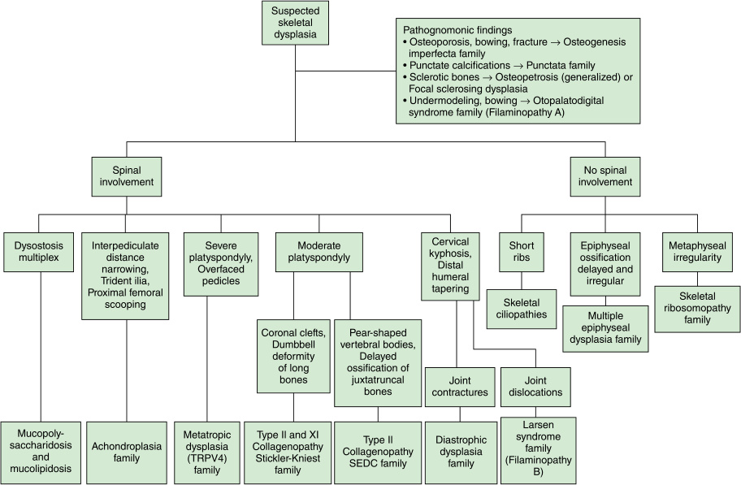

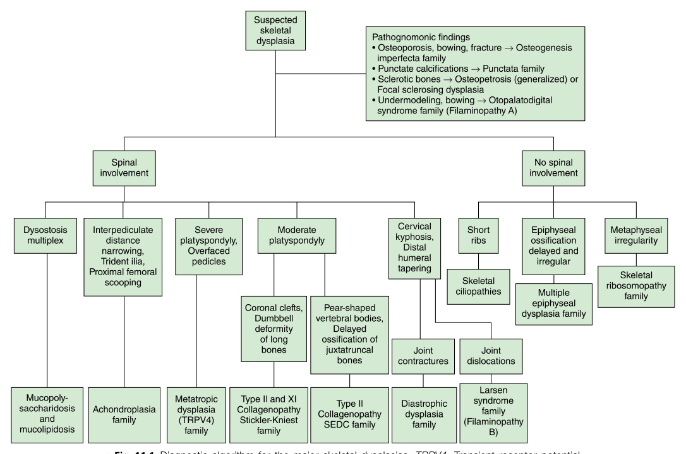

**Fig. 11.1** Diagnostic algorithm for the major skeletal dysplasias. _TRPV4,_ Transient receptor potential vanilloid 4.  (From Handa A, Grigelioniene G, Nishimura G. Skeletal dysplasia families: a stepwise approach to diagnosis. _Radiographics._ 2023;43[5] [Fig. 1]. [Also Fig. 735.4 in 22/e _Nelson Textbook of Pediatrics_ ].)

<!-- p.274 -->

density, bone fragmentation, and abnormal softness of the cranium, suggesting a brittle bone disorder such as osteogenesis imperfecta. Abnormal positioning of the limbs, the hands, and the feet can be observed, as well as incurvation of the long bones. Severe bone dysplasias (severe osteogenesis imperfecta or achondrogenesis, thanatophoric dysplasia) can thus be detected (though not always diagnosed precisely) within week 16 or 18. Another frequent disorder, achondroplasia, is detected only _after_ week 25 because in achondroplasia, bone growth only slows down during the second trimester. It should be noted that prenatal detection of a bone disorder by ultrasound in a standard-risk pregnancy is difficult because of two problems: (1) the sensitivity is strongly dependent on the operator, and (2) findings such as reduced body length and reduced limb length are nonspecific and more often reflect a growth perturbation that has origins other than a primary skeletal disorder. 

## **_Manifestations at or Around Birth_** 

Achondroplasia, one of the most frequent skeletal dysplasias, is usually manifest at birth with short limbs and increased head circumference (Fig. 11.2) as is cartilage-hair hypoplasia with short limbs. In contrast, other disorders such as hypochondroplasia or pseudoachondroplasia that can result in significant short stature in older children and adults only become manifest during the first two years of life (Fig. 11.3). Osteogenesis imperfecta, the principal bone fragility disorder, has a particularly wide phenotypic spectrum that ranges from severely affected fetuses with major bone deformities to almost asymptomatic individuals who may or may not experience fractures in their lifetime. 

Clinical examination after birth will rely on the same ultrasonographic signs performed in the prenatal period but measured directly; the facial morphology may be more easily appreciated. In some cases, abnormal (or coarse) facial features may become evident only over the first months or years. It is essential to ascertain whether there is short stature and whether there are signs of disproportion that can indicate the presence of a primary skeletal disorder. Clinical examination will be completed by assessment of muscle tone, joint mobility (contractures, dislocations of hypermobility), skin texture, and skin pigmentation changes. The neurologic examination will ascertain the presence of muscular hypotonia or hypertonia, hyporeflexia or hyperreflexia, or seizures. A complete clinical examination is essential because it may reveal manifestations in other organs that may orient the diagnosis. In the toddler and older child, it is essential to estimate the psychomotor development; as a rule of the thumb, genetic bone disorders are not accompanied by intellectual disability, but many notable exceptions exist. 

## **Radiography in the Diagnosis of Genetic Bone Disorders** 

Radiography remains the single most important diagnostic element in the evaluation of genetic bone disorders (Fig. 11.1). Nonetheless, most diagnoses are suggested by sequencing of gene panels and subsequently confirmed by _retrophenotyping_ based on the clinical and radiographic features. The radiographic series to establish the diagnosis of a genetic skeletal disorder may vary based on the clinical findings but usually contains projections of the lateral skull, the 

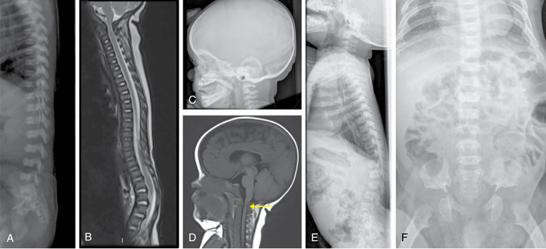

**Fig. 11.2** Achondroplasia. Features of achondroplasia at birth (A), at the age of 2 months (B and C) showing the lordosis, at the age of 4 months (D) showing the basilar impression _(arrow)_ , and at the age of 1 year (E and F). Radiographs show narrowed vertebrae, kyphosis, typical trident image of the iliac bone, and femoral heads looking like an ice-cream cone.  (From Linglart A, Merzoug V, Lambert AS, Adamsbaum C. Bone dysplasia. _Ann Endocrinol (Paris)._ 2017;78:114-122 [Fig. 1, p. 115].)

<!-- p.275 -->

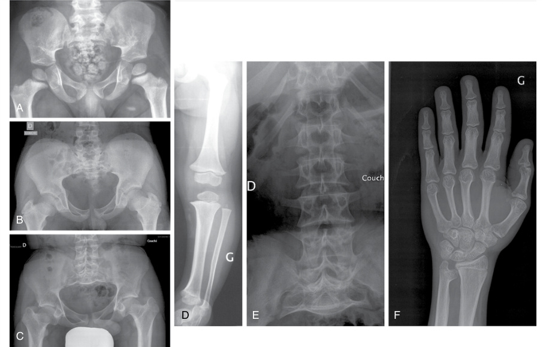

**Fig. 11.3** Hypochondroplasia. Pelvic features at the age of 5, 10, and 16 years (A, B, and C). Stocky pattern of the bones (D and F) and specific long fibula (D). Narrowed lumbar spine (E) and hypertrophic extremity of the ulna (F).  (From Linglart A, Merzoug V, Lambert AS, Adamsbaum C. Bone dysplasia. _Ann Endocrinol (Paris)._ 2017;78:114-122 [Fig. 2, p. 116].) 

lateral spine, the anteroposterior (AP) pelvis, the AP knees, and both hands. When stability at the cranio-cervical junction is at question, dedicated flexion-extension films of the region may be needed, followed by an MRI evaluation of the fluid spaces in and around the brain and the cervical spinal cord. When examining skeletal radiographies for possible skeletal dysplasias, it should be remembered that the pediatric skeleton grows and evolves rapidly; many diagnostic signs are dependent on skeletal maturation and thus highly age dependent. 

## **The Diagnostic Role of Blood and Urine Chemistry and Molecular Investigations** 

In the pre-genetic era, only a few skeletal disorders had diagnostic biochemical features (biomarkers): hypophosphatasia (low alkaline phosphatase and increased phosphoethanolamine), Jansen metaphyseal dysplasia (increased serum calcium), and hypophosphatemic rickets (low phosphorus). For lysosomal storage disorders, determination of specific enzyme activities in plasma or (more precisely) in leukocytes or cultured fibroblast is one method of diagnosis for mucopolysaccharide and oligosaccharide storage disorders, most of which include skeletal dysplasias. Other biomarkers of synthesis and catabolism exist for both bone tissue and 

cartilage tissue; they are mostly nonspecific, and their diagnostic use has been largely abandoned because of the specificity of current molecular diagnosis. Given that over 450 genes have been linked to over 700 disorders in the recent _Nosology_ , there has been a direct transition from the phenotypic assessment (including the important skeletal imaging by radiographs) to the sequencing of a gene or most often a group of genes that may be responsible for the observed phenotype or, more precisely, for a group of related and clinically similar phenotypes. The genetic variants identified should be considered against the background of the phenotype and the _Nosology_ to check their plausibility. 

# **Therapeutic Approaches** 

This is a range of psychologic consequences that may begin in kindergarten, become more acute in school, culminate during puberty and adolescence, and in most cases ease somewhat in adulthood but not without leaving consequences—positive adaptation, but also resignation and emotional scarring. Children and their families may profit from advice from professionals, and often even more so by meeting other affected individuals who are older and can transfer their experience and serve as mentors. Patients’ associations, and parent groups, may be very helpful, but, interestingly, some patients

<!-- p.276 -->

and families prefer not to be confronted with other affected individuals and families. It is recommended to offer a consultation with a psychologist and/or contact with parent associations when a skeletal condition affecting growth and proportions is recognized. 

A further aspect is the difficulty that some parents, and some professionals, face in accepting, and coping with, a chronic genetic condition or disability. This may lead to a quest for therapeutic actions. Parents may insist to obtain medical “therapies,” even of unproven efficacy. Orthopedic surgeons may propose interventions (e.g., correction of valgus or varus deformities or of scoliosis, limb lengthening) even if there is no evidence that the condition will be improved in the long run. Some surgical interventions may be indicated, while many others should not be expected to improve significantly either the appearance of the affected individual or the quality of life; interventions may be associated with significant surgical risks (the rate of complications or negative outcomes is particularly high for spine surgery). 

Understanding the cellular basis of these disorders has enabled therapeutic strategies (Table 11.2). Identification of the osteoclast as the affected cell type in osteopetrosis led to the successful use of hematopoietic stem cell transplantation (HSCT) to cure that disease; some of the mucopolysaccharidoses have also been treated by HSCT. Advances in the understanding of the molecular bases have enabled the design of molecular therapies, and some of these have significantly improved the prognosis for the underlying disorders: enzyme replacement treatment can significantly improve the clinical course of ALPL-related hypophosphatasia and improve (although to a less striking degree) the course of lysosomal storage disorders such as the mucopolysaccharidoses. Drugs that can reduce activation of the MAPK kinase signaling pathway can improve growth in FGFR3-related achondroplasia, although it is not clear whether and which comorbidities will be reduced as well. Specific inhibitors of the variant forms of IDH1 and IDH2 are being developed for leukemias and gliomas and could be used to treat Ollier disease. It appears that existing therapies will be further improved, and that many other disorders will be amenable to molecular treatments (Table 11.2). 

# **Osteogenesis Imperfecta: Collagen 1, Its Biosynthetic Machinery, and Disorders of Bone Homeostasis** 

_Osteogenesis imperfecta_ (imperfect or incomplete generation of the bones) has been applied to all conditions with fragile bones, which make up a large clinical spectrum ranging from severely affected fetuses with innumerable fractures to mildly affected individuals who may experience only a few fractures during their lifetime. Osteogenesis imperfecta is among the most common genetic disorders of bone. There are more than 36 genes associated with increased bone fragility; the principal protein of the bone matric, collagen type 1, has a specific conformation (triple helix of collagens) 

that is very intolerant to structural changes (Table 11.3, Fig. 11.4). Genetic variants in either one of the two genes coding for the alpha-chains of collagen type 1, _COL1A1_ and _COL1A2_ , are more likely to result in a clinical phenotype than variations in other proteins. Four distinct types of osteogenesis imperfecta were proposed: type 1, the mildest form; type 2, the most severe and often perinatally lethal form; type 3, a severe but usually nonlethal form with marked skeletal deformity; and type 4, a moderate form. This classification is still used as an estimation of the degree of severity; in clinical practice, individual patients form a continuous spectrum and may not always be placed in one of the four forms (Fig. 11.5). Bone fragility is a feature of other disorders as well, such as the osteopetrosis. 

When osteogenesis imperfecta is suspected or diagnosed before birth, the question is often asked about the chances of survival of the affected fetus after birth. This may depend on the available facilities but also on the attitude of the parents and the medical team. The prognosis is dictated by the stability or the frailness of the rib cage, and not by the degree of limb deformation. Delivery by C-section rather than vaginally has often been suggested to be less traumatic to the fetus with OI but a significant impact on outcome has not been shown; thus it should not be routinely recommended. Intubation and mechanical ventilation are followed by a high rate of extubation failure and are also not recommended; CPAP may be used instead. If a newborn with OI develops respiratory insufficiency because of chest instability, the overall prognosis may be poor and a conservative, palliative attitude may be the wisest choice (but the attitudes of the parents and the medical team should be considered). If the respiratory situation is stable, the newborn with severe OI may have pain because of limb fractures and may profit from gentle handling alone; abnormal positioning of the limbs will spontaneously correct in most cases; orthopedic interventions in the first weeks are not recommended. A nasogastric tube may be required for feeding in the beginning. 

Less severely affected children will benefit from handling and treatment along the same principles; in the first few months of life, the opportunity for maternal bonding should be given and there is little to gain from orthopedic interventions, even conservative. 

## **Pharmaceutical Approaches to OI and Bone Fragility** 

The molecular defects in most children with OI are structural defects in collagen type 1 caused by monoallelic variants in _COL1A1_ and _COL1A2._ The only established drugs with a proven beneficial effect in OI and a relatively favorable profile of risks and side effects are the bisphosphonates. While the disease is not cured by bisphosphonates, bone density can be improved to a degree that can make the difference between ambulatory or wheelchair-bound; bone pain can be relieved significantly. Most OI centers recommend periodic intravenous infusions done at intervals of 3 to 4 months. Some centers have successfully started 

_(Text continued on page 263_

<!-- p.277 -->

### **TABLE 11.2 Selection of Established and Forthcoming Molecular Therapies for Genetic Disorders of Bone (As Per Spring 2024)** 

|Disorder (and ISDS Nosology Group)|Therapy|Mechanism|Phase of Development|Representative References|
|---|---|---|---|---|
|Achondroplasia (group 1)|Vosoritide (Voxzogo®)|CNP analog|Approved|PMID 34341520|
||Navepegritide|TransCon CNP (prodrug)|Phase 3|NCT06079398 (phase 2, 0–2yo), NCT05598320 (phase 2b, children 2–11yo), NCT05929807 (phase 2, children and adolescents)|
||Infigratinib|Non-selective receptor tyrosine kinase inhibitor|Phase 3|NCT04265651 (phase 2), NCT05145010 (phase 2 OLE), NCT06164951 (phase 3)|
||TYRA-300|Selective receptor tyrosine kinase inhibitor|IND-enabling|https://tyra.bio/pipeline/|
||SAR442501|Anti-FGFR3 antibody|Phase 2|NCT06067425|
||Umedaptanib pegol|Anti-FGF2 aptamer|Phase 2|PMID 33952673|
|Hypochondroplasia (group 1)|Vosoritide|CNP analog|Phase 3|NCT06455059|
|Type 2 collagen disorders (group 2)|INS-101|Gene therapy|Preclinical|https://innoskel.com/pipeline/|
|Diastrophic dysplasia (group 4)|N-acetylcysteine|Sulfate supplementation|Preclinical|PMID 26206888, PMID 33545117|
|Short stature, ACAN-related (group 7)|Vosoritide|CNP analog|Phase 2|NCT04219007|
|TRPV4 disorders (group 8)|GSK2798745|TRPV4 channel blocker|Preclinical|PMID 31413810|
|Pseudoachondroplasia (group 9)|Resveratrol|Stimulates clearance of mutant COMP|Phase 2|PMID 33778324, NCT03866200|
|Metaphyseal dysplasia, Schmid type (group 11)|Carbamazepine|Reduces ER stress in the growth plate|Preclinical|PMID 30010889,https://mcds- therapy.eu/|
|Cartilage-hair hypoplasia (group 11)|HSCT*|Replaces immune cells|SOC (for immunodeficiency)|PMID 20375313|
|Acrodysostosis, PRKAR1A-related (group 17)|rAAV9-CAG-human PRKAR1A|Gene therapy|Preclinical|PMID 34599290|

_(Continued)_

<!-- p.278 -->

### **TABLE 11.2 Selection of Established and Forthcoming Molecular Therapies for Genetic Disorders of Bone (As Per Spring 2024)—cont’d** 

|Disorder (and ISDS Nosology Group)|Therapy|Mechanism|Phase of Development|Representative References|
|---|---|---|---|---|
|Mucopolysaccharidosis type 1, |Laronidase (Aldurazyme®)*|ERT|Approved|PMID 31211405|
|IDUA-related (group 22)|Lepunafusp (JR-171)|IDUA fused with human transferrin receptor antibody to penetrate BBB|Phase 1/2|PMID 3820416, NCT04227600|
||Valanafusp (AGT-181)|IDUA fused with human insulin receptor antibody to penetrate BBB|Phase 1/2|PMID 29976218, NCT03071341|
||HSCT|Replaces tissue macrophages|SOC (for severe forms)|PMID 25624320|
||HSPC gene therapy|Autologous CD34+cells genetically modified with lentiviral vector IDUA|Phase 2|PMID 34788506, PMID, 38691622, NCT03488394|
||ISP-001|Autologous plasmablasts modified with sleeping beauty transposon vector IDUA|Phase 1|NCT05682144|
|Mucopolysaccharidosis type 2, IDS-related (group 22)|Idursulfase (Elaprase®)*|ERT|Approved|PMID 26845288|
||Pabinufasp (JR-141, Izcargo®)*|IDS fused with human transferrin receptor antibody to penetrate BBB|Approved (in Japan)|PMID 33038326|
||Tividenofusp (DNL310)|IDS fused with proprietary Enzyme Transport Vehicle to penetrate BBB|Phase 2/3|NCT05371613, NCT06075537|
||RGX-121|Intracisternal/intracerebroventricular delivery of AAV9-IDS (gene therapy)|Phase 2/3|NCT03566043|
||HSPC gene therapy|Autologous CD34+cells genetically modified with lentiviral vector IDS|Phase 1/2|NCT05665166|
|Mucopolysaccharidosis type 4, GALNS-related (group 22) Morquio syndrome|Elosulfase alfa (Vimizim®)*|ERT|Approved|PMID 31019230|
|Mucopolysaccharidosis type 6, ARSB-related (group 22) Maroteaux-Lamy syndrome|Galsulfase (Naglazyme®)*|ERT|Approved|PMID 34533215|
|Mucopolysaccharidosis type 7, GUSB-related (group 22) Sly syndrome|Vestronidase alfa (Mepsevii®)*|ERT|Approved|PMID 38715031|
|Alpha-mannosidosis, MAN2B1- related (group 22)|Velmanase alfa (Lamzede®)*|ERT|Approved|PMID 36849760|

_(Continued)_

<!-- p.279 -->

### **TABLE 11.2 Selection of Established and Forthcoming Molecular Therapies for Genetic Disorders of Bone (As Per Spring 2024)—cont’d** 

|Disorder (and ISDS Nosology Group)|Therapy|Mechanism|Phase of Development|Representative References|
|---|---|---|---|---|
|Gaucher disease (group 22)|Imiglucerase (Cerezyme®)|ERT (CHO cells)|Approved|PMID 33602299|
||Velaglucerase (VPRIV®)|ERT (human fibroblasts)|Approved|PMID 21536468|
||Taliglucerase (Elelyso®)|ERT (carrot root cells)|Approved|PMID 38090017|
||Miglustat (Zavesca®)|SRT|Approved|PMID 17919546, PMID 35815393|
||Eliglustat (Cerdelga®)|SRT|Approved|PMID 36469032|
||Venglustat|SRT|Phase 3|PMID 38802634|
||Ambroxol|Chaperone|Off-label|PMID 33606887, PMID 37342037|
||FLT201|Gene therapy (AAVS3-GBA1)|Phase 1|NCT05324943|
|Osteopetrosis and related |HSCT|Replaces osteoclasts|SOC (for severe forms)|PMID 26012570, PMID 30885997|
|osteoclast disorders (group 24)|Interferon gamma (Actimmune®)|Increases ROS which increases bone resorption|Approved|PMID 1320672, PMID 7753137|
||RP-L401 (for TCIRG1- related osteopetrosis)|Autologous CD34+cells genetically modified with lentiviral vector TCIRG1|Phase 1|PMID 33575431, NCT04525352|
||SIS-101-ADO (for CLCN7- related osteopetrosis)|Small interfering RNA that does not affect normal mRNA|Preclinical|PMID 29501587, PMID 38733412|
||Recombinant RANKL (for TNFSF11-related osteopetrosis)|Recombinant soluble RANKL|Preclinical|PMID 22836362|
|Hyperostosis-hyperphosphatemia syndrome (group 25)|Phosphate lowering (low phosphate diet, phosphate binders, phosphaturia- inducing drugs)|Decreased phosphate intake, intestinal absorption, or renal reabsorption|SOC|PMID 27164190|
|Primary hypertrophic osteoarthropathy (group 25)|NSAIDs (such as etoricoxib)|Decreases prostaglandin E2 production|Phase 2|PMID 28425581, PMID 31508314, PMID 29305259|

_(Continued)_

<!-- p.280 -->

### **TABLE 11.2 Selection of Established and Forthcoming Molecular Therapies for Genetic Disorders of Bone (As Per Spring 2024)—cont’d** 

|Disorder (and ISDS Nosology|||||
|---|---|---|---|---|
|Group)|Therapy|Mechanism|Phase of Development|Representative References|
|Pyle disease (group 25)|RAP-661|Soluble BMP-2 receptor (inhibits BMP pathway)|Preclinical|PMID 27355534|
||Anti-sclerostin antibody|Inhibits sclerostin|Preclinical|PMID 27355534|
|Camurati-Engelmann disease (group 25)|Losartan|Inhibits TGF-beta pathway|Anecdotal|PMID 25099136, PMID 25140400|
|Osteosclerosis, LRP5-related (group 25)|LGK-974|Inhibits porcupine (blocks WNT secretion)|Preclinical|PMID 37612291|
|Sclerosteosis, SOST-related (group 25)|GNF-6231|Inhibits porcupine (blocks WNT secretion)|Preclinical|PMID 37612291|
|Juvenile Paget disease, TNFRSF11B-related (group 25)|Recombinant osteoprotegerin|Protein replacement therapy|Anecdotal|PMID 16135836|
|Osteogenesis imperfecta (group 26)|Bisphosphonates|Increase BMD (decrease bone resorption)|SOC|PMID 27760454|
||Teriparatide|Increased BMD (increases bone formation)|SOC|PMID 24463451, PMID 29263724|
||Fresolimumab|Anti-TGFβantibody|Phase 1|PMID 35113812|
||SAR439459|Anti-TGFβantibody|Phase 1|NCT05231668|
||Romozosumab|Anti-sclerostin antibody|Phase 3|NCT04545554, NCT05972551|
||Setrusumab|Anti-sclerostin antibody|Phase 3|PMID 28370407, NCT05125809, NCT05768854|
||Mesenchymal stem cell (MSC) therapy|MSC engraftment and differentiation to osteoblasts|Phase 1/2|PMID 33463067, NCT04623606, NCT05559801, NCT03706482|
|Osteoporosis-pseudoglioma treatment (group 26)|Bisphosphonates|Increase BMD (decrease bone resorption)|Anecdotal|PMID 18602879|
||Lithium|Activates canonical Wnt signaling pathway|Anecdotal|PMID 16293698, NCT01108068|
|Hypophosphatasia (group 27)|Asfotase alfa (Strensiq®)|ERT|Approved|PMID 26529632, PMID 27699270, PMID 30558909, PMID 38459585|
||AAV8-TNAP-D10|Gene therapy|Preclinical|PMID 34076297|

_(Continued)_

<!-- p.281 -->

### **TABLE 11.2 Selection of Established and Forthcoming Molecular Therapies for Genetic Disorders of Bone (As Per Spring 2024)—cont’d** 

|Disorder (and ISDS Nosology Group)|Therapy|Mechanism|Phase of Development|Representative References|
|---|---|---|---|---|
|X-linked hypophosphatemia (group 27)|Phosphate+active vitamin D|Replenishes wasted phosphate|SOC|PMID 31068690|
||Burosumab (Crysvita®)|Anti-FGF23 antibody|Approved|PMID 37084401, PMID 38690124, PMID 36072994|
|Hypophosphatemic rickets, ENPP1-related|INZ-701|ERT|Phase 3|NCT05734196 (phase 1, infants), NCT06046820 (phase 3, children), NCT04686175 (phase 1/2, adults)|
|Vitamin D-dependent rickets, CYP2R1-related (group 27)|Calcidiol (25-hydroxyvitamin D3)|Bypasses lack of synthesis of 25-hydroxyvitamin D|SOC|PMID 28548312|
|Vitamin D-dependent rickets, CYP27B1-related (group 27)|Calcitriol (1,25-dihydroxyvitamin D3) or alfacalcidol (1-alpha- hydroxyvitamin D3)|Bypasses lack of synthesis of 1,25-dihydroxyvitamin D|SOC|PMID 9486994|
|Vitamin D-dependent rickets, VDR-related (group 27)|High-dose calcium supplementation|Treats hypocalcemia from inactive receptor|SOC|PMID 38872968, PMID 32049653|
|Vitamin D-dependent rickets, CYP3A4-related (group 27)|High-dose calcitriol or vitamin D3 supplementation|Needed to combat rapid active vitamin D degradation|SOC|PMID 29461981|
|Jansen metaphyseal chondrodysplasia (group 28)|[Leu11, dTrp12, Trp23, Tyr36]-PTHrP(7-36)NH2|Inverse PTH receptor agonist|Preclinical|PMID 31693237|
|Fibrous dysplasia (group 30)|Denosumab|RANKL inhibition|Phase 2|PMID 36812441, PMID 37301527|
|Fibrodysplasia ossificans |Palovarotene (Sohonos®)|Retinoic acid receptor gamma agonist|Approved|PMID 36583535|
|progressiva (group 30)|Saracatinib|ALK2 kinase inhibitor|Phase 2|PMID 35650602, NCT04307953|
||Zilurgisertib|ALK2 kinase inhibitor|Phase 2|CT-EU-00026145|
||Fidrisertib|ALK2 kinase inhibitor|Phase 2|NCT05039515|
||INCB000928|ALK2 kinase inhibitor|Phase 2|NCT05090891|

_BBB,_ Blood-brain barrier; _BMD,_ bone mineral density; _ER,_ endoplasmic reticulum; _ERT,_ enzyme replacement therapy; _HSCT,_ hematopoietic stem cell transplantation; _HSPC,_ hematopoietic stemand progenitor-cell; _IND,_ investigational new drug; _OLE,_ open-label extension; _SOC,_ standard of care; _SRT,_ substrate reduction therapy. *Indicates improvement of extraskeletal features but lack of improvement of skeletal features.

<!-- p.282 -->

#### **TABLE 11.3** T i he Genetic Clasi sification of i Osteogenesi i s Imperfecta (OI) Ty i pes

|OI Type|Inheritance|Gene|Protein|Severity|OI Classical and Distinguishing Features|
|---|---|---|---|---|---|
|**Collage **|**n Structure**|||||
|I|AD|_COL1A1_|Collagen α1|Mild|Quantitative defect due to loss of function of one of COL1A1 alleles|
|II–IV|AD|_COL1A1_, _COL1A2_|Collagen α1 or α2|Lethal, severe to moderate|Structural defects in collagen helix or C-propeptides|
|**Bone M**|**ineralization**|||||
|V|AD|_IFITM5_|BRIL (BRIL5′ MALEP)|Moderate|Hyperplastic callus formation, forearm interosseous membrane ossification, radial head dislocation, forearm dense metaphyseal bands, mesh like pattern of lamellar bone|
|Atypical V|I AD|_IFITM5_|BRIL (BRILp. S42L)|Severe progressive|Accumulated osteoid, fish scale pattern of lamellar bone, increased ALP serum levels in childhood|
|VI **i**|AR **i**|_SERPINF1_|PEDF|Severe progressive|PEDF deficiency, accumulated osteoid, fish scale pattern of lamellar bone, increased ALP serum levels in childhood|
|**Collage i**|**n Modification**|||||
|VII|AR|_CRTAP_|CRTAP|Lethal to severe|Absent procollagen prolyl 3-hydroxylation, rhizomelia|
|VIII|AR|_LERPE1_|P3H1|Lethal to severe|Absent procollagen prolyl 3-hydroxylation, rhizomelia|
|IX|AR|_PPIB_|CyPB|Lethal to moderate|Absent procollagen |
|**Collage **|**n Folding and C**|**rosslinking**|||prolyl 3-hydroxylation, no rhizomelia, dental anomalies|
|X|AR|_SERPINH1_|HSP47|Lethal to severe|Respiratory defects, blue sclerae, Wormian bones|
|XI|AR|_FKBP10_|FKBP65|Moderate|Cause of Bruck or Kuskokwim syndromes|
|XIII|AR|_BMP1_|BMP1|Mild to severe|Deficiency of C-propeptidase|
|XXI*|AR|_KDELR2_|KDEL|Severe progressive|Multiple fractures, chest deformity, short stature|
|**Osteobl**|**ast Function an**|**d Differentia**|receptor 2 **tion**|||
|XII|AR|_SP7_|OSTERIX|Moderate|Delayed tooth eruption, craniofacial anomalies|
|XIV|AR|_TMEM38B_|TRIC-B|Asymptomatic to severe|Altered mitochondrial function and cell adhesion|
|XV|AD/AR|_WNT1_|WNT1|Moderate|Cause of OI or early-onset osteoporosis, variable neurological defects|
|XVI|AR|_CREB3L1_|OASIS|Lethal to mild|Defect in RIP pathway|
|XVII|AR|_SPARC_|SPARC|Severe progressive|Muscular hypotonia|
|XVIII|XR|_MBTPS2_|S2P|Moderate|Defect in RIP pathway|
|**Newly Ci**|**lassified OI Typ**|**es**||||
|XIX|AR|_TENT5A_|FAM46A|Lethal to severe|Defect in BMP/TGFβsignaling pathway|
|XX|AR|_MESD_|MESD|Lethal to severe|LRP5/6 related disorder|
|XXI*|AR|_KDELR2_|KDEL |Severe progressive|Multiple fractures, chest deformity, short stature|
||||receptor 2|||
|XXII|AR|_CCDC134_|CCDC134|Severe|Dysregulation of the MAPK/ERK pathway|

_AD,_ Autosomal dominant, _ALP,_ alkaline phosphatase; _AR,_ autosomal recessive, _RIP,_ receptor interacting protein; _XR,_ X-linked recessive. 

*Type XXI OI is listed twice in this table, once for its functional role and once with newly identified types. Types XVIII and XIX OI are listed as types XIX and XVIII, respectively, in OMIM. From Jovanovic M, Marini JC. Update on the genetics of osteogenesis imperfecta. _Calcif Tissue Int._ 2024;115(6):891-914. https://doi.org/10.1007/s00223-024-01266-5 (Table 1).

<!-- p.283 -->

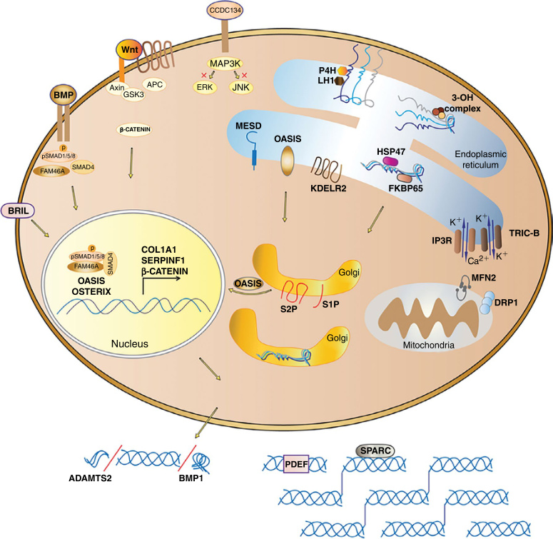

**Fig. 11.4** Mechanisms and signaling pathways of osteogenesis imperfecta (OI). The two pro α1(I) and one pro α2(I) chains of the procollagen heterotrimer undergo post-translational modifications of proline and lysine residues by P4H and LH1, respectively, in the ER. During procollagen folding, the ER-residing prolyl 3-OH complex, consisting of P3H1, CRTAP, and PPIB, hydroxylates the P986 residue important for alignment of procollagen chains. HSP47, an ER chaperone, binds to procollagen triple helix to facilitate collagen folding and secretion. FKBP10, another ER chaperone, cooperates with HSP47 in procollagen trafficking from the ER to the Golgi. Another protein that functions closely with HSP47 is KDEL receptor 2, which has a role in intracellular recycling of ER-resident proteins through retrograde transport. Once the procollagen triple helix is secreted into extracellular space, N- and C-propeptides of procollagen are cleaved by ADAMTS-2 and BMP1 enzymes, respectively. Type I collagen is released and incorporated into extracellular matrix. An important regulator of collagen assembly is SPARC, which binds collagen as a matricellular glycoprotein. At the level of transcriptional regulation, Osterix/Sp7, a zinc finger transcriptional factor, interacts with RUNX2, which induces the expression of collagen genes. Intracellular calcium is important for collagen post-translational modification and metabolism. TRIC-B together with IP3R regulate calcium flux from the ER to cytoplasm. In addition, TRIC-B absence impacts the fusion and fission of mitochondria, affecting MFN2 and DRP1 regulators at the ER-mitochondria contact sites. Transmembrane transcriptional factor OASIS is transported from the ER to the Golgi membrane for RIP signaling. OASIS is cleaved by S1P and S2P in the Golgi and the released N-terminal end of OASIS translocates into the nucleus for transcription of genes important for extracellular matrix, such as collagens. Also affecting collagen expression and bone mineralization in osteoblasts is FAM46A, encoded by _TENTA_ , which is involved in the polyadenylation of collagen transcripts and other proteins involved in bone mineralization. BRIL is an important regulator of bone mineralization and impacts _SERPINF1_ transcription in the nucleus. _SERPINF1_ encodes the PDEF protein, which binds collagen to activate its own anti-angiogenic function. Wnt signaling, important for bone development, is activated by binding of WNT1 ligand to the Frizzled and LRP5/6 receptors, which inhibits the degradation complex, consisting of Axin, APC, and GSK3, in order to stabilize β-catenin. β-catenin translocates to the nucleus to activate transcription of Wnt target genes. MESD, a chaperone residing in the ER, has a role in Wnt signaling by translocating LRP5/6 receptors, and is also a direct chaperone of pro-α1(I) in osteoblasts. BMP signaling is another important pathway for bone metabolism. BMP binds to BMP receptors and induces phosphorylation of SMAD 1/5/8. Together, SMAD 1/5/8, FAM46A, and SMAD4 form a complex that further translocates to the nucleus to induce transcription of BMP target genes. Recently proposed OI-causing gene _CCDC134_ encodes a secretory protein CCDC134 that inhibits ERK and JNK phosphorylation of MAPK pathway, and impacts osteoblast expression of collagen and mineralization.  (From Jovanovic M, Marini JC. Update on the genetics of osteogenesis imperfecta. _Calcif Tissue Int._ 2024;115(6): 891-914. https://doi.org/10.1007/s00223-024-01266-5 [Fig. 1].)

<!-- p.284 -->

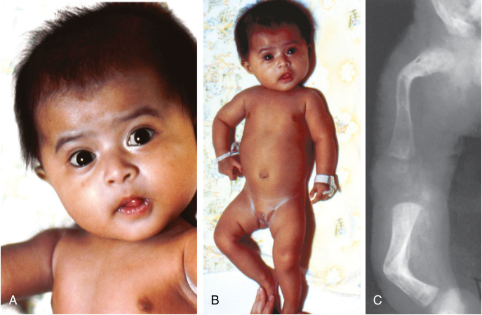

**Fig. 11.5** Osteogenesis imperfecta syndrome, type 1. (A and B) A 6-month-old female. Note the blue sclera. (C) Bowing of the femur and tibia of a 2-month-old child.  (From Lyons Jones K, Crandall Jones M, del Campo M. Connective tissue disorders. In: _Smith’s Recognizable Patterns of Human Malformation_ . 8th ed. Philadelphia: Elsevier; 2022 [Fig.1, p. 685].) 

bisphosphonate regimens in severely affected infants as young as 3 months. One open question is that of long-term safety and side effects; however, bisphosphonates have been used for so long that it is less likely that we will see novel or unexpected side effects. 

## **Non-Skeletal Manifestations of OI** 

Collagen 1 is the most abundant collagen in the human body and plays a role in tissues and organs other than bone. The main collagenous structure of the eye, the sclerae, may be thinner than normal and thus allow for the conjunctival blood vessels to shine through, giving the well-known blueish or grayish sclerae that can be an important diagnostic clue to the presence of OI (Fig. 11.5). Expansion of the ocular bulb may result in myopia. In OI, the inner ear is prone to deformation (both the cochlea and chain ossicles); hearing loss can appear in the second or third decade (but sometimes earlier) and be progressive. Dentine tissue, the main component of teeth, also relies on a strong collagen matrix, and OI individuals may have dentine that is discolored **(dentinogenesis imperfecta)** and fragile, leading to chipping away of the tooth enamel. Joint laxity is a feature of OI, and it is often compounded by muscular hypotonia. Some genetic variants interfere with collagen propeptide processing and result in OI/Ehlers-Danlos syndrome “overlap” forms. The neuromuscular development of children with OI may be compromised by muscular hypotonia, bone pain, fractures and the resulting deformities. The intellectual development is unaffected; the physical disabilities may give OI individuals (as well as individuals with 

other genetic skeletal conditions) remarkably subtle and astute personalities. 

# **Achondroplasia and the FGFR3 Dysplasia Family** 

Achondroplasia is frequent: its incidence at birth is approximately 1 in 20,000 (current incidence may be lower because of prenatal detection). Only approximately 10 to 20% of cases are familial, the rest being the result of _de novo_ pathogenic variants. Over 95% of cases are caused by the same recurrent variant, c.G1138A (p.G380R), at the monoallelic (heterozygous) state in _FGFR3_ ; this is the most frequent recurrent pathogenic variant known. Because of the genetic homogeneity, the phenotypic manifestations of achondroplasia are more consistent between affected individuals; variability exists but is less marked than that observed in other disorders. The condition is not confined to the long bones and the spine but also affects craniofacial development. Because of their reduced stature, short bones, and characteristic facial appearance, people with achondroplasia have been subject to stigmatization and considered by popular fantasy as belonging to a particular race (sometimes called _Lilliputians_ ). 

Achondroplasia is clinically manifest at birth with slightly reduced body length (birth length around 45–48 cm), relatively large head (HC in the upper percentiles at birth, sometimes even above 90%), and slight limb shortening. The phenotype at birth is variable, some cases having only subtle features. In countries with routine antenatal

<!-- p.285 -->

ultrasound monitoring, achondroplasia is often detected around the beginning of the third trimester of pregnancy. Fetal sonographic signs may include shortening of the femur and tibia, relative macrocephaly, and a deep nasal root. _Unlike in other short limb dysplasias, prenatal growth in achondroplasia is normal in the first and most of the second trimester and begins to decline only around weeks 24 to 27; achondroplasia may not be detectable by fetal ultrasound_ . The intellectual development of individuals with achondroplasia is normal. The motor development, in contrast, may be delayed. Most infants with achondroplasia have some degree of muscular hypotonia; their motor milestones and their head control are delayed. The reasons are not entirely clear; the large head size may possibly play a role, as a sort of mismatch between a normal muscular system and relatively undersized long bones. Standing and walking may be delayed often due to joint laxity; toddlers with achondroplasia may crawl or shuffle for much longer than other children. In most cases motor development will catch up in the third year. 

In all infants and young children with achondroplasia, the foramen magnum at the base of the skull is significantly reduced in diameter when compared to controls; this may have clinical consequences. Infants with achondroplasia have an increased risk of sudden death, often but not always during sleep; infants have been found in cardiorespiratory arrest, for example, following a car drive. The incidence of sudden death in infants with achondroplasia is not known precisely, but the underlying mechanism is believed to imply compression on the spinal cord. Cranio-cervical narrowness can also result in chronic myelopathy that may express itself as hypotonia. Some groups have advocated a routine CT (or MRI) scan of the cranio-cervical to ascertain cases of myelopathy and perform surgical decompression. However, all infants with achondroplasia have a narrow cervical canal, and the majority do not have untoward consequences; moreover, sudden death may occur even in the absence of myelopathy. Routine imaging has not entered clinical practice, and most pediatricians and geneticists rely on clinical observations. 

In children, achondroplasia presents as short stature of the short limb type (specific growth curves exist and should be used to monitor growth) with a relatively large head, frontal bossing, and a deep nasal root; short fingers and toes; marked lumbar lordosis; and varus (or less often, valgus) deformation of the legs (Fig. 11.6). Surgical fixation of the proximal epiphysis of the fibula or fixation of the lateral side of the tibial growth plate with an 8-plate are sometimes used to correct, or prevent, varus deformity at the knee. The hypoplasia of the skull base may impair aeration through the Eustachian tubes and cause chronic middle ear effusion with hearing loss; monitoring and in some cases insertion of tympanostomy tubes may be needed. 

Some have claimed that individuals with achondroplasia are particularly prone to develop obesity; some centers recommend surveillance and early dietary counseling when appropriate. Spinal stenosis is relatively common in adults 

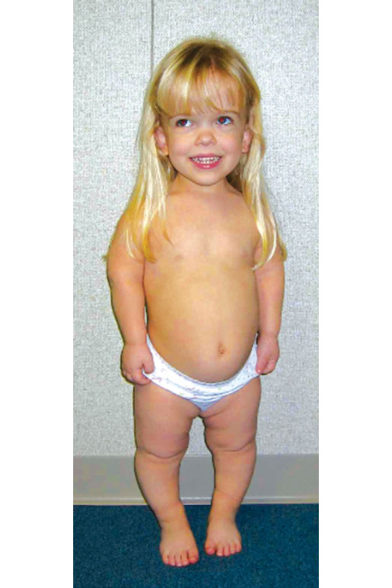

**Fig. 11.6** Achondroplasia. Photograph of a 1-year-old female showing macrocephaly, small thoracic cage, and rhizomelic shortening.  (Courtesy Dr. Stephen Braddock, St. Louis University, St. Louis, Missouri. From Lyons Jones K, Crandall Jones M, del Campo M. Achondroplasia. In: _Smith’s Recognizable Patterns of Human Malformation_ . 8th ed. Philadelphia: Elsevier; 2022 [Fig. 2, p. 487].) 

with achondroplasia. In addition to medical complications, the reduced stature and shortness of the limbs in individuals with achondroplasia negatively impacts daily living tasks, such as performing maneuvers of body hygiene without the help of reach extenders (to reach the perineum) or, for children, requiring the help of adults. Other examples of common daily activities include pushing buttons in elevators, using public transport, hair brushing, or using automated teller machines. 

## **Therapeutic Approaches** 

At this time, only one product, the CNP-agonist known as vosoritide, is available. Vosoritide has many mechanisms of action but promotes chondrocyte proliferation and differentiation by targeting FGFR3 signaling. Vosoritide, which needs to be injected daily, improves annualized growth velocity, and can improve limb growth; the final effect on adult stature will not be a normalization. Moreover, it is not clear whether vosoritide or any of the competitor products

<!-- p.286 -->

will be able to influence craniofacial morphology or other complications such as varus deformity of the legs or spinal stenosis. 

# **The Collagen 2 Dysplasia Family: Achondrogenesis Type 2, Spondyloepiphyseal Dysplasia Congenita, and Stickler Syndrome** 

Collagen type 2 is the main structural component responsible for most of the cartilage’s physical resilience. Genetic variants in the gene for collagen II, _COL2A1_ , are the cause of a wide spectrum of conditions that range from the fetus with extremely shortened bones and hypoplastic thorax **(achondrogenesis)** to adult individuals with normal stature and premature arthritis of the hips and spine **(Stickler syndrome)** . Collagen type II is an important component of the vitreous body of the eye and of the inner ear; hearing can be impaired in all these conditions. The prototypic collagen type II disorder is called **_COL2A1_ -related spondyloepiphyseal dysplasia congenita (SEDC)** . Fetuses with SEDC are usually recognized in the third trimester of pregnancy or at birth because of a short trunk and neck, but a normalsized head. Although the limbs are also shortened, shortening of the spine predominates and results in a trunk-to-limb length disproportion of the short trunk type, often with deformity of the ribs, which protrude anteriorly (pectus carinatum). The face is flat, and a median posterior cleft of the soft palate (or of the uvula) is seen in ~30 to 50% of patients. The hands and fingers are usually of normal length; hyperlaxity of the peripheral joints is common; there is a tendency to develop bilateral clubfeet at birth. Growth of the child with SEDC is impaired (height is usually below the third centile, or below −2.5 SD for age); the posture with an anteriorly rotated pelvis and ensuing exaggerated lumbar lordosis is typical. Changes in the physical properties of the vitreous body can lead to progressive myopia and retinal detachment. The radiographs show platyspondyly (vertebral flattening) explaining the short trunk, a delay in the maturation of epiphyses, and a variable degree of expansion of the ends of the long bones resulting in prominent joints. A delay in ossification of the cervical vertebrae, and hypoplasia of the dens of the epistropheus (second vertebra) that articulates with the atlas (first vertebra) may result in instability of the craniocervical junction; in toddlers and young children with more severe forms, caution must be taken that physical exercise (somersaults) or abrupt movements (during car rides) or falls do not result in craniocervical dislocation with neurologic consequences. 

The variant spectrum at the _COL2A1_ locus is very large and consequently, many forms with different clinical severities are seen. The most severe variant is called **_COL2A1_ - related achondrogenesis** ; this entity is usually recognized as early as the first trimester with increased nuchal fold, hypoplastic thorax, and very short limbs, and is incompatible with life due to thoracic hypoplasia and respiratory 

insufficiency. Milder forms have been called **_COL2A1_ - related hypochondrogenesis** . A variant called **Kniest dysplasia** is essentially a severe SEDC variant with hyperplastic (but unossified) epiphyses; it is often associated with type II collagen exon-skipping variants or small deletions. Ocular complications are common in Kniest dysplasia. Mild SEDC forms exist, and some are linked to specific arginine-tocysteine variants in collagen II. Toward the mild end of the spectrum is an entity that has been called **late-onset SED with premature arthritis** . There is a common entity originally called **Stickler syndrome** that combines hearing loss, myopia of variable degree, cleft palate or uvula, and normal or even tall stature. _COL2A1_ -related Stickler syndrome is strongly associated with _COL2A1_ variants that do not determine structural changes in the collagen protein but cause simple haploinsufficiency—the amount of collagen 2 produced by chondrocytes is less than normal, but no abnormal species is produced. However, other forms of Stickler syndrome have been associated with variants in _COL11A1_ and _COL11A2_ coding for collagen type XI, a fibrillar collagen that is not as abundant as collagen II but that polymerizes within cartilage collagen fibers. Collagen XI variants may also result in dysplasias that strongly resemble Kniest dysplasia **(Weissenbacher-Zweymüller dysplasia)** . Although there may be subtle differences in clinical and radiographic features, in practice this complexity is a reason to sequence a whole panel of cartilage collagen genes (or of chondrodysplasia) as the diagnostic procedure. 

All _cartilage collagen dysplasias_ need audiologic assessment and follow-up and hearing aids when appropriate, as well as ophthalmologic surveillance for myopia and signs of impending retinal detachment (which is less frequent than hearing impairment). Children with the more severe forms associated with skeletal deformities may need orthopedic consultation. Unfortunately, orthopedic surgery in these children does not result in an improvement of quality of life, perhaps because of the intrinsic poor mechanical properties of cartilage tissue in these disorders, and the accompanying joint laxity. An extremely conservative approach is recommended; physical therapy (exercises and massaging) should be considered the mainstay of treatment. Surgery may have an indication to correct extreme varus at the hip joint and to prevent luxation, and to stabilize kyphoscoliosis when vital lung capacity and respiratory functions are severely compromised. Spine surgery, as with other chondrodysplasias and lysosomal storage disorders, has a high rate of complications and limited functional gains, and surgical correction of moderate kyphoscoliosis is not warranted, but physical therapy should be prioritized. 

# **X-Linked Spondyloepiphyseal** 

# **Dysplasia Tarda** 

This form of spondyloepiphyseal dysplasia is inherited as an X-linked recessive disorder and affects males. It is relatively common among skeletal dysplasias. The _tarda_ (Latin “late”)

<!-- p.287 -->

implies that it is not recognizable at birth; affected males have deceleration of linear growth at age ~5 years; adult height is usually between 140 and 160 centimeters. The second clinical sign is hip pain following exercise. The dysplasia evolves to develop platyspondyly (with short trunk-type disproportion) and degeneration of the proximal femoral epiphysis. Hip joint replacement may be needed as early as in the second decade, but the prognosis (apart from short stature and hip joint degeneration) is good. Radiographic changes are subtle, but there is a characteristic _hump profile_ of the vertebral bodies in lateral spine X-rays, best seen between the ages of 9–10 years and the end of puberty; the pelvis is narrow. The molecular basis is pathogenic variants (often truncating variants) in _TRAPPC2_ . It is not unusual to observe large pedigrees segregating this disorder. 

# **Progressive Pseudorheumatoid Dysplasia** 

This rare, recessively inherited disorder is formally a form of spondyloepiphyseal dysplasia, but the name reflects its most salient feature: the joint pain that begins at a relatively early age (5–6 years, sometimes even before). At the onset of the disease, there are no visible skeletal deformities, and an immunologic disorder is almost invariably suspected; however, humoral markers of inflammation are normal or negative, and the diagnosis often remains obscure for several years. Over time (usually by the age of 10–12 years), short stature develops because of progressive platyspondyly, and the hands show widening of the interphalangeal joints; a skeletal survey may then show typical changes (platyspondyly, large epiphyses). A diagnosis is then suspected and can be confirmed by the demonstration of biallelic pathogenic variants in _WISP3_ , a secreted protein with signaling properties whose role is not yet precisely understood. The therapeutic approach is particularly difficult in PPRD: chronic articular pain is difficult to control (medications used are NSAIDs and gold salts) and hip joint (and subsequently knee joint) replacement may be required. 

# **Pseudoachondroplasia and Multiple Epiphyseal Dysplasias** 

_COMP_ -related pseudoachondroplasia is a short-limb dysplasia caused by monoallelic variants (usually, amino acid substitutions) in a specific region of the COMP protein. It can be transmitted as a dominant trait, although most cases are sporadic. It resembles achondroplasia because the limbs are short and the fingers are stubby; unlike achondroplasia, pseudoachondroplasia is usually not recognizable at birth, but manifests between the first and the second birthday with short stature. There is no craniofacial involvement (normal head circumference and normal facial traits) in pseudoachondroplasia. Joint laxity can be prominent, and in toddlers the disorder may manifest as a gait disorder (waddling gait) and thus simulate a neuromuscular disease. The first complaint of an affected child is often pain in the 

hip, knee, and ankle joints following physical exercise. The radiographic signs are manifold (epi-metaphyseal dysplasia) and the radiographic diagnosis of typical cases is straightforward. It must be noted that the vertebrae may have a peculiar ossification pattern and thus appear abnormal on radiographs in childhood, but once ossification is achieved at puberty, the vertebral column is not short and there are few, if any, complaints of back pain. Progressive degeneration of the femoral heads is the rule and may lead to the need for hip replacement surgery as early as in the third decade; this is one of the situations where early hip replacement can lead to a significant improvement of the quality of life. 

Other variants in _COMP_ may lead to a milder condition called **multiple epiphyseal dysplasia (** **_COMP_ -related MED)** . In this condition, height may be borderline low or even normal; the clinical manifestations are those of joint pain and moderate joint laxity, mild shortening of the fingers and toes. In sporadic cases, the diagnosis is usually not suspected until school age. There is extensive allelic variation at the _COMP_ locus, and intermediate forms (between pseudoachondroplasia and MED) exist along a continuous spectrum. The name multiple epiphyseal dysplasia has been applied to conditions that are genetically and phenotypically distinct, although they are all relatively mild. _MATN3_ -related MED is another dominantly inherited condition with changes at hips and knees; _COL9A1_ -, _COL9A2_ -, and _COL9A3_ -related MEDs are also dominantly inherited; in these conditions, the knee epiphyses are often the only affected sites. _SLC26A2_ -related MED is the only MED inherited as a recessive condition. The radiographic changes of multiple epiphyseal dysplasia can also be seen in other syndromic conditions (see the _Nosology_ ). 

# **Metatropic Dysplasia and the** 

# **TRPV4 Group** 

Metatropic dysplasia is usually apparent at birth with a long and narrow trunk and prominent joints. In some cases, the coccyx is very prominent and may look like a tail appendage. However, when the vertebral bodies flatten and scoliosis develops over the first two decades, the body proportions of the affected individuals change from a _short limb_ type at birth to a _short trunk_ type of short stature, hence the name of the condition, **metatropic** meaning changing in proportions. The condition is usually sporadic and is caused by monoallelic (heterozygous) missense variants in _TRPV4_ which encodes for a regulated calcium channel of the plasma membrane. Other variants in _TRPV4_ are responsible for a spectrum of dysplasias of different severity (from lethal metatropic dysplasia to **Kozlowski-type spondylometaphyseal dysplasia** , **brachyolmia** , and **familial digital arthropathy** but also of peripheral neuropathies. Affected individuals with both skeletal dysplasia and peripheral neuropathy have been observed. Pathogenic _TRPV4_ variants seem to activate or change the specificity of the _TRPV4_ channel. Radiographic signs are specific, and the diagnosis

<!-- p.288 -->

is easily suspected in severe and moderate cases. In milder cases (SMD Kozlowski and brachyolmia) the diagnosis is best confirmed by molecular analysis. Among the complications of metatropic dysplasia are progressive kyphoscoliosis, arthrosis of the hips, knees, and shoulder with loss of movement range, and hearing loss in the second decade. Treatment is symptomatic: physiotherapy first, spinal surgery for scoliosis, and joint release surgery. 

# **Lysosomal Storage Disorders and the Dysostosis Multiplex Phenotype (See Chapter 46)** 

Lysosomal storage disorders result in impaired degradation of glycosaminoglycans (formerly known as sulfated mucopolysaccharides). The **mucopolysaccharidoses** are systemic metabolic disorders; in their full-blown forms, they affect connective tissues (skin, joints, eyes, heart valves, and more), the skeleton (with dysostosis multiplex), the airways, the inner ear, the liver and spleen, and the brain with intellectual disability. There are large allelic series giving rise to a spectrum of conditions; milder forms are more difficult to diagnose. Enzyme replacement therapy (ERT) is available for several of these conditions; ERT improves the soft tissues (including skin, joints, and heart valves) but does not substantially improve the skeletal features. Closely related to the mucopolysaccharidoses are **mucolipidosis 2** and **mucolipidosis 3** ; they are allelic conditions related to _GNPTAB_ and _GNPTG_ , necessary for the targeting of lysosomal enzymes to the lysosome. Their clinical phenotypes are like mucopolysaccharidoses. 

# **Skeletal Dysplasias With Impaired Sulfation of Proteoglycans: Diastrophic Dysplasia and the SCL26A2 Dysplasia Family** 

Diastrophic dysplasia (from the Greek “twisted” or “bent”) is a condition with short stature, bone dysplasia, and progressive joint contractures. It is the central phenotype of a spectrum of disorders that includes _SLC26A2_ -related achondrogenesis type 1B, atelosteogenesis 2, diastrophic dysplasia, and the mildest form, _SLC26A2_ -related multiple epiphyseal dysplasia. **Achondrogenesis 1b** has extreme shortening of limbs and fingers and a very hypoplastic thorax and is incompatible with life. **Atelosteogenesis 2** is only slightly less severe and affected individuals have been known to survive for weeks to a few years. **Diastrophic dysplasia** is manifest at birth with reduced length of limbs and fingers, clubfeet, a peculiar radial abduction and incurvation of both thumbs _(hitchhiker thumbs)_ , and cleft palate. The thorax is less affected, and the children usually survive but the burden of disease can be heavy with recurrent clubfeet, contractures at the hips and knees, and progressive scoliosis. Hearing and vision are not usually affected. The mildest variant on the _SLC26A2_ spectrum is a form of 

**multiple epiphyseal dysplasia** ; clubfeet are common, but growth can be in the normal range and the main manifestation is joint pain and moderate brachydactyly. The distinction of four separate diagnostic entities is a schematization because it is a continuous phenotypic spectrum. At the basis of these disorders are recessive, biallelic variants in the _SLC26A2_ sulfate transporter gene (originally called diastrophic dysplasia sulfate transporter, DTDST) which impair sulfate influx in the chondrocytes and causes the synthesis of under sulfated proteoglycans. Diastrophic dysplasia is _both_ a skeletal dysplasia and a connective tissue disorder; in this special case there is a tendency to progressive joint contractures rather than joint laxity. Therapeutic approaches include physical therapy and joint release surgery. The administration of thiol compounds (such as cysteamine or N-acetylcysteine) that can enter the cell membrane and be oxidized to sulfate within the cell, and thus replenish the reduced intracellular sulfate pool, have been quite efficacious in mouse models and are undergoing phase 1 trials in humans. Moreover, some indications that undersulfation of proteoglycans may lead to overactivity of the FGFR3 pathway has stimulated ongoing research into a possible beneficial effect of FGFR3 inhibition in restoring growth in diastrophic dysplasia. 

# **Hypophosphatasia** 

A recessively inherited condition that is rare, hypophosphatasia is paradigmatic for several reasons. Its phenotypic spectrum is extremely wide, ranging from the fetus lacking any skeletal calcification (called **the boneless fetus** ) to the oligosymptomatic adult individual whose only complaints may be premature loss of teeth and/or bone pain (Fig. 11.7). Hypophosphatasia is among the conditions where enzyme replacement therapy is most effective, possibly because unlike in lysosomal acid hydrolase deficiencies, where enzyme targeting to the organelle remains an obstacle, infused alkaline phosphatase in hypophosphatasia can readily act on at least one of its substrates (inorganic pyrophosphate, PPi) already in plasma. The main pathogenic mechanism is impairment of calcification of bone matrix. The degree is variable; the most severe variant is the _boneless fetus_ , but most cases will fall into an intermediate category with newborns showing irregular, patchy ossification (some skeletal elements may be ossified, others not) or having severe metaphyseal changes that may superficially resemble rickets. In the newborn period, the main prognostic factor is the stability of the rib cage; severe _flail chest_ may occur and compromise the infant’s respiratory efforts. Motor development will be significantly delayed in such cases. Milder cases yet may show reduced linear growth in the second year of life, and radiographs may reveal suggestive V-shaped metaphyseal ossification defects. Dental eruption may be delayed, and deciduous teeth may be shed as early as in the third year of life or so. Premature craniosynostosis may occur, with microcephaly developing in spite of a wide-open anterior fontanel. At the mild end of the phenotypic spectrum are

<!-- p.289 -->

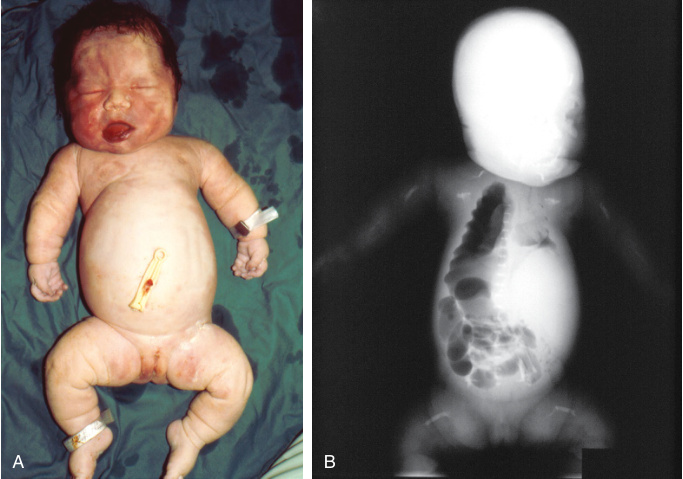

**Fig. 11.7** Hypophosphatasia. (A and B) Stillborn infant with almost complete lack of mineralization of bony skeleton. Serum alkaline phosphatase was low, and there was increased urinary phosphoethanolamine.  (From Lyons Jones K, Crandall Jones M, del Campo M. Achondroplasia. In: _Smith’s Recognizable Patterns of Human Malformation_ . 8th ed. Philadelphia: Elsevier; 2022 [Fig. 1, p. 537].) 

adult individuals (commonly postmenopausal women) who have normal stature and no deformities but a history of musculoskeletal pain and loss of teeth. Because of the implication of alkaline phosphatase in the dephosphorylation of pyridoxal phosphate, one of the main metabolites of vitamin B6, some newborns and infants with hypophosphatasia present with seizures that may respond to vitamin B6 administration **(pyridoxine-responsive seizures)** . Seizures may occur even in infants with only moderate skeletal manifestations, and may be the first clinical manifestation of hypophosphatasia. The clinical forms of hypophosphatasia have once been categorized as prenatal, infantile, childhoodonset, adult-onset, and teeth only **(odontohypophosphatasia)** . In reality, the forms may overlap, and diagnostic modalities today might allow earlier diagnosis of milder forms. 

The diagnosis of hypophosphatasia is not difficult in newborns and infants with severe or even moderate forms. The radiographic signs are typical and the diagnosis can be corroborated by the determination of alkaline phosphatase activity in plasma, of pyridoxal phosphate in plasma, and of phosphoethanolamine in urine. Serum alkaline phosphatase is decreased; the calcium level in plasma is normal, while phosphate is normal or mildly elevated. Diagnostic confirmation requires sequencing of _ALPL_ with demonstration of biallelic variants reducing enzyme activity. Many different pathogenic variants are known; founder variants exist in some populations (e.g., Japan). Individuals who carry only one pathogenic variant (e.g., the parents of an affected child) may have reduced enzyme activity in plasma and show some signs of the disorder (teeth loss or bone pain). 

The biochemical constellation of hypophosphatasia can sometimes be found in severe cases of another disorder, **cleidocranial dysplasia** . 

The development of targeted enzyme replacement has profoundly changed the clinical course and prognosis of hypophosphatasia. Newborns who have severe or intermediate forms and whose ventilation can be stabilized may benefit from early enzyme replacement: stability of the rib cage is improved, ventilation becomes more stable, and motor development improves and may return within normal limits. Linear growth improves but may not attain normal speed and children have remained at or slightly below the third percentile. The drug (asfotase, Strensiq® ) is a genetically engineered form of alkaline phosphatase that targets bone tissue. It is usually injected subcutaneously with a regimen of 3 to 6 injections per week. It is generally well tolerated with few side effects. The high price remains a concern for treatments that may be required for many years, perhaps lifelong. 

# **Hypophosphatemia and the Genetic Forms of Rickets** 

While nutritional (vitamin D-deficient or calcium-deficient) rickets is fairly common in many regions of the world, its reduction in incidence has led to the identification of many distinct forms of rickets that have a genetic basis. The diagnostic approach to rickets, including genetic rickets, includes the exclusion of nutritional rickets first: determination of 25-hydroxyvitamin D, calcium, phosphate and alkaline

<!-- p.290 -->

phosphatase in plasma, radiographic imaging of the wrist and/or the knee, and observation of the response to a small oral dose of vitamin D. When biochemistry is inconsistent, or there is no clinical response, genetic rickets should be considered. 

_Hypophosphatemic rickets, PHEX-related_ (formerly called phosphate diabetes) is one of the more common genetic forms. It manifests similarly to other forms of rickets, with a waddling gait, varus deformity of the legs, and enlargement of the joints and of costochondral junctions, usually in the second year of life (the biochemical anomaly is not manifest in the first months of life). The diagnosis can be corroborated by the observation of low plasma phosphorus and inappropriately elevated urinary phosphorus; the tubular rate of phosphate reabsorption (calculated by measuring plasma and urinary phosphorus and creatinine simultaneously) is reduced (when plasma phosphate is low, tubular reabsorption should be close to 98–99%; any value lower than that in the presence of hypophosphatemia is suggestive of excessive urinary loss). The diagnosis is confirmed by the demonstration of pathogenic variants in _PHEX_ that encodes for a peptidase system responsible for the degradation of the phosphaturic hormone, FGF23. _PHEX_ is on the X chromosome, but the severity of the disorder tends to be similar in heterozygous females and in hemizygous males, although clinical variability may be more pronounced in females (because of X chromosome inactivation; the disorder may also run in families as a dominant trait. 

The pathogenesis of disease stems from insufficient levels of phosphate to ensure correct mineralization of the bone matrix. Treatment has traditionally aimed at increasing plasma levels of phosphate through copious oral administration of phosphate salts, accompanied by small doses of vitamin D (calcitriol). Obstacles to this treatment are the short half-life of phosphate in plasma in the presence of kidney phosphate loss as well as the gastrointestinal discomfort of a treatment that requires intake every four hours. Oral phosphate tends to result in diarrhea, and long-term complications include nephrocalcinosis. Identification of the molecular defect has led to the development of a monoclonal antibody that binds to, and neutralizes, FGF23, thereby effectively reducing renal phosphate excretion. The antibody preparation (burosumab; Crysvita® ) is approved for the treatment of hypophosphatemic rickets from the age of 6 months; it is administered as a subcutaneous injection every second week. Other forms of hypophosphatemic rickets, both autosomal dominant and autosomal recessive, are rarer. Urinary phosphate wasting with hypophosphatemia and rickets may occur in other forms of renal tubulopathies ( **Fanconi syndrome** as seen in cystinosis or in mitochondrial disorders). 

## **Disorders of Vitamin D Metabolism and the Vitamin D Receptor** 

Some forms of rickets, formerly called “vitamin D-dependent rickets” (VDDR), are caused by genetic disorders of the 

metabolic activation or inactivation of vitamin D and defects in the vitamin D receptor system. Inheritance is autosomal recessive. Their clinical presentation may be quite severe, with rickets in the first year of life, refractory hypocalcemia, and in the case of vitamin D receptor anomalies other clinical signs such as alopecia. Their treatment may require administration of the activated form of vitamin D (1,25-dihydroxy-vitamin D) as well as calcium supplements, but therapeutic adjustments are often laborious, and skeletal deformities tend to develop or remain even with treatment. 

# **Cartilage–Hair Hypoplasia** 

The condition is an association between short stature with metaphyseal dysplasia, sparse hair, and unusual susceptibility to viral infections (specifically to varicella). It was known as metaphyseal dysplasia, McKusick type, but the name **cartilage–hair hypoplasia,** **_RMRP_ -related** is now accepted. It is not rare and is more frequent in Finland because of a founder variant. The main features of the condition are metaphyseal dysplasia with short stature, short and lax fingers and toes, sparse hair, immune deficiency, chronic anemia, and (in a small percentage of cases, somewhere between 5 and 10%) congenital megacolon (Hirschsprung disease). Facial features are normal. The clinical phenotype shows striking variability; most affected individuals will show some degree of short stature at birth, with predominant shortening of the limbs. The fingers are short with lax interphalangeal joints. Some children and adults will show marked short stature (−5 to −8 SD; adult height of ~90 cm), while other individuals will be less severely affected. Hair is sparse in ~50% of cases but may be normal and even abundant. **Hyporegenerative anemia** is common and usually self-limited but in some cases may be severe and chronic, resembling Blackfan-Diamond anemia. There is immune deficiency most frequently toward viruses like in the case of chickenpox, although some patients have more severe symptoms consistent with **severe combined immunodeficiency disease (SCID)** . This can manifest in the first months of life or be clinically silent for the first years of life or even decades; it may manifest as late as in the third decade. The immune dysregulation in CHH also predisposes to the development of lymphomas even in the absence of overt immune deficiency. Despite short stature in infants and young children, the metaphyseal changes on radiographs may not become apparent until age 3 or 4 years; the short stature is more pronounced than the radiographic changes would suggest, and the radiographic diagnosis is not easy. _Half-moon_ shaped phalangeal epiphyses may be a useful radiographic sign. 

CHH is caused by biallelic (recessive) variants of _RMRP_ . _RMRP_ does not code for a protein and is not translated; it encodes an RNA component of an enzyme, mitochondrial RNA-processing endoribonuclease (RNase MRP). The effects of _RMRP_ variants are pleiotropic (cartilage, hair, immune cells, and more) but pathogenesis is far from being understood. It is also difficult to recognize genotype-phenotype

<!-- p.291 -->

correlations, and there is no strict correlation between the severity of the different manifestations of the condition. Treatment of clinical manifestations is symptomatic; surveillance of immune function and blood cell counts has been recommended. Hematopoietic stem cell transplantation has been performed to correct the immune deficiency and this has not directly improved skeletal growth. 

# **The Shwachman-Bodian-Diamond Syndrome (SBDS)** 

This is a pleiotropic disorder, first described as cyclic neutropenia, pancreatic insufficiency, and metaphyseal dysplasia, and then recognized to be associated with general bone marrow failure including aplastic anemia and the myelodysplastic syndrome. It is inherited as an autosomal recessive and is caused by genetic variants in _SBDS_ that encodes a ribosomal maturation factor localized in the cell nucleus. A severe, neonatal presentation variant exists (metaphyseal dysplasia, Sedaghatian type); the classic SBDS forms are more likely to present with hematologic signs or pancreatic insufficiency than with skeletal deformities. Hematopoietic stem cell transplantation may be required in some cases (see Chapter 51). 

# **Campomelic Dysplasia** 

This disorder has an unspecific name (campomelic, Greek for bent limbs) and is therefore often invoked when bowed limbs are seen in a fetus. Bent limbs are not an obligate feature _(acampomelic campomelic dysplasia)_ . The molecular basis of campomelic dysplasias are variations in or around _SOX9_ ; either amino acid substitutions or truncating variants, or more rarely insertions/deletions involving the coding sequence, or structural genomic variants, including chromosomal translocations, that perturb the regulation of _SOX9_ expression. The phenotypic spectrum from the _SOX9_ gene is broad; most cases will be recognizable before birth or at birth with shortening and bowing of long bones, and clubfeet; the face is flat and there may be a **Pierre Robin sequence** with posterior palatal clefting. Approximately 65% of 46,XYindividuals with campomelic dysplasia have **ambiguous or female genitalia** ; the SOX9 transcription factor is structurally related to the SRY (sex-determining region of the Y) and is also a target of SRY activation, and thus participates in the masculinization process induced by the presence of the Y chromosome. Karyotyping should be performed in surviving individuals with ambiguous or female genitalia to screen for XY sex reversal and consider surgical removal of the male gonads because of the risk of gonadoblastoma. 

Craniocervical instability may be present (and should be screened for to prevent complications) and hypoacusis may develop. Milder cases of campomelic may be recognized much later in life with craniocervical instability (mainly manifesting with sleep apneas), progressive scoliosis, incomplete ossification of the pubic and ischium bones, and hypoplasia of the patella (ischio-pubic-patellar dysplasia). The 

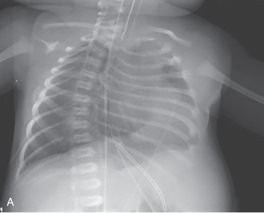

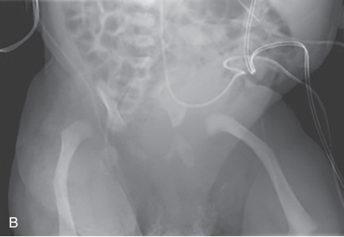

**Fig. 11.8** Campomelic dysplasia in a newborn. (A) Chest radiograph reveals slender ribs and marked scapular hypoplasia. (B) Frontal radiograph of the pelvis and thighs shows classic bent bone appearance of the femurs. Both hips are dislocated, and the pelvis is very narrow. (From Dwek J, Lachman RS. Skeletal dysplasias and selected chromosomal disorders. In: _Caffey’s Pediatric Diagnostic Imaging._ 13th ed., Vol. 2. Philadelphia: Elsevier; 2019 [Fig. 132.30, p. 1279].) 

radiographic signs in the affected newborn include angulation (not rounded bowing) of femurs and tibiae, hypoplasia of iliac wings, hypoplasia or absence of the vertebral pedicles in the thoracic region, and hypoplasia of the scapular wings; the latter finding may also be verified by palpation on clinical examination (Fig. 11.8). When present, this combination is pathognomonic. However, one or more radiographic signs may be absent and gene panel molecular testing may be required to confirm the diagnosis. Treatment is symptomatic, and the prognosis depends on the degree on thoracic hypoplasia, the presence or absence of craniocervical instability, and progression of the scoliosis. 

# **Larsen Syndrome and Other Dysplasias With Joint Laxity and Dislocations** 

Larsen syndrome has multiple congenital dislocations with characteristic facial abnormalities. The dislocations in Larsen

<!-- p.292 -->

syndrome involve knees (a hallmark sign), hips, and elbows; the face is flat. There are some modeling defects of the tubular bones, very evident in the metacarpals and phalanges. The label of _Larsen syndrome_ has been applied to most cases of congenital knee dislocations, but the _Nosology_ has evolved significantly and there is a group of skeletal dysplasias featuring congenital dislocations. Some of these disorders also have features of abnormal connective tissue and may overlap with the large group of Ehlers-Danlos syndromes. In most cases, there is a tendency to improvement in the first year of life; thus, casting and physical therapy are the initial therapeutic approach; surgery should be reserved for those cases in which ambulation remains impossible. 

Larsen syndrome is caused by monoallelic dominant variants (usually sporadic, more rarely dominantly transmitted) in _FLNB_ that codes for an intracellular structural protein, filamin B. The Larsen variants act by a dominant negative mechanism. Other variants in the same gene may result in more severe skeletal dysplasias ( **atelosteogenesis type 1** and **type 3** ), while loss-of-function variants in _FLNB_ are recessive and when biallelic result in a different condition called **spondylo-carpal-tarsal synostosis (SCTS)** . In the filamin B gene, the dominant variants resulting in amino acid substitutions giving either Larsen syndrome or atelosteogenesis are clustered in specific regions, while recessive truncating variants giving SCTS are dispersed throughout the gene. 

A series of other conditions that may present with congenital dislocations of the knees and hips are associated with recessively inherited deficiencies of enzymes involved in the biosynthesis of sulfated proteoglycans. Although individually rarer (as recessive conditions) than Larsen 

syndrome, they are an important differential diagnosis. The most common is **CHST3 deficiency** (carbohydrate sulfotransferase 3; also known as chondroitin 6-sulfotransferase). The CHST3 enzyme is responsible for the sulfation of galactosamine the disaccharide units of chondroitin; these sulfate residues are precisely those that must be removed, in the catabolic pathway, by _N_ -acetylgalactosamine-6-sulfatase in the lysosome—the enzyme that is deficient in the **Morquio syndrome** (mucopolysaccharidosis type 4A). In CHST3 deficiency, the face is normal, there is progressive degeneration of intervertebral disks, and not rarely involvement of the heart valves. In infancy and early childhood, the vertebrae show coronal clefts. The condition is not rare and has been formerly described as recessive Larsen syndrome, spondyloepiphyseal dysplasia, Omani type, or as humerospinal dysostosis; these entities are all subsumed under the entity **chondrodysplasia with congenital joint dislocations** , _CHST3_ -related. Other dysplasias with congenital dislocations are shown in Table 11.4. 

# **Dysplasias With Stippled Calcifications: Chondrodysplasia Punctata** 

There is a group of genetic skeletal disorders that share the radiographic feature of _stippling_ : the appearance of calcific, radiodense dots or spots (Latin _puncta_ ) at sites where ossification is normally absent or begins at much later stages of skeletal maturation. Such stippling may be seen in the talus and calcaneus, in the carpal bones, but also in the proximal humerus and femurs, and along the vertebral bodies. In 

#### **TABLE 11.4** Other D ysplasias With Congenital Dislocations

|Nosology #|Disorders|Inheritance|Gene|
|---|---|---|---|
|NOS 05-0010|Baratela-Scott syndrome, XYLT1-related|AR|_XYLT1_|
|NOS 05-0020|Desbuquois dysplasia (with accessory ossification center in digit 2), _CANT1_-related|AR|_CANT1_|
|NOS 05-0030|Desbuquois dysplasia (with short metacarpals and elongated phalanges, Kim type),_CANT1_-related|AR|_CANT1_|
|NOS 05-0040|SEMD with joint laxity (Hall type or leptodactylic type),_KIF22_-related|AD|_KIF22_|
|NOS 05-0050|SEMD with joint laxity,_EXOC6B_-related|AR|_EXOC6B_|
|NOS 05-0060|SEMD with joint laxity (Beighton type),_B3GALT6_-related (Ehlers-Danlos syndrome, spondylodysplastic type 2, EDSSPD2)|AR|_B3GALT6_|
|NOS 05-0070|Ehlers-Danlos syndrome, spondylodysplastic type 1 (EDSSPD1), _B4GALT7_-related|AR|_B4GALT7_|
|NOS 05-0080|Multiple joint dislocations, short stature, craniofacial dysmorphisms, and skeletal dysplasia, with or without heart defects,_B3GAT3_-related|AR|_B3GAT3_|
|NOS 05-0090|Skeletal dysplasia with joint laxity and advanced bone age (SDJLABA), _CSGALNACT1_-related|AR|_CSGALNACT1_|
|NOS 05-0100|Skeletal dysplasia with joint dislocations and amelogenesis imperfecta, _SLC10A7_-related|AR|_SLC10A7_|

<!-- p.293 -->

some cases, non-skeletal cartilage may also be affected such as the nasal cartilage, the tracheal rings, or the ear conchae; periarticular soft tissues may also be affected. These precocious or ectopic calcification foci may be visible in a limited time window only and eventually no longer be visible, as physiologic ossification of the affected elements occurs. Severity of stippling may vary markedly; in milder cases, stippling may be present at some large joints only; in related conditions such as the Zellweger syndrome, stippling may be restricted to the patella; in contrast, in severe cases, the whole fetal skeleton may be disseminated with punctae. 

Chondrodysplasia punctata appears to be the consequence of a dysregulated, exuberant calcification process in cartilage, but its biochemical bases are not completely understood. The genes that may be responsible for chondrodysplasia punctata belong to different metabolic pathways; the _MGP_ gene codes for the matrix _Gla_ -dependent protein and is thus linked to vitamin K metabolism. The most frequent form of genetic chondrodysplasia punctata, the **X-linked recessive deficiency of the enzyme arylsulfatase L** ( _ARSL_ ; formerly _ARSE_ ), may also be implicated in vitamin K metabolism. A rare teratogenic condition called **warfarin embryopathy** also has features of chondrodysplasia punctata, and maternal deficiency of vitamin K has also been linked to some cases of (non-genetic) chondrodysplasia punctata. Other genes for chondrodysplasia punctata are implicated in peroxisomal biogenesis (five subtypes of **rhizomelic CDP** ) and more specifically in the synthesis of plasmalogens; in the metabolism of fatty acids; or in the synthesis of cholesterol. The link between vitamin K, plasmalogens, fatty acids, cholesterol, and calcification remains to be fully elucidated. There is a rare form of chondrodysplasia punctata that may occur in fetuses of pregnant women with **systemic erythematous lupus (SLE)** . The skeletal changes are likely related to autoimmunity and the presence of Ro/SSA antibodies. 

The **X-linked recessive form (CDP-XL; ARSL deficiency** ) is the most common. The phenotype in affected males is variable; most will have only moderate short stature with a flat, trident-shaped nose (Binder’s face) and no severe complications (several cases of transmission from an affected grandfather to his male grandchild via the heterozygous mother are known); there may be craniocervical instability leading to impingement on the cervical spinal cord with neurologic consequences (craniocervical imaging should be performed in all cases); and in some cases, stippling may be so extensive as to be incompatible with life (craniocervical instability, tracheal stenosis). The skin is not affected. 

An X-linked dominant form (caused by genetic variants in the X-linked _EBP_ ; also known as the **Conradi-Hünermann syndrome** ) exists and tends to affect only heterozygous females; in addition, because of X-chromosome inactivation, affected females may show asymmetric or patchy involvement. The clinical presentation may be of variable severity (from the severely affected fetus to only mildly affected woman); the calcific stippling may affect growth of the affected bones, leading to shortening of individual limbs or 

limb segments; this form leads to skin changes such as erythema, ichthyosis, and alopecia, as well as to cataracts. A pathogenetically and phenotypically similar, but more extreme, mostly lethal disorder called **CHILD syndrome** (congenital hemidysplasia with ichthyosiform erythroderma and limb defects) is caused by pathogenic variants in another X-linked gene of cholesterol biosynthesis, _NSDHL_ . The cutaneous feature of these disorders might be treatable with cholesterol-rich skin ointments. 

Another form of CDP is **rhizomelic CDP (rCDP)** . This form is genetically heterogeneous, all responsible genes being related to peroxisomal biogenesis and plasmalogen biosynthesis. Skeletal stippling is widespread but concentrated in the proximal portions of humeri and femurs leading to rhizomelic shortening, but also along the spine. In typical cases, there is coronal clefting of vertebral bodies that, in combination with extensive stippling, is diagnostic for rCDP. The disorder is often perinatally lethal; of note, survivors show intellectual disability. 

# **The Osteopetroses: Disorders** 

# **With Increased Bone Density** 

Many genetic and clinical subtypes of osteopetrosis (stone bones, marble bone disease) are recognized, and the clinical spectrum is broad (Table 11.5). 

The autosomal recessive, infantile (formerly called _malignant_ ) form of osteopetrosis presents in the first year of life. Obliteration of the bone marrow compartment because of the primary defect in bone homeostasis results in extramedullary hematopoiesis and hepatosplenomegaly with anemia. Hyperostosis in the cranial base leads to compression of the optic nerves, and blindness may arise in a few months. Rapid diagnosis is essential to prevent blindness, either by surgical widening of the optic foramina, or by treatment of the underlying disease by hematopoietic stem cell transplantation (HSCT). The course of the untreated disease is usually fatal. Less severe forms of the disease may be compatible with life with moderate chronic anemia, bone fragility, optic nerve compression, hypoacusis, and short stature. Teeth are often affected including teeth malformations, mineralization defects as well as delayed eruption. Other forms of osteopetrosis, particularly those that are dominantly inherited, may be oligoor asymptomatic and remain undiagnosed until the disorder is recognized on radiographs taken because of bone pain or fractures. In infantile and juvenile forms, the diagnosis is usually made in the context of anemia, organ enlargement, and often visual loss by the finding of dense bones with obliterated diaphyseal spaces on radiography (Fig. 11.9); the diagnosis should always be confirmed by molecular-genetic analysis. 

The severe forms of osteopetrosis are diseases of the boneresorbing cell, the osteoclast. Two of the main responsible genes, _TCIRG1_ and _CLCN7_ , are involved in acidification of the bone resorbing lacunae formed by the osteoclasts adhering to bone matrix. Other osteopetrosis genes are responsible

<!-- p.294 -->

#### **TABLE 11.5** 

### **Osteopetrosis and Related Osteoclast Disorders** 

|Group/Disorder|Inheritance|Gene or Locus|
|---|---|---|
|Osteopetrosis, neonatal or infantile form|AR|_TCIRG, CLCN, SNX10_|
|Osteopetrosis, infantile form, with nervous system involvement|AR|_OSTM1_|
|Osteopetrosis, infantile form, osteoclast-poor with immunoglobulin deficiency|AR|_TNFRSF11A_|
|Osteopetrosis, intermediate form|AR|_TCIRG1, TNFSF11, PLEKHM1,_ _CLCN7_|
|Osteopetrosis, late-onset, dominant form|AD|_CLCN7_|
|Osteopetrosis with renal tubular acidosis|AR|_CA2_|
|Osteopetrosis with ectodermal dysplasia and immune defect (OLEDAID)|XL|_IKBKG_|
|Osteopetrosis, moderate form|AR|_SLC4A2_|
|Osteopetrosis, moderate form with defective leucocyte adhesion|AR|_FERMT3, RASGRP2_|
|Osteosclerotic metaphyseal dysplasia|AR|_LRRK1_|
|Pyknodysostosis|AR|_CTSK_|
|Dysosteosclerosis|AR|_SLC29A3, TNFRSF11A_|
|Dysosteosclerosis with degenerative encephalopathy and brain malformation|AR|_CSF1R_|

Data from Unger S, Ferreira CR, Mortier GR, et al. Nosology of genetic skeletal disorders: 2023 revision. _Am J Med Genet._ 2023;191A:1164-1209 (Table 1, Group 24, pp. 1184–1185). 

This is also Table 740.1 in _Nelson Textbook of Pediatrics._ 22nd ed. 

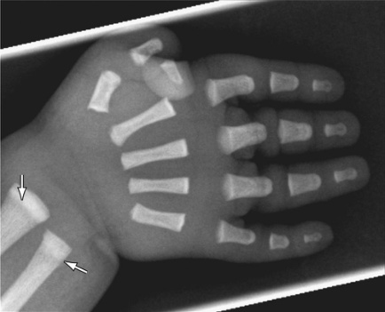

**Fig. 11.9** Osteopetrosis. Right-hand radiograph obtained at 2 weeks of age. Note metaphyseal lucent bands in the distal ulna and radius _(arrows)_ and short tubular bones.  (From Stark Z, Savarirayan R. Osteopetrosis. _Orphanet J Rare Dis_ . 2009;4:5. Also Fig. 740.2 in _Nelson Textbook of Pediatrics._ 22nd ed.) 

in osteoclast adhesion or in osteoclast differentiation. The pathogenesis involves a disequilibrium between bone deposition (that occurs at a normal rate) and bone resorption that is necessary for bone tissue homeostasis and for the remodeling and growth of osseous elements. In forms associated with a primary defect of the osteoclast, stem cell transplantation may be effective. The success of HSCT 

seems to be markedly dependent on the genetic basis, and molecular diagnosis should be obtained in all cases to evaluate the option of HSCT. 

# **Geleophysic Dysplasia, Acromicric Dysplasia, and TGF Beta Signaling** 

Geleophysic dysplasia, acromicric dysplasia, and the WeillMarchesani syndrome are related disorders characterized by short stature, connective tissue disease (thick skin, joint contractures, valvular disease, and for the **Weill-Marchesani syndrome** spherophakia with or without lens dislocation). The radiographic features are relatively mild and nondiagnostic—stocky long bones with brachydactyly. The facial appearance is distinctive with slightly coarse features and, in the case of geleophysic dysplasia, upturned corners of the mouth (geleophysic meaning _smiling face_ ). Because of short stature, short fingers, coarse facial features, and valvular disease, affected children may be suspected to have a mucopolysaccharide storage disorder or a skeletal dysplasia. These are mainly disorders of connective tissue. The borders between geleophysic and acromicric dysplasia are not well defined, and they may be different variations of the same disorder; the most frequent molecular basis are variants in the fibrillin 1 gene, _FBN1_ , the same gene that causes the Marfan syndrome, but other genes involved in TGF beta regulation may result in very similar phenotypes and the clinical distinction may be different. The genetic variants that cause geleophysic or acromicric are distinct from those

<!-- p.295 -->

that result in the Marfan syndrome; while Marfan has tall stature, loose connective tissue, and fragile valves and blood vessels, geleophysic, acromicric, and the Weill-Marchesani syndrome have anti-Marfan features like short stature, tight skin, and valvular stenosis. The crystalline lens in the Weill-Marchesani syndrome may be small and rounded (microspherophakia) and get dislocated. These opposing phenotypes are explained by _opposite effects_ of the genetic variants in _FBN1_ and the other genes of TGF beta ( _LTBP2, LTBP3, ADAMTSL2, ADAMTS10,_ and _ADAMTS17_ ) on the regulation of TGF beta availability and activity. Diagnosis of the disorders in this group is made by gene panel sequencing in children who have short stature, short fingers, thick skin, as well as valvular or ocular signs. Therapeutic approaches are symptomatic: cardiac surgery to correct valvular stenosis, as well as ocular surgery to replace and/or stabilize the lens. 

# **Dyschondrosteosis and the** **_SHOX_ Ge** **_n_ e** 

Dyschondrosteosis can be dominantly transmitted, manifests with short stature in the first decade, and is relatively benign. Typical cases have short forearms with an incurvation of the radius, called the **Madelung deformity** . The molecular basis is haploinsufficiency of the pseudoautosomal (X- and Y-linked) gene _SHOX_ , most often secondary to small deletions, more rarely because of point variants. However, the majority of bearers of pathogenic _SHOX_ variants _do not_ have a Madelung deformity, and some have a stature within the normal range. _SHOX_ variants should be considered in the differential diagnosis of short stature with short forearms but also in familial or idiopathic short stature without signs of skeletal dysplasia. The diagnosis is best made by analysis of _SHOX_ followed by sequencing if negative, usually within a gene panel for skeletal dysplasia or short stature. The very rare occurrence by biallelic loss of function variants in _SHOX_ is associated with severe shortening of arms and legs; the condition is called **SHOXrelated mesomelic dysplasia, Langer type** . 

# **Osteolysis Syndromes** 

In rare cases, skeletal structures may be correctly formed and ossified, but may undergo a secondary process of bone resorption called _osteolysis_ . **Multicentric carpal-tarsal osteolysis (MCTO)** is a condition that manifests with pain in the feet, and then in the hands, in early childhood. The origin of the pain is usually unclear; one to three years after disease onset, radiographs show a resorption of the tarsal and carpal bones; signs of inflammation are negative. The disease progresses slowly but relentlessly. A secondary manifestation is glomerular disease with proteinuria and progression to renal insufficiency. The disorder is usually sporadic but can be dominantly transmitted; the molecular basis is monoallelic, heterozygous missense variants in a very specific region of _MAFB_ . MAFB is a transcription factor, and the missense variants are believed to interfere 

with degradation of the protein. Therapeutic approaches are not satisfying; bisphosphonates or anti-osteoclast antibodies have little effect, while cyclosporine may be helpful in slowing the progression of renal disease. 

The **multicentric osteolysis, nodulosis, and arthropathy (MONA) syndrome** combines multicentric (but mostly carpal and tarsal) osteolysis with skin nodules; there is no renal disease. The condition is recessive and associated with biallelic variants in _MMP2_ . 

Carpal osteolysis can be seen as a secondary sign in lysosomal storage diseases such as mucolipidosis type 3, _GNPTAB_ -related, or Farber disease, _ASAH1_ -related. Osteolysis occurring at the distal phalanges of the fingers is called **acroosteolysis** ; it is a radiographic sign of several disorders such as the Hajdu-Cheney syndrome, _NOTCH2_ -related, or mandibuloacral dysplasia, _LMNA_ -related, or others. 

# **Multiple Cartilaginous Exostoses (Multiple Osteochondromas) and Other Disorders With Disorganized Growth of Cartilage and Bone Tissue** 

Multiple cartilaginous exostoses (MCE), also called multiple osteochondromas (MO), is a condition characterized by the outgrowth of bone protuberances covered by a cartilaginous cap. Typical sites are the distal radius, the distal femur, the proximal tibia and fibula, but also the proximal femur, the scapulae, and the pelvic girdle. These _exostoses_ may be noticed at any time during childhood. They are primarily benign, and growth usually stops after puberty; but malignant degeneration may occur in a proportion of cases at a few percent to 20–30%. In most cases, no intervention is needed; surgical removal may be necessary when an exostosis encroaches on peripheral nerves (proximal fibula) or if by its position leads to chronic irritation. Periodic surveillance with whole-body CT scans helps recognize malignant growth but there is no solid evidence of efficacy. The condition is transmitted as a dominant trait and is relatively benign. Unlike most dominantly transmitted disorders, the affected genes are enzymes, namely, glycosyltransferases implicated in the synthesis of heparan sulfate proteoglycans. The deficiency of such proteoglycans at the growth plate is believed to impair the longitudinal orientation of chondrocyte proliferation and to allow for _lateral_ outgrowth that gives rise to the exostoses. 

Another disorder associated with somatic variants in an enzyme gene is **Ollier disease (multiple osteochondromatosis)** ; in this condition, enchondromas develop at growth plates of several bones but, unlike in MCE, they do not grow out but tend to remain within the bones (albeit metaphyseal enlargement may occur) and extend into the diaphyses. In rare cases where the bone changes are accompanied by cutaneous angiomatosis, the condition is called **Maffucci syndrome** . Because of mosaicism the extent and localization of Ollier disease is variable; it can affect only one extremity, or one half of the body, or multiple bones

<!-- p.296 -->

with sparing of others. The hands are often affected and may reveal the presence of the condition, which is usually diagnosed in childhood. 

The condition is caused by somatic mosaicism for specific monoallelic variants in the genes for isocitrate dehydrogenase isoforms ( _IDH1_ or _IDH2_ ) that do not abolish enzyme activity but change its specificity, leading to excessive cellular production of 2-D-hydroxyglutaric acid; this perturbs the oxygen sensing system in chondrocytes and stimulates their proliferation. The clinical severity depends on the extent of somatic mosaicism; in its more severe, almost generalized (but still somatic) form, that also affects the vertebral bodies, the disorder is called **metaphyseal chondromatosis with 2-hydroxyglutaric aciduria** . Particularly in this form, but also in the more restricted Ollier disease, there is an increased risk for leukemia and for brain tumors because the metabolic derangement seems to be oncogenic in a variety of tissues; _IDH1_ and _IDH2_ pathogenic variants can cause brain tumors and leukemia. Treatment of Ollier disease has been symptomatic, with no role for surgery. 

# **Cleidocranial Dysplasia** 

This relatively common condition is characterized by incomplete ossification (in some cases absence) of the clavicles, of the cranial vault, and of the pubic bones. The face can show hypertelorism and frontal bossing. The clinical expression is variable; severe cases have no palpable clavicles, a dysmorphic face with hypertelorism and frontal bossing, and a severely unossified cranial vault (with insufficient mechanical protection of the underlying brain cortex, leading to mechanically induced seizures), and pretibial skin dimples; while milder cases are frequent with short stature as presenting sign, and hypoplasia of the clavicles detectable only on radiographs. Clavicular hypoplasia can be palpated, and when marked, affected individuals can move their shoulders forward and sometimes join them on the midline. Skull radiographs may show a _craquelé_ appearance of the occipital and parietal bones, similar to **Wormian bones** , and in more severe cases large areas of non-ossification of the cranial vault along the sutures and fontanelles. Dental anomalies usually present in the form of delayed eruption and delayed shedding of primary teeth, tooth agenesis, and anomalies of shape. 

The disorder affects membranous (rather than endochondral) ossification, and this explains the pattern of affected skeletal elements. Most cases are sporadic but dominant transmission can occur, particularly in milder cases. The molecular basis is monoallelic hypomorphic variants in _RUNX2_ , a nuclear transcription factor that has a key role in osteoblast activation; this explains how, is some cases, _ALPL_ for alkaline phosphatase (responsible for hypophosphatasia) may be downregulated and _combine_ cleidocranial dysplasia with some of the biochemical features of hypophosphatasia (low alkaline phosphatase and increased phosphoethanolamine in the urine). It is not entirely clear whether the 

pathogenic mechanism is simple haploinsufficiency, or whether some dominant negative mechanism may be active is some cases. Therapy is symptomatic; wearing a helmet may protect the brain when the cranial vault is incomplete. Dental care may be needed as appropriate. 

# **Short Rib-Polydactyly Syndromes and Related Skeletal Ciliopathies** 

There is a family of conditions that associate polydactyly (usually postaxial polydactyly of the hands) with features of skeletal dysplasia such short stature, short ribs leading to a narrow thorax, and metaphyseal dysplasia, as well as disease of organs such as the kidneys and the liver. Molecular elucidation of these conditions revealed that the pathogenesis involves sensory cilia; immotile, sensory cilia play important roles in a variety of signaling pathways implicated in morphogenesis (polydactyly), branching of tubular structures (kidney tubules, biliary ducts, and lung airways), and directional growth (cartilage growth plate); other organs (brain, eye) can also be affected. The protein machinery of sensory cilia and their _intraflagellar transport (IFT)_ transport system is so complex that pathogenic variants in a large number of genes may result in ciliary dysfunction and thus in **skeletal ciliopathies** with many combinations of clinical findings (see Chapter 7). 

The prototypic non-lethal skeletal ciliopathy is **Jeune syndrome** (formerly called asphyxiating thoracic dysplasia) that associates a narrow thorax, polydactyly (non-obligatory), and progressive renal disease (non-obligatory). The condition is usually non-lethal in the neonatal period, but respiratory difficulties may arise not solely from the reduced pulmonary volume but also from abnormal lung histology with impaired branching of airways. There is partial clinical overlap with conditions such as the Ellis–van Creveld syndrome (that associates congenital heart defects), the cranio-ectodermal dysplasia (Sensenbrenner) with brachydactyly, craniofacial dysmorphism, and progressive renal disease, and the Saldino-Mainzer syndrome with brachydactyly, renal, and retinal disease. In the more severe skeletal ciliopathies, the narrow thoracic cage is usually non-compatible with life; these lethal conditions have been subsumed under the name **short rib-polydactyly syndromes (SRPS)** and then divided into several types (SaldinoNoonan, Lenz-Majewski, Verma-Naumoff, and more); these divisions are becoming obsolete as the large number of genes and the clinical variability for each individual gene makes for very poor genotype-phenotype correlations. 

Almost all skeletal ciliopathies are inherited as autosomal recessive conditions. The diagnosis can be very straightforward when a narrow thorax is combined with polydactyly; but the genetic diagnosis should be made by gene panel sequencing. A narrow thorax may be seen in **ShwachmanBodian-Diamond syndrome** . Some of the ciliary genes are very large and have a large number of variants of unclear significance (VUS), mostly benign variants that can make the diagnosis difficult.

<!-- p.297 -->

Noninvasive ventilatory support in the newborn may be justified, but when invasive support is needed, the longterm prognosis is often poor because of the associated changes in pulmonary histology. Surgical expansion of the chest (vertical expandable prosthetic titanium rib: VEPTR) has been successful in some centers to treat neonatal respiratory insufficiency. The therapeutic approach is surveillance, particularly for progressive renal, hepatic, and retinal disease, followed by symptomatic therapy (including renal transplantation) when indicated. 

# **Spondylocostal Dysostoses** 

This group of disorders is characterized by primordial malformation of the individual vertebral bodies. The origin is a disturbance of the axial segmentation process in the early phases of embryonic development. The responsible genes are implicated in the molecular clock responsible for somite segmentation, or in the signaling mechanisms of individuation and boundary maintenance of vertebral bodies following primary segmentation. Affected individuals are remarkably free of symptoms but show shortening of the trunk relative to the limbs; scoliosis is present in some forms only (SCD type 2, _MESP2_ -related). Radiographs show significant disorganization of the vertebral bodies with changes in size and shape (smaller and larger bodies, rounded or butterfly-shaped), hemivertebrae, and in some cases bifurcated or fused ribs. In **spondylo-carpal-tarsal synostosis** , the vertebral bodies are normal in number but are fused together and flattened. In all cases, the paucity of symptoms contrasts with the radiographs, and there are no neurologic signs; the conditions are relatively benign. Great restraint must be exercised as no surgical intervention is indicated, except in rare cases (mainly SCD type 2) with marked scoliosis. 

The group of _vertebral dysostoses_ also includes the **KlippelFeil syndrome** , a condition with impaired formation and segmentation of the first cervical vertebrae that may produce a short neck and fusion of the upper cervical vertebrae to the basis of the skull. Most cases of Klippel-Feil syndrome are sporadic, and the condition does not seem to be monogenic; rare instances of familial, dominantly transmitted Klippel-Feil syndrome related to genetic variants in _GDF6_ have been described. The Klippel-Feil phenotype has also been seen as part of more complex malformation disorders. 

It must be noted that in the genuine spondylocostal dysostoses, organs other than the skeleton are usually _not_ affected. In contrast, there is another relatively common, pleiotropic condition called **VACTERL syndrome** that associates vertebral malformations, anal atresia, cardiac defects, tracheo-esophageal fistula, and limb defects in various combinations. VACTERL syndrome (that in itself has a large clinical variability and may not be a single condition but a relatively nonspecific diagnosis) has been put in relationship with some monogenic variants (e.g., variants in genes in the NADH synthesis pathway), but in most cases, 

there are no monogenic variants identified consistently, and the conditions may be multifactorial. 

# **Isolated and Syndromic Brachydactylies: Diagnostic Approach** 

Brachydactyly (short fingers) is not a rare finding. The diagnostic approach needs to distinguish between isolated brachydactylies and syndromic forms. **Isolated brachydactylies** are associated with reduced body height but have few or no other clinical manifestations. **Syndromic brachydactylies** may be an easily recognizable clinical sign indicating the presence of a more complex condition involving the endocrine system ( **Albright’s hereditary osteodystrophy** with or without pseudohypoparathyroidism), or the central nervous system or, in the case of the very rare **Bilginturan syndrome (** **_PDE3_ -related)** may be associated with arterial hypertension. 

The clinical impression of shortened fingers must be verified by hand radiographs; on hand radiographs, one would ascertain whether the shortening affects all tubular bones (metacarpal and phalanges), or, if not, which digits, which phalanges, and which metacarpals are affected, and whether cone-shaped epiphyses are present. In addition to the analysis of metacarpal and phalangeal elements, a thorough history and clinical examination should reveal other dysmorphisms or clinical manifestations that would invoke a syndromic, rather than an isolated, form of brachydactyly. 

The classic distinction of isolated brachydactylies in type A to E and subtypes (Julia Bell) is based on the pattern of affected digits and phalanges; some types of brachydactyly tend to have consistent genetic associations, such as brachydactyly type A with _IHH_ , brachydactyly type B1 with _ROR2_ , and brachydactyly type C with _GDF5_ variants. 

**Syndromic brachydactylies** are a much larger group. Many genuine skeletal dysplasias include shortened fingers (e.g., cartilage–hair hypoplasia, RMSP-related, or acromicric dysplasia) sometimes with relatively specific patterns such as the _trident hand_ (a term to avoid with patients and families) deformity in achondroplasia or the _hitchhiker thumb_ in diastrophic dysplasia. Many other syndromic conditions may have brachydactyly as one clinical manifestation, such as the tricho-rhino-phalangeal syndrome _(TRPS1)_ , or several brachydactyly-developmental delay syndromes. 

# **Bibliography** 

> Adam AP, Curry CJ, Hall JG, Keppler-Noreuil KM, Adam MP, Dobyns WB. Recurrent constellations of embryonic malformations re-conceptualized as an overlapping group of disorders with shared pathogenesis. _Am J Med Genet A_ . 2020;182(11):2646-2661. 

> Amberger JS, Bocchini CA, Schiettecatte F, Scott AF, Hamosh A. OMIM.org: Online Mendelian Inheritance in Man (OMIM® ), an online catalog of human genes and genetic disorders. _Nucleic Acids Res_ . 2015;43(D1):D789-D798. www.omim.org

<!-- p.298 -->

- Chen A, Fertala A, Abboud J, et al. The molecular basis of genetic collagen disorders and its clinical relevance. _J Bone Joint Surg Am_ . 2018;100:976-986. 

- Hall CM, Offiah AC, Forzano F, Lituania M, Fink M, Krakow D. _Fetal and Perinatal Skeletal Dysplasias—an Atlas of Multimodality Imaging_ . UK: Radcliffe Publishing Ltd/CRC Press; 2012. 

- Handa A, Grigelioniene G, Nishmura G. Skeletal dysplasia families: a stepwise approach to diagnosis. _Radiographics._ 2023;43(5):e22067. 

- Kannu P, Bateman J, Savarirayan R. Clinical phenotypes associated with type II collagen mutations. _J Pediatr Child Health._ 2012;48: E38-E43. 

- Leiva-Gea A, Martos Lirio MF, Barreda Bonis AC, et al. Achondroplasia: update on diagnosis, follow-up and treatment. _An Pediatr._ 2022;97(423):e1-e423.e11. 

- Marik B, Bagga A, Sinha A, et al. Genetic and clinical profile of patients with hypophosphatemic rickets. _Eur J Med Genet_ . 2022;65: 104540. 

- Mornet E, Taillandier A, Domingues C, et al. Hypophosphatasia: a genetic-based nosology and new insights in genotype-phenotype correlation. _Eur J Hum Genet_ . 2021;29:289-299. 

- Nielsen C, Reichenbach R, Merrell D, et al. National trends in inpatient hospital outcomes of children with osteogenesis imperfecta and the importance of extraskeletal manifestations: a kids’ inpatient database study. _J Pediatr_ . 2023;274:114174. 

- Sillence DO. A dyadic nosology for osteogenesis imperfecta and bone fragility syndromes 2024. _Calcif Tissue Int_ . 2024;115(6):873-890. 

- Spranger JW, Brill P, Nishimura G, Superti-Furga A, Unger S, eds. _Bone Dysplasias—An Atlas of Genetic Disorders of Skeletal Development_ . 4th ed. New York: Oxford University Press; 2018. 

- Tournis S, Yavropoulou MP, Polyzos SA, Doulgeraki A. Hypophosphatasia. _J Clin Med_ . 2021;10:5676. 

- Unger S, Ferreira CR, Mortier GR, et al. Nosology of genetic skeletal disorders: 2023 revision. _Am J Med Genet A_ . 2023;191(5): 1164-1209. www.isds.ch

<!-- p.299 -->
