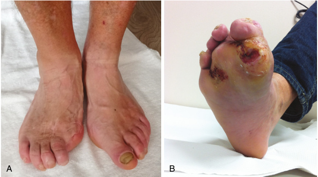
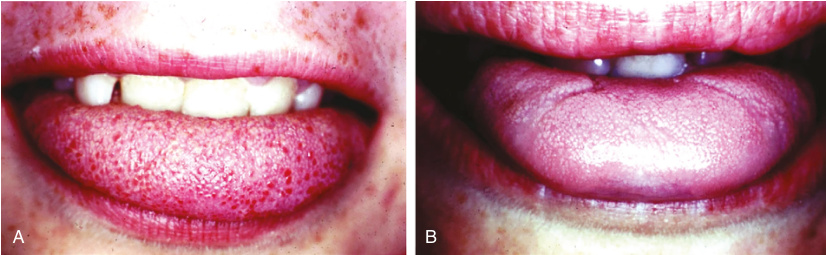
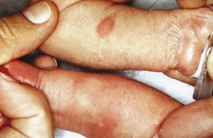
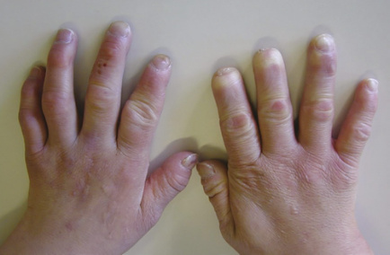
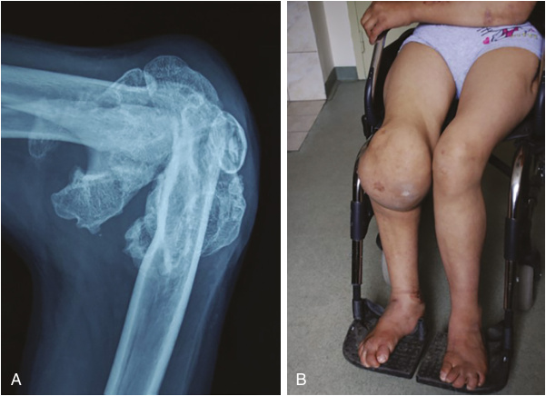
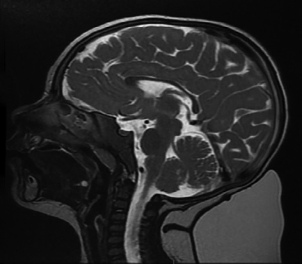
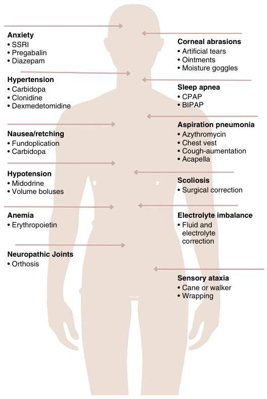

# Chapter 18: Sensory and Autonomic Neuropathies Including Familial Dysautonomia and Small Fiber Neuropathies
> **Course:** Vikkypaedia Rare Disease Learner Course (*Nelson Pediatric Textbook of Rare Diseases: Genomic Etiologies and Genetic Diagnosis (1st Edition)*)  
> **Section III:** Neuro-Sensory Disorders  
> **Authors:** Teresa Sevilla, Rafael Sivera, Herminia Argente-Escrig  
> **Metrics:** 8,355 words · 10 tables · 7 figures · 42 genes · 28 flashcards · 14 MCQs  
> **Quick Navigation:** [🃏 Study 28 Flashcards](../flashcards/018_flashcards.md) · [📝 Take 14-Q MCQ Quiz](../mcqs/018_mcqs.md) · [📚 Section III Guide](../sections/Section_III.md) · [🧬 Master OMIM/Gene Atlas](../omim_gene_atlas.md) · [💊 Precision Therapies Matrix](../therapies_matrix.md) · [🏠 Course Index](../../index.md)

## Key Chapter Topics
`HSAN of Adult Onset—HSAN1` · `HSAN Caused by Variants in SPTLC1 (HSAN1A)` · `HSAN With Gastroesophageal Reflux and Cough Linked to 3p22-p24 (HSAN1B)` · `HSAN Caused by Variants in SPTLC2 (HSAN1C)` · `HSAN Caused by Variants in DNMT1 (HSAN1E—HSAN With Dementia and Hearing Loss)` · `HSAN Caused by Variants in ATL1 and ATL3 (HSAN1D and HSAN1F)` · `HSAN Caused by Variants in RAB7 (HSAN1 and CMT2B)` · `Childhood or Congenital Onset HSAN` · `HSAN2` · `HSAN Caused by Variants in HSN2/WNK1 Gene (HSAN2A)` · `HSAN Caused by Variants in RETREG1 (FAM134B) (HSAN2B)` · `HSAN Caused by Variants in KIF1A (HSAN2C)` · `HSAN2D/CIP Caused by Variants in SCN9A` · `HSAN3 Caused by Variants in IKBKAP`

## Key Genes & Molecular Targets
`ALT3`, `ATL1`, `ATL3`, `CCT5`, `CLTCL1`, `CMT2B`, `DNMT1`, `ELP1`, `FAM134B`, `HSAN1A`, `HSAN1B`, `HSAN1C`, `HSAN1D`, `HSAN1E`, `HSAN1F`, `HSAN2A`, `HSAN2B`, `HSAN2C`

## ⚡ High-Yield Clinical & Diagnostic Pearls
- Except for HSAN type 1, which is transmitted in an autosomal dominant (AD) pattern, the other HSAN are transmitted as autosomal recessive (AR) trait.
- The AR forms are characterized by a congenital onset or in the first years of life; the alteration of the autonomic nervous system is usually prominent and there is mild or absent motor involvement.
- HSAN1 is the most common form and is distinguished from other types by its adult age of onset and autosomal dominant inheritance.
- HSAN1 encompasses a clinically variable group of slowly progressive AD disorders characterized by marked sensory involvement, variable motor involvement, and minimal autonomic involvement.
- The most common presenting symptom is hearing loss, followed by sensory loss and its complications (ulcerations and arthropathy).
- There are variants in DNMT1 that give rise to a syndrome characterized by autosomal dominant cerebellar ataxia, deafness, and narcolepsy (ADCA-DN) in which there is milder sensory loss.
- HSAN2 is characterized by a congenital or early onset progressive reduction in the ability to discriminate pain, temperature, and touch.
- HSAN2B is characterized by early childhood onset of sensory impairment, skin ulcerations, amputations, and osteomyelitis as well as variable weakness, spasticity, and autonomic dysfunction.

---
## Full Chapter Text, Tables & Figures

<!-- p.436 -->

# 18 

## Sensory and Autonomic Neuropathies Including Familial Dysautonomia and Small Fiber Neuropathies 

**TERESA SEVILLA, RAFAEL SIVERA, HERMINIA ARGENTE-ESCRIG** 

The peripheral nervous system (PNS) is divided into somatic and autonomic components; somatic peripheral nerves can be further divided into sensory and motor functions. _Hereditary sensory and autonomic neuropathies (HSAN) are a group of disorders with primary involvement of neurons subserving sensation and autonomic functions_ . The autonomic nervous system is distributed throughout the neuroaxis and reaches all organs and organ systems; two types are distinguished that exert complementary or opposing functions (Table 18.1). Within the sensory PNS, there are different nerve fibers that fulfill this function. The classification of nerve fibers is based on diameter, axon myelination, and conduction velocity (Table 18.2). In HSAN, the involvement is primarily in unmyelinated fibers and, smaller more than larger, myelinated fibers, which gives rise to various clinical phenotypes. Sometimes the predominant phenotypic feature is the reduction or absence of pain perception and is termed **congenital insensitivity to pain (CIP)** . Pain is essential for warning of imminent tissue damage and distinguishes noxious stimuli of diverse origin and form via nociceptors of neuronal origin. 

Classification of the HSAN is based on the causative gene, inheritance pattern, and clinical features, resulting in nine phenotypically diverse HSAN subtypes. Except for HSAN type 1, which is transmitted in an autosomal dominant (AD) pattern, the other HSAN are transmitted as autosomal recessive (AR) trait. AD forms begin in _adulthood_ , with altered sensation, little autonomic dysfunction, and variable motor involvement. The AR forms are characterized by a _congenital_ onset or in the first years of life; the alteration of the autonomic nervous system is usually prominent and there is mild or absent motor involvement. HSAN and CIP are caused by developmental defects of sensory neurons, neurodegeneration, or altered excitability. In many patients, overlapping mechanisms are present. 

### **HSAN of Adult Onset—HSAN1** 

HSAN1 is the most common form and is distinguished from other types by its adult age of onset and autosomal dominant inheritance. Patients become symptomatic between the second and fifth decades of life, although congenital or childhood onset have also been reported. HSAN1 encompasses a clinically variable group of slowly progressive AD disorders characterized by marked sensory involvement, variable motor involvement, and minimal autonomic involvement. Causative pathogenic variants in six genes have been identified so far (Table 18.3). In another family, complicated with cough and gastroesophageal reflux, linkage to chromosome 3p has been found but the gene has not been identified. A type whose clinical characteristics overlap with Charcot-Marie-Tooth (CMT; see Chapter 17) disease is also included in this group because it frequently starts with motor symptoms but develops sensory complications characteristic of HSAN type 1 (Table 18.4). 

#### **HSAN Caused by Variants in** **_SPTLC1_ (HSAN1A)** 

_SPTLC1_ is the most frequent cause of HSAN1. _SPTLC1_ encodes the first subunit of serine palmitoyltransferase (SPTLC1), which is involved in the synthesis of sphingolipids. Pathogenic variants lead to accumulation of deoxysphingolipid metabolites, which are neurotoxic. 

Patients carrying a _SPTLC1_ pathogenic variant present with the typical HSAN1 phenotype. The median age at symptom onset is around 20 years and usually consists of painless injuries, blisters, and ulcers on the feet due to pain and temperature loss with relative preservation of touch. Positive sensory symptoms such as burning, paresthesias,

<!-- p.437 -->

#### **TABLE 18.1** Function Autono al Outcomes of t mic Nervous Syste he Activation of the m

||Sympathetic|Parasympathetic|
|---|---|---|
|Heart Rate|Acceleration|Deceleration|
|Blood Pressure|Increase|Mild decrease|
|Bladder Activity|Increased tone|Urination (decreased tone)|
|Intestinal Motility|Hypomotility|Hypermotility|
|Lungs|Bronchodilation|Bronchoconstriction|
|Sweat Glands|Sweating||
|Pupils|Dilation|Constriction|
|Adrenal Glands|Increased catecholamines||
|Sexual Function|Ejaculation, orgasm|Erection|
|Lacrimal Glands||Teary secretion|
|Parotid Gland||Salivation|

and pain usually occur later and are not always present. When the neuropathy progresses, complications of severe sensory neuropathy are common, including ulcerations and osteomyelitis. Painless ulcers with difficult healing may lead to Charcot arthropathy in some cases and amputations in the most severe patients (Fig. 18.1). Although acral pain sensation is impaired, pain can occur due to osteomyelitis. The sensory loss has mostly a stocking-glove distribution, although in some people it extends to the shoulders, and has the following order: pain/temperature, touch, and finally, vibration and position; the pattern that is classically known as _dissociated alteration of sensitivity_ . Distal reflexes can be absent. Hearing loss may occur occasionally. The mean latency between symptom onset and hand involvement is ~10 years. Most patients gradually develop distal weakness and atrophy, being significant in many cases. 

Although pathogenic variants in _SPTLC1_ are classically associated with HSAN1, several reports suggest the existence of distinct phenotypes related to variants that alter residue p.Ser331 (Ser331Phe and Ser331Tyr) of the SPTLC1 enzyme, the **Ser331 syndrome** . Patients carrying variants in 

#### **TABLE 18.2** Classi ification i and Function of S i ensory Peripher i al Nerve Fiber Types Function (Symptoms of

|||Name|Fiber Diameter|Myelin Sheath|Conduction Velocity|Dysfunction)|
|---|---|---|---|---|---|---|
|Large i|fibers|AαAβ|5–20μm|Yes, thick|30–70 m/s|Touch, pressure (hypoesthesia)|
|Small i|fibers|Aδ|2–5μm|Yes, thin|12–30 m/s|Temperature and pain, soma touch (sharp, lancinating, prickly pain)|
|||C|0.3–1.1μm|None|0.5–2 m/s|Temperature and slow pain (dull, burning, and poorly localized pain)|

#### **TABLE 18.3** HSAN1 Su btypes and Their Clinical Manifest ations

|HSAN1 Subtype (Gene)|Onset|Sensory Involvement|Autonomic Disturbances|Ulcerative- Mutilating|Distinguishing Features|
|---|---|---|---|---|---|
|HSAN1A _(SPTLC1)_|Early adulthood|+++|−/+(Horner syndrome)|++|Sensorineural deafness in some|
|HSAN1B _(3p22-p24)_|Early adulthood|+++|+(alacrimia)|−|Gastroesophageal reflux and cough that precedes neuropathy|
|HSAN1C _(SPTLC2)_|Adulthood|+++|−|−(except for one patient)|UMN involvement in a family|
|HSAN1D _(ATL1)_|Early adulthood|+++|−|+++|Prominent UMN involvement|
|HSAN1E _(DNMT1)_|Adulthood|+++|+|++|Dementia and hearing loss|
|HSAN1F_(ATL3)_|Early adulthood|+++||+++|No UMN signs|
|HSAN1/CMT2B _(RAB7)_|Early adulthood|+++|+|++|Prominent motor involvement|

_UMN,_ Upper motor neuron, −, absent, +, mild, ++, moderate, +++, severe.

<!-- p.438 -->

###### **TABLE** 

##### **Key Features of HSAN1** 

###### **18.4** 

- Autosomal dominant pathogenic variants in _SPTLC1_ (HSAN1A) and _SPTLC2_ (HSAN1C) are the most frequent cause of predominantly sensory hereditary neuropathies. 

- The onset occurs, generally, between the third and fifth decades with symmetrical sensory loss. 

- The sensitive and trophic symptoms predominate over the autonomic manifestations. 

- Motor impairment has been described and may lead to diagnostic confusion between HSAN1A and CMT2B. 

- High-dose oral L-serine supplementation appears safe in patients with HSAN1 and is potentially effective at slowing disease progression 

this residue may suffer a severe phenotype characterized by early-onset neuropathy, prominent muscle atrophy, growth failure and ocular-skeletal abnormalities or a juvenile form of motor neuron disease. 

Electrophysiological studies are compatible with an axonal sensory and motor neuropathy affecting sensory fibers more severely. Sensory nerve action potentials **(SNAPs)** are decreased or absent in all patients and compound muscle action potentials **(CMAPs)** are frequently decreased or absent in lower limbs. Skin biopsy reveals absence of epidermal innervation at distal leg and decreased at the thigh, consistent with the known length dependent pattern of the neuropathy. 

Sensory symptoms such as paresthesia or intense neuropathic pain can be treated with analgesics and antiepileptic drugs used for pain, but the response in most cases is very poor. A clinical trial in adults with HSAN1A demonstrated that oral L-serine supplementation may be an effective therapy to slow disease progression. 

#### **HSAN With Gastroesophageal Reflux and Cough Linked to 3p22-p24 (HSAN1B)** 

In this type of HSAN1 the causal gene has not yet been identified, but a positive linkage on chromosome 3 (3p22p24) has been detected. The families described do not share a common haplotype, suggesting that different variants could occur in the same gene. Symptoms begin with a paroxysmal cough between the second and sixth decades, which can sometimes be triggered by pressure in the external auditory canal, and occasionally, after patients with cough may present with syncope. In all patients, the cough begins _before_ the neuropathy, with an interval between the onset of cough and neuropathic symptoms of one or more decades. **Neuropathic** symptoms consist of a sensation of hyperesthesia and numbness in the feet and fingertips. Some patients also have shooting pains as well as painless wounds. Patients _do not_ have ulcers, amputations, or pes cavus. Most have impaired thermoalgesic, tactile, and vibratory sensation in _glove and sock_ distribution; some patients have altered position sense. The reflexes are usually normal, except the ankle reflex, which can be diminished or absent. Other less frequent characteristics are alacrimia, urinary urgency, and impotence, which denotes involvement of the autonomic system. SNAPs are decreased especially in lower extremity nerves with normal latency and conduction velocity, consistent with an axonal sensory neuropathy. Autonomic response tests are mostly normal. 

#### **HSAN Caused by Variants in** **_SPTLC2_ (HSAN1C)** 

The serine palmitoyltransferase (SPT) enzyme is formed by SPTLC1 dimeric subunits, with SPTLC2 or SPTLC3 subunits, and it has been suggested that the _SPTLC2_ or _SPTLC3_ 

**Fig. 18.1** (A) Patient with HSAN1 causing toe amputation, distal atrophy, and trophic changes. (B) Patient with HSAN1 that causes ulcerations in the sole of the foot.

<!-- p.439 -->

genes could be potential candidates as causal agents of HSAN. A few families with pathogenic variants in _SPTLC2_ have been described. The phenotype is very similar to HSAN1, with distal sensory loss, feet ulceration, and later weakness. Most of the patients develop symptoms in their fourth decade and do not have dysautonomia except for one patient with an earlyonset severe motor and sensory neuropathy complicated by ulcerations, osteomyelitis, and anhidrosis. A phenotypic variant has been described in a family with additional findings of upper motor neuron involvement and demyelinating features on nerve conduction studies. 

#### **HSAN Caused by Variants in** **_DNMT1_ (HSAN1E—HSAN With Dementia and Hearing Loss)** 

This specific form of HSAN is seen worldwide and causes a neurodegenerative disorder of the _central_ and _peripheral_ nervous system. The onset of symptoms is usually between the third and fourth decade. The most common presenting symptom is hearing loss, followed by sensory loss and its complications (ulcerations and arthropathy). Cognitive impairment usually begins around age 40 and has a variable clinical spectrum, from frontotemporal dementia to milder cognitive impairment. Other symptoms that may be present include muscle weakness, seizures, hand tremors, gait ataxia, and loss of vibratory sensation. Most patients die from dementia, which usually occurs at the beginning of the sixth decade. MRI shows global cerebellar and cortical atrophy. Electrophysiological demonstrates decreased or absent SNAPs; the motor ones are usually normal. 

There are variants in _DNMT1_ that give rise to a syndrome characterized by **autosomal dominant cerebellar ataxia, deafness, and narcolepsy (ADCA-DN)** in which there is milder sensory loss. HSAN1E and ACDA-DN are considered allelic disorders that share some clinical manifestations such as deafness, neuropathy, and ataxia. 

#### **HSAN Caused by Variants in** **_ATL1_ and** **_ATL3_ (HSAN1D and HSAN1F)** 

HSAN1D is caused by a pathogenic variant in _ATL1_ , a gene that has been associated with **spastic paraplegia 3 (SPG3)** . This type of HSAN1 usually presents in early adulthood with severe sensory neuropathy producing amputations and ulcerations. Distal muscle weakness may be present in lower limbs; reflexes are usually reduced or absent, but upper motor neuron involvement, including brisk reflexes, and mild spasticity in lower limbs can be present. Nerve conduction studies reveal a prominent motor and sensory axonal neuropathy. 

Pathogenic variants in the _ATL3_ gene cause HSAN1F. Symptoms appear between adolescence and the fourth decade with calluses, deformity, and ulcers on the feet. Patients also have metatarsal fractures, difficulty healing, osteomyelitis, and osteolysis. Unlike the families with _ATL1_ 

variants, patients with _ATL3_ variants do not have signs of pyramidalism (spasticity, weakness, hyper-reflexing); the electrophysiological study only shows alterations compatible with axonal sensory neuropathy. 

#### **HSAN Caused by Variants in** **_RAB7_ (HSAN1 and CMT2B)** 

The first family reported with a _RAB7_ pathogenic variant had high arches, symmetrical distal wasting and weakness, reduced distal reflexes, pan-modal sensory impairment, and complications such as ulcers and amputations. This family was subcategorized among the hereditary motor and sensory neuropathies (CMT2B) because of the prominent motor involvement. Subsequently, this phenotype was confirmed in further families and was recognized as a subtype of HSAN1. Nerve conduction studies show an axonal and sensory motor neuropathy. There are no clear discriminating features between CMT2B and HSAN1. 

### **Childhood or Congenital Onset HSAN** 

There is great genetic and clinical heterogeneity underlying the childhood or congenital onset HSAN. 

#### **HSAN2** 

HSAN2 is characterized by a _congenital_ or _early onset_ progressive reduction in the ability to discriminate pain, temperature, and touch. Sensory loss leads to ulcerations and infections that result in spontaneous or surgical amputations of digits. Osteomyelitis and painless fractures are frequent. **Autonomic dysfunction** is variable and can include hyperhidrosis, slow pupillary reaction to light, and urinary incontinency in patients with more advanced disease. Motor involvement when present is usually mild. Other features include impaired mental development and spasticity. Electrophysiological studies are compatible with an _axonal_ sensory motor neuropathy, sensory predominant. 

HSAN type 2 has four subtypes defined by the molecular etiology: _WNK1_ , _FAM134B_ , _KIF1A_ , and _SCN9A_ ; the first three being clinically similar (Table 18.5). All subtypes are inherited as an autosomal recessive trait (Table 18.6) 

#### **HSAN Caused by Variants in** **_HSN2/WNK1_ Gene (HSAN2A)** 

HSAN2A begins in early childhood with significant sensory loss that leads to ulcerative-mutilating neuropathy in the hands and feet with mild autonomic involvement. Neurological examination reveals loss of pain sensation, diminished touch and temperature sense, and absent tendon reflexes. Some patients may develop “burning feet and hands” because of ongoing ulcers, infections, and distal acropathy. Patients have impaired perception of superficial body pain but may

<!-- p.440 -->

|**TABLE** **18.5**|
|---|

**HSAN2 Subtypes and Their Clinical Manifestations** 

|||Sensory|Autonomic|Ulcerative-|Distinguishing|
|---|---|---|---|---|---|
|HSAN2 Subtype (Gene)|Onset|Involvement|Disturbances|Mutilating|Features|
|HSAN2A_(HSN2/WNK1)_|Early childhood|+++|+(sweating)|+++|Intellectual disability|
|HSAN2B_(RETREG1)_|Early childhood|++|++|+++|Spasticity|
|HSAN2C_(KIF1A)_|Congenital|+++|−|+++|Intellectual disability in some|
|HSAN2D/CIP_(SCN9A)_|Congenital|−|+|+++|Anosmia|

−, absent, +, mild, ++, moderate, +++, severe. 

###### **TABLE** 

##### **Key Features of HSAN2** 

###### **18.6** 

- Caused by autosomal recessive changes in _WNK1_ , _FAM134B_ , _KIF1A_ , or _SCN9A_ . 

- Early onset (first to second decade) of the sensory deficit that affects all modalities. 

- Variable motor involvement. 

- Autonomic dysfunctions include hyperhidrosis, tonic pupils, and urinary incontinency in cases with more advanced disease. 

- Mental development is usually normal. 

- Biallelic changes _SCN9A_ can cause congenital insensitivity to pain, but heterozygous gain-of-function variants can cause episodic neuropathic pain. 

feel visceral pain such as gastroenteritis or menstruation. Autonomic symptoms _are not_ common and are usually restricted to sweating disorders. Autonomic testing is usually normal. Mental development is normal. _WNK1_ -related HSAN have been found in many populations; most reported cases are due to two founder variants that occur in a FrenchCanadian population in Quebec, Canada. 

#### **HSAN Caused by Variants in** **_RETREG1 (FAM134B)_ (HSAN2B)** 

HSAN2B is characterized by early childhood onset of sensory impairment, skin ulcerations, amputations, and osteomyelitis as well as variable weakness, spasticity, and autonomic dysfunction. The autonomic alterations are manifested as urinary incontinence, hyperhidrosis, and slow pupillary light response. Intelligence is normal. NCS are consistent with an axonal sensory motor neuropathy. Pathogenic variants in this gene have been confirmed in multiple populations, most from the Mediterranean basin. 

#### **HSAN Caused by Variants in** **_KIF1A_ (HSAN2C)** 

HSAN2C is associated with a sensory impairment _without_ autonomic involvement. The onset of symptoms is usually congenital or in the first decade, although some patients may have a late onset. The clinical picture includes a painless ulcer-mutilating sensory neuropathy with spontaneous 

amputations in the fingers and toes. Clinical examination shows diminished or absent reflexes, pan-modal distal sensory loss, and hyperkeratosis. Some patients have mild distal weakness. There is _no_ autonomic involvement; some patients may have neurodevelopmental delay. Electrophysiological features demonstrate decreased or absent SNAPs, reduced CMAPs with normal motor and sensory nerve conduction velocities. Most affected individuals have homozygous or biallelic genetic changes; however, some carriers of pathogenic variants have minimal signs. 

_KIF1A_ encodes a motor protein involved in the anterograde transport of synaptic vesicles precursors along axons; its dysfunction disrupts axonal transport. 

Pathogenic variants in _KIF1A_ have been associated with a wide spectrum of neurological disorders including recessive variants causing hereditary sensory neuropathy and spastic paraplegia; _de novo_ dominant variants cause a more complex neurological disorder affecting both the central and peripheral nervous system. 

#### **HSAN2D/CIP Caused by Variants in** **_SCN9A_** 

Voltage-gated sodium (NaV) channels are essential for action potential generation; pathogenic variants in genes encoding nociceptor-expressed sodium channels affect pain sensation. _SCN9A_ encodes the voltage-gated sodium channel Nav1.7 which is strongly expressed in nociceptive neurons and is crucial for the depolarizing phase of neuronal action potentials, determining the excitability and repetitive firing of properties of neurons. _Gain-of-function_ variants of _SCN9A_ (resulting in hyperexcitable nociceptive neurons) lead to the devastating pain conditions **paroxysmal extreme pain disorder** , **primary erythromelalgia** , and **small fiber neuropathy (SFN)** , whereas _loss-of-function variants_ , which produce non-sodium currents, in both copies of _SCN9A_ have been linked to channelopathy associated with **congenital insensitivity to pain (CIP)** . 

Patients with HSAN2D/CIP are aware of a stimulus, which is perceived as pain by others, but have lost the affectivemotivational component of pain perception and, therefore, their ability to determine the noxious component of a painful stimulus. Patients with CIP do not perceive pain but have a normal perception of the sense of touch, vibration, joint

<!-- p.441 -->

position, and temperature. Patients distinguish between sharp and dull, and between hot and cold, but lack the ability to feel pain. 

Patients with HSAN2D/CIP also have normal blood pressure _without_ postural fluctuations; tear formation, sweating, and body temperature regulation are unaffected. Additionally, motor examination, cranial nerve examination (except the olfactory nerve), and intelligence are typically within normal ranges. Besides the absence of pain sensation and the secondary sequelae related to this, the only other significant clinical feature is the presence of **anosmia** or **hyposmia** . The consequences due to the loss of the protective role of nociception include self-mutilating oral and finger lesions because of repeated self-biting, multiple injuries because of repeated trauma, burn-related injuries such as scalding themselves with boiling water, or burning their hands on hot stoves or irons. Later in life, patients can develop orthopedic manifestations like neuropathic joints, osteomyelitis, as well as multiple bone deformities arising from untreated fractures. 

NCS and sural nerve and skin biopsies are normal and the axon reflex upon subcutaneous injection of histamine (presence of wheal and flare) is normal, in contrast to other HSAN. Patients with variants in _SCN9A_ associated with HSAN2D have been described in multiple populations. Homozygous variants in _SCN9A_ have been identified in two Japanese families with clinical characteristics that overlap with HSAN1. In these patients, the symptoms were characterized by congenital or adolescence onset loss of pain and temperature perception, and the area of pain perception was limited mainly within the distal part of the extremities, not throughout the body as usually occurs in patients with HSAN2D/CIP. In addition, they presented symptoms suggestive of autonomic nervous dysfunction such as reduced sweating and lacrimal secretion, urinary and defection disorders. Nerve conduction studies showed reduced sensory potentials, and sural nerve biopsy showed decrease of large and small myelinated fibers in one patient. 

Heterozygous _gain-of-function_ variants of _SCN9A_ lead to devastating pain conditions. These gain-of-function genetic variants in Nav1.7 causing **familial erythromelalgia** and **paroxysmal extreme pain disorder** are the opposite of the loss-of-function variants observed in CIP, and are characterized by localized extreme periodic pain and autonomic manifestations such as skin flushing and increased temperature because of vasodilation. 

#### **HSAN3 Caused by Variants in** **_IKBKAP_** 

There are other clinical and genetic forms of HSAN with specific phenotypes and characteristics (Table 18.7). 

HSAN3, also referred to as **familial dysautonomia (FD)** or the **Riley-Day syndrome** , is an autosomal recessive disorder which presents in infancy and mainly in Ashkenazi Jewish populations. The FD clinical phenotype involves extensive sensory deafferentation caused by underdeveloped somatic sensory and autonomic neurons, with their cell bodies in the dorsal root 

**TABLE 18.7 Key Features of CIP/other HSAN** 

###### **18.7** 

- HSAN3 is an autosomal recessive disorder ( _IKBKAP_ gene) associated with a congenital predominantly autonomic neuropathy (familial dysautonomia). 

- • There is a wide genotypic spectrum of causative genes related to a congenital insensitivity to pain phenotype _(NTRK1, NGF, PRDM12, SCN9A, SCN11A, CTCL1, ZFHX2)_ , which may be associated with anhidrosis and/or intellectual disability. 

- • CIP is inherited in an autosomal recessive manner, with the exceptions of _SCN11A_ -CIP and _ZFHX2_ -CIP, which are inherited in an autosomal dominant manner. 

- Heterozygous variants in _SCN11A_ can cause episodic pain syndrome, or small fiber neuropathy, but others cause CIP and tissue damage. 

- Patients with CIP, particularly in those with _NTRK_ -1 associated, _NGF_ -associated and _PRDM12_ -associated CIP, have increased incidence of _Staphylococcus aureus_ infection, due to loss of nociceptive fibers. 

and sympathetic ganglia (Table 18.8). Symptoms are present from birth with difficulties in sucking and swallowing resulting in nutritional deficits and recurrent pneumonia. Autonomic dysfunction results in alacrimia or “tearless cry,” hyperhidrosis (which may vary from erratic to excessive sweating), hypersalivation, bronchorrhea, cardiovascular lability with postural hypotension and episodic hypertension, skin blotching, and difficulties with body temperature. Alacrimia can lead to corneal abrasions. Patients often experience **dysautonomic crisis** episodes, which are characterized by nausea and vomiting, agitation, tachycardia, and hypertension, that are often triggered by emotional or physical stress. There is also a relative insensitivity to hypoxemia. Somatic growth is poor, and by 10 years of age, most patients have scoliosis. The presence of developmental delay and cognitive impairment is variable and may include anxiety and loss of emotional regulation. 

Children may develop kyphoscoliosis from compression fractures of the vertebra and neurogenic arthropathy relating to recurrent fractures of the feet and long bones; absence of fungiform papillae on the tongue is a common finding (Fig. 18.2). Cranial nerve examination may reveal a diminished gag reflex and corneal insensitivity and abrasions as well as defective taste perception and hypersalivation. There is an abnormal cutaneous response to injected histamine (Fig. 18.3). When the disease progresses there is a loss of visual acuity due to retinal atrophy and corneal lesions. Pain and temperature perception is reduced. Strength is normal but deep tendon reflexes are absent. Sphincter and sexual function are usually normal. The mortality rate is high, mainly due to recurrent aspiration pneumonia or sudden death during sleep. 

HSAN3 is caused by pathogenic variants in the _IKBKAP_ gene (also known as _ELP1_ ); 99.5% of patients carry the same splice site variant (IVS20+6T>C), which results in skipping of exon 20, thereby reducing the level of wild-type _IKBKAP_ mRNA in patient cells.

<!-- p.442 -->

#### **TABLE 18.8** Clinical Featu Deafferentati res Produced by Sensory fon in Familial Dysautonomia

|Localization|Deficit|
|---|---|
|I Retinal ganglion cells|Visual deficits leading to blindness|
|II Olfactory nerve|Hyposmia/anosmia|
|V Trigeminal nerve|Absent corneal reflexes Lack of reflex tearing Neurotrophic keratopathy Corneal opacities Corneal perforations|
|VII Facial nerve|Hypogeusia|
|VIII Vestibular nerve|Impaired vestibular-spinal reflexes|
|IX Glossopharyngeal nerve|Lack of gag reflex Neurogenic dysphagia resulting in aspiration Afferent baroreflex failure with blood pressure instability|
|X Vagus nerve|Blunted hypoxic drive resulting in sleep apnea and breath- holding spells Afferent baroreflex failure with blood pressure instability|
|Small sensory nerve fibers|Reduced pain and temperature sensation Painless bone fractures, burns, and repeated injuries|
|Myelinated nerves in muscle spindles|Loss of proprioception Sensory ataxia, spinal and lower limb deformities|
|Von Economo neurons of the insular cortex|Abnormal social behavior, difficulty forming relationships Increased anxiety and vomiting attacks|

From González-Duarte A, Contrina-Vidal M, Kaufmann H, NorcliffeKaufmann L: Familial dysautonomia. _Clin Auton Res_ . 2023;33:269–280 (Table 1, p. 272). 

#### **HSAN4 Caused by Variants in** **_NTRK1_ — Congenital Insensitivity to Pain With Anhidrosis** 

HSAN4 **(congenital insensitivity to pain with anhidrosis [CIPA])** is associated with prominent autonomic disturbances. Disease onset is at birth or during early childhood and presents with insensitivity to pain, self-mutilation, intellectual disability, and anhidrosis. Complications of anhidrosis include episodic fever due to loss of thermoregulation, recurrent febrile episodes, hyperkeratotic or dry skin, and dystrophic hair and nails. However, children with CIPA can develop hypothermia or hyperthermia depending on the environmental temperature; high environmental temperature can induce recurrent febrile convulsions in some patients. The inability to perceive pain leads patients to bite their lips and the tip of the tongue and burn their hands and fingers when they get into an oven (Fig. 18.4). Bruises, cuts, and burns do not elicit standard pain reactions and are often unrecognized at the time that they occur. These patients are predisposed to _Staphylococcus aureus_ infections. Motor strength and reflexes are typically normal. Patients _do not_ show signs of gastrointestinal or respiratory involvement. Clinical examination may reveal mutilation or loss of fingers, toes, tongue, or ears; there may be joint deformities. Frequent fractures and delaying wound healing can lead to massive osteophytosis resembling a tumor (Fig. 18.5). Responses to superficial pain (pinprick and burning heat) and deep pain (testicular/tendon compression, ischemia, esophageal balloon dilatation, cold-water immersion of a limb) are absent, but touch, vibration, and position sensation are relatively intact. Cranial nerves, strength, and deep tendon reflexes are normal. There is a risk of spinal cord compression related to compression fractures of spinal vertebral bodies. Intellectual disability is usually moderate and can include learning difficulties, hyperactivity, emotional lability, erratic behavior, and low tolerance for frustration. HSAN4 usually is associated with a high mortality rate; the causes of death include hyperpyrexia, sepsis from local or systemic infections, cardiac arrest, or unknown causes. 

**Fig. 18.2** (A) Normal tongue with fungiform papillae present on the tip. (B) Dysautonomic tongue. Note the absence of the highly vascularized fungiform papillae from the tongue tip, which gives the appearance of a smooth tongue.  (From Axelrod FB, Gold von-Simson G: Hereditary sensory and autonomic neuropathies: types II, III, and IV. _Orphanet J Rare Dis_ . 2007;2:39 [Fig. 4].)

<!-- p.443 -->

**Fig. 18.3** Histamine test. Dysautonomic reaction (forearm on top) demonstrates a narrow areola surrounding the wheal. Normal reaction (lower forearm) displays diffuse axon flare around a central wheal. (From Axelrod FB, Gold von-Simson G: Hereditary sensory and autonomic neuropathies: types II, III, and IV. _Orphanet J Rare Dis_ . 2007; 2:39 [Fig. 1].) 

**Fig. 18.4** Digital shortening and nail deficiency in a patient with HSAN4. (From Yozu A, Haga N, Funato T, et al: Hereditary sensory and autonomic neuropathy types 4 and 5: review and proposal of a new rehabilitation method. _Neurosci Res_ . 2016;104:105–111 [Fig. 3, p. 109].) 

**• Fig, 18.5** Bone complications in a patient with HSAN4 due to a novel _NTRK1_ gene variant.  (From Gucev Z, Tasic V, Bogevski I, et al: Heterotopic ossifications and Charcot joints: congenital insensitivity to pain with anhidrosis [CIPA] and a novel _NTRK1_ gene mutations. _Eur J Med Genetics_ 2020;63:103613 [Figs. 2B and 1A].) 

NCS evaluation is usually normal and nerve biopsy studies reveal complete absence of small myelinated and unmyelinated fibers. HSAN4 is due to biallelic pathogenic variants of the _NTRK1_ gene. _NTRK1_ encodes a tyrosine kinase receptor for nerve growth factor (NGF). NGF induces neurite outgrowth and promotes survival and maintenance of peripheral sensory and sympathetic postganglionic neurons. _NTRK1_ gene dysfunction prevents normal development of NGF-dependent neurons, mainly unmyelinated C-fibers and sympathetic postganglionic neurons. _NTRK1_ -CIPA is seen in several 

countries; some variants are associated with specific populations like Japanese and Israeli Bedouin. 

#### **HSAN5 Caused by Variants in** **_NGF_** 

HSAN5 is an uncommon type of HSAN with only a few described cases in Northern Swedish and Arab families. It is associated with _NGF_ gene pathogenic variants and follows an autosomal recessive inheritance; some heterozygous carriers can develop a mild adult-onset distal sensory neuropathy.

<!-- p.444 -->

The disease is characterized by deficiency of pain perception, no intellectual disability, and preservation of all other sensory modalities, including soft touch, joint position, itch, and vibration. Anhidrosis is not usually present but has been described in a family with Indian ancestry. 

Examination reveals acral ulcerations, painless fractures, and neuropathic joint degeneration. There is absent pain and temperature sensation in the limbs with preservation of other sensory modalities. Muscle strength, tone, and deep tendon reflexes are normal. Sural nerve biopsy demonstrates a small reduction of small myelinated fibers (Aδ) and a severe reduction of unmyelinated fibers (C). The phenotypes of HSAN5 and HSAN4 are similar apart from anhidrosis and intellectual disability. 

One consanguineous Emirati Bedouin family has been identified with a homozygous loss of function variant in the _NGF_ gene with HSAN5 and mild intellectual disability. 

#### **HSAN6 Caused by Variants in** **_DST_** 

The presentation of HSAN6 may occur either at birth or childhood. When presenting at birth, it is characterized by neonatal hypotonia, respiratory and feeding difficulties, lack of psychomotor development, and autonomic abnormalities including labile cardiovascular function, absence of corneal reflexes leading to corneal scarring, decreased fungiform papillae, and absent deep tendon reflexes. When presenting in infancy or childhood, ulceration of the skin of the soles and palms due to insensitivity to pain and peripheral neuropathy are often the presenting symptoms. Other families have been described with severely impaired pain sensitivity and autonomic disturbances but without neurodevelopmental delay. The underlying genetics was initially described in a large consanguineous family of Ashkenazi Jewish descent and involves the dystonin gene _(DST)_ . Since then, HSAN6 has been described in other unrelated families from various populations. 

One family with compound heterozygous variant in _DST_ gene was identified as an AR Charcot-Marie-Tooth disease with onset in the second decade of life and absence of autonomic symptoms as seen in HSAN6. Nerve conduction studies showed severe axonal sensory neuropathy. In the _DST_ gene, four different promoters and many alternative splicing events result in numerous tissue-specific isoforms, among which there are neuronal isoforms (dystonin-a1, -a2, -a3), muscular isoforms (-b1, -b2, -b3), and one epithelial isoform named dystonin e. The phenotypic variability of _DST_ variants that includes HSAN, CMT, and epidermolysis bullosa simplex can be explained by the isoform or isoforms affected. 

#### **HSAN7 Caused by Variants in** **_SCN11A_** 

The _SCN11A_ gene encodes the sodium ion channel Nav1.9 that has functional expression in nociceptive primary sensory neurons in the dorsal root ganglia and the myenteric plexus. Autosomal dominant gain-of-function variants in 

this gene have been associated with a wide spectrum of disease, mainly painful disorders like small fiber neuropathy and familiar episodic pain, but also rarely to HSAN/CIP. 

The **familiar episodic pain syndrome** consists of the appearance of painful episodes in the distal regions of the arms and legs during early infancy or childhood. The episodes last 10 to 20 minutes and are associated with cold temperature, fatigue, hunger, and rain but alleviate with antipyretics or non-steroid antiinflammatory drugs. Some children may develop hyperhidrosis in the distal extremities during the episodes. Heterozygous gain-of-function variants have also been described in patients with **small fiber neuropathy** , causing pain, tingling, and numbness in distal arms and legs, sometimes associated with gastroparesis. 

Less frequently, dominant variants in this gene have been identified in families with **congenital insensitivity to pain** , self-inflicted mutilation, skin ulcers, hyperhidrosis, episodes of diarrhea and constipation, mild muscular weakness, delayed motor development, joint hypermobility, and bone fractures. In this congenital pain disorder, _SCN11A_ variants are associated with a gain of function with the sustained depolarization of nociceptors that obstruct the generation of action potentials. 

#### **HSAN8 Caused by Variants in** **_PRDM12_ — Congenital Insensitivity to Pain With Hypohidrosis** 

_PRDM12_ gene has an important role in the development of nociceptive sensory neurons and homozygous deleterious variants in this gene cause a congenital loss of pain and perception. Symptom onset ranges from congenital onset to the fifth decade but is usually during the first decades of life. Patients with _PRDM12_ pathogenic variants characteristically present with insensitivity to pain and temperature. Notably, large-fiber sensory modalities (light touch, vibration, and proprioception) are normal. Clinical manifestations include self-mutilation of tongue and lips and mutilation of distal phalanges. There are also ophthalmologic complications due to corneal insensitivity including keratitis, loss of corneal reflexes and decreased tear secretion, as well as recurrent infections; intellect is normal. These repeated lesions may become complicated with recurrent infections of the skin and bone, which need repeated antibiotics and reconstructive surgeries in severe cases. Less frequent manifestations of the disease include hyperthermia, dehydration, altered sweat and tear formation, early loss of teeth, and mandibular osteomyelitis. HSAN8/CIP can also lead to global developmental delays; although the proportion is relatively low, it has a great impact on the growth of children. 

#### **HSAN9 Caused by Variants in** **_TECPR2_** 

HSAN9 is caused by homozygous or biallelic pathogenic variants in the _TECPR2_ gene, which encodes for a multidomain protein that plays a key role in autophagy. Variants in this gene were first described in children of Jewish Bukharin

<!-- p.445 -->

ancestry but have subsequently been identified in patients of different ethnicities. This disease was initially classified as **spastic paraparesis (SPG49)** but has since been considered a HSAN with intellectual disability. 

The initial symptoms usually comprise a global developmental delay with moderate to severe intellectual disability. Behavioral manifestations are common and range from hyperactivity and aggressive behaviors to psychomotor slowing and apathy. Motor manifestations may be present from birth and include axial and appendicular hypotonia, but lower-limb spasticity and rigidity can develop in late childhood/adolescence. Most individuals achieve independent walking, but regression is possible, and the gait is mostly ataxic due to sensory loss. Autonomic dysfunction is a prominent feature that includes temperature and blood pressure instability, dysphagia that may result in aspiration and respiratory infections, gastroesophageal reflux, and characteristically episodes of hypopnea and apnea. Other findings may include epilepsy, dysmorphic features (microcephaly, short stature, short neck, retrocollis, kyphoscoliosis), hearing loss, and strabismus. The life expectancy of these patients is greatly reduced usually due to the complications derived from dysphagia and nocturnal central apnea. 

Nerve conduction studies and autonomic testing are consistent with a severe sensory and autonomic neuropathy; brain MRI may reveal diverse abnormalities like thin corpus callosum, asymmetric ventriculomegaly, cerebellar atrophy, or altered myelination (Fig. 18.6). Antisense oligonucleotides have been developed and tested in a model of patientderived fibroblasts and induced pluripotent stem cell (iPSC)-derived neurons with promising results. 

**Fig. 18.6** Brain MRI of patient with HSAN9 showing mild atrophy of vermis and corpus callosum. (From Neuser S, Brechmann B, Heimer G, et al: Clinical, neuroimaging, and molecular spectrum of TECPR2associated hereditary sensory and autonomic neuropathy with intellectual disability. _Hum Mutation_ 2021;42:762–776.) 

### **Uncommon Causes of HSAN** 

Pathogenic variants in other genes have been rarely identified in patients with HSAN and are detailed here and in Table 18.9. 

#### **CIP With Preserved Temperature Sensation Caused by Variants in** **_CLTCL1_** 

This extremely rare cause of CIP was identified in a family of Balochi (Iran) origin and is associated with a homozygous variant in the _CLTCL1_ gene. The phenotype includes a congenital insensitivity to pain and soft touch, global developmental delay, and central nervous system dysmyelination. Other features are strabismus, seesaw nystagmus, and dysmorphic features, but strength and temperature sensation are preserved. 

#### **CIP/Marsili Syndrome Caused by Variants in** **_ZFHX2_** 

Marsili syndrome is a rare disorder with a pain insensitive phenotype, characterized by multiple painless bone fractures and frequent painless lesions caused by burning stimuli without an identifiable peripheral neuropathy. In these individuals, pain insensitivity is not global and painful sensations like headache, visceral pain (childbirth), and light touch are perceived. Occasionally, intense sensations can be accompanied by autonomic reactions such as vomiting, fainting, or hyperthermia. Nerve conduction studies and fiber density in skin biopsy are normal. The genetic defect resides the _ZFHX2_ gene, causing significant gene dysregulation within dorsal root ganglia, helping to explain the observed pain insensitive phenotype. 

#### **Other Causes of HSAN** 

Missense dominant variants in the _NMNAT2_ gene have been identified in two families with episodic distal pain, erythromelalgia, and axonal polyneuropathy with normal psychomotor development. The episodes of severe pain appear in the distal arms or legs during early infancy, with a duration of 1 to 30 days, and are usually precipitated by heat, exercise, or infections. Compound heterozygous variants in this gene have also been described in two stillborn siblings with **fetal akinesia deformation sequence** , severely reduced skeletal muscle mass, and hydrops fetalis. 

A family with a clinical profile of sensory neuropathy, chronic diarrhea with autonomic failure, cognitive decline, and seizures has been identified associated with a pathogenic variant in _PRNP_ , which encodes the prion protein. The deposition of prion protein amyloid was detected throughout peripheral organs, including the bowel and peripheral nerves, as well as in the CNS. 

The use of next-generation sequencing techniques has led to the description of _likely_ pathogenic variants in novel genes in isolated families affected with HSAN. A homozygous

<!-- p.446 -->

#### **TABLE 18.9** Classificati Neuropath ion, Geneti y (HSAN) i c Variants, an i d Clinical Characteri i stics of Her i editary Sensory and Autonomic

|Disorder|Subtype|Inheritance|New Classification|Gene|Clinical Characteristics|
|---|---|---|---|---|---|
|HSAN1|||||Adult onset, distal sensory loss, foot ulcers; preserved facial sensation; variable, autonomic, and distal motor involvement; sensorineural deafness and dementia; pes cavus, reduced DTRS+|
||HSAN 1A|AD|AD-HSAN-SPLTC1|_SPLTC1_|Onset 20 y, ulcero-mutilating|
||HSAN 1B|AD|AD-HSAN-3p24-p22|_3p24-p22_ _locus_|Onset 20–40, cough, GORD|
||HSAN 1C|AD|AD-HSAN-SPLTC2|_SPLTC2_|Onset 20; Ulcero-mutilating|
||HSAN 1D|AD|AD-HSAN-ATL1|_ATL1_|Early adult; spasticity, ulcero-mutilating|
||HSAN 1E|AD|AD-HSAN-DNMT1|_DNMT1_|Early adulthood (16–35), hearing loss, progressive dementia, myoclonic seizures, sleep disorders, narcolepsy, hallucinations, renal failure|
||HSAN 1F|AD|AD-HSAN-ALT3|_ALT3_|Early adulthood (14–35); lower limb predominant, bone destruction|
|HSAN2|||||Childhood onset, loss of pain, temperature, pressure, and light touch sensations; ulcero-mutilation; recurrent infection and fractures|
||HSAN 2A|AR|AR-HSAN-WNK1|_WNK1/_ _HSN2_|Congenital or early childhood onset; French-Canadian predominance, second phenotype: stable nonprogressive congenital form|
||HSAN 2B|AR|AR-HSAN-RETREG1|_RETREG1_|Childhood onset; similar to progressive form HSAN2A|
||HSAN 2C|AR|AR-HSAN-KIF1A|_KIFTA_|Childhood onset (6–15); overlap HSP30|
||HSAN 2D|AR/AD|AR-HSAN-SCN9A AD-HSAN-SCN9A|_SCN9A_|Congenital, adolescent onset, autonomic dysfunction, hyposmia, hearing loss. (also known as: insensitivity to pain [AR], paroxysmal extreme pain disorder, primary erythromelalgia, and small-fiber neuropathy AD)|
|HSAN3 (familial dysautonomia; Riley-Day syndrome)||AR|AR-HSAN-IKBKAP|_IKBKAP_|Congenital onset; sympathetic autonomic dysfunction; dysautonomic crisis triggered by physical or emotional stressors; progressive sensorimotor neuropathy; hypotonia; smooth tongue without fungiform papillae; glomerulosclerosis and CKD, small stature, kyphoscoliosis, dysarthria; developmental delay, emotional liability. Ashkenazi Jewish predominance|
|HSAN4 (congenital insensitivity to pain with anhidrosis CIPA)||AR|AR-HSAN-NTRK1|_NTRK1_|Congenital or childhood onset; profound loss of pain sensitivity with self- mutilation of digits face and mouth; anhidrosis and defects in thermoregulation with secondary seizures: Mild to moderate developmental delay; microcephaly; absent tears with comeal lesions; joint deformities; preserved fungiform tongue papillae and tearing; normal nerve conduction (small myelinated and unmyelinated involvement)|

_(Continued)_

<!-- p.447 -->

|**TABLE**| **Classification, Genetic Variants, and Clinical Characteristics of Hereditary Sensory and Autonomic**|
|---|---|
|**18.9**|**i** **Neuropathy (HSAN)—cont’d**|

|Disorder|Subtype|Inheritance|New Classification|Gene|Clinical Characteristics|
|---|---|---|---|---|---|
|HSAN5||AR|AR-HSAN-NGF|_NGF_|Congenital to adult onset; milder phenotype of HSAN4; loss of pain and temperature sensation; normal muscle strength, reflexes and nerve conduction; mild or absent developmental delay: joint deformities, fractures. No anhidrosis|
|HSAN6||AR|AR-HSAN-DST|_DST_|Congenital onset; autonomic dysfunction; absent fungiform papillae; absent tearing; contractures; psychomotor retardation: death by age 2 y; Ashkenazi Jewish predominance|
|HSAN7||AD|AD-HSAN-SCN11A|_SCN11A_|Congenital onset; insensitivity to pain; ulcero-mutilating disease, slow wound healing, and painless fractures; GIT dysfunction; hyperhidrosis|
|HSAN and dementia||AD|AD-HSAN-PRNP|_PRNP_|Autonomic dysfunction, sensory neuropathy, dementia|
|HSAN with spastic paraplegia||AR|AR-HSAN-CCT5|_CCT5_|Loss of pain and temperature sensation, ulcero-mutilation, spastic paraplegia|

_AD,_ Autosomal dominant; _AR,_ autosomal recessive; _CIPA,_ congenital insensitivity to pain with anhidrosis; _CKD,_ chronic kidney disease; _DTR,_ deep tendon reflexes; _GIT,_ gastrointestinal tract; _GORD,_ gastro-esophageal reflux disease; _HSAN,_ hereditary sensory and autonomic neuropathy. From Carroll AS, Burns J, Nicholson G, et al: Inherited neuropathies. _Semin Neurol_ . 2019;39:620–639 (Table 2, p. 630). 

variant in _SMPDL3A_ was identified in two Irish siblings with severely reduced pain and temperature sensation, corneal insensitivity, self-mutilations, dysphagia, frequent fractures, and neuropathic joints. A missense variant in _PLEKHN1_ was detected in a single patient with hypotonia and gastroesophageal reflux disease at birth who developed severely reduced pain and temperature sensation, corneal insensitivity, selfmutilations, neurogenic dysphagia, sialorrhea, vomiting, and gastroparesis that required a Nissen fundoplication. A very similar phenotype was described in a patient with a missense heterozygous variant in the _SCN10A_ gene that encodes the sodium ion channel Nav1.8. Gain-of-function variants in this gene had been previously described in individuals with painful **small fiber peripheral neuropathy** sometimes associated with gastroparesis or autonomic dysfunction. 

Three families have been described with a phenotype that includes thermoanalgesia associated with late-onset cerebellar ataxia; in some patients the symptoms and clinical signs expand. The symptoms begin between the fourth and seventh decades with gait instability, followed by generalized paresthesias. Patients also have dysarthria, cramps, urinary problems, and a choking sensation. Thermoanalgesia was present in all patients. The inheritance is autosomal dominant with incomplete penetrance. No responsible gene has been found. 

### **Diagnostic Evaluation** 

The diagnosis of HSAN is based on the presence of suggestive clinical features and ancillary testing that confirm sensory and/or autonomic nerve fiber impairment. Clinical examination should be carried out, and detailed personal and family history (including a family tree) should be obtained. Differential diagnoses of spontaneous ulcers (caused by diabetes mellitus, atherosclerosis, pressure, venous insufficiency, vasculitis) and other peripheral neuropathies (leprosy, amyloidosis) should be excluded. Nerve conduction studies are a regular part of the diagnosis of HSAN and CIP. A summary of the techniques used to assess both large and small nerve fibers is provided in Table 18.10. The definitive diagnosis is achieved by the identification of pathogenic variants in disease-causing genes by molecular genetic testing. 

HSAN should be suspected in very diverse situations, ranging from congenital insensitivity to pain to adult-onset recurrent foot ulcers. Large sensory nerve fibers can be evaluated by standard electrophysiological techniques but detecting small fiber sensory loss and autonomic dysfunction is challenging. Skin biopsy with measurement of fiber density is mildly invasive but is the gold standard for the detection of small fiber neuropathy. Other techniques, such as the quantitative sensory testing, may provide a diagnostic

<!-- p.448 -->

#### **TABLE 18.10** Techniq ues Used to Assess La rge and Small Nerve Fibers

|Type of Fiber|Technique|Description|Potential Findings|
|---|---|---|---|
|Large and small fibers|Peripheral nerve biopsy|Sural nerve sections are processed by routine histological and histochemical techniques for a light microscopy.|Pan-sensory fiber loss (Aα, C, and Aδ) especially in HSAN1.|
|Large fibers (A**a**and A**b**)|Sensory nerve conduction studies|Electrophysiological recordings from sensory nerves to assess for conduction velocity and SNAP.|Reduction of SNAP amplitude, reflecting loss of large nerve fibers.|
|Small fibers (A**d**and C)|Skin biopsy|Cylindrical skin sample prepared for bright-field microscopy and immunofluorescence. Nerve fiber density is assessed and adjusted for sex and age. Normative reference values are available.|Decreased density of intraepidermal nerve fibers (patients with erythromelalgia can have altered function with normal fiber density).|
||Quantitative sensory testing (QST)|Psychophysical method used to quantify somatosensory function in response to controlled stimuli (pinprick, blunt pressure, heat, cold).|Abnormal gain and/or loss of sensory function.|
||Quantitative sudomotor axon reflex test (QSART)|Acetylcholine 10% is iontophoresed into the skin to stimulate unmyelinated C-fibers.|Length dependent or generalized changes in the postganglionic sympathetic cholinergic sudomotor function.|
||Intradermal histamine test (seeFig. 18.3)|A few milliliters of histamine solution is injected and the patient is observed for a response that includes redness, swelling, and itching at the injection site (inflammatory reaction)|Absence of axon flare after intradermal histamine, indicating defective nociceptive fibers.|

_SNAP,_ Sensory nerve action potential. 

tool for measuring the small fiber sensory function of Aδ and C fibers. 

All genetic categories of HSAN have measurable defects in sudomotor, cardiovagal, or adrenergic function on autonomic testing, and comprehensive autonomic testing may be used to assess postganglionic small nerve fiber function and define the specific sensory fiber involvement. 

## **Differential Diagnosis** 

In children, the differential diagnosis for HSAN includes other genetic sensory disturbance disorders, such as CMT (see Chapter 17), Biemond congenital and familial analgesia. In adults, the differential should also include spinocerebellar degeneration, inherited amyloidosis, intermittent porphyric neuropathy, Fabry disease, diabetic neuropathy, leprosy, tabes dorsalis, peripheral vascular disease, and syringomyelia. To further discriminate within HSAN subtypes (Table 18.9), it should be considered that **HSAN1** onset occurs between the third and fifth decades with symmetrical sensory loss, and sensitive and trophic symptoms predominate over the autonomic manifestations. The autosomal recessive inheritance, early onset, and truncal sensory loss distinguish biallelic pathogenic variants in the _SCN9A_ from HSAN1. **HSAN2** is characterized by progressively reduced sensation to pain, temperature, and touch and presents 

before puberty; autonomic disturbances _are not_ prominent and may present later in the disease course. **HSAN3** affects the development of sensory, sympathetic, and some parasympathetic neurons; autonomic manifestations are severe and even present at birth. **HSAN4** is characterized clinically by a triad of insensitivity to pain, anhidrosis, and intellectual disability, the latter of which is of clinical importance when differentiating it from **HSAN5** . In HSAN4, anhidrosis is diffuse, which helps to distinguish it from HSAN1 and HSAN2 in which anhidrosis is coincident with the areas of sensory loss. Normal lacrimation and preservation of the fungiform tongue papillae with anhidrosis separate HSAN4 from HSAN3, where there is hyperhidrosis. **HSAN6** presentation is similar to HSAN3. 

# **Management** 

All patients benefit from early detection and diagnosis as supportive treatment can greatly control the extent of damage of disease progression (Table 18.11). Treatment is mainly symptomatic and requires a multidisciplinary approach (including but not limited to pediatric/adult neurologists, orthopedic surgeons, occupational therapists, speech-language therapists, pneumologists, ophthalmologists, and physiotherapists) with at least annual follow-up. Family training in the care of the sensory-impaired limb is

<!-- p.449 -->

#### **TABLE** 

### **Key Features Diagnosis and Management** 

#### **18.11** 

- The clinical suspicion of HSAN should be followed by the evaluation of large and small nerve fibers, by the appropriate techniques. 

- The definitive HSAN diagnosis is based on the 

   - identification of the underlying genetic defect. 

- Comprehensive phenotypical characterization may permit the differentiation of HSAN form alternative etiologies and also to distinguish different types of HSAN. 

- Treatment for HSAN is mainly symptomatic requiring a multidisciplinary approach to address the multiple complications and should also include appropriate genetic counseling (see Fig. 18.7). 

important and includes daily inspections of the feet for injuries or sources of wear. A summary of symptomatic management is presented in Table 18.12 and Fig. 18.7). Regarding disease-modifying treatments, a clinical trial in adults with HSAN1A demonstrated that oral L-serine supplementation may slow disease progression. 

Genetic counseling should occur in specialized centers. Once the HSAN-causing pathogenic variants in the family are known, carrier testing of at-risk relatives, prenatal, and preimplantation genetic testing are possible. When inherited in an autosomal dominant manner, most probands have an affected parent and their offspring present a 50% chance of inheriting the pathogenic variant. If it is inherited as an autosomal recessive trait, with both parents being heterozygous for a pathogenic variant, the risk of recurrence of an affected child is 25% in each pregnancy, while the probability of the child being a healthy carrier is 50% and who is not a carrier of 25%. 

#### **TABLE** 

### **18.12 Symptomatic Treatment** 

|Manifestation/Concern|Treatment/Considerations|
|---|---|
|Cutaneous wounds|Wounds require cleaning and protection along with antiseptic treatment for osteomyelitis prevention. Surgical amputations or curettage may be necessary.|
|Callous formation prevention|Skin of neuropathic limbs requires hydration and lipid-based unguents. Appropriate shoes and socks are recommended.|
|Spine deformities|Bracing is not effective and may cause pressure ulcers; spinal fusion may be necessary.|
|Ophthalmological complications|Prevention of corneal ulceration Antibiotics or antifungals if necessary. A corneal transplant may be required.|
|Positive sensory symptoms (paresthesia or intense neuropathic pain)|Antiepileptic or antidepressant drugs (pregabalin, carbamazepine, gabapentin, amitriptyline). Opiates should be avoided.|
|Bradyarrhythmia|Pacemaker for those with history of syncope and/or cardiac arrest.|
|Blood pressure instability|Carbidopa may be used to reduce blood pressure variability.|
|Orthostatic hypotension|Physical counter-maneuvers to increase venous return. Hydration and treatment with midodrine may be effective for short periods. High dose fludrocortisone may aggravate renal damage.|
|Hypertension|20°–40° elevation of head of bed while sleeping. Standard hypertensive treatment.|
|Hearing loss|Cochlear implant.|

<!-- p.450 -->

**Fig. 18.7** Treatment options in familial dysautonomia.  (From González-Duarte A, Contrina-Vidal M, Kaufmann H, Norcliffe-Kaufmann: Familial dysautonomia. _Clin Auton Res._ 2023;33:269–280 [Table 5, p. 275].) 

# **Bibliography** 

- Ajiro M, Awaya T, Kim YJ, et al. Therapeutic manipulation of IKBKAP mis-splicing with a small molecule to cure familial dysautonomia [published correction appears in Nat Commun. 2021 Oct 12;12(1):6039]. _Nat Commun_ . 2021;12(1):4507. 

- Alghamdi MS, Reda B, Albukhari SN, Qoqandi MA. Arthroplasty of a charcot knee in a patient with congenital insensitivity to pain. _Cureus_ . 2022;14(4):e24116. 

- Almutairi MM, Tabassum S. Congenital insensitivity to pain with anhidrosis: a case report and review of the pertinent literature. _Cureus_ . 2022;14(11):e31019. 

- Auer-Grumbach M. Hereditary sensory and autonomic neuropathies. _Handb Clin Neurol_ . 2013;115:893-906. 

- Baker MD, Nassar MA. Painful and painless mutations of SCN9A and SCN11A voltage-gated sodium channels. _Pflugers Arch_ . 2020; 472(7):865-880. 

- Behrendt L, Hoischen C, Kaether C. Disease-causing mutated ATLASTIN 3 is excluded from distal axons and reduces axonal autophagy. _Neurobiol Dis_ . 2021;155:105400. 

- Bennett DL, Woods CG. Painful and painless channelopathies. _Lancet Neurol_ . 2014;13(6):587-599. 

- Boso F, Armirotti A, Taioli F, et al. Deoxysphingolipids as candidate biomarkers for a novel SPTLC1 mutation associated with HSAN-I. _Neurol Genet_ . 2019;5(6):e365. 

- Cascella M, Muzio MR, Monaco F, et al. Pathophysiology of nociception and rare genetic disorders with increased pain threshold or pain insensitivity. _Pathophysiology_ . 2022;29(3):435-452. 

- Cattaneo A, Capsoni S. Painless Nerve Growth Factor: A TrkA biased agonist mediating a broad neuroprotection via its actions on microglia cells. _Pharmacol Res_ . 2019;139:17-25. 

- Chan ACY, Kumar S, Tan G, et al. Expanding the genetic causes of small-fiber neuropathy: SCN genes and beyond. _Muscle Nerve_ . 2023; 67(4):259-271.

<!-- p.451 -->

- Chen YC, Auer-Grumbach M, Matsukawa S, et al. Corrigendum: transcriptional regulator PRDM12 is essential for human pain perception. _Nat Genet_ . 2015;47(8):962. 

- Choudhury S, Mohan KN. Generation of a transgenic mouse embryonic stem cell line expressing Dnmt1Y495C mutation associated with HSAN1E disorder. _Stem Cell Res_ . 2021;56:102561. 

- Clark AJ, Kugathasan U, Baskozos G, et al. An iPSC model of hereditary sensory neuropathy-1 reveals L-serine-responsive deficits in neuronal ganglioside composition and axoglial interactions. _Cell Rep Med_ . 2021;2(7):100345. 

- Coelho P, Oliveira Santos M. First Portuguese patient presenting with hereditary sensory and autonomic neuropathy type 1E associated with a novel mutation in DNMT1 gene. _Neurol Sci_ . 2020;41(5): 1289-1290. 

- Covaceuszach S, Lamba D. The NGF R100W mutation, associated with hereditary sensory autonomic neuropathy type V, specifically affects the binding energetic landscapes of NGF and of its precursor proNGF and p75NTR. _Biology (Basel)_ . 2023;12(3):364. 

- Dabby R, Sadeh M, Broitman Y, Yosovich K, Dickman R, LeshinskySilver E. Painful small fiber neuropathy with gastroparesis: a new phenotype with a novel mutation in the SCN10A gene. _J Clin Neurosci_ . 2016;26:84-88. 

- Dong HL, Ma Y, Yu H, et al. Bi-allelic loss of function variants in COX20 gene cause autosomal recessive sensory neuronopathy. _Brain_ . 2021;144(8):2457-2470. 

- Echaniz-Laguna A, Altuzarra C, Verloes A, et al. NTRK1 gene-related congenital insensitivity to pain with anhidrosis: a nationwide multicenter retrospective study. _Neurogenetics_ . 2021;22(4):333-341. 

- Falcão de Campos C, Vidailhet M, Toutain A, et al. Hereditary sensory autonomic neuropathy type II: Report of two novel mutations in the FAM134B gene. _J Peripher Nerv Syst_ . 2019;24(4):354-358. 

- Fiorillo C, Capodivento G, Geroldi A, et al. The SPTLC1 p.S331 mutation bridges sensory neuropathy and motor neuron disease and has implications for treatment. _Neuropathol Appl Neurobiol_ . 2022;48(7):e12842. 

- Fridman V, Suriyanarayanan S, Novak P, et al. Randomized trial of l-serine in patients with hereditary sensory and autonomic neuropathy type 1. _Neurology_ . 2019;92(4):e359-e370. 

- González-Duarte A, Cotrina-Vidal M, Kaufmann H, NorcliffeKaufmann L. Familial dysautonomia. _Clin Auton Res_ . 2023;33(3): 269-280. 

- Goyal G, Zheng J, Adam E, et al. Sphingolipid-dependent Dscam sorting regulates axon segregation. _Nat Commun_ . 2019;10(1):813. 

- Grudzinska Pechhacker MK, Yoon G, Hazrati LN, et al. FLVCR1-related disease as a rare cause of retinitis pigmentosa and hereditary sensory autonomic neuropathy. _Eur J Med Genet_ . 2020;63(11):104037. 

- Gucev Z, Tasic V, Bogevska I, et al. Heterotopic ossifications and Charcot joints: congenital insensitivity to pain with anhidrosis (CIPA) and a novel NTRK1 gene mutation. _Eur J Med Genet_ . 2020;63(1):103613. 

- Habib AM, Matsuyama A, Okorokov AL, et al. A novel human pain insensitivity disorder caused by a point mutation in ZFHX2. _Brain_ . 2018;141(2):365-376. 

- Han C, Yang Y, Te Morsche RH, et al. Familial gain-of-function Nav1.9 mutation in a painful channelopathy. _J Neurol Neurosurg Psychiatry_ . 2017;88(3):233-240. 

- Hayakawa I, Kubota M. Digital amputation by congenital insensitivity to pain with anhidrosis. _J Pediatr_ . 2019;208:290. 

- Heimer G, Oz-Levi D, Eyal E, et al. TECPR2 mutations cause a new subtype of familial dysautonomia like hereditary sensory autonomic neuropathy with intellectual disability. _Eur J Paediatr Neurol_ . 2016;20(1):69-79. 

- Heimer G, Neuser S, Ben-Zeev B, Ebrahimi-Fakhari D. TECPR2related hereditary sensory and autonomic neuropathy with intellectual disability. In: Adam MP, Mirzaa GM, Pagon RA, et al., eds. _GeneReviews®_ [Internet]. Seattle, WA: University of Washington, Seattle; September 22, 2022. 

- Hegde A, Kamath SH, Mane PP, Shetty CB. Case of bilateral hip joint Charcot arthropathy in a paediatric patient. _BMJ Case Rep_ . 2023;16(1):e252420. 

- Higeta D, Morita A, Uehara R, Inoue M, Kameda T, Iwase A. Pregnancy in hereditary sensory and autonomic neuropathy type V: a case report and literature review. _Taiwan J Obstet Gynecol_ . 2022;61(1): 115-117. 

- Houlden H, Blake J, Reilly MM. Hereditary sensory neuropathies. _Curr Opin Neurol_ . 2004;17(5):569-577. 

- Huppke P, Wegener E, Gilley J, et al. Homozygous NMNAT2 mutation in sisters with polyneuropathy and erythromelalgia. _Exp Neurol_ . 2019;320:112958. 

- Jayarajan AP, Sharma A, Sharma R, Nirankari VS, Narayana S, Christy JS. Congenital corneal anesthesia: a case series. _Indian J Ophthalmol_ . 2022;70(7):2588-2591. 

- Jiang J, Wang X, Hu J, Wang S. A case report: anesthetic management for open-heart surgery in a child with congenital insensitivity to pain with anhidrosis. _Paediatr Anaesth_ . 2022;32(9):1070-1072. 

- Jin JY, Wu PF, He JQ, et al. Novel compound heterozygous DST variants causing hereditary sensory and autonomic neuropathies VI in twins of a Chinese family. _Front Genet_ . 2020;11:492. 

- Karsai G, Steiner R, Kaech A, Lone MA, von Eckardstein A, Hornemann T. Metabolism of HSAN1- and T2DM-associated 1-deoxysphingolipids inhibits the migration of fibroblasts. _J Lipid Res_ . 2021;62:100122. 

- Kaur J, Singanamalla B, Suresh RG, Saini AG. Insensitivity to Pain, Self-mutilation, and neuropathy associated with PRDM12. _Pediatr Neurol_ . 2020;110:95-96. 

- Khalesi R, Harvey N, Garshasbi M, et al. Pathogenic DST sequence variants result in either epidermolysis bullosa simplex (EBS) or hereditary sensory and autonomic neuropathy type 6 (HSAN-VI). _Exp Dermatol_ . 2022;31(6):949-955. 

- Kim JY, Park SS, Yang HR. Wilson disease comorbid with hereditary sensory autonomic neuropathy type IV and Gitelman syndrome. _Pediatr Gastroenterol Hepatol Nutr_ . 2019;22(4):392-399. 

- Klein CJ. Charcot-Marie-Tooth disease and other hereditary neuropathies [published correction appears in Continuum (Minneap Minn). 2021 Feb 1;27(1):289]. _Continuum (Minneap Minn)_ . 2020;26(5): 1224-1256. 

- Krols M, Asselbergh B, De Rycke R, et al. Sensory neuropathy-causing mutations in ATL3 affect ER-mitochondria contact sites and impair axonal mitochondrial distribution. _Hum Mol Genet_ . 2019;28(4): 615-627. 

- Kugathasan U, Evans MRB, Morrow JM, et al. Development of MRC Centre MRI calf muscle fat fraction protocol as a sensitive outcome measure in Hereditary Sensory Neuropathy Type 1. _J Neurol Neurosurg Psychiatry_ . 2019;90(8):895-906. 

- Lefcort F. Development of the autonomic nervous system: clinical implications. _Semin Neurol_ . 2020;40(5):473-484. 

- Leipold E, Liebmann L, Korenke GC, et al. A de novo gain-of-function mutation in SCN11A causes loss of pain perception. _Nat Genet_ . 2013;45(11):1399-1404. 

- Li S, Hu HY, Xu JJ, et al. Identification of novel variations in the NTRK1 gene causing congenital insensitivity to pain with anhidrosis. _Mol Genet Genomic Med_ . 2021;9(11):e1839. 

- Lischka A, Lassuthova P, Çakar A, et al. Genetic pain loss disorders. _Nat Rev Dis Primers_ . 2022;8(1):41.

<!-- p.452 -->

- Liu X, He J, Yu W, Fan D. A de novo c.113 T > C: p.L38R mutation of SPTLC1: case report of a girl with sporadic juvenile amyotrophic lateral sclerosis. _Amyotroph Lateral Scler Frontotemporal Degener_ . 2022;23(7-8):634-637. 

- Loh J, Cyr K, Martin R. Ankle fracture in hereditary sensory neuropathy type 1. _J Foot Ankle Surg_ . 2021;60(3):621-625. 

- Lopergolo D, Salvatore S, Sorrentino V, Malandrini A, Santorelli FM, Battisti C. Early-onset motor polyneuropathy associated with a novel dominant NAGLU mutation. _Neurol Sci_ . 2023;44(4):1415-1418. 

- Lorenzoni PJ, Bayer DL, Ducci RD, et al. Spectrum of SPTLC1-related disorders: a novel case of ‘Ser331 syndrome’ that expand the phenotype of hereditary sensory and autonomic neuropathy type 1A and motor neuron diseases. _Neurol Sci_ . 2023;44(7):2551-2554. 

- Lynch-Godrei A, Kothary R. HSAN-VI: a spectrum disorder based on dystonin isoform expression. _Neurol Genet_ . 2020;6(1):e389. 

- Maresca A, Del Dotto V, Capristo M, et al. DNMT1 mutations leading to neurodegeneration paradoxically reflect on mitochondrial metabolism. _Hum Mol Genet_ . 2020;29(11):1864-1881. 

- Masri A, Shboul M, Khasawneh A, et al. Congenital insensitivity to pain with anhidrosis syndrome: a series from Jordan. _Clin Neurol Neurosurg_ . 2020;189:105636. 

- Millere E, Gribuste L, Kazaine I, Strautmanis J, Gailite L, Kenina V. Clinical and neurophysiological spectrum of polyneuropathies in children. _Neurol Neurochir Pol_ . 2020;54(5):466-470. 

- Mirchi A, Richer J, Oskoui M, McMillan HJ. NTRK1-related hereditary sensory and autonomic neuropathy type 4: the role of the histamine challenge test. _Child Neurol Open_ . 2022;9:2329048X221108826. 

- Mohammadi S, Jafari Khamirani H, Baneshi M, et al. A novel nonsense variant in the ATL3 gene is associated with disturbed pain sensitivity, numbness of distal limbs and muscle weakness. _Ann Hum Genet_ . 2023;87(4):147-157. 

- Morini E, Chekuri A, Logan EM, et al. Development of an oral treatment that rescues gait ataxia and retinal degeneration in a phenotypic mouse model of familial dysautonomia. _Am J Hum Genet_ . 2023;110(3):531-547. 

- Morini E, Gao D, Montgomery CM, et al. ELP1 splicing correction reverses proprioceptive sensory loss in familial dysautonomia. _Am J Hum Genet_ . 2019;104(4):638-650. 

- Nahorski MS, Al-Gazali L, Hertecant J, et al. A novel disorder reveals clathrin heavy chain-22 is essential for human pain and touch development. _Brain_ . 2015;138(Pt 8):2147-2160. 

- Neuser S, Brechmann B, Heimer G, et al. Clinical, neuroimaging, and molecular spectrum of TECPR2-associated hereditary sensory and autonomic neuropathy with intellectual disability. _Hum Mutat_ . 2021;42(6):762-776. 

- Norcliffe-Kaufmann L, Palma JA, Martinez J, Kaufmann H. Carbidopa for afferent baroreflex failure in familial dysautonomia: a Double-Blind Randomized Crossover Clinical Trial. _Hypertension_ . 2020;76(3):724-731. 

- Palma JA, Yadav R, Gao D, Norcliffe-Kaufmann L, Slaugenhaupt S, Kaufmann H. Expanding the genotypic spectrum of congenital sensory and autonomic neuropathies using whole-exome sequencing. _Neurol Genet_ . 2021;7(2):e568. 

- Pan X, Dutta D, Lu S, Bellen HJ. Sphingolipids in neurodegenerative diseases. _Front Neurosci_ . 2023;17:1137893. 

- Parissis D, Christodoulou K, Kleopa KA. Novel de novo DNMT1 gene mutation associated with hereditary sensory and autonomic neuropathy 1E (HSAN1E). _Neurol Sci_ . 2023;44(6):2199-2201. 

- Park GY, Jang DH, Lee DW, Jang JH, Joo J. Hereditary sensory and autonomic neuropathy 2B caused by a novel RETREG1 mutation (c.765dupT) and paternal uniparental isodisomy of chromosome 5. _Front Genet_ . 2019;10:1085. 

- Phatarakijnirund V, Mumm S, McAlister WH, et al. Congenital insensitivity to pain: fracturing without apparent skeletal pathobiology caused by an autosomal dominant, second mutation in SCN11A encoding voltage-gated sodium channel 1.9. _Bone_ . 2016;84: 289-298. 

- Ramprasad C, Norcliffe-Kaufmann L, Palma JA, et al. Frequency and burden of gastrointestinal symptoms in familial dysautonomia. _Clin Auton Res_ . 2021;31(1):109-116. 

- Ramprasad C, Palma JA, Norcliffe-Kaufmann L, Levy J, Chen LA, Kaufmann H. Gastrointestinal bleeding in children with familial dysautonomia: a case-control study. _Clin Auton Res_ . 2023;33(2): 87-92. 

- Reddi R, Horvath GA. Living without pain. Case series of patients with hereditary sensory and autonomic neuropathies in a Canadian tertiary care centre. _Paediatr Child Health_ . 2022;28(2):97-101. 

- Rodrigues FG, Pipis M, Heeren TFC, et al. Description of a patient cohort with Hereditary Sensory Neuropathy type 1 without retinal disease Macular Telangiectasia type 2—implications for retinal screening in HSN1. _J Peripher Nerv Syst_ . 2022;27(3):215-224. 

- Ropper AH, Samuels MA, Klein JP. Pain. In: _Adams and Victor’s Principles of Neurology_ . 10th ed. McGraw-Hill Education; 2014:129-130. 

- Rossi F, Bruno G, Fratta M, et al. Expanding the spectrum of SPTLC1related disorders beyond hereditary sensory and autonomic neuropathies: A novel case of the distinct “S331 syndrome.” _J Peripher Nerv Syst_ . 2020;25(3):308-311. 

- Sakaria RP, Fonville MP, Peravali S, et al. A novel variant in the dystonin gene causing hereditary sensory autonomic neuropathy type VI in a male infant: case report and literature review. _Am J Med Genet A_ . 2022;188(4):1245-1250. 

- Schneeberger PE, Kortüm F, Korenke GC, et al. Biallelic MADD variants cause a phenotypic spectrum ranging from developmental delay to a multisystem disorder. _Brain_ . 2020;143(8): 2437-2453. 

- Schwartzlow C, Kazamel M. Hereditary sensory and autonomic neuropathies: adding more to the classification. _Curr Neurol Neurosci Rep_ . 2019;19(8):52. 

- Suh BC, Hong YB, Nakhro K, Nam SH, Chung KW, Choi BO. Early-onset severe hereditary sensory and autonomic neuropathy type 1 with S331F SPTLC1 mutation. _Mol Med Rep_ . 2014;9(2): 481-486. 

- Suresh B, Reddy V, Kurth I, Jagadeesh S. A child presenting with recurrent corneal ulcers: Hereditary Sensory and Autonomic Neuropathy IV (HSAN IV). _Neuroophthalmology_ . 2018;43(5):310-312. 

- Tarailo-Graovac M, Zahir FR, Zivkovic I, et al. De novo pathogenic DNM1L variant in a patient diagnosed with atypical hereditary sensory and autonomic neuropathy. _Mol Genet Genomic Med_ . 2019; 7(10):e00961. 

- Taşdelen E, Calame DG, Akay G, et al. Novel RETREG1 (FAM134B) founder allele is linked to HSAN2B and renal disease in a Turkish family. _Am J Med Genet A_ . 2022;188(7):2153-2161. 

- Terkelsen AJ, Karlsson P, Lauria G, Freeman R, Finnerup NB, Jensen TS. The diagnostic challenge of small fibre neuropathy: clinical presentations, evaluations, and causes [published correction appears in Lancet Neurol. 2017 Dec;16(12):954]. _Lancet Neurol_ . 2017; 16(11):934-944. 

- Testa G, Cattaneo A, Capsoni S. Understanding pain perception through genetic painlessness diseases: the role of NGF and proNGF. _Pharmacol Res_ . 2021;169:105662. 

- Testa G, Mainardi M, Morelli C, et al. The NGFR100W mutation specifically impairs nociception without affecting cognitive performance in a mouse model of hereditary sensory and autonomic neuropathy type V. _J Neurosci_ . 2019;39(49):9702-9715.

<!-- p.453 -->

- Triplett J, Nicholson G, Sue C, Hornemann T, Yiannikas C. Hereditary sensory and autonomic neuropathy type IC accompanied by upper motor neuron abnormalities and type II juxtafoveal retinal telangiectasias. _J Peripher Nerv Syst_ . 2019;24(2):224-229. 

- Wang JJ, Yu B, Li Z. The coexistence of a novel WNK1 variant and a copy number variation causes hereditary sensory and autonomic neuropathy type IIA. _BMC Med Genet_ . 2019;20(1):91. 

- Williams LA, Gerber DJ, Elder A, et al. Developing antisense oligonucleotides for a TECPR2 mutation-induced, ultra-rare neurological disorder using patient-derived cellular models. _Mol Ther Nucleic Acids_ . 2022;29:189-203. 

- Wilson LMQ, Saba S, Li J, Prasov L, Miller JML. Specific deoxyceramide species correlate with expression of macular telangiectasia type 2 (MacTel2) in a SPTLC2 carrier HSAN1 family. _Genes (Basel)_ . 2023;14(4):931. 

- Wu J, Ma S, Sandhoff R, et al. Loss of neurological disease HSAN-Iassociated gene SPTLC2 impairs CD8+ T cell responses to infection by inhibiting T cell metabolic fitness. _Immunity_ . 2019;50(5): 1218-1231.e5. 

- Xiong XM, Wei XY, Wang HY, Wen ZG. Marsili syndrome manifested by fever: a case report and literature review. _Zhonghua Jie He He Hu Xi Za Zhi_ . 2022;45(7):686-691. 

- Xu H, Zhang C, Cao L, et al. ATL3 gene mutation in a Chinese family with hereditary sensory neuropathy type 1F. _J Peripher Nerv Syst_ . 2019;24(1):150-155. 

- Yannai S, Zonszain J, Donyo M, Ast G. Combinatorial treatment increases IKAP levels in human cells generated from Familial Dysautonomia patients. _PLoS One_ . 2019;14(3):e0211602. 

- Yozu A, Haga N, Funato T, Owaki D, Chiba R, Ota J. Hereditary sensory and autonomic neuropathy types 4 and 5: review and proposal of a new rehabilitation method. _Neurosci Res_ . 2016; 104:105-111. 

- Yu H, Wu J, Cong J, et al. Congenital insensitivity to pain associated with PRDM12 mutation: Two case reports and a literature review. _Front Genet_ . 2023;14:1139161. 

- Yuan JH, Higuchi Y, Ando M, et al. Multi-type RFC1 repeat expansions as the most common cause of hereditary sensory and autonomic neuropathy. _Front Neurol_ . 2022;13:986504. 

- Zhang M, Cao X, Li N, Duan G, Zhang X. Autism spectrum disorder in a boy with congenital insensitivity to pain with anhidrosis: a case report. _BMC Pediatr_ . 2022;22(1):126. 

- Zhang M, Hong Y, Wu W, et al. Pivotal role of the gut microbiota in congenital insensitivity to pain with anhidrosis. _Psychopharmacology (Berl)_ . 2021;238(11):3131-3142. 

- Zhang P, Xiao F, Li X, et al. Familial episodic pain syndrome: a case report and literature review. _Ann Transl Med_ . 2022;10(4): 238. 

- Zhao F, Mao B, Geng X, et al. Molecular genetic analysis in 21 Chinese families with congenital insensitivity to pain with or without anhidrosis. _Eur J Neurol_ . 2020;27(8):1697-1705.