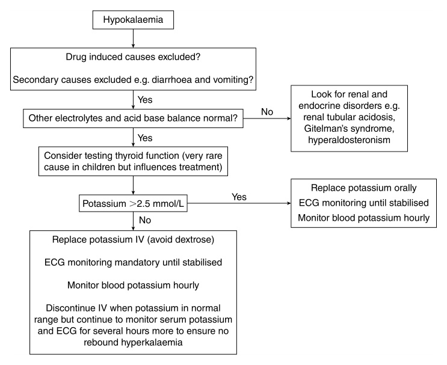
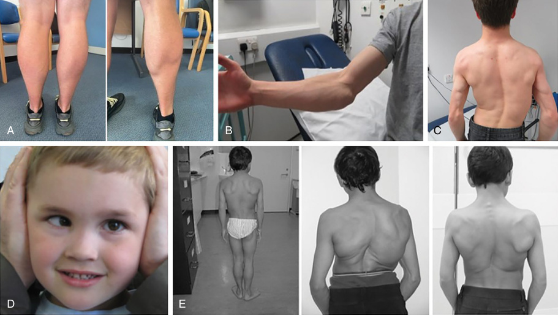
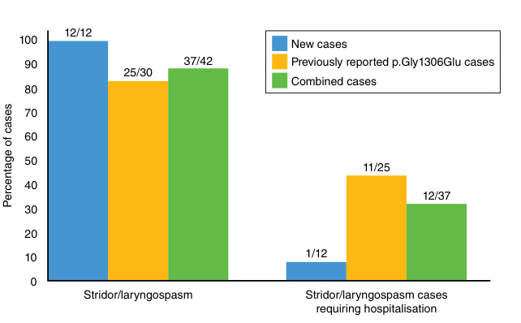
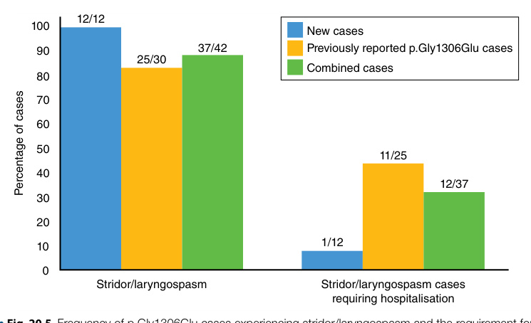

# Chapter 20: Skeletal Muscle Channelopathies: Periodic Paralyses and Nondystrophic Myotonias
> **Course:** Vikkypaedia Rare Disease Learner Course (*Nelson Pediatric Textbook of Rare Diseases: Genomic Etiologies and Genetic Diagnosis (1st Edition)*)  
> **Section III:** Neuro-Sensory Disorders  
> **Authors:** Emma Matthews  
> **Metrics:** 9,397 words · 6 tables · 7 figures · 4 genes · 28 flashcards · 14 MCQs  
> **Quick Navigation:** [🃏 Study 28 Flashcards](../flashcards/020_flashcards.md) · [📝 Take 14-Q MCQ Quiz](../mcqs/020_mcqs.md) · [📚 Section III Guide](../sections/Section_III.md) · [🧬 Master OMIM/Gene Atlas](../omim_gene_atlas.md) · [💊 Precision Therapies Matrix](../therapies_matrix.md) · [🏠 Course Index](../../index.md)

## Key Chapter Topics
`Skeletal Muscle Channelopathies Periodic Paralyses and Nondystrophic Myotonias` · `The Periodic Paralyses` · `Hyperkalemic Periodic Paralysis (HyperPP)` · `Potassium` · `Hypokalemic Periodic Paralysis (HypoPP)` · `Andersen-Tawil Syndrome (ATS)` · `Secondary Causes of Hypokalemic Periodic Paralysis` · `Differential Diagnosis of Periodic Paralysis` · `Investigation of Suspected Periodic Paralysis` · `Blood Tests` · `Cardiac Investigations` · `Neurophysiology` · `MRI Scans` · `Acute Treatment of Periodic Paralysis`

## Key Genes & Molecular Targets
`CACNA1S`, `CLCN1`, `KCNJ2`, `SCN4A`

## ⚡ High-Yield Clinical & Diagnostic Pearls
- Genetic variants are inherited in an autosomal dominant manner or can occur de novo .
- Weakness is most common and profound in limb and trunk muscles, mostly sparing face, bulbar, and respiratory and typically bilateral.
- Andersen-Tawil syndrome was first described as a triad of periodic paralysis, dysmorphic features, and cardiac conduction defects ; not everyone has the triad.
- Micrognathia, clinodactyly, and low-set ears were the most common findings.
- All of the nondystrophic myotonias are inherited or de novo autosomal dominant with the exception of myotonia congenita (MC), which can be inherited in a dominant or recessive manner or be de novo (Table 20.2).
- Myotonia congenita is the most common muscle channelopathy.
- It can present in any skeletal muscle, but leg muscles are usually the most common, with hands and face less so.
- The majority of these cases are autosomal recessive; the variants result in a loss of channel function compared with heterozygous gain-of-function missense variants that cause myotonia.

---
## Full Chapter Text, Tables & Figures

<!-- p.476 -->

# 20 Skeletal Muscle Channelopathies Periodic Paralyses and Nondystrophic Myotonias 

**EMMA MATTHEWS** 

Most neuromuscular disorders are readily apparent by presentation with progressive muscle weakness and wasting. Neuromuscular conditions causing _episodic_ impairment of movement with otherwise normal muscle strength are rare and can be very challenging to diagnose. This group of genetic conditions are collectively referred to as **skeletal muscle channelopathies** (Tables 20.1, 20.2, and Fig. 20.1) because they are due to pathogenic variants in genes that code for ion channels in the muscle membrane. _Sarcolemmal ion channels have a crucial role in generating and maintaining neuromuscular excitability_ , which is essential for normal muscle function and movement. Muscle channelopathies are subdivided into two groups. Those that reduce sarcolemmal excitability and cause weakness are the **periodic paralyses** (Table 20.1), and those that increase excitability and inhibit muscle relaxation after contraction (myotonia) are the **nondystrophic myotonias** (Table 20.2). They have an overall prevalence estimated at 2.38 in 100,000. 

During the diagnostic journey routine investigations can be normal and sometimes misleading. Specialist investigations are available and may have a supportive role (Table 20.3), but genetic tests are diagnostic. The rapid expansion in the availability and speed of genetic testing has helped to reduce diagnostic delay (Tables 20.1 and 20.2). Symptoms are not only disabling but can be frightening and embarrassing for children. Uncontrolled episodes can impact education, socialization, vocational opportunities, or independence. Many symptomatic treatments are available that often have transformative outcomes. Educating patients and caregivers alongside school staff is additionally beneficial to aid self-management as well as preventing assumptions and misunderstanding regarding perceived poor school attendance or participation in physical activities. 

### **The Periodic Paralyses** 

Periodic paralysis refers to episodes in which the skeletal muscles become weak or paralyzed for a limited period of time before full recovery. _Weakness occurs in the presence of altered serum potassium levels._ In between episodes children typically will have normal muscle strength. Recurrent episodes, especially if combined with a positive family history, are indicative of the genetic forms of the disease but there are some secondary causes and a differential diagnosis to consider. Genetic forms of periodic paralysis include **hyperkalemic periodic paralysis** (HyperPP), **hypokalemic periodic paralysis** (HypoPP), and **Andersen-Tawil syndrome** (ATS) (Table 20.1). In all these forms additional symptoms of pain and fatigue are common and can cause significant morbidity. Although known for their characteristic episodic nature, secondary fixed weakness due to a proximal myopathy does occur but this is rarely seen in children. 

#### **Hyperkalemic Periodic Paralysis (HyperPP)** 

_HyperPP refers to episodes of muscle weakness that occur in the presence of a raised serum potassium level_ . The genetic form is due to pathogenic variants in _SCN4A_ . This gene codes for the alpha subunit of the voltage-gated skeletal muscle sodium channel that propagates the formation and transmission of action potentials along the muscle membrane after motor nerve stimulation. Genetic variants are inherited in an autosomal dominant manner or can occur _de novo_ . 

Periodic paralysis is the predominant symptom, but patients often also have some degree of myotonia (delayed muscle relaxation after forceful contraction) (Fig. 20.1). Some infants will display symptoms in the immediate postnatal period including neonatal hypotonia along with minor

<!-- p.477 -->

##### **TABLE 20.1 Summary of Clinical Features of the Periodic Paralyses Including Andersen-Tawil Syndrome** 

|Channelopathy|Causative Gene|Inheritance|Age of Onset|Muscles Most Affected|Additional Features|Triggers|Diagnostic Clue|
|---|---|---|---|---|---|---|---|
|Hyperkalemic periodic paralysis|_SCN4A_|AD|First decade|Limbs and trunk|Neonatal hypotonia Myotonia can be seen|High serum potassium, may be due to potassium-rich foods Cold environment, intercurrent illness Rest after exertion Puberty, menses|Weakness can be any time of day Can last minutes to hours May have additional myotonia and sometimes muscle hypertrophy|
|Hypokalemic periodic paralysis|_CACNA1S_ _SCN4A_|AD|Second decade typical|Limbs and trunk|In very severe attacks facial muscles can be weak— speech slurred, and respiratory muscles affected|Low serum potassium, may be due to carbohydrate-rich food or fasting Intercurrent illness Rest after exertion Puberty, menses|Attacks common during night when wakes to use bathroom or first thing in morning Attacks are typically hours to days Plays football after school, has pizza for tea, wakes next morning unable to move|
|Andersen-Tawil syndrome|_KCNJ2_|AD|First and second decade|Limbs and trunk|Cardiac conduction abnormalities Ventricular tachyarrhythmia Dysmorphic features— commonly short stature, micrognathia, clinodactyly, syndactyly, low-set ears|Low serum potassium, may be due to carbohydrate-rich food||
|_AD,_Autosomal domina From Matthews E, Pala|nt;_ECG,_electrocard ce J, Ramdas S, et|iography;_PP,_periodic al. Care recommenda|paralysis. tions for the investig|ation and management of|children with skeletal muscle channelo|pathies._Pediatr Neurol_. 2023;1|45:102-111 (Table 2, p. 105).|

<!-- p.478 -->

##### **TABLE 20.2 Summary of Clinical Features of the Myotonic Muscle Channelopathy Phenotypes** 

|Channelopathy|Causative Gene|Inheritance|Age of Onset|Muscles Most Affected|Additional Features|Myotonic Triggers|Diagnostic Clue|
|---|---|---|---|---|---|---|---|
|Myotonia congenita|_CLCN1_|AD or AR|Typically early teens Range first to fourth decade|Legs>face and hands|Warm-up phenomenon (myotonia improves with repetitive action) Transient weakness may be observed, also improves with repetitive action Muscle hypertrophy Contractures Scoliosis Toe walking|Cold environment, often improves in warm environment but “too hot” conditions can also exacerbate myotonia Rest after exertion Sudden movement Initiation of movement|Never good at sprinting Sports day at school— when start of race declared “all the other children ran off and I fell over or couldn’t move” “Once I get going I’m OK.” Falls a lot “Funny gait” Climbing stairs difficult|
|Paramyotonia congenita|_SCN4A_|AD|Typically first decade Often early— birth or within first few weeks|Eyelids, extraocular muscles, jaw, tongue, hands>legs|Paradoxical worsening with repetitive action Can have episodic weakness/paralysis (overlap with hyperPP) Muscle hypertrophy Contractures Scoliosis Strabismus|Extreme sensitivity to cold environment Rest after exertion|Neonatal hypotonia, Stridor—neonate or infant Parents note eye closure myotonia in babies, (e.g., if they cry “face gets stuck”) Strabismus “Always had it” “After swimming lessons I couldn’t use my hands to put my clothes back on”|
|Sodium channel myotonia|_SCN4A_|AD|Typically first or second decade|Eyelids, extraocular muscles, jaw, tongue, hands, legs|Both warm-up phenomenon and paradoxical worsening can be seen Muscle hypertrophy|Extremes of temperature—cold or hot Sometimes high-potassium foods|Has overlap features with MC and PMC Can seem like MC but earlier onset, more prominent involvement of face muscles, extraocular myotonia, and AD family history|
|SNEL|_SCN4A_|Often _de novo_ Can be AD|Birth to 10 months|Generalized but prominent respiratory and laryngeal muscle involvement|Recurrent episodic apnea±stridor Bradycardia Loss of consciousness Massive muscle hypertrophy Dysmorphic features|||

_AD,_ Autosomal dominant; _AR,_ autosomal recessive; _EEG,_ electroencephalography; _hyperPP,_ hyperkalemic periodic paralysis; _MC,_ myotonia congenita; _PMC,_ paramyotonia congenita; _SNEL,_ severe neonatal episodic laryngospasm. 

From Matthews E, Palace J, Ramdas S, et al. Care recommendations for the investigation and management of children with skeletal muscle channelopathies. _Pediatr Neurol_ . 2023;145:102-111 (Table 1, p. 103).

<!-- p.479 -->

**Fig. 20.1** Clinical spectrum of the nondystrophic myotonias and periodic paralyses. Myotonia predominates in disorders further to the left in this spectrum, whereas periodic paralysis is the major symptom for those further to the right (A). The underlying molecular genetic defects in each of these disorders are variants in voltage-gated ion channels (A, bottom row). An electromyographic recording of a myotonic burst (B), computer simulations of an action potential in normal muscle, and depolarization-induced loss of excitability during an attack of periodic paralysis (C) are also shown.  (Cannon SC. Pathomechanisms in channelopathies of skeletal muscle and brain. _Annu Rev Neurosci_ 2006;29:387–415.) 

###### **TABLE** 

###### **20.3** 

##### **Electrodiagnostic Features of the Nondystrophic Myotonias and the Periodic Paralyses** 

|Disorder||Myotonia Congenita|Paramyotonia Congenita|Hyperkalemic Periodic Paralysis|Hypokalemic Periodic Paralysis|
|---|---|---|---|---|---|
|CMAP after SET|First trial|Transient decrease|Increase/decrease|Increase|No change|
|CMAP after SET|Repeat trials|No change|Gradual decrease|Gradual increase|No change|
|CMAP after LET|Immediate amplitude change|No change/slight decrease|Decrease|Increase|No change|
|CMAP after LET|Late amplitude change|None|Decrease|Decrease|Decrease|
|Needle EMG|Myotonic discharges|+++|+++|+/−|−|
|SET sensitivity, % (95% CI)||83 (53–100)|100 (81–100)|83 (53–100)|0 (0–23)|
|LET sensitivity, % (95% CI)||25 (1–50)|89 (76–100)|93 (81–100)|84 (72–97)|

_CI,_ Confidence interval; _CMAP,_ compound motor action potential; _EMG,_ electromyogram; _LET,_ long exercise test; _SET,_ short exercise test. Adapted from Fournier E, Arzel M, Sternberg D, et al. Electromyography guides toward subgroups of mutations in muscle channelopathies. _Ann Neurol_ . 2004;56:650-661. Copyright _Annals of Neurology_ 2004; with permission from John Wiley and Sons, Inc. Also from Borgle AK, Narayanaswami P. Treatment and management of disorders of neuromuscular hyperexcitability and periodic paralysis. In: Bertorini TE, ed. _Neuromuscular Disorders._ 2nd ed. Philadelphia: Elsevier; 2022 (Table 18.5, p. 432).

<!-- p.480 -->

##### **Periodic paralysis** 

## **Potassium** 

###### **Potassium** 

- **Hyperkalaemic Hypokalaemic** • Any time • Night/early morning • Mins to hours • Hours to days • High potassium foods • Carbohydrates • Rest after exercise • Rest after exercise • Cold • (thyrotoxicosis) • _SCN4A_ • _CACNA1S/SCN4A_ 

**Fig. 20.2** Periodic paralysis.  (From Matthews E, Holmes S, Fialho D. Skeletal muscle channelopathies: a guide to diagnosis and management. _Pract Neurol_ . 2021;21:196-205 [Fig. 2].) 

##### **TABLE Diagnostic Criteria for Primary Hyperkalemic 20.4 Periodic Paralysis** 

1. Two or more attacks of muscle weakness with documented serum potassium >4.5 mEq/L 

2. One attack of muscle weakness in the proband and one attack of weakness in one relative with documented serum potassium >4.5 mEq/L in at least one attack 

3. Three of six clinical or laboratory features as outlined here: 

   - Onset before third decade of life 

   - Duration of attack (muscle weakness involving one or more limbs) <2 hours 

   - • Positive triggers (exercise, stress) 

   - Myotonia 

   - Positive family history or genetically confirmed skeletal sodium channel variant 

   - Positive McManis short exercise test 

feeding difficulties and episodes of oxygen desaturation. This is usually self-resolving and relatively short-lived (days). Myotonia can also be seen in babies, especially affecting the eyes and hands. One report describes parents noting that their baby’s eyes stayed tightly shut if they washed their face with a cool washcloth. 

Episodes of muscle weakness are usually present before age 10. Any skeletal muscle can be affected but typically it is the limbs and trunk that are most severely involved, with sparing of the face, bulbar, and respiratory muscles. Severity varies and, in some cases, children will be described as unable to move their limbs at all. In others, they will be weak and struggle to move or walk normally; the gait may be observed to be Trendelenburg, but they retain some ambulation. Weakness is usually symmetrical, but a prolonged task can provoke unilateral weakness—for example, a weak hand after writing a long essay at school or in an exam. 

Symptoms of muscle weakness commonly last for hours. They can occur at any time of the day without diurnal pattern. Triggering factors include extremes of temperature (most often a cold environment but sometimes being too hot is just as detrimental), rest after exercise, ingestion of foods rich in potassium or drugs causing hyperkalemia, and concurrent illness (Fig. 20.2). 

In between symptoms, the examination is often normal including muscle strength, but there are a few suggestive findings. If the child has appreciable _myotonia_ , they may also have muscle hypertrophy. _Myotonia_ itself might also be demonstrated; close eyes or grip hands as tight as you can for 5 seconds and then open as fast as you can—is there a delay? Gait myotonia might be best observed when called from the waiting room: legs appear stiff and move slowly after sitting still. The myotonia in hyperPP may worsen with repetition and asking them to repeat eye closure or hand grip 3 to 5 times can be helpful. If examined during symptoms in addition to demonstrable weakness, hypotonia and reduced reflexes would be expected if weakness is severe; in milder episodes they might be normal. Proposed diagnostic criteria are noted in Table 20.4. 

4. Exclusion of other causes of hyperkalemia (renal, adrenal, thyroid dysfunction; potassium-sparing diuretic use) 

From Sansone V, Meola G, Links T, Panzer M, Rose MR. Treatment for periodic paralysis. _Cochrane Database Syst Rev_ . 2008;1:CD005045. With permission from Dr. Sansone; Copyright Cochrane Collaboration, reproduced with permission. Also from Borgle AK, Narayanaswami P. Treatment and management of disorders of neuromuscular hyperexcitability and periodic paralysis. In: Bertorini TE, ed.. _Neuromuscular Disorders_ . 2nd ed. Philadelphia: Elsevier; 2022 (Box 18.5, p. 433). 

#### **Hypokalemic Periodic Paralysis (HypoPP)** 

_HypoPP refers to episodes of skeletal muscle weakness that occur with low serum potassium levels_ . It is due primarily to pathogenic variants in the _CACNA1S_ gene, which codes for a voltage-gated calcium channel that interacts with the ryanodine receptor to prompt calcium release from the sarcoplasmic reticulum. A minority of cases are due to variants in the _SCN4A_ gene. Weakness is most common and profound in limb and trunk muscles, mostly sparing face, bulbar, and respiratory and typically bilateral. In young children and during severe episodes face, bulbar, and respiratory muscles can sometimes be weak. Myotonia does not occur. The age of onset is typically age ~12 years. A diurnal pattern is evident, and symptoms typically occur when the child wakes in the morning or sometimes during the night if they wake to urinate. Weakness often persists for longer than in hyperPP, characteristically for hours but can gradually resolve over days and occasionally weeks. This pattern of waking with symptoms that resolve over hours and being better by lunchtime can prompt an erroneous suspicion of school avoidance. 

Triggers include anything that reduces serum potassium: a meal rich in carbohydrates stimulating insulin release, potassium-wasting drugs, or fasting, alongside extremes of temperature, rest after activity especially if vigorous activity, and incidental illness (Fig. 20.2). 

Examination findings are usually normal. A hypotonic areflexic weakness is expected if examined during an episode of severe weakness (often quadriparesis). A spectrum exists, and weakness does not always result in paralysis. In a child

<!-- p.481 -->

##### **TABLE Diagnostic Criteria for Primary Hypokalemic 20.5 Periodic Paralysis** 

1. Two or more attacks of muscle weakness with documented serum potassium <3.5 mEq/L 

2. One attack of muscle weakness in the proband and one attack of weakness in one relative with documented serum potassium <3.5 mEq/L in at least one attack 

3. Three of six clinical or laboratory features as outlined here: 

   - Onset in the first or second decade of life 

- Duration of attack (muscle weakness involving one or more limbs) >2 hours 

- • Positive triggers (carbohydrate-rich meal, rest after exercise, stress) 

- • Improvement with potassium intake • Positive family history or genetically confirmed skeletal calcium or sodium channel variant 

- • Positive McManis short exercise test 

- 4. Exclusion of other causes of hypokalemia (renal, adrenal, thyroid dysfunction; renal tubular acidosis; diuretic and laxative abuse) 

From Sansone V, Meola G, Links T, Panzer M, Rose MR. Treatment for periodic paralysis. _Cochrane Database of Systemic Reviews_ . 2008;1:CD005045. With permission from Dr. Sansone; Copyright Cochrane Collaboration, reproduced with permission. Also from Borgle AK, Narayanaswami P. Treatment and management of disorders of neuromuscular hyperexcitability and periodic paralysis. In: Bertorini TE, ed.. _Neuromuscular Disorders_ . 2nd ed. Philadelphia: Elsevier; 2022 (Box 18.6, p. 434). 

with suspected hypoPP, consider a diagnosis of **AndersenTawil syndrome (ATS)** and look for dysmorphic features and the ECG changes of hypokalemia (Table 20.1). Proposed diagnostic criteria are in Table 20.5. 

#### **Andersen-Tawil Syndrome (ATS)** 

Andersen-Tawil syndrome was first described as _a triad of periodic paralysis, dysmorphic features, and cardiac conduction defects_ ; not everyone has the triad. It is due to pathogenic variants in _KCNJ2_ expressed in both skeletal and cardiac muscle as well as having a role in bony development. The severity of each component may also vary with cardiac problems or skeletal muscle dominating the clinical picture. It is the only genetic form of periodic paralysis to directly affect the heart muscle. 

The type of periodic paralysis that occurs in ATS is usually hypokalemic, but there are reports of weakness associated with high serum potassium. Episodes of weakness often last days but range from hours to weeks. They can be more nebulous than hypo or hyperPP and frank paralysis is less frequent. Triggers are the same as for hypoPP. 

**Dysmorphic features** can include short stature, syndactyly, clinodactyly, micrognathia, low-set ears, small hands and feet, scoliosis, cleft palate, and dental abnormalities; these features are not universal. In one series 62% of patients with ATS had recognizable dysmorphic features, 

31% had mild features that were considered to be potentially overlooked, and 8% had no discernible dysmorphism. Micrognathia, clinodactyly, and low-set ears were the most common findings. 

**Cardiac involvement** can range from an asymptomatic long QT syndrome to life-threatening ventricular tachyarrhythmia requiring an implantable defibrillator. Symptoms include palpitations, presyncope, or syncope. Many patients have few symptoms even though there are abnormalities on ECG or prolonged monitoring. For this reason, clinical history should not be used to suggest cardiac involvement; yearly cardiac monitoring is recommended regardless of symptoms. 

#### **Secondary Causes of Hypokalemic Periodic Paralysis** 

Genetic variants linked to hypoPP cause dysfunction of a muscle ion channel in a way that creates a muscle membrane that is more likely to depolarize, causing weakness in the presence of low serum potassium, even at potassium levels that would not cause weakness in other people. A very low serum potassium can induce muscle weakness in anyone, including people who do not have a neuromuscular disease. 

_In primary or genetic forms of hypoPP, potassium is translocated intracellularly (in the muscle)_ , creating a low serum potassium level; total body potassium is normal. _In secondary causes, potassium is excessively excreted from the body_ . This has implications when treating patients because if potassium replacement is given in the genetic forms a _rebound hyperkalemia_ may occur when the potassium increases from therapeutic sources and also begins to return to the serum from the muscle when weakness subsides. 

All causes of hypokalemia can therefore produce hypoPP. Common etiologies include gastrointestinal illness (vomiting and/or diarrhea) and medications including laxative use. Rarer causes include renal tubular acidosis, Bartter syndrome, Gitelman syndrome, Liddle syndrome and thyrotoxicosis, Cushing syndrome, hyperaldosteronism, rennin-secreting tumor, or hypomagnesemia. Very rare cases include ingestion of large amounts of licorice. 

#### **Differential Diagnosis of Periodic Paralysis** 

Aside from differentiating primary from secondary causes of dyskalemia-associated muscle weakness, there are a limited number of disorders that produce a typical presentation of hypotonic, areflexic muscle weakness with altered serum potassium. **Guillain-Barré syndrome (GBS)** can be a potential confounder. Sensory symptoms and signs are lacking in periodic paralysis but there are motor only variants of GBS. Serum potassium is not usually significantly altered in GBS but if preceded by a GI illness it may potentially be low. If symptoms are confined to the legs, a **cauda equina** or **acute cord syndrome** could be confusing; sphincter disturbance and/or sensory signs do not occur in

<!-- p.482 -->

PP. Recurrent attacks of disabling paralysis with persistently normal potassium, symptoms that include the face (not able to open eyes or speak at all but retaining awareness), and a positive Hoover sign are indicative of functional weakness and functional neurological disorder. Paroxysmal movement disorders are referred to a neuromuscular clinic more often than might be expected. These conditions are not easily confused with the acute emergency department type presentations of PP but in the clinic, patients can easily be referred with recurrent attacks of weakness that actually reflect impaired motor control such as dyskinesia or ataxia (Chapter 14). 

#### **Investigation of Suspected Periodic Paralysis** 

If history and examination indicate periodic paralysis, a genetic test is ultimately diagnostic. It is increasingly routine that all possible causative genes, _CACNA1S_ , _SCN4A_ , and _KCNJ2_ , are analyzed together on small next-generation sequencing panels, thus defining simultaneously whether the patient has hyperPP or hypoPP. 

#### **_Blood Tests_** 

If presenting at the time of weakness, serum potassium is an essential test. If abnormal in the absence of an explanatory systemic illness (e.g., diarrhea and vomiting), a careful drug history is required although perhaps less likely to be relevant in children than adult populations. A creatine kinase level may be normal or increased and is not specific to PP but if elevated does often help to stimulate further investigation. Other blood tests are directed at excluding other renal or endocrine secondary causes. Follow-up urine studies may also be indicated depending on results. Any patient presenting with hypoPP should have thyroid function tests checked. Although much rarer in children than in adults **thyrotoxic hypokalemic periodic paralysis** is a very treatable differential. Correcting thyroid dysfunction will prevent any further attacks of periodic paralysis. It is most commonly but not exclusively seen in Asian males. 

A serum potassium can be normal when weakness is present because membrane depolarization occurs when serum potassium moves up or down, but it does not necessarily have to fall outside a normal range. A normal level can also occur because the episode is beginning to subside by the time blood is taken. An abnormal result is expected if there is severe weakness or quadriparesis at the time blood is drawn. 

#### **_Cardiac Investigations_** 

In hypoPP due to _CACNA1S_ or _SCN4A_ pathogenic variants the ECG is normal because these genes are not expressed in cardiac muscle. An ECG is recommended in any patient presenting with hypoPP because the typical abnormalities of ATS may be seen. If weakness occurs in ATS, it is most commonly associated with low serum potassium (hypoPP) but dysmorphic features may be absent or minimal and 

there may be no previous cardiac symptoms. Reserving an ECG only for those with typical features of ATS may therefore miss some patients who are erroneously thought to be _just_ hypoPP. ECG changes in ATS may include a prolonged QTc or QU interval with characteristic U-wave morphology, ventricular ectopy including bigeminy or trigeminy, or it may appear normal. A more prolonged Holter monitor is usually abnormal and may demonstrate all of the above plus nonsustained or sustained ventricular tachycardia and bidirectional ventricular tachycardia. 

If a patient with any form of PP is seen during an episode of weakness with potassium derangement, then the ECG will reflect dyskalemia. Changes seen in hyperkalemia include peaked T waves, flattened P waves, prolonged PR interval, ST depression, and prolonged QRS duration. Peaked P waves, prolonged PR interval, prominent U waves, small T waves, and ST depression may occur in hypokalemia. A timely ECG performed when a patient presents with flaccid areflexic muscle paralysis may even indicate the diagnosis of hyperPP or hypoPP before the blood test results. 

An echocardiogram is normal in hypoPP and hyperPP because the heart muscle is not involved. There are a few reports of cardiomyopathy in those with ATS. This occurs in adults; it is unknown if this may occur in children, but any symptoms indicative of cardiomyopathy does warrant investigation. 

#### **_Neurophysiology_** 

Abnormalities can be demonstrated by neurophysiology that help to support a diagnosis of periodic paralysis (Table 20.3). Nerve conduction studies are normal. An EMG may demonstrate myotonia in cases of hyperPP. The long exercise test looks for a 40% or greater decline in CMAP amplitude from the peak, after 5 minutes of exercise followed by a 50-minute rest period. The overall sensitivity of the test has been estimated at 60 to 80% with high specificity. It can be a tedious test to perform, and very young children will not tolerate it; it is feasible to perform in those over the age of 5 years. A positive test, while useful for confirming a diagnosis of PP, does not determine the genotype or indeed whether the symptoms are due to a primary or secondary cause. Due to the low sensitivity a negative test can be misleading in up to 40% of cases. A useful pointer for interpreting a negative test can be the frequency of attacks. In one series frequency clearly correlated with the likelihood of the test being positive. Patients having daily or weekly attacks will have a positive test. This can be useful when considering a differential diagnosis of functional weakness. 

#### **_MRI Scans_** 

MRI abnormalities are seen in PP, but they are not specific enough to be routinely useful in diagnosis. Fatty infiltration and STIR signal changes can be demonstrated but the vast majority of data is derived from adult cohorts. Development of a fixed proximal myopathy has long been

<!-- p.483 -->

known to occur in PP. Significant disability is unusual before the age of 40, although MRI changes may occur earlier. Discrete episodes of weakness can be less defined with age and patients, including some children, can complain of what they think is fixed disability. Weakness that is demonstrable on examination also raises the suspicion of a myopathy. Closer questioning can identify that they always feel weak but not to the same degree. They describe good days and bad days with different levels of ability on any given day. This can indicate that they are having very frequent attacks of more minor weakness from which they never fully recover. An MRI scan can be useful if it demonstrates significant STIR signal abnormality rather than profuse fatty infiltration, supporting the clinical suspicion of poorly controlled symptoms as opposed to an irreversible myopathy. 

#### **Acute Treatment of Periodic Paralysis** 

#### **_HyperPP_** 

Acute attacks of hyperPP, if relatively mild, can be aborted by gentle movement (slow walking) or the ingestion of carbohydrate. Children may identify the benefit of drinking or eating something sugary when weakness occurs; care must be taken in this approach to avoid weight gain or tooth decay. If potassium levels are high enough to induce ECG changes of hyperkalemia, this should be corrected with 

intravenous dextrose and insulin, but this is a rare occurrence. There have been reports of salbutamol used as an as-needed medicine in hyperPP. It is not routinely adopted as a treatment but if a child happens to have coincidental asthma and is familiar with using a salbutamol inhaler, it is reasonable to suggest they may try it during episodes. 

#### **_HypoPP_** 

Once a diagnosis is established oral potassium supplementation can be provided at home to be taken as needed during an episode. Gentle exercise or movement can also speed up recovery. If this does not abort an attack or there are ECG changes, IV supplementation will be required but avoid dextrose solutions (Fig. 20.3). Due to potassium being shifted intramuscularly during an attack it is essential that there is cardiac monitoring and hourly potassium levels to the point of normal levels being restored and for several hours afterwards. This ensures a rebound hyperkalemia does not go unnoticed. 

#### **Preventative Treatment of Periodic Paralysis** 

If attacks are occurring on a regular basis or are preventing children from attending school or taking part in activities, this can be an indication for preventative medication. Options are outlined in Table 20.6. Acetazolamide is indicated in all forms of periodic paralysis including ATS. 

**Fig. 20.3** Flow chart for the emergency management of a child presenting with hypokalemia and flaccid paralysis.  (From Matthews E, Palace J, Ramdas S, et al. Care recommendations for the investigation and management of children with skeletal muscle channelopathies. _Pediatr Neurol._ 2023;145:102-111 [Fig. 2, 109].)

<!-- p.484 -->

#### **TABLE 20.6** Pharmacological Treatment Option s and Suggested Monitoring Regimes

|Disorder|Medication|Monitoring Requirements|Other Comments|
|---|---|---|---|
|Nondystrophic myotonia (NMD)|Mexiletine|ECG, FBC, LFTs, clotting before starting ECG after each dose increment and yearly on stable regime|Those with MC may need higher doses than those with_SCN4A_-related myotonia. Some children will find a BD regime more acceptable to avoid taking a lunchtime dose at school High-cost drug in the UK and Europe for those>18 years old with NDM but license does not include pediatric population and generics can be prescribed|
||Carbamazepine|FBC and LFTs before starting|May be easier to obtain than mexiletine and many pediatricians have more experience of using CBZ than mexiletine|
||Lamotrigine||Little evidence or experience reported in children with NDM|
|SNEL|Mexiletine, carbamazepine, flecainide|As above|Can result in almost complete cessation of apneic episodes and infants in ICU can be discharged Some in vitro evidence that flecainide may be the most efficacious treatment for this phenotype|
|Hypokalemic periodic paralysis|Acetazolamide|U+Es before starting and 7 to 10 days after Repeat U+Es after each dose increment Renal USS before starting and consider yearly thereafter||
||Potassium-sparing diuretics (e.g., amiloride or spironolactone)|U+Es before starting and 7 to 10 days after Repeat U+Es after each dose increment|Caution with spironolactone in males and avoid if prepubertal Recommend diuretics prescribed under care of expert services|
||Potassium supplements|||
|Hyperkalemic periodic paralysis|Acetazolamide|U+Es before starting and 7 to 10 days after Repeat U+Es after each dose increment Renal USS before starting and consider yearly thereafter||
|Potassium wasting diuretics (e.g., Bendroflumethiazide)||U+Es before starting and 7 to 10 days after Repeat U+Es after each dose increment|Recommend diuretics prescribed under care of expert services|
|Salbutamol|||We don’t use routinely and limited report of efficacy but can be adjunctive especially if child takes incidentally for asthma|
|Andersen-Tawil syndrome|Acetazolamide|U+Es before starting and 7 to 10 days after Repeat U+Es after each dose increment Renal USS before starting and consider yearly thereafter|Other meds dependent on nature of attacks of muscle weakness but the majority are of a hypoPP nature.|
||Flecainide|Holter monitor or event recorder before and after therapy initiation|Implantable devices—ICD may be required for unexplained syncope or ventricular tachycardia|

_FBC,_ Full blood count; _MC,_ myotonia congenita; _SNEL,_ severe neonatal episodic laryngospasm; _U+E,_ BUN plus electolytes; _USS,_ ultrasonography.

<!-- p.485 -->

There is some evidence it can worsen symptoms in those with certain genotypes. Seek specialist advice if this occurs. There is evidence to support a higher incidence of renal calculi in those with channelopathies taking acetazolamide over the age of 40 compared to the general population. There is no systematic evidence to quantify the risk in children. At least a baseline renal ultrasound is helpful to determine a normal renal tract and presence of two kidneys before commencing treatment. A further precaution is to repeat this yearly as the exact risk of renal calculi and complications is unknown. Other treatments are potassium sparing or wasting diuretics and will be specific to phenotype. Specialist input is recommended before commencing diuretics in children. Some families find a diary useful to assess duration, frequency, and severity of episodes. Because multiple factors can influence the episodes, such as the weather or season, or activity changes at school versus holidays, it can be beneficial to do this over some months to get a true picture of the response to medication. 

#### **Holistic Treatment of Periodic Paralysis** 

There are numerous triggers to symptoms identified in those with PP. Helping children and their families to identify these and try to avoid or modify them as much as possible is an important step in the child taking charge of their own illness. Identifying food triggers might benefit from a food diary. Modifications can usually be found rather than total avoidance. In hypoPP, choosing slowacting carbohydrates or low glycemic index foods can be helpful (Table 20.7). These take longer to break down in the body and are less likely to cause the surge in insulin that can induce a drop in serum potassium. 

Although activity, or rest after activity, is a very common trigger, it is important that children remain active and be included in school and social activities. Suddenly starting or stopping exercise should be avoided, and children are encouraged to warm up and warm down. This can be useful in sports at halftime; do not stand still but gently move legs on the spot or walk around. 

Educating schools about the condition is very important alongside allowing for simple modifications. Cold temperatures are often a significant trigger. Being able to wear extra warm clothes, two pairs of gloves or socks, or being allowed to stay inside during breaks in the very cold winter months can all be beneficial. Allowing children two sets of textbooks, one at school and one at home, can avoid the extra exertion of walking home with a heavy bag. Other modifications can break up activity or inactivity: permission to stand every hour and walk around for a few minutes in class, or a 5- to 10-minute break in writing every hour. In the formal exam years extra time and breaks in exams are recommended. Alternatives include a scribe or laptop. If morning lessons are missed, being flexible and allowing a child to attend later in the day for afternoon 

##### **TABLE Lower Glycemic Index Carbohydrate Options 20.7 That May Reduce Insulin Spikes and Risk of Hypokalemia in Those With HypoPP** 

|High GI Foods|Lower GI Options|
|---|---|
|Bagels|Barley|
|Baguettes|Bananas|
|Bread (white, whole|Basmati rice|
|meal, and dark)|Beans—baked, black eye,|
|Broad beans|butter, kidney, and soy|
|Cereals|Buckwheat and bulgur wheat|
|Dates|Chocolate|
|Doughnuts|Chickpeas|
|Fruit bars|Grapefruit and grapefruit juice|
|Gluten-free bread/|Grapes, kiwi fruit, mangoes,|
|pasta/rice|oranges, peaches, pears,|
|Honey|plums, prunes,|
|Parsnips|strawberries, apples|
|Popcorn|Lentils|
|Potatoes (jacket, chips,|Oat-bran cereals and oats|
|and mashed)|Peas|
|Pumpkin|Seeded bread|
|Swede|Sourdough rye|
|Watermelon|Soya and linseed bread|
|White rice and rice cakes|Sweet potato|

lessons reduces the amount of schoolwork that is missed and/or sending schoolwork home on the days they cannot attend. 

Pain and fatigue are often prominent symptoms and should not be neglected. 

### **The Nondystrophic Myotonias** 

_Myotonia refers to delayed muscle relaxation after forceful contraction_ . It is not a diagnosis in itself and can be seen in a number of disorders including nondystrophic myotonias (NDM) and myotonic dystrophy. It is most often genetic in origin. The major difference between NDM and myotonic dystrophy is that NDM is a disease that affects only skeletal muscle and myotonic dystrophy is a multisystemic disorder. NDM can cause significant disability; an increasing number of severe pediatric presentations have been described in the last 10 years. 

All of the nondystrophic myotonias are inherited or _de novo_ autosomal dominant with the exception of myotonia congenita (MC), which can be inherited in a dominant or recessive manner or be _de novo_ (Table 20.2). The age of onset for **_SCN4A_ -related phenotypes** is usually in infancy but nearly always by the end of the first decade. Myotonia congenita can be more variable, not usually troublesome in the first year or two of life but presenting thereafter, and usually by the end of the second decade. Some literature suggests that the dominant form may present later than the recessive, but others refute this. Some disorders involve the sodium channel, while others involve the chloride channel; differences are noted in Table 20.8.

<!-- p.486 -->

###### **TABLE** 

###### **20.8** 

##### **Clinical Characteristics That May Help Distinguish Between Nondystrophic Myotonia Genotypes** 

|Sodium Channelopathies|Chloride Channelopathies|
|---|---|
|**Clinical Clues**||
|Lower mean age at onset (mean 5 years)|Higher mean age at onset (mean 10 years)|
|Worsening of stiffness after repetitive use/muscle contractions (i.e., paramyotonia)|Decrease of myotonia after repetitive use/muscle contractions (i.e., warm-up phenomenon)|
|Presence of face stiffness|Presence of leg stiffness (e.g., difficulty in standing up quickly, climbing stairs)|
|Episodic weakness|Transient paresis at the onset of activity (usually recessive disease)|
|Worsening of symptoms in the cold||
|**Examination** Eyelid myotonia|Action/percussion myotonia in leg muscles|
|Increase in myotonia after repetitive contractions (i.e., paramyotonia)|Decrease of myotonia after repetitive contractions (i.e., warm-up phenomenon)|
||Transient paresis positive in biceps|
|**Electrophysiological Findings**||
|Long duration (>2 s), high amplitude (>4 mV) myotonic potentials with a “slowly decelerating motorcycle” sound|Short duration (<1 s), low amplitude (<0.4 mV) myotonic potentials with a “dive bomber” sound|
|Interdischarge interval of myotonic potentials<30 ms|Interdischarge interval of myotonic potentials>30 ms|
|Fournier Pattern I or III with short-exercise testing|Fournier Pattern II with short-exercise testing|
|Modified from Stunnenberg BC, LoRusso S, Arnold D, et al. Guidelines on 2020;62(4):430-444 (Table 3).|i            clinical presentation and management of nondystrophic myotonias._Muscle Nerve_.|

#### **Myotonia Congenita (MC)** 

Myotonia congenita is the most common muscle channelopathy. It is due to pathogenic variants in _CLCN1_ which codes for the voltage-gated chloride channel ClC-1, which has an essential role in resetting the sarcolemma after depolarization and muscle contraction. 

_Myotonia is the core symptom and sign_ . In MC, myotonia worsens with the initiation of movement but improves with repetitive action known as the _warm-up_ phenomenon. It can present in any skeletal muscle, but leg muscles are usually the most common, with hands and face less so. In children, this can be reflected in an abnormal gait, which may be erroneously referred to a movement disorder clinic or thought to be CNS in origin. Toe walking may occur. Both toe walking and gait will improve the further the child walks due to warm-up. Falls are common in children with MC. A typical history asks about sports day races. Many patients recall “everyone else ran off and I was left standing there” or that they fell over when the race started. Once they get moving, leg myotonia and running speed improve. 

Myotonia often worsens after a period of rest, sitting still, or with sudden movement; if jostled on stairs and an attempt to correct balance is made, legs can suddenly stiffen causing 

a fall or inability to move. This can happen in larger schools requiring children to move between classrooms. Stairs or the inability to get up quickly can impact the use of public transportation. This can limit independent traveling to school or embarrassment causing children to decline going out with friends when public transportation is involved. Warm environments are often beneficial; cold temperatures make symptoms worse. 

Some people with MC also experience transient weakness. Similar to the warm-up phenomenon seen with myotonia, it occurs at the first attempt of an activity that is difficult; with repeated action the limb improves in strength until it is normal. Symptoms of pain or myalgia and fatigue are common. 

MC has typical signs. Muscle hypertrophy is common, especially calf hypertrophy (Fig. 20.4A), but it may be generalized. Toe walking is relatively common in unaffected children as well as in other neuromuscular disorders; it is not specific to MC. A suggestive sign is if the toe walking improves with distance until they walk flat-footed. Myotonia can be demonstrated by forceful eye closure or hand grip for 5 seconds. Repeat 3 to 5 times to see if it worsens or improves. If proximal weakness is demonstrated, repeat the test to see if strength improves (as if testing for fatigability

<!-- p.487 -->

**Fig. 20.4** Clinical signs in myotonic disorders. (A) Calf hypertrophy. (B) Elbow contracture. (C) Scoliosis. (D) Strabismus. (E) Scoliosis progressively worse with age and then improved following surgery. (B, C, D from Matthews E, Balestrini S, Sisodiya SM, Hanna MG. Muscle and brain sodium channelopathies: genetic causes, clinical phenotypes, and management approaches. _Lancet Child Adolesc_ . 2020;4: 536-547 [Fig. 2B, p. 539]. E from Matthews E, Silwal A, Sud R, et al. Skeletal muscle channelopathies: rare disorders with common pediatric symptoms. _J Pediatr._ 2017;188:181-185 [Fig. 2, p. 183].) 

but with the opposite outcome). Gait myotonia may be best observed in the waiting room after they have sat for a period. 

Other symptoms seen in some children are mild contractures of the Achilles tendon or elbows (Fig. 20.4B). Scoliosis (Fig. 20.4C) is rare; it can progress with age and even require surgery. 

#### **Paramyotonia Congenita and Sodium Channel Myotonia** 

The _SCN4A_ gene that codes for the alpha subunit of the voltage-gated sodium channel, Nav1.4, is responsible for a number of different clinical presentations depending on the pathophysiological effect of the variant on channel function. Gain-of-function variants cause myotonic phenotypes including **paramyotonia congenita** (PMC) and **sodium channel myotonia** (SCM). The main difference between these two is that in PMC there is myotonia and episodic weakness (an overlap with hyperPP) (Fig. 20.1) and in SCM there is only myotonia. Before the genetic basis of these myotonic disorders was known, many clinical syndromes were described (potassium aggravated myotonia, acetazolamide responsive myotonia congenita, myotonia permanens or myotonia fluctuans), but they are all allelic to _SCN4A_ and collectively termed **sodium channel myotonia** . 

#### **_Paramyotonia Congenita_** 

In PMC there are no warm-up phenomenon but conversely myotonia paradoxically worsens with repetition. Also, the muscles of the face and hands tend to be most severely affected with leg muscles less so. The facial muscles involved include orbicularis oculi, the extraocular muscles, and the tongue or jaw. Extraocular muscle involvement is especially common or more troublesome in children and can cause an intermittent strabismus (Fig. 20.4D) with complaints of _funny vision_ . This may occur after a period of focused reading or computer work. Extraocular muscle myotonia can be a good diagnostic clue because it distinguishes _SCN4A_ -related myotonia from _CLCN1_ -related MC. 

Patients with PMC often have additional symptoms of muscle weakness or paralysis associated with high serum potassium levels. This is an overlap with hyperPP. In general, paralysis is the most frequent and disabling symptom in hyperPP. In PMC, myotonia is the predominant and presenting symptom with less severe or less frequent episodes of weakness. The distinction can be clinically difficult. 

Factors that trigger symptoms in PMC include cold environment or in the case of jaw myotonia cold food and drink. Cold is often the major trigger, but extreme heat can also be detrimental. Due to the relationship with hyperPP, drugs or foods that increase potassium levels may trigger events of

<!-- p.488 -->

myotonia or weakness. Other triggers include exertion, rest after exertion, and concomitant illness. 

## **_Sodium Channel Myotonia_** 

The clinical diagnosis of sodium channel myotonia can be difficult because many features overlap with both MC and PMC. _SCN4A variants that cause SCM cause only myotonia and there are no episodes of weakness_ . The distribution of affected muscles can mirror MC or PMC. Both warm-up and paradoxical worsening of myotonia can occur, sometimes in the same patient on different days without consistent pattern. Extraocular myotonia can be a helpful clue to an _SCN4A_ myotonia. 

The clinical presentation of PMC and SCM can be very early, even in the neonatal period. This may be the recognition of eyelid myotonia _(eyes sticking)_ when a baby cries or it may manifest as neonatal hypotonia with or without feeding and respiratory difficulties including stridor. These can be self-limiting and mild through to a much more severe presentation known as **severe neonatal episodic laryngospasm (SNEL)** . In one series of children with muscle channelopathies minor respiratory or bulbar events were relatively common in those with _SCN4A_ variants, occurring in up to 60% of patients. These included feeling breathless or struggling to take a deep breath if very cold outside, finding it hard to swallow with tongue and jaw myotonia, and in one child self-limiting episodes of struggling to breathe and turning blue. 

Examination may reveal muscle hypertrophy. Myotonia can usually be demonstrated in grip, eyelids, or gait. For MC, the motion should be repeated to reveal paradoxical worsening. Strength is usually normal without any evidence of the transient weakness that indicates MC. Other signs can include contractures of the Achilles tendon or elbows and scoliosis. Increasing reports of short stature are 

emerging, often in those with more severe myotonia and evidence of scoliosis and/or contracture. 

## **_Severe Neonatal Episodic Laryngospasm (SNEL)_** 

SNEL is a _severe form of sodium channel myotonia_ that presents in infancy. It can be apparent in the neonatal period or an infant previously thought to be healthy may present abruptly with acute respiratory crisis. Myotonia of all the skeletal muscles occurs including those of the larynx and other respiratory muscles. This results in whole-body stiffening with respiratory compromise and desaturations from apnea with or without stridor. In the most extreme episodes infants can lose consciousness; bradycardia may occur. Some infants may have only one severe respiratory event, but others have recurrent, sometimes daily, episodes. At the most severe end, ICU level care with ventilatory support is needed. 

Respiratory and bulbar muscle myotonia is relatively common in children with _SCN4A_ -related myotonia but SNEL appears to be a rare extreme. Numerous pathogenic variants have been reported with one recurring (p.Gly1306Glu). It is almost universal that infants with this variant (p.Gly1306Glu) will have some respiratory symptoms but it is not the case that they will all present with SNEL or require hospitalization (Fig. 20.5). Many cases of SNEL are _de novo_ and there may be no family history. 

Striking muscle hypertrophy can be observed in SNEL. A number of dysmorphic features are described including a short neck, facial hypotonia, high forehead, low-set ears, high arched palate, and downsloping palpebral fissures. Aside from ventilatory support some infants need percutaneous gastrostomy tubes. Triggers to the myotonia include cold environment, bathing, crying, or feeding. For unknown reasons there is a natural evolution to the phenotype with the respiratory symptoms declining in frequency and 

**Fig. 20.5** Frequency of p.Gly1306Glu cases experiencing stridor/laryngospasm and the requirement for hospitalization.  (From Cea G, Andreu D, Fletcher E, et al. Sodium channel myotonia may be associated with high-risk brief resolved unexplained events. _Wellcome Open Res_ . 2020;5:57 [Fig. 3].)

<!-- p.489 -->

severity with age and the limb symptoms becoming more prominent as in typical PMC or SCM. 

## **Differential Diagnosis** 

The main differential diagnosis for an older child or teenager suspected of having nondystrophic myotonia is **myotonic dystrophy type 1** (DM1). It is unlikely that congenital or childhood-onset DM1 will be confused with NDM but in those with adolescent onset the myotonia may be the presenting or only feature in an older teenager. DM1 is much more common than NDM and should be considered in any teenager or young adult with a myotonic presentation. **Myotonic dystrophy type 2** is more readily confused with MC, but congenital or early childhood onset is not recognized. 

Myotonic discharges may be picked up on EMG in other conditions but are not usually clinically prominent. These conditions include congenital myopathies, Pompe disease, or drug related (e.g., colchicine). Pathogenic variants in _SCN4A_ can cause **fetal akinesia** or congenital myopathy. The majority of these cases are autosomal recessive; the variants result in a loss of channel function compared with heterozygous gain-of-function missense variants that cause myotonia. The clinical presentation also readily discerns a congenital myopathy phenotype from _SCN4A_ -related myotonic disorder. There are emerging reports of complex phenotypes due to heterozygous variants in _SCN4A_ presenting with a combination of myotonia, myopathy, and arthrogryposis. This has been referred to as a **myotonic myopathy** and probably does represent an overlap of the SNEL phenotype with congenital myopathy. Although these cases are rare, defining the myotonic myopathy phenotype and effect of pathogenic variant on channel function is crucial because gain-of-function variants are amenable to treatment with sodium channel blockers. Loss-of-function variants that occur with a characteristic congenital myopathy course will not benefit from these treatments. 

## **Blood Tests and Cardiac Investigations** 

Genetic tests are diagnostic in the nondystrophic myotonias. Both _SCN4A_ and _CLCN1_ are usually analyzed together on next-generation sequencing panels. In most systems it should be noted that testing for DM1 and DM2 is done separately. There are examples of those with DM1 and DM2 also being carriers for a recessive _CLCN1_ variant or even a concomitant dominant _SCN4A_ variant. It is thought this makes the myotonia more prominent. These examples illustrate how difficult it can be if incomplete testing is ordered. If only _CLCN1_ is tested, it may be presumed that the single variant explains the phenotype, but the diagnosis of DM1 is overlooked. This may become clinically apparent later when other symptoms develop or by a lack of variant segregation in other affected family members. This can have implications for management because none of the usual monitoring for cardiac and other 

systemic complications of DM would take place if a diagnosis of NDM is made. 

Other blood tests are nonspecific; CK is often elevated but can also be normal, or suggest another diagnosis (e.g., acid-alpha glucosidase deficiency:Pompe disease). The heart is not affected in NDM, and cardiac monitoring is not indicated routinely but is indicated if treating with mexiletine. 

## **Neurophysiology** 

Myotonia can be very obvious in the clinic room but sometimes it is quite subtle; it can be difficult to be certain that the slow gait or slow hand opening is really myotonic. An EMG can give a rapid indication of whether symptoms are due to a myotonic disorder. The decision to perform an EMG prior to genetic tests will therefore be influenced by how clear the signs are on examination and also the age or compliance of the child. Specialist investigations with short exercise tests are available that have been used to indicate if myotonia may be due to _SCN4A_ , _CLCN1_ -related disorders or myotonic dystrophy. They are not highly specific for defining genotype; given that parallel sequencing of _SCN4A_ and _CLCN1_ is routine in most healthcare systems, they have much less utility. 

## **MRI Scans** 

MRI scans may show abnormalities in adults but there are no data on systematic series in children. 

## **Treatment** 

Understanding triggers and any modifications that may reduce them is always helpful in NDM. Some of the _SCN4A_ presentations can be sensitive to high potassium containing foods but this is less prominent than in hyperPP. Exertion or rest after exertion is a common trigger and some modifications may be needed, but it is very important that children are not discouraged from being active or joining in with peer bonding activities. Warming up and warming down is essential. 

If medication is considered, the mainstay of treatment is with a sodium channel blocker. The most commonly used are carbamazepine or mexiletine. Flecainide can be very effective and there is increasing evidence for the benefits of lamotrigine. Efficacy and safety data are extrapolated from adult populations and clinical experience. Cardiac monitoring with yearly ECG is advised if using mexiletine but there is strong evidence for safety in those without cardiac disease including nondystrophic myotonia. If using mexiletine to treat myotonia in myotonic dystrophy, it is recommended to seek the advice of a cardiologist. 

Pain and fatigue are probably under-recognized and undertreated symptoms in all of the channelopathies. They can also be quite challenging to treat. Acetazolamide can be used as an anti-myotonic by itself but if used in conjunction with mexiletine it can have additional benefit for myalgia in the NDMs.

<!-- p.490 -->

# **General Considerations in the Investigation and Management of Skeletal Muscle Channelopathies** 

## **Family Planning** 

In families with a diagnosis of skeletal muscle channelopathy the majority display autosomal dominant inheritance; each offspring of the affected parent will have a 50% chance of inheriting the variant. Some forms of myotonia congenita are recessive. Some _CLCN1_ variants have been reported present in families with both autosomal dominant and autosomal recessive inheritance. In some of the described families an alternative explanation was found for the dominant inheritance pattern (e.g., an _SCN4A_ variant or DM1 or DM2) with an additional recessive _CLCN1_ variant, i.e., coexistence of a recessive variant with a dominant disorder. It is thought that the coexisting variants make the myotonia more prominent. 

In vitro studies of _CLCN1_ variants on chloride channel function showed that there is a spectrum of deficit in channel function. Variants that cause large deficits are usually dominant; those that cause clear deficit above a threshold but less severe than the dominant variants are recessive. There were examples of variants in the “middle” of this spectrum being seen in families with both dominant and recessive inheritance without any other explanation for the myotonia being found after extensive genetic screening. This indicates that while a small number of _CLCN1_ variants may genuinely associate with either inheritance pattern, in a family with dominant inheritance and a _CLCN1_ variant described as “dominant and recessive” complete analysis of all genes associated with myotonia should be considered. This will ensure correct advice is given regarding the risk of inheritance when parents are family planning. 

For any of the dominantly inherited channelopathies some parents may wish to consider preimplantation genetic diagnosis. 

## **Delivery and the Neonatal Period** 

Symptoms in the neonatal period can occur in a number of phenotypes, most commonly those associated with _SCN4A_ gene variants. It is thought the chloride channel ClC-1 is not expressed in skeletal muscle in the first year of life so infants at risk of inheriting myotonia congenita usually do not have troublesome symptoms during this period. The symptoms occurring in those with _SCN4A_ variants range from neonatal hypotonia with minor selflimiting respiratory and feeding problems to the very severe life-threatening SNEL presentations. Many variants associated with SNEL arise _de novo_ and do not allow for delivery planning. If an _affected_ parent is expecting a child, some guidance is recommended. This includes delivery in a hospital that has available expertise and facilities in obstetrics, pediatric anesthetics, and high dependency care. 

There has been an association of _SCN4A_ variants with _sudden infant death syndrome_ . This remains in the research domain. It is not recommended to routinely discuss this with expectant parents and more research is needed to help define the risk. Some babies and infants do present with respiratory complications after the neonatal period, and it is recommended to discuss this possibility so that parents are aware it can be a symptom of _SCN4A_ -related disease and seek medical advice accordingly. These complications are usually very responsive to treatment with sodium channel blockers. 

## **Anesthetic Guidance** 

_Children with muscle channelopathies who undergo a general anesthetic do require certain precautions to be taken_ . Suxamethonium (succinylcholine) is contraindicated because it can cause hyperkalemia with ventricular arrythmia. This is particularly pertinent for those with hyperPP or _SCN4A_ -associated myotonic disorders. Depolarizing agents and suxamethonium can exacerbate myotonia. If affecting the jaw and respiratory muscles this can impair intubation and mechanical ventilation. Succinylcholine induced myotonia may be treated with non-depolarizing agents (atracurium). Generalized severe exacerbation of myotonia or a **myotonic crisis** can mimic a malignant hyperthermia type syndrome with generalized body stiffness. 

For children with periodic paralysis, generalized weakness may occur in the recovery room after surgery and general anesthesia. Maintaining a normal body temperature, keeping serum potassium in the normal range, avoiding hypoglycemia for hyperPP, and avoiding IV glucose for hypoPP will help to prevent such attacks. 

# **Bibliography** 

- Ahmed I, Chilimuri SS. Fatal dysrhythmia following potassium replacement for hypokalemic periodic paralysis. _West J Emerg Med_ . 2010;11:57-59. 

- Al-Takrouri H, Martin TW, Mayhew JF. Hyperkalemic cardiac arrest following succinylcholine administration: the use of extracorporeal membrane oxygenation in an emergency situation. _J Clin Anesth_ . 2004;16:449-451. 

- Andersen ED, Krasilnikoff PA, Overvad H. Intermittent muscular weakness, extrasystoles, and multiple developmental anomalies. A new syndrome? _Acta Paediatr Scand_ . 1971;60:559-564. 

- Andersen G, Hedermann G, Witting N, Duno M, Andersen H, Vissing J. The antimyotonic effect of lamotrigine in non-dystrophic myotonias: a double-blind randomized study. _Brain_ . 2017;140: 2295-2305. 

- Attout H, Randriajohany A, Josse F, Appavoupoule V, Thirapathi Y. Tetraparesis with major hypokalaemia and rhabdomyolysis induced by chronic liquorice ingestion. _Eur J Case Rep Intern Med_ . 2020;7:001375. 

- Bugiardini E, Rivolta I, Binda A, et al. SCN4A mutation as modifying factor of myotonic dystrophy type 2 phenotype. _Neuromuscul Disord_ . 2015;25:301-307.

<!-- p.491 -->

- Bulman DE, Scoggan KA, van Oene MD, et al. A novel sodium channel mutation in a family with hypokalemic periodic paralysis. _Neurology._ 1999;53:1932-1936. 

- Cea G, Andreu D, Fletcher E, et al. Sodium channel myotonia may be associated with high-risk brief resolved unexplained events. _Wellcome Open Res_ . 2020;5:57. 

- Desaphy JF, Altamura C, Vicart S, Fontaine B. Targeted therapies for skeletal muscle ion channelopathies: systematic review and steps towards precision medicine. _J Neuromuscul Dis_ . 2021;8:357-381. 

- Elia N, Nault T, McMillan HJ, Graham GE, Huang L, Cannon SC. Myotonic myopathy with secondary joint and skeletal anomalies from the c.2386C>G, p.L769V mutation in SCN4A. _Front Neurol_ . 2020;11:77. 

- Eulenburg A. Über eine familiäre, durch 6 Generationen verfolgbare form congenitaler paramyotonie. _Neurol Centralbl_ . 1886;5:265-272. 

- Fialho D, Schorge S, Pucovska U, et al. Chloride channel myotonia: exon 8 hot-spot for dominant-negative interactions. _Brain_ . 2007; 130:3265-3274. 

- Fontaine B, Khurana TS, Hoffman EP, et al. Hyperkalemic periodic paralysis and the adult muscle sodium channel alpha-subunit gene. _Science_ . 1990;250:1000-1002. 

- Fournier E, Arzel M, Sternberg D, et al. Electromyography guides toward subgroups of mutations in muscle channelopathies. _Ann Neurol._ 2004;56:650-661. 

- Gay S, Dupuis D, Faivre L, et al. Severe neonatal non-dystrophic myotonia secondary to a novel mutation of the voltage-gated sodium channel (SCN4A) gene. _Am J Med Genet A_ . 2008;146A:380-383. 

- Giacobbe A, Subramony S, Chuquilin M. Pain as a significant symptom in patients with periodic paralysis-A cross-sectional survey. _Muscle Nerve_ . 2021;63:897-901. 

- He L, Lawrence V, Moore W V, Yan Y. Thyrotoxic periodic paralysis in an adolescent male: a case report and literature review. _Clin Case Rep_ . 2021;9:465-469. 

- Hiraga A, Kojima K, Kuwabara S. Clinical features and recovery pattern of secondary hypokalaemic paralysis. _J Neurol._ 2023; 270(11):5571-5577. 

- Holm-Yildiz S, Witting N, Dahlqvist J, et al. Permanent muscle weakness in hypokalemic periodic paralysis. _Neurology_ . 2020;95: e342-e352. 

- Holm-Yildiz S, Krag T, Witting N, et al. Hypokalemic periodic paralysis: a 3-year follow-up study. _J Neurol_ . 2023;270(12):6057-6063. 

- Jauhari P, Saini AG, Suthar R, et al. Thenar hypertrophy and electrical myotonia in pompe disease. _J Clin Neuromuscul Dis_ . 2019;20: 135-137. 

- Jurkat-Rott K, Lehmann-Horn F, Elbaz A, et al. A calcium channel mutation causing hypokalemic periodic paralysis. _Hum Mol Genet_ . 1994;3:1415-1419. 

- Kardalas E, Paschou SA, Anagnostis P, Muscogiuri G, Siasos G, Vryonidou A. Hypokalemia: a clinical update. _Endocr Connect_ . 2018;7:R135-R146. 

- Lehmann-Horn F, D’Amico A, Bertini E, et al. Myotonia permanens with Nav1.4-G1306E displays varied phenotypes during course of life. _Acta Myol_ . 2017;36:125-134. 

- Lion-Francois L, Mignot C, Vicart S, et al. Severe neonatal episodic laryngospasm due to de novo SCN4A mutations: a new treatable disorder. _Neurology_ . 2010;75:641-645. 

- Locci S, Cardani R, Brunori P, et al. Co-occurrence of DMPK expansion and CLCN1 mutation in a patient with myotonia. _Neurol Sci_ . 2021;42:5365-5368. 

- Looi I, Bakar AAA, Lim CH, Khoo TH, Samuel PES. Anaesthetists’ nightmare: masseter spasm after induction in an undiagnosed case of myotonia congenita. _Med J Malaysia_ . 2008;63:423-425. 

- Männikkö R, Wong L, Tester DJ, et al. Dysfunction of NaV1.4, a skeletal muscle voltage-gated sodium channel, in sudden infant death syndrome: a case-control study. _Lancet_ . 2018;391:1483-1492. 

- Matthews E, Guet A, Mayer M, et al. Neonatal hypotonia can be a sodium channelopathy: recognition of a new phenotype. _Neurology._ 2008;71:1740-1742. 

- Matthews E, Manzur AY, Sud R, Muntoni F, Hanna MG. Stridor as a neonatal presentation of skeletal muscle sodium channelopathy. _Arch Neurol_ . 2011;68:127-129. 

- Matthews E, Fialho D, Tan SV, et al. The non-dystrophic myotonias: molecular pathogenesis, diagnosis and treatment. _Brain_ . 2010; 133:9-22. 

- Matthews E, Silwal A, Sud R, et al. Skeletal muscle channelopathies: rare disorders with common pediatric symptoms. _J Pediatr_ . 2017; 188:181-185.e6. 

- Matthews E, Balestrini S, Sisodiya SM, Hanna MG. Muscle and brain sodium channelopathies: genetic causes, clinical phenotypes, and management approaches. _Lancet Child Adolesc Health_ . 2020; 4:536-547. 

- Matthews E, Holmes S, Fialho D. Skeletal muscle channelopathies: a guide to diagnosis and management. _Pract Neurol_ . 2021;21: 196-205. 

- Matthews E, Palace J, Ramdas S, et al. Care recommendations for the investigation and management of children with skeletal muscle channelopathies. _Pediatr Neurol_ . 2023;145:102-111. 

- Mazzanti A, Guz D, Trancuccio A, et al. Natural history and risk stratification in Andersen-Tawil Syndrome Type 1. _J Am Coll Cardiol_ . 2020;75:1772-1784. 

- Milone M, Mcevoy KM, Sorenson EJ, Daube JR. Myotonia associated with caveolin-3 mutation. _Muscle Nerve_ . 2012;45:897-900. 

- Mohammed SR, Gafoor S, Panday A. Acute myotonic reaction during succinylcholine anaesthesia. _Pract Neurol._ 2023;23(1):74-77. 

- Öz Tunçer G, Sanri A, Aydin S, et al. Clinical and genetic spectrum of myotonia congenita in Turkish children. _J Neuromuscul Dis_ . 2023;10:915-924. 

- Plaster NM, Tawil R, Tristani-Firouzi M, et al. Mutations in Kir2.1 cause the developmental and episodic electrical phenotypes of Andersen’s syndrome. _Cell_ . 2001;105:511-519. 

- Portaro S, Rodolico C, Sinicropi S, Musumeci O, Valenzise M, Toscano A. Flecainide-responsive myotonia permanens with SNEL onset: a new case and literature review. _Pediatrics_ . 2016;137: e20153289. 

- Ptácek LJ, George AL, Barchi RL, et al. Mutations in an S4 segment of the adult skeletal muscle sodium channel cause paramyotonia congenita. _Neuron._ 1992;8:891-897. 

- Ribeiro A, Suetterlin KJ, Skorupinska I, et al. The long exercise test as a functional marker of periodic paralysis. _Muscle Nerve_ . 2022;65:581-585. 

- Sampaio F, Soares S, Pereira S, Lemos JA, Mota Á. Sodium channel myotonia and a novel Gly701Asp mutation in the SCN4A gene: from an ophthalmological symptom to a familial disease. _Neuroophthalmology._ 2021;45:41-44. 

- Stunnenberg BC, Raaphorst J, Deenen JCW, et al. Prevalence and mutation spectrum of skeletal muscle channelopathies in the Netherlands. _Neuromuscul Disord_ . 2018;28:402-407. 

- Stunnenberg BC, Raaphorst J, Groenewoud HM, et al. Effect of mexiletine on muscle stiffness in patients with nondystrophic myotonia evaluated using aggregated N-of-1 trials. _JAMA_ . 2018; 320:2344-2353. 

- Stunnenberg BC, Merkus EC, Raaphorst J, et al. N-of-1 trial of salbutamol in hyperkalaemic periodic paralysis. _J Neurol Neurosurg Psychiatry_ . 2021;92:1352-1353.

<!-- p.492 -->

- Suetterlin KJ, Bugiardini E, Kaski JP, et al. Long-term safety and efficacy of mexiletine for patients with skeletal muscle channelopathies. _JAMA Neurol_ . 2015;72:1531-1533. 

- Suetterlin KJ, Vivekanandam V, James N, et al. Annual renal ultrasound may prevent acute presentation with acetazolamideassociated urolithiasis. _Neurol Clin Pract_ . 2021;11:e40-e42. 

- Suetterlin K, Matthews E, Sud R, et al. Translating genetic and functional data into clinical practice: a series of 223 families with myotonia. _Brain_ . 2022;145:607-620. 

- Talaván Serna J, Belmonte Bayo L, Gil Melgosa L, Murciano García F, Rodríguez Martínez S. Childbirth with epidural analgesia in a pregnant woman with hypokalemic periodic paralysis. _Rev Esp Anestesiol Reanim (Engl Ed)_ . 2022;69(6):360-363. 

- Vivekanandam V, Munot P, Hanna MG, Matthews E. Skeletal muscle channelopathies. _Neurol Clin._ 2020;38:481-491. 

- Vivekanandam V, Männikkö R, Skorupinska I, et al. Andersen-Tawil syndrome: deep phenotyping reveals significant cardiac and neuromuscular morbidity. _Brain_ . 2022;145:2108-2120. 

- Waldrop M, Amornvit J, Pierson CR, Boue DR, Sahenk Z. A Novel De Novo Heterozygous SCN4a mutation causing congenital myopathy, myotonia and multiple congenital anomalies. _J Neuromuscul Dis_ . 2019;6:467-473. 

- Welland NL, Hæstad H, Fossmo HL, Giltvedt K, Ørstavik K, Nordstrøm M. The role of nutrition and physical activity as trigger factors of paralytic attacks in primary periodic paralysis. _J Neuromuscul Dis_ . 2021;8:457-468. 

- Xu YQ, Liu XL, Huang XJ, Tian WT, Tang HD, Cao L. Novel mutations in SCN4A gene cause myotonia congenita with scoliosis. _Chin Med J (Engl)_ . 2018;131:477-479. 

- Xi Q, Yi L, Zhou W, Chen J, Yang Z. New phenotype of severe neonatal episodic laryngospasm due to a missense mutation in SCN4A: a case report and literature review. _Zhong Nan Da Xue Xue Bao Yi Xue Ban_ . 2021;46:1430-1436. 

- Zaharieva IT, Thor MG, Oates EC, et al. Loss-of-function mutations in SCN4A cause severe foetal hypokinesia or “classical” congenital myopathy. _Brain_ . 2016;139:674-691.

<!-- p.493 -->
