# Chapter 21: Congenital Blindness
> **Course:** Vikkypaedia Rare Disease Learner Course (*Nelson Pediatric Textbook of Rare Diseases: Genomic Etiologies and Genetic Diagnosis (1st Edition)*)  
> **Section III:** Neuro-Sensory Disorders  
> **Authors:** Shailja Tibrewal, Anne Slavotinek  
> **Metrics:** 12,347 words · 15 tables · 22 figures · 174 genes · 28 flashcards · 14 MCQs  
> **Quick Navigation:** [🃏 Study 28 Flashcards](../flashcards/021_flashcards.md) · [📝 Take 14-Q MCQ Quiz](../mcqs/021_mcqs.md) · [📚 Section III Guide](../sections/Section_III.md) · [🧬 Master OMIM/Gene Atlas](../omim_gene_atlas.md) · [💊 Precision Therapies Matrix](../therapies_matrix.md) · [🏠 Course Index](../../index.md)

## Key Chapter Topics
`Whole Globe Abnormalities` · `Microphthalmos, Anophthalmos, and Coloboma (MAC) Disorders` · `Congenital Aniridia` · `Albinism` · `Anterior Segment` · `Developmental Anomalies` · `Keratoiridolenticular Dysgenesis` · `Sclerocornea` · `Axenfeld-Rieger Anomaly and Syndrome` · `Primary Congenital Glaucoma` · `Congenital Hereditary Endothelial Dystrophy` · `Congenital Ectropion Uvea (CEU)` · `Other Corneal Disorders` · `Posterior Polymorphous Corneal Dystrophy`

## Key Genes & Molecular Targets
`ADAMTS17`, `ADAMTS18`, `ADAR`, `ADTB3A`, `AHI1`, `AIPL1`, `ALDH18A1`, `ANAPC1`, `AP3B1`, `AP3D1`, `ATF6`, `BAP1`, `BBS1`, `BBS10`, `BFSP1`, `BFSP2`, `BLOC1S3`, `BLOC1S5`

## ⚡ High-Yield Clinical & Diagnostic Pearls
- Congenital aniridia is characterized by partial or complete absence of iris tissue and has a global prevalence of 40,000 to 100,000 live births.
- Patients with aniridia can develop corneal involvement that is characterized by progressive vascularization (pannus) and corneal opacification beginning from the limbus and gradually encroaching on the visual axis with increasing age.
- Gillespie syndrome is a distinct entity characterized by partial aniridia with nystagmus, nonprogressive ataxia, ID, and hypotonia.
- Albinism comprises genetically diverse disorders characterized by complete absence or reduced melanin synthesis.
- Keratoiridolenticular dysgenesis (KILD) is a group of disorders characterized by adhesions between the iris and cornea, lens, and cornea, or all three structures.
- The prognosis is poorer in congenital primary aphakia that is characterized by silvery opacification of the cornea with vascularization, corneal ectasia, and enlargement due to secondary glaucoma.
- PCG is inherited as an autosomal recessive (AR) condition; three common genes are CYP1B1, LTBP2, and TEK .
- There may be utility with the use of topical nonsteroidal antiinflammatory drugs in the treatment of CHED caused by pathogenic variants in SLC4A11 .

---
## Full Chapter Text, Tables & Figures

<!-- p.494 -->

# 21 Congenital Blindness 

**SHAILJA TIBREWAL, ANNE SLAVOTINEK** 

It is estimated that there are 1.5 million children with **blindness/severe visual impairment (BL/SVI)** worldwide and that 500,000 children lose their vision each year. BL/SVI is defined as: (i) a visual acuity at distance for an aged-matched, standardized optotype (symbol for testing vision) of less than 3/60 or seeing at 3 meters what a typical person would see at 60 meters, in the better-seeing eye, or (ii) a visual field with a radius no greater than 10° around central fixation in the better-seeing eye. These findings are present _despite_ the best possible optical correction. BL/SVI impacts child development and education as well as later employment and loss of earning capacity. A child with BL/SVI is more likely to have socioeconomic deprivation, to be hospitalized during childhood, and to die in childhood compared to a child with typical vision. 

The leading causes of BL/SVI in childhood vary with socioeconomic status. Table 21.1 lists etiologies in the United States. In countries with lower incomes, BL/SVI due to infections such as measles, nutritional causes, and congenital anomalies remain common causes of BL/SVI. Etiological factors in the prenatal period are also important contributors to BL/SVI, including hereditary conditions, preterm birth, and children born with low birthweight. 

## **Whole Globe Abnormalities** 

### **Microphthalmos, Anophthalmos, and Coloboma (MAC) Disorders** 

Microphthalmos, anophthalmos, and coloboma (MAC) are distinct structural defects of the eye which present at birth and constitute a spectrum of _whole ocular globe disorders_ . **Microphthalmos** represents a small eye, defined as two standard deviations less than the normal for chronological age. **Anophthalmos** is described as a complete absence of ocular tissues, which can be confirmed either by ultrasound or histological examination. **Coloboma** refers to a congenital defect in the uveal tissue owing to the incomplete closure of the choroidal fissure during embryogenesis. It is often associated with microcornea, microphthalmos or orbitopalpebral cysts. The prevalence of MAC has been estimated in populations of European ancestry at 6–13/100,000 live 

births. The prevalence of anophthalmia is 0.6–4.2/100,000 births, microphthalmia is 2–17/100,000 births, and coloboma ranges from 2–14/100,000 births. Figures 21.1 and 21.2 show clinical photographs of the anterior segment and posterior segment of the MAC spectrum of disorders respectively. 

There is considerable overlap in the clinical presentation of MAC; a combination of phenotypes can be seen in the two eyes of the same person. Bilateral MAC is observed in two-thirds of patients with a MAC spectrum disorder; 80% will have a similar phenotype in both eyes. In a large study of patients, _blindness_ (<3/60 best corrected vision in the better eye) was present in 42.8% of patients with bilateral eye involvement and _low vision_ (<6/18 best corrected vision in the better eye) in 75%. The visual acuity in patients with microphthalmos and coloboma varies depending on the extent of involvement of the retina and the coexisting comorbidities. _Simple_ microphthalmos, also called **nanophthalmos** , refers to a small eye with no structural abnormalities and is associated with better visual acuity. In _complex_ microphthalmos, other structural abnormalities, including microcornea, corneal scarring, anterior segment dysgenesis, and coloboma, can preclude good visual acuity. If the coloboma involves the optic disc and the macular region, the result will be poor vision. The presence of coloboma increases the lifetime risk of **retinal detachment** ; periodic retinal examinations are required. Other comorbidities include nystagmus, strabismus, cataract, glaucoma, and optic nerve dysplasia. MAC can significantly affect functional quality of life. 

**Extraocular anomalies** have been reported in 33–95% of patients with MAC; 20–45% may have an underlying _syndromic_ diagnosis. Anomalies are more frequent with anophthalmos and microphthalmos compared to isolated coloboma. Both genetic and environmental factors have been implicated in MAC disorders. The yield of genetic testing for MAC disorders depends on the type of testing and the clinical phenotype. The possibility of identifying a genetic etiology increases with severe, bilateral disease. The most common systemic associations are developmental delays (DD), intellectual disability (ID), brain malformations, heart defects, and orofacial clefting, followed by limb

<!-- p.495 -->

#### **TABLE Hierarchy of Diseases Causing Childhood 21.1 Blindness** 

Leber congenital amaurosis Albinism Stargardt disease Retinal dystrophy Retinitis pigmentosa ROP Cerebral visual impairment Coloboma, aniridia Optic nerve atrophy, optic nerve hypoplasia Retinal detachment without ROP Cataract, aphakia Corneal dystrophy Phthisis Microphthalmos Retinoblastoma Keratoconus Corneal scar Glaucoma Uveitis, chorioretinitis Nystagmus Amblyopia 

_ROP,_ Retinopathy of prematurity. Lim Hw, Pershing S, Moshfeghi DM, et al. Causes of childhood blindness in the United States using the IRIS® registry (intelligent research in sight). _Ophthalmology._ 2023;130(9):907-913 (Table 2, p. 908). 

and skeletal deformities, growth disturbances, urogenital and gastrointestinal abnormalities, choanal atresia, ear malformations, and hearing impairment. Table 21.2 lists a selection of common syndromes associated with MAC disorders and their typical clinical features. 

The treatment remains largely supportive. In patients with measurable refractive errors, spectacles improve vision. Complications such as cataract, glaucoma, and retinal detachment warrant medical or surgical management. Prophylactic retinal barrage laser to prevent retinal detachment is controversial. The anatomical success of surgery for retinal detachments in colobomatous eyes is ~80%, but the visual outcomes remain poor due to underlying retinochoroidal defects. Visual rehabilitation in the form of low vision devices and assistive technologies can also help improve function for patients. 

## **Congenital Aniridia** 

Congenital aniridia is characterized by partial or complete absence of iris tissue and has a global prevalence of 40,000 to 100,000 live births. Aniridia can affect almost every part of the eye, including the cornea, iris, anterior chamber angle, lens, retina, and optic nerve. In most cases, aniridia is caused by inherited or sporadic loss-of-function variants 

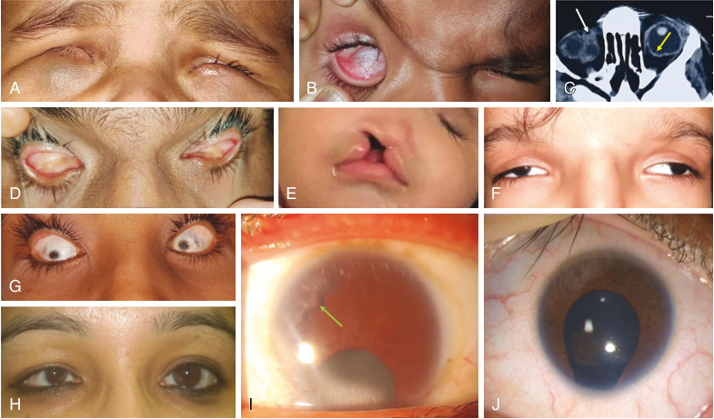

**Fig. 21.1** Anterior segment photographs of MAC (microphthalmos, anophthalmos and coloboma) disorder. (A) shows a child with bilateral colobomatous microphthalmos with a right orbitopalpebral cyst (bluish cystic swelling). (B) shows the same child with the lower eyelid everted to reveal the cystic nature of the swelling. (C) shows the axial computed tomography scan of the same patient showing the orbital extension of the cyst _(white arrow)_ and the coloboma _(yellow arrow)_ . (D) shows appearance of bilateral clinical anophthalmos. (E) shows a child with left eye anophthalmos and cleft lip and palate. (F) shows a child with bilateral microphthalmos, telecanthus, and downslanting palpebral fissures. (G) shows a patient with bilateral complex microphthalmos. (H) shows a patient with unilateral simple microphthalmos affecting the right eye. (I) shows the co-occurrence of iridocorneal adhesions _(green arrow)_ with coloboma, (J) shows a typical iris coloboma with iris remnants over the anterior capsule.

<!-- p.496 -->

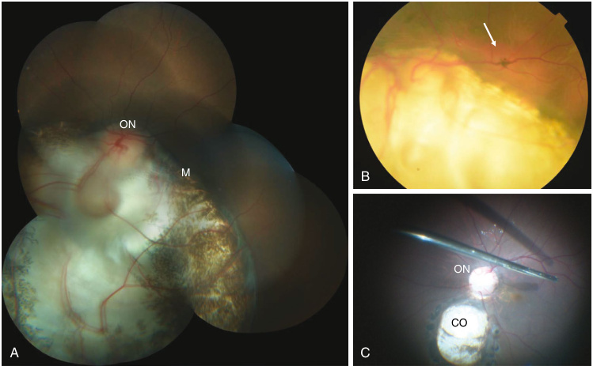

**Fig. 21.2** Retinochoroidal coloboma. (A) shows a montage reconstruction of the fundus images showing the retinochoroidal coloboma involving the optic nerve (ON) and the macula (M). (B) shows a retinal detachment (white arrow) due to the coloboma. (C) shows intraoperative view of a retinochoroidal coloboma (CO) sparing the optic nerve (ON) and macula and thus associated with a better visual prognosis. 

#### **TABLE 21.2** Selected Synd and Coloboma romes and Chromosome Abn (MAC) ormalities Associated With Microph thalmos, Anophthalmos,

|Syndrome|Ocular Associations|Common Systemic Associations|Causative Gene|
|---|---|---|---|
|CHARGE association|Bilateral or unilateral uveal colobomas|Heart defects, choanal atresia, growth delays, genitourinary defects, and ear anomalies/deafness|_CHD7_|
|Goldenhar syndrome|Ocular dermoids and dermolipomas, microphthalmos, anophthalmos, upper eyelid colobomas|Microtia/anotia, hearing impairment, preauricular ear tags, facial asymmetry, renal defects, cardiac defects|Anomalous development of first and second branchial arches; gene unknown|
|Meckel-Gruber syndrome|Microphthalmos, anophthalmos, chorioretinal abnormalities, hypoplasia/ aplasia of iris, sclerocornea|Occipital encephalocele, microcephaly, multicystic kidney, polydactyly of fingers and toes, hepatic fibrosis, ambiguous genitalia|_MKS1_,_TMEM216_, _TMEM67_,_CEP290_, _RPGRIP1L_,_CC2D2A_ and others|
|Renal coloboma syndrome|Optic nerve or retinal coloboma, optic nerve dysplasia, myopia, strabismus|Renal hypoplasia with end-stage renal disease, multicystic kidneys, vesicoureteral reflux|_PAX2_|
|Rubinstein-Taybi syndrome|Congenital or juvenile glaucoma, coloboma, nystagmus, strabismus|Broad thumbs and halluces, short stature, DD/ID, facial anomalies, risk of cancerous and noncancerous tumors|_CREBBP_,_EP300_, microdeletions of chromosome 16p|
|Warburg syndrome|Microphthalmos, anophthalmos, coloboma, cataract, optic nerve hypoplasia, aplasia or atrophy|Congenital muscular dystrophy, abnormal cerebellar vermis, lissencephaly and neural migration defects, hydrocephalus, DD/ID|_POMT1_,_POMT2_,_CRPPA_, _FKTN_,_FKRP_,_LARGE1_|

_(Continued)_

<!-- p.497 -->

#### **TABLE 21.2** Selected Syndro and Coloboma ( mes and Chromosome Abn MAC)—cont’d ormalities Associated With Microph thalmos, Anophthalmos,

|Syndrome|Ocular Associations|Common Systemic Associations|Causative Gene|
|---|---|---|---|
|Anophthalmia- esophageal–genital (AEG) syndrome|Anophthalmos, microphthalmos|Tracheo-esophageal fistula and esophageal atresia, genital tract malformations in males, renal anomalies, DD/ID, seizures|_SOX2_|
|Joubert syndrome|Nystagmus, oculomotor apraxia, retinitis pigmentosa, uveal coloboma, ptosis, strabismus|Absent or hypoplastic cerebellar vermis with ataxia, abnormal breathing patterns, hypotonia, molar tooth sign, cleft lip/palate, seizures, DD/ID|_AHI1_,_CEP290_and other ciliopathy genes as for Meckel-Gruber syndrome|
|_OTX2_and pituitary abnormalities|Anophthalmos, microphthalmos, anterior segment dysgenesis, optic nerve and optic chiasm aplasia|Pituitary hypoplasia, ectopic pituitary gland, growth hormone deficiency and combined pituitary hormone deficiency, DD/ID, Arnold Chiari malformation, agnathia–otocephaly complex|_OTX2_|
|Matthew-Wood syndrome/Pulmonary hypoplasia- Diaphragmatic hernia- Anophthalmia-Cardiac defect (PDAC) syndrome|Anophthalmos, severe microphthalmos|Pulmonary hypoplasia or aplasia, diaphragmatic hernia, cardiac defects, craniofacial anomalies, DD/ID|_STRA6_|
|MIDAS (MLS) syndrome|Microphthalmos, sclerocornea, anophthalmos|Dermal aplasia and linear skin defects, central nervous system anomalies|_HCCS_|
|Waardenburg anophthalmia syndrome|Microphthalmos, anophthalmos|Limb abnormalities with absent or fused digits (oligosyndactyly), facial anomalies, DD/ID|_SMOC1_|
|Oculo-facial-cardio- dental (OFCD) syndrome|Congenital cataract, microcornea, microphthalmos|Long and narrow face, high nasal bridge with a broad or septate nasal tip, cardiac septal defects, dental radiculomegaly, skeletal defects|_BCOR_variants in females|
|Lenz microphthalmia syndrome _DD/ID,_Developmental delays/in|Microphthalmos, anophthalmos, coloboma tellectual disability;_MLS,_microphthalmia|DD/ID, microcephaly, brain anomalies, palatal defects, cardiac defects, renal anomalies, cryptorchidism with linear skin defects syndrome.|_BCOR_variants in males|

in the _PAX6_ gene. Variations in other genes such as _FOXC1_ , _PITX2_ , _CYP1B1_ , _FOXD3_ , and _TRIM44_ have been observed in less than 10% of the cases. 

Infants with aniridia often present with photophobia, nystagmus, and poor visual responses. The visual acuity in aniridia may vary from 20/60 to 20/200 or worse. Visual loss in aniridia is not related to the degree of iris hypoplasia but is determined by the extent of the foveal hypoplasia and ocular comorbidities, such as cataract, glaucoma, keratopathy, and optic neuropathy. **Foveal hypoplasia** is an absence of the foveal pit and is seen in 80–90% of patients with aniridia. The hypoplasia can be confirmed on fundus autofluorescence, where it appears as the absence of the central, hypofluorescent foveal avascular zone, or with macular optical coherence tomography (OCT), where it appears as absence of the foveal contour with thickening of the fovea. The OCT is a good predictor of future vision 

in patients with congenital aniridia. Pathogenic variants in the coding region of _PAX6_ are more likely to be associated with foveal hypoplasia when compared to other genetic causes of aniridia. 

Patients with aniridia can develop corneal involvement that is characterized by progressive vascularization (pannus) and corneal opacification beginning from the limbus and gradually encroaching on the visual axis with increasing age. Corneal abnormalities, called **aniridia associated keratopathy (AAK)** , may be seen as early as 2 years of age; the cumulative prevalence in aniridia is as high as 90%. Apart from causing visual loss, AAK also results in extreme photophobia and chronic irritation of the ocular surface. Additional eye comorbidities seen in patients with aniridia include **cataracts** (40–82%) and **glaucoma** (46–70%), which often manifest in late childhood or early adulthood due to progressive anatomical changes in the drainage angle

<!-- p.498 -->

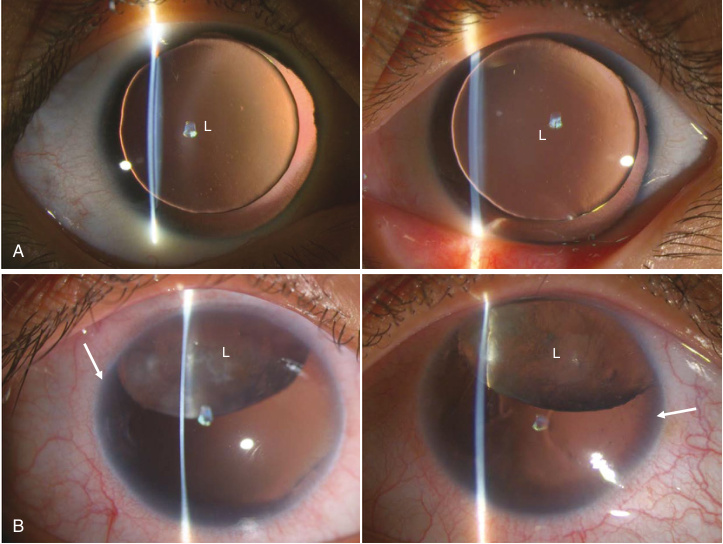

**Fig. 21.3** Congenital aniridia. (A) shows near total absence of iris and visible margins of the clear lens (L) in both the eyes. (B) shows a superiorly subluxated, cataractous lens (L) and early aniridia associated keratopathy (white arrow) in both the eyes. 

of the anterior chamber. Occasionally, glaucoma may be present at birth or early infancy. Lens subluxation and colobomas, microspherophakia, and posterior lenticonus have also been rarely reported. Other rare eye findings are optic nerve hypoplasia or aplasia, optic atrophy, or optic pit, and morning glory anomaly. Figure 21.3 shows clinical photographs of the anterior segment in congenital aniridia. 

Treatment of aniridia encompasses management of the ocular comorbidities. Whenever a refractive error is present, spectacles are helpful for improving vision. Photochromatic glasses or tinted filters can reduce glare and photophobia. The experimental use of smart scleral contact lenses with an artificial iris based on guest–host liquid crystal cells has been studied in aniridia and improves vision and reduces photophobia. Visually significant cataracts need surgical removal and intraocular lens implantation; the surgery may be challenging due to associated ocular comorbidities. Iris reconstruction can be achieved using various types of iris prosthesis. Postoperative uveitis and progression of glaucoma are known complications following cataract surgery in aniridia. Medical management remains the first line of therapy for glaucoma in aniridia, although it is often resistant to conventional treatment and most patients require surgical procedures. It is extremely difficult to treat AAK due to the progressive limbal stem cell deficiency and impaired healing. Preservative-free lubricants and autologous serum may provide mild symptomatic relief in the early stages of the disease. Keratoplasty is required in 

advanced stages where the visual axis is obscured due to corneal scarring. Limbal stem cell restoration procedures are recommended before penetrating keratoplasty to reduce the chances of failure. 

Aniridia can be associated with **Wilms tumor, aniridia, genitourinary anomalies, and mental retardation (WAGR) syndrome** due to the deletion of the contiguous _WT1_ gene in 20–30% of patients with sporadic aniridia. Wilms tumor is a nephroblastoma that usually manifests before 4 to 7 years of age. In 70% of cases associated with aniridia, the Wilms tumor is bilateral, shows male predilection, and occurs at a young age. Genetic testing to detect a deletion of the _WT1_ gene is recommended to stratify risk and determine management. In the absence of a genetic diagnosis, children with sporadic aniridia need to be screened with serial renal ultrasound scans every 6 months until 6–7 years of age. Other systemic associations that are rarely reported with aniridia include anosmia, hyposmia, hearing impairment, autism, and intellectual disability (ID). 

**Gillespie syndrome** is a distinct entity characterized by _partial_ aniridia with nystagmus, nonprogressive ataxia, ID, and hypotonia. The pattern of loss of iris tissue in Gillespie syndrome is different from classical aniridia and involves aplasia of the iris central to the collarette, leaving a scalloped edge. The partial aniridia manifests as a dilated and nonreactive pupil. Gillespie syndrome typically lacks the other ocular complications of classical congenital aniridia.

<!-- p.499 -->

## **Albinism** 

Albinism comprises genetically diverse disorders characterized by complete absence or reduced melanin synthesis. The skin, hair, and eyes can be affected with wide phenotypic variability. **Oculocutaneous albinism (OCA)** describes the clinical condition when all three tissues (skin, hair, and eyes) are affected, whereas **ocular albinism (OA)** describes the disorder when manifestations are restricted to the eyes. OCA can occur in nonsyndromic or syndromic forms such as **Hermansky-Pudlak syndrome** and **Chediak-Higashi syndrome** . Table 21.3 describes the epidemiology, clinical features, and genetic etiology for the commonest types of OCA, OA, and other albinism-associated disorders. 

The central defect in albinism is the inability of melanocytes to synthesize melanin in the melanosomes by a series of enzymatic reactions. Melanin is critical for providing protection from the harmful effects of ultraviolet (UV) light and for development of the ocular structures and their neural connections. Among the two types of melanin, eumelanin is the black or brown pigment which provides protection from UV light. Pheomelanin does not provide UV protection and is responsible for red or blond hair. The loss-of-function variants in all types of OCA affects eumelanin synthesis; the levels of pheomelanin may be unaffected. 

The skin and hair manifestations in albinism vary according to genotype. The most striking features occur in OCA type 1 in association with complete lack of melanin; 

#### **TABLE 21.3** Epid emiology, Clinical Fi ndings, and Genetic Etiol ogy of the Com monest Form s of OCA and OA

|Albinism||||Inheritance||
|---|---|---|---|---|---|
|Type|Epidemiology|Clinical Features|Gene|Pattern|Pathophysiology|
|OCA 1|1:40,000 worldwide; less common in African Americans.|Type A is the most severe form of OCA. Type B is similar to OCA type 1A at birth, but patients develop mild pigmentation of hair and skin in first few years of life.|_TYR_|AR|Type A has complete lack of tyrosinase activity, the enzyme that hydroxylates L-tyrosine to L-DOPA and oxidizes L-DOPA to DOPAquinone. Type B has reduced activity of tyrosinase.|
|OCA 2|Most common type worldwide. 1:39,000 Americans, 1:36,000 to 1:10,000 in African Americans, 1:3,900 in southern Africa.|Classic OCA 2: The clinical features are similar to OCA type 1B. The visual acuity may be slightly better ranging from 20/60 to 20/100 Brown OCA 2: The patients have much more pigment as compared to the classic OCA 2 and hence the disorder can be called “brown OCA.”|_OCA2,_red _OCA 2_has concurrent _MC1R_ variants.|AR|The OCA 2 gene codes for melanosomal membrane protein.|
|OCA 3|Rare in Caucasians, 1:8,500 in Africans|Affects dark-skinned individuals and is characterized by reddish-brown (copper) skin, red or reddish yellow (ginger) hair, and light brown or hazel irides. It is often referred to as “rufous” OCA. The visual impairment is often milder than other forms of OCA.|_TYRP1_|AR|The tyrosinase-related protein 1 is thought to stabilize the activity of tyrosinase and maintain melanosome integrity.|
|OCA 4|Overall 1:100,000; rare in Caucasians and Africans.|Clinical features are similar to Classic OCA 2|_SLC45A2_|AR|The gene codes for a membrane-associated transport protein which transports products of melanin biosynthesis into the melanosomes.|

_(Continued)_

<!-- p.500 -->

#### **TABLE 21.3** Epide miology, Clinical Fi ndings, and Genetic Etiol ogy of the Com monest Form s of OCA and OA—cont’d

|Albinism||||Inheritance||
|---|---|---|---|---|---|
|Type|Epidemiology|Clinical Features|Gene|Pattern|Pathophysiology|
|OA|1:60,000|Only an ocular phenotype is present that is similar to the ocular features of OCA. Female carriers can have iris transillumination defects, “mud splattered” fundus due to scattered pigmentation, and foveal hypoplasia.|_GPR143_|X-linked|Formation of “macromelanosomes” due to dysfunctional melanosome biogenesis|
|Hermansky Pudlak syndrome|1 to 9 in 1,000,000|OCA, bleeding diathesis, pulmonary fibrosis, granulomatous colitis, and/or immunodeficiency. Posterior embryotoxon can be seen in the eye.|_AP3B1_, _AP3D1_, _ADTB3A_ _BLOC1S3_, _BLOC1S5_, _BLOC1S6_, _DTNBP1_, _HPS1_, _HPS3_, _HPS4_, _HPS5_, _HPS6_|AR|Impaired melanosome formation and trafficking.|
|Chediak Higashi syndrome|Rare;<500 cases reported.|OCA, easy bruising, recurrent pyogenic infections, neurological manifestations. Pathognomonic azurophilic granules in white blood cells.|_LYST_/_CHS1_|AR|Dysregulation of lysosomal trafficking.|
|Griscelli syndrome (GS) _AR,_Autosomal re|Rare;<150 cases reported. cessive.|Hypopigmented, silvery hair and skin, recurrent fever, hepato- splenomegaly and pancytopenia. On light microscopy, large clumps of pigment in the hair shaft differentiates GS from the more uniformly distributed pigmentation in CHS.|Type 1 GS— _MYO5A_ Type 2 GS— _RAB27A_ Type 3 GS— _MLPH_|AR|Vesicle transport and membrane trafficking in melanosome transport pathway.|

patients have white hair and eyelashes, white skin, and pink eyes. In all other forms of OCA, some amount of pigment is present at birth, or pigmentation improves with age. The presence of some pigmentation can make it difficult to differentiate OCA from idiopathic infantile nystagmus or retinal dystrophies, especially in patients with European ancestry. A comparison of the skin color with other family members may help determine a diagnosis. Albinism predisposes to actinic damage from exposure to UV radiation; actinic keratosis, basal cell carcinoma, and squamous cell carcinoma can develop at an early age. Skin cancers are often multiple, aggressive, and occur on the exposed parts of the body. The use of photoprotection should be instituted 

early in life in patients with albinism, and parents should be educated about the various methods of sun protection. 

Ocular manifestations are present in _all_ types of OCA and OA. Visual acuity ranges from 20/60 to 20/400; there is also impaired color vision. The visual acuity correlates with the degree of foveal hypoplasia/macular topography. Children may present with nystagmus and symptoms of glare and photophobia, which can be attributed to foveal abnormality, iris transillumination defects, and retinal hypopigmentation. The iris transillumination defects are best appreciated with retro-illumination on a slit lamp; they are due to reduced melanin in the pigmented epithelium and the stromal melanocytes of the iris. The color of the iris varies from pink to

<!-- p.501 -->

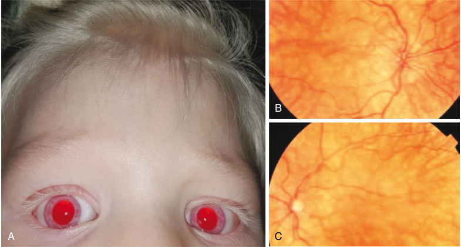

**Fig. 21.4** Oculocutaneous albinism. (A) shows golden white hair, eyebrows, and eye lashes. The skin is lightly pigmented. The iris is blue in color and transilluminates. (B and C) show the fundus photographs of the right and the left eye of this patient. There is a typical tigroid appearance of the fundus due to increased visibility of the larger choroidal vessels due to decreased pigmentation of the retinal pigment epithelium. 

blue to light brown depending on the amount of residual melanin (Fig. 21.4A). Due to a similar reduction of pigment in the retinal pigment epithelium (RPE), the fundus has a classic, _albinotic_ appearance wherein the deeper and larger choroidal vessels are visible (Figs. 21.4B and C). Nystagmus is often large amplitude during infancy but tends to reduce with age. It can be associated with strabismus, a compensatory head posture, and reduced stereopsis. Refractive errors, principally hyperopia and astigmatism, are also common in albinism. Misrouting of the visual pathway is a characteristic ocular abnormality in albinism and is caused by abnormal crossing of nerve fibers at the optic chiasma. A multichannel visual evoked potential (VEP) from each eye can detect this misrouting by revealing a _crossed asymmetry_ , whereby the dominant response from the tested eye is present in the opposite cerebral hemisphere. VEP has been used to confirm the diagnosis of albinism in cases with clinical uncertainty. 

## **Anterior Segment** 

## **Developmental Anomalies** 

The anterior segment of the eye comprises the cornea, anterior chamber, iris, ciliary body, lens, and aqueous humor. Genetic and environmental factors control the development of the anterior segment. It is formed from three successive waves of neuroectodermal cell migration between the surface ectoderm and the lens vesicle to form the corneal endothelium, corneal stroma, and iris stroma (Fig. 21.5). The angle of the anterior chamber with the aqueous humor drainage apparatus (trabecular meshwork and Schlemm’s canal) is also 

a part of the anterior segment and is formed by mesenchymal cells at the anterior tip of the optic vesicle. The layers of the optic cup grow anteriorly and form the posterior epithelial layers of the iris. The lens is formed from surface ectoderm that invaginates into the developing optic cup. The shared developmental processes for different structures in the anterior segment explain the substantial phenotypic and genotypic overlap among the clinical entities that are included in the umbrella term _anterior segment developmental anomalies (ASDA)_ . 

Clinical manifestations in ASDA include posterior embryotoxon, anterior segment dysgenesis, keratoiridolenticular dysgenesis, Axenfeld-Rieger syndrome, congenital hereditary endothelial dystrophy (CHED), posterior polymorphous corneal dystrophy, sclerocornea, aniridia, primary congenital glaucoma, iridocorneal endothelial syndromes, iridogoniodysgenesis syndrome, megalocornea, and posterior keratoconus (Table 21.4). On the extreme end of the spectrum is the complex malformation syndrome of corneal staphyloma-anterior segment agenesia-microphakia syndrome (CSAMS), wherein the entire anterior segment is disorganized and presents as a staphylomatous protrusion of a scarred cornea. 

The visual morbidity depends on the type of ASDA. Patients can present with a combination of corneal opacification, a small or an enlarged cornea, increased intraocular pressure, iris defects, and lenticular opacification or ectopia. In the presence of a total corneal opacity, ancillary investigations like ultrasound biomicroscopy (UBM) can help in making an accurate diagnosis. Various genes and inheritance patterns have been implicated in each type of ASDA.

<!-- p.502 -->

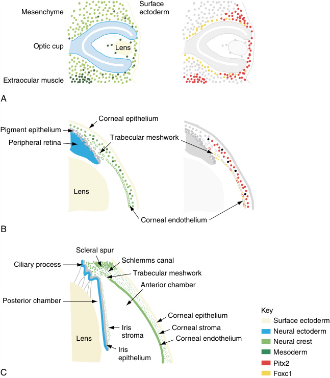

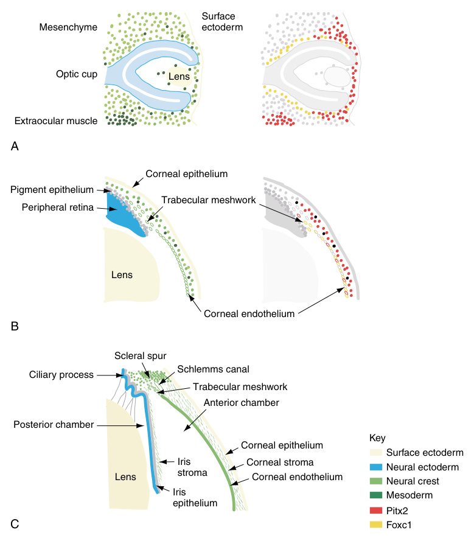

**Fig. 21.5** The embryonic and fetal development of the anterior segment of the eye. (A) Optic cup stage, embryonic day 10.5 in the mouse equivalent to week 5 in human development. (B) Formation of anterior chamber, embryonic day 15.5 in the mouse equivalent to the 5th month of human gestation. (C) Mature anterior segment depicting the lens, iris, irido-corneal angle, and the cornea. Key shows the color coding used to represent the embryonic origin of the anterior segment tissues in the right-hand plates, and the pattern of expression of the _Foxc1_ and _Pitx2_ genes in the left-hand plates.  (From Sowden JC. Molecular and developmental mechanisms of anterior segment dysgenesis. _Eye (Lond)._ 2007;21:1310-1318 [Fig. 1, p. 1311].) 

#### **TABLE 21.4 Systemic Findings Seen With Anterior Segment Developmental Anomalies** 

|Ocular Phenotype|Systemic Findings|Common Causative Genes|
|---|---|---|
|Iridocorneal adhesions/ Peters anomaly|Peters plus syndrome/Krause-Kivlin syndrome—cleft lip/cleft palate, facial anomalies with ear anomalies and prominent lips, DD/ID, brachydactyly|_B3GALTL_|
|Axenfeld Rieger anomaly|Axenfeld-Rieger syndrome—hypodontia or microdontia, redundant periumbilical skin or umbilical hernia, facial anomalies|_PITX2_,_FOXC1_|
||SHORT syndrome—short stature, joint hyperextensibility, ocular depression, Rieger anomaly, delayed tooth eruption|_BMP4_,_PIK3R1_|

_(Continued)_

<!-- p.503 -->

#### **TABLE 21.4** Systemic Findin gs Seen With Anterior Segment Developmental Anomali es—cont’d

|Ocular Phenotype|Systemic Findings|Common Causative Genes|
|---|---|---|
|Anterior segment dysgenesis, including variable KILD |White matter abnormalities, Dandy-Walker malformation, corpus callosum agenesis, ventriculomegaly, hydrocephalus, hearing loss|_FOXC1_,_PITX2_|
|phenotypes|Microcephaly, optic nerve drusen, enlarged cisterna magna, flattened sella turcica, cerebral small vessel disease and stroke|_PITX2_|
|Posterior embryotoxon|Alagille syndrome—bile duct paucity leading to cholestasis, congenital heart defects, butterfly vertebrae, facial anomalies, renal anomalies, DD/ID|_JAG1_,_NOTCH2_|
|Microcoria|Pierson syndrome—small nonreactive pupils, nephrotic syndrome, movement disorder, hypotonia, DD/ID|_LAMB2_|
|CHED|Harboyan syndrome—hearing loss|_SLC4A11_|
|Congenital-onset glaucoma|Aicardi–Goutieres syndrome—microcephaly, leukodystrophy, cerebral atrophy, intracranial calcifications, hepatosplenomegaly, thrombocytopenia|_TREX1_,_RNASEH2A_,_RNASEH2B_, _RNASEH2C_,_SAMHD1_,_ADAR_, _IFIH1_|
||Oculocerebrorenal (Lowe) syndrome—congenital cataracts, DD/ID, renal failure|_OCRL_|
||Sturge-Weber syndrome—angiomas involving the face, eye, and leptomeninges, early-onset unilateral or bilateral glaucoma|_GNAQ_|
||Oculodermal melanocytosis—hyperpigmentation of facial skin|_c-KIT_,_GNAQ_,_BAP1_,_TP53_|
||Phacomatosis pigmentovascularis—angiomas, facial and body hyperpigmentation, hemihypertrophy of the limbs, abdominal varicosities|_GNA11_|
||Roberts syndrome—phocomelia, craniofacial anomalies, DD/ID|_ESCO2_|
||Rubinstein-Taybi syndrome—broad thumbs and halluces, short stature, facial anomalies, DD/ID|_CREBBP_,_EP300_|

_CHED,_ Congenital hereditary endothelial dystrophy; _DD/ID,_ developmental delays/intellectual disability; _KILD,_ keratoiridolenticular dysgenesis. 

Some of the commonly affected genes are _PAX6, PITX2, CYP1B1, LTBP2, JAG1, FOXC1, FOXC2, PITX3, FOXE3, BMP4, COL4A1, LAMB2, B3GALTL, SOX2_ , and _BCOR_ . 

### **Keratoiridolenticular Dysgenesis** 

Keratoiridolenticular dysgenesis (KILD) is a group of disorders characterized by adhesions between the iris and cornea, lens, and cornea, or all three structures. It is also associated with varying defects in development of the crytalline lens, ranging from near normal to complete absence of the lens. The phenotype is variable and can be determined with UBM by noting the position of the lens and degree of attachment to the cornea, iris attachments to the cornea, and the presence or absence of the anterior lens capsule (Fig. 21.6). All subtypes of KILD present with a secondary congenital corneal opacity, with or without vascularization that may be unilateral or bilateral. **Peters anomaly type 1** is also a type of iridocorneal dysgenesis. It is characterized by a central or paracentral avascular corneal scar with a corresponding defect in the posterior stroma, Descemet membrane and endothelium, as well as iridocorneal adhesions to the peripheral edges 

of the scar. The absence of lenticular abnormalities and corneal vascularization makes corneal transplantation a relatively successful procedure in Peters anomaly type 1 compared to other forms of KILD. The prognosis is poorer in **congenital primary aphakia** that is characterized by silvery opacification of the cornea with vascularization, corneal ectasia, and enlargement due to secondary glaucoma. Congenital primary aphakia has a high risk of phthisis following penetrating keratoplasty. It is important to determine the precise phenotype of the KILD spectrum before any surgical intervention. 

### **Sclerocornea** 

Sclerocornea refers to a condition with peripheral sclerization of the cornea, wherein the cornea is opacified with regular palisades of vascularization and appears morphologically similar to sclera. It is often associated with flattening of the cornea (cornea plana) and iridocorneal adhesions in the sclerization region. Complete vascularization and opacification of the cornea due to sclerocornea is rare and should be differentiated from other causes of congenital corneal opacification using appropriate imaging techniques.

<!-- p.504 -->

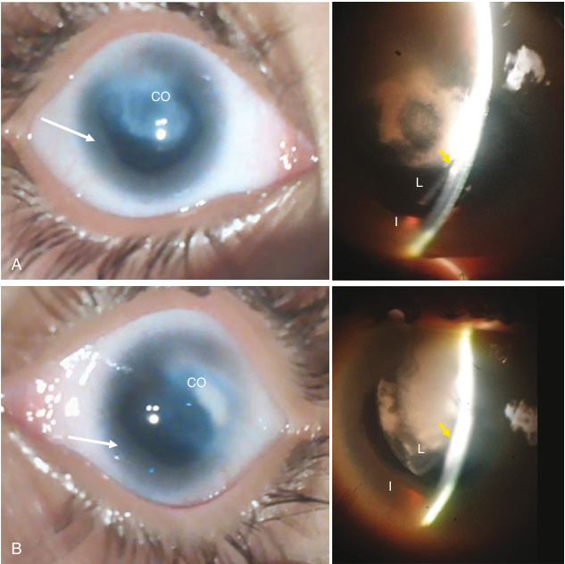

**Fig. 21.6** Kerato-irido-lenticular dysgenesis (KILD). (A) shows the right eye and (B) shows the left eye. Both the eyes have microcornea, ill-defined limbus (white arrow), incompletely developed iris (I), and corneal opacity (CO). Slit lamp view shows that the lens (L) is attached to the cornea in the center _(yellow arrow)_ . The lens is also cataractous, left > right eye. 

### **Axenfeld-Rieger Anomaly and Syndrome** 

**Axenfeld anomaly** refers to a prominent and anteriorly displaced Schwalbe line, or posterior embryotoxon. **Rieger anomaly** refers to the presence of iris defects comprising iris stromal hypoplasia, corectopia, and polycoria. AxenfeldRieger syndrome (ARS) includes Axenfeld anomaly and Rieger anomaly associated with systemic findings, such as loose periumbilical skin or hernia, hypodontia, and maxillary hypoplasia. ARS is commonly associated with secondary childhood glaucoma and regular monitoring of intraocular pressure and examination of the optic nerves is desirable (Fig. 21.7). 

(trabeculodysgenesis) which impedes the outflow of aqueous humor leading to raised intraocular pressure. The raised intraocular pressure leads to an increase in the corneal diameter and corneal clouding (buphthalmos) in young patients (Fig. 21.8A). Affected children can develop linear tears in the Descemet membrane which are often concentric to the limbus (Haab striae). An influx of aqueous humor into the cornea through these tears can lead to sudden opacification of the cornea that is known as **acute hydrops** . Primary congenital glaucoma is treatable in the early stages via medical and surgical modalities. The changes in the optic nerve may also be reversible if treated early. Delayed identification can lead to irreversible glaucomatous damage to the optic nerve. 

### **Primary Congenital Glaucoma** 

Primary congenital glaucoma (PCG) includes isolated, nonsyndromic glaucoma with onset in the early neonatal period. PCG is inherited as an autosomal recessive (AR) condition; three common genes are _CYP1B1, LTBP2,_ and _TEK_ . It is characterized by a developmental anomaly of the trabecular meshwork and the anterior chamber angle 

### **Congenital Hereditary Endothelial Dystrophy** 

Congenital hereditary endothelial dystrophy (CHED) is a neonatal onset disease caused by homozygous or compound heterozygous pathogenic variants in the _SLC4A11_ gene. The gene encodes the bicarbonate transporter 1 (BTR-1) transmembrane protein which actively pumps out water

<!-- p.505 -->

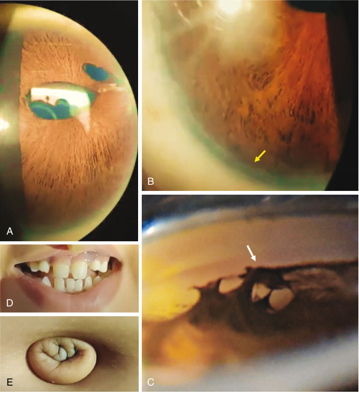

**Fig. 21.7** Axenfeld-Rieger syndrome. (A) shows thinned and stretched iris with polycoria due to pseudohole formation. (B) shows a prominent Schwalbe’s line/Posterior embryotoxon _(yellow arrow)_ . (C) shows the iridocorneal adhesions _(white arrow)_ visualized on gonioscopy. (D) shows hypodontia and microdontia. (E) shows redundant umbilical skin. 

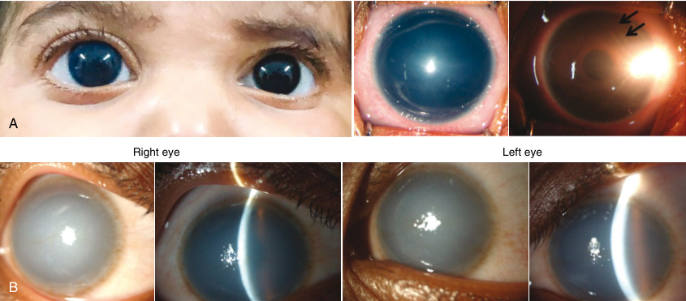

**Fig. 21.8** A comparison of the clinical appearance of primary congenital glaucoma (PCG) and congenital hereditary endothelial dystrophy (CHED) (A) PCG—The cornea of the right eye appears cloudy, bluish grey in color and larger in diameter as compared to the left eye. Haab striae _(black arrows)_ differentiate it from other causes of congenital corneal opacification. (B) CHED—The bluish-gray appearance of the cornea is due to corneal edema and increased corneal thickness (>1,000 μm). The corneal size is normal.

<!-- p.506 -->

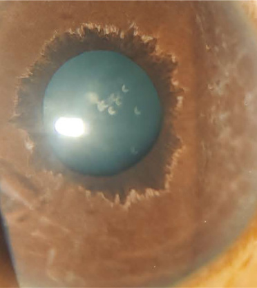

**Fig. 21.9** Congenital ectropion uvea. The posterior pigmented epithelium is overriding the anterior surface of the pupil. The rest of the iris is featureless with absence of crypts and collarette. Small areas of iris atrophy are noted. 

from the corneal stroma to the aqueous humor. CHED presents clinically as a diffuse ground glass appearance of the cornea, with 2–3 times increased corneal thickness (Fig. 21.8B). Unlike PCG, corneal size is normal and Haab striae are absent. However, secondary glaucoma may occur in CHED. Poor vision and nystagmus are common consequences of the corneal pathology in CHED. The treatment of CHED is surgical management via penetrating or endothelial keratoplasty. There may be utility with the use of topical nonsteroidal antiinflammatory drugs in the treatment of CHED caused by pathogenic variants in _SLC4A11_ . 

## **Congenital Ectropion Uvea (CEU)** 

Congenital ectropion uvea (CEU) is a rare condition that arises due to developmental arrest of the neural crest cells. It is often unilateral, but bilateral cases have been reported. It is characterized by presence of the posterior pigment pigmentation on the anterior surface of the iris, starting from the pupillary margin and ending before the angle (Fig. 21.9). Systemic findings associated with ASDA are listed in Table 21.4. 

# **Other Corneal Disorders** 

## **Posterior Polymorphous Corneal Dystrophy** 

Posterior polymorphous corneal dystrophy (PPCD) is a rare, autosomal dominant (AD), slowly progressive corneal dystrophy with a variable presentation. It commonly manifests later in life, but neonatal or infantile onset is also seen. The lesions in the cornea are polymorphous (unlike CHED that presents 

as a uniform haziness), vesicular, band-like, or diffuse. The band-like lesions are differentiated from Haab striae by the absence of tapering ends. The corneal opacification and edema are due to a metaplastic change in the endothelial cells, which form abnormal thickening of Descemet membrane. The metaplastic endothelium is not restricted to the cornea and involves the iris, leading to corectopia, ectropion uvea, and iridocorneal adhesions. Secondary glaucoma may develop due to peripheral anterior synechiae, or migration of endothelial cells and the cornea can be atypically steep. Four causative genes for PPCD types 1–4 _(OVOL2, COL8A2, ZEB1, GRHL2)_ have been associated with the disease. 

## **Congenital Hereditary Stromal Dystrophy** 

Congenital hereditary stromal dystrophy (CHSD) is a rare cause of congenital corneal opacity. It presents at birth as a bilateral, diffuse corneal haze with central flake-like opacities. The corneal size is not enlarged compared to primary congenital glaucoma and the corneal thickness is markedly less compared to CHED. The disease is nonprogressive, although the central flakes increase slowly with age. Nystagmus is uncommon. Electron microscopy shows layers of normal collagen interspersed with abnormal layers of small filaments. Pathogenic variants in the _DCN_ gene can cause CHSD. 

## **Corneal Dermoids** 

Corneal dermoids are epithelial choristomas that are commonly located at the inferotemporal limbus in one eye. They can rarely involve the entire cornea or be restricted to the conjunctiva. They may contain aberrant tissues such as hair, fat, skin, sweat glands, muscle, teeth, cartilage, bone, or brain tissue. Corneal dermoids can occasionally be bilateral, leading to significant vision loss. They are found in association with other anomalies in Goldenhar syndrome (Table 21.2). The treatment of corneal dermoid includes lamellar or penetrating keratoplasty, optical rehabilitation for the residual astigmatism, and management of amblyopia (Fig. 21.10). 

# **Lenticular Abnormalities** 

## **Primary Congenital Cataract** 

Cataract, or opacity of the crystalline lens, has a prevalence of 0.6–9.3/10,000 live births. Cataracts are one of the leading causes of blindness in the developing world; congenital/ infantile cataracts account for 10% of childhood blindness worldwide. Caregivers often observe **leukocoria (white pupil)** with increasing opacity size, lack of visual contact with close objects, straining and tightening of the eyes in solid light, buphthalmos, microphthalmos, and nystagmus. Awareness and prompt referral for consideration of surgical intervention is critical because delayed diagnosis can lead to **deprivation amblyopia** and permanent visual loss. For cataracts with significant impact on vision and a high risk

<!-- p.507 -->

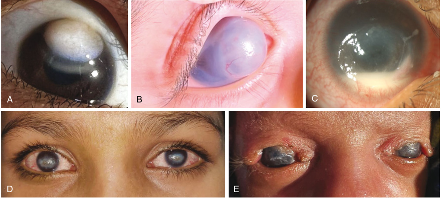

**Fig. 21.10** Congenital/infantile corneal opacities due to various causes. (A) epibulbar dermoid. (B) anterior staphyloma. (C) corneal ulcer with hypopyon due to neonatal herpes. (D) bilateral corneal opacities secondary to neurotrophic keratitis in a patient with congenital corneal anesthesia. Note the location of the vascularized opacity in the interpalpebral zone. (E) bilateral corneal opacities due to exposure keratopathy in a child with upper eyelid colobomas. 

of amblyopia, surgery is recommended at 6 weeks of age for unilateral eye involvement and prior to 8 weeks of age for bilateral cases. Microincision cataract aspiration combined with posterior capsulotomy, anterior vitrectomy, and primary intraocular lens implantation is the leading surgical option for many children. Surgical complications, including inflammation, secondary glaucoma, and opacification of the posterior capsule, can cause morbidity and compromise visual prognosis. 

Cataracts can be classified according to the age of onset, morphology, and position in the lens. Patients presenting within the first 3 months of life have cataracts that are classified as _congenital_ . Cataracts with onset of the lens opacity after 3 months of life are classified as _infantile_ , _juvenile_ , or _developmental_ . If onset occurs within the first decade of life, the cataract is termed juvenile. Cataracts with a later age of onset before the age of 45 years are termed presenile, whereas senile, or age-related, cataracts typically manifest after 50 to 60 years of age. Total, nuclear, and posterior subcapsular cataracts are the most frequent types, but there is little correlation between the type of cataract and the underlying genetic etiology (Figs. 21.11 and 21.12). 

## **Syndromes and Congenital Cataract** 

Cataracts present as an isolated anomaly in ~27% of patients. Approximately 18–30% of patients have a family history of cataracts; AD, AR, and X-linked recessive inheritance patterns have been reported. Pathogenic variants for _isolated cataracts_ have been identified in genes encoding lens crystallins, connexins, transcription factors, growth factors, membrane proteins, and intermediate 

filament proteins. Of these gene families, the crystallin proteins represent >90% of the total soluble protein in the lens; pathogenic variants in _CRYAA_ , _CRYAB_ , _CRYBB1_ , _CRYBB2_ , _CRYBB3_ , _CRYGC_ , and _CRYGD_ are frequent causes of nonsyndromic cataracts (Table 21.5). 

Cataracts can occur with other eye findings such as coloboma, aniridia, microcornea, anterior segment defects, persistent fetal vasculature, and retinal defects. The lens opacities can also be part of an underlying syndrome and more than 200 genetic syndromes, and 300 causative genes have been connected to cataracts (Table 21.6). Syndromes in which cataracts are a typical finding include oculofaciocardiodental (OFCD) syndrome, MarinescoSjogren syndrome, and Lowe syndrome. Figure 21.12 shows a cataract in a patient with galactosemia which may improve with dietary restriction of galactose. Although a genetic cause can be identified for 30–40% of patients, most cases of unilateral or bilateral cataracts are idiopathic. 

## **Ectopia Lentis and Microspherophakia** 

**Ectopia lentis (EL)** is defined as a familial or acquired displacement of the crystalline lens, with subluxation or dislocation of the lens into the anterior chamber, vitreous cavity, or onto the retinal surface. Clinical findings include visual changes, with refractive errors, loss of accommodation, and diplopia (double vision). **Microspherophakia (MSP)** is characterized by an abnormal, spherical shape of the crystalline lens with an increased anteroposterior distance and a reduced equatorial diameter (Fig. 21.13). MSP is typically bilateral and present at birth. Associated findings include high myopia and defective accommodation, lens dislocation

<!-- p.508 -->

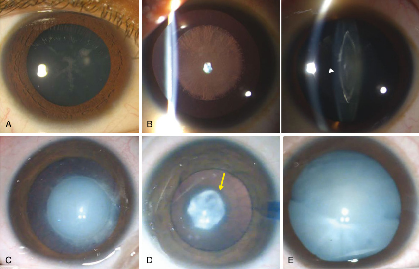

**Fig. 21.11** Congenital cataracts. (A) sutural cataract with opacities along the anterior Y and posterior inverted Y sutures. (B) zonular cataract, a single zone of the nucleus (as seen in the slit view, _white arrow_ ) is affected. (C) nuclear cataract, affecting the fetal nucleus. (D) membranous cataract, a partially absorbed cataract with anterior and posterior capsules fused in the center _(yellow arrow)_ . (E) total cataract. 

|**Genes A** **TABLE** **21.5**|**ssociated Wi**|**th Isolated Cataract**||
|---|---|---|---|
|Gene||||
|Name/Locus|Inheritance|Disease Name|Phenotype|
|_AGK_|AR|Cataract 38, congenital cataract|Congenital cataract|
|_BFSP1_|AD/AR|Cataract 33, multiple types|Cortical, nuclear, punctate lamellar cataracts|
|_BFSP2_|AD|Cataract 12, multiple types|Lamellar, cortical, nuclear embryonic, “scattered lens opacities”|
|_CHMP4B_|AD|Cataract 31, multiple types|Posterior subcapsular cataract, progressing to affect nucleus and anterior subcapsular regions. Posterior polar cataracts|
|_CRYAA_|AD/AR|Congenital cataract; cataract 9, multiple types|Nuclear, zonular, central nuclear, laminar, lamellar, anterior polar, posterior polar, cortical, embryonal, anterior subcapsular, fan-shaped, total cataracts|
|_CRYAB_|AD/AR|Cataract 16, multiple types|Nuclear, posterior polar, nuclear, lamellar cataracts|
|_CRYBA1_|AD|Cataract 10, multiple types|Cataract congenital zonular with sutural opacities, nuclear, lamellar cataract|
|_CRYBA2_|AD|Cataract 42|Multifocal cataract, congenital, juvenile, posterior polar, early cataract|
|_CRYBA4_|AD|Cataract 23|Lamellar and nuclear cataracts|
|_CRYBB1_|AD/AR|Cataract 17, multiple types|Congenital nuclear cataract, pulverulent cataracts|

_(Continued)_

<!-- p.509 -->

|**ABLE** **21.5** **Gene**|**s Associated W**|**ith Isolated Cataract—cont’d**||
|---|---|---|---|
|Gene||||
|Name/Locus|Inheritance|Disease Name|Phenotype|
|_CRYBB2_|AD|Cataract 3, multiple types|Coppock-like cataract, cerulean cataracts|
|_CRYBB3_|AD/AR|Congenital nuclear cataract; Cataract 22|Congenital, cortical, nuclear cataract|
|_CRYGB_|AD|Cataract 39, multiple types|Anterior polar, lamellar cataract|
|_CRYGC_|AD|Cataract 2, multiple types; AD cataract coppock-like;|Cataract, variable zonular pulverulent, coppock-like cataract|
|_CRYGD_|AD|Cataracts; cataract 4, multiple types, congenital cerulean cataract|Aculeiform, progressive, congenital cerulean cataract|
|_CRYGS_|AD|Cataract 20, multiple types|Progressive polymorphic cortical cataract, progressive “opalescent” cataract|
|_CYP51A1_|AR|Autosomal recessive cataract due to abnormal sterol metabolism|Not otherwise specified, congenital cataract total white cataracts|
|_DNMBP_|AR|Cataract 48|Infantile onset cataracts|
|_EPHA2_|AD|Age-related cortical cataract; cataract 6, multiple types|Age-related cortical cataract. Persistent fetal vasculature, posterior polar, posterior subcapsular cataracts|
|_FOXE3_|AD/AR|Autosomal dominant cataracts; cataract 34, multiple types.|Membranous, posterior subcapsular cataracts|
|_FYCO1_|AR|Congenital cataract; cataract 18|Nuclear cataract, congenital cataracts|
|_GJA3_|AD|Zonular pulverulent cataract; cataract 14, multiple types|Nuclear pulverulent, zonular pulverulent cataract posterior polar, nuclear coralliform, embryonal nuclear, coppock-like cataracts|
|_GJA8_|AD|Cataract 1, multiple types|Zonular pulverulent, nuclear progressive|
|_HSF4_|AD/AR|Cataracts; cataract 5, multiple types|Lamellar, zonular stellate, anterior polar cataracts|
|_LEMD2_|AR|Cataract 46, juvenile onset|Juvenile-onset “Hutterite-type cataract”|
|_LIM2_|AR|Cortical pulverulent cataract; Cataract 19|Cortical pulverulent cataract, congenital total cataract, nuclear cataract|
|_LSS_|AR|Cataract 44|Total cataract|
|_MAF_|AD|Cataract, pulverulent or cerulean, without microcornea; cataract 21, multiple types|Cataract, pulverulent or cerulean, without microcornea, cataract 21, cortical pulverulent, nuclear pulverulent with progression to posterior subcapsular cataract. Lamellar, anterior polar, nuclear, anterior subcapsular cataracts|
|_MIP_|AD|Cataracts; cataract 15, multiple types|Cataract 15, anterior and posterior polar, cortical cataract, progressive punctate lamellar, nonprogressive congenital lamellar and sutural cataracts, embryonal nuclear cataracts|
|_NHS_|XD|Cataract 40, X-linked|Total nuclear, sutural, lamellar, zonular, perinuclear, posterior stellate cataracts|
|_PITX3_|AD, AR|Cataract 11, multiple types|Cataract 11, posterior polar, total and cortical cataracts|
|_TDRD7_|AR|Cataract 36|Congenital cataracts|
|_UNC45B_|AD|?Cataract 43|Posterior subcapsular and central cataracts|
|_VIM_|AD|Cataract 30, pulverulent|Pulverulent cataracts|
|_WFS1_|AD/AR|?Cataract 41|Congenital nuclear cataract|

_AD,_ Autosomal dominant; _AR,_ autosomal recessive; _XD,_ X-linked dominant. 

From Bell SJ, Oluonye N, Harding P, Moosajee M. Congenital cataract: a guide to genetic and clinical management. _Ther Adv Rare Dis._ 2020;(1):1-22 (Table 1).

<!-- p.510 -->

#### **TABLE 21.6** Common Syndr omic Causes of Catara ct in Pediatric Patients

|Syndrome/ Inheritance Pattern*|Ocular Findings in Addition to Cataract|Common Extraocular Findings|Causative Gene|Clinical Pearl/ Implications|
|---|---|---|---|---|
|**Autosomal Dominant**|||||
|Aymé-Gripp syndrome|Refractive error|Facial anomalies, hearing loss, DD/ID, short stature|_MAF_|Screen for hearing loss, pericarditis, musculoskeletal findings|
|Branchio-oculo-facial syndrome|MAC spectrum; nasolacrimal duct stenosis/atresia|Branchial skin defects, facial anomalies, and clefts|_TFAP2A_|Small branchial lesions may heal spontaneously|
|Branchio-oto-renal syndrome|Anterior segment anomalies|Branchial arch, ear, and renal anomalies|_EYA1_|Screen for hearing loss and renal disease|
|Epstein syndrome|Cataracts that may be late onset (mean age 37 years)|Hearing loss, nephropathy, elevated liver enzymes|_MYH9_|Can bleed from thrombocytopenia, may have platelet macrocytosis|
|Neurofibromatosis type 2|Retinal hamartoma and tufts, thickened optic nerve|Meningioma, schwannoma, skin lesions| _NF2_|Tumor surveillance is needed|
|Stickler syndrome|Vitreous degeneration, high myopia, retinal detachment|Cleft palate/Pierre-Robin anomaly, hearing loss, midface hypoplasia, spondylo-epiphyseal dysplasia|_COL11A1,_ _COL11A2,_ _COL2A1_|Specialist care for monitoring for retinal detachment needed|
|Gould syndrome|Anterior segment dysgenesis, retinal defects|Intracranial hemorrhage/ cerebral anomalies, renal anomalies|_COL4A1_|Can present with intracranial hemorrhage at birth|
|**Autosomal Recessive**|||||
|Cerebrotendinous xanthomatosis|Optic nerve atrophy, premature retinal senescence|Infantile diarrhea, neurodegeneration|_CYP27A1_|Treatable if diagnosed early|
|_CTDP1_-related congenital cataracts, facial dysmorphism, neuropathy|Microcornea, microphthalmia, small pupils|Hypo-/demyelinating and distal peripheral neuropathy|_CTDP1_|May have parainfectious rhabdomyolysis|
|Cataract and I/i blood group|—|Adult i phenotype|_GCNT2_|I/i phenotyping can aid diagnosis|
|Cataract/ cardiomyopathy|—|Arrhythmogenic right ventricular cardiomyopathy|_LEMD2_|Can be associated with sudden cardiac death|
|Galactosemia/related disorders|—|Jaundice, liver disease, hypoglycemia|_GALT, GALE,_ _GALK1_|Can be detected by newborn screening; detecting cataracts can be useful diagnostically|
|Hypomyelination and congenital cataract|—|Progressive neurological impairment, diffuse myelin deficiency|_FAM126A_|Cataracts are typically congenital and may precede other symptoms. Neurological impairment can manifest as ataxia, spasticity, DD/ID|
|Knobloch syndrome|High myopia, retinal detachment, anterior segment dysgenesis|Occipital encephalocele, scalp/skull defects, DD/ ID, renal anomalies|_COL18A1,_ _ADAMTS18_|Ocular phenotype may be characteristic|
|Marinesco-Sjögren syndrome|Strabismus|Cerebellar ataxia, myopathy, hypotonia|_SIL1_|Cataracts can develop rapidly and are not always congenital|

_(Continued)_

<!-- p.511 -->

### **TABLE 21.6 Common Syndromic Causes of Cataract in Pediatric Patients—cont’d** 

|Syndrome/ Inheritance Pattern*|Ocular Findings in Addition to Cataract|Common Extraocular Findings|Causative Gene|Clinical Pearl/ Implications|
|---|---|---|---|---|
|Rothmund-Thompson syndrome|—|Poikiloderma, skin atrophy, short stature, DD/ID|_RECQL4,_ _ANAPC1_|Early-onset, juvenile cataracts are more likely to be caused by _ANAPC1_variants|
|Spondylo-ocular syndrome|Glaucoma, retinal detachment|Osteoporosis, hearing loss, DD/ID, platyspondyly|_XYLT2_|Treatment with bisphosphonates is effective for some patients|
|Warburg micro syndrome|Microphthalmos, microcornea, optic atrophy, small, atonic pupils|Microcephaly, spasticity, DD/ID|_RAB18,_ _RAB3GAP1,_ _RAB3GAP2,_ _TBC1D20_|Clinical and genetic overlap with Martsolf syndrome|
|Cockayne syndrome|Microphthalmos, enophthalmos, pigmentary retinopathy, optic atrophy|Postnatal growth failure, microcephaly, neurological dysfunction, hearing loss|_ERCC2_, _ERCC5_, _ERCC8_|Severity is highly variable; symptoms can be progressive|
|Sengers syndrome|Cataracts are congenital or infantile|Hypertrophic cardiomyopathy, mitochondrial myopathy, lactic acidosis|_AGK_|Mitochondrial disorder|
|**Autosomal Dominant/A**|**utosomal Recessive**||||
|Huppke-Brendel syndrome|—|Hearing loss, DD/ID, low serum copper and ceruloplasmin|_SLC33A1_|Serum copper is low in healthy young children less than 6 months of age.|
|Hyperferritinemia-cataract syndrome|—|Elevated ferritin levels|_FTL_|Iron and transferrin saturation can be normal. Can have onset throughout childhood.|
|Oculodentodigital dysplasia|Microcornea, posterior microphthalmos, glaucoma|Syndactyly, facial anomalies, enamel hypoplasia|_GJA1_|Secondary glaucoma can present later in life|
|Optic atrophy/ 3-methylglutaconic aciduria (Costeff syndrome)|Optic atrophy|Extrapyramidal signs, spastic paraplegia, ataxia|_OPA3_|Monoallelic variants cause cataracts and optic atrophy and biallelic variants cause Costeff syndrome|
|Spastic paraplegia, cutis laxa|—|Spastic paraplegia, DD/ID, hypermobile joints, increased skin elasticity|_ALDH18A1_|Metabolic abnormalities, hyperammonemia, prolinemia, ornithinemia|
|Wolfram syndrome|Optic atrophy|Diabetes mellitus, diabetes insipidus, hearing loss, DD/ID|_WFS1_|Diabetes mellitus typical presents in childhood, cataracts are rare|
|**X-Linked Inheritance**|||||
|Nance-Horan syndrome|Microcornea|Dental anomalies (screwdriver shaped teeth), facial anomalies, DD/ID|_NHS_|Females may be variably affected|
|Lowe syndrome|Glaucoma, corneal scar|Renal dysfunction, DD/ID|_OCRL_|Cataracts can present at birth|
|Oculofaciocardiodental syndrome|Anterior segment dysgenesis, microphthalmos, microcornea|Radiculomegaly, cardiac anomalies, digital anomalies|_BCOR_|Presumed lethal in males|
|_*_Mitochondrial genes are not incl _DD/ID,_Developmental delay/inte|uded. llectual disability.||||

<!-- p.512 -->

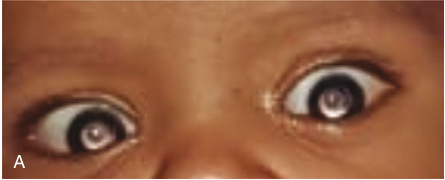

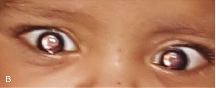

- **Fig. 21.12** Cataract in a patient with galactosemia. (A) central nuclear opacities detected using the redreflex test (B) gradual reduction in the density of the cataract after treatment of the metabolic defect. 

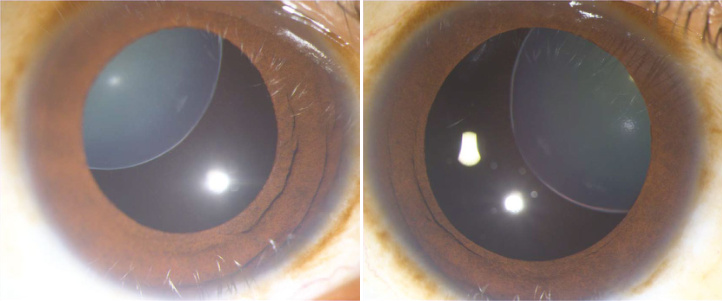

**Fig. 21.13** Microspherophakia. Magnified slit lamp images of right and left eye of a patient with congenital familial microspherophakia. Note the marked superotemporal subluxation of the lenses in both eyes. 

#### **TABLE 21.7** Commo Syndrome n Syndromes Associated With Ocular Findings Ectopia Lentis and Mic Common Extraocular Findings rospherophakia Causative Gene Clinical Pearl/ Implications

|Weill- Marchesani syndrome|Ectopia lentis, microspherophakia, high myopia, lens subluxation, shallow anterior chamber, glaucoma|Short stature, brachydactyly, joint stiffness, cardiac valve disease|_FBN1, ADAMTS10,_ _ADAMTS17_| Autosomal dominant and autosomal recessive; both inheritance patterns have similar presentations|
|---|---|---|---|---|
|Marfan syndrome|Ectopia lentis, microspherophakia, high myopia| Aortic dilatation, thin body habitus mitral valve prolapses|_FBN1_|_FBN1_variant testing is positive in>90% patients who fulfill diagnostic criteria|
|Alport syndrome|Microspherophakia, lenticonus|Hematuria/renal disease, hearing loss|_COL4A3, COL4A4_, _COL4A5_| Hearing loss frequently precedes renal disease|

or subluxation, and secondary glaucoma. Both EL and MSP can be inherited in AD and AR patterns or caused by pathogenic variants in single genes (Table 21.7). Examples include Weill-Marchesani syndrome (EL and MSP), Marfan syndrome (EL and MSP), and Alport syndrome (MSP). 

# **Early-Onset Retinal Disorders** 

## **Leber Congenital Amaurosis** 

Leber congenital amaurosis (LCA) is characterized by onset of severe visual impairment (SVI) from birth to the first 

few months of life that manifests as roving eye movements, nystagmus, poor pupillary responses to light (amaurotic pupils), and oculodigital signs such as poking, rubbing, and/or pressing on the eyes. Infants with LCA may have high hyperopia, or more rarely, high myopia. The diagnosis can be confirmed by an ophthalmology evaluation and electroretinogram (ERG). A retinal examination may appear normal in the early stages or show mild signs, such as retinal pigment epithelium (RPE) mottling and vessel narrowing. In older children, salt and pepper retinopathy, optic disc pallor, and retinal pigment clumping (including nummular and bone spicule) are frequently seen. An ERG

<!-- p.513 -->

can show undetectable or highly abnormal visual fields. LCA is responsible for 20% of childhood blindness, and prompt recognition is essential so that early interventions to maximize development can be initiated. LCA is considered part of a clinical spectrum that includes **early-onset severe retinal dystrophy (EOSRD)** that manifests with onset of symptoms prior to 5 years of age and a milder phenotype with variable preservation of vision. These two conditions affect an estimated 1 in 80,000 children worldwide. Patients with LCA and EOSRD do not typically have extraocular involvement, but the early onset of SVI can result in developmental delay, including difficulties with speech, social skills, and behavior. Management remains supportive with treatment of ocular complications of cataract, vitreoretinal interphase abnormalities, cystoid macular oedema, and keratoconus. Correction of refractive errors, use of low vision aids, avoidance of ultraviolet light, and optimal access to educational and work-related opportunities may be helpful. Gene therapy trials are in progress 

for several causative genes specifically _AIPL1_ and _RPE65_ , although these studies have been complicated by challenges gathering sufficient patient numbers, determining eligibility criteria, and identifying the optimal timing for treatment. Subretinal transplan tation of human embryonic stem cell derived RPE cells, opto-electronic devices that transform an electrical signal to an optical one, or vice versa, and optogenetic strategies that propose to repurpose bipolar cells and retinal ganglion cells to replace the malfunctioning photoreceptors may also prove useful as therapeutic options. 

LCA and EOSRD are highly heterogeneous, with at least 25 causative genes that typically result in similar clinical findings (Table 21.8). There may be genetic heterogenicity with other retinopathies (Fig. 21.14) 

The significant genetic heterogeneity for LCA and EOSRD necessitates a broad testing approach with a gene panel or next-generation sequencing with exome (ES) or genome sequencing (GS). GS has the advantage of identifying noncoding variants that have been described in some genes, 

#### **TABLE 21.8** Co mmon Causative Genes Associated With LCA an d EOSRD*

|Gene|Protein|Function|Frequency|Distinctive Clinical Findings|
|---|---|---|---|---|
|_CEP290_|Centrosomal protein 290 kDA|Photoreceptor ciliary transport|15–20%|Can be associated with renal disease|
|_GUCY2D_*|Guanylate cyclase-1|Phototransduction|10–20%|Relatively severe clinical findings; can have significant photophobia|
|_RDH12_|Retinol dehydrogenase 12|Retinoid cycle|10%|Early-dense intraretinal pigment migration. Maculopathy and early-onset severe retinal dystrophy are more common than Leber’s congenital amaurosis|
|_CRB1_|Crumbs homologue 1|Photoreceptor morphogenesis|10%|Nummular pigmentation, maculopathy, relative preservation of para-arteriolar retinal pigment epithelium, retinal thickening and loss of lamination|
|_RPE65_|Retinoid isomerase|Retinoid cycle|5–10%|Profound night-blindness from birth|
|_IMPDH1_|Inosine 5′-monophosphate dehydrogenase 1|Guanine synthesis|5%|Autosomal dominant inheritance, macular involvement in the first decade|
|_RPGRIP1_|Retinitis pigmentosa GTPase regulator- interacting protein 1|Photoreceptor ciliary transport|5%|Relatively stable clinical course|
|_AIPL1_|Aryl-hydrocarbon- interacting-protein-like 1|Phototransduction, protein biosynthesis|<5%|Relatively severe clinical findings|
|_SPATA7_|Spermatogenesis- associated protein 7|Photoreceptor ciliary transport|3%|Severe visual loss in infancy, photoreceptor structure in central retina may be preserved|
|_LCA5_|Libercilin|Photoreceptor ciliary transport|1–2%|Severe disease|
|_CRX_|Cone–rod homeobox|Photoreceptor morphogenesis|1%|Wide range of clinical presentations, including retinitis pigmentosa, Leber’s congenital amaurosis, cone-rod dystrophy, macular dystrophy, bull’s eye maculopathy|

*After Table 1, Kumaran N, Pennesi ME, Yang P, et al. Leber congenital amaurosis/early-onset severe retinal dystrophy overview. 2018 Oct 4 [updated March 23, 2023]. In: Adam MP, Mirzaa GM, Pagon RA, et al., eds. _GeneReviews®_ [Internet]. Seattle, WA: University of Washington, Seattle; 1993-2023. PMID: 30285347. Only genes with an estimated frequency >1% have been included.

<!-- p.514 -->

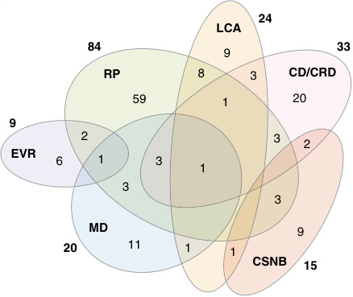

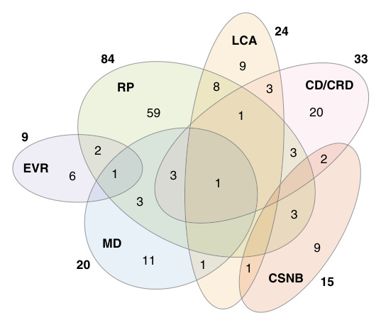

**Fig. 21.14** Genetic heterogeneity among the six major nonsyndromic inherited retinal diseases (IRDs). Numbers outside of the ellipses correspond to the number of nonsyndromic IRD genes responsible for the specific disease, while numbers within the ellipses correspond either to disease-specific genes or to genes with pathogenic variants in two or more diseases. The nonredundant total of genes associated with these nonsyndromic IRDs is 146. _CD/CRD,_ Cone dystrophy/cone-rod dystrophy; _CSNB,_ congenital stationary night blindness; _EVR,_ exudative vitreoretinopathy; _LCA,_ Leber congenital amaurosis; _MD,_ macular dystrophy; _RP,_ retinitis pigmentosa. (From Cremers FPM, Boon CJF, Bujakowska K, Zeitz C. Special issue introduction: inherited retinal disease: novel candidate genes, genotypephenotype correlations, and inheritance models. _Genes._ 2018;9: 215 [Fig. 1].) 

such as _CRB1_ , _GUCY2D_ , and _IFT140_ , and that would be less likely to be covered by panel testing. The commonest inheritance pattern for LCA and EOSRD is AR, but there are causative genes with AD inheritance patterns; genetic testing is required for accurate counseling regarding reproductive risks unless the family pedigree enables the inheritance pattern to be determined. 

LCA and EOSRD can be isolated ocular diagnoses, but retinal dystrophy is also be found in syndromes with systemic findings, such as **Joubert syndrome** and **Senior-Loken syndrome** (Table 21.9). Many of these syndromes are grouped as **ciliopathies** and have overlapping clinical findings and present with considerable variation (Chapters 6 and 7). Broad genetic testing with ES and GS will identify the syndromic presentations associated with LCA and EOSRD. 

## **Achromatopsia** 

Achromatopsia is a rare condition resulting from anatomical and functional defects of the retinal photoreceptors. Patients are unable to distinguish colors and have poor visual acuity in daylight, photophobia, and nystagmus that manifests at birth and in early infancy. Hyperopia is common; visual acuity usually remains stable. Most patients have complete achromatopsia with lack of function for all three types of cone (photopic) photoreceptors; in these patients, all visual functions are mediated by the rod (scotopic) photoreceptors. Best visual acuity varies with severity of the disease and can be 20/200 or less in complete achromatopsia; it may be as high as 20/80 in incomplete achromatopsia. Investigations show a severely reduced or 

#### **TABLE 21.9** Comm on Ciliopathy Syndrom es Associated With LCA an Common d EOSRD Clinical Pearl/

|Syndrome|Ocular Findings| Extraocular Findings|Causative Genes| Implications|
|---|---|---|---|---|
|Bardet-Biedl syndrome|Retinal dystrophy and constriction of the visual fields|Obesity, developmental delays, polydactyly, renal findings, hypogonadism|19 causative genes with AR inheritance. Commonest genes are _BBS1_and_BBS10_|Clinical features may become apparent with increasing age|
|COACH syndrome|Chorioretinal coloboma, optic nerve coloboma|Cerebellar vermis hypoplasia, oligophrenia, ataxia, coloboma, hepatic fibrosis|_TMEM67_|_TMEM67_variants are associated with numerous clinical presentations, including conditions with retinitis pigmentosa|
|Joubert syndrome|Retinal dystrophy, colobomas (typically chorioretinal), morning glory disc anomaly, ptosis, strabismus, and/or amblyopia; third cranial nerve palsy| Cerebellar and brainstem malformations (MRI molar tooth sign), encephalocele, hypotonia, DD/ID, episodic abnormal breathing, atypical eye movements, hepatic fibrosis|33 genes with AR inheritance and one X-linked gene_(OFD1)_. Common genes include _AHI1_,_CPLANE1_, _CC2D2A_,_CEP290_, _TMEM67_| Retinal dystrophy is found in 30% of patients with Joubert syndrome|
|Senior-Loken syndrome|LCA, EOSRD|Nephronophthisis|_CEP290_,_IQCB1_,_NPHP1_, _NPHP4_,_SDCCAG8_, _TRAF3IP1_,_WDR19_| A complete renal evaluation should be performed.|

<!-- p.515 -->

absent light-adapted ERG signal, although the scotopic ERG signal can be mildly abnormal or preserved. Examination of the fundus can show abnormalities of the central, or foveo-macular, region of the retina due to photoreceptor degeneration, such as loss of the foveal reflex, pigment mottling, loss of the cone outer segments, atrophy of the outer retina, hypopigmentation or loss of the RPE, and vessel narrowing. OCT can demonstrate macular defects. 

Achromatopsia demonstrates AR inheritance in most patients and pathogenic variants have been demonstrated in six genes: _CNGA3_ and _CNGB3_ which account for an estimated 80–90% of cases; _PDE6C_ , _GNAT2_ , _ATF6_ , and _PDE6H_ are less common. Carriers are typically unaffected. Digenic and triallelic inheritance patterns have rarely been described. Gene supplementation approaches, with injections of functional genes into the cone photoreceptors, are being evaluated and gene therapy trials are available for _CNGA3_ - and _CNGB3_ -related diseases. 

## **Congenital Stationary Night Blindness** 

Congenital stationary night blindness (CSNB) comprises a group of mainly nonprogressive, retinal disorders characterized by defects in visual signal transduction or transmission in the rod photoreceptors, the rod optic nerve bipolar cell synapses, or defective retinoid recycling in the retinal pigment epithelium. Patients often present with refractive errors (typically high myopia, with a median refractive error of −7.4 diopters), night blindness, strabismus, and nystagmus. Fundal examination is normal, but the condition can be diagnosed by full field ERG. 

An accurate clinical and genetic diagnosis is important because symptoms and clinical findings of CSNB may be mild, with a relatively benign course compared to progressive retinal dystrophies that can have a similar presentation. CSNB demonstrates genetic heterogeneity; it is caused by pathogenic variants in the _NYX_ (X-linked inheritance), _GRM6_ , _GPR179_ , _TRPM1_ , and _LRIT3_ genes. 

## **Persistent Hyperplastic Primary Vitreous** 

Persistent hyperplastic primary vitreous (PHPV), also known as persistent fetal vasculature, is a congenital condition resulting from failure of the embryonic hyaloid vascular system, or primary vitreous, to regress. Clinical findings are highly heterogeneous and include reduced vision with leukocoria and corneal haziness with a watery discharge, microphthalmos, and strabismus that are present within the first three months of life. An eye examination can show lenticular opacification with white retrolental tissue, a swollen lens, and centrally dragging ciliary structures (Fig. 21.15). Unilateral PHPV is more frequent than bilateral PHPV, which is often sporadic. PHPV can also be subdivided into anterior, posterior, and mixed subtypes with different clinical manifestations. The **anterior** form of PHPV presents as a shallow anterior chamber, engorged iris vessels, retrolental membrane, cataract, and/or elongation 

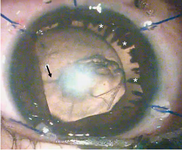

**Fig. 21.15** Anterior persistent fetal vasculature. Intraoperative photographs showing elongated ciliary processes (*), a microphakic lens with a central posterior capsular plaque, and a stalk of the persistent hyaloid artery _(black arrow)_ attached to it. 

of ciliary process, whereas the **posterior** form manifests a hyaloid stalk connecting the optic nerve head and the back surface of the lens, vitreous traction, an epiretinal membrane, and optic nerve hypoplasia. 

PHPV can be diagnosed by ocular ultrasound scan, OCT, and cerebral imaging with computerized tomography or magnetic resonance imaging scans. The differential diagnosis includes retinoblastoma, retinopathy of prematurity, vitreoretinal dysplasia, and infection. Management options range from conservative treatment for mildly affected patients; surgical intervention with anterior and posterior capsulotomy and anterior vitrectomy may be required for moderate and severe disease. PHPV has been associated with maternal exposures (alcohol, clomiphene), perinatal infections, metabolic disease, and numerous syndromes. _TP53, VEGFA, SMAD2, CDKN2A, FOXC, FZD4, LRP5, KDR, FZD5, PAX6, MYCN, NDP, PITX2_ , and _PAX2_ have been considered as candidate genes, but the genetic etiology is largely unknown. In addition, there is an association with trisomy 13, Norrie disease, Warburg syndrome, incontinentia pigmenti, and cerebro-oculo-dysplasia muscular dystrophy. 

## **Familial Exudative Vitreoretinopathy** 

Familial exudative vitreoretinopathy (FEVR) is a clinically and genetically heterogeneous disorder of retinal blood vessel development that predominantly affects retinal angiogenesis and leads to incomplete vascularization of the peripheral retina with poor vascular differentiation. The clinical presentation ranges from asymptomatic to severe visual dysfunction, is frequently asymmetric, and can cause symptoms at any age. Retinal detachments are common, and patients with severe FEVR can develop radial folds in the retina due to tractional retinal detachments. Approximately 50% of patients with FEVR have pathogenic variants in the _NDP_ , _FZD4_ , _LRP5_ , _TSPAN12_ , and _ZN408_ genes. There can be marked clinical variability in different family members.

<!-- p.516 -->

**Norrie disease** is a rare, X-linked disorder that belongs to the same phenotypic spectrum as FEVR. Males present with bilateral leukocoria and nystagmus in infancy and have BL/SVI. Other eye findings include vitreous hemorrhage, retinal folds, and dysplasia that can progress to retinal detachment. Norrie disease is caused by pathogenic variants in the _NDP_ gene. It is important to recognize this diagnosis because _NDP_ -related retinopathy can be associated with systemic findings of DD and ID, seizures, sensorineural hearing loss, and peripheral vascular disease. **Osteoporosis pseudoglioma syndrome (OPPG)** comprises osteoporosis with ocular findings resembling severe FEVR and is most frequently caused by pathogenic variants in the _LRP5_ gene. Investigation with bone densitometry has been recommended for patients with FEVR who cannot undergo molecular genetic testing because treatment with bisphosphonates is available for OPPG syndrome. 

## **Retinopathy of Prematurity (ROP)** 

ROP is a vasoproliferative disorder of the premature retina that can progress to extraretinal neovascularization, leading to retinal detachment and impaired vision (Fig. 21.16). ROP results from an early transition from the intra-to the extrauterine environment, which disrupts oxygenation and vascular development of the retina. It is a frequent cause of BL/SVI in preterm babies and up to 4% of 

babies with a birth weight under 1,500 grams can require treatment. It is traditionally diagnosis by fundoscopy (Fig. 21.17) but can also be identified using digital retinal imaging. ROP can be treated by intravitreal injection of anti-VEGF antibodies and/or laser ablation of the avascular retina. 

## **Foveal Hypoplasia** 

Foveal hypoplasia refers to incomplete development of the foveal architecture, with absence of the foveal depression, lengthening of the outer segments of the photoreceptors, and widening of the outer nuclear layer with continuity of inner retinal layers (Fig. 21.18). Foveal hypoplasia can be associated with **albinism** and pathogenic variants in _PAX6_ ; rarely, pathogenic variants in _SLC38A8_ and _FRMD7_ are identified. Foveal architecture can also be abnormal in retinal dystrophies, achromatopsia, and conditions associated with early onset of retinal degeneration. 

# **Optic Nerve Disorders** 

## **Hereditary Optic Nerve Hypoplasia/Atrophies and Congenital Anomalies of the Optic Nerve** 

Conditions involving optic nerve hypoplasia (ONH) frequently present with visual impairment and refractive 

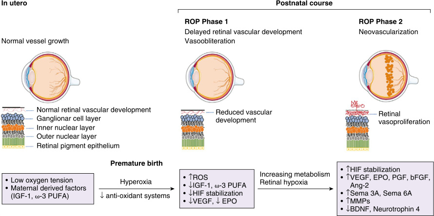

**Fig. 21.16** Schematic representation of the main events implicated in the pathogenesis of retinopathy of prematurity. _Ang-2,_ Angiopoietin 2; _BDNF,_ brain-derived neurotrophic factor; _bFGF,_ basic fibroblast growth factor; _EPO,_ erythropoietin; _HIF,_ hypoxia-inducible factor; _IGF-1,_ insulin-like growth factor-1; _MMPs,_ matrix metalloproteinases; _v3-PUFA_ , omega-3 polyunsaturated fatty acids; _ROP,_ retinopathy of prematurity; _ROS,_ reactive oxygen species; _Sema,_ semaphorin; _VEGF,_ vascular endothelial growth factor.  (From Fevereiro-Martins M, Marques-Neves C, Guimarães H, Bicho M. Retinopathy of prematurity: a review of pathophysiology and signalling pathways. _Survey Ophthalmol_ . 2023;68:175-210 [Fig. 2, p. 178].)

<!-- p.517 -->

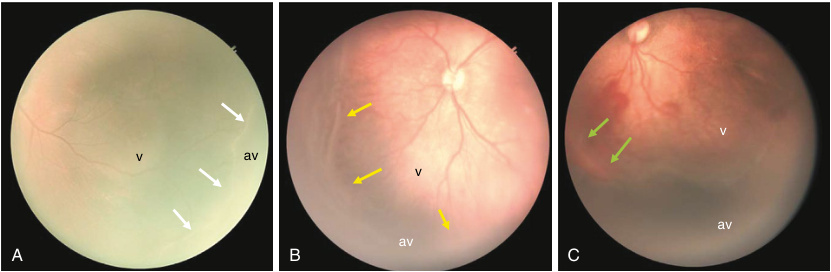

**Fig. 21.17** Retinopathy of prematurity (ROP). (A) shows stage 1 ROP with a demarcation line _(white arrows)_ between avascular (av) and vascular retina (v). (B) shows stage 2 ROP, wherein a ridge _(yellow arrows)_ forms between the avascular and vascular retina. (C) shows stage 3 ROP, in which new vessel fronds arise from the ridge _(green arrow)_ . This image also shows vascular tortuosity and dilation, denoting “plus” disease. 

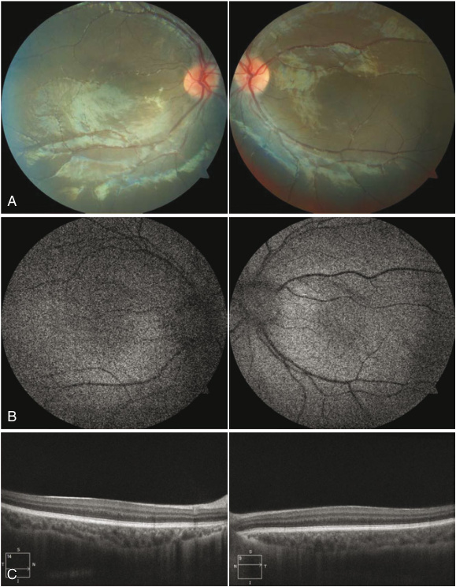

**Fig. 21.18** Isolated foveal hypoplasia. (A) is color fundus photograph of right and left eye showing the absence of foveal depression. (B) is the corresponding fundus autofluorescence images showing the absence of the foveal avascular zone (normally seen as a dark area in the center). (C) shows enhanced depth imaging optical coherence tomography scan through the posterior pole of the fundus. There is complete absence of the foveal contour and no differentiation of the retinal layers at the fovea.

<!-- p.518 -->

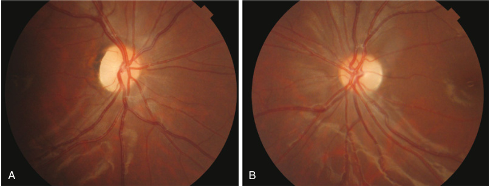

**Fig. 21.19** Hereditary optic atrophy. (A) and (B) are color fundus photographs of the right and the left eye showing pallor of the optic nerve head. The remainder of the fundus is normal. 

errors, nystagmus, strabismus (both exotropia and esotropia), and optic nerve pallor. Visual ability ranges from normal to BL/SVI. A small optic disc is seen on funduscopic examination. Bilateral ONH is more common than unilateral involvement. ONH can be an isolated ocular finding but is frequently associated with **septo-optic dysplasia (SOD)** which comprises a clinical triad with ONH, pituitary hypoplasia with hypopituitarism, and structural brain anomalies involving the midline (absence of the septum pellucidum and hypoplasia or absence of the corpus callosum). Patients with SOD may manifest intellectual disability, autism, and seizures due to brain malformations. 

ONH results from a reduced number of optic nerve axons and can represent a nonprogressive and nonspecific manifestation of axonal damage. Although pathogenic variants in _HESX1_ and other genes have been described, the underlying genetic etiology is usually not identified. Younger maternal age and primigravid status have been identified as risk factors. 

**Leber hereditary optic neuropathy (LHON)** is a _mitochondrial (MT-ND1, MT-ND4, MT-ND4L, MTND6)_ condition associated with visual loss due to optic atrophy that is caused by selective neurodegeneration of retinal ganglion cells. LHON presents with subacute loss of central vision at age 10–30 years of age and progresses within weeks or months; neurological abnormalities with postural tremor, peripheral neuropathy, nonspecific myopathy, and movement disorders have also been reported in patients with **LHON plus** (Chapter 22). LHON is maternally inherited; it is more severe in males, although reduced penetrance has also been described. 

Treatment with idebenone may be beneficial if started early in relation to the onset of vision loss. 

**Autosomal dominant optic atrophy** presents in early childhood as a slowly progressive decrease in vision involving the central visual fields and color vision. Visual loss is variable in severity and rate of progression and patients typically experience moderate and irreversible loss. A distinctive pattern of temporal pallor of the optic nerves may be seen on fundoscopy (Fig. 21.19). This form of optic neuropathy results from impaired retinal ganglion cell function and can be caused by monoallelic or biallelic variants in the _OPA1_ gene. Biallelic pathogenic variants in _OPA1_ are typically associated with more severe disease, termed Behr syndrome. 

## **Cerebral Visual Impairment** 

Cerebral visual impairment (CVI) is defined as a confirmable visual dysfunction that cannot be attributed to disorders of the anterior visual pathways or any potentially co-occurring ocular impairment. CVI is a leading cause of visual impairment in children and is frequently associated with additional comorbidities, such as hypoxic-ischemic encephalopathy, preterm birth, cerebral palsy hydrocephalus, periventricular leukomalacia, CNS infections, nonaccidental trauma, and optic nerve atrophy (Tables 21.10 and 21.11). Although CVI is frequently considered a diagnosis of exclusion and approaches for diagnosis and management are not standardized, a multidisciplinary assessment and early intervention are recommended to optimize visual outcomes.

<!-- p.519 -->

##### **TABLE 21.10** 

### **Etiologies of Pediatric Cortical Visual Impairment** 

**Brain Tumor Posterior Reversible Encephalopathy Syndrome** **<u>(PRES)</u> Central Nervous System Malformations Seizures, Especially Infantile Spasms** Colpocephaly **Toxins and Drugs** Cortical dysplasia Carbon monoxide Hemimegalencephaly Cisplatin Holoprosencephaly Ciprofloxacin Lissencephaly Cyclosporine Pachygyria Intrauterine drug exposure, especially cocaine Polymicrogyria Lead Porencephalic cyst Mercury Schizencephaly **Hydrocephalus** Methamphetamine **Hypoxic-Ischemic Encephalopathy** Methotrexate Perinatal, especially in prematurity with periventricular Metronidazole leukomalacia Nitrous oxide Postnatal (e.g., cardiac arrest and cardiac surgery) Snake bite **Infections** Tacrolimus Intrauterine (TORCH infections, Zika virus) Vincristine Postnatal (meningitis, encephalitis, subacute sclerosing panencephalitis, progressive multifocal **Trauma** leukoencephalopathy, cerebral malaria) **Twin-twin Transfusion Syndrome** 

#### **Metabolic and Genetic Disorders (Table 21.11)** 

_TORCH,_ Toxoplasmosis, other (syphilis), rubella, cytomegalovirus, herpesvirus. From Chang MY, Borchert MS. Advances in the evaluation and management of cortical/cerebral visual impairment in children. _Surv Ophthal._ 2020;65:708-724 (Table 1, p. 713). 

#### **TABLE 21.11** Genetic and Metabolic Disorders Reported in Association With Pediatric Cortical Visual Impairment

|15q13.3 microdeletion syndrome|Congenital disorders of glycosylation|
|---|---|
|1p36 deletion syndrome|Congenital hypotonia, epilepsy, developmental delay, and |
|22q13.3 deletion syndrome (Phelan McDermid syndrome)|digital anomalies|
|3p deletion syndrome|Cri du chat syndrome|
|9p deletion syndrome|D2-hydroxyglutaric aciduria|
|5,10-methenyltetrahydrofolate synthetase deficiency|De Grouchy syndrome i|
|Aicardi syndrome|Dihydropyrimidine dehydrogenase deficiency|
|Alpha-thalassemia X-linked disability syndrome|Glycosylphosphatidylinositol biosynthesis defects|
|Aromatic decarboxylase deficiency|Helsmoortel-van der Aa syndrome (ADNP syndrome)|
|Bosch-Boonstra-Schaaf optic atrophy syndrome|Hemolytic-uremic syndrome|
|Citrullinemia|Hypoglycemia|
|Coffin-Siris syndrome|Incontinentia pigmenti|
|Cohen syndrome|Infantile neuroaxonal dystrophy|

_(Continued)_

<!-- p.520 -->

### **TABLE Genetic and Metabolic Disorders Reported in Association With Pediatric Cortical Visual 21.11 Impairment—cont’d** 

##### **TABLE** 

|Intermittent porphyria|Trisomy 21|
|---|---|
|KAT6A syndrome (Arboleda-Tham syndrome: ARTHS)|Tuberous sclerosi|
|Maple syrup urine disease|Vanishing white matter disease|
|Marden-Walker syndrome|Wolf-Hirschhorn syndrome|
|Megalencephaly-polymicrogyria-polydactyly-hydrocephalus |X-linked adrenoleukodystrophy|
|syndrome|Xia-Gibbs syndrome|
|Menkes syndrome|You-Hoover-Fong syndrome|
|Metachromatic leukodystrophy| Zhu-Tokita-Takenouchi-Kim syndrome|
|Miller-Dieker syndrome|Other gene variants|
|Mitochondrial disorders, especially Leigh syndrome|_COL4A3BP_|
|Mowat-Wilson syndrome|_DIAPH1_|
|Mucopolysaccharidoses, especially Hurler syndrome|_FARS2_|
|Neuronal ceroid lipofuscinosis|_GRIN1_|
|Optiz C syndrome i|_GRIN2B_|
|Ornithine transcarbamylase deficiency|_GNB1_|
|Pallister-Killian syndrome|_HECW2_|
|Pelizaeus-Merzbacher syndrome|_HSPE1_|
|Pitt-Hopkins syndrome|_KIF1A_|
|Pontocerebellar hypoplasia|_MAPK8IP_|
|Proliferative vasculopathy and hydranencephaly-hydrocephaly syndrome (Fowler syndrome)|_PGAP_|
|Propionic acidemia|_PURA_|
|Renal failure and hemodialysis|_PSMD12_|
|Rett syndrome|_QAR_|
|Sotos syndrome|_RER_|
|Squalene synthase deficiency|_SPATA5_|
|Tay-Sachs disease|_SPTBN_ _TRAPPC2L_|

From Chang MY, Borchert MS. Advances in the evaluation and management of cortical/cerebral visual impairment in children. _Surv Ophthal._ 2020;65:708-724 (Table 2, p. 714). 

# **Acknowledgment** 

Dr. Julie Pegu (Head of Glaucoma Services, Dr. Shroff's Charity Eye Hospital) and Dr. Shalini Singh (Senior Consultant, Department of Retina) for contributing photographs in Figures 21.7, 21.2, 21.17. 

# **Bibliography** 

- Ackland P, Resnikoff S, Bourne R. World blindness and visual impairment: despite many successes, the problem is growing. _Community Eye Health_ . 2017;30(100):71-73. 

- GBD 2019 Blindness and Vision Impairment Collaborators; Vision Loss Expert Group of the Global Burden of Disease Study. Causes of blindness and vision impairment in 2020 and trends over 

30 years, and prevalence of avoidable blindness in relation to VISION 2020: the Right to Sight: an analysis for the Global Burden of Disease Study. _Lancet Glob Health_ . 2021;9(2):e144-e160. Erratum in: _Lancet Glob Health_ . 2021;9(4):e408. 

- Israeli A, Peer H, Gleitman I, Falick Y, Mezer E. Childhood blindness incidence and aetiologies trends in Israel 20142020: what should we focus on? _Eye (Lond)_ . 2023;37(12): 2559-2564.

<!-- p.521 -->

- Sia DI, Muecke J, Hammerton M, Ngy M, Kong A, Morse A, Holmes M, Piseth H, Hamilton C, Selva D. A survey of visual impairment and blindness in children attending four schools for the blind in Cambodia. _Ophthalmic Epidemiol_ . 2010;17(4): 225-233. 

- Sitorus RS, Abidin MS, Prihartono J. Causes and temporal trends of childhood blindness in Indonesia: study at schools for the blind in Java. _Br J Ophthalmol_ . 2007;91(9):1109-1113. 

- Solebo AL, Teoh L, Rahi J. Epidemiology of blindness in children. _Arch Dis Child_ . 2017;102(9):853-857. Erratum in: _Arch Dis Child_ . 2017;102(10):995. 

- Teoh LJ, Solebo AL, Rahi JS, British Childhood Visual Impairment and Blindness Study Interest Group. Temporal trends in the epidemiology of childhood severe visual impairment and blindness in the UK. _Br J Ophthalmol_ . 2023;107(5):717-724. 

- World Health Organization. _Global Initiative for the Elimination of Avoidable Blindness: Action Plan 2006-2011_ . World Health Organization; 2007. https://apps.who.int/iris/handle/10665/43754 

#### **_MAC_** 

- Bardakjian TM, Schneider A. The genetics of anophthalmia and microphthalmia. _Curr Opin Ophthalmol_ . 2011;22(5):309-313. 

- Dahlmann-Noor A, Tailor V, Abou-Rayyah Y, et al. Functional vision and quality of life inchildren with microphthalmia/anophthalmia/ coloboma-a cross-sectional study. _J AAPOS_ . 2018;22(4):281-285.e1. 

- Forrester MB, Merz RD. Descriptive epidemiology of anophthalmia and microphthalmia, Hawaii, 1986–2001. _Birth Defects Res A Clin Mol Teratol_ . 2006;76(3):187-192. 

- Happle R. Gustav Schimmelpenning and the syndrome bearing his name. _Dermatology_ . 2004;209:84-87. 

- Harding P, Brooks BP, FitzPatrick D, Moosajee M. Anophthalmia including next-generationsequencing-based approaches. _Eur J Hum Genet_ . 2020;28(3):388-398. 

- Hornby SJ, Ward SJ, Gilbert CE, Dandona L, Foster A, Jones RB. Environmental risk factors incongenital malformations of the eye. _Ann Trop Paediatr_ . 2002;22(1):67-77. 

- Jackson D, Malka S, Harding P, Palma J, Dunbar H, Moosajee M. Molecular diagnosticchallenges for non-retinal developmental eye disorders in the United Kingdom. _Am J Med Genet C Semin Med Genet_ . 2020;184(3):578-589. 

- Lingam G, Sen AC, Lingam V, Bhende M, Padhi TR, Xinyi S. Ocular coloboma—a comprehensive review for the clinician. _Eye (Lond)_ . 2021;35(8):2086-2109. 

- Moosajee M, Gregory-Evans CY. Advances in the molecular genetics of ocular coloboma. _Expert Rev Ophthalmol_ . 2006;1(2):209-227. 

- Morrison D. National study of microphthalmia, anophthalmia, and coloboma (MAC) in Scotland: investigation of genetic aetiology. _J Med Genet_ . 2002;39(1):16-22. 

- Nakamura KM. Incidence, ocular findings, and systemic associations of ocular coloboma. _Arch Ophthalmol_ . 2011;129(1):69. 

- Neto MPDS, Assis BR, Andrade GR. Sebaceous nevus of Jadassohn: review and clinical-surgical approach. _An Bras Dermatol_ . 2022; 97(5):628-636. 

- Plaisancié J, Ceroni F, Holt R, et al. Genetics of anophthalmia and microphthalmia. Part 1: non-syndromic anophthalmia/ microphthalmia. _Hum Genet_ . 2019;138(8-9):799-830. 

- Rahi JS, Sripathi S, Gilbert CE, Foster A. The importance of prenatal factors in childhood blindness in India. _Dev Med Child Neurol_ . 1997;39(7):449-455. 

- Reis LM, Semina EV. Conserved genetic pathways associated with microphthalmia, anophthalmia, and coloboma. _Birth Defects Res C Embryo Today_ . 2015;105(2):96-113. 

- Shah SP, Taylor AE, Sowden JC, et al. Anophthalmos, microphthalmos, and typical coloboma in the United Kingdom: a prospective study of incidence and risk. _Invest Ophthalmol Vis Sci_ . 2011; 52(1):558. 

- Skalicky SE, White AJR, Grigg JR, et al. Microphthalmia, anophthalmia, and coloboma and associated ocular and systemic features. _JAMA Ophthalmol_ . 2013;131(12):1517. 

- Slavotinek A. Genetics of anophthalmia and microphthalmia. Part 2: syndromes associated with anophthalmia–microphthalmia. _Hum Genet_ . 2019;138(8-9):831-846. 

- Slavotinek AM. Eye development genes and known syndromes. _Mol Genet Metab_ . 2011;104(4):448-456. 

- Tibrewal S, Subhedar K, Sen P, et al. Clinical spectrum of nonsyndromic microphthalmos, anophthalmos and coloboma in the paediatric population: a multicentric study from North India. _Br J Ophthalmol_ . 2021;105(7):897-903. 

- Tripathy K, Chawla R, Sharma YR, et al. Prophylactic laser photocoagulation of fundal coloboma: does it really help? _Acta Ophthalmol_ . 2016;94(8):e809-e810. 

- Uhumwangho OM, Jalali S. Chorioretinal coloboma in a paediatric population. _Eye (Lond)_ . 2014;28(6):728-733. 

- Williamson KA, FitzPatrick DR. The genetic architecture of microphthalmia, anophthalmia and coloboma. _Eur J Med Genet_ . 2014; 57(8):369-380. 

#### **_Aniridia_** 

- Ajitkumar A, Yarrarapu SNS, Ramphul K. Chediak-Higashi syndrome. In: _StatPearls_ [Internet]. Treasure Island, FL: StatPearls Publishing; 2023. 

- Bushby K, Finkel R, Wong B, et al. Ataluren treatment of patients with nonsense mutation dystrophinopathy. _Muscle Nerve_ . 2014; 50(4):477-487. 

- Casas-Llera P, Siverio A, Esquivel G, Bautista C, Alió JL. Spectraldomain optical coherence tomography foveal morphology as a prognostic factor for vision performance in congenital aniridia. _Eur J Ophthalmol_ . 2020;30(1):58-65. 

- Chang JW, Kim JH, Kim SJ, Yu YS. Congenital aniridia: long-term clinical course, visual outcome, and prognostic factors. _Korean J Ophthalmol_ . 2014;28(6):479-485. 

- Grønskov K, Olsen JH, Sand A, et al. Population-based risk estimates of Wilms tumor in sporadic aniridia. A comprehensive mutation screening procedure of PAX6 identifies 80% of mutations in aniridia. _Hum Genet_ . 2001;109:11-18. 

- Hingorani M, Williamson KA, Moore AT, van Heyningen V. Detailed ophthalmologic evaluation of 43 individuals with PAX6 mutations. _Invest Ophthalmol Vis Sci_ . 2009;50(6):2581-2590. 

- Hingorani M, Hanson I, van Heyningen V. Aniridia. _Eur J Hum Genet_ . 2012;20(10):1011-1017. 

- Kokotas H, Petersen M. Clinical and molecular aspects of aniridia. _Clin Genet_ . 2010;77(5):409-420. 

- Kremer I, Rajpal RK, Rapuano CJ, Cohen EJ, Laibson PR. Results of penetrating keratoplasty in aniridia. _Am J Ophthalmol_ . 1993; 115(3):317-320. 

- Lagali N, Wowra B, Fries FN, et al. PAX6 Mutational status determines aniridia-associated keratopathy phenotype. _Ophthalmology_ . 2020;127:273-275. 

- Landsend ECS, Pedersen HR, Utheim ØA, et al. Characteristics and utility of fundus autofluorescence in congenital aniridia using scanning laser ophthalmoscopy. _Invest Ophthalmol Vis Sci_ . 2019; 60(13):4120-4128. 

- Landsend ECS, Lagali N, Utheim TP. Congenital aniridia—A comprehensive review of clinical features and therapeutic approaches. _Surv Ophthalmol_ . 2021;66(6):1031-1050.

<!-- p.522 -->

- López-García JS, Rivas L, García-Lozano I, Murube J. Autologous serum eyedrops in the treatment of aniridic keratopathy. _Ophthalmology_ . 2008;115(2):262-267. 

- McEntagart M, Williamson KA, Rainger JK, et al. A restricted repertoire of De Novo mutations in ITPR1 cause Gillespie Syndrome with evidence for dominant-negative effect. _Am J Hum Genet_ . 2016;98(5):981-992. 

- Nelson LB, Spaeth GL, Nowinski TS, Margo CE, Jackson L. Aniridia. A review. _Surv Ophthalmol_ . 1984;28(6):621-642. 

- Neuhann IM, Neuhann TF. Cataract surgery and aniridia. _Curr Opin Ophthalmol_ . 2010;21(1):60-64. 

- Pedersen HR, Hagen LA, Landsend ECS, et al. Color vision in aniridia. _Invest Ophthalmol Vis Sci_ . 2018;59(5):2142-2152. 

- Ratna R, Tibrewal S, Gour A, Gupta R, Mathur U, Vanita V. A rare case of congenital aniridia with an unusual run-on mutation in PAX6 gene. _Indian J Ophthalmol_ . 2022;70(7):2661-2664. 

- Robinson DO, Howarth RJ, Williamson KA, van Heyningen V, Beal SJ, Crolla JA. Genetic analysis of chromosome 11p13 and the PAX6 gene in a series of 125 cases referred with aniridia. _Am J Med Genet A_ . 2008;146A:558-569. 

- Roux LN, Petit I, Domart R, et al. Modeling of aniridia-related keratopathy by CRISPR/Cas9 genome editing of human limbal epithelial cells and rescue by recombinant PAX6 protein. _Stem Cells_ . 2018;36(9):1421-1429. 

- Samant M, Chauhan BK, Lathrop KL, Nischal KK. Congenital aniridia: etiology, manifestations and management. _Expert Rev Ophthalmol_ . 2016;11(2):135-144. 

- Sihota R, Selvan H, Azmira K, et al. Improving long-term intraocular pressure and visual outcomes in eyes with aniridic glaucoma. _Graefes Arch Clin Exp Ophthalmol_ . 2021;259(12):3749-3755. 

- Tibrewal S, Ratna R, Gour A, et al. Clinical and molecular aspects of congenital aniridia—A review of current concepts. _Indian J Ophthalmol_ . 2022;70(7):2280-2292. 

- Vásquez Quintero A, Pérez-Merino P, Fernández García AI, De Smet H. Smart contact lens: a promising therapeutic tool in aniridia. _Arch Soc Esp Oftalmol (Engl Ed)_ . Published online February 21, 2021. English, Spanish. 

- Weissbart SB, Ayres BD. Management of aniridia and iris defects: an update on iris prosthesis options. _Curr Opin Ophthalmol_ . 2016; 27(3):244-249. 

- Wiggins RE, Tomey KF. The results of glaucoma surgery in aniridia. _Arch Ophthalmol_ . 1992;110:503-505. 

#### **_Albinism_** 

- Apkarian P. A practical approach to albino diagnosis. VEP misrouting across the age span. _Ophthalmic Paediatr Genet_ . 1992;13(2):77-88. 

- Castori M, Morrone A, Kanitakis J, Grammatico P. Genetic skin diseases predisposing to basal cell carcinoma. _Eur J Dermatol_ . 2012; 22:299-309. 

- Dessinioti C, Stratigos AJ, Rigopoulos D, Katsambas AD. A review of genetic disorders of hypopigmentation: lessons learned from the biology of melanocytes. _Exp Dermatol_ . 2009; 18:741-749. 

- Drager UC, Olsen JF. Origins of crossed and uncrossed retinal projections in pigmented and albino mice. _J Comp Neurol_ . 1980;191(3): 383-412. 

- Dysli M, Abegg M. Nystagmus does not limit reading ability in albinism. _PLoS One_ . 2016;11(7):e0158815. 

- Federico JR, Krishnamurthy K. Albinism. [Updated August 22, 2022]. In: _StatPearls_ [Internet]. Treasure Island, FL: StatPearls Publishing; 2023. https://www.ncbi.nlm.nih.gov/books/NBK519018/ 

- Grønskov K, Ek J, Brondum-Nielsen K. Oculocutaneous albinism. _Orphanet J Rare Dis_ . 2007;2:43. 

- Grønskov K, Dooley CM, Østergaard E, Kelsh RN, Hansen L, Levesque MP. Mutations in c10orf11, a melanocyte-differentiation gene, cause autosomal-recessive albinism. _Am J Hum Genet_ . 2013;92:415-421. 

- Guillery RW, Hickey TL, Kaas JH, Felleman DJ, Debruyn EJ, Sparks DL. Abnormal central visual pathways in the brain of an albino green monkey (Cercopithecus aethiops). _J Comp Neurol_ . 1984; 226(2):165-183. 

- Hertle RW. Albinism: particular attention to the ocular motor system. _Middle East Afr J Ophthalmol_ . 2013;20(3):248-255. 

- Hu Z, Wang K, Bertsch M, et al. Correlation between electroretinography, foveal anatomy and visual acuity in albinism. _Doc Ophthalmol_ . 2019;139(1):21-32. 

- Hutton SM, Spritz RA. Comprehensive analysis of oculocutaneous albinism among non-Hispanic Caucasians shows that OCA1 is the most prevalent OCA type. _J Invest Dermatol_ . 2008;128:2442-2450. 

- Inagaki K, Suzuki T, Shimizu H, Ishii N, Umezawa Y, Tada J. Oculocutaneous albinism type 4 is one of the most common types of albinism in Japan. _Am J Hum Genet_ . 2004;74:466-471. 

- Introne WJ, Huizing M, Malicdan MCV, O’Brien KJ, Gahl WA. Hermansky-Pudlak syndrome. In: Adam MP, Mirzaa GM, Pagon RA, et al., eds. _GeneReviews®_ . Seattle, WA: University of Washington, Seattle; July 24, 2000. 

- Kausar T, Bhatti MA, Ali M, Shaikh RS, Ahmed ZM. OCA5, a novel locus for non-syndromic oculocutaneous albinism, maps to chromosome 4q24. _Clin Genet_ . 2013;84:91-93. 

- Khan KN, Lord EC, Arno G, et al. Detailed retinal imaging in carriers of ocular albinism. _Retina_ . 2018;38:620-628. 

- King RA, Summers CG. Albinism: ocular and oculocutaneous Albinism and Hermansky–Pudlak syndrome. In: Cassidy SB, Allanson JE, eds. _Management of Genetic Syndromes_ . Wiley; 2010:53-68. 

- Kruijt CC, Gradstein L, Bergen AA, et al. The phenotypic and mutational spectrum of the FHONDA syndrome and oculocutaneous albinism: similarities and differences. _Invest Ophthalmol Vis Sci_ . 2022;63(1):19. 

- Lee DJ, Woertz EN, Visotcky A, et al. The Henle fiber layer in albinism: comparison to normal and relationship to outer nuclear layer thickness and foveal cone density. _Invest Ophthalmol Vis Sci_ . 2018;59(13):5336-5348. 

- Liasis A, Handley SE, Nischal KK. Occipital Petalia and Albinism: a study of interhemispheric VEP asymmetries in albinism with no nystagmus. _J Clin Med_ . 2019;8(6):802. 

- Ma VK, Mao R, Toth JN, Fulmer ML, Egense AS, Shankar SP. Prader-Willi and Angelman syndromes: mechanisms and management. _Appl Clin Genet_ . 2023;16:41-52. 

- Mabula JB, Chalya PL, Mchembe MD, Jaka H, Giiti G, Rambau P. Skin cancers among albinos at a university teaching hospital in Northwestern Tanzania: a retrospective review of 64 cases. _BMC Dermatol_ . 2012;12:5. 

- Mahajan V, Sood S, Das R. End-stage renal disease in Griscelli syndrome. _Indian J Nephrol_ . 2022;32(5):521-522. 

- Marçon CR, Maia M. Albinism: epidemiology, genetics, cutaneous characterization, psychosocial factors. _An Bras Dermatol_ . 2019; 94(5):503-520. 

- Margolis SS, Sell GL, Zbinden MA, Bird LM. Angelman syndrome. _Neurotherapeutics_ . 2015;12(3):641-650. 

- Morice-Picard F, Lasseaux E, François S, Simon D, Rooryck C, Bieth E. SLC24A5 mutations are associated with non-syndromic oculocutaneous albinism. _J Invest Dermatol_ . 2014;134:568-571.

<!-- p.523 -->

- Neveu MM, Padhy SK, Ramamurthy S, et al. Ophthalmological manifestations of oculocutaneous and ocular albinism: current perspectives. _Clin Ophthalmol_ . 2022;16:1569-1587. 

- Pacoricona Alfaro DL, Lemoine P, Ehlinger V, et al. Causes of death in Prader-Willi syndrome: lessons from 11 years’ experience of a national reference center. _Orphanet J Rare Dis_ . 2019;14(1):238. 

- Pennamen P, Tingaud-Sequeira A, Gazova I, et al. Dopachrome tautomerase variants in patients with oculocutaneous albinism. _Genet Med_ . 2021;23:479-487. 

- Puri N, Durbam-Pierre D, Aquaron R, Lund PM, King RA, Brilliant MH. Type 2 oculocutaneous albinism (OCA2) in Zimbabwe and Cameroon: distribution of the 2.7 kb deletion allele of the P gene. _Hum Genet_ . 1997;100:651-656. 

- Rachel RA, Dolen G, Hayes NL, et al. Spatiotemporal features of early neuronogenesis differ in wild-type and albino mouse retina. _J Neurosci_ . 2002;22(11):4249-4263. 

- Rooryck C, Morice-Picard F, Elçioglu NH, Lacombe D, Taieb A, Arveiler B. Molecular diagnosis of oculocutaneous albinism: new mutations in the OCA1-4 genes and practical aspects. _Pigment Cell Melanoma Res_ . 2008;21:583-587. 

- Scheinfeld NS. Syndromic albinism: a review of genetics and phenotypes. _Dermatol Online J_ . 2003;9(5):5. 

- Schweigert A, Lunos S, Connett J, Summers CG. Changes in refractive errors in albinism: a longitudinal study over the first decade of life. _J AAPOS_ . 2018;22(6):462-466. 

- Sengupta M, Sarkar D, Mondal M, Samanta S, Sil A, Ray K. Analysis of MC1R variants in Indian oculocutaneous albinism patients: highlighting the risk of skin cancer among albinos. _J Genet_ . 2013; 92:305-308. 

- Stevens G, Ramsay M, Jenkins T. Oculocutaneous albinism (OCA2) in sub-Saharan Africa: distribution of the common 2.7 kb P gene deletion mutation. _Hum Genet_ . 1997;99:523-527. 

- Tajik S, Badalzadeh M, Houshmand M, et al. Molecular findings and clinical manifestations of 18 Iranian children with Griscelli syndrome type 2: two novel homozygote mutations in RAB27A gene in a patient. _Scand J Immunol_ . 2023;97(5):e13264. 

- Tsang SH, Sharma T. X-linked ocular albinism. _Tissue Eng_ . 2018; 1085:49-52. 

- Volk AE, Hedergott A, Preising M, et al. Biallelic mutations in L-dopachrome tautomerase (DCT) cause infantile nystagmus and oculocutaneous albinism. _Hum Genet_ . 2021;140:1157-1168. 

- Wei AH, Zang DJ, Zhang Z, Liu XZ, He X, Yang L. Exome sequencing identifies SLC24A5 as a candidate gene for nonsyndromic oculocutaneous albinism. _J Invest Dermatol_ . 2013;133:1834-1840. 

- Wildsoet CF, Oswald PJ, Clark S. Albinism: its implications for refractive development. _Invest Ophthalmol Vis Sci_ . 2000;41(1):1-7. 

- Williams CA, Beaudet AL, Clayton-Smith J, et al. Angelman syndrome 2005: updated consensus for diagnostic criteria. _Am J Med Genet A_ . 2006;140:413-418. 

- Yahalom C, Tzur V, Blumenfeld A, et al. Refractive profile in oculocutaneous albinism and its correlation with final visual outcome. _Br J Ophthalmol_ . 2012;96(4):537-539. 

#### **_Anterior Segment Developmental Anomalies_** 

- Aicardi J., Goutieres F. A progressive familial encephalopathy in infancy with calcifications of the basal ganglia and chronic cerebrospinal fluid lymphocytosis. _Ann Neurol_ . 1984;15:49-54. 

- Aldave AJ, Han J, Frausto RF. Genetics of corneal endothelial dystro- 

   - phies: an evidence-based review. _Clin Genet_ . 2013;84(2):109-119. 

- Alka K, Casey JR. Ophthalmic nonsteroidal anti-inflammatory drugs as a therapy for corneal dystrophies caused by SLC4A11 mutation. _Invest Ophthalmol Vis Sci_ . 2018;59(10):4258-4267. 

- Alkatan HM, Al Dhaheri H, Al Harby M. Terminology of Peters’ anomaly variants: summary of histopathological findings in 6 corneas and detailed clinicopathological correlation in 2 cases. _Saudi J Ophthalmol_ . 2019;33(3):277-282. 

- Almulhim A, Almoallem B, Alsirrhy E, Osman EA. Unique Roberts syndrome with bilateral congenital glaucoma: a case report. _World J Clin Cases_ . 2023;11(19):4635-4639. 

- Anderson DR. The development of the trabecular meshwork and its abnormality in primary infantile glaucoma. _Trans Am Ophtlamol Soc_ . 1981;79:458-485. 

- Aydin B, Ipek MS, Ozaltin FA, et al. A novel mutation of laminin β-2 gene in Pierson syndrome manifested with nephrotic syndrome in the early neonatal period. _Genet Couns_ . 2013;24:141-147. 

- Bhandari R, Ferri S, Whittaker B, Liu M, Lazzaro DR. Peters anomaly: review of the literature. _Cornea_ . 2011;30(8):939-944. 

- Black GCM, Ashworth JL, Sergouniotis PI. Anterior segment developmental disorders. In: _Clinical Ophthalmic Genetics and Genomics_ . Academic Press; 2022:97-111. 

- Bökenkamp A, Ludwig M. The oculocerebrorenal syndrome of Lowe: an update. _Pediatr Nephrol_ . 2016;31(12):2201-2212. 

- Chan HH, Kono T. Nevus of Ota: clinical aspects and management. _Skinmed_ . 2003;2(2):89-98. 

- Dandona L, Williams JD, Williams BC, Rao GN. Population-based assessment of childhood blindness in southern India. _Arch Ophthalmol_ . 1998;116:545-546. 

- Desir J, Moya G, Reish O, et al. Borate transporter SLC4A11 mutations cause both Harboyan syndrome and non-syndromic corneal endothelial dystrophy. _J Med Genet_ . 2007;44:322-326. 

- Eiferman RA. Association of Wilms’ tumor with Peter’s anomaly. _Ann Ophthalmol_ . 1984;16(10):933-934. 

- Elliott JH, Feman SS, O’Day DM, Garber M. Hereditary sclerocornea. _Arch Ophthal_ . 1985;103:676-679. 

- Ernst J, Medsinge A, Scanga HL, et al. Congenital primary aphakia. _J AAPOS_ . 2022;26(1):4.e1-4.e5. 

- French CR, Seshadri S, Destefano AL, et al. Mutation of FOXC1 and PITX2 induces cerebral small-vessel disease. _J Clin Invest_ . 2014; 124:4877-4881. 

- Frydman M, Weinstock AL, Cohen HA, Savir H, Varsano I. Autosomal recessive Peters anomaly, typical facial appearance, failure to thrive, hydrocephalus, and other anomalies: further delineation of the Krause-Kivlin syndrome. _Am J Med Genet_ . 1991;40(1): 34-40. 

- Futterweit W, Ritch R, Teekhasaenee C, Nelson ES. Coexistence of Prader-Willi syndrome, congenital ectropion uveae with glaucoma, and factor XI deficiency. _JAMA_ . 1986;255(23):3280-3282. 

- Gilbert CE, Canovas R, Kocksch D, Canovas R, Foster A. Causes of blindness and severe visual impairment in children in Chile. _Dev Med Child Neurol_ . 1994;36:326-333. 

- Hingorani M, Nischal KK, Davies A, et al. Ocular abnormalities in Alagille syndrome. _Ophthalmology_ . 1999;106:330-337. 

- Jat NS, Tripathy K. Peters anomaly. [Updated April 10, 2023]. In: _StatPearls_ [Internet]. Treasure Island, FL: StatPearls Publishing; 2023. https://www.ncbi.nlm.nih.gov/books/NBK580540/ 

- Kannabiran C, Chaurasia S, Ramappa M, Mootha VV. Update on the genetics of corneal endothelial dystrophies. _Indian J Ophthalmol_ . 2022;70(7):2239-2248. 

- Kaushik S, Dhingra D, Vibha B, et al. Neonatal-onset congenital ectropion uveae: a distinct phenotype of newborn glaucoma. _Am J Ophthalmol_ . 2021;223:83-90. 

- Kaushik S, Choudhary S, Kaur A, et al. Neonatal-onset congenital ectropion uveae may be caused by a distinct CYP1B1 pathologic variant. _Am J Ophthalmol_ . 2022;239:54-65.

<!-- p.524 -->

- Khan AO, Aldahmesh MA, Alkuraya F. Congenital hereditary endothelial dystrophy, not glaucoma, in a child with iris colobomas. _J AAPOS_ . 2016;20(4):370-372. 

- Kim YW, Choi HJ, Kim MK, Wee WR, Yu YS, Oh JY. Clinical outcome of penetrating keratoplasty in patients 5 years or younger: peters anomaly versus sclerocornea. _Cornea_ . 2013;32(11):1432-1436. 

- Kumar V, Kumar K, Chanana B, Rohatgi J, Gupta VP. Congenital ectropion uveae with iris coloboma and telecanthus. _Cont Lens Anterior Eye_ . 2011;34(3):147-148. 

- Kumawat BL, Gupta R, Sharma A, Sen S, Gupta S, Tandon R. Delayed onset of congenital hereditary endothelial dystrophy due to compound heterozygous SLC4A11 mutations. _Indian J Ophthalmol_ . 2016;64(7):492-495. 

- Lesnik Oberstein SA, Kriek M, White SJ, et al. Peters Plus syndrome is caused by mutations in B3GALTL, a putative glycosyltransferase. _Am J Hum Genet_ . 2006;79:562-566. 

- Libov AJ, Maino DM. Prader-Willi syndrome. _J Am Optom Assoc_ . 1994;65(5):355-359. 

- Mandal AK, Pehere N. Early-onset glaucoma in Axenfeld-Rieger anomaly: long-term surgical results and visual outcome. _Eye (Lond)_ . 2016;30(7):936-942. 

- Michels K, Bohnsack BL. Ophthalmological manifestations of Axenfeld-Rieger syndrome: current perspectives. _Clin Ophthalmol_ . 2023; 17:819-828. 

- Moshirfar M, Drake TM, Ronquillo Y. Congenital hereditary endothelial dystrophy. [Updated August 8, 2023]. In: _StatPearls_ [Internet]. Treasure Island, FL: StatPearls Publishing; 2023. https:// www.ncbi.nlm.nih.gov/books/NBK556064/ 

- Muzyka L, Winterhalter E, LoPresti MA, Scoville J, Bohnsack BL, Lam SK. Axenfeld-Rieger syndrome: a systematic review examining genetic, neurological, and neurovascular associations to inform screening. _Heliyon_ . 2023;9(7):e18225. 

- Nischal KK. A new approach to the classification of neonatal corneal opacities. _Curr Opin Ophthalmol_ . 2012;23(5):344-354. 

- Pearce WG, Tripathi RC, Morgan G. Congenital endothelial corneal dystrophy. Clinical, pathological, and genetic study. _Br J Ophthalmol_ . 1969;53:577-591. 

- Ramappa M, Chaurasia S, Jalali S. Keratoplasty in congenital primary aphakia. _Indian J Ophthalmol_ . 2018;66(2):341-342. 

- Rao KV, Fernandes M, Gangopadhyay N, Vemuganti GK, Krishnaiah S, Sangwan VS. Outcome of penetrating keratoplasty for Peters anomaly. _Cornea_ . 2008;27(7):749-753. 

- Reis LM, Semina EV. Genetics of anterior segment dysgenesis disorders. _Curr Opin Ophthalmol_ . 2011;22(5):314-324. 

- Reis LM, Tyler RC, Schilter KF, et al. BMP4 loss-of-function mutations in developmental eye disorders including SHORT syndrome. _Hum Genet._ 2011;130(4):495-504. 

- Reis LM, Tyler RC, Volkmann Kloss BA, et al. PITX2 and FOXC1 spectrum of mutations in ocular syndromes. _Eur J Hum Genet_ . 2012;20(12):1224-1233. 

- Rohrbach JM, Süsskind D, Szurman P, Siepmann K. Corneal Staphyloma–Anterior Chamber Agenesia–Microphakia Syndrome [Hornhautstaphylom–Vorderkammeragenesie–MikrophakieSyndrom (kongenitales anteriores Staphylom)]. Article in German. _Klin Monatsbl Augenheilkd_ . 2005;222:1-8. 

- Samara A, Eldaya RW. Ocular and brain imaging findings in Peters’ anomaly: a case report and literature review. _Radiol Case Rep_ . 2020;15(7):863-866. 

- Singh P, Gupta A, Tripathy K. Iridocorneal dysgenesis. [Updated July 25, 2023]. In: _StatPearls_ [Internet]. Treasure Island, FL: StatPearls Publishing; 2023. https://www.ncbi.nlm.nih.gov/books/NBK585 064/ 

- Sliepka JM, McGriff SC, Rossetti LZ, et al. GNA11 brain somatic pathogenic variant in an individual with phacomatosis pigmentovascularis. _Neurol Genet_ . 2019;5(6):e366. 

- Song W, Hu X. The rare Axenfeld-Rieger syndrome with systemic anomalies: a case report and brief review of literature. _Medicine (Baltimore)_ . 2017;96(33):e7791. 

- Sridhar U, Tripathy K. Iris Ectropion syndrome. [Updated March 13, 2023]. In: _StatPearls_ [Internet]. Treasure Island, FL: StatPearls Publishing; 2023. https://www.ncbi.nlm.nih.gov/books/NBK580493/ 

- Sujansky E., Conradi S. Sturge-Weber syndrome: age of onset on seizures and glaucoma and the prognosis for affected children. _J Child Neurol_ . 1995;10(1):49-58. 

- Tabbara KF, Badr IA. Changing pattern of childhood blindness in Saudi Arabia. _Br J Ophthalmol_ . 1985;69:312-315. 

- Tawara A, Inomata H. Developmental immaturity of the trabecular meshwork in congenital glaucoma. _Am J Ophthalmol_ . 1981;92: 508-525. 

- Teekhasaenee C, Ritch R. Glaucoma in phakomatosis pigmentovascularis. _Ophthalmology_ . 1997;104(1):150-157. 

- Thompson EM, Winter RM, Baraitser M. Kivlin syndrome and Peters’-Plus syndrome: are they the same disorder? _Clin Dysmorphol_ . 1993;2(4):301-316. 

- van Genderen MM, Kinds GF, Riemslag FCC, Hennekam RCM. Ocular features in Rubinstein-Taybi syndrome: investigation of 24 patients and review of the literature. _Br J Ophthalmol_ . 2000; 84(10):1177-1184. 

- Verschooten R, Foets B, De Ravel T, Van Ginderdeuren R, Lombaerts R, Casteels I. Clinical spectrum of congenital corneal staphyloma: a case report. _Bull Soc Belge Ophtalmol_ . 2011;(318):7-10. 

- Walton DS, Katsavounidou G, Lowe CU. Glaucoma with the oculocerebrorenal syndrome of Lowe. _J Glaucoma_ . 2005;14(3):181-185. 

- Wilson ME. Congenital iris ectropion and a new classification for anterior segment dysgenesis. _J Pediatr Ophthalmol Strabismus_ . 1990;27(1):48-55. 

- Wu SC, Huang SC, Kuo CL, Lin KK, Lin SM. Reversal of optic disc cupping after trabeculotomy in primary congenital glaucoma. _Can J Ophthalmol_ . 2002;37(6):337-341. 

- Yang LL, Lambert SR, Lynn MJ, Stulting RD. Long-term results of corneal graft survival in infants and children with peters anomaly. _Ophthalmology_ . 1999;106(4):833-848. 

- Yu Chan JY, Choy BN, Ng AL, Shum JW. Review on the management of primary congenital glaucoma. _J Curr Glaucoma Pract_ . 2015;9(3):92-99. 

#### **_Other Corneal Disorders_** 

- Agarwal R, Singh NK, Sinha R, Sharma N. Obstetrical forceps-induced Descemet membrane tears. _Indian J Ophthalmol_ . 2021;69(12): 3432-3441. 

- Aldave AJ, Ann LB, Frausto RF, Nguyen CK, Yu F, Raber IM. Classification of posterior polymorphous corneal dystrophy as a corneal ectatic disorder following confirmation of associated significant corneal steepening. _JAMA Ophthalmol_ . 2013;131:1583. 

- Bredrup C, Knappskog PM, Majewski J, Rødahl E, Boman H. Congenital stromal dystrophy of the cornea caused by a mutation in the decorin gene. _Invest Ophthalmol Vis Sci_ . 2005;46:420-426. 

- Bredrup C, Stang E, Bruland O, et al. Decorin accumulation contributes to the stromal opacities found in congenital stromal corneal dystrophy. _Invest Ophthalmol Vis Sci_ . 2010;51:5578-5582. 

- Chaurasia S, Ramappa M, Ashar J, Sharma S. Neonatal infectious keratitis. _Cornea_ . 2014;33(7):673-676. 

- Chaurasia S, Mittal R, Bichappa G, Ramappa M, Murthy SI. Clinical characterization of posterior polymorphous corneal dystrophy in patients of Indian ethnicity. _Int Ophthalmol_ . 2017;37:945-952.

<!-- p.525 -->

- Ganesh S, Arora P, Arora K. Descemet membrane breaks following forceps delivery. _Indian Pediatr_ . 2013;50:257. 

- Guier CP, Patel BC, Stokkermans TJ, Gulani AC. Posterior polymorphous corneal dystrophy. In: _StatPearls_ [Internet]. Treasure Island, FL: StatPearls Publishing; August 8, 2023. 

- Henkind P, Marinoff G, Manas A, Friedman A. Bilateral corneal dermoids. _Am J Ophthalmol_ . 1973;76(6):972-977. 

- Hutchison DS, Green WR, Iliff CE. Ectopic brain tissue in a limbal dermoid associated with a scleral staphyloma. _Am J Ophthalmol_ . 1973;76(6):984-986. 

- Kancherla S, Shue A, Pathan MF, Sylvester CL, Nischal KK. Management of descemet membrane detachment after forceps birth injury. _Cornea_ . 2017;36(3):375-376. 

- McAnena L, O’Keefe M, Kirwan C, Murphy J. Forceps deliveryrelated ophthalmic injuries: a case series. _J Pediatr Ophthalmol Strabismus_ . 2015;52(6):355-359. 

- Oakman JH Jr, Lambert SR, Grossniklaus HE. Corneal dermoid: case report and review of classification. _J Pediatr Ophthalmol Strabismus_ . 1993;30(6):388-391. 

- Weinstein JM, Romano PE, O’Grady RB. Bone formation in association with a limbal dermoid. _Arch Ophthalmol_ . 1979;97(6):1121-1122. 

- Witschel H, Fine BS, Grützner P, McTigue JW. Congenital hereditary stromal dystrophy of the cornea. _Arch Ophthalmol_ . 1978;96(6): 1043-1051. 

#### **_Lenticular Abnormalities_** 

- Andrew R, Francesc March d, Kourtney H, et al. _Cataracts in Children, Congenital and Acquired_ . American Academy of Ophthalmology. 2023. https://eyewiki.aao.org/Cataracts_in_Children,_Congenital_ and_Acquired 

- Bell S, Malka S, Lloyd IC, Moosajee M. Clinical spectrum and genetic diagnosis of 54 consecutive patients aged 0-25 with bilateral cataracts. _Genes (Basel)_ . 2021;12(2):131. 

- Bremond-Gignac D, Daruich A, Robert MP, Valleix S. Recent developments in the management of congenital cataract. _Ann Transl Med_ . 2020;8(22):1545. 

- Ecroyd H, Carver JA. Crystallin proteins and amyloid fibrils. _Cell Mol Life Sci_ . 2009;66:62-81. 

- Katre D, Selukar K. The prevalence of cataract in children. _Cureus_ . 2022;14(10):e30135. 

- Kaur K, Gurnani B. Ectopia lentis. [May 4, 2023]. In: _StatPearls_ [Internet]. Treasure Island, FL: StatPearls Publishing; 2023. 

- Kessel L, Bach-Holm D, Al-Bakri M, Roos L, Lund A, Grønskov K. Genetic disease is a common cause of bilateral childhood cataract in Denmark. _Ophthalmic Genet_ . 2021;42(6):650-658. 

- Kim DH, Kim JH, Kim SJ, et al. Long-term results of bilateral congenital cataract treated with early cataract surgery, aphakic glasses and secondary IOL implantation. _Acta Ophthalmol_ . 2012;90:231-236. 

- Lambert SR, Lynn MJ, Reeves R, et al. Is there a latent period for the surgical treatment of children with dense bilateral congenital cataracts? _J AAPOS_ . 2006;10:30-36. 

- Lu B, Yang Y. Detection of TORCH pathogens in children with congenital cataracts. _Exp Ther Med._ 2016;12:1159-1164. 

- Mete UO, Karaaslan C, Ozbilgin MK, Polat S, Tap O, Kaya M. Alport’s syndrome with bilateral macular hole. _Acta Ophthalmol Scand_ . 1996;74(1):77-80. 

- Nihalani BR, VanderVeen DK. Systemic and ocular associations in pediatric patients undergoing cataract surgery. _Graefes Arch Clin Exp Ophthalmol_ . 2023;261(1):241-246. 

- Patel N, Anand D, Monies D, et al. Novel phenotypes and loci identified through clinical genomics approaches to pediatric cataract. _Hum Genet._ 2017;136:205-225. 

- Reis LM, Semina EV. Genetic landscape of isolated pediatric cataracts: extreme heterogeneity and variable inheritance patterns within genes. _Hum Genet_ . 2019;138:847-863. 

- Rossen JL, Bohnsack BL, Zhang KX, et al. Evaluation of genetic testing in a cohort of diverse pediatric patients in the united states with congenital cataracts. _Genes (Basel)_ . 2023;14(3):608. 

- Sheeladevi S, Lawrenson JG, Fielder AR, et al. Global prevalence of childhood cataract: a systematic review. _Eye (Lond)_ . 2016; 30:1160-1169. 

- Shiels A, Hejtmancik JF. Mutations and mechanisms in congenital and age-related cataracts. _Exp Eye Res_ . 2017;156:95-102. 

- Shiels A, Hejtmancik JF. Biology of inherited cataracts and opportunities for treatment. _Annu Rev Vis Sci_ . 2019;5:123-149. 

- Wang M, Xiao W. Congenital cataract: progress in surgical treatment and postoperative recovery of visual function. _Eye Sci_ . 2015;30:38-47. 

- Yu X, Chen W, Xu W. Diagnosis and treatment of microspherophakia. _J Cataract Refract Surg_ . 2020;46(12):1674-1679. 

#### **_Early-Onset Retinal Dystrophy and Optic Nerve Disorders_** 

- Almutairi F, Almeshari N, Ahmad K, Magliyah MS, Schatz P. Congenital stationary night blindness: an update and review of the disease spectrum in Saudi Arabia. _Acta Ophthalmol_ . 2021;99(6): 581-591. 

- Al Othman B, Ong JE, Dumitrescu AV. Biallelic Optic Atrophy 1 ( _OPA1_ ) related disorder-case report and literature review. _Genes (Basel)_ . 2022;13(6):1005. 

- Al-Senawi R, Al-Jabri B, Al-Zuhaibi S, et al. Septo-optic dysplasia complex: clinical and radiological manifestations in Omani children. _Oman J Ophthalmol_ . 2013;6(3):193-198. 

- Bayram F, Tanriverdi F, Kurtoğlu S, Atabek ME, Kula M, Kaynar L, Keleştimur F. Effects of 3 years of intravenous pamidronate treatment on bone markers and bone mineral density in a patient with osteoporosis-pseudoglioma syndrome (OPPG). _J Pediatr Endocrinol Metab_ . 2006;19(3):275-279. 

- Birtel J, Eisenberger T, Gliem M, et al. Clinical and genetic characteristics of 251 consecutive patients with macular and cone/ cone-rod dystrophy. _Sci Rep_ . 2018;8(1):4824. 

- Bodenbender JP, Marino V, Bethge L, et al. Biallelic Variants in TULP1 are associated with heterogeneous phenotypes of retinal dystrophy. _Int J Mol Sci_ . 2023;24(3):2709. 

- Carelli V, La Morgia C, Yu-Wai-Man P. Mitochondrial optic neuropathies. _Handb Clin Neurol_ . 2023;194:23-42. 

- Chen CA, Yin J, Lewis RA, Schaaf CP. Genetic causes of optic nerve hypoplasia. _J Med Genet_ . 2017;54(7):441-449. 

- Chiu W, Lin TY, Chang YC, et al: An update on gene therapy for inherited retinal dystrophy: experience in Leber congenital amaurosis clinical trials. _Int J Mol Sci_ . 2021;22(9):4535. 

- Choi YJ, Joo K, Lim HT, Kim SS, Han J, Woo SJ. Clinical and genetic features of korean patients with achromatopsia. _Genes (Basel)_ . 2023;14(2):519. 

- Daich Varela M, Georgiadis A, Michaelides M. Genetic treatment for autosomal dominant inherited retinal dystrophies: approaches, challenges and targeted genotypes. _Br J Ophthalmol_ . 2023;107(9): 1223-1230. 

- Delay A, Rice M, Bush E, Harpster K. Interventions for children with cerebral visual impairment: a scoping review. _Dev Med Child Neurol_ . 2023;65(4):469-478. 

- Delle Fave M, Cordonnier M, Vallee L, Condroyer C, Zeitz C, Balikova I. Congenital stationary night blindness in a patient with mild learning disability due to a compound heterozygous microdeletion of 15q13 and a missense mutation in _TRPM1_ . _Ophthalmic Genet_ . 2021;42(3):296-299.

<!-- p.526 -->

- Garne E, Rissmann A, Addor MC, et al. Epidemiology of septo-optic dysplasia with focus on prevalence and maternal age—A EUROCAT study. _Eur J Med Genet_ . 2018;61(9):483-488. 

- Gilmour DF. Familial exudative vitreoretinopathy and related retinopathies. _Eye (Lond)_ . 2015;29(1):1-14. 

- Gradstein L, FitzGibbon EJ, Tsilou ET, Rubin BI, Huizing M, Gahl WA. Eye movement abnormalities in hermansky-pudlak syndrome. _J AAPOS_ . 2005;9(4):369-378. 

- Hufnagel RB: Gene therapy for Leber congenital amaurosis advances and future directions. _Graefes Arch Clin Exp Ophthalmol_ . 2012;250(8):1117-1128. 

- Kim DG, Joo K, Han J, et al. Genotypic profile and clinical characteristics of CRX-associated retinopathy in Koreans. _Genes (Basel)_ . 2023;14(5):1057. 

- Kohl S, Jägle H, Wissinger B, Zobor D. Achromatopsia. 2004 Jun 24 [updated September 20, 2018]. In: Adam MP, Mirzaa GM, Pagon RA, et al., eds. _GeneReviews®_ [Internet]. Seattle, WA: University of Washington, Seattle; 1993-2023. 

- Kondo H. Foveal hypoplasia and optical coherence tomographic imaging. _Taiwan J Ophthalmol_ . 2018;8(4):181-188. 

- Kruijt CC, de Wit GC, Bergen AA, Florijn RJ, Schalij-Delfos NE, van Genderen MM. The phenotypic spectrum of albinism. _Ophthalmology_ . 2018;125(12):1953-1960. 

- Kuht HJ, Maconachie GDE, Han J, et al. Genotypic and phenotypic spectrum of foveal hypoplasia: a multicenter study. _Ophthalmology_ . 2022;129(6):708-718. 

- Kumaran N, Pennesi ME, Yang P, et al. Leber congenital amaurosis/ early-onset severe retinal dystrophy overview. 2018 Oct 4 [updated March 23, 2023]. In: Adam MP, Mirzaa GM, Pagon RA, et al., eds. _GeneReviews®_ [Internet]. Seattle, WA: University of Washington, Seattle; 1993-2023. 

- Malechka VV, Duong D, Bordonada KD, et al. Investigating determinants and evaluating deep learning training approaches for visual acuity in foveal hypoplasia. _Ophthalmol Sci_ . 2022;3(1):100225. 

- Maqsood H, Younus S, Fatima M, Saim M, Qazi S. Bilateral persistent hyperplastic primary vitreous: a case report and review of the literature. _Cureus_ . 2021;13(2):e13105. 

- McConnell EL, Saunders KJ, Little JA. What assessments are currently used to investigate and diagnose cerebral visual impairment (CVI) in children? A systematic review. _Ophthalmic Physiol Opt_ . 2021;41(2):224-244. 

- Michalakis S, Gerhardt M, Rudolph G, Priglinger S, Priglinger C. Achromatopsia: genetics and gene therapy. _Mol Diagn Ther_ . 2022; 26(1):51-59. 

- Mackay DS, Ocaka LA, Borman AD, et al. Screening of SPATA7 in patients with Leber congenital amaurosis and severe childhoodonset retinal dystrophy reveals disease-causing mutations. _Invest Ophthalmol Vis Sci_ . 2011;52(6):3032-3038. 

- Parisi M, Glass I. Joubert syndrome. 2003 Jul 9 [updated June 29, 2017]. In: Adam MP, Mirzaa GM, Pagon RA, et al., eds. _GeneReviews®_ [Internet]. Seattle, WA: University of Washington, Seattle; 1993-2023. 

- Poulter JA, Al-Araimi M, Conte I, et al. Recessive mutations in SLC38A8 cause foveal hypoplasia and optic nerve misrouting without albinism. _Am J Hum Genet_ . 2013;93(6):1143-1150. 

- Prakhunhungsit S, Berrocal AM. Diagnostic and management strategies in patients with persistent fetal vasculature: current insights. _Clin Ophthalmol_ . 2020;14:4325-4335. 

- Sakki HEA, Dale NJ, Sargent J, Perez-Roche T, Bowman R. Is there consensus in defining childhood cerebral visual impairment? A systematic review of terminology and definitions. _Br J Ophthalmol_ . 2018;102(4):424-432. 

- Salman MS, Hossain S, Carson E, Ruth CA, Clark IH. Selected ophthalmological features in children with septo-optic dysplasia and optic nerve hypoplasia. _Neuroophthalmology_ . 2022;46(6): 367-374. 

- Scruggs BA, Reding MQ, Schimmenti LA. _NDP-_ Related Retinopathies. 1999 Jul 30 [updated March 23, 2023]. In: Adam MP, Mirzaa GM, Pagon RA, et al., eds. _GeneReviews®_ [Internet]. Seattle, WA: University of Washington, Seattle; 1993-2023. 

- Shastry BS. Persistent hyperplastic primary vitreous: congenital malformation of the eye. _Clin Exp Ophthalmol_ . 2009;37(9):884-890. 

- Sonksen PM, Petrie A, Drew KJ. Promotion of visual development of severely visually impaired babies: evaluation of a developmentally based programme. _Dev Med Child Neurol_ . 1991;33(4):320-335. 

- Thomas S, Thomas MG, Andrews C, et al. Autosomal-dominant nystagmus, foveal hypoplasia and presenile cataract associated with a novel PAX6 mutation. _Eur J Hum Genet_ . 2014;22(3): 344-349. 

- Thomas DM, Kannabiran C, Balasubramanian D. Identification of key genes and pathways in persistent hyperplastic primary vitreous of the eye using bioinformatic analysis. _Front Med (Lausanne)_ . 2021;8:690594. 

- Woods J, Biswas S. Retinopathy of prematurity: from oxygen management to molecular manipulation. _Mol Cell Pediatr_ . 2023; 10(1):12. 

- Yu-Wai-Man P, Chinnery PF. Leber hereditary optic neuropathy. 2000 Oct 26 [updated March 11, 2021]. In: Adam MP, Mirzaa GM, Pagon RA, et al., eds. _GeneReviews®_ [Internet]. Seattle, WA: University of Washington, Seattle; 1993-2023. 

- Zeitz C, Roger JE, Audo I, et al. Shedding light on myopia by studying complete congenital stationary night blindness. _Prog Retin Eye Res_ . 2023;93:101155. 

- Zhang P, Xu Z: The advancements in precision medicine for Leber congenital amaurosis: breakthroughs from genetic diagnosis to therapy. _Surv Ophthal_ . 2025;70:1205-1219.

<!-- p.527 -->
