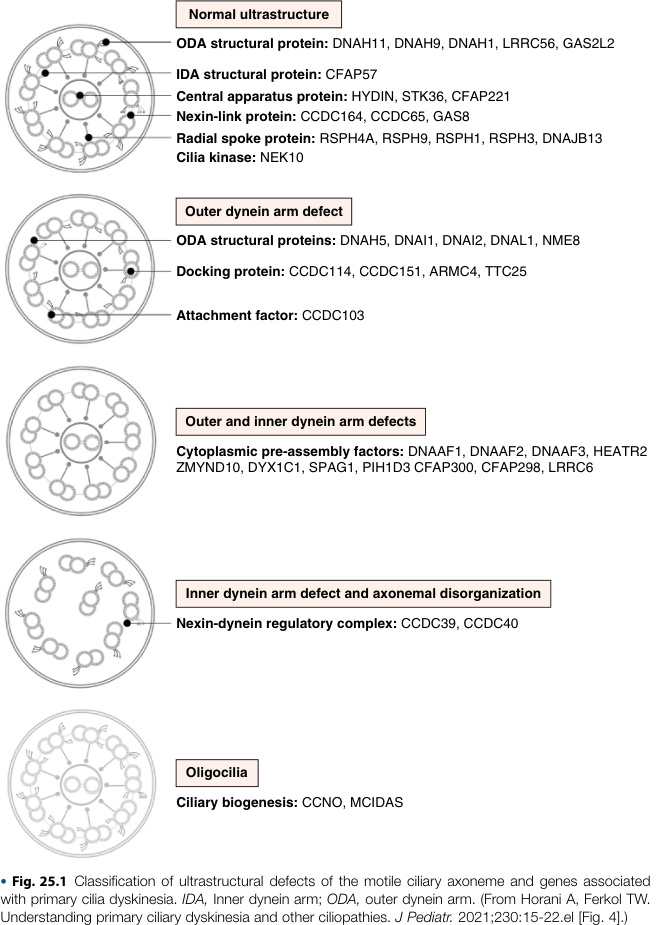
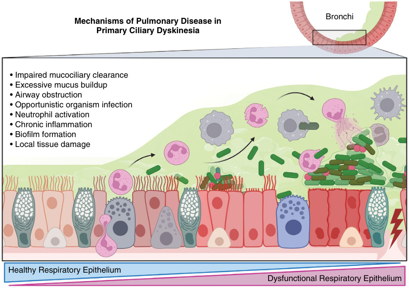
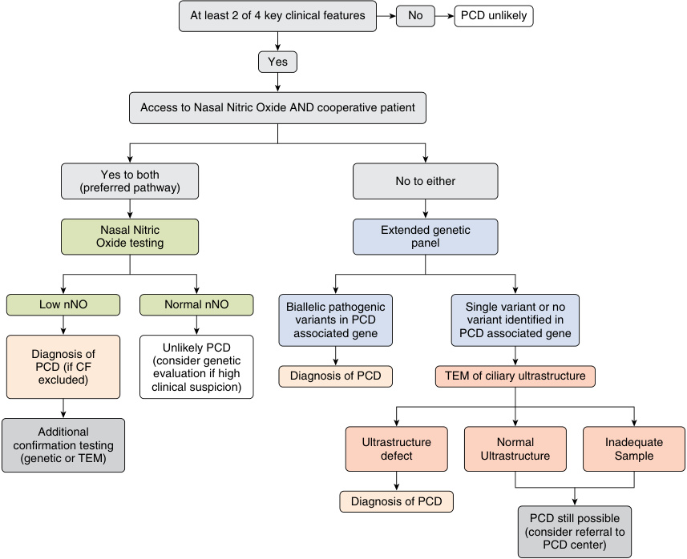
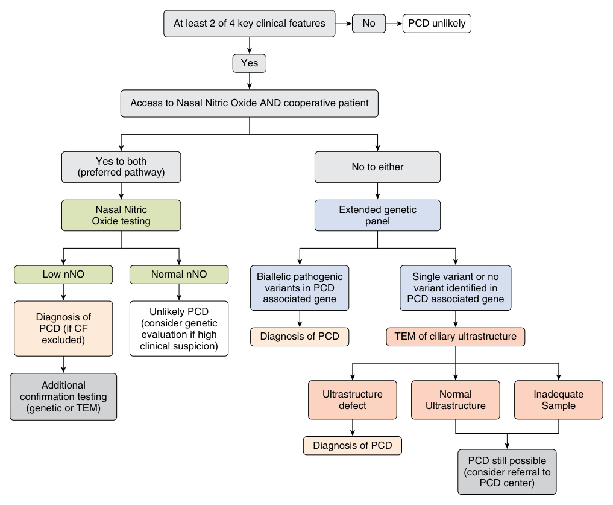

# Chapter 25: Primary Ciliary Dyskinesia
> **Course:** Vikkypaedia Rare Disease Learner Course (*Nelson Pediatric Textbook of Rare Diseases: Genomic Etiologies and Genetic Diagnosis (1st Edition)*)  
> **Section IV:** Cardiopulmonary Disorders  
> **Authors:** Cherie A. Torres-Silva, Karen M. McDowell, Cassie L. Shipp  
> **Metrics:** 7,094 words · 4 tables · 2 figures · 51 genes · 28 flashcards · 14 MCQs  
> **Quick Navigation:** [🃏 Study 28 Flashcards](../flashcards/025_flashcards.md) · [📝 Take 14-Q MCQ Quiz](../mcqs/025_mcqs.md) · [📚 Section IV Guide](../sections/Section_IV.md) · [🧬 Master OMIM/Gene Atlas](../omim_gene_atlas.md) · [💊 Precision Therapies Matrix](../therapies_matrix.md) · [🏠 Course Index](../../index.md)

## Key Chapter Topics
`Pathophysiology` · `Epidemiology` · `Clinical Features` · `Diagnosis` · `Nasal Nitric Oxide (NO)` · `Transmission Electron Microscopy` · `Genetic Testing` · `Other Modalities` · `Treatment` · `Mucociliary Clearance: Airway Clearance Therapy (ACT)` · `Chest Physiotherapy` · `Maintenance Treatment and Prophylaxis Schedule` · `Surveillance for Infection and Disease Progression` · `Treatment Recommendations for PCD Patients`

## Key Genes & Molecular Targets
`ARMC4`, `CCDC103`, `CCDC114`, `CCDC151`, `CCDC164`, `CCDC39`, `CCDC40`, `CCDC65`, `CFAP221`, `CFAP298`, `CFAP300`, `CP`, `DNAAF1`, `DNAAF2`, `DNAAF3`, `DNAAF4`, `DNAAF5`, `DNAAF6`

## ⚡ High-Yield Clinical & Diagnostic Pearls
- Although inheritance is usually autosomal recessive, X-linked and autosomal dominant inheritance have been described; more than 50 specific pathogenic gene variants have been reported.
- Although situs inversus is a hallmark feature of Kartagener disease , it was long thought that congenital cardiac defects were uncommon in PCD.
- These hallmark criteria continue to have a high prevalence in PCD, even into adulthood.
- In contrast to cystic fibrosis where Pseudomonas aeruginosa is one of the most common organisms, this pathogen grows in only 20–40% of respiratory cultures from children with PCD.
- PCD is a rare disorder, encompassing both abnormal structure and abnormal function of the ciliated respiratory cells, and thus a single gold standard diagnostic test has proven difficult to identify.
- The chronic sinopulmonary symptoms viewed as the hallmark of PCD are part of a broad differential diagnosis.
- Using the four hallmark clinical criteria for PCD as a predictive tool is called North America criteria defined clinical features (NA-CDCF).
- Cystic fibrosis (CF) and PCD pulmonary disease are both characterized by limitations of airway clearance.

---
## Full Chapter Text, Tables & Figures

<!-- p.582 -->

# 25 Primary Ciliary Dyskinesia 

**CHERIE A. TORRES-SILVA, KAREN M. MCDOWELL, CASSIE L. SHIPP** 

Previously known as “immotile cilia syndrome,” primary ciliary dyskinesia (PCD) is a complex heterogeneous disorder with a spectrum of disease severity. Although inheritance is usually autosomal recessive, X-linked and autosomal dominant inheritance have been described; more than 50 specific pathogenic gene variants have been reported. Despite advances in understanding the myriad of its genetic causes, PCD remains challenging to diagnose (see also Chapters 6 and 7). 

## **Pathophysiology** 

The normal ciliary structure is comprised of 9 doublets of microtubules arranged in a concentric circle around a central pair of tubules, creating the classic 9+2 arrangement. The doublets in the outer ring are named subunits A and B, and each pair of subunits is connected by bands of the protein nexin (Fig. 25.1). Each outer pair of microtubules also has two extensions, the inner and outer dynein arms, which arise from the A subunit on either side of the nexin link. The inner dynein arm is longer and shaped like a hook. Dynein is a motor protein and cleaves ATP to provide energy, driving sliding of the microtubules. The microtubules in each pair slide over one another in a vertical direction, and the vertical misalignment of the two adjacent microtubules results in bending of the cilia. 

The central pair of tubules in the arrangement is connected to each of the outer doublets by radial spokes, and all the microtubules in a cilium are anchored in a basal body in the cytoplasm of the cell. All the microtubules together with their connecting components are termed the **axoneme** . Normal ciliary movement in the airway has a forward stroke phase, propelling secretions forward with each stroke. The stroke phase is followed by backward bending recovery phase. Abnormal movement of the cilia in the airway results in impaired mucociliary clearance, increased pathogens in the airway and subsequent infection. Normal ciliary beat frequency varies from 1,000 to 1,500 beats per minute depending on the level of the airway in which the cilia are located. The beat frequency is more rapid in the larger airways, such as the trachea and main stem bronchi, than in the peripheral bronchioles. Although sperm flagella share the 9+2 arrangement of microtubules seen in cilia, the motion of sperm is rotational 

in contrast to the forward and back movement during the stroke and recovery beats of the cilia lining the airway. 

Variants in the genes encoding for creation and assembly of proteins in the axoneme result in changes in the structure of the cilia and consequently abnormal or absent movement of the cilia. There are over 50 genes described in PCD, but ~30% of patients with PCD do not have a pathogenic gene variant identified. Many disease-causing variants associated with PCD result in changes in the ultrastructure of the cilia and disruption of the classic 9+2 arrangement of the microtubules. Some of the more common changes of ciliary ultrastructure linked to specific genes include: absence of or defects in outer dynein arms _(DNAH5, DNA11, DNA12, DNAL1, TXNDC3, CCDC114, ARMC4)_ , abnormalities in both inner and outer dynein arms _(LRRC50/DNAAF1, KTU/DNAAF2, DNAAF3, CCDC103, HEATR2, LRRC6, ZMYND10, DYX1C1)_ , radial spoke defects _(CCDC39, CCDC40)_ , abnormalities in the central pair of microtubules _(RSPH1, RSPH4A, RSPH9)_ , and microtubule disarrangement associated with absence of inner dynein arms _(CCDC39, CCDC40)_ . However, some disease-causing gene variants, such as variants in _DNAHII_ , _HYD1N_ , _CCDC 164_ , and _CCDC65_ , are associated with normal or near normal ciliary ultrastructure. Table 25.1 outlines the specific structural defects of the cilia caused by specific genetic variants. The variability in disease severity in PCD makes accurate genotype-phenotype correlations difficult; some associations have been reported. Abnormalities in the _RSPH1_ gene seem to result in milder lung disease, while more severe respiratory outcomes are noted in individuals with genetic variants of genes _CCDC39_ or _CCDC40_ . 

Cilia are present on the embryonic node and thus are important in organ rotation and development of “sidedness” during development. In patients with dysfunctional cilia, organ rotation will be random, thus situs inversus will be present in only 50% of patients with PCD. Although situs inversus is a hallmark feature of **Kartagener disease** , it was long thought that congenital cardiac defects were uncommon in PCD. Situs inversus will be present only with the complete absence of ciliary movement on the embryonic node. However, PCD encompasses a wide spectrum of

<!-- p.583 -->

ciliary movement abnormalities, not just immotile cilia. Thus, ciliopathy can result in a wide spectrum of cardiac outcomes, including situs solitus, heterotaxy, and situs inversus. In fact, more than 6% of patients with PCD have **heterotaxy** , which can be associated with complex cardiac defects, and in a large study, more than 50% of the patients with heterotaxy had pathogenic gene variants in _DNAI1_ and _DNAH5_ . Because subtle forms of heterotaxy may not be easily visible by chest radiograph, PCD is likely underrecognized in this population. _However, if heterotaxy has been identified, further evaluation for PCD needs to be considered._ 

The sperm flagellum also has an axonemal structure, and ciliary motility is critical to normal sperm movement. Ciliated cells are present in the efferent ductules of the testes, indicating that **male infertility** , which is common in PCD, may be a result of more than just poorly motile sperm. Ciliated cells are also located along the lining of the Fallopian tubes, helping propel the oocyte and early embryo along the tube and in the endometrium, functioning in maintenance of early pregnancy. Thus, PCD has multifactorial effects on fertility in both males and females, although to date, the clinical impact is more apparent in males.

<!-- p.584 -->

#### **TABLE 25.1** Primary Ciliary Dyskinesia Genes and Associatio n With Diagnostic Phenotype

|Gene|Diagnostic Test Results|
|---|---|
|**Genes Coding for Structural Proteins in the Outer Dynei** |**n Arm** |
|_DNAH5, DNAI1, DNAI2, DNAL1, NME8, CCDC114, ARMC4,_ _CCDC151, TTC25_ _DNAH11_ _DNAH9_*|_TEM: Class 1 outer dynein arm defect_ _HSVM: Mostly static_ _IF: Absent or misallocated DNAH5_ _TEM: Normal_ _HSVM: Reduced amplitude and hyperfrequent_ _IF: Absent DNAH11_ _TEM: Partial outer dynein arm defect_ _HSVM: Subtle beat pattern defect_ _IF: DNAH9 absent_|
|**Dynein Assembly Proteins**||
|_DNAAF1 (LRRC50), DNAAF2 (KTU), DNAAF3 (C19ORF51),_ _DNAAF4 (DYX1C1), DNAAF5 (HEATR2), LRRC6, ZMYND10,_ _SPAG1, CFAP298 (C21ORF59), DNAAF6 (PIH1D3),_ _CFAP300 (C11ORF70)_|_TEM: Outer and inner dynein arm defect_ _HSVM: Immotile_ _IF: Absent DNAH5 and DNALI1_|
|**Radial Spoke and Central Complex Components**||
|_RSPH9, RSPH4A, RSPH1_ _HYDIN, SPEF2_|_TEM: Class 2 central complex defect_ _HSVM: Rotational_ _IF: Absent RSPH9_ _IF: Absent SPEF2_|
|_RSPH3, DNAJB13, STK221, CFAP221_|_Other diagnostic tests poorly described or normal_|
|**Molecular Ruler and Dynein Regulatory Genes**||
|_CCDC39, CCDC40_ _CCDC65 (DRC2), DRC1 (CCDC164), GAS8 (DRC4)_|_TEM: Class 1 microtubular disorganization and inner dynein_ _arm defect_ _HSVM: Reduced bending_ _IF: Absent GAS8 and DNALI1_ _TEM: Class 1 microtubular disorganization_ _HSVM: Subtle defect with pause in beat_ _IF: Absent GAS8_|
|**Proteins Required for Ciliogenesis**||
|_CCNO, MCIDAS, FOXJ1,_*_NEK10_*|_TEM: Class 2 reduction of multiple motile cilia and_ _mislocalization of basal bodies_ _HSVM & IF: Reduction of multiple motile cilia_|
|**Primary Ciliopathy Associated** _OFD1, RPGR, NHPH_|_Other diagnostic tests poorly described or normal_|
|**Other Function**||
|_CCDC103,_* _GAS2L2, TTC12_|_Other diagnostic tests poorly described or normal_|
|*Cases with normal nasal nitric oxide have been identified. l||
|_HSVM,_High-speed video microscopy;_IF,_immunofluorescence;_TEM,_transmiss From Goutaki M, Shoemark A. Diagnosis of primary ciliary dyskinesia._Clin Ches_|ion electron microscopy. _t Med_. 2022(43);127-140 (Table 3, p. 134).|

## **Epidemiology** 

PCD is a rare disease, occurring in approximately 1 in 16,000 live births in the United States and 1:26,000–40,000 live births internationally. However, both figures are likely to be underestimates. Because of the wide spectrum of clinical disease and the presence of milder phenotypes, PCD is underrecognized, making the true prevalence difficult to accurately estimate. One analysis of a genetic database calculated the allele frequency in disease-causing variants of PCD genes and estimated the global prevalence of PCD to be a minimum of 1 in 7,554 persons. The 

median age of diagnosis is 5.3 years in Europe, with variation by region. With the availability of whole exome sequencing, PCD is increasingly reported in adults with bronchiectasis and represented 12.5% of one recent cohort. 

## **Clinical Features** 

Ciliated epithelium is found in multiple organ systems, including the respiratory tract, the brain ependyma, the female oviduct, and the male vas deferens. Cilia perform a key role in transporting extracellular fluid, and in the respiratory

<!-- p.585 -->

tract they function to propel secretions proximally, aiding in elimination of pathogens. Sodium channels along the cilia’s length also help maintain osmolarity of the surrounding fluid. Abnormalities of ciliary motility most often affect the respiratory system and result in chronic rhinorrhea and congestion, chronic otitis media, recurrent sinusitis, chronic moist cough, and sometimes wheezing. The **four hallmark clinical criteria** for PCD are (1) unexplained neonatal respiratory distress in term infants, (2) early-onset moist cough which is present year-round, (3) early-onset chronic nasal congestion, and (4) laterality defects. The presence of three of these four criteria is highly predictive of PCD in children with a specificity of more than 96%. Further testing for PCD should be considered even in the presence of only one or two criteria. These hallmark criteria continue to have a high prevalence in PCD, even into adulthood. 

**Unexplained neonatal respiratory distress** , especially in term infants or lasting longer than 5 days, is a common manifestation of PCD, and is present in 80% of children with PCD. While transient tachypnea of the newborn usually resolves by the fifth day of life, infants with PCD may require supplemental oxygen for days to weeks. Shifting lobar atelectasis on chest radiograph is another common finding in newborns with PCD. 

**Nasal symptoms** may also be present from birth or arise within the first 6 months of life. Because of chronic nasal congestion, mouth breathing is common, as is sleep disordered breathing. Once present, chronic rhinosinusitis is persistent, and children may have associated hypoplasia of the sphenoid and frontal sinuses. Hearing loss and anosmia may also be present. Notable findings on physical examination of the nose and ears in patients with PCD include inflamed tympanic membranes, edema of the nasal mucosa, thick or purulent nasal discharge, and sinus tenderness in older children and adults. Nasal polyps may be present but are not universal. 

**Chronic wet cough** and history of frequent lower respiratory tract infections (LRTI) are classically present. Recurrent LRTI results in **bronchiectasis** , which is best visualized on chest computed tomography (CT). Lung examination commonly reveals crackles and rhonchi and occasionally wheezing. Respiratory cultures from individuals with PCD most often grow _Haemophilus influenzae_ . In contrast to cystic fibrosis where _Pseudomonas aeruginosa_ is one of the most common organisms, this pathogen grows in only 20–40% of respiratory cultures from children with PCD. However, the prevalence increases with age, with _Pseudomonas_ becoming more prominent in adults over 30 years of age with PCD. Chronic airway inflammation in PCD is at least partly a result of dysfunctional and overly activated neutrophils which can also impair phagocytosis by macrophages (Fig. 25.2). Chest imaging in PCD in children may reveal atelectasis and/or bronchiectasis; however, chest radiograph findings may be normal or nonspecific. The presence of heterotaxy or situs inversus seen on a chest radiograph should prompt further evaluation for PCD. If situs inversus is present, the heart sounds are auscultated over the right chest, 

and abdominal examination is significant for palpation of the liver on the left and the spleen on the right side. In patients with concomitant congenital heart disease or more advanced lung disease, digital clubbing can be noted. 

Moist cough and nasal congestion are common features of many pediatric conditions, thus diagnosis of PCD is often delayed. Delay of diagnosis results in poorer outcomes; low lung function, need for supplemental oxygen, and referral for lung transplantation are common in adults with PCD. 

## **Diagnosis** 

PCD is a rare disorder, encompassing both abnormal structure and abnormal function of the ciliated respiratory cells, and thus a single gold standard diagnostic test has proven difficult to identify. The chronic sinopulmonary symptoms viewed as the hallmark of PCD are part of a broad differential diagnosis. While PCD is not a diagnosis of exclusion, it is important to rule out other disorders, such as cystic fibrosis (CF), immunodeficiency, chronic aspiration, protracted bacterial bronchitis, and asthma, in addition to pursuing an evaluation for PCD. Using externally validated predictive tools for PCD can help identify symptomatic patients for whom additional PCD-specific testing is needed. Limiting PCD-specific diagnostics tests to those patients with a clear clinical phenotype can help improve diagnostic yield. Using the four hallmark clinical criteria for PCD as a predictive tool is called North America criteria defined clinical features (NA-CDCF). The presence of these clinical features, while not diagnostic in isolation, can help limit unnecessary testing and increase sensitivity and specificity of PCD-specific testing. Similarly, the PrImary CiliAry DyskinesA Rule (PICADAR) is a short questionnaire that has been validated by several PCD centers and can be used as a helpful screening or predictive tool for symptomatic patients. 

Once a patient has been identified as having a PCD phenotype, the next step is to pursue a more definitive diagnosis. The order and preference of testing will be based on what is available to the clinician. If diagnostic uncertainty remains, referral to a PCD Center may be required. (Fig. 25.3) 

### **Nasal Nitric Oxide (NO)** 

If available, the preferred diagnostic modality is the measurement of nasal nitric oxide (nNO) levels. nNO levels are much lower in patients with PCD than in healthy controls. Healthy controls often have nNO levels exponentially higher than patients with PCD. The diagnostic cutoff for PCD is a nNO level less than 77 nl/min. The underlying mechanism leading to low nNO levels in patients with PCD is not fully understood. Nasal nitric oxide testing is recommended for cooperative patients aged 5 years and older. The nNO levels are collected by utilizing a chemiluminescent nitric oxide analyzer. While this device has been approved for clinical use in Europe, it is limited to testing performed under a research capacity in North America. The cost of these devices often limits their availability for use at many clinical sites. In addition to specific

<!-- p.586 -->

- **Fig. 25.2** Mechanisms of respiratory disease in primary ciliary dyskinesia (PCD). The figure depicts 

- the respiratory epithelium in PCD with dysfunctional cilia, represented by altered mucociliary clearance. The opportunistic pathogens, depicted as bacteria, are shown colonizing the respiratory epithelium and forming biofilms. Neutrophils and alveolar macrophages, represented by immune cells, are also shown in the figure, as they are key components of the host immune response against respiratory pathogens. Neutrophils and alveolar macrophages are attracted to the site of infection, and they attempt to clear the infection. Neutrophils phagocytose bacteria and are known to degranulate and release neutrophil extracellular traps (NETs) in response to biofilm-associated pathogens, by NETosis. In PCD airways neutrophilic inflammation becomes chronic, and neutrophils release damaging proteases such as neutrophil elastase which damage the epithelium.  (De Jesús-Rojas W, Shapiro AJ, Shoemark A. Respiratory Aspects of Primary Ciliary Dyskinesia. _Clin Chest Med_ . 2024 Sep;45[3]:717-728. doi: 10.1016/j. ccm.2024.02.020. Epub 2024 Mar 28. PMID: 39069333.) 

equipment needs, it is also important to have trained technicians administering testing for the best results. While collecting nNO may be possible for patients younger than 5 years of age, due to lack of normative data and significant overlap with healthy controls in younger age groups, low nNO values in patients younger than 5 years old should not be used as the primary diagnostic tool in these patients. Nasal NO measurement should be collected when the patient is at their baseline health. If low nNO are obtained, values should be repeated on a second occasion, typically at least two weeks later. While this test is sensitive and specific for the diagnosis of PCD, there is a risk of both false positive and false negative results. False positive results can be caused by acute viral infections, cystic fibrosis, nasal obstruction, and poor technique, while false negative results can be seen when there are high ambient NO concentrations, specific PCD pathogenic variants, certain gastrointestinal conditions, and technical issues. 

### **Transmission Electron Microscopy** 

Examining the ciliary ultrastructure under transmission electron microscopy (TEM) is also an acceptable diagnostic test for PCD. A ciliary biopsy is required to obtain tissue for further examination. Historically, these biopsies were obtained from nasal samples, which can be done without sedation. Bronchial biopsies of ciliated cells are also an acceptable alternative. Studies suggest that both nasal and bronchial biopsies can yield adequate samples, and obtained together may increase diagnostic yield. Once processed, the biopsy tissue can be examined under electron microscopy to assess the ciliary ultrastructure. This can lead to the diagnosis of defects in the ciliary ultrastructure, such as outer dynein arm (ODA) defects, inner dynein arm (IDA) defects, or defects within the central pairs (CP). While a visible defect is helpful in the diagnosis of PCD, there is

<!-- p.587 -->

- **Fig. 25.3** Diagnostic algorithm for evaluating patients with suspected primary ciliary dyskinesia. _CF,_ 

- Cystic fibrosis; _nNO,_ nasal nitric oxide; _TEM,_ transmission electron microscopy.  (Modified from Shapiro AJ, Davis SD, Polineni D, et al. Diagnosis of primary ciliary dyskinesia: an official American Thoracis Society Clinical Practice Guideline. _Am J Respir Crit Care Med_ . 2018;197(12):e24-e39 [Fig. 1].) 

growing literature pointing toward genes implicated in patients with _normal_ ciliary ultrastructure. Thus, a normal ciliary biopsy under TEM does not rule out the presence of PCD. In addition to analyzing the ultrastructure of the ciliated respiratory epithelium, it is also possible to analyze the function of the cilia via high-speed videomicroscopy analysis (HSVMA). HSVMA is part of the European Respiratory Society (ERS) diagnostic guidelines but is not commonly used in North America. This difference in clinical practice is due to clinician expertise and lack of availability of HSVMA at North American centers. 

### **Genetic Testing** 

The American Thoracis Society (ATS) and ERS guidelines agree that PCD can be diagnosed if pathogenic gene variants are identified. PCD is primarily an autosomal recessive condition, although there are some examples of X-linked and 

autosomal dominant inheritance. PCD is genetically heterogeneous, with more than 50 implicated genes. Unlike CF, a condition with a single causative gene, PCD has many genes and several hundred proteins contributing to clinical disease. Genes implicated in PCD can be broadly categorized based on the resulting structural defect. The four most identified genes implicated in PCD account for greater than 50% of confirmed cases. In total only ~70% of patients have an identifiable gene. Genetic testing availability can also vary based on practice locations but tends to be widely available in North America. Cost and insurance coverage can limit feasibility and accessibility to patients. There are additional limitations that may vary based on genetic panel used (multi gene panels vary based on testing laboratory). There may be a role for exome sequencing (ES), which could be re-examined periodically given the rapidly growing number of PCD genes identified. ES has additional implications and cost associated that would need to be discussed with patient and genetics counseling team.

<!-- p.588 -->

### **Other Modalities** 

Other testing modalities tend to use markers to demonstrate delay of mucociliary clearance, which can be used to support a diagnosis of PCD. Saccharin testing utilizes the placement of a small saccharin fragment on the inferior nasal turbinate. The time between placement of fragment and patient reported sweet taste is measured in minutes. A time of greater than 30 minutes suggests delayed mucociliary clearance, and while this does not confirm a diagnosis of PCD, it may be considered when other options are not available. Similarly, pulmonary radioaerosol mucociliary clearance scan (PRMCS) utilizes a radioactive tracer to determine mucociliary clearance rates. This test has a high negative predictive value and may be a helpful adjunctive test if a diagnosis is not clear after initial testing. 

## **Treatment** 

No curative treatment is available for restoration of ciliary function in patients with primary ciliary dyskinesis (PCD); therefore management is based on symptomatic treatment directed to maintain pulmonary function by improving mucociliary clearance, aggressively treating and preventing upper and lower respiratory tract infections, and controlling inflammation. Cystic fibrosis (CF) and PCD pulmonary disease are both characterized by limitations of airway clearance. Treatment for PCD has been historically based on expert opinions and extrapolated from interventions shown by clinical trials to be effective for patients with CF and non-CF bronchiectasis (Tables 25.2, 25.3, and 25.4). 

### **Mucociliary Clearance: Airway Clearance Therapy (ACT)** 

Airway clearance therapy (ACT) is considered the cornerstone of the clinical management of patients with PCD. ACT consists of a combination of chest physiotherapy and mucociliary clearance agents. A home-based respiratory physiotherapy consisting of a combination of breathing techniques, postural drainage, oscillatory devices, and physical activity is recommended based on evidence demonstrating improvement in pulmonary function, respiratory muscle strength, and exercise capacity in patients with CF and non-CF bronchiectasis (including subjects with PCD). 

### **Chest Physiotherapy** 

Chest physiotherapy includes multiple breathing techniques and devices. **Autogenic drainage (AD)** is an example of a breathing technique in which lung volumes and airflow are manipulated to mobilize mucus from the smaller to the larger airways. AD requires patient understanding, and participation therefore is recommended for children older than 12 years old. **Chest percussion ACT** includes a variety of techniques that induce vibration of the airway 

#### **Maintenance Treatment and Prophylaxis Schedule** 

#### **TABLE 25.2** Maintenance Tre Schedule atment and Prophylaxis

|**Therapies**||
|---|---|
|ACT combination of: • Chest physiotherapy |• Everyday asymptomatic baseline×2/day |
|• Mucociliary clearance agents|• Symptomatic respiratory exacerbations×4/day|
|Airway clearance exercise|• Aerobic exercise≥30 min/ day|
|Nasal/sinus irrigation|• Patients with CRS and post FESS×1–2/day|
|**Health Maintenance**||
|Standard childhood and adult vaccinations|• Per AAP guidelines|
|Influenza vaccine|• Annually|
|23-valent pneumococcal vaccine|• Once≥2 years old|
|COVID-19 vaccination|• Per AAP guidelines •≥6 mo should receive at least 1 dose of the current COVID-19 vaccine|
|RSV immunoprophylaxis|• Long-acting monoclonal antibody • Per AAP guidelines|
|Nutritional assessment (BMI)|• Longitudinal follow-up at time of pulmonologist outpatient encounters|

_AAP,_ American Academy of Pediatrics; _ACT,_ airway clearance therapy; _BMI,_ body mass index z-score; _CRS,_ chronic rhinosinusitis; _FESS,_ functional endoscopic sinus surgery; _RSV,_ respiratory syncytial virus. Modified from Shapiro AJ, Zariwala MA, Ferkol T, et al. Diagnosis, monitoring, and treatment of primary ciliary dyskinesia: PCD foundation consensus recommendations based on state of the art review. _Pediatr Pulmonol_ . 2016;51(2):115-132 (Table 8, p. 125). 

walls causing alteration of the mucus viscosity and elasticity by increasing the expiratory flow rates, and mechanically stimulating the airways eliciting spontaneous cough, all which facilitate mobilization of secretions toward the upper airway and expectoration. Chest percussion can be done as extrapulmonary or intrapulmonary techniques. **Extrapulmonary chest percussion** does not require active participation of the patient and may include manual chest clapping (also known as postural drainage percussion and vibrations) or high-frequency chest wall oscillation (e.g., VEST that consist of an air-pulse generator and an inflatable vest that creates chest vibration resulting in airflow that helps dislodge mucus from the airway walls). **Intrapulmonary chest percussion** provides oscillatory frequencies similar to normal cilia to mobilize secretions and may include positive expiratory pressure (PEP) devices (e.g., Acapella®), and oscillatory positive expiratory pressure (OPEP) devices (e.g., Aerobika® or Flutter). Chest percussion therapy

<!-- p.589 -->

##### **TABLE 25.3** 

#### **Surveillance for Infection and Disease Progression** 

||Frequency|Comments|
|---|---|---|
|**Specialist Evaluation a**|**nd Follow-Up**||
|Pulmonologist|×2–4 encounters/year||
|Otorhinolaryngologist|×1–2 encounters/year|Follow-up appointments post PETs may be as often as every 3–4 months|
|Cardiologist|At time of diagnosis||
|Geneticist|Any patient with undetermined diagnosis by genetic testing|Consider referral to PCD Foundation Clinical center|
|Dietician|Referral as needed|Recommended for patients with low height and/or low BMI z-scores≤ −2|
|**Diagnostic Tests**|||
|Audiology evaluation|At time of diagnosis|• Follow up evaluation as indicated per otorhinolaryngologist|
|Bacterial airway culture|×2–4 encounters/year surveillance At times of respiratory exacerbation and symptomatology|• Sputum sample is preferred. • Epiglottic swab samples can be obtained in small children who cannot produce sputum. • Middle meatus secretions sample obtained endoscopically as indicated for patients with CRS|
|PFT spirometry|×2–4 encounters/year|• Using ATS/ERS criteria|
|Chest plain radiograph|Every 2 years|• Monitor disease progression. • As indicated at times of respiratory exacerbations.|
|NTM sputum culture|Every 2 years|• Consider anytime in symptomatic patients with unexplained clinical decline, or poor response to treatment.|
|Chest computerized tomography (CT) scan|Every 5–7 years Case-by-case|• Surveillance for development or progression of bronchiectasis, and to evaluate effectiveness of ACT • Consider anytime in symptomatic patients with unexplained clinical decline, or poor response to treatment.|
|ABPA panel testing|At time of diagnosis As indicated|• Includes total serum IgE level,_Aspergillus fumigatus_ antibody IgE and IgG. • Consider anytime in symptomatic patients with unexplained clinical decline, or poor response to treatment.|
|Flexible bronchoscopy and BAL|As indicated|• Consider anytime in symptomatic patients with unexplained clinical decline, or poor response to treatment.|

_ABPA,_ Allergic bronchopulmonary aspergillosis; _ACT,_ airway clearance therapy; _ATS/ERS,_ American Thoracic Society/European Respiratory Society; _BAL,_ bronchoalveolar lavage; _BMI,_ body mass index; _CRS,_ chronic rhinosinusitis; _NTM,_ nontuberculous mycobacterial; _PETs,_ pressure equalization tubes; _PFT,_ pulmonary function test. Modified from Shapiro AJ, Zariwala MA, Ferkol T, et al. Diagnosis, monitoring, and treatment of primary ciliary dyskinesia: PCD foundation consensus recommendations based on state of the art review. _Pediatr Pulmonol_ . 2016;51(2):115-132 (Table 8, p. 125). 

should be combined with Huff cough breathing technique in patients who are old enough to perform this technique. Huff cough consists of a cough with an open glottis which decreases airways collapsibility and facilitates mobilization of secretions from peripheral smaller airways to central larger airways. 

Selection of appropriate chest physiotherapy depends on the age of the child, the underlying pathology causing airway clearance impairment, and the child’s capacity to 

participate in therapy. Contraindications for extrapulmonary high-frequency chest wall oscillation ACT include bone disease, decreased bone density, recent thoracic surgical interventions (e.g., thoracotomy), and age younger than 1 year. Contraindications for intrapulmonary percussive or MI-E ACT include intrapulmonary hemorrhage, pneumothorax, emphysema, pneumomediastinum, cardiac instability, tracheoesophageal or bronchopleural fistula, and/or recent lobectomy/pneumonectomy.

<!-- p.590 -->

##### **TABLE** 

##### **25.4** 

#### **Treatment Recommendations for PCD Patients** 

|Treatment|Standard of Care*|Recommendations Case-by-Case|Not Recommended|
|---|---|---|---|
|**Airway Clearance Therapy (ACT)**||||
|Chest Physiotherapy||||
|• Extrapulmonary percussion (CPT, VEST) • Intrapulmonary percussion (PEP, OPEP)|√ √|||
|Cough Augmentation ll||||
|Mechanical insufflation-exsufflation||√||
|Mucociliary Clearance Agents _Hyperosmolar Agents_||||
|• Nebulized hypertonic saline • Inhaled mannitol (dry powder) _DNase Alfa_ _N-Acetylcysteine_ _Bronchodilators_ • Short-acting β2 agonist • Long-acting β2 agonist _Aerobic Exercise_|√ √|√ √|√ √ √|
|**Lower Respiratory Tract**||||
|Acute Infection||||
|• Antibiotics guided by culture and sensitivity|√|||
|Chronic Infection Suppression||||
|• Inhaled cycle antibiotics • Systemic antibiotics||√ √||
|Antiinflammatory Therapy||||
|• Chronic macrolide prophylaxis • Inhaled corticosteroids • Systemic corticosteroids||√ √ √||
|Progressive Bronchiectasis||||
|• Lobectomy • Lung transplant||√|√|
|**Upper Respiratory Tract**||||
|Chronic Rhinosinusitis (CRS)||||
|• Nasal irrigations isotonic saline • Nasal irrigations hypertonic saline† |√|√ ||
|• Nasal steroids‡ • Surgical intervention: FEES, turbinate reduction, nasal polyps’ removal||√ √||
|Chronic Middle Ear Effusion||||
|• PET placement|√|||
|• Topical antibiotics§||√||

*Based on available evidence and/or expert opinion. 

†No consensus exists on what concentration of saline should be used for daily maintenance care, some centers reserve use of hypertonic saline for cases of more severe nasal obstruction. 

‡Recommended for patients with CRS and nasal polyps. 

§Recommended immediate postpressure equalization tubes (PETs) surgical period, and for otorrhea exacerbations. 

Modified from Polineni D, Davis SD, Dell SD. Treatment recommendations in primary ciliary dyskinesia. _Paediatr Respir Rev_ . 2016;18:39-45 (Table 1, p. 41).

<!-- p.591 -->

### **Mucociliary Clearance Agents** 

Mucociliary clearance agents (MCA) decrease mucus viscosity and facilitate mucus expectoration. MCA include mucolytic agents (e.g., N-acetylcysteine and recombinant human deoxyribonuclease), hyperosmolar agents (e.g., hypertonic saline), and bronchodilators (short-acting β2agonist). The use of these agents is not evidence or consensus based, but these agents have been used on a case-bycase basis. 

### **Other ACT Modalities** 

**Exercise** is recommended for PCD patients as part of a daily routine ACT based on evidence that aerobic exercise and resistance training have a bronchodilator effect, improve respiratory muscle strength and cough strength, and facilitate mucus clearance from the lower airways. Participation in an exercise rehabilitation program is recommended for PCD patients recognized to have decreased cough strength as evidenced by a decline in cough expiratory peak flow. 

An additional ACT to consider is the **mechanical insufflation-exsufflation (MI-E)** device (e.g., CoughAssist®). The MI-E ACT device delivers positive pressure, followed immediately by negative pressure, mimicking the changes in flow that occur with cough, increasing full inspiratory and expiratory volumes and expiratory flows. The MI-E device is indicated for cough augmentation in patients with ineffective cough. A cough peak flow (CPF) is used as a measure of cough strength (normal ≥360 L/min). Most PCD patients have a normal CPF and can generate an effective cough when healthy; however, if a patient has a CPF <160 L/min, MI-E ACT may be indicated. 

### **Lower Respiratory Tract Infections: Treatment and Prevention** 

#### **_Respiratory Exacerbation Criteria_** 

_(Tables 25.2 and 25.3)_ 

Antibiotic treatment is recommended for symptomatic PCD patients who meet criteria of respiratory exacerbation. The **criteria for a respiratory exacerbation** include at least three of the following seven clinical symptoms: (1) increased cough; (2) change in sputum volume and/ or color; (3) increased shortness of breath, as perceived by the patient or parent; (4) decision to start or change antibiotic treatment because of perceived pulmonary symptoms; (5) malaise, tiredness, fatigue, or lethargy; (6) new or increased hemoptysis; and (7) increased body temperature >38°C. 

### **Treatment of Acute Infection** 

Selection of antibiotic therapy should be guided by bacterial pathogens and microbial sensitivity identified through respiratory cultures of sputum or bronchoalveolar lavage 

samples. Initiation of empiric antimicrobial therapy should be considered in patients with moderate to severe clinical presentation, guided by previous cultures and sensitivities if available. Empiric antibiotic therapy should cover the most common pathogens known to cause acute and chronic respiratory infections in PCD patients, taking into consideration variability per age group of common pathogens, which may include _Haemophilus influenza, Staphylococcus aureus, Streptococcus pneumonia, Moraxella catarrhalis, Pseudomonas aeruginosa_ , and _Achromobacter xylosoxidans. Haemophilus influenza_ and _Moraxella catarrhalis_ have been reported to be most common in younger children, and _Pseudomonas aeruginosa_ and other gram-negative bacteria then become predominant pathogens in older adolescents and adults with PCD. Duration of antibiotic therapy for respiratory exacerbations is 14 to 21 days in PCD patients. This recommendation is derived from common practices used in patients with CF and those with non-CF bronchiectasis. 

### **Surveillance of Asymptomatic Patients** 

Surveillance cultures for asymptomatic infections are recommended at least four times per year and can be done using sputum or bronchoalveolar lavage samples. Cultures should include selective media for _Pseudomonas aeruginosa_ and non-TB mycobacteria. Evidence demonstrates that chronic colonization or infection of a single or multiple organisms in the lower respiratory system is associated with decreased pulmonary function in patients with PCD. Earlier in childhood, _Haemophilus influenza_ and _Moraxella catarrhalis_ have been reported as the most common pathogens colonizing the lower airways of PCD patients; however, _Pseudomonas aeruginosa_ (PsA) colonization of the lower airways increases with age. Antimicrobial treatment is recommended for cultures positive for PsA, methicillin-resistant _Staphylococcus aureus_ (MRSA), or _Burkholderia cepacian complex_ even if the patient is asymptomatic. 

### **Antibiotic Eradication Therapy (AET)** 

Antibiotic eradication therapy (AET) is commonly recommended for pediatric patients with PCD with newly acquired PsA infection. No standardized AET protocol is currently available. An example of a multistep AET protocol used includes the following steps: step 1, 28 days of inhaled tobramycin (IT); step 2, if persistent positive culture, then repeat 28 days of IT; step 3, if persistent positive culture after Step 2, then 14 days of intravenous antibiotics followed by 28 days of IT. Other alternative practices reported in Europe for PsA AET include a combination of oral ciprofloxacin plus inhaled colistimethate sodium, oral ciprofloxacin alone, and a combination of oral ciprofloxacin and IT. One study demonstrated a 97% success rate in obtaining negative cultures after AET, with 70% persistent negative culture results after 1 year.

<!-- p.592 -->

### **Infection Prophylaxis** 

Infection prophylaxis using cycled antibiotics is recommended for patients with established colonization with PsA or MRSA, frequent respiratory exacerbations, and development of bronchiectasis per chest CT scan. The aim of long-term cycle antibiotics is to reduce the bacterial load, therefore reduce inflammation, frequency of infections, and rapid decline of lung function. Antimicrobial prophylaxis commonly used in PCD patients includes inhaled tobramycin or inhaled aztreonam antibiotic given 14 to 28 days every other month. A systematic Cochrane review on antipseudomonas inhaled-antibiotics long-term treatment benefits (>3 months) in CF patients demonstrated improvement in pulmonary function, decrease in frequency of respiratory exacerbations, and low incidence of side effects (most commonly described as tinnitus and voice alteration) when compared to placebo. 

### **Upper Respiratory Tract Infections: Treatment and Prevention** 

PCD-related upper airway disease includes sinonasal and otologic disease. PCD patients are commonly affected by chronic rhinosinusitis (CRS; ≥45% patients), recurrent otitis media, chronic otorrhea, hearing loss (52%), nasal polyps, frontal and sphenoid sinus aplasia, or hypoplasia (up to 73%), and olfactory impairment (48%). Middle ear and sinus cultures grow similar organisms including _Haemophilus influenza, Staphylococcus aureus, Streptococcus pneumonia, Pseudomonas aeruginosa, Moraxella catarrhalis,_ and _Streptococcus pyogenes_ as the most common pathogens causing otitis media and sinusitis in this patient population. Bacterial pathogens in the upper respiratory tract has been correlated to simultaneous bacterial colonization and chronic infection of the lungs, as evidenced by lung recolonization from the sinuses post lung transplant. 

**Treatment for chronic rhinosinusitis (CRS)** may include nasal irrigations with iso-or hypertonic saline, topical steroids, antibiotics, and/or surgical interventions including removal of polyps and functional endoscopic sinus surgery (FESS). Saline nasal irrigation (SNI) is recommended as standard of care for CRS; however, there is no consensus on what concentration of saline or the frequency of SNI should be used. Some centers recommend daily maintenance use of isotonic saline twice per day and reserve the use of hypertonic saline SNI for cases of severe nasal obstruction. Topical nasal steroids have been shown to improve clearance of sinuses and reduce the formation of microbial film and are indicated in combination to SNI in children with PCD and CRS who have more severe nasal obstruction and/or nasal polyps. Antibiotic treatment for CRS is recommended for symptomatic patients with purulent rhinosinusitis, and recommendation is for treatment to be guided by bacteriological culture analysis of nasal secretions (e.g., culture of middle meatus secretions). 

Surgical interventions for patients with CRS aim to improve nasal ventilation, mucus drainage, and olfaction. 

Surgical interventions may include balloon sinuplasty and ethmoidectomy, fiberoptic endoscopic sinus surgery (FEES), turbinate reduction, and removal of nasal polyps. Severity of sinus disease can be assessed through computed tomography (CT), which allows for identification of sinus opacification, bone remodeling, nasal obstruction (e.g., septal deviation or concha bullosa), and development of CRS complications like mucoceles or bone destruction. Medical management with systemic antibiotic therapy and SNI twice daily for 2 weeks, plus topical nasal steroids for ≥3 months following sinus surgery have been demonstrated to improve symptoms, eradicate sinus bacteria, and stabilize or mildly improve lung function. 

There is a high prevalence of otologic disease in PCD patients presenting as recurrent otitis media with chronic middle ear effusion (>50%), associated with almost 100% of patients having some degree of conductive hearing impairment. Pressure equalization tubes (PET) and adenoidectomy are commonly recommended for pediatric PCD patients with middle ear effusion and hearing deficits and/or language development delay. 

### **Chronic Inflammation: Prophylaxis Therapy** 

Airway obstruction in PCD is primarily caused by mucus plugging and neutrophilic airway inflammation. The neutrophils in the sputum of PCD patients have been found to be dysfunctional and display high activity of neutrophil elastase (Fig. 25.2) and increase in the secretion and concentration of mucins in the airways, leading to increased mucus elasticity. Antiinflammatory agents are commonly used in PCD patients, including systemic azithromycin therapy and inhaled corticosteroids. **Azithromycin maintenance therapy (AMT)** has been adopted in the PCD population for its antiinflammatory, immunomodulatory and bacteriostatic properties, and its effects on the inhibition of cytokines production in PCD cells. Long-term azithromycin therapy in PCD patients has been shown to help decrease the rate of respiratory exacerbations, lower the rate of detected pathogenic bacteria, stabilize pulmonary disease, and increase pulmonary function. AMT prophylaxis therapy is recommended three times per week (Monday, Wednesday, and Friday schedule; at 10 mg/kg/dose, max dose 500 mg/ dose). In patients with concomitant comorbidity with gastrointestinal dysmotility, AMT may be administered daily at lower dose (5 mg/kg/dose, max dose 250 mg/dose). AMT is typically well tolerated with minimal side effects. Diarrhea has been the most common, though rare, side effect reported, which in most cases is not severe enough to warrant azithromycin discontinuation. Emergence of macrolide-resistant bacteria has been reported in PCD patients using long-term AMT; however, the development of resistant bacteria in this scenario is not considered a significant concern because the macrolide-resistant bacteria reported are easily eradicated with other commonly used antibiotics. 

**Inhalation corticosteroids (ICS)** have been used in patients with PCD to treat chronic airways inflammation.

<!-- p.593 -->

However, ICS are not recommended as standard of care for PCD patients except for those with asthma comorbidity, based on lack of evidence to support the use of ICS in patients with noneosinophilic airway inflammation. 

### **Surgical Management for PCD Patients** 

**Lobectomy** in PCD patients has a prevalence of approximately 8.9%, and it is typically done in patients with severe localized bronchiectasis in whom aggressive medical management has failed to maintain appropriate quality of life and to control recurrent infections. However, most PCD patients who have undergone lobectomy continue to have lower and declining lung function despite lung resection with no evidence to support its long-term benefits; therefore this surgical intervention is not routinely recommended as standard of care. 

**Lung transplant (LTx)** may be indicated in PCD patients with progressive development of bronchiectasis, severe progressive decline in pulmonary function, and incapacity to maintain gas exchange with persistent severe hypoxemia and oxygen requirement. LTx can be particularly challenging in patients with PCD and Kartagener’s syndrome (KS: triad of situs inversus, chronic sinusitis, and bronchiectasis) due to anatomic abnormalities of dextrocardia, bronchial asymmetry, and anatomical variation of major vascular structures which make the surgical procedure particularly difficult. Successful LTx or lobar transplants in PCD patients are reported in the literature, with a 5-year survival rate of 52% for PCD patients and 65% for KS patients. PCD patients have a higher incidence of rejection and an increased 1-year mortality rate postLTx when compared to CF and COPD patients. However, a review on 5-year outcome data demonstrated that the longterm outcomes for PCD and KS patients post LTx is similar to the general LTx population, suggesting there is insufficient evidence to discourage LTx in PCD or KS patients. 

## **Health Maintenance** 

Recommendations regarding health maintenance are based on the American Academy of Pediatrics (AAP) and the Centers for Disease Control (CDC) Advisory Committee on Immunization Practices (ACIP) guidelines and should include the standard childhood vaccination schedule plus vaccination recommendations for chronic lung disease, including an annual influenza vaccine (recommended for children ≥6 months old), the 23-valent pneumococcal vaccine (recommended for children ≥2 years old), and the COVID-19 vaccination. In addition, respiratory syncytial virus (RSV) immunoprophylaxis should be considered for PCD infants in their first winter, especially in infants with a complicated respiratory course. 

In addition, longitudinal assessments on growth and nutritional status are recommended for PCD patients based on evidence that low BMI and low height (z-scores ≤ −2) have been found to correlate with decreased lung function (Table 25.2). 

## **Surveillance for Infection and Disease Progression** 

Children with PCD should be followed closely by a pulmonologist and an otorhinolaryngologist. Long-term surveillance is recommended to evaluate for infection, the effectiveness of ACT, and disease progression including development of bronchiectasis and/or decreased pulmonary function. Based on expert opinion, evaluation by a pulmonologist, bacterial sputum cultures, and pulmonary function testing are recommended 2 to 4 times per year; evaluation by an otolaryngologist is recommended 1 to 2 times per year; and audiology evaluation is indicated at PCD diagnosis and follow-up evaluations as indicated per otorhinolaryngologist recommendations. Chest radiography is recommended at the time of diagnosis and every 2 years, and nontuberculous mycobacterial (NTM) sputum culture is recommended every 2 years. In addition, chest computed tomography scan, flexible bronchoscopy, bronchoalveolar lavage, and sputum test for NTM, and allergic bronchopulmonary aspergillosis (ABPA) test (including total serum immunoglobulin E (IgE) level, _Aspergillus fumigatus_ Antibody IgE, and IgG) should be considered in any symptomatic patients with an unexplained clinical decline or poor response to treatment (Table 25.3). 

## **Long-Term Prognosis and Outcome** 

Recurrent respiratory infections and development of progressive bronchiectasis result in progressive lung parenchymal injury and loss of pulmonary capacity. Several phenotypes and comorbidities including situs ambiguous, splenic anomalies and/or complex congenital cardiovascular malformations, certain _CCDC39_ and _CCDC40_ genotypes, and inner dynein arms (IDA) or microtubular disarrangement (MTD) ciliary ultrastructural defects have been associated with higher disease burden, lower quality of life, worse nutritional status, and more aggressive disease progression in PCD patients. Due to the great variability in phenotypes and disease progression there is no defined average life expectancy. 

## **Bibliography** 

- Adil EA, Kawai K, Dombrowski N, Irace AL, Cunningham MJ. Nasal versus tracheobronchial biopsies to diagnose primary ciliary dyskinesia: a meta-analysis. _Laryngoscope_ . 2017;127(1):6-13. 

- Afzelius BA. A human syndrome caused by immotile cilia. _Science_ . 1976;193(4250):317-319. 

- Afzelius BA. The immotile-cilia syndrome: a microtubule-associated defect. _CRC Crit Rev Biochem_ . 1985;19(1):63-87. 

- Alanin MC. Bacteriology and treatment of infections in the upper and lower airways in patients with primary ciliary dyskinesia: adressing the paranasal sinuses. _Dan Med J_ . 2017;64(5):B5361. 

- Alanin MC, Aanaes K, Hoiby N, et al. Sinus surgery can improve quality of life, lung infections, and lung function in patients with primary ciliary dyskinesia. _Int Forum Allergy Rhinol_ . 2017;7(3):240-247.

<!-- p.594 -->

- Alanin MC, Aanaes K, Høiby N, et al. Sinus surgery can improve quality of life, lung infections, and lung function in patients with primary ciliary dyskinesia. _Int Forum Allergy Rhinol._ 2017;7(3):240-247. 

- Alanin MC, Johansen HK, Aanaes K, et al. Simultaneous sinus and lung infections in patients with primary ciliary dyskinesia. _Acta Otolaryngol_ . 2015;135(1):58-63. 

- Alanin MC, Nielsen KG, von Buchwald C, et al. A longitudinal study of lung bacterial pathogens in patients with primary ciliary dyskinesia. _Clin Microbiol Infect_ . 2015;21(12):1093.e1-7. 

- Alanin MC, Nielsen KG, Von Buchwald C, et al. A longitudinal study of lung bacterial pathogens in patients with primary ciliary dyskinesia. _Clin Microbiol Infect_ . 2015;21(12):1093.e1091-1093.e1097. 

- Allaer L, Lejeune S, Mordacq C, Deschildre A, Thumerelle C. Primary ciliary dyskinesia and fungal infections: two cases of allergic bronchopulmonary aspergillosis in children. _Pediatr Pulmonol_ . 2022; 57(7):1809-1813. 

- Andrejak C, Nielsen R, Thomsen VO, Duhaut P, Sorensen HT, Thomsen RW. Chronic respiratory disease, inhaled corticosteroids and risk of non-tuberculous mycobacteriosis. _Thorax_ . 2013;68(3):256-262. 

- Behan L, Dimitrov BD, Kuehni CE, et al. PICADAR: a diagnostic predictive tool for primary ciliary dyskinesia. _Eur Respir J_ . 2016; 47(4):1103-1112. 

- Bequignon E, Dupuy L, Escabasse V, et al. Follow-up and management of chronic rhinosinusitis in adults with primary ciliary dyskinesia: review and experience of our reference centers. _J Clin Med_ . 2019;8(9):1495. 

- Best S, Shoemark A, Rubbo B, et al. Risk factors for situs defects and congenital heart disease in primary ciliary dyskinesia. _Thorax_ . 2019; 74(2):203-205. 

- Beydon N, Chambellan A, Alberti C, et al. Technical and practical issues for tidal breathing measurements of nasal nitric oxide in children. _Pediatr Pulmonol_ . 2015;50(12):1374-1382. 

- Beydon N, Kouis P, Marthin JK, et al. Nasal nitric oxide measurement in children for the diagnosis of primary ciliary dyskinesia: European Respiratory Society technical standard. _Eur Respir J_ . 2023;61(4). 

- Beydon N, Tamalet A, Escudier E, Legendre M, Thouvenin G. Breathholding and tidal breathing nasal NO to screen children for Primary Ciliary Dyskinesia. _Pediatr Pulmonol_ . 2021;56(7):2242-2249. 

- Bhatt JM, Muhonen EG, Meier M, Sagel SD, Chan KH. Rhinosinusitis in pediatric primary ciliary dyskinesia: impact of disease. _Otolaryngol Head Neck Surg_ . 2019;161(5):877-880. 

- Blanter M, Cockx M, Wittebols L, et al. Sputum from patients with primary ciliary dyskinesia contains high numbers of dysfunctional neutrophils and inhibits efferocytosis. _Respir Res_ . 2022;23(1):359. 

- Camner P, Mossberg B, Afzelius BA. Evidence of congenitally nonfunctioning cilia in the tracheobronchial tract in two subjects. _Am Rev Respir Dis_ . 1975;112(6):807-809. 

- Campbell RG, Birman CS, Morgan L. Management of otitis media with effusion in children with primary ciliary dyskinesia: a literature review. _Int J Pediatr Otorhinolaryngol_ . 2009;73(12):1630-1638. 

- Canciani M, Barlocco EG, Mastella G, de Santi MM, Gardi C, Lungarella G. The saccharin method for testing mucociliary function in patients suspected of having primary ciliary dyskinesia. _Pediatr Pulmonol_ . 1988;5(4):210-214. 

- Casale M, Moffa A, Cassano M, et al. Saline nasal irrigations for chronic rhinosinusitis: from everyday practice to evidence-based medicine. An update. _Int J Immunopathol Pharmacol_ . 2018;32:2058738 41880267. 

- Chao J, Turner JA, Sturgess JM. Genetic heterogeneity of dyneindeficiency in cilia from patients with respiratory disease. _Am Rev Respir Dis_ . 1982;126(2):302-305. 

- Chatwin M, Wakeman RH. Mechanical insufflation-exsufflation: considerations for improving clinical practice. _J Clin Med_ . 2023; 12(7):2626. 

- Chhin B, Negre D, Merrot O, et al. Ciliary beating recovery in deficient human airway epithelial cells after lentivirus ex vivo gene therapy. _PLoS Genet_ . 2009;5(3):e1000422. 

- Cirkovic I, Pavlovic B, Bozic DD, Jotic A, Bakic L, Milovanovic J. Antibiofilm effects of topical corticosteroids and intranasal saline in patients with chronic rhinosinusitis with nasal polyps depend on bacterial species and their biofilm-forming capacity. _Eur Arch Otorhinolaryngol_ . 2017;274(4):1897-1903. 

- Committee on Infectious Diseases. COVID-19 vaccines in infants, children, and adolescents. _Pediatrics_ . 2022;150(3):e2022058700. 

- Crowley S, Holgersen MG, Nielsen KG. Variation in treatment strategies for the eradication of Pseudomonas aeruginosa in primary ciliary dyskinesia across European centers. _Chron Respir Dis_ . 2019; 16:1479972318787919. 

- Davis SD, Ferkol TW, Rosenfeld M, et al. Clinical features of childhood primary ciliary dyskinesia by genotype and ultrastructural phenotype. _Am J Respir Crit Care Med_ . 2015;191(3): 316-324. 

- Davis SD, Rosenfeld M, Lee HS, et al. Primary ciliary dyskinesia: longitudinal study of lung disease by ultrastructure defect and genotype. _Am J Respir Crit Care Med_ . 2019;199(2):190-198. 

- De Onis M. WHO Child Growth Standards based on length/height, weight and age. _Acta Paediatrica_ . 2006;95(S450):76-85. 

- Dougherty GW, Loges NT, Klinkenbusch JA, et al. DNAH11 localization in the proximal region of respiratory cilia defines distinct outer dynein arm complexes. _Am J Respir Cell Mol Biol_ . 2016;55(2): 213-224. 

- Eliasson R, Mossberg B, Camner P, Afzelius BA. The immotile-cilia syndrome. A congenital ciliary abnormality as an etiologic factor in chronic airway infections and male sterility. _N Engl J Med_ . 1977;297(1):1-6. 

- Enuka Y, Hanukoglu I, Edelheit O, Vaknine H, Hanukoglu A. Epithelial sodium channels (ENaC) are uniformly distributed on motile cilia in the oviduct and the respiratory airways. _Histochem Cell Biol_ . 2012;137(3):339-353. 

- Faruqi MA, Keshavamurthy S, Hillenbrand KD, Anstead M, Nandavaram S. Bilateral lung transplantation in Kartagener’s syndrome and situs inversus. _Cureus_ . 2023;15(3):e35785. 

- Ferkol T, Leigh M. Primary ciliary dyskinesia and newborn respiratory distress. _Semin Perinatol_ . 2006;30(6):335-340. 

- Firat M, Bosnak-Guclu M, Sismanlar-Eyuboglu T, Aslan AT. Aerobic exercise capacity, cough strength, posture, and depression in primary ciliary dyskinesia. _Pediatr Pulmonol_ . 2023;58(1);73-80. 

- Forrest JB, Rossman CM, Newhouse MT, Ruffin R. Activation of nasal cilia in immotile cilia syndrome. _Am Rev Respir Dis_ . 1979;120(3):511-515. 

- Gatt D, Shaw M, Wee W, Solomon, M, Dell SD, Ratjen F. Efficacy of antibiotic eradication therapy of early pseudomonas aeruginosa infection in children with primary ciliary dyskinesia. _Ann Am Thorac Soc_ . 2023;20(6):854-860. 

- Gil HI, Lee T, Jeong BH, et al. Additional role of bronchial mucosal biopsy for ciliary structural abnormality in diagnosis of primary ciliary dyskinesia. _J Thorac Dis_ . 2019;11(3):839-847. 

- Goutaki M, Halbeisen FS, Spycher BD, et al. Growth and nutritional status, and their association with lung function: a study from the international Primary Ciliary Dyskinesia Cohort. _Eur Respir J_ . 2017;50(6):1701659. 

- Goutaki M, Maurer E, Halbeisen FS, et al. The international primary ciliary dyskinesia cohort (iPCD Cohort): methods and first results. _Eur Respir J_ . 2017;49(1):1601181.

<!-- p.595 -->

- Goutaki M, Shoemark A. Diagnosis of primary ciliary dyskinesia. _Clin Chest Med_ . 2022;43:127-140. 

- Guan Y, Zhang X, Yang H, Xu H, Zhao S. Long-term azithromycin treatment in pediatric primary ciliary dyskinesia: A retrospective study. _Front Pediatr_ . 2022;10:905253. 

- Gur M, Manor E, Hanna M, et al. The effect of inspiratory muscle training in PCD and CF patients: A pilot study. _Pediatr Pulmonol_ . 2023;58(11):3264-3270. 

- Gurses HN, Ucgun H, Zeren M, Denizoglu Kulli H, Cakir E. Does the effect of comprehensive respiratory physiotherapy homeprogram differ in children with cystic fibrosis and non-cystic fibrosis bronchiectasis? _Eur J Pediatr_ . 2022;181(8):2961-2970. 

- Halbeisen FS, Pedersen ESL, Goutaki M, et al. Lung function from school age to adulthood in primary ciliary dyskinesia. _Eur Respir J_ . 2022;60(4):2101918. 

- Haney S, Hancox RJ. Recovery from bronchoconstriction and bronchodilator tolerance. _Clin Rev Allergy Immunol_ . 2006;31(2-3): 181-196. 

- Hannah WB, Seifert BA, Truty R, et al. The global prevalence and ethnic heterogeneity of primary ciliary dyskinesia gene variants: a genetic database analysis. _Lancet Respir Med_ . 2022;10(5): 459-468. 

- Hansen CR, Pressler T, Hoiby N Johansen HK. Long-term, low-dose azithromycin treatment reduces the incidence but increases macrolide resistance in Staphylococcus aureus in Danish CF patients. _J Cystic Fibros_ . 2009;8(1):58-62. 

- Hart A, Sugumar K, Milan SJ, Fowler SJ, Crossingham I. Inhaled hyperosmolar agents for bronchiectasis. _Cochrane Database Syst Rev_ . 2014;2014(5):CD002996. 

- Hayes D Jr, Reynolds SD, Tumin D. Outcomes of lung transplantation for primary ciliary dyskinesia and Kartagener syndrome. _J Heart Lung Transplant_ . 2016;35(11):1377-1378. 

- Hess RA. _The Epididymus: From Molecules to Clinical Practice_ . Boston, MA: Springer; 2002. 

- Hojo M, Iikura M, Hirano S, Sugiyama H, Kobayashi N, Kudo K. Increased risk of nontuberculous mycobacterial infection in asthmatic patients using long-term inhaled corticosteroid therapy. _Respirology_ . 2012;17(1):185-190. 

- Horani A, Ferkol TW. Understanding primary ciliary dyskinesia and other ciliopathies. _J Pediatr_ . 2021;230:15-22.e11. 

- Infectious Diseases, C. O. Recommended childhood and adolescent immunization schedule: United States, 2024. _Pediatrics_ . 2024;153(2): e2023065044 

- Jones AP, Wallis C. Dornase alfa for cystic fibrosis. _Cochrane Database Syst Rev_ . 2010;(3):CD001127. 

- Kapur N, Masters IB, Morris PS, Galligan J, Ware R, Chang AB. Defining pulmonary exacerbation in children with non-cystic fibrosis bronchiectasis. _Pediatr Pulmonol_ . 47(1):68-75. 

- Kartanger M. Zur pathogenese der bronchiectasien. I Mitteilung: bronchiectasien bei situs viscerum inversus. _Betr Klin Tuberk_ .1933;(83): 498-501. 

- Kaspy K, Alarie N, Vallee-Smedja S, Shapiro AJ, Fertuck D. Initiation of nebulized hypertonic saline in infants with primary ciliary dyskinesia. _Am J Respir Crit Care Med_ . 2020;201:A7768. 

- Kaspy KR, Dell SD, Davis SD, et al. Situs ambiguus is associated with adverse clinical outcomes in children with primary ciliary dyskinesia. _Chest_ . 2024;165(5):1070-1081. 

- Katz SM, Damjanov I, Carver I, et al. Letter to editor. _N Engl J Med_ . 1977;297:1011-1012 

- Kennedy MP, Omran H, Leigh MW, et al. Congenital heart disease and other heterotaxic defects in a large cohort of patients with primary ciliary dyskinesia. _Circulation_ . 2007;115(22):2814-2821. 

- Kim HY, Kwon JW, Seo J, et al. Bronchiectasis in children: 10-year experience at a single institution. _Allergy Asthma Immunol Res_ . 2011;3(1);39-45. 

- Knowles MR, Leigh MW, Carson JL, et al. Mutations of DNAH11 in patients with primary ciliary dyskinesia with normal ciliary ultrastructure. _Thorax_ . 2012;67(5);433-441. 

- Kobbernagel HE, Buchvald FF, Haarman EG, et al. Efficacy and safety of azithromycin maintenance therapy in primary ciliary dyskinesia (BESTCILIA): a multicentre, double-blind, randomised, placebocontrolled phase 3 trial. _Lancet Respir Med_ . 2020;8(5):493-505. 

- Koh YY, Park Y, Jeong JH, Kim CK, Min YG, Chi JG. The effect of regular salbutamol on lung function and bronchial responsiveness in patients with primary ciliary dyskinesia. _Chest_ . 2000;117(2):427-433. 

- Komatsu M, Yamamoto H, Shomura T, et al. Twenty-year follow-up of the first bilateral living-donor lobar lung transplantation in Japan. _Intern Med_ . 2019;58(21):3133-3137. 

- Kouis P, Goutaki M, Halbeisen FS, et al. Prevalence and course of disease after lung resection in primary ciliary dyskinesia: a cohort & nested case-control study. _Respir Res_ . 2019;20(1):212. 

- Krawczynski MR, Witt M. PCD and RP: X-linked inheritance of both disorders? _Pediatr Pulmonol_ . 2004;38(1):88-89. 

- Kuehni CE, Frischer T, Strippoli MPF, et al. Factors influencing age at diagnosis of primary ciliary dyskinesia in European children. _Eur Respir J_ . 2010;36(6):1248-1258. 

- Kuehni CE Lucas JS. Diagnosis of primary ciliary dyskinesia: summary of the ERS Task Force report. _Breathe (Sheff)_ . 2017;13(3):166-178. 

- Leigh MW, Ferkol TW, Davis SD, et al. Clinical features and associated likelihood of primary ciliary dyskinesia in children and adolescents. _Ann Am Thorac Soc_ . 2016;13(8):1305-1313. 

- Leigh MW, Hazucha MJ, Chawla KK, et al. Standardizing nasal nitric oxide measurement as a test for primary ciliary dyskinesia. _Ann Am Thorac Soc_ . 2013;10(6):574-581. 

- Leigh MW, Horani A, Kinghorn B, O’Connor MG, Zariwala MA, Knowles MR. Primary ciliary dyskinesia (PCD): a genetic disorder of motile cilia. _Transl Sci Rare Dis_ . 2019;4(1-2):51-75. 

- Lucas JS, Barbato A, Collins SA, et al. European respiratory society guidelines for the diagnosis of primary ciliary dyskinesia. _Eur Respir J_ . 2017;49(1):1601090. 

- Lucas JS, Davis SD, Omran H, Shoemark A. Primary ciliary dyskinesia in the genomics age. _Lancet Respir Med_ . 2020;8(2):202-216. 

- Madsen A, Green K, Buchvald F, Hanel B, Nielsen KG. Aerobic fitness in children and young adults with primary ciliary dyskinesia. _PLoS One_ . 2013;8(8):e71409. 

- Marthin JK, Mortensen J, Pressler T, Nielsen KG. Pulmonary radioaerosol mucociliary clearance in diagnosis of primary ciliary dyskinesia. _Chest_ . 2007;132(3):966-976. 

- McCarren B. Physiological effects of vibration in subjects with cystic fibrosis. _Eur Respir J_ . 2006;27(6):1204-1209. 

- McIntyre JC, Davis EE, Joiner A, et al. Gene therapy rescues cilia defects and restores olfactory function in a mammalian ciliopathy model. _Nat Med_ . 2012;18(9):1423-1428. 

- Miller MR, Hankinson J, Brusasco V, et al. Standardisation of spirometry. _Eur Respir J_ . 2005;26(2):319-338. 

- Møller ME Alanin MC Grønhøj C, Aanœs K, Høiby N, Von Buchwaldm C. Sinus Bacteriology in patients with cystic fibrosis or primary ciliary dyskinesia: a systematic review. _Am J Rhinol Allergy_ . 2017;31(5):293-298. 

- Moore A, Escudier E, Roger G, et al. RPGR is mutated in patients with a complex X linked phenotype combining primary ciliary dyskinesia and retinitis pigmentosa. _J Med Genet_ . 2006;43(4):326-333. 

- Mougey EB, Saunders M, Franciosi JP, Gomez-Suarez RA. Comparative effectiveness of intravenous azithromycin versus erythromycin

<!-- p.596 -->

stimulating antroduodenal motility in children. _J Pediatr Gastroenterol Nutr_ . 2022;74(1):25-32. 

- Mullowney T, Manson D, Kim R, Stephens D, Shah V, Dell S. Primary ciliary dyskinesia and neonatal respiratory distress. _Pediatrics_ . 2014;134(6):1160-1166. 

- Murthy N, Wodi AP, McNally VV Daley MF, Cineas S. Advisory Committee on immunization practices recommended immunization schedule for adults aged 19 years or older—United States, 2024. _MMWR Morb Mortal Wkly Rep_ . 2004;73(1):11-15. 

- Narayan D, Krishnan SN, Upender M, et al. Unusual inheritance of primary ciliary dyskinesia (Kartagener’s syndrome). _J Med Genet_ . 1994;31(6):493-496. 

- Newman L, Chopra J, Dossett C, et al. The impact of primary ciliary dyskinesia on female and male fertility: a narrative review. _Hum Reprod Update_ . 2023;29(3):347-367. 

- Noone PG, Leigh MW, Sannuti A, et al. Primary ciliary dyskinesia: diagnostic and phenotypic features. _Am J Respir Crit Care Med_ . 2004;169(4):459-467. 

- O’Donnell AE, Barker AF, Ilowite JS, Fick RB. Treatment of idiopathic bronchiectasis with aerosolized recombinant human DNase I. rhDNase Study Group. _Chest_ . 1998;113(5):1329-1334. 

- Oehme S, Mittag A, Schrodl W, Tarnok A, Nieber K, Abraham G. Agonist-induced beta2-adrenoceptor desensitization and downregulation enhance pro-inflammatory cytokine release in human bronchial epithelial cells. _Pulm Pharmacol Ther_ . 2015;30:110-120. 

- Okada Y, Takeda S, Tanaka Y, Belmonte JI, Hirokawa N. Mechanism of nodal flow: a conserved symmetry breaking event in left-right axis determination. _Cell_ . 2005;121(4):633-644. 

- Oktem S, Karadag B, Erdem E, Gokdemir Y, Karakoc F, Dagli E, Ersu R. Sleep disordered breathing in patients with primary ciliary dyskinesia. _Pediatr Pulmonol_ . 2013;48(9):897-903. 

- Olbrich H, Schmidts M, Werner C, et al. Recessive HYDIN mutations cause primary ciliary dyskinesia without randomization of left-right body asymmetry. _Am J Hum Genet_ . 2012;91(4):672-684. 

- Olm MAK, Marson FAL, Athanazio RA, et al. Severe pulmonary disease in an adult primary ciliary dyskinesia population in Brazil. _Sci Rep_ . 2019;9(1):8693. 

- Ostrowski LE, Yin W, Patel M, et al. Restoring ciliary function to differentiated primary ciliary dyskinesia cells with a lentiviral vector. _Gene Ther_ . 2014;21(3):253-261. 

- Paff T, Omran H, Nielsen KG, Haarman, EG. Current and future treatments in primary ciliary dyskinesia. _Int J Mol Sci_ . 2021;22(18):9834. 

- Palmas K, Shanthikumar S, Robinson P. Assessment of primary ciliary dyskinesia predictive tools. _Eur Respir J_ . 2020;56(6):2001169. 

- Pappa AK, Sullivan KM, Lopez EM, et al. Sinus development and pneumatization in a primary ciliary dyskinesia cohort. _Am J Rhinol Allergy_ . 2021;35(1):72-76. 

- Pearson-Farr JE, Doherty R, Chatelet DS, et al. Ultrastructural cilia defects in multi-ciliated uterine glandular epithelial cells from women with reproductive failure. _Reproduction_ . 2024;167(1): e230173. 

- Pearson-Farr JE, Wheway G, Jongen MSA, et al. Endometrial glandspecific progestagen-associated endometrial protein and cilia gene splicing changes in recurrent pregnancy loss. _Reproduction and Fertility_ . 2022;3(3):162-172. 

- Piatti G, De Santi MM, Torretta S, Pignataro L, Soi D, Ambrosetti U. Cilia and ear. _Ann Otol Rhinol Laryngol_ . 2017;126(4):322-327. 

- Pifferi M, Bush A, Caramella D, et al. Agenesis of paranasal sinuses and nasal nitric oxide in primary ciliary dyskinesia. _Eur Respir J_ . 2011;37(3):566-571. 

- Polineni D, Davis SD, Dell SD. Treatment recommendations in Primary Ciliary Dyskinesia. _Paediatr Respir Rev_ . 2016;18:39-45. 

- Ratjen F, Waters V, Klingel M, et al. Changes in airway inflammation during pulmonary exacerbations in patients with cystic fibrosis and primary ciliary dyskinesia. _Eur Respir J_ . 2016;47(3): 829-836. 

- Ring AM, Buchvald FF, Holgersen MG, Green K, Nielsen KG. Fitness and lung function in children with primary ciliary dyskinesia and cystic fibrosis. _Respir Med_ . 2018;139:79-85. 

- Ringshausen FC, Shapiro AJ, Nielsen KG, et al. Safety and efficacy of the epithelial sodium channel blocker idrevloride in people with primary ciliary dyskinesia (CLEAN-PCD): a multinational, phase 2, randomised, double-blind, placebo-controlled crossover trial. _Lancet Respir Med_ . 2024;12(1):21-33. 

- Robson EA, Chetcuti P, Hirst RA, et al. Update on primary ciliary dyskinesia. _Paediatr Child Health_ . 2017;27:337-342. 

- Rossman CM, Forrest JB, Ruffin RE, Newhouse MT. Immotile cilia syndrome in persons with and without Kartagener’s syndrome. _Am Rev Respir Dis_ . 1980;121(6):1011-1016. 

- Santamaria F, Esposito M, Montella S, et al. Sleep disordered breathing and airway disease in primary ciliary dyskinesia. _Respirology_ . 2014;19(4):570-575. 

- Satir P, Christensen ST. Overview of structure and function of mammalian cilia. _Annu Rev Physiol_ . 2007;69:377-400. 

- Sendon CS, Cowles RA, Worhunsky DJ, et al. Pediatric unilobar resection in primary ciliary dyskinesia. _Minerva Pediatr (Torino)_ . 2022;74(5):593-599. 

- Shah A, Shoemark A, Macneill SJ, et al. A longitudinal study characterising a large adult primary ciliary dyskinesia population. _Eur Respir J_ . 2016;48(2):441-450. 

- Shakir AK, Altaf MA. Azithromycin induces migrating motor complexes in pediatric patients undergoing antroduodenal motility studies. _J Pediatr Pharmacol Ther_ . 2018;23(5):390-394. 

- Shapiro AJ, Davis SD, Ferkol T, et al. Laterality defects other than situs inversus totalis in primary ciliary dyskinesia: insights into situs ambiguus and heterotaxy. _Chest_ . 2014;146(5):1176-1186. 

- Shapiro AJ, Davis SD, Polineni D, et al. Diagnosis of primary ciliary dyskinesia. An Official American Thoracic Society Clinical Practice Guideline. _Am J Respir Crit Med_ . 2018;197(12): e24-e39. 

- Shapiro AJ, Dell SD, Gaston B, et al. Nasal nitric oxide measurement in primary ciliary dyskinesia. A technical paper on standardized testing protocols. _Ann Am Thorac Soc_ . 2020;17(2):e1-e12. 

- Shapiro AJ, Josephson M, Rosenfeld M, et al. Accuracy of nasal nitric oxide measurement as a diagnostic test for primary ciliary dyskinesia. A systematic review and meta-analysis. _Ann Am Thorac Soc_ . 2017; 14(7):1184-1196. 

- Shapiro AJ, Leigh MW. Value of transmission electron microscopy for primary ciliary dyskinesia diagnosis in the era of molecular medicine: genetic defects with normal and non-diagnostic ciliary ultrastructure. _Ultrastruct Pathol_ . 2017;41(6):373-385. 

- Shapiro AJ, Zariwala MA, Ferkol T, et al. Diagnosis, monitoring, and treatment of primary ciliary dyskinesia: PCD foundation consensus recommendations based on state of the art review. _Pediatr Pulmonol_ . 2016;51(2):115-132. 

- Sherman F, Wodrich M, Zampi J, et al. Phenotypic features of ciliary dyskinesia among patients with congenital cardiovascular malformations. _Pediatr Pulmonol_ . 2020;55:2674-2682. 

- Shoemark A, Dell S, Shapiro A, Lucas JS. ERS and ATS diagnostic guidelines for primary ciliary dyskinesia: similarities and differences in approach to diagnosis. _Eur Respir J_ . 2019;54(3):1901066. 

- Shoemark A, Griffin H, Wheway G, et al. Genome sequencing reveals underdiagnosis of primary ciliary dyskinesia in bronchiectasis. _Eur Respir J_ . 2022;60(5):2200176.

<!-- p.597 -->

- Shypailo RJ. 2020. _Age-based Pediatric Growth Reference Charts_ . Retrieved 10/9/2025 from the Baylor College of Medicine, Children’s Nutrition Research Center, Body Composition Laboratory Web Site: http://www.bcm.edu/bodycomplab/ BMIapp/BMI-calculator-kids.html. 

- Singer F, Schlegtendal A, Nyilas S, Vermeulen F, Boon M, KoernerRettberg C. Lung clearance index predicts pulmonary exacerbations in individuals with primary ciliary dyskinesia: a multicentre cohort study. _Thorax_ . 2021;76(7):681-688. 

- Sironen A, Shoemark A, Patel M, Loebinger MR, Mitchison HM. Sperm defects in primary ciliary dyskinesia and related causes of male infertility. _Cell Mol Life Sci_ . 2020;77(11):2029-2048. 

- Smith S, Rowbotham NJ. Inhaled anti-pseudomonal antibiotics for long-term therapy in cystic fibrosis. _Cochrane Database Syst Rev_ . 2022;11(11):CD001021. 

- Sommer JU, Schäfer K, Omran H, et al. ENT manifestations in patients with primary ciliary dyskinesia: prevalence and significance of otorhinolaryngologic co-morbidities. _Eur Arch Otorhino Laryngol_ . 2011;268(3):383-388. 

- Stafanger G, Garne S, Howitz P, Morkassel E, Koch C. The clinical effect and the effect on the ciliary motility of oral N-acetylcysteine in patients with cystic fibrosis and primary ciliary dyskinesia. _Eur Respir J_ . 1988;1(2):161-167. 

- Strippoli MPF, Frischer T, Barbato A, et al. Management of primary ciliary dyskinesia in European children: recommendations and clinical practice. _Eur Respir J_ . 2012;39(6):1482-1491. 

- Sturgess JM, Chao J, Wong J, Aspin N, Turner JA. Cilia with defective radial spokes: a cause of human respiratory disease. _N Engl J Med_ . 1979;300(2):53-56. 

- Sullivan KDM, Atkinson JJ, Ferkol TW, et al. Clinical features and associated likelihood of primary ciliary dyskinesia in adults. _Am J Respir Crit Care Med_ . 2016;193:A1765. 

- Swingwood EL, Stilma W, Tume LN, et al. The use of mechanical insufflation-exsufflation in invasively ventilated critically Ill adults. _Respir Care_ . 2022;67(8):1043-1057. 

- Tang LX, Gao J, Zhang YM. [Budesonide saline nasal irrigation in treatment of children rhino-sinusitis]. _Lin Chuang Er Bi Yan Hou Tou Jing Wai Ke Za Zhi_ . 2016;30(12):952-954. 

- Toro MDC, Ortiz E, Marson FAL, et al. Cross-sectional evaluation of the saccharin transit time test for primary ciliary dyskinesia: did we discard this tool too soon? _Sao Paulo Med J_ . 2023;141(6): e2022508. 

- Vandervoort B, De Beuckeleer D, Huenaerts E, et al. The short term influence of chest physiotherapy on lung function parameters in 

   - children with cystic fibrosis and primary ciliary dyskinesia. _Front Pediatr_ . 2022;10:858410. 

- Varenyiova Z, Rojas-Hernandez LS, Spano J, et al. Azithromycin promotes proliferation, and inhibits inflammation in nasal epithelial cells in primary ciliary dyskinesia. _Sci Rep_ . 2023;13(1):14453. 

- Vece TI, Takoushian ES, Zariwala MBA, Sullivan KM, Knowles MR, Leigh MW. Neonatal chest X-ray findings in patients with primary ciliary dyskinesia. _Am J Respir Crit Care Med_ . 2018;197:A2747. 

- Walker WT, Jackson CL, Lackie PM, Hogg C, Lucas JS. Nitric oxide in primary ciliary dyskinesia. _Eur Respir J_ . 2012;40(4):1024-1032. 

- Wark P, McDonald VM, Smith S. Nebulised hypertonic saline for cystic fibrosis. _Cochrane Database Syst Rev_ . 2023;6(6):CD001506. 

- Warraich S, Bush A, Levy ML, Fleming L. Regular (up to 10 puffs 4-hourly) inhaled salbutamol should be prescribed at discharge after an asthma attack: myth or maxim? _Breathe_ . 2023;19(3):230054. 

- Wodi AP, Murthy N, McNally VV, Daley MF, Cineas S. Advisory Committee on immunization practices recommended immunization schedule for children and adolescents aged 18 years or younger—United States, 2024. _MMWR Morb Mortal Wkly Rep_ . 2024;73(1):6-10. 

- Woo CJ, Allawzi A, Clark N, et al. Inhaled delivery of a lipid nanoparticle encapsulated messenger RNA encoding a ciliary protein for the treatment of primary ciliary dyskinesia. _Pulm Pharmacol Ther_ . 2022;75:102134. 

- Yin W, Golliher HL, Ferguson AJ, et al. Mucolytic treatment of chronic rhinosinusitis in a murine model of primary ciliary dyskinesia. _Front Mol Biosci_ . 2023;10:1221796. 

- Yonts AB, Gaviria-Agudelo C, Kimberlin DW, O’Leary ST, Paulsen GC. Fall 2023 ACIP Update on Meningococcal, RSV, COVID-19, and other pediatric vaccines. _Pediatrics_ . 2024;153(3):e2023064990. 

- Yuan S, Hollinger M, Lachowicz-Scroggins ME, et al. Oxidation increases mucin polymer cross-links to stiffen airway mucus gels. _Sci Transl Med_ . 2015;7(276):276ra227. 

- Zariwala MA, Knowles MR, Leigh MW. Primary ciliary dyskinesia. In: Adam MP, Feldman J, Mirzaa GM, et al., eds. _GeneReviews_ ®. Seattle, WA: University of Washington, Seattle; 1993. 

- Copyright © 1993-2023, University of Washington, Seattle. GeneReviews is a registered trademark of the University of Washington, Seattle. All rights reserved. 

- Zawawi F, Dell S, Wolter NE, Papsin BC, Propst EJ. Olfaction and gustation in children with primary ciliary dyskinesia. _OTO Open_ . 2023;7(1):e28. 

- Zawawi F, Shapiro AJ, Dell S, et al. Otolaryngology manifestations of primary ciliary dyskinesia: a multicenter study. _Otolaryngol Head Neck Surg_ . 2022;166(3):540-547.