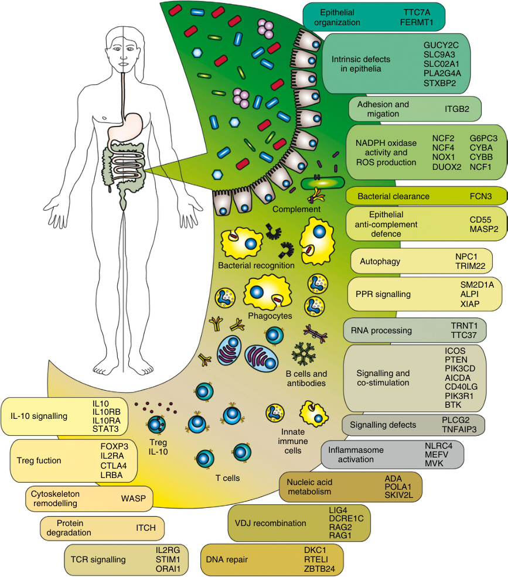
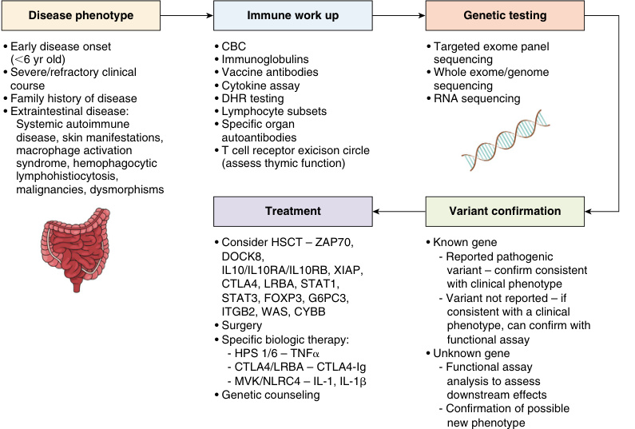
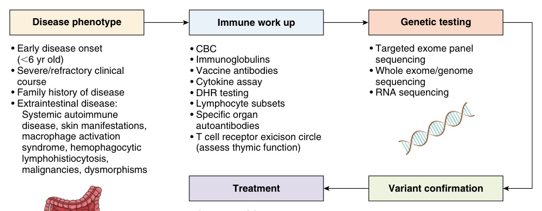
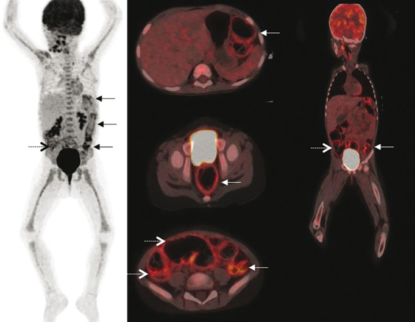

# Chapter 31: Very Early Onset Inflammatory Bowel Disease and Congenital Diarrheal Disorders
> **Course:** Vikkypaedia Rare Disease Learner Course (*Nelson Pediatric Textbook of Rare Diseases: Genomic Etiologies and Genetic Diagnosis (1st Edition)*)  
> **Section V:** Gastrointestinal and Hepatic Disorders  
> **Authors:** Sharmistha Rudra, Chathruckan Rajendra, Subra Kugathasan  
> **Metrics:** 10,338 words · 9 tables · 4 figures · 61 genes · 28 flashcards · 14 MCQs  
> **Quick Navigation:** [🃏 Study 28 Flashcards](../flashcards/031_flashcards.md) · [📝 Take 14-Q MCQ Quiz](../mcqs/031_mcqs.md) · [📚 Section V Guide](../sections/Section_V.md) · [🧬 Master OMIM/Gene Atlas](../omim_gene_atlas.md) · [💊 Precision Therapies Matrix](../therapies_matrix.md) · [🏠 Course Index](../../index.md)

## Key Chapter Topics
`Gastrointestinal and Hepatic Disorders` · `Terminology, Definition, and Evaluation of VEO-IBD` · `Classification of VEO-IBD Based on` · `Immunogenetic Mechanisms` · `Therapeutic Approach` · `Anti-TNF a Antibodies` · `Vedolizumab` · `IL-12 and IL-23 Antibodies` · `Janus Kinase Inhibitors` · `IL-1 Receptor Antagonists` · `Abatacept` · `Calcineurin Inhibitors` · `IL-18 Antagonists` · `Colchicine`

## Key Genes & Molecular Targets
`ADA`, `ADAM17`, `BTK`, `CD25`, `CD55`, `COL7A1`, `CTLA4`, `CYBA`, `CYBB`, `DOCK8`, `EPCAM`, `FERMT1`, `FOXP3`, `GA6`, `GUCY2C`, `HPS1`, `HPS4`, `HPS6`

## ⚡ High-Yield Clinical & Diagnostic Pearls
- In those with a high clinical suspicion for immune dysregulation, polyendocrinopathy, enteropathy, and an X-linked inheritance pattern, IPEX syndrome should be considered.
- X-linked lymphoproliferative syndrome is a result of XIAP deficiency.
- Hermansky-Pudlak syndrome occurs due to pathogenic variants in HPS 1, 4, and 6 and is characterized by inflammation that is mediated by defects in cell trafficking of lysosome related organelles.
- MEFV is associated with FMF, characterized by fevers, peritonitis, colitis, and joint involvement.
- X-linked agammaglobulinemia due to Bruton tyrosine kinase (BTK) gene pathogenic variants results in acute otitis media, sinusitis, and colitis.
- Wiskott-Aldrich syndrome (WAS) presents with a triad of thrombocytopenia, severe eczema, and eosinophilia in addition to colitis.
- The clinical presentation that should raise concern includes a history of multiple autoimmune conditions in males because it is inherited in an X-linked pattern.
- IPEX syndrome is characterized by significant skin findings (eczema, psoriasiform, pemphigus-like, cheilitis), insulin-dependent diabetes, and large volume watery diarrhea.

---
## Full Chapter Text, Tables & Figures

<!-- p.708 -->

## SECTION **V** 

### Gastrointestinal and Hepatic Disorders 

31. Very Early Onset Inflammatory Bowel Disease and Congenital Diarrheal Disorders, 689 

32. Pediatric Intestinal Pseudo-Obstruction, 709 

33. Rare Inborn Defects Causing Malabsorption, 725 

34. Genetic Etiologies of Neonatal and Infantile Cholestasis, 747

<!-- p.709 -->

<!-- p.710 -->

# 31 Very Early Onset Inflammatory Bowel Disease and Congenital Diarrheal Disorders 

**SHARMISTHA RUDRA, CHATHRUCKAN RAJENDRA, SUBRA KUGATHASAN** 

#### **Terminology, Definition, and Evaluation of VEO-IBD** 

Inflammatory bowel disease (IBD) can occur at any age; when the age of onset is less than 18 years, it is referred to as pediatric IBD. **Very early onset inflammatory bowel disease (VEO-IBD)** is a descriptive term arbitrarily assigned to a subgroup of pediatric IBD with onset <6 years of age. The majority of the VEO-IBD population are known or suspected to have a highly penetrant monogenetic etiology; these genes often fall in the immune dysregulation pathways (Fig. 31.1). **Pediatric IBD** patients age ≥6 years are believed to have the common form of IBD and share the same etiology and clinical presentation with adult onset IBD. Pediatric IBD has strong genetic predisposition, but the genetic contribution is through a low penetrant polygenetic etiology with significant environmental/gene-environmental interaction. A small fraction of monogenetic IBD can present later, often during young adulthood. Similarly, the common form of IBD can occur in children before the age of 6 years. Although arbitrary, further subclassifications have been proposed within VEO-IBD including **infantile** inflammatory bowel disease with onset <2 years of age and **neonatal** onset inflammatory bowel disease with onset <28 days of age. 

##### **Epidemiology** 

The prevalence of VEO-IBD is not known because no largescale population-based studies exist. Limited, often single center or working group consortium, studies indicate the prevalence of VEO-IBD is ~1–5% of overall pediatric IBD cases. The prevalence of pediatric onset IBD has been increasing worldwide, with the incidence of IBD under 6 years of age onset having the greatest change in industrialized countries. The most plausible hypothesis for this increase is due to an already existing genetic predisposition. There is a subsequent 

gene-environmental interaction (Western diet, pollution) which leads to a changing of the gut microbiome, which then adversely interacts with gut immunity. Other hypotheses proposed include increased antibiotic use at an early age; decreased exposures to environmental pathogens; and diets enriched with emulsifiers, antibiotics, and surfactants. 

##### **Clinical Characteristics** 

History is especially important and may reveal key information leading to a diagnosis in VEO-IBD. Important information to gather includes history of consanguinity, significant family history, ethnic origins, inheritance patterns of gastrointestinal or autoimmune conditions, and the history of unusual or opportunistic infections. Autoimmunity can include arthritis, type 1 diabetes mellitus, thyroiditis, or autoimmune hemolytic anemia, among others. One should also consider associated syndromes with VEO-IBD. Presenting symptoms and physical examination findings may include growth failure; blood or mucous in stools; arthritis and arthralgias; uveitis; cutaneous findings; hypertrichosis; adenopathy; splenomegaly; and/or perianal disease with skin tags, fistulae, or deep fissures. 

When compared with the common form of IBD, VEOIBD tends to have more isolated colonic involvement; ~50% of cases at presentation are colonic but can progress to include small bowel pathology. _Infantile_ onset IBD typically presents with panenteric disease. Patients with VEOIBD have more refractory courses with increased severity as seen by higher rates of antitumor necrosis factor (TNF) α nonresponders, need for surgical intervention, and higher rates of growth failure. Extraintestinal comorbidities are common, including fever, dermatological findings, and autoimmunity. Dermatological findings can include pyoderma gangrenosum, erythema nodosum, folliculitis, or dermatitis.

<!-- p.711 -->

**Fig. 31.1** Schematic overview over monogenic defects involved in early-onset inflammatory bowel disease with or without accompanying susceptibility to infections. Figure conceptualized by Artem Kalinichenko (Boztug lab).  (From Kelsen J, Boztug K. Autoinflammatory diseases predominantly affecting the gastrointestinal tract. In: Sullivan KE, Stiehm ER, eds. _Stiehm’s Immune Deficiencies_ . ed 2. Philadelphia: Elsevier; 2020 [Fig. 30.1, p. 726].)

<!-- p.712 -->

**Fig. 31.2** An approach to the evaluation and management of monogenic inflammatory bowel disease. _DHR,_ Dihydrorhodamine for chronic granulomatous disease; _HSCT,_ hematopoietic stem cell transplantation. (Modified from Nambu R, Warner N, Mulder DJ, et al. A systematic review of monogenic inflammatory bowel disease. _Clin Gastroenterol Hepatol_ . 2022;20(4):e653-e663.) 

##### **Laboratory Studies** 

Evaluation of VEO-IBD begins with an investigation to exclude common etiologies of bloody stools and growth failure in this age group, including infectious enterocolitis, cow’s milk protein intolerance, celiac disease, and food allergies (Fig. 31.2). 

##### **Immunology Evaluation** 

Several publications have attempted to categorize VEO-IBD into groups based on their known immunogenetic mechanisms: defects in epithelial barrier; hyper-and autoinflammatory disorders; T and B cell defects; T regulatory cells and cell pathway defects; and phagocytic defects. Because the evaluation for these categories can be challenging, collaboration with immunologists is highly recommended. A targeted and step wise immunological functional work up can be planned based on the index of suspicion for the category of immunogenetic defect. Refer to Tables 31.1 and 31.2 for individual disorders. If phagocytic defects are suspected, the immune evaluation may include a dihydrorhodamine (DHR) test to evaluate for neutrophil oxidative burst. This assay requires an adequate number of live neutrophils; the blood collection must be maintained at appropriate temperatures and must accompany a paired control sample to ensure accuracy. Defects in adaptive immunity are evaluated 

by assessing age-appropriate vaccine titers, immunoglobulin levels (IgA, IgM, IgG, IgE), T and B lymphocyte subsets, and natural killer (NK) cells through flow cytometry. Cytokine panels that include interleukin (IL)-1, IL-2, IL-2 soluble receptor, IL-6, IL-10, IL-18, TNF-α, and interferon (IFN)-γ can be performed as well. In those with a high clinical suspicion for immune dysregulation, polyendocrinopathy, enteropathy, and an X-linked inheritance pattern, IPEX syndrome should be considered. Targeted flow cytometry can be performed for Forkhead box protein 3 (FOXP3). 

##### **Genetic Evaluation** 

Various commercial entities offer targeted IBD genetic panels for VEO-IBD; the yield for an identifiable VEO-IBD gene remains as low as 15%. With advances in genomic technologies, additional genes for VEO-IBD are being identified; presently, approximately 80 likely causative genes have been identified. Some of these variants remain private variants and as such remain rare contributors within the worldwide etiology of VEO-IBD. VEO-IBD providers should be aware of the following _(common among rare)_ conditions with VEO-IBD and their presentations; IL10RA/B, X-linked inhibitor of apoptosis _(XIAP)_ , Cytochrome B-245 Beta Chain _(CYBB)_ , LPS responsive beige-like anchor protein _(LRBA)_ , and tetratricopeptide repeat domain 7A _(TTC7A)_ .

<!-- p.713 -->

#### **TABLE 31.1** Mono gene l tic Causes of Infl lammatory Bowel Disease R l esulting From Disruption of Epithelial Function

|Immune|Disorder/|||
|---|---|---|---|
|Defect/Category|Genes|IBD Phenotype|Other Clinical Features|
|Epithelial cell organization|_COL7A1_|Colitis, strictures|Affecting both the skin and involved mucosal surfaces such as oral, esophageal, colonic, anal, urogenital, and ocular|
||_FERMT1_|UC like colitis, Kindler syndrome|Skin abnormalities, such as skin blistering, skin atrophy, photosensitivity, pigmentation defects, and increased risk of squamous cell carcinoma|
||_GA6_and_ITGB4_ subunits|Enteritis and protein losing enteropathy|Skin blistering and pyloric atresia|
|Epithelial cell intrinsic |_GUCY2C_|CD like inflammation and small bowel obstruction|Neonatal meconium ileus, congenital sodium diarrhea|
|function|_SLC9A3_|Small bowel enteritis|Polyhydramnios; watery secretory diarrhea and abdominal distension soon after birth|
||_STXBP3_and _STXBP2_|Infantile-onset colitis like IBD|Medically refractory IBD Sensorineural deafness, bleeding disorders, hypogammaglobulinemia, renal tubular disorders|
|Epithelial cell apoptosis and necroptosis|_EPCAM_|Small bowel enteritis and colitis|Lynch syndrome—a hereditary non-polyposis colon cancer syndrome Congenital tufting enteropathy|
||_TTC7A_|Colitis characterized by neutrophils and eosinophils|Multiple intestinal atresias; copious secretory bloody diarrhea shortly after birth|
||_IKBKG_|Colitis|Incontinentia pigmenti, anhidrotic ectodermal dysplasia|
|Complement activation|_CD55_|Small bowel ulcerations and diarrhea|Angiopathic thrombosis, intestinal lymphangiectasia, and PLE (CHAPLE) syndrome|
|Epithelial cell signaling|_ADAM17_|Chronic diarrhea with chronic inflammatory changes|Erythroderma, hair abnormalities (alopecia, short, wiry or disorganized hair), recurrent severe infections and sepsis|
|Control of RNA degradation product|_SKIV2L_and _TTC37_|Perianal disease and oral ulcerations|Trichohepatoenteric syndrome|

_CD,_ Crohn disease; _CHAPLE,_ complement hyperactivation, angiopathic thrombosis, protein losing enteropathies; _IBD,_ inflammatory bowel disease; _PLE,_ protein losing enteropathy; _UC,_ ulcerative colitis. From Ouahed JD, Griffith A, Collen LV, Snapper SB. Breaking down barriers: epithelial contributors to monogenic IBD pathogenesis. _Inflam Bowel Dis_ . 2024;30(7):1189-1206 (Table 1, pp. 1191–1192). https://doi.org/10.1093/ibd/izad319. 

###### **TABLE 31.2 Monogenic Causes of Very Early Onset IBD** 

|Immune Defect Category|Disorder (Gene)|IBD Phenotype|Other Clinical Characteristics|
|---|---|---|---|
|Hyper-and autoinflammatory defects|X-linked lymphoproliferative syndrome 2_(XIAP)_|Crohn like granulomatous colitis|Perianal fistulae, abscesses, HLH, splenomegaly, cholangitis, arthritis, EBV/CMV infections, low immunoglobulins|
||Mevalonate kinase deficiency_(MVK)_|Severe neonatal onset ulcerative colitis, enterocolitis with deep ulcers and perforation, strictures, adhesions|Recurrent fevers, rash, macrophage activation syndrome, arthritis, urticaria, hepatomegaly, edema|
||TRIM 22 defect _(TRIM22)_|Granulomatous Crohn colitis, severe perianal disease|Oral ulcers, anemia, hypoalbuminemia, fevers|

_(Continued)_

<!-- p.714 -->

|**TABLE** **31.2**|
|---|

###### **Monogenic Causes of Very Early Onset IBD—cont’d** 

|Immune Defect Category|Disorder (Gene)|IBD Phenotype|Other Clinical Characteristics|
|---|---|---|---|
||Herman-sky-Pudlak Syndrome _(HPS 1, 4, 6)_|HPS1—Crohn like enterocolitis, perianal fistulae/abscess|Partial albinism, nystagmus, pulmonary fibrosis, recurrent infections, coagulopathy|
|||HPS4—Crohn like enterocolitis, perianal fistulae/abscess|Partial albinism, coagulopathy, pulmonary fibrosis, recurrent infections|
|||HPS6—Enterocolitis|Partial albinism, coagulopathy, recurrent infections|
||Familial Mediterranean Fever_(MEFV)_|Infantile or toddler onset colitis with mucosal nodularity and exudates, anal fissures| Recurrent fevers, erythematous rash, arthralgias,|
||Autoinflammation with infantile enterocolitis_(NLRC4)_|Infantile enterocolitis|Macrophage activation syndrome, hepatomegaly, anemia, urticaria, seizures|
|Adaptive immunity T and B cell defects|Severe combined immunodeficiency— SCID_(ZAP70)_|Colitis|Profound immunodeficiency, recurrent infections, early-onset autoimmune disorders|
||SCID/Omenn_(IL-2RG)_|Colitis|Profound immunodeficiency, recurrent infections, erythroderma, hepatomegaly, lymphadenopathy|
||CTLA4 deficiency _(CTLA4)_|Crohn like ileitis and colitis|Autoimmune hypothyroidism, type 1 diabetes, demyelinating encephalopathy, interstitial fibrosing lung disease, primary sclerosing cholangitis, gastric adenocarcinoma, autoimmune cytopenias, hypogammaglobulinemia|
||ICOS deficiency _(ICOS)_|Enterocolitis|Arthritis, psoriasis, recurrent sinopulmonary infections, CMV infections|
||Bruton agammaglobulinemia _(BTK)_|Crohn disease like colitis|Recurrent infections, autoimmune hemolytic anemia, lymphoreticular malignancies|
||Wiskott Aldrich syndrome_(WAS)_|Ulcerative colitis like colitis|Autoimmune hemolytic anemia, thrombocytopenia, arthritis, atopic dermatitis, lymphoreticular malignancies, bacterial and viral infections|
||SCID/adenosine deaminase deficiency_(ADA)_|Colitis|Significant immunodeficiency, recurrent infections, erythroderma, hepatosplenomegaly, hepatomegaly, splenomegaly, lymphadenopathy|
||IL-21 deficiency/CVID like_(IL-21)_|Crohn disease like enterocolitis|Recurrent sinopulmonary infections, recurrent cryptosporidium infections, aphthous stomatitis, chronic cholangitis|
||Autosomal recessive hyper IgE syndrome _(DOCK8)_|Colitis|Recurrent skin abscesses, recurrent pneumonia, elevated IgE levels|
|T Regulatory cells and regulatory pathway defects|IL-10 Signaling defects _(IL-10RA, IL-10RB,_ _IL-10)_|IL-10RA—Crohn disease|Perianal fistula, arthritis, eczema, folliculitis, pyoderma, B cell lymphoma|
|||IL-10RB—Crohn disease IL-10—Crohn disease|Perianal fistula, B cell lymphoma, arthritis, eczema, autoimmune hemolytic anemia Perianal fistula|

_(Continued)_

<!-- p.715 -->

#### **TABLE 31.2** Monogen ic Causes of Very Early Onset IBD—cont’d

|Immune Defect||||
|---|---|---|---|
|Category|Disorder (Gene)|IBD Phenotype|Other Clinical Characteristics|
||IPEX_(FOXP3)_|Enterocolitis|Arthritis, food allergies, type 1 diabetes, autoimmune hemolytic anemia, nephropathy, hepatitis, autoimmune thyroid disease, neoplasia, atopic dermatitis|
||IPEX-like_(IL-2RA/CD25)_|Enterocolitis|Eczema, short stature, alopecia, CMV/EBV infections, autoimmune endocrinopathy, bullous pemphigoid, interstitial pneumonitis|
||IPEX-like (_STAT1_GOF)|Enterocolitis|Autoimmune endocrinopathy, chronic mucocutaneous candidiasis, eczema, bronchiectasis, chronic sinopulmonary infections|
||STAT3 (_STAT3_GOF)|Enterocolitis|Short stature, autoimmune disorders, lymphoproliferation, mycobacterial disease|
||LRBA deficiency _(LRBA)_|Enterocolitis|Short stature, chronic dermatitis, membranous nephropathy|
||Syndromic multisystem autoimmune disease _(ITCH)_|Enterocolitis|Facial dysmorphism, autoimmune disease, hepatitis, liver failure, pulmonary fibrosis, bronchiectasis, cholangitis, failure to thrive, thyroid disease|
||Growth hormone insensitivity_(STAT5b)_|Enterocolitis|Growth failure, hypergammaglobulinemia, low mitogen response, low (IGF)-1, low IGF binding protein-3, elevated prolactin levels, recurrent infections|
|Phagocytic defects|Chronic granulomatous disease_(CYBB,_ _CYBA, NCF1,_ _NCF2, NCF4)_|Crohn like colitis|Recurrent infections from catalase positive organisms, perianal fistula, eczema, chorioretinitis, gastric outlet obstruction|
||Congenital neutropenia _(G6PC3)_|Crohn like with strictures, oral and genital aphthous ulcerations|Cardiac defects, vascular malformations, coagulopathy, urogenital defects, severe neutropenia|
||Glycogen storage disease type 1b _(SLC37A4)_|Crohn like colitis with ulcerations, strictures, and perianal fistula|Folliculitis, hepatomegaly, splenomegaly, folliculitis|
||Leukocyte adhesion deficiency 1_(ITGB2)_|Crohn like disease with strictures, and lip ulcers|Recurrent bacterial infections, delayed separation of umbilical cord, neutrophilia, poor wound healing, folliculitis, gingivitis, skin ulcers, periodontitis|

_HLH,_ Hemophagocytic lymphohistiocytosis. Modified from Ouahed J, Spencer E, Kotlarz D, et al. Very early onset inflammatory bowel disease: a clinical approach with a focus on the role of genetics and underlying immune deficiencies. _Inflam Bowel Dis_ . 2019;26(6):820-842 (Table 1, pp. 824–833). https://doi.org/10.1093/ibd/izz259 

Consultation with a multidisciplinary team including a pediatric gastroenterologist with VEO-IBD expertise, an immunologist with an immune dysregulation focus, and a clinical geneticist with immunogenetics expertise can help determine the most appropriate genetic testing to perform and how to interpret the results. It is vital that those who request the tests also have access to experts who can interpret VUS _(variants of unknown significance)_ because each report may include several VUS. Targeted gene panels are the most cost-effective and accessible; in the event of nondiagnostic panel testing, it is recommended to attempt nontargeted sequencing such as whole genome (GS) or whole exome sequencing (ES). Ideal genomic sequencing is 

through trio (patient and both parents) analysis because this allows for allele segregation and identification of de novo events. Multiomic research is a valuable means to understanding the role of the transcriptome, proteome, methylome, metabolome and other “omics” in the susceptibility of, and identifying causative etiologies for, VEO-IBD. 

##### **Imaging** 

There is a predominance of colonic inflammation in patients with VEO-IBD which is best assessed on colonoscopy. Imaging is most useful in evaluating small bowel disease. Magnetic resonance enterography (MRE) is the

<!-- p.716 -->

**Fig. 31.3** An example of FDG-PET/CT in pediatric IBD. This figure shows an FDG-PET/CT scan of a 3-year-old with Crohn disease to assess the possibility of surgical intervention. The displayed images are maximum intensity projection (left column), fused transaxial images (middle column), and fused coronal images (right column). Images show intensely increased FDG uptake in the rectosigmoid and the descending colon _(solid arrows)_ , and in the cecum and ascending colon _(dotted arrow)_ , but no pathological uptake in the small bowel, stomach or esophagus. Note the intense, diffuse FDG uptake in the bone marrow consistent with the reactive response of the bone marrow to systemic inflammation. (From Malham M, Hess S, Nielsen RG, et al. PET/CT in the diagnosis of inflammatory bowel disease in pediatric patients: a review. _Am J Mucl Med Mol Imaging_ . 2014;4(3):225-230 [Fig. 1, p. 226].) 

preferred cross-sectional imaging modality in the common form of IBD mainly in older children and adolescents but can be difficult to obtain in younger children due to the need for sedation to allow for optimal image acquisition in this age group. Alternative options include CT enterography (CTE), intestinal ultrasound (IUS), and PET/MRI or PET/CT. CTE is shorter in duration compared to MRE, so is easier to obtain in this age group, but it has the adverse effect of radiation exposure. IUS can be used to assess bowel wall thickening, color Doppler flow, bowel wall stratification, and peri bowel inflammation. FDGPET/CT (or MRI) is a useful imaging study in identifying areas of acute inflammation (Fig. 31.3). 

diagnosis includes VEO-IBD, eosinophilic gastrointestinal disorders, celiac disease, graft-versus-host disease or nonsteroidal antiinflammatory use. 

Certain primary immunodeficiencies have characteristic histological findings that may help establish a diagnosis. **Severe combined immunodeficiency (SCID)** presents with epithelial cell apoptosis, and eosinophilic or neutrophilic infiltrates with villous atrophy. **Chronic granulomatous disease (CGD)** has a prevalence of noncaseating granulomas without significant surrounding inflammation, eosinophils, or pigmented macrophages. **IPEX syndrome** has villous blunting and chronic inflammation within the lamina propria. **Hermansky-Pudlak syndrome** can have pigmented macrophages and granulomas. 

##### **Endoscopy and Histology** 

There are histological features commonly observed in VEOIBD that may differentiate this subgroup from common forms of IBD. These include eosinophilic infiltrates, duodenal villous atrophy with intraepithelial lymphocytes, increased numbers of noncaseating granulomas, and epithelial apoptosis. When these features are seen on histology, the differential 

#### **Classification of VEO-IBD Based on** 

#### **Immunogenetic Mechanisms** 

VEO-IBD monogenic disease can be categorized into five major mechanistic pathways. These include epithelial barrier defects (Table 31.1), hyper-and autoinflammatory defects,

<!-- p.717 -->

adaptive immunity T and B cell defects, T regulatory cell and regulatory pathway defects, and phagocyte defects (Table 31.2). 

##### **Epithelial Barrier Defects** 

The intestinal epithelium is a critical physical and biochemical barrier that can become chronically inflamed if there is imbalance within the gut microbiome and an inappropriate activation of the intestinal immune system. Epithelial barrier defects can result in skin and intestinal involvement early in life due to shared embryological precursors. **_IKBKG_** is a gene that when disrupted effects nuclear factor kappa B (NF-kB) transcription factors leading to ectodermal dysplasia and antibody deficiencies. Defects in nuclear factor-kappa B essential modulator **(NEMO)** can present with thin hair and fewer teeth. These conditions may present with hypohidrosis, widely spaced cone shaped teeth, hypotrichosis, osteopetrosis, or lymphedema. Laboratory studies may reveal high serum IgM but low serum levels of IgG, IgA, or IgG2. 

**_ADAM17_** is important for disintegrin and metalloproteinase 17. _ADAM17_ gene deficiency leads to a psoriasiform rash, dermatitis, and bloody diarrhea. **_TTC7A_** deficiency can present with bowel obstruction due to intestinal atresias and severe combined immunodeficiency (SCID). Histology in these diseases demonstrates an apoptotic enterocolitis that may lead to a disruption of the physical intestinal barrier. Additionally, defects in T cell maturation and activation may be another mechanism for bowel inflammation. **_COL7A1_** encodes for collagen VII; pathogenic variants lead to an autoimmune response and deficiency in anchoring fibrils. This can lead to the phenotype of epidermolysis bullosa dystrophica and Crohn disease. **_FERMT1_** disruptions effect phosphoprotein and focal adhesion adaptor component kindling-1 leading to an inflammatory response in keratinocytes. Clinical manifestations of this disease include skin blistering, photosensitivity, skin cancers, and ulcerative colitis. **_TGFBR_ 1 and 2** pathogenic variants present with skeletal abnormalities, craniofacial abnormalities, vascular injury, encephalopathy, along with a severe a IBD phenotype. _TGFBR_ 1 defects are also associated with brain atrophy, epilepsy, and posterior leukoencephalopathy. 

Deficiencies in the two genes, guanylate cyclase 2C **_(GUCY2C)_** and solute carrier 9A3 **_(SLC9A3)_** , are linked to congenital sodium diarrhea (CSD) and also to the development of an IBD phenotype. _GUCY2C_ variants can present as early-onset diarrhea, susceptibility to small-bowel obstruction, esophagitis, and IBD. These defects can lead to increased chloride and water secretion from enterocytes. A defect in _SLC9A3_ can lead to CSD. This gene is an epithelial brush-border Na+ /H+ exchanger important for electrolyte transport but also plays a role in cellular proliferation, migration, apoptosis, and gut microbiome homeostasis. 

##### **Hyper-and Autoinflammatory Defects** 

Hyper-and autoinflammatory defects are mediated by activation of the inflammasome and often present with 

refractory fevers, severe intestinal inflammation, and systemic disease. The inflammasome consists of intracellular multiprotein complexes that regulate the maturation of proinflammatory caspases, which form in response to invading pathogens, stress, or injured cells. 

These multiprotein complexes play a critical role in maintaining gut immune homeostasis. Overactivation can lead to an immune response against healthy tissue and subsequent intestinal permeability and damage. Laboratory evaluation may show thrombocytosis, elevated inflammatory markers (CRP, ESR, ferritin), low albumin, and an elevation of IL-2 soluble receptor. 

**X-linked lymphoproliferative syndrome** is a result of _XIAP_ deficiency. _XIAP_ is an important gene for T cell expansion in response to pathogens. This syndrome can appear with hemophagocytic lymphohistiocytosis triggered by Epstein-Barr virus, lymphoma, an intestinal penetrating IBD phenotype, and splenomegaly. **Mevalonate kinase deficiency (MVK)** can have a spectrum of clinical disease and severity. MVK is an integral part of the cholesterol synthesis pathway leading to a shortage of farnesyl pyrophosphate and geranylgeranyl pyrophosphate. Insufficient geranylgeranyl pyrophosphate leads to upregulation of IL-1β and subsequent inflammation. Patients can present with arthritis, peritonitis, bloody diarrhea, fevers, recurrent rectal abscesses, and perianal fistulae. 

Patients with disease causing variants in **tripartite motifcontaining 22** **_(TRIM22)_** present with perianal disease and fistulae. Defects with the TRIM22 protein can also lead to other conditions such as malignancies, autoimmunity, and familial Mediterranean fever (FMF) due to its role in cell proliferation and apoptosis. **Hermansky-Pudlak syndrome** occurs due to pathogenic variants in _HPS_ 1, 4, and 6 and is characterized by inflammation that is mediated by defects in cell trafficking of lysosome related organelles. Clinical manifestations include oculocutaneous albinism, platelet storage pool defects leading to bleeding, granulomatous colitis, granulomatous perianal disease, and ceroid accumulation in body tissues. Ceroid, which is a wax-like substance, is especially harmful to the kidneys and lungs. Patients can develop pulmonary fibrosis in the third or fourth decades, a condition that is often fatal. Histology can be marked by granulomatous inflammation. Pathogenic variants in _NLRC4_ and _MEFV_ cause autoinflammatory disease. **_MEFV_** is associated with FMF, characterized by fevers, peritonitis, colitis, and joint involvement. Variants in **_NLRC4_** can lead to severe systemic inflammation in the infantile period and recurrent fevers. Inflammation is mediated by IL-1β and IL-18 production, macrophage activation, and cell death. 

##### **Adaptive Immunity T and B Cell Defects** 

These defects are associated with SCID along with intestinal inflammation. In SCID, T cell dysfunction is the primary driver for IBD. **Omenn syndrome** is associated with variants in _IL-2RG_ , resulting in features of severe eczema, elevated IgE, intestinal inflammation, and poor

<!-- p.718 -->

development of hair and cartilage, abnormal lymphocyte development with low B and T cell counts, in addition to naïve T cells. **_CTLA4_** deficiency is associated with cytopenias, type 1 diabetes, respiratory symptoms, and enteropathy. Abnormal inducible T-cell costimulatory **_(ICOS)_** gene dysfunction results in recurrent bacterial and viral infections, autoimmunity, colitis, and splenomegaly. These gene defects cause a reduction in naïve B cells and a reduction in the class switching of memory B cells. In addition, the T cells in this disorder are unable to produce adequate levels of IL-10, which leads to subsequent GI inflammation. **X-linked agammaglobulinemia** due to Bruton tyrosine kinase _(BTK)_ gene pathogenic variants results in acute otitis media, sinusitis, and colitis. All classes of immunoglobulins in this disorder are low with low B cell counts. Biopsies will show normal morphology but have an absence of lymphocytes in the lamina propria. **Wiskott-Aldrich syndrome (WAS)** presents with a triad of thrombocytopenia, severe eczema, and eosinophilia in addition to colitis. The intestinal inflammation in patients with WAS is due to neutrophil defects, the presence of mixed lymphocytic and neutrophilic infiltrates, T regulatory cell defects, and an increased number of autoreactive B cells. **Adenosine deaminase deficiency** effects lymphocytes and leads to depletion of T, B, and NK cells. The development of T cells is mostly affected by an accumulation of dATP in maturing thymocytes. In contrast, B cell development is not affected, but there are both reduced B cell counts and immunoglobulins. Clinical manifestation includes bony abnormalities, pulmonary-alveolar proteinosis, and neurodevelopmental deficits. **IL-21 deficiency** causes defects in B cell development with features similar to common variable immunodeficiency. Due to decreased B cell class switching, there are decreased IgG levels and elevated IgE levels. Dedicator of cytokinesis 8 **_(DOCK8)_** gene deficiency results in a combined B and T cell immunodeficiency syndrome that characteristically has elevation of IgE levels. Patients can have severe diarrhea, intestinal inflammation, and susceptibility to viral, bacterial, and fungal infections. 

##### **T Regulatory Cell and Regulatory Pathway Defects** 

T regulatory cells play an important role in maintaining intestinal homeostasis. IL-10 defects are important etiologies for the development of VEO-IBD. IL-10 is an antiinflammatory cytokine that is produced by different cells in the immune system including macrophages, monocytes, CD4+ T cell subsets, B cells, and NK cells. IL-10 blocks the synthesis of the proinflammatory cytokines, IL-1, IL-6, IFN-γ, and TNF-α, produced by cells of the innate and adaptive immune system. This leads to the activation of multiple proinflammatory pathways and clinical findings include severe colitis, perianal fistulae, folliculitis, and arthritis. IL-10R (receptor) deficiency can result in large B cell lymphoma and IL-10RA and IL-10RB defects can lead to infantile IBD. 

_FOXP3_ pathogenic variants lead to **IPEX syndrome** due to T regulatory cell dysfunction. T effector cell counts increase in _FOXP3_ deficient states, autoreactive B cells increase, and the production of IgA, IgE, and autoantibodies are dysregulated. There is a clinical spectrum in IPEX syndrome, a high level of suspicion is necessary to consider the appropriate diagnostic testing. The clinical presentation that should raise concern includes a history of multiple autoimmune conditions in males because it is inherited in an X-linked pattern. IPEX syndrome is characterized by significant skin findings (eczema, psoriasiform, pemphigus-like, cheilitis), insulin-dependent diabetes, and large volume watery diarrhea. Additionally, patients can have hypothyroidism, autoimmune-hemolytic anemia, thrombocytopenia, lymphadenopathy, hepatitis, arthritis, severe food allergies, and nephritis. Histological findings show a mixed inflammatory infiltrate including eosinophilia, marked villous atrophy, and extensive apoptosis in intestinal crypts. There can also be depletion of mucosal goblet and Paneth cells. The entire gastrointestinal tract will have findings but the most significantly affected area is typically the duodenum and small bowel. Special stains can stain for FOXP3. Antienterocyte and goblet cell antibodies can also be detected in the serum by indirect immunofluorescence. 

Some gene variants can lead to **IPEX-like disease** , including _STAT5b_ ; _ITCH_ ; _STAT1_ and _STAT3_ gain of function (GOF); CD25 deficiency; and _LRBA_ deficiency. _STAT5b_ pathogenic variants are rare and result in autosomal recessive disease with growth failure, hypergammaglobulinemia, low mitogen response, low insulin growth factor (IGF)-1 and low IGF binding protein-3, high prolactin levels, and recurrent infections. _ITCH_ deficiency leads to autoimmunity, dysmorphic features, and developmental delays. The _STAT 1_ GOF variants lead to severe viral and bacterial infections, mucocutaneous candidiasis, endocrinopathy such as autoimmune thyroiditis, and diarrhea. This is an autosomal dominant disorder that inhibits Th17 cell differentiation which play an important role in maintaining intestinal homeostasis and fighting infections. _STAT 3_ GOF can lead to insulindependent diabetes mellitus, autoimmune enteropathy, celiac disease, and autoimmune hematological disorders. _IL2RA_ variants cause impaired T regulatory cell function and CD25 protein deficiency leading to increased susceptibility to infections. _LRBA_ loss of function presents with enteropathy, cytopenias, lymphadenopathy, and hepatosplenomegaly secondary to increased apoptosis of T regulatory cells. 

##### **Phagocytic Defects** 

Phagocytic defects are due to defects in oxidative burst impairing bacterial killing and clearance. In the gastrointestinal tract, neutrophils also play a role in maintaining intestinal homeostasis through recruitment of other immune cells to help resolve inflammation. A dihydrorhodamine (DHR) will help to evaluate for these defects because use of first line biologics, namely anti-TNF α, can be fatal in this condition. **Chronic granulomatous disease (CGD)**

<!-- p.719 -->

presents with severe bacterial and fungal infections, including deep abscesses. Up to 40% of patients with CGD can have gastrointestinal inflammation with features including granulomatous stomatitis and colitis, oral ulcers, esophageal dysmotility, gastric outlet obstruction, small bowel obstruction, and perianal fistulae. This results from disease causing variants in different genes involved in the nicotinamide adenine dinucleotide phosphate (NADPH) oxidase complex _(CYBB, CYBA, NCF1, NCF2, NCF4)_ and inadequate reactive oxygen species (ROS) activation. NADPH oxidase 1 is important for generating ROS in the gut and, when disrupted, leads to the impairment of epithelial integrity and increased susceptibility to bacteria. Variants in _G6PC3_ can lead to **severe congenital neutropenia type IV (SCN IV)** , which presents with heart defects, urogenital malformation, endocrine abnormalities, and prominent superficial veins. SCN IV has also been reported with **glycogen storage disease (GSD) type 1b** . In GSD 1b, neutrophil production and function is disrupted due to dysfunction of the glucose-6-phosphatase/glucose-6-phosphate transporter complex. NADPH oxidase is not fully activated and may be the driver in the pathophysiology of IBD in this population. Up to 75% of patients with GSD type 1b develop IBD linked to neutropenia and respond to therapy with granulocyte colony-stimulating factor. Along with GI findings, patients with **leukocyte adhesion deficiency type 1 (LAD1)** may also have severe infections; delayed umbilical cord separation; poor wound healing; impaired pus formation; persistent leukocytosis; and recurrent GI and respiratory infections. This occurs due to _ITGB2_ pathogenic variants which lead to abnormal leukocyte migration into inflamed tissues. 

#### **Therapeutic Approach** 

The treatment of VEO-IBD requires a multidisciplinary team for pharmacological and nonpharmacological management. Due to growth failure and diagnosis at an early age, it is helpful to consult with a nutritionist and GI psychologist. The goal with pharmacotherapy is to achieve mucosal healing, which is resolution of gastrointestinal inflammation by endoscopy and histology. Remission may include clinical remission with symptom improvement, biochemical remission with normalization of laboratory studies, and mucosal healing. 

Patients with VEO-IBD have increased drug clearance, which needs therapeutic drug monitoring (TDM). This may result in the need for alternative administration schedules with shorter intervals, higher dosages, and concomitant use of immunomodulators. Despite aggressive medical management, surgical intervention may be necessary. Surgical approaches include diversion, enterostomy, and/or bowel resection. Surgical rates are higher in patients with VEO-IBD when compared to those with the common form of IBD seen in older children. The challenges that exist with surgical resection is that the classification of disease can evolve over time. Unlike the common form of IBD 

in older children, _it is more challenging to classify VEO-IBD as either ulcerative colitis or Crohn disease_ . The disease can often progress over time or have features that do not fit into either classification. This is an important consideration for surgical decision-making. For example, if a patient has colonic inflammation that resembles ulcerative colitis, then colectomy is potentially curative. However, in patients with a Crohn disease phenotype, colectomy can be complicated by pouchitis, fistulae, and/or stricture formation. Careful discussions with general surgery help mitigate risks and may prompt alternative surgical techniques if suspicion for Crohn disease is higher. One such technique includes temporary ileostomy formation. This technique allows for colonic fecal diversion and may decrease colonic inflammation by the diversion of fecal bacteria. 

The therapeutic decision-making process is based on clinical experience, understanding monogenic pathogenesis, determining candidacy for hematopoietic stem cell transplantation (HSCT), and selecting targeted therapeutics to address the underlying mechanism of disease (Fig. 31.2). Patients without a known gene defect may be treated like the common form of IBD with therapies such as corticosteroids, 5-aminosalicylates, immunomodulators, biologics (infliximab, adalimumab, ustekinumab, vedolizumab, risankinumab), small molecules (tofacitinib, upacitinib), immunomodulators, and antibiotics. For the subset _without_ a known monogenic defect (~80%), therapeutic decision making occurs based on their overall phenotype: immunological evaluation, endoscopic appearance, histology, clinical manifestations, and laboratory testing. Conversely, in those _with_ monogenic disease, a more targeted approach is preferred due to the predominance of specific inflammatory cells, cytokines, and often extraintestinal manifestations (Table 31.3). This approach allows the clinician to create individualized treatment plans focusing on each patient’s specific monogenic etiology and resultant inflammatory pattern in addition to their clinical history, symptomatology, and other diagnostic evaluations. 

###### **TABLE Therapeutic Approach Directed by 31.3 Immunology and Clinical Workup** 

|Mechanistic Driver l||
|---|---|
|for Inflammation|Therapeutic Approach|
|Predominance of neutrophilic infiltrates|Antitumor necrosis factor α Anti-IL 12/23 Anti-IL 1|
|Predominance of lymphocytes|Calcineurin inhibitor CTLA-4 inhibitor|
|Regulatory or adaptive immunity defects|Anti-α4β7 integrin|
|Hyperinflammatory or autoinflammatory|JAK inhibitors Anti-IL 1 Anti-IL 18 Colchicine|

<!-- p.720 -->

## **Anti-TNF a Antibodies** 

Anti-TNF α monoclonal antibodies (infliximab, adalimumab, golimumab) are a class of agents that are FDA approved for IBD. They inhibit the cytokine, TNF α, that effects other downstream cytokines (IL-1, IL-6, granulocyte-macrophage-colony-stimulating factor) which subsequently drive inflammation. It is often the first-line therapy for the common form of IBD seen in older children to treat inflammation and promote mucosal healing. Patients with a predominance of neutrophilic infiltrates on histology are most likely to respond to this class of medications. Conversely, these medications are contraindicated in chronic granulomatous disease (CGD) because they can lead to life-threatening infections and death. This highlights the importance of performing a DHR test to ensure that the neutrophil oxidative burst is intact. Anti-TNF-α therapies can impact T regulatory cell expansion and have been used in IKGKBG defects, Hermansky-Pudlak syndrome, and milder forms of IPEX syndrome. Many studies have been performed regarding therapeutic drug monitoring for this class of medication in common IBD; patients with VEO-IBD often require higher trough levels to achieve mucosal healing. 

## **Vedolizumab** 

Vedolizumab is an anti-α4β7 integrin monoclonal antibody that reduces T cell migration into colonic tissue. Colonic inflammation is more commonly seen in patients with VEO-IBD, and this medication may be a therapeutic option for those with a predominance of lymphocytes or defects in adaptive immunity. There has been documented clinical responses in patients with CGD who were able to wean steroids and achieve clinical remission, but not mucosal healing. The appropriate therapeutic levels for pediatric IBD have yet to be defined. The drug has been successful in patients with mild to moderate ulcerative colitis and has a good safety profile as it is gut selective. 

## **IL-12 and IL-23 Antibodies** 

Ustekinumab is a monoclonal IL-12/23 antibody and often used in those who are anti-TNFα nonresponders. It increases Th17 cells and IL-23 in patients with pathogenic variants in _TGF-b_ . Risankizumab is a selective IL-23 antibody that has shown promise in IBD studies both in Crohn disease and ulcerative colitis. It is proving to be a more effective treatment modality than ustekinumab and should be considered for VEO-IBD patients who have variants in TGF-β. 

## **Janus Kinase Inhibitors** 

Patients with _JAK_ and _STAT_ pathogenic variants are candidates for therapy using ruxolitinib (JAK 1/2 inhibitor), tofacitinib (JAK 1/3 inhibitor) and upadicitinib (JAK 1 inhibitor). By targeting these pathways many inflammatory 

cytokines, including IL-6, IL-11, IL-4, IL-7, and IL-9, are downregulated. These small molecules are used in conditions that have inflammasome activation with a hyper-or autoinflammatory state. IL2RA IPEX like syndrome responds to this class of medication by the reduction of IL-2 and IFN-γ secretion which mediates colonic inflammation. Routine evaluation of lipid panels, CBC, renal and liver function are required when initiating these therapies. These agents can inhibit erythropoietin signaling resulting in anemia. JAK inhibitors additionally have an increased risk of venous thrombosis. 

## **IL-1 Receptor Antagonists** 

IL-1 is part of the proinflammatory cascade that is released from inflammasome activation. The two available inhibitors include anakinra and canakinumab. Conditions that are treated with IL-1 receptor antagonists include CGD, MKD, and IL-10 deficiency. In CGD, there is defective reactive oxygen species (ROS) production which is needed for autophagy. Autophagy plays a role in IL-1β transcription and the processing of pro–IL-1β. In patients with CGD, there is defective autophagy resulting in increased IL-1β secretion. These medications have been safely used in combination with other biological medications, including anti-TNF α, vedolizumab, ruxolitinib, or ustekinumab. In IL-10 defects, anti-IL-1 therapies may be used as an adjunctive therapy as IL-10 deficient macrophages produce higher levels of IL-1β. Baseline and routine CBC and CMP is recommended for hematologic, renal, and hepatic monitoring. 

## **Abatacept** 

Abatacept is a cytotoxic T lymphocyte antigen-4 (CTLA-4) agonist immunoglobin fusion protein. It is composed of IgG1 fused to CTLA-4, a protein expressed on FOXP3+ T-regulatory cells. LRBA deficiency is a condition that has low CTLA4 expression and abatacept use can result in partial or complete remission. It has also been used in Omenn syndrome which is mediated by autoreactive T cells. Concomitant use with other immunosuppressants should be monitored closely and avoided when possible. Abatacept can hinder vaccine efficacy and also increase the risk of severe infections. 

## **Calcineurin Inhibitors** 

Cyclosporine and tacrolimus are calcineurin inhibitors that target T cells by suppressing the transcription of IL-2, TNF α, and IFN γ. Due to the short time of onset, this class of medication is often used as a bridge until other therapies are in full effect. Tacrolimus can show response within 14 days, while cyclosporine can show response as early as 5–7 days. Both drugs require trough levels to be monitored closely to avoid side effects such as nephrotoxicity, hypertension, and electrolyte disturbances, namely potassium, magnesium, and phosphorus.

<!-- p.721 -->

## **IL-18 Antagonists** 

IL-18 is a proinflammatory cytokine that mediates inflammation in macrophage activation syndrome due to _NLRC4_ dysfunction and _XIAP_ deficiency. The clinical phenotype is severe neonatal-onset enterocolitis. 

## **Colchicine** 

Colchicine prevents the activation of neutrophils and endothelial cell adhesion molecules by binding to β-tubulin. For some patients with FMF, colchicine alone can reduce attacks of inflammation and progression to amyloidosis. However, FMF is an autoinflammatory process with elevation of multiple other cytokines including TNF α, IL-1, IL-8, and IL-6, and colchicine is often used in combination with other targeted biologics to help control inflammation. Adverse side effects include diarrhea, elevation in transaminases, leukopenia, and renal impairment that need to be monitored. 

## **Hematopoietic Stem Cell Transplantation** 

Hematopoietic stem cell transplantation (HSCT) targets defects in immune cells and can be curative of IBD in select VEO-IBD patients with monogenic disease. These include SCID, CGD, DOCK8 deficiency, IPEX syndrome, WiskottAldrich syndrome, LRBA deficiency, and LAD1. For other conditions, such as STAT1 GOF, STAT3 GOF, IL-10 deficiency, and IL-10R deficiency, it can help improve intestinal inflammation. Conversely, HSCT can exacerbate or trigger de novo IBD symptoms in TTC7A and NEMO deficiency. The decision for HSCT requires careful consideration and can have side effects of sepsis, graft-versus-host disease, secondary malignancy, and death. 

## **Infectious Disease Considerations** 

Given the effects of these medications on the immune system, severe infections and sepsis should always be monitored for. Before initiating therapies, screening for tuberculosis and hepatitis B is recommended. Live vaccines are contraindicated given the risk of infection but may be administered with consultation of an infectious disease specialist if immunosuppression can be held without exacerbating intestinal disease. If more than three immunosuppressant agents are used concomitantly, then appropriate prophylaxis for opportunistic infections such as _Pneumocystis jirovecii_ may be required. 

# **Congenital Diarrheal Disorders (See Also Chapter 33)** 

Diarrhea is defined as stool volume >20 mL/kg/day. Congenital diarrheal disorders (CDDs) are a subset of inherited enteropathies that are less common but severe causes of pediatric diarrhea. The onset is early, typically less than 2 years of age, and symptoms are persistent, lasting more than 2 

### **TABLE Founder Effect and Congenital Diarrheal 31.4 Disorders** 

|Code|Country|
|---|---|
|Congenital lactase deficiency|Finland|
|Congenital chloride diarrhea|Finland, Saudi Arabia, Kuwait, Poland|
|Maltase-isomaltase deficiency|Greenland, Canada|
|Lysinuric protein intolerance|Finland and Japan|

weeks of life. Most have an identified gene with an autosomal recessive inheritance pattern and can be referred to as _monogenic diarrheas_ . Patients may have a history of consanguinity, polyhydramnios, and/or findings of dilated bowel loops on prenatal ultrasound. There is also a founder effect with the prevalence of certain CDDs diagnosed in Finland, Saudi Arabia, Kuwait, Poland, Greenland, and Japan (Table 31.4). 

Symptomatology commonly observed includes dehydration and growth failure, with certain conditions associated with multiorgan or systemic disease. They may appear with the introduction of specific nutrients. Early diagnosis and treatment are important to avoid life-threatening complications related to electrolyte disturbances and dehydration. 

## **Laboratory Studies** 

Laboratory evaluation includes routine biochemical markers including serum electrolytes, CBC, CMP, ESR, and CRP. Second line laboratory studies include immunoglobulins, lipid panel (triglycerides, low density lipoprotein, high density lipoprotein, total cholesterol), fat-soluble vitamins (vitamins A, D, E, and K), coagulation profile, and zinc. Stool studies for inflammatory, infectious, and malabsorptive conditions should be obtained to assess for other common etiologies of pediatric diarrhea as well. 

## **Malabsorption Stool Studies** 

Testing for **carbohydrate malabsorption** is achieved by stool reducing substances and stool pH. Small amounts of carbohydrate malabsorption can be normal and a sign of intestinal development in young infants. **Fat malabsorption** can be most accurately detected by performing a 72-hour fecal fat collection. This is challenging to collect because in addition to capturing all stools, a daily record of enteral fat intake must be obtained. A qualitative or spot fecal fat can be an easier test to perform. Fecal elastase is commonly used to test for pancreatic insufficiency but can be falsely low if diluted due to diarrhea. **Protein malabsorption** is assessed by measuring stool α-1 antitrypsin. 

## **Stool Osmotic Gap** 

Stool electrolytes, namely stool sodium and potassium levels, are key to calculate the stool osmotic gap. Stool osmol (Osm)

<!-- p.722 -->

are typically iso-osmolar at 290 mOsm. They are helpful to determine proper stool collection. If <290 mOsm, then they may indicate the dilutional effect of urine intermixed with stool. The calculation for stool osmotic gap is: 290-2 ×(stool Na+ + K+ ). The terms osmotic or secretory are often used to differentiate the two categories of diarrhea but may not be the most accurate terms. More precise terms include diet induced diarrhea (stool osmotic gap >100 mOsm), electrolyte transport related diarrhea (<50 mOsm), and an intermediate gap (50–100 mOsm). 

## **Endoscopy** 

Endoscopy should include biopsies for routine histology and electron microscopy. The intestinal mucosa might be normal, especially in conditions of congenital transport or enzyme deficiencies but may have histological findings. Histological assessment should include villi to crypt ratio, immune cell composition in lamina propria and intraepithelial compartments, and epithelial cell type and structures. 

Histological findings can include fat laden enterocytes, lipid vacuolization in the enterocytes, lymphangiectasia, villous blunting, crypt hyperplasia, absence of plasma cells, and apoptosis at crypt base. There may also be the need for additional stains that can help determine etiology. Some 

examples include the periodic acid-Schiff-positive (PAS) stain for goblet cells, chromogranin or synaptophysin for enteroendocrine cells, lysozyme for Paneth cells, Oil Red-O for lipid, villin for actin core bundles of microvilli, and Ki67 or pHisH3 for proliferating cells. 

# **Categories of Congenital Diarrheal Disorders** 

Next-generation sequencing has allowed for gene identification leading to the ability to diagnose CDDs. CDDs can be classified into four major categories: defects in (1) absorption and transport of nutrients and electrolytes, (2) enterocyte differentiation and polarization, (3) enteroendocrine cell differentiation, and (4) intestinal immune response (Table 31.5). 

## **Disorders of Digestion, Absorption, and Transport of Nutrients or Electrolytes** 

In the duodenum, jejunum, and ileum, nutrients are absorbed via enterocytes from the lumen into the villi. This group of disorders will present early on in life with dehydration, abdominal distension, weight loss, and severe diarrhea. There 

### **TABLE 31.5 Major Categories of Congenital Diarrheal Disorders** 

|**31.5**|
|---|

|Disease|Gene|Key Characteristics|
|---|---|---|
|**Defects of Brush Bord**|**er Membrane**||
|Congenital lactase deficiency|_LCT_|Clinical: • Symptoms after introduction of breast milk or lactose containing formula • Hypercalcemia and nephrocalcinosis Diagnosis: • Disaccharidase testing with reduced lactase •_LCT_targeted gene testing Management: • Lactose-free diet|
|Congenital sucrase- isomaltase deficiency|Sucrase-isomaltase|Diagnosis: • Reduced enzyme activity for sucrase, maltase, and isomaltase with normal lactase Management: • Strict fructose reduced diet • Sacrosidase: oral replacement therapy|
|Congenital maltase- glucoamylase- deficiency|_MGAM_|Clinical: • Diarrhea, abdominal distension, gassiness Diagnosis: • Presence of glucose in the stool • Insufficient increase of glucose after starch diet|
|Congenital enteropeptidase deficiency|Proenteropeptidase|Clinical: • Protein losing diarrhea • Anemia • Hypoproteinemia • Growth failure Diagnosis: • Decreased conversion of trypsinogen to active trypsin with decreased activation of pancreatic enzymes|

_(Continued)_

<!-- p.723 -->

#### **TABLE** 

#### **31.5** 

### **Major Categories of Congenital Diarrheal Disorders—cont’d** 

|Disease|Gene|Key Characteristics|
|---|---|---|
|**Defects in Membrane C**|**arriers**||
|Glucose-galactose malabsorption|_SCL5A1_|Clinical: • Life-threatening diarrhea and severe dehydration Diagnosis: • Confirmed by glucose in the stool, glucose hydrogen breath test, and gene assay Management: • Responds to glucose and galactose-free diet|
|Acrodermatitis enteropathica|_SLC39A4_|Clinical: • Diarrhea, alopecia, perioral, and acral dermatitis, growth failure Management: • Zinc supplementation|
|Congenital chloride diarrhea|_SLC26A3_|Clinical: • Intrauterine growth restriction and polyhydramnios Diagnosis: • Watery diarrhea with high chloride content (>90 mmol/L) with hyponatremia, hypokalemia, hypochloremia, and metabolic alkalosis|
|Congenital sodium diarrhea|_GUCY2C_,_SLC9A3_|Clinical: • Polyhydramnios and newborns with dilated loops of bowel Diagnosis: • Watery diarrhea with a large amount of sodium loss (>90 mmol/L), hyponatremia, metabolic acidosis|
|Lysinuric protein intolerance|_SLC7A7_|Clinical: • Periodic vomiting and diarrhea, hepatomegaly, milk leukopenia, growth failure, postprandial rise of ammonia after protein-rich diet Management: • Low protein diet and citrulline, lysine, and carnitine supplements|
|Primary biliary malabsorption|_SLC10A2_|Clinical: • Watery secretory diarrhea with steatorrhea Diagnosis: • 24-hour stool bile salt quantification|
|**Defects in Lipid and Li** |**poprotein Transport** |**and Metabolism** |
|Chylomicron retention disease|_SAR1B_|Clinical: • Growth failure, diarrhea, lipid malabsorption Diagnosis: • Normal triglyceride levels but low cholesterol, low-density lipoprotein cholesterols, high-density lipoprotein cholesterol, and apolipoproteins • Deficiency of fat-soluble vitamins and fatty liver disease Management: • Diet low in long-chain fatty acids enriched in essential fatty acids and medium-chain triglycerides • Vitamin E supplementation|
|Diacylglyeroltransferase-1 deficiency|_DGAT 1_|Clinical: • Protein-losing enteropathy • Growth failure Management: • Limit enteral fat intake and intravenous lipid administration • Intravenous albumin • Cholestyramine • Pancreatic enzyme replacement|

_(Continued)_

<!-- p.724 -->

**31.5** 

#### **TABLE** 

### **Major Categories of Congenital Diarrheal Disorders—cont’d** 

|Disease **Defects in Epithelial Trai** |Gene **fficking and Polar** |Key Characteristics **ity** |
|---|---|---|
|Microvillous inclusion disease|_MYO5B, STX3,_ _STXBP2_|Clinical: • Life-threatening diarrhea early after birth Diagnosis: • PAS granules on biopsy, electron microscopy shows atrophy of microvilli and accumulation of granules Management: • Early intestinal transplant • Parenteral nutrition|
|Intestinal epithelial dysplasia/tufting enteropathy|_EPCAM_|Clinical: • Life-threatening diarrhea nonresponsive to enteral or parenteral nutrition Diagnosis: • Biopsy with partial villous atrophy with crypt hyperplasia|
|Trichohepatoenteric syndrome|_TTC37_|Clinical: • Intrauterine growth restriction with prominent forehead, flat nasal bridge, and wooly fragile hair Diagnosis: • Hypogammaglobinemia and poor response to vaccines, chronic liver disease Management: • Life-long parenteral nutrition and immunoglobulin supplementation • Combined intestinal and liver transplant considered|
|**Defects in Enteroendoc** |**rine Cell Dysfunct** |**ion** |
|Congenital malabsorption diarrhea or enteric anendocrinosis|Neurogenin 3|Clinical: • Severe diarrhea without dehydration • Insulin-dependent diabetes beyond the third year of life with absence of autoantibodies Diagnosis: • Normal biopsies but with absence of neuroendocrine cells|
|Prohormone convertase 1/3 deficiency|_PCSK1_|Clinical: • Generalized malabsorption requiring parenteral nutrition in early years but then develop profound polyphagia and obesity • Early development of systemic endocrinopathies: adrenal insufficiency, hypothyroidism, and/or diabetes insipidus|
|Modified from Posovszky C. Con 187-211. And Thiagarajah JR, Ka|i    genital intestinal diarrhoe min DS, Acra S, et al. Ad|i      al diseases: a diagnostic and therapeutic challenge._Best Pract Res Clin Gastroenterol_. 2016;30(2): vances in evaluation of chronic diarrhea in infants._Gastroenterology_. 2018;154(8):2045-2059. e6.|

may be a maternal history of polyhydramnios due to fluid filled intestinal loops, indicating issues with intestinal transport. This category includes defects of the brush border membrane, membrane carriers, pancreatic enzymes, and lipid transport and metabolism. 

duodenal biopsies which shows reduced lactase enzyme activity. Additionally, the _LCT_ gene itself can be analyzed for pathogenic variants. The treatment is a strict adherence to a lactose free diet with a noted quick clinical response. 

## **Congenital Sucrase-Isomaltase Deficiency** 

# **Defects of the Brush Border Membrane** 

## **Congenital Lactase Deficiency** 

This is an autosomal recessive disease seen with a lactase _(LCT)_ gene defect. Consequently, there is a decrease in mucosal lactase-phlorizin hydrolase activity. Neonates will present with dehydration due to severe, watery diarrhea after initiation of breast milk or formula containing lactose. It can also present with hypercalcemia and nephrocalcinosis. The diagnosis is made by disaccharidase testing on 

This condition is inherited in an autosomal recessive pattern and found in the European population with a prevalence of 1:5,000. The gene defect is in the sucraseisomaltase (SI) gene leading to the inability to digest sucrose. Symptoms of diarrhea, bloating, abdominal pain, vomiting, and growth failure will present when sucrose and starch are introduced. Diagnosis is confirmed by disaccharidase testing with reduced activity of sucrase, maltase, and isomaltase but with normal lactase activity. Increased hydrogen production during a sucrose breath test can be

<!-- p.725 -->

a diagnostic tool and SI gene testing can also detect this disease. Histology shows normal villi but the presence of lymphangiectasias. Treatment includes a strict fructose reduced diet and enzyme replacement with sacrosidase, which is a yeast-derived sucrase enzyme. 

## **Congenital Maltase-Glucoamylase Deficiency** 

Maltase-glucoamylase is an enzyme that helps with the final digestion of starch. Defects can include partial reduction or complete absence of enzyme activity. It can have comorbidity with lactase or SI deficiency. Symptoms include diarrhea, abdominal distension, and gassiness. Diagnostic testing includes C-sucrose and starch oligomer breath test (insufficient glucose increases noted after a starch diet is administered (<20 mg/dL)), stool pH testing, which is low, and testing the stool for glucose, which is often positive. 

## **Congenital Enterokinase/ Enteropeptidase Deficiency** 

Congenital enterokinase disorder results in decreased conversion of trypsinogen to active trypsin in the small intestine due to variants in the proenteropeptidase gene. This effects the cascade of pancreatic enzyme activation, including chymotrypsinogen, procarboxypeptidase, proelastase, and prolipase. Clinical manifestations include anemia, hypoalbuminemia with associated edema, and growth failure. These conditions can improve after elemental formula introduction or pancreatic enzyme replacement therapy. Pancreatic enzyme replacement therapy may be necessary only in childhood and can be stopped in adults without recrudescence of symptoms. 

# **Defects in Membrane Carriers** 

## **Congenital Glucose-Galactose Malabsorption** 

This is an autosomal recessive disease that results from a _SLC5A1_ loss of function. Dysfunction of the sodium glucose cotransporter, SGLT1, leads to high-volume diarrhea and dehydration. Diagnostic evaluation yields glucose noted in stool, a positive glucose hydrogen breath test, and targeted gene testing. The patient’s diet must be devoid of glucose and galactose. Formula-fed infants are given Ross carbohydrate-free formula with added fructose. 

## **Congenital Chloride Diarrhea** 

Congenital chloride diarrhea is inherited in an autosomal recessive pattern associated with the _SLC26A3_ gene and an increased prevalence in Finland and Arab nations. These conditions result due to abnormal bicarbonate and chloride exchange in the duodenum, ileum, and colon. Pregnancy may be complicated with intrauterine growth restriction (IUGR) and polyhydramnios because of the fetus with a distended fluid-filled abdomen. Clinical findings that will be present in neonates include large-volume watery diarrhea with stool chloride >90 mmol/L. It is often challenging to get a diagnostic sample due to the high-volume, watery stools. The noted electrolyte derangements include low Cl− , K+ , Na+ , and metabolic alkalosis. The histology includes normal villous morphology but with lipid filled enterocytes. For treatment, the focus is on electrolyte replacement and butyrate therapy that can be effective in some variants. 

## **Congenital Sodium Diarrhea** 

These are rare enteropathies that result from pathogenic variations in _SLC9A3_ and _GUCY2C_ . Pregnancy is complicated by polyhydramnios. Newborns may have dilated loops of bowel, bilateral choanal atresia, hypertelorism, cleft palate, double kidney, anal atresia, anomalies of the thumb, and corneal erosions. Electrolyte derangements are limited to hyponatremia, elevated stool Na+ (>90 mmol/L), and metabolic acidosis. Diagnosis can also be made by histological findings of duodenal villous atrophy. The treatment includes electrolyte correction and hydration, which may require parenteral nutrition. 

## **Lysinuric Protein Intolerance** 

Disease-causing variants in _SCLCA7_ lead to defects in the transport of lysine, arginine, and ornithine with subsequent urea cycle impairments. Clinical findings include vomiting, diarrhea, hepatomegaly, and malnutrition. There may also be hyperammonemia. Additionally, other complications include hemophagocytic lymphohistiocytosis, alveolar proteinosis, and renal disease if not appropriately treated. The treatment includes low protein intake, limiting ammonia levels, and supplementation with citrulline, lysine, and carnitine. 

## **Primary Biliary Malabsorption** 

## **Acrodermatitis Enteropathica** 

_SLC39A4_ dysfunction manifests with findings consistent with zinc deficiency (<50 μg/dL). This gene encodes a zinc-specific transporter in the duodenum and jejunum. The clinical presentation includes alopecia, diarrhea, perioral and acral dermatitis, and malnutrition. The treatment is lifelong zinc supplementation (1–3 mg/kg/ day) after which there is a noted quick clinical response within days. 

Primary biliary malabsorption is caused by variants in _SCL10A2_ and is inherited in an autosomal recessive inheritance pattern. The uptake of bile acids by intestinal epithelial cells is impaired due to abnormal functioning of the Na+ /bile acid co-transporter. Clinical symptoms present soon after birth with steatorrhea and watery diarrhea. Diagnosis is made with 24-hour stool bile salt quantification (>1.2 mmol/L) or selenium-homocholic acid taurine test. The treatment is with oral cholestyramine, a bile acid resin.

<!-- p.726 -->

# **Defects in Pancreatic Enzymes** 

## **Congenital Pancreatic Lipase Deficiency** 

This is extremely rare with only a few reported cases of congenital lipase or colipase deficiency. These enzymes are critical for intestinal hydrolysis and absorption of long chain triglycerides. Symptoms include maldigestion and malabsorption of dietary fat with resultant high volume fatty stools. Surprisingly, growth failure is not seen in this condition. The treatment is pancreatic enzyme replacement including lipase titrated to stool fat excretion. 

# **Defects in Lipid and Lipoprotein Transport and Metabolism** 

## **Chylomicron Retention Disease** 

The pathophysiology of chylomicron retention disease is related to defects in intracellular trafficking of chylomicron. This is a result of disease-causing variants in _SAR1B_ . Symptoms include severe lipid malabsorption, malnutrition, and diarrhea. Laboratory studies will show normal triglyceride levels but an otherwise abnormal lipid panel with low total cholesterol, low-density lipoprotein cholesterol, high-density lipoprotein cholesterol, and apolipoproteins. Fat soluble vitamins will all be deficient, especially vitamin E. Vitamin E deficiency may manifest with ophthalmological and neurological deficits. Patients can also develop metabolic disease of the liver and increased creatinine kinase levels. Biopsies can reveal fat-laden enterocytes. The treatment includes reducing long-chain fatty acids in the diet and ensuring appropriate amounts of essential fatty acids, medium-chain triglycerides, and vitamin E are being consumed. 

## **Diacylglycerol-acyltransferase 1 (DGAT1) Deficiency** 

DGAT1 is an enzyme that is involved in the production of triacylglycerol from diacylglycerol and acyl-CoA. It is an important enzyme involved in fat metabolism and lipotoxicity in the intestinal epithelium. Clinical manifestations of the enzyme deficiency include protein-losing enteropathy (PLE), malnutrition, and intestinal failure. PLE is characterized by hypoalbuminemia, hypogammaglobulinemia, diarrhea, and steatorrhea. Abnormal lipid panel findings may include hypertriglyceridemia, low highdensity lipoprotein, normal low-density lipoprotein, normal very low-density lipoprotein, and normal cholesterol. The treatment includes a fat-free diet with medium-chain triglyceride supplementation, albumin infusions, cholestyramine administration, and pancreatic enzyme replacement therapy. 

# **Defects in Epithelial Trafficking and Polarity** 

Disorders of the enterocyte structure and differentiation lead to early issues with malabsorption and diarrhea. 

Early diagnosis is essential to start parenteral nutrition via a central line with most requiring bowel transplantation for long-term management. 

## **Microvillus Inclusion Disease** 

This condition occurs due to pathogenic variants in _MYO5B_ , which encodes myosin Vb, and when altered leads to abnormal intracellular protein transport. Other genes associated with MVID include syntaxin-binding protein 2 _(STXBP2)_ and syntaxin-3 _(STX3)_ , which are both important for membrane fusion. Pathogenic variants in _STXBP2_ lead to defects in membrane trafficking but without microvillous inclusions. It presents early in life and can be life threatening with diarrhea despite bowel rest. Conversely, _STX3_ variants cause milder disease. The workup includes endoscopy with biopsies for electron microscopy. Histology in _MYO5B_ associated pathogenic variants will show PAS granules with atrophic bands of the apical pole of enterocytes and immunohistochemical detection of the brush border metallopeptidase CD10 in the apical cytoplasm which illustrates disruptions of the brush border. Patients can also have noted absence of plasma cells. _STX3_ and _STXBP2_ variants will result in microvilli in the basolateral plasma membrane. Electron microscopy will reveal accumulation of granules that contain microvilli-lined inclusion bodies in the mucosa that are found in rectal biopsies in addition to small bowel biopsies. The treatment requires central line placement for parenteral nutrition and referral to centers that perform intestinal transplant to help improve long-term survival. 

## **Intestinal Epithelial Dysplasia or Congenital Tufting Enteropathy** 

These disorders result from _EPCAM_ gene variants. These variants affect the tight junction proteins, α-actinin, E-cadherin, and claudin-7, and increase intestinal permeability. Patients will have life-threatening diarrhea within the first days of life unresponsive to bowel rest and require supplemental parenteral nutrition. Diagnosis includes histology that will show crypt hyperplasia along with disorganized enterocytes in the villous tips without evidence of inflammation. The brush border membrane is not disrupted like in MVID, but there is an increase in desmoglein and structural changes in desmosomes. Pathognomonic findings include disorganized surface enterocytes and crowding at the villous tips, which resemble tufts, and these can take time to develop. There can also be the presence of lymphangiectasias. Patients with tufting enteropathy may not respond to parenteral nutrition alone and require intestinal transplantation. 

## **Trichohepatoenteric Syndrome or Phenotypic Diarrhea of Infancy** 

This syndrome results from pathogenic variants in _THES37_ which causes defective trafficking and decreased expression

<!-- p.727 -->

of the apical transport protein. There may be defects in the enterocytes and humoral immune defects with resultant low immunoglobulin levels or abnormal vaccine titers. There is a spectrum of phenotypes reported with disease associated variations in _TTC37_ , _THES-1_ and _SKIV2L_ . Neonates can present with IUGR, a prominent forehead, hypertelorism, a flat nasal bridge, wooly fragile hair, malnutrition, and diarrhea in the first few weeks of life. Some variants can result in chronic liver disease, hypogammaglobinemia, and poor vaccine response. Other patients with the _TTC37_ pathogenic variants present only with immunodeficiency as evidenced by low pneumococcal vaccine titers, and some can present with gastrointestinal symptoms consistent with inflammatory bowel disease. Diagnosis is made through targeted gene testing as histological findings can be mild with a mixed inflammatory infiltrate, nonspecific villous atrophy, and normal enterocytes. The treatment includes parenteral nutrition, immunoglobulin supplementation, and in some cases combined liver and intestinal transplantation. 

# **Defects of Neuroendocrine Cells** 

The gastrointestinal system mediates hormonal interplay to ensure appropriate food intake, glucose homeostasis, nutrient digestion, and absorption. When there are defects in neuroendocrine cells, this homeostasis is disrupted. There may also be additional issues with gastrointestinal motility and defects in the innate and adaptive immune response. 

## **Congenital Malabsorption Diarrhea or Enteric Anendocrinosis** 

Defects in the neurogenin 3 gene lead to defective enteroendocrine differentiation. Neurogenin 3 mediates the pathways of the gut and pancreatic epithelial stem cells that develop into endocrine cells. Patients present with severe malabsorptive diarrhea and type I diabetes. Water reabsorption is affected. Histology will show normal villous structure, distribution of absorptive enterocytes in the brush border, normal Paneth and goblet cells. However, there will be an absence of neuroendocrine cells in the mucosa as evidenced by diminished or absent chromogranin A staining. The treatment includes long-term parenteral nutrition and limited enteral feeding. 

## **Prohormone Convertase 1/3 Deficiency** 

Proprotein convertase subtilisin/kexin type 1 _(PCSK1)_ variants cause prohormone convertase 1/3 deficiency. PC 1/3 is important to convert proglucagon to glucagon like peptide 1 and 2. It is also expressed in the hypothalamus and β pancreatic cells. There is a wide spectrum of symptoms. Infants may present with diarrhea and dehydration within the first month of life that responds to fasting. There are issues with absorption of monosaccharides and amino acids. While in infancy there may be growth failure, obesity is prevalent as patients grow older. They are also susceptible to 

endocrinopathies including adrenal insufficiency, hypothyroidism, diabetes, or diabetes insipidus. Histology demonstrates morphological changes in the duodenum with focally increased intraepithelial lymphocytes, shortened villi, edema, irregularity, and vacuolization of the mucosal intestinal epithelium. The treatment includes early parenteral nutrition. 

# **Therapeutic Approach** 

Dietary modification with elimination of specific nutrients may be adequate therapy for certain CDDs. Other conditions require total parenteral nutrition (TPN) to ensure hydration, electrolytes, and adequate calories. Chronic TPN increases the risk for liver dysfunction and central line infections. Patients may require liver or combined liver and intestine transplant. 

# **Bibliography** 

- Babcock SJ, Flores-Marin D, Thiagarajah JR. The genetics of monogenic intestinal epithelial disorders. _Hum Genet_ . 2023;142(5): 613-654. Print. 

- Benchimol EI, Bernstein CN, Bitton A, et al. Trends in epidemiology of pediatric inflammatory bowel disease in canada: distributed Network Analysis of Multiple Population-Based Provincial Health Administrative Databases. _Am J Gastroenterol_ . 2017;112(7): 1120-1134. Print. 

- Conrad MA, Carreon CK, Dawany N, Russo P, Kelsen JR. Distinct histopathological features at diagnosis of very early onset inflammatory bowel disease. _J Crohns Colitis_ . 2019;13(5):615-625. Print. 

- Conrad MA, Kelsen JR. Genomic and immunologic drivers of very early-onset inflammatory bowel disease. _Pediatr Dev Pathol_ . 2019; 22(3):183-193. Print. 

- de Luca A, Smeekens SP, Casagrande A, et al. Il-1 Receptor blockade restores autophagy and reduces inflammation in chronic granulomatous disease in mice and in humans. _Proc Natl Acad Sci U S A_ . 2014;111(9):3526-3531. Print. 

- Dolinger MT, Kayal M. Intestinal ultrasound as a non-invasive tool to monitor inflammatory bowel disease activity and guide clinical decision making. _World J Gastroenterol_ . 2023;29(15):2272-2282. 

- Dunn K, Pasternak B, Kelsen JR, Sullivan KE, Dawany N, Wright BL. Mevalonate kinase deficiency presenting as recurrent rectal abscesses and perianal fistulae. _Ann Allergy Asthma Immunol_ . 120(2):214-215. Print. 

- El Hasbani G, Jawad A, Uthman I. Update on the management of colchicine resistant Familial Mediterranean Fever (Fmf). _Orphanet J Rare Dis_ . 2019;14(1):224. Print. 

- Ensari A, Kelsen J, Russo P. Newcomers in paediatric Gi pathology: childhood enteropathies including very early onset monogenic Ibd. _Virchows Arch_ . 2018;472(1):111-123. Print. 

- Giz-Mark A, Aloi M, Scarallo L, et al. Infantile and very early onset inflammatory bowel disease: a multicenter study. _Pediatrics_ . 2024; 154(2):e2023064546. 

- Kelsen JR, Conrad MA, Dawany N, et al. The unique disease course of children with very early onset-inflammatory bowel disease. _Inflamm Bowel Dis_ . 2020;26(6):909-918. Print. 

- Kelsen JR, Russo P, Sullivan KE. Early-onset inflammatory bowel disease. _Immunol Allergy Clin North Am_ . 2019;39(1):63-79. Print.

<!-- p.728 -->

- Kelsen JR, Sullivan KE, Rabizadeh S, et al. North American Society for pediatric gastroenterology, hepatology, and nutrition position paper on the evaluation and management for patients with very early-onset inflammatory bowel disease. _J Pediatr Gastroenterol Nutr_ . 2020;70(3):389-403. Print. 

- Kelsen JR, Sullivan KE. Inflammatory bowel disease in primary immunodeficiencies. _Curr Allergy Asthma Rep_ . 2017;18(8):57. 

- Kerur B, Fiedler K, Stahl M, et al. Utilization of antitumor necrosis factor biologics in very early onset inflammatory bowel disease: a multicenter retrospective Cohort Study from North America. _J Pediatr Gastroenterol Nutr_ . 2022;75(1):64-69. Print. 

- Levine AE, Mark D, Smith L, Zheng HB, Suskind DL. Pharmacologic management of monogenic and very early onset inflammatory bowel diseases. _Pharmaceutics_ . 2023;15(3):969. Print. 

- Nambu R, Warner N, Mulder DJ, et al. A systematic review of monogenic inflammatory bowel disease. _Clin Gastroenterol Hepatol_ . 2022;20(4):e653-e653. Print. 

- Ouahed JD, Griffith A, Collen LV, Snapper SB. Breaking down barriers: epithelial contributors to monogenic IBD pathogenesis. _Inflamm Bowel Dis_ . 2024;30(7):1189-1206. 

- Ouahed J, Spencer E, Kotlarz D, et al. Very early onset inflammatory bowel disease: a clinical approach with a focus on the role of genetics and underlying immune deficiencies. _Inflamm Bowel Dis_ . 2020;26(6):820-842. Print. 

- Patel T, Henrickson SE, Moser EK, et al. Immune dysregulation in human itch deficiency successfully treated with hematopoietic cell transplantation. _J Allergy Clin Immunol Pract_ . 2021;9(7):28852893.e3. Print. 

- Posovszky C. Congenital intestinal diarrhoeal diseases: a diagnostic and therapeutic challenge. _Best Pract Res Clin Gastroenterol_ . 2016; 30(2):187-211. Print. 

- Rezazadeh F, Kilcline AP, Viola NT. Imaging agents for PET of inflammatory bowel disease: a review. _J Nucl Med_ . 2023;64(12): 1858-1864. 

- Salzer E, Kansu A, Sic H, et al. Early-onset inflammatory bowel disease and common variable immunodeficiency-like disease caused by Il-21 deficiency. _J Allergy Clin Immunol_ . 2014;133(6): 1651-1659.e12. Print. 

- Stallard L, Siddiqui I, Muise A. Beyond Ibd: the genetics of other earlyonset diarrhoeal disorders. _Hum Genet_ . 2023;142(5):655-667. Print. 

- Thiagarajah JR, Kamin DS, Acra S, et al. Advances in evaluation of chronic diarrhea in infants. _Gastroenterology_ . 2018;154(8): 2045-2059.e6. Print. 

- Younis M, Rastogi R, Chugh A, Rastogi S, Aly H. Congenital diarrheal diseases. _Clin Perinatol_ . 2020;47(2):301-321. Print. 

- Zheng HB, de la Morena MT, Suskind DL. The growing need to understand very early onset inflammatory bowel disease. _Front Immunol_ . 2021;12:675186. Print.

<!-- p.729 -->
