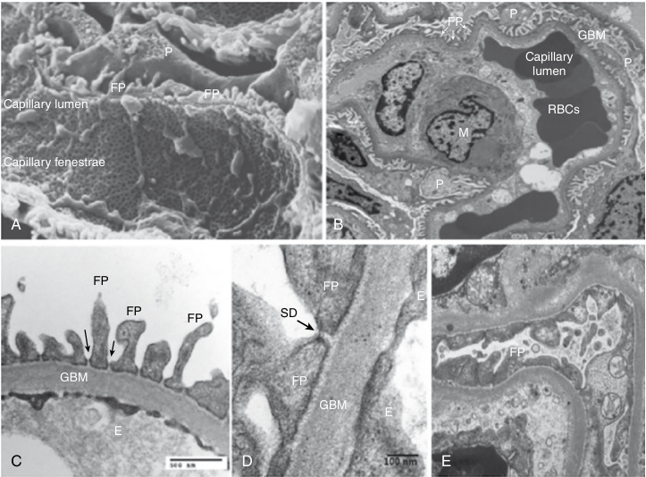
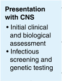
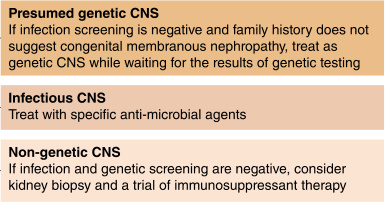
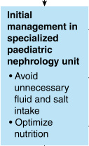
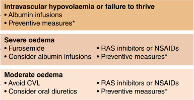
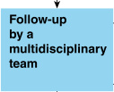
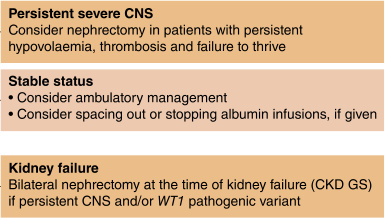
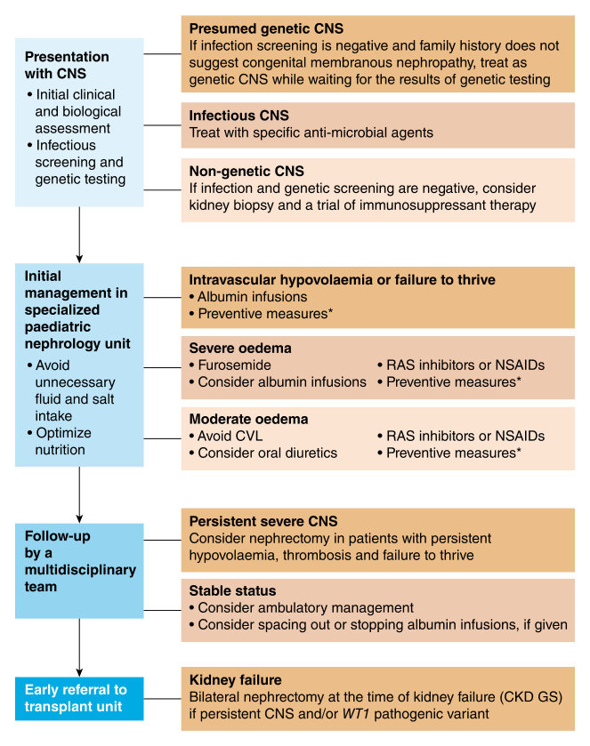

# Chapter 35: Congenital Nephrotic Syndromes
> **Course:** Vikkypaedia Rare Disease Learner Course (*Nelson Pediatric Textbook of Rare Diseases: Genomic Etiologies and Genetic Diagnosis (1st Edition)*)  
> **Section VI:** Renal Disorders  
> **Authors:** Bernat Gomez Herrera, Alvaro Madrid Aris  
> **Metrics:** 8,688 words · 4 tables · 8 figures · 76 genes · 28 flashcards · 14 MCQs  
> **Quick Navigation:** [🃏 Study 28 Flashcards](../flashcards/035_flashcards.md) · [📝 Take 14-Q MCQ Quiz](../mcqs/035_mcqs.md) · [📚 Section VI Guide](../sections/Section_VI.md) · [🧬 Master OMIM/Gene Atlas](../omim_gene_atlas.md) · [💊 Precision Therapies Matrix](../therapies_matrix.md) · [🏠 Course Index](../../index.md)

## Key Chapter Topics
`Renal Disorders` · `Congenital Nephrotic Syndromes BERNAT GOMEZ HERRERA, ÁLVARO MADRID ARIS` · `Etiologies and Presentations` · `Genetic Causes` · `Less Common Genetic Etiologies` · `Nongenetic Causes` · `General Diagnostic Approach` · `Therapeutic Approach` · `Antiproteinuric Agents` · `Diuretics` · `Fluid Management and Nutrition` · `Vascular Access` · `Nephrectomies` · `Complications and Their Management`

## Key Genes & Molecular Targets
`ACTN4`, `ADCK4`, `ALG1`, `APOL1`, `ARHGAP24`, `C3`, `CD151`, `CD2AP`, `COL4A3`, `COL4A5`, `CON7`, `COQ2`, `COQ6`, `COQ8B`, `CRB2`, `DGKE`, `EMP2`, `EXT1`

## Indexed OMIM Identifiers
`#609049`

## ⚡ High-Yield Clinical & Diagnostic Pearls
- Congenital nephrotic syndrome (CNS) is a rare disorder characterized by massive proteinuria, hypoalbuminemia, and severe edema, with onset typically occurring before the first three months of life (Table 35.1).
- CNF is inherited as an autosomal recessive trait, with no manifestations observed in heterozygous individuals.
- While there is no renal histology that is pathognomonic for NPHS1 deficiency, the most characteristic histological features include expansion of the glomerular mesangium and irregular microcystic dilations in the proximal tubules.
- The two most common variants, Fin-major (c.121delCT; p.Leu41fs) a 2-base pair deletion in exon 2, causes a frameshift variant resulting in the loss of the entire nephrin protein and Fin-minor (c.3325C.T; p.Arg1109Ter) is a nonsense variant CGA/TGA in exon 26 where the majority of the tail is not expressed.
- NPHS2 variants are the second most common genetic cause of CNS, contributing to 17–39% of cases.
- DDS is a rare developmental disorder characterized by progressive nephropathy, gonadal dysgenesis, and a predisposition to developing Wilms tumor.
- The syndrome is usually sporadic and follows an autosomal dominant inheritance pattern.
- The condition is characterized by earlyonset nephrotic syndrome with diffuse mesangial sclerosis, male pseudohermaphroditism, and Wilms tumor.

---
## Full Chapter Text, Tables & Figures

<!-- p.786 -->

## SECTION **VI** 

### Renal Disorders 

35. Congenital Nephrotic Syndromes, 767 

36. Bartter and Gitelman Syndromes, 785 

37. Monogenic Etiologies of Hypertension, 809 

38. Genetic Etiologies of Hemolytic Uremic Syndrome, 823

<!-- p.787 -->

<!-- p.788 -->

# 35 Congenital Nephrotic Syndromes **BERNAT GOMEZ HERRERA, ÁLVARO MADRID ARIS** 

Congenital nephrotic syndrome (CNS) is a rare disorder characterized by massive proteinuria, hypoalbuminemia, and severe edema, with onset typically occurring before the first three months of life (Table 35.1). CNS can be classified into primary and secondary causes. Primary causes are associated with genetic variants that affect the glomerular filtration barrier (Fig. 35.1), while secondary causes include infections and other systemic diseases. 

#### **Etiologies and Presentations** 

Major causes of CNS and other monogenic nephrotic syndromes are noted in Tables 35.2, 35.3, and 35.4. 

#### **Genetic Causes** 

##### **NPHS1** 

**_NPHS1_** encodes nephrin, a cell adhesion protein, and is mapped to chromosome 19q13. CNS due to biallelic pathogenic variants in _NPHS1_ is considered congenital nephrotic syndrome of **Finnish type (CNF)** . The terms CNF and nephrotic syndrome type 1 have been used interchangeably to refer to this disorder. CNF is inherited as an autosomal recessive trait, with no manifestations observed in heterozygous individuals. 

_NPHS1_ consists of 29 exons spanning a genomic region of 26 kb. _NPHS1_ encodes nephrin, a 1241-amino acid protein located at the podocyte slit diaphragm of the glomerular filtration barrier. Nephrin is a crucial structural and functional component of the slit diaphragm. Its unique structure facilitates various cellular interactions, including cell signaling, cell-to-cell, cell-to-matrix, and proteinto-protein interactions. Nephrin molecules from neighboring foot processes of separate podocyte cells form a zipper-like structure, which constitutes the core of the slit diaphragm. This structural arrangement may explain the absence of slit diaphragms and foot processes in patients with CNF. Nephrin is synthesized exclusively by glomerular podocytes, and pathogenic variants have been identified throughout all 29 exons of _NPHS1_ . 

CNF is a severe form of CNS typically observed in Finnish newborns. The incidence is ~0.9 per 10,000 births. The estimated carrier frequency for the two founder variants, Fin-major and Fin-minor, is 1 in 59 and 1 in 2004, respectively. A higher incidence has also been reported among the Old Order Mennonites in Lancaster, Pennsylvania. CNF has been described in various other ethnic groups with a worldwide incidence rate of 1 to 3 per 100,000. 

Morphological findings in NPHS1 deficiency (Fig. 35.1) are nonspecific; genetic analysis is required for a definitive diagnosis. While there is no renal histology that is pathognomonic for NPHS1 deficiency, the most characteristic histological features include expansion of the glomerular mesangium and irregular microcystic dilations in the proximal tubules. Microcystic dilatation of the proximal tubules is the most prominent feature, although it is not specific and may not be present in all patients. These histological changes are generally more detectable after the age of 3 months. Immunofluorescence studies do not show immune deposits. Electron microscopy typically reveals complete foot process effacement. 

Different variants in _NPHS1_ were found to segregate with the disorder in affected Finnish families. The two most common variants, **Fin-major (c.121delCT; p.Leu41fs)** a 2-base pair deletion in exon 2, causes a frameshift variant resulting in the loss of the entire nephrin protein and **Fin-minor (c.3325C.T; p.Arg1109Ter)** is a nonsense variant CGA/TGA in exon 26 where the majority of the tail is not expressed. Together, these two variants account for ~90% of all affected Finnish cases; these two _Finnish type_ variants cause classically severe phenotypes with early onset of disease. Both variants result in stop codons and truncated proteins. These variants are rare outside Finland. 

More than 200 variants in _NPHS1_ have been reported in non-Finnish CNF patients, with specific pathogenic variants being more common than others within different ethnic groups. Across different populations, the influence of ethnicity on the variant geography is evident. Not all _NPHS1_ variants cause severe CNS or a severe clinical course.

<!-- p.789 -->

###### **TABLE Clinical Manifestations and Diagnostic 35.1 Measures of Congenital Nephrotic Syndrome** Prenatal Manifestations Postnatal Manifestation 

###### **TABLE** 

Prematurity Small gestational age Enlarged placenta (>25% of birth weight) Wide cranial sutures, large open fontanelles, small nose, wide-set eyes, low-set ears Significant proteinuria and edema Poor growth Hypothyroidism Umbilical hernia Features related to specific syndromes 

Elevated maternal serum alpha-fetoprotein (AFP) Elevated amniotic fluid alpha-fetoprotein Large hyperechogenic kidneys Proteinuria (starts intrauterine) 

From AbuMaziad AS, Abusaleh R, Bhati S. Congenital nephrotic syndrome. _J Perinatol_ . 2021;41:2704-2712 (Table 3, p. 2708). 

Some patients with certain variants have been reported to have a less severe form of the disease than Finnish patients. Several studies have reported that some _NPHS1_ variants are associated with end-stage kidney disease (ESKD) occurring after the age of 20 years. 

##### **_Clinical Features_** 

Most infants with congenital nephrotic syndrome (CNF) are born prematurely (35 to 38 weeks) with a low birth weight for gestational age. The placenta is characteristically enlarged, often constituting more than 25% of the total birth weight (Table 35.1). Fetal distress is common, and cranial sutures are widely separated due to delayed ossification. Physical features may include a small nose, low-set ears, and flexion deformities of the hips, knees, and elbows, which are thought to result from the large placenta. 

Edema is present at birth or develops within the first week of life in ~50% of cases. Severe nephrotic syndrome with marked ascites is a consistent finding. Urinary protein losses result in profound hypoalbuminemia and severe 

**Fig. 35.1** Electron microscopy shows podocytes in normal and CNS (Human). (A) Scanning electron micrograph showing fenestrated endothelial cells lying on glomerular basement membrane (GBM). Podocytes enwrapping the capillaries from outside. (B) Transmission electron micrograph shows multiple podocyte cell bodies and interdigitating foot processes (original magnification ×4400). (C) Transmission electron micrograph shows normal foot processes and slit diaphragm _(arrows)_ located foot processes (original magnification ×24,500). (D) The micrograph shows normal slit diaphragm between foot processes, composed mainly of nephrin protein. (E) Electron microscopy of nephrin gene pathogenic variant (NPHS1) kidney, podocyte foot processes wide and absent slit diaphragm between foot processes are seen due to absence of nephrin protein (original magnification ×37,200). _CNS,_ Congenital nephrotic syndrome; _E,_ endothelial cell; _FP,_ foot processes; _GBM,_ glomerular basement membrane; _M,_ mesangial cell; _P,_ podocyte cell body; _RBCs,_ red blood cells; _SD,_ slit diaphragm.  (From AbuMaziad AS, Abusaleh R, Bhati S. Congenital nephrotic syndrome. _J Perinatol_ . 2021;41:2704-2712 [Fig. 1, p. 2705].)

<!-- p.790 -->

|**TABLE**  **Gen** |**etic Causes of Nephrotic S** |**yndromes Ca**|**tegorized A**|**ccording to the Location of Abnormal Proteins in**|
|---|---|---|---|---|
|**35.2** **Pod**|**ocytes**||||
|Gene|Protein|Inheritance|Locus|Phenotypes|
|**Slit Diaphr**|**agm and Adaptor Proteins**||||
|_NPHS1_|Nephrin|AR|19q13.1|CNS, SRNS (NPHS1)|
|_NPHS2_|Podocin|AR|1q25–q31|CNS, SRNS (NPHS2)|
|_PLCE1_|Phospholipase C,ε1|AR|10q23|DMS, SRNS (NPHS3)|
|_CD2AP_|CD2-associated protein|AD/AR|6p12.3|SRNS (FSGS3)|
|_FAT1_|FAT1|AR|4q35.2|NS, ciliopathy|
|**Cytoskelet**|**on Components**||||
|_ACTN4_|α-Actinin-4|AD|19q13|Late-onset SRNS (FSGS1)|
|_INF2_|Inverted formin-2|AD||SRNS (FSGS5), Charcot-Marie-Tooth disease with glomerulopathy|
|_MYH9_|Myosin, heavy chain 9|AD|22q12. 3–13.1|Macrothrombocytopenia with sensorineural deafness, Epstein syndrome, Sebastian syndrome, Fechtner syndrome|
|_MYO1E_|Myosin IE|AR|15q22.2|Childhood-onset SRNS (FSGS6)|
|_ARHGDIA_|Rho GDP-dissociation inhibitor (GDI) a1|AR|17q25.3|Childhood-onset SRNS (NPHS8), seizures, cortical blindness|
|_ARHGAP24_|Arhgap24 (RhoGAP)|AD|4q22.1|Adolescent-onset FSGS|
|_ANLN_|Anillin|AD|7p14.2|FSGS8|
|**GBM and**|**Basal Membrane Proteins a**|**nd Related C**|**omponents**||
|_LAMB2_|Laminin subunit β2|AR|3p21|Pierson syndrome DMS, FSGS (NPHS5)|
|_ITGB4_|Integrin-β4|AR|17q25.1|Epidermolysis bullosa, anecdotic cases presenting with NS and FSGS|
|_ITGA3_|Integrin-β3|AR||Epidermolysis bullosa, interstitial lung disease, SRNS/FSGS|
|_CD151_|Tetraspanin|AR|11p15.5|Epidermolysis bullosa, sensorineural deafness, ESRD|
|_EXT1_|Glycosyltransferase|AR|8q24.11|SRNS|
|_COL4A3,4_|Collagen (IV)α3/α4|AD/AR|2q36–q37|Alport syndrome, FSGS|
|_COL4A5_|Collagen (IV)α5|XD|Xq22.3|Alport syndrome, FSGS|
|**Apical Me**|**mbrane Proteins**||||
|_TRPC6_|Transient receptor potential channel 6|AD|11q21–q22|SRNS (FSGS2)|
|_EMP2_|Epithelial membrane protein 2|AD|16p13.2|Childhood SRNS/SSNS (MCD) (NPHS10)|
|**Nuclear Pr**|**oteins**||||
|_WT1_|Wilms tumor protein|AD/AR|11p13|SRNS (NPHS4), Denys-Drash syndrome, Frasier syndrome, WAGR syndrome|
|_LMX1B_|LIM homeobox transcription factor 1-β|AD|9q34.1|Nail-patella syndrome, NS|
|_SMARCAL1_|HepA-related protein|AR|2q35|Schimke immuno-osseous dysplasia|
|_PAX2_|Paired box gene 2|AD|10q24. 3–q25.1|Adult-onset FSGS (FSGS7), renal coloboma syndrome|
|_MAFB_|A transcription factor|AD|20q11. 2–q13.1|Carpotarsal osteolysis progressive ESRD|
|_LMNA_|Lamins A and C|XD|1q22|Familial partial lipodystrophy, FSGS|
|_NXF5_|Nuclear RNA export factor 5|XR|Xq21|SRNS/FSGS cardiac conduction disorder|

_(Continued)_

<!-- p.791 -->

#### **TABLE 35.2** Ge Po netic Causes of Nephrotic S docytes—cont’d yndromes Ca tegorized A ccording to the Location of Abnormal Proteins in

|Gene|Protein|Inheritance|Locus|Phenotypes|
|---|---|---|---|---|
|_GATA3_|GATA binding protein 3|AD|10p14|HDR syndrome (hypoparathyroidism, sensorineural deafness, renal abnormalities)|
|_NUP93_|Nucleoporin 93kD|N/A|16q13|SRNS|
|_NUP107_|Nucleoporin 107kD|N/A|12q15|Early-childhood-onset SRNS/FSGS|
|**Mitochon**|**drial Proteins**|||i|
|_COQ2_|4-Hydroxybenzoate polyprenyltransferase|AR|4q21–q22|Early-onset SRNS, CoQ10 deficiency|
|_COQ6_|Ubiquinone biosynthesis monooxygenase COQ6|AR|14q24.3|NS with sensorineural deafness, CoQ10 deficiency|
|_PDSS2_|Decaprenyl-diphosphate synthase subunit 2|AR|6q21|Leigh syndrome, CoQ10 deficiency, FSGS|
|_MTTL1_|Mitochondrially encoded tRNA leucine 1 (UUA/G)|Maternal|mtDNA|Mitochondrial diabetes, deafness with FSGS, MELAS syndrome|
|_ADCK4_|aarF domain containing|AR|19q13.1|Childhood-onset SRNS (NPHS9), CoQ10 deficiency|
||kinase 4||||
|**Lysosom** |**al Proteins** ||||
|_SCARB2_|Scavenger receptor class B, member 2 (LIMP II)|AR|4q13–q21|Action myoclonus-renal failure syndrome, lysosomal storage disease|
|_NEU1_|Sialidase 1||||
||N-Acetyl-α-neuraminidase|AR|6p21.33|Nephrosialidosis, SRNS|
|**Other Intr**|**acellular Proteins**||||
|_APOL1_|Apolipoprotein L1|AR|22q12.3|FSGS in African-Americans (FSGS4)|
|_PTPRO_|Tyrosine phosphatase receptor-type O (GLEPP1)|AR|12p12.3|SRNS (NPHS6)|
|_CRB2_|Crumbs homolog 2|AR|9q33.3|Early-onset familial SRNS (FSGS9)|
|_DGKE_|Diacylglycerol kinase-ε|AR|17q22|Atypical hemolytic uremic syndrome, membranoproliferative lesions (NPHS7)|
|_ZMPSTE24_|Zinc metalloproteinase|AR|1q34|Mandibuloacral dysplasia, FSGS|
|_PMM2_|Phosphomannomutase 2|AR|16p13.2|CDG syndrome, FSGS|
|_ALG1_|β1,4 Mannosyltransferase|AR|16p13.3|CDG syndrome, congenital NS|
|_CUBN_|Cubilin|AR|10p13|Childhood-onset SRNS megaloblastic anemia|
|_TTC21B_|IFT139 (a component of intraflagellar transport-A)|AR|2q24.3|Nephronophthisis (NPHP12), FSGS|
|_WDR73_|WD repeat domain 73|AR|15q25.2|Galloway-Mowat syndrome, SRNS/FSGS|

_ACTN4,_ Actinin-alpha 4; _ADCK4,_ AarF domain containing kinase 4; _AD,_ autosomal dominant; _ALG1,_ asparagine-linked glycosylation protein 1; _ANLN,_ anillin; _APOL1,_ apolipoprotein L1; _AR,_ autosomal recessive; _ARHGAP24,_ Rho GTPase-activating protein 24; _ARHGDIA,_ Rho GDP dissociation inhibitor (GDI) alpha; _CD2AP,_ CD2-associated protein; _CDG syndrome,_ congenital disorders of glycosylation; _CNS,_ congenital nephrotic syndrome; _COQ2,_ coenzyme Q2 4-hydroxybenzoate polyprenyltransferase; _COQ6,_ coenzyme Q6 monooxygenase; _CoQ10,_ coenzyme Q10; _CRB2,_ Crumbs family member 2; _DGKE,_ diacylglycerol kinase epsilon; _DMS,_ diffuse mesangial sclerosis; _EMP2,_ epithelial membrane protein 2; _ESRD,_ end-stage renal disease; _EXT1,_ exostosin 1; _FSGS,_ focal segmental glomerulosclerosis; _GBM,_ glomerular basement membrane; _GLEPP-1,_ glomerular epithelial cell protein 1; _HDR syndrome,_ hypoparathyroidism, sensorineural deafness, and renal abnormalities; _ITGA3,_ integrin alpha 3; _ITGB4,_ integrin beta 4; _INF2,_ inverted formin, FH2 and WH2 domain containing; _LAMB2,_ laminin beta 2; _LIMP2,_ lysosome membrane protein 2; _LMX1B,_ LIM homeobox transcription factor 1 beta; _MAFB,_ v-maf avian musculoaponeurotic fibrosarcoma onco gene homolog B; _MELAS syndrome,_ mitochondrial encephalomyopathy, lactic acidosis, and strokelike episodes; _MTTL1,_ mitochondrially encoded tRNA leucine 1 (UUA/G); _MYH9,_ myosin heavy chain 9, nonmuscle; _MYO1E, Homo sapiens_ myosin IE; _N/A,_ not available; _NPHS1,_ nephrin; _NPHS2,_ podocin; _NS,_ nephrotic syndrome; _NUP93,_ Nucleoporin 93 kD; _NUP107,_ Nucleoporin 107 kD; _PDSS2,_ prenyl (solanesyl) diphosphate synthase, subunit 2; _PLCE1,_ phospholipase C, epsilon 1; _PTPRO,_ protein tyrosine phosphatase receptor type O; _SCARB2,_ scavenger receptor class B, member 2; _SMARCAL,_ SWI/SNFrelated, matrix associated, actin-dependent regulator of chromatin, subfamily a-like 1; _SRNS,_ steroid-resistant nephrotic syndrome; _TRPC6,_ transient receptor potential cation channel, subfamily C, member 6; _TTC21B,_ tetratricopeptide repeat domain 21B; _WAGR syndrome,_ Wilms tumor, aniridia, genitourinary anomalies, and mental retardation syndrome; _WDR73,_ WD repeat domain 73; _WT1,_ Wilms tumor 1. 

From Tae-Sun Ha, MD. Genetics of hereditary nephrotic syndrome: a clinical review. _Korean J Pediatr_ . 2017;60(3):55-63.

<!-- p.792 -->

#### **TABLE 35.3** Se Gene/ lected List of Ge nes Causing C ongenital Nephrotic Syn drome and Associated Phenotype

|Locus|Protein|Inheritance|Function|Renal Pathology|Nonrenal Characteristics|
|---|---|---|---|---|---|
|NPHS1 19q13.1|Nephrin|AR|Main component of the SD Crucial for the integrity of actin cytoskeleton|CNF|Large placenta Preterm Small for gestational age Wide cranial sutures Small nose Low-set ears|
|NPHS2 1q25-31|Podocin|AR|Scaffold protein linking plasma membrane to actin cytoskeleton|CNS, SRNS, FSGS||
|WT1 11p13|Wilms tumor 1|AD|Located in podocyte Transcription factor Tumor suppressor Regulator for renal differentiation and gonadal development|DDS Frasier syndrome WAGR syndrome Isolated DMS Isolated FSGS|Pseudohermaphroditism Gonadal abnormalities Growth restriction Development of Wilms tumor Aniridia|
|LAMB2 3p21|Laminin-β2|AR|Located in GBM Links GBM with actin cytoskeleton|DMS Pierson syndrome|Cataract, microcoria, retinal abnormalities Lens abnormality Hypotonia Developmental delay|
|PLCE1 10q23|Phospho-lipase Cε1|AR|Located in podocyte Cell signaling Glomerular development|DMS FSGS|Microcephaly Ocular abnormalities (cataract, myopia, nystagmus) Developmental delay Muscular dystrophy|
|LMXB1 9q34|Lim homeobox transcription factor 1b|AD|Located in podocytes Regulator of alpha-chains of collagen IV|Proteinuria FSGS|Nail abnormalities/dysplasia Absent patella Underdeveloped patella Bony horns Glaucoma|
|CRB2 9q33.4|Crumb 2|AR|Maintenance of epithelial polarity|FSGS|Elevated maternal serum and amniotic fluid AFP cerebral ventriculomegaly|

_AR,_ Autosomal recessive; _CNF,_ congenital nephrotic syndrome-Finnish; _DDS,_ Denys-Drash syndrome; _DMS,_ diffuse mesangial sclerosis; _FSGS,_ focal segmental glomerulosclerosis; _GBM,_ glomerular basement membrane; _SD,_ slit diaphragm; _WAGR syndrome,_ Wilms tumor, aniridia, genitourinary defects, mental retardation. From AbuMaziad AS, Abusaleh R, Bhati S. Congenital nephrotic syndrome. _J Perinatol_ . 2021;41:2704-2712 (Table 2, p. 2708). 

hypogammaglobulinemia, leading to poor nutritional status and stunted growth. Affected infants are highly susceptible to bacterial infections and thromboembolic complications due to protein loss. Hypothyroidism, secondary to urinary loss of thyroxine-binding proteins, is common. This is attributed to the chronic massive proteinuria, which causes loss of thyroid-binding globulin (TBG), thyroid hormone, and iodine. 

##### **_Onset and Diagnosis_** 

Nephrotic syndrome is diagnosed within the first week of life in 82% of infants with NPHS1 deficiency. A European study reported that all patients with _NPHS1_ variants manifested symptoms within the first 90 days. 

Blood urea nitrogen and creatinine levels are typically normal at _initial_ presentation. Kidney ultrasonography reveals slightly enlarged, hyperechogenic kidneys with loss of normal corticomedullary differentiation. 

CNF can be diagnosed during pregnancy when it becomes manifest during early fetal life, beginning at 15 to 16 weeks of gestational age. The initial symptom is fetal proteinuria, which leads to a more than 10-fold rise in the amniotic fluid alpha-fetoprotein (AFP) concentration. Maternal AFP may also be increased. These changes are not specific and can be observed in pregnancies in which the fetus is a healthy carrier (heterozygote) of a pathogenic _NPHS1_ variant. It is possible to achieve a definitive antenatal diagnosis when performing a genetic test via trophoblast biopsy.

<!-- p.793 -->

###### **TABLE 35.4 Etiology of Congenital Nephrotic Syndrome** 

|Genetic Forms|_NPHS1_gene pathogenic variants|
|---|---|
|of CNS|(Nephrin)|
||• Congenital nephrotic syndrome of Finnish-type (most common) Podocin gene pathogenic variants _(NPHS2)_ _WT1_gene pathogenic variants |
||• Denys-Drash syndrome • Frasier syndrome • Isolated DMS/CNS _LAMB2_gene pathogenic variants|
||• Pierson syndrome • Isolated DMS/CNS|
||_PLCE1_gene pathogenic variants • Isolated DMS/CNS Diffuse mesangial sclerosis|
||• Isolated DMS|
||• Syndrome-associated (Denys-Drash and Frasier syndromes) Galloway-Mowat syndrome Other genetic diseases |
||•_LMX1B_gene pathogenic variants • Nail-patella syndrome _LAMB3_gene pathogenic variants _ITGA3_gene pathogenic variants Mitochondrial gene pathogenic variants (COQ2, COQ6, COQ8B, PDSS2) _PMM2_gene pathogenic variants (Glycosylation defect)|
|Nongenetic|Infections|
|CNS|• Congenital syphilis • Toxoplasmosis • Malaria • Cytomegalovirus • Hepatitis B • Human immunodeficiency virus • Rubella Maternal-related|
||• Maternal lupus • Neonatal antibodies against neutral endopeptidase|
|From AbuMaziad|AS, Abusaleh R, Bhati S. Congenital nephrotic|
|syndrome._J Perinat_|_ol_. 2021;41:2704-2712 (Table 1, p. 2707).|

##### **_Systemic Involvement_** 

Infants with _NPHS1_ defects typically do not exhibit extrarenal malformations, although minor functional disorders in the central nervous system and heart are common during the nephrotic stage. Most affected children display hypotonia; mild atrophic brain changes have been observed in 30% of cases. Dystonic cerebral palsy has been reported in 8% of CNF patients, with neurological symptoms becoming apparent during the first year of life. MRI findings include increased T2-weighted signal intensity in the globus pallidus region. Minor cardiac abnormalities, such as hypertrophy and mild pulmonary stenosis, have also been reported. 

##### **NPHS2** 

**_NPHS2_** , located on chromosome 1q25–q31, encodes podocin, a 383-amino acid hairpin-like protein essential for the structure and function of the slit diaphragm in podocytes. Podocin interacts with nephrin and CD2-associated protein (CD2AP) through its C-terminal domain, having a crucial role in cell signaling and podocyte adaptation to filtration changes. More than 100 pathogenic _NPHS2_ variants have been reported that involve nonsense and frameshift changes in exons. Pathogenic variants in _NPHS2_ are typically severe, often resulting in truncated, nonfunctional podocin proteins. These variants disrupt nephrin’s proper targeting to the slit diaphragm, leading to nephrotic syndrome. 

_NPHS2_ variants are the second most common genetic cause of CNS, contributing to 17–39% of cases. Prevalence varies across different populations, with more cases in central Europe, where, according to some studies, _NPHS2_ variants account for ~50% of all patients with CNS. 

##### **_Clinical Presentation_** 

The severity of proteinuria and the resulting clinical findings are more variable than in patients with _NPHS1_ disease. Newborns with _NPHS2_ variants appear normal at birth, with a normal birth weight and no evidence of placental enlargement. In some cases, nephrotic syndrome can be present at birth or be suspected in utero based on elevated AFP levels or the identification of large, hyperechogenic kidneys on prenatal imaging. More commonly, proteinuria develops postnatally, progressively increasing during the first or second year of life. 

_NPHS2_ variants are generally associated with a milder clinical presentation, including less severe proteinuria, compared to _NPHS1_ variants. Podocin expression is restricted to the kidney glomerulus; no significant extrarenal manifestations have been reported. Minor cardiac abnormalities have occasionally been observed. 

Among European patients with CNS presenting in the first week of life, 11% had _NPHS2_ variants, whereas 74% had _NPHS1_ variants. For those presenting with nephrotic syndrome after 1 month of age, _NPHS2_ variants accounted for 37%, while _NPHS1_ variants were identified in 16%. 

Almost all affected children progress to ESKD, but kidney survival is generally better than in children with _NPHS1_ pathogenic variants. 

When kidney biopsy is performed, it frequently exhibits minimal histological changes, with fewer than 50% of biopsies showing focal segmental glomerular sclerosis (FSGS). 

##### **Wilms Tumor Suppressor Gene Variants** 

The Wilms tumor suppressor gene **_(WT1)_** encodes a zinc finger DNA-binding transcription factor that plays a critical role in the embryonic development of the kidneys and genitalia. _WT1_ is abundantly expressed in podocytes and regulates cellular functions such as nephrin expression. Pathogenic variants in _WT1_ can lead to various

<!-- p.794 -->

developmental syndromes, including **Denys-Drash syndrome** (DDS), **Frasier** , and **WAGR (Wilms tumor, aniridia, genitourinary defects, mental retardation) syndromes** , which typically manifest during childhood. _WT1_ variants may also cause isolated kidney disease, with nephrotic syndrome presenting within the first three months of life, accounting for a small percentage of CNS cases. DDS is a rare developmental disorder characterized by progressive nephropathy, gonadal dysgenesis, and a predisposition to developing Wilms tumor. 

##### **_Epidemiology and Genetics_** 

DDS is rare, with heterozygous _WT1_ variants accounting for 2–13% of CNS cases. The syndrome is usually sporadic and follows an autosomal dominant inheritance pattern. 

Wilms tumor, an embryonic kidney tumor, arises from aberrant mesenchymal stem cell differentiation, typically due to the loss of tumor suppressor gene function. _WT1_ is located at chromosomal position 11p13. _WT1_ is also expressed in the gonads, explaining the genital abnormalities observed in DDS. Missense variants in exons 8 or 9 impair the DNA-binding capacity of the WT1 protein, leading to DDS. The condition is characterized by earlyonset nephrotic syndrome with diffuse mesangial sclerosis, male pseudohermaphroditism, and Wilms tumor. 

##### **_Clinical Presentation_** 

Patients with DDS usually develop nephropathy between 2 months and 2 years of age and progress to ESKD before the age of 4 years. However, the severity and age of onset vary among individuals. 

**Neonatal-onset DDS** is defined as nephrotic syndrome diagnosed before 1 month of age in patients with DDS. Children with neonatal presentation often have poor renal outcomes. These children present with heavy proteinuria, hypoalbuminemia, and edema, similar to other CNS such as CNF, making clinical differentiation challenging. There is a rapid progression to kidney failure. 

**Diffuse mesangial sclerosis** is a hallmark feature of DDS; the clinical course of nephropathy mirrors that of _isolated_ diffuse mesangial sclerosis. Wilms tumor may not always be the first clinical manifestation. Male pseudohermaphroditism, presenting as ambiguous genitalia, is often observed, along with other disorders of sexual development. 

While infants with DDS tend to have larger placentas compared to healthy newborns, their placental/fetal weight ratio (18%) is significantly smaller than that of patients with CNF (placental/fetal weight >25%). Patients with DDS also tend to have higher serum creatinine levels at onset compared to those with CNF. 

Because of the significant and early risk of Wilms tumor (55–74%), the management of patients with _WT1_ variants differ from that of other CNS patients. Prophylactic bilateral nephrectomy after the onset of ESKD is recommended to prevent Wilms tumor development following kidney transplantation. 

##### **Pierson Syndrome** 

Pierson syndrome (MIM #609049) is a rare autosomal recessive disorder caused by variants in **_LAMB2_** , located on chromosome 3p21.31 and consisting of 32 exons. The laminin β2 chain, encoded by _LAMB2_ , is expressed in the glomerular basement membranes (GBM), ocular structures, and neuromuscular synapses. In the GBM, laminin β2 plays a critical role in anchoring podocyte foot processes and facilitating their development. _LAMB2_ variants result in syndromic CNS, accounting for 1.7–5% of cases. 

Most _LAMB2_ variants are truncating, leading to loss of function, and can occur throughout the gene. Patients with biallelic truncating variants exhibit severe phenotypes, while those with at least one missense variant typically have milder presentations. 

##### **_Clinical Features_** 

Pierson syndrome is characterized by CNS, distinct ocular abnormalities, muscular hypotonia, and impairments in vision and neurodevelopment. Patients typically present with early-onset nephrotic syndrome. In one study, 90% of those with _LAMB2_ variants presented with CNS within the first three months of life. Kidney disease often occurs within the first weeks or months of life, with most affected individuals developing ESKD by 12 months of age. The predominant histological finding is diffuse mesangial sclerosis, although some cases can show FSGS. 

The hallmark **ocular abnormality** is microcoria, characterized by fixed, extremely small pupils. Additional findings may include cataracts, lens deformities, corneal abnormalities, and retinal defects, frequently leading to blindness. 

Survivors of the neonatal period may develop severe hypotonia and developmental delay. Microcephaly is present in approximately 10% of cases, while neurodevelopmental deficits are observed in up to 50% of patients. 

The prognosis for Pierson syndrome is generally poor, with high mortality during the first days or weeks after birth from renal failure. However, patients with missense _LAMB2_ variants or small in-frame deletions often exhibit a milder phenotype, characterized by milder ocular abnormalities and slower progression to ESKD. 

#### **Less Common Genetic Etiologies** 

##### **Phospholipase C Epsilon 1** 

Biallelic pathogenic variants in the phospholipase C epsilon 1 **_(PLCE1)_** gene cause an autosomal recessive form of earlyonset nephrotic syndrome. 

_PLCE1_ encodes a phospholipase enzyme that may be involved in slit diaphragm signaling and the function of the glomerular filter, with a possible effect on nephrin and podocin gene expression. The absence of PLCE1 may halt glomerular development, leading to lesions resembling diffuse mesangial sclerosis and an early-onset CNS. Extrarenal manifestations have not been reported in individuals with _PLCE1_ variants. Incomplete penetrance occurs, suggesting that other factors might modify the effects of _PLCE1_ variants.

<!-- p.795 -->

##### **Galloway-Mowat Syndrome** 

Podocytes resemble neuronal cells and share many structural proteins; genetic syndromes affecting both the kidney and the central nervous system are not surprising. 

Galloway-Mowat syndrome is characterized by nephrotic syndrome, severe neurological abnormalities, microcephaly at birth, intellectual disability, hiatus hernia, and skeletal anomalies. It appears to be transmitted as an autosomal recessive trait. 

Nephrotic syndrome presents early with a mean age of onset of 3 months. Kidney biopsy reveals minimal changes or focal segmental glomerulosclerosis (FSGS). 

Brain abnormalities include neuronal-migration abnormalities such as agyria or microgyria, which lead to severe psychomotor developmental delay and seizures. The patients may also present dysmorphic features such as hypertelorism, ear abnormalities, and micrognathia. 

Truncating variants in **_WDR73_** were first described as the cause of the disorder. Pathogenic variants in several other genes, including _WDR4_ , _NUP133_ , _NUP107_ , _OSGEP_ , _LAGE3_ , _TP53RK_ , _TPRKB_ , _CON7_ , _PRDM15_ , and _PMM2_ may also cause Galloway-Mowat syndrome. Recessive variants in the genes encoding the four subunits of the KEOPS complex ( _OSGEP_ , _TP53RK_ , _TPRKB_ , and _LAGE3_ ), which plays an important role in the brain and renal development, have also been identified in 37 affected individuals from 32 families. 

##### **Nail-Patella Syndrome** 

Nail–patella syndrome (NPS), also known as _hereditary osteo‑onychodysplasia_ , is an autosomal dominant disorder characterized by abnormalities involving the nails, limbs, kidneys, and eyes. It is caused by pathogenic variants in **_LMX1B_** , located on the long arm of chromosome 9. _LMX1B_ encodes a transcription factor of the LIM-homeodomain family, which has a crucial role in the development of limbs and kidneys in vertebrates. 

Proteinuria is often the first clinical sign and may present from birth or later. Renal involvement occurs in 30–40% of patients, typically as asymptomatic proteinuria. Some patients may develop nephrotic syndrome and progress to ESKD. 

Limb and nail abnormalities are nearly universal in NPS. Common limb and pelvic abnormalities include patellar aplasia or hypoplasia, posterior subluxation of the radial head, hypoplasia of the lateral epicondyle and capitellum, and prominence of the medial epicondyle. Elbow deformities can result in limitations in movement, cubitus valgus, and pterygia (webbing of the elbow). Iliac horns, bilateral symmetrical bone formations originating from the anterior superior iliac spine, are found in 70–80% of patients and are pathognomonic for NPS. 

Other limb abnormalities include underdevelopment of proximal musculature, hyperextensibility of large joints, talipes equinovarus, calcaneovalgus, flat feet, and tight Achilles tendon. 

##### **Mitochondrial Disorders** 

Early-onset CNS has been reported in children with **coenzyme Q10 (ubiquinone) deficiency** due to genetic variants affecting the biosynthesis of coenzyme Q10, a mobile electron carrier and antioxidant. Defects of five nuclear genes _(COQ2, PDSS2, COQ6, COQ8B, PDSS1)_ have been reported to cause early-onset nephrotic syndrome. Inheritance is autosomal recessive. 

Nephrotic syndrome in disorders of coenzyme Q10 biosynthesis is characterized by FSGS, which may have a collapsing pattern. It may present as an isolated renal disease or as part of a multisystemic disorder. Age of onset is variable and begins within the neonatal period in ~30% of patients. Some of the associated symptoms include sensorineural hearing loss, nystagmus, encephalopathy, seizures, ataxia, hypotonia, developmental delay, diabetes mellitus, and elevated lactate levels. 

Prompt recognition of these conditions is extremely important because treatment with high doses of ubiquinone can reduce proteinuria, improve nephrotic syndrome, reverse the need for dialysis, and slow disease progression. 

##### **Herlitz Junctional Epidermolysis Bullosa** 

This autosomal recessive disease is characterized by recurrent blister formation because of structural fragility within the skin. Variants of several genes involved in the biosynthesis of collagens, integrins, or laminins have been reported, some of them in association with a nephrotic syndrome and FSGS: _ITGB4_ , _ITGA4_ , _ITGA3_ , _LAMB3_ , and _CD151_ . 

##### **Sphingosine Phosphate Lyase Insufficiency Syndrome** 

_SGPL1_ encodes sphingosine-1-phosphate lyase 1, an enzyme that catalyzes the final degradation step of sphingolipids, which are involved in angiogenesis, vascular maturation, and immune function. Biallelic pathogenic variants in the _SGPL1_ gene can result in significant glomerulopathy. Recessive _SGPL1_ variants have been associated with a range of clinical manifestations, including adrenal insufficiency with calcifications, ichthyosis, acanthosis, immunodeficiency, and CNS. Additional symptoms can include hypothyroidism, neurological issues, and cryptorchidism. 

##### **Nephrotic Syndrome Type 15** 

Biallelic pathogenic variants in _MAGI2_ have been reported in patients with CNS. MAGI2 is a scaffolding protein that has been shown to interact with nephrin and regulate podocyte cytoskeleton and slit diaphragm dynamics 

##### **Congenital Disorders of Glycosylation** 

Congenital disorders of glycosylation (CDG) are rare multisystem diseases caused by impaired synthesis, transfer, and

<!-- p.796 -->

processing of sugar chains, leading to hypoglycosylation of proteins throughout the body. 

ALG1-CDG associated with pathogenic variants in _ALG1_ is an inherited metabolic disorder resulting in a deficiency of β-1,4 mannosyltransferase. Clinical presentation includes microcephaly, developmental delay, abnormal fat distribution, strabismus, coagulation abnormalities, seizures, cerebellar hypoplasia, hypotonia, and failure to thrive. CNS has been described in ALG1-CDG, occurring in up to 20% of patients. 

##### **CRB2** 

Biallelic _CRB2_ variants have been reported in five fetuses and one child from three families, all presenting severe neurological involvement, including ventriculomegaly, and kidney abnormalities such CNS, which can be severe and resemble CNF. 

#### **Nongenetic Causes** 

CNS can be secondary to systemic diseases, including congenital or neonatal infections and immune disorders (Table 35.4). While genetic defects are the primary cause of CNS, infections are a possible etiology. Although nongenetic causes of CNS are rare, they often have a better prognosis once the underlying condition is identified and treated. 

##### **Infectious Causes** 

The following infections have been associated with CNS: 

- **Syphilis** . Hematuria and proteinuria are common; CNS is rare. Histology shows membranous nephropathy. Treatment is with penicillin. 

- **Cytomegalovirus** . Histology shows mesangial proliferation. Treatment is with ganciclovir. 

- **Toxoplasmosis** . Histology shows mesangial proliferation. Treatment is with pyrimethamine and sulfadiazine, steroids. 

- **Rubella** . Histology shows membranous nephropathy. 

- Other infectious causes: measles, pertussis, herpes simplex, and herpes zoster. 

##### **Immune Disorders** 

###### **_Membranous Nephropathy Due to Maternal Antibody Against the Fetal Neutral Endopeptidase_** 

CNS due to membranous nephropathy has been diagnosed antenatally in infants from mothers with pathogenic variants in the metallomembrane endopeptidase _(MME)_ gene, which encodes the podocyte protein neutral endopeptidase (NEP). 

During pregnancy, the presence of fetal NEP protein triggers a maternal alloimmune response, leading to the production of maternal IgG antibodies that cross the placenta and bind to NEP on fetal podocytes, forming immune deposits in the GBM. 

This results in subepithelial immune deposits in the glomeruli of the fetus and neonate. The infant typically presents with nephrotic syndrome, but proteinuria may decrease over time as maternal antibodies and immune deposits diminish. 

##### **_Systemic Lupus Erythematosus_** 

Although systemic lupus erythematosus is rarely diagnosed before 5 years of age, an infantile form of the disease has been reported. Nephrotic syndrome was the major clinical finding in five infants aged 6 weeks to 6 months with systemic lupus erythematosus. These patients had elevated antinuclear antibody titers, hypocomplementemia, and diffuse proliferative glomerulonephritis. Response to immunosuppressive therapy was unsatisfactory. 

#### **General Diagnostic Approach** 

Children with CNS are diagnosed at birth or within the first three months of life. Classical features include generalized edema, abdominal distension, and ascites (Table 35.1). Clinical presentation can vary widely, even among patients with the same pathogenic variants, as the severity depends on the degree of proteinuria. Some patients may present with symptomatic hypovolemia, which can manifest as oliguria, hypotension, tachycardia, abdominal pain or discomfort, and prolonged capillary refill time. 

A general diagnostic assessment approach is shown in Table 35.5. 

Genetic testing is essential and is the first-choice diagnostic method because most cases of CNS have a genetic etiology. When available, whole-exome sequencing should be the method of choice. If not, a screening panel including sequencing of at least the _NPHS1_ , _NPHS2_ , _WT1_ , and _LAMB2_ genes is recommended because these genes account for >80% of the genetic defects. 

Kidney biopsy _is not_ routinely performed because results may be nonspecific and may not identify the underlying etiology, especially a genetic cause. Kidney biopsy is reserved for patients with inconclusive genetic results or for those with an important reduction in estimated glomerular filtration rate to rule out rare diagnoses such as congenital membranous nephropathy. When performed, the biopsy should include light microscopy, immunofluorescence or immunohistochemistry, and electron microscopy. 

Extrarenal manifestations can be helpful in guiding the diagnosis, especially in syndromic cases. Neurological examination and brain imaging may detect abnormal cerebral gyration or cerebellar atrophy suggestive of Galloway-Mowat syndrome, while the presence of seizures, sensorineural hearing loss, and cerebellar and cerebral atrophy may suggest CoQ10 deficiency; ventriculomegaly is characteristic of _CRB2_ variants. Genital abnormalities in an affected male infant suggest Denys-Drash syndrome caused by a _WT1_ variant. Dysmorphic features, ophthalmological anomalies, or deafness suggest an underlying genetic cause.

<!-- p.797 -->

###### **TABLE** 

###### **35.5** 

###### **Initial Evaluation for a Child With CNS** 

###### **History** 

- Family history: consanguinity, ethnicity, history of CNS, early infantile death and unsolved neurological and kidney diseases of infancy. 

- Prenatal and perinatal history: enlarged prenatal nuchal translucency, increased amniotic fluid alpha-fetoprotein, fetal edema, oligohydramnios and placental weight >25% of newborn weight. 

- Patient history: fever episodes, pain, abdominal discomfort, swelling, fatigue. 

###### **First-Line Evaluation** 

- Growth chart: height or length, weight, head circumference if aged <2 years, calculation of BMI and annual height velocity. • Blood pressure. 

- Physical examination: volume status, signs of edema (e.g., ascites, pericardial and pleural effusions). • Blood biochemistry: blood count, levels of sodium, chloride, albumin, magnesium, creatinine, urea, protein, albumin, cholesterol, fasting triglycerides and glucose. 

- • Levels of thyroid-stimulating hormone and free thyroxine (T4). • Serum IgG level. 

- Serum levels of ionized calcium, phosphate, alkaline phosphatase, PTH, 25(OH) vitamin D3. • Ultrasound of abdomen and pleural space (kidney echogenicity and size, ascites, effusions and thrombosis). • Cardiac ultrasound (effusions and left ventricular mass). 

###### **Extended Evaluation** 

- Evaluation of dysmorphic features and skeletal abnormalities, genital examination, ophthalmological examination, hearing test. • Full neurological examination and standardized assessment of cognitive status with or without brain MRI. 

- Serology for syphilis, toxoplasmosis, CMV, rubella, measles, HBV, HCV, HSV1, HSV2, HZV, HIV, and _Bordetella pertussis_ (if the mother or infant has not already been screened for these infections). 

- • Further screening in selected patients in endemic areas or in the case of clinical suspicion: malaria, antinuclear antibodies, serum complement (C3 and C4), antineutral endopeptidase (NEP) antibodies, amino acids (for diagnosis of glutaric aciduria type I or sialic acid storage disease), and/or mercury levels. 

###### **Genetic Tests** 

Refer to the ERKNet-ESPN consensus statement on genetic aspects of congenital nephrotic syndrome. 

###### **Genetic Counseling** 

As appropriate. 

###### **Diet** 

Assessment and advice from a renal dietician, including advice on salt, potassium, calorie, and protein intake. 

**Renal Histology** 

Kidney biopsy is indicated if all other screening is negative, indicating noninfectious, nongenetic CNS. Histological examination should include light microscopy, immunofluorescence and/or immunohistochemistry and electron microscopy. 

From Boyer O, Schaefer F, Haffner D, et al. Management of congenital nephrotic syndrome: consensus recommendations of the ERKNet-ESPN working group. _Nat Rev_ . 2021;17:277-289 (Box 2, p. 280). 

#### **Therapeutic Approach** 

##### **General Approach** 

It is advisable to ensure access to a transplant center from the early stages of kidney injury, with regular follow-up to facilitate timely preparation for transplantation and reduce the duration of dialysis. 

Key management objectives include optimizing fluid status, ensuring adequate protein and caloric intake, minimizing salt-containing fluids, preventing thrombosis, preserving vascular accesses, avoiding peripherally inserted catheters and unnecessary venipunctures, and prompt treatment of infections when suspected with empiric antibiotics before culture results are available (Fig. 35.2). 

##### **Albumin Infusions** 

There is widely varying practice in the use of intravenous albumin infusions among pediatric nephrologists. Some centers prescribe regular daily infusions, while many others reserve them only for cases of symptomatic hypovolemia. 

Potential but unproven advantages of albumin replacement in the _absence_ of hypovolemia include partial restoration of lost proteins and reduction of the edema. The disadvantages are the need for vascular access, an increased number of venipunctures, risk of thrombosis in large vessels, and the potential for catheter-related infections. 

Infused albumin is rapidly lost in the urine, meaning normalization of serum albumin levels is not achieved. The aim should be to enhance intravascular volume and

<!-- p.798 -->

**Fig. 35.2** Opinion-based management algorithm for CNS. At presentation with congenital nephrotic syndrome (CNS), a clinical and biological assessment including screening for congenital infections and genetic analysis is recommended. Initial treatment should be based on the results of these assessments. Patients should be managed at diagnosis by a specialized pediatric nephrology team. Blood volume should be assessed and symptomatic treatments instituted to maintain blood volume and prevent complications. Follow-up must be managed by a multidisciplinary team. Nephrectomy can be considered for children with persistent, severe CNS despite optimal management. Stable children can be managed on an outpatient basis with spacing or even stopping of albumin infusions. All children should be referred promptly to a kidney transplant team. Bilateral nephrectomy is recommended at the time of kidney failure (chronic kidney disease (CKD) G5) if nephrotic syndrome persists and/or if the patient has a WT1 pathogenic variant. *Preventive measures: prophylaxis for thrombosis, infection, and anemia, adequate nutrition, and growth hormone substitution. _CVL,_ Central venous line; _RAS,_ renin–angiotensin system.  (From Boyer O, Schaefer F, Haffner D, et al. Management of congenital nephrotic syndrome: consensus recommendations of the ERKNet-ESPN working group. _Nat Rev._ 2021;17:277-289 [Fig. 1, p. 282].) 

reduce extravascular fluid retention when hypovolemia is symptomatic. 

In patients with severe edema, frequent albumin infusions may prevent severe hypovolemia and faltering growth. In these cases, nephrectomies may be the only option to discontinue or reduce the frequency of albumin infusions. The frequency of albumin infusions should be based on the clinical situation rather than serum albumin levels alone. For patients with severe disease, daily infusions of 1–4 g/kg may be necessary. 

## **Antiproteinuric Agents** 

The use of renin-angiotensin-aldosterone system (RAAS) inhibitors, either angiotensin-converting enzyme **(ACE)** inhibitors or angiotensin II receptor blockers **(ARBs)** , is a standard of care for patients with CNS. These treatments help reduce protein loss through preferential dilation of the efferent renal arteriole, which decreases glomerular perfusion pressure in a dose-dependent manner. Additionally, these treatments may offer protective effects on podocytes and help slow the progression of CKD.

<!-- p.799 -->

RAAS inhibitors should be used cautiously in the neonatal period (postnatal age 4 weeks) because they may possibly interfere with nephrogenesis. All medications should be initiated at a low dose, with progressive titration and periodic monitoring of urine output, renal function, and potassium levels until the optimal, tolerated dose is achieved. 

**Captopril** is considered the least harmful RAAS inhibitor for small children due to its short half-life, which allows for safer dose titration and makes it the preferred initial choice. The recommended starting dosing scheme for captopril in patients younger than 3 months is 0.01 to 0.05 mg/kg per dose (in 3 doses per day), with a maximum daily dose of 2 mg/kg. In children older than 3 months, the recommended initial dose is 0.15 to 0.3 mg/kg per dose (in 3 doses per day), with a maximum daily dose of 6 mg/kg. If a therapeutic effect is observed, children may be switched to a long-acting ACE inhibitor such as **enalapril** or **ramipril** (0.1–0.2 mg/kg once daily) or an ARB such as **candesartan** (0.2–0.4 mg/kg once daily). 

The combined use of ACE inhibitors and ARBs does not provide additional benefits in reduction of proteinuria and may increase the risk of hypotension, hyperkalemia, and acute kidney injury (AKI); therefore, it is not recommended. 

Prostaglandin inhibitors, such as **indomethacin** , reduce kidney perfusion and intraglomerular pressure by suppressing renin production, although their efficacy is not well established. When used, indomethacin should be initiated after the neonatal period, starting with an initial dose of 0.5 mg/kg/day, divided into 2 to 3 daily doses, up to a maximum of 3 mg/kg/ day. It should be discontinued once CKD is established. 

It is important that parents must be informed that in situations where there is a risk of hypovolemia such as vomiting or diarrhea, diuretics, NSAIDs, and RAAS inhibitors must be stopped to prevent AKI and an increased risk of thrombosis. 

## **Diuretics** 

Diuretics are frequently used in CNS to reduce fluid overload. These medications should be prescribed with caution because they can worsen hypovolemia and promote thrombosis. The benefits of diuretic treatment include edema reduction and improved fluid control, which facilitates increased fluid administration and helps ensure adequate nutrition, especially when used alongside albumin infusions. 

It is advisable to administer **furosemide** (0.5–2 mg/kg) at the end of each albumin infusion, unless the patient is experiencing significant hypovolemia or hyponatremia. 

In cases of severe edema, furosemide is recommended at doses of 0.5–2 mg/kg per dose, either intravenously or orally, up to six times daily, with a maximum total daily dose of 10 mg/kg. However, doses exceeding 6 mg/kg/day are not recommended for prolonged use. The frequency and dosage should be based on the degree of edema and the diuresis achieved. Adequate monitoring of fluid status, serum potassium and sodium, kidney function, and blood pressure is required. For stable patients, furosemide can be given _orally_ at doses of 2–5 mg/kg/day, potentially in combination with another diuretic family. 

In children with nephrotic syndrome, salt retention and edema may develop through activation of the epithelial sodium channel (ENaC). Therefore, if a second diuretic is used, **amiloride** , as a blocker of ENaC, is preferable to other potassium-sparing diuretic, such as spironolactone. 

## **Fluid Management and Nutrition** 

It is important to assess the volume situation of patients with CNS as these patients are generally edematous but can experience hypovolemia. In the case of symptomatic hypovolemia, intravenous albumin is the treatment of choice. 

**Fluid restriction** is advised when there is hyponatremia or moderate to severe edema, avoiding volume depletion. However, it is important to emphasize that proper nutrition is vital in children with CNS, and fluid restriction should not interfere with meeting caloric requirements. 

A **high-calorie intake** (120–150 kcal/kg per day) and a high-protein diet (3–4 g/kg/day) are recommended. Ensuring a **low-salt diet** is important to prevent worsening edema, as follows: 

- <0.5 g/day in infants <6 months 

- <1 g/day in infants aged 7–12 months 

- <2 g/day in children aged 1–3 years 

- <3 g/day in children aged >3 years 

- Placement of a nasogastric tube or gastrostomy may be nec- 

- essary to achieve adequate nutritional intake in many patients. 

## **Vascular Access** 

Whenever possible, central venous catheter placement should be avoided due to risk of catheter-related thrombosis and infections, as well as the need to preserve potential sites for future hemodialysis access. It is important to avoid unnecessary venipunctures and canalization of peripherally inserted central catheters, to preserve veins and arteries for eventual creation of an arteriovenous fistula. 

## **Nephrectomies** 

Unilateral or bilateral nephrectomies are a common practice in children with CNS to reduce massive proteinuria. There is heterogeneity in treatment approaches between centers. Most aggressive protocols include bilateral nephrectomy and initiation of dialysis when the patient weighs 7–9 kg and is 6–12 months of age, followed by kidney transplantation. The aim of this approach is to improve growth and reduce infections and thrombotic events after nephrectomy. This clinical practice is supported by improvements in peritoneal dialysis and reduction of its complications and increased access to kidney transplantation, with good outcomes even in young children. 

However, there are conservative protocols with the intention to avoid nephrectomies or perform nephrectomies at a later stage to reduce the dialysis time. Studies show similar outcomes compared to aggressive approaches, without differences in the number of infective episodes, thromboembolic

<!-- p.800 -->

events, surgical complications, or growth between the two groups, and with reduced length of hospitalization in patients treated conservatively. 

Although this approach may be especially useful in patients with non- _NPHS1_ variants, the correlation between genotype and phenotype is unclear and it is not enough to guide clinical management. That said, in patients with a _WT1_ dominant pathogenic variant, nephrectomy is a common action due to the risk of malignancy. 

# **Complications and Their Management** 

## **Thrombosis Prophylaxis** 

The urinary loss of plasminogen and antithrombin III stimulates compensatory protein synthesis, resulting in increased production of macroglobulins, fibrinogen, thromboplastin, and coagulation factors II, V, VII, X, and XII. This imbalance between procoagulant and anticoagulant factors contributes to impaired fibrinolytic activity and a hypercoagulable state. Thrombosis and severe coagulation disorders are commonly seen in children with CNS. 

In children with CNS there is also a urinary loss of pituitary adenylate cyclase-activating polypeptide (PACAP), an inhibitor of megakaryopoiesis and platelet aggregation. Because of this PACAP-deficient state, there is increased platelet hyperaggregability and increased megakaryopoiesis, often leading to thrombocytosis. 

_Thromboprophylaxis should be considered in all patients with CNS with the decision to initiate it tailored to individual risk factors._ These include the presence of central venous catheters, immobility, and situations of increased thrombotic risk such as dehydration, acute illness, hospitalization, or severe hypoalbuminemia. Administering **antithrombin III** before central venous catheter placement is recommended to reduce the risk of thrombosis. 

The most prescribed agents to reduce thrombus formation are warfarin, enoxaparin, and aspirin. **Warfarin** is commonly utilized and has been routinely used for decades. It has challenges in infancy, as metabolism is influenced by comorbidities, medications, and dietary changes. Higher doses are also typically required and more frequent dose adjustments when compared with older children. 

Despite the urinary loss of antithrombin III in children with CNS, this does not invalidate efficacy of **enoxaparin** , which demonstrates outcomes comparable to those achieved with warfarin. Even so, achieving effective thromboprophylaxis with enoxaparin may require significantly higher doses than those typically recommended for other patients, targeting anti-Fxa levels of 0.2 to 0.4 IU/mL. 

**Direct oral anticoagulants** (DOACs), such as dabigatran and rivaroxaban, are an alternative antithrombotic strategy. These agents offer several advantages, including oral administration, rapid onset of action, and a reportedly lower risk of bleeding compared to traditional therapies. In pediatric patients, DOACs have demonstrated safety and efficacy in the treatment and prevention of venous 

thromboembolism, including those with nephrotic syndrome. Aspirin is less used and can cause AKI, so caution is needed, and high doses should be avoided. 

## **Infection Prophylaxis** 

Patients with CNS are at risk of infections, particularly those caused by encapsulated bacteria, due to urinary loss of immunoglobulin G and complement factors, as well as the use of indwelling catheters. Infections are the leading cause of death in these children, with an overall mortality rate of 5–10%. The most common infection observed is catheter-related sepsis. **Spontaneous bacterial peritonitis** (pneumococcus, Gram negative organisms) is another infectious complication of CNS. When a bacterial infection is presumed, antibiotic treatment should be given as soon as possible. Despite this, the use of antibiotic prophylaxis _is not_ routinely indicated because it is not associated with a reduction in infection rates. 

Similarly, replacement therapy with periodic **immunoglobulin infusions** has not been shown to reduce the incidence of peritonitis, central line infections, sepsis, or other infections in patients with CNS. 

The choice between early bilateral nephrectomies or a conservative management strategy does not appear to affect the overall likelihood of infections. 

Historically, **vaccinations** in CNS have been delayed until after bilateral nephrectomy and reduction of proteinuria. This approach stemmed from concerns about inferior immunization outcomes due to heavy proteinuria and immunoglobulin loss in urine. 

Nevertheless, early immunization may offer protective benefits against vaccine-preventable diseases. One study involving a small cohort of children with CNS vaccinated during nephrosis showed good serological response. Despite losing newly formed antibodies in the urine during the nephrotic phase, these children maintained a sustained immunological response with protective levels against most vaccine-included pathogens after proteinuria resolution. 

Early immunization could also provide cell-mediated protection against pneumococcal-related sepsis and other infections, even in the presence of immunoglobulin loss. 

Adhering to the standard regional vaccination schedule for healthy children, including immunizations against encapsulated bacteria, the varicella-zoster virus, and annual influenza vaccination, is recommended. 

## **Anemia** 

Anemia in children with CNS can result from various underlying causes, including massive urinary losses of essential proteins such as erythropoietin (EPO), transferrin, and transcobalamin. 

## **_Erythropoietin Loss_** 

In CNS, there is a significant urinary loss of EPO, leading to inappropriately low plasma EPO concentrations, even in the presence of normal renal function. Persistent anemia

<!-- p.801 -->

despite normalized iron stores should be treated with **EPO-stimulating agents** . Due to increased EPO clearance, higher-than-standard doses may be necessary. Subcutaneous administration is preferred as it allows gradual and sustained release of the medication. 

## **_Transferrin and Iron Deficiency_** 

Children with CNS experience urinary loss of transferrin, which is proportional to total urinary protein loss and results in reduced serum transferrin levels. This leads to a leakage of iron bound to transferrin, potentially reducing serum iron concentrations and causing iron-deficiency anemia. 

Transferrin plays a critical role in delivering iron to erythroid precursors for hemoglobin production. Severe reductions in transferrin levels may lead to microcytic anemia, even in the presence of adequate iron stores. In such cases, iron supplementation alone may be ineffective in resolving anemia, as it does not address the underlying issue of transferrin loss. 

## **_Impact of RAAS Inhibitors_** 

RAAS inhibitors, prescribed to reduce proteinuria in CNS, have been associated with anemia. These medications inhibit angiotensin II type 1 receptors, reducing endogenous EPO production. Additionally, RAAS inhibition may lower circulating levels of insulin-like growth factor 1 (IGF-1), a liver-derived protein that promotes erythropoiesis and is regulated by growth hormone activity. 

## **_Ceruloplasmin and Copper Deficiency_** 

Urinary loss of ceruloplasmin, a copper-carrying protein, may contribute to anemia in CNS. Copper is essential for effective erythropoiesis, and its deficiency is associated with impaired erythroid differentiation and hypochromic microcytic anemia. 

## **_Transcobalamin and Vitamin B12 Loss_** 

Significant urinary losses of transcobalamin and vitamin B12 have been observed in patients with CNS, resulting in reduced serum vitamin B12 levels. The precise impact of these losses on the development of anemia remains unclear, though they may contribute to its severity in some cases, and replacement therapy may be indicated. 

## **Other Complications** 

Hypothyroidism is common in CNS due to the urinary loss of thyroxine-binding proteins. Thyroid function should be assessed at the time of diagnosis and treated as needed; thyroxine is frequently required. 

Vitamin D3 supplementation is often necessary because of the urinary loss of vitamin D–binding protein. Regular monitoring of 25-OH vitamin D, calcium, and parathyroid hormone (PTH) levels is recommended. 

Lipid abnormalities, including hypercholesterolemia and hypertriglyceridemia, are common due to increased hepatic 

synthesis of lipoproteins. Dietary modifications may be helpful but are often insufficient, and statins may be considered, especially in patients with additional cardiovascular risk factors. 

# **Bibliography** 

- AbuMaziad AS, Abusaleh R, Bhati S. Congenital nephrotic syndrome. _J Perinatol._ 2021;41(12):2704-2712. 

- Amr K, El-Bassyouni HT, Rabie E, et al. A descriptive study of _NPHS1_ and _NPHS2_ mutations in children with congenital nephrotic syndrome. _Gene Rep._ 2020;20:100722. 

- Azarniouch DM, Crona DJ, Karnabi P, et al. Anticoagulation for the prevention of thrombotic events in nephrotic syndrome. _Kidney Int Rep_ . 2024;9(10):3053-3056. 

- Benoit G, MacHuca E, Antignac C. Hereditary nephrotic syndrome: A systematic approach for genetic testing and a review of associated podocyte gene mutations. _Pediatr Nephrol_ . 2010;25(9): 1621-1632. 

- Bérody S, Heidet L, Gribouval O, et al. Treatment and outcome of congenital nephrotic syndrome. _Nephrology Dialysis Transplanta‑ tion_ . 2019;34(3):458-467. 

- Besbas N, Bayrakci US, Kale G, et al. Cytomegalovirus-related congenital nephrotic syndrome with diffuse mesangial sclerosis. _Pediatr Nephrol_ . 2006;21:740. 

- Bierzynska A, Soderquest K, Dean P, et al. MAGI2 mutations cause congenital nephrotic syndrome. _J Am Soc Nephrol_ . 2017;28(5): 1614-1621. 

- Bockenhauer D, Boyer O. Less or later: treatment dilemmas in congenital nephrotic syndrome. _Acta Paediatr_ . 2024;113(8): 1746-1747. 

- Bosch-Schips M, Artaza G, Hernández-Mata C, Pérez Beltrán V, Cabello Ruiz V, Olivera Sumire P. Managing venous thrombosis in a pediatric patient with short bowel and congenital nephrotic syndromes: a case report emphasizing rivaroxaban level monitoring. _Front Pediatr_ . 2024;12:1385065. 

- Boyer O, Bérody S. Congenital nephrotic syndrome: is early aggressive treatment needed?—No. _Pediatric Nephrology_ . 2020;35(10): 1991-1996. 

- Boyer O, Schaefer F, Haffner D, et al. Management of congenital nephrotic syndrome: consensus recommendations of the ERKNetESPN Working Group. _Nat Rev Nephrol_ . 2021;17(4):277-289. 

- Braun DA, Rao J, Mollet G, et al. Mutations in KEOPS-complex genes cause nephrotic syndrome with primary microcephaly. _Nat Genet_ . 2017;49:1529. 

- Braun DA, Shril S, Sinha A, et al. Mutations in WDR4 as a new cause of Galloway-Mowat syndrome. _Am J Med Genet A_ . 2018;176:2460. 

- Caparali EB, de Gregorio V, Barua M. Genetic causes of nephrotic syndrome and focal and segmental glomerulosclerosis. _Adv Kidney Dis Health_ . 2024;31(4):309-316. 

- Chatterjee A, Mukherjee S, Basu B, et al. A cross-sectional study exploring disease characteristics and phylogenetic nature of human cytomegalovirus among infected neonates with congenital nephrotic syndrome. _Pediatr Nephrol_ . 2020;35(7):1257-1266. 

- Chen Y, Zhang Y, Wang F, et al. Corrigendum: analysis of 14 patients with congenital nephrotic syndrome. _Front Pediatr._ 2019;7:471. 

- Cheungpasitporn W, Thongprayoon C, Chiasakul T, Korpaisarn S, Erickson SB. Renin-angiotensin system inhibitors linked to anemia: a systematic review and meta-analysis. _QJM_ . 2015;108(11): 879-884.

<!-- p.802 -->

- Cil O, Besbas N, Duzova A, et al. Genetic abnormalities and prognosis in patients with congenital and infantile nephrotic syndrome. _Pediatr Nephrol_ . 2015;30(8):1279-1287. 

- Constantinescu AR, Mattoo TK, Smoyer WE, et al. Clinical presentation and management of nephrotic syndrome in the first year of life: a report from the Pediatric Nephrology Research Consortium. _Front Pediatr_ . 2022;10:988945. 

- Debiec H, Guigonis V, Mougenot B, et al. Antenatal membranous glomerulonephritis due to anti–neutral endopeptidase antibodies. _N Engl J Med_ . 2002;346(26):2053-2060 

- Dobbie LJ, Lamb A, Eskell L, Ramage IJ, Reynolds BC. Thromboprophylaxis in congenital nephrotic syndrome: 15-year experience from a national cohort. _Pediatr Nephrol_ . 2021;36(5): 1183-1194. 

- Dudley J, Fenton T, Unsworth J, et al. Systemic lupus erythematosus presenting as congenital nephrotic syndrome. _Pediatr Nephrol_ . 1996;10:752. 

- Dufek S, Holtta T, Trautmann A, et al. Management of children with congenital nephrotic syndrome: challenging treatment paradigms. _Nephrol Dial Transplant_ . 2019;34(8):1369-1377. 

- Dufek S, Ylinen E, Trautmann A, et al. Infants with congenital nephrotic syndrome have comparable outcomes to infants with other renal diseases. _Pediatr Nephrol_ . 2019;34(4):649-655. 

- Emma F, Goldstein SL, Bagga A, Bates CM, Shroff R. _Pediatric Nephrology_ . 8th ed. Springer International Publishing; 2022. 

- Eneman B, Freson K, van den Heuvel L, et al. Pituitary adenylate cyclase-activating polypeptide deficiency associated with increased platelet count and aggregability in nephrotic syndrome. _J Thromb Haemost_ . 2015;13(5):755-767. 

- Fahri J, Lalaoui A, Bennaoui F, Slitine N, Maoulainaine F. Congenital nephrotic syndrome: about a case. _Schol J Med Case Rep_ . 2023; 11(5):916-921. 

- Feinstein S, Becker-Cohen R, Algur N, et al. Erythropoietin deficiency causes anemia in nephrotic children with normal kidney function. _Am J Kidney Dis_ . 2001;37(4):736-742. 

- Fogo AB, Lusco MA, Najafian B, Alpers CE. AJKD atlas of renal pathology: congenital nephrotic syndrome of Finnish type. _Am J Kidney Dis_ . 2015;66(3):e11-e12. 

- Fujita A, Tsukaguchi H, Koshimizu E, et al. Homozygous splicing mutation in NUP133 causes Galloway-Mowat syndrome. _Ann Neurol_ . 2018; 84:814. 

- Fukusumi Y. Therapeutic target for nephrotic syndrome: identification of novel slit diaphragm associated molecules. _World J Nephrol_ . 2014;3(3):77. 

- Goldblum JR, Lamps LW, McKenney JK, Myers JL. _Rosai and Acker‑ man’s Surgical Pathology._ 11th ed. Elsevier; 2018. 

- Gowrishankar M, Blair B, Rieder MJ. Dietary intake of sodium by children: why it matters. _Paediatr Child Health_ . 2020;25(1):47. 

- Gu Y, Han B, Zhu X, Chen Y. Prenatal diagnosis of congenital nephrotic syndrome of the Finnish type in a Chinese family. _Taiwan J Obstet Gynecol_ . 2021;60(4):758-762. 

- Halton J, Brandão LR, Luciani M, et al. Dabigatran etexilate for the treatment of acute venous thromboembolism in children (DIVERSITY): a randomised, controlled, open-label, phase 2b/3, non-inferiority trial. _Lancet Haematol_ . 2021;8(1):e22-e33. 

- Harshman LA, Ng BG, Freeze HH, et al. Congenital nephrotic syndrome in an infant with ALG1-congenital disorder of glycosylation. _Pediatr Int_ . 2016;58(8):785-788. 

- Heeringa SF, Vlangos CN, Chernin G, et al. Thirteen novel NPHS1 mutations in a large cohort of children with congenital nephrotic syndrome. _Nephrol Dial Transplant_ . 2008;23(11): 3527-3533. 

- Hinkes BG, Mucha B, Vlangos CN, et al. Nephrotic syndrome in the first year of life: two thirds of cases are caused by mutations in 4 genes (NPHS1, NPHS2, WT1, and LAMB2). _Pediatrics_ . 2007;119:e907. 

- Holmberg C, Jalanko H. Congenital nephrotic syndrome and recurrence of proteinuria after renal transplantation. _Pediatr Nephrol_ . 2014;29:2309. 

- Holmberg C, Antikainen M, Rönnholm K, Ala-Houhala M, Jalanko H. Management of congenital nephrotic syndrome of the Finnish type. _Pediatr Nephrol_ . 1995;9(1):87-93. 

- Hölttä T, Bonthuis M, Van Stralen KJ, et al. Timing of renal replacement therapy does not influence survival and growth in children with congenital nephrotic syndrome caused by mutations in NPHS1: data from the ESPN/ERA-EDTA Registry. _Pediatr Nephrol_ . 2016; 31(12):2317-2325. 

- Hölttä T, Jalanko H. Congenital nephrotic syndrome: is early aggressive treatment needed? Yes. _Pediatr Nephrol_ . 2020;35(10):1985. 

- Iorember F, Aviles D. Anemia in nephrotic syndrome: approach to evaluation and treatment. _Pediatr Nephrol_ . 2017;32(8):1323-1330. 

- Iványi B, Rácz GZ, Gál P, et al. Diffuse mesangial sclerosis in a PDSS2 mutation-induced coenzyme Q10 deficiency. _Pediatr Nephrol_ . 2018;33:439. 

- Jalanko H. Congenital nephrotic syndrome. _Pediatr Nephrol_ . 2009; 24(11):2121-2128. 

- Janecke AR, Xu R, Steichen-Gersdorf E, et al. Deficiency of the sphingosine-1-phosphate lyase SGPL1 is associated with congenital nephrotic syndrome and congenital adrenal calcifications. _Hum Mutat_ . 2017;38:365. 

- Joshi A, Sinha A, Sharma A, et al. Next-generation sequencing for congenital nephrotic syndrome: a multi-center cross-sectional study from India. _Indian Pediatr_ . 2021;58(5):445. 

- Kalay Z, Sahin OE, Copur S, et al. SGLT-2 inhibitors in nephroticrange proteinuria: emerging clinical evidence. _Clin Kidney J_ . 2022; 16(1):52. 

- Karunakar P, Chandran Chidambaram A, Krishnamurthy S, et al. Genetic studies in infants with congenital nephrotic syndrome: a case series. _Saudi J Kidney Dis Transpl_ . 2023;34(2):191-195. http://journals.lww.com/sjkd 

- Kestilä M, Lenkkeri U, Männikkö M, et al. Positionally cloned gene for a novel glomerular protein nephrin is mutated in congenital nephrotic syndrome. _Mol Cell_ . 1998;1(4):575-582. 

- Kim YH, Song JH, Kim CJ, Yang EM. Congenital syphilis presenting with only nephrotic syndrome: reemergence of a forgotten disease. _J Korean Med Sci_ . 2017;32(8):1374-1376. 

- Kim W, Park J, Ko H, Park I, Shin J. EP15.23: Prenatal diagnosis of congenital nephrotic syndrome: a case report. _Ultrasound Obstet Gynecol_ . 2019;54:323-323. 

- Krall P, Rojo A, Plaza A, et al. Case report: unveiling a less severe congenital nephrotic syndrome in a Rapa Nui patient with a NPHS1 Maori founder variant. _Front Nephrol_ . 2024;4:1379061. 

- Kundal M, Saha A, Dubey NK, et al. Homocysteine metabolism in children with idiopathic nephrotic syndrome. _Clin Transl Sci_ . 2014;7(2):132. 

- Laakkonen H, Lunnqvist T, Uusimaa J, et al. Muscular dystonia and athetosis in six patients with congenital nephrotic syndrome of the Finnish type (NPHS1). _Pediatr Nephrol._ 2006;21:182-189. 

- Lemberg K, Mertens ND, Yousef K, et al. Quantifiable and reproducible phenotypic assessment of a constitutive knockout mouse model for congenital nephrotic syndrome of the Finnish type. _Sci Rep_ . 2024;14(1):15916. 

- Li G, Su D, Liu C, et al. The clinical characteristics and genotype analysis of LAMB2 gene mutation. _Front Med (Lausanne)_ . 2024;11:1437881.

<!-- p.803 -->

- Li GM, Cao Q, Shen Q, et al. Gene mutation analysis in 12 Chinese children with congenital nephrotic syndrome. _BMC Nephrol_ . 2018;19(1):382. 

- Li L, Yi Z, Xi H, et al. Congenital nephrotic syndrome associated with 22q11.2 duplication syndrome in a Chinese family and functional analysis of the intronic NPHS1 c. 3286 + 5G > A mutation. _Ital J Pediatr_ . 2019;45(1):109. 

- Lipska-Ziętkiewicz BS, Ozaltin F, Hölttä T, et al. Genetic aspects of congenital nephrotic syndrome: a consensus statement from the ERKNet–ESPN inherited glomerulopathy working group. _Eur J Hum Genet_ . 2020;28(10):1368-1378. 

- Liu J, Cui J, Fang X, et al. Efficacy and safety of dapagliflozin in children with inherited proteinuric kidney disease: a pilot study. _Kidney Int Rep_ . 2021;7(3):638. 

- Lovric S, Goncalves S, Gee HY, et al. Mutations in sphingosine-1phosphate lyase cause nephrosis with ichthyosis and adrenal insufficiency. _J Clin Invest_ . 2017;127:912. 

- Machuca E, Benoit G, Nevo F, et al. Genotype-phenotype correlations in non-Finnish congenital nephrotic syndrome. _J Am Soc Nephrol_ . 2010;21(7):1209-1217. 

- Maharaj A, Theodorou D, Banerjee II, et al. A Sphingosine-1phosphate lyase mutation associated with congenital nephrotic syndrome and multiple endocrinopathy. _Front Pediatr_ . 2020;8:151. 

- Mahmoud Ahmed MMM, ElSharkawy MM, Teama NM, Emara AA. Clinical value of adding dapagliflozin in patients with nephrotic syndrome. _QJM_ . 2024;117(suppl 2): 3617-3625. 

- Male C, Lensing AWA, Palumbo JS, et al. Rivaroxaban compared with standard anticoagulants for the treatment of acute venous thromboembolism in children: a randomised, controlled, phase 3 trial. _Lancet Haematol_ . 2020;7(1):e18-e27. 

- Mann N, Mzoughi S, Schneider R, et al. Mutations in PRDM15 Are a Novel Cause of Galloway-Mowat Syndrome. _J Am Soc Nephrol_ . 2021;32:580. 

- Nishi K, Inoguchi T, Kamei K, et al. Detailed clinical manifestations at onset and prognosis of neonatal-onset Denys–Drash syndrome and congenital nephrotic syndrome of the Finnish type. _Clin Exp Nephrol_ . 2019;23(8):1058-1065. 

- Patrakka J, Kestilä M, Wartiovaara J, et al. Congenital nephrotic syndrome (NPHS1): features resulting from different mutations in Finnish patients. _Kidney Int_ . 2000;58(3):972-980. 

- Prasad R, Hadjidemetriou I, Maharaj A, et al. Sphingosine-1phosphate lyase mutations cause primary adrenal insufficiency and steroid-resistant nephrotic syndrome. _J Clin Invest_ . 2017;127:942. 

- Preston R, Stuart HM, Lennon R. Genetic testing in steroid-resistant nephrotic syndrome: why, who, when and how? _Pediatr Nephrol_ . 2019;34(2):195-210. 

- Ramsuran D, Bhimma R, Ramdial PK, et al. The spectrum of HIVrelated nephropathy in children. _Pediatr Nephrol_ . 2012;27(5): 821-827. 

- Rong L, Chen L, Rao J, et al. Genetic variations and clinical features of NPHS1-related nephrotic syndrome in Chinese children: a multicenter, retrospective study. _Front Med (Lausanne)_ . 2021;8:771227. 

- Rosti RO, Dikoglu E, Zaki MS, et al. Extending the mutation spectrum for Galloway-Mowat syndrome to include homozygous missense mutations in the WDR73 gene. _Am J Med Genet A_ . 2016; 170A:992. 

- Sadowski CE, Lovric S, Ashraf S, et al. A single-gene cause in 29.5% of cases of steroid-resistant nephrotic syndrome. _J Am Soc Nephrol_ . 2015;26:1279. 

- Savonius O, Kaskinen A, Hölttä T, et al. Serological responses to immunization during nephrosis in infants with congenital nephrotic syndrome of the Finnish type. _Front Pediatr_ . 2024;12:1392873. 

- Scalais E, Chafai R, Van Coster R, et al. Early myoclonic epilepsy, hypertrophic cardiomyopathy and subsequently a nephrotic syndrome in a patient with CoQ10 deficiency caused by mutations in para-hydroxybenzoate-polyprenyl transferase (COQ2). _Eur J Pae‑ diatr Neurol_ . 2013;17:625. 

- Schneider R, Shril S, Buerger F, et al. Expanding the spectrum of novel candidate genes using trio exome sequencing and identification of monogenic cause in 27.5% of 320 families with steroidresistant nephrotic syndrome. _Genes Dis_ . 2025;12:101280. 

- Seo JM, Kim SY, Park IY, Chae H, Kim M. Prenatal genetic diagnosis of congenital nephrotic syndrome. _Perinatology_ . 2020;31(2):99. 

- Sharief SN, Hefni NA, Alzahrani WA, et al. Genetics of congenital and infantile nephrotic syndrome. _World J Pediatr_ . 2019;15(2): 198-203. 

- Sinha R, Vasudevan A, Agarwal I, et al. Congenital nephrotic syndrome in India in the current era: a multicenter case series. _Nephron_ . 2020;144(1):21-29. 

- Suihko A, Tainio J, Tuokkola J, Ylinen E, Hölttä T, Jahnukainen T. Late nephrectomy in infants with congenital nephrotic syndrome of the Finnish type. _Acta Paediatr Int J Paediatr_ . 2024;113(8): 1957-1964. 

- Slavotinek A, Kaylor J, Pierce H, et al. CRB2 mutations produce a phenotype resembling congenital nephrosis, Finnish type, with cerebral ventriculomegaly and raised alpha-fetoprotein. _Am J Hum Genet_ . 2015;96:162. 

- Spahiu L, Merovci B, Jashari H, Këpuska AB, Rugova BE. Congenital nephrotic syndrome—finish type. _Med Arch_ . 2016;70(3):232-234. 

- Starr MC, Chang IJ, Finn LS, et al. COQ2 nephropathy: a treatable cause of nephrotic syndrome in children. _Pediatr Nephrol_ . 2018; 33:1257. 

- Sun Y, Zhang H, Hu R, et al. The expression and significance of neuronal iconic proteins in podocytes. _PLoS One_ . 2014;9(4): e93999. 

- Suzuki R, Sakakibara N, Ichikawa Y, et al. Systematic review of clinical characteristics and genotype-phenotype correlation in LAMB2associated disease. _Kidney Int Rep_ . 2023;8(9):1811-1821. 

- Toya Y, Ishikawa K, Yoshida T, et al. Usefulness of early genetic diagnosis for twins with a family history of congenital nephrotic syndrome. _Cureus_ . 2023;15(3):e36667. 

- Tijani A, Coons EM, Mizuki B, et al. Direct oral anticoagulants versus warfarin for venous thromboembolism prophylaxis in patients with nephrotic syndrome: a retrospective cohort study. _Ann Phar‑ macother_ . 2023;57(7):787-794. 

- Toubiana J, Schlageter MH, Aoun B, et al. Therapy-resistant anaemia in congenital nephrotic syndrome of the Finnish type-implication of EPO, transferrin and transcobalamin losses. _Nephrol Dial Trans‑ plant_ . 2009;24(4):1338-1340. 

- Trautmann A, Bodria M, Ozaltin F, et al. Spectrum of steroid-resistant and congenital nephrotic syndrome in children: the podoNet registry cohort. _Clin J Am Soc Nephrol_ . 2015;10(4):592-600. 

- Tseng MH, Lin SH, Fan WL, et al. Phenotype, genotype, and clinical outcome of Taiwanese with congenital nephrotic syndrome. _J Formos Med Assoc_ . 2024;123(6):647-654. 

- VanDeVoorde R, Witte D, Kogan J, Goebel J. Pierson syndrome: a novel cause of congenital nephrotic syndrome. _Pediatrics_ . 2006; 118(2):118(2):e501-e505. 

- Vaziri ND. Erythropoietin and transferrin metabolism in nephrotic syndrome. _Am J Kidney Dis_ . 2001;38(1):1-8. 

- Vivarelli M, Gibson K, Sinha A, Boyer O. Childhood nephrotic syndrome. _Lancet_ . 2023;402:809-824. 

- Wang JJ, Mao JH. The etiology of congenital nephrotic syndrome: current status and challenges. _World J Pediatr_ . 2016;12(2):149-158.

<!-- p.804 -->

- Warejko JK, Tan W, Daga A, et al. Whole exome sequencing of patients with steroid-resistant nephrotic syndrome. _Clin J Am Soc Nephrol_ . 2018;13(1):53-62. 

- Yalcin EG, He Y, Orhan D, et al. Crucial role of posttranslational modifications of integrin α3 in interstitial lung disease and nephrotic syndrome. _Hum Mol Genet_ . 2015;24:3679. 

- Zeni A, Pecoraro L, Benetti E, Brugnara M. [Congenital nephrotic syndrome: role of podxl gene. _G Ital Nefrol_ . 2023;40(6):1-6. 

- Zhang L, Zhao F, Ding G, et al. Monogenic causes identified in 23.68% of children with steroid-resistant nephrotic syndrome: a single-centre study. _Kidney Dis_ . 2024;10(1):61-68. 

- Zhu B, Cao A, Li J, et al. Disruption of MAGI2-RapGEF2-Rap1 signaling contributes to podocyte dysfunction in congenital nephrotic syndrome caused by mutations in MAGI2. _Kidney Int_ . 2019;96(3):642-655.

<!-- p.805 -->
