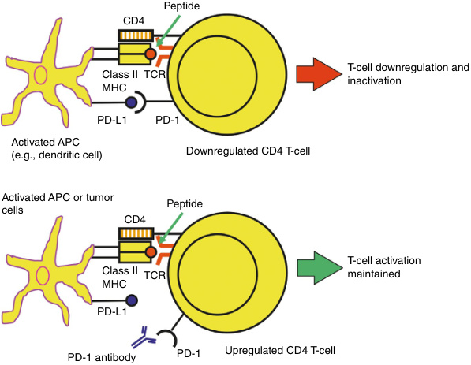
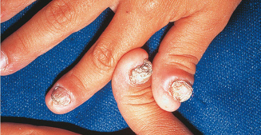
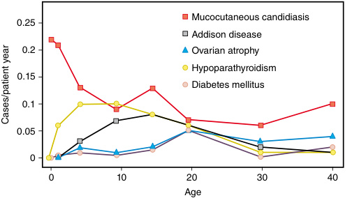
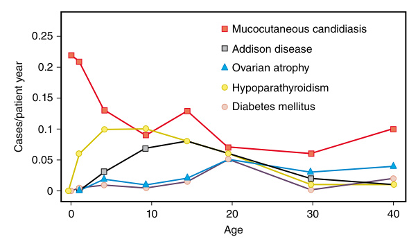
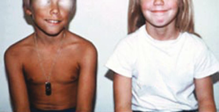
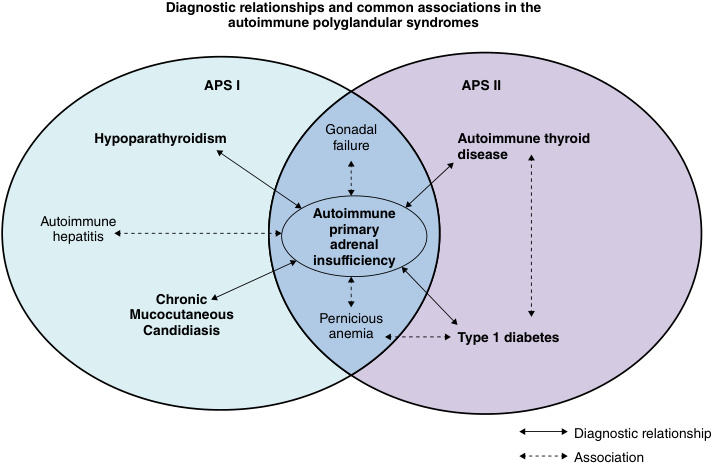
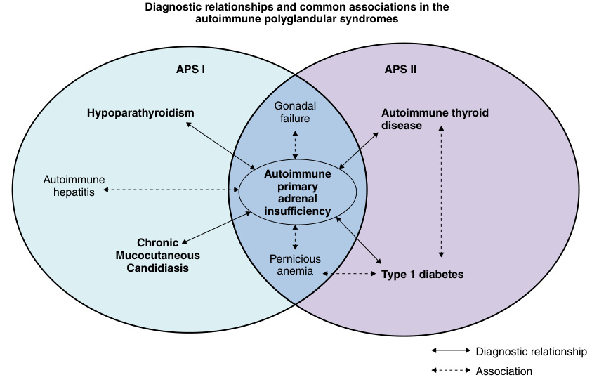
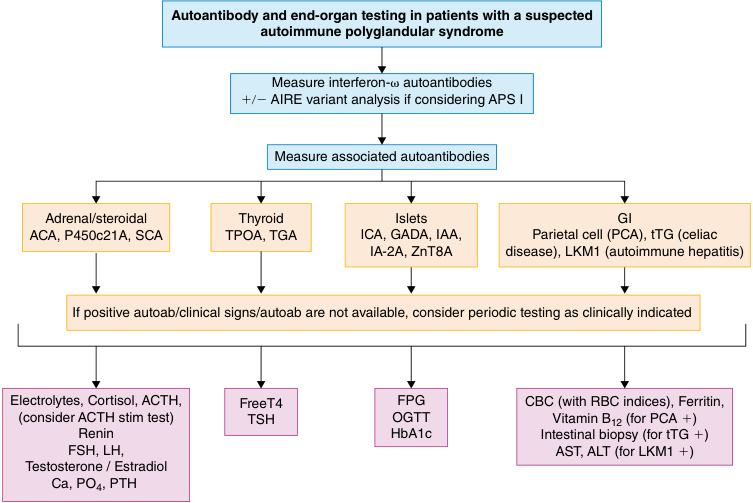
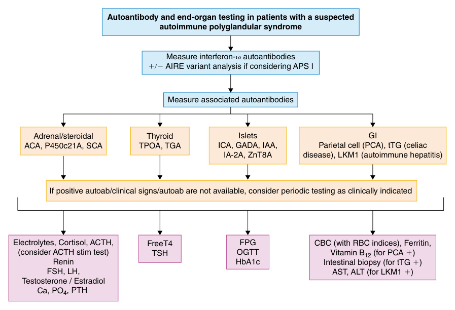

# Chapter 39: Autoimmune Polyglandular Syndromes and Other Disorders Associated With Immune-Related Endocrinopathies
> **Course:** Vikkypaedia Rare Disease Learner Course (*Nelson Pediatric Textbook of Rare Diseases: Genomic Etiologies and Genetic Diagnosis (1st Edition)*)  
> **Section VII:** Endocrine Disorders  
> **Authors:** Bimota Nambam, William E. Winter, Desmond Arthur Schatz  
> **Metrics:** 9,104 words · 12 tables · 8 figures · 54 genes · 28 flashcards · 14 MCQs  
> **Quick Navigation:** [🃏 Study 28 Flashcards](../flashcards/039_flashcards.md) · [📝 Take 14-Q MCQ Quiz](../mcqs/039_mcqs.md) · [📚 Section VII Guide](../sections/Section_VII.md) · [🧬 Master OMIM/Gene Atlas](../omim_gene_atlas.md) · [💊 Precision Therapies Matrix](../therapies_matrix.md) · [🏠 Course Index](../../index.md)

## Key Chapter Topics
`Endocrine Disorders` · `IPEX` · `Autoimmune Polyglandular Syndrome 2` · `Polyglandular Autoimmunity Related to Chromosomal and Mitochondrial Disorders` · `Nongenetic Causes of Polyglandular Autoimmunity` · `Diagnostic Considerations` · `Diagnosis of Organ-Specific Disorders Autoimmune Primary Adrenal Insufficiency` · `Autoimmune Primary Hypoparathyroidism` · `Autoimmune Thyroid Disease` · `Autoimmune Type 1 Diabetes` · `Autoimmune Primary Hypogonadism`

## Key Genes & Molecular Targets
`ACT1`, `AIRE`, `APC`, `BACH2`, `BPIFB1`, `CARD9`, `CD25`, `CD4CD45RO`, `CLTA4`, `CTLA4`, `CYP11A1`, `CYP17A1`, `CYP1A2`, `CYP21A2`, `DEF6`, `DOCK8`, `FOXP3`, `GAD65`

## ⚡ High-Yield Clinical & Diagnostic Pearls
- Autoimmune polyglandular syndromes are rare disorders characterized by immune-mediated dysfunction of both endocrine and nonendocrine tissues due to loss of immunologic tolerance , the state in which the immune system distinguishes self-antigens from non-self-antigens and prevents immunemediated attack of self-antigens.
- Abnormal FOXP3 expression leads to the rare X-linked and typically fatal autoimmune lymphoproliferative disease IPEX (immune dysregulation, polyendocrinopathy, enteropathy, X-linked).
- The prototypical autoimmune polyglandular syndromes APS-1, APS-2, and IPEX (immune dysregulation, polyendocrinopathy, enteropathy, X-linked) are characterized by dysfunction in multiple endocrine systems as well as nonendocrine organs.
- Autoimmune polyglandular syndrome 1 (APS-1) , also referred to as autoimmune polyendocrinopathy candidiasisectodermal dystrophy (APECED) , is a monogenic disorder caused by pathogenic variants in AIRE .
- APS-1 is mostly inherited in an autosomal recessive manner, though some affected individuals have heterozygous dominant variants and nonclassical manifestations.
- Deficiency of mineralocorticoids, primarily aldosterone, leads to elevated plasma renin, as well as hyponatremia, hyperkalemia, and acidosis (Table 39.4).
- The most common autoantibodies seen in autoimmune adrenalitis are adrenocortical cytoplasmic autoantibodies (ACA) and 21-hydroxylase (P450c21) autoantibodies.
- IPEX (immune dysregulation, polyendocrinopathy, enteropathy, X-linked) is a rare monogenic disorder caused by pathogenic variants in FOXP3 , which encodes the FOXP3 transcriptional factor, a critical control of regulatory T cell development.

---
## Full Chapter Text, Tables & Figures

<!-- p.860 -->

## SECTION **VII** 

#### Endocrine Disorders 

39. Autoimmune Polyglandular Syndromes and Other Disorders Associated With Immune-Related Endocrinopathies, 841 

40. Cancer Predisposition Syndromes in Children, 863 

41. Precocious and Delayed Puberty, 885 

42. Monogenic Diabetes: MODY and Other Rare Genetic Etiologies, 907

<!-- p.861 -->

<!-- p.862 -->

# 39 

### Autoimmune Polyglandular Syndromes and Other Disorders Associated With Immune-Related Endocrinopathies 

**BIMOTA NAMBAM, WILLIAM E. WINTER, DESMOND ARTHUR SCHATZ** 

Autoimmune polyglandular syndromes are rare disorders characterized by immune-mediated dysfunction of both endocrine and nonendocrine tissues due to loss of _immunologic tolerance_ , the state in which the immune system distinguishes self-antigens from non-self-antigens and prevents immunemediated attack of self-antigens. The loss of tolerance to selfantigens, or _autoimmunity_ , leads to organ and non-organspecific inflammation; symptomatic manifestations depend on which tissues or organs are affected and the degree of immune-mediated damage. Tolerance is initially developed in utero, primarily involving T and B cells and the adaptive immune system; maintaining immunologic tolerance is required for preventing autoimmunity and requires complex interactions among a variety of cell types and signaling pathways. Specific defects in the regulation of these interactions are associated with autoimmune polyglandular syndromes. 

##### **Immunologic Tolerance and Autoimmunity** 

T and B cell surface receptors within the adaptive immune system and pattern recognition receptors (PRRs) within the innate immune system provide the ability to distinguish between self and non-self-antigens. The PRRs recognize invading pathogens via detection of evolutionarily conserved structures on pathogens, termed pathogen-associated molecular patterns (PAMPs) or microbe-associated molecular patterns (MAMPs). Recognizing self or non-self within the adaptive immune system is a more complicated process. 

###### **Central T Cell Tolerance** 

T cells only recognize and respond to antigens when presented to α/β T cell receptors (TCRs) by antigen-presenting cells (APCs) such as B cells, dendritic cells, and macrophages. These cells present antigens using specific cell-surface molecules that are encoded by the major histocompatibility complex (MHC), which in humans is referred to as the human leukocyte antigen (HLA) complex. Class I MHC (HLA-A, HLA-B, and HLA-C) molecules are found on all nucleated cells and present antigens derived directly from the cytoplasm (such as from a pathogen-infected cell) to CD8 T cells. Class II MHC (HLA-DP, HLA-DQ, and HLA-DR) molecules present extracellular antigens that have been endocytosed and processed by APCs to CD4 T cells. T cells are educated to distinguish between self and non-self (tolerance) while developing in the thymus. 

In the thymic cortex, CD4+CD8+ T cells with α/β TCRs are selected to survive if they bind to self-antigen/MHC complexes, while T cells whose TCRs fail to bind undergo apoptosis. This process is referred to as positive selection and is carried out by antigen-presenting medullary thymic epithelial cells (mTECs). mTECs bear MHC I and MHC II and express a wide range of peripheral tissue specific antigens (TSA) for presentation to the developing T cells, a process referred to as promiscuous gene expression. T cells that bind to MHC I develop into CD8 T cell pathway, whereas those that bind to MHC II develop into CD4 T cells. Positively selected cells then migrate through the corticomedullary junction into the medulla where further selection occurs. T cells that bind too tightly to self-antigens are capable of inducing autoreactivity and undergo negative selection and apoptosis. This process of positive and negative selection of developing T cells is responsible for central (thymic) immunologic tolerance. These T cells expressing either CD4 or CD8 then migrate to the periphery and secondary lymphoid organs. 

The ability of the mTECs to express a wide variety of self-antigens is mediated by _AIRE_ , a transcriptional regulator located at chromosomal locus 21q22.3. In addition to regulation of TSA expression in mTECs, _AIRE_ is involved in thymic negative selection and differentiation of autoreactive CD4 T cells into regulatory T cells (Tregs). Pathogenic variants in _AIRE_ result in APS-1.

<!-- p.863 -->

###### **T-cell activation maintained by a therapeutic PD-1 antibody** 

**Fig. 39.1** Whereas the binding of PD-L1 on an APC to PD-1 (pictured) downregulates activated T cells (CD4 T cells in this drawing; top half of the figure), interference in PD-1:PD-L1 signaling via a therapeutic monoclonal antibody to PD-1 (as pictured) or via a therapeutic monoclonal antibody to PD-L1 will maintain T cell activation (bottom half of the figure). Indeed, therapeutic anti-PD-1 and anti-PD-L1 monoclonal antibodies have produced remarkable beneficial results in the treatment of some cancers. APC, Antigen presenting cell.  (From Nambam B, Haller MJ, Winter WE, Schatz D. Autoimmune polyglandular syndromes. In: Sperling MA, Majzoub JA, Menon RK, Stratakis CA, eds. _Sperling Pediatric Endocrinology_ . 5th ed. Philadelphia: Elsevier; 2021 [Fig. 22.4, p. 890].) 

###### **Peripheral T Cell Tolerance** 

Naive T cells entering the circulation or secondary lymphoid organs such as lymph nodes or the spleen require additional signals to be activated. The first signal involves the interaction of antigen presented by APCs with TCRs on the surface of CD4 and CD8 T cells. The second signal is provided by the interaction of B7.1 (CD80) and B7.2 (CD86) molecules of the APC with the CD28 molecule on the T cell surface. T cells perceiving both signals undergo T cell activation (Fig. 39.1). The requirement for two signals to activate naïve T cells is responsible for peripheral T cell tolerance. When the naïve T cell perceives antigen peptide presented by MHC molecules without the costimulatory signal (B7/CD28), the T cell becomes unresponsive. This state of unresponsiveness is termed _anergy_ . 

Activated cytotoxic CD8 T cells typically cause lysis of target cells, whereas activated CD4 T cells lead to the expression of numerous cytokines, cytokine receptors, and cytotoxic T-lymphocyte antigen 4 (CTLA-4). CTLA-4 is homologous to CD28 but competes with CD28 on T cells for binding to B7 molecules on APCs. CTLA-4 expression by the activated T cell and its interaction with B7 molecules provide an immunosuppressive signal to the T cell, thereby downregulating T cell responses. Thus CTLA-4 and CD28, 

though homologous, act in opposition: B7/CD28 interaction turns on T cells, whereas B7/CTLA-4 downregulates T cells. 

Further refinement of T cell tolerance is mediated by interactions between the T cell programmed death 1 (PD1) receptor and its ligands PD-L1 and PD-L2, which lead to inhibition of T-cell effector functions. PD-1 signaling also mediates the conversion of naïve T cells to Tregs that suppress the activity of self-reactive effector T cells that escape negative selection to self-antigens in the thymus. Tregs originating from the thymus are termed central or natural Tregs and carry surface CD4+CD25+ and the intracellular forkhead transcription factor (FOXP3+). CD25 is the interleukin-2 (IL-2) receptor α chain subunit that converts moderate-affinity IL-2 receptors to highaffinity IL-2 receptors. High-affinity IL-2 receptors on Tregs scavenge local IL-2, reducing IL-2 availability to otherwise proliferating T cells. FOXP3 is a transcription factor that is also required for developing T cells to differentiate into Tregs in the thymus. Abnormal FOXP3 expression leads to the rare X-linked and typically fatal autoimmune lymphoproliferative disease IPEX (immune dysregulation, polyendocrinopathy, enteropathy, X-linked). Defects in other components of this pathway lead to an IPEX-like syndrome.

<!-- p.864 -->

###### **B Cell Tolerance** 

Naïve B cells develop in the bone marrow and express surface immunoglobulin (Ig)M, which serves as B cell receptors (BCRs). Upon interacting with self-antigens, naïve B cells undergo negative selection via clonal deletion or anergy. Genetic rearrangement of the Ig chains also leads to formation of BCRs with new antigen specificity; this is referred to as receptor editing. B cells with non-autoreactive BCRs are positively selected and continue to the periphery. 

##### **Autoimmune Polyglandular Syndromes** 

The prototypical autoimmune polyglandular syndromes APS-1, APS-2, and IPEX (immune dysregulation, polyendocrinopathy, enteropathy, X-linked) are characterized by dysfunction in multiple endocrine systems as well as nonendocrine organs. APS-1 and IPEX are monogenic disorders, whereas APS-2 is polygenic; despite this genetic heterogeneity, phenotypic overlap can be significant. There may be a considerable delay between the onset of autoimmunity and the appearance of symptoms, though some features may present in neonates. Certain manifestations typically appear before others; the following conditions should raise suspicion for a polyglandular autoimmune syndrome: neonatal type 1 diabetes mellitus, chronic mucocutaneous candidiasis, primary hypoparathyroidism, and primary adrenal insufficiency. A positive family history of an autoimmune polyglandular syndrome should also warrant clinical vigilance and if symptoms develop, further testing. Various immune-mediated endocrinopathies may occur with different combinations of endocrine defects (Table 39.1). 

##### **Monogenic Autoimmune Polyglandular Syndromes** 

Multiple monogenic disorders affecting immunologic tolerance, T cell development, and T cell regulation and resulting in polyglandular autoimmunity have been identified (Table 39.2). The best characterized monogenic autoimmune polyglandular syndromes are APS-1 and IPEX. 

###### **Autoimmune Polyglandular Syndrome 1** 

**Autoimmune polyglandular syndrome 1 (APS-1)** , also referred to as **autoimmune polyendocrinopathy candidiasisectodermal dystrophy (APECED)** , is a monogenic disorder caused by pathogenic variants in _AIRE_ . There are more than 100 identified pathogenic variants in _AIRE_ , located at chromosomal locus 21q22.3, which encodes a 545 amino acid protein with four major domains: CARD (caspase recruitment domain), SAND (SP100, AIRE1, NucP41/P75, and DEAF1), PHD1 (plant homeodomain), and PHD2. APS-1 is mostly inherited in an autosomal recessive manner, though some affected individuals have heterozygous dominant variants and nonclassical manifestations. The overall prevalence of APS-1 is 1 in 100,000, though the disorder is more common within certain geographic 

**Classification of Polyglandular Autoimmune TABLE 39.1 Syndromes (Autoimmune Polyglandular Syndromes)** 

|Classification|Characteristic Manifestations|
|---|---|
|PAS type 1|Chronic candidiasis, hypoparathyroidism, Addison disease (at least two present)|
|PAS type 2|Addison disease (always present) and autoimmune thyroid diseases and/or type 1 diabetes mellitus|
|PAS type 3|Autoimmune thyroid diseases associated with other autoimmune diseases (excluding Addison disease and/or hypoparathyroidism)|
|Subtype 3A Subtype 3B Subtype 3C|Autoimmune thyroid disease and diabetes mellitus type 1 Autoimmune thyroid disease and pernicious anemia Autoimmune thyroid disease and other organ-specific autoimmune diseases|
|PAS type 4|Combinations not included in the previous groups|

From Bouca B, Nogueira A, Caetano J, et al: Clinical characteristics of polyglandular autoimmune syndromes in pediatric age: an observational study. _J Pediatr Endocrinol Metab_ . 2022;35(4):477–480 (Table 1, p. 478). 

regions and populations such as in Finland (1:25,000) and Sardinia (1:14,000). 

The clinical diagnosis of APS-1 requires at least two of the following three conditions: chronic mucocutaneous candidiasis (Fig. 39.2 and Fig. 39.3), autoimmune primary hypoparathyroidism, and autoimmune primary adrenal insufficiency. The initial manifestation of APS-1 is usually persistent _mucocutaneous candidiasis_ , which is present in up to 60% of affected individuals and is typically seen in the first 2 years of life (Fig. 39.4). The pathogenic variants in _AIRE_ result in defective antigen presentation wherein monocytes demonstrate impaired receptor-mediated internalization of yeast cell wall derivatives, leading to ineffective clearing of mucocutaneous candidiasis and chronic infection. Symptomatically, persistent diaper rash is seen early in life; as affected individuals get older, other manifestations include vulvovaginal candidiasis in postpubertal females, gastrointestinal tract candidiasis presenting with retrosternal or abdominal pain and diarrhea, and chronic nail infections. Chronic mucocutaneous candidiasis is not unique to APS-1; other rare disorders causing chronic mucocutaneous candidiasis are listed in Table 39.3. 

Chronic untreated oral or mucosal candidiasis increases the risk of squamous cell carcinoma of the oral mucosa or esophagus. Fluconazole, ketoconazole, and miconazole are routinely used to treat mucocutaneous candidiasis and lower this risk, though other azoles, such as itraconazole, 

_(Text continued on page 850)_

<!-- p.865 -->

**TABLE 39.2 Autoimmune Polyglandular and Related Syndromes** 

|Autoimmune Polyglandular Syndrome|APS-1|IPEX|_CTLA4_|Monogenic APS _LRBA_|_ITCH_|_STATI_|_STAT5b_|CD25|
|---|---|---|---|---|---|---|---|---|
|**Epidemiology and**|**Genetics**||||||||
|Incidence|<1:100,000|Rare|Rare|Rare|Rare|Rare|Rare|Rare|
|Onset|Infancy|Infancy|Infancy|Infancy|Infancy|Infancy|Infancy|Infancy|
|Male-to-female ratio|1:1|Males only|||||||
|Inheritance|Autosomal recessive (most)|X-linked|Autosomal dominant|Autosomal recessive|Autosomal recessive|Autosomal dominant|Autosomal recessive|Autosomal recessive|
|Genetic abnormality|AIRE|_FOXP3_|_CLTA4_|_LRBA_|_ITCH_|_STAT1_|_STAT5b_|_IL2RA_|
|Mechanism of disease|Central tolerance|Treg development|Treg suppression|Treg suppression|Treg suppression|Treg suppression|Immune signaling|Immune signaling|
|**Clinical Features**|||||||||
|Classic phenotype|Candidiasis|Enteropathy|Enteropathy|Enteropathy|Dysmorphic features|Candidiasis|Enteropathy|Enteropathy|
||Hypoparathyroidism|Type 1 diabetes mellitus in infancy| Cytopenia|Respiratory tract disease|Developmental delay|Recurrent infections|Respiratory tract disease|Type 1 diabetes mellitus in infancy|
||Addison disease|Eczematous dermatitis|Lymphocytic aggregates|Organomegaly|Organomegaly|Multiple autoimmunity|Recurrent infections|Recurrent infections|
||||Hypogammaglobulinemia|Hypogammaglobulinemia|Autoimmune infiltrates|Cerebral aneurysm|Growth failure||
|**Endocrinopathies** Adrenal insufficiency|60–90%|||||Rare|||
|Thyroid|10–40%|Common|15%|10%|40%|20%|20%|Common|
|Type 1 diabetes mellitus|5–20%|Common|Rare|5%|10%|5%||Common|
|Hypoparathyroidism|80–90%||||||||
|Gonadal insufficiency|5–60%||||||||
|Hypophysitis|Rare||||||||
|Hypothalamic dysfunction|||||||||
|Hyperprolactinemia|||||||Common||
|GH axis, skeletal|||||Dysmorphic, growth failure||GH resistance||

_(Continued)_

<!-- p.866 -->

#### **TABLE 39.2** Autoimmun e Polyglandular and Related Syndromes—cont’d Monogenic APS

|Autoimmune |||||||||
|---|---|---|---|---|---|---|---|---|
|Polyglandular Syndrome|APS-1|IPEX|_CTLA4_|_LRBA_|_ITCH_|_STATI_|_STAT5b_|CD25|
|**Nonendocrine Dis** Immune dysregulation|**ease**||||||||
|Candida infection|75–100%|Rare||||Common||Common|
|Other infections|Asplenism (10–20%)|Bacterial (rare)|Common|Common respiratory|Rare bacterial|Common|Common (esp. VZV)|Common (esp. EBV, CMV)|
|**Gastrointestinal**|||||||||
|Malabsorption, enteropathy|10–20%|Common|80%|60%|20%|Common|Common|Common|
|GI autoimmunity|10–15%|||10%||5%|||
|Autoimmune hepatitis|10–15%|Rare|||30%|Rare|||
|Integumentary/ rheumatologic|||Psoriasis or other skin (20%)|||Psoriasis, vitiligo, or other skin (20%)|||
|Vitiligo|5–15%|||5%|||||
|Eczema, allergic disease||Common||10%|Common|20%|80%|Common|
|Alopecia|25%||||||||
|Ectodermal dysplasia|75%||||||||
|Arthritis||Rare|15%|10%|||||
|Other|Keratoconjunctivitis (5–20%) Periodic fever (15%)|Cytopenias (common) Nephritis (rare)|Cytopenia (60%) Lung disease (60%)|Cytopenia (70%) Myasthenia gravis (rare)|Lung disease (80%)|Cytopenia (5%) Vascular (5%)|Cytopenia (20%)|Cytopenia (common)|

_(Continued)_

<!-- p.867 -->

|Autoimmune Plldl **TABLE** **39.2** **Autoimmun**|**e Polyglandular an**|T **d Related Syn**|**dromes—cont’d**||||
|---|---|---|---|---|---|---|
|oyganuar||urner|||||
|Syndrome|APS-2|Syndrome|Klinefelter Syndrome|Down Syndrome|DiGeorge Syndrome|ROHHAD|
|**Epidemiology and**|**Genetics**||||||
|Incidence|1–2/10,000|1:2,500 females|1:1,000 males|1:700|1:4,000|Rare|
|Onset|Adulthood|Congenital|Congenital|Congenital|Congenital|Early childhood|
|Male-to-female ratio|1:3|Females only|Males only||||
|Inheritance|Polygenic|N/A|N/A|N/A (most)|Autosomal dominant|N/A|
|Genetic abnormality|_HLA, MICA,_ _PTPN22,_ _CTLA4, NALP1_|46, X|47, XXY|Trisomy 21|22q11.2 del|None identified|
|Mechanism of disease|Multifactorial|Multifactorial|Multifactorial|Multifactorial|T cell development defects|Possible autoimmunity|
|**Clinical Features**|||||||
|Classic phenotype|Addison disease|Short stature|Tall stature|Hypotonia|Absent thymus|Rapid-onset obesity|
||Autoimmune thyroid disease|Ovarian insufficiency|Testicular insufficiency|Epicanthal folds|Congenital heart disease|Hypothalamic dysfunction|
||Type 1 diabetes mellitus|Webbed neck Coarctation of the aorta|Gynecomastia|Brushfield spots Single palmar crease Developmental delay|Hypocalcemia Developmental delay|Autonomic dysregulation Neuroendocrine tumor|
|**Endocrinopathies**|||||||
|Adrenal insufficiency|70–100%||Rare||||
|Thyroid|70%|15–20%|1%|15%|5%||
|Type 1 diabetes mellitus|40–50%|2%|2%|1–10%|Rare||
|Hypoparathyroidism|None||||30%||
|Gonadal insufficiency|3–10%|90%|Common||||
|Hypophysitis|Rare||||||
|Hypothalamic dysfunction||||||Present|
|Hyperprolactinemia||||||Common|
|GH axis, skeletal||Short stature|Tall stature|Short stature|Short stature||

_(Continued)_

<!-- p.868 -->

###### **TABLE 39.2 Autoimmune Polyglandular and Related Syndromes—cont’d** 

|Autoimmune Polyglandular Syndrome|APS-2|Turner Syndrome|Klinefelter Syndrome|Down Syndrome|DiGeorge Syndrome|ROHHAD|
|---|---|---|---|---|---|---|
|**Nonendocrine Dis**|**ease**||||||
|Immune dysregulation|||||||
|Candida infection|None||||||
|Other infections|||||Thymic dysplasia/aplasia||
|Gastrointestinal||IBD (1%)|||||
|Malabsorption, enteropathy|Rare||||||
|GI autoimmunity|2–25%|Rare||5%|||
|Autoimmune hepatitis|Rare||||||
|Integumentary/ rheumatologic||Psoriasis (rare)|||||
|Vitiligo, other skin|4–5%|Rare|||||
|Eczema, allergic disease|||||||
|Alopecia|2%|Rare||Rare|||
|Ectodermal dysplasia|None||||||
|Arthritis||Rare|1%||Rare||
|Other||Lymphedema|Lupus, Sjögren and multiple sclerosis (rare)|Congenital heart disease|Congenital heart disease T-cell deficiency Cytopenias (rare)|Autonomic dysregulation|

_CMV,_ Cytomegalovirus; _EBV,_ Epstein-Barr virus; _GH,_ growth hormone; _GI,_ gastrointestinal; _IBD,_ inflammatory bowel disease; _VZV,_ varicella zoster virus. Modified from Nambam B, Winter WE, Schatz DA: Igg4 antibodies in autoimmune polyglandular disease and IgG4-related endocrinopathies: pathophysiology and clinical characteristics, _Curr Opin Pediatr_ . 26(4):493–499, 2014.

<!-- p.869 -->

**Fig. 39.2** Oral candidiasis in a patient with chronic mucocutaneous candidiasis and type 1 diabetes.  (From Paller AS, Mancini AJ. Endocrine disorders and the skin. In: _Hurwitz Clinical Pediatric Dermatology_ . 6th ed. Philadelphia: Elsevier; 2020 [Fig. 23.23, p. 636].) 

**Fig. 39.3** Chronic paronychia. All 20 nails were discolored and hyperplastic in this 8-year-old male with chronic mucocutaneous candidiasis. The chronic paronychia and nail dystrophy resolved on long-term treatment with oral ketoconazole.  (From Saleh Rachidi S, Bender AM, Cohen BA. _Disorders of the Hair and Nails in Pediatric Dermatology_ . 5th ed. Philadelphia: Elsevier; 2021 [Fig. 55b, p. 250].) 

   - **Fig. 39.4** Incidence of disease development by age in patients with autoimmune polyendocrine syndrome type I (APS-I).  (From Barker JM, Gottlieb, Anderson MS. The immunoendocrinopathy syndromes. In: _Williams Textbook of Endocrinology_ . 14th ed. Philadelphia: Elsevier; 2020 [Fig. 43.3, p. 1665].) 

- **TABLE 39.3 Variants of Chronic Mucocutaneous Candidiasis (CMC) in Children and Adolescents** Subgroup Features CMC due to increased • Autosomal dominant due to gain-of-function _STAT1_ variants STAT1 signaling • Onset of mucocutaneous candidal infections at a mean age of 1 year—oropharynx (>95%), nails (most common form) (60%), skin (50%) • Dermatophyte infections of skin and/or nails (15%) • Cutaneous autoimmune disorders, e.g., vitiligo, alopecia areata (10%) • Autoimmunity (40%) • thyroid disease (25%) • type 1 diabetes mellitus (5%) • cytopenias (5%) • colitis or celiac disease (5%), hepatitis (2%) • systemic lupus erythematosus (2%) 

- • Other infections (variable) • cutaneous staphylococcal • demodicosis (face mites) • bacterial pneumonia (e.g., pneumococcal, _Pseudomonas_ ; 50%), otitis, sinusitis • recurrent/severe viral (e.g., HSV, VZV, EBV, CMV, orf; 40%) • invasive fungal (e.g., _Candida_ , _Aspergillus_ , _Cryptococcus_ , endemic dimorphic, mucormycosis, _Fusarium_ ; 10%) 

- • mycobacterial (tuberculosis, nontuberculous; 5%) 

- • Aneurysms (e.g., cerebral, aortic; 5%), mucocutaneous SCC (5%), dental enamel defects 

_(Continued)_

<!-- p.870 -->

#### **TABLE 39.3** Variants of Chro nic Mucocutaneous Candidiasis (CMC) in Children and Adolescents—cont’d

|Subgroup|Features|
|---|---|
|CMC representing the main clinical phenotype (“CMC disease”)|• Autosomal dominant due to variants in IL-17F_(IL17F)_or Jun N-terminal kinase 1 (JNK1;_MAPK8_); autosomal recessive due to variants in IL-17 receptor A or (_IL17RA_or_IL17RC_) and TRAF3- interacting protein 2_(TRAF3IP2; ACT1)_ • Oral candidiasis usually begins by age 6 months to 2 years • Cutaneous and ungual candidiasis common • No associated endocrinopathy • Cutaneous staphylococcal infections (IL17RA or TRAF3IP2 deficiency) • Ehlers–Danlos syndrome-like joint hypermobility, skin hyperextensibility (mild), and atrophic scarring (JNK1 deficiency)|
|Autoimmune polyendocrinopathy– candidiasis–ectodermal dystrophy syndrome (APECED)*|• Caused by variants in_AIRE_, usually with autosomal recessive inheritance • Increased prevalence among Finns, Iranian Jews, and Sardinians • Mucocutaneous candidal infections†with mean onset at age 3 years • Candidal granulomas, especially of the face and scalp • Autoimmune endocrinopathies, which may not be apparent until teenage or even adult years • hypoparathyroidism†(90%) • hypoadrenocorticism†(80%) • hypogonadism (30–50%) • thyroid disease (20%) • type 1 diabetes mellitus (20%) • hypopituitarism (e.g., growth hormone deficiency; 15%) • Cutaneous autoimmune disorders • alopecia areata (30%) • vitiligo (20%) • urticarial eruption‡(up to 60%) • lupus-like panniculitis • Other autoimmune disorders • pernicious anemia (15%) • hepatitis (15–40%) • pneumonitis (15–40%) • Sjögren-like syndrome (20–40%) • Dental enamel hypoplasia (70%), chronic diarrhea (20–80%), keratoconjunctivitis (20%), hyposplenism (15%), hypertension (15%), oral/esophageal SCC • Anti-type I interferon antibodies (nearly 100%); antithyroglobulin, antimicrosomal, antiparietal cell, and antiadrenal antibodies; rheumatoid factor • An autosomal dominant form of CMC associated with autoimmune thyroid disease may occur due to dominant-negative_AIRE_variants and has also been linked to chromosome 2p in one family|
|CMC plus susceptibility to mycobacterial infections|• Autosomal recessive due to variants in the retinoic acid receptor-related orphan receptor C gene _(RORC)_that lead to decreased IL-17 and interferon-γproduction|
|CARD9-associated CMC|• Autosomal recessive form of CMC due to variants in_CARD9_ • Chronic oral and vulvovaginal candidiasis; also dermatophytosis • Invasive fungal infections, (e.g., candidiasis, especially of the brain during the second decade of life), dermatophytosis, phaeohyphomycosis|
|Dectin-1 deficiency|• Due to biallelic polymorphisms that result in a truncated dectin-1 protein • Chronic/recurrent vulvovaginal candidiasis and onychomycosis|
|Late-onset CMC|• Initial infections in late childhood or early teenage years • Milder involvement than in other subgroups • Responses against_Candida albicans_may normalize after effective therapy|
|Familial chronic nail candidiasis|• Autosomal dominant form of CMC mapped to the pericentromeric region of chromosome 11 in a five-generation Italian family • Onset in infancy of candidiasis limited to the nails of the hands and feet • Association with low serum levels of intercellular adhesion molecule-1 (ICAM-1)|

_(Continued)_

<!-- p.871 -->

###### **TABLE 39.3 Variants of Chronic Mucocutaneous Candidiasis (CMC) in Children and Adolescents—cont’d** 

|Subgroup|Features|
|---|---|
|CMC associated with other immunodeficiency disorders|• Hyper-IgE syndromes due to STAT3 and DOCK8 deficiencies • Severe combined immunodeficiency • DiGeorge syndrome • Interleukin-12 receptor β1 and interleukin-12B (p40) deficiencies • Autosomal dominant hypohidrotic ectodermal dysplasia with immunodeficiency (_NFKBIA_variants) • Keratitis–ichthyosis–deafness (KID) syndrome|
|CMC associated with metabolic disorders|• Multiple carboxylase deficiency • Acrodermatitis enteropathica • Ectodermal dysplasia–ectrodactyly–clefting syndrome|

*Ectodermal dystrophy refers primarily to dental enamel hypoplasia; also known as autoimmune polyendocrine syndrome type 1. †Two of these three manifestations are classically required for diagnosis. ‡Mean onset at age 1.5 years; histologically, focal vacuolar interface dermatitis plus mixed superficial and deep dermal perivascular infiltrates with karyorrhexis. _CARD9,_ Caspase recruitment domain family member-9; _CMV,_ cytomegalovirus; _EBV,_ Epstein–Barr virus; _HSV,_ herpes simplex virus; _IL,_ interleukin; _MAPK9,_ mitogen-activated protein kinase 8; _SCC,_ squamous cell carcinoma; _STAT,_ signal transducer and activator of transcription; _VZV,_ varicella–zoster virus. Modified from Schaffer JV, Paller AS: Primary immunodeficiencies, in Bolognia JL, Schaffer JV, Cerroni L (editors), _Dermatology_ 5/e, Philadelphia: Elsevier, 2025 (Table 60.4, pp. 966c967). 

voriconazole, or posaconazole, have been used in drugresistant cases. Ketoconazole, fluconazole, and posaconazole can precipitate latent adrenal insufficiency by inhibiting cortisol synthesis and should be used with caution and surveillance in affected individuals who also have a risk for adrenal insufficiency. 

**Autoimmune hypoparathyroidism** is usually seen after the onset of mucocutaneous candidiasis. By 5 years of age, nearly 40% of individuals with APS-1 develop hypoparathyroidism; by 20 years of age, over 90% of individuals are affected. Biochemical findings include hypocalcemia, low or inappropriately normal parathyroid hormone (PTH) levels, and hyperphosphatemia. Coexisting adrenal insufficiency may curb the degree of hypocalcemia: the lower circulating cortisol levels seen in adrenal insuffici ency result in decreased inhibition of 1α-hydroxylase production. The resulting increased levels of 1α-hydroxylase lead to increased renal production of 1,25(OH)2 vitamin D, increasing intestinal calcium absorption. Additionally, chronic hypovolemia from adrenal insufficiency reduces the glomerular filtration rate and decreases renal calcium excretion. 

Putative autoantigens mediating autoimmune hypoparathyroidism include NALP5 (NACHT leucine rich repeat protein 5) and the calcium-sensing receptor (CaSR); however, the specificity of NALP5 autoantibodies for diagnosing APS-1-associated hypoparathyroidism is 50%, and the sensitivity is 26%. CaSR autoantibodies have a higher specificity of 83% for diagnosing autoimmune hypoparathyroidism, though they have a lower sensitivity of 39%. As such, the diagnostic utility of these autoantibodies in clinical practice remains low. 

**Autoimmune primary adrenal insufficiency** usually manifests later in life than mucocutaneous candidiasis and hypoparathyroidism. Nearly 40% of patients with APS-1 develop adrenal insufficiency by 10 years of age, and 80% by 30 years of age. Clinical and biochemical findings of adrenal insufficiency are mostly related to deficiency of 

adrenally produced glucocorticoids and mineralocorticoids and include fatigue, dizziness due to orthostatic hypotension, nausea, abdominal pain, vomiting, weight loss, and hypoglycemia (Table 39.4). As these are nonspecific findings that mimic other disorders, the diagnosis of adrenal insufficiency is often missed, delayed, or recognized only when a patient presents with the most severe and life-threatening complication of adrenal insufficiency— _adrenal crisis_ —which is characterized by hypotensive shock, hypoglycemia, hyponatremia, hyperkalemia, and acidosis. 

Laboratory findings in adrenal insufficiency include elevated corticotropin (ACTH) with a low cortisol concentration. The demonstration of a normal cortisol level is insufficient to exclude the possibility of primary adrenal insufficiency, as minute amounts of residual functional adrenal tissue may be able to produce physiological levels of cortisol when stimulated with excessive amounts of endogenous ACTH from the pituitary gland. Pituitary ACTH is formed from the cleavage of the precursor proopiomelanocortin (POMC); in primary adrenal insufficiency, increased levels of ACTH and other POMC-derived peptides induce melanogenesis, leading to hyperpigmentation in non-sun-exposed areas, a common presentation in patients with untreated or inadequately treated adrenal insufficiency (Fig. 39.5). Deficiency of mineralocorticoids, primarily aldosterone, leads to elevated plasma renin, as well as hyponatremia, hyperkalemia, and acidosis (Table 39.4). The most common autoantibodies seen in autoimmune adrenalitis are adrenocortical cytoplasmic autoantibodies (ACA) and 21-hydroxylase (P450c21) autoantibodies. Over 73% of individuals with recent-onset autoimmune adrenal insufficiency are positive for ACA antibodies, though titers decline over time. 

**Autoimmune gonadal failure** is seen in up to 60% of females by 30 years of age; approximately 25% of males are affected. Affected individuals often display steroid cell autoantibodies (e.g., P450scc, P450c17, and 3β-hydroxysteroid

<!-- p.872 -->

#### **TABLE 39.4** Clinical Manifestations and Biochemi fi cal Findings in Adrenal Insufficiency

||Pathophysiological Mechanism|Prevalence (%)*|
|---|---|---|
|**Symptoms**|i||
|Fatigue|Glucocorticoid deficiency|90|
|Anorexia, weight loss|Glucocorticoid deficiency|90|
|Nausea, vomiting|Glucocorticoid deficiency, mineralocorticoid deficiency|90|
|Salt craving (primary adrenal insufficiency only)|Mineralocorticoid deficiency|20|
|Myalgia or joint pain|Glucocorticoid deficiency||
|**Signs**|i  i||
|Low blood pressure, orthostatic hypotension|Mineralocorticoid deficiency, glucocorticoid deficiency|70–100|
|Skin or mucosal hyperpigmentation (primary adrenal insufficiency only)|Excess of proopiomelanocortin-derived peptides|70|
|**Laboratory Findings**|i  i||
|Hyponatremia|Mineralocorticoid deficiency, glucocorticoid deficiency (leading to decreased free water excretion)|90|
|Hyperkalemia (primary adrenal insufficiency only)|Mineralocorticoid deficiency|50|
|Hypoglycemia|Glucocorticoid deficiency|30|
|Ketosis|Glucocorticoid deficiency|30|
|Low random cortisol level|Glucocorticoid deficiency|80|
|Eosinophilia, lymphocytosis|Glucocorticoid deficiency||
|High ACTH level (primary adrenal insufficiency only)|Glucocorticoid deficiency|100|
|High plasma renin activity (primary adrenal insufficiency only)|Mineralocorticoid deficiency|100|

*Prevalence data are for primary insufficiency only. Blanks indicate that no pediatric prevalence data are available. Data from Hsieh S, White PC: Presentation of primary adrenal insufficiency in childhood, _J Clin Endocrinol Metab_ 96:E925–E928, 2011. 

**Fig. 39.5** A male with Addison disease, pictured with his sister, showing the diffuse hyperpigmentation typical of the disorder.  (From Moshang T Jr. _Pediatric Endocrinology: The Requisites_ . St Louis: Mosby, 2005 [Plate 10-3].) 

dehydrogenase). In young females, gonadal failure can present as primary or secondary amenorrhea or menstrual irregularities, while males may present with primary testicular atrophy or azoospermia with preserved sexual function. Rarely, affected individuals may develop **autoimmune pituitary inflammation** (i.e., hypophysitis) associated with 

autoantibodies to human pituitary enolase; manifestations include diabetes insipidus, growth hormone deficiency, and ACTH deficiency. Additional autoimmune endocrine manifestations in APS-1 include type 1 diabetes and thyroid disease, though both occur much less frequently than in APS-2. Areas of phenotypic overlap in APS-1 and APS-2 are presented in Fig. 39.6. Nearly every endocrine gland can be impacted in APS-1 (Table 39.1). 

Nonendocrine manifestations of APS-1 are diverse. **Ectodermal dystrophy** consisting of tooth enamel hypoplasia, keratitis, nail dystrophy, and calcification of the tympanic membrane is the most frequent, occurring in over 75% of affected individuals. **Alopecia areata** occurs in nearly 30% of affected individuals, often appears before puberty, and consists of total loss of scalp hair (i.e., alopecia totalis) or total loss of all body hair (i.e., alopecia universalis). Autoantibodies to tyrosine hydroxylase are believed to be causative. 

Gastric-parietal cell autoimmunity leading to **atrophic gastritis** occurs in up to 30% of individuals with APS-1. The resulting achlorhydria and intrinsic factor deficiency can present as iron deficiency, vitamin B12-deficient pernicious anemia, or both. Although seen in no more than 15% of

<!-- p.873 -->

**Fig. 39.6** The _solid lines_ indicate diagnostic relationships. The _dashed lines_ indicate common associations. The diagnosis of APS I depends on the coexistence of autoimmune primary adrenal insufficiency (or adrenal autoantibodies) plus either hypoparathyroidism or chronic mucocutaneous candidiasis or both. The diagnosis of APS II depends on the coexistence of autoimmune primary adrenal insufficiency (or adrenal autoantibodies) plus either autoimmune thyroid disease or type 1 diabetes or both (or their associated autoantibodies). Autoimmune hepatitis can occur in people affected with APS I. Gonadal failure or pernicious anemia can be seen in persons affected with either APS I or APS II. Pernicious anemia is also strongly associated with autoimmune thyroid disease (independent of APS II and autoimmune primary adrenal insufficiency; note: for graphic simplicity, no line is drawn in the figure to indicate such “thyrogastric” autoimmunity).  (From Nambam B, Haller MJ, Winter WE, Schatz D: Autoimmune polyglandular syndromes, in Sperling MA, Majzoub JA, Menon RK, Stratakis CA [editors], _Sperling Pediatric Endocrinology_ , 5/e, Philadelphia: Elsevier, 2021 [Fig. 22.5, p. 891].) 

individuals with APS-1, **autoimmune hepatitis** is the leading cause of death; liver function should be monitored regularly. Autoantibodies to liver/kidney microsome type 1 (LKM1) are commonly associated with the autoimmune hepatitis, likely directed at hepatic antigens CYP2A6, CYP1A1, CYP1A2, and CYP2B6. Autoantibodies to aromatic L-amino acid decarboxylase have also been recognized in individuals with APS-1 and may be associated with both autoimmune hepatitis and vitiligo. 

Other nonendocrine manifestations of APS-1 include intestinal malabsorption, which has been correlated with autoantibodies to tryptophan hydroxylase. Rarely, affected individuals may develop rheumatoid arthritis, Sjögren disease, tubulointerstitial nephritis, autoimmune bronchiolitis, myopathy, and asplenia. 

Clinical diagnosis of APS-1 requires the presence of 2 or more of the classic manifestations of chronic mucocutaneous candidiasis, autoimmune primary hypoparathyroidism, and autoimmune primary adrenal insufficiency. While NALP5 autoantibodies are imperfectly sensitive and specific for diagnosing autoimmune hypoparathyroidism, they are not present in isolated autoimmune or idiopathic hypoparathyroidism; as such, patients with isolated, biochemically 

confirmed hypoparathyroidism and positive NALP5 autoantibodies warrant further evaluation for APS-1. The diagnostic utility of organ-specific antibody testing for predicting endocrine gland failure in APS-1 is generally limited; however, non-organ-specific autoantibodies to Th17 cytokines intereukin-17F and interleukin-22 (for CMC) and interferons α and ω are highly sensitive and specific markers for APS-1. These autoantibodies are often formed prior to the onset of organ-specific autoantibodies or clinical manifestations and may sometimes be used as a screening test for APS-1. An approach to testing of suspected autoimmune polyglandular syndromes is noted in Figure 39.7. Diagnostic confirmation is via _AIRE_ sequencing. 

# **IPEX** 

**IPEX (immune dysregulation, polyendocrinopathy, enteropathy, X-linked)** is a rare monogenic disorder caused by pathogenic variants in _FOXP3_ , which encodes the FOXP3 transcriptional factor, a critical control of regulatory T cell development. _FOXP3_ is located on the X chromosome at locus Xp11.23 and inheritance is X-linked recessive; males with a pathogenic variant are affected, while females with a

<!-- p.874 -->

- **Fig. 39.7** This flow diagram indicates which autoantibodies should be obtained when APS is suspected. Given its sensitivity and specificity, primary screening with interferon-ω autoantibodies (if available) is likely adequate if APS I is suspected. That said, we recommend organ-specific autoantibody testing in subjects with a suspected APS-related disease (adrenalitis, chronic mucocutaneous candidiasis, or autoimmune hypoparathyroidism) at the time of initial diagnosis. We also recommend autoantibody testing in subjects with 2 or more associated autoimmune diseases (i.e., T1D and autoimmune thyroiditis). Pathogenic variants in the _AIRE_ gene can also be sought. Unfortunately, data are lacking to provide firm recommendations regarding the need for repeat autoantibody testing in patients who are initially autoantibody negative. However, if antibodies are negative, we recommend repeat autoantibody testing in early puberty if clinical signs or symptoms of APS persist. For those who are autoantibody positive, annual testing of end-organ failure should be obtained as shown. When autoantibody assays are unavailable, clinicians must use frequent testing of disease-specific endpoints to identify associated comorbidities. _ACA,_ Adrenal cytoplasmic autoantibodies detected by indirect immunofluorescence; _ACTH,_ adrenocorticotropic hormone; _Ca,_ calcium; _CBC,_ complete blood count; _FPG,_ fasting plasma glucose; _FSH,_ follicle-stimulating hormone; _GADA,_ glutamic acid decarboxylase autoantibodies; _HbA1c,_ hemoglobin A1c; _IA-2A,_ insulinoma associated-2 autoantibodies; _IAA,_ insulin autoantibodies; _ICA,_ islet cell cytoplasmic autoantibodies; _LH,_ luteinizing hormone; _LKM1,_ liver kidney microsomal type 1 autoantibodies; _OGTT,_ oral glucose tolerance test; _P450c21A,_ autoantibodies against the adrenal enzyme 21-hydroxylase; _PO4,_ phosphate; _PTH,_ parathyroid hormone; _SCA,_ steroidal cell autoantibodies; _T4,_ thyroxine; _TGA,_ thyroglobulin autoantibodies; _TPOA,_ thyroperoxidase autoantibodies; _TSH,_ thyroid-stimulating hormone; _tTG,_ IgA transglutaminase autoantibodies; _ZnT8A,_ zinc transporter 8 autoantibodies.  (From Nambam B, Haller MJ, Winter WE, Schatz D: Autoimmune polyglandular syndromes, in Sperling MA, Majzoub JA, Menon RK, Stratakis CA [editors], _Sperling Pediatric Endocrinology_ , 5/e, Philadelphia: Elsevier, 2021 [Fig. 22.6, p. 894].) 

pathogenic variant are carriers. A positive family history of immunodeficiency is found in up to 60% of affected individuals, though a formal diagnosis of IPEX in family members may not have been established due to variations in penetrance and expressivity. Prevalence is less than 1 in 1,000,000. 

Clinically, IPEX is most frequently suggested by the presence of early-onset autoimmune enteropathy, an eczematous dermatitis that may become severe, and some form of autoimmune endocrinopathy, typically either thyroid dysfunction or neonatal type 1 diabetes mellitus in males, usually under 1 year of age. Following the association of this phenotypic presentation with pathogenic variants 

in _FOXP3_ , individuals with the same or a highly similar phenotype were found to be negative for pathogenic variants in _FOXP3_ but positive for pathogenic variants in other genes related to regulatory T cell generation and function. These individuals are considered to have an **IPEX-like syndrome** ; about half of individuals with this phenotype have _FOXP3_ -related IPEX, while the remainder have an IPEX-like syndrome. Genes associated with IPEX-like syndrome include _CD25_ , _CTLA4_ , _LRBA_ , _STAT1_ , _STAT3_ , _STAT5B_ , _ITCH_ , _TTC7A_ , and _TTC37_ . 

Clinical and laboratory features of IPEX and IPEXlike disorders are presented in Table 39.5 and Table 39.6.

<!-- p.875 -->

#### **TABLE 39.5** Clinical and Laboratory Features of IPEX and I PEX-Like Disorder s

||IPEX|CD25|STAT5B|STAT1|ITCH|
|---|---|---|---|---|---|
|**Autoimmunity**||||||
|Eczema|+++|+++|++|++|++|
|Enteropathy|+++|+++|++|++|++|
|Endocrinopathy|+++|++|+|++|++|
|Allergic disease|+++|+|+|++|++|
|Cytopenias|++|++|++|−||
|Lung disease|+|++|+++|+|+++|
|**Infections**||||||
|Fungal|−|++|−|+++|−|
|Herpes virus|−|+++(EBV/CMV)|++(VZV)|++|−|
|Bacterial|+/−|++|++|++|+|
|Associated features|None|None|Growth failure|Vascular anomalies|Dysmorphic growth failure|
|Serum immunoglobulins |Elevated |Elevated or normal |Elevated or normal |Low, normal, or high |Elevated |
|Serum IgE|Elevated|Normal or elevated|Normal or elevated|Normal or mildly elevated|Elevated|
|CD25 expression|Normal|Absent|Normal or low|Normal|Not tested|
|CD4+CD45RO|Elevated|Elevated|Elevated|Normal or high|Not tested|
|FOXP3 expression|Absent or normal|Normal or low|Normal or low|Normal|Not tested|
|IGF-1, IGFBP-3|Normal|Normal|Low|Normal|Not tested|
|Prolactin|Normal|Normal|Elevated|Normal|Not tested|

_CMV,_ Cytomegalovirus; _EBV,_ Epstein-Barr virus; _IGF-1,_ insulin-like growth factor 1; _IGFBP-3,_ insulin-like growth factor-binding protein 3; _IPEX,_ immune dysregulation, polyendocrinopathy, enteropathy, X-linked; _VZV,_ varicella-zoster virus; _ITCH,_ ubiquitin ligase deficiency. From Verbsky JW, Chatila TA: Immune dysregulation, polyendocrinopathy, enteropathy, X–linked (IPEX) and IPEX–related disorders: an evolving web of heritable autoimmune diseases, _Curr Opin Pediatr._ 25:709, 2013. 

Symptomatically, nearly all affected individuals have a severe enteropathy with intractable malabsorptive diarrhea related to autoantibodies to harmonin and villin proteins located in the intestinal microvilli. These same proteins are also found in the renal proximal tubule, and up to 16% of affected individuals have nephritis. Approximately 25% of affected individuals develop islet cell autoimmunity early in life resulting in neonatal type 1 diabetes. Other autoimmune disorders include thyroiditis, hemolytic anemia, thrombocytopenia, hepatitis, arthritis, dermatitis, and lung disease. Untreated patients typically die in infancy or early childhood, often from multiorgan failure, sepsis, or the consequences of severe intestinal malabsorption. Long-term immunosuppression or allogenic hematopoietic stem cell transplantation are the only primary effective therapies for IPEX. 

Diagnosis is supported by small intestine epithelium and lamina propria biopsies demonstrating inflammatory infiltrates and villous atrophy. Colonic biopsy may show 

inflammation and abscesses. Laboratory evaluation may show decreased regulatory T cells on flow cytometry. Immunoglobulin IgG, IgA, and IgM levels are usually normal, though IgG may be decreased in the setting of severe protein-losing enteropathy. IgE levels are sometimes elevated. Genomic sequencing demonstrating pathogenic variants associated with IPEX or IPEX-like disorders is confirmatory. 

# **Autoimmune Polyglandular Syndromes Related to Polygenic Inheritance, Chromosomal Abnormalities, and Nongenetic Causes** 

## **Autoimmune Polyglandular Syndrome 2** 

**Autoimmune polyglandular syndrome 2 (APS-2)** is defined by autoimmune adrenal insufficiency along with

<!-- p.876 -->

#### **TABLE 39.6** Gene Defects and Pheno types Reported in Patients With IPEX or IPEX-Like Clinical Syndromes

|Gene|Distinguishing Clinical or Laboratory Features|
|---|---|
|**TREG Development**||
|FOXP3|Enteropathy+dermatitis+endocrinopathy triad,↑↑IgE|
|AIRE|Chronic mucocutaneous candidiasis, hypoparathyroidism, pneumonitis|
|**IL-2 Signaling** IL2RA|Poor T cell proliferation, CMV disease|
|IL2RB|Immune dysregulation+viral susceptibility (CMV, EBV)|
|STAT5B-LOF|Dwarfism/growth failure, facies (frontal bossing), low T and NK cells|
|**Other JAK/STAT Signaling** JAK1-GOF|Hypereosinophilia but normal IgE, massive hepatosplenomegaly|
|STAT1-GOF|Chronic mucocutaneous candidiasis, vascular aneurysms|
|STAT3-GOF|Early-onset type I DM, AI hepatitis, short stature/growth failure|
|**CTLA4 Expression/Function**||
|CTLA4|Lymphoproliferation (GI, lung, CNS), cytopenias common,↓IgG|
|LRBA|Lymphoproliferation (GI, lung, CNS), cytopenias common,↓IgG|
|DEF6|Immune dysregulation+cardiomyopathy|
|**IL-10 Signaling**||
|IL10|Severe fistulating colitis, poorly responsive to therapy, folliculitis|
|IL10RA|Severe fistulating colitis, poorly responsive to therapy, folliculitis|
|IL10RB|Severe fistulating colitis, poorly responsive to therapy, folliculitis|
|**PI3 Kinase Signaling**||
|PIK3CD|Lymphoproliferation (lung, GI), chronic EBV,↑↑transitional B cells, B cell malignancies|
|PIK3R1|Lymphoproliferation (lung, GI), chronic EBV,↑↑transitional B cells, B cell malignancies|
|PTEN|Benign & malignant hamartomas, lymphopenia,↑↑transitional B cells|
|**NF**κ**B Signaling** NFKB1|Lymphadenopathy, splenomegaly, cytopenias,↓IgG|
|NFKB2|↓IgG,↓B cells, ACTH deficiency, ectodermal dysplasia|
|TNFAIP3|↑inflammatory cytokines (IL-1, IL-6, TNF, etc.), mucosal ulcerations|
|**Other Immunologic**||
|WAS|Small platelets, thrombocytopenia,↑IgE|
|DOCK8|Severe warts and molluscum, herpesviral infections,↑↑IgE|
|RAG1/RAG2|Low T and B cell numbers|
|**Bowel Epithelial Defects**||
|TTC7A|Multiple GI atresia (some), combined immune deficiency|
|TTC37|Wooly hair, abnormal facies, liver fibrosis with bile duct proliferation|
|MYO5B|Microvillus inclusions on bowel biopsy|

From Torgerson TR: IPEX and IPEX-like disorders, in Sullivan EK, Stiehm ER (editors), _Stiehm’s Immune Deficiencies_ 2/e, Oxford, UK: Academic Press/Elsevier, 2020 (Table 26.1, p. 618).

<!-- p.877 -->

at least one of the following: autoimmune thyroid disease (either Hashimoto thyroiditis or Graves disease) and autoimmune type 1 diabetes mellitus. APS-2 demonstrates polygenic inheritance and is associated with HLA class II complex alleles HLA-DR3 and HLA-DR4. Pathogenic variants in the following genes are also associated with an increased risk of APS-2: the major histocompatibility complex class I chain-related genes _MICA_ and _MICB_ , _CTLA4_ , _BACH2_ (which encodes a transcriptional regulator protein), _PTPN22_ (which encodes the protein tyrosine phosphatase nonreceptor type 22 that regulates T cell receptor signaling), and _CD25_ (which encodes the high affinity IL-2 receptor). APS-2 is more prevalent in the general population than APS-1, affecting 1 in 20,000. Females are more commonly affected than males, and onset is usually around the third or fourth decade of life. Environmental factors are believed to interact on susceptible genetic backgrounds to trigger autoimmunity, though specific factors have not been identified. 

About half of individuals with APS-2 present in midlife with autoimmune primary adrenal insufficiency. Approximately 75% of these individuals will have or go on to have autoimmune thyroid disease, typically Hashimoto thyroiditis. Findings of adrenal insufficiency are often nonspecific and may be overlooked or attributed to other causes. If symptomatic individuals with APS-2 are evaluated only for hypothyroidism and are started on thyroid hormone replacement therapy without first recognizing and treating the coincident adrenal insufficiency, _thyroid hormone therapy may precipitate an adrenal crisis_ . However, only 1% of individuals with isolated Hashimoto thyroiditis have autoimmune adrenal insufficiency, so universal screening for adrenal insufficiency in individuals with isolated Hashimoto thyroiditis, in the absence of symptoms of adrenal insufficiency, is typically not feasible. Other forms of thyroid disease such as Graves disease, painless thyroiditis, postpartum thyroiditis, and subacute thyroiditis are less common in APS-2. 

Up to half of patients with APS-2 will develop autoimmune type 1 diabetes mellitus. Onset may occur prior to the development of adrenal insufficiency, sometimes in the second decade of life, though it may occur following the development of adrenal insufficiency as well. Additional endocrinopathies include hypergonadotropic hypogonadism in up to 10% of individuals and hypophysitis in less than 1%. Type 1 diabetes and autoimmune thyroid disease are more common in APS-2 compared to APS-1, while gonadal failure is more common in APS-1. 

Nonendocrine autoimmune manifestations include chronic atrophic gastritis with or without pernicious anemia in approximately 10% of affected individuals, chronic autoimmune hepatitis in up to 4%, and alopecia in up to 4%. Rare manifestations such as myasthenia gravis, ulcerative colitis, primary biliary cirrhosis, sarcoidosis, achalasia, myositis, thrombocytopenic thrombotic purpura, rheumatoid arthritis, and Sjögren syndrome have been reported. 

Previous taxonomy systems proposed subdivisions and additional classifications of polygenic polyglandular 

autoimmunity based on which constellation of endocrine glands was affected and which additional features were present. For example, the coexistence of autoimmune thyroid disease and autoimmune adrenal disease was referred to as Schmidt syndrome; when type 1 diabetes was also present, it was called Carpenter syndrome. APS-3 was used to refer to autoimmune thyroid disease with either type 1 diabetes, pernicious anemia, vitiligo, or alopecia, while other combinations have been referred to as APS-4. However, as no pathophysiological distinctions have been demonstrated among these phenotypic variations, they are collectively considered to be phenotypic variants of APS-2. 

**Celiac disease** has been associated with monoglandular and polyglandular autoimmunity. Ten to 30% of patients with celiac disease have thyroid (Hashimoto or Graves disease) or type 1 diabetes related antibodies. Five to 7% of patients with autoimmune thyroid or type 1 diabetes are positive for celiac-specific IgA tissue transglutaminase antibodies. Some consider celiac disease a type 3 while others a type 2 autoimmune polyglandular syndrome. Other disorders seen less frequently in celiac disease include Addison disease, ovarian failure, hypoparathyroidism, hypopituitarism, and alopecia. 

## **Polyglandular Autoimmunity Related to Chromosomal and Mitochondrial Disorders** 

Trisomy 21, 22q11.2 deletion syndrome, Turner syndrome, and Klinefelter syndrome have all been associated with an elevated risk of polyglandular autoimmunity, typically type 1 diabetes mellitus and thyroid dysfunction. Other copy number variant disorders affecting similar genetic regions have also been associated with an elevated risk of endocrine disorders (Table 39.2). Proposed mechanisms include altered _AIRE_ expression, thymic dysfunction, and changes in HLA alleles. 

Polyglandular autoimmunity has also been associated with mitochondrial disorders, particularly Kearns-Sayre syndrome, which may involve autoimmune adrenal insufficiency, diabetes mellitus, and thyroid dysfunction. 

## **Nongenetic Causes of Polyglandular Autoimmunity** 

Certain immune-modulating therapies used to treat malignancies and immune dysregulation have been associated with the acute development of polyglandular autoimmunity, including type 1 diabetes mellitus, primary adrenal insufficiency, thyroiditis, and hypophysitis. These medications are typically directed against **immune checkpoint targets** such as CTLA4, PD1, and PDL1. 

**Rapid-onset obesity with hypothalamic dysfunction, hypoventilation, and autonomic dysregulation (ROHHAD)** has been associated with hypothalamic dysfunction, including central hypothyroidism, hyperprolactinemia, hyponatremia, and growth hormone deficiency (Chapter 27). ROHHAD does not have an established genetic mechanism and is presumed to be paraneoplastic.

<!-- p.878 -->

# **Diagnostic Considerations** 

Screening for the risk of multiorgan autoimmune disease before symptoms develop decreases the morbidity and mortality associated with polyglandular autoimmunity. If there is a clinical history suspicious for APS or a strong family history, certain autoantibodies can be utilized for screening. Positive autoantibodies to interferons α and ω are greater than 95% sensitive and specific for APS-1. If an individual is positive for interferon autoantibodies, _AIRE_ should be sequenced, and if pathogenic variants are detected, screening for tissue-specific autoantibodies should be performed (Table 39.7). These autoantibodies as well as tissue specific autoantibodies should also be tested if APS-2 is suspected. As some of these autoantibodies may not be available in selected clinical settings, or as the sensitivity and specificity of such autoantibody screening is low (such as for CaSR and NALP5), end organ function assessment may be more practical (Fig. 39.6 and Fig. 39.7). 

## **Diagnosis of Organ-Specific Disorders** **_Autoimmune Primary Adrenal Insufficiency_** 

In individuals with adrenocortical autoantibodies or with signs and symptoms suggestive of adrenal insufficiency (e.g., weight loss, failure to thrive, dizziness, fatigue, dehydration, 

hypoglycemia, hyponatremia, hyperkalemia, acidosis, and hyperpigmentation), an intravenous corticotropin (ACTH) stimulation test should be carried out to establish the diagnosis of adrenal insufficiency. 

Dosing for the test in adults and children ≥2 years of age is 250 μg of IV corticotropin, 125 μg for children <2 years of age, and 15 μg/kg for infants. Peak cortisol levels below 18 μg/dL at 30 or 60 minutes are traditionally considered diagnostic of adrenal insufficiency. When a diagnostic stimulation test is not possible, a morning cortisol of less than 5 μg/dL in combination with an elevated ACTH (i.e., twice or more above the upper end of the reference interval) is suggestive of adrenal insufficiency. However, a corticotropin stimulation test for confirmation is recommended before starting treatment whenever feasible. Early morning cortisol cutoff values to rule out primary adrenal insufficiency are controversial, especially in situations where the morning cortisol is normal, but the ACTH level is elevated. Measurement of plasma renin and aldosterone should also be carried out to assess for mineralocorticoid deficiency. Plasma renin activity (PRA) or concentration may be elevated prior to changes in ACTH or cortisol levels in those with primary adrenal insufficiency, and elevated plasma renin activity with a normal or low serum aldosterone may be suggestive of primary adrenal insufficiency even in the absence of cortisol or ACTH level changes. However, PRA and 

### **TABLE Autoantibodies Present in Autoimmune Polyglandular Syndromes and in Isolated Autoimmune 39.7 Endocrinopathies** 

|Tissue or Gland|Autoantigen|Disease Manifestation|Note|
|---|---|---|---|
|**Autoimmune End**|**ocrinopathies**|||
|Adrenal|CYP21A2, CYP11A1, CYP17A1|Primary adrenal insufficiency|Of the adrenal autoantibodies, CYP21A2 most strongly associated with adrenal insufficiency. Higher risk of progression to adrenal insufficiency in children with positive adrenal autoantibodies (over 80%) compared to adults (near 20%). Adrenal autoantibodies detected in 50% pediatric hypoparathyroidism and 1% pediatric type 1 diabetes mellitus.|
|Thyroid|TPO, Tg|Hashimoto thyroiditis (hypothyroidism)|Frequently positive without clinical thyroid disease|
||TSHR|Graves disease (hyperthyroidism)|Only endocrine autoantibody that directly causes autoimmune endocrinopathy|
|Pancreatic beta cell|IA-2, GAD65, insulin, ZnT8|Type 1 diabetes mellitus|Risk of type 1 diabetes mellitus increases with the number of positive autoantibodies; IA-2, but not GAD65, autoantibodies associated with time to type 1 diabetes mellitus diagnosis in APS-1|
|Parathyroid|NALPS, CaSR|Hypoparathyroidism|NALP5 antibodies are present only in hypoparathyroidism due to APS-1|
|Gonad|CYP11A1, CYP17A1, NALPS, and TSGA10|Gonadal insufficiency|CYP11A1 antibodies associated with gonadal insufficiency in APS-1|
|Pituitary|TDRD6|Hypophysitis|Poorly predictive of clinical pituitary disease|

_(Continued)_

<!-- p.879 -->

### **TABLE Autoantibodies Present in Autoimmune Polyglandular Syndromes and in Isolated Autoimmune 39.7 Endocrinopathies—cont’d** 

|Tissue or Gland|Autoantigen|Disease Manifestation|Note|
|---|---|---|---|
|**Nonendocrine Di**|**sease**|||
|Cytokines|IFN-ω, IFN-α, IL 22, IL-17F|APS-1|IFN-ωautoantibodies are 100% sensitive and 99% specific for APS-1: IL-22 autoantibodies associated with time to diagnosis and diagnosis of candidiasis in APS-1|
|Gastric|IF, H+/K+ATPase|Pernicious anemia, autoimmune gastritis|IF autoantibodies associated with time to vitamin B12 deficiency in APS-1|
|Small intestine|TTG, gliadin|Celiac disease||
|Gastrointestinal|TPH, GAD65|Intestinal dysfunction|TPH autoantibodies associated with time to intestinal dysfunction in APS-1. Both autoantibodies associated with diagnosis of intestinal dysfunction in APS-1.|
|Liver|CYP1A2, TPH, AADC|Autoimmune hepatitis|TPH autoantibodies associated with diagnosis of autoimmune hepatitis in APS-1|
|Skin melanocytes|Tyrosinase, SOX9, SOX10, AADC|Vitiligo||
|Hair follicle|Tyrosine hydroxylase|Alopecia||
|Lung|KCNRG, BPIFB1|Interstitial lung disease|Both autoantibodies present in 90–100% of APS-1 patients with interstitial lung disease, and are associated with time to diagnosis.|

_AADC,_ Aromatic L-amino acid decarboxylase; _BPIFB1,_ bactericidal/permeability-increasing fold-containing B1; _CaSR,_ calcium sensing receptor; _CYP11A1,_ side chain cleavage enzyme; _CYP17A1,_ 17-α-hydroxylase; _CYP1A2,_ cytochrome P450 1A2; _CYP21A2,_ 21-hydroxylase; _GAD65,_ glutamic acid decarboxylase; _IA-2,_ islet antigen 2; _IF,_ intrinsic factor; _IFN,_ interferon; _IL,_ interleukin; _KCNRG,_ potassium channel-regulating protein; _NALP5,_ NACHT leucine-rich-repeat protein 5; _TDRD6,_ tudor domain containing protein 6; _Tg,_ thyroglobulin; _TPH,_ tryptophan hydroxylase; _TPO,_ thyroid peroxidase; _TSGA10,_ testis-specific gene 10 protein; _TSHR,_ thyroid-stimulating hormone receptor; _TTG,_ tissue transglutaminase; _ZnT8,_ zinc transporter 8. From Kliegman, RM, St. Geme III JW, et al (editors): _Nelson Textbook of Pediatrics_ 21/e, Philadelphia: Elsevier, 2020 (Table 586.2, p. 2940). 

concentration are highly variable and can be influenced by numerous exogenous factors such as posture, age, medications, and salt intake; therefore, their use as screening tests for adrenal insufficiency is limited. 

## **_Autoimmune Primary Hypoparathyroidism_** 

PTH maintains normal calcium levels in the blood by mobilizing calcium from skeletal stores, increasing gut absorption of calcium via increased conversion of 25-hydroxyvitamin D to active 1,25-dihydroxyvitamin D in the proximal renal tubule, and increasing renal calcium reabsorption and phosphorus excretion. With autoimmune destruction of parathyroid cells, PTH levels decline, leading to hypocalcemia and hyperphosphatemia. An inappropriately low or normal PTH concentration along with low total or ionized calcium and high phosphorus level is diagnostic for hypoparathyroidism. Ionized calcium concentration determination offers a more accurate assessment of calcium levels, as total calcium concentrations are affected by albumin levels. 

## **_Autoimmune Thyroid Disease_** 

The most common cause of _acquired_ **hypothyroidism** in children and adolescents is autoimmune thyroiditis (Hashimoto thyroiditis), which is seen in up to 3% of the pediatric population, with a 4:1 female preponderance. 

Autoantibodies used to diagnose Hashimoto thyroiditis include antithyroid peroxidase antibodies (which are seen in up to 90% of patients with Hashimoto thyroiditis) and antithyroglobulin antibodies (up to 60%); positive thyroid antibodies confer a higher risk of overt hypothyroidism. Less than 5% of individuals with Hashimoto thyroiditis are autoantibody negative but have elevated TSH levels. Clinical symptoms can be nonspecific, including fatigue, constipation, cold intolerance, weight gain, and menstrual irregularities. Physical examination may identify a goiter. Longstanding untreated hypothyroidism may cause delayed growth and puberty, though it may also lead to gonadotropin independent _precocious puberty_ as well as cardiac dysfunction. It has been proposed that high levels of TSH stimulate the ovarian FSH receptors, as they share a common α subunit, leading to ovarian stimulation and estrogen production. 

Symptoms of **hyperthyroidism** include heat intolerance, insomnia, anxiety, hyperactivity, and palpitations. Common physical examination findings include warm and moist skin, fine hand tremor, proximal muscle weakness, and a goiter with a bruit. Orbital proptosis is less common in children than in adults but is seen in over one-third of pediatric patients. Growing children may also present with accelerated growth and advanced bone age.

<!-- p.880 -->

A biochemical diagnosis of hyperthyroidism consists of an elevated free T4, elevated T3, or both along with a suppressed TSH. The presence of TSH receptor antibodies (TRAbs) confirms an autoimmune mechanism in Graves disease. Tests to assess for TRAbs include the thyroid-stimulating immunoglobulins (TSI) assay and the thyrotropin-binding inhibitor immunoglobulin (TBII) assay. TSI is a functional TRAb assay that measures whether exposure to patient serum results in the production of cyclic adenosine monophosphate (cAMP) in cultured thyroid follicular cells. Production of cAMP positively correlates with the presence of TRAbs. The TBII assay assesses whether patient serum inhibits the binding of radiolabeled TSH to TSH receptors, which suggests the presence of TRAbs; however, a positive TBII assay only confirms the presence of autoantibodies that compete with TSH binding to TSH receptors but does not distinguish between stimulating or blocking antibodies. 

## **_Autoimmune Type 1 Diabetes_** 

Islet cell autoimmunity can develop as early as the first year of life, though it may not result in type 1 diabetes. Anti-islet cell antibodies used to screen for type 1 diabetes include islet cell cytoplasmic (ICA), insulin (IAA), glutamic acid decarboxylase (GAD), zinc transporter 8 (ZnT8A), and insulinoma associated-2 (IA-2) autoantibodies. Patients with two or more of these autoantibodies are at high risk for development of clinical type 1 diabetes and should undergo regular monitoring of HbA1c and glucose tolerance. 

## **_Autoimmune Primary Hypogonadism_** 

Autoimmune hypogonadism is seen more commonly in APS-1 than in APS-2, is more common in females, and presents as either primary or secondary amenorrhea. Laboratory findings include elevations in FSH, LH, or both, and in men, low testosterone levels. Although autoimmune primary ovarian failure can also occur independently of APS, up to 20% of women with autoimmune premature ovarian failure have autoimmune adrenal insufficiency. Female patients with autoimmune gonadal failure should be assessed for adrenal autoantibodies and adrenal function. 

# **Bibliography** 

- Ahonen P, Miettinen A, Perheentupa J. Adrenal and steroidal cell antibodies in patients with autoimmune polyglandular disease type I and risk of adrenocortical and ovarian failure. _J Clin Endocrinol Metab_ . 1987;64(3):494-500. 

- Ahonen P, Myllarniemi S, Sipila I, et al. Clinical variation of autoimmune polyendocrinopathy-candidiasis-ectodermal dystrophy (APECED) in a series of 68 patients. _N Engl J Med_ . 1990;322:1829-1833. 

- Albert SG, DeLeon MJ, Silverberg AB. Possible association between high-dose fluconazole and adrenal insufficiency in critically ill patients. _Crit Care Med_ . 2001;29(3):668-670. 

- Anderson MS, Su MA. AIRE expands: new roles in immune tolerance and beyond. _Nat Rev Immunol_ . 2016;16(4):247-258. 

- Anderson MS, Venanzi ES, Chen Z, et al. The cellular mechanism of Aire control of T cell tolerance. _Immunity_ . 2005;23(2):227-239. 

- Arlt W, Allolio B. Adrenal insufficiency. _Lancet_ . 2003;361(9372): 1881-1893. 

- Bacchetta R, Barzaghi F, Roncarolo MG. From IPEX syndrome to FOXP3 mutation: a lesson on immune dysregulation. _Ann N Y Acad Sci_ . 2018;1417(1):5-22. 

- Barzaghi F, Passerini L, Bacchetta R. Immune dysregulation, polyendocrinopathy, enteropathy, x-linked syndrome: a paradigm of immunodeficiency with autoimmunity. _Front Immunol_ . 2012;3:211. 

- Betterle C, Dal Pra C, Mantero F, et al. Autoimmune adrenal insufficiency and autoimmune polyendocrine syndromes: autoantibodies, autoantigens, and their applicability in diagnosis and disease prediction. _Endocr Rev_ . 2002;23(3):327-364. 

- Bjørklund G, Pivin M, Hangan T, et al. Autoimmune polyendocrine syndrome type 1: clinical manifestations, pathogenetic features, and management approach. _Autoimmunity Rev_ . 2022;21:103135. 

- Borna S, Lee E, Sato Y, Bacchetta R. Towards gene therapy for IPEX syndrome. _Eur J Immunol_ . 2022;52(5):705-716. 

- Bornstein SR, Allolio B, Arlt W, et al. Diagnosis and treatment of primary adrenal insufficiency: an endocrine society clinical practice guideline. _J Clin Endocrinol Metab_ . 2016;101(2):364-389. 

- Brokken LJ, Scheenhart JW, Wiersinga WM, Prummel MF. Suppression of serum TSH by Graves’ Ig: evidence for a functional pituitary TSH receptor. _J Clin Endocrinol Metab_ . 2001;86(10): 4814-4817. 

- Chen CB, Tahboub F, Plesec T, et al. A review of autoimmune enteropathy and its associated syndromes. _Dig Dis Sci_ . 2020;65: 3079-3090. 

- Collin P, Kaukinen K, Välimäki M, Salmi J. Endocrinological disorders and celiac disease. _Endocrine Rev_ . 2002;23(4):464-483. 

- Crisafulli G, Gallizzi R, Aversa T, et al. Thyroid function test evolution in children with Hashimoto’s thyroiditis is closely conditioned by the biochemical picture at diagnosis. _Ital J Pediatr_ . 2018;7:22. doi:10.1186/s13052-018-0461-5 

- Cetani F, Barbesino G, Borsari S, et al. A novel mutation of the autoimmune regulator gene in Italian kindred with autoimmune polyendocrinopathy-candidiasis-ectodermal dystrophy, acting in a dominant fashion and strongly cosegregating with hypothyroid autoimmune thyroiditis. _J Clin Endocrinol Metab_ . 2001;86(10): 4747-4752. 

- Dalekos GN, Zachou K, Liaskos C, et al. Autoantibodies and defined target autoantigens in autoimmune hepatitis: an overview. _Eur J Intern Med_ . 2002;13:293-303. 

- Delves PJ, Roitt IM. The immune system. First of two parts. _N Engl J Med_ . 2000;343(1):37-49. 

- Delves PJ, Roitt IM. The immune system. Second of two parts. _N Engl J Med_ . 2000;343(2):108-117. 

- Derbinski J, Schulte A, Kyewski B, et al. Promiscuous gene expression in medullary thymic epithelial cells mirrors the peripheral self. _Nat Immunol_ . 2001;2(11):1032-1039. 

- Dick M, Croxson M. A rare simultaneous manifestation of polyglandular autoimmune syndrome type II. _Endocrinol Diabetes Metab Case Rep_ . 2020;2020:20-0051. 

- Ekwall O, Hedstrand H, Haavik J, et al. Pteridin-dependent hydroxylases as autoantigens in autoimmune polyendocrine syndrome type I. _J Clin Endocrinol Metab_ . 2001;85(8): 2944-2950. 

- Ekwall O, Hedstrand H, Grimelius L, et al. Identification of tryptophan hydroxylase as an intestinal autoantigen. _Lancet_ . 1998 25; 352(9124):279-283. 

- Farber DL, Netea MG, Radbruch A, et al. Immunological memory: lessons from the past and a look to the future. _Nat Rev Immunol_ . 2016;16:124-128.

<!-- p.881 -->

- Ferré EMN, Schmitt MM, Lionakis MS. Autoimmune polyendocrinopathy-candidiasis-ectodermal dystrophy. _Front Pediatr_ . 2021;9: 723532. 

- Fichna M, Żurawek M, Słomiński B, et al. Polymorphism in BACH2 gene is a marker of polyglandular autoimmunity. _Endocrine_ . 2021; 74(1):72-79. 

- Fife BT, Pauken KE, Eagar TN, et al. Interactions between PD-1 and PD-L1 promote tolerance by blocking the TCR-induced stop signal. _Nat Immunol_ . 2009;10(11):1185-1192. 

- Francisco LM, Salinas VH, Brown KE, et al. PD-L1 regulates the development, maintenance, and function of induced regulatory T cells. _J Exp Med_ . 2009;206(13):3015-3029. 

- Freeman HJ. Endocrine manifestations in celiac disease. _World J Gastroenterol_ . 2016;22(38):8472-8479. 

- Frommer L, Kahaly GJ. Autoimmune polyendocrinopathy. _J Clin Endocrinol Metab_ . 2019;104(10):4769-4782. 

- Funder JW, Carey RM, Mantero F, et al. The management of primary aldosteronism: case detection, diagnosis, and treatment: an Endocrine Society Clinical Practice Guideline. _J Clin Endocrinol Metab_ . 2016;101(5):1889-1916. 

- Hedstrand H, Ekwall O, Haavik J, et al. Identification of tyrosine hydroxylase as an autoantigen in autoimmune polyendocrine syndrome type I. _Biochem Biophys Res Commun_ . 2000;267(1):456-461. 

- Houcken J, Degenhart C, Bender K, et al. PTPN22 and CTLA-4 Polymorphisms are associated with polyglandular autoimmunity. _J Clin Endocrinol Metab_ . 2018;103(5):1977-1984. 

- Husebye ES, Anderson MS, Kämpe O. Autoimmune polyendocrine syndromes. _N Engl J Med_ . 2018;378(12):1132-1141. 

- Husebye ES, Gebre-Medhin G, Tuomi T, et al. Autoantibodies against aromatic L-amino acid decarboxylase in autoimmune polyendocrine syndrome type I. _J Clin Endocrinol Metab_ . 1997;82(1):147-150. 

- Husebye ES, Perheentupa J, Rautemaa R, et al. Clinical manifestations and management of patients with autoimmune polyendocrine syndrome type I. _J Intern Med_ . 2009;265(5):514-529. 

- Janeway CA Jr. Approaching the asymptote? Evolution and revolution in immunology. _Cold Spring Harb Symp Quant Biol_ . 1989;54(1):1-13. 

- Jaeger C, Hatziagelaki E, Petzoldt R, et al. Comparative analysis of organ-specific autoantibodies and celiac disease—associated antibodies in type 1 diabetic patients, their first-degree relatives, and healthy control subjects. _Diabetes Care_ . 2001;24(1):27-32. 

- Javorsky BR, Raff H, Carroll TB, et al. New cutoffs for the biochemical diagnosis of adrenal insufficiency after ACTH stimulation using specific cortisol assays. _J Endocr Soc_ . 2021;5(4):bvab022. 

- Kahaly GJ, Frommer L, Schuppan D. Celiac disease and endocrine autoimmunity—the genetic link. _Autoimmun Rev_ . 2018;17: 1169-1175. 

- Karvonen M, Viik-Kajander M, Moltchanova E, et al. Incidence of childhood type 1 diabetes worldwide. Diabetes Mondiale (DiaMond) Project Group. _Diabetes Care_ . 2000;23(10):1516-1526. 

- Kelly A, Levine MA. Hypocalcemia in the Critically Ill patient. _J Intensive Care Med_ . 2013;28(3):166-177. 

- Kemp EH, Habibullah M, Kluger N, et al. Prevalence and clinical associations of calcium-sensing receptor and NALP5 autoantibodies in Finnish APECED patients. _J Clin Endocrinol Metab_ . 2014; 99(3):1064-1071. 

- Kemp EH, Sandhu HK, Weetman AP, et al. Demonstration of autoantibodies against tyrosine hydroxylase in patients with alopecia areata. _Br J Dermatol_ . 2011;165(6):1236-1243. 

- Kordonouri O, Klinghammer A, Lang EB, et al. Thyroid autoimmunity in children and adolescents with type 1 diabetes: a multicenter survey. _Diabetes Care_ . 2002;25(8):1346-1350. 

- Kusuma BS, Ayyavoo A, Hebbal Nagarajappa VH, et al. Van Wyk Grumbach Syndrome and Ovarian Hyperstimulation in Juvenile Primary Hypothyroidism: Lessons From a 30-Case Cohort. _J Endocr Soc_ . 2023;7(6):bvad042. 

- Lampasona V, Passerini L, Barzaghi F, et al. Autoantibodies to harmonin and villin are diagnostic markers in children with IPEX syndrome. _PLoS One_ . 2013;8(11):e78664. 

- Lan RY, Ansari AA, Lian ZX, et al. Regulatory T cells: development, function and role in autoimmunity. _Autoimmun Rev_ . 2005;4(6): 351-363. 

- Lafranchi S. Thyroiditis and acquired hypothyroidism. _Pediatr Ann_ . 1992;21(1):29:32-39. 

- Le Bras S, Geha RS. IPEX and the role of Foxp3 in the development and function of human Tregs. _J Clin Invest_ . 2006;116(6):1473-1475. 

- Liu D, Ahmet A, Ward L, et al. A practical guide to the monitoring and management of the complications of systemic corticosteroid therapy. _Allergy Asthma Clin Immunol_ . 2013;9(1):30. 

- Loose DS, Kan PB, Hirst MA, et al. Ketoconazole blocks adrenal steroidogenesis by inhibiting cytochrome P450-dependent enzymes. _J Clin Invest_ . 1983;71(5):1495-1499. 

- Malchow S, Leventhal DS, Lee V, et al. Aire Enforces Immune Tolerance by Directing Autoreactive T Cells into the Regulatory T Cell Lineage. _Immunity_ . 2016;44(5):1102-1113. 

- Marshall JS, Warrington R, Watson W, et al. An introduction to immunology and immunopathology. _Allergy Asthma Clin Immunol_ . 2018; 14(2):49. 

- Mathis D, Benoist C. Back to central tolerance. _Immunity_ . 2004; 20(5):509-516. 

- Meloni A, Furcas M, Cetani F, et al. Autoantibodies against type I interferons as an additional diagnostic criterion for autoimmune polyendocrine syndrome type I. _J Clin Endocrinol Metab_ . 2008; 93(11):4389-4397. 

- Mooij CF, Cheetham TD, Verburg FA, et al. 2022 European Thyroid Association Guideline for the management of pediatric Graves’ disease. _Eur Thyroid J_ . 2022;11(1):e210073. 

- Morshed SA, Davies TF. Graves’ disease mechanisms: the role of stimulating, blocking, and cleavage region TSH receptor antibodies. _Horm Metab Res_ . 2015;47(10):727-734. 

- Nagamine K, Peterson P, Scott HS, et al. Positional cloning of the APECED gene. _Nat Genet_ . 1997;17:393-398. 

- Nakamura H, Noh JY, Itoh K, et al. Comparison of methimazole and propylthiouracil in patients with hyperthyroidism caused by Graves’ disease. _J Clin Endocrinol Metab_ . 2007;92(6):2157-2162. 

- Neefjes J, Jongsma ML, Paul P, et al. Towards a systems understanding of MHC class I and MHC class II antigen presentation. _Nat Rev Immunol_ . 2011;11(12):823-836. 

- Nemazee D. Mechanisms of central tolerance for B cells. _Nat Rev Immunol_ . 2017;17(5):281-294. 

- Netea MG, Domínguez-André J, Barreiro LB, et al. Defining trained immunity and its role in health and disease. _Nat Rev Immunol_ . 2020;20(6):375-388. 

- Netea MG, Quintin J, van der Meer JW. Trained immunity: a memory for innate host defense. _Cell Host Microbe_ . 2011;9(5):355-361. 

- O’Dwyer DT, McElduff P, Peterson P, et al. Pituitary autoantibodies in autoimmune polyendocrinopathy-candidiasis-ectodermal dystrophy (APECED). _Acta Biomed_ . 2007;78(1):248-254. 

- Oftedal BE, Hellesen A, Erichsen MM, et al. Dominant mutations in the autoimmune regulator AIRE are associated with common organspecific autoimmune diseases. _Immunity_ . 2015;16;42(6):1185-1196. 

- Owen CJ, Cheetham TD. Diagnosis and management of polyendocrinopathy syndromes. _Endocrinol Metab Clin N Am_ . 2009;38:419-436.

<!-- p.882 -->

- Perheentupa J. Autoimmune polyendocrinopathy-candidiasisectodermal dystrophy. _J Clin Endocrinol Metab_ . 2006;91(8): 2843-2850. 

- Perniola R. Twenty years of AIRE. _Front Immunol_ . 2018;9:98. 

- Radetti G, Maselli M, Buzi F, et al. The natural history of the normal/ mild elevated TSH serum levels in children and adolescents with Hashimoto’s thyroiditis and isolated hyperthyrotropinaemia: a 3-year follow-up. _Clin Endocrinol (Oxf)_ . 2012;76(3):394-398. 

- Rallison ML, Dobyns BM, Keating FR, et al. Occurrence and natural history of chronic lymphocytic thyroiditis in childhood. _J Pediatr_ . 86:675-682. 

- Reato G, Morlin L, Chen S, et al. Premature ovarian failure in patients with autoimmune Addison’s disease: clinical, genetic, and immunological evaluation. _J Clin Endocrinol Metab_ . 2011;96(8): E1255-E1261. 

- Rehan M, Raizman JE, Cavalier E, et al. _Clin Biochem_ . 2015;48(6): 377-387. 

- Rivkees SA. Approach to the patient: Management and the Longterm consequences of Graves’ disease in children. _J Clin Endocrinol Metab_ . 2022;107(12):3408-3417. 

- Rivkees SA. Pediatric Graves’ disease: management in the postpropylthiouracil Era. _Int J Pediatr Endocrinol_ . 2014;2014(1):10. 

- Rivkees SA. Pediatric Graves’ disease: controversies in management. _Horm Res Paediatr_ . 2010;74(5):305-311. 

- Roers A, Hiller B, Hornung V. Recognition of endogenous nucleic acids by the innate immune system. _Immunity_ . 2016;44(4):739-754. 

- Root AL, Levine MA. Disorders of mineral metabolism II. Abnormalities of mineral homeostasis in the newborn, infant, child, and adolescent. In: Sperling MA, Majoub JA, Menon RK et al., eds. _Sperling Pediatric Endocrinology_ . 5th ed. Elsevier; 2021:705-813 [chapter 20]. 

- Rotondi M, de Martinis L, Coperchini F, et al. Serum negative autoimmune thyroiditis displays a milder clinical picture compared with classic Hashimoto’s thyroiditis. _Eur J Endocrinol_ . 2014; 171(1):31-36. 

- Sansom SN, Shikama-Dorn N, Zhanybekova S, et al. Population and single-cell genomics reveal the Aire dependency, relief from Polycomb silencing, and distribution of self-antigen expression in thymic epithelia. _Genome Res_ . 2014;24(12):1918-1931. 

- Sarkar SB, Sarkar S, Ghosh S, et al. Addison’s disease. _Contemp Clin Dent_ . 2012;3(4):484-486. 

- Segni M. Disorders of the thyroid gland in infancy, childhood and adolescence. In: Feingold KR, Anawalt B, Blackman MR, et al., eds. _2017 Endotext [Internet]_ . South Dartmouth, MA: MDText.com, Inc.; 2000. https://www.ncbi.nlm.nih.gov/books/NBK279032/ 

- Söderbergh A, Myhre AG, Ekwall O, et al. Prevalence and clinical associations of 10 defined autoantibodies in autoimmune polyendocrine syndrome type I. _J Clin Endocrinol Metab_ . 2004;89(2):557-562. 

- Speiser PW, Azziz R, Baskin LS, et al. Endocrine society. Congenital adrenal hyperplasia due to steroid 21-hydroxylase deficiency: an Endocrine Society clinical practice guideline. _J Clin Endocrinol Metab_ . 2010;95(9):4133-4160. 

- Su MA, Giang K, Zumer K, et al. Mechanisms of an autoimmunity syndrome in mice caused by a dominant mutation in Aire. _J Clin Invest_ . 2008;118(5):1712-1726. 

- The Finnish-German APECED Consortium. An autoimmune disease, APECED, caused by mutations in a novel gene featuring two PHDtype zinc-finger domains. Autoimmune PolyendocrinopathyCandidiasis-Ectodermal Dystrophy. _Nat Genet_ . 1997;17:399-403. 

- Vogt EC, Breivik L, Røyrvik EC, et al. Primary ovarian insufficiency in women with Addison’s disease. _J Clin Endocrinol Metab_ . 2021; 106(7):e2656-e2663. 

- von Boehmer H, Aifantis I, Gounari F, et al. Thymic selection revisited: how essential is it? _Immunol Rev_ . 2003;191:62-78. 

- Weinstock C, Matheis N, Barkia S, et al. Autoimmune polyglandular syndrome type 2 shows the same HLA class II pattern as type 1 diabetes. _Tissue Antigens_ . 2011;77(4):317-324. 

- Xing Y, Hogquist KA. T-cell tolerance: central and peripheral. _Cold Spring Harb Perspect Biol_ . 2012;4(6):a006957.

<!-- p.883 -->
