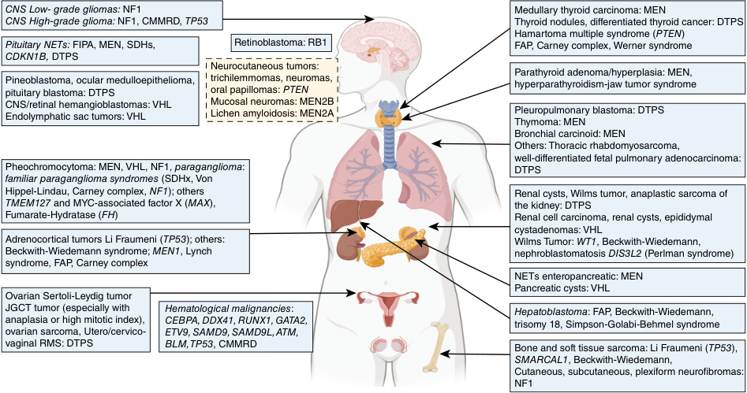

# Chapter 40: Cancer Predisposition Syndromes in Children
> **Course:** Vikkypaedia Rare Disease Learner Course (*Nelson Pediatric Textbook of Rare Diseases: Genomic Etiologies and Genetic Diagnosis (1st Edition)*)  
> **Section VII:** Endocrine Disorders  
> **Authors:** Paula Casano Sancho, Barbara Rivera Polo, Diana Salinas Chaparro, Hector Salvador Hernandez  
> **Metrics:** 9,662 words · 12 tables · 1 figures · 148 genes · 28 flashcards · 14 MCQs  
> **Quick Navigation:** [🃏 Study 28 Flashcards](../flashcards/040_flashcards.md) · [📝 Take 14-Q MCQ Quiz](../mcqs/040_mcqs.md) · [📚 Section VII Guide](../sections/Section_VII.md) · [🧬 Master OMIM/Gene Atlas](../omim_gene_atlas.md) · [💊 Precision Therapies Matrix](../therapies_matrix.md) · [🏠 Course Index](../../index.md)

## Key Chapter Topics
`Classification` · `Detection` · `Genetic Basis of Cancer Predisposition Syndromes` · `Susceptibility Genes and Inheritance Patterns` · `Clinical Description of Main Pediatric Tumor Susceptibility Syndromes` · `Multiple Endocrine Neoplasia` · `MEN2A—Sipple Syndrome` · `MEN2B` · `MEN1—Wermer Syndrome` · `Hereditary Pheochromocytoma-Paraganglioma` · `DICER1 Tumor Predisposition Syndrome` · `PTEN Hamartoma Tumor Syndrome (PHTS)` · `Li-Fraumeni Syndrome` · `Genomic Instability Disorders`

## Key Genes & Molecular Targets
`AKT1`, `ALK`, `ANAPC1`, `ANKRD26`, `APC`, `ATM`, `ATP7B`, `BAP1`, `BMPR1A`, `BRAF`, `BRCA1`, `BRCA2`, `BRIP1`, `BUB1`, `BUB1B`, `BUB3`, `CDC73`, `CDK4`

## ⚡ High-Yield Clinical & Diagnostic Pearls
- Based on Their Mode of Inheritance (e.g., autosomal dominant, autosomal recessive, X-linked, nonhereditary).
- This also includes patients who have undergone molecular testing for another reason and incidentally discovered a genetic change reportable (e.g., newborn screening tests being implemented in some countries).
- In autosomal dominant syndromes , one inherited allele with a loss of function variant in a tumor suppressor gene is sufficient to confer susceptibility; a second gene event in the remaining wild-type allele disrupts the protein function and leads to somatic cell for tumor formation.
- In autosomal recessive syndromes like Fanconi anemia or congenital mismatch repair deficiency (CMMRD), alterations affecting both alleles of a TSG need to be co-occurring in the germline (by inheritance or by de novo acquisition in the zygote).
- Syndromes caused by an activating alteration in an onco gene usually follow autosomal dominant models of inheritance.
- That is the case of X-linked recessive disorders that typically manifest in males, while females are carriers without phenotypic expression.
- Duncan disease, also known as X-linked lymphoproliferative syndrome (XLP), is due to alterations in SH2D1A and manifests with severe mononucleosis after Epstein-Barr infections and ultimately develop lymphomas in affected males.
- The most common example is Down syndrome, which has an association with a higher risk for hematological malignancies (acute lymphoblastic leukemia and myeloid leukemia of Down syndrome usually acute megakaryoblastic leukemia).

---
## Full Chapter Text, Tables & Figures

<!-- p.884 -->

# 40 

## Cancer Predisposition Syndromes in Children 

**PAULA CASANO SANCHO, BARBARA RIVERA POLO, DIANA SALINAS CHAPARRO, HECTOR SALVADOR HERNANDEZ** 

Terms that describe a patient who has an increased risk of developing cancer include: hereditary cancer, familial cancer, cancer susceptibility, or predisposition to cancer, among others. In pediatrics, the most commonly used term is **cancer predisposition syndrome (CPS)** , although they essentially refer to the same concept. 

A CPS is a congenital condition (present from birth) that results in an increased risk of developing tumors (either benign or malignant) throughout the individual’s life. Most of these conditions are genetic and potentially hereditary, which is why they are also known as hereditary cancer syndromes or familial cancer syndromes. 

### **Classification** 

Over 200 genes have been associated with cancer susceptibility, exhibiting significant heterogeneity among them. Consequently, multiple classifications of these conditions exist, based on factors such as molecular mechanisms (tumor suppressor genes or onco genes), non-tumoral phenotype (Table 40.1), class of tumors produced (neuroendocrine, central nervous system, hematological), mode of inheritance, and age of onset. It is difficult to comprehensively classify all these conditions because new associations, manifestations, and novel genes are constantly added. 

In practical terms, there are two major classifications: 

1. **Based on Whether the Disease Has Non-tumoral Syndromic Manifestations:** While most adult cancer predisposition syndromes do not typically present with nononcologic clinical signs, this changes significantly in pediatric cases. About half of the genes associated with pediatric cancers are linked to a pathological phenotype, allowing for early pre-tumoral diagnosis. Examples include café-au-lait macules in neurofibromatosis type 1; macrocephaly and dysmorphic features in NBCCS (nevoid basal cell carcinoma syndrome); hypopigmented spots, epilepsy, and psychomotor delay in tuberous sclerosis; aniridia and WAGR syndrome (Table 40.1). 

The physical examination is crucial in determining these associations in pediatric cancer patients. 

2. **Based on Their Mode of Inheritance** (e.g., autosomal dominant, autosomal recessive, X-linked, nonhereditary). Additionally, the term adult-onset CPS is used to include conditions typically associated with cancer risk exclusively in adults. These genes are not frequently assessed in children. However, preliminary evidence suggests that these genes may also influence pediatric cancer risk. Variants in these genes may be discovered when undergoing germline testing; children with cancer show a slightly increased incidence compared to the general population. This group includes conditions or genes not considered rare, such as hereditary breast and ovarian cancer (HBOC) associated with BRCA1 and BRCA2 variants, or Lynch syndrome associated with mismatch repair gene variants, or less frequent conditions like Birt-Hogg-Dubé syndrome or hereditary diffuse gastric cancer (Fig. 40.1). 

### **Detection** 

There are essentially two ways to diagnose CPS: 

1. **Through Clinical Manifestations in Patients Who Have Not Yet Developed Cancer or a Diagnosis Made in Relatives** (Table 40.1): This group includes individuals who can be diagnosed by presenting a syndromic phenotype, or those with a family member diagnosed with the syndrome, leading to targeted testing to detect their _presymptomatic_ carrier status. This also includes patients who have undergone molecular testing for another reason and incidentally discovered a genetic change reportable (e.g., newborn screening tests being implemented in some countries). 

2. **After a Cancer Diagnosis:** Every patient who has developed cancer should be evaluated to determine the presence of an underlying CPS. Although data varies significantly across different series, it is estimated that at least 10% of pediatric cancer patients have developed their tumor due to a germline genetic cause. This percentage is _(Text continued on page 871)_

<!-- p.885 -->

##### **TABLE 40.1 Syndrome Associated Malignancies** 

|Syndrome|Genetic Locus|Inheritance|Primary Associated Tumors/Cancers (Pediatric and Adult)|Other Clinical Features|
|---|---|---|---|---|
|Ataxia-telangiectasia|_ATM_|AR|Leukemia, Hodgkin lymphoma, non-Hodgkin lymphoma|Cerebellar ataxia, oculomotor apraxia, choreoathetosis, telangiectasia of conjunctivae, immune deficiency|
|Bazex-Dupré-Christol|Mapped to_Xq24-q27_|XLD|SCC|Basal cell nevi, hypotrichosis, hypohidrosis, milia, atrophoderma follicularis|
|Beckwith-Wiedemann syndrome|11p15: epigenetics and genomic alterations; _CDKN1C, LIT1_|Imprinting, AD|Wilms tumor, hepatoblastoma, neuroblastoma, rhabdomyosarcoma|Macrosomia, macroglossia, visceromegaly, omphalocele, renal abnormalities, neonatal hypoglycemia, hemihypertrophy|
|Bloom syndrome|_BLM_|AR|Leukemia, lymphoma, SCC, CRC, osteosarcoma|Growth deficiency, short stature, butterfly rash on nose and cheeks, sensitivity to sun|
|Birt-Hogg-Dube syndrome-1*|_FLCN_|AD|Renal tumors (hybrid oncocytic RCC, oncocytoma, chromophobe RCC, CCRCC), fibrofolliculomas, trichodiscomas/angiofibromas, perifollicular fibromas, and acrochordons, pulmonary cysts|Pneumothorax|
|Carney complex*|_PRKAR1A_|AD|Schwannoma, testicular Sertoli tumor, thyroid adenoma, myxoma (cardiac, skin, others)|Blue nevi, lentigines, hypercortisolism caused by PPNAD|
|Carney triad|_SDHD, SDHB, SDHC_|N/A|PGL, GIST, pulmonary chondroma|Presents in pubescent and prepubescent females|
|_CEBPA_-associated predisposition to AML|_CEBPA_|AD|AML|N/A|
|Congenital amegakaryocytic thrombocytopenia| _MPL_|AR|Leukemia|Thrombocytopenia, pancytopenia, megakaryocytopenia|
|Constitutional mismatch DNA repair deficiency syndrome*|_MLH1, MSH2, MSH6,_ _PMS2_(biallelic)|AR|CNS tumors, hematological, Lynch syndrome associated cancers, sarcoma, embryonal tumor, pilomatricoma|Hyper/hypopigmentation|
|Costello syndrome|_HRAS_|AD|Rhabdomyosarcoma, neuroblastoma, transitional cell bladder cancer, papillomas|DD, hypermobility, characteristic facial features, arrhythmia, CHD, large birth weight, FTT|
|Diamond-Blackfan anemia|_RPL5, RPL11, RPS19,_ _RPS10, RPS26, RPL15,_ _RPL26, RPL35A, RPS7,_ _RPS24, RPS17, GATA1_|AD|Osteosarcoma, AML, MDS|Red cell aplasia, cleft lip/palate, malformed or absent thumbs, microcephaly, distinctive facial features, cataracts, glaucoma, hypospadias, short stature|
|DICER1 syndrome|_DICER1_|AD|Multinodular goiter, thyroid cancer, pleuropulmonary blastoma, cystic nephroma, ovarian sex cord-stromal tumor, pituitary blastoma, pineal blastoma, ocular medulloepithelioma, nasal chondromesenchymal hamartoma, Wilms tumor| Goiter, cystic nephroma|

_(Continued)_

<!-- p.886 -->

##### **TABLE 40.1 Syndrome Associated Malignancies—cont’d** 

|Syndrome|Genetic Locus|Inheritance|Primary Associated Tumors/Cancers (Pediatric and Adult)|Other Clinical Features|
|---|---|---|---|---|
|Down syndrome|Trisomy 21|Chromosomal|Leukemia|Characteristic facial features, DD, CHD, hypotonia, hypothyroidism, vision and hearing impairment|
|Denys-Drash syndrome|_WT1_|AD|Wilms tumor|Diffuse glomerulosclerosis, gonadal dysgenesis, infertility|
|Dyskeratosis congenita|_CTC1, DKC1, TERC,_ _TERT, TINF2, WRAP53_ _(TCAB1), NHP2,_ _NOP10, RTEL1, ACD_|XLR|MDS, AML, SCC of head/neck/anogenital region|BMF, pulmonary fibrosis, dysplastic nails, lacy reticular skin pigmentation, leukoplakia|
|Familial adenomatous polyposis*|_APC_|AD|Polyposis, CRC, small bowel cancer, stomach cancer, pancreatic cancer, thyroid cancer, CNS tumors, hepatoblastoma, juvenile nasopharyngeal angiofibroma, desmoid tumors, osteomas, endodermal cysts|Dental abnormalities, CHRPE|
|Familial atypical mole- malignant melanoma syndrome (hereditary melanoma and pancreatic cancer syndrome)*|_CDKN2A_|AD|Melanoma, pancreatic cancer, oropharyngeal squamous cell carcinoma|Atypical moles|
|Familial cutaneous malignant melanoma|_CDK4_|AD|Malignant melanoma|Atypical moles|
|Familial gastrointestinal stromal tumor*|_KIT, PDGFRA_|AD|GIST, mast cell tumors (_KIT_only)|(_KIT_only) skin hyperpigmentation, dysphagia (_PDGFRA_only) large hands|
|Familial medullary thyroid carcinoma|_RET_|AD|MTC|Hirschsprung disease|
|Familial multiple lipomatosis|_HMGA2_|AD|Lipomas|N/A|
|Familial mosaic monosomy 7|_SAMD9L_|Typically AD|MDS, AML|Red cell macrocytosis, cytopenias, elevated hemoglobin F, bone marrow aplasia|
|Familial neuroblastoma|_ALK, PHOX2B, GALNT14_|AD|Neuroblastoma, ganglioneuroblastoma, ganglioneuroma|_(PHOX2B only):_Hirschsprung disease, central hypoventilation, decreased esophageal motility, characteristic facial features|
|Familial platelet disorder/ AML|_RUNX1_|AD|MDS, AML|Platelet disorder|
|Familial Wilms tumor|loci_FWT1_and_FWT2,_ _CTR9, REST_|AD|Wilms tumor|N/A|

_(Continued)_

<!-- p.887 -->

##### **TABLE 40.1 Syndrome Associated Malignancies—cont’d** 

|Syndrome|Genetic Locus|Inheritance|Primary Associated Tumors/Cancers (Pediatric and Adult)|Other Clinical Features|
|---|---|---|---|---|
|Fanconi anemia|_FANCL, FANCB, FANCC,_ _BRCA2, FANCD2,_ _FANCE, FANCF, FANCG,_ _FANCI, BRIP1, FANCL,_ _FANCM, PALB2_ _RAD51C, SLX4, ERCC4,_ _RAD51, BRCA1, UBE2T_|AR|AML, SCC of the head, neck, esophageal, vulva, cervical, and liver cancer|Short stature, skin pigmentation, radial defects, hypogonadism, DD, BMF, malformation of: skeletal system, eyes, kidneys, ears (can have decreased hearing), heart, GI system|
|Frasier syndrome|Intron 9 splice site of_WT1_|AD|Gonadoblastoma|Glomerulosclerosis, gonadal dysgenesis, and streak gonads (males)|
|_GATA2_-associated predisposition to MDS/AML|_GATA2_|AD|MDS, AML|Lymphedema and sensorineural hearing loss (Emberger syndrome), primary immunodeficiency and monocytosis/ monocytopenia (MonoMAC [monocytopenia and mycobacterial infection] syndrome)|
|Glycogen storage disease Ia|_G6PC_|AR|Hepatocellular carcinoma|Neonatal hypoglycemia, hepatomegaly, growth restriction, delayed puberty, lactic acidemia, hyperlipidemia, hyperuricemia|
|Glycogen storage disease IV|_GBE1_|AR|Hepatocellular carcinoma|Hypotonia, hepatosplenomegaly, cirrhosis, ascites, cardiomyopathy|
|Hemihyperplasia (isolated)|N/A|Isolated|Embryonal cancers, particularly Wilms tumor|N/A|
|Hereditary paraganglioma/ pheochromocytoma syndrome*|_SDHA, SDHB, SDHC,_ _SDHD, SDHAF2,_ _TMEM127, MAX_|AD|PGL, pheochromocytoma, GIST, RCC|N/A|
|Hereditary papillary renal cell carcinoma*|_MET_|AD|Type 1 papillary RCC|N/A|
|Hereditary retinoblastoma|_RB1_|AD|Retinoblastoma, pineoblastoma, osteosarcoma, soft tissue sarcoma, melanoma|N/A|
|Hyperparathyroidism jaw tumor syndrome|_CDC73_ _(HRPT2)_|AD|Parathyroid carcinoma, jaw tumors, kidney tumors, uterine tumors|Hyperparathyroidism|
|Infantile myofibromatosis|_PDGFRB, NOTCH3_|AD|Myofibromas|N/A|
|Juvenile polyposis syndrome*|_SMAD4, BMPR1A_|AD|Juvenile polyps, CRC, stomach cancer, cancers of upper GI tract, and pancreatic cancer|Intussusception, (_SMAD4_only) HHT|
|Li-Fraumeni syndrome*|_TP53_|AD|Sarcoma, breast cancer, brain cancer, ACC, leukemia, CPC, GI, GU, non-medullary thyroid cancers| N/A|

_(Continued)_

<!-- p.888 -->

##### **TABLE 40.1 Syndrome Associated Malignancies—cont’d** 

|Syndrome|Genetic Locus|Inheritance|Primary Associated Tumors/Cancers (Pediatric and Adult)|Other Clinical Features|
|---|---|---|---|---|
|Lynch syndrome*|_MLH1, MSH2, MSH6,_ _PMS2, EPCAM_|AD|CRC, ovarian cancer, endometrial cancer, stomach cancer, small intestine cancer, hepatobiliary cancer, urinary cancer, brain cancer, skin cancer|N/A|
|Melanoma neural system tumor syndrome*|Deletion 9p21|AD|Astrocytoma, melanoma|N/A|
|Mosaic variegated aneuploidy syndrome|_BUB1B_|AR|Rhabdomyosarcoma, Wilms tumor, leukemia|Intrauterine growth restriction, microcephaly, eye anomalies, mild dysmorphism, DD, multiple congenital anomalies|
|Multiple endocrine neoplasia syndrome type 1*|_MEN1_|AD|Parathyroid adenoma, pituitary adenoma, GEP tumor, carcinoid tumors, ACC, meningioma, ependymoma, lipoma, facial angiofibroma, collagenoma, leiomyoma|Primary hyperparathyroidism|
|Multiple endocrine neoplasia syndrome type 2a*|_RET_|AD|Pheochromocytoma, parathyroid adenoma, MTC|Hirschsprung disease|
|Multiple endocrine neoplasia syndrome type 2b*|_RET_|AD|MTC, mucosal neuroma of lip and tongue, ganglioneuromatosis of the GI tract|Marfanoid habitus, distinctive facies|
|Multiple endocrine neoplasia syndrome type 4|_CDKN1B_|AD|Parathyroid adenoma, papillary thyroid cancer, pancreatic endocrine neoplasia, neuroendocrine cervical carcinoma, carcinoid tumors, renal angiomyolipoma| Acromegaly|
|MUTYH associated polyposis*|_MUTYH_(biallelic)|AR|Polyposis, CRC|GI phenotype similar to FAP|
|Nevoid basal cell carcinoma syndrome (Gorlin syndrome)*|_PTCH1, PTCH2, SUFU_|AD|BCC, medulloblastoma, fibromas (cardiac and ovarian), keratocystic odontogenic tumors|Pits in palms of hands or soles of feet, macrocephaly, prominent forehead, skeletal abnormalities|
|Neurofibromatosis type 1|_NF1_|AD|Neurofibromas, MNST, optic and other gliomas|Café au lait macules, axillary/inguinal freckling, pseudarthrosis, Lisch nodules, learning disability|
|Nijmegen breakage syndrome|_NBN_|AR|T and B cell lymphomas, medulloblastoma, glioma, rhabdomyosarcoma|Microcephaly, short stature, characteristic facial features, recurrent infections, ID, premature ovarian failure|
|Noonan syndrome|_PTPN11, SOS1, RAF1,_ _KRAS, NRAS, BRAF,_ _MAP2K1_|AD|JMML, rhabdomyosarcoma, neuroblastoma|Short stature, CHD, DD, broad/webbed neck, unusual chest shape, cryptorchidism, coagulation defects, lymphatic dysplasia, ocular abnormalities|

_(Continued)_

<!-- p.889 -->

##### **TABLE 40.1 Syndrome Associated Malignancies—cont’d** 

|Syndrome|Genetic Locus|Inheritance|Primary Associated Tumors/Cancers (Pediatric and Adult)|Other Clinical Features|
|---|---|---|---|---|
|Oculocutaneous albinism|_OCA(1–4)_|AR|Melanoma, SCC, BCC|Decreased pigmentation (skin, iris, hair), vision loss|
|Paraganglioma and somatostatinoma with polycythemia|_HIF2A_|Somatic mosaicism|PGL, somatostatinoma|Polycythemia|
|_PAX5_related ALL susceptibility|_PAX5_|AD|B-cell ALL|N/A|
|Perlman syndrome|_DIS3L2_|AR|Wilms tumor|Macrosomia, hypotonia, organomegaly, facial dysmorphism, renal anomalies, DD|
|Peutz-Jeghers syndrome*|_STK11_|AD|Hamartomatous polyposis, CRC, gastric cancer, pancreatic cancer, breast cancer, ovarian cancer, SCTAT, adenoma malignum of cervix, LCST of testes|Mucocutaneous pigmentation (lips and buccal mucosa)|
|_PIK3CA_related syndromes|_PIK3CA_|Somatic mosaicism|Lipoma|Overgrowth, vascular anomalies, abnormal extremities, linear epidermal nevus, multiple small nevi|
|_POT1_related|_POT1_|AD|Oligodendroglioma (limited cases), melanoma|N/A|
|Proteus syndrome|_AKT1_|Somatic mosaicism|Lipomas, cerebriform connective tissue nevus, ovarian cystadenomas, parotid adenoma|Asymmetrical overgrowth, vascular malformations, ID, seizures, vision loss, distinctive facial features, linear verrucous epidermal nevi, bullous pulmonary degeneration, hyperostosis, risk for DVT|
|PTEN hamartoma tumor syndrome*|_PTEN_|AD|Polyposis (ganglioneuromas, hamartomas, adenomas), thyroid cancer (epithelial/follicular), multinodular goiter, lipomas, fibroids, LDD/dysplastic cerebellar gangliocytoma, breast cancer, endometrial cancer, CRC, renal cell (papillary) carcinoma, melanoma, trichilemmoma, oral mucosal papillomatosis, fibrocystic breast disease|Acral/palmoplantar keratosis, macrocephaly, DD/MR, myopathy of proximal muscles, hyperextensibility, scoliosis, pectus excavatum, autism, pigmented macules glans penis|
|Rhabdoid tumor predispo- sition syndrome type 1*|_SMARCB1_|AD|ATRT, rhabdoid tumors, schwannomatosis, multiple meningiomas|N/A|
|Rhabdoid tumor predisposition syndrome type 2*|_SMARCA4_|AD|ATRT, rhabdoid tumors, non-small cell carcinoma of the ovary hypercalcemic type|N/A|
|Rothmund-Thomson syndrome|_RECQL4_|AR|Osteosarcoma, BCC, SCC, melanoma|Short stature, sparse hair, skeletal/dental abnormalities, cataracts, poikiloderma, hyperkeratotic lesions, GI problems, anemia/neutropenia, aplastic anemia, male infertility|

_(Continued)_

<!-- p.890 -->

##### **TABLE 40.1 Syndrome Associated Malignancies—cont’d** 

###### **40.1** 

|Syndrome|Genetic Locus|Inheritance|Primary Associated Tumors/Cancers (Pediatric and Adult)|Other Clinical Features|
|---|---|---|---|---|
|Rubinstein-Taybi syndrome|_CREBBP_|AD|Medulloblastoma|Short stature, microcephaly, intellectual disability, distinctive facial features, broad thumbs and first toes, eye abnormalities, heart and kidney defects, dental problems, obesity|
|Simpson-Golabi-Behmel syndrome|_GPC3, GPC4_|XLR|Wilms tumor, nephroblastomatosis, hepatoblastoma, adrenal neuroblastoma, gonadoblastoma, hepatocellular carcinoma|Neonatal hypoglycemia, micrognathia (neonate), macrosomia, macrognathia (older individuals), macrostomia, macrocephaly, macroglossia, cardiac abnormalities, multiple congenital anomalies, postaxial polydactyly, mild-severe ID|
|Schwannomatosis|_SMARCB1 (INI1), LZTR1_|AD|Multiple schwannomas|N/A|
|Schwannomatosis NF2 related|_NF2_|AD|Schwannoma, vestibular schwannoma, meningioma, ependymoma, astrocytoma, glioma, neurofibroma|Hearing loss, tinnitus, balance dysfunction, may see café au lait macules|
|Shwachman-Diamond syndrome|_SBDS_|AR|MDS, AML|Pancreatic dysfunction, malabsorption/ malnutrition, growth failure, skeletal abnormalities, hepatomegaly, recurrent infections, cytopenias, BMF, cognitive/ behavioral impairment|
|_SMARCE1_related|_SMARCE1_|AD|Meningioma|Activating variants in_SMARCE1_are seen in Coffin-Siris syndrome but reported cases do not have features of Coffin-Siris syndrome|
|Sotos syndrome|_NSD1_|AD|Tumor spectrum is not well described but includes rhabdomyosarcoma, Wilms tumor, neuroblastoma, leukemia and lymphoma|Overgrowth, macrocephaly, neonatal hypotonia, DD, ID, characteristic facial features, behavioral problems|
|Thrombocytopenia syndromes|_ETV6, ANKRD26_|AD|MDS, leukemia|Thrombocytopenia, red cell macrocytosis|
|Thrombocytopenia with absent radii syndrome|_RBM8A_and 1q2.1 deletion| AR|Leukemia|Thrombocytopenia, bilateral absence of radii, cow milk allergy, skeletal anomalies, GU anomalies|
|Trisomy 18 (Edwards syndrome)|Trisomy 18|Chromosomal disorder|Wilms tumor|Intrauterine growth restriction, cardiac abnormalities, multiple congenital anomalies, severe ID|

_(Continued)_

<!-- p.891 -->

##### **TABLE 40.1 Syndrome Associated Malignancies—cont’d** 

|Syndrome|Genetic Locus|Inheritance|Primary Associated Tumors/Cancers (Pediatric and Adult)|Other Clinical Features|
|---|---|---|---|---|
|Tuberous sclerosis*|_TSC1, TSC2_|AD|Rhabdomyomas, cortical tubers, subependymal nodules, subependymal giant cell astrocytoma, renal angiomyolipomas, oncocytoma, RCC, angiofibroma, ungual fibroma, gingival hamartoma, retinal hamartoma, neuroendocrine tumors, lymphangiomyomatosis, renal cysts, bone cysts|Seizures, hypomelanotic macules, shagreen patch, achromic patch, autism, behavioral impairments, cortical dysplasia, dental enamel pits, ID|
|Turner syndrome|45,X|Chromosomal disorder|Gonadoblastoma|Aortic coarctation, cystic hygroma, streak ovaries, infertility, spatial deficits, growth and sex hormone deficiencies|
|Tyrosinemia type I|_FAH_|AR|Hepatocellular carcinoma|Progressive liver disease, hypophosphatemic rickets|
|Von Hippel-Lindau syndrome*|_VHL1_|AD|RCC (clear cell), hemangioblastoma, ELST, islet cell carcinoma, pheochromocytoma, pancreatic neuroendocrine tumors, epididymal tumors, adenomas/angiomas (kidney, liver, pancreas, spleen, adrenal gland), papillary/uterine cystadenoma, cysts (renal, pancreatic, liver, epididymal, hepatic)|N/A|
|WAGR (Wilms tumor, aniridia, genitourinary anomalies, and retardation)|Contiguous gene deletion including_WT1_and_PAX6_|AD|Wilms tumor|Aniridia, genitourinary anomalies, ID, cataracts, glaucoma, nystagmus|
|Wilson Disease|_ATP7B_|AR|Hepatocellular carcinoma|Liver disease, jaundice, neurological/ psychiatric problems, Kayser-Fleisher ring|
|WT1 related Wilms tumors|WT1|AD|Wilms tumor|Ambiguous genitalia/testicular feminization, renal failure|
|Xeroderma pigmentosum|_XPA, ERCC3, XPC,_ _ERCC2, DDB2, ERCC4,_ _ERCC1, ERCC5 POLH_|AR|BCC, SCC, melanoma|Sun sensitivity/easy blistering, ocular abnormalities, neurological manifestations|

*The American College of Medical Genetics and Genomics and the National Society of Genetic Counselors have practice guidelines available for reference for this condition. 

_ACC,_ Adrenocortical carcinoma; _ALL,_ acute lymphoblastic leukemia; _AML,_ acute myelogenous leukemia; _ATRT,_ atypical teratoid rhabdoid tumor; _BCC,_ basal cell carcinoma; _BMF,_ bone marrow failure; _CCRCC,_ clear cell renal cell carcinoma; _CHD,_ congenital heart defect; _CHRPE,_ congenital hypertrophy of the retinal pigment epithelium; _CNS,_ central nervous system; _CPC,_ choroid plexus carcinoma; _CRC,_ colorectal cancer; _DD,_ developmental delay; _DVT,_ deep venous thrombosis; _ELST,_ endolymphatic sac tumor; _FAP,_ familial adenomatous polyposis; _FTT,_ failure to thrive; _GEP,_ gastro-entero-pancreatic; _GI,_ gastrointestinal; _GIST,_ gastrointestinal stromal tumor; _GU,_ genitourinary; _HHT,_ hereditary hemorrhagic telangiectasia; _ID,_ intellectual disability; _JMML,_ juvenile myelomonocytic leukemia; _LCST,_ large calcifying Sertoli tumor; _LDD,_ Lhermitte-Duclos disease; _MDS,_ myelodysplastic syndrome; _MPNST,_ malignant peripheral nerve sheath tumor; _MTC,_ medullary thyroid carcinoma; _N/A,_ not applicable; _PGL,_ paraganglioma; _PPNAD,_ primary pigmented nodular adrenal dysplasia; _RCC,_ renal cell carcinoma; _SCC,_ squamous cell carcinoma; _SCTAT,_ sex cord tumor with annular tubules. 

This table is not, nor is it meant to be, an exhaustive list of all genetic syndromes with a pediatric malignancy risk. Other cancers or clinical features may also be associated with the listed syndromes. This table highlights the cancers with the greatest increased risks compared to the general population and common associated features. Modified from Scollon S, Anglin AK, Thomas M, et al. A comprehensive review of pediatric tumors and associate cancer predisposition syndromes. _J Genet Counsel_ . 2017;26:387-434 (Table 1, p. 388–393).

<!-- p.892 -->

**Fig. 40.1** Tumors associated with cancer predisposition syndromes in children and adolescents. This figure is not a complete list of pediatric tumors and cancer predisposition syndromes. _CNS,_ Central nervous system; _DTPS,_ DICER1-related tumor predisposition syndrome; _FAP,_ familial adenomatous polyposis; _FIPA,_ familial isolated pituitary adenoma; _JGCT,_ juvenile granulosa cell tumor; _MEN,_ multiple endocrine neoplasia; _NETs,_ neuroendocrine tumors; _NF1,_ neurofibromatosis type I; _PTEN,_ hamartoma multiple syndrome; _RMS,_ rhabdomyosarcoma; _SDHs,_ succinate dehydrogenase syndromes; _VHL,_ Von Hippel-Lindau syndrome. (Created in BioRender. Hoenicka J [2025] [https://biorender.com/t1jmgzb]; Modified by editors.) 

significantly higher depending on the type of tumor, age of onset, and personal and family history. Common situations include: 

- **Family history of cancer in first-or second-degree relatives:** It is important to note that more than half of pediatric-onset CPS patients do not have a family history of cancer, so its absence does not rule out its presence. 

- **Tumors presenting at an unusual age:** Examples include pediatric-onset melanoma, colon cancer in an adolescent, or breast cancer in a young female. This does not equate to CPS, but early onset increases the likelihood. 

- **Rare tumors:** Certain types of tumors are more likely to be associated with a CPS, such as medullary thyroid cancer, pleuropulmonary blastoma, and hemangioblastoma. 

- **Bilateral or metachronous tumors:** A typical example is a young child with bilateral retinoblastoma, most often associated with a constitutional alteration of the _RB1_ gene. However, it should also be suspected in many other manifestations, such as multiple paragangliomas, synchronous rhabdoid tumors, and bilateral breast cancer. 

- **Somatic findings of special interest:** Tumor findings of variants in cancer predisposition genes with a high allelic frequency should raise suspicion of germline detection. Certain molecular alterations (with a very high tumor burden) should also be considered as potentially associated with a CPS. 

- **High toxicity to cancer treatment:** Toxicity not expected with the type, degree, or duration of the treatment received could be the first manifestation of several cancer predisposition syndromes like ataxiatelangiectasia, Fanconi anemia, or nevoid basal cell carcinoma syndrome. 

There are multiple guidelines or consensus criteria for the diagnosis of these conditions (Table 40.2). Some specific diseases have their own clinical criteria (multiple endocrine neoplasia syndromes, PTEN hamartoma syndrome, neurofibromatosis type I, Li-Fraumeni, tuberous sclerosis complex). It is difficult to rule out germline gene changes conferring susceptibility based solely on clinical or somatic features; this is why some centers are performing genetic analysis _on all_ pediatric or rare tumor patients. Many centers use criteria to determine who is a candidate for potential screening for a cancer predisposition syndrome. In pediatric cancer, examples of these criteria

<!-- p.893 -->

##### **TABLE Key Features That Might Suggest an 40.2 Underlying Cancer Predisposition Syndrome** 

- Family history of cancer in first-or second-degree relatives 

- Cancer of the adulthood presented in children 

- Diagnosis of an infrequent tumor type or a tumor histology characteristic of a CPS 

- Bilateral or multiple tumors not associated with previous therapy 

- High toxicity to a cancer treatment 

- Non-tumor phenotypes of a CPS 

include the Jongmans criteria or the MIPOGG algorithm (McGill Interactive Pediatric OncoGenetic Guidelines). Unfortunately, none of these criteria have a 100% sensibility and specificity; this is one reason why all patients with pediatric and rare tumors should be seen at a hereditary cancer unit. 

### **Genetic Basis of Cancer Predisposition Syndromes** 

#### **Hereditary vs. Sporadic Cancers: Distinction Between Congenital Genetic Variants and Acquired Postzygotic Pathogenic Gene Variants** 

The majority of tumors are sporadic because they are caused by a genetic or epigenetic alteration that occurs as a _somatic_ gene variation in a cell of the target tissue. Sporadic tumors, like those of adult onset, are commonly associated with multiple environmental factors exposures (sun, diet, alcohol, toxin exposures), infectious disorders, or lifestyle risk factors. Contrary to sporadic cases, around 10–20% of tumors are hereditary; arising from a _germline_ pathogenic variant that confers an increased risk for tumor development. The variant that provides the risk is therefore constitutional and affects every tissue in the individual. Variants can be inherited from a parent or acquired _de novo_ in the zygote. Pathogenic variants acquired through postzygotic mosaicism are also considered constitutional and can affect the germline. 

#### **Susceptibility Genes and Inheritance Patterns** 

Among tumor susceptibility genes, there are two main categories: tumor suppressor genes and onco genes. _Tumor suppressor genes (TSG)_ have a central role in regulating the cell division rate, so that it is kept controlled according to normal tissue growth, replacement, and physiological needs. _Onco genes (OG)_ code for proteins that promote cell division. In this context, either loss of function of tumor suppressors or gain of function of onco genes will drive tumorigenesis. 

The type of alterations that confer tumor susceptibility is greatly related to the gene function. The deficiency of a tumor suppressor protein is caused by a loss of function 

alteration. This is a germline gene variant that leads to a truncating protein (a _nonsense/frameshift_ alteration) or a variant that leads to aberrant splicing. A deficient activity of a protein is typically caused by a _missense/in-frame variant_ that results in the impairment of the protein activity or an instable protein. Tumor suppressor genes follow the Knudson two hit principle. In _autosomal dominant syndromes_ , one inherited allele with a loss of function variant in a tumor suppressor gene is sufficient to confer susceptibility; a second gene event in the remaining wild-type allele disrupts the protein function and leads to somatic cell for tumor formation. This is well illustrated in _RB1_ and retinoblastoma formation, or in _TP53_ and Li-Fraumeni syndrome. In _autosomal recessive syndromes_ like Fanconi anemia or congenital mismatch repair deficiency (CMMRD), alterations affecting both alleles of a TSG need to be co-occurring in the germline (by inheritance or by _de novo acquisition_ in the zygote). 

Contrary to TSG, activating pathogenic variants in certain onco genes may cause tumor susceptibility. The most typical situation involves a missense variant in a functional domain of the encoded protein of an onco gene which leads to its continuous activity or that prevents the binding of a repressor. A classic example is an activating alteration in the _onco gene RET_ that causes multiple endocrine neoplasia disease. Syndromes caused by an activating alteration in an onco gene usually follow autosomal dominant models of inheritance. 

Activating variants in onco genes are often not compatible with embryonic development. In these cases, transmission to the offspring or full germline _de novo_ acquisition is unlikely; therefore, pathogenic variants are acquired during postzygotic development. Consequently, the pathogenic variant will have a mosaic distribution (only be present in the cells derived from the one that acquired the variant) and the affected tissues will be confined to those that carry the alteration. This is the case for encephalocraniocutaneous lipomatosis caused by recurrent _FGFR1_ oncogenic alterations. 

Some cancer susceptibility disorders may follow different inheritance patterns. That is the case of X-linked recessive disorders that typically manifest in males, while females are carriers without phenotypic expression. Duncan disease, also known as X-linked lymphoproliferative syndrome (XLP), is due to alterations in _SH2D1A_ and manifests with severe mononucleosis after Epstein-Barr infections and ultimately develop lymphomas in affected males. 

Chromosomal abnormalities like aneuploidies, deletions, and other chromosomal rearrangements can be associated with an increased risk of cancer development often related to the genes mapping to those regions. The most common example is Down syndrome, which has an association with a higher risk for hematological malignancies (acute lymphoblastic leukemia and myeloid leukemia of Down syndrome usually acute megakaryoblastic leukemia). 

There are several non-germline variant-related syndromes that also increase the risk of cancer. Beckwith-Wiedemann

<!-- p.894 -->

syndrome (BWS), a condition characterized by overgrowth that can arise from epigenetic changes (nonhereditary) factors in the 11p15 region (gain or loss of methylation in IC1 and IC2 regions, respectively). This syndrome is linked to a higher risk of embryonal malignancies, such as Wilms tumor and hepatoblastoma. BWS can also be associated with germline changes affecting _CDKN1C_ or the result of chromosomal translocations, inversion, or duplications. 

### **Clinical Description of Main Pediatric Tumor Susceptibility Syndromes** 

A pathway-based approach to CPS (but not comprehensive) is detailed in Table 40.3, while a syndrome approach is noted in Table 40.1 and a gene approach in Figure 40.1. 

#### **Multiple Endocrine Neoplasia** 

Multiple endocrine neoplasia (MEN) is a group of cancer predisposition syndromes, with low prevalence (1 in 2 million MEN 2A, to 1 in 39 million MEN 2B), characterized by the presence of two or more endocrine tumors in the patient and/ or their relatives. 

MEN2 and MEN1 both exhibit autosomal-dominant inheritance and high penetrance. The prognosis for individuals with MEN syndromes can be improved through surveillance programs that detect tumors before symptoms appear. 

Approximately 98% of patients with medullary thyroid cancer (MTC) including MEN2, MEN2B, and familial medullary thyroid cancer (FMTC), have a germline _RET_ pathogenic variant. Approximately 90–95% of individuals with MEN2A have a progenitor affected, in contrast 50% of those with MEN2B have a _de novo_ germline pathogenic variant. 

#### **_MEN2A—Sipple Syndrome_** 

MEN2, the most frequent of the MEN syndromes, is caused by a pathogenic variant in the _RET_ proto-onco gene located on chromosome 10q11.2. _RET_ encodes a transmembrane receptor belonging to the tyrosine kinase family. These variants led to a gain of function, and the promotion of cell proliferation, which leads to the formation of multiple tumors in all tissues where _RET_ is predominantly expressed, specifically in the C-cells of the thyroid gland, adrenal medulla, and neurons. 

In children, the diagnosis is often made after a thorough examination of the family history, usually prompted by the diagnosis of an adult. In these situations, there is a significant risk of **medullary thyroid cancer (MTC)** in early childhood. MTC is considered a rare tumor in children, which makes it crucial to investigate _RET_ variants in newly diagnosed cases. 

Nearly 200 _RET_ germline variants have been identified and continuously updated, establishing a clear genotypephenotype correlation. Approximately 95% of MEN2A 

pathogenic variants are localized to codon 634 (exon 11) or 609, 611, 618, and codon 620 (exon 10) characterized by complete or near complete penetrance. 

In MEN2, the occurrence of clinical manifestations primarily depends on the specific _RET_ variant present. Because nearly all patients with MEN2A have either C-cell hyperplasia or medullary thyroid carcinoma, a risk stratification diagram has been developed to determine the appropriate age for prophylactic thyroidectomy, given that the lifetime risk of MTC is very high. Subsequent guidelines updated the different clinical phenotypes associated with specific RET pathogenic variants and stratified the risk for medullary thyroid carcinoma: 

- **Highest risk (HST) (MEN 2B: codon 918):** Thyroidectomy is recommended before the child reaches 1 year of age. 

- **High risk (H) (MEN 2A: codons 634/883):** Thyroidectomy is advised before the age of 5, or earlier if elevated serum calcitonin levels are detected. 

• **Moderate risk (MOD) (MEN 2A: codons 609, 611, 618, 620, 804 and others):** Families should discuss the timing of intervention, with close monitoring through serum calcitonin and ultrasound. Certain pathogenic variants have an increased risk of pheochromocytoma (PHEO) (codons 634, 883, 631: associated risk of 50%) or hyperparathyroidism (PHPT) (codon 634: associated risk 20%), while in other variants the risk is much lower. However, determining the exact risk in individuals is challenging due to unexplained variability within families. 

**Pheochromocytoma (PHEO)** is the second most common endocrine cancer in pediatric patients with MEN2. While most cases are diagnosed after the age of 30, some patients in high-risk groups (specifically those with the 918/634 codon variants) have been diagnosed as young as 8 years old. It is crucial to evaluate for the presence of PHEO before performing prophylactic thyroidectomy or any other major surgery in both adults and adolescents. 

**Hypercalcemia associated with PHPT** is observed in 10–30% of adults; it is uncommon in children under the age of 20–25 years. 

**Cutaneous lichen amyloidosis** , a dermatological condition associated with the 634 codon variant may occur in some patients. This condition is characterized by pruritic lesions located in the scapular region. 

**Hirschsprung disease (HD)** is associated with pathogenic variants in _RET_ (most common) and other genes _(EDNRB, EDN3)_ . Only specific codons have been identified as risk factors for HD, which include codons 609, 611, 618, and 620. 

**Familiar medullary thyroid cancer (FMTC)** has been classified as a variant of MEN2A, which requires at least two generations affected by RET germline variants or two members affected within the same generation. This variant typically does not involve PHPT or PHEO. However, extended follow-up has revealed some cases of PHEO or PHPT occurring in affected individuals. 

_(Text continued on page 878)_

<!-- p.895 -->

##### **TABLE 40.3 Pathway Based Genes Associated With Malignancies** 

|Related Pathway MAPK pathway|Gene _NF1_|Syndrome Neurofibromatosis type 1 (NF1)|Clinical Features Café au lait macules (>5 macules and >0.5 cm prepubertal and>1.5 cm postpubertal), osseous lesions (sphenoidal dysplasia, long bone pseudoarthrosis, scoliosis), Lisch nodules, learning disability|Associated Tumors Cutaneous neurofibromas, plexiform neurofibromas, optic pathway glioma, sarcoma, breast cancer|Inheritance Model AD|
|---|---|---|---|---|---|
||_NF2_|Neurofibromatosis type 2 (NF2 related schwannomatosis)|Neuropathy, subcapsular or cortical wedge cataracts, retinal hamartoma|Schwannomas, meningiomas, ependymoma, bilateral or unilateral vestibular schwannomas in older patients| AD|
||_HRAS_|Costello syndrome|Short stature, intellectual disability, macrocephaly, coarse facial features, curly hair, FTT, hypertrophic cardiomyopathy|Soft tissue sarcoma, rhabdomyosarcoma, neuroblastoma, transitional cell carcinoma of the bladder in older individuals|AD|
||_PTPN11 SOS1,_ _RAF1, LZTR1,_ _KRAS,_ _NRAS, BRAF,_ _MAP2K1_|Noonan syndrome|Short stature, variable developmental delays, characteristic facial appearance due to low set and posteriorly rotated ears, downslanting palpebral fissures, broad/webbed neck, widely spaced nipples, cardiac (cardiomyopathy/pulmonary stenosis), cryptorchidism in males| Acute lymphoblastic leukemia, acute myeloid leukemia, juvenile myelomonocytic leukemia, glioma, neuroblastoma, rhabdomyosarcoma| AD|
|Hedgehog signaling pathway|_PTCH1, SUFU,_ _GPR161_|Gorlin syndrome (nevoid basal cell carcinoma)|Macrocephaly, lamellar calcification of the falx, rib/vertebral anomalies, palmar and plantar pits, cognitive impairment|Basal cell carcinoma, childhood medulloblastoma, jaw keratocyst, meningioma, soft tissue sarcoma (gonadal teratoma and testicular fibrosarcoma), neuroblastoma|AD|
||_SMO_|Pallister Hall like syndrome/ SMO-Curry Jones syndrome|Postaxial polydactyly, cardiac and skeletal anomalies, craniofacial dysmorphism, patchy skin lesions, polysyndactyly, diverse cerebral malformations, unicoronal craniosynostosis, iris colobomas, microphthalmia, and intestinal malrotation|Hypothalamic hamartoma; myofibromas or hamartomas, medulloblastomas, basal cell carcinoma|AR for Pallister Hall like syndrome—mosaic somatic changes in SMO-Curry Jones syndrome|
||_ELP1_|ELP1 related medulloblastoma||Medulloblastoma|AD|
||_EXT1, EXT2_|Multiple exostoses|Patients may present with bony tumors in the growth plate areas although often identified on X-ray studies|Multiple osteochondromas|AD|

_(Continued)_

<!-- p.896 -->

#### **TABLE 40.3** Pathway Ba sed Genes Associated With Malignancies— cont’d

|Related Pathway|Gene|Syndrome|Clinical Features|Associated Tumors|Inheritance Model|
|---|---|---|---|---|---|
|MTOR-PI3KCa pathway|_PTEN_|PTEN hamartoma tumor syndrome|Macrocephaly, autism spectrum disorder, cognitive impairment|Thyroid nodules, differentiated thyroid cancer, breast cancer in young adults, gastrointestinal neoplasia, endometrial tumors, cerebellar gangliocytoma, rhabdomyosarcoma, glioma|AD|
||_TSC1, TSC2_|Tuberous sclerosis complex|Hypochromic macules, epilepsy, developmental delay|Rhabdomyoma, glioma, angiomyolipoma, renal cell carcinoma|AD|
|Growth factors and other protein |_MET_|Familial papillary renal cell carcinoma||Renal cell carcinoma|AD|
|receptors|_RET_|Multiple endocrine neoplasia 2||Medullary thyroid cancer, pheochromocytoma, hyperparathyroidism|AD|
||_ALK_|Neuroblastoma susceptibility||Neuroblastoma|AD|
||_FGFR1_|Encephalocraniocutaneous lipomatosis|Ocular anomalies, congenital heart defects, skin lesions (sacl defects, hypoplasia, skin tags), central nervous system anomalies|Low-grade glioma, pilocytic astrocytoma|Mosaic|
||_GNAS_|McCune-Albright syndrome|Irregular café-au-lait macules, fibrous dysplasia of bone, precocious puberty, hyperthyroidism, pituitary (PNT) GH/prolactin|Pituitary neuroendocrine tumors (somatotropin/prolactin)|Mosaic|
||_GNAQ_|Sturge-Weber syndrome|Angiomatosis, epilepsy||Mosaic|
|WNT/TGFB pathways|_APC_|Familial adenomatous polyposis||Colonic polyposis, desmoid tumors, gastrointestinal cancer, hepatoblastoma, thyroid cancer|AD|
||_WT1_|WT1 related disorders|Renal disease, genitourinary malformation|Wilms tumor, renal disease, gonadoblastoma|AD|
||_MEN1_|Multiple endocrine neoplasia 1||Neuroendocrine tumors (gastrointestinal, insulinoma, gastrinoma), pituitary neuroendocrine tumors, hyperparathyroidism, lipomas|AD|
||_STK11_|Peutz-Jeghers syndrome|Mucocutaneous pigmentation|Gastrointestinal hamartomatous polyps, testicular tumor, gastrointestinal carcinoma|AD|

_(Continued)_

<!-- p.897 -->

#### **TABLE 40.3** Pathway Ba sed Genes Associated With Malignancies— cont’d

|Related Pathway|Gene|Syndrome|Clinical Features|Associated Tumors|Inheritance Model|
|---|---|---|---|---|---|
|Metabolism related genes|_VHL_|Von Hippel-Lindau||Hemangioblastoma, renal cell carcinoma (RCC), pheochromocytoma, paraganglioma, pancreatic tumors|AD|
||SDH genes|Hereditary paraganglioma syndromes||Pheochromocytoma/paraganglioma, GIST, renal carcinoma|AD|
|Cell cycle|_TP53_|Li-Fraumeni syndrome||Multiple types of cancer: sarcoma, breast cancer, brain tumors, leukemia, adrenal adenocarcinoma| AD|
||_RB1_|Retinoblastoma predisposition syndrome|Only when related to Axenfeld-Rieger syndrome type 2|Retinoblastoma, lymphoma, melanoma, sarcoma|AD|
|DNA repair related genes|MMR genes|Lynch syndrome||Adult wide spectrum of cancers, most frequent of the colorectum and endometrial|AD/AR|
||MMR genes|Constitutional mismatch repair deficiency syndrome|Café au lait macules, developmental venous anomalies, agenesis of corpus callosum|Wide spectrum of tumors: brain, hematological, gastrointestinal...|Biallelic/AR|
||XP genes|Xeroderma pigmentosum|Increased sensitivity to sunlight, neurological symptoms|Basal cell carcinomas, squamous cell carcinomas, melanomas|AR|
||FANC genes|Fanconi anemia|Developmental abnormalities, early- onset bone marrow failure|Hematological cancers|Most are AR. One AD _(RAD51)_and one X-linked_(FANCB)_|
||_WRN_|Werner syndrome|Accelerated aging, bilateral cataracts, premature graying, short stature, skin abnormalities|Multiple neoplasias: soft tissue sarcomas, osteosarcomas, melanomas, thyroid carcinomas|AR|
||_BLM_|Bloom syndrome|Pre-and postnatal growth delay, photosensitivity, immune abnormalities, insulin resistance|Hematological cancers, diversity of carcinomas including oropharyngeal, GI, breast, GU, breast, and skin|AR|
||_RECQL4_|Rothmund-Thomson|Poikiloderma, congenital bone defects|Osteosarcoma, skin cancer (squamous and basal cell)|AR|
|RNA regulation|_DICER1_|DICER1 related tumor predisposition (DRTP)|Multinodular goiter|Multinodular goiter with or without Sertoli-Leydig tumors, pleuropulmonary blastoma, embryonal rhabdomyosarcoma, GLOW syndrome (global developmental delay, lung cysts, overgrowth, and Wilms tumor)|AD except for somatic variant for GLOW syndrome|

_(Continued)_

<!-- p.898 -->

#### **TABLE 40.3** Pathway Ba sed Genes Associated With Malignancies— cont’d

|Related Pathway|Gene|Syndrome|Clinical Features|Associated Tumors|Inheritance Model|
|---|---|---|---|---|---|
|Epigenetic regulators|_BAP1_|Tumor predisposition syndrome 1||Uveal melanoma, melanocytic skin tumors, mesothelioma, renal cancer, other carcinomas|AD|
||_SMARCA4_|Rhabdoid tumor predisposition syndrome 2||Rhabdoid tumors, small cell carcinoma of the ovary hypercalcemic type|AD|
||_SMARCB1_|Rhabdoid tumor predisposition syndrome 1||Rhabdoid tumors, malignant brain tumors, schwannoma|AD|
||_CDKN1C_|Beckwith–Wiedemann syndrome and overgrowth syndromes|Macroglossia, omphalocele, overgrowth, hemihyperplasia|Wilms tumor mostly in patients with hemihyperplasia, neuroblastoma|AD|
|Chromosomal abnormalities, aneuploidy |11p13p12 deletion|WAGR|WAGR stands for Wilms tumor, aniridia, genitourinary anomalies, renal disease, and intellectual disability|Wilms tumor|AD|
|syndromes and epigenetic conditions|BUB1, BUB3|Mosaic variegated aneuploidy syndrome|Pre-and postnatal growth restriction, microcephaly, eye anomalies|Rhabdomyosarcoma, Wilms tumor, leukemia|AR, patients present with multiple mosaic aneuploidies|
||Trisomy 21|Down syndrome|Upslanting palpebral fissures, epicanthal folds, midface hypoplasia, small ears, short neck, CHD, fifth digit clinodactyly, intellectual disability|i Hematological disorders including megakaryoblastic leukemia, acute myeloid leukemia, acute lymphoblastic leukemia|Most de novo, some result of Robertsonian translocations|
||Mosaic monosomy X|Turner syndrome|Growth restriction, short stature, dysmorphic features, conotruncal cardiac defects/coarctation of the aorta, hypergonadotropic hypogonadism, infertility|Gonadoblastoma in those individuals with mosaicism for a Y cell line mosaic| Sex chromosome aneuploidy|
||XXY|Klinefelter syndrome|Tall stature, eunuchoid features, promi- nent hips, learning disabilities, hyper- gonadotropic hypogonadism, infertility|Germ cell tumors (mediastinal) and breast cancer|Sex chromosome aneuploidy|
||Imprinting defects of 11p15|Beckwith-Wiedemann syndrome|Overgrowth, hemihyperplasia|Wilms tumor, hepatoblastoma|Nonhereditary and caused by epigenetic changes such as loss of the maternal IC2 center of the maternal chromosome or gain of methylation of IC1 on the maternal chro- mosome at 11p15|

_AD,_ Autosomal dominant; _AR,_ autosomal recessive; _FTT,_ failure to thrive; _GIST,_ gastrointestinal stromal tumor; _MMR, MLH1, MSH2, MSH6, PMS2_ (involved in repair of mismatched DNA strands).

<!-- p.899 -->

## **_MEN2B_** 

Individuals with MEN2B often display a specific physical phenotype, which aids in the identification of the syndrome. Approximately 50% of MEN2B cases are sporadic and primarily result from _de novo_ variants in _RET_ . These variants commonly occur at codon 918 in 95% of cases, while the remaining 5% occur at codon 883. 

The physical phenotype that can aid in diagnosis includes generalized **ganglioneuromatosis** or **mucosal neuromas** , one of the earlier and specific features; other unspecific features include marfanoid habitus, pectus excavatum, scoliosis, inability to produce tears (85% of patients), constipation, and diarrhea. 

The early diagnosis MTC is essential because MTC is an aggressive tumor, metastasizing early to regional lymph nodes and beyond. MCT has a higher mortality rate than differentiated thyroid cancer. Approximately 50% of patients with MEN2B may develop pheochromocytoma. 

## **_MEN1—Wermer Syndrome_** 

Germline heterozygous variants in _MEN1_ found on chromosome 11q13 are responsible for MEN1, which has a high penetrance of 80–95% in patients with the specific related tumors. _MEN1_ is a tumor suppressor gene that encodes the menin protein, which is crucial for regulating gene transcription. 

MEN1 syndrome should be considered in patients with two associated endocrine tumors or when a _MEN1_ pathogenic variant is found in a presymptomatic individual. The diagnosis is most often made during childhood through family studies involving affected relatives. 

**Hyperparathyroidism (PHPT)** related to adenoma or hyperplasia of the parathyroid, is the most common endocrinopathy. The onset typically occurs after 20 years of age and is often associated with mild hypercalcemia. The second most common tumors are **gastro-entero-pancreatic neuroendocrine tumors (NETs)** (40–70% of adult patients): the most frequent are nonfunctioning NETs, followed by secreting tumors including gastrinomas, insulinomas, glucagonomas, and VIPomas (vasoactive intestinal peptide). Pituitary adenomas (pituitary neuroendocrine tumors [Pit NETs]) are found in 30–40% of adult patients and are the second most common in children, with prolacti nomas being the most frequent. Other tumors include somatotrophinomas, corticotrophinomas, nonfunctional adenomas, adrenocortical tumors (40%), thymic and bronchial carcinoid, lipomas, collagenomas, and meningiomas. In young children, the earliest tumors described are insulinoma and Pit NET. 

**MEN4** is a condition associated with pathogenic variants in the cyclin-dependent kinase inhibitor 1B _(CDNK1B)_ gene. The presentation is similar to MEN1 in older patients. The most frequent clinical association is PHPT (80%) and Pit NET. Adrenal, kidney, testicular, and cervical tumors have also been described. 

**MEN 5** is related to germline _MAX_ variants. Clinical presentation is similar to other MEN-related syndromes: 

PHEO, ganglioneuromas, neuroblastomas, Pit NET, parathyroid adenomas, lung and chondrosarcomas. 

## **Hereditary Pheochromocytoma-Paraganglioma** 

Paragangliomas and pheochromocytomas are rare tumors, with a low prevalence of 1–9 in 1,000,000. These tumors, known collectively as PPGLs, pheochromocytomas (PHEO) when the origin is in the adrenal medulla, and paragangliomas (PGLs) when located in extra-adrenal sites, are neuroendocrine tumors that originate from neural crest-derived cells in the sympathetic and parasympathetic nervous systems. 

PPGLs are considered one of the tumors with a high degree of heritability. These tumors are associated, in 30–50% of cases, with cancer predisposition syndromes when the tumor is diagnosed in adults. The percentage is even higher in pediatric patients, ranging from 50 to 80% in some studies. Guidelines recommend genetic testing for PPGL in adults, although opinions differ on whether this testing should be limited to familial or metastatic cases; some guidelines suggest that genetic testing should be performed in all patients. In pediatric patients, the link to cancer predisposition genes is emphasized, especially in cases with bilateral pheochromocytomas, multiple paragangliomas, or distant metastases. The risk of developing paragangliomas and pheochromocytomas increases with age for individuals with the CPS. 

Over 20 genes are associated with both hereditary and sporadic pheochromocytomas and paragangliomas (PPGLs). Moreover, a distinct expression profile is closely linked to the driver gene involved in tumor development. Hereditary pheochromocytoma-paraganglioma arises from pathogenic germline variants in several genes ( _SDHA, SDHB, SDHC, SDHD, SDHAF2, TMEM127, MAX,_ and probably other rare genes like _SLC25A11_ , _DNMT3A,_ and _DLST_ ). The most implicated genes encode individual subunits of the succinate dehydrogenase (SDHx) enzyme complex, responsible for 15–20% of hereditary PPGLs. Among these, _SDHB_ is a major gene predisposing to hereditary pheochromocytoma-paraganglioma (50–55% of PPGLs) has a low tumor penetrance (22–26%) and is also linked to a higher risk of metastatic disease. _SDHD_ is the second most frequent variant (20–25% of total PPGLs), with a penetrance of 43% at age 60 years; it is predominantly related to head and neck paragangliomas and has a parent-of-origin’s expression phenotype (tumors developing almost exclusively when variants are inherited via the paternal line). 

Pheochromocytomas and paragangliomas can also occur in families with other CPS including Von Hippel-Lindau syndrome ( _VHL_ gene) (9% of total PPGL), multiple endocrine neoplasia type 2 ( _RET_ gene), neurofibromatosis type 1 ( _NF1_ gene) (2%), and hereditary leiomyomatosis and renal cell cancer ( _FH_ gene) (<1–2% of PPGL). 

PHEO and thoracoabdominal PGLs are tumors of the sympathetic nervous system and often secrete catecholamines. This can lead to hypertension, tachycardia, and

<!-- p.900 -->

sweating episodes. In pediatric patients, PPGLs are estimated to be the cause of 1.7% of hypertension of unknown origin. On the other hand, paragangliomas located in the head and neck, which are part of the parasympathetic system, typically do not secrete catecholamines; these tumors are usually diagnosed based on their mass effect. 

For the diagnosis of secretory pheochromocytoma and paraganglioma, clinicians use free metanephrines measured in plasma and/or conduct a 24-hour urine test for fractionated metanephrines. If these tests are not available, a 24-hour urine collection for catecholamines can be performed. Overall, plasma or urinary free metanephrines analyses demonstrate high sensitivity for diagnosing secretory PPGL. Depending on related genes involved, the secretory pattern would be different: metanephrines and normetanephrines in _RET_ , _NF1_ , and other kinase-related genes; while _VHL_ and SDHx genes related tumors secrete normetanephrine. Other plasma measurements like 3-methoxytyramine have prognostic value in patients with SDHB-associated PPGLs. MRI is the preferred imaging study for PHEO in children and is also recommended to study PGL of the head and neck area. For complementary studies focused on distant lesions, I-123 MIBG is suggested for sporadic PHEO, while 18F-FDG PET/CT can be used for both sporadic and hereditary PHEO. Additionally, PET/CT with 68Ga-DOTA is recommended for PGL. 

All PGLs have the potential to spread, which contributes to their malignancy; this risk varies according to specific genetic variants. _SDHB_ pathogenic variants are associated with a higher risk in 30–70% of cases, while other variants such as _RET_ , _NF1_ , and _VHL_ are associated with a lower risk of less than 5–10%. 

There are several guidelines for tumor surveillance of hereditary PPGLs including imaging and biochemical testing and adapted to the known genotype-phenotype correlation. 

## **DICER1 Tumor Predisposition Syndrome** 

DICER1 tumor predisposition syndrome (DTPS) is a CPS that affects primarily children and young adults. DTPS prevalence is unknown, but it is estimated that 1 in 6099 to 8416 individuals in the general population have a pathogenic or likely pathogenic _DICER1_ variant. 

The disease follows an autosomal dominant pattern of inheritance. _DICER1_ is located on chromosome 14q32.13 and encodes the endoribonuclease DICER1, which has a key role in the microRNA processing pathway. DTPS diagnosis is established in an affected proband by identification of a heterozygous germline pathogenic variant in _DICER1_ that is known or suspected to cause loss of function. In most cases a somatic variant affecting the remaining wild-type allele occurs in one of seven specific _hotspot_ codons within the RNase IIIb domain of the gene. In a few patients, postzygotic mosaicism of these recurrent _hotspot_ alterations has been described, generally presenting with a severe clinical phenotype. 

The penetrance of DTPS in carriers of a pathogenic variant is low and depends on several factors including sex 

and age. Consequently, carriers might remain unaffected throughout their lives, present with only one manifestation (thyroid nodules in a child or a young adult) or a multitumor phenotype at a pediatric age. 

The phenotypic spectrum of DTPS is very wide with over 30 manifestations reported and includes both benign neoplasia as well as rare lethal pediatric cancers. The first phenotype discovered to be associated with DTPS is **pleuropulmonary blastoma (PPB)** in infants, considered a hallmark of the syndrome. Other rare and ultrarare entities characterize the syndrome phenotypic spectrum, including but not limited to Sertoli-Leydig cell tumors, Wilms tumor, cystic nephroma, pituitary blastoma, pineoblastoma, genitounitary and central nervous system sarcomas. The most prevalent manifestation are multinodular goiters (MNG) (described in 30% of females and 13% of males by the age of 20 years old). An increased risk of differentiated thyroid cancer (DTC) has been noted, with a 16- to 24-fold increased risk. Some cases of aggressive, poorly differentiated thyroid tumors in children and very young adults have been reported to harbor _DICER1_ variants. MNG or multiple thyroid nodules are uncommon in young children; if familial cases of thyroid MNG are present, DTPS diagnosis should be considered. Other non-neoplastic features described are macrocephaly observed in very young children; retinal abnormalities; structural abnormalities of the collecting system or kidney; and neurodevelopmental delay. 

## **PTEN Hamartoma Tumor Syndrome (PHTS)** 

Hamartoma tumor syndrome (PHTS) is an autosomal dominant genetic disorder linked to germline variants of the PTEN tumor suppressor gene located in chromosome 10 with an estimated prevalence of 1:200,000 individuals. PHTS is a spectrum of multiple and different manifestations including but not limited to high risk of cancer and neurodevelopmental conditions. PHTS encompasses multiple diseases that were considered different until their relationship with PTEN was determined. The terms **Cowden syndrome** , **Bannayan-Riley-Ruvalcaba syndrome** , and **Proteus-like syndrome** have fallen out of use because they are different manifestations within the spectrum of PHTS, all of which are related to germline variants of _PTEN_ . 

The overactivity of the PI3K/AKT/mTOR pathway caused by _PTEN_ deficiency can result in the formation of both benign and malignant tumors, as well as tissue overgrowth (Chapter 8). There is no obvious correlation between genotype and phenotypes. 

Macrocephaly is a diagnostic feature found in approximately 80% of pediatric patients. The prevalence of autism spectrum disorder in these patients is higher than in the general population (reaching up to 20%), and more than 60% have developmental delay. There should be a higher index of PHTS suspicion in pediatric patients with autism traits and macrocephaly. 

The thyroid is one of the most commonly affected organs: ~75% of _PTEN_ carriers will experience thyroid

<!-- p.901 -->

manifestations, with ~50% developing benign or malignant nodules. Gastrointestinal tumors are also frequent, with 9–20% risk of developing colorectal cancer. Females with _PTEN_ variants have a 67–85% lifetime risk of developing breast cancer, usually at an earlier age than in the general population; breast cancer is one of the main causes of death in PHTS patients. 

There is an extensive list of manifestations that may be related to PTEN hamartoma tumor syndrome. This complexity is the reason for the existence of multiple consensus diagnostic criteria for PHTS. Knowledge about PTEN-related conditions is constantly evolving with additional tumors and clinical manifestations related to PTEN being identified. 

- **Major criteria:** macrocephaly, breast cancer, endometrial cancer, follicular thyroid cancer, gastrointestinal hamartomas or ganglioneuromas (>3), Lhermitte-Duclos (adult), macular hyperpigmentation of glans penis, mucocutaneous lesions (trichilemmomas, keratotic pits, mucocutaneous neuromas, and oral papillomas). 

- **Minor criteria:** autism spectrum disorder, intellectual disability, colon cancer, lipomas, renal cell carcinoma, testicular lipomatosis, papillary thyroid cancer, thyroid structural lesions, single gastrointestinal hamartoma or ganglioneuroma, vascular anomalies, glucogenic acanthoses. Various guidelines based on expert recommendations have been published for the early detection of PTEN-associated tumors, particularly breast cancer. 

## **Li-Fraumeni Syndrome** 

Li-Fraumeni syndrome (LFS) with an approximate birth prevalence of 1 in 5000 is one of the most frequent CPS, particularly in pediatric and young adult cancer patients. It is an autosomal dominant heritable condition caused by germline variants of the TP53 tumor suppressor gene encoding p53, a transcription factor triggered as a protective cellular mechanism against different stressors. Loss of p53 function renders affected individuals highly susceptible to a broad range of solid and hematological cancers. Similar to other CPS it has an incomplete penetrance; this variability depends on several factors like type of variant and other genetic and environmental factors that ultimately influence expressivity. Studies have shown that one specific germline variant, c.1010G>A (p.Arg337His), has a population frequency of approximately 0.3% in southern Brazil (which is the highest value ever reported for a _TP53_ germline variation) and is particularly associated with an increased incidence of pediatric adrenocortical carcinomas and breast cancer. 

A core of malignancies typically related to LFS has been defined: early-onset breast cancer, hypodiploid leukemia, anaplastic rhabdomyosarcoma, osteosarcoma, brain tumors (medulloblastoma, choroid plexus carcinoma, high-grade glioma), and adrenocortical tumors. However, the wide spectrum of other benign and malignant tumors described in LFS patients and the lack of family history in a high 

percentage makes it difficult to offer some clear guidelines about when to suspect this condition in any patient with any cancer, and classical diagnostic criteria are obsolete in the present. 

Studies have shown an improvement in survival rates for those patients under an intensive active surveillance aimed at early tumor diagnosis. Significant progress is being made in the research field of primary prevention of tumors associated with various cancer predisposition syndromes (CPS), including Li-Fraumeni. 

## **Genomic Instability Disorders** 

Chromosomal or DNA instability may produce syndromes characterized by congenital anomalies, immune defects, and predisposition to cancer (Table 40.4). Multiple pathways ensure DNA stability as well as repairing DNA or chromosome damage. Defects in these systems, most often biallelic germline pathogenic variants, result in early-onset cancers. In affected patients, tumor surveillance is recommended at specific ages and intervals. Depending on the CPS and the at risk organs, surveillance at established intervals may include imaging (CT, MRI, ultrasonography), tumor markers (hormones, genes, proteins, products), direct visualization (eye exam, endoscopy, colonoscopy, skin), complete blood count (if appropriate), and a complete physical examination. Prevention, particularly avoiding exposure to radiation and sunlight, may reduce the risk of developing malignancy for some of these disorders. 

# **Genetic Counseling in Pediatric Oncology** 

Genetic counselors assist families assessing whether cancer within the family has a hereditary origin, understanding how this knowledge might influence treatment and surveillance options, and considering the potential effects of such a diagnosis on other family members. 

Genetic technologies, such as next-generation sequencing (exome/genome testing), molecular testing in tumors and liquid biopsies (circulating cell free tumor DNA) have brought complexities like incidental findings and variants of uncertain significance (VUS), introducing unique psychosocial and ethical dilemmas in this setting. 

Families often need guidance with genetic testing decisions, clinical management, and understanding future and familial implications of a result. CPS involves addressing these complex genetic, legal, ethical, and psychosocial challenges. 

## **Considerations Before Genetic Testing** 

Traditionally, genetic counseling models have highlighted the importance of providing genetic counseling before performing genetic testing to support and inform families of the likelihood of identifying a CPS, the implications for personal and family cancer risks, facilitate informed

<!-- p.902 -->

#### **TABLE 40.4** Genetic Features of Genomic In stability Disorders

||||Diagnostic Testing and Other|
|---|---|---|---|
|Disorder|Biological Pathway|Inheritance: Gene(s)| Laboratory Abnormalities|
|Ataxia telangiectasia|DNA double-strand break repair cell cycle checkpoint|AR:_ATM_|• Genetic testing (sequencing, including deletion/duplication assessment) • Chromosome breakage analysis • Immunoblotting • Elevated alpha-fetoprotein • Abnormal karyotype involving chromosomes 7 and 14 • Immunodeficiency (lymphopenia, low levels of immunoglobulin, reduced TREC in newborn screening)|
|Bloom syndrome|Homologous recombination|AR:_BLM_|• Genetic testing (sequencing, including deletion/duplication assessment) • Sister chromosome exchange analysis • Immunodeficiency (low levels of immunoglobulin)|
|Dyskeratosis congenita and related telomere biology disorders|Telomere biology|XLR:_DKCT_ AD or AR:_ACD, PARN, RTEL1,_and _TERT_ AD:_TERC, TINF2, NAF1, RPA1,_and _ZCCHC8_ AR:_CTC1, DCLRE1B, NOP1O,_ _NHP2, POT1, STN1,_and_WRAP3_|• Genetic testing (sequencing, including deletion/duplication assessment) • Lymphocyte telomere length measurement using flow cytometry with_in situ_hybridization • Bone marrow failure|
|Fanconi anemia|DNA interstrand crosslink repair|XLR:_FANCB_ AD:_FANCR/RAD51_ AR:_FANCA, FANCC FANCD1/BRCA2,_ _FANCD2, FANCE. FANCF, FANCG,_ _FANC1, FANCJ/BRIP1, FANCL,_ _FANCN/PALB2, FANCO/RAD51C,_ _FANCV/REV7, FANCP/SLX4,_ _FANCQ/ERCC4, FANC/BRCA1,_ _FANCT/UBET2, FANCU/XRCC2,_ and_FANCW/RFWD3_| • Genetic testing (sequencing, including deletion/duplication assessment) • Chromosome breakage study • Bone marrow failure|
|Nijmegen breakage syndrome|DNA double-strand break repair|AR:_NBN_|• Genetic testing (targeted sequencing for c.657_661del5 variant, sequencing, including deletion/duplication assessment) • Abnormal karyotype involving chromosomes 7 and 14 • Radiation hypersensitivity • Immunoblotting • Immunodeficiency (lymphopenia, low levels of immunoglobulin, reduced TREC In newborn screening)|
|Rothmund- Thomson syndrome|DNA replication repair|AR:_RECQL4, ANAPC1, CRIPT,_and _DNA2_|• Genetic testing (sequencing, including deletion/duplication assessment)|
|Xeroderma pigmentosa|Nucleotide excision repair|AR:_XPA, XPB/ERCC3, XPC, XPD/_ _ERCC2, XPE/DDB2, XPF/ERCC4,_ _XPG/ERCC5, POLH(XP-variant),_ and_ERCC1_|• Genetic testing (sequencing, including deletion/duplication assessment) • Measurement of unscheduled DNA synthesis|
|Mosaic variegated aneuploidy|Cell division (mitosis)|AR:_BUB1B, CEP57, and TRIP13_|• Genetic testing • Karyotype analysis on nonmalignant metaphases|

Modified from Nakano Y, Kuiper RP, Nichols KE, et al. Update on recommendations for cancer screening and surveillance in children with genomic instability disorders. _Clin Cancer Res_ . 2024;30(22):5009-5020 (Table 1, p. 5010).

<!-- p.903 -->

decision-making, and reduce psychosocial impacts. However, tumor and germline genetic testing are increasingly being integrated into routine oncology care at diagnosis. 

Genetic testing with appropriate counseling can empower individuals to make informed decisions, ensure cost-effective and targeted testing, provide accurate interpretation of results, meet ethical standards, and minimize psychosocial impact. It is particularly important in cases of genetic testing of known familial variants in asymptomatic children to ensure an appropriate decision-making process for both the parents and the patient. 

## **Considerations After Genetic Testing** 

When genetic testing is performed in childhood, children are usually not completely aware of the meaning and implications of genetic testing or the results. Children diagnosed with CPS should revisit genetic counseling during their teenage years and again before family planning. 

# **Bibliography** 

### **_Predisposition Syndromes Description_ Introduction** 

- Bakhuizen JJ, Hopman SMJ, Bosscha MI, et al. Assessment of cancer predisposition síndromes in a national cohort of children with a neoplasm. _JAMA Netw Open_ . 2023;6(2):e2254157. 

- Bakhuizen JJ, van Dijk F, Koudijs MJ, et al. Comparison of clinical selection-based genetic testing with phenotype-agnostic extensive germline sequencing to diagnose genetic predisposition in children with cancer: a prospective diagnostic study. _Lancet Child Adolesc Health_ . 2024;8(10):751-761. 

- Fiala EM, Jayakumaran G, Mauguen A, et al. Prospective pan-cancer germline testing using MSK-IMPACT informs clinical translation in 751 patients with pediatric solid tumors. _Nat Cancer_ . 2021;2:357-365. 

- Garutti M, Foffano L, Mazzeo R, et al. Hereditary cancer syndromes: A Comprehensive Review with a Visual Tool. _Genes (Basel)_ . 2023; 14(5):1025. 

- Knudson AG Jr. Mutation and cancer: statistical study of retinoblastoma. _Proc Natl Acad Sci U S A_ . 1971;68(4):820-823. 

- Kratz CP, Jongmans MC, Cavé H, et al. Predisposition to cancer in children and adolescents. _Lancet Child Adolesc Health_ . 2021;5(2): 142-154. 

- Kratz CP, Lupo PJ, Zelley K, et al. Adult-onset cancer predisposition syndromes in children and adolescents-to test or not to test? _Clin Cancer Res_ . 2024;30(9):1733-1738. 

- McGee RB, Oak N, Harrison L, et al. Pathogenic variants in adultonset cancer predisposition genes in pediatric cancer: prevalence and impact on tumor molecular features and clinical management. _Clin Cancer Res_ . 2023;29(7):1243-1251. 

- Rotunno M, Barajas R, Clyne M, et al. A systematic literature review of whole exome and genome sequencing population studies of genetic susceptibility to cancer. _Cancer Epidemiol Biomarkers Prev_ . 2020;29(8):1519-1534. 

- Samadder NJ, Riegert-Johnson D, Boardman L, et al. Comparison of universal genetic testing vs guideline-directed targeted testing for patients with hereditary cancer syndrome. _JAMA Oncol_ . 2021; 7(2):230-237. 

- Stoltze UK, Foss-Skiftesvik J, Hansen TVO, et al. The evolutionary impact of childhood cancer on the human gene pool. _Nat Commun_ . 2024;15(1):1881. 

### **_Multiple Endocrine Neoplasia (MEN)_** 

- Brandi ML, Gagel RF, Angeli A, et al. Consensus: guidelines for diagnosis and therapy of MEN type 1 and type 2. _J Con Endocrinol Metab_ . 2001;86(12):5658-5671. 

- Castagna MG, Fugazzola L, Maino F, et al. Reference range of serum calcitonin in pediatric population. _J Clin Endocrinol Metab_ . 2015;100(5):1780-1784. 

- Castinetti F, Waguespack SG, Machens A, et al. Natural history, treatment, and long-term follow up of patients with multiple endocrine neoplasia type 2B: an international, multicentre, retrospective study. _Lancet Diabetes Endocrinol_ . 2019;7(3):213-220. 

- Del Rivero J, Gangi A, Annes JP, et al. American Association of Clinical Endocrinology Consensus Statement on Management of Multiple Endocrine Neoplasia Type 1. _Endocr Pract_ . 2025:S1530891X(25)00038-2. 

- Goudet P, Dalac A, Le Bras M, et al. MEN1 disease occurring before 21 years old: a 160-patient cohort study from the Groupe d’étude des Tumeurs Endocrines. _J Clin Endocrinol Metab_ . 2015;100(4): 1568-1577. 

- Hensley SG, Hu MI, Bassett RL, et al. Pediatric medullary thyroid carcinoma: clinical presentations and long-term outcomes in 144 patients over 6 decades. _J Clin Endocrinol Metab_ . 2024;109(9): 2256-2268. 

- Mathiesen JS, Effraimidis G, Rossing M, et al. Multiple endocrine neoplasia type 2: A reveiw. _Semin Cancer Biol_ . 2021;79: 163-179. 

- Thakker RV, Newey PJ, Walls GV, et al. Clinical practice guidelines for Multiple Endocrine Neoplasia type 1 (MEN1). _J Clin Endocrinol Metab_ . 2012;97(9):2990‐3011. 

- van Treijen MJC, de Vries LH, Hertog D, et al. Multiple endocrine neoplasia type 2. In: _Endotext_ . South Dartmouth, MA: MD Text. com, Inc.; 2000. 

- Wells SA Jr, Asa SL, et al. (2015). Revised American Thyroid Association guidelines for the management of medullary thyroid carcinoma. _Thyroid_ . 2015;25(6):567-560. 

### **_Herediatary Pheocromocytoma and Paraganglioma_** 

- Amar L, Pacak K, Steichen O. et al. International consensus on initial screening and follow-up of asymptomatic _SDHx_ mutation carriers. _Nat Rev Endocrinol_ . 2021;17:435-444. 

- Casey RT, Hendriks E, Deal C, et al. International consensus statement on the diagnosis and management of phaeochromocytoma and paraganglioma in children and adolescents. _Nat Rev Endocrinol_ .2024; 20:729-748. 

- Crona J, Lamarca A, Ghosal S, Welin S, Skogseid B, Pacak K. Genotype-phenotype correlations in pheochromocytoma and paraganglioma: a systematic review and individual patient metaanalysis. _Endocr Relat Cancer_ . 2019;26(5):539-550. 

- Jacques WML, Duh QY, Eisenhofer G, et al. Pheochromocytoma and paraganglioma: An endocrine society clinical practice guideline. _J Clin Endocrinol Metab_ . 2014;2014;99(6):1915-1942. 

- Krokhmal AA, Kwatra N, Drubach L, et al. Voss SD(68) Ga-DOTATATE PET and functional imaging in pediatric pheochromocytoma and paraganglioma. _Pediatr Blood Cancer_ . 2022;69(8): e29740. 

- Lenders JWM, Duh QY, Eisenhofer G, et al. Age-specific pediatric reference intervals for plasma free normetanephrine, metanephrine, 3-methoxytyramine and 3- _O_ -methyldopa: particular importance for early infancy. _Clin Chim Acta_ . 2019;494:100-105.

<!-- p.904 -->

- Petenuci J, Guimaraes AG, Fagundes GFC, et al. Genetic and clinical aspects of paediatric pheochromocytomas and paragangliomas. _Endocrinol (Oxf)_ . 2021;95(1):117-124. 

- Taïeb D, Wanna GB, Ahmad M, et al. Clinical consensus guideline on the management of phaeochromocytoma and paraganglioma in patients harbouring germline SDHD pathogenic variants. _Lancet Diabetes Endocrinol_ . 2023;11(5):345-361. 

- Taïeb D, Nölting S, Perrier ND, et al. Management of phaeochromocytoma and paraganglioma in patients with germline _SDHB_ pathogenic variants: an international expert Consensus statement. _Nat Rev Endocrinol_ . 2024;20:168-184. 

### **_DICER 1 Predisposition Syndrome_** 

- Caroleo AM, De Ioris MA, Boccuto L, et al. DICER1 syndrome and cancer predisposition: from a rare pediatric tumor to lifetime risk. _Front Oncol_ . 2021;10:614541. 

- Foulkes WD, Priest JR, Duchaine TF. DICER1: mutations, microRNAs and mechanisms. _Nat Rev Cancer_ . 2014;14(10);662-672. 

- Khan NE, Bauer AJ, Schultz KAP, et al. Quantification of thyroid cancer and multinodular goiter risk in the DICER1 syndrome: a family-based cohort study. _J Clin Endocrinol Metab_ . 2017;102(5):1614-1622. 

- Kim J, Haley J, Hatton JN, et al. A genome-first approach to characterize _DICER1_ pathogenic variant prevalence, penetrance and cancer, thyroid, and other phenotypes in 2 population-scale cohorts. _Genet Med Open_ . 2024;2:101846. 

- Pelletier D, Rivera B, Fabian MR, Foulkes WD. miRNA biogenesis and inherited disorders: clinico-molecular insights. _Trends Genet_ . 2023;39(5):401-414. 

- Schultz KAP, Rednam SP, Junne Kamihara J, et al. PTEN, DICER1, FH, and Their Associated tumor susceptibility syndromes: clinical features, genetics, and surveillance recommendations in childhood. _Clin Cancer Res_ . 2017;15;23(12):e76-e82. 

- Schultz KA, Nelson AT, Paige HR, Mallinger PA, et al. DICER1related tumor predisposition: identification of at-risk individuals and recommended surveillance strategies. _Clin Cancer Res_ . 2024; 30(24):5681-5692. 

### **_PTEN_** 

- Busch RM, Chapin JS, Mester J, et al. The cognitive characteristics of PTEN hamartoma tumor syndromes. _Genet Med_ . 2013;15(7):548-553. 

- Busch RM, Strivasta S, Hogue O, et al. Developmental synaptopathies consortium, neurobehavioral phenotype of 17 autism spectrum disorder associated with germline heterozygous mutations in PTEN. _Transl Psychiatry_ . 2019;9(1):253. 

- Hendricks LAJ, Hoogerbrugge N, Venselaar H, et al. Genotypephenotype associations in a large PTEN Hamartoma Tumor Syndrome (PHTS) patient cohort. _Eur J Med Genet_ . 2022;65(12): 104632. 

- Plamper M, Gohlke B, Woelfle J, et al. _PTEN_ hamartoma tumor syndrome in childhood and adolescence—a comprehensive review and presentation of the German pediatric guideline _Mol Cell Pediatr_ . 2022;9:3. 

- Plamper M, Born M, Gohlke B, et al. Cerebral MRI and clinical findings in children with PTEN hamartoma tumor syndrome: can cerebral MRI scan help to establish an earlier diagnosis of PHTS in children? _Cells_ . 2020;9(7):1668. 

- Plamper M, Schreiner F, Gohlke B, et al. Thyroid disease in children and adolescents with PTEN hamartoma tumor syndrome (PHTS). _Eur J Pediatr_ . 2018;177(3):429-435. 

- Schultz KAP, MacFarland SP, Perrino MR, et al. Update on pediatric surveillance recommendations for PTEN hamartoma tumor syndrome, DICER1-related tumor predisposition, and tuberous sclerosis complex. _Clin Cancer Res_ . 2025;31(2):234-244. 

- Takayama T, Muguruma N, Igarashi M, et al. Clinical guidelines for diagnosis and management of cowden syndrome/PTEN hamartoma tumor syndrome in children and adults-secondary publication. _J Anus Rectum Colon_ . 2023;7(4):284-300. 

- Tan MH, Mester J, Peterson C, et al. A clinical scoring system for selection of patients for PTEN mutation testing is proposed on the basis of a prospective study of 3042 probands. _Am J Hum Genet_ . 2011;88:42-56. 

- Tischkowitz M, Colas C, Pouwels S, et al. Cancer Surveillance Guideline for individuals with _PTEN_ hamartoma tumour syndrome. _Eur J Hum Genet_ . 2020;28:1387-1393. 

- _NCCN Clinical Practice Guidelines in Oncology (NCCN Guidelines): Genetic/Familial High-Risk Assessment: Breast, Ovarian, Pancreatic and Prostate. (Version 2.2025)_ . National Comprehensive Cancer Network, Inc; 2024. All rights reserved. 

### **_LI FRAUMENI_** 

- de Andrade KC, Khincha PP, Hatton JN, et al. Cancer incidence, patterns, and genotype-phenotype associations in individuals with pathogenic or likely pathogenic germline TP53 variants: an observational cohort study. _Lancet Oncol_ . 2021;22(12):1787-1798. 

- Frebourg T, Lagercrantz SB, Oliveira C, et al. European Reference Network GENTURIS. Guidelines for the Li-Fraumeni and heritable TP53-related cancer syndromes. _Eur J Hum Genet_ . 2020; 28(10):1379-1386. 

- Hahn EC, Bittar CM, Vianna FSL, et al. TP53 p.Arg337His germline mutation prevalence in Southern Brazil: Further evidence for mutation testing in young breast cancer patients. _PLoS One_ . 2018;13(12):e0209934. 

- Giovino C, Subasri V, Telfer F, Malkin D. New paradigms in the clinical management of Li-Fraumeni syndrome. _Cold Spring Harb Perspect Med_ . 2024;14(11):a041584. 

- Kratz CP, Achatz MI, Brugières L, et al. Cancer screening recommendations for individuals with Li-Fraumeni syndrome. _Clin Cancer Res_ . 2018;23:e38-e45. 

- Penkert J, Strüwe FJ, Dutzmann CM, et al. Genotype-phenotype associations within the Li-Fraumeni spectrum: a report from the German Registry. _J Hematol Oncol_ . 2022;15(1):107. 

- Pinto EM, Fridman C, Figueiredo BC, et al. Multiple TP53 p.R337H haplotypes and implications for tumor susceptibility. _HGG Adv_ . 2024;5(1):100244. 

- Villani A, Shore A, Wasserman JD, et al. Biochemical and imaging surveillance in germline TP53 mutation carriers with Li-Fraumeni syndrome: 1 year follow-up of a prospective observational study. _Lancet Oncol_ . 2016;17(9):1295-1305. 

### **_Genetic Basis of Cancer Predisposition Syndromes and Future Directions in Research and Treatment_** 

- Blake A, Perrino MR, Morin CE, et al. Performance of tumor surveillance for children with cancer predisposition. _JAMA Oncol_ . 2024; 10(8):1060-1067. 

- Borcherding DC, Amin NV, He K, et al. MEK inhibition synergizes with TYK2 inhibitors in NF1-associated malignant peripheral nerve sheath tumors. _Clin Cancer Res_ . 2023;29(8): 1592-1604. 

- Bowen CM, Demarest K, Vilar E, Shah PD. Novel cancer prevention strategies in individuals with hereditary cancer syndromes: focus on _BRCA1_ , _BRCA2_ , and lynch syndrome. _Am Soc Clin Oncol Educ Book_ . 2024;44(3):e433576. 

- Buckley M, Terwagne C, Ganner A, et al. Saturation genome editing maps the functional spectrum of pathogenic VHL alleles. _Nat Genet_ . 2024;56(7):1446-1455.

<!-- p.905 -->

- Errico A. Genetics: SMARCA4 mutated in SCCOHT. _Nat Rev Clin Oncol_ . 2014;11(6):302. 

- Goudie C, Witkowski L, Cullinan N, et al. Performance of the McGill interactive pediatric OncoGenetic guidelines for identifying cancer predisposition syndromes. _JAMA Oncol_ . 2021;7(12):1806-1814. 

- Lasaga M, Río P, Vilas-Zornoza A, et al. Gene therapy restores the transcriptional program of hematopoietic stem cells in Fanconi anemia. _Haematologica_ . 2023;108(10):2652-2663. 

- Mutetwa T, Goudie C, Foulkes WD, Polak P. Companion tumor sequencing to assess the clinical significance of germline sequencing in children with cancer. _JAMA Netw Open_ . 2021;4(11):e2135135. 

- Palova H, Das A, Pokorna P, et al. Precision immuno-oncology approach for four malignant tumors in siblings with constitutional mismatch repair deficiency syndrome. _NPJ Precis Oncol_ . 2024;8(1):110. 

current management guidelines. _Clin Cancer Res_ . 2020;26(15): 3908-3917. 

   - Villani A, Davidson S, Kanwar N, et al. The clinical utility of integrative genomics in childhood cancer extends beyond targetable mutations. _Nat Cancer_ . 2023;4(2):203-221. 

   - Wong D, Luo P, Oldfield LE, et al. Early cancer detection in LiFraumeni syndrome with cell-free DNA. _Cancer Discov_ . 2024; 14(1):104-119. 

   - Xue Y, Meehan B, Macdonald E, et al. CDK4/6 inhibitors target SMARCA4-determined cyclin D1 deficiency in hypercalcemic small cell carcinoma of the ovary. _Nat Commun_ . 2019;10(1):558. 

   - Yeh JM, Stout NK, Chaudhry A, et al. Universal newborn genetic screening for pediatric cancer predisposition syndromes: modelbased insights. _Genet Med_ . 2021;23(7):1366-1371. 

- Tischkowitz M, Huang S, Banerjee S, et al. Small-cell carcinoma of the ovary, hypercalcemic type-genetics, new treatment targets, and