# Chapter 41: Precocious and Delayed Puberty
> **Course:** Vikkypaedia Rare Disease Learner Course (*Nelson Pediatric Textbook of Rare Diseases: Genomic Etiologies and Genetic Diagnosis (1st Edition)*)  
> **Section VII:** Endocrine Disorders  
> **Authors:** Peter M. Wolfgram, Samuel Engle  
> **Metrics:** 10,910 words · 5 tables · 15 figures · 43 genes · 28 flashcards · 14 MCQs  
> **Quick Navigation:** [🃏 Study 28 Flashcards](../flashcards/041_flashcards.md) · [📝 Take 14-Q MCQ Quiz](../mcqs/041_mcqs.md) · [📚 Section VII Guide](../sections/Section_VII.md) · [🧬 Master OMIM/Gene Atlas](../omim_gene_atlas.md) · [💊 Precision Therapies Matrix](../therapies_matrix.md) · [🏠 Course Index](../../index.md)

## Key Chapter Topics
`The Pubertal Axis: Hypothalamic-PituitaryGonadal Axis Activity` · `Androgen Effects` · `Estrogen Effects` · `Adrenarche` · `Assessment of Pubertal Development` · `Early Pubertal Development` · `Differential Diagnosis of Sexual Precocity` · `Physiological Variations of Early Pubertal Development` · `Premature Adrenarche` · `Premature Thelarche` · `Male Gynecomastia` · `Gonadotropin Dependent Precocious Puberty` · `Gonadotropin Independent Precocious Puberty` · `Late Pubertal Development`

## Key Genes & Molecular Targets
`ALG1`, `ANOS1`, `BRAF`, `CDY1`, `CHD7`, `CYP11B1`, `CYP19A1`, `CYP21`, `DAX1`, `DLK1`, `FGFR1`, `GBA`, `GNAS`, `GNAS1`, `HESX1`, `HSD3B2`, `IGSF10`, `KISS1`

## ⚡ High-Yield Clinical & Diagnostic Pearls
- AD, Autosomal dominant; AR, autosomal recessive; XL, X-linked.
- One example of GIPP leading to early HPG activation is inadequately treated 21-hydroylase deficiency (the most common type of congenital adrenal hyperplasia) because excessive adrenally derived androgens can cause premature activation of the HPG axis and subsequent GDPP.
- Children with McCune-Albright syndrome often have a triad of GIPP, irregular café-au-lait skin pigmentation, and fibrous dysplasia; other endocrinopathies can be seen related to cAMP G-alpha subunit variants and include thyrotoxicosis, growth hormone excess, Cushing syndrome, and hypophosphatemic rickets.
- This often-inherited transient delay of HPGaxis pubertal activity is the most common diagnosis but is a diagnosis of exclusion, in that other pathological etiologies of delayed pubertal development should be excluded.
- A family history of HypoH, male infertility, or anosmia also raises clinical suspicion as Kallman syndrome is a monogenic cause of HypoH associated with anosmia or hyposmia most commonly due to X-linked inheritance of KAL-1 (also known as ANOS1 ) pathogenic variant.
- Puberty is the stage of development during which sexual maturity is reached including development of sexual characteristics and attainment of fertility under the direction of sex hormones.
- The HPG axis remains active in the months following birth in a period referred to as the mini-puberty of infancy, this early pubertal-like HPG activity is thought to help prime the gonads and genitalia for later development in adolescence.

---
## Full Chapter Text, Tables & Figures

<!-- p.906 -->

# 41 Precocious and Delayed Puberty 

**PETER M. WOLFGRAM, SAMUEL ENGLE** 

Puberty is the stage of development during which sexual maturity is reached including development of sexual characteristics and attainment of fertility under the direction of sex hormones. Evaluation of the normalcy of a child’s pubertal development requires attention to typical patterns of timing within the population and family, presence of physical findings (or their absence), and studies to indicate the glands producing sex steroids are doing so appropriately. 

Various terms are used to discuss puberty (Table 41.1) Colloquially, puberty refers to both the sex steroid-induced changes of adrenal androgens and gonadally derived sex steroids. However, in the clinical setting, activity of the pubertal axis or hypothalamic-pituitary-gonadal axis (HPG axis) should be differentiated from the androgens produced by the adrenal reticularis. 

## **The Pubertal Axis: Hypothalamic-PituitaryGonadal Axis Activity** 

The HPG axis remains active in the months following birth in a period referred to as the **mini-puberty** of infancy, this early pubertal-like HPG activity is thought to help prime the gonads and genitalia for later development in adolescence. Mini-puberty typically ends by 6 to 12 months of age when the suppression of the HPG axis that will persist throughout childhood takes hold. During childhood, the presence of sex steroids will strongly suppress the HPG axis through tight inhibition of hypothalamic gonadotropin releasing hormone (GnRH) cells. However, when a child nears puberty, the amplitude and frequency of hypothalamic-derived GnRH and the responsiveness of anterior pituitary gonadotrophs to GnRH increase. GnRH binding the GnRH receptors of the anterior pituitary gonadotroph cells lead to production and secretion of luteinizing hormone (LH) and follicle stimulating hormone (FSH) (Fig. 41.1). The laboratory blood test most specific to whether a child’s HPG axis has entered puberty is luteinizing hormone (LH) because LH is more tightly suppressed prepubertally than FSH. So, while LH will be undetectable in a prepubertal child, FSH can be detected in prepubertal children. A detectable LH indicates pubertal activity of the HPG axis is 

present. LH and the FSH will then go onto stimulate gonadal function, and lead to gonadarche, or the commencement of gonadal pubertal activity. In males, LH binds to the LH receptors of testicular Leydig cells and leads to testosterone production. In females, LH binds to receptors on ovarian theca cells which leads to production of androstenedione, a precursor that is converted to estradiol in the granulosa cells under the activation of the FSH receptor by FSH. Sustained pubertal levels of testosterone will lead to phallic enlargement, deepening of the voice, and increase in muscle mass (Table 41.2). While in females, pubertal estradiol levels will drive breast and uterine development (Table 41.3). In both sexes, linear growth will be accelerated due to increased growth hormone release driven by the presence of pubertal levels of sex steroids. 

Males are expected to have evidence of pubertal gonadotropin activity leading to testicular enlargement between the ages of 9 to 14 years of age, with the mean age of 11.5 years old. Females will exhibit the first clinical evidence of ovarian estrogen activity at the breast, or **thelarche** , between the ages of 8 to 13 years of age, with the mean age of 10.5 years old. Given 50–80% of variation of pubertal onset is genetically determined, the timing of first-degree relatives (parents and siblings) can provide a potential explanation for occurrence of puberty outside these typical age ranges. Most known genetic determinants of pubertal timing impact the embryonic neural migration and development of GnRH producing cells, the cells that impact GnRH producing cells’ function, the signaling of neuronal cells that modulate GnRH cell activity throughout the life cycle, or the activity of GnRH, LH, and FSH secreting cells themselves. 

Once a male’s testicles reach 4 mL in volume (or a testicle’s measured long axis has reached 2.5 cm), the male is considered to have entered puberty. In the case of females, once initial breast development (thelarche or breast budding) occurs, the female has clinically entered puberty. Subsequently, with continued estradiol activity, growth of the uterus and development of the endometrium occurs. The first period, referred to as **menarche** , occurs within 2–3 years of thelarche or initial breast development. Menstrual cycles are often irregular (not monthly) in the first 1–2 years following menarche, due to **anovulatory cycles** . These anovulatory cycles can occur due to at least

<!-- p.907 -->

###### **TABLE** 

#### **41.1 Puberty Terminology** 

Gonadarche: maturation of the gonads under the control of the hypothalamus (GnRH) and pituitary gland (FSH and LH) 

Thelarche: presence of breast development in females Gynecomastia: presence of breast development in males Adrenarche or development of androgen-regulated pubarche: secondary sexual characteristics, including pubic hair, axillary hair, apocrine (underarm) odor, and acne, in both sexes 

Menarche: time of the first menstrual period Spermarche: time when a male is first able to produce sperm 

_FSH,_ Follicle-stimulating hormone; _GnRH,_ gonadotropin-releasing hormone; _LH,_ luteinizing hormone. 

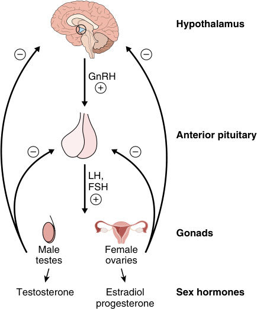

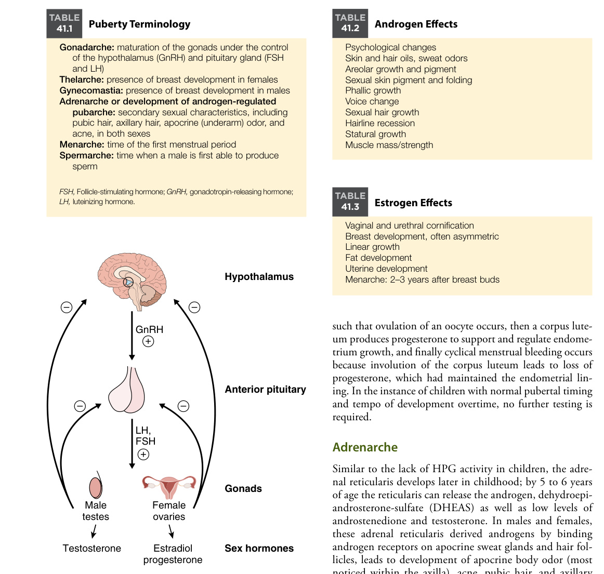

**Fig. 41.1** Normal hypothalamic-pituitary-gonadal axis. _FSH,_ Folliclestimulating hormone; _GnRH,_ gonadotropin-releasing hormone; _LH,_ luteinizing hormone.  (Adapted from https://commons.wikimedia.org/ wiki/File:Hypothalamic–pituitary–gonadal_axis.svg#filehistory.) 

two mechanisms: (1) sustained estradiol activity (in the absence of progesterone) will allow the endometrium to increase in thickness and eventually outgrow its blood supply, or (2) rupture of an ovarian cyst will lead to loss of the cyst’s estradiol production resulting in sloughing of the endometrial lining given the loss of continued estradiol. Over time, periods will become more regular as the HPG axis matures 

###### **TABLE** 

#### **Androgen Effects** 

###### **41.2** 

Psychological changes Skin and hair oils, sweat odors Areolar growth and pigment Sexual skin pigment and folding Phallic growth Voice change Sexual hair growth Hairline recession Statural growth Muscle mass/strength 

###### **TABLE** 

#### **Estrogen Effects** 

###### **41.3** 

Vaginal and urethral cornification Breast development, often asymmetric Linear growth Fat development Uterine development Menarche: 2–3 years after breast buds 

such that ovulation of an oocyte occurs, then a corpus luteum produces progesterone to support and regulate endometrium growth, and finally cyclical menstrual bleeding occurs because involution of the corpus luteum leads to loss of progesterone, which had maintained the endometrial lining. In the instance of children with normal pubertal timing and tempo of development overtime, no further testing is required. 

### **Adrenarche** 

Similar to the lack of HPG activity in children, the adrenal reticularis develops later in childhood; by 5 to 6 years of age the reticularis can release the androgen, dehydroepiandrosterone-sulfate (DHEAS) as well as low levels of androstenedione and testosterone. In males and females, these adrenal reticularis derived androgens by binding androgen receptors on apocrine sweat glands and hair follicles, leads to development of apocrine body odor (most noticed within the axilla), acne, pubic hair, and axillary hair. The onset of this adrenal androgen production leading to androgen dependent hair growth, apocrine body odor, and acne is referred to as **adrenarche** . DHEAS, rather than DHEA, is the preferred androgen to assess whether adrenarche has occurred because the DHEAS level is more consistent throughout the day, and allows for DHEAS blood sampling at any time of the day. Further DHEAS is predominately secreted by the adrenals due to high adrenal sulfonyl-transferase activity, thus unlike the androstenedione and testosterone which can be secreted by both adrenals and gonads, DHEAS can help the clinician determine whether androgen activity maybe more adrenal versus gonadal derived.

<!-- p.908 -->

### **Assessment of Pubertal Development** 

Tanner stages (or Sexual Maturity Rating [SMR]) 1 through 5 are used to assess the development of the phallus, scrotum, breasts, and level of pubic hair development (Fig. 41.2). In practice, differentiation between Tanner stages can be difficult to discern on exam and staging may vary somewhat by examiner. Consideration of stage 1 (prepubertal), stage 2 (testicle size has reached 4 mL, thelarche/breast budding present, or early course pubic hair present), and stage 5 (completion of a metric of pubertal development) which indicates whether a patient is prepubertal, has entered puberty, or has completed puberty, can be a helpful place to start. Additionally, the stages can be considered separate of each other; a male could be Tanner stage 3 for pubic hair and Tanner 2 for external genitalia. Pubarche, or first pubic hair growth, usually coincides within a year or two of the start of breast or testicular development. Axillary hair development has 3 Stages: Stage 1 is no hair, Stage 2 is a unilateral or bilateral small number of coarse axillary hairs, and Stage 3 is the terminal stage with hair amount more than Stage 2 and consistent with expected adult distribution. While most individuals will exhibit pubic hair prior to axillary hair, the occurrence of axillary hair prior to that of pubic hair is not concerning. 

If labs, including testosterone, estradiol, or DHEAS are obtained, the results should be considered in the context of 

both the child’s age and their Tanner stage. The **bone age** (or skeletal age), as determined by the level of growth plate and general skeletal development more closely corresponds to pubertal timing and sex steroid exposure than the chronological age. Most children, without endocrinological or other health concerns, will have a bone age within ±2 years of their chronological age (roughly 2 standard deviations). When warranted, hormone levels and bone age can be paired with comprehensive history and physical examination to assist evaluation of puberty. 

Assessment of puberty requires the clinician to be mindful of what sex steroid activity is present, including the “pubertal growth spurt,” are what findings are absent. A 13-year-old male with enlarging phallus should have enlarged pubertal sized testicles; and in a 13-year-old female with Tanner 4 pubic hair, the breasts would be expected to have started to develop towards Tanner 3, or beyond. _When the findings of puberty do not coincide as expected, further evaluation for abnormalities of puberty should be more strongly considered._ The timing of HPG activation or true pubertal development is tightly controlled by neuroendocrine pathways that affects hypothalamic GnRH production. Awareness of clinical evidence for any congenital, acquired disease processes, or interventions that may impact the area of the hypothalamus, pituitary, or gonads is important because the risk for early HPG axis activity or conversely the lack HPG axis activity in teenage years can result. Importantly, close surveillance of growth and pubertal 

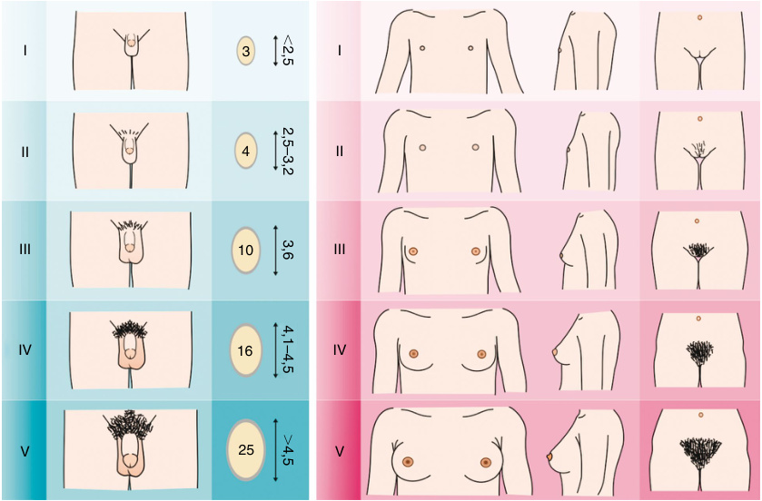

**Fig. 41.2** Tanner stages. (Adapted from illustrations by Michał Komorniczak.)

<!-- p.909 -->

development in a patient with an existing diagnosis associated with greater risk of disturbed timing of puberty (e.g., McCune-Albright syndrome or a previous history of brain tumor) can facilitate early awareness and management should abnormalities of puberty occur. 

Evaluation of patients with potential disorders of sex development (DSD) will not be discussed within the text. DSDs are considered when pubertal development and examinations are not entirely consistent with the expected 

phenotype of an individual with a 46,XX or 46,XY karyotype, however, when development at puberty, or even as early as birth, does not fit what is expected for a female or male phenotype, then consideration of a DSD related to abnormal development of the gonads, function of the gonads or adrenals, or activity of hormones (i.e., sex steroids, gonadotropins, and anti-mullerian hormone) should be considered. Included within Tables 41.4 and 41.5 are the clinical presentations of common DSD with underlying genetic etiologies. 

#### **TABLE 41.4** Genetic Causes of Delayed Puberty

|Disorder|Clinical Presentation|Genes|Inheritance|
|---|---|---|---|
|**Hypogonadotropic Hy**|**pogonadism**|||
|Kallman Syndrome|Classically anosmia. May have spectrum of intact sense of smell.|_KAL-1/ANOS1_|X-linked recessive|
|LH receptor pathogenic variant|Spectrum from complete pseudohermaphroditism to males with micropenis|_LHR_|AR|
|Adrenal hypoplasia congenita|Males only, salt wasting adrenal crisis infancy, +/−under virilization, and potential for abnormal function of GnRH/LH/FSH producing cells|_NROB1_|X-linked recessive|
|LH-beta subunit pathogenic variant|Normal or late menarche with elevated but nonfunctional LH|_LHB_|AR|
|Isolated FSH deficiency|Female: Primary amenorrhea, with absent/incomplete breast. Male: Small testes azoospermia. Normal LH and inhibin B|_FSHb_|AR|
|Prohormone convertase 1 deficiency (PC1)|Infancy, resistant diarrhea, obesity. Potential hypothyroidism, hypocortisolism, post prandial hypoglycemia, AVP deficiency, growth hormone deficiency|_PCSK1_|AR|
|Prader-Willi syndrome|Infancy: Failure to thrive with feeding difficulties, delayed milestones and development, later hyperphagia/weight gain, with delayed or stalled puberty.|Deficiency ofpaternally expressed genes in the 15q11.2q13 region. Abnormal DNA methylation within the Prader-Willi critical region (PWCR) at 15q11.2-q13. DNA methylation and oligo- SNP combination array recommended.|Paternally imprinted, paternal deletion (maternal deletion causes Angelman syndrome) 15q11.2q13 deletion, maternal uniparental isodisomy|
|Bardet-Beidl syndrome|Obesity (abdominal), Intellectual disability, postaxial polydactyly, kidney, eyes, ansomia, variably affected genitalia affected.|16 different genes (account for 80%). Diagnosis is based on clinical features|AR|
|CHARGE syndrome|Coloboma, heart defects, choanal atresia, growth restriction, ear abnormalities|_CHD7_|AD|
|Optic nerve hypoplasia|Wide phenotype: vision impairment, intellectual disability, hypothyroidism, hypocortisolism, AVP deficiency, growth hormone deficiency|Majority do not have pathogenic variant. _HESX1, SOX2, SOX3,_ _OTX2,_or_PROKR2_(not exhaustive)|De novo|

_(Continued)_

<!-- p.910 -->

#### **TABLE 41.4** Genetic Causes of Delayed Puberty—cont’d

|Disorder|Clinical Presentation|Genes|Inheritance|
|---|---|---|---|
|Hartsfield syndrome|Seizures, ectrodactyly, cleft lip/palate holoprosencephaly, potential hypothyroidism, hypocortisolism, AVP deficiency, growth hormone deficiency|_FGFR1_|AR or AD|
|Gordon Holmes syndrome|Intellectual disability, development of cerebellar ataxia early adulthood and hypogonadism|_RNF216_or_PNPLA6_|AR|
|Solitary median maxillary incisor syndrome|Intellectual disability, congenital heart disease, cleft lip and/or palate|Heterogenous|AD|
|Börjeson-Forssman- Lejmann syndrome|Intellectual disability, obesity, seizures, cryptorchidism|_PHF6_|XL recessive|
|Gaucher disease|(variable) Hepatosplenomegaly, anemia, thrombocytopenia|(Newborn screen USA) _GBA_|AR|
|**Hypergonadotropic H**|**ypogonadism**|||
|Klinefelter syndrome|Slow motor development, speech delay, tall stature, gynecomastia, low muscle mass, small firm testes|46,XXY|n/a|
|Sertoli cell only syndrome|Asymptomatic, infertile|Undefined Microdeletion of Y chromosome,_CDY1,_ _DAZ_|n/a|
|LH receptor pathological variant|Undervirilization 46 XY Incomplete feminization at puberty, amenorrhea, and infertility in 46 XX|Many|n/a|
|Turner Syndrome|Webbed neck, broad chest, low posterior hair line, short fourth digit, short stature|45,X (50%) 45,X with mosaicism for X or Y chromosome cell lines|n/a|
|Aromatase deficiency|Ambiguous genitalia or virilization during puberty in 46,XX Tall, delayed bone age, eunuchoid proportions in 46,XY|_CYP19A1_|AR|
|Galactosemia|Infant vomiting, diarrhea, jaundice failure to thrive, cataracts, liver disease. Females can develop primary ovarian insufficiency|(Newborn screen USA) _GALT_|AR|
|“Congenital disorder of glycosylation” syndrome type I|Wide phenotype: developmental delay, hypotonia, failure to thrive, hypoglycemia, growth delay|_ALG1_|AR|
|FSH receptor pathological variant|Female amenorrhea/infertility|_FSHR_|AR|
|LH/HCG resistance|Normal or late menarche with elevated LH but nonfunctional|_LHCGR_ (luteinizing hormone/ choriogonadotropin receptor)||
|Polycystic ovarian syndrome|Hirsutism, irregular menses or amenorrhea, dyslipidemia, insulin resistance|Polygenic||
|Noonan syndrome|Wide-set eyes, pulmonic stenosis, lymphedema short stature|_PTPN11, BRAF, KRAS,_ _MAP2K1, MRAS, NRAS,_ _RAF1, RASA2, RIT1,_ _RRAS2, SOS1, SOS2,_ _LZTR1_| AD|

_AD,_ Autosomal dominant; _AR,_ autosomal recessive; _XL,_ X-linked.

<!-- p.911 -->

#### **TABLE 41.5 Genetic Causes of Precocious Puberty** 

|Disorder|Clinical Presentation|Genes|Inheritance|
|---|---|---|---|
|**Gonadotropin Dependent**|**Precocious Puberty**|||
|NF1|Café-au-lait macules, armpit and inguinal freckling, Lisch nodules, neurofibroma, macrocephaly|_NF1_|AD|
|GOF KISS|Precocious puberty|_KISS1, KISS1R_|AD|
|LOF MKRN3|Precocious puberty|_MKRN3_|Maternally imprinted|
|LOF DLK1|Precocious puberty|_DLK1_|Maternally imprinted|
|**Gonadotropin Independe**|**nt Precocious Puberty**|||
|Testotoxicosis|Early testicular enlargement, penile enlargement, muscular build|_LHCGR_|De novo or AD|
|Cortisol resistant syndrome|Biochemical hypercortisolism without Cushing disease symptoms, androgen excess, female may have menstrual irregularities, men oligospermia|_NR3C1_|AD|
|Peutz-Jeghers syndrome|Pigmented spots on lips and mucous membranes, gastrointestinal polyps|_STK11_|De novo or AD|
|McCune-Albright syndrome|Café-au-lait macules, irregular pigmentation, fibrous dysplasia, hyperthyroid, growth hormone excess|_GNAS_(somatic variant)| Somatic|
|Cyp11B1 deficiency|Hyperandrogenism short stature, hypertension, and virilization of female newborns|_Cyp11B1_|AR|
|Cyp 21 deficiency|Hypercortisolism, spectrum of salt wasting to nonsalt wasting. Hyperandrogenism advanced bone age, short stature, and virilization of female newborns|_Cyp21_|AR|
|3B-HSD deficiency|Spectrum of salt wasting to nonsalt wasting. Undervirilized 46,XY slight virilization 46,XX|_HSD3B2_|AR|
|_AD,_Autosomal dominant;_AR,_autos|omal recessive;_GOF,_gain of function;_LOF,_loss of function.|||

## **Early Pubertal Development** 

Clinical evidence of sex steroid activity prior to age 8 in females (with greater concern if under age 7) or age 9 in males, should initiate further evaluation. The goal is to determine whether the precocious pubertal changes are due to a pathological process or an early variant of normal. In individuals with a family history of earlier pubertal development the familial tendency for early puberty can be reassuring, but evaluation is still warranted. The evaluation can be simplified by clinical ascertainment of whether the sex steroids may be adrenal or gonadal in origin, the tempo or rapidity of pubertal development, and pertinent patient or family history. The earlier, relative to population or family norms, puberty occurs and the more rapid the tempo of this sexual development, the greater the potential that intervention will be required. 

A bone age X-ray can provide further context to a pubertal evaluation. Many children with less progressive early puberty or shorter duration since puberty started will have a bone age within 2 years of the chronological age (i.e., a 7-year-old with a bone age consistent with a 9-year-old). When reviewing sex steroids, consideration of the laboratory reference range in relation to the clinical level of development (Tanner stage), 

chronological age, and bone age can help assess how appropriate (or inappropriate) the labs are for the patient as the levels of sex steroids generally increase as age, bone age, and puberty progresses. 

Precocious puberty can be divided into 3 general categories (Tables 41.6 and 41.7): 

- **Variations of pubertal development** , in which slow or nonprogressive sexual development occurs without evidence of other pubertal changes. Most encountered are benign premature adrenarche and premature thelarche. 

- **Gonadotropin dependent precocious puberty** (GDPP), in which gonadal sex steroid production is occurring and _dependent_ on pituitary gonadotropin release (e.g., LH and FSH). Clinically, the presence of a detectable LH serum level or increase in LH following GnRH analog stimulation test are required to make the diagnosis of GDPP. _Notably, it is best to obtain the LH and sex steroids early in the morning because the levels are typically highest at that time._ 

- **Gonadotropin independent precocious puberty** (GIPP), in which gonadal and/or adrenal sex steroid production is present, and _independent_ of LH and FSH. Clinically, gonadotropins are typically undetectable with GIPP.

<!-- p.912 -->

###### **TABLE** 

###### **41.6** 

#### **Differential Diagnosis of Sexual Precocity** 

|Disorder|Plasma Gonadotropins|LH Response to GnRH|Serum Sex Steroid Concentration|Gonadal Size|Miscellaneous|
|---|---|---|---|---|---|
|**Gonadotropin Dep**|**endent**|||||
|True precocious puberty|Prominent LH pulses (premature reactivation of GnRH pulse generator)|Pubertal LH response initially during sleep|Pubertal values of testosterone or estradiol|Normal pubertal testicular enlargement or ovarian and uterine enlargement|MRI of brain to rule out CNS tumor or other abnormality; skeletal survey for McCune-Albright syndrome|
|**Gonadotropin Inde** Males|**pendent**|||||
|Chorionic gonadotropin- secreting tumor in males (Germ cell tumor)|High hCG, undetectable LH|Prepubertal LH response|Pubertal value of testosterone|Slight to moderate uniform enlargement of testes|Hepatomegaly suggests hepatoblastoma; CT scan of brain if chorionic gonadotropin- secreting CNS tumor suspected|
|Leydig cell tumor in males|Undetectable|No LH response|Very high testosterone|Irregular, asymmetric enlargement of testes||
|Familial testotoxicosis|Undetectable|No LH response|Pubertal values of testosterone|Testes symmetric and>2.5 cm but smaller than expected for pubertal development; spermatogenesis occurs|Familial; sex-limited, autosomal dominant trait|
|Virilizing congenital adrenal hyperplasia|Prepubertal|Prepubertal LH response|Elevated 17-OHP in CYP21 deficiency or elevated 11-deoxycortisol in CYP11B1 deficiency|Testes prepubertal|Autosomal recessive; may be congenital or late-onset form, may have salt loss in CYP21 deficiency or hypertension in CYP11B1 deficiency|
|Virilizing adrenal tumor|Prepubertal|Prepubertal LH response|High DHEAS and androstenedione values; typically even above adult reference ranges|Testes prepubertal|CT, MRI, or US of abdomen|
|Premature adrenarche|Prepubertal|Prepubertal LH response|Prepubertal testosterone, DHEAS level appropriate for pubic hair stage|Testes prepubertal|Onset usually after 6 yr of age|
|Females||||||
|Granulosa cell tumor (follicular cysts may present similarly)|Undetectable|Prepubertal LH response|Very high estradiol|Ovarian enlargement on physical examination, CT, or US| Tumor often palpable on physical examination|

_(Continued)_

<!-- p.913 -->

#### **TABLE 41.6 Differential Diagnosis of Sexual Precocity—cont’d** 

|Disorder|Plasma Gonadotropins|LH Response to GnRH|Serum Sex Steroid Concentration|Gonadal Size|Miscellaneous|
|---|---|---|---|---|---|
|Follicular cyst|Undetectable|Prepubertal LH response|Prepubertal to very high estradiol|Ovarian enlargement on physical examination, CT, or US| Single or recurrent episodes of menses and/or breast development; exclude McCune- Albright syndrome|
|Feminizing adrenal tumor|Undetectable|Prepubertal LH response|High estradiol and DHEAS values|Ovaries prepubertal|Unilateral adrenal mass|
|Premature thelarche|Prepubertal|Prepubertal LH, pubertal|Prepubertal or early estradiol response|Ovaries prepubertal|Onset usually before 3 years of age, breast does not progress past Tanner 2 or early Tanner 3|
|Premature adrenarche|Prepubertal|Prepubertal LH response|Prepubertal testosterone, DHEAS level appropriate for pubic hair stage|Ovaries prepubertal|Onset usually after 6 yr of age|
|Late-onset virilizing congenital adrenal hyperplasia|Prepubertal|Prepubertal LH response|Elevated 17-OHP in basal or corticotrophin- stimulated state|Ovaries prepubertal|Autosomal recessive|
|In Both Sexes||||||
|McCune-Albright syndrome|Undetectable|Undetectable in most cases|Sex steroid pubertal or higher|Ovarian enlargement (visible on US); slight testicular enlargement| Skeletal survey for polyostotic fibrous dysplasia and skin examination for café-au-lait spots|
|Primary hypothyroidism|LH prepubertal; FSH may be slightly elevated| Prepubertal FSH may be increased|Estradiol may be pubertal|Testicular enlargement; ovaries cystic|TSH and prolactin elevated; T4low|
|_17-OHP,_17-hydroxyprog _FSH,_follicle-stimulating h _TSH,_thyroid-stimulating Modified from Peter M. Wo|esterone;_CNS,_centra ormone;_GnRH,_gonado hormone;_US,_ultrasonog i    lfgram and Bethany Aubl|l nervous system;_CYP,_  tropin-releasing hormone; raphy. i       e._Nelson Pediatric Sympto_|P450 cytochrome isoe _hCG,_human chorionic g _m-Based Diagnosis_, 55, 1|nzyme;_DHEAS,_dehydr onadotropin;_LH,_luteinizin 047-1066.e1.|oepiandrosterone sulfate; g hormone;_T4_, thyroxine;|

## **Physiological Variations of Early Pubertal Development** 

### **Premature Adrenarche** 

Premature adrenarche (PA) is the clinical evidence of adrenarche (pubic or axillary hair, acne, or apocrine body odor) prior to age 8 for females or 9 for males. Adrenarche occurs when the reticularis within the adrenal cortex develops and secretes androgens. Most often, the finding of adrenarche that will bring a child to medical attention is premature pubarche, or early development of pubic hair, but in some cases the finding will be axillary hair, acne, or apocrine axillary body odor. Children with benign premature adrenarche _should not_ demonstrate accelerated growth or evidence of gonadal 

activity; if those findings are present, other etiologies should be considered. A child presenting prior to age 5 is less common because the adrenal reticularis physiologically develops closer to the age of 5 or after. Pubertal growth acceleration is not expected, meaning that a child should continue generally tracking along height percentiles similar to earlier in childhood. **Growth acceleration** is typically observed in more progressive etiologies of precocious puberty including GDPP or GIPP. In females, no vaginal bleeding or clitoral enlargement will occur, and significant breast development is not expected. However, in obese females, peripheral aromatization of adrenal androgens to estradiol can potentially lead to a small amount of nonprogressive breast development. In males, no phallic or testicular enlargement should occur because there is

<!-- p.914 -->

**TABLE** 

#### **41.7 Classification of Sexual Precocity** 

**True Precocious Puberty or Complete Isosexual Precocity** 

(GNRH-Dependent Sexual Precocity or Premature Activation of the Hypothalamic GNRH Pulse Generator) Idiopathic true precocious puberty CNS tumors Optic glioma associated with neurofibromatosis type 1 Hypothalamic astrocytoma Other CNS disorders Developmental abnormalities including hypothalamic hamartoma of the tuber cinereum Encephalitis Static encephalopathy Brain abscess Sarcoid or tubercular granuloma Head trauma Hydrocephalus Arachnoid cyst Myelomeningocele Vascular lesion Cranial irradiation True precocious puberty after late treatment of congenital virilizing adrenal hyperplasia or other previous chronic exposure to sex steroids True precocious puberty caused by pathogenic variants in the following genes: _KISS1R/GPR54 KISS1 MKRN3 DLK1_ 

##### **Incomplete Isosexual Precocity (Hypothalamic GnRH-Independent)** 

##### Males 

Gonadotropin-secreting tumors hCG-secreting CNS tumors (e.g., chorioepitheliomas, germinoma, teratoma) hCG-secreting tumors located outside the CNS (hepatoma, teratoma, choriocarcinoma) Increased androgen secretion by adrenal or testis Congenital adrenal hyperplasia (CYP21 and CYP11B1 deficiencies) Virilizing adrenal neoplasm Leydig cell adenoma Familial male-limited precocious puberty (FMPP, “testotoxicosis”) (autosomal dominant gonadotropinindependent precocious Leydig cell and germ cell maturation) Cortisol resistance syndrome 

insufficient androgen activity to grow the phallus, and LH and FSH are not present to drive testicular development. 

When the history, growth curve, and examination are consistent with benign premature adrenarche, and close clinical follow-up is possible, studies may occasionally be deferred until a later date. If labs are obtained, they are best to be obtained early in the morning because LH and gonadal sex steroids are highest in the morning. Patients with benign premature adrenarche will have undetectable LH and age-appropriate 8:00 AM 17-hydroxyprogesterone (effectively ruling out nonclassical congenital adrenal 

##### Females 

Ovarian cyst Estrogen-secreting ovarian or adrenal neoplasm Peutz-Jeghers syndrome with sex cord tumor with annular tubules (SCTAT) 

##### Both Sexes 

McCune-Albright syndrome Hypothyroidism Iatrogenic or exogenous sexual precocity (including inadvertent exposure to estrogens in food, drugs, or cosmetics) 

##### **Variations of Pubertal Development** 

Premature thelarche Premature isolated menarche Premature adrenarche Adolescent gynecomastia in males Macroorchidism 

##### **Heterosexual Precocity** 

##### Feminization in Males 

Adrenal neoplasm Chorioepithelioma Testicular neoplasm (Peutz-Jeghers syndrome) Increased extraglandular conversion of circulating adrenal androgens to estrogen Iatrogenic (exposure to estrogens) 

##### Virilization in Females 

Congenital adrenal hyperplasia CYP21 deficiency CYP11B1 deficiency 3β-HSD deficiency Virilizing adrenal neoplasm (with or without Cushing syndrome) Virilizing ovarian neoplasm (e.g., arrhenoblastoma) Iatrogenic (exposure to androgens) Cortisol resistance syndrome Aromatase deficiency 

_CNS,_ Central nervous system; _CYP11B1,_ 11-hydroxylase; _CYP21,_ 21-hydroxylase; _GnRH,_ gonadotropin-releasing hormone; _hCG,_ human chorionic gonadotropin; _3b-HSD_ , 3β-hydroxysteroid dehydrogenase 4,5-isomerase; _KISS1R/GPR54,_ kisspeptin receptor/G protein–coupled receptor 54. 

Data from Grumbach MM. True or central precocious puberty. In: Kreiger DT, Bardin CW, eds. Current Therapy in Endocrinology and Metabolism, 1985–1986. Toronto, Canada: BC Decker; 1985:4–8. 

hyperplasia due to 21 hydroxylase deficiency). The DHEAsulfate (DHEAS) will typically be elevated for age but be consistent with the Tanner 2 to Tanner 3 stage of the laboratory reference range. While the DHEAS is elevated for age in benign premature adrenarche, DHEAS levels would not approach the high ranges level of androgen-production seen in adrenal tumors; enlargement of phallus/clitoris and linear growth acceleration are not expected. Finally, for benign premature adrenarche a bone age, if obtained, may be normal or advanced by 2 to 2.5 years (roughly 2 standard deviations ahead of the chronological age).

<!-- p.915 -->

### **Premature Thelarche** 

Premature thelarche is the presence of estrogen-driven breast development (most often Tanner stage 2 or Tanner 3) in a female child prior to age 8 yr. Benign premature thelarche will commonly commence at or around 18 to 24 months of age, and typically regress, or cease progressing within 12 to 18 months of commencement. It is important to assess for evidence of estrogen-related changes _(increased size and pigmentation of the areola, palpation of fibrous discs or “breast buds” underneath the areola, and glandular breast tissue)_ . Lipomastia alone is not evidence of estrogen-driven breast development, or thelarche. Benign premature thelarche is isolated; there is no uterine bleeding/periods (evidence of significant estradiol activity at the uterus), no growth acceleration, and no androgen activity present. 

The breast development in benign premature thelarche is thought to be related to the gonadotropin activity of _mini puberty_ leading to ovarian estradiol production prior to more complete suppression of the HPG axis occurs. Laboratory studies often reveal a FSH level that is detectable, while the LH will be undetectable or barely present, and estradiol levels will be low, if detected. Ossification at 1–2 years of age is limited, but if bone age is obtained in the case of benign premature thelarche, the bone age will typically fall within 2 standard deviations for age. A subset of females with premature thelarche, will be found to have progressive breast development potentially accompanied by uterine bleeding, growth acceleration, or later bone age advancement which can be seen in cases of gonadotropin dependent (independent) precocious puberty. Close followup is recommended until the clinician is satisfied the thelarche is isolated and self-limited. Females with benign premature thelarche are expected to subsequently have normal timing of HPG-activation later in life (Fig. 41.3). As part of the evaluation of premature thelarche, it is important to ask about any potential _exogenous sources_ of estradiol the child may have encountered to be sure there is no environmental exposure to eliminate. 

### **Male Gynecomastia** 

Nearly half of males in _early-mid puberty_ will experience mild breast tissue enlargement, referred to as **pubertal gynecomastia** . This is secondary to low relatively lower levels of circulating androgens in early puberty which are converted to estradiol via aromatization, which then activate estradiol receptors of the male breasts. This is more often bilateral and does not exceed 4 cm in diameter. The estrogen effect can predominate initially but increasing androgen levels throughout puberty exert a dominant effect later with resolution of gynecomastia. Less commonly, gynecomastia can persist through puberty. Breast enlargement in a _prepubertal_ male is not expected and should prompt further evaluation for potential source of the sex steroids. 

## **Gonadotropin Dependent Precocious Puberty** 

Gonadotropin dependent precocious puberty (GDPP) refers to gonadal sex steroid production that is driven by the HPG axis (hypothalamic GnRH, and pituitary LH/FSH). The ability to clinically measure LH, either basally or with GnRH analog stimulation, is required to make a definitive diagnosis. Because in the earlier stages of puberty gonadotropins and gonadal sex steroids are highest overnight and into the early morning, it is best to obtain the LH, FSH, and gonadal sex steroids early in the AM soon after the patient wakes up. Although adrenal reticularis androgen production may coincide with GDPP, adrenal androgen production is not required to make a diagnosis of GDPP. GDPP is progressive in that gonadal sex steroid production is sustained and at high enough levels that concerted sexual development and growth occur. In the male child, testosterone induced development including phallic _and_ testicular enlargement are expected. In females, estradiol stimulates breast development and uterine growth with eventual uterine endometrial bleeding. In females, significant evidence of androgen activity, including clitoral enlargement _is not_ expected. In both sexes growth acceleration occurs demonstrated by upward crossing of height percentiles. When the steroid activity of GDPP has been present for months, the bone age will typically become advanced (e.g., a 3-year-old child may have a bone age consistent with a child aged 6 or 7). 

GDPP occurs due to lack of the typical childhood suppression of the HPG axis; the occurrence of GDPP raises concern for potential central nervous system (CNS) 

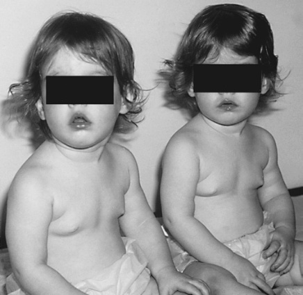

**Fig. 41.3** Two-year-old twin sisters with idiopathic isolated premature thelarche manifested by isolated breast development to Tanner stage 3.  (Peter M. Wolfgram and Bethany Auble. _Nelson Pediatric SymptomBased Diagnosis_ , 55, 1047-1066.e1.)

<!-- p.916 -->

abnormalities that require intervention. The usual childhood quiescence of HPG axis can be disturbed due to anatomic abnormalities (e.g., congenital malformation, hypothalamic hamartomas, optic gliomas with neurofibromatosis type 1, or other brain neoplasms), previous traumatic CNS injury (e.g., head trauma, previous requirement for neurosurgical procedures), or due to long-standing sex steroid exposure that can cause the HPG axis to prematurely begin pubertal signaling. A detailed history and exam that evaluates for the presence of a brain tumor or previous neurosurgical procedures, or significant brain trauma is required. Potential for diagnoses of gonadotropin independent precocious puberty (GIPP), whether previously diagnosed or undiagnosed, should also be explored. One example of GIPP leading to early HPG activation is inadequately treated **21-hydroylase deficiency** (the most common type of congenital adrenal hyperplasia) because excessive adrenally derived androgens can cause premature activation of the HPG axis and subsequent GDPP. Another example is **McCune-Albright syndrome** in which constitutive activity of the LH receptor (GIPP), due to a somatic activating variant of the _GNAS1_ gene that encodes for the cAMP G-alpha subunit of the LH receptor, causes production of gonadal sex steroids that leads to the premature activation of the HPG axis and subsequent GDPP. Children with McCune-Albright syndrome often have a triad of GIPP, irregular café-au-lait skin pigmentation, and fibrous dysplasia; other endocrinopathies can be seen related to cAMP G-alpha subunit variants and include thyrotoxicosis, growth hormone excess, Cushing syndrome, and hypophosphatemic rickets. The evaluation of a child with GDPP should include FSH, LH, and sex steroids of interest, typically including the estradiol for a female, and testosterone for a male, while both gonadal sex steroids may be obtained in certain situations based on clinician assessment (Figs. 41.4 and 41.5). If there is question of excessive androgen activity, potentially of adrenal origin, then an 8:00 AM 17-hydroxyprogesterone and DHEAS can be obtained. If the 17-hydroxyprogesterone cannot be obtained early in the AM, or to provide more information on androgen activity, then the androstenedione can be obtained as well. While androstenedione can be _both_ gonadal and adrenal derived, if the androstenedione along with the 17-hydroxprogesterone and DHEAS are normal for age, there is less chance of adrenal androgen activity contributing to the early pubertal findings. The earlier the development of puberty compared to population and the genetically determined familial norms, the greater likelihood there is a pathological etiology of GDPP. Females with GDPP have fewer abnormalities on brain MRI; males with GDPP more commonly have underlying abnormal MRI pathological CNS lesions (tumors, congenital abnormalities, injury). _In any child with GDPP, a brain MRI should be strongly considered._ Even if an underlying pathology is discovered and addressed, GDPP can continue, which can lead to undesired sexual development and early closure of the growth plates, potentially leading to short stature in adulthood. 

The treatment of GDPP with a long-acting GnRH analog that leads to suppressing the endogenous GnRH pulses at the pituitary’s gonadotrophs is often started. These injectable or implantable GnRH analogs will decrease LH levels, if not altogether suppress LH because pulses of GnRH are required for the production and secretion of LH and FSH that occur during puberty. Thus, while the GnRH analog will initially stimulate LH release, a fact that can be used when trying to diagnose GDPP if basal LH is undetectable, prolonged binding of the GnRH receptor leads to decreased stimulation of gonads and suppression of sex steroids levels, and halts GDPP. Treatment with GnRH agonist will not stop adrenarche; individuals may have continued progression of pubic hair, body odor, or acne. The **genetic causes** of premature childhood GnRH secretion fall into one of two categories: (1) loss of function variants in genes that inhibit GnRH release (resulting in early GnRH secretion), or (2) gain of function gene variants that increase GnRH secretion. Most of these genes that indirectly or directly modulate GnRH release are expressed within the hypothalamus. An example of a gene with an indirect effect on GnRH production is the inhibitory role of Makorin ring finger protein 3 (MKRN3). MKRN3 suppression of GnRH activity is normally released when a child enters puberty at an appropriate age. However, loss of _MKRN3_ function (an imprinted paternally expressed gene), when paternally inherited, leads to premature GnRH activity and GDPP. The effect of MKRN3 on GnRH is indirect because MKRN3 inhibits hormones, including kisspeptin-1 which if expressed, increases GnRH pulse amplitude and frequency and leading to puberty development. A paternally inherited variant in _DLK1_ (another imprinted gene) is seen in small subset of females with GDPP and is thought to be related to dysregulation of hypothalamic GnRH producing neurons. Examples of direct hormonal modulation of GnRH production are activating variants in kisspeptin-1 ligand or the kisspeptin-1 receptor. Kisspeptin-1 signaling directly increases GnRH secretion because kisspeptin-1 receptors are expressed on the GnRH producing hypothalamic neurons and can drive GDPP if kisspeptin-1 is not appropriately inhibited. 

### **Gonadotropin Independent Precocious Puberty** 

Gonadotropin independent precocious puberty (GIPP) refers to gonadal or adrenal sex steroid production that are independent of the signaling of the HPG axis. LH will not be detectable and in many cases FSH is also undetectable given the negative feedback of even lower levels of sex steroids on the HPG axis during childhood. Children with GIPP will have progressive pubertal sexual development and acceleration of growth. Because both adrenal and gonadal sex steroids can drive GIPP, it is helpful to assess the clinical evidence of sex steroid activity. Testes, ovaries, and adrenals all produce androgens and can produce estrogens. Aside from uncommon pathological cases, ovaries can be

<!-- p.917 -->

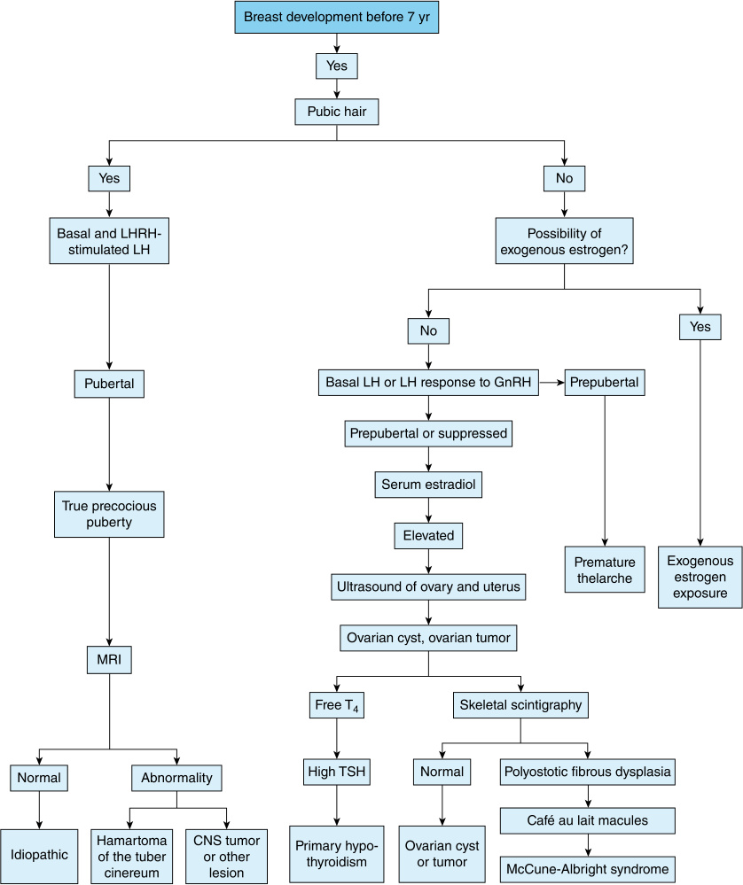

- **Fig. 41.4** Flowchart for diagnosing sexual precocity in phenotypic female. _CNS,_ Central nervous system; _GnRH,_ gonadotropin-releasing hormone; _LH,_ luteinizing hormone; _LHRH,_ luteinizing hormone-releasing hormone; _MRI,_ magnetic resonance imaging; _T 4,_ thyroxine; _TSH,_ thyrotropin.  (Ferri’s Clinical Advisor 2024, 1136.e10-1136.e16.)

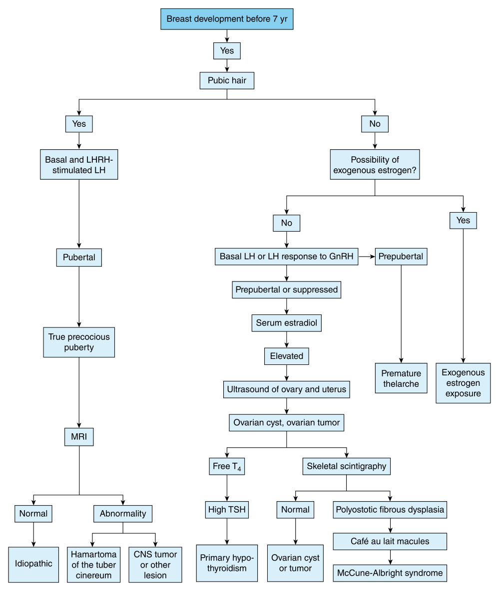

<!-- p.918 -->

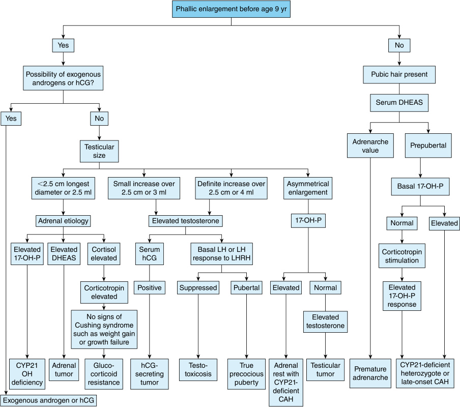

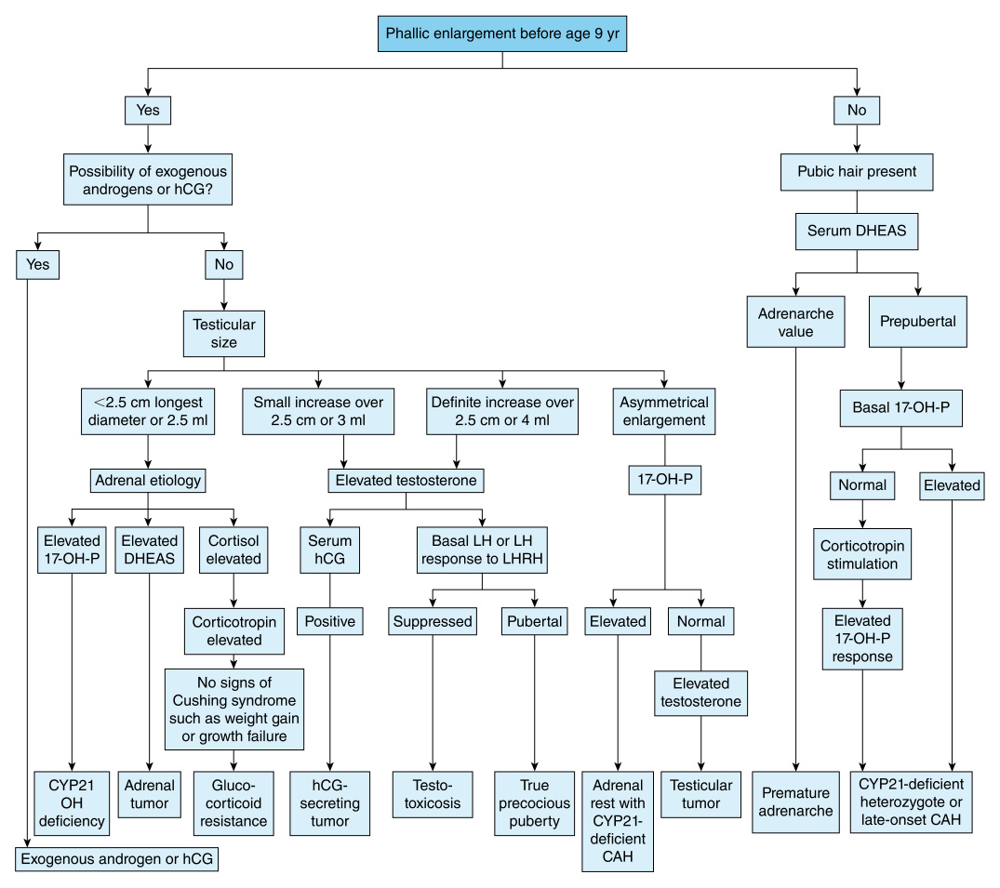

**Fig. 41.5** Flowchart for diagnosing sexual precocity in a phenotypic male. _CAH,_ Congenital adrenal hyperplasia; _CYP,_ P450 cytochrome isoenzyme; _DHEA-S,_ dehydroepiandrosterone sulfate; _hCG,_ human chorionic gonadotropin; _LH,_ luteinizing hormone; _LHRH,_ luteinizing hormone-releasing hormone; _17-OHP,_ 17-hydroxyprogesterone.  (Ferri’s Clinical Advisor 2024, 1136.e10-1136.e16.) 

considered as the predominate source of estradiol in females, adrenals the source of androgens in both females and males, and when evidence of testicular activity, the testicles as the predominate source of androgens in males. 

In a **female** with isolated evidence of androgen activity, an adrenal etiology (e.g., congenital adrenal hyperplasia or adrenal tumor) is more likely versus an ovarian cause; obtaining labs such as DHEAS, 17-hydroxyprogresterone, and testosterone are useful initial tests. Conversely, estradiol driven breast development or uterine bleeding in a female is usually typical of ovarian activity (McCune Albright syndrome, granulosa cell tumor, follicular cyst). In instances, such as a feminizing adrenal tumor, estradiol can be derived from the adrenal gland; if pelvic ultrasound or MRI is not 

indicative of ovarian activity, imaging of the adrenals and obtaining a DHEAS (a marker of adrenal sex steroid production) can assist the evaluation. Thelarche or uterine bleeding may also be due to untreated severe primary **hypothyroidism** ; a TSH level that is extremely high can bind the FSH receptors of the ovaries to stimulate ovarian cyst development and resultant estradiol release. Uterine bleeding occurs when the cysts resolve, and the estradiol is no longer present to maintain the endometrium. Untreated primary hypothyroidism is the only diagnosis of precocious puberty that has a delayed bone age. A female child with profound primary hypothyroidism may have breast development or uterine bleeding, but growth plate development and growth rate will slow, a combination that is not seen in other types of GDPP.

<!-- p.919 -->

In a **male** , the testicular volume can be easily assessed, and enlargement of the testicles suggests the testicles are the source of the androgens; if the testicles remain a small prepubertal volume (<3 mL), then greater consideration of adrenal sources of androgen is indicated. Adrenal pathologies to consider include a virilizing adrenal tumor or congenital adrenal hyperplasia because both can cause elevated adrenal-derived DHEAS and androstenedione. If one testis is found to be enlarged with irregular texture on palpation, relative to the other, that may signal a **Leydig cell tumor** as the source of testosterone. Enlargement of both testicles in the setting of undetectable LH but pubertal testosterone production can occur with **familial testotoxicosis** (X-linked recessive inheritance of constitutive LH activity), even when no LH is present due to an activating gene variant in the luteinizing hormone receptor [LHR] or a **chorionic gonadotropin-secreting tumor** (including brain or hepatic germ cell tumors that produce sufficient HCG to activate the Leydig cell LH receptors, and thus drive Leydig cell testosterone production in the absence of LH) (Fig. 41.6). Significant elevation of TSH due to **primary hypothyroidism** can stimulate bilateral enlargement of the testes, but in males the TSH does not sufficiently activate Leydig cells so the testosterone level will remain prepubertal. In males with **McCune-Albright syndrome** , constitutive activity of testicular Leydig LH-receptors, even in the absence of LH, can lead to relatively minor testicular enlargement but pubertal (or higher) testosterone levels, similar to the significant estradiol production that can occur with McCune-Albright 

syndrome in females. Another cause of GIPP is exposure to potential **exogenous sources** of sex steroids or substances including supplemental testosterone or estradiol used by family members that a child can come into contact with. Early pubertal development from lavender oil and tea treat oil are both known to cause breast development. A complete list of causes of both GDPP and GIPP are in Table 41.5. 

# **Late Pubertal Development** 

Delayed puberty, often defined by lack of breast development in females by age 13 or the lack of testicular enlargement in males by age 13.5, should initiate further evaluation, including a thorough clinical history and examination (Figs. 41.7 and 41.8). A female with lack of menarche within 3 years of thelarche also warrants evaluation. The presence of pubarche does not exclude a delay of the pubertal HPG axis. The later in life that pubertal development occurs, and in cases where puberty fails to commence (or even stalls), the more extensive an evaluation is needed to identify an etiology. 

In families where children are known to enter puberty later, there can be an inherited tendency toward delayed puberty; female relatives with menarche at 14 years of age or older, or males that only undergo pubertal growth acceleration and evidence of androgen activity at age 13.5 years or older. Awareness of when parents, siblings, and seconddegree relatives underwent puberty can assist the decision to undergo an evaluation versus allowing a period to observe for evidence of endogenous pubertal activity. 

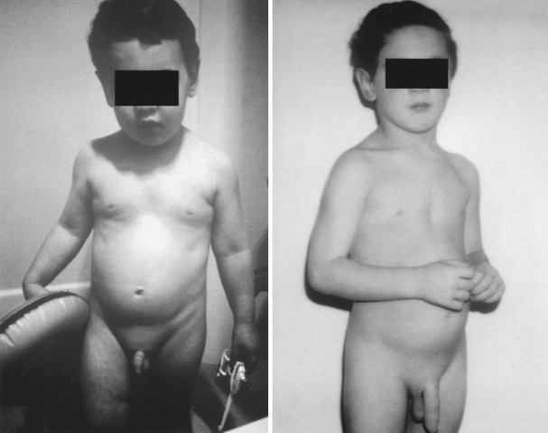

**Fig. 41.6** A male with familial testotoxicosis associated with significant penile enlargement, moderate pubic hair growth, and mild to moderate testicular enlargement over a 1.75-year period. _Left,_ At 2 years of age. _Right,_ At 3.75 years of age.  (Peter M. Wolfgram and Bethany Auble. _Nelson Pediatric SymptomBased Diagnosis_ , 55, 1047-1066.e1.)

<!-- p.920 -->

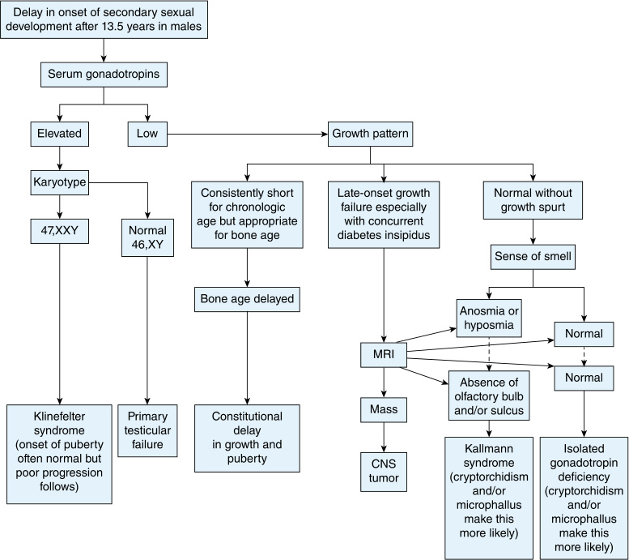

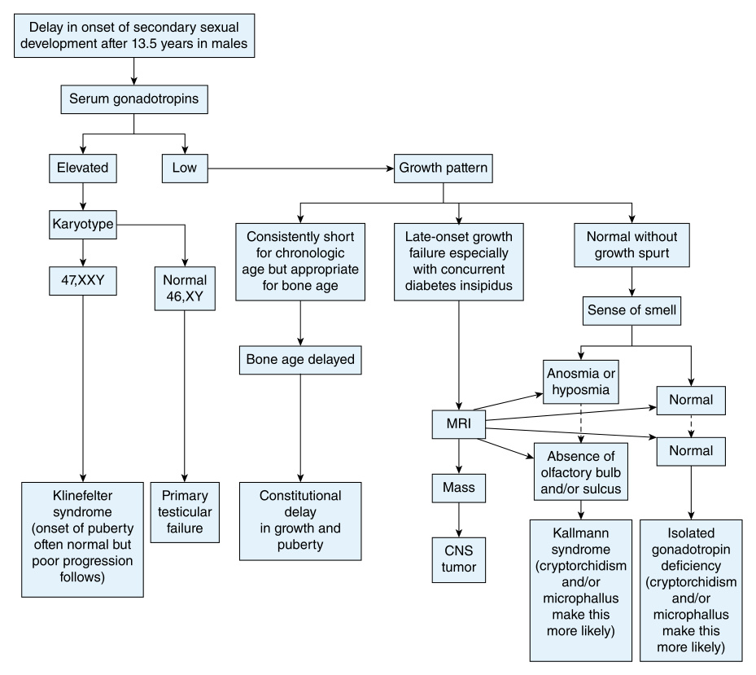

**Fig. 41.7** Flow chart for the evaluation of delayed puberty in males. A brain MRI with absent olfactory bulb and/or sulcus is consistent with Kallmann syndrome, while a normal MRI suggests isolated gonadotropin deficiency. _CNS,_ Central nervous system.  (From Melmed S, Polonsky KS, Larsen PR, et al., eds. _Williams Textbook of Endocrinology_ . 13th ed. Philadelphia: Elsevier; 2016:1156.) 

Adrenal DHEAS levels increasing into the Tanner 2 or higher range suggests that adrenarche has occurred; detection of LH indicates pubertal HPG activity has started. These processes, while separate endocrine occurrences, often co-occur within a year or two of each other. If both adrenal and gonadal sex steroids are absent or delayed, there may be a tendency for later puberty development. However, an absence of adrenal androgen production in the setting of apparently age-appropriate gonadal sex steroid production, may indicate adrenal pathology. Conversely, delayed evidence of HPG-axis activity when adrenal androgen synthesis is present, suggests potential for abnormality of the HPG-axis. In females, breast development and biochemical HPG activity with lack of significant pubic hair, acne, and body odor can suggest adrenal androgen deficiency, and potential for primary adrenal insufficiency (i.e., autoimmune Addison disease). Significant adrenal disease, such as untreated Addison disease could inhibit HPG activity (i.e., functional hypogonadotropic 

hypogonadism); in adult women, much of the testosterone is produced by the ovaries, but lack of both androgen activity and lack of an age appropriate DHEAS in a female can indicate primary adrenal pathology. Conversely, lack of expected estradiol effect, including lack of breast development and amenorrhea coincident with findings of pubic and axillary hair development combined with laboratory evidence of adrenal androgen but inappropriately low estradiol suggests the ovaries are not functioning in a pubertal manner. For males, clinical pubertal and secondary sexual development relies on androgen activity. Testicular testosterone is more potent and causes significant maturational changes. However, adrenal androgens can be present first and result in the initial changes (i.e., pubic hair, apocrine axillary body odor) noted by families. The presence or absence of enlargement of the testicles to ≥4 mL can indicate whether the HPG-axis has begun puberty; this finding, in balance of age and other androgen changes, can help the evaluation. Obtaining an early-morning

<!-- p.921 -->

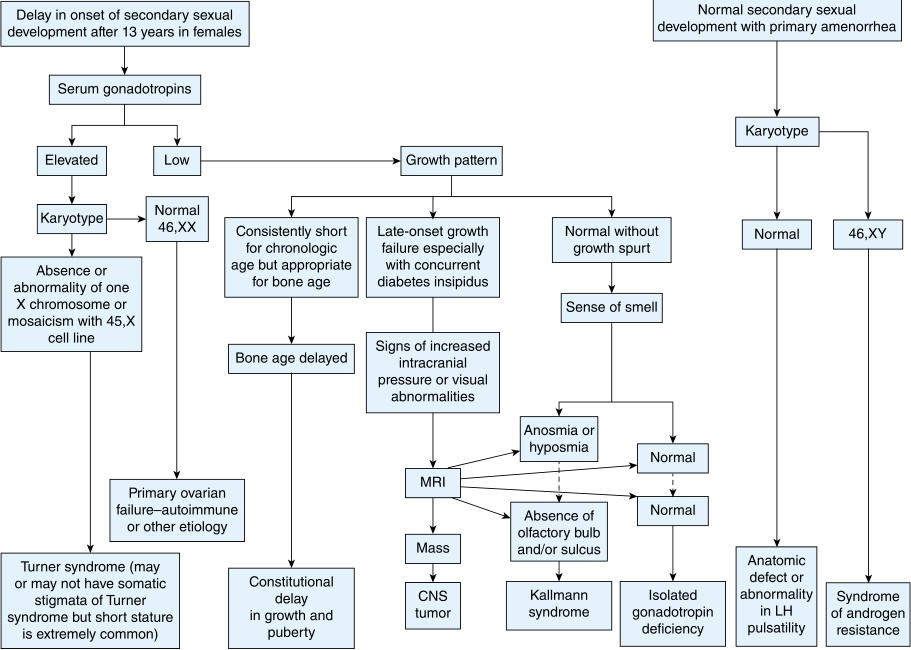

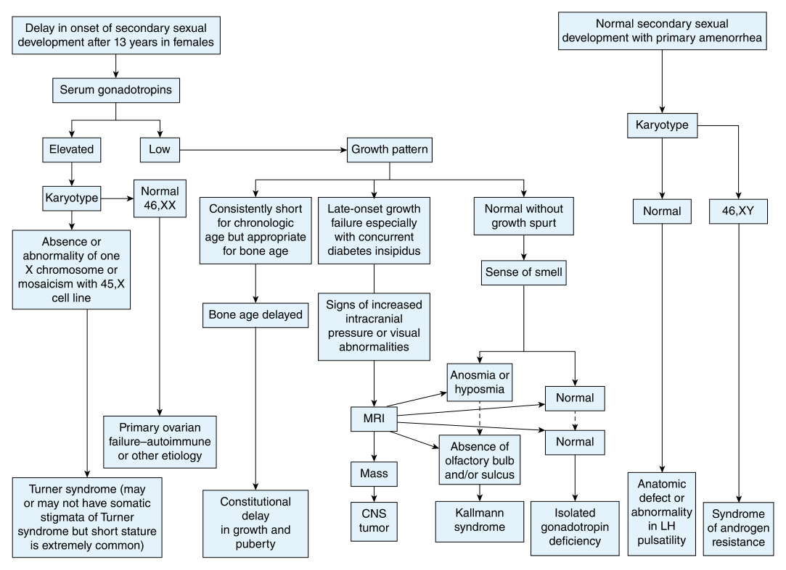

**Fig. 41.8** Flow chart for the evaluation of delayed puberty in females. A brain MRI with absent olfactory bulb and/or sulcus is consistent with Kallmann syndrome, while a normal MRI suggests isolated gonadotropin deficiency. _CNS,_ Central nervous system; _LH,_ luteinizing hormone.  (From Melmed S, Polonsky KS, Larsen PR, et al., eds. _Williams Textbook of Endocrinology_ . 13th ed. Philadelphia: Elsevier; 2016:1157.) 

testosterone (levels are higher in the morning), LH, and DHEAS can initially help discern which androgens and glandular activity exist. 

While the secondary sexual development and growth acceleration guided by sex steroids are the largest active clinical concern in children and adolescences, questions of fertility can be of acute concern to families and patients. Low LH and FSH values in adolescences when paired with lack of clinical and biochemical evidence of gonadal steroids, is consistent with lack of pubertal pituitary activity, which can be transient, or permanent, and is accompanied by the risk for infertility. Additionally, in both sexes, elevated LH, as well as FSH, values, whether accompanied or not by gonadal sex steroids and clinical pubertal development, can indicate insufficient gonadal function and that infertility may currently exist, or occur prematurely. 

In addition to a thorough medical history, family history, physical examination, and laboratory testing, the strategic use of imaging can guide the evaluation for the etiology of delayed puberty. A bone age can determine if clinically 

pertinent skeletal delay is present, and in instances where existence of intracranial pathology remains a cause for inadequate pituitary release of LH and FSH, a brain MRI with close attention to the hypothalamic and pituitary region can be considered. A pelvic ultrasound, while not always able to identify the ovaries (limitation in transabdominal technique), can quickly provide evidence of how much estradiol effect has occurred at the uterus because the uterus will grow and exhibit thickening of the endometrium when ovarian estradiol activity is sustained. 

Overall, the clinician’s role is to determine whether the delay or lack of completion of pubertal changes are due to a pathological etiology or variant of normal pubertal timing, and delayed puberty can be divided into 4 general categories (Table 41.8): 

- **Constitutional Delay of Growth and Puberty** (CDGP), in which delay of both adrenarche and HPG-axis pubertal activity as well as skeletal development occurs. This diagnosis is considered a physiological variant of normal pubertal development and is a self-limited diagnosis in that overtime children will move endogenously into

<!-- p.922 -->

##### **TABLE** 

##### **41.8** 

### **Classification of Delayed Puberty and Sexual Infantilism** 

#### **Idiopathic (Constitutional Delay in Growth and Puberty)** 

Hypogonadotropic Hypogonadism CNS Disorders Tumors Craniopharyngiomas Germinomas Other germ cell tumors Hypothalamic and optic gliomas Astrocytomas Pituitary tumors (including MEN-1, prolactinoma) 

#### _Other Causes_ 

Langerhans histiocytosis Postinfectious lesions of the CNS Vascular abnormalities of the CNS Radiation therapy Congenital malformations, especially associated with craniofacial anomalies Head trauma Lymphocytic hypophysitis Isolated gonadotropin deficiency Kallmann syndrome With hyposmia or anosmia Without anosmia GnRH receptor pathological variant Adrenal hypoplasia congenita ( _DAX1_ pathological variant) Isolated LH deficiency Isolated FSH deficiency Prohormone convertase 1 deficiency (PCI) 

**Idiopathic and Genetic Forms of Multiple Pituitary Hormone Deficiencies** Miscellaneous Disorders Prader-Willi syndrome Bardet-Biedl syndrome CHARGE syndrome Functional Gonadotropin Deficiency Chronic systemic disease and malnutrition Optic nerve hypoplasia Sickle cell disease Hartsfield syndrome Cystic fibrosis Gordon Holmes syndrome AIDS Solitary median maxillary incisor syndrome Chronic gastroenteric disease Börjeson-Forssman-Lehmann syndrome Chronic renal disease 

Malnutrition Anorexia nervosa Bulimia Psychogenic amenorrhea Impaired puberty and delayed menarche in female athletes and ballet dancers (exercise amenorrhea) Hypothyroidism Diabetes mellitus Cushing disease Hyperprolactinemia Marijuana use Gaucher disease 

#### **Hypergonadotropic Hypogonadism** 

#### Males 

The syndrome of seminiferous tubular dysgenesis and its variants (Klinefelter syndrome) Chemotherapy Radiation therapy affecting gonads Testicular steroid biosynthetic defects Sertoli cell–only syndrome LH receptor pathological variant Anorchia and cryptorchidism Trauma/surgery 

#### Females 

Syndrome of gonadal dysgenesis (Turner syndrome) and its variants XX and XY gonadal dysgenesis Aromatase deficiency Premature menopause Radiation therapy affecting gonads Chemotherapy Autoimmune oophoritis Galactosemia Glycoprotein syndrome type 1 Resistant ovary FSH receptor pathological variant LH/hCG resistance Polycystic ovarian disease Trauma/surgery Noonan syndrome Ovarian steroid biosynthetic defects 

_CNS,_ Central nervous system; _CHARGE,_ coloboma, heart malformations, choanal atresia, growth retardation, genital anomalies, ear anomalies; _FSH,_ follicle-stimulating hormone; _hCG,_ human chorionic gonadotropin; _LH,_ luteinizing hormone; _LHRH,_ luteinizing hormone–releasing hormone; _LRF,_ luteinizing hormone–releasing factor; _MEN,_ multiple endocrine neoplasia. Modified from Peter M. Wolfgram and Bethany Auble. _Nelson Pediatric Symptom-Based Diagnosis_ , 55, 1047-1066.e1.

<!-- p.923 -->

puberty. This often-inherited transient delay of HPGaxis pubertal activity is the most common diagnosis but is a diagnosis of exclusion, in that other pathological etiologies of delayed pubertal development should be excluded. 

- **Hypogonadotropic hypogonadism** (HypoH) occurs when there is insufficient pituitary LH and/or FSH secretion to begin or complete puberty. The diagnosis can be made biochemically with inappropriately low (or normal) LH and FSH in the setting of low sex steroid production for age. With HypoH, adrenal androgen production is expected to be normal. 

- **Functional hypogonadotropic hypogonadism** occurs due to hypothalamic response to chronic disease, intense stress, calorie deficit, excessive exercise, and is reversable with treatment of the underlying cause. 

- **Hypergonadotropic hypogonadism** (HyperH) occurs when there is insufficient gonadal response to FSH and LH secretion. The diagnosis can be made when the FSH and LH are elevated in the setting of inappropriately low gonadal sex steroid production for age indicating gonadal insufficiency, or primary hypogonadism. 

## **Constitutional Delay of Growth and Puberty** 

Constitutional delay of growth and puberty (CDGP) is a _physiological variant_ of normal puberty resulting in later pubertal development that includes delay of both adrenal androgen and gonadal sex steroids. CDGP is considered when pathological causes of pubertal delay have been ruledout, although differentiation from hypogonadotropic hypogonadism (HypoH) can be difficult as both can present with prepubertal gonadotropin levels, in particular LH, for age. Determination of the diagnosis of CDGP versus HypoH can require serial monitoring and if puberty does not occur even in the later teen years than HypoH is suspected. 

Inhibin B may be a useful lab value in identifying patients at a younger age and is discussed further under HypoH. Genetic testing shows promise in differentiating the CDGP from HypoH. An example of a **genetic determinant** is loss of function variants in the immunoglobulin superfamily member 10 _(IGSF10)_ gene. In particular, certain _IGSF10_ variants impair neural migration of GnRH neurons to the hypothalamus, resulting later in attenuated GnRH activity and delayed puberty (Figs. 41.9 and 41.10). 

Patients with CDGP often will have a family history of delayed puberty in first-or second-degree family members, suggesting possible autosomal dominant inheritance, although any patient could be the first in their family with CDGP either due to a _de novo_ genetic variant, or due to a patient’s own medical/environmental circumstances that can lead to what can be considered an acquired CDGP. The skeletal delay of CDGP is visible on bone age X-ray, often with 1–3 years of delay compared to chronological age and can also be noted clinically in later loss of deciduous, or baby teeth. Many patients with CDGP present appearing 1–3 years younger than their chronological age, with late loss of teeth, delayed pubertal development, younger physical appearance of the face than anticipated for age, and shorter stature than expected for their family. The further the delay of puberty or bone age, the greater the concern for a serious disorder. CDGP can lead to quite delayed puberty in that females with CDGP may not menstruate until 16 years of age or males may start puberty in the latter half of high school (16 years of age or older). Once in puberty, a patient with CDGP would be expected to have DHEAS, gonadotropin, and sex steroids production consistent with their stage of sexual development (i.e., Tanner stage), rather than their chronological age. The gonadal sex steroids and adrenal DHEAS will be low for age until they have completed puberty, at which point their sex steroid production should reach levels consistent with typical adult reference ranges. 

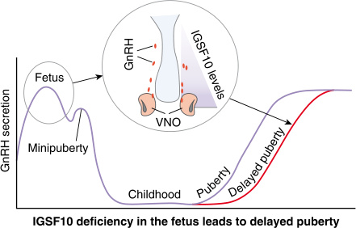

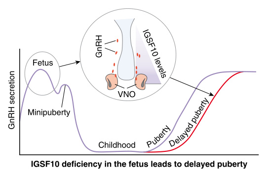

**Fig. 41.9** Schematic of the mechanism by which _IGSF10_ pathogenic variants lead to DP. Reduced levels of IGSF10 expression during embryogenesis (represented by green triangle) in the corridor of nasal mesenchyme from the vomeronasal organ (VNO) to the olfactory bulbs (in a murine model) result in delayed migration of GnRH neurons (represented by red ovals) to the hypothalamus. This presents for the first time in adolescence as a phenotype of DP due to abnormalities of the GnRH neuronal network ( _grey arrows_ linking fetal pathogenesis to adolescent phenotype).  (From Howard SR. Genes underlying delayed puberty. _Mol Cell Endocrinol_ . 2018;476:119-128.)

<!-- p.924 -->

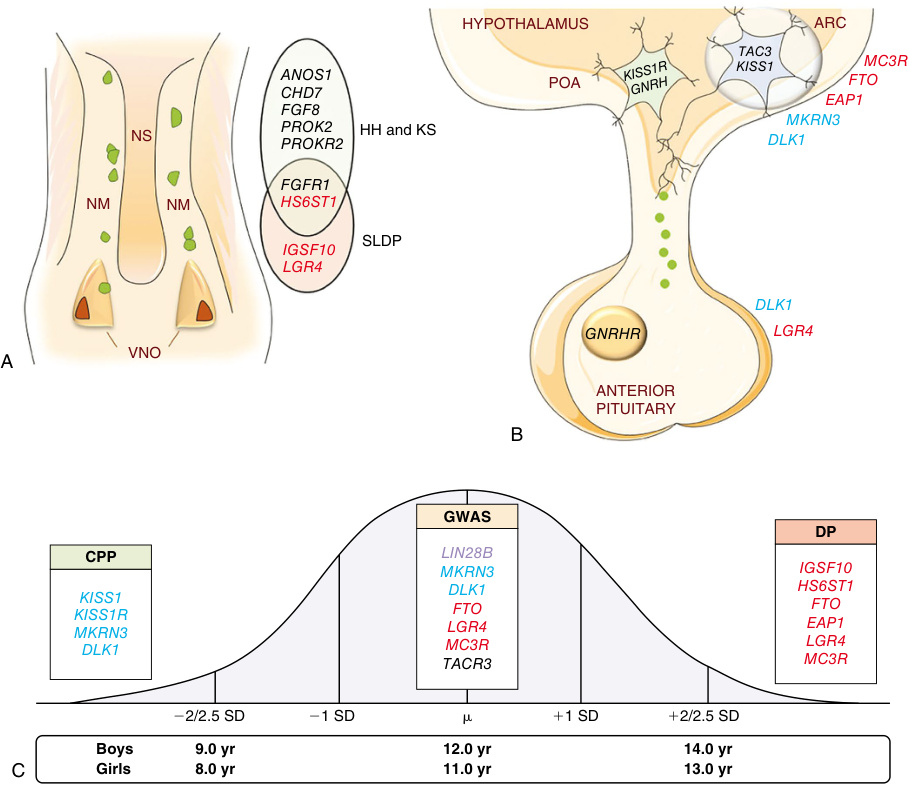

- **Fig. 41.10** Genes associated with pubertal timing across the lifespan. Genes in blue are associated with CPP, in red with DP, and genes in black are associated with HH and/or KS. Variants in LIN28B, in purple, have only been associated with pubertal onset in the normal population. (A) Representation of the nasal placode at embryonic life and key genes important for GnRH neuronal migration. GnRH neurons (in green) will migrate alongside olfactory axons from the VNO to the forebrain at the level of the olfactory bulbs (not shown). Variants in these genes can cause dysregulation in GnRH neuronal migration resulting in delayed puberty and/or HH-KS. (B) Figure depicting the hypothalamic and pituitary regions involved in the central regulation of the reproductive axis and key genes controlling GnRH secretion. Kisspeptin-Neurokinin B-Dynorphin (KNDy) neuron is shown in blue in the ARC communicating with GnRH neuron (in green) in the POA. (C) Normal distribution of the timing of puberty in the general population with the mean (m) age of onset. ±2 to 2.5 standard deviation (SD) values indicate precocious or delayed onset of puberty. List of some of the important genes identified in genome-wide association studies (GWAS) and in patient-cohort based studies associated with timing of pubertal onset. _ARC,_ Arcuate nucleus; _CPP,_ central precocious; _DP,_ delayed puberty; _HH,_ hypogonadotropic; _KS,_ Kallmann syndrome; _NM,_ nasal mesenchyme; _NS,_ nasal septum; hypogonadism; _POA,_ preoptic area, puberty, _SLDP,_ self-limited delayed puberty; _VNO,_ vomeronasal organs.  (From Mancini A, Magnotto JC, Abreu AP. Genetics of pubertal timing. _Best Pract Res Clin Endocrinol Metab_ . 2022;36[1]:101618. doi:10.1016/j.beem.2022.101618.)

<!-- p.925 -->

While self-limited, CDGP can result in significant delay of puberty and pubertal growth acceleration; patients can be started on low doses of sex steroid (estradiol or testosterone) to mimic the early secretion of puberty that can bring secondary sexual development and the accelerated growth of puberty. The use of these exogenous steroids at a low dose starting at age 12 in females or 14 in males does not increase the final adult height. In addition, exogenous steroids, dosed to mimic early pubertal production, will not lead to premature closure of the growth plates or a decrease in the end adult height. An additional clue a patient may have CDGP is their pattern of growth during childhood and pubertal ages. During childhood, patients with CDGP will often track along a childhood height percentile that is lower than expected for their family, and then decrease to an even lower percentile at the typical age of puberty, because unlike the general population the patient has not yet reached their pubertal growth spurt. Importantly, for patients with CDGP, when the bone age delay is combined with the patient’s current height the projected adult height should fall within the expected percentile range for their family. Furthermore, prior to puberty a patient with CDGP is expected to maintain a normal rate of growth, as there is not a growth attenuating pathology leading to the short stature, just the physiological delay of growth which becomes most apparent at the age of puberty. 

## **Hypogonadotropic Hypogonadism** 

Hypogonadotropic hypogonadism (HypoH) occurs when the pituitary is unable to produce enough LH and/or FSH to begin or complete puberty; normal adult activity of the gonads does not occur. The cause of the gonadotropin deficiency can lie within the pituitary gland itself, the hypothalamus, or the neuroendocrine signaling responsible for facilitating the pubertal and adult activity of the hypothalamus and pituitary. The biochemical diagnosis of HypoH is made when inappropriately low (or normal) LH and FSH levels are present in the setting of low sex steroid production for age. The differentiation of HypoH from CDGP can be challenging during the early teenage years. Generally, if there is insufficient production of gonadotropins (LH and FSH) to stimulate normal adult gonadal activity by 18 years of age, the patient likely has HypoH. In individuals with HypoH, normal adrenal androgen production is expected; if there is strong evidence of longstanding adrenal androgen production (DHEAS on labs, apocrine body odor, pubic and/or axillary) in the absence of gonadal activity and inappropriately low LH and FSH, then the patient likely has HypoH. 

In a male with **microphallus** at birth and bilateral **cryptorchidism** there is greater concern for HypoH because these findings suggest inadequate in utero HPG activity. This is because the final descent of testes into the scrotum is dependent on third trimester Leydig cell testosterone production driven by LH, and later gestation testosterone is also important for in utero phallic growth. Thus, even when evaluating a teenage patient, a birth and neonatal history, in addition to an overall childhood history, can be helpful to 

evaluate for potential evidence of HypoH or multiple pituitary hormone deficiencies. A family history of HypoH, male infertility, or anosmia also raises clinical suspicion as **Kallman syndrome** is a monogenic cause of HypoH associated with anosmia or hyposmia most commonly due to X-linked inheritance of _KAL-1_ (also known as _ANOS1_ ) pathogenic variant. Certain diagnoses are associated with HypoH including **CHARGE syndrome** often due to _CHD7_ variants. Patients can also have normosmic isolated HypoH; they only lack gonadotropin production. In patients with HypoH, assessment for adequacy of other pituitary hormones is required because HypoH can be just one of multiple pituitary deficiencies due to potentially shared genetic (e.g., _HESX1_ ), anatomic, or disease-related etiologies impacting pituitary function. 

In males, inhibin B is made in the testes by Sertoli cells and reflects Sertoli cell number and function, while in females inhibin B levels are related to antral follicles and reflect ovarian response to gonadotropins. Obtaining inhibin B with other screening labs (LH, FSH, appropriate sex steroids) can be useful because inhibin B levels correlate with but are not definitive for HypoH. 

All patients with delayed pubertal development, due to decreased gonadal sex steroid production will have a delayed bone age. Discussions of infertility due to HypoH remain very important to the care of a patient. In cases where the cause of the HypoH is unknown an MRI of the brain can help with the diagnosis. Lack of a visible pituitary, pituitary hypoplasia or ectopia, or findings, such as, thickening of the pituitary stalk (autoimmune hypophysitis or Langerhans cell histiocytosis) or lack of the posterior pituitary bright spot can all be potential anatomic/structural findings that can be associated with or cause HypoH, and can indicate further comorbid conditions to consider. 

## **Functional Hypogonadotropic Hypogonadism** 

Functional hypogonadotropic hypogonadism is heterogenous and can occur in the setting of various medical conditions due to reduced GnRH pulsatile secretion. Behaviors such as restrictive eating or excessive exercise can result in a relative energy deficient state. A thorough review of systems is important, as undiagnosed, or poorly controlled conditions (e.g., inflammatory bowel disease, cystic fibrosis, heart disease, and renal disease) should be considered on a case-by-case basis. Clinical suspicion can help lead the clinician to determine if additional labs are warranted such as erythrocyte sedimentation rate, comprehensive metabolic panel, stool studies) Patients with chronic stress or those treated with high dose glucocorticoids are also at risk. Elevated prolactin levels, either due to **prolactinoma** or medication side effect, can also inhibit gonadotropin release and should be considered. 

## **Hypergonadotropic Hypogonadism** 

Hypergonadotropic hypogonadism (HyperH) indicates primary gonadal insufficiency with insufficient activity of the

<!-- p.926 -->

gonad. A diagnosis of HyperH is made when despite sustained FSH and LH elevation, the patient has inappropriately low gonadal sex steroid production for age. Given the marked LH and FSH changes that occur during the typical female reproductive cycle, when LH and/or FSH are elevated (and there is concern for HyperH), then LH, FSH, and estradiol should be repeated 2 weeks later as the initial LH and FSH may have been the physiologically higher values seen at the end of the follicular phase as ovulation occurs, rather than indicate the female has HyperH. 

Risk factors include a history of gonadotoxic chemotherapy, radiation, or gonadal trauma. Behavioral or developmental delays raise suspicion for Klinefelter or Turner syndrome; after confirmation of HyperH further genetic testing may be warranted because other genetic abnormalities, including pathogenic variants involved in gonadotropin signaling in the gonads can cause HyperH. In patients with a personal or family history of autoimmune disorder, autoimmune primary hypogonadism (i.e., **autoimmune oophoritis** ) should be considered. In individuals with a history of **difference in sexual development** (DSD) close monitoring throughout childhood and adolescence by an endocrinologist is required. 

While gonadal gametogenesis is impacted by HyperH, the lack of appropriate sex steroids is usually noted first, and diagnosis of HyperH indicates that exogenous sex steroid supplementation will be required because the hypogonadism will be permanent. Elevation of gonadotropins, even prior to the typical age of puberty can suggest future risk for HyperH. However, often HyperH is first recognized when pubertal aged patients fail to exhibit gonadal-dependent secondary sexual development despite adrenal androgen production (DHEAS), apocrine body odor, acne, and the development of pubic and axillary hair. Absence of sex steroid production and infertility is not necessarily absolute. Individuals with HyperH they may produce sex steroids consistent with early puberty and have related sex steroid stimulated physical changes, only to reach a subnormal adult sex steroid production or subsequently lose the ability to produce sex steroids. When a clinician has concern and LH and/or FSH are elevated in a patient proceeding through puberty, it is important to monitor and treat accordingly to make sure pubertal development is completed and adequate sex steroid levels are achieved and maintained in the coming years. Due to the lack of gonadal sex steroids in patients with HyperH, bone age development can be delayed, which can allow patients to reach end adult heights consistent within their intrinsic range, despite potentially shorter stature relative to nonhypogonadal peers. 

# **Bibliography** 

#### **_Normal Pubertal Development_** 

- Dedes I. Kisspeptins and the control of gonadotrophin secretion. _Syst Biol Reprod Med_ . 2012;58(3):121-128. 

- Gohil A. Delayed and precocious puberty—genetic underpinnings and treatments. _Endocrinol Metab Clin North Am_ . 2020;49(4):741-757. 

- Kappy MS, Allen DB, Geffner ME. _Pediatric Practice: Endocrinology_ . 2nd ed. McGaw Hill; 2014. 

- Klein DA, Emerick JE, Sylvester JE, Vogt KS. Disorders of puberty: an approach to diagnosis and management. _Am Fam Physician_ . 2017;96(9):590-599. 

- Ma NS, Geffner ME. Gynecomastia in prepubertal and pubertal men. _Curr Opin Pediatr_ . 2008;20(4):465-470. 

- Mancini A, Magnotto JC, Abreu AP. Genetics of pubertal timing. _Best Pract Res Clin Endocrinol Metab_ . 2022;36(1):101618. 

- Nedresky D, Singh G. Physiology, luteinizing hormone. [Updated 2019 Apr 8]. In: _StatPearls_ [Internet]. Treasure Island, FL: StatPearls Publishing; 2021. [Figure, Hypothalamic-Pituitary-Gonadal Axis from http://www.dsdgenetics.org/index.php?id=48.] https://www. ncbi.nlm.nih.gov/books/NBK539692/figure/article-24535. image.f1/ 

- Novello L, Speiser PW. Premature adrenarche. _Pediatr Ann_ . 2018; 47(1):e7-e11. 

- Tanner. _Tanner Scale_ . Health Jade Team. https://healthjade.net/ tanner-scale/. 

#### **_Precocious Puberty_** 

- Fuqua JS, Eugster EA. Presentation and care for children with peripheral precocious puberty. _Endocrinol Metab Clin North Am_ . 2024; 53:251-265. 

- Kilberg MJ, Vogiatzi MG. Approach to the patient: central precocious puberty. _J Clin Endocrinol Metab_ . 2023;108(8):2115-2123. 

- National Organization for Rare Diseases. _Precocious Puberty_ . https:// rarediseases.org/rare-diseases/precocious-puberty/ 

- Online Mendelian Inheritance in Man (OMIM). _Precocious Puberty, Central, 1; CPPB1_ . https://www.omim.org/entry/176400 

- Roberts SA, Kaiser UB. Genetic etiologies of central precocious puberty and the role of imprinted genes. _Eur J Endocrinol_ . 2020; 183:R107-R117. 

#### **_Delayed or Absent Pubertal Development_** 

- Bakhtiani P, Geffner M. Delayed puberty. _Pediatr Rev_ . 2022;43(8):426435. 

- Harrington J, Palmert MR. An approach to the patient with delayed puberty. _J Clin Endocrinol Metab_ . 2022;107(6):1739-1750. 

- Howard S.R. The genetic basis of delayed puberty. _Front Endocrinol_ . 2019;10:423. 

- Howard SR. Genes underlying delayed puberty. _Mol Cell Endocrinol_ . 2018;476:119-128. 

- Howard SR, Dunkel L. Delayed puberty—phenotypic diversity, molecular genetic mechanisms, and recent discoveries. _Endocr Rev_ . 2019;40:1285-1317. 

- Krishna KB, Silverman LA. Diagnosis of central precocious puberty. _Endocrinol Metab Clin North Am_ . 2024;53:217-227.

<!-- p.927 -->
