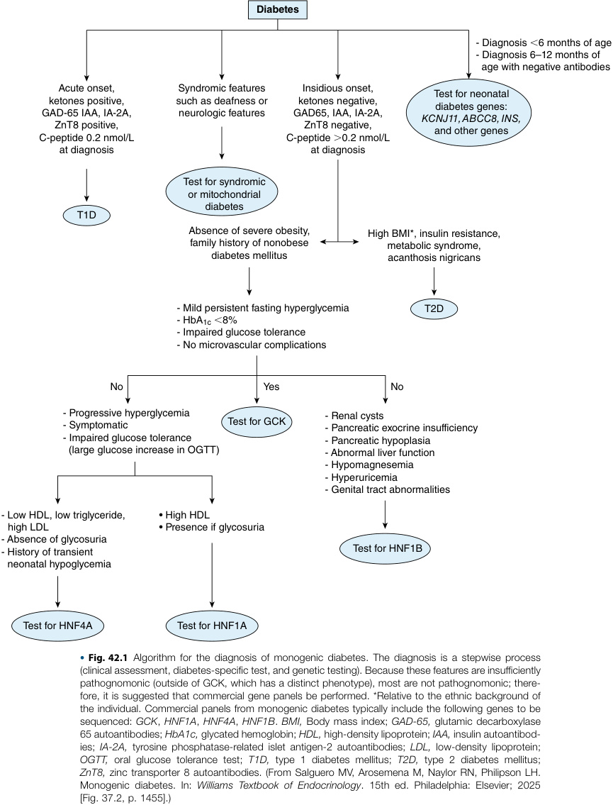
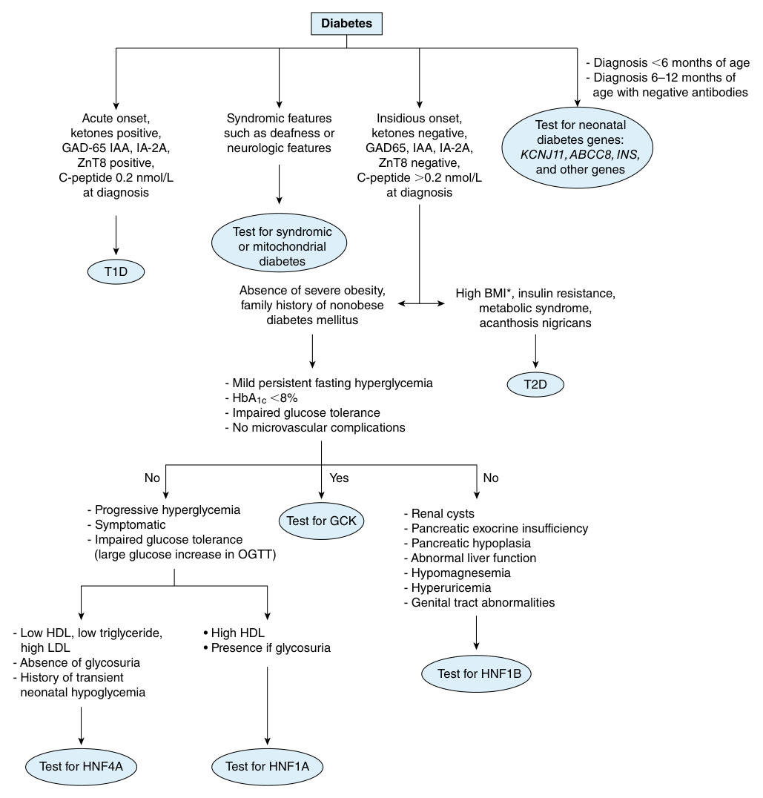
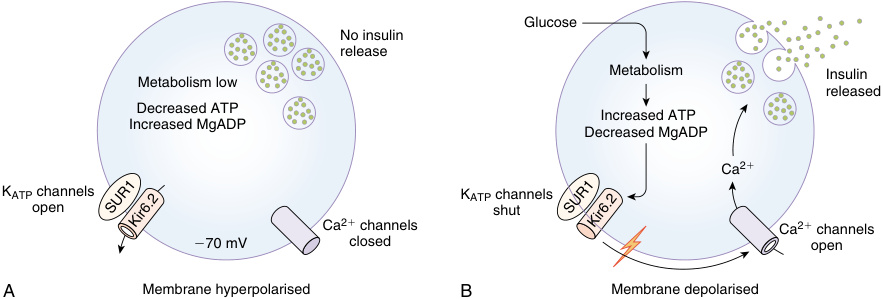
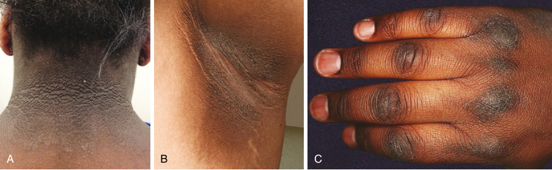

# Chapter 42: Monogenic Diabetes: MODY and Other Rare Genetic Etiologies
> **Course:** Vikkypaedia Rare Disease Learner Course (*Nelson Pediatric Textbook of Rare Diseases: Genomic Etiologies and Genetic Diagnosis (1st Edition)*)  
> **Section VII:** Endocrine Disorders  
> **Authors:** Siri Atma W. Greeley, Naiomi Gunaratne-Breaux  
> **Metrics:** 9,053 words · 11 tables · 2 figures · 61 genes · 28 flashcards · 14 MCQs  
> **Quick Navigation:** [🃏 Study 28 Flashcards](../flashcards/042_flashcards.md) · [📝 Take 14-Q MCQ Quiz](../mcqs/042_mcqs.md) · [📚 Section VII Guide](../sections/Section_VII.md) · [🧬 Master OMIM/Gene Atlas](../omim_gene_atlas.md) · [💊 Precision Therapies Matrix](../therapies_matrix.md) · [🏠 Course Index](../../index.md)

## Key Chapter Topics
`Monogenic Diabetes MODY and Other Rare Genetic Etiologies` · `Maturity Onset Diabetes of the Young` · `Common Defects` · `GCK-MODY` · `HNF4A-MODY` · `HNF1B-MODY` · `HNF1A-MODY` · `Less Common Defects` · `K-ATP Channel Defects` · `Rare Subtypes` · `Neonatal Diabetes` · `Permanent Neonatal Diabetes` · `K-ATP Channel Related Variants (ABCC8, KCNJ11)` · `Monogenic Subtypes of Neonatal and Infancy-Onset Diabetes`

## Key Genes & Molecular Targets
`ABCC8`, `AGPAT2`, `AIRE`, `AKT2`, `ALMS1`, `APPL1`, `BBS1`, `BBS10`, `BSCL2`, `CAV1`, `CISD2`, `CNOT1`, `CTLA4`, `DPP4`, `EIF2AK3`, `EIF2B1`, `EIF2S3`, `FOXP3`

## ⚡ High-Yield Clinical & Diagnostic Pearls
- Diabetes mellitus is defined by chronic hyperglycemia resulting from heterogenous causes characterized by dysfunction of insulin secretion, insulin action, or both.
- The two most common forms of diabetes are polygenic: type 1 diabetes and type 2 diabetes.
- Type 2 diabetes accounts for about 90% of all diabetes and is characterized by a failure of beta cells to compensate in the face of increased insulin resistance, which is most often associated with overweight or an obese body habitus.
- Monogenic diabetes, in contrast, results from one or more defects in a single gene or chromosomal locus.
- MODY is the most common phenotypic category of monogenic diabetes and makes up approximately 2–6% of all diabetes mellitus cases diagnosed under 20 years of age.
- Family history is important because there will usually be an autosomal dominant pattern with members in several generations with diagnosis earlier in life and/or atypical clinical features.
- It is caused by autosomal dominant pathogenic variants in GCK on chromosome 7p13.
- GCK-MODY is characterized by a persistent, mild elevation in fasting blood glucose levels with a corresponding mildly elevated HbA1c (most will be within 5.8–7.2%) which often causes these patients to be mistaken for having prediabetes or stage 2 type 1 diabetes.

---
## Full Chapter Text, Tables & Figures

<!-- p.928 -->

# 42 Monogenic Diabetes MODY and Other Rare Genetic Etiologies 

**SIRI ATMA W. GREELEY, NAIOMI GUNARATNE-BREAUX** 

Diabetes mellitus is defined by chronic hyperglycemia resulting from heterogenous causes characterized by dysfunction of insulin secretion, insulin action, or both. Diagnosis of diabetes includes one of the following criteria: symptoms of diabetes or hyperglycemia (polyuria, polydipsia, polyphagia, weight loss) with random glucose ≥200 mg/dL; fasting plasma glucose ≥126 mg/dL; 2-hour postprandial glucose of ≥200 mg/dL during an oral glucose tolerance test; or hemoglobin A1C (HbA1C) ≥6.5%. The two most common forms of diabetes are polygenic: type 1 diabetes and type 2 diabetes. Type 1 diabetes constitutes 5–10% of all diabetes; it is due to the autoimmune destruction of the pancreatic beta cells, leading to loss of insulin production. Type 2 diabetes accounts for about 90% of all diabetes and is characterized by a failure of beta cells to compensate in the face of increased insulin resistance, which is most often associated with overweight or an obese body habitus. These forms of diabetes have complex genetic influences that interact with the environment making them polygenic in nature. 

Monogenic diabetes, in contrast, results from one or more defects in a single gene or chromosomal locus. Monogenic diabetes likely accounts for <1% of all cases of diabetes but may account for up to 5% of diabetes diagnosed in younger individuals. These patients are often misdiagnosed as type 1 diabetes or type 2 diabetes, but will usually lack at least some of the phenotypic features. The classic description of monogenic diabetes related to patients with a young age of diabetes onset, lean body mass, no autoimmunity to the pancreatic beta cell and a family history of greater than two generations. Gene discovery has expanded this to an entire spectrum of diseases that make up the many forms of monogenic diabetes including maturity-onset diabetes of the young (MODY), neonatal diabetes, mitochondrial diabetes, and monogenic diabetes with severe insulin resistance (Fig. 42.1). 

## **Maturity Onset Diabetes of the Young** 

Maturity onset diabetes of the young (MODY) is defined as a diabetes phenotype characterized by a young age of onset 

(typically 10–35 years of age), absence of autoimmunity to the pancreatic beta cell, continued endogenous insulin production, and the absence of significant insulin resistance. MODY is the most common phenotypic category of monogenic diabetes and makes up approximately 2–6% of all diabetes mellitus cases diagnosed under 20 years of age. 

A diagnosis of MODY can be suspected in individuals diagnosed with diabetes at a young age, with a clinical picture that is not consistent with either type 1 or type 2 diabetes, and often, with a family history of diabetes. The age of onset is typically in adolescence or early adulthood, commonly after puberty and most often before 25–30 years of age. Atypical cases are described in some older individuals, up to 45 years of age. The clinical picture of MODY is atypical for type 1 diabetes, including negative pancreatic islet cell autoantibodies (directed against GAD, IA2, ZnT8, and/or insulin), preservation of endogenous insulin production (measured as C-peptide) even years after diabetes diagnosis, low insulin requirements for treatment, and absence of ketoacidosis if insulin is omitted. The clinical picture is also not typical for type 2 diabetes in that individuals will usually not have typical features of the **metabolic syndrome** (obesity, acanthosis nigricans, elevated triglycerides, and low HDL cholesterol, as well as elevated blood pressure levels). Family history is important because there will usually be an autosomal dominant pattern with members in several generations with diagnosis earlier in life and/or atypical clinical features. Genetic testing is diagnostic for patients with suspicion for monogenic diabetes and will elucidate specific MODY type based on known genotype—phenotype correlations. Next-generation sequencing, most often as multi gene panels (on an exome or genome backbone) is available through many different testing laboratories that typically include most known genes, as well as including neonatal onset genes and mitochondrial testing. 

There are multiple recognized genes associated with MODY, each with different pathogenic mechanisms, extrapancreatic manifestations and individual treatments. Most authorities recommend classifying MODY types based on genetic etiology rather than arbitrary numbering (e.g., GCK-MODY was previously known as MODY2) (Table 42.1).

<!-- p.929 -->

<!-- p.930 -->

#### **TABLE 42.1** Genetic Etiology, P athophysiology, and Associated Treatment Strate gies for Known Causes of MODY

||Location (Chromosome,|||||
|---|---|---|---|---|---|
|Gene| Locus)|Pathophysiology |Presentation|Treatment|OMIM #|
|_GCK_|7p13|• Pathogenic variant in Glucokinase |• Mildly elevated fasting blood sugar, asymptomatic|• Usually no treatment (may be considered during pregnancy)|125851|
|_HNF1A_|12q24.31|• Pathogenic variant in HNF1A transcription factor • Beta cell dysfunction   |• Glucosuria • Progressive glucose intolerance then diabetes in late adolescence or early adulthood|• Low dose sulfonylureas • GLP-1 receptor agonists|600496|
|_HNF4A_|20q12|• Pathogenic variant in HNF4A transcription factor • Defective glucose- stimulated insulin secretion     |• Dyslipidemia • Diabetes • Hyperinsulinemic hypoglycemia early in life|• Low dose sulfonylureas • GLP-1 receptor agonists|125850|
|_HNF1B_|17q12|• Pathogenic variant in HNF1B transcription factor • Dysfunctional embryonic development of pancreas and genitourinary system     | • Also known as “Renal Cysts and Diabetes Syndrome (RCAD)” • Pancreatic exocrine insufficiency (may be subclinical) • Renal cysts, small kidneys, renal hypoplasia, or absent kidney, and/or other GU malformations|• Insulin or may respond to certain noninsulin therapie (SGLT-2 inhibitors may be helpful, whereas sulfonylureas unlikely to b effective)| s   e 137920|
|_ABCC8_|11p15.5|• Defective SUR1 subunit on K-ATP channel in pancreatic beta cells • Impaired insulin secretion   |• Various phenotypes • Neurological symptoms are associated| • Sulfonylurea (glyburide) • SGLT2 inhibitors, GLP-1 receptor agonists|125853|
|_KCNJ11_|11p15.1|• Defective Kir6.2 subunit on K-ATP channel in pancreatic beta cells • Impaired insulin secretion |• Multiple phenotypes|• Sulfonylurea (glyburide)|616329|
|_INS_|11p15.5|• Impaired insulin biosynthesis via protein misfolding |• Varying phenotypes of insulin requirements|• Oral hypoglycemia agents • Insulin|613370|
|_CEL_|9q34.13|• Misfolding of CEL enzyme • Pathogenicity most definitive only for certain variants • Pancreatic atrophy     |• Pancreatic exocrine insufficiency (subclinical in early childhood progressing to malabsorption) • Diabetes later in life • Pancreatic cysts| • Oral hypoglycemia agents • Insulin • Pancreatic enzymes|114840|
|_APPL1_|3p14.3|• Pathogenic variant in APPL1 protein • Dysregulated insulin secretion • Reduced beta cell survival||• Low-carbohydrate diet • Oral hypoglycemic agents • Insulin|616511|
|_PDX1_|13q12.2|• Beta cell dysfunction • Defective insulin secretion |• Variable age of onset|• Low-carbohydrate diet • Oral hypoglycemic agents • Insulin|606392|
|_NEUROD_|_1_2q31.3|• Beta cell dysfunction |• Can present as obese or nonobese|• Low-carbohydrate diet • Oral hypoglycemic agents • Insulin|606394|

<!-- p.931 -->

### **Common Defects** 

#### **_GCK-MODY_** 

GCK-MODY represents approximately 30–50% of patients with MODY, particularly in studies screening pediatric populations. It is caused by autosomal dominant pathogenic variants in _GCK_ on chromosome 7p13. _GCK_ encodes for glucokinase, which acts as a glucose sensor regulating insulin and glucagon secretion in the pancreas, brain, and liver. Over 300 heterozygous _GCK_ variants leading to either inactivation, misfolding, degradation of glucokinase have been curated as pathogenic or likely pathogenic for causing GCK-MODY. These all lead to a malfunctioning glucokinase enzyme that has a decreased affinity to glucose, increasing the glucose threshold for insulin secretion, and impairing postprandial glycogen storage in the liver; insulin secretion is preserved. 

GCK-MODY is characterized by a persistent, mild elevation in fasting blood glucose levels with a corresponding mildly elevated HbA1c (most will be within 5.8–7.2%) which often causes these patients to be mistaken for having prediabetes or stage 2 type 1 diabetes. Antibodies to the pancreatic islet beta-cell will usually be negative; patients will usually lack a phenotype consistent with type 2 diabetes, such as obesity and acanthosis nigricans; in rare cases there may be _co-occurring_ forms of diabetes. Patients with GCK-MODY are usually asymptomatic; hyperglycemia is often noted incidentally, such as during pregnancy. Patients have a very low risk of the microor macrovascular complications seen in other forms of diabetes. Treatment is usually not indicated, but can be considered during pregnancy to prevent fetal macrosomia in an affected mother carrying an unaffected fetus; treatment may be ineffective in these individuals, and may increase risk of hypoglycemia. 

as well as glucosuria. A decreased high-sensitivity C-reactive protein can also distinguish HNF1A-MODY from type 2 diabetes (but is not seen with HNF4A-MODY). 

First-line treatment is low dose oral sulfonylurea, such as glyburide. Patients may develop hypoglycemia; the sulfonylurea should be started at a low dose (e.g., one half of 1.25 mg glyburide tablet daily) and titrated accordingly. GLP-1 agonists may be considered in those who achieve inadequate control or who do not tolerate sulfonylureas because GLP-1 agonists have a lower risk of hypoglycemia. There is concern about SGLT2 inhibitor use in HNF1A-MODY due to the risk of _euglycemic DKA_ that may be compounded by _HNF1A_ regulation of _SGLT2_ expression. 

### **_HNF4A-MODY_** 

HNF4A-MODY is caused by pathogenic variants in the hepatic nuclear factor 4-alpha _(HNF4A)_ gene on chromosome 20q12. It comprises between 5–10% of patients with MODY. _HNF4A_ encodes for the HNF4A transcription factor expressed in pancreatic beta cells and also involved in hepatic gluconeogenesis and lipoprotein biosynthesis. Defects in this protein lead to dyslipidemia and beta cell dysfunction from defective glucose-stimulated insulin secretion. In an affected fetus, fetal hyperinsulinemia produces macrosomia in utero, subsequently leading to neonatal hyperinsulinemic hypoglycemia; patients can present with hypoglycemia early in life but later develop MODY. These _dual phenotypes_ are not fully understood, but there is a progressive nature to HNF4A-MODY which can lead to diabetes-related complications. Treatment often starts with low dose sulfonylureas, although these may not be as effective as with HNF1A-MODY. Some reports suggest the effectiveness of a low-carbohydrate diet or other noninsulin therapies such as GLP1-receptor agonists, or insulin. 

### **_HNF1B-MODY_** 

### **_HNF1A-MODY_** 

HNF1A-MODY is caused by pathogenic variants in the hepatic nuclear factor 1-alpha _(HNF1A)_ gene on chromosome 12q24.2 encoding the HNF1A transcription factor. HNF1A-MODY is similar in incidence to GCK-MODY in that it comprises 30–65% of patients with MODY and is the most common form in some studies from Europe, Asia, and North America. HNF1A is part of a family of transcription factors which regulate the expression of genes in pancreatic beta-cells and other tissues, including insulin (INS), glucose transporter (GLUT), and sodium/glucose cotransporter 2 (SGLT2). Pathogenic variants in this gene lead to progressive beta cell dysfunction (including beta cell apoptosis), glucosuria, and poor glucose-stimulated insulin secretion. 

Patients present in adolescence or in early adulthood, with a mean age of diagnosis ~14 years of age. Patients can have normal glucose tolerance earlier in life, but due to the progressive nature of this highly penetrant condition, overt diabetes often develops earlier than those with type 2 diabetes. Diagnostic evaluation for HNF1A-MODY reveals a marked increase in glucose levels during an oral glucose tolerance test, 

HNF1B-MODY is caused by pathogenic variants in the hepatic nuclear factor 1-beta _(HNF1B)_ gene on chromosome 17q12. The HNF1B transcription factor is important in the early embryonic development of both the nephron and pancreas. In the **pancreas** , HNF1B helps with differentiation of the pancreatic cells to ductal, acinar, and endocrine cells. Defects can lead to pancreatic _exocrine insufficiency_ (that may be subclinical, especially when young) and diabetes from progressive beta cell dysfunction that may be worsened by insulin resistance. In the **kidney** , HNF1B directs the growth of the metanephric mesenchyme, the collecting ducts, renal pelvis, and ureters; patients commonly present with renal cysts, but can also present with small, hyperechogenic kidneys, renal hypoplasia, or an absent kidney. Other genitourinary malformations such as bicornuate uterus have been described. **Hypomagnesemia** is a common feature resulting from renal magnesium wasting, as well as hyperuricemia. Renal symptoms present before the onset of diabetes, which may present later than in other forms of MODY (mean age of onset is 24 years). Patients with HNF1B-MODY can also present with liver dysfunction, congenital malformations of the female reproductive tract, and intellectual disability; this is more

<!-- p.932 -->

commonly seen with whole gene deletions involving 17q12. It is important to screen for all possible involved systems once a genetic diagnosis is made because there can be marked phenotypic variability with HNF1B-MODY. Sulfonylurea therapy is not recommended and may be ineffective due to the liver and renal involvement. Insulin monotherapy is often reported, but other noninsulin therapies may be considered, with SGLT2 inhibitors possibly being helpful for renal manifestations. 

### **Less Common Defects** 

#### **_K-ATP Channel Defects_** 

The pancreatic beta cell potassium-ATP channel is an essential component to insulin regulation. The channel couples glucose levels and ATP concentration to beta cell membrane electrical activity: when open, it inhibits insulin secretion, and when closed (stimulated by elevated glucose levels), leads to secretion of insulin (Fig. 42.2). Activating pathogenic variants (usually heterozygous) in either subunit of the K-ATP channel causes it to be less sensitive to ATP (which increases by metabolism of glucose), resulting in channels remaining open and preventing the usual release of insulin even in the setting of significant hyperglycemia. 

**ABCC8-MODY** is caused by activating variants (usually heterozygous and missense) in the ATP-binding cassette transporter subfamily C member 8 _(ABCC8)_ gene on chromosome 11p15.5. This gene encodes the sulfonylurea receptor 1 _(SUR1)_ subunit of the K-ATP channel in the pancreatic beta cell membrane. Activating ABCC8 variants leads to a defective SUR1 subunit that causes the K-ATP channel to remain open and prevents insulin secretion, even in the context of significant hyperglycemia. 

**KCNJ11-MODY** is caused by _activating_ variants (usually heterozygous and missense) in _KCNJ11_ on chromosome 11p15.1. _KCNJ11_ encodes for the inward rectifying potassium channel (Kir6.2) subunit of the K-ATP channel expressed on the pancreatic beta cell membrane. Activating variants in this channel prevent insulin secretion by causing the channels to remain open despite elevated glucose levels. 

Pathogenic variants in either _ABCC8_ or _KCNJ11_ can present with variable phenotypes, including MODY, as well as transient or permanent **neonatal diabetes** . Polymorphic loci involving these genes have been associated with risk for type 2 diabetes; _loss of function_ variants (usually recessive) is an important cause of congenital hyperinsulinism. A spectrum of _neurodevelopmental symptoms_ may be seen in addition to diabetes although this appears to be less common with variants that cause MODY. Oral sulfonylurea medications are the gold standard treatment for ABCC8-MODY and KCNJ11-MODY because they permit closure of the abnormal K-ATP channel and thereby restore insulin secretion. When high doses of sulfonylureas are insufficient for optimal glycemic control in those with activating K-ATP channel variants, other medications such as SGLT2 inhibitors and GLP-1 agonists have sufficient efficacy which frequently obviate the need for insulin. It is important to ascertain the likelihood for causality of diabetes for any variant of unknown significance on a genetic testing report because many VUSs reported by commercial testing laboratories will be loss of function variants that are unlikely to be the cause of the diabetes and will not respond to treatment with SU, whereas careful review of genomic databases (https://clinicalgenome.org/affiliation/50016/) and available literature can help clarify the likely causality of some variants. 

**LOW GLUCOSE** 

**HIGH GLUCOSE** 

**Fig. 42.2** Stimulus–secretion coupling in pancreatic beta-cells. (A) KATP channels are open when extracellular glucose, and thus beta-cell metabolism, is low. Consequently, the cell membrane is hyperpolarized. This keeps voltage-gated Ca2+ channels closed, so that Ca2+ influx remains low and insulin secretion is inhibited. (B) When extracellular glucose increases, metabolism generates ATP at the expense of MgADP, thereby closing KATP channels. This leads to membrane depolarization, opening of voltage-gated Ca2+ channels, Ca2+ influx and exocytosis of insulin. (From Proks P, Ashcroft FM. Modeling KATP channel and its regulation. _Prog Biophys Mol Biol._ 2009;99:7-19 [Fig. 1, p. 9] https://doi.org/10.1016/j.pbiomolbio.2008.10.002.)

<!-- p.933 -->

### **Rare Subtypes** 

**INS-MODY** results from pathogenic variants (usually heterozygous) in the insulin (INS) gene that encodes for preproinsulin, the precursor of insulin. Dominant negative variants most often lead to misfolding of the protein, affecting all steps of insulin biosynthesis and ultimately causing early pancreatic beta cell death with diabetes onset usually in infancy but may also present later in life. Not all variants have been fully characterized; those that are identified in individuals with a MODY-like phenotype appear to disrupt normal binding of insulin to the insulin receptor, thus impairing insulin clearance and increasing the amount of circulating insulin. There is phenotypic variability with some variants presenting with a mild MODY-like phenotype which respond well to oral hypoglycemic agents, while others present in infancy with a severe phenotype requiring lifelong insulin replacement. Treatment of those with a MODY phenotype should consider strategies that reduce the need for insulin production, such as with SGLT inhibitors; ultimately insulin may be needed. Early insulin treatment might be helpful to improve outcomes in those that require insulin treatment. 

**CEL-MODY** is caused by pathogenic variants in the carboxyl-ester lipase _(CEL)_ gene; only certain variants in the VNTR appear to be causative and lead to misfolding of the CEL enzyme. The resultant _pancreatic atrophy_ results in both exocrine and endocrine pancreatic insufficiency. The dysfunction is progressive: patients first develop exocrine dysfunction early in childhood, and then develop more pancreatic fatty tissue, resulting in diabetes and malabsorption typically in the fourth decade of life. They may also develop pancreatic cysts over time, which can be a risk factor for pancreatic cancer. Uncertain variants (VUS) from monogenic testing panels should be interpreted with caution, especially if there is no clinical evidence of exocrine pancreatic insufficiency. 

**APPL1-MODY** is a very rare subtype caused by heterozygous loss of function variants in the adaptor protein, phosphotyrosine interaction, PH domain, and leucine zipper containing 1 _(APPL1)_ gene, which encodes the APPL1 protein. APPL1 binds to AKT2 and is expressed in all insulin target tissues. It is highly expressed in the pancreas beta-cells, co-localized with insulin expression in beta-cells, where it appears to be important in regulating insulin secretion. Because so few cases have been reported, the most appropriate treatment for APPL1 remains uncertain with diet, oral hypoglycemic agents, and insulin all having been reported in the two largest cohorts. 

**PDX1-MODY** presents with heterozygous pathogenic variants in the pancreatic and duodenal homeobox 1 _(PDX1)_ gene, which encodes for the PDX1 transcription factor. This transcription factor is important in early pancreatic development and beta cell formation and function. It can also regulate the expression of the insulin gene, and the glucosestimulated insulin secretion pathway, including GLUT2. Variants in _PDX1_ present with a broad phenotype, ranging from impaired glucose tolerance in some with heterozygous variants to pancreatic agenesis in cases with pathogenic 

biallelic variants. Therefore both neonatal diabetes and MODY with onset from 17 to 67 years old have been reported. 

**NEUROD1-MODY** presents with heterozygous variants in the neurogenic differentiation 1 _(NEUROD1)_ gene, leading to a defect in the NEUROD1 transcription factor, which is involved in pancreatic islet cells (specifically with SUR1 and GCK), the intestine, and subset of neurons in both central and peripheral nervous system. Incomplete penetrance has been described with variable onset of diabetes, more often typical MODY and some with features of type 2 diabetes. Neurological phenotypes include intellectual disability in those with neonatal diabetes due to pathogenic biallelic variants. 

## **Neonatal Diabetes** 

Neonatal diabetes is defined as severe hyperglycemia requiring treatment occurring in infancy. When diagnosed within the first 6 months of life, 85–90% of cases have pathogenic variants in one of the known genes. A monogenic cause is rare in those diagnosed between 6 and 12 months of age. Comprehensive genetic testing should be considered in all cases diagnosed before 6–9 months of age, or later if there are additional suggestive features, such as negative autoantibody testing, significant family history, or other extrapancreatic features (cardiac or intestinal malformations, or neurological problems for example). While hyperglycemia in the neonatal period can be due to several etiologies (sepsis, medications, intravenous glucose supplementation), prolonged hyperglycemia (>250 mg/dL) past 1–2 weeks of life that does not have another clear etiology and requires treatment (usually insulin) should be suspicious for neonatal diabetes, even in the context of prematurity. 

About 1 in 90,000 live births present with neonatal diabetes; the majority of these cases can have an underlying monogenic etiology. Neonatal diabetes can be categorized by its length of time ( _permanent_ neonatal diabetes, _transient_ neonatal diabetes), etiology (autoimmune or pancreatic agenesis/hypoplasia), or association with other syndromes. 

### **Permanent Neonatal Diabetes** 

Permanent neonatal diabetes (PNDM) is exceedingly rare: prevalence is about 1 in 252,000 in youth in the United States, and makes up for nearly 0.22% of all youth under the age of 20 years with diabetes. In more than 50% of cases the diabetes will be permanent. Most will have pathogenic variants in a growing long list of gene causes, where the ones described below will account for the majority of cases, particularly in populations where consanginous pairings are uncommon. These patients will require lifelong treatment with either insulin or sulfonylureas (Table 42.2). 

### **_K-ATP Channel Related Variants (ABCC8, KCNJ11)_** 

The majority of PNDM (40%) are the result of pathogenic variants in the K-ATP channel in the pancreatic beta cell, associated with either the _ABCC8_ or _KCNJ11_ genes. Both ATP-binding cassette transporter subfamily C member 8

<!-- p.934 -->

**42.2** 

##### **TABLE** 

#### **Monogenic Subtypes of Neonatal and Infancy-Onset Diabetes** 

|Gene|Locus|Inheritance|Other Clinical Features|
|---|---|---|---|
|**Abnormal Pancre**|**atic Development**|||
|_PLAGL1/HYMAI_|6q24|Variable (imprinting)|TNDM±macroglossia±umbilical hernia|
|_ZFP57_|6p22.1|Recessive|TNDM (multiple hypomethylation syndrome)±macroglossia ±developmental delay±umbilical defects±congenital heart disease|
|_PDX1_|13q12.1|Recessive|PNDM+pancreatic agenesis (steatorrhea)|
|_PTF1A_|10p12.2|Recessive|PNDM+pancreatic agenesis (steatorrhea)+cerebellar hypoplasia/aplasia+central respiratory dysfunction|
|_PTF1A enhancer_|10p12.2|Recessive|PNDM+pancreatic agenesis without CNS features|
|_HNF1B_|17q21.3|Dominant|TNDM+pancreatic hypoplasia and renal cysts|
|_RFX6_|6q22.1|Recessive|PNDM+intestinal atresia+gallbladder agenesis|
|_GATA6_|18q11.1-q11.2|Dominant|PNDM+pancreatic agenesis+congenital heart defects+ biliary abnormalities|
|_GATA4_|8p23.1|Dominant|PNDM+pancreatic agenesis+congenital heart defects|
|_GLIS3_|9p24.3-p23|Recessive|PNDM+congenital hypothyroidism+glaucoma+hepatic fibrosis+renal cysts|
|_NEUROG3_|10q21.3|Recessive|PNDM+enteric anendocrinosis (malabsorptive diarrhea)|
|_NEUROD1_|2q32|Recessive|PNDM+cerebellar hypoplasia+visual impairment+ deafness|
|_PAX6_|11p13|Recessive|PNDM+microphthalmia+brain malformations|
|_MNX1_|7q36.3|Recessive|PNDM+developmental delay+sacral agenesis+ imperforate anus|
|_NKX2-2_|20p11.22|Recessive|PNDM+developmental delay+hypotonia+short stature +deafness+constipation|
|_CNOT1_|16q21|Spontaneous|PNDM+pancreatic agenesis+holoprosencephaly|
|_ONECUT1_|15q21.3|Recessive|PNDM+pancreatic hypoplasia+gallbladder hypoplasia|
|**Abnormalb-Cell**|**Function**|||
|_KCNJ11_|11p15.1|Spontaneous or dominant|PNDM/TNDM±DEND|
|_ABCC8_|11p15.1|Spontaneous, dominant or recessive|TNDM/PNDM±DEND|
|_INS_|11p15.5|Recessive|Isolated PNDM or TNDM|
|_GCK_|7p15-p13|Recessive|Isolated PNDM|
|_SLC2A2_(GLUT2)|3q26.1-q26.3|Recessive|Fanconi-Bickel syndrome: PNDM+hypergalactosemia, liver dysfunction|
|_SLC19A2_|1q23.3|Recessive|Roger syndrome: PNDM+thiamine-responsive megaloblastic anemia, sensorineural deafness|
|_KCNMA1_|10q22.3|Spontaneous|PNDM (not all cases)+developmental delay+intestinal malformations+cardiac malformations+bone dysplasia +dysmorphic features|

_(Continued)_

<!-- p.935 -->

|**TABLE** **42.2**|**Monogenic Subtypes of Neonatal and Infancy-Onset Diabetes—cont’d**|
|---|---|

|Gene|Locus|Inheritance|Other Clinical Features|
|---|---|---|---|
|**Destruction o**|**fb-Cells**|||
|_INS_|11p15.5|Spontaneous or dominant|Isolated PNDM|
|_EIF2AK3_|2p11.2|Recessive|Wolcott-Rallison syndrome: PNDM+skeletal dysplasia+ recurrent liver dysfunction|
|_IER3IP1_|18q21.2|Recessive|PNDM+microcephaly+lissencephaly+epileptic encephalopathy|
|_FOXP3_|Xp11.23-p13.3|X-linked, recessive|IPEX syndrome (autoimmune enteropathy, eczema, autoimmune hypothyroidism, elevated IgE)|
|_WFS1_|4p16.1|Recessive|PNDM* +optic atrophy±diabetes insipidus±deafness|
|_WFS1_|4p16.1|Dominant|PNDM or infancy-onset diabetes+congenital cataracts+ deafness|
|_EIF2B1_|12q24.31|Spontaneous|PNDM+episodic hepatic dysfunction|
|_YIPF5_|5q31.3|Recessive|PNDM+severe microcephaly+epilepsy|
|_STAT3_|17q21.2|Spontaneous|PNPM+enteropathy+other autoimmunity such as cytopenias|
|_CTLA4_|2q33.2|Spontaneous|Lymphoproliferative syndrome+enteropathy+cytopenias +diabetes+thyroiditis|
|_ITCH_|20q11.22|Recessive|PNDM+facial dysmorphism+multisystem autoimmunity|
|_IL2RA_|10p15.1|Recessive|Lymphoproliferation+multisystem autoimmunity+diabetes|
|_LRBA_|4q31.3|Recessive|PNDM+enteropathy+hypothyroidism+autoimmune hemolytic anemia|

_*_ The mean age of diagnosis among persons with _WFS1_ variations is approximately 5 years. _DEND,_ Developmental delay, epilepsy, neonatal diabetes; _IPEX,_ immune dysfunction, polyendocrinopathy, enteropathy, X-linked; _PNDM,_ permanent neonatal diabetes mellitus; _TNDM,_ transient neonatal diabetes mellitus. From Greeley SAW, Polak M, Njolstad PR, et al. ISPAD clinical practice consensus guidelines 2022: the diagnosis and management of monogenic diabetes in children and adolescents. _Pediatr Diabetes._ 2022;23:1188-1211 (Table 1, p. 1189–1190). 

_(ABCC8)_ gene and the potassium inwardly rectifying channel subfamily J member 11 gene (or _KCNJ11_ ) are also involved in MODY and transient neonatal diabetes. 

Variants in _KCNJ11_ account for ~30% of all PNDM cases. The average age of onset is 5 weeks; infants present with low birthweight from insulin deficiency in utero. The Kir6.2 subunit is also expressed in other tissues, including muscle, neurons, and the brain. Some patients with _KCNJ11_ pathogenic variants have neurologic deficits associated with the syndromic diagnosis: **Developmental Delay, Epilepsy, and Neonatal Diabetes (DEND)** . The broader phenotype can include learning disorders (such as ADHD), hypotonia, muscle weakness, or balance problems. 

Approximately 10% of PNDM is linked to pathogenic variants in _ABCC8_ . These patients present similarly to those with _KCNJ11_ disease-causing variants (low birthweight, presentation within the first few weeks of life, and similar severity of hyperglycemia), but _without_ the severe neurologic deficits. 

Sulfonylureas are the gold standard therapy for K-ATP channel related PNDM. Sulfonylureas have additionally been documented to improve development, growth, and neurologic outcomes in these disease states. 

### **_INS-Related Neonatal Diabetes_** 

INS-related neonatal diabetes involves pathogenic variants in the insulin (INS) gene, encoding preproinsulin, the precursor for insulin. De novo pathogenic variants account for 80% of patients with INS-related PNDM which represents 23% of neonatal diabetes. Patients have a phenotype similar to those with K-ATP channel related PNDM (low birth weight, severity in hyperglycemia); these patients _do not_ respond to sulfonylurea therapy; instead they require insulin therapy for life. 

### **_GCK-Related Neonatal Diabetes_** 

A rare form of PNDM is due to a homozygous pathogenic variants in the glucokinase (GCK) gene. These variants result in the complete deficiency of glucokinase, an enzyme that catalyzes the conversion of glucose to glucose-6-phosphate, a mechanism to sense glucose. This is distinctive from GCKMODY, where there is a partial deficiency or dysfunction of glucokinase, and has mild, asymptomatic hyperglycemia. Patients with GCK-related PDNM typically have parents with asymptomatic hyperglycemia and have phenotypic variability characterized by lifelong insulin treatment and lack of response to sulfonylurea therapy.

<!-- p.936 -->

### **Transient Neonatal Diabetes** 

Transient neonatal diabetes (TNDM) comprises ~50% of all infants with neonatal diabetes. In these patients, there is a remission period within 1 to 18 months of onset; nearly half have a relapse later in childhood, adolescence, or adulthood. The majority of cases will be secondary to increased gene expression on the 6q24 locus (~70%), or activating variants of the K-ATP channel in the pancreatic beta cell membrane. Genetic testing is of utmost importance to determine treatment with insulin or sulfonylureas (Table 42.2). 

### **_6q24-Related Transient Neonatal Diabetes_** 

6q24-related TNDM, also known as TNDM1, is due to an overexpression of the genes at the chromosome 6q24 locus. This overexpression is associated with one of three mechanisms: paternal uniparental disomy of chromosome 6, duplication of 6q24 on the paternal allele, or a loss of methylation on the maternal copy. The genes affected include pleomorphic adenoma gene-like1 _(PLAG1)_ which encodes a proapoptotic zinc finger protein that has antiproliferative properties, which if overexpressed, can lead to glucosestimulated insulin translation and secretion. Another gene is hydatidiform mole-associated and imprinted transcript _(HYMAI)_ which encodes an untranslated mRNA; both altered expression of _PLAG1_ and _HYMAI_ can lead to altered beta cell function and pancreatic exocrine dysfunction. 

Affected infants present with severe intrauterine growth restriction, leading to lower birth weights compared to those with permanent neonatal diabetes. Macroglossia and umbilical hernia are associated malformations. Hyperglycemia typically presents soon after birth and lasts for an average of 3 months and often resolve by 18 months. Infants with 6q24PNDM _do not_ present with diabetic ketoacidosis. Infants are treated with insulin until the diabetes resolves and are weaned off insulin. It is unclear how this remission occurs. Murine studies showed an increase in pancreatic beta cells prior to 

remission. This is supported by the observation of hypoglycemia in patients with 6q24-TNDM, suggesting that beta cell hyperplasia leads to an excess production of insulin, resulting in hypoglycemia. Patients eventually relapse into diabetes at variable ages ranging from childhood through adulthood, often around puberty, a period associated with increased insulin resistance. Most respond to management with oral hypoglycemic agents, such as sulfonylureas. 

### **_K-ATP Channel Related TNDM2_** 

K-ATP channel related transient neonatal diabetes, or TNDM2, is a classification given to TNDM involving pathogenic variants in _ABCC8_ or _KCNJ11_ . The same channel dysfunction seen in PNDM is involved in TNDM2 but the impact of the variants results in attenuated function. 

Patients have a greater birth weight, present at a later age with diabetes and thus have remission later, but they relapse earlier than 6q24 TNMD. The phenotype as an adult can vary greatly and patients can be misdiagnosed with type 1 diabetes, type 2 diabetes, or MODY. Initially infants are treated with insulin, but as soon as diagnosis is confirmed, patients of all ages can be treated with sulfonylureas. 

### **Autoimmune Conditions Associated With Neonatal Diabetes** 

Monogenic autoimmune disease can also be associated with neonatal diabetes. This is not the same mechanism seen in the autoimmune component of polygenic type 1 diabetes. Monogenic disorders can disrupt the regulatory T cells in different ways, all known gene variants and their associations are detailed in Tables 42.2 and 42.3. 

The most studied monogenic autoimmune disease associated with neonatal diabetes is IPEX syndrome. **Immune dysregulation, polyendocrinopathy, enteropathy, X-linked (or IPEX)** syndrome involves variants in _FOXP3_ , which encodes for the forkhead box P3 transcription factor _(FOXP3)_ . 

#### **TABLE 42.3** Gene Causes of M onogenic Diabetes Associated With Additio nal Autoimmune Conditions

|Gene|Chromosome|Presentation|Treatment|OMIM|
|---|---|---|---|---|
|_AIRE_|21q22.3|Autoimmune polyendocrinopathy syndrome type 1 • Mucocutaneous candidiasis • Hypoparathyroidism • Addison disease|• Insulin • Antifungal • Glucocorticoid and mineralocorticoid replacement • Calcium and Vitamin D supplementation|240300|
|_CTLA4_|2q33.2|Immune dysregulation with autoimmunity, immunodeficiency, and lymphoproliferation • Lymphoproliferative disease • Enteropathy • Cytopenias • Thyroiditis • Diabetes|• CTLA-4 fusion proteins • Hematopoietic stem cell transplant|123890|

_(Continued)_

<!-- p.937 -->

#### **TABLE 42.3** Ge ne Causes of M onogenic Diabetes Associated With Additional A utoimmune Conditions — cont’d

|Gene|Chromosome|Presentation|Treatment|OMIM|
|---|---|---|---|---|
|_FOXP3_|Xp11.23|IPEX syndrome • Protein losing enteropathy • Neonatal diabetes • Severe skin rashes • Only in males|• Hematopoietic stem cell transplant|304790|
|_IL2RA_|10p15.1|Immunodeficiency 41 with lymphoproliferation and autoimmunity • Severe enteropathy leading to malabsorption • Chromic and recurring CMV infection • Diabetes • Hypothyroidism • Dermatological conditions|• Sirolimus • Hematopoietic stem cell transplant|147730|
|_ITCH_|20q11.22|Multisystem autoimmune disease with facial dysmorphism • Short stature • Enteropathy • Macrocephaly with small chin, low posteriorly rotated ears, orbital proptosis, prominent occiput • Global developmental delay • Chronic lung disease||613385|
|_LRBA_|4q31.3|Common variable immunodeficiency-8 with autoimmunity (CVID-8) • Autoimmune hematological disease • Inflammatory bowel disease • Autoimmune thyroid disease • Hypogammaglobulinemia • Mostly consanguineous families|• Abatacept|614700|
|_SIRT1_|10q21.3|• Early onset insulin dependent diabetes • Lean BMI|• Insulin|604479|
|_SLC29A3_|10q22.1|Pigmented hypertrichosis with insulin-dependent diabetes mellitus • Antibody-negative diabetes • Pigmented hypertrichosis • Hepatosplenomegaly|• Insulin|602782|
|_STAT3_|17q21.2|Infancy-onset multisystem autoimmune disease • Autoimmune lymphoproliferative disease • Hematological disorders • Short stature • Neonatal diabetes • Enteropathy • Recurring infections|• Immune suppression • Hematopoietic stem cell transplant|615952|

_FOXP3_ help regulates the generation and function of CD4+CD25+ regulatory T cells; hemizygous pathogenic variants in the _FOXP3_ gene lead to immune dysregulation in affected male patients. Most patients present with enteropathy, which can lead to refractory diarrhea and failure to thrive. They can also present with severe atopic dermatitis and neonatal diabetes within the first month of life; some patients present with enteropathy and dermatitis prior to diabetes diagnosis. Other IPEX-related conditions include autoimmune thyroiditis/congenital hypothyroidism, nephropathy, and cytopenias (hemolytic anemia, thrombocytopenia, and neutropenia). Patients who present with similar phenotypic features with no identifiable _FOXP3_ 

variant are defined as having an **IPEX-like syndrome** due to pathogenic variants in other genes. Treatment options for IPEX syndrome include supportive care in the hospital for parenteral nutrition, insulin therapy, and curative allogenic hematopoietic stem cell transplantation (Chapter 59). 

### **Syndromes of Pancreatic Agenesis/Hypoplasia** 

Several rare gene causes of neonatal diabetes are characterized with hypoplasia or complete agenesis of the pancreas, usually also with pancreatic _exocrine_ insufficiency. Biallelic variants in _PDX1_ cause complete pancreatic agenesis due to homozygous truncating variants; some compound

<!-- p.938 -->

|**TABLE** **42.4**|**Syndromes of Pancreatic Agenesis/Hypoplasia and Neonatal Diabetes**|
|---|---|

|Gene|Chromosome|Presentation|Treatment|OMIM|
|---|---|---|---|---|
|_PDX1_|13q12.2|Pancreatic agenesis 1 • IUGR, FTT • Varying presentations of exocrine pancreatic insufficiency|• Insulin|260370|
|_GATA4_|8p23.1|Pancreatic agenesis and congenital heart defects|• Insulin|600001|
|_GATA6_|18q11.2||||
|_PTF1A_|10p12|Pancreatic agenesis 2 • Low birth weight • Exocrine pancreatic insufficiency|• Insulin • Pancreatic enzyme replacement|615935|
|||Pancreatic and cerebellar agenesis • IUGR, FTT • Dysmorphic facies • Eye anomalies • Joint abnormalities||609069|
|_CNOT1_|16q21|Holoprosencephaly 12+/−pancreatic agenesis • IUGR • Microcephaly • Dysmorphic facies, teeth • Variable phenotype|• Insulin|618500|
|_RFX6_|6q22.1|Mitchell-Riley syndrome • IUGR • GI anomalies (intestinal atresia, gallbladder aplasia, hypoplasia)|• Insulin|615710|
|_ONECUT1_|15q21.3|Varying presentations, most severe is neonatal diabetes|• Insulin|604164|
|_FTT,_Failure to|thrive;_GI,_gastrointestin|al;_IUGR,_intrauterine growth restriction.|||

heterozygous cases appear to have intact pancreatic exocrine function. Heterozygous variants in _GATA6_ are the most common cause of pancreatic agenesis and nearly all affected individuals also have cardiac malformations. _GATA4_ variants are noted to have pancreatic agenesis with varying retention of endocrine function, ranging from neonatal diabetes (within the first 6 months of life) to developing diabetes in the teens; exocrine function is variable. Patients with _GATA4_ involvement may additionally have congenital heart malformations (pulmonic stenosis, AV canal defects) and developmental delay. Tables 42.2 and 42.4 detail further genes identified with tis phenotype. 

## **Syndromic Forms of Neonatal Diabetes** 

### **Wolcott-Rallison Syndrome** 

Wolcott-Rallison syndrome is an autosomal recessive disorder due to biallelic pathogenic variants in _EIF2AK3_ , eukaryotic translation initiation factor 2-alpha kinase 3, which encodes for an enzyme that helps regulate the synthesis of unfolded proteins in the endoplasmic reticulum. Dysfunction leads to apoptosis of cells in many tissues, including pancreatic beta cells, bone, and liver. Wolcott-Rallison syndrome is the most common cause of PNDM in _consanguineous_ families. Patients with Wolcott-Rallison syndrome present with skeletal 

dysplasias, especially **spondyloepiphyseal dysplasia** , and are prone to fractures. They may also have intermittent acute liver dysfunction, or chronic liver dysfunction, associated with high mortality rates, with some case reports of improved outcome following liver transplant. Permanent neonatal diabetes manifests typically by 2–3 months of life and can present with diabetic ketoacidosis; primary managements is with lifelong insulin treatment (Table 42.5). 

### **Wolfram Syndrome (DIDMOAD)** 

Wolfram syndrome is a rare neurogenerative disorder, in its classic form it is transmitted via autosomal recessive inheritance by variants in _WFS1_ on chromosome 4p16.1. This gene is responsible for the production of wolframin, which is expressed in the brain, heart, lung, placenta, and pancreatic brain tissue and involved in cellular apoptosis. The acronym **DIDMOAD** is also used to describe Wolfram syndrome and includes the main clinical characteristics: diabetes insipidus, diabetes mellitus, optic atrophy, and deafness. Diabetes mellitus is the first manifestation (average age of onset is at 6 years, but can range from 3 weeks to 16 years), and most patients with Wolfram syndrome present with diabetes. The mechanism is thought to be due to apoptosis or malfunctioning of the beta call secondary to dysfunctional wolframin. It is noted that patients with Wolfram syndrome

<!-- p.939 -->

#### **TABLE 42.5** Other Syndromic Forms of Neonatal Diabetes

|Gene|Chromosome|Presentation|Treatment|OMIM|
|---|---|---|---|---|
|_EIF2S3_|Xp22.11|MEHMO syndrome • Mental retardation • Epileptic seizures • Hypogonadism with hypogenitalism • Microcephaly • Obesity • Hyperinsulinemic hypoglycemia or postprandial hyperglycemia||300148|
|_EIF2AK3_|2p11.2|Wolcott-Rallison syndrome • Skeletal dysplasias • Hepatic and renal dysfunction • Cardiovascular abnormalities • Permanent neonatal diabetes|• Insulin|226980|
|_WFS1_|4p16.1|Wolfram syndrome 1 (DIDMOAD) • Diabetes insipidus • Diabetes mellitus • Optic atrophy • Deafness|• Insulin • Gene therapy or other investigational therapies in development| 222300|
|_SLC19A2_|1q24.2|Thiamine responsive megaloblastic anemia syndrome • Megaloblastic anemia • Diabetes mellitus • Sensorineural deafness|• Thiamine replacement • Insulin therapy|249270|
|_CISD2_|4q24|Wolfram syndrome 2 • Diabetes • High-frequency sensorineural hearing loss • Optic atrophy, neuropathy • Defective platelet aggregation|• Insulin|604928|
|_GLIS3_|9p24.2|Neonatal diabetes mellitus with congenital hypothyroidism syndrome • Neonatal diabetes • Hypothyroidism • IUGR • Renal disease • Liver disease • Facial dysmorphism|• Insulin • Levothyroxine|610199|
|_IER3IP1_|18q21.1|Microcephaly, epilepsy, and diabetes syndrome 1||614231|
|_MNX1_|7q36.3|• Currarino syndrome • Permanent neonatal diabetes • Neurological defects • Urogenital defects • Skeletal features|• Insulin|142994|
|_NEUROD1_|2q31.3|• Permanent neonatal diabetes • Cerebellar hypoplasia • Sensorineural deafness • Visual impairment||601724|
|_NEUROG3_|10q22.1|• Permanent neonatal diabetes • Chronic malabsorptive diarrhea||610370|
|_PAX6_|11p13|• Aniridia • Brain anomalies • Permanent neonatal diabetes||106210|
|_NKX2-2_|20p11.22|• Permanent neonatal diabetes • Normal exocrine function • IUGR||604612|

_(Continued)_

<!-- p.940 -->

**TABLE 42.5 Other Syndromic Forms of Neonatal Diabetes—cont’d** 

|Gene|Chromosome|Presentation|Treatment|OMIM|
|---|---|---|---|---|
|_YIPF5_|5q31.3|Microcephaly, epilepsy, and diabetes syndrome 2||619278|
|_EIF2B1_|12q24.31|• Permanent neonatal diabetes • Liver dysfunction||606686|
|_SLC2A2_|3q26.2|Fanconi-Bickel syndrome • Hepatorenal glycogen accumulation • Proximal renal tubular dysfunction • Impaired utilization of glucose or galactose • Transient or permanent neonatal diabetes|• Temporary insulin use • Cornstarch supplementation|227810|
|_IUGR,_Intrauterin|e growth restriction.||||

have a more gradual decline in insulin levels compared to those with type 1 diabetes. Often these patients die from neurological dysfunction, including brainstem atrophy. 

## **Thiamine Responsive Megaloblastic Anemia Syndrome** 

Thiamine responsive megaloblastic anemia syndrome (TRMA) is a rare disorder characterized by a _triad_ of megaloblastic anemia, progressive sensorineural deafness, and diabetes mellitus. It is inherited in an autosomal recessive manner, with a pathogenic variant in _SLC19A2_ , which encodes for the thiamine transport protein 1 (THTR1). THTR1 is expressed in the bone marrow, pancreatic beta cells, and subgroup of cochlear cells. The timing of diabetes onset can vary. In a cohort of 183 patients with TRMA, 35.7% were diagnosed with diabetes within the first year of life, and 17.1% were diagnosed within the first 6 months. Thiamine replacement improves anemia in patients with TRMA; there is some data to support thiamine administration leading to reduction in insulin dosages. Management includes concomitant thiamine replacement and insulin management, with close monitoring to titrate insulin regimen. 

## **Neonatal Diabetes Associated With Brain Malformations** 

Forms of neonatal diabetes have been described with concomitant with brain malformations. Cerebellar hypoplasia is noted in both _PTF1A_ and _NEUROD1_ . Microcephaly is seen in association with _IER3IP1_ and _YIPF5_ variants. _PAX6_ is most commonly associated with aniridia, but has been reported to present with hypopituitarism. It is important to note that structural brain anomalies are not always present; isolated pancreatic dysfunction may be the only finding. Developmental delay is common with variants in _MNX1_ and _NKX2-2_ . 

## **Other** 

Neonatal diabetes can also be associated with intestinal manifestations, when caused by variants in _RFX6_ or _NEUROG3_ , while congenital hypothyroidism is described in _GLIS3_ variants. 

# **Mitochondrial Diabetes** 

Mitochondrial DNA has a high pathogenic variant rate that worsens with age. Any genetic dysfunction affecting mitochondria can impact any organ that has a high energy demand, including: nervous system, muscle, eyes, heart, GI tract, and the endocrine system (Chapter 48). 

Mitochondrial diabetes can occur then there is mitochondrial failure in pancreatic beta cells. This can occur from primary mitochondrial disease, in which there is a pathogenic variant in the _mitochondrial DNA_ (mDNA) or _nuclear-encoded genes_ (nDNA) which leads to mitochondrial dysfunction. It can also occur due to secondary mitochondrial disease when mitochondria malfunction due to extrinsic factors from a disease process (i.e., bone marrow failure, neurodegenerative disease, Parkinson disease). 

Mitochondrial diabetes is rare, comprising only 3% of all diabetes. Mitochondrial diabetes typically presents in middle age, with an average age of 35 years. It should be suspected in those who have multiorgan involvement including the nervous system, muscle, heart, and liver. Patients can have neurologic symptoms such as sensorineural hearing loss, progressive external ophthalmoplegia, pigmentary retinopathy, optic neuropathy, epilepsy, movement disorders, ataxia, and dementia. They can also have cardiac involvement (cardiomyopathy, arrhythmia), GI dysmotility and liver failure. Many patients present with mild diabetic symptoms and progress over time; this is thought to be secondary to the cyclic pattern of hyperglycemia induced production of reactive oxidative species creating oxidative damage, and resulting in worsened hyperglycemia. Some patients may have normal function until they undergo some stress (i.e., surgery, illness), which is most often followed by multiorgan failure. 

The most commonly associated variant in mitochondrial diabetes is the m.3243A>G variant, encompassing about 85% of all mitochondrial diabetes. This variant occurs in the MT-TL1 gene, encoding for a mitochondrial transfer RNA. This results in a malfunctioning oxidative phosphorylation system, leading to defective mitochondria producing less ATP. There are multiple different phenotypes, including **maternally inherited diabetes and deafness (MIDD),**

<!-- p.941 -->

### **TABLE Mitochondrial Diabetes 42.6** 

|Pathogenic Variant|Gene|Presentation|Treatment|OMIM|
|---|---|---|---|---|
|m.3243A**.**G|_MTTL1, MTTE, MTTK_|Maternally inherited diabetes and deafness (MIDD)|• Insulin • DPP4 inhibitors • Supplementation with CoQ10|520000|
||_MTTL1_(most common), _MTTQ, MTTH, MTTK,_ _MTTC, MTTS1,_ _MTND1, MTND5,_ _MTND6, MTTS2_|Mitochondrial myopathy, encephalomyopathy, lactic acidosis, and stroke-like episodes (MELAS) syndrome|• Insulin • DPP4 inhibitors • Supplementation with CoQ10|540000|
|||Kearns-Sayre syndrome • Retinitis pigmentosa • Progressive external ophthalmoplegia • Cardiac conduction abnormalities|• Insulin • DPP4 inhibitors • Supplementation with CoQ10 • Pacemaker early on in disease|530000|
|_DPP4,_Dipeptidyl peptidase|.||||

### **mitochondrial encephalomyopathy, lactic acidosis, and stroke like episodes (MELAS)** , and **Kearns-Sayre syndrome** (Table 42.6). 

Oral hypoglycemic agents are the choice for pharmacotherapy. However, in mitochondrial disease, there should be careful consideration of using metformin because this drug has been associated with a higher risk of lactic acidosis. Other hypoglycemic agents, such as sulfonylureas, meglitinides, and thiazolidinediones, can lead to hypoglycemia, and should also be used cautiously due to cardiovascular toxicity risk. DPP4 inhibitors are safe and tolerated. Cardioprotective agents, such as GLP-1 receptor agonists and SGLT-2 inhibitors are currently being studied in this population as another alternative for glycemic control. Supplementation with a _mitochondrial cocktail_ which includes coenzyme Q10 and other respiratory chain cofactors can be considered. 

## **Maternally Inherited Diabetes and Deafness (MIDD) and Mitochondrial Encephalomyopathy, Lactic Acidosis, and Stroke-like Episodes (MELAS)** 

MIDD comprises an estimated 0.5–2.8% of patients with diabetes. In addition to diabetes, patients with MIDD present with sensorineural hearing loss (often precedes diabetes onset, more common and severe in males), eye anomalies (macular dystrophy and pigmental retinal lesions), growth hormone deficiency (leading to short stature), and myopathy with distinctive ragged red fibers on biopsy. Patients may also have cardiac problems, end-stage renal failure, and cognitive impairment and decline in brain function. Diabetes in these patients has various phenotypic presentations; the majority are similar to type 2 diabetes, although some patients present like type 1 diabetes, including course complicated by diabetic ketoacidosis. 

# **Monogenic Diabetes Associated With Severe Insulin Resistance** 

Insulin resistance is the impaired response of the liver, muscle, and adipose tissue to stimulation by insulin. In an intact system, insulin stimulates these tissues to uptake glucose from the blood stream; however, in insulin resistance, the glucose remains in the bloodstream, leading to hyperglycemia with resultant hyperinsulinemia. This phenomenon is most often observed in metabolic syndrome, or in individuals with obesity or type 2 diabetes. It can also be seen on the skin as acanthosis nigricans—hyperpigmented, velvety plaques observed in on the neck, axillae, groin, and other flexural regions (Fig. 42.3). Insulin resistance is also strongly associated with fatty liver disease, atherosclerosis, ovulatory dysfunction, and higher morbidity and mortality. 

In monogenic insulin resistance syndromes, patients present with insulin resistance, but they do not have the clinical phenotype for obesity or type 2 diabetes. Patients are not obese (BMI <30 kg/m2 ), but they have an elevated fasting glucose (>150 mg/dL) and moderate to severe acanthosis nigricans. They also can have existing diabetes without obesity but requiring unusually high insulin dosages. These syndromes are very rare; one cohort had a prevalence of 0.1–0.5% of patients seen in diabetes clinics. They are more likely to be seen in women, who may also present with ovarian hyperandrogenism and appear to have a more severe form of **polycystic ovarian syndrome** . 

There are three broad categories of monogenic insulin resistance syndromes: primary insulin signaling defects, secondary to adipose tissue abnormalities (i.e., lipodystrophies), and insulin resistance as part of complex syndromes (Table 42.7).

<!-- p.942 -->

- **Fig. 42.3** Acanthosis nigricans (AN). (A) Involvement of the posterior neck in a female with obesity and insulin resistance. There is also an acrochordon. (B) Axillary involvement in an obese 10-year-old male with insulin resistance and a strong family history of type 2 diabetes mellitus. (C) AN over the knuckles. AN can involve extensor surfaces as well as flexural areas. (From Bolognia JL, Schaffer JV, Duncan KO, Ko CJ. Skin signs of systemic disease. In: _Dermatology Essentials_ . 2nd ed. Philadelphia: Elsevier; 2022 [Fig. 45.8, p. 420].) 

|**Mon** **Diab** **TABLE** **42.7**|**ogenic Syndromes of Se** **etes**|**vere Insulin Resistance or Other Complex Fe**|**atures Often Inc**|**luding**|
|---|---|---|---|---|
|Gene|Chromosome|Presentation|Treatment|OMIM|
|**Primary Ins** |**ulin Signaling Defects** ||||
|_INSR_|19p13.2|Donohue syndrome • Severe IUGR • Small, elfin facies with large ears • Large hands, feet, genitalia • Acanthosis nigricans • Decreased subcutaneous fat||246200|
|||Rabson-Mendenhall syndrome • Teeth abnormalities • Enlarged genitalia||262190|
|||Insulin-resistant diabetes mellitus with acanthosis nigricans||610549|
|_AKT2_|19q13.2|• Early onset diabetes • Lipodystrophy • Dyslipidemia • Hepatic steatosis||164731|
|**Lipodystro**|**phies**||||
|_AGPAT2_|9q34.3|Congenital generalized lipodystrophy (CGL) type 1 • Very little adipose tissue • Muscular hypertrophy • Hepatomegaly • Hypertriglyceridemia • Early onset diabetes|• Leptin replacement therapy|608594|
|_BSCL2_|11q12.3|Congenital generalized lipodystrophy type 2 • Similar to CGL Type 1||269700|
|_CAV1_|7q31.2|Congenital generalized lipodystrophy type 3 • Similar to CGL Type 1||612526|
|||Familial partial lipodystrophy type 7 • Similar to CGL • Early onset cataracts • Later onset spasticity of lower limbs||606721|

_(Continued)_

<!-- p.943 -->

#### **TABLE 42.7** Monog Diabet enic Syndromes of es—cont’d Severe Insulin Resistance or Other Complex Features Often I ncluding

|Gene|Chromosome|Presentation|Treatment|OMIM|
|---|---|---|---|---|
|_LMNA_|1q22|Mandibuloacral dysplasia with type A lipodystrophy • Craniofacial and skeletal abnormalities • Pigmentary skin changes • Poor growth||248370|
|_PTRF_|17q21.2|Congenital generalized lipodystrophy type 4 • Similar to CGL Type 1 • Muscular dystrophy • Cardiac conduction anomalies||613327|
|_ZMPTSTE24_|1p34.2|Mandibuloacral dysplasia with type B lipodystrophy||608612|
|**Complex Syn**|**dromes Often Invol**|**ving Diabetes**|||
|_ALMS1_|2p13.1|Alstrom syndrome • Progressive cone-rod dystrophynblindness • Sensorineural hearing loss • Childhood obesity||203800|
|_BBS1_ _BBS10_|11q13.2 12q21.2|Bardet Biedl syndrome • Retinitis pigmentosa • Obesity • Kidney dysfunction • Polydactyly • Behavioral dysfunction • Hypogonadism||209900 615987|
|_RECQL3_ _IUGR,_Intrauterine|15q26.1 growth restriction.|Bloom syndrome • Growth deficiency • Photosensitivity • Immune deficiency • Chromosomal instabilitynincreased risk for cancer||210900|

## **Primary Insulin Signaling Defects** 

The insulin receptor (INSR) is a heterotetrameric receptor (encoded by _INSR_ on chromosome 19) that sits within the transmembrane of target cells, such as liver and muscle. It consists of 4 subunits: 2 alpha subunits on the extracellular membrane that bind insulin, and 2 beta subunits within the transmembrane. Once insulin binds to the receptor, the beta subunits transphosphorylate, recruiting different receptor substrates, and activating different pathways to allow for the actions of insulin (i.e., lipolysis, glucose uptake). 

**Type A insulin resistance syndrome** involves variants within the beta subunits of the _INSR_ . Patients are often asymptomatic until puberty; females are more likely to present with symptoms than males due to hyperandrogenism. Patients can present with acanthosis nigricans and dysglycemia; some present with postprandial hypoglycemia before diabetes develops. Biallelic _INSR_ gene variants in the INSR alpha subunits can lead to two different autosomal recessive syndromes, depending on the remaining level of INSR signaling. **Donahue syndrome** (also known as _leprechaunism_ ) is caused by an _INSR_ variants leading to very little to no insulin receptor signaling. Patients typically present with 

severe IUGR from congenital insulin resistance that results in poor development of skeletal tissue and adipose tissue contrasted with organomegaly and coarse facial features. The affected infants typically do not survive past the age of 1–2 years due to recurrent infections. **Rabson-Mendenhall syndrome** has some residual INSR signaling, with a milder phenotype. Patients initially present with hyperinsulinism leading to fasting hypoglycemia, but eventually decompensate to refractory diabetes by age 10 years. Those with the disorder do not survive past the second or third decade of life due to severe diabetic ketoacidosis or microvascular complications. 

Pathogenic variants can also affect the signaling pathway within the INSR. AKT2 is an enzyme that is important with the PI3K/AKT2 signaling pathway; it is recruited by INSR to complete the lipolysis and glucose uptake functions of insulin. A loss-of-function variant in _AKT2_ (autosomal dominant) can lead to disruption in this signaling pathway without affecting the structure of the insulin receptor. These patients can present with early onset diabetes, lipodystrophy, dyslipidemia, and hepatic steatosis. 

High doses of insulin are needed in treatment for _INSR_ - related diabetes, but even these might be ineffective due to

<!-- p.944 -->

degree of insulin resistance. Alternate therapies, including recombinant IGF-1, metreleptin, and SGLT2 inhibitors are being studied for their safety and efficacy to help lower insulin resistance. 

## **Lipodystrophies** 

Lipodystrophy is a heterogenous disorder in which there is a lack of adipose tissue; there is a large spectrum with several different phenotypes. Even though patients with lipodystrophies have little to no adipose tissue, they do have _adipose failure_ implying that the metabolic capability of the adipose tissue is poor. This state leads to insulin resistance and inappropriate lipid deposition in other tissues. 

**Congenital generalized lipodystrophies (CGL)** are a group of autosomal recessive disorders that lead to severe lipodystrophy. These are typically recognized in infancy; affected infants have profound acanthosis nigricans, and appear _wrinkled_ or _aged_ due an absence of adipose tissue. Other common features to all CGLs are severe insulin resistance, severe fatty liver, poorly controlled diabetes, dyslipidemia, pseudoacromegaly, and polycystic ovarian syndrome in female patients. Pathogenic variants in _CAV1, PTRF, BSCL2_ , and _AGPAT2_ result in CGL. It is important to rule out tumors of the hypothalamus as part of the differential diagnosis because these tumors can lead to diencephalic syndrome, which can mimic CGL. 

**Partial lipodystrophies** have some preservation of adipose tissue and are not as severe as CGL. These include familial partial lipodystrophies, which are mostly inherited in an autosomal dominant pattern and are more common than CGL. The typical presentation includes lack of femorogluteal fat deposition; the presentation is delayed until the peripubertal period. Female patients are often diagnosed more than male patients because they present with hyperandrogenism features and have oligomenorrhea or amenorrhea with pubertal secondary sex characteristics. These patients present with acanthosis nigricans, pseudoacromegaly, and eventual progression to fatty liver, poorly controlled diabetes, dyslipidemia. 

A low-fat, calorie-neutral diet is important to treat lipodystrophy. Partial lipodystrophy treatment is complicated by balancing glycemic control with fat accumulation in other parts of the body. Recombinant leptin has been recently studied and might be a promising new treatment for lipodystrophy. 

# **Complex Syndromes** 

There are several complex genetic disorders that have insulin resistance as part of the phenotypic spectrum (Table 42.7). **Alstrom syndrome** is an autosomal recessive disorder associated with the _ALMS1_ gene. It typically presents with conerode dystrophy, early onset obesity, sensorineural hearing loss, and progressive insulin resistance leading to diabetes in later childhood and early adolescence. **Bardet-Biedl syndrome (BBS)** is an autosomal recessive condition with 

significant genetic heterogeneity, most due to _BBS1_ and _BBS10_ pathogenic variants. Phenotypic presentation includes cone-rod dystrophy, polydactyly, obesity, renal anomalies, hypogonadism, cognitive impairment, and diabetes. Both Alstrom and Bardet-Biedl syndromes are **ciliopathies** linked to genes that encode proteins involved with primary cilia. Other syndromes associated with diabetes include Bloom syndrome, Werner syndrome, mandibuloacral dysplasia, and myotonic dystrophy. 

# **Bibliography** 

- Abreu G de M, Tarantino RM, da Fonseca ACP, et al. PDX1-MODY: a rare missense mutation as a cause of monogenic diabetes. _Eur J Med Genet_ . 2021;64(5):104194. 

- Ali AS, Ekinci EI, Pyrlis F. Maternally inherited diabetes and deafness (MIDD): An uncommon but important cause of diabetes. _Endocr Metab Sci_ . 2021;2:100074. 

- Alsagheir AI, AlMutair A, Bakhamis S, et al. Isolated pancreatic agenesis secondary to PTF1A gene mutation: a case series and literature review. _Cureus_ . 2023;15:e47202. 

- Aly HH, De Franco E, Flanagan SE, Elhenawy YI. MNX1 mutations causing neonatal diabetes: review of the literature and r eport of a case with extra-pancreatic congenital defects presenting in severe diabetic ketoacidosis. _J Diabetes Investig_ . 2022; 14(4):516-521. 

- Amaral S, Palha A, Bogalho P, Silva-Nunes J. Maturity-onset diabetes of the young secondary to HNF1B variants (HNF1B-MODY): a series of 10 patients from a single diabetes center. _Diabetol Metab Syndr_ . 2023;15(1):21. 

- Angelidi AM, Filippaios A, Mantzoros CS. Severe insulin resistance syndromes. _J Clin Invest_ . 2021;131(4):e142245. 

- Anık A, Çatlı G, Abacı A, Böber E. Maturity-onset diabetes of the young (MODY): an update. _J Pediatr Endocrinol Metab_ . 2015; 28(3-4):251-263. 

- Ashcroft FM, Puljung MC, Vedovato N. Neonatal diabetes and the KATP channel: from mutation to therapy. _Trends Endocrinol Metab_ . 2017;28(5):377-387. 

- Ashcroft FM. KATP channels and the metabolic regulation of insulin secretion in health and disease: The 2022 Banting Medal for Scientific Achievement Award Lecture. _Diabetes_ . 2023;72(6):693-702. 

- Auerbach A, Cohen A, Ofek Shlomai N, et al. NKX2-2 mutation causes congenital diabetes and infantile obesity with paradoxical glucose-induced ghrelin secretion. _J Clin Endocrinol Metab_ . 2020;105(11):3486-3495. 

- Babenko AP, Polak M, Cavé H, et al. Activating mutations in the ABCC8 gene in neonatal diabetes mellitus. _N Engl J Med_ . 2006; 355(5):456-466. 

- Bacon S, Kyithar MP, Condron EM, Vizzard N, Burke M, Byrne MM. Prolonged episodes of hypoglycaemia in HNF4A-MODY mutation carriers with IGT. Evidence of persistent hyperinsulinism into early adulthood. _Acta Diabetol_ . 2016;53(6):965-972. 

- Barbetti F, Mammì C, Liu M, et al. Neonatal diabetes: permanent neonatal diabetes and transient neonatal diabetes. In: Barbetti F, Ghizzoni L, Guaraldi F, eds. _Frontiers in Diabetes_ . Vol 25. S. Karger AG; 2017:1-25. 

- Bellanné-Chantelot C, Lévy DJ, Carette C, et al. Clinical characteristics and diagnostic criteria of Maturity-Onset Diabetes of The Young (MODY) due to molecular anomalies of the HNF1A gene. _J Clin Endocrinol Metab_ . 2011;96(8):E1346-E1351.

<!-- p.945 -->

- Beltrand J, Busiah K, Vaivre-Douret L, et al. Neonatal diabetes mellitus. _Front Pediatr_ . 2020;8. Accessed August 11, 2023. https:// www.frontiersin.org/articles/10.3389/fped.2020.540718 

- Ben-Skowronek I. IPEX syndrome: genetics and treatment options. _Genes_ . 2021;12(3):323. 

- Besser RE, Flanagan SE, Mackay DG, et al. Prematurity and genetic testing for neonatal diabetes. _Pediatrics_ . 2016;138(3):10.1542/ peds.2015-3926 e20153926. 

- Bhattacharya S, Pappachan JM. Monogenic diabetes in children: an underdiagnosed and poorly managed clinical dilemma. _World J Diabetes_ . 2024;15(6):1051-1059. 

- Bonnefond A, Semple RK. Achievements, prospects and challenges in precision care for monogenic insulin-deficient and insulin-resistant diabetes. _Diabetologia_ . 2022;65(11):1782-1795. 

- Bowman P, Mathews F, Barbetti F, et al. Long-term follow-up of glycemic and neurological outcomes in an international series of patients with sulfonylurea-treated ABCC8 permanent neonatal diabetes. _Diabetes Care_ . 2020;44(1):35-42. 

- Brickwood S, Bonthron DT, Al-Gazali LI, et al. Wolcott-Rallison syndrome: pathogenic insights into neonatal diabetes from new mutation and expression studies of EIF2AK3. _J Med Genet_ . 2003;40(9):685-689. 

- Brodosi L, Baracco B, Mantovani V, Pironi L. NEUROD1 mutation in an Italian patient with maturity onset diabetes of the young 6: a case report. _BMC Endocr Disord_ . 2021;21(1):202. 

- Broome DT, Pantalone KM, Kashyap SR, Philipson LH. Approach to the patient with MODY-monogenic diabetes. _J Clin Endocrinol Metab_ . 2021;106(1):237-250. 

- Broome DT, Tekin Z, Pantalone KM, Mehta AE. Novel use of GLP-1 receptor agonist therapy in HNF4A-MODY. _Diabetes Care_ . 2020;43(6):e65. 

- Brown RJ, Araujo-Vilar D, Cheung PT, et al. The diagnosis and management of lipodystrophy syndromes: a multi-society practice guideline. _J Clin Endocrinol Metab_ . 2016;101(12):4500-4511. 

- Caballero LS, Gorgogietas V, Arroyo MN, Igoillo-Esteve M. Molecular mechanisms of β-cell dysfunction and death in monogenic forms of diabetes. _Intern Rev Cell Mol Biol_ . 2021;359: 139-212. 

- Carmody D, Beca FA, Bell CD, et al. Role of noninsulin therapies alone or in combination in chromosome 6q24-related transient neonatal diabetes: sulfonylurea improves but does not always normalize insulin secretion. _Diabetes Care_ . 2015;38(6): e86-e87. 

- Carmody D, Naylor RN, Bell CD, et al. GCK-MODY in the US National Monogenic Diabetes Registry: frequently misdiagnosed and unnecessarily treated. _Acta Diabetol_ . 2016;53:703-708. 

- Chen Y, Hu X, Cui J, Zhao M, Yao H. A novel mutation KCNJ11 R136C caused KCNJ11-MODY. _Diabetol Metab Syndr_ . 2021;13(1):91. 

- Classification and Diagnosis of Diabetes: Standards of Care in Diabetes—2023 | Diabetes Care | American Diabetes Association. Accessed August 9, 2023. https://diabetesjournals-org.proxy.uchicago.edu/care/article/46/Supplement_1/S19/148056/2-Classification-and-Diagnosis-of-Diabetes 

- Colclough K, Ellard S, Hattersley A, Patel K. Syndromic monogenic diabetes genes should be tested in patients with a clinical suspicion of MODY. _Diabetes_ . 2022;71(3):530-537. 

- Das A, Datta D, Kassir M, et al. Acanthosis nigricans: a review. _J Cosmet Dermatol_ . 2020;19(8):1857-1865. 

- De Franco E, Flanagan SE, Houghton JA, et al. The effect of early, comprehensive genomic testing on clinical care in neonatal diabetes: an international cohort study. _Lancet_ . 2015;386(9997):957-963. 

- De Franco E, Lytrivi M, Ibrahim H, et al. YIPF5 mutations cause neonatal diabetes and microcephaly through endoplasmic reticulum stress. _J Clin Invest_ . 2020;130(12):6338-6353. 

- De Franco E, Saint-Martin C, Brusgaard K, et al. Update of variants identified in the pancreatic β-cell KATP channel genes KCNJ11 and ABCC8 in individuals with congenital hyperinsulinism and diabetes. _Hum Mutat_ . 2020;41(5):884-905. 

- De Franco E, Shaw-Smith C, Flanagan SE, et al. Biallelic PDX1 (insulin promoter factor 1) mutations causing neonatal diabetes without exocrine pancreatic insufficiency. _Diabet Med_ . 2013; 30(5):e197-e200. 

- De Franco E, Shaw-Smith C, Flanagan SE, et al. GATA6 mutations cause a broad phenotypic spectrum of diabetes from pancreatic agenesis to adult-onset diabetes without exocrine insufficiency. _Diabetes_ . 2013;62(3):993-997. 

- de Gouveia Buff Passone C, Giani E, Vaivre-Douret L, et al. Sulfonylurea for improving neurological features in neonatal diabetes: a systematic review and meta-analyses. _Pediatr Diabetes_ . 2022; 23(6):675-692. 

- Delvecchio M, Mozzillo E, Salzano G, et al. Monogenic diabetes accounts for 6.3% of cases referred to 15 Italian pediatric diabetes centers during 2007 to 2012. _J Clin Endocrinol Metab_ . 2017; 102(6):1826-1834. 

- Delvecchio M, Pastore C, Giordano P. Treatment options for MODY patients: a systematic review of literature. _Diabetes Ther_ . 2020; 11(8):1667-1685. 

- Dickens LT, Letourneau LR, Sanyoura M, Greeley SAW, Philipson LH, Naylor RN. Management and pregnancy outcomes of women with GCK-MODY enrolled in the US Monogenic Diabetes Registry. _Acta Diabetol_ . 2019;56(4):405-411. 

- Dickens LT, Naylor RN. Clinical management of women with monogenic diabetes during pregnancy. _Curr Diab Rep_ . 2018;18(3):12. 

- Docherty LE, Kabwama S, Lehmann A, et al. Clinical presentation of 6q24 transient neonatal diabetes mellitus (6q24 TNDM) and genotype–phenotype correlation in an international cohort of patients. _Diabetologia_ . 2013;56(4):758-762. 

- Edghill EL, Flanagan SE, Ellard S. Permanent neonatal diabetes due to activating mutations in ABCC8 and KCNJ11. _Rev Endocr Metab Disord_ . 2010;11(3):193-198. 

- Edghill EL, Flanagan SE, Patch AM, et al. Insulin mutation screening in 1044 patients with diabetes: mutations in the INS gene are a common cause of neonatal diabetes but a rare cause of diabetes diagnosed in childhood or adulthood. _Diabetes_ . 2008;57(4): 1034-1042. 

- ElSayed NA, Aleppo G, Aroda VR, et al. 2. Classification and diagnosis of diabetes: standards of care in diabetes—2023. _Diabetes Care_ . 2022;46(suppl 1):S19-S40. 

- Flanagan SE, De Franco E, Lango Allen H, et al. Analysis of transcription factors key for mouse pancreatic development establishes NKX2-2 and MNX1 mutations as causes of neonatal diabetes in man. _Cell Metab_ . 2014;19(1):146-154. 

- Flanagan SE, Mackay DJG, Greeley SAW, et al. Hypoglycaemia following diabetes remission in patients with 6q24 methylation defects—expanding the clinical phenotype. _Diabetologia_ . 2013; 56(1):218-221. 

- Flanagan SE, Patch AM, Mackay DJG, et al. Mutations in ATP-sensitive K+ channel genes cause transient neonatal diabetes and permanent diabetes in childhood or adulthood. _Diabetes_ . 2007; 56(7):1930-1937. 

- Freeman AM, Pennings N. Insulin resistance. In: _StatPearls_ [Internet]. StatPearls Publishing; 2023. Accessed August 13, 2023. http:// www.ncbi.nlm.nih.gov/books/NBK507839/

<!-- p.946 -->

- Garcin L, Kariyawasam D, Busiah K, et al. Successful off-label sulfonylurea treatment of neonatal diabetes mellitus due to chromosome 6 abnormalities. _Pediatr Diabetes_ . 2018;19(4):663-669. 

- Garcin L, Mericq V, Fauret-Amsellem AL, Cave H, Polak M, Beltrand J. Neonatal diabetes due to potassium channel mutation: Response to sulfonylurea according to the genotype. _Pediatr Diabetes_ . 2020;21(6):932-941. 

- Gloyn AL, Diatloff-Zito C, Edghill EL, et al. KCNJ11 activating mutations are associated with developmental delay, epilepsy and neonatal diabetes syndrome and other neurological features. _Eur J Hum Genet_ . 2006;14(7):824-830. 

- Gloyn AL, Pearson ER, Antcliff JF, et al. Activating mutations in the gene encoding the ATP-sensitive potassium-channel subunit Kir6.2 and permanent neonatal diabetes. _N Engl J Med_ . 2004; 350(18):1838-1849. 

- Gong S, Han X, Ji L. A heterozygous mutation at promoter region of insulin gene (INS) accounts for early-onset diabetes: a case report and review of the literature. _Int J Diabetes Dev Ctries_ . 2024;44(1):145-149. 

- Gopi S, Gowri P, Panda JK, et al. Insulin gene mutations linked to permanent neonatal diabetes mellitus in Indian population. _J Diabetes Complications_ . 2021;35(12):108022. 

- Greeley SAW, Naylor RN, Philipson LH, Bell GI. Neonatal diabetes: an expanding list of genes allows for improved diagnosis and treatment. _Curr Diab Rep_ . 2011;11(6):519-532. 

- Greeley SAW, Polak M, Njølstad PR, et al. ISPAD Clinical Practice Consensus Guidelines 2022: the diagnosis and management of monogenic diabetes in children and adolescents. _Pediatr Diabetes_ . 2022;23(8):1188-1211. 

- Gruber N, Pinhas-Hamiel O. Diabetes out-of-the-box: diabetes mellitus and impairment in hearing and vision. _Curr Diab Rep_ . 2022; 22(9):423-432. 

- Hammoud B, Greeley SAW. Growth and development in monogenic forms of neonatal diabetes. _Curr Opin Endocrinol Diabetes Obes_ . 2022;29(1):65-77. 

- Hancili S, Bonnefond A, Philippe J, et al. A novel NEUROG3 mutation in neonatal diabetes associated with a neuro-intestinal syndrome. _Pediatr Diabetes_ . 2018;19(3):381-387. 

- Horikawa Y, Enya M. Genetic dissection and clinical features of MODY6 (NEUROD1-MODY). _Curr Diab Rep_ . 2019;19(3):12. 

- Hou AN, Wang Y, Pan YQ. A case report of IPEX syndrome with neonatal diabetes mellitus and congenital hypothyroidism as the initial presentation, and a systematic review of neonatal IPEX. _J Clin Immunol_ . 2023;43(5):979-988. 

- Hulín J, Škopková M, Valkovičová T, et al. Clinical implications of the glucokinase impaired function—GCK-MODY today. _Physiol Res_ . 2020;69(6):995-1011. 

- Insel RA, Dunne JL, Atkinson MA, et al. Staging presymptomatic type 1 diabetes: a scientific statement of JDRF, the Endocrine Society, and the American Diabetes Association. _Diabetes Care_ . 2015;38(10):1964. 

- Johansson BB, Torsvik J, Bjørkhaug L, et al. Diabetes and pancreatic exocrine dysfunction due to mutations in the carboxyl ester lipase gene-maturity onset diabetes of the young (CEL-MODY): a protein misfolding disease. _J Biol Chem_ . 2011;286(40): 34593-34605. 

- Johnson MB, Cerosaletti K, Flanagan SE, Buckner JH. Genetic mechanisms highlight shared pathways for the pathogenesis of polygenic type 1 diabetes and monogenic autoimmune diabetes. _Curr Diab Rep_ . 2019;19(5):1-9. 

- Johnson SR, McGown I, Oppermann U, Conwell LS, Harris M, Duncan EL. A novel INS mutation in a family with maturity-onset 

diabetes of the young: variable insulin secretion and putative mechanisms. _Pediatr Diabetes_ . 2018;19(5):905-909. 

- Johnson SR, McGown I, Oppermann U, Conwell LS, Harris M, Duncan EL. A novel INS mutation in a family with maturityonset diabetes of the young: variable insulin secretion and putative mechanisms. _Pediatr Diabetes_ . 2018;19(5):905-909. 

- Kadakia S, Farnaes L, Dimmock D, et al. Diagnosis and treatment of a boy with IPEX syndrome presenting with diabetes in early infancy. _Clin Case Rep_ . 2019;7(11):2123-2127. 

- Kanakatti Shankar R, Pihoker C, Dolan LM, et al. Permanent neonatal diabetes mellitus: prevalence and genetic diagnosis in the SEARCH for Diabetes in Youth Study. _Pediatr Diabetes_ . 2013; 14(3):174-180. 

- Karaa A, Goldstein A. The spectrum of clinical presentation, diagnosis, and management of mitochondrial forms of diabetes. _Pediatr Diabetes_ . 2015;16(1):1-9. 

- Kavvoura FK, Owen KR. Monogenic diabetes. _Medicine_ . 2018; 47(1):16-21. 

- Kyriakidou A, Hadjivassiliou M, Papapostolou A, Picolos MK. Maternally Inherited Diabetes and Deafness (MIDD)—atypical clinical diabetes features leading to the diagnosis. _JCEM Case Rep_ . 2023;1(3):luad047. 

- Laugesen K, Gregersen S, Støy J. Novel approach for treating diabetes in a patient with the heterozygous pathogenic variant R46Q in the insulin gene. _JCEM Case Rep_ . 2024;2(7):luae134. 

- Laver TW, Wakeling MN, Knox O, et al. Evaluation of evidence for pathogenicity demonstrates that BLK, KLF11, and PAX4 should not be included in diagnostic testing for MODY. _Diabetes_ . 2022;71(5):1128-1136. 

- Leiter SM, Semple RK. Insulin resistance and diabetes associated with lipodystrophies. In: Barbetti F, Ghizzoni L, Guaraldi F, eds. _Frontiers in Diabetes_ . Vol 25. S. Karger AG; 2017:119-133. 

- Leiter SM, Semple RK. Syndromes associated with mutations in the insulin signalling pathway. In: Barbetti F, Ghizzoni L, Guaraldi F, eds. _Frontiers in Diabetes_ . Vol 25. S. Karger AG; 2017:104-118. 

- Lemelman MB, Letourneau L, Greeley SAW. Neonatal diabetes mellitus: an update on diagnosis and management. _Clin Perinatol_ . 2018;45(1):41-59. 

- Letourneau LR, Greeley SAW. Precision medicine: long-term treatment with sulfonylureas in patients with neonatal diabetes due to KCNJ11 mutations. _Curr Diab Rep_ . 2019;19(8):52. 

- Li D, Liang C, Zhang T, et al. Pathogenic mitochondrial DNA 3243A>G mutation: from genetics to phenotype. _Front Genet_ . 2022;13:951185. 

- Libman I, Haynes A, Lyons S, et al. ISPAD Clinical Practice Consensus Guidelines 2022: definition, epidemiology, and classification of diabetes in children and adolescents. _Pediatr Diabetes_ . 2022;23(8):1160-1174. 

- Lin L, Quan H, Chen K, Chen D, Lin D, Fang T. ABCC8-Related Maturity-Onset Diabetes of the Young (MODY12): a report of a Chinese family. _Front Endocrinol_ . 2020;11. Accessed August 9, 2023. https://www.frontiersin.org/articles/10.3389/ fendo.2020.00645 

- López Tinoco C, Sánchez Lechuga B, Bacon S, et al. Evaluation of pregnancy outcomes in women with GCK-MODY. _Diabet Med_ . 2021;38(6):e14488. 

- Maassen JA. Mitochondrial diabetes: pathophysiology, clinical presentation, and genetic analysis. _Am J Med Genet_ . 2002;115(1):66-70. 

- Marassi M, Morieri ML, Sanga V, Ceolotto G, Avogaro A, Fadini GP. The elusive nature of ABCC8-related Maturity-Onset Diabetes of the Young (ABCC8-MODY). A review of the literature and case discussion. _Curr Diab Rep_ . 2024;24(9):197-206.

<!-- p.947 -->

- Mccauley M, Korkmaz S, Letourneau-Freiberg LR, Naylor RN, Greeley SAW. 127-LB: characteristics of INS-MODY Participants in a National Diabetes Registry. _Diabetes_ . 2020;69(suppl 1):127-LB. 

- McDonald TJ, Shields BM, Lawry J, et al. High-sensitivity CRP discriminates HNF1A-MODY from other subtypes of diabetes. _Diabetes Care_ . 2011;34(8):1860-1862. 

- Miyachi Y, Miyazawa T, Ogawa Y. HNF1A mutations and beta cell dysfunction in diabetes. _Int J Mol Sci_ . 2022;23(6):3222. 

- Mokashi A, Cummings EA. Presentation and course of diabetes in children and adolescents with Alstrom syndrome. _Pediatr Diabetes_ . 2011;12(3pt2):270-275. 

- Mujahid S, Hunt KF, Cheah YS, et al. The endocrine and metabolic characteristics of a Large Bardet-Biedl Syndrome Clinic Population. _J Clin Endocrinol Metab_ . 2018;103(5):1834-1841. 

- Murphy R, Turnbull DM, Walker M, Hattersley AT. Clinical features, diagnosis and management of maternally inherited diabetes and deafness (MIDD) associated with the 3243A>G mitochondrial point mutation. _Diabet Med_ . 2008;25(4):383-399. 

- Naing A, Kenchaiah M, Krishnan B, et al. Maternally inherited diabetes and deafness (MIDD): diagnosis and management. _J Diabetes Complications_ . 2014;28(4):542-546. 

- Nakhleh A, Goldenberg-Furmanov M, Goldstein R, Shohat M, Shehadeh N. A beneficial role of GLP-1 receptor agonist therapy in ABCC8-MODY (MODY 12). _J Diabetes Complications_ . 2023;37(9):108566. 

- Naylor R, Knight Johnson A, del Gaudio D. Maturity-onset diabetes of the young overview. [May 24, 2018]. In: Adam MP, Feldman J, Mirzaa GM, Pagon RA, Wallace SE, Amemiya A, eds. _GeneReviews®_ [Internet]. Seattle, WA: University of Washington, Seattle; 1993-2025. 

- Naylor RN, Amouyal C, Philipson LH, et al. Systematic review of monogenic diabetes prognostics. _medRxiv_ . Published online May 21, 2023. doi:10.1101/2023.05.19.23290220. 

- Naylor RN, Greeley SAW, Bell GI, Philipson LH. Genetics and pathophysiology of neonatal diabetes mellitus. J _Diabetes Investig_ . 2011;2(3):158-169. 

- Naylor RN, John PM, Winn AN, et al. Cost-effectiveness of MODY genetic testing: translating genomic advances into practical health applications. _Diabetes Care_ . 2014;37(1):202-209. 

- Naylor RN, Patel KA, Kettunen JLT, et al. Precision treatment of beta-cell monogenic diabetes: a systematic review. _Commun Med_ . 2024;4(1):145. 

- Naylor RN, Philipson LH. Diagnosis and clinical management of monogenic diabetes. In: Feingold KR, Anawalt B, Blackman MR, et al., eds. _Endotext_ [Internet]. MDText.com, Inc.; 2000. Accessed August 12, 2023. http://www.ncbi.nlm.nih.gov/books/NBK563964/ 

- Ng YS, Lim AZ, Panagiotou G, et al. endocrine manifestations and new developments in mitochondrial disease. _Endocr Rev_ . 2022;43(3):583-609. 

- Njølstad PR, Søvik O, Cuesta-Muñoz A, et al. Neonatal diabetes mellitus due to complete glucokinase deficiency. _N Engl J Med_ . 2001;344(21):1588-1592. 

- Nkonge KM, Nkonge DK, Nkonge TN. The epidemiology, molecular pathogenesis, diagnosis, and treatment of maturity-onset diabetes of the young (MODY). _Clin Diabetes Endocrinol_ . 2020;6(1):20. 

- Novak A, Bowman P, Kraljevic I, et al. Transient neonatal diabetes: an etiologic clue for the adult diabetologist. _Can J Diabetes_ . 2020;44(2):128-130. 

- Ovsyannikova AK, Rymar OD, Shakhtshneider EV, et al. ABCC8Related Maturity-Onset Diabetes of the Young (MODY12): clinical features and treatment perspective. _Diabetes Ther_ . 2016; 7(3):591-600. 

- Parker VER, Semple RK. Genetics in endocrinology: genetic forms of severe insulin resistance: what endocrinologists should know. _Eur J Endocrinol_ . 2013;169(4):R71-R80. 

- Pollin TI, Taylor SI. YIPF5 mutations cause neonatal diabetes and microcephaly: progress for precision medicine and mechanistic understanding. _J Clin Invest_ . 130(12):6228-6231. 

- Prudente S, Jungtrakoon P, Marucci A, et al. Loss-of-function mutations in APPL1 in familial diabetes mellitus. _Am J Hum Genet_ . 2015;97(1):177-185. 

- Ræder H, McAllister FE, Tjora E, et al. Carboxyl-ester lipase maturity-onset diabetes of the young is associated with development of pancreatic cysts and upregulated MAPK signaling in secretinstimulated duodenal fluid. _Diabetes_ . 2014;63(1):259-269. 

- Ræder H, Vesterhus M, Ouaamari AE, et al. Absence of diabetes and pancreatic exocrine dysfunction in a transgenic Model of Carboxyl-Ester Lipase-MODY (Maturity-Onset Diabetes of the Young). _PLoS One_ . 2013;8(4):e60229. 

- Raimondo A, Chakera AJ, Thomsen SK, et al. Phenotypic severity of homozygous GCK mutations causing neonatal or childhood-onset diabetes is primarily mediated through effects on protein stability. _Hum Mol Genet_ . 2014;23(24):6432-6440. 

- Rigoli LC, d’Annunzio G. Diabetes in Wolfram syndrome: update of clinical and genetic aspects. In: Barbetti F, Ghizzoni L, Guaraldi F, eds. _Frontiers in Diabetes_ . Vol 25. S. Karger AG; 2017:69-77. 

- Riveline JP, Rousseau E, Reznik Y, et al. Clinical and metabolic features of adult-onset diabetes caused by ABCC8 mutations. _Diabetes Care_ . 2012;35(2):248-251. 

- Rubio-Cabezas O, Ellard S. Diabetes mellitus in neonates and infants: genetic heterogeneity, clinical approach to diagnosis, and therapeutic options. _Horm Res Paediatr_ . 2013;80(3):137-146. 

- Rubio-Cabezas O, Flanagan SE, Damhuis A, Hattersley AT, Ellard S. KATP channel mutations in infants with permanent diabetes diagnosed after 6 months of life. _Pediatr Diabetes_ . 2012;13(4):322-325. 

- Rubio-Cabezas O, Jensen JN, Hodgson MI, et al. Permanent neonatal diabetes and enteric anendocrinosis associated with biallelic mutations in NEUROG3. _Diabetes_ . 2011;60(4):1349-1353. 

- Rubio-Cabezas O, Minton JAL, Caswell R, et al. Clinical heterogeneity in patients with FOXP3 mutations presenting with permanent neonatal diabetes. _Diabetes Care_ . 2009;32(1):111-116. 

- Rubio-Cabezas O, Minton JAL, Kantor I, Williams D, Ellard S, Hattersley AT. Homozygous mutations in NEUROD1 are responsible for a Novel syndrome of permanent neonatal diabetes and neurological abnormalities. _Diabetes_ . 2010;59(9):2326-2331. 

- Sako S, Tsunogai T, Oishi K. Thiamine-responsive megaloblastic Anemia syndrome. In: Adam MP, Mirzaa GM, Pagon RA, et al., eds. _GeneReviews®_ [Internet]. University of Washington, Seattle; 1993. Accessed September 21, 2023. http://www.ncbi.nlm.nih. gov/books/NBK1282/ 

- Sanderson EE, Shah M, Hooper AJ, Bell DA, Choong CS. Monogenic diabetes due to an INSR mutation in a child with severe insulin resistance. _Endocrinol Diabetes Metab Case Rep_ . 2022;2022:21-0114. 

- Sanyoura M, Philipson LH, Naylor R. Monogenic diabetes in children and adolescents: recognition and treatment options. _Curr Diab Rep_ . 2018;18(8):58. 

- Sellick GS, Barker KT, Stolte-Dijkstra I, et al. Mutations in PTF1A cause pancreatic and cerebellar agenesis. _Nat Genet_ . 2004; 36(12):1301-1305. 

- Semple RK, Savage DB, Cochran EK, Gorden P, O’Rahilly S. Genetic syndromes of severe insulin resistance. _Endocr Rev_ . 2011;32(4): 498-514.

<!-- p.948 -->

- Senée V, Chelala C, Duchatelet S, et al. Mutations in GLIS3 are responsible for a rare syndrome with neonatal diabetes mellitus and congenital hypothyroidism. _Nat Genet_ . 2006;38(6):682-687. 

- Serbis A, Rallis D, Giapros V, Galli-Tsinopoulou A, Siomou E. Wolfram syndrome 1: a pediatrician’s and pediatric endocrinologist’s perspective. _Int J Mol Sci_ . 2023;24(4):3690. 

- Shalev SA, Tenenbaum-Rakover Y, Horovitz Y, et al. Microcephaly, epilepsy and neonatal diabetes due to compound heterozygous mutations in IER3IP1: insights into the natural history of a rare disorder. _Pediatr Diabetes_ . 2014;15(3):252-256. 

- Shaw-Smith C, De Franco E, Lango Allen H, et al. GATA4 mutations are a cause of neonatal and childhood-onset diabetes. _Diabetes_ . 2014;63(8):2888-2894. 

- Shepherd M, Shields B, Hammersley S, et al. Systematic population screening, using biomarkers and genetic testing, identifies 2.5% of the U.K. pediatric diabetes population with monogenic diabetes. _Diabetes Care_ . 2016;39(11):1879-1888. 

- Shimomura K, Maejima Y. KATP channel mutations and neonatal diabetes. _Intern Med_ . 2017;56(18):2387-2393. 

- Sivitz WI, Yorek MA. Mitochondrial dysfunction in diabetes: from molecular mechanisms to functional significance and therapeutic opportunities. _Antioxid Redox Signal_ . 2010;12(4):537-577. 

- Solomon BD, Pineda-Alvarez DE, Balog JZ, et al. Compound heterozygosity for mutations in PAX6 in patient with complex brain anomaly, neonatal diabetes mellitus, and microophthalmia. _Am J Med Genet A_ . 2009;149A(11):2543-2546. 

- Sperling M, ed. _Sperling Pediatric Endocrinology_ . 5th ed. Elsevier; 2021. 

- Sperling MA, Garg A. Monogenic forms of diabetes. In: Cowie CC, Casagrande SS, Menke A, et al., eds. _Diabetes in America_ . 3rd ed. National Institute of Diabetes and Digestive and Kidney Diseases (US); 2018. Accessed August 14, 2023. http://www.ncbi.nlm.nih. gov/books/NBK567994/ 

- Spiegel R, Dobbie A, Hartman C, de Vries L, Ellard S, Shalev SA. Clinical characterization of a newly described neonatal diabetes syndrome caused by RFX6 mutations. _Am J Med Genet A_ . 2011;155(11):2821-2825. 

- Støy J, Edghill EL, Flanagan SE, et al. Insulin gene mutations as a cause of permanent neonatal diabetes. _Proc Natl Acad Sci U S A_ . 2007;104(38):15040-15044. 

- Støy J, Greeley SAW, Paz VP, et al. Diagnosis and treatment of neonatal diabetes: an United States experience. _Pediatr Diabetes_ . 2008;9(5):450-459. 

- Sun HY, Lin XY. Genetic perspectives on childhood monogenic diabetes: diagnosis, management, and future directions. _World J Diabetes_ . 2023;14(12):1738-1753. 

- Suzuki S, Kokumai T, Furuya A, Takahashi S. SGLT2i as a useful adjunctive medication for HNF4A-MODY. _Diabetes Care_ . 2023;46(3):e74-e75. 

- Sztromwasser P, Michalak A, Małachowska B, et al. A cross-sectional study of patients referred for HNF1B-MODY genetic testing due to cystic kidneys and diabetes. _Pediatr Diabetes_ . 2020;21(3): 422-430. 

- Taghavi SM, Fatemi SS, Rafatpanah H, Ganjali R, Tavakolafshari J, Valizadeh N. Mutations in the coding regions of the hepatocyte nuclear factor 4 alpha in Iranian families with maturity onset diabetes of the young. _Cardiovasc Diabetol_ . 2009;8:63-63. 

- Temple IK, Mackay DJ. Diabetes mellitus, 6q24-related transient neonatal. In: _GeneReviews®_ [Internet]. University of Washington, Seattle; 2018. Accessed August 12, 2023. https://www.ncbi.nlm. nih.gov/books/NBK1534/ 

- Temple IK, Shield JPH. 6q24 transient neonatal diabetes. _Rev Endocr Metab Disord_ . 2010;11(3):199-204. 

- Timmers M, Dirinck E, Lauwers P, Wuyts W, De Block C. ABCC8 variants in MODY12: Review of the literature and report of a case with severe complications. _Diabetes Metab Res Rev_ . 2021; 37(8):e3459. 

- Vaxillaire M, Froguel P. Maturity-onset diabetes of the young: from genetics to translational biology and personalized medicine. In: Barbetti F, Ghizzoni L, Guaraldi F, eds. _Frontiers in Diabetes_ . Vol 25. S. Karger AG; 2017:26-48. 

- von Mühlendah KE, Herkenhoff H. Long-term course of neonatal diabetes. _N Engl J Med_ . 1995;333(11):704-708. 

- Warncke K, Eckert A, Kapellen T, et al. Clinical presentation and long-term outcome of patients with KCNJ11/ABCC8 variants: neonatal diabetes or MODY in the DPV registry from Germany and Austria. _Pediatr Diabetes_ . 2022;23(7):999-1008. 

- Warncke K, Kummer S, Raile K, et al. Frequency and characteristics of MODY 1 (HNF4A Mutation) and MODY 5 (HNF1B Mutation): analysis from the DPV database. _J Clin Endocrinol Metab_ . 2019;104(3):845-855. 

- Welters A, Meissner T, Konrad K, et al. Diabetes management in Wolcott-Rallison syndrome: analysis from the German/Austrian DPV database. _Orphanet J Rare Dis_ . 2020;15(1):100. 

- Yeung RO, Al Jundi M, Gubbi S, et al. Management of mitochondrial diabetes in the era of novel therapies. _J Diabetes Complications_ . 2021;35(1):107584. 

- Yeung RO, Hannah-Shmouni F, Niederhoffer K, Walker MA. Not quite type 1 or type 2, what now? Review of monogenic, mitochondrial, and syndromic diabetes. _Rev Endocr Metab Disord_ . 2018;19(1):35-52. 

- Yeung RO, Hannah-Shmouni F, Niederhoffer K, Walker MA: Not quite type 1 or type 2, what now? Review of monogenic, mitochondrial, and syndromic diabetes. _Rev Endocr Metab Dis_ . 2018; 19:35-52. 

- Yeung RO, Jundi MA, Gubbi S, et al: Management of mitochondrial diabetes in the era of novel therapies. _J Diabetes Comp_ . 2021;35(1):107584. 

- Yoshiji S, Horikawa Y, Kubota S, et al. First Japanese family with PDX1-MODY (MODY4): a novel PDX1 frameshift mutation, clinical characteristics, and implications. _J Endocr Soc_ . 2022; 6(1):bvab159. 

- Zhang S, Qiao Y, Wang Z, et al. Identification of novel compound heterozygous variants in SLC19A2 and the genotype-phenotype associations in thiamine-responsive megaloblastic anemia. _Clin Chim Acta_ . 2021;516:157-168.

<!-- p.949 -->
