# Chapter 45: Metabolic Crisis With Inborn Errors of Metabolism
> **Course:** Vikkypaedia Rare Disease Learner Course (*Nelson Pediatric Textbook of Rare Diseases: Genomic Etiologies and Genetic Diagnosis (1st Edition)*)  
> **Section VIII:** Metabolic Disorders  
> **Authors:** Kirkland A. Wilson, Matthew Whitehead  
> **Metrics:** 10,849 words · 2 tables · 17 figures · 22 genes · 28 flashcards · 14 MCQs  
> **Quick Navigation:** [🃏 Study 28 Flashcards](../flashcards/045_flashcards.md) · [📝 Take 14-Q MCQ Quiz](../mcqs/045_mcqs.md) · [📚 Section VIII Guide](../sections/Section_VIII.md) · [🧬 Master OMIM/Gene Atlas](../omim_gene_atlas.md) · [💊 Precision Therapies Matrix](../therapies_matrix.md) · [🏠 Course Index](../../index.md)

## Key Chapter Topics
`The Metabolic Crisis` · `Organic Acidopathies` · `Propionic Acidemia` · `Methylmalonic Acidemia` · `Isovaleric Acidemia` · `Glutaric Aciduria Type I` · `Urea Cycle Disorders` · `Carbamoyl Phosphate Synthetase I` · `N-Acetylglutamate Synthase Deficiency` · `Ornithine Transcarbamylase Deficiency` · `Argininosuccinate Synthase Deficiency` · `Metabolic Differences: OTC Symptomatic Subject VS. Age Matched Control in the Parietal White Matter` · `Argininosuccinate Lyase Deficiency` · `Arginase Deficiency`

## Key Genes & Molecular Targets
`ARG1`, `ASL`, `ASS1`, `ATP1A3`, `BCKDHB`, `CP`, `CPS1`, `FBP1`, `GCDH`, `GK1`, `GLUD1`, `HCO3`, `IVD`, `MCT1`, `MMUT`, `NH3`, `OTC`, `PAH`

## ⚡ High-Yield Clinical & Diagnostic Pearls
- A metabolic crisis is the result of insufficiently functioning, or completely nonfunctioning, enzymes that lead to a deficiency of metabolites necessary for cellular function and to an accumulation of toxic metabolites that further perturb metabolism.
- Newborn metabolic disease screening has shifted the natural history of many IEMs; however, a patient with disease may present with symptoms prior to the return of the newborn screening results, or false negative results from the newborn screening evaluation may occur.
- Although neonatal onset of a metabolic crisis is most common, some patients present with recurrent episodes later in infancy, during childhood, or during adulthood.
- There are characteristic patterns of accumulation or deficiency of organic acid metabolites, in plasma and urine, that can lead to a biochemical diagnosis.
- Propionic acidemia (PA) is an autosomal recessive disorder of propionyl-CoA metabolism that results in the accumulation of toxic compounds due to defects in propionyl-CoA carboxylase (Fig. 45.2), encoded by the genes PCCA and PCCB .
- Symptoms of an acute crisis include lethargy, emesis, and metabolic stroke-like episodes characterized by the presence of vegetative symptoms such as low body temperature, lethargy, and bradycardia.
- Methylmalonic acidemia (MMA) is characterized by defective conversion of methylmalonyl-CoA to succinylCoA (Fig. 45.2), due to a defect of the enzymes in the pathway.
- MMA is autosomal recessive, caused by pathogenic variants in one of several genes, MMUT, MMAA, MMAB, MCEE, and MMADHC .

---
## Full Chapter Text, Tables & Figures

<!-- p.1014 -->

# 45 Metabolic Crisis With Inborn Errors of Metabolism 

**KIRKLAND A. WILSON, MATTHEW WHITEHEAD** 

Emesis and altered mental status are nonspecific presentations with a broad differential diagnosis; when a patient presents with these findings, there must be an extensive evaluation which includes consideration of genetic metabolic disorders, also termed inborn errors of metabolism (IEMs). A high degree of clinical suspicion is required for the diagnosis of these conditions because a prompt diagnosis is vital to mitigating the severe sequelae that may otherwise result when patients present with metabolic decline and crisis. This is also important because while individually each disease is rare, the collective incidence is ~1:400. 

A **metabolic crisis** is the result of insufficiently functioning, or completely nonfunctioning, enzymes that lead to a deficiency of metabolites necessary for cellular function and to an accumulation of toxic metabolites that further perturb metabolism. Importantly, these metabolically driven crises can present at any age, from the neonatal period to late adulthood. Notably, however, infants with an IEM may be initially stable in the immediate perinatal period because the majority of toxic metabolites generated by the fetus can cross the placenta and are metabolized by functional maternal enzymes. The intoxication effects of these IEMs require an accumulation of toxic compounds, ultimately resulting in clinical symptomatology when a critical threshold is reached, usually over the subsequent first few days of life. Some disorders are substrate driven (galactosemia, hereditary fructose intolerance, urea cycle defects) or triggered by the catabolic processes during fasting or an intercurrent illness (aminoacidopathies, fatty acid oxidation defects, organic acidemias). 

Newborn metabolic disease screening has shifted the natural history of many IEMs; however, a patient with disease may present with symptoms _prior_ to the return of the newborn screening results, or false negative results from the newborn screening evaluation may occur. Therefore, prompt clinical recognition remains critical irrespective of results. It is important to note that many patients do not present until later in life in the setting of a catabolic stressor that increases 

a patient’s metabolic demand which, in the setting of enzyme dysfunction, leads to disease. Examples of **catabolic stressors** include: the onset of overnight fasting in infancy (or fasting for other reasons in later child/adulthood), illness, surgery, after ingestion of certain medications (i.e., steroids, valproic acid), and increased demands during pregnancy, delivery, and postpartum (Fig. 45.1, Tables 45.1 and 45.2). 

While the various storage disorders can present with changes in behavior and subacute changes in mentation, and while mitochondrial disorders can also result in encephalopathy, these are covered elsewhere (Chapters 46 and 48). 

## **The Metabolic Crisis** 

In infancy, with the onset of feedings or other nutritional supplementation, the patient with an IEM may become increasingly symptomatic and the prompt reduction and removal of toxic metabolites is vital to maximizing patient outcomes and preventing severe sequelae. Specific symptoms in infancy may be subtle and may include decreased feeding, poor suck and swallow, emesis and lethargy, hypothermia, hypotonia, and seizures (Table 45.2). Infectious etiology is often initially suspected, but even at the outset there should also be suspicion for an IEM. An unrecognized elevation in ammonia and/or other toxic metabolites may greatly increase the risk for cerebral edema, seizures, neural injury, and other sequelae. The patient with an IEM and lethargy may rapidly progress to coma and death due to cerebral edema. 

The initial evaluation of IEMs that are most acutely lifethreatening can, and should, be completed alongside the workup for sepsis. Primarily, rapid evaluation should include, at minimum, a basic (includes glucose, bicarbonate) metabolic panel, which may be expanded to a complete metabolic panel if concerned for liver dysfunction, a blood gas with a lactate level, an ammonia level, and a urinalysis (including ketones). A complete blood count is regularly obtained in the evaluation of sepsis and may show varying

<!-- p.1015 -->

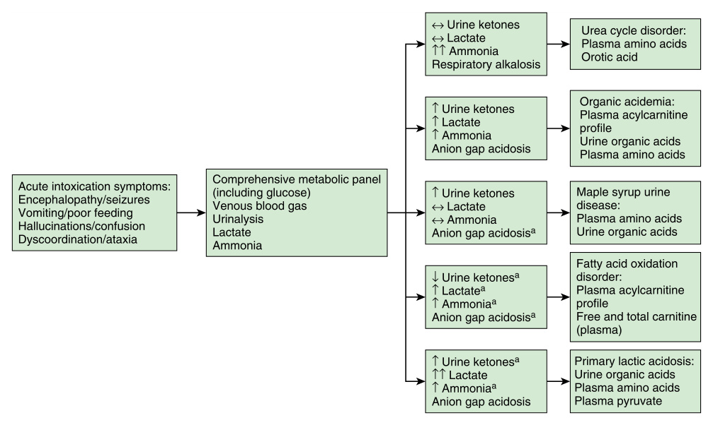

**Fig. 45.1** Flow diagram describing the interpretation of basic, widely available laboratory findings in the setting of a metabolic emergency. The presence of symptoms of acute intoxication should prompt obtaining these labs. Findings should prompt further investigation using specialty biochemical labs to aid in the diagnosis of the inborn error of metabolism.a Variable based on age and/or severity. (From Baker PR II. Recognizing and managing a metabolic crisis. _Pediatr Clin N Am_ . 2023;70:979-993 [Fig. 1, p. 981].) 

amounts of bone marrow suppression based on the underlying pathology. This initial assessment is available at most hospitals and can help narrow the diagnosis (Fig. 45.1). While various specialized testing, which may include DNA testing, is often needed to confirm a diagnosis of an IEM, specialized tests are often time-consuming and not always immediately available for the initial management. 

A basic metabolic panel and a blood gas assessment with a plasma lactate level provides information about the acid-base status of the patient. In particular, patients with urea cycle defects (UCD) are typically alkalotic, whereas patients with organic acidopathies are typically acidotic. An ammonia can provide further information as to the initial management of the patient as well as a clue to diagnosis. While both organic acidopathies (acidotic) and UCD (alkalotic) can present with varying degrees of hyperammonemia, one distinguishing factor may be the relative concentration of ammonia. UCDs present with greater than 500 micromole/liter ammonia at initial presentation, whereas organic acidopathies may present with lower levels. The blood urea nitrogen is often low in the setting of a UCD but may be normal in an organic acidopathy. A urinalysis can be used to evaluate the severity of ketosis which can, with lactate and glucose levels, provide insight into the type of IEM. Increases in serum lactate, even in the metabolically stable patient, may suggest that oxidative phosphorylation and energy 

metabolism are disturbed; this may indicate the need for additional management. It should be noted that while the normal infant has a low level of physiological ketosis, it may be below the limits of detection on a urinalysis. Infants with measurable ketones in the urine should raise suspicion for a metabolic derangement (organic acid disorders, glycogen storage disease, diabetes, disorders of ketone utilization). 

The absence of ketonuria might suggest fatty acid oxidation defect. Hypoglycemia can provide a clue to glucose dysregulation which is a common finding in IEMs. 

It must be emphasized that these initial assessments are neither diagnostic nor sufficient to exclude a disorder. While organic acidopathies typically present with acidosis, ammonia, which is often elevated in these disorders, can directly stimulate the respiratory center and result in a mixed metabolic acidosis and respiratory alkalosis. Occasionally, an organic acidopathy can present with an elevated ammonia similar to what is seen in a UCD. _The patient in crisis must be managed in the acute setting regardless of the underlying diagnosis._ 

Confirmatory diagnosis is typically made using biochemical methods through a combination of amino acids from plasma, urine, and/or cerebrospinal fluid, urine organic acids, plasma acylcarnitines, and/or DNA analysis, all of which often take time to result. While for many IEMs, diagnosis can be made using biochemical analysis alone,

<!-- p.1016 -->

genetic testing can be invaluable for a number of situations including an uncertain diagnosis, identification of at-risk family members, and inheritance and recurrence risks. 

Treatment for the acute metabolic crisis typically includes a combination of substrate reducing therapy and, importantly, reversing further catabolism with the administration of dextrose containing fluids. Avoidance of offending substances, usually through halting enteral feeds, for no more than 24–48 hours, is a mechanism to reduce sources of toxic metabolites. The need to restart enteral feeds or provide alternate nutrition after 24–48 hours is warranted 

because the body will begin alternate forms of catabolism after this time in an attempt to obtain essential metabolites. Various modalities of ammonia scavenger therapy may be required. The patient presenting with severe hyperammonemia or concern for excessive elevations in toxic metabolites may require dialysis to accelerate clearance. 

Although neonatal onset of a metabolic crisis is most common, some patients present with recurrent episodes later in infancy, during childhood, or during adulthood. These late-onset patients usually have some amount of residual enzyme activity; however, activity levels may not correlate well with disease severity. 

#### **TABLE 45.1 Diagnostic Approach to Recurrent Attacks of Coma and Vomiting With Lethargy** 

|Clinical Presentation|Laboratory Studies|Other Features|Most Frequent Diagnosis (Disorder/Enzyme Deficiency)|Differential Diagnosis|
|---|---|---|---|---|
|Metabolic coma (without|Acidosis (metabolic; pH<7.20*, HCO3 <10 mmol, Pco2|With ketosis|Organic acidurias*, MSUD* MCD*, PC, RCD|Diabetes Intoxication Encephalitis|
|focal neuroloical|<25 mm)||Ketolysis defects*, MCT1*||
|g signs)|||Gluconeogenesis defects*||
||||CAVA defect*||
||||TANGO II*||
||With or without |Without |PDH*, ketogenesis defects*||
||hyperammonemia (NH3 >100|ketosis|FAO*, FDP*, EPEMA||
||μmol/L)||Riboflavin transporter*||
||Hyperammonemia (NH3 >100 μmol/L)|Normal glucose|Urea cycle defects* Triple H*, LPI*|Reye syndrome Encephalitis Intoxication|
||Respiratory alkalosis |Hypoglycemia|TANGO II*||
||(pH>7.45, Pco2 <25)||FAO (MCAD)*||
||||HMG-CoA lyase*||
||Hypoglycemia (<2 mmol/L)|Acidosis|Gluconeogenesis defects* MSUD* (ketosis+) HMG-CoA lyase*|Drugs and toxin FAO*(ketosis−) Ketotic hypoglycemia Adrenal insufficiency GH deficiency Hypopituitarism|
||Hyperlactatemia |Normal glucose|PC, MCD*, Krebs cycle||
||(>4 mmol/L)||Respiratory chain||
||||PDH* (without ketosis)||
||||EPEMA syndrome||
|||Hypoglycemia|Gluconeogenesis defects* (ketosis variable)||
||||FAO*(moderate hyperlactatemia, no ketosis) TANGO II||

_(Continued)_

<!-- p.1017 -->

#### **TABLE 45.1** Diagnos tic Approach to Rec urrent Attacks of Coma and Vomiting With Lethar gy—cont’d

|Clinical Presentation|Laboratory Studies|Other Features|Most Frequent Diagnosis (Disorder/Enzyme Deficiency)|Differential Diagnosis|
|---|---|---|---|---|
|Neurological coma (with focal signs, |Biological signs are very variable, can be absent or |Cerebral edema|MSUD*, OTC*|Cerebral tumor Migraine Encephalitis|
|seizures, or intracranial hypertension)|moderate; see “Metabolic coma”|Hemiplegia (hemianopsia)|MSUD*, OTC*, MMA*, PA*, PGK|Moyamoya syndrome|
|||Extrapyramidal signs|MMA*, GA I*, Wilson’s disease*|Homocystinuria Vascular hemiplegia|
|||Basal ganglia necrosis|BBGD (caudate and putamen necrosis)* Leigh syndrome*|Cerebral thrombophlebitis Infectious acute necrotizing encephalitis|
|||Stroke and stroke-like symptoms|UCD*, MMA*, PA*, IVA* Respiratory chain (MELAS) Homocystinurias* CDG syndrome Thiamine-responsive megaloblastic anemia* Fabry*(rarely presenting sign) Maltase acid (rare) GLUT 10|Cerebral tumor Reye syndrome|
|||RECA (some of them develop generalized dystonia)|ATP1A3||
||Abnormal coagulation|Thromboembolic accidents|Homocystinurias (all kinds)*||
||Hemolytic anemia||CDG, PGK||
|Hepatic coma (hepatomegaly cytolysis or liver failure)|Normal bilirubin Slight elevation of transaminases|Steatosis and fibrosis|FAO*, UCD*|Hepatitis Reye syndrome|
|Reye-like |Hyperlactatemia|Liver failure|Respiratory chain defects||
|syndrome|Hemolytic jaundice|Cirrhosis|Wilson disease* Manganese transporter deficiency*||
||Hypoglycemia|Exudative enteropathy|Hepatic fibrosis with enteropathy (CDG Ib)*||

_*_ Treatable disorders. 

_BBGD,_ Biotin-responsive basal ganglia disease also known as biotin-thiamine-responsive basal ganglia disease; _CDG,_ carbohydrate-deficient glycoprotein syndrome; _EPEMA,_ encephalopathy, petechiae, ethylmalonic aciduria syndrome; _FAO,_ fatty acid oxidation; _FDP,_ fructose 1-6 diphosphatase; _GA,_ glutaric aciduria; _GH,_ growth hormone; _GLUT 10,_ Glucose transporter 10; _HMG-CoA,_ 3-hydroxy-3-methylglutaryl coenzyme A; _IVA,_ isovaleric acidemia; _LPI,_ lysinuric protein intolerance; _MCD,_ multiple carboxylase deficiency; _MCT,_ monocarboxylic acid transporter; _MELAS,_ mitochondrial encephalopathy lactic acidosis strokelike episodes; _MMA,_ methylmalonic acidemia; _MSUD,_ maple syrup urine disease; _OTC,_ ornithine transcarbamylase; _PA,_ propionic acidemia; _PC,_ pyruvate carboxylase; _PDH,_ pyruvate dehydrogenase; _PGK,_ phosphoglycerate kinase; _RCD,_ respiratory-chain defects; _RECA,_ relapsing encephalopathy with cerebellar ataxia; _TANGO II,_ transport and Golgi organization 2; _UCD,_ urea cycle disorders. 

From Saudubray JM, Garcia-Cazorla A. Inborn errors of metabolism overview: pathophysiology, manifestations, evaluation, and management. _Pediatr Clin North Am_ . 2018;65:179-208 (Table 5, pp. 196–198).

<!-- p.1018 -->

#### **TABLE Select Inborn Errors of Metabolism 45.2 Associated With Neurological and Laboratory Manifestations in Neonates** 

##### **Deterioration in Consciousness** 

Metabolic acidosis Organic acidemias Disorders of pyruvate metabolism Fatty acid oxidation defects Fructose-1,6-bisphosphatase deficiency Glycogen storage diseases Mitochondrial respiratory chain defects Disorders of ketone metabolism 

##### **Hypoglycemia** 

Fatty acid oxidation defects Disorders of gluconeogenesis Disorders of fructose and galactose metabolism Glycogen storage diseases Disorders of ketogenesis Organic acidemias Hyperinsulinemic hypoglycemias Mitochondrial respiratory chain defects Neonatal intrahepatic cholestasis caused by citrin deficiency Disorders of pyruvate metabolism Carbonic anhydrase VA deficiency 

##### **Hyperammonemia** 

Urea cycle disorders Organic acidemias Fatty acid oxidation disorders Disorders of pyruvate metabolism _GLUD1_ -related hyperinsulinemic hypoglycemia Carbonic anhydrase VA deficiency 

##### **Seizures and Hypotonia** 

Antiquitin deficiency (pyridoxine-dependent epilepsy) Pyridoxamine 5′-phosphate oxidase (PNPO) deficiency (pyridoxal phosphate-responsive epilepsy) Folate metabolism disorders Multiple carboxylase deficiency (holocarboxylase synthetase deficiency and biotinidase deficiency) Urea cycle disorders Organic acidemias Fatty acid oxidation disorders Disorders of creatine biosynthesis and transport Disorders of neurotransmitter metabolism Molybdenum cofactor deficiency and sulfite oxidase deficiency Serine deficiency disorders Glycine encephalopathy Asparagine synthetase deficiency Mitochondrial respiratory chain defects Zellweger spectrum disorders Congenital disorders of glycosylation Purine and pyrimidine metabolism defects 

##### **Neonatal Apnea** 

Glycine encephalopathy Asparagine synthetase deficiency Urea cycle disorders Organic acidemias Disorders of pyruvate metabolism Fatty acid oxidation defects Mitochondrial respiratory chain defects 

From Shchelochkov OA, Venditti CP. An approach to inborn errors of metabolism. In: Kliegman RM, et al., eds. _Nelson Textbook of Pediatrics_ . 22nd ed. Philadelphia: Elsevier; 2025 (Table 104.3, pp. 805–806). 

Specific stressors seen in the older age groups may result in the onset of an acute metabolic crisis in a previously well patient. Various fad or elimination diets, or a new medication, may disrupt a patient’s metabolism, resulting in crisis. In addition, labor and delivery are stressors for not only the newborn with a possible IEM but also separately, for a mother who may have been asymptomatic up to that point. Factors that may point to an undiagnosed IEM include _recurrent_ decompensation episodes in the setting of metabolic stressor(s), intermittent and recurrent unexplained symptoms of pain or gastrointestinal upset, or a family history of _consanguinity_ or of a _sibling with a death_ attributed to either sepsis without an identified organism, organ failure, or an unknown cause. Review of the sibling’s clinical records and/or autopsy report when available can aid in the diagnosis. IEMs must always remain on the differential diagnosis for any patient presenting with _growth faltering_ not responsive to standard therapy, a patient with _alteration in mentation_ with unexplained or unexpected abnormalities on assessment, especially in the setting of a stressor, and in the patient with _avoidances/aversions_ of a specific food group, especially with reports of a temporal association of symptoms with mealtime. 

## **Organic Acidopathies** 

Organic acidopathies are disorders that involve altered fatty acid and amino acid metabolism which result in accumulation of toxic metabolites. There are characteristic patterns of accumulation or deficiency of organic acid metabolites, in plasma and urine, that can lead to a biochemical diagnosis. The accumulation of toxic metabolites is rarely limited to one bodily fluid given the whole-body presence of the metabolic defect. 

Among the organic acidopathies, there is a chronic progressive form of disease that may present with persistent anorexia, chronic vomiting, and aversion to protein-rich foods with growth faltering that may be misdiagnosed as various gastrointestinal disorders and may lead to delays in therapy until a more severe metabolic crisis occurs. _Pancreatitis_ of unknown etiology may be the presenting symptom in some patients. 

Acute management of the metabolically decompensating patient with a suspected or confirmed _organic acidopathy_ is initially similar regardless of the underlying defect and includes reversal of catabolism through cessation of all protein sources for a maximum of 24–48 hours and supplementation with non-protein calories. Therapy also involves the initiation or an increased dose of carnitine supplementation to promote urinary excretion of metabolites and replace any carnitine deficiency. While conjugation of organic acids to carnitine is for the purposes of increased urinary excretion of toxic metabolites, biochemical detection of the various _acylcarnitines_ , which may be diagnostic, is typically conducted on plasma. Carnitine does not significantly impact the neurological sequelae in most organic acidopathies. Long term dietary management and avoidance therapy is based on the specific defect.

<!-- p.1019 -->

### **Propionic Acidemia** 

Propionic acidemia (PA) is an autosomal recessive disorder of propionyl-CoA metabolism that results in the accumulation of toxic compounds due to defects in propionyl-CoA carboxylase (Fig. 45.2), encoded by the genes _PCCA_ and _PCCB_ . Incidence is ~1:50,000, making it one of the most frequently diagnosed organic acidopathies. 

Propionyl-CoA carboxylase enzyme activity is present in most tissues, including the brain. It is unknown whether prenatal neurological development is affected by accumulation of toxic metabolites, although metabolites have been shown to be present in amniotic fluid and the transplacental 

gradient of amino acids is toward the fetus. Brain metabolite concentrations are more severely altered during episodes of metabolic decompensation, due to propionate, an oddchain fatty acid precursor of propionyl-CoA that can freely enter the brain or because locally synthesized toxic metabolites cannot easily leave through the blood brain barrier. 

Expected MRI and MRS findings are shown in Figure 45.3. Autopsies of patients who died during a metabolic crisis show hypoxic-ischemic encephalopathic changes secondary to altered energy metabolism and deficient response to oxidative stress. 

Patients have accumulation of the diagnostic metabolites propionate, 3-hydroxypropionate, methylcitrate, propionylglycine, 

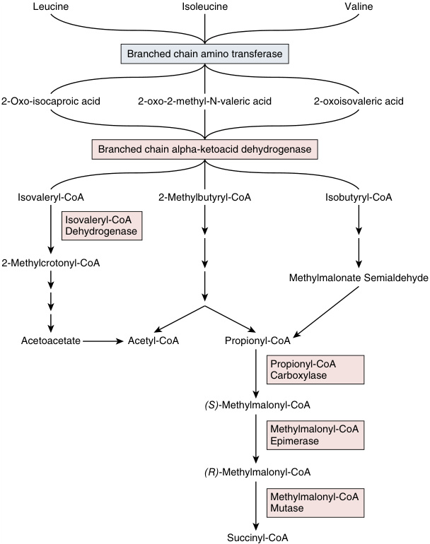

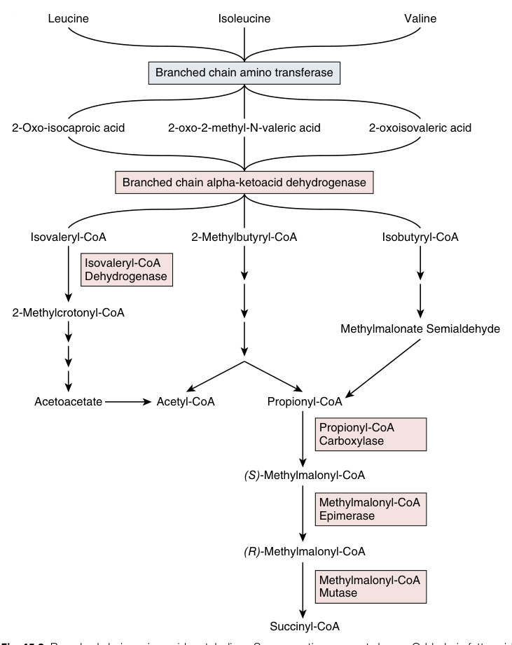

**Fig. 45.2** Branched chain amino acid metabolism. Some reactions are not shown. Odd-chain fatty acids (i.e., propionate), threonine, and methionine also are catabolized to propionyl-CoA via alternate pathways. Branched chain amino transferase (blue box) has not been officially attributed to disease. Enzymes in red boxes are related to disease. Branched chain alpha-ketoacid dehydrogenase is a shared enzyme that metabolizes the three essential branched chain amino acids, leucine, isoleucine, and valine. Leucine is further metabolized via a pathway involving the enzyme responsible for IVA, isovaleryl-CoA dehydrogenase. Isoleucine and valine have a shared catabolic pathway involving the enzymes related to PA, propionyl-CoA carboxylase and MMA, methylmalonyl-CoA epimerase and mutase.

<!-- p.1020 -->

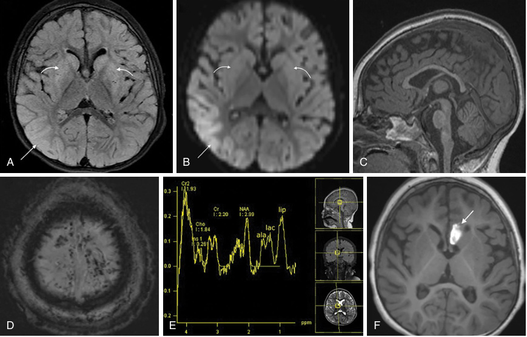

**Fig. 45.3** Axial T2 FLAIR (A) and axial DWI (B) from a 2-year-old with proprionic acidemia demonstrate disparate lesions from acute on subacute metabolic injury with subacute striatal edema showing T2 FLAIR hyperintensity ( _curved arrows_ , A) without reduced diffusion ( _curved arrows_ , B) and acute right occipitotemporal cortical cytotoxic edema showing T2 FLAIR hyperintensity ( _straight arrow_ , A) and reduced diffusion ( _straight arrow_ , B). Sagittal midline T1WI (C) shows generalized mild parenchymal volume loss. Axial susceptibility weighted image (D) through the vertex demonstrates multifocal punctate hypointense foci from microhemorrhages along the brain surface. Though artifact is present, single voxel MRS over the right basal ganglia (E) (TR 1800 msec, TE 20 msec) reveals elevated lipid (lip) indicating cellular disruption, moderate lactate (lac) from anaerobiosis, alanine (ala) from insufficient Krebs cycle activity, and reduced N-acetylaspartate (NAA) from neuronal loss, reduced neuronal-axonal integrity, and/or decreased mitochondrial production. Axial T1WI (F) 5 days later shows interval development of a subacute hemorrhage in the left anterior cingulate gyrus/septal region _(arrow)_ . 

and tiglylglycine on a urine organic acid analysis and separately propionylcarnitine on a plasma acylcarnitine analysis. Glycine, detected on a plasma amino acid analysis, is also variably elevated due to inhibition of the glycine cleavage system. Glucose is variably affected, and lactic acidosis is typically only seen during a crisis. Hyperammonemia is due to inhibition by various toxic metabolites on carbamoyl phosphate synthetase I (CPS1), a urea cycle enzyme; hyperammonemia is commonly found prior to treatment. The frequency of metabolic decompensations is typically highest in the first year of life, when the infant is unable to tolerate even small periods of fasting; ~95% of patients presenting with an acute metabolic decompensation have hyperammonemia on admission. 

Most patients present shortly after birth and if treatment is not initiated, they will develop a metabolic crisis within the first 8 days of life. _These patients can also present with pancytopenia (neutropenia, thrombocytopenia, and/or anemia), which may be confused with sepsis._ The vast 

majority of patients will present within the first 90 days of life; there is a spectrum of disease and patients may present with symptoms at any age. Symptoms of an acute crisis include lethargy, emesis, and metabolic stroke-like episodes characterized by the presence of vegetative symptoms such as low body temperature, lethargy, and bradycardia. 

Characteristic neurological findings in PA include motor function delays, spasticity, hemiplegia, hypotonia, and ataxia, with findings of basal ganglia necrosis. ADHD and attention difficulties are often seen and may be refractory to stimulant medications. In some patients with late-onset PA, development may be normal or minimally affected. Patients can also present with seizures which may be generalized or myoclonic in early childhood but progress to mild generalized or absence seizures in later childhood. Cardiomyopathy and prolonged QTc are complications seen in PA more so than other organic acidopathies and can lead to sudden death. 

Treatment strategies involve a strict low-protein diet to avoid the amino acids that result in accumulation of

<!-- p.1021 -->

propionyl-CoA, specifically isoleucine, valine, threonine, and methionine. Patients usually also require nocturnal feedings to prevent fasting overnight. Dietary modification does not completely prevent disease because there is an obligate amino acid catabolism requirement, supplementation with carnitine allows for the conversion of propionyl-CoA to the renally excreted propionylcarnitine. Regulating ammonia is also important and the use of the synthetic activator N-carbamylglutamate to promote CPS1 activity has been successful in patients. 

Periodic treatment with antibiotics is occasionally used, typically metronidazole, to minimize propionate producing intestinal microflora, another source of free propionate. Orthotopic liver transplant improves the severity of disease and may prolong survival, though it is not a curative measure due to local CNS metabolism and metabolite trapping by the blood-brain barrier. Transplant may only delay the neurological deterioration, shifting from a series of acute stepwise declines to a chronic insidious progression. Even in the presence of optimal management, chronic neurological complications can occur, including spastic quadriplegia and athetosis. Additionally, neurological symptoms can develop independent of a documented metabolic crisis, though there is a significant relationship between the number of metabolic crises and the patients neurological development and IQ. Assessments of patients with PA have shown that a majority had delays in gross motor, fine motor, and/or language development. PA patients were observed to be the most neurologically affected of the organic acidopathies. 

### **Methylmalonic Acidemia** 

Methylmalonic acidemia (MMA) is characterized by defective conversion of methylmalonyl-CoA to succinylCoA (Fig. 45.2), due to a defect of the enzymes in the pathway. MMA is autosomal recessive, caused by pathogenic variants in one of several genes, _MMUT, MMAA, MMAB, MCEE,_ and _MMADHC_ . MMA has an incidence of approximately 1:50,000. 

Two distinct enzymes are directly responsible for conversion of methylmalonyl-CoA to succinyl-CoA; either can cause disease. Methylmalonyl-CoA epimerase, encoded by _MCEE_ , catalyzes the racemization of S-methylmalonyl-CoA to R-methylmalonyl-CoA, and accounts for approximately 2% of all cases. Methylmalonyl-CoA mutase, encoded by _MMUT_ , catalyzes the isomerization of R-methylmalonylCoA to succinyl-CoA, and accounts for the majority of MMA. Patients with MMA from a defect in methylmalonylCoA mutase are further characterized as having either a _partial_ deficiency, _mut_− , or _complete_ deficiency¸ _mut__0_ ; clinically significant disease has been observed with up to 75% enzyme function. MMA may be due to defects involved in the synthesis or transport of **cobalamin/ vitamin B12** , the cofactor for methylmalonyl mutase, which involves _MMAA, MMAB,_ and _MMADHC;_ and combined they account for less than 40% of all patients with MMA. 

There is significant clinical overlap with PA because the enzymes causing MMA are the immediate next steps in the shared pathway. Cardiomyopathy is less common in MMA than in PA. The optic nerve is more susceptible to injury resulting in atrophy and blindness in patients with MMA. Renal tubular acidosis is a distinct, and occasionally a presenting symptom in patients with MMA; it may progress to chronic renal failure. Similar to PA, patients continue to develop neurological injury despite successful dietary modification and/or liver transplant. In addition to the basal ganglia being highly susceptible to injury, the globus pallidus and substantia nigra are also frequently affected in patients with MMA. Altered myelination, cortical and/or subcortical changes, and metabolic changes are commonly documented on neuroimaging in patients with MMA (Fig. 45.4). Processing speed is disproportionately affected compared to other areas of delay in MMA. 

Because MMA is also a disorder of propionyl-CoA metabolism, most of the precursor metabolites that accumulate in PA also accumulate in MMA with the notable addition of methylmalonate. Similarly, treatment and outcomes do not differ greatly from PA; a trial of cobalamin supplementation to test for patient responsiveness is a specific recommendation. 

### **Isovaleric Acidemia** 

Isovaleric acidemia (IVA) is an autosomal recessive disorder resulting from a defect in leucine metabolism, specifically a deficiency of isovaleryl-CoA dehydrogenase, encoded by the gene _IVD_ , which converts isovaleryl-CoA to methylcrotonyl-CoA (Fig. 45.2). Incidence is ~1:159,000. 

The majority of patients present within the first year of life. Neonatal presentation involves a metabolic crisis with emesis, failure to thrive, and hypothermia and lethargy that may progress to coma. Acutely decompensating patients are said to have a smell like “dirty socks” or “sweaty feet.” 

Patients accumulate isovaleric acid in the plasma and excrete isovalerylcarnitine, detectable on a plasma acylcarnitine profile, and isovalerylglycine and 3-hydroxyisovaleric acid in the urine, both of which can be detected in urine organic acid profiles. Leucine is not elevated, even in untreated patients, secondary to an irreversible step that occurs proximal to the deficiency. Ammonia is elevated in crises, which is thought to be secondary to inhibition of the proximal portion of the urea cycle. With the implementation of newborn screening, there is also a _biochemical-only_ phenotype, or patients with biochemically defined isovaleric acidemia but no clinical symptoms. 

IVA is associated with cerebral edema, cerebellar hemorrhage with transtentorial herniation, and abnormal myelination (Fig. 45.5). The globus pallidus is acutely susceptible to injury. Thinning of the corpus callosum is also seen. Despite the risks of profound neurological injury, IVA is the least neurologically affected of the organic acidopathies; rather than severe neurological dysfunction, patients with IVA typically have an increased incidence of fine motor deficits and/or autism spectrum disorders (ASD).

<!-- p.1022 -->

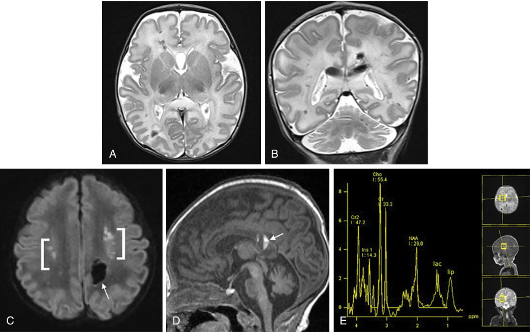

**Fig. 45.4** Axial (A) and coronal (B) T2WI from an 11-day-old with methylmalonic acidemia show multifocal cerebral and cerebellar cortical and white matter lesions representing hemorrhages (hypointense foci) with surrounding edema (hyperintense signal). Axial DWI (C) shows white matter hemorrhage _(arrow)_ and reduced diffusion _(brackets)_ from metabolic and/or ischemic injury in the centrum semiovale. Sagittal midline T1WI (D) shows subacute blood fluid level in the callosal splenium _(arrow)_ and mild vermian volume loss. Single voxel MRS over the right basal ganglia (E) (TR 1800 msec, TE 20 msec) reveals elevated lipid (lip) indicating cellular disruption, moderate lactate (lac) from anaerobiosis, and reduced N-acetylaspartate (NAA) from neuronal loss, reduced neuronal-axonal integrity, and/or decreased mitochondrial production. 

Acute treatment of the decompensated patient with IVA is similar to the standard care of organic acidopathies. Longterm care involves careful protein intake management to support growth while limiting the production of isovalerylCoA as well as management of toxic substrate accumulation using carnitine. Uniquely for IVA, glycine is also given to manage toxic substrate removal; there is no inhibition on the glycine cleavage system. 

### **Glutaric Aciduria Type I** 

Glutaric aciduria type I (GA1) is an autosomal recessive disorder involving a defect in lysine metabolism, specifically decreased activity of glutaryl-CoA dehydrogenase, encoded by _GCDH_ . Incidence is ~1:110,000. 

GA1 presents with elevated glutaric acid, 3-hydroxyglutaric acid, and glutarylcarnitine, which can be diagnostic on assessment of urine organic acid and plasma acylcarnitine assays. Importantly, there are also _low excretors_ , or patients with GA1 who do not have elevated urinary glutaric acid nor glutarylcarnitine. However, even in _low excretors_ , 3-hydroxyglutaric acid is elevated. Unlike other organic 

acidopathies, ketonuria, lactic acidosis, and hyperammonemia are usually _absent_ even during crises. The classic presentation of GA1 manifests primarily as a neurological disorder. 

The first presenting sign is often _macrocephaly_ with an underdeveloped neocortex. There is a well-developed gyral pattern, resulting in diffuse expansion of the CSF space. On imaging (Fig. 45.6), the basal ganglia show involvement with spread of injury from the dorsolateral aspects of the putamen ventromedially, sometimes also with injury to the caudate head and globus pallidus. Volume loss then progresses over weeks to months. The rostrolateral frontal and anterior temporal lobes are hypoplastic. Injury is possibly due to an excitotoxic mechanism by the accumulating metabolites. Because of the relative expansion of CSF space, bridging veins are stretched and at risk of distortion and rupture resulting in **subdural hemorrhage** with minor trauma. Retinal hemorrhage has also been observed and may lead to a misdiagnosis of abusive head trauma. 

Encephalopathic crises typically occur between 3 and 24 months of life as a sudden-onset motor dysfunction with hypotonia, tongue thrusting, dystonia, and/or choreoathetosis.

<!-- p.1023 -->

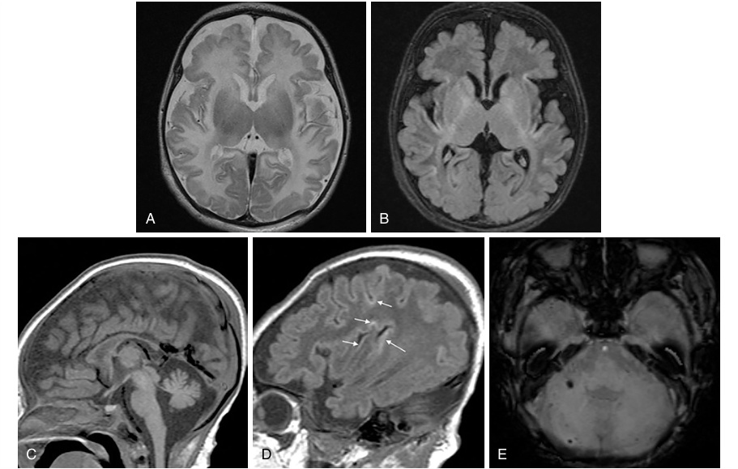

**Fig. 45.5** Axial T2WI (A) and T2 FLAIR (B) from a 19-day-old with isovaleric acidemia demonstrate subacute to chronic metabolic injury with symmetric hyperintense lesions involving the peri-insular and peri-rolandic cortex (A) and excessive white matter signal hyperintensity for age (B); no restricted diffusion was present. Sagittal T1WI through the midline (C) and sylvian fissure (D) depict diffuse mild brain volume loss and laminar necrosis with increased signal in the peri-rolandic and insular cortices ( _arrows_ , D). Axial susceptibility weighted image (E) through the posterior fossa shows multiple hypointense foci in the cerebellum from microhemorrhages. 

A single crisis can result in severe neurological deficits. There is increased concern that the neurological impairments in symptomatic patients are secondary to early encephalopathic crises in infancy which are associated with catabolic stressors. Patients with GA1 are especially susceptible to fever, which can cause a crisis. There may be an insidious onset of symptoms seen in patients without a documented crisis. In these cases, age of onset determines severity. Cognition is typically preserved because the cerebral cortex is usually spared. Some patients may present with a mistaken diagnosis of _progressive cerebral palsy_ . In patients with suspected cerebral palsy or those with severe dystonia _without_ prior risk factors for hypoxic-ischemic injury, especially with disease _progression_ , GA1 must be excluded. 

Acute crises are managed per standard care of organic acidopathies. In patients with GA1, liberal use of antipyretics should also be considered to aggressively manage fever. Long-term treatment includes a lysine-restricted diet and carnitine supplementation; dietary management does not correct existing neurological disease. Even with appropriate therapy some patients develop sequelae. 

## **Urea Cycle Disorders** 

Urea cycle disorders (UCD) are a group of disorders that disrupt nitrogen handling in the body, leading to accumulation of nitrogen as ammonia. Overall, the combined incidence of UCD is ~1:35,000. Proper functioning of the urea cycle is vital because it is the primary mechanism by which surplus nitrogen, from protein catabolism, is detoxified and excreted (Fig. 45.7). UCD is separated into _proximal_ disorders, those affecting enzymes located in the _mitochondria_ , and _distal_ disorders, those affecting enzymes located in the _cytosol_ . The liver is the only organ with every enzyme of the urea cycle and thus liver transplant is a viable treatment modality for many UCD, although neurological sequelae may develop despite therapy. This is likely due to incomplete correction of CSF concentrations of toxic metabolites as a result of compartmentation by the bloodbrain barrier. 

Common across all UCD are elevations in ammonia _and_ glutamine, which are usually more elevated in proximal, as compared to distal, UCD. Hyperammonemia results from

<!-- p.1024 -->

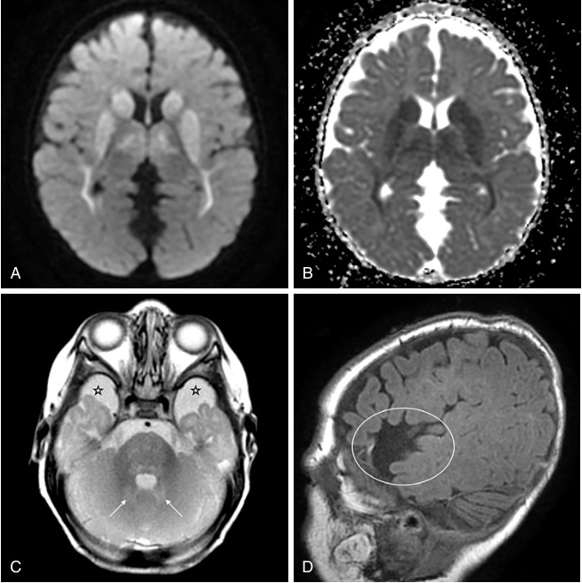

**Fig. 45.6** Seven-month-old with glutaric aciduria type 1. (A) Axial DWI and (B) ADC map show signal abnormality with reduced diffusion in the basal ganglia, thalami, and sagittal stratum indicating metabolic injury. (C) T2WI showing abnormal signal in the cerebellar deep gray nuclei _(arrows)_ and structural abnormalities including temporopolar fluid space enlargement _(stars)_ . (D) T1WI showing under-opercularization. 

direct accumulation due to an inability to detoxify and excrete nitrogen even when the body continues the catabolism of protein. Glutamine accumulation is secondary to ammonia accumulation because this metabolite acts as a nitrogen sink. Glutamine is independently toxic in high concentrations, causing osmotic effects contributing to brain edema. Conversion of glutamine and glutamate via the glutamine-glutamate-GABA shuttle protects glutamate in the synapse from causing neuroexcitability. Prolonged hyperammonemia can result in selective brain injury, which is age of onset dependent. In the neonatal period, there is deep gray matter injury. For late-onset patients, the insula cortex may be the first area involved with changes in T2 signal on MRI. Duration of hyperammonemia impacts the degree of acute and long-term neurological sequelae as well as the degree of encephalopathy, energy deficits, and dysregulation of neurotransmitter concentration and function. Seizures may be seen in acute decompensation and 

may be subclinical. Some patients with UCD may develop epilepsy. 

Treatment is largely standard across UCD and therapy involves the use of _nitrogen scavengers_ such as compounds containing phenylbutyrate, phenylacetate, and/or benzoate, an example of which can be seen in Figure 45.7. Depending on disease and severity, supplementation with arginine and/ or citrulline may be used. Dietary protein restriction is often implemented to limit exogenous nitrogen. Because the recommended daily allowance (RDA) for dietary protein is higher than the minimum needed for survival, patients can receive less than the RDA of protein leading to growth delays. Lactulose has been used to increase intestinal excretion of ammonia; antibiotic use can inhibit intestinal microflora to reduce intestinal ammonia production. For patients with epilepsy, the use of certain antiseizure medications, including phenobarbital, valproate, carbamazepine, and phenytoin, should be evaluated on a

<!-- p.1025 -->

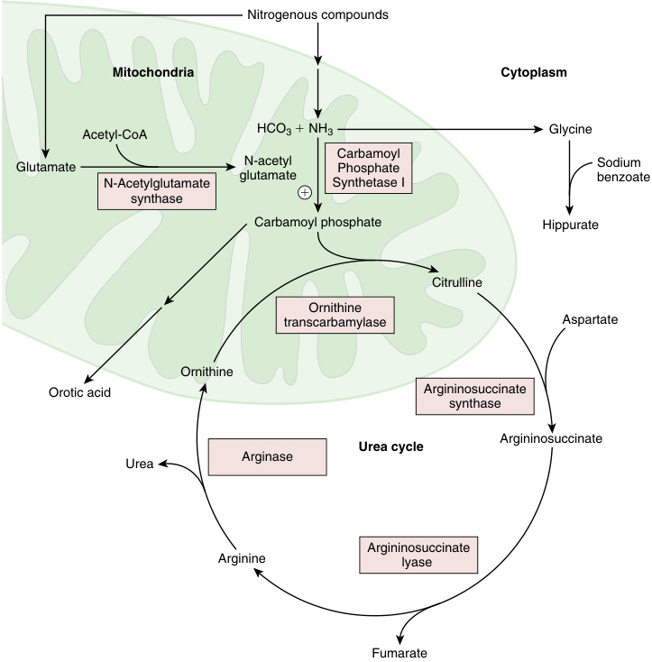

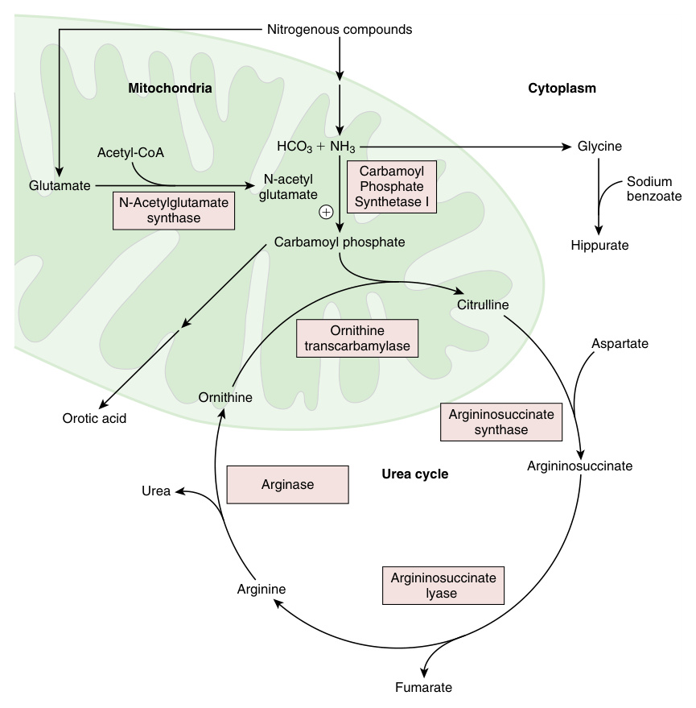

**Fig. 45.7** The urea cycle. Nitrogenous compounds include: ammonia, glutamine, alanine, and aspartate. N-acetylglutamate stimulates CPS1 (circled plus sign). Ornithine and citrulline cross the mitochondrial matrix via 1:1 exchange through the ornithine transporter protein. CPS1, n-acetylglutamate synthase, and OTC are all mitochondrially located (proximal UCDs). ASS, ASL, and arginase are all cytoplasmically located (distal UCDs). 

case-by-case basis because they increase the risk of hyperammonemic crisis. The differential diagnosis of hyperammonemia is noted in Table 45.2. 

### **Carbamoyl Phosphate Synthetase I** 

Carbamoyl phosphate synthetase I (CPS1), encoded by _CPS1_ , is the first enzyme of the urea cycle and forms carbamoyl phosphate from bicarbonate and ammonia. CPS1 deficiency is a rare autosomal recessive disorder with an incidence of ~1:1.3 million; because patients may die without diagnosis, it may be underdiagnosed. Specifically neonatal crisis includes emesis, lethargy, and encephalopathy that may progress to coma and death in severe disease; there is a spectrum of disease. Some patients can present with symptoms as late as adulthood with psychosis from 

acute onset of hyperammonemic crises, commonly presenting as agitation, excitability and insomnia, and aggression. Because these neurodevelopmental symptoms may be the presenting symptoms in late-onset disease, patients may be misdiagnosed with personality disorders and/or learning deficits, leading to delays in treatment. 

Patients can develop cerebral edema and subarachnoid and/or subdural hemorrhages, especially with severe hyperammonemia. MRI can show cerebral involvement most prominent in the white matter, putamen, and caudate head (Fig. 45.8). Ventriculomegaly can develop, likely secondarily to cerebral atrophy. Patients can also develop intellectual and developmental delays, most prominently motor deficits. Learning deficits range from severe academic difficulty even in the absence of hyperammonemic crises to normal academic performance. Seizures are another

<!-- p.1026 -->

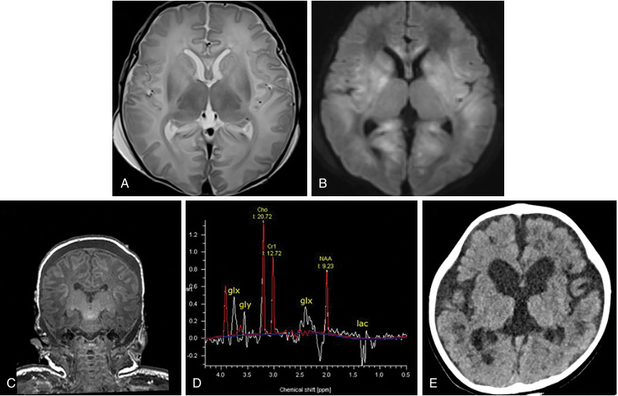

**Fig. 45.8** Axial T2WI (A) and DWI (B) from an 11-day-old with carbamoyl phosphate synthetase 1 deficiency showing acute severe hyperammonemic injury with increased signal and reduced diffusion involving the basal ganglia (globus pallidus > putamen > caudate), capsules, sagittal stratum, and large areas of the cerebral cortex, most severe in the peri-insular and peri-rolandic regions. Vasogenic edema is present throughout the cerebral white matter with T2 prolongation and facilitated diffusion. Coronal T1WI (C) show widespread laminar necrosis in development with increased signal in the peri-rolandic and peri-insular cortex bilaterally. Most of the thalami is spared, including the ventrolateral thalamus (typically affected in profound hypoxicischemic injury). Single voxel MRS over the right basal ganglia (D) (TR 1800 msec, TE 135 msec) reveals moderate lactate (lac) and glycine (gly) from anaerobiosis, elevated glutamine and glutamate (glx) reflecting hyperammonemia and excitotoxicity, and reduced N-acetylaspartate (NAA) from neuronal loss, reduced neuronal-axonal integrity, and/or decreased mitochondrial production. Axial CT (E) 7 months later shows extensive cerebral atrophy and ex vacuo ventriculomegaly. 

complication. Chronic sleep disorders and long-term changes in behavior, most commonly aggression, have been seen. CPS1 deficiency patients tend to have the most severe symptoms of all UCD. Gene editing with CRISPR technology has been successful in the short-term for one patient. 

Patients with a metabolic crisis present with elevated ammonia and glutamine with decreased citrulline and arginine on plasma amino acid analysis. The absence of carbamoyl phosphate prevents the production of **orotic acid** , which is found variably elevated in the UCD other than to CPS1. The presence or absence of orotic acid is a common diagnostic tool in UCD. 

Treatment of both acute and chronic exacerbations is per standard care of UCD. 

## **N-Acetylglutamate Synthase Deficiency** 

N-acetylglutamate synthase (NAGS) deficiency is an autosomal recessive disorder, caused by a deficiency in NAGS 

encoded by _NAGS_ . NAGS deficiency is the rarest of the UCDs with an incidence of ~1:2 million. 

This enzyme forms N-acetylglutamate, an activator necessary for CPS1 to function; therefore the presentation of NAGS deficiency is largely identical to CPS1 deficiency. It is, however, important to distinguish NAGS deficiency from CPS1 deficiency, usually via genetic analysis, because unlike CPS1 deficiency, NAGS deficiency can be successfully treated with N-carbamylglutamate, an N-acetylglutamate analog which rescues CPS1 activity. 

## **Ornithine Transcarbamylase Deficiency** 

Ornithine transcarbamylase (OTC) deficiency is an X-linked disorder affecting the ability of OTC, the second enzyme in the urea cycle, encoded by _OTC_ , to metabolize carbamoyl phosphate and ornithine to citrulline. It is the most common UCD with an incidence of 1:56,500.

<!-- p.1027 -->

Presentation and onset of disease is variable. **Males** are hemizygous and usually present in the neonatal or infancy period. **Females** are typically heterozygous and may present at any age, usually secondary to a catabolic stressor; severity predictions are nearly impossible due to random X-inactivation. 

Patients present with hyperammonemia, elevated glutamine, and decreased arginine and citrulline, which can be seen on a plasma amino acid profile. Ornithine levels may be normal, but high orotic acid is characteristically found in OTC deficiency. 

Patients in a hyperammonemic crisis can display irritability, behavior changes, psychosis, emesis, and lethargy that may progress to coma. Behavior changes, such as ADHD, self-injury, and/or psychosis may be the presenting symptom in some older patients, especially in heterozygous females. Other sequelae include seizures, dystonia, spasticity, intellectual delays, and a range of developmental defects, from global delay to delays in specific domains. Learning deficits, such as dyslexia, and deficits in executive function are common. 

Neuroimaging findings in neonatal onset are shown in Figure 45.9. MRI may demonstrate cortical atrophy, ventriculomegaly, decreased myelination, and cystic changes with cavitation in the white matter. Late-onset disease may initially show a normal MRI with later T2 weighted signal changes in the insula cortex. MR spectroscopy in neonatal and late-onset disease may show elevations of glutamine and decreased myoinositol, and with prolonged disease and repeated hyperammonemic episodes, decreased choline (Fig. 45.10). 

Treatment is per standard care of patients with UCD including limitation of protein and nitrogen scavenger therapy. Some patients with late-onset OTC deficiency 

self-select to adhere to a vegetarian diet even before official diagnosis because of headaches and pain associated with protein intake. 

## **Argininosuccinate Synthase Deficiency** 

Argininosuccinate synthase (ASS) deficiency, also known as citrullinemia type I, is autosomal recessive disorder due to a deficiency of ASS, encoded by _ASS1_ . It is the third enzyme in the urea cycle and the first of the proximal UCDs. Incidence is ~1:250,000. 

There is a spectrum of disease from neonatal to adult onset. Patients can present with lethargy, failure to thrive, seizure, and coma. Cataracts have also been observed. Hyperammonemic crises usually present after catabolic stressors; the initial, usually severe, hyperammonemic crisis often results in cerebral edema and is thought to be a major contributor to the resulting neurological impairment. Imaging can show lesions in the thalamus, corpus callosum, and basal ganglia. Cerebral volume loss has also been seen (Fig. 45.11). EEG changes are usually nonspecific but typically show slowing. 

Intellectual and developmental delays and/or regressions, especially speech deficits, are common; severe delays are more common with neonatal onset of disease. Hyperactivity is a frequent observation. Motor dysfunction, hypotonia, and spasticity are associated with ASS deficiency and may be misdiagnosed as cerebral palsy. Autistic spectrum disorder has been reported in some patients. 

Patients present with decreases in arginine and ornithine and elevations in ammonia, orotic acid, and glutamine. Citrulline is usually markedly elevated; in _biochemical only disease_ , there is elevated citrulline without clinical symptoms. Treatment is similar to other UCDs. 

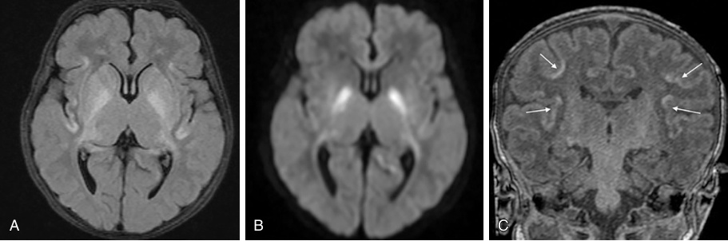

**Fig. 45.9** Axial T2 FLAIR (A) and DWI (B) from a 14-day-old male with ornithing transcarbamylase deficiency demonstrate acute hyperammonemic injury with abnormally increased signal and reduced diffusion involving the basal ganglia (globus pallidus > putamen > caudate), capsules, sagittal stratum, and portions of the cerebral cortex, most pronounced in the peri-insular and peri-rolandic regions. Coronal T1WI (C) show extensive laminar necrosis in development with increased signal involving the peri-rolandic and peri-insular cortex bilaterally _(arrows)_ . Most of the thalami is spared, including the ventrolateral thalamus (typically affected in profound hypoxic-ischemic injury).

<!-- p.1028 -->

### **Metabolic Differences: OTC Symptomatic Subject VS. Age Matched Control in the Parietal White Matter** 

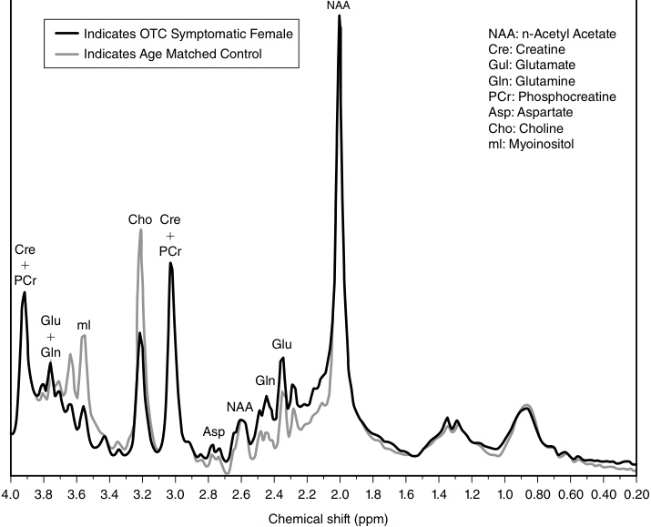

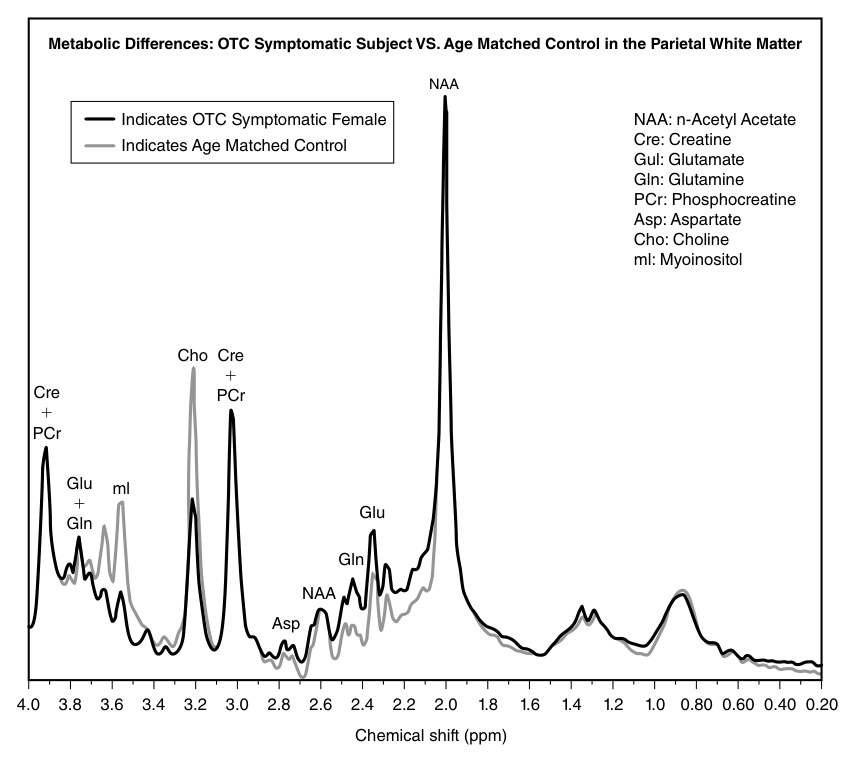

**Fig. 45.10** This overlapping spectrum obtained from the parietal white matter in a subject with ornithine transcarbamylase deficiency and age-matched control illustrates differences in the concentration of several key metabolites. (From Gropman AL, Fricke ST, Seltzer RR, et al: 1H MRS identifies symptomatic and asymptomatic subjects with partial ornithine transcarbamylase deficiency. _Mol Genet Metab_ . 2008;95:21-30 [Fig. 7, p. 29].) 

## **Argininosuccinate Lyase Deficiency** 

Argininosuccinate lyase (ASL) deficiency, also termed argininosuccinic aciduria, is autosomal recessive disorder due to defects in ASL, encoded by _ASL_ . It is the fourth enzyme in the urea cycle. ASL deficiency is the second most common UCD after OTC deficiency, with an estimated incidence of 1:218,750. ASL deficiency results in elevations in argininosuccinate, citrulline, and glutamine, as well as orotic acid and ammonia. Arginine is decreased during metabolic crises. 

ASL deficiency presents with neonatal onset of a hyperammonemic crisis with emesis, lethargy, irritability, and coma; later-onset presentations have been described, usually secondary to catabolic stressors. Hepatomegaly and/or hepatic fibrosis are also commonly associated with disease. In addition to elevated ammonia, argininosuccinate likely has direct neurotoxic effects and has been shown to be elevated multiple times higher in CSF than in plasma. Abnormal movements, ankle clonus, and reflex and tone abnormalities, especially during acute exacerbations, as well 

as cerebellar ataxia have been reported. Patients can have brittle hair, specifically **trichorrhexis nodosa** , which is due to arginine deficient hair follicles and is pathognomonic. ASL is also involved in nitrous oxide formation, which has vasorelaxation activity; patients with ASL deficiency are at increased risk of hypertension. 

Among UCD, patients with ASL deficiency have the highest incidence of neurodevelopmental and intellectual disabilities and can present with increased incidence of autistic spectrum disorder, executive dysfunction, learning and intellectual delays, developmental delays, especially speech delays, and seizures of varying semiology. Expected MRI findings are seen in Figure 45.12. Psychosis and selfinjurious behaviors have also been noted. Intellectual and developmental delays can be observed in the absence of documented hyperammonemia. 

Treatment is per standard care of UCDs with protein restriction and arginine supplementation. Early implementation of dietary modification can decrease the development of intellectual and developmental delays; EEG abnormalities can normalize. Liver transplant can reduce the risk

<!-- p.1029 -->

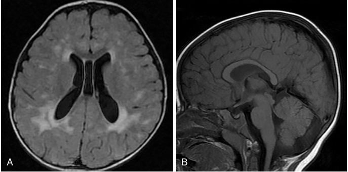

**Fig. 45.11** Axial T2 FLAIR (A) from an 18-month-old with argininosuccinate synthase deficiency shows chronic sequela of prior hyperammonemic injury with multifocal small and confluent hyperintense cerebral white matter lesions, most pronounced in the peri-atrial regions; white matter volume loss shown by mild ex vacuo ventriculomegaly. Sagittal midline T1WI (B) demonstrates mild posterior predominant cerebral white matter volume loss with mild thinning of the posterior body and splenium of the corpus callosum. 

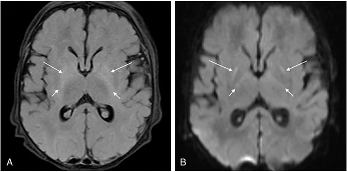

**Fig. 45.12** Axial T2 FLAIR (A) and DWI (B) from a 7-day-old with argininosuccinate lyase deficiency demonstrate abnormally increased signal and reduced diffusion in the globi pallidi ( _long arrows_ , A and B) and posterior limb of the internal capsules ( _short arrows_ , A and B) representing acute hyperammonemic injury/edema. Note sparing of the thalami. 

of hyperammonemia and reduce the need for a proteinrestricted diet, although arginine supplementation is continued in some cases even after transplant. 

## **Arginase Deficiency** 

Arginase, encoded by _ARG1_ , is the final enzyme of the urea cycle, and functions to convert arginine to ornithine and urea, thus completing the detoxification of nitrogen. Arginase deficiency has an estimated incidence of 1:950,000. The neurotoxicity in arginase deficiency is suspected to result from alternate conversion of arginine to nitric 

oxide, a signaling molecule, potent vasodilator, and neurotransmitter, mediated by nitric oxide synthase (NOS). In conditions of hyperargininemia, the increased activation of NOS can lead to a proinflammatory state, causing oxidative damage and nervous system dysfunction. Manifestations of brain injury may also be attributed to the increased generation of guanidino compounds from arginine. 

Arginine, citrulline, and orotic acid are elevated and ornithine is decreased. Ammonia is variably elevated, usually in the newborn period, but can be elevated during crisis at later ages. Metabolite concentrations do not correlate well with disease severity.

<!-- p.1030 -->

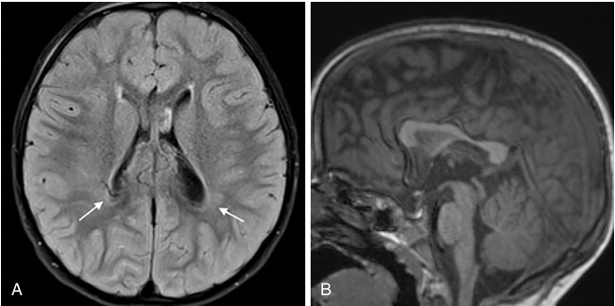

**Fig. 45.13** Axial T2 FLAIR (A) from a 3-year-old with arginase deficiency shows chronic mild sequela of prior hyperammonemic injury with subtle white matter hyperintensity in the peri-atrial regions extending to the ventricular margins _(arrows)_ and mild enlargement of the atria. Sagittal midline T1WI (B) demonstrates mild cerebral white matter volume loss with thinning of the posterior body and isthmus of the corpus callosum. 

Neonatal onset is rare and hyperammonemia, when present, is usually less severe than other UCD. Patients have normal development in infancy but then present with significant intellectual disability and/or regression typically by 3 years of age, occasionally with progressive microcephaly and spasticity. Speech is also commonly affected. Neuroimaging has shown demyelinating lesions and varying severity of cerebral and cerebellar atrophy (Fig. 45.13). Diffusion tensor imaging demonstrates a drop out of fibers in the cortical spinal tracts, which correlates with spasticity. Behavior changes can also occur, including increased irritability. EEG findings are usually nonspecific; patients can develop seizures of any semiology. Gait disturbances are often the most significant finding and differentiate this clinical presentation from other UCD. Hyperreflexia, and spasticity that is classically more severe in the lower extremities, is common. Because spastic diplegia or quadriplegia is usually the most obvious presenting symptom, arginase deficiency is _often misdiagnosed as cerebral palsy_ , with progression mistakenly attributed to growth or other reasons. 

Acute exacerbations are treated per standard therapy for UCD; supplementation with citrulline or arginine is not indicated. Ammonia scavengers can lower the concentration of arginine. Diet modification can improve developmental delays in some patients; improvements in both verbal and nonverbal language, gross and fine motor skills, and cognition have been observed. 

# **Amino Acidopathies** 

Amino acidopathies, UCDs, and organic acidopathies share a number of similarities, but there are notable differences. Although the metabolic defects in organic acidopathies involve amino acid metabolic pathways, the accumulation 

of amino acids, rather than organic acids, is the primary metabolic abnormality in amino acidopathies. Amino acid metabolic pathways are similarly involved in UCDs; however, the primary defect in amino acidopathies is outside of the urea cycle proper and nitrogen handling is secondary in these disorders. The major defining characteristic in amino acidopathies is a recognizable pattern of deficiency and/or accumulation of amino acids. Disruptions, such as those that lead to an accumulation of organic acid metabolites and/or ammonia, are secondary. 

Most amino acidopathies are due to deficiencies in membrane or cytoplasmic enzymes, whereas organic acidopathies typically involve defects in enzymes located in the mitochondria. Amino acidopathies do not present with disruptions in energy balance and do not present with lactic acidosis, although mild ketonuria may be detected. 

Acute assessment and treatment of the metabolically decompensating patient with a suspected or confirmed amino acidopathy is similar to the standard therapy for patients with an IEM in a metabolic crisis. Long-term therapy involves dietary management with removal or reduction of the toxic precursor amino acid(s) and supplementation of amino acids that may become essential in the patient due to the defect. 

## **Hyperornithinemia-HyperammonemiaHomocitrullinuria Syndrome** 

Hyperornithinemia-hyperammonemia-homocitrullinuria (HHH) syndrome is at the intersection between an amino acidopathy and a UCD. It is due to defects in the ornithine transporter protein, ORC1 encoded by _SLC25A15_ , and is involved in the mitochondrial transport of ornithine, as well as lysine and arginine, in exchange for citrulline. The incidence for HHH syndrome is less than 1:2 million.

<!-- p.1031 -->

HHH syndrome has a range of symptoms with _neonatal_ onset involving protein intolerance manifesting with an acute crisis causing respiratory alkalosis, emesis, hypotonia, lethargy, and myoclonic seizures. Patients may also display chronic or recurrent hepatic injury leading to hepatic failure. A _chronic_ , indolent form of disease is characterized by an aversion to protein, intellectual delays, and motor abnormalities. Patients can develop cerebral edema with cerebellar atrophy due to toxic accumulation of ammonia and glutamine. Motor dysfunction, developmental delays, and cerebellar ataxia with nystagmus and/or spasticity can occur. Additionally, behavioral or psychiatric symptoms may appear, or worsen, with protein load. The temporal nature of the symptoms may be a diagnostic clue. 

Patients present with the pathognomonic triad of HHH syndrome, namely elevations in plasma ammonia and ornithine, and increased urinary excretion of homocitrulline; both plasma and urine amino acids are often required for the diagnosis. Ornithine is also commonly elevated in the urine. Elevations in homocitrulline in the urine, in isolation, can arise from certain formulas or from heating of milk, complicating the diagnosis if plasma amino acids were not obtained. Hyperammonemia is due to trapping of ornithine in the cytoplasm, leading to mitochondrial compartment specific ornithine deficiency; hyperammonemia is usually less severe than in other UCDs but can be elevated to the thousands in a severe crisis. 

Acute management is similar to other disorders with a metabolic crisis. Long-term management involves dietary restriction of protein. Patients benefit from supplementation with citrulline as well as therapy with nitrogen scavengers to promote ammonia removal to prevent hyperammonemic crises. Therapy has a modest effect on neurological dysfunction. 

## **Lysinuric Protein Intolerance** 

Lysinuric protein intolerance (LPI) is due to defective dibasic transporter protein, encoded by _SLC7A7_ , which is responsible for the transport of lysine, arginine, and ornithine across cell membranes. Impaired transport leads to impaired absorption at the intestinal epithelium and impaired reabsorption at the kidneys. Incidence has been as low as 1:57,000 in Finnish and Japanese populations; it is otherwise rare worldwide. 

There is a wide spectrum of symptoms thought to be due to the multiple cell types affected by the transport defect such that both polarized cells, those in the intestinal and renal tubular epithelium, and non-polarized cells are affected; some non-polar cells have alternative mechanisms of uptake. Symptoms typically do not manifest until patients are weaned from formula/breastmilk and transitioned to higher-protein foods. Rare presentations have occurred in early infancy when a high-protein content formula is used for feeding. 

Patients may present with _hyperammonemic crises_ in the setting of high protein load, as well as from catabolic stress; some patients display only transient postprandial hyperammonemia, which can delay diagnosis. Nonspecific postprandial gastrointestinal symptoms, emesis, abdominal pain, and diarrhea are common. Many patients develop a protein aversion and protein undernutrition/deficiency with growth faltering and hypotonia. Patients may also have bone marrow suppression with anemia, thrombocytopenia, and a leukopenia that may result in severe and/or frequent infections. **Hemophagocytic lymphohistiocytosis (HLH)** , or a presentation with a subset of HLH features, is a common and severe complication of disease (Chapter 59). A slowly progressive renal dysfunction as well as respiratory dysfunction can present in LPI; both tend to become more prominent with age. Developmental delay, if present, is largely related to the frequency and duration of hyperammonemic crises. 

Hyperammonemia with elevated orotic acid is due to defective urea cycle nitrogen handling from decreased arginine and ornithine; the hyperammonemia is rarely >500–600 micromole/liter. Lactate dehydrogenase, ferritin, and triglycerides may be elevated in the setting of HLH. While plasma concentrations of lysine, arginine, and ornithine may be modestly decreased, urinary excretion will be elevated, with markedly increased concentrations of lysine in the urine. Urinary amino acids, rather than plasma amino acids, should be used for the diagnosis. 

Acute management is similar to management of other metabolic crises. Long-term therapy involves dietary modification and restriction. Supplementation of citrulline, which has uptake through a different mechanism, as well as the use of nitrogen scavengers to manage hyperammonemia are also effective and may facilitate a greater tolerance of protein. 

## **Maple Syrup Urine Disease** 

Maple syrup urine disease (MSUD) is an autosomal recessive disorder affecting the metabolism of branched chain amino acids, specifically leucine, isoleucine, and valine. It is caused by defects in the branched chain alpha-ketoacid dehydrogenase (Fig. 45.2), encoded by _BCKDHA, BCKDHB,_ and _DBT_ . Incidence is ~1:185,000. 

There is a range of severity of disease and while most patients present with symptoms in the neonatal period, the first onset of symptoms may not occur until much later in life. Age of onset is related to residual enzyme activity. Patients have a _burnt sugar_ or _maple syrup_ odor to their cerumen and urine. Neonates in crisis typically present with emesis and lethargy, opisthotonos, and bicycling movements. Dystonia, choreoathetosis, ataxia, global developmental delay with sparing of language, hyperactivity, and hallucinations can all occur as well. Movement disorders sometimes improve with treatment, but parkinsonism and simple motor tics have continued to be observed in adults

<!-- p.1032 -->

with MSUD despite management. Metabolic decompensations commonly occur with an intercurrent illness and are independently associated with neurodegeneration and a Wernicke-like encephalopathy. 

MSUD patients have elevations in leucine, isoleucine, and valine, seen on plasma amino acid analysis. The presence of alloisoleucine on an amino acid profile is diagnostic for MSUD. Leucine, typically the most elevated amino acid, is neurotoxic, causing degradation of myelin sheaths due to intramyelinic edema believed to be from accumulation of branched chain keto acids and water between layers of myelin, increasing oxidative stress, and resulting in vasogenic cerebral edema. Cerebral edema is a serious complication in MSUD patients due to disruption of the bloodbrain barrier during an acute metabolic crisis which can cause brainstem compression and sudden death; it may be exacerbated by aggressive attempts at rehydration. Leucine also competitively inhibits uptake of other large neutral amino acids across the blood-brain barrier, leading to secondary deficiencies of neurotransmitters. 

Acute management is similar to the general measures for the patient presenting in metabolic crisis; electrolytes should be closely monitored to avoid hyponatremia given the underlying risk of cerebral edema. Long-term management involves dietary restriction of leucine by competitive inhibition of leucine uptake via supplementation with isoleucine and valine. There is a rare variant that is responsive to thiamine and thus a trial of **thiamine supplementation** is recommended in all patients with MSUD. Prompt initiation of, and adherence to, therapy may result in normal or near-normal IQ. Orthotopic liver transplant is a successful treatment of MSUD because it has allowed patients to liberalize their diet; it should be considered for patients with severe and difficult-to-manage disease. 

## **Phenylalanine Hydroxylase Deficiency** 

Phenylalanine hydroxylase deficiency, also known as **phenylketonuria (PKU)** , is a disorder of phenylalanine metabolism due to defects in phenylalanine hydroxylase enzyme, encoded by _PAH_ . The incidence of PKU is ~1:10,000, making it one of the most common IEMs. 

PKU has a range of severity defined by the level of phenylalanine accumulation and the amount of dietary phenylalanine patients can tolerate and maintain normal plasma levels. Unlike other IEMs, true metabolic decompensation episodes are rare. Patients with PKU have a _musty_ or _mousy_ odor; some have eczema and decreased pigmentation in their skin, eyes, and hair. The primary mechanism leading to disease involves altered neuronal development and competitive inhibition of large neutral amino acid transport by phenylalanine. Reduced enzyme activity results in significant hyperphenylalaninemia which leads to alterations in cerebral myelin and protein synthesis. Serotonin, dopamine, and norepinephrine are all deficient in untreated patients. Furthermore, elevated phenylalanine results in 

abnormal methylation of genes expressed in the brain. Untreated patients develop intellectual delay and seizures and, rarely, visual problems and blindness, quadriplegia, hyperreflexia, and poor coordination. There is a higher incidence of ADHD, ASD, learning disabilities, depression, and anxiety in patients with PKU. Patients treated early may exhibit problems with executive function, particularly working memory. 

The major biochemical abnormality is excessive accumulation of phenylalanine which leads to phenylketones in the urine and decreased tyrosine on plasma amino acid analysis. Most patients with PKU have brain volume loss, some with approximately 80% brain volume compared to average on imaging. Without appropriate treatment, patients can develop white matter changes, including demyelination, which are partially independent of the occurrence of biochemical hyperphenylalaninemia. 

**Maternal PKU** occurs when a mother with PKU is inadequately treated during pregnancy. It can result in fetal loss or congenital anomalies, including malformed cardiac and pulmonary systems, microcephaly, facial dysmorphisms, and increased risk of developmental and intellectual delays. Phenylalanine is one of the most potent teratogens. 

The primary treatment of PKU is diet modification to restrict phenylalanine intake. A minority of patients are responsive to sapropterin, a synthetic form of the cofactor for phenylalanine hydroxylase. Enzyme therapy is also approved for use in patients with PKU. Treatment of already symptomatic patients results in improvement in behavioral outcomes but not intellectual disabilities. 

# **Small Energy Molecule Disorders** 

Monosaccharide metabolism, which includes glucose, fructose, and galactose, provides major energy sources for the body, as well as an important source of carbons. Glycolysis is vital in both erythrocyte and muscle metabolism and thus IEMs that affect glycolysis are classically characterized by metabolic myopathy and/or hemolytic anemia (Chapters 28 and 49). 

These small energy molecule disorders have a unique temporal relationship to ingestion that can often be a clue to diagnosis. Long-term therapy is largely focused on avoidance of the triggering monosaccharide, with excellent patient outcomes from appropriate adherence to diet modifications. Management of acute metabolic crises for these disorders is similar to what is recommended for the other disorders, which involves stopping catabolism via supplementation with dextrose-containing fluids and avoidance of the offending agent. 

## **Galactosemia** 

Galactosemia is due to defects in galactose metabolism, most commonly from deficiencies in galactose-1-phosphate

<!-- p.1033 -->

uridyltransferase, encoded by _GALT_ . Other enzymes are also involved in the metabolism of galactose and can present with similar phenotypes that vary only in the severity of presentation and response to treatment, namely uridine diphosphate galactose 4′-epimerase, encoded by _GALE_ , and galactokinase, encoded by _GK1_ . Incidence of galactosemia is ~1:50,000. 

Patients with galactosemia classically present with jaundice in the neonatal period, a life-threatening sepsis commonly from _E. coli_ , lethargy, emesis with failure to thrive, cataracts, and progressive hepatomegaly and renal failure. Additional late symptoms include primary ovarian insufficiency, intellectual delays, and neuromuscular dysfunction. Motor dysfunction, including dystonia, cerebellar ataxia, and tremor, are frequent findings in patients. Myoclonus, while frequent in childhood, is relatively absent in adulthood, instead evolving to tremors. ASD, impairments in activities of daily living and adaptive functioning, and speech delays as well as behavioral and psychiatric problems such as depression and anxiety are also noted. 

Deficiencies in galactose metabolism lead to accumulations of galactose, galactose-1-phosphate, and galactitol. Reducing substances are commonly found in the urine of untreated patients. Cerebellum Purkinje cells are especially susceptible to galactose toxicity. Galactitol is the metabolite found to accumulate in the lens resulting in cataracts and is also thought to result in cerebral edema via osmotic effects. There are variants that show only biochemical disease, such as **Duarte galactosemia** . 

Untreated patients often show cerebral atrophy, variable ventriculomegaly, white matter lesions with clustering around the lateral ventricle horns, and peripheral cerebral demyelination. These abnormal brain findings are possibly due to abnormal formation of cerebral gangliosides due to deficiencies of the various intermediates of galactose metabolism. 

Long-term therapy primarily involves a lactose-free diet because lactose contains galactose. Avoidance includes breast milk and animal milk containing formulas; instead a plant-based formula should be used. Diet modification improves neonatal complications, but it is not sufficient to completely prevent neurological sequelae. Other subacute, chronic symptoms also have an incomplete response to diet modification. 

## **Hereditary Fructose Intolerance** 

Hereditary fructose intolerance (HFI) is caused by defects in fructose metabolism, as well as sucrose and sorbitol, due to defects in the enzyme aldolase B, encoded by _ALDOB_ . Incidence of HFI is ~1:20,000. 

Patients with HFI typically present with symptoms only after introduction of fructose, which is found in many fruits and vegetables, as well as being present in simple sugar used as a sweetening agent (sucrose). Rarely, a newborn may be exposed to a formula sweetened with fructose or sucrose and present acutely; some international formulas may contain 

up to 20% of total carbohydrates as sucrose. Symptoms are characterized by energy deficiency, manifesting as hypoglycemia and lactic acidosis, with emesis and failure to thrive, jaundice, and lethargy that may progress to coma. The amount of fructose ingested and the age of the patient during the ingestion directly relate to the severity of disease. A diet history may provide the first diagnostic clue given the temporal nature of sugar ingestion and onset of symptoms; a notable finding is the child with gastrointestinal complaints and an aversion to sweets. 

HFI involves trapping of phosphate as fructose-1-phosphate leading to decreased adenosine triphosphate and worsening hypoglycemia. Importantly, hypoglycemia in HFI is not responsive to glucagon. Long-term complications from decreased phosphate include liver and renal failure and hypophosphatemic rickets. 

Long-term therapy involves avoidance of fructose, sucrose, and related sugars. Many medicines use fructose as a sweetener; medicinal additives present an additional challenge for avoidance. Diet avoidance may not resolve the hepatic changes noted in patients because the liver contains an endogenous fructose-producing pathway. Other than hepatic pathology, patients with appropriate fructose avoidance are healthy. 

## **Fructose 1,6-Bisphosphatase Deficiency** 

Fructose 1,6-Bisphosphatase (FBPase) deficiency is due to a defect in the enzyme FBPase, encoded by _FBP1_ , and is a severe disease that results in impairment of endogenous glucose formation from all gluconeogenic precursors. Incidence is ~1:350,000. 

Patients typically present in the first days to weeks of life with severe lactic acidosis and hypoglycemia. The onset of hypoglycemia is typically related to the depletion of the reserve of glycogen; hypoglycemia is unresponsive to glucagon. Fasting, illness, and other catabolic stressors can trigger a metabolic crisis. Additionally, while tolerance to a load of fructose and related sugars is higher in FBPase deficiency than in HFI, a large load of fructose can result in a metabolic crisis with trapping of phosphate similar to HFI. 

Tolerance to catabolic stressors and sugar intake increases with age; pregnancy remains a significant stressor that can result in crisis if not appropriately managed. Older patients, rather than presenting in acute crisis, may instead present with an indolent form of disease involving lethargy or irritability, apnea or dyspnea, hypotonia, and hepatomegaly. There is _not_ typically an aversion to sweets. 

Due to the defect in gluconeogenesis, gluconeogenic substrates accumulate, namely lactate, alanine, and glycerol. To maintain normoglycemia patients are fully dependent on glucose intake, hepatic glycogen breakdown, and to some extent muscle glucose production. 

Therapy is similar to other small energy molecule disorders, namely diet modification; the frequency of symptoms seems to decrease with age, and appropriate development is largely unimpeded with good metabolic control.

<!-- p.1034 -->

# **Bibliography** 

- Ahrens-Nicklas RC, Slap G, Ficicioglu C. Adolescent presentations of inborn errors of metabolism. _J Adolesc Health_ . 2015;56(5):477-482. 

- Arnold GL, Vladutiu CJ, Orlowski CC, Blakely EM, DeLuca J. Prevalence of stimulant use for attentional dysfunction in children with phenylketonuria. _J Inherit Metab Dis_ . 2004;27(2):137-143. 

- Åsberg C, Hjalmarson O, Alm J, Martinsson T, Waldenström J, Hellerud C. Fructose 1,6-bisphosphatase deficiency: enzyme and mutation analysis performed on calcitriol-stimulated monocytes with a note on long-term prognosis. _J Inherit Metab Dis_ . 2010;33(suppl 3):113-121. 

- Ayling JE, Helfand GD, Pirson WD. Phenylalanine hydroxylase from human kidney. _Enzyme_ . 1975;20(1):6-19. 

- Balakrishnan U. Inborn errors of metabolism-approach to diagnosis and management in neonates. _Indian J Pediatr_ . 2021;88(7): 679-689. 

- Baric I, Wagner L, Feyh P, Liesert M, Buckel W, Hoffmann GF. Sensitivity and specificity of free and total glutaric acid and 3-hydroxyglutaric acid measurements by stable-isotope dilution assays for the diagnosis of glutaric aciduria type I. _J Inherit Metab Dis_ . 1999;22(8):867-882. 

- Baruteau J, Diez-Fernandez C, Lerner S, et ao. Argininocuccinic aciduria: recent pathophysiological insights and therapeutic prospects. _J Inherit Metab Dis_ . 2019;42(6):1147-1161. 

- Bauman ML, Kemper TL. Morphologic and histoanatomic observations of the brain in untreated human phenylketonuria. _Acta Neuropathol_ . 1982;58(1):55-63. 

- Beaudet AL, O’Brien WE, Bock HG, Freytag SO, Su TS. The human argininosuccinate synthetase locus and citrullinemia. _Adv Hum Genet_ . 1986;15:161-292. 

- Berghe GVD, Hue L, Hers HG. Effect of administration of the fructose on the glycogenolytic action of glucagon. An investigation of the pathogeny of hereditary fructose intolerance. _Biochem J_ . 1973;134(2):637. 

- Bijarnia-Mahay S, Jain V, Kumar Bansal R, Gummadi M, Reddy M, Häberle J. Lysinuric protein intolerance presenting with recurrent hyperammonemic encephalopathy. _Indian Pediatr_ . 2016;53(8): 732-734. 

- Bilder DA, Noel JK, Baker ER, et al. Systematic review and metaanalysis of neuropsychiatric symptoms and executive functioning in adults with phenylketonuria. _Dev Neuropsychol_ . 2016;41(4): 245-260. 

- Bjugstad KB, Goodman SI, Freed CR. Age at symptom onset predicts severity of motor impairment and clinical outcome of glutaric acidemia type 1. _J Pediatr_ . 2000;137(5):681-686. 

- Blackburn PR, Gass JM, Vairo FP, et al. Maple syrup urine disease: mechanisms and management. _Appl Clin Genet_ . 2017;10:57. 

- Blau N, van Spronsen FJ, Levy HL. Phenylketonuria. _Lancet_ . 2010; 376(9750):1417-1427. 

- Bouchereau J, Leduc-Leballeur J, Pichard S, et al. Neurocognitive profiles in MSUD school-age patients. _J Inherit Metab Dis_ . 2017;40(3):377-383. 

- Boy N, Mühlhausen C, Maier EM, et al. Proposed recommendations for diagnosing and managing individuals with glutaric aciduria type I: second revision. _J Inherit Metab Dis_ . 2017;40(1): 75-101. 

- Burton BK. Inborn errors of metabolism in infancy: a guide to diagnosis. _Pediatrics_ . 1998;102(6):e69-e69. 

- Burton BK, Longo N, Vockley J, et al. Pegvaliase for the treatment of phenylketonuria: results of the phase 2 dose-finding studies with long-term follow-up. _Mol Genet Metab_ . 2020;130(4):239-246. 

- Carecchio M, Schneider SA, Chan H, et al. Movement disorders in adult surviving patients with maple syrup urine disease. _Mov Disord_ . 2011;26(7):1324. 

- Carvalho D, Brum J, Speck-Martins CE, et. al. Clinical features and neurologic progression of hyperarginemia. _Pediatr Neurol_ . 2012; 46:369-374. 

- Castorina M, Rigante D, Antuzzi D, Sciascia Cannizzaro G, Ricci R. Different outcome in isovaleric acidemia might be related to unsatisfactory diet compliance. _Scand J Gastroenterol_ . 2008;43(6): 767-768. 

- Cederbaum SD, Shaw KNF, Spector EB, et al. Hyperargininemia with arginase deficiency. _Pediatr Res._ 1979;13:827-833. 

- Cederbaum SD, Shaw KNF, Valente M. Hyperargininemia. _J Pediatr_ . 1977;90(4):569-573. 

- Cederbaum S, Yu H, Grody WW, et. al. Arginase I and II: Do their functional overlap? _Mol Genet Metab_ . 2004;81:S38-S44. 

- Chace DH, Kalas TA, Naylor EW. The application of tandem mass spectrometry to neonatal screening for inherited disorders of intermediary metabolism. _Annu Rev Genomics Hum Genet._ 2003;3:17-45. 

- Chapman KA, Summar ML, Enns GM. Propionic acidemia: to liver transplant or not to liver transplant? _Pediatr Transplant_ . 2012;16(3):209-210. 

- Choi JH, Lee BH, Kim JH, et al. Clinical outcomes and the mutation spectrum of the OTC gene in patients with ornithine transcarbamylase deficiency. _J Hum Genet_ . 2015;60(9):501-507. 

- Christ SE, Huijbregts SC, de Sonneville LM, White DA. Executive function in early-treated phenylketonuria: profile and underlying mechanisms. _Mol Genet Metab_ . 2010;99(suppl 1):S22-S32. 

- Commission Delegated Regulation (EU) 2016/127 supplementing Regulation (EU) No. 609/2013 of the European Parliament and of the Council as regards the specific compositional and information requirements for infant formula and follow-on formula and as regards requirements on information relating to infant and young child feeding. FAOLEX. Accessed October 30, 2023. https://www. fao.org/faolex/results/details/en/c/LEX-FAOC151710/. 

- Crome L. Phenylketonuria, a review and a report of pathological findings in four cases. _J Ment Sci_ . 1960;106:862-883. 

- Demirbas D, Coelho AI, Rubio-Gozalbo ME, Berry GT. Hereditary galactosemia. _Metabolism_ . 2018;83:188-196. 

- Di Dato F, Spadarella S, Puoti MG, et al. Daily fructose traces intake and liver injury in children with hereditary fructose intolerance. _Nutrients_ . 2019;11(10):2397. 

- Diez-Fernandez C, Häberle J. Targeting CPS1 in the treatment of Carbamoyl phosphate synthetase 1 (CPS1) deficiency, a urea cycle disorder. _Expert Opin Ther Targets_ . 2017;21(4):391-399. 

- Dobrowolski SF, Lyons-Weiler J, Spridik K, et al. Altered DNA methylation in PAH deficient phenylketonuria. _Mol Genet Metab_ . 2015;115(2-3):72-77. 

- Ensenauer R, Vockley J, Willard JM, et al. A common mutation is associated with a mild, potentially asymptomatic phenotype in patients with isovaleric acidemia diagnosed by newborn screening. _Am J Hum Genet_ . 2004;75(6):1136. 

- Escribá R, Ferrer-Lorente R, Raya Á. Inborn errors of metabolism: lessons from iPSC models. _Rev Endocr Metab Disord._ 2021;22(4): 1189-1200. 

- Fan L, Zhao J, Jiang L, et al. Molecular, biochemical, and clinical analyses of five patients with carbamoyl phosphate synthetase 1 deficiency. _J Clin Lab Anal_ . 2020;34(4):e23124. 

- Fichtel JC, Richards JA, Davis LS. Trichorrhexis nodosa secondary to argininosuccinicaciduria. _Pediatr Dermatol_ . 2007;24(1):25-27. 

- Fischer AQ, Challa VR, Bruton BK, McLean WT. Cerebellar hemorrhage complicating isovaleric acidemia: a case report. _Neurology_ . 1981;31(6):746-748.

<!-- p.1035 -->

- Fries MH, Rinaldo P, Schmidt-Sommerfield E, Jurecki E, Packman S. Isovaleric acidemia: response to a leucine load after three weeks of supplementation with glycine, L-carnitine, and combined glycinecarnitine therapy. _J Pediatr_ . 1996;129(3):449-452. 

- Grisolia S, Cohen PP. The catalytic role of carbamyl glutamate in citrulline biosynthesis. _J Biol Chem_ . 1952;198(2):561-571. 

- Gropman A. Brain imaging in urea cycle disorders. _Mol Genet Metab_ . 2010;100 Suppl 1(Suppl 1):S20-S30. 

- Haberlandt E, Canestrini C, Brunner-Krainz M, et al. Epilepsy in patients with propionic acidemia. _Neuropediatrics_ . 2009;40(1): 120-125. 

- Häberle J, Boddaert N, Burlina A, et al. Suggested guidelines for the diagnosis and management of urea cycle disorders. _Orphanet J Rare Dis_ . 2012;7(1):32. 

- Hall LM, Metzenberg RL, And S, Cohen PP. Isolation and characterization of a naturally occurring cofactor of carbamyl phosphate biosynthesis. _J Biol Chem_ . 1958;230:1013-1021. 

- Harding BN, Leonard JV, Erdohazi M. Ornithine carbamoyl transferase deficiency: a neuropathological study. _Eur J Pediatr_ . 1984; 141(4):215-220. 

- Hartwig C, Gal A, Santer R, Ullrich K, Finckh U, Kreienkamp HJ. Elevated phenylalanine levels interfere with neurite outgrowth stimulated by the neuronal cell adhesion molecule L1 in vitro. _FEBS Lett_ . 2006;580(14):3489-3492. 

- Haüssinger D. Nitrogen metabolism in liver: structural and functional organization and physiological relevance. _Biochem J_ . 1990; 267(2):281. 

- Hillert A, Anikster Y, Belanger-Quintana A, et al. The genetic landscape and epidemiology of phenylketonuria. _Am J Hum Genet_ . 2020;107(2):234-250. 

- Huidekoper HH, Visser G, Ackermans MT, Sauerwein HP, Wijburg FA. A potential role for muscle in glucose homeostasis: in vivo kinetic studies in glycogen storage disease type 1a and fructose-1,6-bisphosphatase deficiency. _J Inherit Metab Dis_ . 2010; 33(1):25. 

- Huttenlocher PR. The neuropathology of phenylketonuria: human and animal studies. _Eur J Pediatr_ . 2000;159(suppl 2):S102-S106. 

- Hyman DB, Tanaka K. Isovaleryl-CoA dehydrogenase activity in isovaleric acidemia fibroblasts using an improved tritium release assay. _Pediatr Res._ 1986;20(1):59-61. 

- Imataka G, Ishii J, Ando Y, et al. Long-term survival of a patient with acute neonatal-onset metabolic encephalopathy with carbamoyl phosphate synthetase 1 deficiency. _Eur Rev Med Pharmacol Sci_ . 2020;24(19):10051-10053. 

- Janwadkar A, Shirole N, Nagral A, et al. Citrullinemia type 1: behavioral improvement with late liver transplantation. _Indian J Pediatr_ . 2019;86(7):639-641. 

- Kadwa RA, Sankhyan N, Ahuja CK, Singhi P. Late-onset citrullinemia type i: a radiological mimic of herpes encephalitis. _J Pediatr Neurosci_ . 2019;14(1):36. 

- Karall D, Haberlandt E, Albrecht U, Rostasy K, Häberle J, SchollBürgi S. Unrecognized citrullinemia mimicking encephalitis in a 14-year-old boy: unexpected result through the use of a standardized lumbar puncture protocol. _Neuropediatrics_ . 2012;43(02): 059-063. 

- Kenneson A, Singh RH. Presentation and management of N-acetylglutamate synthase deficiency: a review of the literature. _Orphanet J Rare Dis_ . 2020;15(1):279. 

- Knerr I, Colombo R, Urquhart J, et al. Expanding the genetic and phenotypic spectrum of branched-chain amino acid transferase 2 (BCAT2) deficiency. _J Inherit Metab Dis_ . 2019;42(5): 809-817. 

- Knox WE. An Evaluation of the treatment of phenylketonuria with diets low in phenylalanine. _Pediatrics_ . 1960;26:1-11. 

- Koizumi A, Shoji Y, Nozaki J nichi, et al. A cluster of Lysinuric Protein Intolerance (LPI) patients in a northern part of iwate, japan due to a founder effect. The Mass Screening Group. _Hum Mutat_ . 2000:16(3):270-271. 

- Kölker S, Burgard P, Okun JG, et al. Looking forward: An evidencebased approach to glutaryl-CoA dehydrogenase deficiency. _J Inherit Metab Dis_ . 2004;27(6):921-926. 

- Kölker S, Greenberg CR, Lindner M, Müller E, Naughten ER, Hoffmann GF. Emergency treatment in glutaryl-CoA dehydrogenase deficiency. _J Inherit Metab Dis_ . 2004;27(6):893-902. 

- Krishnamurthy V, Eschrich K, Boney A, et al. Three successful pregnancies through dietary management of fructose-1,6-bisphosphatase deficiency. _J Inherit Metab Dis_ . 2007;30(5):819-819. 

- Kurko J, Vähä-Mäkilä M, Tringham M, et al. Dysfunction in macrophage toll-like receptor signaling caused by an inborn error of cationic amino acid transport. _Mol Immunol_ . 2015;67(2):416-425. 

- Kyllerman M, Skjeldal O, Christensen E, et al. Long-term followup, neurological outcome and survival rate in 28 Nordic patients with glutaric aciduria type 1. _Eur J Paediatr Neurol_ . 2004;8(3): 121-129. 

- Lang CH, Lynch CJ, Vary TC. BCATm deficiency ameliorates endotoxin-induced decrease in muscle protein synthesis and improves survival in septic mice. _Am J Physiol Regul Integr Comp Physiol_ . 2010;299(3):R935-R944. 

- Leuzzi V, Rinalduzzi S, Chiarotti F, et al. Subclinical visual impairment in phenylketonuria. A neurophysiological study (VEP-P) with clinical, biochemical, and neuroradiological (MRI) correlations. _J Inherit Metab Dis_ . 1998;21(4):351-364. 

- Levin ML, Scheimann A, Lewis RA, Beaudet AL. Cerebral edema in maple syrup urine disease. _J Pediatr_ . 1993;122(1):167. 

- Levy PA. Inborn errors of metabolism part 1: overview. _Pediatr Rev_ . 2009;30(4):131-138. 

- Lin Y, Gao H, Lu B, et al. Citrullinemia type I is associated with a novel splicing variant, c.773 + 4A > C, in ASS1: a case report and literature review. _BMC Med Genet_ . 2019;20(1):110. 

- Linder M, Kölker S, Schulze A, Christensen E, CR Greenberg, Hoffmann GF. Neonatal screening for glutaryl-CoA dehydrogenase deficiency. _J Inherit Metab Dis_ . 2004;27(6):851-859. 

- Liu XB, Haney JR, Cantero G, et al. Hepatic arginase deficiency fosters dysmyelination during postnatal CNS development. _JCI Insight_ . 2019:5:4(17):e1302. 

- MacNeill EC, Walker CP. Inborn errors of metabolism in the emergency department (undiagnosed and management of the known). _Emerg Med Clin North Am_ . 2018;36(2):369-385. 

- Maillot F, Lilburn M, Baudin J, Morley DW, Lee PJ. Factors influencing outcomes in the offspring of mothers with phenylketonuria during pregnancy: the importance of variation in maternal blood phenylalanine. _Am J Clin Nutr_ . 2008;88(3):700-705. 

- Majoie CBLM, Mourmans JM, Akkerman EM, Duran M, Poll-The BT. Neonatal citrullinemia: comparison of conventional MR, diffusion-weighted, and diffusion tensor findings. _AJNR Am J Neuroradiol_ . 2004;25(1):32. 

- Malamud N. Neuropathology of phenylketonuria. _J Neuropathol Exp Neurol_ . 1966;25(2):254-268. 

- Manara R, Rizzo MD, Burlina AP, et al. Wernicke-like encephalopathy during classic maple syrup urine disease decompensation. _J Inherit Metab Dis_ . 2012;35(3):413-417. 

- Mannucci L, Emma F, Markert M, et al. Increased NO production in lysinuric protein intolerance. _J Inherit Metab Dis_ . 2005;28(2): 123-129.

<!-- p.1036 -->

- Martinelli D, Diodato D, Ponzi E, et al. The hyperornithinemia– hyperammonemia-homocitrullinuria syndrome. _Orphanet J Rare Dis_ . 2015;10:29. 

- Metzenberg RL, Marshall M, Cohen PP. Carbamyl phosphate synthetase: studies on the mechanism of action. _J Biol Chem_ . 1958;233: 1560-1564. 

- Mühlhausen C, Ergün S, Strauss KA, et al. Vascular dysfunction as an additional pathomechanism in glutaric aciduria type I. _J Inherit Metab Dis_ . 2004;27(6):829-834. 

- Musunuru K, Grandinette SA, Wang X, et al. Patient-specific in vivo gene editing to treat a rare genetic disease. _N Engl J Med_ . 2025;329:2235-2243. 

- Nagamani SC, Campeau PM, Shchelochkov OA, et al. Nitric-oxide supplementation for treatment of long-term complications in argininosuccinic aciduria. _Am J Hum Genet_ . 2012;90(5):836. 

- Nelson MD, Wolff JA, Cross CA, Donnell GN, Kaufman FR. Galactosemia: evaluation with MR imaging. _Radiology_ . 1992;184(1): 255-261. 

- Nicolaides P, Liebsch D, Dale N, Leonard J, Surtees R. Neurological outcome of patients with ornithine carbamoyltransferase deficiency. _Arch Dis Child_ . 2002;86(1):54-56. 

- Nizon M, Ottolenghi C, Valayannopoulos V, et al. Long-term neurological outcome of a cohort of 80 patients with classical organic acidurias. _Orphanet J Rare Dis_ . 2013;8(1):148. 

- O’Kane RL, Hawkins RA. Na+-dependent transport of large neutral amino acids occurs at the abluminal membrane of the blood-brain barrier. _Am J Physiol Endocrinol Metab_ . 2003;285(6):E1167-E1173. 

- O’Shea CJ, Sloan JL, Wiggs EA, et al. Neurocognitive phenotype of isolated methylmalonic acidemia. _Pediatrics_ . 2012;129(6):e1541. 

- Oldham MS, VanMeter JW, Shattuck KF, Cederbaum SD, Gropman AL. Diffusion tensor imaging in arginase deficiency reveals damage to corticospinal tracts. _Pediatr Neurol_ . 2010;42(1):49-52. 

- Palmieri F. Mitochondrial transporters of the SLC25 family and associated diseases: a review. _J Inherit Metab Dis_ . 2014;37(4): 565-575. 

- Pinto A, Alfadhel M, Akroyd R, et al. International practices in the dietary management of fructose 1-6 biphosphatase deficiency. _Orphanet J Rare Dis_ . 2018;13(1):21. 

- Podskarbi T, Kohlmetz T, Gathof BS, et al. Molecular characterization of Duarte-1 and Duarte-2 variants of galactose-1-phosphate uridyltransferase. _J Inherit Metab Dis_ . 1996;19(5):638-644. 

- Prasad AN, Breen JC, Ampola MG, Paul Rosman N, Prasad N. Argininemia: a treatable genetic cause of progressive spastic diplegia simulating cerebral palsy: case reports and literature review. _J Child Neurol_ . 1997;12(5):301-309. 

- Ranucci G, Martinelli D, Maiorana A, et al. P017 Impact of liver transplant on plasma and cerebrospinal fluid amino acids in patients with argininosuccinic aciduria The Nox2: the new marker of stress oxidative in non-alcoholic steatohepatitis in children Persistent CSF biochemical abnormalities in transplanted patients with methylmalonic acidemia: a longitudinal study. _Dig Liver Dis_ . 2018;50(4S):e365. 

- Ratner S. Enzymes of arginine and urea synthesis. _Adv Enzymol Relat Areas Mol Biol_ . 1973;39:1-90. 

- Saudubray JM, Garcia-Cazorla À. Inborn errors of metabolism overview: pathophysiology, manifestations, evaluation, and management. _Pediatr Clin North Am_ . 2018;65(2):179-208. 

- Scheuerle Ae, Mcvie R, Beaudet Al, Shapira Sk. Arginase deficiency presenting as cerebral palsy. _Pediatrics_ . 1993;91(5):995-996. 

- Scholl-Bürgi S, Sass JO, Zschocke J, Karall D. Amino acid metabolism in patients with propionic acidaemia. _J Inherit Metab Dis_ . 2012;35(1):65-70. 

- Schreiber J, Chapman KA, Summar ML, et al. Neurologic considerations in propionic acidemia. _Mol Genet Metab_ . 2012;105(1):10-15. 

- Scriver CR, Clow CL, Mackenzie S, Delvin E. Thiamine-responsive Maple-Syrup-Urine disease. _Lancet_ . 1971;297(7694):310-312. 

- Sen K, Whitehead M, Castillo Pinto C, Caldovic L, Gropman A. Fifteen years of urea cycle disorders brain research: looking back, looking forward. _Anal Biochem_ . 2022;1;636:114343. 

- Sezer T, Balci O. Infantile spasms during acute metabolic decompensation in an infant with isovaleric acidemia. _J Clin Neurol_ . 2016;12(3):376. 

- Shi H, Wang J, Zhao Z. Analysis of inborn error metabolism in 277 children with autism spectrum disorders from Hainan. _Zhonghua Yi Xue Yi Chuan Xue Za Zhi_ . 2019;36(9):870-873. 

- Shigesada K, Tatibana M. Enzymatic synthesis of acetylglutamate by mammalian liver preparations and its stimulation by arginine. _Biochem Biophys Res Commun_ . 1971;44(5):1117-1124. 

- Sin YY, Baron G, Schulze A, Funk CD. Arginase-1 deficiency. _J Mol Med (Berl)_ . 2015;93(12):1287-1296. 

- Singh SK, Sarma MS. Hereditary fructose intolerance: a comprehensive review. _World J Clin Pediatr_ . 2022;11(4):321. 

- Sogut A, Acun C, Aydin K, Tomsac N, Demirel F, Aktuglu C. Isovaleric acidaemia: cranial CT and MRI findings. _Pediatr Radiol_ . 2003;34(2):160-162. 

- Strauss KA, Mazariegos GV, Sindhi R, et al. Elective liver transplantation for the treatment of classical maple syrup urine disease. _Am J Transplant_ . 2006;6(3):557-564. 

- Strauss KA, Morton DH. Branched-chain ketoacyl dehydrogenase deficiency: maple syrup disease. _Curr Treat Options Neurol_ . 2003;5(4):329-341. 

- Strauss KA, Puffenberger EG, Robinson DL, Morton DH. Type I glutaric aciduria, part 1: Natural history of 77 patients. _Am J Med Genet C Semin Med Genet_ . 2003;121C(1):38-52. 

- Summar ML, Koelker S, Freedenberg D, et al. The incidence of urea cycle disorders. _Mol Genet Metab_ . 2013;110(1-2):179-180. 

- Tanaka K. Isovaleric acidemia: personal history, clinical survey and study of the molecular basis. _Prog Clin Biol Res_ . 1990;321:273-290. 

- Tanaka K, Budd MA, Efron ML, Isselbacher KJ. Isovaleric acidemia: a new genetic defect of leucine metabolism. _Proc Natl Acad Sci U S A_ . 1966;56(1):236. 

- Tanner LM, Näntö-Salonen K, Niinikoski H, et al. Nephropathy advancing to end-stage renal disease: a novel complication of lysinuric protein intolerance. _J Pediatr_ . 2007;150(6):631-634.e1. 

- _The Online Metabolic and Molecular Bases of Inherited Disease_ . OMMBID | McGraw Hill Medical. Accessed October 30, 2023. https://ommbid.mhmedical.com/book.aspx?bookID=2709. 

- Therrell BL Jr, Lloyd-Puryear MA, Camp KM, Mann MY. Inborn errors of metabolism identified via newborn screening: ten-year incidence data and costs of nutritional interventions for research agenda planning. _Mol Genet Metab_ . 2014;113(1-2):14. 

- Tran C. Inborn errors of fructose metabolism. What can we learn from them? _Nutrients_ . 2017;9(4):356. 

- Tuchman M, Lee B, Lichter-Konecki U, et al. Cross-sectional multicenter study of patients with urea cycle disorders in the United States. _Mol Genet Metab_ . 2008;94(4):397. 

- Ullrich K, Flott-Rahmel B, Schluff P, et al. Glutaric aciduria type I: pathomechanisms of neurodegeneration. _J Inherit Metab Dis_ . 1999;22(4):392-403. 

- Valimahamed-Mitha S, Berteloot L, Ducoin H, Ottolenghi C, de Lonlay P, de Blic J. Lung involvement in children with lysinuric protein intolerance. _J Inherit Metab Dis_ . 2015;38(2):257-263. 

- van Spronsen FJ, van Rijn M, Dorgelo B, et al. Phenylalanine tolerance can already reliably be assessed at the age of 2 years in patients with PKU. _J Inherit Metab Dis_ . 2009;32(1):27-31.

<!-- p.1037 -->

- van Vliet D, van Wegberg AMJ, Ahring K, et al. Can untreated PKU patients escape from intellectual disability? A systematic review. _Orphanet J Rare Dis_ . 2018;13(1):149. 

- Vockley J, Ensenauer R. Isovaleric acidemia: new aspects of genetic and phenotypic heterogeneity. _Am J Med Genet C Semin Med Genet_ . 2006;142C(2):95. 

- Woo HI, Park HD, Lee YW. Molecular genetics of citrullinemia types I and II. _Clin Chim Acta_ . 2014;431:1-8. 

- Wakutani Y, Nakayasu H, Takeshima T, et al. A case of late-onset carbamoyl phosphate synthetase I deficiency, presenting periodic psychotic episodes coinciding with menstrual periods. _Rinsho Shinkeigaku_ . 2001;41(11):780-785. 

- Yoshida Y, Machigashira K, Suehara M, et al. Immunological abnormality in patients with lysinuric protein intolerance. _J Neurol Sci_ . 1995;134(1-2):178-183. 

- Yoshino M, Yoshida I, Yamashita F, Mori M, Uchiyama C, Tatibana M. Neonatal isovaleric acidemia associated with hyperammonemia. _Adv Exp Med Biol_ . 1982;153:141-146. 

- Yudkoff M, Daikhin Y, Nissim I, et al. Brain amino acid requirements and toxicity: the example of leucine. _J Nutr_ . 2005;135(suppl 6):1531S-1538S.