# Chapter 49: Nonimmune Hemolytic Anemias
> **Course:** Vikkypaedia Rare Disease Learner Course (*Nelson Pediatric Textbook of Rare Diseases: Genomic Etiologies and Genetic Diagnosis (1st Edition)*)  
> **Section IX:** Hematologic Disorders  
> **Authors:** Joan Lluis Vives Corrons  
> **Metrics:** 11,235 words · 8 tables · 17 figures · 14 genes · 28 flashcards · 14 MCQs  
> **Quick Navigation:** [🃏 Study 28 Flashcards](../flashcards/049_flashcards.md) · [📝 Take 14-Q MCQ Quiz](../mcqs/049_mcqs.md) · [📚 Section IX Guide](../sections/Section_IX.md) · [🧬 Master OMIM/Gene Atlas](../omim_gene_atlas.md) · [💊 Precision Therapies Matrix](../therapies_matrix.md) · [🏠 Course Index](../../index.md)

## Key Chapter Topics
`Hematologic Disorders` · `Hereditary NIHA` · `Glucose-6-Phosphate Dehydrogenase Deficiency` · `Pyruvate Kinase Deficiency` · `Other Erythroenzymopathies` · `Hemoglobinopathies` · `Structural Hemoglobinopathies` · `Thalassemia Syndromes` · `Acquired Nonimmune Hemolytic Anemias` · `NIHA Due to Infections` · `NIHA Due to Angiopathies` · `Acquired NIHA Due to Exposure to Oxidants`

## Key Genes & Molecular Targets
`ADA`, `ADAMTS13`, `ANK1`, `EPB42`, `G6PD`, `HBA1`, `HBA2`, `KCNN4`, `PIEZO1`, `PKLR`, `SLC2A1`, `SLC4A1`, `SPTA1`, `SPTB`

## ⚡ High-Yield Clinical & Diagnostic Pearls
- The hallmark of NIHA is a negative antihuman immunoglobulin test (i.e., direct Coombs test).
- Hereditary spherocytosis (HS) is the most common RBC membrane disorder.
- HE is primarily inherited in an autosomal dominant manner, but rare cases of recessive inheritance have been reported.
- However, when inherited in trans with another HE variant, the marked decrease in α-spectrin chains leads to a severe hemolytic syndrome characterized by transfusion-dependent anemia and neonatal-onset jaundice.
- Dehydrated hereditary stomatocytosis 1 (DHS1) is the more prevalent form and is caused by pathogenic variants in PIEZO1 , which encodes a mechanosensitive protein (Piezo1) that is part of stretch-activated cation channels.
- Dehydrated hereditary stomatocytosis 2 (DHS2) is caused by pathogenic variants in KCNN4 , which encodes the Gardos channel, a widely expressed Ca -dependent K channel that mediates K conductance in RBCs.
- Splenectomy is contraindicated in DHS1 because it may result in an increased risk of venous and arterial thromboembolic complications.
- Hereditary Hydrocytosis (HH): HH refers to a group of rare anemias characterized by an increased MCV (typically greater than 105 fL) and increased intracellular Na and water content without a compensatory decrease in intracellular K .

---
## Full Chapter Text, Tables & Figures

<!-- p.1110 -->

## SECTION **IX** 

### Hematologic Disorders 

49. Nonimmune Hemolytic Anemias, 1091 

50. Lymphoproliferative Disorders, 1113 

51. Hereditary Bone Marrow Failure Syndromes, 1143 

52. Hereditary Etiologies of Thrombosis, 1161

<!-- p.1111 -->

<!-- p.1112 -->

# 49 Nonimmune Hemolytic Anemias 

**JOAN LLUÍS VIVES CORRONS** 

**Nonimmune hemolytic anemias (NIHAs)** are a heterogeneous group of rare diseases that primarily affect the integrity of the red blood cell (RBC), but that can also affect hematopoiesis. The distinguishing features of NIHAs are anemia, reticulocytosis, and a negative antihuman immunoglobulin (i.e., Coombs) test. NIHAs comprise a significant portion of the rare anemias and are either hereditary or acquired. Causes of hereditary NIHAs include disorders of the RBC membrane (membranopathies), RBC-related enzymes (erythroenzymopathies), or hemoglobin (hemoglobinopathies). Causes of acquired NIHAs include infections, drug or heavy metal intoxications, and mechanical disruption of the RBC in the intravascular space. 

Patients with NIHA present with a characteristic hemolytic syndrome of anemia, reticulocytosis, jaundice, and splenomegaly. This phenotype is accompanied by increased serum bilirubin and lactate dehydrogenase (LDH) levels as well as a decreased haptoglobin concentration. The hallmark of NIHA is a negative antihuman immunoglobulin test (i.e., direct Coombs test). The precise etiology is frequently difficult to establish due to a combination of low prevalence, phenotypic heterogeneity, and the presence of associated complications that can confound determining a specific diagnosis. Therapy for hereditary NIHAs has traditionally been supportive, consisting primarily of transfusion support, though targeted disease-modifying and curative therapies for some hereditary NIHAs are available. Therapies for acquired forms are typically directed at the underlying inciting trigger. Despite the low prevalence of NIHA (for example, prevalence in Europe is estimated at less than 1 in 2,000), concerted efforts over the last two decades have led to a deeper understanding of molecular and pathophysiological mechanisms, as well as to the development of several new diagnostic modalities and targeted therapies. 

#### **Hereditary NIHA** 

##### **Membranopathies** 

The RBC membrane is a complex structure consisting of a relatively fluid lipid bilayer stabilized by an underlying cytoskeleton, a mesh-like protein network that laminates 

the inner surface of the membrane. The lipid bilayer contains phospholipids and cholesterol and separates the cytoplasm of erythrocytes from the external plasma environment. The cytoskeleton and its attachments to the lipid bilayer are comprised of numerous _integral membrane proteins_ , which are permanently embedded within the membrane, as well as _peripheral membrane proteins_ , which either do not interact directly with the membrane or do so impermanently. Actin, α-spectrin, β-spectrin, and protein 4.1 (also referred to as protein 4.1R) are the main components of the cytoskeleton, maintaining the biconcave shape of the RBC (Fig. 49.1). This network of RBC membrane proteins is structured into two different complexes: the _ankyrin-1 complex_ and the _protein 4.1 complex_ , and both complexes connect the membrane backbone to integral proteins. The ankyrin-1 complex is composed of band 3, the Rhesus proteins RhAG and RhCE, CD47, glycophorins A and B, and protein 4.2. The protein 4.1 complex is a ternary complex consisting of protein 4.1, actin, and spectrin, and is the main component of the nodal junctions of the membraneskeletal network (i.e., junctional complex). Its attachment to the transmembrane protein glycophorin C creates a bridge between the protein network and the membrane bilayer. 

The RBC membrane skeleton provides both the strength and flexibility required for the RBC, with a diameter 6–8 μ, to cross the 2–3 μ capillaries in the microcirculation and the 0.5–1 μ intercellular spaces in the spleen. When this deformability decreases, RBCs are retained in the spleen and destroyed, resulting in hemolysis. Cytoskeletal protein defects are due to pathogenic genetic variants that can alter either vertical or horizontal interactions within the RBC. Vertical interactions are perpendicular to the plane of the membrane and involve ankyrin-1 and protein 4.1 complexes. Horizontal interactions are parallel to the plane of the membrane and involve spectrin tetramers and protein 4.1. Defects in either vertical or horizontal interactions lead to changes in RBC shape; additional changes in RBC morphology can be caused by defects that alter the permeability of the RBC membrane and result in differences in cellular water content. Hereditary membrane diseases are classified into three main groups: (1) **hereditary spherocytosis (HS)** ,

<!-- p.1113 -->

**Fig. 49.1** Red blood cell (RBC) shape and sizes. Structure of RBC membrane skeleton. 

due to failure of vertical interactions; (2) **hereditary elliptocytosis (HE)** , due to failure of horizontal interactions; and (3) **hereditary stomatocytosis** , due to altered permeability of the RBC membrane that leads to either an increase or decrease in cellular hydration and volume, with a resultant change in shape (Table 49.1). 

##### **Hereditary Spherocytosis** 

**Hereditary spherocytosis (HS)** is the most common RBC membrane disorder. Distribution is worldwide; prevalence is as high as 1 in 2,000 based on estimates in Northern Europe and the United States. Genetic transmission can be parentally inherited in an autosomal dominant (75%) or autosomal recessive (20%) fashion, or de novo in parental 

germline cells or immediately after zygote formation (5%). HS is caused by a pathogenic genetic variant in one or more of the following membrane skeleton proteins: (1) β-spectrin _(SPTB)_ , approximately 45% of patients; (2) ankyrin _(ANK1)_ , approximately 35% of patients; (3) band 3 _(SLC4A1)_ , approximately 20% of patients; (4) α-spectrin _(SPTA1)_ , approximately 7% of patients; and (5) protein 4.2 _(EPB42)_ , less than 3% of patients, mostly of Japanese ancestry. In HS, these variants affect the coupling of the membrane cytoskeleton to integral protein band 3 (a vertical interaction), destabilizing the membrane structure and leading to formation of lipoprotein microvesicles (vesiculation). This vesiculation causes membrane loss and decreases the surface/volume (S/V) ratio, resulting in a spherical-shaped RBC or _spherocyte_ . Spherocytes are

<!-- p.1114 -->

#### **TABLE 49.1** Eryt Here Ellip hrocyte Me ditary Sphe tocytosis, a mbrane Abnormalities in rocytosis, Hereditary nd Related Disorders

|Gene|Disorder|Comment|
|---|---|---|
|α-Spectrin|HS, HE, HPP, NIHF|Location of variant determines clinical phenotype.α-Spectrin variants are most common cause of typical HE|
|Ankyrin|HS|Most common cause of typical dominant HS|
|Band 3|HS, SAO, NIHF|In HS “pincer-like” spherocytes on smear presplenectomy. SAO erythrocytes have transverse ridge or longitudinal slit|
|β-Spectrin|HS, HE, HPP, NIHF|Location of variant determines clinical phenotype. In HS, acanthrocytic spherocytes on smear presplenectomy|
|Protein 4.2|HS|Common in Japanese HS|
|Protein 4.1|HE||
|GPC|HE|Concomitant protein 4.1 deficiency is basis of HE in GPC defects|

_GPC,_ Glycophorin C; _HE,_ hereditary elliptocytosis; _HPP,_ hereditary pyropoikilocytosis; _HS,_ hereditary spherocytosis; _NIHF,_ nonimmune hydrops fetalis; _SAO,_ Southeast Asian ovalocytosis. From Gallagher PG: Red blood cell membrane disorders in Hoffman R, Benz Jr EJ, Silberstein LE, et al (eds): _Hematology Basic Principles and Practice_ 8/e, 2023, Elsevier, Philadelphia (Table 46.1, p. 651). 

hyperdense (i.e., they have a high mean corpuscular hemoglobin concentration or MCHC), are poorly deformable, and have a shortened lifespan (Fig. 49.2). 

**Clinical Manifestations:** HS presents in children, adolescents, and occasionally adults as a mild or moderate chronic anemia with persistent hyperbilirubinemia. Jaundice and palpable splenomegaly are valuable criteria for diagnosis, as are intermittent abdominal pain and gallstones. Asymptomatic forms without anemia are relatively common in individuals with well-compensated hemolysis and intense reticulocytosis. The most severe form of HS is a compound heterozygous condition wherein a pathogenic _SPTA1_ variant coexists in trans with the null polymorphic α-LEPRA (Low Expression, Prague) allele, which allows for residual expression of small amounts of normal α-spectrin sufficient to avoid the lethality associated with complete absence of α-spectrin. This phenotype can be also observed in some homozygous states, where a transfusion-dependent anemia presents in early infancy. In these cases, the anemia usually appears around the second day of life but is typically self-limited and improves with age. Occasionally, individuals 

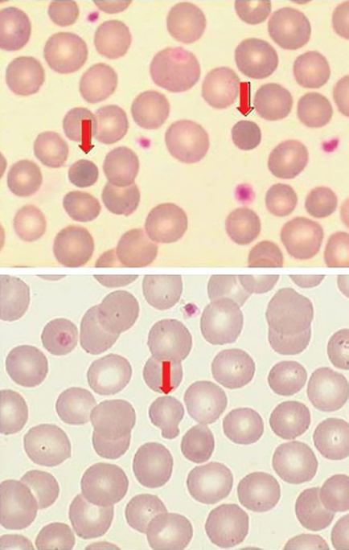

**Fig. 49.2** May-Grünwald Giemsa-stained blood smear of a patient with hereditary spherocytosis. Top: two spherocytes _(arrows)_ ; Bottom: pincer cell _(arrow)_ . 

with HS and chronic hemolytic anemia will experience a sharp decline in hemoglobin concentration with severe reticulocytopenia, revealing a maturational block in erythropoiesis. This episode is typically due to infection with parvovirus B19, which drastically interrupts erythropoiesis and gives rise to an **aplastic crisis** . These crises usually preferentially affect young patients and spontaneously remit in one or two weeks without treatment. 

**Diagnosis:** The clinical diagnosis of HS is based on four factors: (1) a chronic hemolytic syndrome with or without neonatal jaundice; (2) splenomegaly; (3) spherocytosis; and (4) a positive family history (whenever possible). Although the diagnosis of HS is strongly suggested by the presence of spherocytes in a peripheral blood smear (Fig. 49.2), spherocytes are also observed in several other diseases, such as autoimmune hemolytic anemia, hemolytic uremic syndrome (HUS), and septicemia due to _Clostridium perfringens_ . In some circumstances, spherocytes can be masked by an intense reticulocytosis, severe iron deficiency, or blood transfusions. The traditional protocol for confirming a

<!-- p.1115 -->

#### **TABLE 49.2** Diagnostic Tests for Her Spherocytosis editary

|Test|Result|
|---|---|
|Blood smear examination (RBC morphology)|Spherocytes, acanthocytes and pincer cells|
|Mean corpuscular hemoglobin concentration (MCHC)|Increased|
|RBC osmotic fragility test (OFT)|Increased|
|Acidified glycerol lysis test (AGLT)|Decreased|
|Eosin-maleimide (EMA)-binding test (EBT)|Decreased|
|RBC deformability (Osmotic gradient ektacytometry)|Decreased|
|Sodium dodecyl polyacrylamide gel electrophoresis (SDS-PAGE)|Abnormal pattern in approximately 70% of cases|

diagnosis of HS requires measuring 5 laboratory parameters (also summarized in Table 49.2). 

1. _RBC indices_ , in particular the mean corpuscular volume (MCV) and MCHC, are measured by a laser light automated hematology analyzer. In HS, MCV is decreased in the range of 81–85 fL and MCHC is increased to greater than 340 g/L, even in the presence of increased reticulocytes, which have a much lower hemoglobin content than mature RBCs. 

2. The _osmotic fragility test (OFT)_ assesses the degree of hemolysis that occurs when RBCs are placed in a hypotonic solution. Spherocytes, with their lower S/V ratio, have a decreased capacity for hydration and lyse more readily in lower tonicity solutions when compared to normal RBCs. For OFT determination, RBCs are incubated in decreasing concentrations of NaCl (from 90 to 10 g/L) and the degree of lysis at each concentration is 

   - assessed at room temperature (simple test) or after incubating the blood for 24 hours at 37°C (incubated test). A complementary test that demonstrates the sensitivity of RBCs to hypotonic solutions is the _acidified glycerol lysis test_ (AGLT), which measures the intensity but not the degree of hemolysis when RBCs are incubated in a solution of acidified glycerol. The AGLT is more specific than OFT but is less sensitive. 

3. The _eosin-maleimide (EMA) binding test_ uses cytometry to quantify the fluorescence of eosin 5-maleimide, a fluorochrome that specifically binds to lysine 430 of band 3 and other membrane proteins. The degree of fluorescence is directly related to the concentration of these membrane proteins; in HS, the concentrations of these proteins are significantly decreased. The EMA-binding test is simple, inexpensive, and highly specific for the diagnosis of HS. 

4. _Sodium dodecyl sulfate-polyacrylamide gel electrophoresis (SDS-PAGE)_ consists of fractionating RBC membrane proteins via polyacrylamide gel electrophoresis in a sodiumdodecyl-sulfate solution and quantifying the fractions by densitometry or Western blot. There are two forms of SDSPAGE: Laemmli, which allows better identification of band 3 and proteins 4.1 and 4.2, and Fairbanks, which is specific for the identification of α-spectrin, β-spectrin, and ankyrin. Laemmli and Fairbanks SDS-PAGE assays are complementary and must be used simultaneously (Fig. 49.3). 

5. _Osmotic gradient ektacytometry (OGE)_ assesses RBC deformability, cell hydration, and the S/V ratio. OGE is conducted with the osmoscan module of an ektacytometer using rotational optics and laser light, and analyzes suspended RBCs subjected to a constant shearing stress and differing levels of osmolarity. HS and other RBC membrane disorders produce distinct osmoscan curves, allowing for differentiation of these disorders independently from morphological observation (Fig. 49.4). 

6. _Genomic testing_ has allowed for the diagnosis and classification of HS in five different clinical forms of erythrocyte membrane disorders based on genetic mechanisms (Table 49.3): HS1, ankyrin _(ANK1)_ deficiency; HS2, 

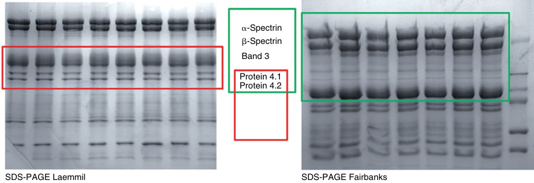

- **Fig. 49.3** Sodium dodecyl sulfate polyacrylamide gel electrophoresis (SDS-PAGE) of membrane 

- proteins.

<!-- p.1116 -->

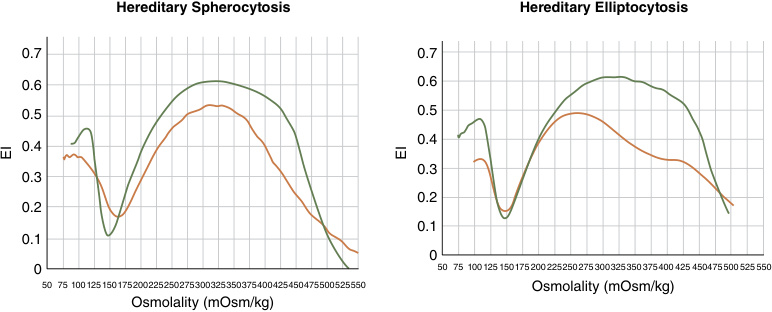

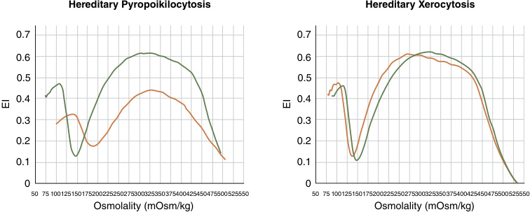

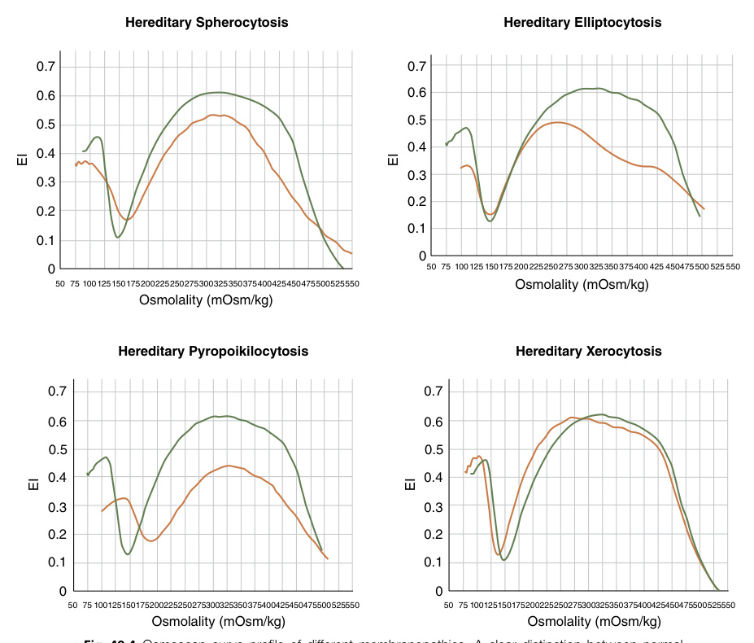

**Fig. 49.4** Osmoscan curve profile of different membranopathies. A clear distinction between normal control _(green line)_ , hereditary spherocytosis (HS), hereditary elliptocytosis (HE), hereditary pyropoikilocytosis (HPP), and hereditary xerocytosis (HX) can be observed. 

**TABLE 49.3 Clinical Forms of Hereditary Spherocytosis and Their Molecular Mechanisms** 

|Clinical Form|Abnormal Protein|Gene/Chromosome|Frequency|Anemia RBC Morphology|
|---|---|---|---|---|
|HS-1|β-Spectrin|_SPTB_/14q23-q24.1|40–50%|Slight to moderate Spherocytes+acanthocytes|
|HS-2|Ankyrin|_ANK1_/8p11.2|20–30%|Slight to moderate Spherocytes|
|HS-3|Band 3|_SLC4A1_/17q21|15–20%|Slight to moderate Spherocytes+pincered cells|
|HS-4|α-Spectrin|_SPTA1_/1q22-q23|5–7%|Severe Spherocytes+microspherocytes+ schistocytes|
|HS-5|Protein 4.2|_EPB42_/15q15-q21|<5%|Moderate Spherocytes+ovalocytes|

_HS,_ Hereditary spherocytosis.

<!-- p.1117 -->

β-spectrin _(SPTB)_ deficiency; HS3, α-spectrin _(SPTA1)_ deficiency; HS4, band 3 _(SLC4A1)_ deficiency; and HS5, protein 4.2 _(EPB42)_ deficiency. 

**Treatment:** Because many HS patients are only minimally symptomatic, treatment is often not required. However, in the setting of chronic reticulocytosis, affected individuals are at risk for depleted folate stores and may benefit from regular administration of active folic acid preparations. Because a definitive etiological therapy is lacking, palliative treatments are used to ameliorate the anemia in cases with severe anemia. The most important example is blood transfusion to avoid the complications of chronic hemolysis, such as anemia growth restriction or gallstones. In cases of severe chronic hemolysis or poor quality of life, splenectomy is recommended. In HS splenectomy removes the natural filter of spherocytes, increasing RBC survival and hemoglobin concentration. Because splenectomy is associated with increased risk of infection with encapsulated organisms, full vaccination against pneumococcus, meningococcus, and _Haemophilus influenzae_ is required prior to the surgery. Splenectomy additionally requires antimicrobial prophylaxis against infection, particularly in children under 5 years of age. In adolescents and adults, splenectomy is only recommended in cases of giant splenomegaly, complications of hemolysis, iron overload, or a poor quality of life due to a recurring transfusion requirement. 

##### **Hereditary Elliptocytosis** 

Hereditary elliptocytosis (HE) is a group of inherited disorders whose common feature is longitudinal elongation of the red blood cell, resulting in an oval or elliptical shape (Fig. 49.5). HE is primarily inherited in an autosomal dominant manner, but rare cases of recessive inheritance have been reported. HE has worldwide distribution with an estimated prevalence as high as 1 in 2,000; however, true 

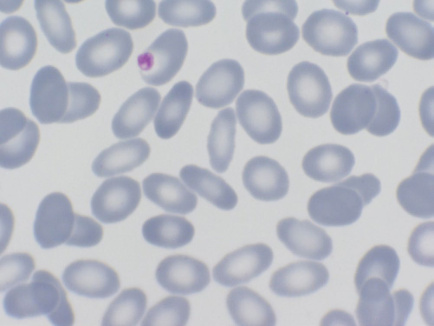

**Fig. 49.5** May-Grünwald Giemsa-stained peripheral blood smear of a patient with hereditary elliptocytosis (HE). 

prevalence is unknown because most patients are asymptomatic. For many affected individuals, diagnosis is made incidentally in the setting of an acute infection exacerbating hemolysis or in the context of assessing family members of diagnosed symptomatic relatives. Furthermore, the significant degree of interfamilial and intrafamilial phenotypic heterogeneity suggests the possibility of unknown modifier alleles that can diminish symptoms and confound diagnosis. A much higher prevalence (1:100) has been reported in in some African regions endemic for malaria, because the RBC membrane defect prevents the entry of the parasite, conferring greater resistance to malaria infection. 

Genomic sequencing has identified several pathogenic variants affecting RBC membrane proteins, including single base substitutions, insertions, deletions, or mRNA processing changes. The most frequently affected proteins are α- spectrin _(SPTA1)_ in up to 65% of cases, β-spectrin _(SPTB)_ in up to 30% of cases, and protein 4.1 _(EPB41)_ in up to 5%. These pathogenic variants weaken horizontal interactions between skeletal membrane proteins and diminish the normal elastic recoil of the cell, leading to a permanent elliptical shape. The disruption of spectrin dimer-dimer interactions and of spectrin-actin-protein 4.1 interactions at the junctional complex are the most significant consequences of the weakened protein interactions. 

**Clinical Manifestations:** The clinical phenotype of HE is heterogeneous, though most affected individuals are asymptomatic or have only a mild hemolytic anemia. A more severe phenotype termed **hereditary pyropoikilocytosis (HPP)** occurs when a pathogenic HE variant exists in trans (i.e., in a double heterozygous state) with a specific change in _SPTA1_ called α-LELY (Low Expression, Lyon), a hypomorphic haplotype consisting of a missense variant (Leu1857Val) and a splicing variant in intron 45. When inherited alone, α-LELY is clinically silent in both heterozygous and homozygous states because sufficient numbers of α-spectrin chains are still produced. However, when inherited in trans with another HE variant, the marked decrease in α-spectrin chains leads to a severe hemolytic syndrome characterized by transfusion-dependent anemia and neonatal-onset jaundice. Additional features include markedly abnormal RBC morphology with anisopoikilocytosis, polychromasia, basophilic stippling, and a mixture of dacryocytes, microspherocytes and schistocytes (Fig. 49.6). RBCs in HPP demonstrate increased thermal instability, denaturing more readily with increasing temperatures than RBCs in other forms of HE or in unaffected individuals. Symptoms gradually improve with age and eventually become more typical of other forms of HE. 

**Diagnosis:** The clinical diagnosis of HE is based on the presence of more than 15% elliptocytes and ovalocytes in a peripheral blood smear (Fig. 49.5). In some circumstances, elliptocytes and ovalocytes can be obscured in the setting of blood transfusions or an intense reticulocytosis. OGE confirms diagnosis in practically all cases (Fig. 49.4). Thermal sensitivity testing can distinguish HPP from other forms of

<!-- p.1118 -->

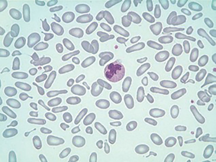

**Fig. 49.6** Marked anisopoikilocytosis in a newborn with neonatal hemolytic anemia and jaundice due to hereditary pyropoikilocytosis (HPP). 

HE, as the RBC membrane in HPP is heat sensitive and becomes almost completely fragmented when incubated at 46°C, a temperature that has no effect on normal RBCs, which do not fragment until the temperature reaches 49°C. 

**Treatment:** Individuals with HE should be informed about the typically milder nature of their disease to prevent unnecessary testing. Most do not need treatment but those with moderate anemia may require regular follow-up and folic acid supplementation to maintain adequate stores. Heterozygous, double heterozygous, homozygous HE, or HPP individuals with severe anemia may require regular blood transfusions. Splenectomy is reserved for life-threatening severe anemia accompanied by organ dysfunction. HE and HPP respond well to splenectomy with partial recovery of hemoglobin concentration. 

##### **Hereditary Stomatocytosis (Abnormal RBC Membrane Permeability Syndromes)** 

Congenital abnormalities of RBC membrane permeability are characterized by the altered flow of monovalent sodium 

(Na+ ) and potassium (K+ ) cations across the cell membrane. The consequent change in intracellular cationic concentrations and cellular water content leads to either RBC dehydration (i.e., xerocytosis) or excess RBC hydration (i.e., hydrocytosis) (Fig. 49.7). Both xerocytosis and hydrocytosis result in chronic hemolysis due to decreased RBC deformability, though affected individuals may be asymptomatic and diagnosed only incidentally when a persistently increased concentration of K+ in the serum of freshly drawn blood is noted (i.e., _pseudohyperkalemia_ ). Morphologically, cells have a slit-like or mouth-like appearance in the place of the usual area of central pallor and are termed _stomatocytes_ . 

**Hereditary Xerocytosis (HX):** HX is the most frequent defect of RBC membrane permeability with a worldwide incidence estimated in 1 in 50,000 births. However, because HX is frequently underdiagnosed, the true incidence is unknown and may be as a high as 1 in 10,000. Two distinct forms of HX are recognized. 

**Dehydrated hereditary stomatocytosis 1 (DHS1)** is the more prevalent form and is caused by pathogenic variants in _PIEZO1_ , which encodes a mechanosensitive protein (Piezo1) that is part of stretch-activated cation channels. When the membrane is stretched, the channel activates, resulting in Ca2+ influx, K+ efflux, and a subsequent decrease in water content (dehydration). Pathogenic variants result in delayed inactivation of the channel, creating a gainof-function phenotype with increased K+ leak that is not compensated for by a proportional intracellular Na+ gain, resulting in RBC dehydration. DHS1 usually presents as a chronic hemolytic syndrome with mild anemia, or as compensated hemolysis associated with marked reticulocytosis. Splenomegaly and gallstones are common, and some affected individuals have a history of transient perinatal edema or nonimmune hydrops fetalis. Total bilirubin is frequently increased, and serum ferritin level is generally higher than expected for the degree of anemia or transfusion history. 

**Dehydrated hereditary stomatocytosis 2 (DHS2)** is caused by pathogenic variants in _KCNN4_ , which encodes the Gardos channel, a widely expressed Ca2+ -dependent K+ channel that mediates K+ conductance in RBCs. 

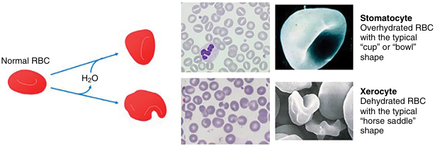

**Fig. 49.7** The two clinical forms of hereditary RBC membrane transport defects: hydrocytosis and xerocytosis.

<!-- p.1119 -->

Compared to DHS1, individuals with DHS2 exhibit a more severe anemia and a lower reticulocyte count associated with a higher frequency of iron overload. 

Diagnosis of both DHS1 and DHS2 is suggested by a high MCHC (typically greater than 350g/L) and high MCV (typically greater than 105 fL). Conventional morphological assessment is often nonspecific; xerocytes with a horse-saddle shape are more readily observed when RBCs are placed in a glutaraldehyde suspension (Fig. 49.8). Diagnosis can be confirmed via several modalities, though not all are widely clinically available: (1) demonstration of reduced intracellular K+ content without a corresponding increase in intracellular Na+ ; (2) OGE with a leftward shift on the osmoscan curve, indicating dehydration and decreased RBC osmotic fragility (Fig. 49.4); and (3) demonstration of pathogenic variants in _PIEZO1_ or _KCNN4_ . 

Treatment is supportive and is directed at the anemia and any complications of hemolysis. Iron overload is relatively frequent in DHS2 and periodic monitoring of liver and heart iron burden using T2* magnetic resonance imaging is necessary. Splenectomy is contraindicated in DHS1 because it may result in an increased risk of venous and arterial thromboembolic complications. 

**Hereditary Hydrocytosis (HH):** HH refers to a group of rare anemias characterized by an increased MCV (typically greater than 105 fL) and increased intracellular Na+ and water content without a compensatory decrease in intracellular K+ . Pathogenic variants in 3 different genes have been associated with forms of HH: 

1. _RHAG_ encodes the Rhesus-associated glycoprotein (RhAG), an ammonium transporter channel; pathogenic variants result in **overhydrated stomatocytosis** . 

2. _SLC4A1_ encodes a segment of band 3 involved in anion exchange and the regulation of cation leak. Pathogenic variants cause a temperature-dependent increase in cation leak that is minor at physiological temperature but major as temperature decreases to around 5°C, a condition 

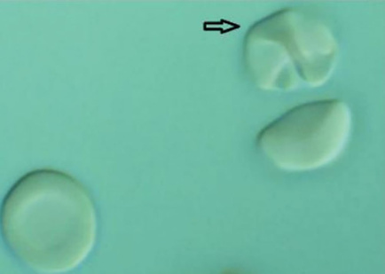

**Fig. 49.8** RBCs observed in suspension with glutaraldehyde and interference optical microscopy. A xerocyte _(arrow)_ can be observed with its classical horse saddle shape. 

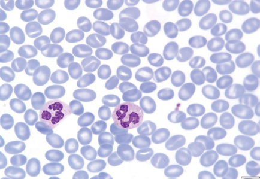

**Fig. 49.9** May-Grünwald Giemsa-stained peripheral blood smear of a patient with South Asian Ovalocytosis (SAO). 

   - termed **cryohydrocytosis** . A distinct form of elliptocytosis with features of cryohydrocytosis termed **Southeast Asian ovalocytosis (SAO)** is caused by a unique deletion of 27 nucleotides in _SLC4A1_ that affects band 3 and results in ovalocytes or ovalo-stomatocytes (Fig. 49.9). As with other forms of cryohydrocytosis, the affected RBC membrane in SAO leaks monovalent cations at an increased rate when exposed to low temperatures. This disorder is found among indigenous people from Papua New Guinea, Indonesia, Malaysia, the Philippines, and southern Thailand. Malaria is endemic within these geographic regions and changes in the RBC membrane associated with SAO confer some degree of protection against cerebral malaria. All identified patients with SAO have been heterozygous, suggesting lethality in the homozygous state. Despite markedly reduced _in vitro_ RBC deformability, patients are generally asymptomatic, with only some having neonatal hemolytic anemia and jaundice. 

3. _SLC2A1_ encodes the GLUT1 glucose transporter, which also binds stomatin, an integral membrane protein. Pathogenic variants produce a large RBC cation leak that increases with decreasing temperatures, as well as features of **GLUT1 deficiency** , a condition termed **stomatin-deficient cryohydrocytosis** . Cryohydrocytosis, in addition to moderate hemolytic anemia, is associated with **cataracts** and **neurological disorders** (e.g., seizures, global developmental delay and intellectual disability, dyskinesia) related to inadequate glucose transport into neurons. 

Affected individuals with HH generally have a chronic hemolytic anemia of variable intensity, as well as macrocytosis with a decreased MCHC (i.e., hypochromic macrocytosis). Intracellular cation determination reveals greatly reduced K+ and markedly increased Na+ , the mechanism for RBC overhydrating. Given the rarity of these disorders, comprehensive data on treatment are lacking. Though splenectomy may be partially effective in reducing hemolysis, it carries a risk of thromboembolic complications and pulmonary hypertension in affected individuals.

<!-- p.1120 -->

**Summary:** Table 49.4 is a useful morphological guide to the differential diagnosis of membrane defects. 

##### **_Erythroenzymopathies_** 

Erythroenzymopathies, or defects in RBC enzymes (other than G6PD) are rare diseases leading to NIHA. Geographic distribution is heterogeneous, with a higher 

prevalence in populations surrounding the Mediterranean basin. Most erythroenzymopathies are characterized by a decrease in enzyme activity, except for NIHA caused by increased adenosine deaminase (ADA) activity. Defects have been identified in nearly all RBC metabolism enzymes, even those affecting fewer than 100 individuals worldwide (Table 49.5). 

###### **TABLE 49.4 Peripheral Blood Film Evaluation in a Patient With Red Cell Membrane Disorder** 

|Shape|Pathobiology|Diagnosis|
|---|---|---|
|Microspherocytes|Loss of membrane lipids leading to a reduction of surface area resulting from deficiencies of spectrin, ankyrin, or band 3 and protein 4.2 Removal of membrane material from antibody-coated red cells by macrophages Removal of membrane-associated Heinz bodies, with the adjacent membrane lipids, by the spleen|HS Immunohemolytic anemias Heinz body hemolytic anemias|
|Elliptocytes|Permanent red cell deformation resulting from a weakening of skeletal protein interactions (such as the spectrin dimer-dimer contact). This facilitates disruption of existing protein contacts during shear stress-induced elliptical deformation. Subsequently, new protein contacts are formed that stabilize elliptical shape|Mild common HE Iron deficiency, megaloblastic anemias, myelofibrosis, myelodysplastic syndrome, thalassemias|
|Poikilocytes/ fragments|Weakening of skeletal protein contacts resulting from skeletal protein variants|Hemolytic HE/HPP Iron deficiency, megaloblastic anemias, myelofibrosis, myelodysplastic syndrome, thalassemias|
|Schistocytes, fragmented red cells|Red cells “torn” by mechanic trauma (fibrin strands, turbulent flow)|“Microangiopathic” hemolytic anemia associated with disseminated intravascular coagulation, thrombotic thrombocytopenic purpura, vasculitis, heart valve prostheses: TMA|
|Acanthocytes|Uptake of cholesterol and its preferential accumulation in the outer leaflet of the lipid bilayer Selective accumulation of sphingomyelin in the outer lipid leaflet|Spur cell hemolytic anemia in severe liver disease Abetalipoproteinemia Chorea-acanthocytosis syndrome, malnutrition, hypothyroidism, McLeod phenotype|
|Echinocytes|Expansion of the surface area of the outer hemileaflet of lipid bilayer relative to the inner hemileaflet|Hemolytic anemia associated with hypomagnesemia and hypophosphatemia in malnourished patients, pyruvate kinase deficiency; in vitro artifact of low blood storage (ATP depletion), contact with glass or elevated pH Hemolysis in long-distance runners, renal failure|
|Stomatocytes|Expansion of the surface area of the inner hemileaflet of the bilayer relative to the outer leaflet|Exposure of red cells to cationic anesthetics in vitro; in vivo the drug concentrations may not be sufficient to produce similar effect Alcoholism, inherited disorders of membrane permeability (hereditary stomatocytosis)|
|Target cells|Absolute excess of membrane lipids (both cholesterol and phospholipids: “symmetric” lipid gain), followed by an increase of cell surface area Relative excess of surface area because of a decrease in cell volume|Obstructive jaundice, liver disease with intrahepatic cholestasis Thalassemias and some hemoglobinopathies (HbC, HbD, and HbE)|

_ATP,_ Adenosine triphosphate; _HE,_ hereditary elliptocytosis; _HPP,_ hereditary pyropoikilocytosis; _HS,_ hereditary spherocytosis; _TMA,_ thrombotic microangiopathy. From Gallagher PG: Red blood cell membrane disorders in Hoffman R, Benz Jr EJ, Silberstein LE, et al. (eds): _Hematology Basic Principles and Practice_ 8/e, 2023, Elsevier, Philadelphia (Table 46.2, p. 652).

<!-- p.1121 -->

**TABLE 49.5 Red Cell Enzymopathies, Clinical Manifestations, and Genetic Transmission** 

|Enzyme|RBC Pathway|Clinical Manifestations|Genetic Transmission|Reported Cases (Identified Pathogenic Variants)|
|---|---|---|---|---|
|Adenosine deaminase, hyperactivity|Nucleotide metabolism|Chronic hemolytic anemia|AD|3 families (No genetic data)|
|Adenylate kinase|Nucleotide metabolism|Chronic hemolytic anemia|AR|12 families (7 pathogenic variants)|
|Aldolase|Glycolysis|• Chronic hemolytic anemia • Neurological disease • Myopathy|AR|6 cases (4 pathogenic variants)|
|Phosphofructokinase|Glycolysis|• Chronic hemolytic anemia • Myopathy|AR|50–100 cases (17 pathogenic variants)|
|Phosphoglycerate kinase|Glycolysis|• Chronic hemolytic anemia • Neurological disease • Myopathy|X-linked|40 cases (19 pathogenic variants)|
|Glucose phosphate isomerase|Glycolysis|• Chronic hemolytic anemia • Mild neurological disease|AR|>50 families (31 pathogenic variants)|
|Glucose-6-phosphate dehydrogenase|Hexose monophosphate shunt|• Acute hemolytic anemia crisis triggered by oxidant drugs, infection, and fava bean ingestion • Chronic hemolytic anemia (very rare)|X-linked|>400 million people (>70 pathogenic variants)|
|6-Phosphogluconate dehydrogenase|Hexose monophosphate shunt|• Chronic hemolytic anemia • Episodic hemolytic events|AR|5 cases (No genetic data)|
|Glutathione reductase|Glutathione metabolism|• Acute hemolytic anemia crisis triggered by oxidant drugs, infection, and fava bean ingestion • Cataracts|AR|2 families (3 pathogenic variants)|
|Glutathione synthetase|Glutathione metabolism|• Chronic hemolytic anemia • Neurological disease|AR|>50 families (32 pathogenic variants)|
|Hexokinase|Glycolysis|• Chronic hemolytic anemia|AR|20 cases (5 pathogenic variants)|
|Pyrimidine-5′- nucleotidase|Nucleotide metabolism|• Chronic hemolytic anemia|AR|>60 families (26 pathogenic variants)|
|Pyruvate kinase|Glycolysis|• Chronic hemolytic anemia|AR|>600 families (>200 pathogenic variants)|
|Triosephosphate Isomerase|Glycolysis|• Chronic hemolytic anemia • Severe neurological disease|AR|50–100 families (10 pathogenic variants)|

_AD,_ Autosomal dominant; _AR,_ autosomal recessive.

<!-- p.1122 -->

RBC metabolism consists of two metabolic pathways and two shunts (Fig. 49.10): (1) anaerobic glycolysis generates ATP; (2) the glutathione pathway maintains normal levels of reduced glutathione (GSH); (3) the hexose monophosphate shunt (HMS) protects the RBC against oxidation; and (4) the Rapoport-Luebering shunt maintains a normal concentration of 2,3-bisphoshoglycerate (2,3-BPG). The RBCs 

also have a small metabolic pathway allowing for nucleotide recovery in the synthesis of ATP and ADP. All erythroenzymopathies, except for the X-linked glucose 6 phosphate dehydrogenase (G6PD) and phosphoglycerate kinase (PGK) deficiencies, have an autosomal recessive mode of inheritance. The most prevalent enzyme deficiencies are G6PD and pyruvate kinase (PK), whereas glucose-6-phosphatase 

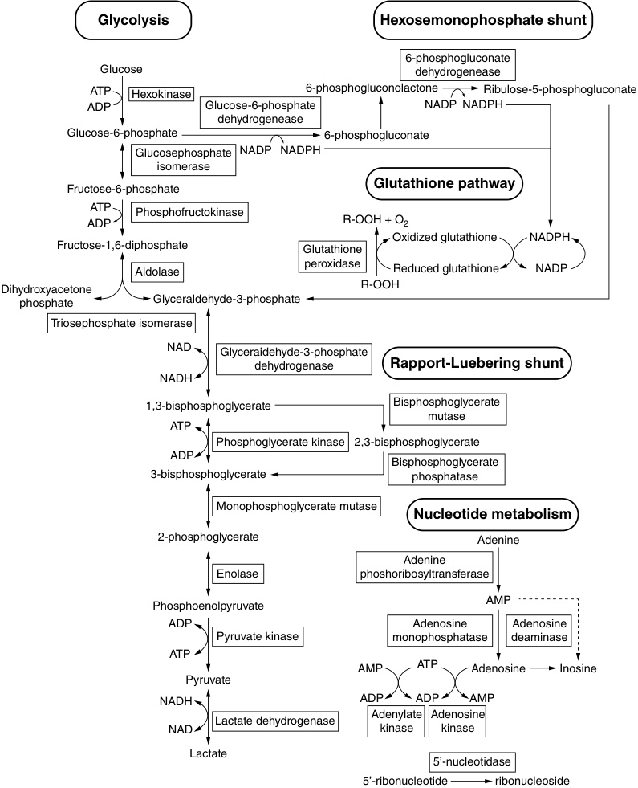

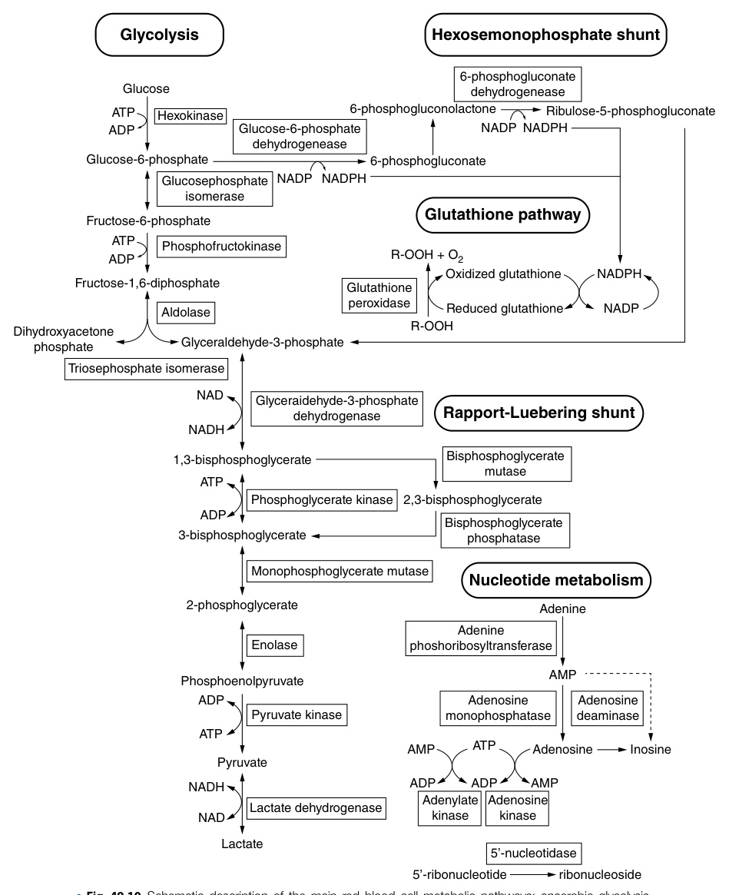

**Fig. 49.10** Schematic description of the main red blood cell metabolic pathways: anaerobic glycolysis, Rapoport–Luebering shunt, hexose monophosphate shunt, glutathione pathway, and nucleotide metabolism.

<!-- p.1123 -->

isomerase (GPI), pyrimidine-5′-nucleotidase (P5′N), hexokinase (HK), phosphofructokinase (PFK), aldolase (ALD), triose phosphate isomerase (TPI), and phosphoglycerate kinase (PGK) are ultrarare disorders described in only a few families worldwide. Deficiencies in ALD, PFK and PGK are associated with **myopathy** . Deficiencies in GPI, PGK, TPI and GSH synthesis enzymes are associated with **neurological dysfunction, global developmental delay** and **intellectual disability** . 

## **Glucose-6-Phosphate Dehydrogenase Deficiency** 

Glucose-6-phosphate dehydrogenase (G6PD) deficiency involves the hexose monophosphate shunt and is the most frequent erythroenzymopathy, affecting more than 400 million people worldwide. This increased prevalence is believed to be secondary to the genetic pressure exerted by endemic malaria in the Mediterranean basin, parts of Africa, Asia, and the Middle East. Transmission is via the X chromosome, so males with a pathogenic variant are hemizygous and suffer from the disease. Females with pathogenic variants are typically asymptomatic heterozygous carriers, though homozygous or compound heterozygous females have the same phenotype as hemizygous males. 

G6PD deficiency is genetically heterogeneous, with hundreds of identified pathogenic variants, the majority of which are single nucleotide substitutions, though affected individuals with multiple missense variants, deletions, or intronic variants have been identified as well. Variants are classified according to the degree of enzyme deficiency, ranging from the most severe (Class 1) to the asymptomatic (Class 4 and Class 5), and correlate with particular alleles, as elaborated in Table 49.6. The most frequent wild type allele is designated B+, whereas another allele, A+, is not associated with any enzyme activity abnormalities. 

**Clinical Manifestations:** G6PD deficiency is typically asymptomatic but should be suspected when an acute hemolytic crisis accompanied by fever, chills, and dark urine (cola or cognac colored) appears between 6 and 48 hours after ingesting fava beans (favism) or drugs with oxidizing effect (Table 49.7). Infections may also cause a severe hemolytic crisis. Many affected individuals have a history of neonatal jaundice. 

**Diagnosis:** During the initial phases of a hemolytic crisis, fragmented RBCs termed _bite cells_ or hyperchromic RBCs with hemoglobin puddled around the cell periphery termed _eccentrocytes_ may be observed (Fig. 49.11). G6PD deficiency is diagnosed by measuring G6PD enzyme activity levels in hemolysate. In hemizygous males or homozygous or compound heterozygous females, G6PD activity is severely reduced to approximately 0.1 IU per gram of hemoglobin. In some variants, the enzyme is unstable in older red blood cells which will be hemolyzed during an exposure. Because the enzyme, in the remaining cells, mostly reticulocytes, has a normal activity, the test may be normal (false negative). 

#### **TABLE 49.6** Clinical i i Classification of G6 i i PD Deficiency

|Classification|Anemia|Variant Model|
|---|---|---|
|Class 1|Chronic, with nonspherocytic hemolytic anemia Severe enzyme deficiency (<1%)|G6PD “Barcelona”|
|Class 2|Hemolytic crisis after fava beans ingestion Severe enzyme deficiency (<10%)|G6PD “Mediterranean”|
|Class 3|Hemolytic crisis after oxidant drugs ingestion Moderate enzyme deficiency (10–40%)|G6PD A (−)|
|Class 4|Asymptomatic Normal enzyme activity|G6PD A (+)|
|Class 5|Asymptomatic Increased enzyme activity|G6PD Hektoen|

Adapted from Glucose-6-phosphate dehydrogenase deficiency. WHO Working Group. _Bull World Health Organ._ 1989;67:601-11. 

### **TABLE Agents Precipitating Hemolysis in Glucose-649.7 Phosphate Dehydrogenase Deficiency** 

Other Medications Acetanilide Vitamin K analogs Methylene blue Toluidine blue Probenecid Dimercaprol Acetylsalicylic acid Phenazopyridine Rasburicase 

**Medications** Antibacterials Sulfonamides Ciprofloxacin Moxifloxacin Norfloxacin Ofloxacin Dapsone Trimethoprim-sulfamethoxazole Nalidixic acid Chloramphenicol Nitrofurantoin Antimalarials Primaquine Pamaquine Chloroquine Quinacrine Anthelminthics β-Naphthol Stibophen Niridazole 

**Chemicals** Phenylhydrazine Benzene Naphthalene (mothballs) 2,4,6-Trinitrotoluene **Illness** Diabetic acidosis Hepatitis Sepsis 

From Brandow AM: Glucose-6-Phosphate Dehydrogenase Deficiency and Related Deficiencies. In _Nelson Textbook of Pediatrics_ 21/e, 2020, Elsevier Philadelphia (Table 490.2, p. 2561).

<!-- p.1124 -->

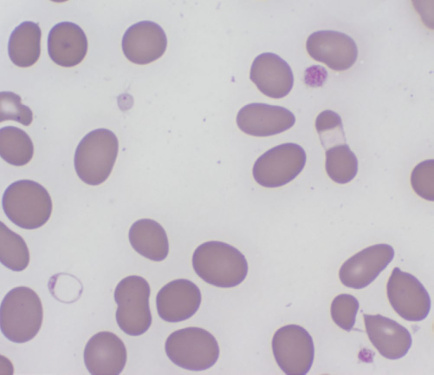

**Fig. 49.11** May-Grünwald Giemsa-stained peripheral blood smear of a patient with glucose-6-phosphate dehydrogenase deficiency and acute hemolytic crisis after fava bean ingestion. In the middle of the image an eccentrocyte with puddled hemoglobin. 

Management is preventive and consists of avoiding exposure to oxidizing substances that can trigger a hemolytic crisis. In cases of intense acute hemolysis with significant amounts of intravascular free hemoglobin, the renal tubules are at risk of clogging, leading to acute renal failure. Close monitoring of renal function is necessary; intense hydration and even dialysis may be required. 

## **Pyruvate Kinase Deficiency** 

Pyruvate kinase (PK) deficiency is the second most frequent cause of NIHA following hereditary spherocytosis, with an estimated prevalence of 1 in 25,000; the true prevalence is likely higher due to difficulties frequently encountered in establishing diagnosis. Inheritance is autosomal recessive. Affected individuals can be homozygous for the same allele though more frequently are compound heterozygotes. PK deficiency affects anaerobic glycolysis, resulting in decreased RBC energy capacity and a chronic hemolytic anemia of variable intensity. More than 600 cases have been described worldwide. 

RBC PK is a tetramer of 4 identical subunits encoded by _PKLR_ , located at chromosomal locus 1q21. Two tissue-specific promoters generate distinct mRNA transcripts that are translated into two isoenzymes: PKR is expressed in RBCs and PKL is expressed in the liver. More than 300 different pathogenic variants responsible for PK deficiency have been described, with marked differences between geographic regions. Only approximately 3% of pathogenic variants in _PKLR_ are de novo; as such, genetic studies should include parental testing to rule out parental somatic mosaicism and to provide adequate genetic counselling. 

**Clinical Manifestations:** Findings are highly variable and can range from compensated hemolysis with little to no anemia, to a severe chronic hemolytic anemia with associated skeletal and gonadal growth failure; severely affected individuals frequently have a history of neonatal jaundice. Phenotypic variability is related to the high frequency of compound heterozygosity. Carriers are typically asymptomatic. Anemia is relatively well tolerated due to a concomitant increase in 2,3-BPG levels, which decreases the affinity of hemoglobin for oxygen and facilitates oxygen release to tissues. 

**Diagnosis:** Diagnosis requires demonstrating decreased PK enzyme activity in hemolysate. Leukocytes, which have normal PK enzyme activity levels, must be carefully removed prior to measurement. Reticulocytes also have relatively higher PK enzyme activity levels than mature RBCs and can mask enzyme deficiency. In individuals with high reticulocyte counts and low-normal PK enzyme activity levels, quantifying the ratio of pyruvate kinase to hexokinase (HK) can differentiate between affected and unaffected individuals: in true PK deficiency the PK/HK ratio is lower than normal, whereas in unaffected individuals the ratio is normal because both PK and HK increase proportionally with reticulocytosis. 

**Treatment:** In patients with severe anemia, treatment typically consists of blood transfusion, with consideration of splenectomy. In patients with a chronic hemolytic syndrome, preventive administration of folic acid is universally recommended to avoid depletion of reserves due hyperconsumption. Chronic transfusions may lead to iron overload; in these cases, splenectomy is typically followed by a moderate increase in hemoglobin that is generally sufficient to decrease or stop the transfusion requirement. The only curative treatment for the disease is hematopoietic stem cell transplantation (HSCT) from an HLA-identical donor, though as this treatment is generally reserved for the most severe cases, comprehensive outcomes data are lacking. 

## **Other Erythroenzymopathies** 

**Glucose Phosphate Isomerase Deficiency:** GPI is involved in anaerobic glycolysis; the phenotype in its deficiency is similar to PK deficiency. Following PK deficiency, GPI deficiency is the most frequent erythroenzymopathy. GPI has multiple isoenzymes; the RBC isoenzyme has enzymatic activity only, but within the central nervous system, GPI has potential neurotrophic actions. As such, patients with GPI deficiency may have neurological manifestations including global developmental delay and intellectual disability in addition to hemolytic anemia. 

**Phosphofructokinase Deficiency:** The PFK enzyme is composed of a muscle (M) subunit, a liver (L) subunit, and a platelet (P) subunit; nearly all affected individuals with PFK deficiency have pathogenic variants impacting the M subunit. PFK deficiency is a rare enzymopathy with prominent myopathy from impaired glycogenolysis; hemolytic symptoms are typically less severe and less prominent.

<!-- p.1125 -->

The disorder is alternately referred to as **glycogen storage disease type 7 (GSD7)** , muscle phosphofructokinase deficiency, or Tarui disease, and is characterized by muscle pain, loss of strength, and myoglobinuria (dark urine). 

**Triose Phosphate Isomerase Deficiency:** TPI deficiency is a rare enzymopathy characterized by hemolytic anemia associated with a severe and progressive neuropathy that leads to premature death, generally during childhood or puberty. Inheritance is autosomal recessive; carriers are asymptomatic. 

**Phosphoglycerate Kinase Deficiency:** PGK deficiency is a rare X-linked disorder that presents with a hemolytic syndrome that in some patients is associated with progressive neurological deterioration and myopathy. 

**Hexokinase Deficiency:** HK deficiency is a rare enzymopathy described in about 21 unrelated families. Nearly all affected individuals have severe anemia of neonatal onset, hyperbilirubinemia, and a transfusion requirement that decreases in adulthood in parallel with a decrease in anemia severity. HK deficiency is associated with decreased 2,3-BPG levels and a higher intolerance of the anemia, the converse of what is seen in PK deficiency. Because reticulocytes have higher HK activity levels compared to mature RBCs, the diagnosis of HK deficiency is generally masked by reticulocytosis. 

**Pyrimidine-59-Nucleotidase Deficiency:** P5′N deficiency impacts the nucleotide metabolism pathway and is characterized by chronic hemolytic anemia and intense basophilic stippling. Lead poisoning can lead to an acquired form of P5′N deficiency. 

**Excess Adenosine Deaminase Activity:** ADA overproduction impacts the nucleotide metabolism pathway and has been described in only 4 unrelated families from the US, Japan, and France. Inheritance is autosomal dominant. Pathogenic variants result in a 5-to-8-fold increase in enzyme levels without affecting enzyme structure or function and are believed to alter mRNA transcription. 

**Erythrocyte Glutathione Deficiency:** Hereditary deficiency of glutathione (GSH), an essential tripeptide that prevents oxidation of RBC structures, is due to the defects in one of the enzymes involved in its synthesis: glutathione synthetase (GS) deficiency or gamma glutamyl cysteine synthetase (GGCS) deficiency. When GS or GGCS deficiency is limited to RBCs (unstable variant), the clinical manifestation is a mild hemolytic anemia with intermittent jaundice. In the most generalized form of the disease, a neurological disorder of variable intensity may be present as well as metabolic acidosis and 5-oxoprolinuria. 

**Summary:** Table 49.8 summarizes differentiating features of membrane vs. enzyme disorders. 

## **Hemoglobinopathies** 

Hemoglobin is a tetrameric protein composed of two pairs of globin chains; one pair of α-chains, and one pair of β-chains. Each globin chain is associated with an ironcontaining heme moiety (Fig. 49.12). The synthesis of 

### **TABLE Main Diagnostic Features of Congenital 49.8 Hemolytic Anemias Due to Membrane or Enzyme Defects** 

|Features|Membrane Defects|Enzyme Defects|
|---|---|---|
|Anemia|Highly variable from severe to normal Hb values|Highly variable from severe to normal Hb values|
|Reticulocytes|Usually elevated except during aplastic crisis|Usually elevated except during aplastic crisis; particularly elevated in PKD after splenectomy|
|Red cell morphology|Highly characteristic|Usually unremarkable|
|Osmotic fragility tests, EMA binding, and ektacytometry|Typically altered|Usually uninformative|
|Membrane protein analysis|Informative in most cases|Not helpful|
|Enzyme assays|Not helpful|Essential|
|Molecular tests|Informative particularly in HSt|Essential|
|Family history|Positive in most cases|Usually negative, consider consanguinity|

_HSt,_ Hereditary stomatocytosis; _PKD,_ pyruvate kynase deficiency. Modified from Fattizzo B, Giannotta JA, Cecchi N, Barcellini W: Confounding factors in the diagnosis and clinical course of rare congenital hemolytic anemias. _Orphan J Rare Dis_ 2021;16:415 (Table 3). 

the α-chains and β-chains is balanced such that their ratio is relatively constant and there is no excess of either type. Hemoglobin is vital for tissue oxygenation and is found exclusively within RBCs, binding oxygen in the lungs and releasing it to the tissues. This important function can be altered by a defect in the protein structure of globin (i.e., structural hemoglobinopathies) or by a decrease of the level of globin synthesis (i.e., thalassemia syndromes). 

Hemoglobinopathies are common in some populations and rare in others, with a higher prevalence typically seen among populations historically living in malaria-endemic regions. Phenotypes range from asymptomatic microcytosis to chronic hemolysis (e.g., thalassemia syndromes), polycythemia, methemoglobinemia, or sickle cell disease. In some affected individuals, a hemoglobinopathy can start with neonatal anemia and jaundice or extremely severe

<!-- p.1126 -->

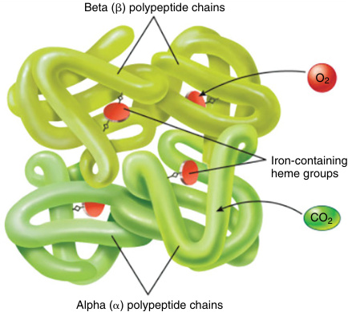

**• Fig. 49.12.** Hemoglobin molecule. Four globin chains and four heme groups. 

forms incompatible with life, with intrauterine fetal death or death shortly after delivery (hydrops fetalis). 

## **Structural Hemoglobinopathies** 

Structural hemoglobinopathies, or hemoglobin variants, are caused by autosomal recessively inherited pathogenic variants in the α, β, δ and γ globin genes that change the primary, secondary, tertiary, or quaternary structure of the hemoglobin molecule. More than 500 structural hemoglobinopathies have been described, though most do not alter function and are considered clinically silent. Some structural changes in the hemoglobin molecule do alter its physical or chemical properties; depending on the location of the amino acid change, one of four clinical forms of structural hemoglobinopathy will result (Table 49.9). Some 

structural hemoglobinopathies are accompanied by decreased globin synthesis, resulting a thalassemic phenotype as well (e.g., hemoglobin E, hemoglobin Constant Spring, and hemoglobin Lepore). Structural hemoglobinopathies are common in malaria-endemic regions, where their existence has provided some degree of protection against infection. 

**Hemoglobin S (HbS)** . The most common structural hemoglobinopathy is HbS, caused by the substitution of glutamic acid (Glu) for valine (Val) in the sixth residue of the β chain (β6 GlunVal). HbS is functionally normal in its oxygenated form, but in the deoxygenated form it polymerizes, giving rise to fibrillar structures that deform the cell, causing it to become rigid and nondeformable. Morphologically, the cells take on diverse elongated shapes, the most prevalent of which is the _sickle cell_ (Fig. 49.13). Most affected individuals with sickle cell disease are homozygous (HbSS), though up to 5% of this population is compound heterozygous for HbS and another hemoglobinopathy, such as hemoglobin C (HbSC), hemoglobin E (HbSE) or thalassemia (HbS-thal). 

**Clinical Manifestations:** Sickle cells are rigid and fragile leading to intravascular hemolysis with anemia, as well as capillary occlusion with microinfarcts and vaso-occlusive crisis (VOC). Heterozygous carriers of HbS are mostly asymptomatic, though some adolescent males have a rare characteristic hematuria and isosthenuria, most likely due to papillary necrosis. For affected individuals with homozygous (HbSS) or compound heterozygous pathogenic variants (e.g., HbSC, HbS-thal), the clinical syndrome of hemolysis, anemia, and painful microinfarcts (VOCs) is known as **sickle cell disease (SCD)** . Visceral manifestations can affect practically all organs, the most frequent of which are the lungs (pulmonary hypertension), gallbladder, and the eyes (retinal infarcts). Bone and spleen tissue are also commonly affected; many patients have central nervous system vasculature involvement and can have recurrent strokes and develop significant disability. A frequent complication of 

#### **TABLE 49.9** Structural Hemog i lobinopathies, Clasi sification According to Type of i Pathogenic i Variant

|Type of Pathogenic Variant-Related Change|Molecular Consequence|Hemoglobin Electrophoresis and/or HPLC|Molecular Stability|Clinical Manifestations|
|---|---|---|---|---|
|Surface amino acid change|Change of physical properties|Abnormal|Normal|• Asympyomatic • Hemolytic crisis and anemia|
|Oxidation of heme iron (Fe3+)|Methemoglobinemia|Abnormal|Decreased|Cyanosis|
|Amino acid change disturbing molecular stability|Instability|Variable|Decreased|Chronic hemolytic anemia|
|Amino acid change disturbing globin chain interaction|Change in hemoglobin affinity for oxygen|No|Variable|• Erythrocytosis (high affinity) • Anemia (low affinity)|

<!-- p.1127 -->

SCD is the **acute chest syndrome (ACS)** , a VOC of the pulmonary vasculature characterized by precordial pain, tachypnea, fever, cough, and arterial oxygen desaturation. Over time, the accumulation of sickled RBCs in the peripheral capillary territories with insufficient return circulation can lead to chronic ulcers, especially in the lower extremities (e.g., malleolar ulcers), or priapism, which can lead to impotence. 

**Diagnosis:** Hemoglobin variants are often identified on newborn screening. Diagnosis of SCD is based on the observation of sickle cells in a peripheral blood smear (Fig. 49.13) and on the demonstration of abnormal hemoglobin by electrophoresis or high-pressure liquid chromatography (HPLC). A hemoglobin solubility test can identify the presence of HbS though cannot distinguish between carriers and affected individuals. 

**Treatment:** The most effective SCD management is avoiding VOC precipitants such as altitude, infection, dehydration, circulatory stasis (e.g., long-distance travel), and cold. When a VOC occurs, treatment is urgent and consists of vigorous hydration, thorough evaluation for and treatment of any triggers, and immediate intensive analgesia. Many crises can be treated at home with oral hydration and analgesia and most resolve within a week. Blood transfusions are sometimes required, often in the setting of severe hemolysis. _Hydroxyurea (HU)_ increases the concentration of fetal hemoglobin (HbF) and protects against sickling. The daily use of HU offers broad benefits to most patients whose disease is severe enough to affect their functional status and is recommended in patients with recurrent episodes of ACS or with more than three VOCs per year requiring hospitalization. The administration of HU is not associated with hematopoietic dysplasia though a slight macrocytic anemia may be observed. HU is currently the treatment of choice in children and young patients, where it is recommended from shortly after birth to prevent recurrent VOCs. In adults, personalized treatment is chosen according to the intensity 

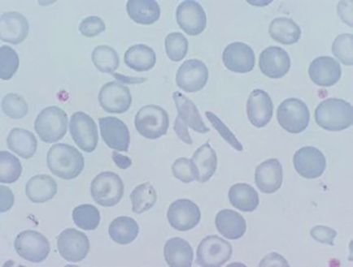

**Fig. 49.13** May-Grünwald Giemsa stain of peripheral blood of a patient with sickle cell disease. An elongated sickle cell can be observed. 

and frequency of VOCs. Hematopoietic stem cell transplantation (HSCT) is curative though is reserved for severe disease. HSCT is most effective in children with SCD, whereas in adults it is conditional on the use of partial myeloablation. Vector directed and CRISPR-Cas9 therapy have been approved for sickle cell anemia; both attempt to increase the production of hemoglobin F, which decreases the risk of sickling. 

**Hemoglobin C (HbC) and Other Hemoglobinopathies With Surface Structural Variants:** HbC is caused by the substitution of glutamic acid at position 6 of the β chain by lysine and is prevalent in West African populations. The heterozygous HbAC condition is asymptomatic, whereas the homozygous HbCC condition is characterized by a moderate chronic hemolytic anemia with splenomegaly. Individuals with HbSC phenotypically have SCD. Other hemoglobinopathies with surface structural variants of clinical interest are hemoglobin J (HbJ) and hemoglobin D (HbD), rare asymptomatic hemoglobinopathies in their heterozygous condition that present with slight anemia in a homozygous state. 

**Unstable Hemoglobin:** Amino acid substitutions that reduce hemoglobin solubility or predispose to its oxidation facilitate hemoglobin precipitation and the formation of inclusion bodies (Heinz Bodies) that damage the red blood cell membrane. Supravital dyes such as brilliant cresyl blue or gentian violet are required for the visualization of Heinz bodies (Fig. 49.14). The most well described variants are those that interfere with the contact points between the α and β subunits (Hb Philly [β35TyrnPhe]), those that alter the helical segments (Hb Genoa [β28LeunPro]) or those that modify the interactions of the globin subunits with the heme group (Hb Köln [β98ValnMet]). More than 200 unstable hemoglobinopathies have been described, characterized by a chronic hemolytic syndrome of variable intensity with 

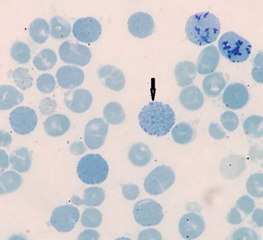

**Fig. 49.14** Heinz bodies in a patient with unstable hemoglobin.

<!-- p.1128 -->

exacerbation crises during febrile episodes or after taking oxidant drugs, as occurs in G6PD deficiency. Affected individuals often have a history of neonatal anemia and jaundice or mild chronic anemia. Many unstable hemoglobin variants are not detected by electrophoresis or HPLC and diagnosis is challenging, requiring demonstration of molecular instability when the hemoglobin is exposed to heat or isopropanol. Heinz bodies are more frequently detected after splenectomy, and although their presence supports diagnosis, genetic sequencing is required for confirmation. Treatment depends on the intensity of the anemia, sometimes requiring splenectomy. Most patients, however, only require folic acid supplements and prophylactic measures such as avoiding the exposure to oxidizing agents. 

**Hemoglobin Lepore:** Due to an unequal crossover and recombination that fuses the proximal end of the δ gene with the distal end of the β gene, giving rise to a single fused δβ gene (α2[δβ]2), this hemoglobinopathy is common in the Mediterranean basin. In the heterozygous state the clinical manifestations are identical to β-thalassemia trait. In the compound heterozygous Hb Lepore/β-thalassemia condition, the phenotype is similar to thalassemia intermedia or major. Diagnosis is via hemoglobin electrophoresis or HPLC. 

**Hemoglobin E (HbE):** A slightly unstable hemoglobinopathy wherein heterozygous carriers exhibit a β-thalassemia trait, HbE in its homozygous form is characterized by a mild microcytic anemia. Because the variant results in decreased β-globin synthesis, HbE is considered a thalassemic hemoglobinopathy. 

**Hereditary Persistence of Fetal Hemoglobin (HPFH):** HPFH is a rare hemoglobinopathy characterized by an excess of normal HbF synthesis in adult life. Because HbF transports oxygen normally, HPFH is asymptomatic. 

**Hemoglobinopathies With Altered Oxygen Affinity:** These hemoglobinopathies are caused by pathogenic variants that modify the affinity of hemoglobin for oxygen and its capability to release oxygen to the tissues. The most frequent are associated with increased oxygen affinity, resulting in reduced oxygen release to the tissues and localized tissue hypoxia. In the kidney, this hypoxia stimulates the release of erythropoietin, resulting in a erythrocytosis that in some circumstances can lead to hemoglobin values in excess of 17 g/dL. In these cases, signs of polycythemia such as facial erythema, headache, or dizziness develop, requiring evaluation for and differentiation from **polycythemia vera (PV)** . PV is a chronic myeloproliferative neoplasia characterized by intense autonomous and indiscriminate proliferation of erythroid precursors independent of erythropoietin, the levels of which in PV are normal. Simple therapeutic phlebotomy may be required to reduce RBC mass. 

Hemoglobinopathies with decreased affinity for oxygen facilitate the release of oxygen into the tissues, leading to local hyperoxygenation and decreased erythropoietin release with consequent compensatory decrease of hemoglobin concentration (relative anemia). Examples include Hb Kansas and Hb Vigo, both asymptomatic. Diagnosis requires measuring the affinity of hemoglobin for oxygen. 

**Hemoglobin M (HbM):** HbM is due to pathogenic variants that favor the oxidation of heme iron (Fe3+ ) and the transformation of hemoglobin into methemoglobin (MetHb). To reversibly bind oxygen, heme iron must always be in the reduced state (Fe2+ ). The NADPH-dependent diaphorase enzyme methemoglobin-reductase (or cytochrome b5 reductase) neutralizes the deleterious effects of oxidizing agents and maintains heme iron in a reduced state. Pathogenic variants causing HbM induce changes in the hemoglobin molecule that prevent the maintenance of iron in its reduced form despite normal diaphorase activity, leading to methemoglobinemia. There is also a low degree of MetHb present in the circulation, though when it exceeds 20% of the total hemoglobin, cyanosis develops. Five molecular variants of HbM have been described, with the only clinical manifestation being a permanent cyanosis from birth that is insensitive to the effect of methylene blue. In contrast, hereditary cyanosis due to cytochrome b5 reductase deficiency disappears with the administration of methylene blue. 

## **Thalassemia Syndromes** 

Thalassemias are hereditary decreases in globin chain synthesis without an associated structural defect and are classified into three main subtypes: β-thalassemia (decrease in β chains), δβ-thalassemia (simultaneous decrease in δ and β chains), and α-thalassemia (decrease in α chains). Thalassemia syndromes are much more frequent than structural hemoglobinopathies and affect almost 200 million people worldwide. Distribution is worldwide though prevalence is highest in certain geographic areas, including the Mediterranean basin, the Middle East, and Southeast Asia. 

Molecular pathophysiology varies, with deletions being more frequent in α-thalassemia and transcription errors being more frequent in β-thalassemia. The anemia is microcytic and hypochromic, findings easily identified by automated hematology analyzers. This microcytic and hypochromic anemia can sometimes be differentiated from iron deficiency anemia by the presence of a compensatory reticulocytosis; however, the improper ratio of globin chains leads to either the precipitation of excess α-globin chains in β-thalassemia or the assembly of β-globin tetramers (β4) in α-thalassemia (HbH, an unstable hemoglobin). Both processes lead to the formation of free radicals that damage membrane proteins and lipids, causing large numbers of erythroblasts to die before maturing into RBCs (i.e., ineffective erythropoiesis), blunting the compensatory reticulocytosis response. Moreover, those mature RBCs that reach the blood stream are defective and are prematurely cleared by the spleen (i.e., hemolysis). Accordingly, in thalassemia syndromes, the severity of the anemia depends on the balance between the degree of ineffective erythropoiesis  and hemolysis. 

**b-Thalassemia:** The β gene is located on chromosome 11 and forms a non-α genomic complex along with the δ and γ genes. Most β-thalassemia is caused by pathogenic variants affecting stages of the mRNA expression pathway: transcription, processing, translation, and posttranslational

<!-- p.1129 -->

modifications of the β-globin chain. The most common pathogenic variants disrupt mRNA splicing or prematurely terminate its translation process. More than 300 variants have been described, mainly in individuals historically from the Mediterranean basin, where the most frequent variant is located in codon 39. The β gene variants can lead to a partial synthesis of β-globin chains **(b1thalassemia** ), which is associated with a compensatory increase in δ (HbA2) or γ (HbF) chains and mild to moderate anemia, or to a total absence of β chain synthesis **(b°thalassemia** ), which is associated with severe anemia often requiring blood transfusion. Homozygosity or compound heterozygosity for of the β+ or β° alleles is associated with a mild decrease in β-globin chains (β+/β+), moderate decrease (β°/β+), or severe decrease with nearly absent β-globin chain synthesis (β°/β°). 

**Clinical Manifestations:** β-thalassemia can be classified into three different forms based on severity: β-thalassemia trait, β-thalassemia intermedia, also known as non-transfusion-dependent thalassemia (NTDT), and transfusion-dependent β-thalassemia (TDT). 

**b-Thalassemia** trait is also known as thalassemia minor and is the most frequent clinical form of thalassemia, characterized by a mild microcytic and hypochromic anemia with a moderate increase in the HbA2 fraction. TT is due to heterozygosity of β+ or β° alleles with the wild type allele (i.e., β+/β or β°/β). 

**b-Thalassemia intermedia** is a moderate to severe clinical form of thalassemia also known as non-transfusion-dependent thalassemia (NTDT) and **b-thalassemia major** is likely the most severe clinical form of NIHA also known as transfusiondependent-thalassemia (TDT). Anemia develops around 5 months of life, when the switch from γ-globin to β-globin chains occurs, and is both severe and microcytic, with typical hemoglobin levels of less than 7 g/dL and MCVs less than 70 fL. Hemoglobin electrophoresis or HPLC reveals the predominance of HbF, with a small fraction of HbA2. Frequently, the children with TM have hepatomegaly and splenomegaly with linear growth failure or pubertal delay. In severe cases, signs of marrow expansion such as frontal bossing can be observed. Chronic transfusion dependence can lead to iron overload, requiring periodic assessment of iron burden and possible chelation therapy. 

**Treatment:** Is multifactorial and consists of the following 

components: 

1. Regular blood transfusions are a key component of managing thalassemia, with a goal hemoglobin greater than 12 g/dL; frequency depends on the type and severity of thalassemia. Typically, thalassemia trait an NTDT does not require blood transfusions whereas TM requires frequent transfusions. Advances in transfusion therapy, combined with iron chelation, have led to notable improvements in quality of life and survival, which is close to that of the unaffected population. 

2. Iron chelation therapy: severe anemia and frequent blood transfusions are generally associated with iron overload. To prevent complications, particularly for the liver, heart, and pancreas, iron chelation therapy with 

either deferoxamine or deferasirox is almost always necessary. Folic acid supplementation is typically administered to patients requiring chelation. 

3. Splenectomy: some patients ultimately benefit from splenectomy, with reduced hemolysis and a concomitant decrease in hyper-erythropoiesis, lowering the risk of iron overload and tissues hemosiderosis. 

4. Hematopoietic stem cell transplantation (HSCT) and gene therapy are the only curative treatment for thalassemia though HSCT is reserved for the more severe cases with neonatal onset, or when regular blood transfusions are problematic or ineffective. HSCT involves replacing the faulty bone marrow with healthy stem cells from a compatible donor. The success for transplantation rate in thalassemia is around 80%, favoring patients with little iron overload or hemosiderosis. 

5. Targeted therapy using recombinant fusion proteins that bind to specific ligands of TGF-β superfamily (luspatercept) enhance erythroid maturation, or gene therapy using Beti-cell (lentiviral β-globin) and Exa-cell (CRISPR-HbF induction) are approved for the management of selected cases of TDT. 

**db-Thalassemia:** this variant of thalassemia is characterized by a defect in the synthesis of δ and β chains and is caused by extensive deletions on chromosome 11. In the homozygous state, only HbF is synthesized (F-thalassemia) and in the heterozygous state, HbF is moderately increased to as high as 16%. Clinical manifestations are only seen in the homozygous state and are similar to less severe NTDT, but less severe. Heterozygous δβ thalassemia or F thalassemia is relatively common in the Mediterranean basin, but less than β-thalassemia. F-thalassemia must be distinguished from hemoglobin Lepore; despite similar clinical manifestations, F-thalassemia it is characterized by anemia with a more severe microcytosis and hypochromasia. 

**a-Thalassemia:** There are two α-globin genes ( _HBA1_ and _HBA2_ ) located on chromosome 16 and copies of each are inherited from each parent; pathogenic variants affecting one or more of the copies result in one of the four forms of α-thalassemia: α-thalassemia silent carrier, α-thalassemia trait, HbH disease, and hemoglobin Bart syndrome. 

**a-Thalassemia silent carrier status** is due to a deletion in one of the four α-globin loci. The most frequent deletion is 3.7 kb in length (−α3.7), though other longer deletions have been identified (e.g., −α4.2, −αMED, −αSEA). This form of α-thalassemia is asymptomatic and is usually only detected in family studies. Findings consist of a mild microcytosis with low-normal hemoglobin concentrations. Up to 20% of individuals in the Mediterranean basin are silent carriers; high rates are also seen in areas of Africa, southern China, and Southeast Asia. 

**a-Thalassemia trait** is the most frequent α-thalassemia variant in individuals from the Mediterranean basin and Southeast Asia and is due to deletions affecting two α-globin loci. Heterozygous carriers may have deletions affecting two genes on the same chromosome (cis deletion) or one gene on each chromosome (trans deletion). Findings

<!-- p.1130 -->

are practically identical to β-thalassemia trait, though affected individuals do not have increased HbA2 levels as seen in β-thalassemia trait. Diagnosis is via genetic testing. 

**Hemoglobin H disease:** Deletion of three loci produces a phenotype similar to that of β-thalassemia intermedia, with anemia, splenomegaly, jaundice, and thalassemia-like bone changes. Distinguishing findings include a lower HbA concentration and the presence of HbH, a slightly unstable hemoglobin resulting from the union of free β-globin chains into β4 tetramers. Most affected individuals inherit their alleles from one silent carrier parent and one parent with α-thalassemia trait. HbH is also observed in **a-thalassemia X-linked intellectual disability syndrome** which is characterized by mild to profound developmental delay and intellectual disability, characteristic facies (hypertelorism, small nose, tented upper lip), microcephaly, short stature, genitourinary anomalies, and neurological dysfunction. This disorder is related to pathogenic variants in _ATRX_ and is inherited in an X-linked fashion. An acquired form of HbH has also described in myelodysplastic syndrome and other clonal myeloid disorders. 

**Hemoglobin Bart syndrome:** Loss of all four alleles results in complete absence of α-globin and is typically incompatible with life. Excess γ-globin forms tetramers called _Hb Bart (g4)_ with an oxygen affinity so great that no meaningful amounts of oxygen are delivered to fetal tissues, causing severe hypoxia, tissue edema, congestive heart failure, and death usually around 30–40 weeks of gestation or shortly after birth if provided with intrauterine transfusions and repeated blood transfusions following birth. 

# **Acquired Nonimmune Hemolytic Anemias** 

Acquired NIHAs are caused by injuries to normal RBCs from drug or heavy metal-induced oxidation, infections, or mechanical disruption of the RBC in the intravascular space in the setting of angiopathy. 

associated with hemolytic anemia, and chronic lead poisoning is associated with a microcytic anemia with basophilic stippling due to induced pyrimidine-5′-nucleotidase inhibition. 

## **NIHA Due to Infections** 

Parasitic or bacterial infection may cause hemolysis via either physical invasion of the RBC membrane or by toxin production. The prototypical example of NIHA due to infection is **malaria** , caused by invasion of RBCs by _Plasmodium falciparum_ . The most common symptoms of malaria are cyclic fever, splenomegaly, hemolytic anemia, and thrombocytopenia. Although in some cases the parasite can be observed on stained peripheral blood smears, diagnosis is confirmed by serological tests. Artesunate has replaced quinine as the recommended first-line treatment for severe malaria; patients should be monitored for drug-induced hemolysis for at least 4 weeks following treatment. Other directly invasive organisms that can induce hemolysis include _Babesia microti_ in Noth America or _Babesia divergens_ in Europe. **Babesiosis** is a very rare infection transmitted by wild or domestic animals and causes a malaria-like disease. Diagnosis is via examination of blood smear or serological tests. **Oroya fever** , a severe acute hemolytic anemia with fever, is caused by the _Bartonella bacilliformis_ which is endemic in South America. If not treated with antibiotics, the infection progresses to a chronic granulomatous disorder called _verruca peruviana_ . NIHA can also be observed in clostridial sepsis, in which lecithinase induces severe intravascular hemolysis associated with disseminated intravascular coagulation. 

In the newborn and neonatal period, transplacental infections including cytomegalovirus, disseminated toxoplasmosis, syphilis, rubella, herpes simplex, and human immunodeficiency virus can present with anemia, hepatosplenomegaly, and jaundice. 

## **NIHA Due to Angiopathies** 

## **Acquired NIHA Due to Exposure to Oxidants** 

Neonatal RBCs are more susceptible to oxidation than mature erythrocytes, and transplacental exposure to oxidizing substances in utero or exposure via breast milk following birth may precipitate a neonatal hemolytic crisis with anemia and jaundice. Peripheral blood smear often shows _bite cells_ and _blister cells_ , poikilocytes (i.e., irregularly shaped RBCs) suggestive of an oxidant-induced hemolytic process; triggering substances are similar to those for G6PD deficiency (Table 49.7). Blood transfusions are rarely required. 

Heavy metal exposure can also precipitate acquired NIHA. The most significant example is **Wilson disease** , an autosomal-recessive disorder characterized by the progressive accumulation of copper in the body, acute liver failure, and neuropsychiatric symptoms. Copper accumulation within RBCs can induce a severe spherocytic hemolytic anemia that occasionally is a presenting feature of the disorder. Zinc intoxication has been associated with a myelodysplastic syndrome with sideroblastic anemia. Acute lead intoxication has been 

**Thrombotic microangiopathies (TMAs)** are rare and diverse disorders characterized by microangiopathic hemolytic anemia, consumptive thrombocytopenia, and end-organ damage caused by the formation of microscopic blood clots throughout the microvasculature. 

_Primary TMAs_ include both congenital and acquired forms of **thrombotic thrombocytopenic purpura (TTP)** ; the _congenital acquired form_ is caused by pathogenic variants in _ADAMTS13_ that decrease its enzyme product activity and the _congenital acquired form_ is typically caused by autoimmunemediated—decreases in ADAMTS13 enzyme activity. ADAMTS13 cleaves von Willebrand factor into smaller active subunits; the uncleaved von Willebrand factor forms large multimers that bind platelets and fibrin, forming large compounds that damage RBCs, resulting in hemolytic anemia. 

An additional primary TMA is **hemolytic uremic syndrome (HUS)** , a life-threatening, and progressive disease that frequently has a genetic component. HUS is characterized by the triad of thrombocytopenia, microangiopathic

<!-- p.1131 -->

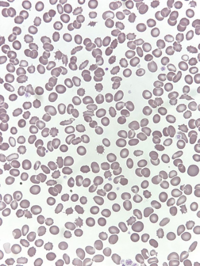

**Fig. 49.15** May-Grünwald Giemsa stain of peripheral blood from a patient with hemolytic uremic syndrome. 

# **Bibliography** 

#### **_Introduction_** 

- Agarwal AM, Rets AV. Molecular diagnosis of hereditary hemolytic anemias: recent updates. _In J Lab Hematol_ . 2023;45(suppl 2):79-86. 

- Cappellini MD, Marcon A, Fattizzo B, Motta I. Innovative treatments for rare anemias. _Hemasphere_ . 2021;5:e576. 

- Fattizzo B, Motta I. Rise of the planet of rare anemias: an update on emerging treatment strategies. _Front Med_ . 2023;9:1097426. 

- Fattizzo B, Giannotta JA, Cecchi N, Barcellini W. Confounding factors in the diagnosis and clinical course of rare congenital hemolytic anemias. _Orphanet J Rare Dis_ . 2021;16:415-419. 

- Kim Y, Park J, Kim M. Diagnostic approaches for inherited hemolytic anemia in the genetic era. _Blood Res_ . 2017;52:84-94. 

- King MJ, Garçon L, Hoyer JD, et al. ICSH guidelines for the laboratory diagnosis of nonimmune hereditary red cell membrane disorders. _Int J Lab Hematol_ . 2015;37:304-325. 

- Mansour-Hendili L, Aissat A, Badaoui B, et al. Exome sequencing for diagnosis of congenital hemolytic anemia. _Orphanet J Rare Dis_ . 2020;15:180. 

- Mohandas N. Inherited hemolytic anemia: a possessive beginner’s guide. _Hematol Am Soc Hematol Educ Program_ . 2018;30:377-381. 

- Rets A, Clayton AL, Christensen RD, Agarwal AM. Molecular diagnostic update in hereditary hemolytic anemia and neonatal hyperbilirubinemia. _Int J Lab Hematol_ . 2019;41(suppl 1):96-101. 

- Vives Corrons JL, Berga Casafont L, Feliu Frasnedo E. Concise review: how do red blood cells born, live, and die? _Ann Hematol_ . 2021;100:2425-2433. 

hemolytic anemia with fragmented RBCs (schistocytes), and acute renal failure. Neurological dysfunction is also a prominent component. The most common form of HUS is secondary to Shiga toxin (Stx)-producing bacteria, typically _Escherichia coli_ O157:H7; _atypical HUS (aHUS)_ is the term given to any HUS not caused by Stx-producing bacteria. Genetic etiologies of HUS are discussed in Chapter 38. 

_Secondary TMAs_ have numerous triggers and can appear from infancy through adulthood. Infants and young children with certain vascular tumors (e.g., kaposiform hemangioendotheliomas, tufted angiomas) can develop **KasabachMerritt syndrome** , a secondary TMA characterized by severe anemia, thrombocytopenia and hypofibrinogenemia. RBCs break into fragments, producing fragile schistocytes, which are removed by the reticuloendothelial system (Fig. 49.15). 

Exposure to certain medications is the most frequent cause of secondary TMAs in adults, which frequently manifest with kidney failure and disseminated intravascular coagulation. Cyclosporine, sirolimus, and tacrolimus are the most common drugs implicated in drug-induced TMA. Additional triggers of secondary TMAs include autoimmune disease, cancer, solid organ and bone marrow transplantation, infections, and malignant hypertension. 

A secondary TMA associated with pregnancy can be observed with preeclampsia or as part of HELLP syndrome (Hemolysis, Elevated Liver enzymes, Low Platelets). Disseminated intravascular coagulation is frequent in HELLP and may lead to multiorgan failure. When HELLP occurs in a woman with antiphospholipid syndrome (APLS), there is extensive microangiopathy and multiorgan failure, a condition termed “catastrophic APLS.” 

- Vives Corrons JL. Eurobloodnet: from rare anaemias to rare haematological diseases, a transitional proposal for European Reference Network. _J Rare Dis Diagn Ther_ . 2016;2:4-6. 

- Vives Corrons JL, Mañú Pereira MM. The European Network for Patients with Rare Anaemias. _J Rare Dis Diagn Ther_ . 2015;1:1-5. 

- Vives-Corrons JL. The rare anaemias. In: _Rare Diseases_ . IntechOpen; 2020. 

#### **_Hereditary Membranopathies_** 

- Andolfo I, Russo R, Gambale A, Iolascon A. New insights on hereditary erythrocyte membrane defects. _Haematologica_ . 2016;101: 1284-1294. 

- Da Costa L, Galimand J, Fenneteau O, Mohandas N. Hereditary spherocytosis, elliptocytosis, and other red cell membrane disorders. _Blood Rev_ . 2013;27:167-178. 

- Delaunay J. The molecular basis of hereditary red cell membrane disorders. _Blood Rev_ . 2007;21:1-20. 

- Kalfa TA. Diagnosis and clinical management of red cell membrane disorders. Hematology _Am Soc Hematol Educ Program_ . 2021;10:331-340. 

- Kaufman HW, Niles JK, Gallagher DR, et al. Revised prevalence estimate of possible Hereditary Xerocytosis as derived from a large U.S. Laboratory database. _Am J Hematol_ . 2018;93:E9-E12. 

- King MJ, Garçon L, Hoyer JD, et al. ICSH guidelines for the laboratory diagnosis of nonimmune hereditary red cell membrane disorders. _Int J Lab Hematol_ . 2015;37:304-325. 

- Risinger M, Kalfa TA. Red cell membrane disorders: structure meets function. _Blood_ . 2020;136:1250-1261. 

- Vives Corrons JL, Krishnevskaya E, Hernandez I, Ancochea A. Characterization of hereditary red blood cell membranopathies using combined targeted next-generation sequencing and osmotic gradient ektacytometry. _Int J Hematol_ . 2021;113:163-174. 

- Vives-Corrons JL, Krishnevskaya E, Hernández-Rodriguez I, PayánPernia S, Sevilla ÁFR, Badell I. Red cell ektacytometry in two patients with chronic hemolytic anemia and three new α-spectrin variants. _Ann Hematol_ . 2022;101:549-555.

<!-- p.1132 -->

- Zaidi AU, Buck S, Gadgeel M, et al. Clinical diagnosis of red cell membrane disorders: comparison of osmotic gradient Ektacytometry and Eosin Maleimide (EMA) fluorescence test for red cell band 3 (AE1, SLC4A1) Content for Clinical Diagnosis. _Front Physiol_ . 2020;11:636-640. 

#### **_Hereditary Enzymopathies_** 

- Fattizzo B, Cavallaro F, Marcello A, Vercellati C, Barcellini W. Pyruvate kinase deficiency: current challenges and future prospects. _J Blood Med_ . 2022;13:461-471. 

- Grace RF, Glader B. Red blood cell enzyme disorders. _Pediatr Clin North Am_ . 2018;65:579-595. 

- Grace RF, Rose C, Layton DM, et al. Safety and efficacy of mitapivat in pyruvate kinase deficiency. _N Engl J Med_ . 2019;381:933-944. 

- Koralkova P, van Solinge WW, van Wijk R. Rare hereditary red blood cell enzymopathies associated with hemolytic anemia— pathophysiology, clinical aspects, and laboratory diagnosis. _Int J Lab Hematol_ . 2014;36:388-397. 

- Luzzatto L. Diagnosis and clinical management of enzymopathies. _Hematol Am Soc Hematol Educ Program_ . 2021;10:341-352. 

- van Dijk MJ, de Wilde JRA, Bartels M, et al. Activation of pyruvate kinase as therapeutic option for rare hemolytic anemias: shedding new light on an old enzyme. _Blood Rev_ . 2023;12:101-103. 

- Vives Corrons JL, Krishnevskaya E, Montllor L, Leguizamon V, Garcia Bernal M. Concomitant hereditary spherocytosis and pyruvate kinase deficiency in a spanish family with chronic hemolytic anemia: contribution of laser ektacytometry to clinical diagnosis. _Cells_ . 2022;11:1133-1137. 

- Vives Corrons JL, Pujades A. Heterogeneity of “Mediterranean type” glucose-6-phosphate dehydrogenase (G6PD) deficiency in Spain and description of two new variants associated with favism. _Hum Genet_ . 1982;60:216-221. 

- Vives Corrons JL. Chronic non-spherocytic haemolytic anaemia due to congenital pyrimidine 5′ nucleotidase deficiency: 25 years later. _Baillieres Best Pract Res Clin Haematol_ . 2000;13:103-118. 

- WHO Working Group. Glucose-6-phosphate dehydrogenase deficiency. _Bull World Health Organ_ . 1989;67:601-611. 

#### **_Hemoglobinopathies_** 

- Aguilar Martinez P, Angastiniotis M, Eleftheriou A, et al. Haemoglobinopathies in Europe: health & migration policy perspectives. _Orphanet J Rare Dis_ . 2014;9:97. 

- Bellis G, Parant A. Beta-thalassemia in Mediterranean countries. Findings and outlook. _INGEO_ . 2022;77:129-138. 

- Benz EJ Jr. Disorders of hemoglobin. In: Longo DL. eds. _Harrison’s Hematology and Oncology_ . 3rd ed. McGraw Hill Education New York; 2016:631-657. 

- Farmakis D, Porter J, Taher A, Cappellini D, Angastiniotis M, Eleftheriou A. Thalassaemia International Federation Guidelines for the management of transfusion-dependent thalassemia. _Hemasphere_ . 2022;29;6(8):e732. 

- Krishnevskaya E, Molero M, Ancochea Á, Hernández I, Vives-Corrons JL. New-generation ektacytometry study of red blood cells in different hemoglobinopathies and thalassemia. _Thalass Rep_ . 2023; 13:70-76. 

- Kuo KHM, Layton DM, Lal A, et al. P1522: long-term efficacy and safety of the oral pyruvate kinase activator mitapivat in adults with non–transfusion-dependent alpha-or β-thalassemia _. Hemasphere_ . 2022;6:1403-1404. 

- Osei MA, McGann PT. Sickle cell disease: time to act on the most neglected global health problem. _Lancet Haematol_ . 2023;10: e558-e559. 

- Piel FB, Steinberg MH, Rees DC. Sickle cell disease. _N Engl J Med_ . 2017;376:1561-1573. 

- Taher AT, Musallam KM, Cappellini MD. β-Thalassemias. _N Engl J Med_ . 2021;384:727-743. 

- Weatherall DJ, Clegg JB. Inherited haemoglobin disorders: an increasing global health problem. _Bull World Health Organ_ . 2001;79:704-712. 

#### **_Acquired NIHA_** 

- Aly MH, Kim HC, Renner SW, Boyarsky A, Kosmin M, Paglia DE. Hemolytic anemia associated with lead poisoning from shotgun pellets and the response to Succimer treatment. _Am J Hematol_ . 1993;44:280-283. 

- Arnold DM, Patriquin CJ, Nazy I. Thrombotic microangiopathies: a general approach to diagnosis and management. _CMAJ_ . 2017; 189:e153-e159. 

- Beris P, Picard V. Non-immune hemolysis: diagnostic considerations. _Semin Hematol_ . 2015;52:287-303. 

- Mocanu A, Bogos RA, Lazaruc TI, et al. Pitfalls of thrombotic microangiopathies in children: two case reports and literature review. _Diagnostics (Basel)_ . 2023;13:1228-1232. 

- Palma LMP, Vaisbich-Guimarães MH, Sridharan M, Tran CL, Sethi S. Thrombotic microangiopathy in children. _Pediatr Nephrol_ . 2022;37:1967-1980. 

- Paulino C, Silvestre J, Goncalves Pereira J, Tapadinhas C, Mendes V, Povoa P. Clostridium Perfringens sepsis with massive intravascular haemolysis: a rare presentation. _J Med Cases_ . 2012;3:207-210. 

- Ricard MP. Spur cell hemolytic anemia of severe liver disease. _Haematologica_ . 1999;84:654. 

- Riyazuddin R, Nisha N, Ejaz B, et al. A comprehensive review on the heavy metal toxicity and sequestration in plants. _Biomolecules_ . 2021;12:43-46. 

- Robitaille GA, Piscatelli RL, Majeski EJ, Gelehrter TD. Hemolytic anemia in Wilson’s disease. _JAMA_ . 1977;237:2402-2403. 

- Vives Corrons JL, Mañú Pereira M, Romeo-Casabona M, et al. Recommendations for centres of expertise in rare anaemias. The ENERCA White Book. _Thalass Rep_ . 2014;4:4878.

<!-- p.1133 -->
