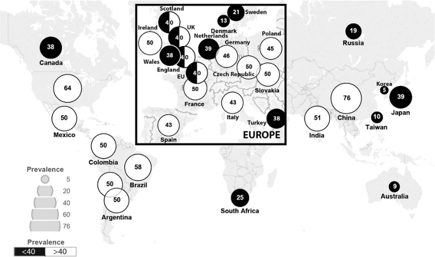

# Chapter 3: The Approach to Rare Diseases: From Local to Global — Active-Recall Flashcards
**Section I: Introductory Chapters** | [📖 Read Wiki Chapter](../chapters/003_The_Approach_to_Rare_Diseases_From_Local_to_Global.md) | [📝 Chapter MCQs](../mcqs/003_mcqs.md) | [🏠 Course Master Index](../../index.md)

Total cards: **24** *(Click any card below to reveal the answer)*

### Card 1 (Precision Therapy & Management)

<b>Q:</b> What is the targeted therapeutic approach or clinical management strategy for **Treatment Opportunities and Therapy Development**?

**Answer:**
**Therapy / Intervention:** Targeted / Disease-Modifying Therapy

**Clinical Context:** This incentivization is the objective of orphan drug policies that provide dedicated resource support when a drug, gene therapy, or cell therapy is specifically intended for the treatment of a RD.

### Card 2 (Clinical & Diagnostic Concept)

<b>Q:</b> In the clinical evaluation of **An Overview of Rare Diseases**, how is **ultra-rare** defined and characterized?

**Answer:**
ultra-rare , affecting fewer than 1 in 50,000 individuals.

### Card 3 (Clinical & Diagnostic Concept)

<b>Q:</b> In the clinical evaluation of **An Overview of Rare Diseases**, how is **rarity paradox** defined and characterized?

**Answer:**
rarity paradox : each individual disease is infrequent but the collective group of people living with a rare disease (PLWRD) is large.

### Card 4 (Clinical & Diagnostic Concept)

<b>Q:</b> In the clinical evaluation of **Geographical Dispersion**, how is **founder effect** defined and characterized?

**Answer:**
founder effect of disease-causing pathogenic variants, with a consequent increase in the carrier rate in that population, or the presence of a population cluster due to environmental problems (e.

### Card 5 (Clinical & Diagnostic Concept)

<b>Q:</b> In the clinical evaluation of **Rare Disease Diagnostics**, how is **Stigma** defined and characterized?

**Answer:**
Stigma , as seminally defined in the work of 20th century sociologist Erving Goffman, is a discrediting attribute that distinguishes an individual from others by reducing them “from a whole and usual person to a tainted, discounted one.

### Card 6 (Clinical & Diagnostic Concept)

<b>Q:</b> In the clinical evaluation of **The Rare Disease Landscape in Canada and the United States**, how is **Orphan Drug Act** defined and characterized?

**Answer:**
Orphan Drug Act in 1983, creating incentives for RD pharmacologic therapy development.

### Card 7 (Clinical & Diagnostic Concept)

<b>Q:</b> In the clinical evaluation of **The Rare Disease Landscape in Canada and the United States**, how is **Rare Disease Act of 2002** defined and characterized?

**Answer:**
Rare Disease Act of 2002 established a definition of rarity (<200,000 cases in the United States), established a RD office at the National Institutes of Health, and provided funding for a research network for selected rare diseases (Rare Diseases Clinical Research Network or RDCRN).

### Card 8 (Visual & Imaging Spotter)

<b>Q:</b> Identify the diagnostic sign, dysmorphic phenotype, neuroimaging pattern, or molecular pathway illustrated below (Fig. 3.1):

**Answer:**
Rare disease prevalence per 100,000 across countries and jurisdictions. The size of the circles corresponds to the average prevalence threshold (number of cases per 100,000 people). Black and white circles correspond to jurisdictions in which the average prevalence in definitions of rare disease is lower or higher, respectively, than the average across all jurisdictions of 40 cases/100,000 people. Map lines delineate study areas and do not necessarily depict accepted national boundaries.

### Card 9 (Differential Diagnosis)

<b>Q:</b> In the differential diagnosis of **Global and M f ultinational Coordinated Efforts for Rare Diseases**, what are the distinguishing features of **Rare Diseases International (RDI)**?

**Answer:**
**Concept**: RDI promotes international initiatives such as the Global Network for Rare Disease, supporting the rare disease community in developing a person-centered global network of care and expertise for all people living with a rare disease, and the adoption of 12 main recommendations to be addressed at international level as a matter of priority.; **URL**: https://www.rarediseasesinternational. org/collaborative-global-network/. https://www. rarediseasesinternational.org/jointdeclaration/ https://www.rarediseasesinternational. org/description-for-rd/

### Card 10 (Differential Diagnosis)

<b>Q:</b> In the differential diagnosis of **Global and M f ultinational Coordinated Efforts for Rare Diseases**, what are the distinguishing features of **The United Nations**?

**Answer:**
**Concept**: The NGO Committee for Rare Diseases is a substantive committee established under the umbrella of the Conference of NGOs (nongovernmental organizations) in Consultative Relationship with the United Nations (CoNGO). The goal is to promote rare diseases as a priority in global health, research, and social and medical care as part of the UN 2030 Agenda: the Sustainable Development Goals (SDGs).; **URL**: http://download2.eurordis.org. s3.amazonaws.com/ ngocommittee/ngocommittee_ report.pdf

### Card 11 (Differential Diagnosis)

<b>Q:</b> In the differential diagnosis of **European a f nd Eastern Mediterranean Coordinated Efforts for Rare Dise f ases**, what are the distinguishing features of **Committee for Orphan Medicinal Products (COMP)**?

**Answer:**
**Concept**: Established in 2000, COMP is the European Medicines Agency committee responsible for recommending orphan designation of medicines for rare diseases.; **URL**: https://www.ema.europa.eu/en/ committees/committee-orphanmedicinal-products-comp https://www.ema.europa.eu/en/ human-regulatory/overview/ orphan-designation-overview

### Card 12 (Differential Diagnosis)

<b>Q:</b> In the differential diagnosis of **European a f nd Eastern Mediterranean Coordinated Efforts for Rare Dise f ases**, what are the distinguishing features of **European Union (EU) National Plans & Strategies**?

**Answer:**
**Concept**: A European Council recommendation to EU member states to implement strategic plans for rare diseases to ensure that patients have access to high-quality care, including diagnostics, treatments, rehabilitation for those living with a rare disease, and, if possible, effective orphan drugs.; **URL**: https://health.ec.europa.eu/latestupdates/national-plans-or- strategies-rare-diseases-pageupdated-1970-01-01_en

### Card 13 (Differential Diagnosis)

<b>Q:</b> In the differential diagnosis of **European a f nd Eastern Mediterranean Coordinated Efforts for Rare Dise f ases**, what are the distinguishing features of **EURORDIS**?

**Answer:**
**Concept**: Rare Diseases Europe is a nonprofit alliance of over 1,000 rare disease patient organizations from 74 countries that work together to improve the lives of people living with a rare disease, strengthen the patient voice, and shape research, policies, and patient services.; **URL**: https://www.eurordis.org/

### Card 14 (High-Yield Clinical Pearl)

<b>Q:</b> What is a critical clinical or diagnostic hallmark regarding **Genetics, Inheritance, and Risk of Recurrence** (The Approach to Rare Diseases: From Local to Global)?

**Answer:**
Up to 80% of rare diseases are genetic, and most follow either Mendelian or mitochondrial monogenic inheritance, meaning that the underlying cause is a pathogenic variant in autosomal dominant, X-linked, or mitochondrial cases and biallelic pathogenic variants in autosomal recessive cases.

### Card 15 (High-Yield Clinical Pearl)

<b>Q:</b> What is a critical clinical or diagnostic hallmark regarding **Treatment Opportunities and Therapy Development** (The Approach to Rare Diseases: From Local to Global)?

**Answer:**
This incentivization is the objective of orphan drug policies that provide dedicated resource support when a drug, gene therapy, or cell therapy is specifically intended for the treatment of a RD.

### Card 16 (High-Yield Clinical Pearl)

<b>Q:</b> What is a critical clinical or diagnostic hallmark regarding **Newborn Screening for Rare Diseases** (The Approach to Rare Diseases: From Local to Global)?

**Answer:**
Both the United States and Canada have ceded decisions about newborn screening (NBS) to individual states and provinces, respectively.

### Card 17 (High-Yield Clinical Pearl)

<b>Q:</b> What is a critical clinical or diagnostic hallmark regarding **The Rare Disease Landscape in Europe** (The Approach to Rare Diseases: From Local to Global)?

**Answer:**
EURORDIS also supports relevant public health and clinical actions, such as newborn screening, favoring the incorporation of genome sequencing to expand the early detection of more actionable genetic RDs.

### Card 18 (High-Yield Clinical Pearl)

<b>Q:</b> What is a critical clinical or diagnostic hallmark regarding **Rare Disease Landscape in Southeast Asia** (The Approach to Rare Diseases: From Local to Global)?

**Answer:**
In addition, the policy has also provided for the inclusion of 40 rare diseases in its expanded newborn screening program starting in 2022.

### Card 19 (High-Yield Clinical Pearl)

<b>Q:</b> What is a critical clinical or diagnostic hallmark regarding **The Rare Disease Landscape in the Western Pacific Region** (The Approach to Rare Diseases: From Local to Global)?

**Answer:**
The Philippines established a central laboratory in 1997 for a nationwide newborn screening system.

### Card 20 (Pathophysiology & Synthesis)

<b>Q:</b> What core pathophysiologic or diagnostic principle governs **The Approach to Rare Diseases From Local to Global**?

**Answer:**
DAVID ADAMS, GARETH BAYNAM, MARIELA LARRANDABURU, HELEN MALHERBE, CARMENCITA D.

### Card 21 (Pathophysiology & Synthesis)

<b>Q:</b> What core pathophysiologic or diagnostic principle governs **An Overview of Rare Diseases**?

**Answer:**
Rare diseases (RDs) are a global healthcare priority and a challenge for health professionals, scientific researchers, affected individuals, and their families.

### Card 22 (Pathophysiology & Synthesis)

<b>Q:</b> What core pathophysiologic or diagnostic principle governs **Public Health**?

**Answer:**
Labeling an individual disorder or group of disorders (e.g., Friedreich ataxia or inherited cerebellar ataxias) as rare collectively elevates them to a public health priority.

### Card 23 (Pathophysiology & Synthesis)

<b>Q:</b> What core pathophysiologic or diagnostic principle governs **Natural History: Diversity and Heterogeneity**?

**Answer:**
The nature of the pathological processes varies from diseases that affect a single organ system to multisystem diseases; in the case of retinitis pigmentosa and the group of retinal dystrophies, the affected organ is the eye and individuals suffer from a sensory disorder.

### Card 24 (Pathophysiology & Synthesis)

<b>Q:</b> What core pathophysiologic or diagnostic principle governs **Comprehensive and Multidisciplinary Care**?

**Answer:**
In many cases, affected individuals require care that goes beyond that offered by a single specialized healthcare provider.

