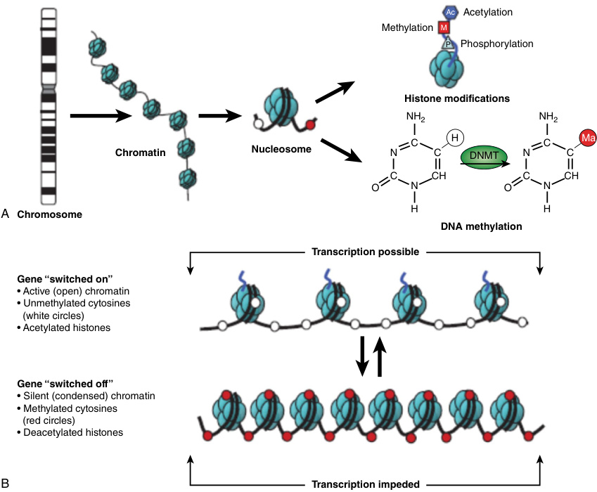
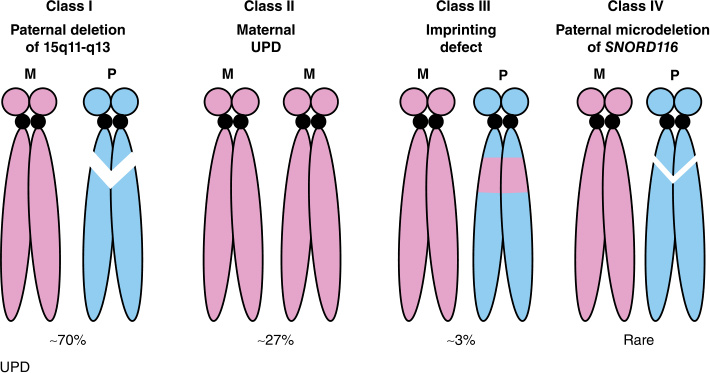

# Chapter 4: Epigenetics, Genomic Imprinting, and Imprinting Disorders — Active-Recall Flashcards
**Section II: Developmental Structural Disorders** | [📖 Read Wiki Chapter](../chapters/004_Epigenetics_Genomic_Imprinting_and_Imprinting_Disorders.md) | [📝 Chapter MCQs](../mcqs/004_mcqs.md) | [🏠 Course Master Index](../../index.md)

Total cards: **28** *(Click any card below to reveal the answer)*

### Card 1 (Syndrome & OMIM Profile)

<b>Q:</b> What are the genetic etiology, inheritance pattern, and hallmark clinical features of **Diabetes mellitus, transient neonatal,1** (#601410)?

**Answer:**
**Causative Gene(s):** `PLAGL1` · **Inheritance:** Imprinting / UPD

**Clinical & Molecular Profile:** Chromosome/ Imprinted Gene: 6q24/PLAGL1,HYMAI — Molecular Defect: UPD (chr6) pat, paternal duplications, methylation defects onPLAGL1 TSS (caused by pathogenic variants in ZFP57gene at chr6p22) — Key Clinical Features: Intrauterine growth restriction, neonatal diabetes mellitus, hyperglycemia, macroglossia — Current Treatment: Insulin

### Card 2 (Syndrome & OMIM Profile)

<b>Q:</b> What are the genetic etiology, inheritance pattern, and hallmark clinical features of **Silver-Russell syndrome** (#180860, #618905, #616489)?

**Answer:**
**Causative Gene(s):** `H19, IGF2` · **Inheritance:** Imprinting / UPD

**Clinical & Molecular Profile:** Chromosome/ Imprinted Gene: 11p15.5/H19, IGF2 7p13-q32/C7ORF10 11p15.5/IGF2 — Molecular Defect: UPD (chr11p15) mat chr11p15 CNVs UPD (chr7) mat methylation defects on H19andIGF2genes — Key Clinical Features: Pre-and postnatal growth deficiency, asymmetry, broad forehead, facial dysmorphism, macrocephaly, gastrointestinal symptoms — Curren

### Card 3 (Syndrome & OMIM Profile)

<b>Q:</b> What are the genetic etiology, inheritance pattern, and hallmark clinical features of **Birk–Barel syndrome** (#612292)?

**Answer:**
**Causative Gene(s):** `KCNK9` · **Inheritance:** Genetic

**Clinical & Molecular Profile:** Chromosome/ Imprinted Gene: 8q24.3/KCNK9 — Molecular Defect: KCNK9missense pathogenic variants on maternal gene — Key Clinical Features: Developmental delay, central hypotonia, facial dysmorphism, intellectual disability — Current Treatment: Symptomatic care

### Card 4 (Syndrome & OMIM Profile)

<b>Q:</b> What are the genetic etiology, inheritance pattern, and hallmark clinical features of **Beckwith–Wiedemann syndrome** (#130650)?

**Answer:**
**Causative Gene(s):** `H19, IGF2` · **Inheritance:** Imprinting / UPD

**Clinical & Molecular Profile:** Chromosome/ Imprinted Gene: 11p15.5/H19, IGF2 — Molecular Defect: UPD (chr11p15) pat, hypermethylation on H19andIGF2genes imprinting control region (ICR1) — Key Clinical Features: Hypoglycemia, hyperinsulinism, macroglossia, overgrowth, visceromegaly — Current Treatment: Surgery to correct omphalocele or umbilical hernia, diazoxide

### Card 5 (Syndrome & OMIM Profile)

<b>Q:</b> What are the genetic etiology, inheritance pattern, and hallmark clinical features of **Kagami–Ogata syndrome** (#608149)?

**Answer:**
**Causative Gene(s):** `DLK1, MEG3, RTL1, MEG8, DIO3` · **Inheritance:** Imprinting / UPD

**Clinical & Molecular Profile:** Chromosome/ Imprinted Gene: 14q32/DLK1,MEG3, RTL1, MEG8, miRNAs, SNORDs, DIO3, RTL1as — Molecular Defect: UPD (chr14) pat, 14q32 mat deletion, hypermethylation on MEG3–DLK1region — Key Clinical Features: Polyhydramnios, macrosomia, placentomegaly, hypotonia, developmental delay, abdominal wall defects, cardiac/thoracic abnormalities, coat

### Card 6 (Syndrome & OMIM Profile)

<b>Q:</b> What are the genetic etiology, inheritance pattern, and hallmark clinical features of **Temple syndrome** (#616222)?

**Answer:**
**Causative Gene(s):** `DLK1, MEG3, RTL1, MEG8, DIO3` · **Inheritance:** Imprinting / UPD

**Clinical & Molecular Profile:** Chromosome/ Imprinted Gene: 14q32/DLK1,MEG3, RTL1, MEG8, miRNAs,SNORDs, DIO3, RTL1as — Molecular Defect: UPD (chr14) mat, 14q32 pat deletion, hypomethylation on MEG3–DLK1region — Key Clinical Features: Postnatal short stature, hypotonia, developmental delay, small hands and feet, intellectual disability — Current Treatment: Growth hormone

### Card 7 (Syndrome & OMIM Profile)

<b>Q:</b> What are the genetic etiology, inheritance pattern, and hallmark clinical features of **Prader–Willi syndrome** (#176270)?

**Answer:**
**Causative Gene(s):** `MRKN3, MAGEL2, NDN, PWRN4, PWRN3, SNRPN` · **Inheritance:** Imprinting / UPD

**Clinical & Molecular Profile:** Chromosome/ Imprinted Gene: 15q11.2-q13/MRKN3, MAGEL2, NDN, PWRN4, PWRN3, SNURF-SNRPN, SNORDs IPW — Molecular Defect: chr15q11.2-q13 pat deletion, UPD (chr15) mat, imprinting defect, deletion of paternal SNORD116 — Key Clinical Features: Hypotonia, developmental delay, intellectual disability, hyperphagia, hypogonadism, diabetes type II —

### Card 8 (Syndrome & OMIM Profile)

<b>Q:</b> What are the genetic etiology, inheritance pattern, and hallmark clinical features of **Angelman syndrome** (#105830)?

**Answer:**
**Causative Gene(s):** `UBE3A` · **Inheritance:** Imprinting / UPD

**Clinical & Molecular Profile:** Chromosome/ Imprinted Gene: 15q11.2-q13/UBE3A — Molecular Defect: chr15q11.2-q13 mat deletion, UPD (chr15) pat, imprinting defect, UBE3Apathogenic variants on the maternal allele — Key Clinical Features: Unmotivated laughing, ataxia, microcephaly, developmental delay, seizures, hyperreflexia — Current Treatment: Antiepileptic drug

### Card 9 (Syndrome & OMIM Profile)

<b>Q:</b> What are the genetic etiology, inheritance pattern, and hallmark clinical features of **Schaaf–Yang syndrome** (#615547)?

**Answer:**
**Causative Gene(s):** `MAGEL2` · **Inheritance:** Imprinting / UPD

**Clinical & Molecular Profile:** Chromosome/ Imprinted Gene: 15q11.2/MAGEL2 — Molecular Defect: MAGEL2pathogenic variants in the paternal allele — Key Clinical Features: Psychomotor developmental delay, hypotonia, behavioral abnormalities, intellectual disability — Current Treatment: Growth hormone, antipsychotic medication, noninvasive ventilation

### Card 10 (Syndrome & OMIM Profile)

<b>Q:</b> What are the genetic etiology, inheritance pattern, and hallmark clinical features of **Pseudohypoparathyroidism1A (PHP1A)/PHP1C** (#103580, #612462)?

**Answer:**
**Causative Gene(s):** `GNAS` · **Inheritance:** Imprinting / UPD

**Clinical & Molecular Profile:** Chromosome/ Imprinted Gene: 20q13.32/GNAS — Molecular Defect: Inactivating pathogenic variants on the maternal allele ofGNAS — Key Clinical Features: Albright hereditary osteodystrophy, resistance to parathyroid/ other hormones, obesity, cognitive impairment — Current Treatment: Growth hormone, vitamin D

### Card 11 (Molecular Etiology)

<b>Q:</b> Pathogenic variants in **`SNORD116`** are associated with which clinical phenotype and molecular mechanism in **Molecular Genetics**?

**Answer:**
There are rare cases of PWS patients with typical features which only have a small microdeletion restricted to SNORD116 .

### Card 12 (Molecular Etiology)

<b>Q:</b> Pathogenic variants in **`MAGEL2`** are associated with which clinical phenotype and molecular mechanism in **Molecular Genetics**?

**Answer:**
Pathogenic variants of paternal origin in MAGEL2 have been found in patients with autism spectrum disorder (ASD) and some overlapping features with PWS—the Schaaf-Yang syndrome (SHFYNG) .

### Card 13 (Molecular Etiology)

<b>Q:</b> Pathogenic variants in **`UBE3A`** are associated with which clinical phenotype and molecular mechanism in **Molecular Genetics**?

**Answer:**
UBE3A is the only gene that is solely expressed from the maternal chromosome.

### Card 14 (Molecular Etiology)

<b>Q:</b> Pathogenic variants in **`IGF2`** are associated with which clinical phenotype and molecular mechanism in **Molecular Genetics**?

**Answer:**
The IC1 region is a CpG island that is mapped to the intergenic region between H19 and IGF2 .

### Card 15 (Molecular Etiology)

<b>Q:</b> Pathogenic variants in **`KCNQ1OT1`** are associated with which clinical phenotype and molecular mechanism in **Molecular Genetics**?

**Answer:**
The IC2 region is associated with transcriptional start site of KCNQ1OT1 .

### Card 16 (Molecular Etiology)

<b>Q:</b> Pathogenic variants in **`CDKN1C`** are associated with which clinical phenotype and molecular mechanism in **The Second-Tier Diagnostic Test**?

**Answer:**
If DNA methylation of IC1 and IC2 and SNP chromosome microarray are negative, a single gene sequencing test of CDKN1C should be requested.

### Card 17 (Precision Therapy & Management)

<b>Q:</b> What is the targeted therapeutic approach or clinical management strategy for **Diabetes mellitus, transient neonatal,1**?

**Answer:**
**Therapy / Intervention:** Insulin

**Clinical Context:** Chromosome/ Imprinted Gene: 6q24/PLAGL1,HYMAI — Molecular Defect: UPD (chr6) pat, paternal duplications, methylation defects onPLAGL1 TSS (caused by pathogenic variants in ZFP57gene at chr6p22) — Key Clinical Features: I

### Card 18 (Precision Therapy & Management)

<b>Q:</b> What is the targeted therapeutic approach or clinical management strategy for **Silver-Russell syndrome**?

**Answer:**
**Therapy / Intervention:** Growth hormone

**Clinical Context:** Chromosome/ Imprinted Gene: 11p15.5/H19, IGF2 7p13-q32/C7ORF10 11p15.5/IGF2 — Molecular Defect: UPD (chr11p15) mat chr11p15 CNVs UPD (chr7) mat methylation defects on H19andIGF2genes — Key Clinical Features: Pre-and post

### Card 19 (Precision Therapy & Management)

<b>Q:</b> What is the targeted therapeutic approach or clinical management strategy for **Birk–Barel syndrome**?

**Answer:**
**Therapy / Intervention:** Symptomatic care

**Clinical Context:** Chromosome/ Imprinted Gene: 8q24.3/KCNK9 — Molecular Defect: KCNK9missense pathogenic variants on maternal gene — Key Clinical Features: Developmental delay, central hypotonia, facial dysmorphism, intellectual disability

### Card 20 (Precision Therapy & Management)

<b>Q:</b> What is the targeted therapeutic approach or clinical management strategy for **Beckwith–Wiedemann syndrome**?

**Answer:**
**Therapy / Intervention:** Surgery to correct omphalocele or umbilical hernia, diazoxide

**Clinical Context:** Chromosome/ Imprinted Gene: 11p15.5/H19, IGF2 — Molecular Defect: UPD (chr11p15) pat, hypermethylation on H19andIGF2genes imprinting control region (ICR1) — Key Clinical Features: Hypoglycemia, hyperinsulinism, macroglos

### Card 21 (Clinical & Diagnostic Concept)

<b>Q:</b> In the clinical evaluation of **Terminology**, how is **Genomic imprinting** defined and characterized?

**Answer:**
Genomic imprinting is a specific form of epigenetic modifications that involves the epigenetic marking of genes and results in a parent-of-origin specific expression pattern.

### Card 22 (Clinical & Diagnostic Concept)

<b>Q:</b> In the clinical evaluation of **Clinical Features**, how is **Motor delays** defined and characterized?

**Answer:**
Motor delays and tremulous movements of limbs are common.

### Card 23 (Clinical & Diagnostic Concept)

<b>Q:</b> In the clinical evaluation of **Clinical Features**, how is **Abnormal EEG** defined and characterized?

**Answer:**
Abnormal EEG with a characteristic pattern of largeamplitude slow-spike waves.

### Card 24 (Clinical & Diagnostic Concept)

<b>Q:</b> In the clinical evaluation of **Clinical Features**, how is **Developmental delay** defined and characterized?

**Answer:**
Developmental delay and intellectual disability: Individuals with AS experience significant developmental delays in reaching motor and cognitive milestones.

### Card 25 (Clinical & Diagnostic Concept)

<b>Q:</b> In the clinical evaluation of **Uniparental Disomy 14 (UPD 14) (OMIM #616222 and #608149)**, how is **Temple syndrome (TS)** defined and characterized?

**Answer:**
Temple syndrome (TS) and UPD 14pat is the cause of a different imprinting disorder known as Kagami-Ogata syndrome (KOS) .

### Card 26 (Clinical & Diagnostic Concept)

<b>Q:</b> In the clinical evaluation of **Clinical Features**, how is **Diabetes mellitus** defined and characterized?

**Answer:**
Diabetes mellitus may recur in adolescence or later in adulthood.

### Card 27 (Visual & Imaging Spotter)

<b>Q:</b> Identify the diagnostic sign, dysmorphic phenotype, neuroimaging pattern, or molecular pathway illustrated below (Fig. 4.1):

**Answer:**
Schematic representation of epigenetic modifications at multiple levels of DNA packaging. (A) Nucleosomes consist of histone proteins (shown in blue) surrounded by two loops of DNA and when assembled as beads on a string form chromatin, the building block of a chromosome. Reversible and site-specific histone modifications occur at multiple sites through acetylation, methylation, and phosphorylation. DNA methylation occurs at 5 position of cytosine residues in a reaction catalyzed by DNA methyltransferases (DNMTs). Together, these modifications provide a unique epigenetic signature that regulates chromatin organization and gene expression. (B) Schematic of the reversible changes in chromatin organization that influence gene expression: genes are expressed (switched on) when the chromatin is open (active) in the form of euchromatin, and they are inactivated (switched off) when the chromatin is condensed (silent) in the form of heterochromatin. White circles = unmethylated cytosines; red circles = methylated cytosines.

### Card 28 (Visual & Imaging Spotter)

<b>Q:</b> Identify the diagnostic sign, dysmorphic phenotype, neuroimaging pattern, or molecular pathway illustrated below (Fig. 4.3):

**Answer:**
Molecular basis of Prader-Willi syndrome (PWS). UPD, Uniparental disomy.

