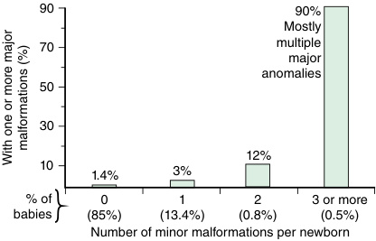
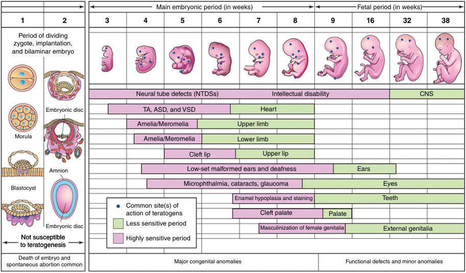
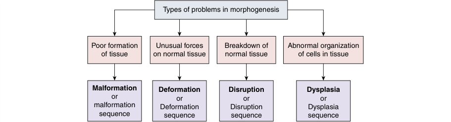

# Chapter 5: Dysmorphology and Phenotyping — Active-Recall Flashcards
**Section II: Developmental Structural Disorders** | [📖 Read Wiki Chapter](../chapters/005_Dysmorphology_and_Phenotyping.md) | [📝 Chapter MCQs](../mcqs/005_mcqs.md) | [🏠 Course Master Index](../../index.md)

Total cards: **25** *(Click any card below to reveal the answer)*

### Card 1 (Clinical & Diagnostic Concept)

<b>Q:</b> In the clinical evaluation of **Dysmorphology and Phenotyping**, how is **dysmorphology** defined and characterized?

**Answer:**
dysmorphology was created to describe the study of human congenital malformations.

### Card 2 (Clinical & Diagnostic Concept)

<b>Q:</b> In the clinical evaluation of **Dysmorphology and Phenotyping**, how is **Phenotypes** defined and characterized?

**Answer:**
Phenotypes are used to guide the interpretation of genetic and genomic results.

### Card 3 (Clinical & Diagnostic Concept)

<b>Q:</b> In the clinical evaluation of **Genetic Causes**, how is **Chromosomal** defined and characterized?

**Answer:**
Chromosomal disorders such as Down syndrome result from the chromosomal imbalance caused by the presence of a third copy of chromosome 21 (trisomy 21).

### Card 4 (Clinical & Diagnostic Concept)

<b>Q:</b> In the clinical evaluation of **Genetic Causes**, how is **Copy number variations** defined and characterized?

**Answer:**
Copy number variations , microduplications and microdeletions , are often implicated because their effect on gene dosage can disrupt normal developmental pathways.

### Card 5 (Clinical & Diagnostic Concept)

<b>Q:</b> In the clinical evaluation of **Embryology**, how is **embryonic period** defined and characterized?

**Answer:**
embryonic period (gestational week 3–8) is the period of maximum risk for major malformations because tissue differentiation and organogenesis are taking place.

### Card 6 (Clinical & Diagnostic Concept)

<b>Q:</b> In the clinical evaluation of **Pathways and Heterogeneity**, how is **phenotype** defined and characterized?

**Answer:**
phenotype , to see which genetic variants they also had in common.

### Card 7 (Clinical & Diagnostic Concept)

<b>Q:</b> In the clinical evaluation of **Pathways and Heterogeneity**, how is **Cornelia de Lange syndrome (CdLS)** defined and characterized?

**Answer:**
Cornelia de Lange syndrome (CdLS) , which is characterized by distinctive facial dysmorphic features, growth restriction, and upper limb abnormalities.

### Card 8 (Clinical & Diagnostic Concept)

<b>Q:</b> In the clinical evaluation of **Pregnancy History**, how is **fetal akinesia** defined and characterized?

**Answer:**
fetal akinesia ) sets the scene for possible associated features: breech presentation, limb malformations and contractures at birth, and a possible underlying neuromuscular disorder (Fig.

### Card 9 (Visual & Imaging Spotter)

<b>Q:</b> Identify the diagnostic sign, dysmorphic phenotype, neuroimaging pattern, or molecular pathway illustrated below (Fig. 5.1):

**Answer:**
Frequency of major malformations in relation to the number of minor anomalies detected in a given newborn baby.

### Card 10 (Visual & Imaging Spotter)

<b>Q:</b> Identify the diagnostic sign, dysmorphic phenotype, neuroimaging pattern, or molecular pathway illustrated below (Fig. 5.2):

**Answer:**
Critical periods in human embryological and fetal development.

### Card 11 (Visual & Imaging Spotter)

<b>Q:</b> Identify the diagnostic sign, dysmorphic phenotype, neuroimaging pattern, or molecular pathway illustrated below (Fig. 5.3):

**Answer:**
Mechanisms of abnormal morphogenesis.

### Card 12 (Differential Diagnosis)

<b>Q:</b> In the differential diagnosis of **Accutane (isotretinoin) Facial-ear anomalies, heart disease, CNS anomalies**, what are the distinguishing features of **Alcohol**?

**Answer:**
**Facial-ear anomalies, heart disease, CNS anomalies**: Congenital cardiac, CNS, limb anomalies; IUGR; developmental delay; attention deficits; autism

### Card 13 (Differential Diagnosis)

<b>Q:</b> In the differential diagnosis of **Accutane (isotretinoin) Facial-ear anomalies, heart disease, CNS anomalies**, what are the distinguishing features of **ACE inhibitors, angiotensin receptor antagonists**?

**Answer:**
**Facial-ear anomalies, heart disease, CNS anomalies**: Oligohydramnios, IUGR, renal failure, Potter sequence

### Card 14 (Differential Diagnosis)

<b>Q:</b> In the differential diagnosis of **Accutane (isotretinoin) Facial-ear anomalies, heart disease, CNS anomalies**, what are the distinguishing features of **Carbamazepine**?

**Answer:**
**Facial-ear anomalies, heart disease, CNS anomalies**: Neural tube defects, possible neurodevelopmental delay

### Card 15 (Differential Diagnosis)

<b>Q:</b> In the differential diagnosis of **Thalidomide Phocomelia, deafness, other malformations**, what are the distinguishing features of **Toluene (solvent abuse)**?

**Answer:**
**Phocomelia, deafness, other malformations**: Craniofacial abnormalities, prematurity, hypertonia

### Card 16 (Differential Diagnosis)

<b>Q:</b> In the differential diagnosis of **Thalidomide Phocomelia, deafness, other malformations**, what are the distinguishing features of **Topiramate**?

**Answer:**
**Phocomelia, deafness, other malformations**: Cleft lip

### Card 17 (Differential Diagnosis)

<b>Q:</b> In the differential diagnosis of **Thalidomide Phocomelia, deafness, other malformations**, what are the distinguishing features of **Trimethadione and paramethadione**?

**Answer:**
**Phocomelia, deafness, other malformations**: Spontaneous abortion, multiple malformations, cognitive impairment

### Card 18 (Differential Diagnosis)

<b>Q:</b> In the differential diagnosis of **Maternal Infections f Affecting the Fetus or Newborn**, what are the distinguishing features of **Virus Rubella**?

**Answer:**
**Mode(s) of Transmission**: Transplacental; **Neonatal Outcome**: Congenital rubella

### Card 19 (Differential Diagnosis)

<b>Q:</b> In the differential diagnosis of **Maternal Infections f Affecting the Fetus or Newborn**, what are the distinguishing features of **Cytomegalovirus**?

**Answer:**
**Mode(s) of Transmission**: Transplacental, breast milk (rare); **Neonatal Outcome**: Congenital cytomegalovirus or asymptomatic

### Card 20 (Differential Diagnosis)

<b>Q:</b> In the differential diagnosis of **Inheritance Pattern Cardinal Features**, what are the distinguishing features of **Autosomal dominant**?

**Answer:**
**Cardinal Features**: Affected individuals have one normal allele and one altered/variant allele on one of the autosomes Males and females equally affected Vertical transmission with affected individuals in each generation 50% recurrence risk for future pregnancies De novooccurrence possible

### Card 21 (Differential Diagnosis)

<b>Q:</b> In the differential diagnosis of **Inheritance Pattern Cardinal Features**, what are the distinguishing features of **Autosomal recessive**?

**Answer:**
**Cardinal Features**: Affected individuals have two altered/variant alleles (biallelic) Parents of affected individuals are heterozygous carriers and healthy Consanguinity may be present 25% recurrence risk

### Card 22 (Differential Diagnosis)

<b>Q:</b> In the differential diagnosis of **Inheritance Pattern Cardinal Features**, what are the distinguishing features of **X-linked**?

**Answer:**
**Cardinal Features**: Affected individuals have an altered/variant allele on their X chromosome Males are hemizygous Males typically more severely affected than females Skewed X-inactivation plays a role in affected females Affected males will pass the altered/variant allele to all daughters

### Card 23 (High-Yield Clinical Pearl)

<b>Q:</b> What is a critical clinical or diagnostic hallmark regarding **Dysmorphology and Phenotyping** (Dysmorphology and Phenotyping)?

**Answer:**
Dysmorphic features are combined with results from other investigations, such as biochemistry, imaging, and psychosocial or behavioral assessments, to delineate the patient’s phenotype.

### Card 24 (High-Yield Clinical Pearl)

<b>Q:</b> What is a critical clinical or diagnostic hallmark regarding **Pathways and Heterogeneity** (Dysmorphology and Phenotyping)?

**Answer:**
Another example is Cornelia de Lange syndrome (CdLS) , which is characterized by distinctive facial dysmorphic features, growth restriction, and upper limb abnormalities.

### Card 25 (High-Yield Clinical Pearl)

<b>Q:</b> What is a critical clinical or diagnostic hallmark regarding **Beyond Descriptive Terminology** (Dysmorphology and Phenotyping)?

**Answer:**
The RASopathies are patterns of anomalies caused by pathogenic variants in genes that encode components or regulators of the RAS/MAPK pathway (indicated by dashed lines ).

