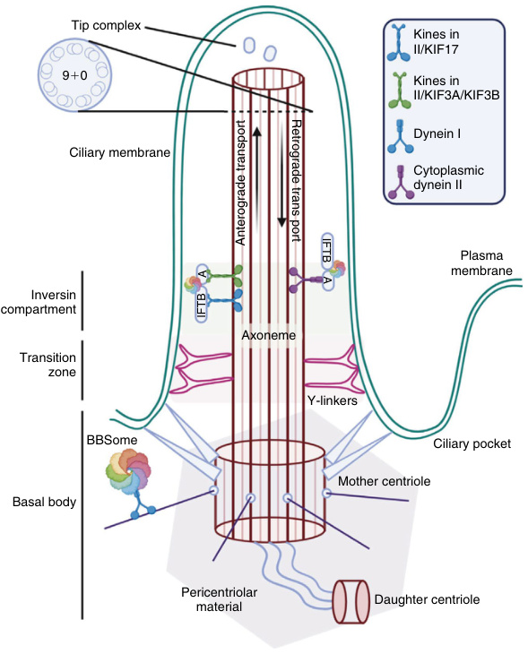
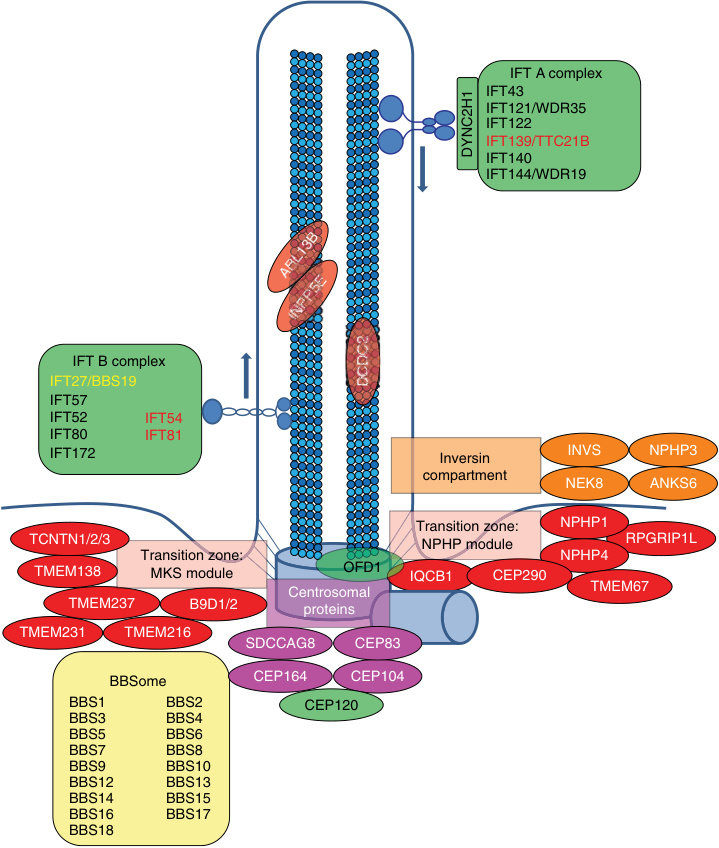
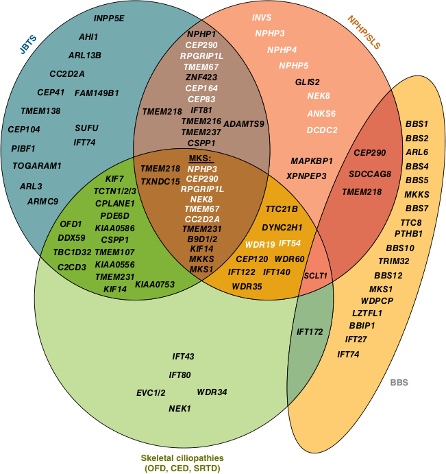

# Chapter 7: Ciliopathies: Clinical Presentations and Syndromes — Active-Recall Flashcards
**Section II: Developmental Structural Disorders** | [📖 Read Wiki Chapter](../chapters/007_Ciliopathies_Clinical_Presentations_and_Syndromes.md) | [📝 Chapter MCQs](../mcqs/007_mcqs.md) | [🏠 Course Master Index](../../index.md)

Total cards: **28** *(Click any card below to reveal the answer)*

### Card 1 (Syndrome & OMIM Profile)

<b>Q:</b> What are the genetic etiology, inheritance pattern, and hallmark clinical features of **Autosomal recessive polycystic kidney disease (ARPKD)**?

**Answer:**
**Causative Gene(s):** `PKHD1, DZIP1L` · **Inheritance:** AR

**Clinical & Molecular Profile:** Mode of Inheritance: AR — Gene(s): PKHD1, DZIP1L — Prevalence: 1:20,000 — Rarely, ARPKD can also be caused by pathogenic variants in DZIP1L .

### Card 2 (Syndrome & OMIM Profile)

<b>Q:</b> What are the genetic etiology, inheritance pattern, and hallmark clinical features of **Meckel-Gruber-syndrome**?

**Answer:**
**Causative Gene(s):** `MKS1, TMEM67, CEP290, RPGRIP1L, CC2D2A` · **Inheritance:** AR

**Clinical & Molecular Profile:** Mode of Inheritance: AR — Gene(s): MKS1, TMEM67, CEP290, RPGRIP1L, CC2D2A — Prevalence: 1:140,000

### Card 3 (Syndrome & OMIM Profile)

<b>Q:</b> What are the genetic etiology, inheritance pattern, and hallmark clinical features of **Joubert syndrome and related disorders, including COACH syndrome**?

**Answer:**
**Causative Gene(s):** `AHI1, NPHP1, CEP290, TMEM67, RPGRIP1L, ARL13B` · **Inheritance:** AR

**Clinical & Molecular Profile:** Mode of Inheritance: AR — Gene(s): AHI1, NPHP1, CEP290, TMEM67, RPGRIP1L, ARL13B, CC2D2A — Prevalence: 1:100,000

### Card 4 (Syndrome & OMIM Profile)

<b>Q:</b> What are the genetic etiology, inheritance pattern, and hallmark clinical features of **Bardet-Biedl syndrome (BBS)**?

**Answer:**
**Causative Gene(s):** `BBS1, BBS2, ARL6, BBS4, BBS5, BBS7` · **Inheritance:** AR

**Clinical & Molecular Profile:** Mode of Inheritance: AR — Gene(s): BBS1, BBS2, ARL6, BBS4, BBS5, MKKS, BBS7, TTC8, BBS9, BBS10, TRIM32, BBS12, MKS1, CEP290 — Prevalence: 1:100,000

### Card 5 (Syndrome & OMIM Profile)

<b>Q:</b> What are the genetic etiology, inheritance pattern, and hallmark clinical features of **Renal-hepatic-pancreatic dysplasia**?

**Answer:**
**Causative Gene(s):** `NPHP3` · **Inheritance:** AR

**Clinical & Molecular Profile:** Mode of Inheritance: AR — Prevalence: Rare

### Card 6 (Syndrome & OMIM Profile)

<b>Q:</b> What are the genetic etiology, inheritance pattern, and hallmark clinical features of **Oral-facial-digital syndrome (OFD)**?

**Answer:**
**Causative Gene(s):** `OFD1` · **Inheritance:** X-Linked

**Clinical & Molecular Profile:** Mode of Inheritance: X-linked — Prevalence: 1:100,000 — Oral-facial-digital syndrome, type 1 (OFD1) is an X-linked dominant disease, with male embryonic lethality.

### Card 7 (Syndrome & OMIM Profile)

<b>Q:</b> What are the genetic etiology, inheritance pattern, and hallmark clinical features of **Skeletal ciliopathies (CED, SRTD)**?

**Answer:**
**Causative Gene(s):** `IFT80, IFT122, WDR19, WDR35, IFT43, EVC` · **Inheritance:** AR

**Clinical & Molecular Profile:** Mode of Inheritance: AR — Gene(s): IFT80, IFT122,WDR19,WDR35,IFT43,EVC, EVC2, IFT40,IFT172 — Prevalence: Rare

### Card 8 (Syndrome & OMIM Profile)

<b>Q:</b> What are the genetic etiology, inheritance pattern, and hallmark clinical features of **Autosomal dominant polycystic kidney disease (ADPKD)**?

**Answer:**
**Causative Gene(s):** `PKD1, PKD2` · **Inheritance:** AD

**Clinical & Molecular Profile:** Mode of Inheritance: AD — Gene(s): PKD1, PKD2 — Prevalence: 1:1,000 — Autosomal dominant polycystic kidney disease (ADPKD) is the most common of all autosomal dominant monogenic diseases in humans (~1:1,000 live births).

### Card 9 (Syndrome & OMIM Profile)

<b>Q:</b> What are the genetic etiology, inheritance pattern, and hallmark clinical features of **Nephronophthisis**?

**Answer:**
**Causative Gene(s):** `NPHP1, NPHP3, NPHP4, IQCB1, CEP290, LIS2` · **Inheritance:** AR

**Clinical & Molecular Profile:** Mode of Inheritance: AR — Gene(s): NPHP1, INVS, NPHP3, NPHP4, IQCB1, CEP290, LIS2, RPGRIP1L, NEK8 — Prevalence: 1:100,000

### Card 10 (Syndrome & OMIM Profile)

<b>Q:</b> What are the genetic etiology, inheritance pattern, and hallmark clinical features of **Ellis–van Creveld syndrome (EVC)**?

**Answer:**
**Causative Gene(s):** `EVC` · **Inheritance:** AR

**Clinical & Molecular Profile:** Inheritance: AR — Skeletal Phenotype: Short ribs and long bones, abnormal pelvis configuration, polydactyly of the hands — Renal Phenotype: – — Retinopathy: – — Liver Phenotype: –

### Card 11 (Molecular Etiology)

<b>Q:</b> Pathogenic variants in **`ARL6`** are associated with which clinical phenotype and molecular mechanism in **Ciliopathies Clinical Presentations and Syndromes**?

**Answer:**
The protein ARL6/BBS3 has been identified as a cause for Bardet-Biedl syndrome; however, a longer isoform is known in mice and zebrafish to specifically be required for photoreceptor maintenance and therefore causes an ocular phenotype, if altered.

### Card 12 (Molecular Etiology)

<b>Q:</b> Pathogenic variants in **`NPHP1`** are associated with which clinical phenotype and molecular mechanism in **Nephronophthisis**?

**Answer:**
Pathogenic variants in NPHP1 are by far the most common genetic cause for NPHP.

### Card 13 (Molecular Etiology)

<b>Q:</b> Pathogenic variants in **`CPLANE1`** are associated with which clinical phenotype and molecular mechanism in **Joubert Syndrome**?

**Answer:**
The most common genes associated with JS, accounting for approximately 6–9% each, are CPLANE1 , CC2D2A , CEP290 , AHI1 , and TMEM67 .

### Card 14 (Molecular Etiology)

<b>Q:</b> Pathogenic variants in **`TMEM67`** are associated with which clinical phenotype and molecular mechanism in **Joubert Syndrome**?

**Answer:**
A syndromic form of JS called COACH , which stands for colobomas, cognitive impairment, ataxia, cerebellar vermis hypoplasia, and hepatic fibrosis, is most frequently caused by pathogenic variants in TMEM67 .

### Card 15 (Molecular Etiology)

<b>Q:</b> Pathogenic variants in **`ALMS1`** are associated with which clinical phenotype and molecular mechanism in **Alström Syndrome**?

**Answer:**
Alström syndrome is caused by pathogenic variants in the gene ALMS1 .

### Card 16 (Clinical & Diagnostic Concept)

<b>Q:</b> In the clinical evaluation of **Ciliopathies Clinical Presentations and Syndromes**, how is **Meckel-Gruber syndrome complex (MKS)** defined and characterized?

**Answer:**
Meckel-Gruber syndrome complex (MKS) , the nephronophthisis complex (NPHP) , and the “BBSome” (Bardet-Biedl syndrome) , implying an association between subcellular localization of proteins and certain disease group clusters (Fig.

### Card 17 (Clinical & Diagnostic Concept)

<b>Q:</b> In the clinical evaluation of **Kidney Involvement**, how is **Autosomal dominant polycystic kidney disease (ADPKD)** defined and characterized?

**Answer:**
Autosomal dominant polycystic kidney disease (ADPKD) is the most common of all autosomal dominant monogenic diseases in humans (~1:1,000 live births).

### Card 18 (Clinical & Diagnostic Concept)

<b>Q:</b> In the clinical evaluation of **Kidney Involvement**, how is **autosomal recessive polycystic kidney disease (ARPKD)** defined and characterized?

**Answer:**
autosomal recessive polycystic kidney disease (ARPKD) and the NPHP-like related ciliopathies (RCs) .

### Card 19 (Clinical & Diagnostic Concept)

<b>Q:</b> In the clinical evaluation of **Autosomal Recessive Polycystic Kidney Disease (ARPKD)**, how is **pulmonary hypoplasia** defined and characterized?

**Answer:**
pulmonary hypoplasia results from mechanical pressure on the fetal lungs due to oligohydramnios and the massively enlarged kidneys, leading to an estimated mortality of 30–50% shortly after birth.

### Card 20 (Clinical & Diagnostic Concept)

<b>Q:</b> In the clinical evaluation of **Autosomal Recessive Polycystic Kidney Disease (ARPKD)**, how is **congenital hepatic fibrosis** defined and characterized?

**Answer:**
congenital hepatic fibrosis and/or Caroli disease (a dilation of the intrahepatic bile ducts), caused by ductal plate malformation of the developing biliary system.

### Card 21 (Clinical & Diagnostic Concept)

<b>Q:</b> In the clinical evaluation of **Nephronophthisis**, how is **infantile** defined and characterized?

**Answer:**
infantile , juvenile , and adolescent NPHP, with manifestation of ESKD at median ages of 1 year, 13 years, and 19 years, respectively.

### Card 22 (Clinical & Diagnostic Concept)

<b>Q:</b> In the clinical evaluation of **Ocular Involvement**, how is **Leber congenital amaurosis** defined and characterized?

**Answer:**
Leber congenital amaurosis , the most severe form of inherited retinal dystrophies.

### Card 23 (Clinical & Diagnostic Concept)

<b>Q:</b> In the clinical evaluation of **Ocular Involvement**, how is **coloboma** defined and characterized?

**Answer:**
coloboma resulting from abnormal closure of the optic cup during eye development.

### Card 24 (Visual & Imaging Spotter)

<b>Q:</b> Identify the diagnostic sign, dysmorphic phenotype, neuroimaging pattern, or molecular pathway illustrated below (Fig. 7.1):

**Answer:**
The key structural components of the primary cilium. The cilium is a hair-like structure, protruding from the cell surface, and consists of a microtubule-based axoneme and a surrounding specialized ciliary membrane. This nonmotile cilium has nine outer microtubule doublets, but no central doublet, in contrast to motile cilia. The axoneme is assembled from the basal body, also called the mother centriole. Ciliary components, receptors, and signaling proteins are trafficked in anterograde and retrograde directions on the axoneme by intraflagellar transport (IFT) complexes (IFTA and IFTB), which engage dynein II and kinesins (blue box), respectively. The BBSome complex assists traffic at the base of the cilium and then cooperates with IFTs. The base of the cilium is segregated from the cytoplasm by the transition zone, defined by the presence of Y-linkers. The primary cilium is erected in quiescent cells and disassembled before cell division. BBS, Bardet-Biedl syndrome; KIF, kinesin family members.

### Card 25 (Visual & Imaging Spotter)

<b>Q:</b> Identify the diagnostic sign, dysmorphic phenotype, neuroimaging pattern, or molecular pathway illustrated below (Fig. 7.2):

**Answer:**
Subcellular localization of proteins encoded by known monogenic disease-causing genes of nephronophthisis-related ciliopathies (NPHP-RC). Proteins are color-coded based on their respective disease group (red/orange/pink: nephronophthisis [NPHP], Senior–Løken syndrome [SLS], Joubert syndrome [JBTS], Meckel–Gruber syndrome [MKS]; yellow: Bardet–Biedl syndrome [BBS]; green: skeletal ciliopathies). It becomes apparent that disease groups cluster to distinct subcellular localizations. IFT, Intraflagellar transport.

### Card 26 (Visual & Imaging Spotter)

<b>Q:</b> Identify the diagnostic sign, dysmorphic phenotype, neuroimaging pattern, or molecular pathway illustrated below (Fig. 7.3):

**Answer:**
Monogenic genes of nephronophthisis-related ciliopathies (NPHP-RC) cause distinct but widely overlapping phenotypes. Monogenic genes of NPHP-RC are categorized into four major phenotypes, namely, JBTS (blue, Joubert syndrome [JBTS]: congenital brain malformations, cerebellar vermis hypoplasia, and intellectual disability), NPHP/SLS (red, nephronophthisis/Senior–Loken syndrome [SLS]: nephronophthisis [NPHP], retinal degeneration, coloboma), BBS (yellow, Bardet–Biedl syndrome [BBS]: obesity, intellectual disability, retinal degeneration, cystic kidney disease, polydactyly, hypogonadisms), and skeletal ciliopathies (green, oral-facial-digital syndrome [OFD], cranioectodermal dysplasia (CED), short-rib thoracic dysplasia [SRTD]). As shown in a Venn diagram, numerous genes can give rise to overlapping phenotypes if they become pathogenic variants. Meckel–Gruber syndrome (MKS), the most severe clinical manifestation of NPHP-RC, is caused by variants in monogenic genes of nephronophthisis, Joubert syndrome, and Bardet–Biedl syndrome on an allelic basis. White text indicates genes in which liver involvement has been reported. Recently discovered genes include: SUFU (De Mori 2017, Serpieri 2022), IFT74 (Lindstrand 2016, Luo 2021), PIBF1 (Wheway 2015, Hebbar 2018), TOGARAM1 (Latour 2020, Morbidoni 2021), ARL3 (Alkanderi 2018, Powell 2019), KIAA0753 (Hammarsjoe 2017, Stephen 2017), TMEM218 (Van de Weghe 2021, Epting 20

### Card 27 (Differential Diagnosis)

<b>Q:</b> In the differential diagnosis of **TABLE 7.1 Clinical Summary**, what are the distinguishing features of **Age of onset**?

**Answer:**
**Autosomal Recessive Polycystic Kidney Disease (ARPKD)**: Infancy to adolescence; **Autosomal Dominant Polycystic Kidney Disease (ADPKD)**: Mostly infancy; Typically adult onset

### Card 28 (Differential Diagnosis)

<b>Q:</b> In the differential diagnosis of **TABLE 7.1 Clinical Summary**, what are the distinguishing features of **Clinical findings**?

**Answer:**
**Autosomal Recessive Polycystic Kidney Disease (ARPKD)**: • Polyuria • Polydipsia (with frequent night-time fluid intake) • Secondary enuresis • Growth retardation • At later stages: pallor, weakness, pruritus • Typically: Absence of edema, hypertension and urinary tract infections • Rarely: sudden death from fluid and electrolyte imbalance; **Autosomal Dominant Polycystic Kidney Disease (ADPKD)**: • Often: “Potter” oligohydramnios phenotype at birth: • Enlarged kidneys • Pulmonary hypoplasia • Characteristic facies • Contracted limbs • Treatment-resistant arterial hypertension (~80%), often starting in infancy • ESKD in 60% of patients by 20 years of age • Kidneys decrease in size as fibrosis advances • Liver complications, e.g., portal hypertension, cholangitis; • (Gross) Hematuria • Urinary tract infections • Urinary concentration defect • Abdominal fullness/pain • Nephrolithiasis (20–35%) • Hypertension in 20–40% of children/ adolescents (before glomerular filtration rate (GFR) decline), in most adults • End stage kidney disease (ESKD) in 50% at age of 60 years • Intracranial aneurysms in~8% of patients (increased in patients with a positive family history) • Heart valve abnormalities • Aortic root dilation • Diverticulosis

