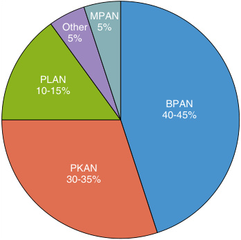
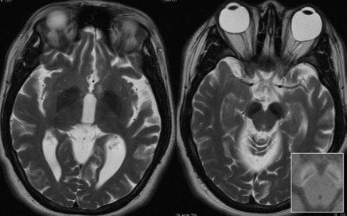
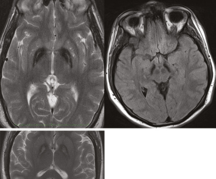

# Chapter 13: Neurodegeneration With Brain Iron Accumulation — Active-Recall Flashcards
**Section III: Neuro-Sensory Disorders** | [📖 Read Wiki Chapter](../chapters/013_Neurodegeneration_With_Brain_Iron_Accumulation.md) | [📝 Chapter MCQs](../mcqs/013_mcqs.md) | [🏠 Course Master Index](../../index.md)

Total cards: **28** *(Click any card below to reveal the answer)*

### Card 1 (Syndrome & OMIM Profile)

<b>Q:</b> What are the genetic etiology, inheritance pattern, and hallmark clinical features of **PLA2G6-associated neurodegeneration (PLAN)** (#256600)?

**Answer:**
**Causative Gene(s):** `PLA2G6` · **Inheritance:** Genetic

**Clinical & Molecular Profile:** Function: Lipid metabolism — The globus pallidus shows preservation of signal in the medial medullary lamina in MPAN, which is absent in betapropeller protein-associated neurodegeneration and PLA2G6 -associated neurodegeneration, and may be mistaken for an eye of the tiger sign found in pantothenate kinase-associated neurodegeneration (PK

### Card 2 (Syndrome & OMIM Profile)

<b>Q:</b> What are the genetic etiology, inheritance pattern, and hallmark clinical features of **Pantothenate kinase-associated neurodegeneration (PKAN)** (#234200)?

**Answer:**
**Causative Gene(s):** `PANK2` · **Inheritance:** AR

**Clinical & Molecular Profile:** Function: Coenzyme A biosynthesis — Pantothenate kinase-associated neurodegeneration (PKAN) is an autosomal recessive disease characterized by progressive dystonia, dysarthria, and retinal degeneration.

### Card 3 (Syndrome & OMIM Profile)

<b>Q:</b> What are the genetic etiology, inheritance pattern, and hallmark clinical features of **COASY protein-associated neurodegeneration (CoPAN)** (#615643)?

**Answer:**
**Causative Gene(s):** `COASY` · **Inheritance:** Genetic

**Clinical & Molecular Profile:** Function: Coenzyme A biosynthesis — COASY protein-associated neurodegeneration (CoPAN) has childhood-onset dystonia and spasticity with cognitive impairment.

### Card 4 (Syndrome & OMIM Profile)

<b>Q:</b> What are the genetic etiology, inheritance pattern, and hallmark clinical features of **Kufor-Rakeb syndrome (KRS)** (#606693)?

**Answer:**
**Causative Gene(s):** `ATP13A2` · **Inheritance:** Genetic

**Clinical & Molecular Profile:** Function: Autophagy — Kufor-Rakeb syndrome may also be referred to as Parkinson disease 9 or PARK9.

### Card 5 (Syndrome & OMIM Profile)

<b>Q:</b> What are the genetic etiology, inheritance pattern, and hallmark clinical features of **Aceruloplasminemia (ACP)** (#604290)?

**Answer:**
**Causative Gene(s):** `CP` · **Inheritance:** Genetic

**Clinical & Molecular Profile:** Function: Iron homeostasis

### Card 6 (Syndrome & OMIM Profile)

<b>Q:</b> What are the genetic etiology, inheritance pattern, and hallmark clinical features of **Fatty acid hydroxylase-associated neurodegeneration (FAHN)** (#612319)?

**Answer:**
**Causative Gene(s):** `FA2H` · **Inheritance:** Genetic

**Clinical & Molecular Profile:** Function: Lipid metabolism

### Card 7 (Syndrome & OMIM Profile)

<b>Q:</b> What are the genetic etiology, inheritance pattern, and hallmark clinical features of **Mitochondrial membrane protein-associated neurodegeneration (MPAN)** (#614298)?

**Answer:**
**Causative Gene(s):** `C19ORF12` · **Inheritance:** mtDNA

**Clinical & Molecular Profile:** C19ORF12*** — Function: Lipid metabolism — MPAN typically occurs as an autosomal recessive condition, though heterozygous pathogenic variants in the last exon of C19orf12 may cause dominant disease.

### Card 8 (Syndrome & OMIM Profile)

<b>Q:</b> What are the genetic etiology, inheritance pattern, and hallmark clinical features of **Woodhouse-Sakati syndrome (WSS)** (#241080)?

**Answer:**
**Causative Gene(s):** `DCAF17` · **Inheritance:** Genetic

**Clinical & Molecular Profile:** Function: Unknown

### Card 9 (Syndrome & OMIM Profile)

<b>Q:</b> What are the genetic etiology, inheritance pattern, and hallmark clinical features of **Beta-propeller protein-associated neurodegeneration (BPAN)** (#300894)?

**Answer:**
**Causative Gene(s):** `WDR45` · **Inheritance:** Genetic

**Clinical & Molecular Profile:** WDR45* — Function: Autophagy — There are generally two key time periods in which BPAN is diagnosed: (1) early childhood, usually characterized by global development delay, seizures, or both, and (2) adulthood, during a period of regression in an individual who had been relatively stable.

### Card 10 (Syndrome & OMIM Profile)

<b>Q:</b> What are the genetic etiology, inheritance pattern, and hallmark clinical features of **FTL-associated neuroferritinopathy (NFT)** (#606159)?

**Answer:**
**Causative Gene(s):** `FTL` · **Inheritance:** Genetic

**Clinical & Molecular Profile:** FTL** — Function: Iron homeostasis — Neuroferritinopathy is caused by variants in FTL or FTH1 , which encode the ferritin light and ferritin heavy chains, respectively.

### Card 11 (Molecular Etiology)

<b>Q:</b> Pathogenic variants in **`WDR45`** are associated with which clinical phenotype and molecular mechanism in **Beta-Propeller Protein-Associated Neurodegeneration (BPAN)**?

**Answer:**
The gene that causes beta-propeller protein-associated neurodegeneration (BPAN), WDR45 , was identified in a cohort of adults with a very similar phenotype that consisted of childhood seizures and intellectual disability followed by a period of parkinsonian regression in adulthood.

### Card 12 (Molecular Etiology)

<b>Q:</b> Pathogenic variants in **`PLA2G6`** are associated with which clinical phenotype and molecular mechanism in **Molecular Genetic Testing and Common Diagnostic Challenges**?

**Answer:**
The globus pallidus shows preservation of signal in the medial medullary lamina in MPAN, which is absent in betapropeller protein-associated neurodegeneration and PLA2G6 -associated neurodegeneration, and may be mistaken for an eye of the tiger sign found in pantothenate kinase-associated neurodegeneration (PKAN), (bottom left).

### Card 13 (Molecular Etiology)

<b>Q:</b> Pathogenic variants in **`PANK2`** are associated with which clinical phenotype and molecular mechanism in **Neurodegeneration**?

**Answer:**
The causative gene, PANK2 , was the first NBIA gene to be identified, and the development of therapeutics is most advanced for PKAN relative to other NBIA disorders.

### Card 14 (Molecular Etiology)

<b>Q:</b> Pathogenic variants in **`COASY`** are associated with which clinical phenotype and molecular mechanism in **Clinical Features and Brain Imaging**?

**Answer:**
COASY protein-associated neurodegeneration (CoPAN) has childhood-onset dystonia and spasticity with cognitive impairment.

### Card 15 (Molecular Etiology)

<b>Q:</b> Pathogenic variants in **`FTH1`** are associated with which clinical phenotype and molecular mechanism in **Clinical Features and Brain Imaging**?

**Answer:**
Neuroferritinopathy is caused by variants in FTL or FTH1 , which encode the ferritin light and ferritin heavy chains, respectively.

### Card 16 (Molecular Etiology)

<b>Q:</b> Pathogenic variants in **`FTL`** are associated with which clinical phenotype and molecular mechanism in **Clinical Features and Brain Imaging**?

**Answer:**
FTL -associated neuroferritinopathy has adult onset and may present similarly to Huntington disease with chorea or dystonia and cognitive changes.

### Card 17 (Clinical & Diagnostic Concept)

<b>Q:</b> In the clinical evaluation of **Clinical Features**, how is **Lennox-Gastaut syndrome** defined and characterized?

**Answer:**
Lennox-Gastaut syndrome , developing an epileptic encephalopathy that compounds cognitive delays related to their BPAN.

### Card 18 (Clinical & Diagnostic Concept)

<b>Q:</b> In the clinical evaluation of **Brain Imaging**, how is **eye-of-the-tiger** defined and characterized?

**Answer:**
eye-of-the-tiger sign seen in pantothenate kinase-associated neurodegeneration (PKAN), a more common NBIA disorder.

### Card 19 (Clinical & Diagnostic Concept)

<b>Q:</b> In the clinical evaluation of **Clinical Features**, how is **Classic PKAN** defined and characterized?

**Answer:**
Classic PKAN presents in early childhood by about 3 years of age; it can be diagnosed quickly by exome sequencing or gene panel testing.

### Card 20 (Clinical & Diagnostic Concept)

<b>Q:</b> In the clinical evaluation of **Brain Imaging**, how is **eye-of-the-tiger sign** defined and characterized?

**Answer:**
eye-of-the-tiger sign on T2-weighted brain MRI is virtually pathognomonic for PKAN (Fig.

### Card 21 (Clinical & Diagnostic Concept)

<b>Q:</b> In the clinical evaluation of **PLA2G6 -Associated Neurodegeneration**, how is **infantile neuroaxonal dystrophy** defined and characterized?

**Answer:**
infantile neuroaxonal dystrophy , or INAD), juvenile PLAN, and adult PLAN.

### Card 22 (Clinical & Diagnostic Concept)

<b>Q:</b> In the clinical evaluation of **Clinical Features**, how is **Children with INAD** defined and characterized?

**Answer:**
Children with INAD may have normal early development or only mild delays.

### Card 23 (Clinical & Diagnostic Concept)

<b>Q:</b> In the clinical evaluation of **Clinical Features**, how is **Juvenile-onset** defined and characterized?

**Answer:**
Juvenile-onset cases account for only a small portion of all PLAN, making them ultra-rare.

### Card 24 (Clinical & Diagnostic Concept)

<b>Q:</b> In the clinical evaluation of **Clinical Features**, how is **Adult PLAN** defined and characterized?

**Answer:**
Adult PLAN usually presents in young adulthood (late teens to 20s) with rare exceptions.

### Card 25 (Visual & Imaging Spotter)

<b>Q:</b> Identify the diagnostic sign, dysmorphic phenotype, neuroimaging pattern, or molecular pathway illustrated below (Fig. 13.1):

**Answer:**
Frequencies of NBIA. Frequencies are based on approximately 1,000 families worldwide collected over 30 years in an international repository of NBIA. Some countries and regions are not represented because of limitations in making a diagnosis or making contact with the repository.

### Card 26 (Visual & Imaging Spotter)

<b>Q:</b> Identify the diagnostic sign, dysmorphic phenotype, neuroimaging pattern, or molecular pathway illustrated below (Fig. 13.3):

**Answer:**
Axial T2-weighted imaging of globus pallidus (left) and substantia nigra (right) in beta-propeller protein-associated neurodegeneration, with inset showing T1-weighted imaging “halo” in the cerebral peduncles.

### Card 27 (Visual & Imaging Spotter)

<b>Q:</b> Identify the diagnostic sign, dysmorphic phenotype, neuroimaging pattern, or molecular pathway illustrated below (Fig. 13.4):

**Answer:**
Axial T2-weighted imaging of globus pallidus (top left) and substantia nigra (right) in mitochondrial membrane protein-associated neurodegeneration (MPAN). The globus pallidus shows preservation of signal in the medial medullary lamina in MPAN, which is absent in betapropeller protein-associated neurodegeneration and PLA2G6 -associated neurodegeneration, and may be mistaken for an eye of the tiger sign found in pantothenate kinase-associated neurodegeneration (PKAN), (bottom left). The degree of signal hypointensity in the substantia nigra in MPAN is greater than is typically seen in PKAN, another distinguishing feature.

### Card 28 (Differential Diagnosis)

<b>Q:</b> In the differential diagnosis of **List o f NBIA Genes, Their Expected Function, and Corresponding Disorders**, what are the distinguishing features of **PLA2G6**?

**Answer:**
**Function**: Lipid metabolism; **Corresponding Disorder**: PLA2G6-associated neurodegeneration; **Acronym**: PLAN; **MIM-ID**: # 256600

