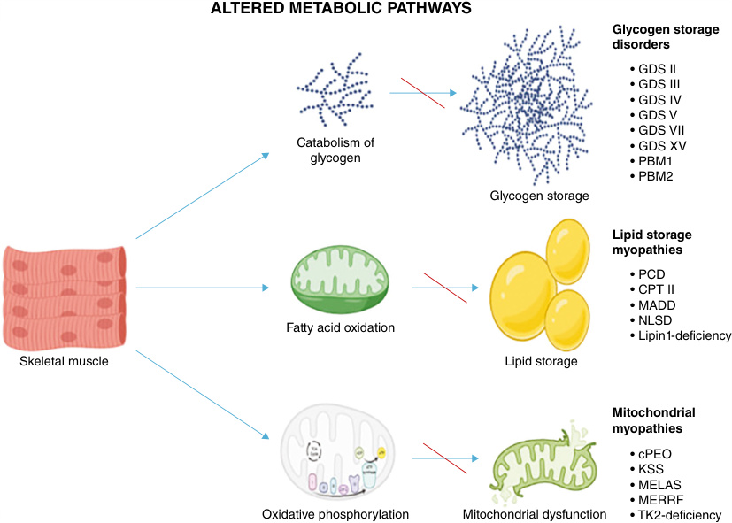
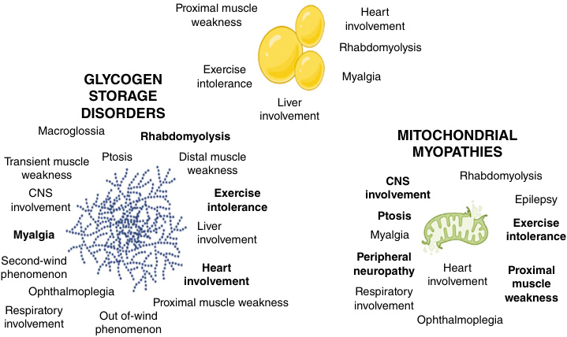
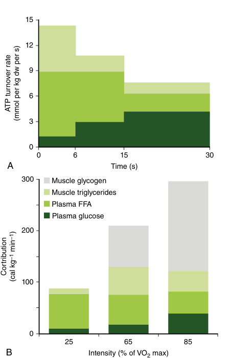

# Chapter 19: Metabolic Myopathies — Active-Recall Flashcards
**Section III: Neuro-Sensory Disorders** | [📖 Read Wiki Chapter](../chapters/019_Metabolic_Myopathies.md) | [📝 Chapter MCQs](../mcqs/019_mcqs.md) | [🏠 Course Master Index](../../index.md)

Total cards: **28** *(Click any card below to reveal the answer)*

### Card 1 (Syndrome & OMIM Profile)

<b>Q:</b> What are the genetic etiology, inheritance pattern, and hallmark clinical features of **V (McArdle) Myophosphorylase**?

**Answer:**
**Causative Gene(s):** `PYGM` · **Inheritance:** AR

**Clinical & Molecular Profile:** Involved Tissues: Muscle — Main Clinical Symptoms: Exercise intolerance, rhabdomyolysis — Forearm Exercise Test: No lactate increase Excessive rise of ammonia — Muscle Biopsy: Vacuolar myopathy, increased PAS staining, phosphorylase stain deficiency — Gene/Inheritance: PYGM(AR)

### Card 2 (Syndrome & OMIM Profile)

<b>Q:</b> What are the genetic etiology, inheritance pattern, and hallmark clinical features of **IX Phosphorylase b kinase**?

**Answer:**
**Causative Gene(s):** `PHKA1` · **Inheritance:** Genetic

**Clinical & Molecular Profile:** Involved Tissues: Muscle Liver — Main Clinical Symptoms: Exercise intolerance, rhabdomyolysis — Forearm Exercise Test: Normal or blunted lactate increase — Muscle Biopsy: Inconstant vacuolar myopathy or increased PAS staining — Gene/Inheritance: PHKA1(XR)

### Card 3 (Syndrome & OMIM Profile)

<b>Q:</b> What are the genetic etiology, inheritance pattern, and hallmark clinical features of **Phosphoglycerate kinase**?

**Answer:**
**Causative Gene(s):** `PGK1` · **Inheritance:** Genetic

**Clinical & Molecular Profile:** Involved Tissues: Muscle Erythrocytes Central nervous system — Main Clinical Symptoms: Exercise intolerance, rhabdomyolysis, muscle weakness Hemolytic anemia — Forearm Exercise Test: No lactate increase Excessive rise of ammonia — Muscle Biopsy: Inconstant increased PAS staining — Gene/Inheritance: PGK1(XR)

### Card 4 (Syndrome & OMIM Profile)

<b>Q:</b> What are the genetic etiology, inheritance pattern, and hallmark clinical features of **XIII β-enolase**?

**Answer:**
**Causative Gene(s):** `ENO3` · **Inheritance:** AR

**Clinical & Molecular Profile:** Involved Tissues: Muscle — Main Clinical Symptoms: Exercise intolerance — Forearm Exercise Test: No lactate increase — Muscle Biopsy: Normal PAS staining Negative muscle β-enolase staining — Gene/Inheritance: ENO3(AR)

### Card 5 (Syndrome & OMIM Profile)

<b>Q:</b> What are the genetic etiology, inheritance pattern, and hallmark clinical features of **XIV Phosphoglucomutase**?

**Answer:**
**Causative Gene(s):** `PGM1` · **Inheritance:** AR

**Clinical & Molecular Profile:** Involved Tissues: Muscle — Main Clinical Symptoms: Exercise intolerance, rhabdomyolysis — Forearm Exercise Test: Normal lactate increase Excessive rise of ammonia — Muscle Biopsy: Vacuolar myopathy Increased PAS staining — Gene/Inheritance: PGM1(AR)

### Card 6 (Syndrome & OMIM Profile)

<b>Q:</b> What are the genetic etiology, inheritance pattern, and hallmark clinical features of **Primary carnitine deficiency**?

**Answer:**
**Causative Gene(s):** `SLC22A5` · **Inheritance:** Genetic

**Clinical & Molecular Profile:** Main Neuromuscular: Proximal muscle weakness, cardiomyopathy — Increase in Muscle: +++ — Very low plasma and muscle carnitine No acylcarnitines — SLC22A5

### Card 7 (Syndrome & OMIM Profile)

<b>Q:</b> What are the genetic etiology, inheritance pattern, and hallmark clinical features of **Neutral lipid storage disease (NLSD)**?

**Answer:**
**Causative Gene(s):** `ABHD5, PNPLA2` · **Inheritance:** Genetic

**Clinical & Molecular Profile:** Main Neuromuscular: Proximal and distal muscle weakness, cardiomyopathy — Increase in Muscle: +++ — Normal plasma carnitine Normal acylcarnitine profile Lipid vacuoles in leucocytes — ABHD5 PNPLA2

### Card 8 (Syndrome & OMIM Profile)

<b>Q:</b> What are the genetic etiology, inheritance pattern, and hallmark clinical features of **Carnitine palmitoyl transferase II (CPTII) deficiency**?

**Answer:**
**Causative Gene(s):** `CPT2` · **Inheritance:** Genetic

**Clinical & Molecular Profile:** Main Neuromuscular: Rhabdomyolysis episodes — Increase in Muscle: 0 to+ — Normal or moderately reduced plasma carnitine Increased long-chain acylcarnitines (C16, C18:1, C18) — CPT2(p.Ser113Leu prevalent variant)

### Card 9 (Syndrome & OMIM Profile)

<b>Q:</b> What are the genetic etiology, inheritance pattern, and hallmark clinical features of **Very-long-chain acyl-CoA dehydrogenase (VLCAD) deficiency**?

**Answer:**
**Causative Gene(s):** `ACADVL` · **Inheritance:** Genetic

**Clinical & Molecular Profile:** Main Neuromuscular: Rhabdomyolysis episodes Cardiomyopathy — Increase in Muscle: 0 to+ — Normal or moderately reduced plasma carnitine Increased long-chain acylcarnitines (C14:1as main species) Dicarboxylic aciduria — ACADVL

### Card 10 (Syndrome & OMIM Profile)

<b>Q:</b> What are the genetic etiology, inheritance pattern, and hallmark clinical features of **Mitochondrial trifunctional protein (MTP) deficiency**?

**Answer:**
**Causative Gene(s):** `HADHA` · **Inheritance:** mtDNA

**Clinical & Molecular Profile:** Main Neuromuscular: Rhabdomyolysis episodes Cardiomyopathy Axonal peripheral neuropathy — Increase in Muscle: 0 to+ — Increased long-chain 3-hydroxy-acylcarnitines Dicarboxylic and 3-hydroxydicarboxylic aciduria — HADHA HADHB

### Card 11 (Molecular Etiology)

<b>Q:</b> Pathogenic variants in **`ANO5`** are associated with which clinical phenotype and molecular mechanism in **Metabolic Myopathies Revealed by Exercise Intolerance and Rhabdomyolysis**?

**Answer:**
Muscular dystrophies can also mimic McArdle disease (pseudo-metabolic presentation of muscular dystrophies), and exercise intolerance associated with rhabdomyolysis episodes may be the initial disease manifestations in patients with dystrophin, calpain, FKRP , or ANO5 gene variants.

### Card 12 (Molecular Etiology)

<b>Q:</b> Pathogenic variants in **`PYGM`** are associated with which clinical phenotype and molecular mechanism in **Myophosphorylase Deficiency (Glycogen Storage Disease Type V or McArdle Disease)**?

**Answer:**
GSD V is caused by deficient activity of myophosphorylase, which is encoded by PYGM .

### Card 13 (Molecular Etiology)

<b>Q:</b> Pathogenic variants in **`PHKA1`** are associated with which clinical phenotype and molecular mechanism in **Phosphorylase b Kinase Deficiency (Glycogen Storage Disease Type IX)**?

**Answer:**
The myopathic form of PHK deficiency is caused by pathogenic variants in the X-chromosomal gene encoding the α-subunit of PHK (PHKA1) .

### Card 14 (Molecular Etiology)

<b>Q:</b> Pathogenic variants in **`PGK1`** are associated with which clinical phenotype and molecular mechanism in **Other Disorders of Glycolysis**?

**Answer:**
PGK is encoded by an X-linked gene (PGK1) , and approximately 10 patients have been reported with a myopathic form, with or without hemolytic anemia.

### Card 15 (Molecular Etiology)

<b>Q:</b> Pathogenic variants in **`PGM1`** are associated with which clinical phenotype and molecular mechanism in **Other Disorders of Glycolysis**?

**Answer:**
Pathogenic variants in the PGM1 gene were initially detected in patients with congenital disorders of glycosylation (CDG).

### Card 16 (Molecular Etiology)

<b>Q:</b> Pathogenic variants in **`ENO3`** are associated with which clinical phenotype and molecular mechanism in **Other Disorders of Glycolysis**?

**Answer:**
Deficiencies in aldolase A (ALDOA gene), b-enolase (ENO3 gene), and lactate dehydrogenase ( LDHM gene) have also been identified in patients with exercise intolerance.

### Card 17 (Precision Therapy & Management)

<b>Q:</b> What is the targeted therapeutic approach or clinical management strategy for **Glycogen Storage Disease Type II (Pompe Disease)**?

**Answer:**
**Therapy / Intervention:** Targeted / Disease-Modifying Therapy

**Clinical Context:** The treatment of Pompe disease is the use of recombinant acid α-glucosidase (rhGAA, alglucosidase alfa).

### Card 18 (Clinical & Diagnostic Concept)

<b>Q:</b> In the clinical evaluation of **Overview of Muscle Metabolism During Exercise**, how is **anaerobic glycolysis** defined and characterized?

**Answer:**
anaerobic glycolysis , especially when there is a burst of activity with rapid acceleration to maximal exercise.

### Card 19 (Clinical & Diagnostic Concept)

<b>Q:</b> In the clinical evaluation of **Muscle Glycogenosis**, how is **glycogen storage disease** defined and characterized?

**Answer:**
glycogen storage disease (GSD) due to aberrant storage or utilization of glycogen (Fig.

### Card 20 (Clinical & Diagnostic Concept)

<b>Q:</b> In the clinical evaluation of **Disorders of Muscle Lipid Metabolism**, how is **lipid storage myopathies** defined and characterized?

**Answer:**
lipid storage myopathies is often used when the accumulation of lipid droplets in muscle fibers is the predominant feature and is associated with a vacuolated appearance on routine histological stains such as hematoxylin and eosin or modified Gömöri trichrome.

### Card 21 (Clinical & Diagnostic Concept)

<b>Q:</b> In the clinical evaluation of **Muscle Biopsy**, how is **glycogenosis** defined and characterized?

**Answer:**
glycogenosis , a vacuolar myopathy and increased glycogen content on periodic acid-Schiff (PAS) staining are the typical features.

### Card 22 (Clinical & Diagnostic Concept)

<b>Q:</b> In the clinical evaluation of **Muscle Biopsy**, how is **disorders of lipid metabolism** defined and characterized?

**Answer:**
disorders of lipid metabolism , muscle biopsy may exhibit increased lipid droplet content as observed in neutral lipid storage diseases (NLSD), PCD, or MADD.

### Card 23 (Clinical & Diagnostic Concept)

<b>Q:</b> In the clinical evaluation of **Phosphorylase b Kinase Deficiency (Glycogen Storage Disease Type IX)**, how is **myopathic** defined and characterized?

**Answer:**
myopathic variants of PHK deficiency present in a form that is clinically similar to McArdle disease with exercise intolerance, cramps, and rarely recurrent myoglobinuria in young adults.

### Card 24 (Clinical & Diagnostic Concept)

<b>Q:</b> In the clinical evaluation of **Other Disorders of Glycolysis**, how is **Phosphofructokinase deficiency or GSD VII** defined and characterized?

**Answer:**
Phosphofructokinase deficiency or GSD VII is the most frequent glycolytic disorder.

### Card 25 (Clinical & Diagnostic Concept)

<b>Q:</b> In the clinical evaluation of **Other Disorders of Glycolysis**, how is **Phosphoglycerate mutase (PGAM)** defined and characterized?

**Answer:**
Phosphoglycerate mutase (PGAM) deficiency has been described in fewer than 20 patients.

### Card 26 (Visual & Imaging Spotter)

<b>Q:</b> Identify the diagnostic sign, dysmorphic phenotype, neuroimaging pattern, or molecular pathway illustrated below (Fig. 19.1):

**Answer:**
Metabolic pathways and corresponding metabolic myopathies. See text for abbreviations.

### Card 27 (Visual & Imaging Spotter)

<b>Q:</b> Identify the diagnostic sign, dysmorphic phenotype, neuroimaging pattern, or molecular pathway illustrated below (Fig. 19.2):

**Answer:**
Clinical symptoms and/or signs highly suggestive of metabolic myopathies. Font size depends on the frequency of the element in the specific group. The highlighted features are found only in the group they belong to.

### Card 28 (Visual & Imaging Spotter)

<b>Q:</b> Identify the diagnostic sign, dysmorphic phenotype, neuroimaging pattern, or molecular pathway illustrated below (Fig. 19.3):

**Answer:**
(A) Muscle energy metabolism during maximal exercise. Contributions of PCr (light green), glycolysis (medium green), and oxidative phosphorylation (dark green) to ATP turnover during maximal exercise. Muscle samples were obtained before and during 30 s of all-out cycling exercise. Dw, Dry weight. (From Hargreaves M, Spriet LL. Skeletal muscle energy metabolism during exercise. Nat Metab. 2020;2:817-828 [Fig. 1, p. 818].) (B) Relative contributions of carbohydrate and fat fuel sources based on exercise intensity. Trained cyclists exercised at increasing intensities, and the relative contributions of fuels for contracting skeletal muscle were measured with indirect calorimetry and tracer methods. An increasing contribution of carbohydrate fuels, notably muscle glycogen, is observed at higher exercise intensities. cal, Calorie; FFA, free fatty acids.

