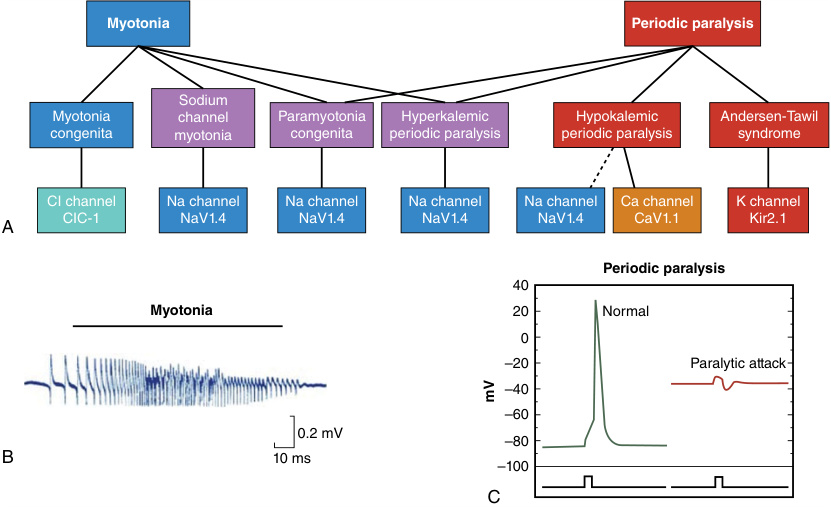
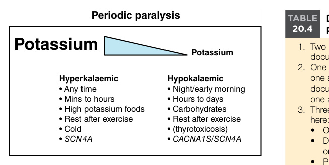
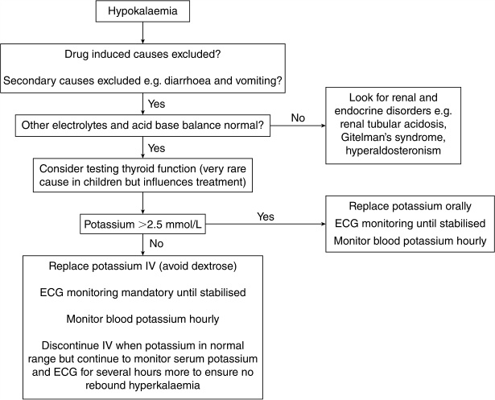

# Chapter 20: Skeletal Muscle Channelopathies: Periodic Paralyses and Nondystrophic Myotonias — Active-Recall Flashcards
**Section III: Neuro-Sensory Disorders** | [📖 Read Wiki Chapter](../chapters/020_Skeletal_Muscle_Channelopathies_Periodic_Paralyses_and_Nondystrophic.md) | [📝 Chapter MCQs](../mcqs/020_mcqs.md) | [🏠 Course Master Index](../../index.md)

Total cards: **28** *(Click any card below to reveal the answer)*

### Card 1 (Syndrome & OMIM Profile)

<b>Q:</b> What are the genetic etiology, inheritance pattern, and hallmark clinical features of **Hyperkalemic periodic paralysis**?

**Answer:**
**Causative Gene(s):** `SCN4A` · **Inheritance:** AD

**Clinical & Molecular Profile:** Inheritance: AD — Age of Onset: First decade — Muscles Most Affected: Limbs and trunk — Additional Features: Neonatal hypotonia Myotonia can be seen — Triggers: High serum potassium, may be due to potassium-rich foods Cold environment, intercurrent illness Rest after exertion Puberty, menses — Diagnostic Clue: Weakness can be any time of

### Card 2 (Syndrome & OMIM Profile)

<b>Q:</b> What are the genetic etiology, inheritance pattern, and hallmark clinical features of **Hypokalemic periodic paralysis**?

**Answer:**
**Causative Gene(s):** `CACNA1S, SCN4A` · **Inheritance:** AD

**Clinical & Molecular Profile:** Causative Gene: CACNA1S SCN4A — Inheritance: AD — Age of Onset: Second decade typical — Muscles Most Affected: Limbs and trunk — Additional Features: In very severe attacks facial muscles can be weak— speech slurred, and respiratory muscles affected — Triggers: Low serum potassium, may be due to carbohydrate-rich food or fasting Intercurr

### Card 3 (Syndrome & OMIM Profile)

<b>Q:</b> What are the genetic etiology, inheritance pattern, and hallmark clinical features of **Andersen-Tawil syndrome**?

**Answer:**
**Causative Gene(s):** `KCNJ2` · **Inheritance:** AD

**Clinical & Molecular Profile:** Inheritance: AD — Age of Onset: First and second decade — Muscles Most Affected: Limbs and trunk — Additional Features: Cardiac conduction abnormalities Ventricular tachyarrhythmia Dysmorphic features— commonly short stature, micrognathia, clinodactyly, syndactyly, low-set ears — Triggers: Low serum potassium, may be due to carbohydrate-r

### Card 4 (Syndrome & OMIM Profile)

<b>Q:</b> What are the genetic etiology, inheritance pattern, and hallmark clinical features of **Myotonia congenita**?

**Answer:**
**Causative Gene(s):** `CLCN1` · **Inheritance:** AR

**Clinical & Molecular Profile:** Inheritance: AD or AR — Age of Onset: Typically early teens Range first to fourth decade — Muscles Most Affected: Legs>face and hands — Additional Features: Warm-up phenomenon (myotonia improves with repetitive action) Transient weakness may be observed, also improves with repetitive action Muscle hypertrophy Contractures Scoliosis Toe wa

### Card 5 (Syndrome & OMIM Profile)

<b>Q:</b> What are the genetic etiology, inheritance pattern, and hallmark clinical features of **Paramyotonia congenita**?

**Answer:**
**Causative Gene(s):** `SCN4A` · **Inheritance:** AD

**Clinical & Molecular Profile:** Inheritance: AD — Age of Onset: Typically first decade Often early— birth or within first few weeks — Muscles Most Affected: Eyelids, extraocular muscles, jaw, tongue, hands>legs — Additional Features: Paradoxical worsening with repetitive action Can have episodic weakness/paralysis (overlap with hyperPP) Muscle hypertrophy Contractures S

### Card 6 (Syndrome & OMIM Profile)

<b>Q:</b> What are the genetic etiology, inheritance pattern, and hallmark clinical features of **Sodium channel myotonia**?

**Answer:**
**Causative Gene(s):** `SCN4A` · **Inheritance:** AD

**Clinical & Molecular Profile:** Inheritance: AD — Age of Onset: Typically first or second decade — Muscles Most Affected: Eyelids, extraocular muscles, jaw, tongue, hands, legs — Additional Features: Both warm-up phenomenon and paradoxical worsening can be seen Muscle hypertrophy — Myotonic Triggers: Extremes of temperature—cold or hot Sometimes high-potassium foods — D

### Card 7 (Syndrome & OMIM Profile)

<b>Q:</b> What are the genetic etiology, inheritance pattern, and hallmark clinical features of **SNEL**?

**Answer:**
**Causative Gene(s):** `SCN4A` · **Inheritance:** AD

**Clinical & Molecular Profile:** Inheritance: Often de novo Can be AD — Age of Onset: Birth to 10 months — Muscles Most Affected: Generalized but prominent respiratory and laryngeal muscle involvement — Additional Features: Recurrent episodic apnea±stridor Bradycardia Loss of consciousness Massive muscle hypertrophy Dysmorphic features

### Card 8 (Molecular Etiology)

<b>Q:</b> Pathogenic variants in **`SCN4A`** are associated with which clinical phenotype and molecular mechanism in **Hyperkalemic Periodic Paralysis (HyperPP)**?

**Answer:**
The genetic form is due to pathogenic variants in SCN4A .

### Card 9 (Molecular Etiology)

<b>Q:</b> Pathogenic variants in **`CACNA1S`** are associated with which clinical phenotype and molecular mechanism in **Hypokalemic Periodic Paralysis (HypoPP)**?

**Answer:**
It is due primarily to pathogenic variants in the CACNA1S gene, which codes for a voltage-gated calcium channel that interacts with the ryanodine receptor to prompt calcium release from the sarcoplasmic reticulum.

### Card 10 (Molecular Etiology)

<b>Q:</b> Pathogenic variants in **`KCNJ2`** are associated with which clinical phenotype and molecular mechanism in **Andersen-Tawil Syndrome (ATS)**?

**Answer:**
It is due to pathogenic variants in KCNJ2 expressed in both skeletal and cardiac muscle as well as having a role in bony development.

### Card 11 (Molecular Etiology)

<b>Q:</b> Pathogenic variants in **`CLCN1`** are associated with which clinical phenotype and molecular mechanism in **Myotonia Congenita (MC)**?

**Answer:**
It is due to pathogenic variants in CLCN1 which codes for the voltage-gated chloride channel ClC-1, which has an essential role in resetting the sarcolemma after depolarization and muscle contraction.

### Card 12 (Precision Therapy & Management)

<b>Q:</b> What is the targeted therapeutic approach or clinical management strategy for **Nondystrophic myotonia (NMD)**?

**Answer:**
**Therapy / Intervention:** Mexiletine

**Clinical Context:** Medication: Mexiletine — Monitoring Requirements: ECG, FBC, LFTs, clotting before starting ECG after each dose increment and yearly on stable regime — Other Comments: Those with MC may need higher doses than those withSC

### Card 13 (Precision Therapy & Management)

<b>Q:</b> What is the targeted therapeutic approach or clinical management strategy for **SNEL**?

**Answer:**
**Therapy / Intervention:** Mexiletine, carbamazepine, flecainide

**Clinical Context:** Medication: Mexiletine, carbamazepine, flecainide — Monitoring Requirements: As above — Other Comments: Can result in almost complete cessation of apneic episodes and infants in ICU can be discharged Some in vitro eviden

### Card 14 (Precision Therapy & Management)

<b>Q:</b> What is the targeted therapeutic approach or clinical management strategy for **Hypokalemic periodic paralysis**?

**Answer:**
**Therapy / Intervention:** Acetazolamide

**Clinical Context:** Medication: Acetazolamide — Monitoring Requirements: U+Es before starting and 7 to 10 days after Repeat U+Es after each dose increment Renal USS before starting and consider yearly thereafter

### Card 15 (Precision Therapy & Management)

<b>Q:</b> What is the targeted therapeutic approach or clinical management strategy for **Hyperkalemic periodic paralysis**?

**Answer:**
**Therapy / Intervention:** Acetazolamide

**Clinical Context:** Medication: Acetazolamide — Monitoring Requirements: U+Es before starting and 7 to 10 days after Repeat U+Es after each dose increment Renal USS before starting and consider yearly thereafter

### Card 16 (Clinical & Diagnostic Concept)

<b>Q:</b> In the clinical evaluation of **The Periodic Paralyses**, how is **hyperkalemic periodic paralysis** defined and characterized?

**Answer:**
hyperkalemic periodic paralysis (HyperPP), hypokalemic periodic paralysis (HypoPP), and Andersen-Tawil syndrome (ATS) (Table 20.

### Card 17 (Clinical & Diagnostic Concept)

<b>Q:</b> In the clinical evaluation of **Hypokalemic Periodic Paralysis (HypoPP)**, how is **AndersenTawil syndrome (ATS)** defined and characterized?

**Answer:**
AndersenTawil syndrome (ATS) and look for dysmorphic features and the ECG changes of hypokalemia (Table 20.

### Card 18 (Clinical & Diagnostic Concept)

<b>Q:</b> In the clinical evaluation of **Andersen-Tawil Syndrome (ATS)**, how is **Dysmorphic features** defined and characterized?

**Answer:**
Dysmorphic features can include short stature, syndactyly, clinodactyly, micrognathia, low-set ears, small hands and feet, scoliosis, cleft palate, and dental abnormalities; these features are not universal.

### Card 19 (Clinical & Diagnostic Concept)

<b>Q:</b> In the clinical evaluation of **Andersen-Tawil Syndrome (ATS)**, how is **Cardiac involvement** defined and characterized?

**Answer:**
Cardiac involvement can range from an asymptomatic long QT syndrome to life-threatening ventricular tachyarrhythmia requiring an implantable defibrillator.

### Card 20 (Clinical & Diagnostic Concept)

<b>Q:</b> In the clinical evaluation of **Paramyotonia Congenita and Sodium Channel Myotonia**, how is **paramyotonia congenita** defined and characterized?

**Answer:**
paramyotonia congenita (PMC) and sodium channel myotonia (SCM).

### Card 21 (Clinical & Diagnostic Concept)

<b>Q:</b> In the clinical evaluation of **Differential Diagnosis**, how is **Myotonic dystrophy type 2** defined and characterized?

**Answer:**
Myotonic dystrophy type 2 is more readily confused with MC, but congenital or early childhood onset is not recognized.

### Card 22 (Clinical & Diagnostic Concept)

<b>Q:</b> In the clinical evaluation of **Differential Diagnosis**, how is **myotonic myopathy** defined and characterized?

**Answer:**
myotonic myopathy and probably does represent an overlap of the SNEL phenotype with congenital myopathy.

### Card 23 (Clinical & Diagnostic Concept)

<b>Q:</b> In the clinical evaluation of **Anesthetic Guidance**, how is **myotonic crisis** defined and characterized?

**Answer:**
myotonic crisis can mimic a malignant hyperthermia type syndrome with generalized body stiffness.

### Card 24 (Visual & Imaging Spotter)

<b>Q:</b> Identify the diagnostic sign, dysmorphic phenotype, neuroimaging pattern, or molecular pathway illustrated below (Fig. 20.1):

**Answer:**
Clinical spectrum of the nondystrophic myotonias and periodic paralyses. Myotonia predominates in disorders further to the left in this spectrum, whereas periodic paralysis is the major symptom for those further to the right (A). The underlying molecular genetic defects in each of these disorders are variants in voltage-gated ion channels (A, bottom row). An electromyographic recording of a myotonic burst (B), computer simulations of an action potential in normal muscle, and depolarization-induced loss of excitability during an attack of periodic paralysis (C) are also shown. (Cannon SC. Pathomechanisms in channelopathies of skeletal muscle and brain. Annu Rev Neurosci 2006;29:387–415.)

### Card 25 (Visual & Imaging Spotter)

<b>Q:</b> Identify the diagnostic sign, dysmorphic phenotype, neuroimaging pattern, or molecular pathway illustrated below (Fig. 20.2):

**Answer:**
Periodic paralysis.

### Card 26 (Visual & Imaging Spotter)

<b>Q:</b> Identify the diagnostic sign, dysmorphic phenotype, neuroimaging pattern, or molecular pathway illustrated below (Fig. 20.3):

**Answer:**
Flow chart for the emergency management of a child presenting with hypokalemia and flaccid paralysis.

### Card 27 (Differential Diagnosis)

<b>Q:</b> In the differential diagnosis of **Channelopathy Causative Gene Inheritance Age of Onset Muscles Most Affected Additional Features Triggers Diagnostic Clue**, what are the distinguishing features of **Hyperkalemic periodic paralysis**?

**Answer:**
**Causative Gene**: SCN4A; **Inheritance**: AD; **Age of Onset**: First decade; **Muscles Most Affected**: Limbs and trunk; **Additional Features**: Neonatal hypotonia Myotonia can be seen; **Triggers**: High serum potassium, may be due to potassium-rich foods Cold environment, intercurrent illness Rest after exertion Puberty, menses; **Diagnostic Clue**: Weakness can be any time of day Can last minutes to hours May have additional myotonia and sometimes muscle hypertrophy

### Card 28 (Differential Diagnosis)

<b>Q:</b> In the differential diagnosis of **Channelopathy Causative Gene Inheritance Age of Onset Muscles Most Affected Additional Features Triggers Diagnostic Clue**, what are the distinguishing features of **Hypokalemic periodic paralysis**?

**Answer:**
**Causative Gene**: CACNA1S SCN4A; **Inheritance**: AD; **Age of Onset**: Second decade typical; **Muscles Most Affected**: Limbs and trunk; **Additional Features**: In very severe attacks facial muscles can be weak— speech slurred, and respiratory muscles affected; **Triggers**: Low serum potassium, may be due to carbohydrate-rich food or fasting Intercurrent illness Rest after exertion Puberty, menses; **Diagnostic Clue**: Attacks common during night when wakes to use bathroom or first thing in morning Attacks are typically hours to days Plays football after school, has pizza for tea, wakes next morning unable to move

