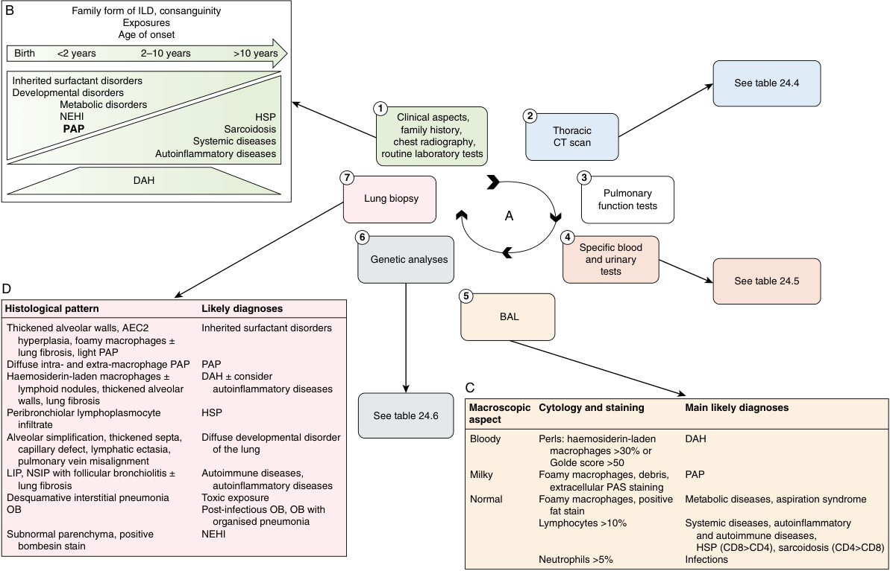

# Chapter 24: Interstitial Lung Diseases of Childhood — Active-Recall Flashcards
**Section IV: Cardiopulmonary Disorders** | [📖 Read Wiki Chapter](../chapters/024_Interstitial_Lung_Diseases_of_Childhood.md) | [📝 Chapter MCQs](../mcqs/024_mcqs.md) | [🏠 Course Master Index](../../index.md)

Total cards: **28** *(Click any card below to reveal the answer)*

### Card 1 (Syndrome & OMIM Profile)

<b>Q:</b> What are the genetic etiology, inheritance pattern, and hallmark clinical features of **Pulmonary interstitial glycogenosis (infantile cellular interstitial pneumonia) Surfactant dysfunction disorde**?

**Answer:**
**Causative Gene(s):** `CSF2RA, NKX2, ABCA3` · **Inheritance:** Genetic

**Clinical & Molecular Profile:** Anti-GBM disease Granulomatosis with polyangiitis Microscopic polyangiitis Idiopathic pulmonary capillaritis Gaucher disease and other storage diseases Malignant infiltrates Hemophagocytic lymphohistiocytosis MAS Langerhans cell histiocytosis Sarcoidosis Systemic sclerosis

### Card 2 (Syndrome & OMIM Profile)

<b>Q:</b> What are the genetic etiology, inheritance pattern, and hallmark clinical features of **SFTPB**?

**Answer:**
**Causative Gene(s):** `SFTPB` · **Inheritance:** Genetic

**Clinical & Molecular Profile:** Clinical Features: Neonatal • Respiratory distress — Age and Onset: Neonate, acute — SP-B is a hydrophobic protein encoded by SFTPB , located on chromosome 2.

### Card 3 (Syndrome & OMIM Profile)

<b>Q:</b> What are the genetic etiology, inheritance pattern, and hallmark clinical features of **ABCA3**?

**Answer:**
**Causative Gene(s):** `ABCA3` · **Inheritance:** Genetic

**Clinical & Molecular Profile:** Clinical Features: Neonatal — Age and Onset: Neonate, acute — ABCA3 deficiency is autosomal recessively inherited and is the most common cause of surfactant protein deficiency.

### Card 4 (Syndrome & OMIM Profile)

<b>Q:</b> What are the genetic etiology, inheritance pattern, and hallmark clinical features of **SFTPC**?

**Answer:**
**Causative Gene(s):** `SFTPC` · **Inheritance:** Genetic

**Clinical & Molecular Profile:** Clinical Features: Neonatal — Age and Onset: Neonate, acute — Surfactantrelated genes implicated in congenital PAP include SFTPB , SFTPC , ABCA3 , and NKX2-1 ; additional genes associated with congenital PAP include SLC7A7 , which is associated with lysinuric protein intolerance (see Chapters 26 and 43).

### Card 5 (Syndrome & OMIM Profile)

<b>Q:</b> What are the genetic etiology, inheritance pattern, and hallmark clinical features of **NKX2.1**?

**Answer:**
**Causative Gene(s):** `NKX2` · **Inheritance:** Genetic

**Clinical & Molecular Profile:** Clinical Features: Respiratory — Age and Onset: Any age — NKX2-1 is located on chromosome 14 and encodes thyroid transcription factor 1, which plays a critical role in thyroid and lung development, and which is also expressed in the basal ganglia.

### Card 6 (Syndrome & OMIM Profile)

<b>Q:</b> What are the genetic etiology, inheritance pattern, and hallmark clinical features of **Thyroxine, thyroid-stimulating hormone**?

**Answer:**
**Causative Gene(s):** `NKX2-1` · **Inheritance:** Genetic

**Clinical & Molecular Profile:** Surfactant disorder(NKX2-1) — NKX2-1 is located on chromosome 14 and encodes thyroid transcription factor 1, which plays a critical role in thyroid and lung development, and which is also expressed in the basal ganglia.

### Card 7 (Syndrome & OMIM Profile)

<b>Q:</b> What are the genetic etiology, inheritance pattern, and hallmark clinical features of **Scleroderma, polymyositis, and myositis antibodies (KU, PM-Scl75, TIF1γ, MDA-5, PM-Scl100, Ml2, KJ; antisynthe**?

**Answer:**
**Causative Gene(s):** `PL7, PL12, JO1` · **Inheritance:** Genetic

**Clinical & Molecular Profile:** Indicates: Muscular, esophageal, and/or cutaneous involvement

### Card 8 (Syndrome & OMIM Profile)

<b>Q:</b> What are the genetic etiology, inheritance pattern, and hallmark clinical features of **GR and AR**?

**Answer:**
**Causative Gene(s):** `CSF2RA, CSF2RB` · **Inheritance:** AR

**Clinical & Molecular Profile:** CSF2RA, CSF2RB — Phenotypes: PAP (infants, children, adults) — Genes encoding GM-CSF receptor subunits and implicated in congenital PAP include CSF2RA and CSF2RB .

### Card 9 (Syndrome & OMIM Profile)

<b>Q:</b> What are the genetic etiology, inheritance pattern, and hallmark clinical features of **GA and GD**?

**Answer:**
**Causative Gene(s):** `FLNA` · **Inheritance:** Genetic

**Clinical & Molecular Profile:** Phenotypes: chILD with emphysema; cardiac abnormalities, neurologic impairment; girls>boys

### Card 10 (Syndrome & OMIM Profile)

<b>Q:</b> What are the genetic etiology, inheritance pattern, and hallmark clinical features of **AD and AR**?

**Answer:**
**Causative Gene(s):** `TBX4, FGFR2` · **Inheritance:** AR

**Clinical & Molecular Profile:** TBX4, FGFR2 — Phenotypes: chILD with PH; acinar dysplasia — AcDys and CAD is more complex and includes pathogenic variants in TBX4 , FGF10 , and FGFR2 .

### Card 11 (Molecular Etiology)

<b>Q:</b> Pathogenic variants in **`ABCA3`** are associated with which clinical phenotype and molecular mechanism in **The Pediatric Interstitial Lung Disease in Children Under 2 Years of Age**?

**Answer:**
Chest wall deformities such as pectus excavatum are often present in individuals with pleuro-parenchymal pulmonary fibroelastosis (PPFE) , a rare form of pulmonary fibrosis that is mostly restricted to the upper lobes and disorders related to pathogenic variants in ABCA3 .

### Card 12 (Molecular Etiology)

<b>Q:</b> Pathogenic variants in **`STRA6`** are associated with which clinical phenotype and molecular mechanism in **Diffuse Developmental Disorders**?

**Answer:**
De novo or inherited autosomal dominant pathogenic variants in FOXF1 are responsible for ACDMPV; rare cases have been described associated with homozygous autosomal recessive pathogenic variants in STRA6 .

### Card 13 (Molecular Etiology)

<b>Q:</b> Pathogenic variants in **`FGFR2`** are associated with which clinical phenotype and molecular mechanism in **Diffuse Developmental Disorders**?

**Answer:**
AcDys and CAD is more complex and includes pathogenic variants in TBX4 , FGF10 , and FGFR2 .

### Card 14 (Molecular Etiology)

<b>Q:</b> Pathogenic variants in **`SFTPB`** are associated with which clinical phenotype and molecular mechanism in **Surfactant Protein B Deficiency**?

**Answer:**
SP-B is a hydrophobic protein encoded by SFTPB , located on chromosome 2.

### Card 15 (Molecular Etiology)

<b>Q:</b> Pathogenic variants in **`SFTPA2`** are associated with which clinical phenotype and molecular mechanism in **Surfactant Protein A Deficiency**?

**Answer:**
SP-A is encoded by 2 genes on chromosome 10 ( SFTPA1 and SFTPA2 ).

### Card 16 (Molecular Etiology)

<b>Q:</b> Pathogenic variants in **`NKX2`** are associated with which clinical phenotype and molecular mechanism in **NKX2-1 Deficiency**?

**Answer:**
NKX2-1 is located on chromosome 14 and encodes thyroid transcription factor 1, which plays a critical role in thyroid and lung development, and which is also expressed in the basal ganglia.

### Card 17 (Precision Therapy & Management)

<b>Q:</b> What is the targeted therapeutic approach or clinical management strategy for **Treatment of Surfactant Protein Deficiencies**?

**Answer:**
**Therapy / Intervention:** Targeted / Disease-Modifying Therapy

**Clinical Context:** Active areas of investigation include targeted gene therapy and stem cell therapy.

### Card 18 (Precision Therapy & Management)

<b>Q:</b> What is the targeted therapeutic approach or clinical management strategy for **Additional Syndromes**?

**Answer:**
**Therapy / Intervention:** Targeted / Disease-Modifying Therapy

**Clinical Context:** SAVI syndrome, COPA syndrome, and STAT gain-offunction disease can be treated with JAK inhibitors; CTLA-4 pathway defects can be treated with the immunomodulator abatacept.

### Card 19 (Precision Therapy & Management)

<b>Q:</b> What is the targeted therapeutic approach or clinical management strategy for **Pulmonary Alveolar Proteinosis**?

**Answer:**
**Therapy / Intervention:** Targeted / Disease-Modifying Therapy

**Clinical Context:** The treatment of choice is generally whole lung lavage, which eliminates the proteinaceous material through instillation of saline into the lung.

### Card 20 (Clinical & Diagnostic Concept)

<b>Q:</b> In the clinical evaluation of **The Pediatric Interstitial Lung Disease in Children Under 2 Years of Age**, how is **pleuro-parenchymal pulmonary fibroelastosis (PPFE)** defined and characterized?

**Answer:**
pleuro-parenchymal pulmonary fibroelastosis (PPFE) , a rare form of pulmonary fibrosis that is mostly restricted to the upper lobes and disorders related to pathogenic variants in ABCA3 .

### Card 21 (Clinical & Diagnostic Concept)

<b>Q:</b> In the clinical evaluation of **Diagnosis**, how is **neuroendocrine cell hyperplasia of infancy (NEHI)** defined and characterized?

**Answer:**
neuroendocrine cell hyperplasia of infancy (NEHI) , with ground-glass opacities restricted almost entirely to the middle lobes (Figs.

### Card 22 (Clinical & Diagnostic Concept)

<b>Q:</b> In the clinical evaluation of **Diagnosis**, how is **pulmonary alveolar proteinosis** defined and characterized?

**Answer:**
pulmonary alveolar proteinosis (ground-glass opacities with smooth thickening of interlobular and intralobular septal lines, termed the crazy-paving pattern and depicted in Figures 24.

### Card 23 (Clinical & Diagnostic Concept)

<b>Q:</b> In the clinical evaluation of **Diagnosis**, how is **pulmonary alveolar microlithiasis** defined and characterized?

**Answer:**
pulmonary alveolar microlithiasis (diffuse ground-glass attenuation and multiple subpleural linear calcifications as depicted in Fig.

### Card 24 (Clinical & Diagnostic Concept)

<b>Q:</b> In the clinical evaluation of **Diagnosis**, how is **acute hypersensitivity pneumonitis** defined and characterized?

**Answer:**
acute hypersensitivity pneumonitis (upper lung predominant pulmonary changes including groundglass opacities, poorly defined centrilobular nodules, and areas of decreased attenuation representing air trapping, depicted in Figs.

### Card 25 (Clinical & Diagnostic Concept)

<b>Q:</b> In the clinical evaluation of **Diffuse Developmental Disorders**, how is **acinar dysplasia (AcDys)** defined and characterized?

**Answer:**
acinar dysplasia (AcDys) , congenital alveolar dysplasia ( CAD ; Fig.

### Card 26 (Clinical & Diagnostic Concept)

<b>Q:</b> In the clinical evaluation of **Surfactant Protein C Deficiency**, how is **Surfactant protein C deficiency** defined and characterized?

**Answer:**
Surfactant protein C deficiency is autosomal dominantly inherited or caused by a de novo pathogenic variant.

### Card 27 (Clinical & Diagnostic Concept)

<b>Q:</b> In the clinical evaluation of **Surfactant Protein A Deficiency**, how is **surfactant protein A deficiency** defined and characterized?

**Answer:**
surfactant protein A deficiency have been associated with pulmonary fibrosis and pulmonary adenocarcinoma in adults.

### Card 28 (Visual & Imaging Spotter)

<b>Q:</b> Identify the diagnostic sign, dysmorphic phenotype, neuroimaging pattern, or molecular pathway illustrated below (Fig. 24.1):

**Answer:**
Investigations in childhood interstitial lung disease (chILD) diagnostic workup. (A) The investigations are performed one after the other to reach a chILD etiology. The first step is usually done by the general pediatrician (framed in red) , and includes family history, clinical evaluation, chest radiography, and routine laboratory tests. (B) Age at onset is crucial information that helps to consider some etiologies more than others. (C) Bronchoalveolar lavage (BAL) eliminates infectious causes of ILD and provides clues to the most likely diagnoses. (D) When thoracic computed tomography (CT) scan, specific blood tests, BAL, and genetic analyses could not assess a diagnosis, lung biopsy is the last step of the diagnostic process, allowing to assess the most likely diagnoses in most cases. AEC2, Type 2 alveolar epithelial cells; DAH, diffuse alveolar hemorrhage; HSP, hypersensitivity pneumonitis; LIP, lymphoid interstitial pneumonia; NEHI, neuroendocrine cell hyperplasia of infancy; NSIP, nonspecific interstitial pneumonia; OB, obliterans bronchiolitis; PAP, pulmonary alveolar proteinosis; PAS, Periodic acid–Schiff.

