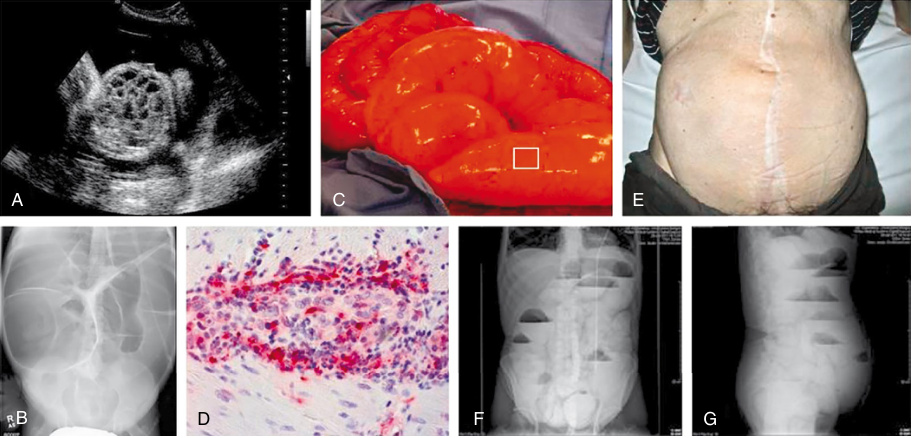

# Chapter 32: Pediatric Intestinal Pseudo-Obstruction — Active-Recall Flashcards
**Section V: Gastrointestinal and Hepatic Disorders** | [📖 Read Wiki Chapter](../chapters/032_Pediatric_Intestinal_Pseudo_Obstruction.md) | [📝 Chapter MCQs](../mcqs/032_mcqs.md) | [🏠 Course Master Index](../../index.md)

Total cards: **28** *(Click any card below to reveal the answer)*

### Card 1 (Syndrome & OMIM Profile)

<b>Q:</b> What are the genetic etiology, inheritance pattern, and hallmark clinical features of **Type IV Waardenburg syndrome**?

**Answer:**
**Causative Gene(s):** `SOX10` · **Inheritance:** AD

**Clinical & Molecular Profile:** Inheritance: Autosomal dominant — Phenotype: Peripheral neuropathy with hypomyelination, sensorineural deafness and pseudo-obstruction — Age of Onset: Neonatal period

### Card 2 (Syndrome & OMIM Profile)

<b>Q:</b> What are the genetic etiology, inheritance pattern, and hallmark clinical features of **Congenital myopathy and gastrointestinal pseudo-obstruction**?

**Answer:**
**Causative Gene(s):** `POLG1` · **Inheritance:** AR

**Clinical & Molecular Profile:** POLG1(DNApolymerase gamma) — Inheritance: Autosomal recessive — Phenotype: Associated with mitochondrial depletion and deletions. Severe hypotonia and generalized muscle weakness, severe abdominal distension and hypoactive bowel — Age of Onset: Neonatal period

### Card 3 (Syndrome & OMIM Profile)

<b>Q:</b> What are the genetic etiology, inheritance pattern, and hallmark clinical features of **Chronic idiopathic intestinal pseudo-obstruction (CIIPX)**?

**Answer:**
**Causative Gene(s):** `FLNA` · **Inheritance:** XLR

**Clinical & Molecular Profile:** FLNA(filamin A) — Inheritance: X-linked recessive — Phenotype: Abnormal filamin A leads to cytoskeletal abnormalities and potentially disrupts enteric-neuron structure and function. Seizures and progressive abdominal distension and obstruction — Age of Onset: Neonatal period

### Card 4 (Syndrome & OMIM Profile)

<b>Q:</b> What are the genetic etiology, inheritance pattern, and hallmark clinical features of **Hydrocephalus with stenosis of the aqueduct of Sylvius (HSAS) and congenital idiopathic intestinal pseudo-obst**?

**Answer:**
**Causative Gene(s):** `L1CAM` · **Inheritance:** AR

**Clinical & Molecular Profile:** L1CAM(L1 cell adhesion molecule) — Inheritance: Autosomal recessive — Phenotype: Defect in the differentiation of the interstitial cells of Cajal leading to progressive distension and intermittent episodes of obstruction — Age of Onset: Neonatal period

### Card 5 (Syndrome & OMIM Profile)

<b>Q:</b> What are the genetic etiology, inheritance pattern, and hallmark clinical features of **Familial visceral myopathy; megacystis-microcolonintestinal hypoperistalsis syndrome**?

**Answer:**
**Causative Gene(s):** `ACTG2` · **Inheritance:** AD

**Clinical & Molecular Profile:** ACTG2 (enteric smooth muscle actin– gamma 2) — Inheritance: Autosomal dominant, sporadic — Phenotype: Altered ACTG2 protein in the muscularis propria leads to impaired contractility — Age of Onset: Neonatal to third decade in life

### Card 6 (Syndrome & OMIM Profile)

<b>Q:</b> What are the genetic etiology, inheritance pattern, and hallmark clinical features of **Megacystis-microcolonintestinal hypoperistalsis syndrome**?

**Answer:**
**Causative Gene(s):** `MYH11` · **Inheritance:** AR

**Clinical & Molecular Profile:** MYH11(myosin heavy chain 11) — Inheritance: Autosomal recessive — Phenotype: Abnormal MYH11 in smooth muscle myosin leads to impaired contractility — Age of Onset: Neonatal to third decade in life

### Card 7 (Syndrome & OMIM Profile)

<b>Q:</b> What are the genetic etiology, inheritance pattern, and hallmark clinical features of **Multiple endocrine neoplasia type 2B**?

**Answer:**
**Causative Gene(s):** `RET` · **Inheritance:** AD

**Clinical & Molecular Profile:** RET protoonco gene (receptor tyrosine kinase) — Inheritance: Autosomal dominant — Phenotype: Gain-of-function variant associated with intestinal ganglioneuromas leading to increased cell number in the myenteric plexus and dysmotility — Age of Onset: Infancy to third decade of life

### Card 8 (Syndrome & OMIM Profile)

<b>Q:</b> What are the genetic etiology, inheritance pattern, and hallmark clinical features of **Mungan syndrome**?

**Answer:**
**Causative Gene(s):** `RAD21` · **Inheritance:** AR

**Clinical & Molecular Profile:** Inheritance: Autosomal recessive — Phenotype: Pseudo-obstruction, megaduodenum, long segment Barrett esophagus, and cardiac abnormalities — Age of Onset: First to second decade of life

### Card 9 (Molecular Etiology)

<b>Q:</b> Pathogenic variants in **`MYH11`** are associated with which clinical phenotype and molecular mechanism in **Etiology**?

**Answer:**
Five genes (ACTG2, LMOD1, MYH11, MYLK, MYL9) have been linked to this syndrome.

### Card 10 (Molecular Etiology)

<b>Q:</b> Pathogenic variants in **`ACTG2`** are associated with which clinical phenotype and molecular mechanism in **Etiology**?

**Answer:**
ACTG2 is the most commonly described gene with pathogenic variants.

### Card 11 (Molecular Etiology)

<b>Q:</b> Pathogenic variants in **`SGOL1`** are associated with which clinical phenotype and molecular mechanism in **Primary Pediatric Intestinal Pseudo-Obstruction With Identified Genetic Pathogenic Variants—cont’d**?

**Answer:**
Chronic atrial and intestinal dysrhythmia (CAID) syndrome is caused by the homozygous pathogenic variants of SGOL1 and is characterized by pacemaker failure in both the heart and gut leading to cardiac arrhythmias and chronic intestinal pseudo-obstruction.

### Card 12 (Molecular Etiology)

<b>Q:</b> Pathogenic variants in **`POLG`** are associated with which clinical phenotype and molecular mechanism in **Primary Pediatric Intestinal Pseudo-Obstruction With Identified Genetic Pathogenic Variants—cont’d**?

**Answer:**
PIPO has also been reported in association with other mitochondrial disorders such as Alpers disease (POLG) and mitochondrial encephalopathy, lactic acidosis, and strokelike episodes syndrome (MELAS) .

### Card 13 (Molecular Etiology)

<b>Q:</b> Pathogenic variants in **`NOTCH2NLC`** are associated with which clinical phenotype and molecular mechanism in **Miscellaneous**?

**Answer:**
Longread sequencing has identified GGC repeat expansions in NOTCH2NLC to be associated with neuronal intranuclear inclusion disease.

### Card 14 (Molecular Etiology)

<b>Q:</b> Pathogenic variants in **`LCT`** are associated with which clinical phenotype and molecular mechanism in **Nutrition**?

**Answer:**
Medium-chain triglycerides (MCT) are associated with a faster GI transit time in neonates and may be better tolerated than long-chain triglycerides (LCT) in PIPO.

### Card 15 (Precision Therapy & Management)

<b>Q:</b> What is the targeted therapeutic approach or clinical management strategy for **5HT-4 Agonists**?

**Answer:**
**Therapy / Intervention:** 5HT-4 Agonists

**Clinical Context:**

### Card 16 (Precision Therapy & Management)

<b>Q:</b> What is the targeted therapeutic approach or clinical management strategy for **Cisapride**?

**Answer:**
**Therapy / Intervention:** Cisapride

**Clinical Context:** Dosage: 0.2–0.3 mg/kg/dose 3–4 times a day, 30 min prior to a meal — Mechanism: 5HT4 agonist with acetylcholine release in the gut. 5HT3 antagonist — Side Effect: Nausea Vomiting Diarrhea Constipation Abdominal cramps He

### Card 17 (Precision Therapy & Management)

<b>Q:</b> What is the targeted therapeutic approach or clinical management strategy for **Prucalopride**?

**Answer:**
**Therapy / Intervention:** Prucalopride

**Clinical Context:** Dosage: 0.02–0.04 mg/kg/day max 2 mg daily — Mechanism: 5HT4 agonist with acetylcholine release in the gut — Side Effect: Nausea Vomiting Diarrhea Abdominal pain Headache Mild tachycardia

### Card 18 (Precision Therapy & Management)

<b>Q:</b> What is the targeted therapeutic approach or clinical management strategy for **Cholinergics**?

**Answer:**
**Therapy / Intervention:** Cholinergics

**Clinical Context:**

### Card 19 (Clinical & Diagnostic Concept)

<b>Q:</b> In the clinical evaluation of **Etiology**, how is **Mitochondrial myopathies** defined and characterized?

**Answer:**
Mitochondrial myopathies can also present with features of intestinal pseudo-obstruction.

### Card 20 (Clinical & Diagnostic Concept)

<b>Q:</b> In the clinical evaluation of **Primary Pediatric Intestinal Pseudo-Obstruction With Identified Genetic Pathogenic Variants—cont’d**, how is **Neurocristopathies** defined and characterized?

**Answer:**
Neurocristopathies are disorders associated with defects of neural crest cell development.

### Card 21 (Clinical & Diagnostic Concept)

<b>Q:</b> In the clinical evaluation of **Primary Pediatric Intestinal Pseudo-Obstruction With Identified Genetic Pathogenic Variants—cont’d**, how is **Hirschsprung disease (HD)** defined and characterized?

**Answer:**
Hirschsprung disease (HD) is a form of neurocristopathy characterized by absence of ganglion cells in the submucosal and myenteric plexuses over a variable length of the distal part of the gut leading to signs of intestinal obstruction.

### Card 22 (Clinical & Diagnostic Concept)

<b>Q:</b> In the clinical evaluation of **Primary Pediatric Intestinal Pseudo-Obstruction With Identified Genetic Pathogenic Variants—cont’d**, how is **hypoganglionosis** defined and characterized?

**Answer:**
hypoganglionosis , along with HD-like involvement of the colon.

### Card 23 (Clinical & Diagnostic Concept)

<b>Q:</b> In the clinical evaluation of **Primary Pediatric Intestinal Pseudo-Obstruction With Identified Genetic Pathogenic Variants—cont’d**, how is **Alpers disease** defined and characterized?

**Answer:**
Alpers disease (POLG) and mitochondrial encephalopathy, lactic acidosis, and strokelike episodes syndrome (MELAS) .

### Card 24 (Clinical & Diagnostic Concept)

<b>Q:</b> In the clinical evaluation of **Miscellaneous**, how is **Neuronal intranuclear inclusion disease** defined and characterized?

**Answer:**
Neuronal intranuclear inclusion disease is a rare neurodegenerative disorder that can affect the central, peripheral, and/or autonomic nervous system.

### Card 25 (Clinical & Diagnostic Concept)

<b>Q:</b> In the clinical evaluation of **Miscellaneous**, how is **Diffuse intestinal ganglioneuromatosis** defined and characterized?

**Answer:**
Diffuse intestinal ganglioneuromatosis is characterized by diffusely distributed transmural hamartomatous lesions which are composed of benign ganglion cells.

### Card 26 (Clinical & Diagnostic Concept)

<b>Q:</b> In the clinical evaluation of **Miscellaneous**, how is **Intestinal myenteric hypoganglionosis** defined and characterized?

**Answer:**
Intestinal myenteric hypoganglionosis presents with severe and persistent neonatal intestinal pseudo-obstruction.

### Card 27 (Visual & Imaging Spotter)

<b>Q:</b> Identify the diagnostic sign, dysmorphic phenotype, neuroimaging pattern, or molecular pathway illustrated below (Fig. 32.1):

**Answer:**
Schematic representation of the enteric nervous system and connections between the neurons in the submucosal and myenteric plexus. The submucosal plexus is mainly responsible for regulating bowel secretions and blood supply. The myenteric plexus, which is located between the circular and longitudinal smooth muscle layers, regulates the bowel motor function. The interstitial cells of Cajal act as the pacemaker cells for the intestinal myocytes. The gastrointestinal tract also receives innervation from the autonomic nervous system (not shown).

### Card 28 (Visual & Imaging Spotter)

<b>Q:</b> Identify the diagnostic sign, dysmorphic phenotype, neuroimaging pattern, or molecular pathway illustrated below (Fig. 32.2):

**Answer:**
Synoptic view of the chronic intestinal pseudo-obstruction (CIPO) spectrum. (A and B) The most severe pediatric cases with antenatal (in utero) evidence of multivisceral dilation, often gut (B) and urinary system, commonly associated with an extremely poor prognosis. (C and D) CIPO phenotype with rapid progression to intestinal dilation (± ureter/bladder) and failure, often occurring as a result of an anamnestically reported gastroenteritis. Massive bowel dilation (C) and associated histopathology (D; corresponds to white squared area in C) revealed an intense inflammatory (mainly lymphocytic) neuropathy (hence, myenteric ganglionitis). Alkaline phosphatase anti-alkaline phosphatase immunohistochemical technique using specific anti-CD8 monoclonal antibodies was used to identify a subset of T lymphocytes. (E and G) Examples of another phenotype of the syndrome that may be seen in patients who have more insidious mild and nonspecific symptoms progressing to a classic CIPO over time. (E) Markedly distended abdomen of a 32-year-old man who presented with subocclusive episodes after years of unspecific (dyspeptic-like/irritable bowel syndrome–like) symptoms. Note the evident airfluid levels detectable in upright position in anteroposterior (F) and laterolateral (G) plain abdominal radiographs. (B–G from Di Nardo G, Di Lorenzo C, Lauro A, et al. Chronic intestinal pseudo-obstruction in children and adults: diagnosis and therapeutic options. _Neurogastroenterol Mot

