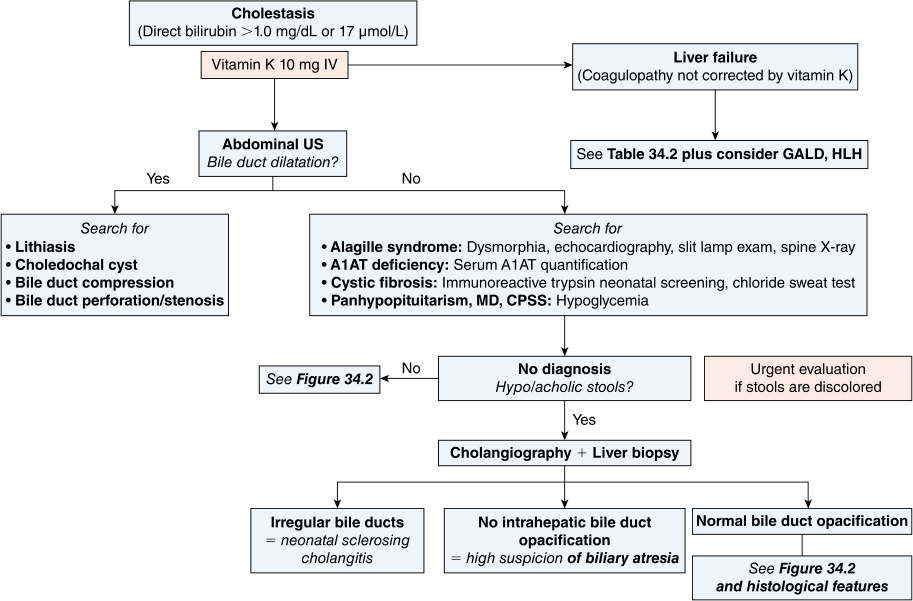
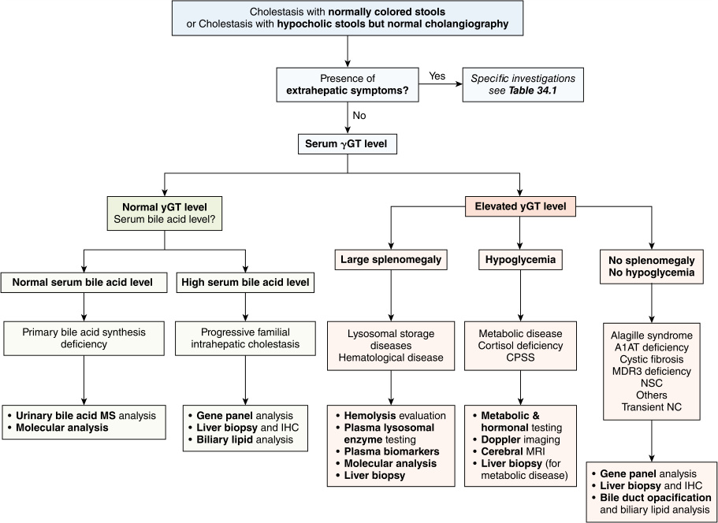

# Chapter 34: Genetic Etiologies of Neonatal and Infantile Cholestasis — Active-Recall Flashcards
**Section V: Gastrointestinal and Hepatic Disorders** | [📖 Read Wiki Chapter](../chapters/034_Genetic_Etiologies_of_Neonatal_and_Infantile_Cholestasis.md) | [📝 Chapter MCQs](../mcqs/034_mcqs.md) | [🏠 Course Master Index](../../index.md)

Total cards: **28** *(Click any card below to reveal the answer)*

### Card 1 (Syndrome & OMIM Profile)

<b>Q:</b> What are the genetic etiology, inheritance pattern, and hallmark clinical features of **Digestive tract**?

**Answer:**
**Causative Gene(s):** `FIC1` · **Inheritance:** Genetic

**Clinical & Molecular Profile:** • Cystic fibrosis (meconium ileus, exocrine pancreatic insufficiency) • FIC1 deficiency (diarrhea, exocrine pancreatic insufficiency) • Myosin Vb deficiency (congenital diarrhea) • Unc45A deficiency (congenital diarrhea) • Wolman disease (diarrhea, abdominal distension) • BASD (diarrhea, steatorrhea) — SeeTable 34.4 SeeTable 34.4 SeeTable

### Card 2 (Syndrome & OMIM Profile)

<b>Q:</b> What are the genetic etiology, inheritance pattern, and hallmark clinical features of **Kidney**?

**Answer:**
**Causative Gene(s):** `DCDC2` · **Inheritance:** Genetic

**Clinical & Molecular Profile:** • ARC syndrome (proximal tubulopathy) • Peroxisomal disease (renal cysts) • 3β-HSD deficiency (renal cysts) • DCDC2 deficiency (renal cysts) • HNF1βdeficiency (renal cysts, tubulopathy) — SeeTable 34.4 SeeTable 34.4 SeeTable 34.4 SeeTable 34.4 SeeTable 34.4

### Card 3 (Syndrome & OMIM Profile)

<b>Q:</b> What are the genetic etiology, inheritance pattern, and hallmark clinical features of **Metabolic diseases**?

**Answer:**
**Causative Gene(s):** `POLG, MPV17, NPC1, NPC2, SCYL1, RINT1` · **Inheritance:** mtDNA

**Clinical & Molecular Profile:** • Tyrosinemia type I(FAH) • Galactosemia(GALT) • Mitochondrial disorders including MDS(DGUOK, POLG, MPV17, TWINK, TRMU) • Niemann-Pick type C(NPC1, NPC2) • Adenosine kinase deficiency(ADK) • Recurrent liver failure syndrome (NBAS, SCYL1, RINT1) • Citrin deficiency(SLC25A13) • Transaldolase deficiency(TALDO1) • Glycogen storage disease typ

### Card 4 (Syndrome & OMIM Profile)

<b>Q:</b> What are the genetic etiology, inheritance pattern, and hallmark clinical features of **Hepatocellular cholestasis**?

**Answer:**
**Causative Gene(s):** `ABCB11` · **Inheritance:** Genetic

**Clinical & Molecular Profile:** • Familial cholestasis (especially NR1H4, ABCB11) • BASD (especiallyAKR1D1)

### Card 5 (Syndrome & OMIM Profile)

<b>Q:</b> What are the genetic etiology, inheritance pattern, and hallmark clinical features of **Intrahepatic (47.5%)**?

**Answer:**
**Causative Gene(s):** `CCDC115` · **Inheritance:** mtDNA

**Clinical & Molecular Profile:** Genetic cholestasis(Table 34.4) •α1-antitrypsin deficiency • Alagille syndrome • Progressive familial intrahepatic cholestasis • Cystic fibrosis • BASD, including peroxisomal defects. Genetic metabolic disorders: • Citrin deficiency • Lysosomal storage diseases (Niemann-Pick type C, Gaucher disease, Wolman disease, acid sphingomyelinase d

### Card 6 (Syndrome & OMIM Profile)

<b>Q:</b> What are the genetic etiology, inheritance pattern, and hallmark clinical features of **3β-hydroxy-Δ-C27-steroid oxidoreductase deficiency** (#607764)?

**Answer:**
**Causative Gene(s):** `HSD3B7` · **Inheritance:** AR

**Clinical & Molecular Profile:** γGT: N — Gene (MIM Phenotype): HSD3B7 (#607764) — Inheritance: AR — Main Features: Fat malabsorption, FSV deficiency, no pruritus, low sBA, atypical bile acids in urine

### Card 7 (Syndrome & OMIM Profile)

<b>Q:</b> What are the genetic etiology, inheritance pattern, and hallmark clinical features of **Δ-3-oxosteroid-5β- reductase deficiency** (#604741)?

**Answer:**
**Causative Gene(s):** `AKR1D1` · **Inheritance:** AR

**Clinical & Molecular Profile:** γGT: N — Gene (MIM Phenotype): AKR1D1 (#604741) — Inheritance: AR — Main Features: Liver failure, Fat malabsorption, FSV deficiency, no pruritus, low sBA, atypical bile acids in urine

### Card 8 (Syndrome & OMIM Profile)

<b>Q:</b> What are the genetic etiology, inheritance pattern, and hallmark clinical features of **Oxysterol 7α-hydroxylase deficiency** (#603711)?

**Answer:**
**Causative Gene(s):** `CYP7B1` · **Inheritance:** AR

**Clinical & Molecular Profile:** γGT: N — Gene (MIM Phenotype): CYP7B1 (#603711) — Inheritance: AR — Main Features: Early liver failure, low sBA, atypical bile acids in urine

### Card 9 (Syndrome & OMIM Profile)

<b>Q:</b> What are the genetic etiology, inheritance pattern, and hallmark clinical features of **Sterol 27-hydroxylase deficiency (CTX)** (#606530)?

**Answer:**
**Causative Gene(s):** `CYP27A1` · **Inheritance:** AR

**Clinical & Molecular Profile:** γGT: N — Gene (MIM Phenotype): CYP27A1 (#606530) — Inheritance: AR — Main Features: TNC, low sBA, increased plasma cholestanol, neurocognitive involvement/cataract later in life, atypical bile alcohols in urine

### Card 10 (Syndrome & OMIM Profile)

<b>Q:</b> What are the genetic etiology, inheritance pattern, and hallmark clinical features of **Bile acid-CoA amino acid N-acyltransferase deficiency** (#602938)?

**Answer:**
**Etiology:** Genomic / Rare Syndrome · **Inheritance:** AR

**Clinical & Molecular Profile:** γGT: N — Gene (MIM Phenotype): BAAT (#602938) — Inheritance: AR — Main Features: Fat malabsorption, FSV deficiency, atypical bile acids in urine

### Card 11 (Molecular Etiology)

<b>Q:</b> Pathogenic variants in **`MDR3`** are associated with which clinical phenotype and molecular mechanism in **Diagnostic Approach to Neonatal and Infantile Cholestasis**?

**Answer:**
Immunohistochemical studies using a panel of antibodies against CK7/19, CD68, BSEP, MDR3, TJP2, MYO5B, among others, may contribute to establish a diagnosis.

### Card 12 (Molecular Etiology)

<b>Q:</b> Pathogenic variants in **`CFC1`** are associated with which clinical phenotype and molecular mechanism in **Anatomical Classification of Neonatal and Infantile Cholestasis**?

**Answer:**
Pathogenic variants in CFC1 are noted in some patients with BASM.

### Card 13 (Molecular Etiology)

<b>Q:</b> Pathogenic variants in **`KIF12`** are associated with which clinical phenotype and molecular mechanism in **Most Frequent Genetic Causes of Neonatal and Infantile Cholestasis**?

**Answer:**
Several proteins are involved in the expression of BSEP, such as the nuclear receptor FXR, or its trafficking, such as Myosin Vb, VIPAS39/VPS33B, VPS50, UNC45A, and KIF12.

### Card 14 (Molecular Etiology)

<b>Q:</b> Pathogenic variants in **`ZFYVE19`** are associated with which clinical phenotype and molecular mechanism in **Most Frequent Genetic Causes of Neonatal and Infantile Cholestasis**?

**Answer:**
Finally, transporters, such as CFTR, and primary cilia associated proteins, such as DCDC2 and ZFYVE19, are also important for cholangiocyte function.

### Card 15 (Molecular Etiology)

<b>Q:</b> Pathogenic variants in **`FIC1`** are associated with which clinical phenotype and molecular mechanism in **Genetic Hepatocellular Cholestasis**?

**Answer:**
Familial intrahepatic cholestasis protein 1 (FIC1) deficiency is due to pathogenic variation(s) in ATP8B1 , encoding an aminophospholipid flippase expressed in most tissues including liver, intestine, pancreas, and cochlea.

### Card 16 (Molecular Etiology)

<b>Q:</b> Pathogenic variants in **`ABCB4`** are associated with which clinical phenotype and molecular mechanism in **Genetic Hepatocellular Cholestasis**?

**Answer:**
Multidrug resistance protein 3 (MDR3) deficiency is due to variations in ABCB4 , encoding a phosphatidylcholine (PC) floppase (Table 34.4 and Fig. 34.3).

### Card 17 (Clinical & Diagnostic Concept)

<b>Q:</b> In the clinical evaluation of **Diagnostic Approach to Neonatal and Infantile Cholestasis**, how is **Alpha1-antitrypsin (A1AT) deficiency** defined and characterized?

**Answer:**
Alpha1-antitrypsin (A1AT) deficiency , Alagille syndrome (ALGS) and to a lesser extent cystic fibrosis (CF) should be promptly investigated (Fig.

### Card 18 (Clinical & Diagnostic Concept)

<b>Q:</b> In the clinical evaluation of **Diagnostic Approach to Neonatal and Infantile Cholestasis**, how is **familial hemophagocytic lymphohistiocytosis** defined and characterized?

**Answer:**
familial hemophagocytic lymphohistiocytosis and severe hemolytic conditions such as Rh incompatibility or severe glucose-6-phosphate dehydrogenase deficiency may also manifest as NIC with splenomegaly.

### Card 19 (Clinical & Diagnostic Concept)

<b>Q:</b> In the clinical evaluation of **Diagnostic Approach to Neonatal and Infantile Cholestasis**, how is **intrahepatic cholestasis of pregnancy (ICP)** defined and characterized?

**Answer:**
intrahepatic cholestasis of pregnancy (ICP) and/or of biliary lithiasis, especially low phospholipid associated cholelithiasis syndrome (LPAC) , or personal medical history of prematurity, anoxia, and/or prolonged parenteral nutrition.

### Card 20 (Clinical & Diagnostic Concept)

<b>Q:</b> In the clinical evaluation of **Therapeutic Management**, how is **bile acid synthesis disorders (BASD)** defined and characterized?

**Answer:**
bile acid synthesis disorders (BASD) , cortisol deficiency/panhypopituitarism, and infections, which may be treated with primary bile acids, hydrocortisone, and antibiotics, respectively.

### Card 21 (Clinical & Diagnostic Concept)

<b>Q:</b> In the clinical evaluation of **Anatomical Classification of Neonatal and Infantile Cholestasis**, how is **polysplenia syndrome** defined and characterized?

**Answer:**
polysplenia syndrome (polysplenia, preduodenal portal vein, azygos continuation of the vena cava, and abdominal and/or thoracic laterality defects, including median liver or abdominal situs inversus), referred to as biliary atresia with splenic malformation syndrome (BASM) .

### Card 22 (Clinical & Diagnostic Concept)

<b>Q:</b> In the clinical evaluation of **Other Genetic Hepatocellular Cholestasis**, how is **microvillus inclusion disease (MVID)** defined and characterized?

**Answer:**
microvillus inclusion disease (MVID) and normal gGT cholestasis (Table 34.

### Card 23 (Clinical & Diagnostic Concept)

<b>Q:</b> In the clinical evaluation of **Other Genetic Hepatocellular Cholestasis**, how is **oto-osteo-hepato-enteric syndrome** defined and characterized?

**Answer:**
oto-osteo-hepato-enteric syndrome , manifests as chronic normal γGT cholestasis associated with a MVID-like enteropathy and may mimic myosin Vb deficiency.

### Card 24 (Visual & Imaging Spotter)

<b>Q:</b> Identify the diagnostic sign, dysmorphic phenotype, neuroimaging pattern, or molecular pathway illustrated below (Fig. 34.1):

**Answer:**
Global diagnosis approach of cholestasis of the newborn and young infant: initial evaluation. A1AT, Alpha1-antitrypsin; CPSS, congenital portosystemic shunt; GALD, gestational alloimmune liver disease; HLH, hemophagocytic lymphohistiocytosis; MD, mitochondrial disease; US, ultrasound.

### Card 25 (Visual & Imaging Spotter)

<b>Q:</b> Identify the diagnostic sign, dysmorphic phenotype, neuroimaging pattern, or molecular pathway illustrated below (Fig. 34.2):

**Answer:**
Neonatal and infantile cholestasis diagnostic approach in patients with normally colored stools or with normal cholangiography. A1AT, Alpha1-antitrypsin; CPSS, congenital portosystemic shunt; gGT , γ-glutamyl transferase; IHC, immunohistochemistry; MDR3, multidrug resistance protein 3; MRI, magnetic resonance imaging; MS, mass spectrometry; NC, neonatal cholestasis; NSC, neonatal sclerosing cholangitis.

### Card 26 (Differential Diagnosis)

<b>Q:</b> In the differential diagnosis of **Extrahep i atic Features Suggestive of Specific Diagnosis in Presence i of Neonatal and Infantile Cholestasis**, what are the distinguishing features of **Facial dysmorphia**?

**Answer:**
**Diseases (Evocative Clinical Symptoms)**: • Alagille syndrome • Smith-Lemli-Opitz syndrome • Peroxisomal disease • Transaldolase deficiency • Adenosine kinase deficiency • ARC syndrome; **Suggestive Biochemical and Imaging Findings**: SeeTable 34.4 Plasma 7-dehydrocholesterol SeeTable 34.4 Urinary polyols Highly elevated plasma methionine SeeTable 34.4

### Card 27 (Differential Diagnosis)

<b>Q:</b> In the differential diagnosis of **Extrahep i atic Features Suggestive of Specific Diagnosis in Presence i of Neonatal and Infantile Cholestasis**, what are the distinguishing features of **Heart**?

**Answer:**
**Diseases (Evocative Clinical Symptoms)**: • Alagille syndrome (pulmonary artery stenosis and other congenital heart defects) • Smith-Lemli-Opitz syndrome (atrioventricular shunt, patent ductus arteriosus) • Transaldolase deficiency (atrioseptal defects) • CPSS (congenital heart defects, laterality defect); **Suggestive Biochemical and Imaging Findings**: SeeTable 34.4 Plasma 7-dehydrocholesterol Urinary polyols Doppler ultrasound

### Card 28 (Differential Diagnosis)

<b>Q:</b> In the differential diagnosis of **Extrahep i atic Features Suggestive of Specific Diagnosis in Presence i of Neonatal and Infantile Cholestasis**, what are the distinguishing features of **Central nervous system**?

**Answer:**
**Diseases (Evocative Clinical Symptoms)**: • Peroxisomal disease (hypotonia, blindness, deafness) • Mitochondrial disorder (hypotonia, nystagmus) • ARC syndrome (arthrogryposis) • Smith-Lemli-Opitz syndrome (microcephaly) • Panhypopituitarism/PSIS (central nervous system and midline malformations); **Suggestive Biochemical and Imaging Findings**: SeeTable 34.4 L/P ratio, MRI (lactate spectroscopy) SeeTable 34.4 Plasma 7-dehydrocholesterol Hormonal testing, brain MRI

