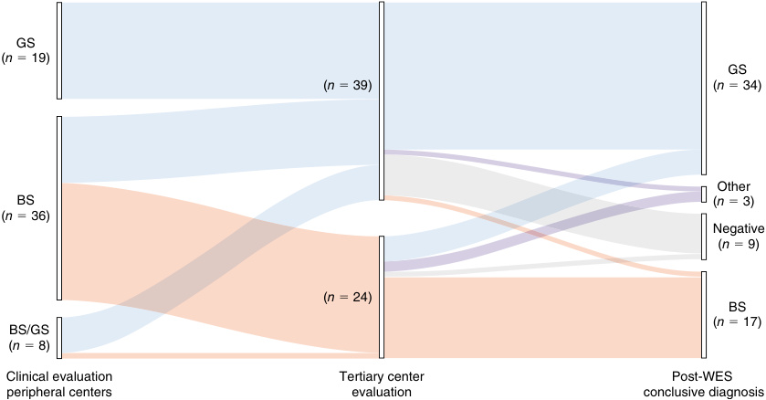
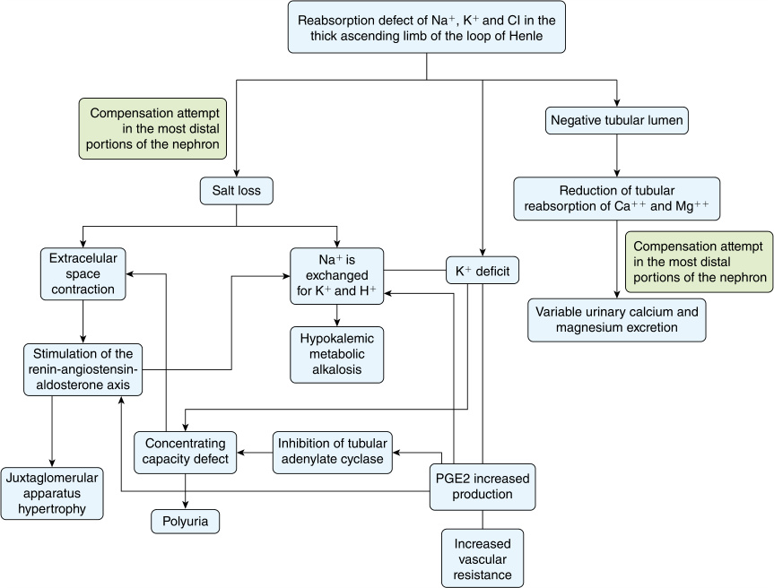

# Chapter 36: Bartter and Gitelman Syndromes — Active-Recall Flashcards
**Section VI: Renal Disorders** | [📖 Read Wiki Chapter](../chapters/036_Bartter_and_Gitelman_Syndromes.md) | [📝 Chapter MCQs](../mcqs/036_mcqs.md) | [🏠 Course Master Index](../../index.md)

Total cards: **28** *(Click any card below to reveal the answer)*

### Card 1 (Syndrome & OMIM Profile)

<b>Q:</b> What are the genetic etiology, inheritance pattern, and hallmark clinical features of **BS I (ABS, HPES)**?

**Answer:**
**Causative Gene(s):** `SLC12A1, NKCC2` · **Inheritance:** AR

**Clinical & Molecular Profile:** Gene Product: NKCC2 — Inheritance: AR — Features: Polyhydramnios, prematurity, hypokalemic hypochloremic alkalosis, nephrocalcinosis, with or without concentrating defect

### Card 2 (Syndrome & OMIM Profile)

<b>Q:</b> What are the genetic etiology, inheritance pattern, and hallmark clinical features of **BS II (ABS with transient hyperkalemia and acidosis, HPES)**?

**Answer:**
**Causative Gene(s):** `KCNJ1, ROMK1` · **Inheritance:** AR

**Clinical & Molecular Profile:** Gene Product: ROMK1 — Inheritance: AR — Features: Polyhydramnios, prematurity, transient hyperkalemia and acidosis, then hypokalemic hypochloremic alkalosis, nephrocalcinosis, with or without concentrating defect

### Card 3 (Syndrome & OMIM Profile)

<b>Q:</b> What are the genetic etiology, inheritance pattern, and hallmark clinical features of **BS III (CBS)**?

**Answer:**
**Causative Gene(s):** `CLCNKB` · **Inheritance:** AR

**Clinical & Molecular Profile:** Gene Product: ClC-Kb — Inheritance: AR; many sporadic — Features: Variable age at presentation with severity corresponding to type of gene pathogenic variant; hypokalemic hypochloremic alkalosis

### Card 4 (Syndrome & OMIM Profile)

<b>Q:</b> What are the genetic etiology, inheritance pattern, and hallmark clinical features of **BS IVa and BS IVb (ABS or HPES with sensorineural deafness)**?

**Answer:**
**Causative Gene(s):** `BSND, CLCNKB` · **Inheritance:** AR

**Clinical & Molecular Profile:** BSND CLCNKA, CLCNKB — Gene Product: Bartter ClC-Ka and ClC-Kb — Inheritance: AR — Features: Polyhydramnios, prematurity, hypokalemic hypochloremic alkalosis, sensorineural deafness, with or without concentrating defect

### Card 5 (Syndrome & OMIM Profile)

<b>Q:</b> What are the genetic etiology, inheritance pattern, and hallmark clinical features of **BS V (transient ABS)**?

**Answer:**
**Causative Gene(s):** `MAGED2` · **Inheritance:** Genetic

**Clinical & Molecular Profile:** Gene Product: MAGED2 — Inheritance: XR — Features: Severe polyhydramnios, hypokalemic hypochloremic alkalosis with symptoms resolving within the first few months of life

### Card 6 (Syndrome & OMIM Profile)

<b>Q:</b> What are the genetic etiology, inheritance pattern, and hallmark clinical features of **EAST syndrome (SeSAME)**?

**Answer:**
**Causative Gene(s):** `KCNJ10` · **Inheritance:** AR

**Clinical & Molecular Profile:** Kir4.1 — Gene Product: KCNJ10 — Inheritance: AR — Features: Epilepsy, ataxia, sensorineural deafness, hypokalemic hypochloremic alkalosis

### Card 7 (Syndrome & OMIM Profile)

<b>Q:</b> What are the genetic etiology, inheritance pattern, and hallmark clinical features of **CLDN10pathogenic variants**?

**Answer:**
**Causative Gene(s):** `CLDN10` · **Inheritance:** AR

**Clinical & Molecular Profile:** Gene Product: Claudin-10 — Inheritance: AR — Features: Hypokalemic metabolic alkalosis with hypocalciuria but normal to elevated magnesium

### Card 8 (Molecular Etiology)

<b>Q:</b> Pathogenic variants in **`SLC12A1`** are associated with which clinical phenotype and molecular mechanism in **Bartter Disease Type 1**?

**Answer:**
Patients with neonatal Bartter syndrome have variants in SLC12A1 located on chromosome 15q15-21 encoding the bumetanideand furosemide-sensitive Na-K-2Cl co-transporter (BSC1 or NKCC2) (Bartter type 1) (Fig. 36.3).

### Card 9 (Molecular Etiology)

<b>Q:</b> Pathogenic variants in **`NKCC2`** are associated with which clinical phenotype and molecular mechanism in **Bartter Disease Type 1**?

**Answer:**
NKCC2 is a 121 kDa membrane protein comprising 12 transmembrane domains that form a transport pathway by dimerization of two homologous domains.

### Card 10 (Molecular Etiology)

<b>Q:</b> Pathogenic variants in **`CLCNKB`** are associated with which clinical phenotype and molecular mechanism in **Bartter Disease Type 2**?

**Answer:**
Cl leaves the cell thanks to the activity of the ClC-Ka and ClCKb chloride channels (variants in CLCNKB encoding the ClC-Kb channel cause Bartter disease type 3).

### Card 11 (Molecular Etiology)

<b>Q:</b> Pathogenic variants in **`MAGED2`** are associated with which clinical phenotype and molecular mechanism in **Bartter Disease Type 2**?

**Answer:**
Variants in the MAGED2 gene encoding melanoma-associated antigen D2 (MAGE-D2) cause transient antenatal Bartter syndrome (Bartter disease type 5).

### Card 12 (Molecular Etiology)

<b>Q:</b> Pathogenic variants in **`CLDN10`** are associated with which clinical phenotype and molecular mechanism in **Bartter Disease Type 2**?

**Answer:**
Variants in CLDN10 encoding claudin-10 cause HELIX syndrome (Hypohidrosis-Electrolyte imbalanceLacrimal gland dysfunction-Ichthyosis-Xerostomia syndrome).

### Card 13 (Molecular Etiology)

<b>Q:</b> Pathogenic variants in **`KCNJ1`** are associated with which clinical phenotype and molecular mechanism in **Bartter Disease Type 2**?

**Answer:**
Inactivating variants in KCNJ1 include missense and nonsense changes as well as frameshifts and deletions.

### Card 14 (Clinical & Diagnostic Concept)

<b>Q:</b> In the clinical evaluation of **Clinical Manifestations**, how is **neonatal variant** defined and characterized?

**Answer:**
neonatal variant is characterized by marked polyhydramnios from 22 to 24 weeks of gestation secondary to intrauterine polyuria, which may necessitate repeated amniocentesis to prevent premature delivery.

### Card 15 (Clinical & Diagnostic Concept)

<b>Q:</b> In the clinical evaluation of **Clinical Manifestations**, how is **classic variant** defined and characterized?

**Answer:**
classic variant , a history of maternal polyhydramnios and preterm birth may also be present.

### Card 16 (Clinical & Diagnostic Concept)

<b>Q:</b> In the clinical evaluation of **Clinical Manifestations**, how is **lengthening of the corrected QT interval** defined and characterized?

**Answer:**
lengthening of the corrected QT interval , with the possibility of developing potentially fatal ventricular arrhythmias secondary to prolonged hypomagnesemia and hypokalemia.

### Card 17 (Clinical & Diagnostic Concept)

<b>Q:</b> In the clinical evaluation of **Clinical Manifestations**, how is **rhabdomyolysis** defined and characterized?

**Answer:**
rhabdomyolysis have also been described in cases of severe hypokalemia, with the possibility of secondary acute renal damage.

### Card 18 (Clinical & Diagnostic Concept)

<b>Q:</b> In the clinical evaluation of **Diagnosis and Differential Diagnosis**, how is **HELIX syndrome** defined and characterized?

**Answer:**
HELIX syndrome (CLDN10) is caused by a deficiency of claudin-10b, a protein located in the tight junctions of the loop of Henle cells and involved in paracellular sodium absorption.

### Card 19 (Clinical & Diagnostic Concept)

<b>Q:</b> In the clinical evaluation of **Diagnosis and Differential Diagnosis**, how is **RRAGD tubulopathy** defined and characterized?

**Answer:**
RRAGD tubulopathy (RRAGD) is caused by activating variants of mTOR encoding a small Rag GTPase with probable action in the loop of Henle, due to the usual association with renal calcium loss.

### Card 20 (Visual & Imaging Spotter)

<b>Q:</b> Identify the diagnostic sign, dysmorphic phenotype, neuroimaging pattern, or molecular pathway illustrated below (Fig. 36.1):

**Answer:**
Diagnostic yield and disease reclassification. Patients are initially classified based on the clinical suspicion raised by referring physicians (left node). The clinical diagnosis was reframed during preWES consultation (middle node). All the patients underwent genetic testing with WES that allowed us to confirm or reclassify the clinical diagnosis (right node). BS, Bartter syndrome; GS, Gitelman syndrome; Negative, patients without pathogenic variants; Other, genetic diagnosis outside BS and GS.

### Card 21 (Visual & Imaging Spotter)

<b>Q:</b> Identify the diagnostic sign, dysmorphic phenotype, neuroimaging pattern, or molecular pathway illustrated below (Fig. 36.2):

**Answer:**
Significant aspects of the pathophysiology of Bartter syndrome (see text).

### Card 22 (Differential Diagnosis)

<b>Q:</b> In the differential diagnosis of **#### Types of Bartter Syndrome, Gitelman Syndrome, and Related Conditions**, what are the distinguishing features of **BS I (ABS, HPES)**?

**Answer:**
**Gene**: SLC12A1; **Gene Product**: NKCC2; **Inheritance**: AR; **Features**: Polyhydramnios, prematurity, hypokalemic hypochloremic alkalosis, nephrocalcinosis, with or without concentrating defect

### Card 23 (Differential Diagnosis)

<b>Q:</b> In the differential diagnosis of **#### Types of Bartter Syndrome, Gitelman Syndrome, and Related Conditions**, what are the distinguishing features of **BS II (ABS with transient hyperkalemia and acidosis, HPES)**?

**Answer:**
**Gene**: KCNJ1; **Gene Product**: ROMK1; **Inheritance**: AR; **Features**: Polyhydramnios, prematurity, transient hyperkalemia and acidosis, then hypokalemic hypochloremic alkalosis, nephrocalcinosis, with or without concentrating defect

### Card 24 (Differential Diagnosis)

<b>Q:</b> In the differential diagnosis of **Featur Variant es That Dist Age of Onset inguish Bar Serum K tter and Git Serum Cl elman Syndr Serum Mg ome Variants Serum Renin, Aldosteron**, what are the distinguishing features of **BS II**?

**Answer:**
**AN**: AN; **Low**: High, then low; **Low**: Low; **Normal**: Normal; **High, high**: High, high; **High**: High; **—**: Transient hyperkalemia

### Card 25 (Differential Diagnosis)

<b>Q:</b> In the differential diagnosis of **Featur Variant es That Dist Age of Onset inguish Bar Serum K tter and Git Serum Cl elman Syndr Serum Mg ome Variants Serum Renin, Aldosteron**, what are the distinguishing features of **BS III**?

**Answer:**
**AN**: N, C, A; **Low**: Low; **Low**: Very low; **Normal**: Normal; **High, high**: High, high; **High**: Low, normal, or high

### Card 26 (Differential Diagnosis)

<b>Q:</b> In the differential diagnosis of **Featur Variant es That Dist Age of Onset inguish Bar Serum K tter and Git Serum Cl elman Syndr Serum Mg ome Variants Serum Renin, Aldosteron**, what are the distinguishing features of **BS IVa, IVb**?

**Answer:**
**AN**: AN; **Low**: Low; **Low**: Low; **Normal**: Normal; **High, high**: High, high; **High**: Normal or high; **—**: Sensorineural deafness

### Card 27 (Differential Diagnosis)

<b>Q:</b> In the differential diagnosis of **Features Variant That Dist Age of Onset inguish Bar Serum K tter and Git Serum Cl elman Syndr Serum Mg ome Variants–Serum Renin, Aldosterone**, what are the distinguishing features of **Hypocalcemic hypercalciuria**?

**Answer:**
**Low**: Low; **Low**: Low; **Normal**: Normal; **High, high**: High, high; **—**: High; **Transient features**: Family history, hypocalcemia, suppressed PTH

### Card 28 (Differential Diagnosis)

<b>Q:</b> In the differential diagnosis of **Features Variant That Dist Age of Onset inguish Bar Serum K tter and Git Serum Cl elman Syndr Serum Mg ome Variants–Serum Renin, Aldosterone**, what are the distinguishing features of **EAST syndrome**?

**Answer:**
**Low**: Low; **Low**: Low; **Normal**: Low; **High, high**: High, high; **—**: Low; **Transient features**: Epilepsy, ataxia, sensorineural deafness

