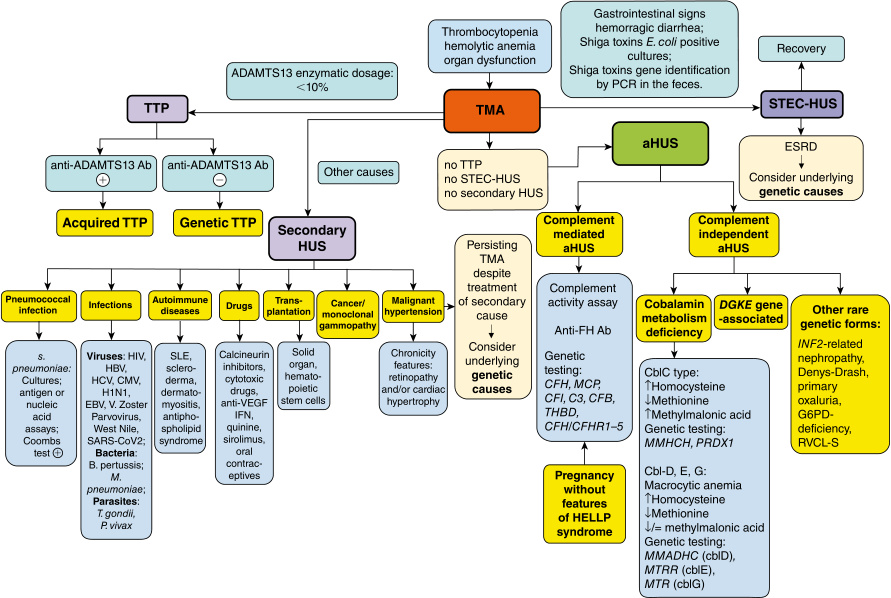
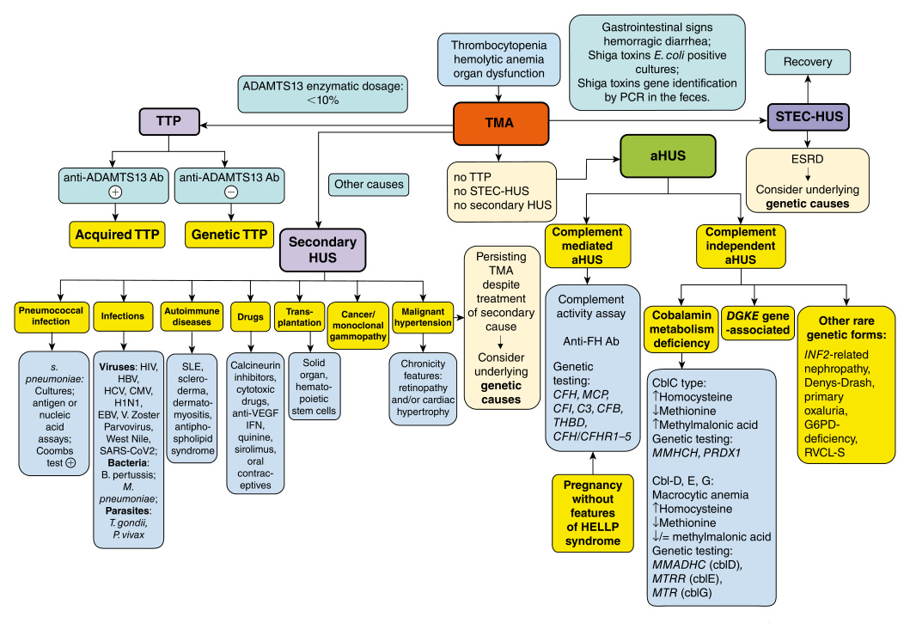
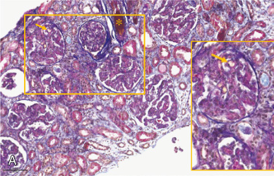

# Chapter 38: Genetic Etiologies of Hemolytic Uremic Syndrome — Active-Recall Flashcards
**Section VI: Renal Disorders** | [📖 Read Wiki Chapter](../chapters/038_Genetic_Etiologies_of_Hemolytic_Uremic_Syndrome.md) | [📝 Chapter MCQs](../mcqs/038_mcqs.md) | [🏠 Course Master Index](../../index.md)

Total cards: **28** *(Click any card below to reveal the answer)*

### Card 1 (Syndrome & OMIM Profile)

<b>Q:</b> What are the genetic etiology, inheritance pattern, and hallmark clinical features of **Interpretation of thePLASMICscore: 0–4: low risk for severe deficiency; 5: intermediate risk; 6–7: high risk.**?

**Answer:**
**Causative Gene(s):** `ADAMTS13` · **Inheritance:** Genetic

**Clinical & Molecular Profile:** Points: ADAMTS13 — TTP is caused by a deficiency of the von Willebrand factor (VWF)-cleaving protease ADAMTS13, which can be either congenital or acquired.

### Card 2 (Syndrome & OMIM Profile)

<b>Q:</b> What are the genetic etiology, inheritance pattern, and hallmark clinical features of **Complementrelated genes**?

**Answer:**
**Causative Gene(s):** `CFH` · **Inheritance:** Genetic

**Clinical & Molecular Profile:** Abnormality: Heterozygous and (rarely) homozygous variants clustering (50%) in the last 2 exons — Main Effect: Impaired cell-surface complement regulation — Frequency: 20–30%

### Card 3 (Syndrome & OMIM Profile)

<b>Q:</b> What are the genetic etiology, inheritance pattern, and hallmark clinical features of **Complementunrelated genes**?

**Answer:**
**Causative Gene(s):** `DGKE` · **Inheritance:** Genetic

**Clinical & Molecular Profile:** Abnormality: Homozygous or compound heterozygous variants — Main Effect: Upregulation of prothrombotic factors, decreased VEGF signaling and apoptosis — Frequency: Infantile cases

### Card 4 (Syndrome & OMIM Profile)

<b>Q:</b> What are the genetic etiology, inheritance pattern, and hallmark clinical features of **−332T (c.−332C>T, rs3753394)**?

**Answer:**
**Causative Gene(s):** `CFH` · **Inheritance:** Genetic

**Clinical & Molecular Profile:** Effect: Lower FH levels — However, only a fraction of CFH variants identified in aHUS affect the N-terminal regulatory domain or other domains.

### Card 5 (Syndrome & OMIM Profile)

<b>Q:</b> What are the genetic etiology, inheritance pattern, and hallmark clinical features of **469T (c.469C>T, p.H157Y, rs425757)**?

**Answer:**
**Causative Gene(s):** `CFHR1` · **Inheritance:** Genetic

**Clinical & Molecular Profile:** Effect: Competition with FH at — These events are favored by the presence in the CFH locus of 5 genes (CFHR1, CFHR2, CFHR3, CFHR4, CFHR5) that are homologous to CFH gene, but encode for five factor H-related proteins (FHR1, FHR2, FHR3, FHR4, FHR5) without complement regulatory properties.

### Card 6 (Syndrome & OMIM Profile)

<b>Q:</b> What are the genetic etiology, inheritance pattern, and hallmark clinical features of **−652A (c.−652A>G, rs2796267)**?

**Answer:**
**Causative Gene(s):** `CD46` · **Inheritance:** Genetic

**Clinical & Molecular Profile:** MCP/CD46 — Effect: Lower transcriptional — MCP/CD46 gene abnormalities account for 8 to 10% C-aHUS cases.

### Card 7 (Molecular Etiology)

<b>Q:</b> Pathogenic variants in **`ADAMTS13`** are associated with which clinical phenotype and molecular mechanism in **Genetic Etiologies of Hemolytic Uremic Syndrome**?

**Answer:**
TTP is caused by a deficiency of the von Willebrand factor (VWF)-cleaving protease ADAMTS13, which can be either congenital or acquired.

### Card 8 (Molecular Etiology)

<b>Q:</b> Pathogenic variants in **`DGKE`** are associated with which clinical phenotype and molecular mechanism in **Epidemiology**?

**Answer:**
Information about the epidemiology of DGKE -associated aHUS varies, perhaps by region.

### Card 9 (Molecular Etiology)

<b>Q:</b> Pathogenic variants in **`G6PD`** are associated with which clinical phenotype and molecular mechanism in **Epidemiology**?

**Answer:**
Cases of atypical HUS associated with Denys-Drash syndrome , primary hyperoxaluria type II , G6PD-deficiency , and the syndrome associated with TREX1 have been reported anecdotally.

### Card 10 (Molecular Etiology)

<b>Q:</b> Pathogenic variants in **`C3`** are associated with which clinical phenotype and molecular mechanism in **Complement-Mediated aHUS (C-aHUS)**?

**Answer:**
The alternative pathway (AP) is continuously activated in plasma by low-grade hydrolysis of C3.

### Card 11 (Molecular Etiology)

<b>Q:</b> Pathogenic variants in **`CFH`** are associated with which clinical phenotype and molecular mechanism in **Complement Factor H**?

**Answer:**
However, only a fraction of CFH variants identified in aHUS affect the N-terminal regulatory domain or other domains.

### Card 12 (Molecular Etiology)

<b>Q:</b> Pathogenic variants in **`CFHR1`** are associated with which clinical phenotype and molecular mechanism in **Complement Factor H**?

**Answer:**
These events are favored by the presence in the CFH locus of 5 genes (CFHR1, CFHR2, CFHR3, CFHR4, CFHR5) that are homologous to CFH gene, but encode for five factor H-related proteins (FHR1, FHR2, FHR3, FHR4, FHR5) without complement regulatory properties.

### Card 13 (Precision Therapy & Management)

<b>Q:</b> What is the targeted therapeutic approach or clinical management strategy for **Genotype-Phenotype Correlations**?

**Answer:**
**Therapy / Intervention:** Targeted / Disease-Modifying Therapy

**Clinical Context:** Thirty to 60% of patients with complement gene pathogenic variants relapse after eculizumab discontinuation, whereas recurrence occurs in less than 10% of patients without identified pathogenic variants.

### Card 14 (Precision Therapy & Management)

<b>Q:</b> What is the targeted therapeutic approach or clinical management strategy for **Denys–Drash Syndrome-Associated aHUS**?

**Answer:**
**Therapy / Intervention:** Targeted / Disease-Modifying Therapy

**Clinical Context:** All progressed to end-stage renal disease despite treatment with plasma exchange, eculizumab, or both.

### Card 15 (Precision Therapy & Management)

<b>Q:</b> What is the targeted therapeutic approach or clinical management strategy for **Inverted Formin 2-Mediated Renal Disease**?

**Answer:**
**Therapy / Intervention:** Targeted / Disease-Modifying Therapy

**Clinical Context:** Pathogenic variants in INF2 in association with known aHUS risk haplotypes have been described in two families with either aHUS or posttransplant TMA, who did not respond to terminal complement-blockade with eculizumab (Table 38.3).

### Card 16 (Precision Therapy & Management)

<b>Q:</b> What is the targeted therapeutic approach or clinical management strategy for **Glucose-6-Phosphate Dehydrogenase (G6PD)Deficiency and Suspected aHUS**?

**Answer:**
**Therapy / Intervention:** Targeted / Disease-Modifying Therapy

**Clinical Context:** A child with clinical presentation suggestive of aHUS without any known secondary or genetic cause and nonresponsive to eculizumab was subsequently diagnosed with G6PD-deficiency (Table 38.3).

### Card 17 (Clinical & Diagnostic Concept)

<b>Q:</b> In the clinical evaluation of **Genetic Etiologies of Hemolytic Uremic Syndrome**, how is **thrombotic microangiopathies (TMA)** defined and characterized?

**Answer:**
thrombotic microangiopathies (TMA) and is described as an acute syndrome defined by a clinical triad of thrombocytopenia, nonimmune microangiopathic hemolytic anemia, and acute kidney failure.

### Card 18 (Clinical & Diagnostic Concept)

<b>Q:</b> In the clinical evaluation of **Genetic Etiologies of Hemolytic Uremic Syndrome**, how is **Pregnancy-associated HUS** defined and characterized?

**Answer:**
Pregnancy-associated HUS typically illustrates this challenge for classification, in that pathogenic variants of the complement genes are found with the same prevalence (40–60%) as in C-aHUS.

### Card 19 (Clinical & Diagnostic Concept)

<b>Q:</b> In the clinical evaluation of **Epidemiology**, how is **cobalamin (cbl)-metabolism** defined and characterized?

**Answer:**
cobalamin (cbl)-metabolism , neonatal screening programs have revealed a notably higher occurrence of the cblC-type than formerly estimated, ranging from 1:37,000 to 1:100,000.

### Card 20 (Clinical & Diagnostic Concept)

<b>Q:</b> In the clinical evaluation of **Laboratory Evaluation for Suspected HUS**, how is **Thrombocytopenia** defined and characterized?

**Answer:**
Thrombocytopenia (or thrombocytes within normal range, but with a reduction of 30% compared to usual values).

### Card 21 (Clinical & Diagnostic Concept)

<b>Q:</b> In the clinical evaluation of **Laboratory Evaluation for Suspected HUS**, how is **Acute kidney injury** defined and characterized?

**Answer:**
Acute kidney injury is always present, by definition, usually with microhematuria and sometimes proteinuria.

### Card 22 (Clinical & Diagnostic Concept)

<b>Q:</b> In the clinical evaluation of **Laboratory Evaluation for Suspected HUS**, how is **congenital** defined and characterized?

**Answer:**
congenital (due to homozygosity or compound heterozygosity for pathogenic variants in ADAMTS13 ), or acquired , with the development of anti-ADAMTS13 inhibitory antibodies.

### Card 23 (Clinical & Diagnostic Concept)

<b>Q:</b> In the clinical evaluation of **Complement Factor H**, how is **Anti-FH inhibitory antibodies** defined and characterized?

**Answer:**
Anti-FH inhibitory antibodies have been reported in 5 to 10% of all patients and ~25 to 50% of pediatric cases.

### Card 24 (Clinical & Diagnostic Concept)

<b>Q:</b> In the clinical evaluation of **Inverted Formin 2-Mediated Renal Disease**, how is **focal segmental glomerulosclerosis** defined and characterized?

**Answer:**
focal segmental glomerulosclerosis , in association with Charcot-Marie-Tooth disease in 25% of the cases.

### Card 25 (Visual & Imaging Spotter)

<b>Q:</b> Identify the diagnostic sign, dysmorphic phenotype, neuroimaging pattern, or molecular pathway illustrated below (Fig. 38.1):

**Answer:**
Differential diagnostic algorithm in thrombotic microangiopathies. Ab, Antibodies; aHUS,

### Card 26 (Visual & Imaging Spotter)

<b>Q:</b> Identify the diagnostic sign, dysmorphic phenotype, neuroimaging pattern, or molecular pathway illustrated below (Fig. 38.2):

**Answer:**
Peripheral blood smear stained with hematoxylin and eosin (100× magnification) demonstrating fragmentation of red blood cells (schistocytes) associated with the thrombotic microangiopathy syndromes.

### Card 27 (Visual & Imaging Spotter)

<b>Q:</b> Identify the diagnostic sign, dysmorphic phenotype, neuroimaging pattern, or molecular pathway illustrated below (Fig. 38.3):

**Answer:**
Kidney biopsies of patients with aHUS. (A) A 2-year-old female patient carrying a pathogenic variant in DGKE , who presented with acute kidney injury, hemolysis, normal platelet count, and nephrotic syndrome. Biopsy demonstrates both arteriolar (*) and capillary (arrow) thrombi as well as diffuse glomerular mesangiolysis and basal membrane duplication. Stain: Acid Fuchsin Orange G. (Courtesy from Dr. H. Chehade and Dr. S. Rotman, Lausanne University Hospital, Switzerland.) (B) A 36-year-old male patient with recurrent aHUS associated to a heterozygous pathogenic variant in the complement factor H gene. Biopsy demonstrates extensive capillary thrombosis with an aspect of glomerular paralysis, with capillary loops containing abundant erythrocytes, karyorrhexis with cellular debris in capillary lumina, and severe mesangiolysis. Stain: periodic acid–Schiff stain.

### Card 28 (Differential Diagnosis)

<b>Q:</b> In the differential diagnosis of **Gene Ab normalities Associated With aHUS**, what are the distinguishing features of **Complementrelated genes**?

**Answer:**
**Abnormality**: CFH; **Main Effect**: Heterozygous and (rarely) homozygous variants clustering (50%) in the last 2 exons; **Frequency**: Impaired cell-surface complement regulation; 20–30%

