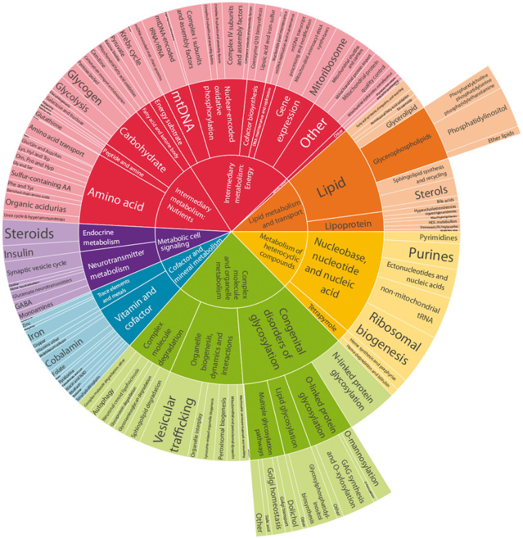
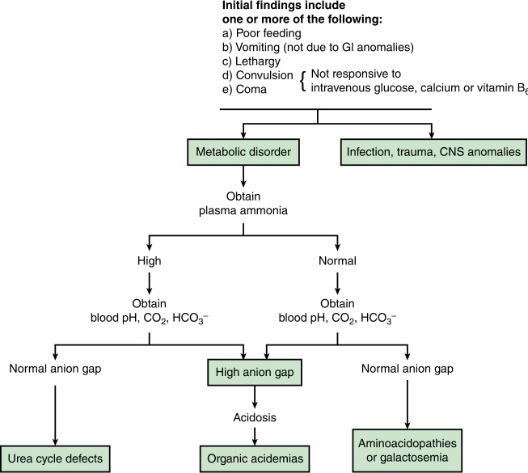
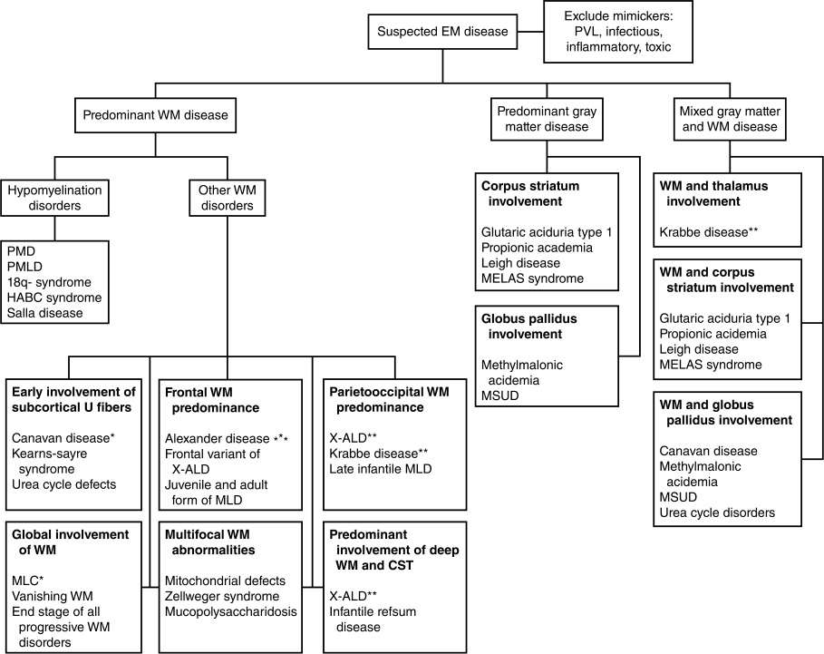

# Chapter 43: An Approach to Inborn Errors of Metabolism — Active-Recall Flashcards
**Section VIII: Metabolic Disorders** | [📖 Read Wiki Chapter](../chapters/043_An_Approach_to_Inborn_Errors_of_Metabolism.md) | [📝 Chapter MCQs](../mcqs/043_mcqs.md) | [🏠 Course Master Index](../../index.md)

Total cards: **28** *(Click any card below to reveal the answer)*

### Card 1 (Syndrome & OMIM Profile)

<b>Q:</b> What are the genetic etiology, inheritance pattern, and hallmark clinical features of **Autosomal dominant cystinuria Glucose transporter 1 deficiency Autosomal dominant GTP cyclohydrolase I deficie**?

**Answer:**
**Causative Gene(s):** `PRKAG2` · **Inheritance:** AD

**Clinical & Molecular Profile:** Inheritance: Autosomal dominant — The protein kinase AMP-activated non-catalytic subunit gamma 2 (PRKAG2) cardiac syndrome is an autosomal dominant glycogen storage disorder resulting from pathogenic variants in PRKAG2 .

### Card 2 (Syndrome & OMIM Profile)

<b>Q:</b> What are the genetic etiology, inheritance pattern, and hallmark clinical features of **Propionic acidemia (PA)**?

**Answer:**
**Causative Gene(s):** `C3` · **Inheritance:** Genetic

**Clinical & Molecular Profile:** Primary Biomarker: C3

### Card 3 (Syndrome & OMIM Profile)

<b>Q:</b> What are the genetic etiology, inheritance pattern, and hallmark clinical features of **Methylmalonic acidemia (methylmalonyl-CoA mutase) (MMA-Mut)**?

**Answer:**
**Causative Gene(s):** `C3` · **Inheritance:** Genetic

**Clinical & Molecular Profile:** Primary Biomarker: C3

### Card 4 (Syndrome & OMIM Profile)

<b>Q:</b> What are the genetic etiology, inheritance pattern, and hallmark clinical features of **Methylmalonic acidemia (cobalamin defects: A,B) (MMA-Cbl)**?

**Answer:**
**Causative Gene(s):** `C3` · **Inheritance:** Genetic

**Clinical & Molecular Profile:** Primary Biomarker: C3

### Card 5 (Syndrome & OMIM Profile)

<b>Q:</b> What are the genetic etiology, inheritance pattern, and hallmark clinical features of **Isovaleric acidemia (IVA)**?

**Answer:**
**Causative Gene(s):** `C5` · **Inheritance:** Genetic

**Clinical & Molecular Profile:** Primary Biomarker: C5

### Card 6 (Syndrome & OMIM Profile)

<b>Q:</b> What are the genetic etiology, inheritance pattern, and hallmark clinical features of **Holocarboxylase synthetase deficiency* (multiple carboxylase deficiency) (MCD)**?

**Answer:**
**Causative Gene(s):** `C3` · **Inheritance:** Genetic

**Clinical & Molecular Profile:** Primary Biomarker: C5OH, C3

### Card 7 (Syndrome & OMIM Profile)

<b>Q:</b> What are the genetic etiology, inheritance pattern, and hallmark clinical features of **β-Ketothiolase deficiency (BKT)**?

**Answer:**
**Causative Gene(s):** `C5` · **Inheritance:** Genetic

**Clinical & Molecular Profile:** Primary Biomarker: C5:1, C5OH

### Card 8 (Syndrome & OMIM Profile)

<b>Q:</b> What are the genetic etiology, inheritance pattern, and hallmark clinical features of **Glutaric acidemia type I (GA-I)**?

**Answer:**
**Causative Gene(s):** `C5` · **Inheritance:** Genetic

**Clinical & Molecular Profile:** Primary Biomarker: C5 DC

### Card 9 (Syndrome & OMIM Profile)

<b>Q:</b> What are the genetic etiology, inheritance pattern, and hallmark clinical features of **Methylmalonic acidemia with homocystinuria (Cbl C, D)**?

**Answer:**
**Causative Gene(s):** `C3` · **Inheritance:** Genetic

**Clinical & Molecular Profile:** Biomarker: C3

### Card 10 (Syndrome & OMIM Profile)

<b>Q:</b> What are the genetic etiology, inheritance pattern, and hallmark clinical features of **Malonic acidemia (MAL)**?

**Answer:**
**Causative Gene(s):** `C3` · **Inheritance:** Genetic

**Clinical & Molecular Profile:** Biomarker: C3 DC

### Card 11 (Molecular Etiology)

<b>Q:</b> Pathogenic variants in **`PRKAG2`** are associated with which clinical phenotype and molecular mechanism in **Classification**?

**Answer:**
BPAN, Beta-propeller protein-associated neurodegeneration; CHILD, congenital hemidysplasia with ichthyosiform erythroderma and limb defects; PRKAG2, protein kinase AMP-activated non-catalytic subunit gamma 2.

### Card 12 (Molecular Etiology)

<b>Q:</b> Pathogenic variants in **`ATP7A`** are associated with which clinical phenotype and molecular mechanism in **Abnormal Development Associated With Dysmorphic Features and/or Congenital Malformations**?

**Answer:**
Occipital horn syndrome is also due to pathogenic variants in ATP7A but presents with a connective tissue phenotype (bruised skin, hyperextensible joints, diverticula, skeletal abnormalities).

### Card 13 (Molecular Etiology)

<b>Q:</b> Pathogenic variants in **`BCS1L`** are associated with which clinical phenotype and molecular mechanism in **Liver Failure**?

**Answer:**
Some mitochondrial hepatopathies, such as BCS1L -related disorders, may have features of iron overload mimicking neonatal hemochromatosis, the nonheritable constellation of gestational alloimmune hepatitis-induced liver injury with associated extrahepatic siderosis.

### Card 14 (Molecular Etiology)

<b>Q:</b> Pathogenic variants in **`TFR2`** are associated with which clinical phenotype and molecular mechanism in **Liver Failure**?

**Answer:**
This group of disorders include hemochromatosis associated with HFE , HJV , HAMP , and TFR2 ; ferroportin-associated iron overload; BMP6 -associated iron overload; and aceruloplasminemia.

### Card 15 (Precision Therapy & Management)

<b>Q:</b> What is the targeted therapeutic approach or clinical management strategy for **Management**?

**Answer:**
**Therapy / Intervention:** Targeted / Disease-Modifying Therapy

**Clinical Context:** Management of IMDs generally involves a combination of dietary modification, supplementation with vitamins or cofactors, medications, enzyme replacement therapy, or occasionally liver or bone marrow transplant.

### Card 16 (Precision Therapy & Management)

<b>Q:</b> What is the targeted therapeutic approach or clinical management strategy for **Disorders of Carbohydrate Metabolism**?

**Answer:**
**Therapy / Intervention:** Targeted / Disease-Modifying Therapy

**Clinical Context:** Treatment with enzyme replacement therapy is available.

### Card 17 (Precision Therapy & Management)

<b>Q:</b> What is the targeted therapeutic approach or clinical management strategy for **Cardiomyopathy**?

**Answer:**
**Therapy / Intervention:** Targeted / Disease-Modifying Therapy

**Clinical Context:** Enzyme replacement therapy is available to slow disease progression.

### Card 18 (Clinical & Diagnostic Concept)

<b>Q:</b> In the clinical evaluation of **Classification**, how is **Small molecule disorders** defined and characterized?

**Answer:**
Small molecule disorders are IMDs affecting the intermediary metabolism of ammonia, ketones, amino acids, organic acids, and fatty acids.

### Card 19 (Clinical & Diagnostic Concept)

<b>Q:</b> In the clinical evaluation of **Classification**, how is **Large molecule disorders** defined and characterized?

**Answer:**
Large molecule disorders are IMDs affecting the synthesis or degradation of complex molecules.

### Card 20 (Clinical & Diagnostic Concept)

<b>Q:</b> In the clinical evaluation of **Classification**, how is **Disorders of energy metabolism** defined and characterized?

**Answer:**
Disorders of energy metabolism are IMDs impairing mitochondrial functioning, either directly or secondarily.

### Card 21 (Clinical & Diagnostic Concept)

<b>Q:</b> In the clinical evaluation of **Classification**, how is **miscellaneous category** defined and characterized?

**Answer:**
miscellaneous category encompasses many IMDs that cannot be classified into the aforementioned categories, including disorders involving the metabolism of carbohydrates, vitamins, minerals, heavy metals, heme (e.

### Card 22 (Clinical & Diagnostic Concept)

<b>Q:</b> In the clinical evaluation of **Laboratory Evaluation**, how is **metabolomic analysis** defined and characterized?

**Answer:**
metabolomic analysis can be an essential tool in the evaluation of a patient with a suspected metabolic disorder, particularly when genetic studies are nondiagnostic.

### Card 23 (Clinical & Diagnostic Concept)

<b>Q:</b> In the clinical evaluation of **Laboratory Evaluation**, how is **Newborn screening protocols** defined and characterized?

**Answer:**
Newborn screening protocols to evaluate for IMDs have been adopted in the United States and many other countries.

### Card 24 (Clinical & Diagnostic Concept)

<b>Q:</b> In the clinical evaluation of **Technical**, how is **Neuroimaging** defined and characterized?

**Answer:**
Neuroimaging with brain MRI in the undifferentiated patient with acute encephalopathy may reveal findings suggestive of a specific IMD or category of IMDs and is also important in excluding potential alternate etiologies (Fig.

### Card 25 (Clinical & Diagnostic Concept)

<b>Q:</b> In the clinical evaluation of **Abnormal Development Associated With Dysmorphic Features and/or Congenital Malformations**, how is **Smith-Lemli-Opitz syndrome (SLO)** defined and characterized?

**Answer:**
Smith-Lemli-Opitz syndrome (SLO) is the prototypical disorder of cholesterol biosynthesis and results from abnormal activity of 7-dehydrocholesterol reductase, the enzyme that catalyzes the conversion of 7-dehydrocholesterol to cholesterol.

### Card 26 (Visual & Imaging Spotter)

<b>Q:</b> Identify the diagnostic sign, dysmorphic phenotype, neuroimaging pattern, or molecular pathway illustrated below (Fig. 43.1):

**Answer:**
Sunburst chart depicting the hierarchical nature of the International Classification of Inherited Metabolic Disorders. The size of each section of the chart is directly proportional to the number of disorders in that group. For an interactive version of the chart incorporating a zoom function, please refer to www.icimd.org.

### Card 27 (Visual & Imaging Spotter)

<b>Q:</b> Identify the diagnostic sign, dysmorphic phenotype, neuroimaging pattern, or molecular pathway illustrated below (Fig. 43.2):

**Answer:**
Initial clinical approach to a full-term newborn infant with a suspected genetic metabolic disorder. This schema is a guide to elucidate some of the metabolic disorders in newborn infants. Although some exceptions to this schema exist, it is appropriate for most cases affected by disorders or intermediate metabolism. CNS, Central nervous system; GI, gastrointestinal; HCO 3 , bicarbonate.

### Card 28 (Visual & Imaging Spotter)

<b>Q:</b> Identify the diagnostic sign, dysmorphic phenotype, neuroimaging pattern, or molecular pathway illustrated below (Fig. 43.3):

**Answer:**
Chart of imaging findings in selected metabolic disorders. Single asterisk denotes patients with inborn errors of metabolism (IEM) with macrocephaly. Double asterisk denotes patients with IEM and enhancement. 18q–syndrome, 18q deletion syndrome; CST, corticospinal tract; HABC, hypomyelination with atrophy of basal ganglia and cerebellum; MELAS, mitochondrial encephalopathy, lactic acidosis, and strokelike episodes; MLC, megalencephalic leukoencephalopathy with subcortical cysts; MLD, metachromatic leukodystrophy; MSUD, maple syrup urine disease; PMD, Pelizaeus-Merzbacher disease; PMLD, Pelizaeus-Merzbacher-like disease; PVL, periventricular leukoencephalopathy, WM, white matter; X-ALD, X-linked adrenoleukodystrophy.

