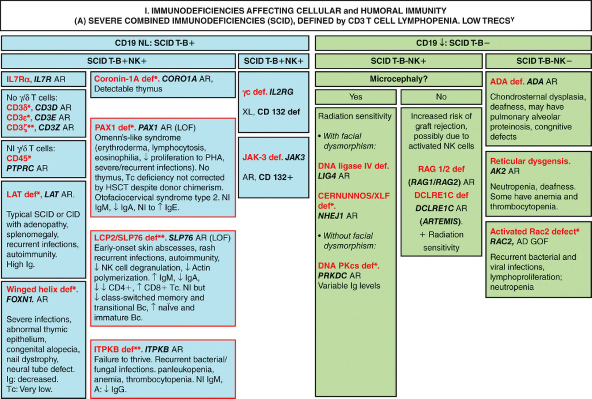
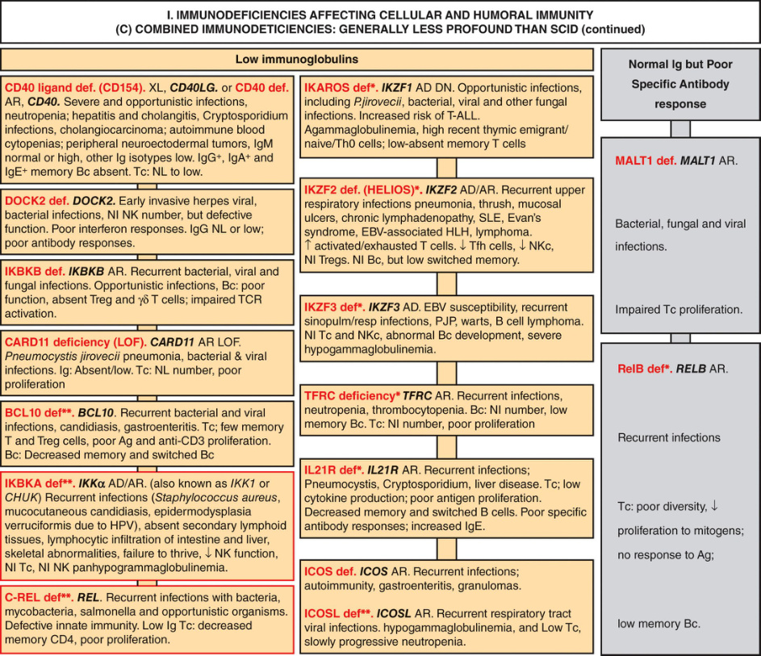

# Chapter 53: When to Consider a Primary Immune Deficiency Disorder: Pathogens Associated With Specific Immune Defects — Active-Recall Flashcards
**Section X: Immune/Inflammatory Disorders** | [📖 Read Wiki Chapter](../chapters/053_When_to_Consider_a_Primary_Immune_Deficiency_Disorder_Pathogens_Asso.md) | [📝 Chapter MCQs](../mcqs/053_mcqs.md) | [🏠 Course Master Index](../../index.md)

Total cards: **28** *(Click any card below to reveal the answer)*

### Card 1 (Syndrome & OMIM Profile)

<b>Q:</b> What are the genetic etiology, inheritance pattern, and hallmark clinical features of **Herpes simplex encephalitis**?

**Answer:**
**Causative Gene(s):** `TBK1, TLR3, TRAF3, UNC93B` · **Inheritance:** Genetic

**Clinical & Molecular Profile:** TBK1, TLR3, TRAF3, TRIF, UNC93B — Innate immune cells recognize the virus using several classes of pattern recognition receptors including Toll-like receptors (e.g., TLR3, TLR7, TLR8, TLR9), RIG-I-like receptors (e.g., RIG-I and MDA5), C-type lectin receptors, and NOD-like receptors (e.g., NLRP3).

### Card 2 (Syndrome & OMIM Profile)

<b>Q:</b> What are the genetic etiology, inheritance pattern, and hallmark clinical features of **Cutaneous herpes simplex**?

**Answer:**
**Causative Gene(s):** `DOCK8, GATA2` · **Inheritance:** Genetic

**Clinical & Molecular Profile:** Severe T-cell defects,DOCK8, GATA2, WAS

### Card 3 (Syndrome & OMIM Profile)

<b>Q:</b> What are the genetic etiology, inheritance pattern, and hallmark clinical features of **EBV—chronic**?

**Answer:**
**Causative Gene(s):** `CD21, CD27, CORO1A, MAGT1, CXCR4` · **Inheritance:** Genetic

**Clinical & Molecular Profile:** CD21, CD27, CORO1A, ITK, MAGT1, PRKCD, CXCR4 — These genetic defects include pathogenic variants in SH2D1A, ITK, MAGT1, CTPS1, CD27, CD70, CORO1A , and RASGRP1 .

### Card 4 (Syndrome & OMIM Profile)

<b>Q:</b> What are the genetic etiology, inheritance pattern, and hallmark clinical features of **EBV—HLH**?

**Answer:**
**Causative Gene(s):** `AP3B1, LYST1, PRF1, RAB27A, SH2D1A, STX11` · **Inheritance:** Genetic

**Clinical & Molecular Profile:** AP3B1, LYST1, PRF1, RAB27A, SH2D1A, STX11, UNC13D, XIAP — These genetic defects include pathogenic variants in SH2D1A, ITK, MAGT1, CTPS1, CD27, CD70, CORO1A , and RASGRP1 .

### Card 5 (Syndrome & OMIM Profile)

<b>Q:</b> What are the genetic etiology, inheritance pattern, and hallmark clinical features of **Papilloma virus**?

**Answer:**
**Causative Gene(s):** `CD4, ATM, CD40L, EVER1, EVER2, DOCK8` · **Inheritance:** Genetic

**Clinical & Molecular Profile:** Idiopathic CD4 lymphopenia,ATM, CD40L, EVER1, EVER2, DOCK8, GATA2, IKBKG, MST1, RORH, STK4, CXCR4

### Card 6 (Syndrome & OMIM Profile)

<b>Q:</b> What are the genetic etiology, inheritance pattern, and hallmark clinical features of **Candida**?

**Answer:**
**Causative Gene(s):** `AIRE, CARD9, IL17F, IL17RA, STAT1` · **Inheritance:** Genetic

**Clinical & Molecular Profile:** AIRE, CARD9, IL17F, IL17RA, STAT1 — Mendelian susceptibility to mycobacterial diseases (MSMD) are IEIs characterized by a selective predisposition to intracellular infectious agents, particularly mycobacteria and other microorganisms such as Salmonella sp., or mucocutaneous and fungal infections ( Candida spp., Paracoccidioides spp., and

### Card 7 (Syndrome & OMIM Profile)

<b>Q:</b> What are the genetic etiology, inheritance pattern, and hallmark clinical features of **Aspergillus**?

**Answer:**
**Causative Gene(s):** `CD4, CYBA, CYBB, DOCK8, GATA2, ITGB2` · **Inheritance:** Genetic

**Clinical & Molecular Profile:** Idiopathic CD4 lymphopenia,CYBA, CYBB, DOCK8, GATA2, ITGB2, NCF1, NCF2, NCF4, STAT3 — Infection with Aspergillus nidulans or A. phellinus (Inonotus) species is almost pathognomonic for CGD, whereas A. mucorales or A. fusarium are uncommon causes of disease in the absence of concomitant iatrogenic immunosuppression.

### Card 8 (Syndrome & OMIM Profile)

<b>Q:</b> What are the genetic etiology, inheritance pattern, and hallmark clinical features of **Pseudomonas**?

**Answer:**
**Causative Gene(s):** `IRAK4, ITGB2, MYD88, BTK, CD40LG` · **Inheritance:** Genetic

**Clinical & Molecular Profile:** Congenital neutropenia,IRAK4, ITGB2, MYD88, BTK(neutropenia),CD40LG(neutropenia) — TLRs located on the cell membrane have the primary function of recognizing mycobacterial components, internalizing the bacteria through phagocytosis, and activating the NF-κB pathway via MyD88 and IRAK4.

### Card 9 (Syndrome & OMIM Profile)

<b>Q:</b> What are the genetic etiology, inheritance pattern, and hallmark clinical features of **Salmonella**?

**Answer:**
**Causative Gene(s):** `CYBB, IFNGR1, IFNGR2, IL12B, IL12RB1` · **Inheritance:** Genetic

**Clinical & Molecular Profile:** CYBB, IFNGR1, IFNGR2, IL12B, IL12RB1 — Mendelian susceptibility to mycobacterial diseases (MSMD) are IEIs characterized by a selective predisposition to intracellular infectious agents, particularly mycobacteria and other microorganisms such as Salmonella sp., or mucocutaneous and fungal infections ( Candida spp., Paracoccidioides spp., a

### Card 10 (Syndrome & OMIM Profile)

<b>Q:</b> What are the genetic etiology, inheritance pattern, and hallmark clinical features of **Serratia**?

**Answer:**
**Causative Gene(s):** `CYBA, CYBB, NCF1, NCF2, NCF4` · **Inheritance:** Genetic

**Clinical & Molecular Profile:** CYBA, CYBB, NCF1, NCF2, NCF4

### Card 11 (Molecular Etiology)

<b>Q:</b> Pathogenic variants in **`C2`** are associated with which clinical phenotype and molecular mechanism in **Encapsulated Bacteria**?

**Answer:**
The early components of complement (i.e., C1q, C2, C4, and C3) are the first activated by antibody and result in covalent binding of C3 to the bacterial capsule and enhanced phagocytosis.

### Card 12 (Molecular Etiology)

<b>Q:</b> Pathogenic variants in **`IRAK4`** are associated with which clinical phenotype and molecular mechanism in **Fungus**?

**Answer:**
TLRs located on the cell membrane have the primary function of recognizing mycobacterial components, internalizing the bacteria through phagocytosis, and activating the NF-κB pathway via MyD88 and IRAK4.

### Card 13 (Molecular Etiology)

<b>Q:</b> Pathogenic variants in **`NOD2`** are associated with which clinical phenotype and molecular mechanism in **Fungus**?

**Answer:**
NOD2 recognition leads to the activation of the NF-κB pathway through the RIP2 adaptor molecule and also leads to inflammasome activation, a process resulting in increased transcription of inflammatory cytokines such as IL-1β, IL-18.

### Card 14 (Molecular Etiology)

<b>Q:</b> Pathogenic variants in **`CD4`** are associated with which clinical phenotype and molecular mechanism in **Fungus**?

**Answer:**
Infected macrophage can present antigen to T cells and secrete IL-12 and IL-23, cytokines that stimulating the differentiation of naïve CD4+ T lymphocytes into Th1-profile that produces IFN-γ and express the CD40 ligand (CD40L).

### Card 15 (Molecular Etiology)

<b>Q:</b> Pathogenic variants in **`CARD9`** are associated with which clinical phenotype and molecular mechanism in **Candida—Invasive Disease**?

**Answer:**
CARD9 is a signaling protein important in receptors known to detect fungus, such as Dectin-1 and mannose binding protein.

### Card 16 (Molecular Etiology)

<b>Q:</b> Pathogenic variants in **`TLR3`** are associated with which clinical phenotype and molecular mechanism in **Viruses**?

**Answer:**
Innate immune cells recognize the virus using several classes of pattern recognition receptors including Toll-like receptors (e.g., TLR3, TLR7, TLR8, TLR9), RIG-I-like receptors (e.g., RIG-I and MDA5), C-type lectin receptors, and NOD-like receptors (e.g., NLRP3).

### Card 17 (Clinical & Diagnostic Concept)

<b>Q:</b> In the clinical evaluation of **Immune/Inflammatory Disorders**, how is **Inborn errors of immunity (IEI)** defined and characterized?

**Answer:**
Inborn errors of immunity (IEI) , often referred to as primary immunodeficiencies (PIDs) , constitute a heterogeneous group of rare genetic disorders that result in a compromised or dysfunctional immune system.

### Card 18 (Clinical & Diagnostic Concept)

<b>Q:</b> In the clinical evaluation of **Immune/Inflammatory Disorders**, how is **combined immunodeficiency (SCID)** defined and characterized?

**Answer:**
combined immunodeficiency (SCID) , lead to a wide range of severe and opportunistic infections, including viral, bacterial, and fungal, due to the profound dysfunction in multiple arms of the immune system.

### Card 19 (Clinical & Diagnostic Concept)

<b>Q:</b> In the clinical evaluation of **Bacteria**, how is **innate immune system** defined and characterized?

**Answer:**
innate immune system is the first line of defense against bacterial invaders and provides immediate but nonspecific protection (Chapters 55 and 60).

### Card 20 (Clinical & Diagnostic Concept)

<b>Q:</b> In the clinical evaluation of **Bacteria**, how is **adaptive immune system** defined and characterized?

**Answer:**
adaptive immune system provides a highly specific and long-lasting defense against bacteria.

### Card 21 (Clinical & Diagnostic Concept)

<b>Q:</b> In the clinical evaluation of **Encapsulated Bacteria**, how is **Common variable immunodeficiency (CVID)** defined and characterized?

**Answer:**
Common variable immunodeficiency (CVID) is characterized by late-onset IEI with low levels of immunoglobulins, particularly IgG and IgA, leading to recurrent susceptibility to pneumonia and sinusitis with encapsulated bacteria.

### Card 22 (Clinical & Diagnostic Concept)

<b>Q:</b> In the clinical evaluation of **Encapsulated Bacteria**, how is **X-linked agammaglobulinemia (XLA)** defined and characterized?

**Answer:**
X-linked agammaglobulinemia (XLA) is characterized by a deficiency of B cells and antibodies with increased vulnerability to encapsulated bacteria.

### Card 23 (Clinical & Diagnostic Concept)

<b>Q:</b> In the clinical evaluation of **Encapsulated Bacteria**, how is **Specific antibody deficiency** defined and characterized?

**Answer:**
Specific antibody deficiency is characterized by impaired antibody production to the polysaccharide capsule of the bacteria but with normal total immunoglobulin levels, leading to susceptibility to Streptococcus pneumoniae and other encapsulated bacteria.

### Card 24 (Clinical & Diagnostic Concept)

<b>Q:</b> In the clinical evaluation of **Encapsulated Bacteria**, how is **C2 deficiency** defined and characterized?

**Answer:**
C2 deficiency is the most common complement disorder and can result in susceptibility to encapsulated bacteria, in particular _S.

### Card 25 (Visual & Imaging Spotter)

<b>Q:</b> Identify the diagnostic sign, dysmorphic phenotype, neuroimaging pattern, or molecular pathway illustrated below (Fig. 53.1):

**Answer:**
Immunodeficiencies affecting cellular and humoral immunity. (A) Severe combined immunodeficiencies defined by T cell lymphopenia.

### Card 26 (Visual & Imaging Spotter)

<b>Q:</b> Identify the diagnostic sign, dysmorphic phenotype, neuroimaging pattern, or molecular pathway illustrated below (Fig. 53.2):

**Answer:**
(A–C) CID with associated or syndromic features. Ab, Antibody; AD, autosomal dominant inheritance; AD DN, autosomal dominant inheritance with dominant negative effect; ANA, antinuclear antibodies; ANCA, antineutrophil cytoplasm antibodies; AR, autosomal recessive inheritance; Bc, B cells; BCG, Bacillus Calmette-Guerin; BCR, B cell receptor; CD, cluster of differentiation; CID, combined immunodeficiency of T and B cells; CMV, cytomegalovirus; CNS, central nervous system; def, deficiency; DNA, deoxyribonucleic acid; EBV, Epstein-Barr virus; EDA, anhidrotic ectodermal dysplasia; GOF, gain-offunction; HIES, hyper IgE syndrome; FILS, facial dysmorphism, immunodeficiency, livedo and short stature; ID, immunodeficiency; Ig, immunoglobulins; IL-6, interleukin-6; IUGR, intrauterine growth retardation; LOF, loss-of-function; MCC, mucocutaneous candidiasis; Nl, normal; NK, natural killer; PHA, phytohemagglutinin; PPS, polysaccharides; RTE, recent thymic emigrant; SCBMS, seizures, cortical blindness, and microcephaly syndrome; SCID, severe combined immunodeficiency; sd, syndrome; Tc, T cells; TCR, T cell receptor; TREC, T cell receptor excision circle; XL, X-linked inheritance. (From Bousfiha A, Moundir A, Tangye SG, et al. The 2002 update of IUIS phenotypical classification for human inborn errors of immunity. _J C

### Card 27 (Differential Diagnosis)

<b>Q:</b> In the differential diagnosis of **### Sentinel Infections and Related Genes**, what are the distinguishing features of **Herpes simplex encephalitis**?

**Answer:**
**Recognized Gene Defects and Well-Characterized Syndromes**: TBK1, TLR3, TRAF3, TRIF, UNC93B

### Card 28 (Differential Diagnosis)

<b>Q:</b> In the differential diagnosis of **### Sentinel Infections and Related Genes**, what are the distinguishing features of **Cutaneous herpes simplex**?

**Answer:**
**Recognized Gene Defects and Well-Characterized Syndromes**: Severe T-cell defects,DOCK8, GATA2, WAS

