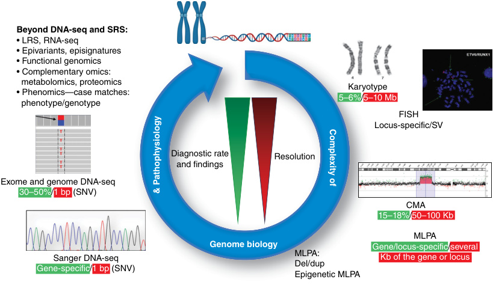

# Chapter 2: Diagnostic Methods: Genomics, Omics, Biomarkers, Imaging, and Other Technologies — Board-Style Self-Assessment MCQs
**Section I: Introductory Chapters** | [📖 Read Wiki Chapter](../chapters/002_Diagnostic_Methods_Genomics_Omics_Biomarkers_Imaging_and_Other_Techn.md) | [🃏 Chapter Flashcards](../flashcards/002_flashcards.md) | [🏠 Course Master Index](../../index.md)

Total questions: **14** *(Click "Show Answer & Rationale" beneath each question)*

### Question 1 (Clinical Vignette & Syndrome Diagnosis)
A pediatric patient is evaluated in the medical genetics clinic with the following clinical and molecular profile: Inactivating the causative gene variants causing Sotos syndrome have been associated with a specific genome-wide DNA methylation (DNAm) pattern.. Which of the following rare disorders is the most likely diagnosis?

- **A.** NOS 21-0100
- **B.** Metabolomics
- **C.** Silver-Russell syndrome (SRS)
- **D.** NOS 13-0010

<b>Show Answer & Rationale</b>

**Correct Answer: B** — Metabolomics

**Rationale:** **Metabolomics** caused by pathogenic variants in **`NSD1`** presents with: Inactivating NSD1 variants causing Sotos syndrome have been associated with a specific genome-wide DNA methylation (DNAm) pattern..

**Why Other Options Are Incorrect:** **NOS 21-0100** is incorrect (associated with MOPD2 — Microcephalic osteodysplastic primordial dwarfism, PCNT-related — Inheritance: AR — Gene or Locu: PCNT — s Not). **NOS 13-0010** is incorrect (associated with TRAPPC2 — SED tarda, X-linked (SED-XL), TRAPPC2-related — Inheritance: XL).

### Question 2 (Molecular & Genomic Etiology)
A child is diagnosed with **Metabolomics** after presenting with Inactivating the causative gene variants causing Sotos syndrome have been associated with a specific genome-wide DNA methylation (DNAm) pattern.. Pathogenic variants in which of the following genes are the primary molecular etiology of this disorder?

- **A.** HTT
- **B.** CTLA4
- **C.** NSD1
- **D.** MMUT

<b>Show Answer & Rationale</b>

**Correct Answer: C** — NSD1

**Rationale:** Pathogenic variants in **`NSD1`** (Genetic) cause **Metabolomics**, characterized by Inactivating NSD1 variants causing Sotos syndrome have been associated with a specific genome-wide DNA methylation (DNAm) pattern..

**Why Other Options Are Incorrect:** **CTLA4** is incorrect (associated with CTLA4 deficiency (CTLA4)). **MMUT** is incorrect (associated with Methylmalonic Acidemia).

### Question 3 (Visual & Diagnostic Imaging Vignette)

A pediatric patient undergoes diagnostic evaluation for **Diagnostic Methods: Genomics, Omics, Biomarkers, Imaging, and Other Technologies**, yielding the clinical, neuroimaging, or molecular finding shown below. Which of the following best characterizes the illustrated disorder or mechanism?

- **A.** Analysis of exon deletions and duplications by MLPA of the DMD gene. (A) The mother’s study shows that she has a 50% amplification of exons 46 to 50, which confirms who is a carrier of the d
- **B.** Cytogenetic analysis of a syndromic patient with a chromosomal anomaly that affects chromosomes 4 and 11. The patient has a duplication at 4p14 and deletion at 11q25 due to meiotic abnormal
- **C.** Chromosomal microarray analysis of genomic rearrangements or contiguous gene syndromes. Both panels show, from left to right, the ideogram of the chromosome, the genomic alteration in low re
- **D.** Genetic and genomic tests. Diagnostic rates (green) and resolution levels (red) are indicated for each test. bp, Base pair; CMA, chromosomal microarray; Kb, kilobases; LRS, long read sequencing;

<b>Show Answer & Rationale</b>

**Correct Answer: D** — Genetic and genomic tests. Diagnostic rates (green) and resolution levels (red) are indicated for each test. bp, Base pair; CMA, chromosomal microarray; Kb, kilobases; LRS, long read sequencing;

**Rationale:** **Fig. 2.1**: Genetic and genomic tests. Diagnostic rates (green) and resolution levels (red) are indicated for each test. bp, Base pair; CMA, chromosomal microarray; Kb, kilobases; LRS, long read sequencing; Mb, megabases; MLPA, multiplex ligation probe amplification; SRS, short read sequencing; SNV, single nucleotide variant.

### Question 4 (Diagnostic Criteria (Genetic and Genomic Tests, Genetic Variants Detected, and Resolution Level))
During a multidisciplinary genetics evaluation for **Genetic and Genomic Tests, Genetic Variants Detected, and Resolution Level**, which clinical entity or diagnostic phenomenon is defined by the following profile?
"diagnostic tool for recognizing microdeletions, such as 22q11."

- **A.** Sotos syndrome
- **B.** Unstable repeat expansions
- **C.** Metabolomics
- **D.** Locus-specific molecular probes

<b>Show Answer & Rationale</b>

**Correct Answer: D** — Locus-specific molecular probes

**Rationale:** Locus-specific molecular probes are a diagnostic tool for recognizing microdeletions, such as 22q11.

### Question 5 (Diagnostic Criteria (Genetic and Genomic Tests, Genetic Variants Detected, and Resolution Level))
During a multidisciplinary genetics evaluation for **Genetic and Genomic Tests, Genetic Variants Detected, and Resolution Level**, which clinical entity or diagnostic phenomenon is defined by the following profile?
"has advanced ways to analyze SVs, labeling DNA molecules with fluorochromes and subsequently linearizing them into nanochannel arrays to detect submicroscopic rearrangements."

- **A.** Unstable repeat expansions
- **B.** Sotos syndrome
- **C.** Uniparental disomy
- **D.** Optical genome mapping

<b>Show Answer & Rationale</b>

**Correct Answer: D** — Optical genome mapping

**Rationale:** Optical genome mapping has advanced ways to analyze SVs, labeling DNA molecules with fluorochromes and subsequently linearizing them into nanochannel arrays to detect submicroscopic rearrangements.

### Question 6 (Diagnostic Criteria (Genetic Testing for Moderateto Small-Scale Gene Variants))
During a multidisciplinary genetics evaluation for **Genetic Testing for Moderateto Small-Scale Gene Variants**, which clinical entity or diagnostic phenomenon is defined by the following profile?
"typically analyzed by multiplex ligation-dependent probe amplification (MLPA), which allows exons to be amplified quantitatively."

- **A.** human phenotype ontology (HPO)
- **B.** Beckwith-Wiedemann syndrome (BWS)
- **C.** Intragenic deletions and duplications
- **D.** integrative genomic viewer (IGV)

<b>Show Answer & Rationale</b>

**Correct Answer: C** — Intragenic deletions and duplications

**Rationale:** Intragenic deletions and duplications are typically analyzed by multiplex ligation-dependent probe amplification (MLPA), which allows exons to be amplified quantitatively.

### Question 7 (Diagnostic Criteria (Genetic Testing for Moderateto Small-Scale Gene Variants))
During a multidisciplinary genetics evaluation for **Genetic Testing for Moderateto Small-Scale Gene Variants**, which clinical entity or diagnostic phenomenon is defined by the following profile?
"also known as dynamic variants, represent genetic variants of a single trinucleotide repeat sequence or, less frequently, other small repeats that are the cause of several monogenic disorders, most of them related to the nervous system (Fig."

- **A.** Unstable repeat expansions
- **B.** DNA methylation (DNAm)
- **C.** Sotos syndrome
- **D.** Metabolomics

<b>Show Answer & Rationale</b>

**Correct Answer: A** — Unstable repeat expansions

**Rationale:** Unstable repeat expansions , also known as dynamic variants, represent genetic variants of a single trinucleotide repeat sequence or, less frequently, other small repeats that are the cause of several monogenic disorders, most of them related to the nervous system (Fig.

### Question 8 (Clinical & Pathophysiologic Mastery (Genetic and Genomic Testing for DNA Single Nucleotide Variants))
When counseling a family and planning diagnostic management for **Genetic and Genomic Testing for DNA Single Nucleotide Variants** (*Diagnostic Methods: Genomics, Omics, Biomarkers, Imaging, and Other Technologies*), which of the following clinical-genetic principles is **ACCURATE**?

- **A.** Inheritance is exclusively holandric (Y-linked) with complete penetrance restricted to male offspring.
- **B.** Pathogenesis is driven exclusively by maternal mitochondrial DNA deletions without nuclear gene involvement.
- **C.** First-line diagnostic confirmation relies solely on conventional Giemsa-banded karyotyping rather than sequencing or targeted assays.
- **D.** WES is considered the gold standard approach in clinical practice because it allows the reanalysis of novel genes compared to CES, generates a smaller amount of data, and is more affordable than WGS.

<b>Show Answer & Rationale</b>

**Correct Answer: D** — WES is considered the gold standard approach in clinical practice because it allows the reanalysis of novel genes compared to CES, generates a smaller amount of data, and is more affordable than WGS.

**Rationale:** **Clinical & Molecular Principle (Genetic and Genomic Testing for DNA Single Nucleotide Variants):** WES is considered the gold standard approach in clinical practice because it allows the reanalysis of novel genes compared to CES, generates a smaller amount of data, and is more affordable than WGS.

### Question 9 (Clinical & Pathophysiologic Mastery (Transcriptomics))
When counseling a family and planning diagnostic management for **Transcriptomics** (*Diagnostic Methods: Genomics, Omics, Biomarkers, Imaging, and Other Technologies*), which of the following clinical-genetic principles is **ACCURATE**?

- **A.** Uniparental disomy can be due to abnormal genomic imprinting, which leads to recessive variant effects.
- **B.** Inheritance is exclusively holandric (Y-linked) with complete penetrance restricted to male offspring.
- **C.** Enzyme activity and protein expression remain completely normal across all affected tissues, excluding a monogenic etiology.
- **D.** The condition is a benign, self-limiting physiologic variant that requires neither longitudinal surveillance nor genetic counseling.

<b>Show Answer & Rationale</b>

**Correct Answer: A** — Uniparental disomy can be due to abnormal genomic imprinting, which leads to recessive variant effects.

**Rationale:** **Clinical & Molecular Principle (Transcriptomics):** Uniparental disomy can be due to abnormal genomic imprinting, which leads to recessive variant effects.

### Question 10 (Clinical & Pathophysiologic Mastery (The Epigenome: Beyond the Structure of the Gene))
When counseling a family and planning diagnostic management for **The Epigenome: Beyond the Structure of the Gene** (*Diagnostic Methods: Genomics, Omics, Biomarkers, Imaging, and Other Technologies*), which of the following clinical-genetic principles is **ACCURATE**?

- **A.** The condition is a benign, self-limiting physiologic variant that requires neither longitudinal surveillance nor genetic counseling.
- **B.** In the clinical setting, genomic imprinting disorders can be diagnosed by specific MLPA tests determining the methylation profiling to determine the genes preferentially expressed from only one of the two
- **C.** Pathogenesis is driven exclusively by maternal mitochondrial DNA deletions without nuclear gene involvement.
- **D.** First-line diagnostic confirmation relies solely on conventional Giemsa-banded karyotyping rather than sequencing or targeted assays.

<b>Show Answer & Rationale</b>

**Correct Answer: B** — In the clinical setting, genomic imprinting disorders can be diagnosed by specific MLPA tests determining the methylation profiling to determine the genes preferentially expressed from only one of the two

**Rationale:** **Clinical & Molecular Principle (The Epigenome: Beyond the Structure of the Gene):** In the clinical setting, genomic imprinting disorders can be diagnosed by specific MLPA tests determining the methylation profiling to determine the genes preferentially expressed from only one of the two parental chromosomes (i.e., Prader-Willi syndrome vs.

### Question 11 (Clinical & Pathophysiologic Mastery (Imaging Techniques, Radiomics, and Imaging Biomarkers))
When counseling a family and planning diagnostic management for **Imaging Techniques, Radiomics, and Imaging Biomarkers** (*Diagnostic Methods: Genomics, Omics, Biomarkers, Imaging, and Other Technologies*), which of the following clinical-genetic principles is **ACCURATE**?

- **A.** The condition is a benign, self-limiting physiologic variant that requires neither longitudinal surveillance nor genetic counseling.
- **B.** Enzyme activity and protein expression remain completely normal across all affected tissues, excluding a monogenic etiology.
- **C.** Sometimes, imaging findings can be pathognomonic, but often they help narrow the differential diagnosis.
- **D.** Pathogenesis is driven exclusively by maternal mitochondrial DNA deletions without nuclear gene involvement.

<b>Show Answer & Rationale</b>

**Correct Answer: C** — Sometimes, imaging findings can be pathognomonic, but often they help narrow the differential diagnosis.

**Rationale:** **Clinical & Molecular Principle (Imaging Techniques, Radiomics, and Imaging Biomarkers):** Sometimes, imaging findings can be pathognomonic, but often they help narrow the differential diagnosis.

### Question 12 (Clinical & Pathophysiologic Mastery (Nuclear Medicine))
When counseling a family and planning diagnostic management for **Nuclear Medicine** (*Diagnostic Methods: Genomics, Omics, Biomarkers, Imaging, and Other Technologies*), which of the following clinical-genetic principles is **ACCURATE**?

- **A.** Enzyme activity and protein expression remain completely normal across all affected tissues, excluding a monogenic etiology.
- **B.** Inheritance is exclusively holandric (Y-linked) with complete penetrance restricted to male offspring.
- **C.** The condition is a benign, self-limiting physiologic variant that requires neither longitudinal surveillance nor genetic counseling.
- **D.** Clinical applications in pediatrics are extensive, the most common in nephro-urology, oncology, and inflammatory diseases.

<b>Show Answer & Rationale</b>

**Correct Answer: D** — Clinical applications in pediatrics are extensive, the most common in nephro-urology, oncology, and inflammatory diseases.

**Rationale:** **Clinical & Molecular Principle (Nuclear Medicine):** Clinical applications in pediatrics are extensive, the most common in nephro-urology, oncology, and inflammatory diseases.

### Question 13 (Clinical & Pathophysiologic Mastery (Diagnostic Methods Genomics, Omics, Biomarkers, Imaging, and Other Technologies))
When counseling a family and planning diagnostic management for **Diagnostic Methods Genomics, Omics, Biomarkers, Imaging, and Other Technologies** (*Diagnostic Methods: Genomics, Omics, Biomarkers, Imaging, and Other Technologies*), which of the following clinical-genetic principles is **ACCURATE**?

- **A.** First-line diagnostic confirmation relies solely on conventional Giemsa-banded karyotyping rather than sequencing or targeted assays.
- **B.** Medical diagnosis is necessary for adequate clinical management of people living with a rare disease.
- **C.** Pathogenesis is driven exclusively by maternal mitochondrial DNA deletions without nuclear gene involvement.
- **D.** Enzyme activity and protein expression remain completely normal across all affected tissues, excluding a monogenic etiology.

<b>Show Answer & Rationale</b>

**Correct Answer: B** — Medical diagnosis is necessary for adequate clinical management of people living with a rare disease.

**Rationale:** **Clinical & Molecular Principle (Diagnostic Methods Genomics, Omics, Biomarkers, Imaging, and Other Technologies):** Medical diagnosis is necessary for adequate clinical management of people living with a rare disease.

### Question 14 (Clinical & Pathophysiologic Mastery (Genetic and Genomic Testing in Precision Molecular Diagnosis))
When counseling a family and planning diagnostic management for **Genetic and Genomic Testing in Precision Molecular Diagnosis** (*Diagnostic Methods: Genomics, Omics, Biomarkers, Imaging, and Other Technologies*), which of the following clinical-genetic principles is **ACCURATE**?

- **A.** Pathogenesis is driven exclusively by maternal mitochondrial DNA deletions without nuclear gene involvement.
- **B.** First-line diagnostic confirmation relies solely on conventional Giemsa-banded karyotyping rather than sequencing or targeted assays.
- **C.** Enzyme activity and protein expression remain completely normal across all affected tissues, excluding a monogenic etiology.
- **D.** Human cells have two dialoguing genomes: the nuclear genome (nDNA) and the mitochondrial genome (mtDNA).

<b>Show Answer & Rationale</b>

**Correct Answer: D** — Human cells have two dialoguing genomes: the nuclear genome (nDNA) and the mitochondrial genome (mtDNA).

**Rationale:** **Clinical & Molecular Principle (Genetic and Genomic Testing in Precision Molecular Diagnosis):** Human cells have two dialoguing genomes: the nuclear genome (nDNA) and the mitochondrial genome (mtDNA).

