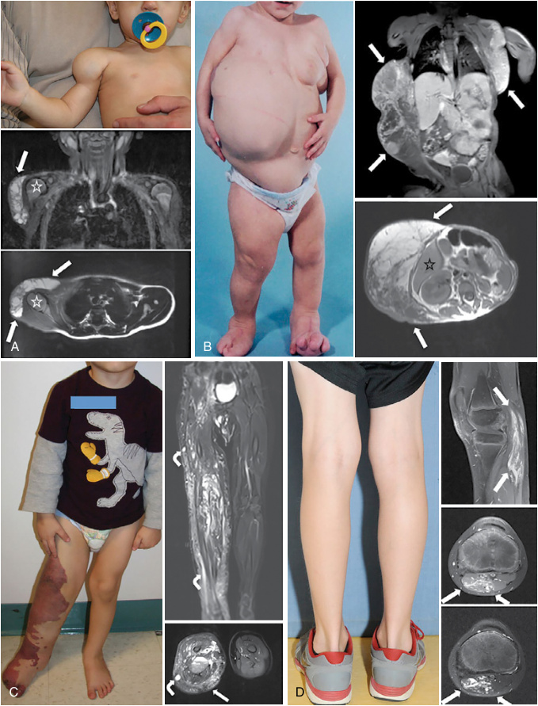

# Chapter 8: Mosaic Overgrowth Syndromes — Board-Style Self-Assessment MCQs
**Section II: Developmental Structural Disorders** | [📖 Read Wiki Chapter](../chapters/008_Mosaic_Overgrowth_Syndromes.md) | [🃏 Chapter Flashcards](../flashcards/008_flashcards.md) | [🏠 Course Master Index](../../index.md)

Total questions: **14** *(Click "Show Answer & Rationale" beneath each question)*

### Question 1 (Clinical Vignette & Syndrome Diagnosis)
A pediatric patient is evaluated in the medical genetics clinic with the following clinical and molecular profile: There are no consistent clinical features that distinguish PIK3CA -related overgrowth spectrum (PROS) from the causative gene -related overgrowth spectrum , although clinical criteria have been suggested for PROS (Tables 8.1, 8.2).. Which of the following rare disorders is the most likely diagnosis?

- **A.** Diagnosis of Mosaic Overgrowth Disorders
- **B.** AKT(PKB)
- **C.** TSC1/2
- **D.** PIK3CA -Related Overgrowth Spectrum (PROS)

<b>Show Answer & Rationale</b>

**Correct Answer: A** — Diagnosis of Mosaic Overgrowth Disorders

**Rationale:** **Diagnosis of Mosaic Overgrowth Disorders** caused by pathogenic variants in **`PIK3R1`** presents with: There are no consistent clinical features that distinguish PIK3CA -related overgrowth spectrum (PROS) from PIK3R1 -related overgrowth spectrum , although clinical criteria have been suggested for PROS (Tables 8.1, 8.2)..

**Why Other Options Are Incorrect:** **AKT(PKB)** is incorrect (associated with AKT1 — Overgrowth Syndromes: AKT1 (PKBA): Proteus syndrome — Clinical Manifestations: Overgrowth, often affecting the). **TSC1/2** is incorrect (associated with TSC1 — Overgrowth Syndromes: Tuberous sclerosis complex — Clinical Manifestations: Hypopigmented macules, facial angi). **PIK3CA -Related Overgrowth Spectrum (PROS)** is incorrect (associated with PIK3CA — PIK3CA -related overgrowth spectrum is the most common mosaic overgrowth disorder and is up to 1,000 times mor).

### Question 2 (Clinical Vignette & Syndrome Diagnosis)
A pediatric patient is evaluated in the medical genetics clinic with the following clinical and molecular profile: For example, the strongly activating PIK3CA variants and both the causative gene variants that cause these disorders are absent in peripheral blood.. Which of the following rare disorders is the most likely diagnosis?

- **A.** Mosaic Overgrowth Syndromes
- **B.** Diagnosis of Mosaic Overgrowth Disorders
- **C.** PIK3CA -Related Overgrowth Spectrum (PROS)
- **D.** TSC1/2

<b>Show Answer & Rationale</b>

**Correct Answer: B** — Diagnosis of Mosaic Overgrowth Disorders

**Rationale:** **Diagnosis of Mosaic Overgrowth Disorders** caused by pathogenic variants in **`AKT1`** presents with: For example, the strongly activating PIK3CA variants and both AKT1 variants that cause these disorders are absent in peripheral blood..

**Why Other Options Are Incorrect:** **Mosaic Overgrowth Syndromes** is incorrect (associated with PIK3CA — Lymphatic and other vascular malformative/overgrowth disorders are caused by somatic pathogenic variants in PI). **PIK3CA -Related Overgrowth Spectrum (PROS)** is incorrect (associated with PIK3CA — PIK3CA -related overgrowth spectrum is the most common mosaic overgrowth disorder and is up to 1,000 times mor). **TSC1/2** is incorrect (associated with TSC1 — Overgrowth Syndromes: Tuberous sclerosis complex — Clinical Manifestations: Hypopigmented macules, facial angi).

### Question 3 (Molecular & Genomic Etiology)
A child is diagnosed with **PIK3CA** after presenting with Overgrowth Syndromes: the causative gene overgrowth spectrum (Table 8.2) — the causative gene -related overgrowth spectrum is the most common mosaic overgrowth disorder and is up to 1,000 times more common than. Pathogenic variants in which of the following genes are the primary molecular etiology of this disorder?

- **A.** PTPN11
- **B.** SHOC2
- **C.** PIK3CA
- **D.** IRAK4

<b>Show Answer & Rationale</b>

**Correct Answer: C** — PIK3CA

**Rationale:** Pathogenic variants in **`PIK3CA`** (Genetic) cause **PIK3CA**, characterized by Overgrowth Syndromes: PIK3CA-related overgrowth spectrum (Table 8.2) — PIK3CA -related overgrowth spectrum is the most common mosaic overgrowth disorder and is up to 1,000 times more common than the next most prevalent mosaic overgrowth disorder, Proteus syndrome..

**Why Other Options Are Incorrect:** **PTPN11** is incorrect (associated with NOS 30-0060). **IRAK4** is incorrect (associated with Pseudomonas).

### Question 4 (Molecular & Genomic Etiology)
A child is diagnosed with **AKT(PKB)** after presenting with Overgrowth Syndromes: the causative gene (PKBA): Proteus syndrome — Clinical Manifestations: Overgrowth, often affecting the lower limbs. Pathogenic variants in which of the following genes are the primary molecular etiology of this disorder?

- **A.** MEFV
- **B.** COL1A2
- **C.** IFT80
- **D.** AKT1

<b>Show Answer & Rationale</b>

**Correct Answer: D** — AKT1

**Rationale:** Pathogenic variants in **`AKT1`** (Genetic) cause **AKT(PKB)**, characterized by Overgrowth Syndromes: AKT1 (PKBA): Proteus syndrome — Clinical Manifestations: Overgrowth, often affecting the lower limbs.

**Why Other Options Are Incorrect:** **MEFV** is incorrect (associated with Familial Mediterranean Fever(MEFV)). **COL1A2** is incorrect (associated with Arthrochalasia (aEDS)). **IFT80** is incorrect (associated with Jeune asphyxiating thoracic dystrophy).

### Question 5 (Molecular & Genomic Etiology)
A child is diagnosed with **PTEN hamartoma tumor syndrome (Cowden syndrome, Bannayan- Riley-Ruvalcaba syndrome, and PTEN-related Proteus s** after presenting with Clinical Manifestations: Benign and malignant neoplasms; brain overgrowth and neurodevelopmental anomalies, asymmetrical bones and soft-tissue overgrowth. Pathogenic variants in which of the following genes are the primary molecular etiology of this disorder?

- **A.** PTEN
- **B.** ASS1
- **C.** CDKN1C
- **D.** APC

<b>Show Answer & Rationale</b>

**Correct Answer: A** — PTEN

**Rationale:** Pathogenic variants in **`PTEN`** (Genetic) cause **PTEN hamartoma tumor syndrome (Cowden syndrome, Bannayan- Riley-Ruvalcaba syndrome, and PTEN-related Proteus s**, characterized by Clinical Manifestations: Benign and malignant neoplasms; brain overgrowth and neurodevelopmental anomalies, asymmetrical bones and soft-tissue overgrowth.

**Why Other Options Are Incorrect:** **CDKN1C** is incorrect (associated with NOS 21-0210). **APC** is incorrect (associated with Familial adenomatous polyposis).

### Question 6 (Molecular & Genomic Etiology)
A child is diagnosed with **TSC1/2** after presenting with Overgrowth Syndromes: Tuberous sclerosis complex — Clinical Manifestations: Hypopigmented macules, facial angiofibromas, ash leaf spots, nail fibromas, cortical tubercles, subependymal nodules, and subependymal. Pathogenic variants in which of the following genes are the primary molecular etiology of this disorder?

- **A.** RPS19
- **B.** TSC1
- **C.** PMM2
- **D.** HRAS

<b>Show Answer & Rationale</b>

**Correct Answer: B** — TSC1

**Rationale:** Pathogenic variants in **`TSC1`** (Genetic) cause **TSC1/2**, characterized by Overgrowth Syndromes: Tuberous sclerosis complex — Clinical Manifestations: Hypopigmented macules, facial angiofibromas, ash leaf spots, nail fibromas, cortical tubercles, subependymal nodules, and subependymal giant cell astrocytomas, seizures, and intellectual disability/developmental delay.

**Why Other Options Are Incorrect:** **RPS19** is incorrect (associated with Diamond-Blackfan anemia). **PMM2** is incorrect (associated with Phosphomannomutase 2). **HRAS** is incorrect (associated with Costello syndrome).

### Question 7 (Molecular & Genomic Etiology)
A child is diagnosed with **Diagnosis of Mosaic Overgrowth Disorders** after presenting with There are no consistent clinical features that distinguish PIK3CA -related overgrowth spectrum (PROS) from the causative gene -related overgrowth spectrum , although clinical criteria have been suggested for PR. Pathogenic variants in which of the following genes are the primary molecular etiology of this disorder?

- **A.** SLC26A4
- **B.** RPE65
- **C.** PIK3R1
- **D.** LRBA

<b>Show Answer & Rationale</b>

**Correct Answer: C** — PIK3R1

**Rationale:** Pathogenic variants in **`PIK3R1`** (Genetic) cause **Diagnosis of Mosaic Overgrowth Disorders**, characterized by There are no consistent clinical features that distinguish PIK3CA -related overgrowth spectrum (PROS) from PIK3R1 -related overgrowth spectrum , although clinical criteria have been suggested for PROS (Tables 8.1, 8.2)..

**Why Other Options Are Incorrect:** **SLC26A4** is incorrect (associated with Pendred syndrome). **RPE65** is incorrect (associated with Leber congenital amaurosis syndrome). **LRBA** is incorrect (associated with Genetic abnormality).

### Question 8 (Molecular Pathogenesis)
In a patient evaluated for **Molecular Mechanism and Pathogenesis**, which causative gene accurately completes the following clinical-molecular relationship?
"It is sometimes referred to as protein kinase B (PKB), or by both names as “Akt/PKB.” There are three paralogs in humans, AKT1 , AKT2 , and [GENE] ."

- **A.** BSND
- **B.** PLCE1
- **C.** AKT3
- **D.** FKBP14

<b>Show Answer & Rationale</b>

**Correct Answer: C** — AKT3

**Rationale:** **`AKT3`** — It is sometimes referred to as protein kinase B (PKB), or by both names as “Akt/PKB.” There are three paralogs in humans, AKT1 , AKT2 , and AKT3 .

**Why Other Options Are Incorrect:** **BSND** is incorrect (associated with Autosomal recessive). **PLCE1** is incorrect (associated with PLCE1). **FKBP14** is incorrect (associated with Ehlers-Danlos syndrome (EDS) subtypes).

### Question 9 (Molecular Pathogenesis)
In a patient evaluated for **Management**, which causative gene accurately completes the following clinical-molecular relationship?
"The risk of deep vein thrombosis and pulmonary embolism is not precisely established but is higher in [GENE] -related Proteus syndrome than it is in PIK3CA -relted overgrowth spectrum."

- **A.** SGSH
- **B.** SERPINC1
- **C.** ATK1
- **D.** STXBP1

<b>Show Answer & Rationale</b>

**Correct Answer: C** — ATK1

**Rationale:** **`ATK1`** — The risk of deep vein thrombosis and pulmonary embolism is not precisely established but is higher in ATK1 -related Proteus syndrome than it is in PIK3CA -relted overgrowth spectrum.

**Why Other Options Are Incorrect:** **SGSH** is incorrect (associated with NOS 22-0030). **SERPINC1** is incorrect (associated with 1q25.1). **STXBP1** is incorrect (associated with Complex).

### Question 10 (Visual & Diagnostic Imaging Vignette)

A pediatric patient undergoes diagnostic evaluation for **Mosaic Overgrowth Syndromes**, yielding the clinical, neuroimaging, or molecular finding shown below. Which of the following best characterizes the illustrated disorder or mechanism?

- **A.** Simplified PI3K-AKT-mTOR pathway and associated clinical overgrowth disorders. PDK,
- **B.** Overview of the most common clinical presentations, features, and PIK3CA (activating variants of the p110α subunit of phosphatidylinositol 3-kinases)-related overgrowth spectrum (PROS).
- **C.** Diagram showing how pathogenic variants occurring at different moments of embryonic
- **D.** Photographs and MRIs of participants with isolated LM, CLOVES, KTS, and FAVA. (A) An 8-month-old male (LM1) with isolated LM. Note swelling in deltoid region without cutaneous vascular signs. Cor

<b>Show Answer & Rationale</b>

**Correct Answer: D** — Photographs and MRIs of participants with isolated LM, CLOVES, KTS, and FAVA. (A) An 8-month-old male (LM1) with isolated LM. Note swelling in deltoid region without cutaneous vascular signs. Cor

**Rationale:** **Fig. 8.1**: Photographs and MRIs of participants with isolated LM, CLOVES, KTS, and FAVA. (A) An 8-month-old male (LM1) with isolated LM. Note swelling in deltoid region without cutaneous vascular signs. Coronal and sagittal fat-saturated T2-weighted MRI demonstrates macrocystic LM (a multilocular cystic mass) involving the anterolateral aspects of the right shoulder without muscular infiltration (arrows) ; humeral head (asterisk) . (B) A 19-month-old female (CL12) with CLOVES syndrome. Note asymmetric distribution of truncal lipomatous masses and bilateral lower extremity involvement. Coronal fat-saturated T1-weighted MRI after contrast administration demonstrates moderate heterogeneous enhancement of the bilateral truncal masses (arrows) . Axial T1-weighted MRI without contrast depicts truncal lipomatous overgrowth (arrows) ; segment VI of the liver (asterisk) . (C) A 3-year-old male (KT4) with KTS. Note capillary LM and overgrowth involving the right lower extremity. Coronal and axial fat-saturated T2-weighted MRI shows the persistent marginal vein system (bent arrows) and marked enlargement of the subcutaneous tissues due to a combination of lymphatic fluid and fat (straight arrow) . There are also intramuscular venous malformations. (D) A 9-year-old male (F8) with FAVA of the left gastrocnemius muscle; note absence of overgrowth and cutaneous vascular anomalies. Sagittal fat-saturated T1-weighted MRI after contrast administration demonstrates the longit

### Question 11 (Diagnostic Criteria (Mosaic Overgrowth Syndromes))
During a multidisciplinary genetics evaluation for **Mosaic Overgrowth Syndromes**, which clinical entity or diagnostic phenomenon is defined by the following profile?
"the state of an organism having cells of two distinct genotypes despite all cells being derived from a single fertilized gamete (Fig."

- **A.** Miransertib
- **B.** Bones
- **C.** Mosaic Overgrowth Syndromes
- **D.** Mosaicism

<b>Show Answer & Rationale</b>

**Correct Answer: D** — Mosaicism

**Rationale:** Mosaicism is the state of an organism having cells of two distinct genotypes despite all cells being derived from a single fertilized gamete (Fig.

### Question 12 (Diagnostic Criteria (Mosaic Overgrowth Syndromes))
During a multidisciplinary genetics evaluation for **Mosaic Overgrowth Syndromes**, which clinical entity or diagnostic phenomenon is defined by the following profile?
"key diagnostic feature of mosaicism (Fig."

- **A.** TSC1/2
- **B.** Diagnosis of Mosaic Overgrowth Disorders
- **C.** lines of Blaschko
- **D.** central and peripheral nervous system

<b>Show Answer & Rationale</b>

**Correct Answer: C** — lines of Blaschko

**Rationale:** lines of Blaschko are a key diagnostic feature of mosaicism (Fig.

### Question 13 (Diagnostic Criteria (Mosaic Overgrowth Syndromes))
During a multidisciplinary genetics evaluation for **Mosaic Overgrowth Syndromes**, which clinical entity or diagnostic phenomenon is defined by the following profile?
") is another feature that suggests mosaicism: if a particular variant is incompatible with life as a this disorder, then the only possible presentation is as a mosaic disorder."

- **A.** Miransertib
- **B.** constitutional variant
- **C.** second critical factor
- **D.** alpelisib

<b>Show Answer & Rationale</b>

**Correct Answer: B** — constitutional variant

**Rationale:** constitutional variant ) is another feature that suggests mosaicism: if a particular variant is incompatible with life as a constitutional variant, then the only possible presentation is as a mosaic disorder.

### Question 14 (Clinical & Pathophysiologic Mastery (PIK3CA -Related Overgrowth Spectrum (PROS)))
When counseling a family and planning diagnostic management for **PIK3CA -Related Overgrowth Spectrum (PROS)** (*Mosaic Overgrowth Syndromes*), which of the following clinical-genetic principles is **ACCURATE**?

- **A.** Pathogenesis is driven exclusively by maternal mitochondrial DNA deletions without nuclear gene involvement.
- **B.** PIK3CA -related overgrowth spectrum is the most common mosaic overgrowth disorder and is up to 1,000 times more common than the next most prevalent mosaic overgrowth disorder, Proteus syndrome.
- **C.** First-line diagnostic confirmation relies solely on conventional Giemsa-banded karyotyping rather than sequencing or targeted assays.
- **D.** The condition is a benign, self-limiting physiologic variant that requires neither longitudinal surveillance nor genetic counseling.

<b>Show Answer & Rationale</b>

**Correct Answer: B** — PIK3CA -related overgrowth spectrum is the most common mosaic overgrowth disorder and is up to 1,000 times more common than the next most prevalent mosaic overgrowth disorder, Proteus syndrome.

**Rationale:** **Clinical & Molecular Principle (PIK3CA -Related Overgrowth Spectrum (PROS)):** PIK3CA -related overgrowth spectrum is the most common mosaic overgrowth disorder and is up to 1,000 times more common than the next most prevalent mosaic overgrowth disorder, Proteus syndrome.

