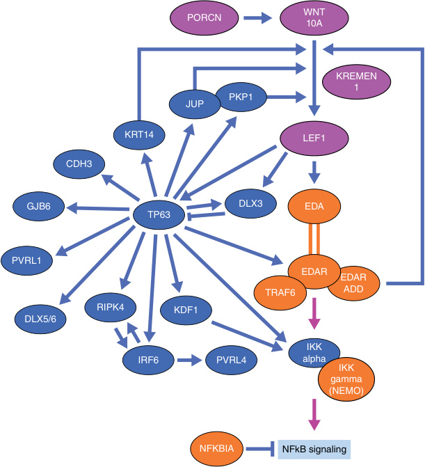

# Chapter 9: Ectodermal Dysplasia — Board-Style Self-Assessment MCQs
**Section II: Developmental Structural Disorders** | [📖 Read Wiki Chapter](../chapters/009_Ectodermal_Dysplasia.md) | [🃏 Chapter Flashcards](../flashcards/009_flashcards.md) | [🏠 Course Master Index](../../index.md)

Total questions: **14** *(Click "Show Answer & Rationale" beneath each question)*

### Question 1 (Clinical Vignette & Syndrome Diagnosis)
A pediatric patient is evaluated in the medical genetics clinic with the following clinical and molecular profile: Hypodontia:  — Hair Abnormalities:  — Nail Feature:  — s Glandula: . Which of the following rare disorders is the most likely diagnosis?

- **A.** Ectodermal dysplasia 10A and 10B, AD and AR (ECTD10A, B)
- **B.** ARC syndrome
- **C.** Keratitis–ichthyosis–deafness syndrome, AR (KIDAR)
- **D.** Dermatopathia pigmentosa reticularis (DPR)/Naegeli syndrome (NFJS)

<b>Show Answer & Rationale</b>

**Correct Answer: A** — Ectodermal dysplasia 10A and 10B, AD and AR (ECTD10A, B)

**Rationale:** **Ectodermal dysplasia 10A and 10B, AD and AR (ECTD10A, B)** caused by pathogenic variants in **`EDAR, ECTD10A`** presents with: Hypodontia:  — Hair Abnormalities:  — Nail Feature:  — s Glandula: .

**Why Other Options Are Incorrect:** **ARC syndrome** is incorrect (associated with VPS33B — Pertinent Physical Findings: Generalized scaling with sparing of skin folds, arthrogryposis, renal tubular deg). **Keratitis–ichthyosis–deafness syndrome, AR (KIDAR)** is incorrect (associated with AP1B1 — i Hypodontia:  — i Hair Abnormalities:  — Nail Feature:  —  ). **Dermatopathia pigmentosa reticularis (DPR)/Naegeli syndrome (NFJS)** is incorrect (associated with KRT14 — Hypodontia:  — Hair:  — Nail Phenotypic Features:  — Glandular: ).

### Question 2 (Clinical Vignette & Syndrome Diagnosis)
A pediatric patient is evaluated in the medical genetics clinic with the following clinical and molecular profile: Hypodontia:  — Hair Abnormalities:  — Nail Feature:  — The salient clinical features, genetics, diagnosis, and management of EDs will be explored through several of the most common and prototypical EDs: hypohidrotic ectodermal dysplasias, TP63 -re. Which of the following rare disorders is the most likely diagnosis?

- **A.** Lamellar ichthyosis
- **B.** Incontinentia pigmenti (IP)
- **C.** Trichorhinophalangeal syndrome, type I (TRPS1) or type III (TRPS3)
- **D.** AD and AR

<b>Show Answer & Rationale</b>

**Correct Answer: B** — Incontinentia pigmenti (IP)

**Rationale:** **Incontinentia pigmenti (IP)** caused by pathogenic variants in **`IKBKG`** presents with: Hypodontia:  — Hair Abnormalities:  — Nail Feature:  — The salient clinical features, genetics, diagnosis, and management of EDs will be explored through several of the most common and prototypical EDs: hypohidrotic ectodermal dysplasias, TP63 -related disorders, incontinentia pigmenti, and PORCN -related developmental disorders..

**Why Other Options Are Incorrect:** **Lamellar ichthyosis** is incorrect (associated with TGM1, ABCA12, ALOX12B, NIPAL4 — Category: Nonsyndromic ichthyoses — Pertinent Physical Findings: Collodion membrane with ectropion and eclabiu). **Trichorhinophalangeal syndrome, type I (TRPS1) or type III (TRPS3)** is incorrect (associated with TRPS1, TRPS3 — i Hypodontia:  — i Hair Abnormalities:  — Nail Feature:  — ). **AD and AR** is incorrect (associated with EDAR — Phenotypes: Mild to severe HED, isolated oligodontia, amastia, palmoplantar hyperkeratosis).

### Question 3 (Clinical Vignette & Syndrome Diagnosis)
A pediatric patient is evaluated in the medical genetics clinic with the following clinical and molecular profile: Hypodontia:  — Hair Abnormalities:  — s Glandula: . Which of the following rare disorders is the most likely diagnosis?

- **A.** Congenital ichthyosiform erythroderma
- **B.** Ectodermal dysplasia and immunodeficiency 1, AD and AR (EDAID1)
- **C.** Ectodermal dysplasia with or without hypohidrosis, not yet OMIM-listed
- **D.** AD and AR

<b>Show Answer & Rationale</b>

**Correct Answer: B** — Ectodermal dysplasia and immunodeficiency 1, AD and AR (EDAID1)

**Rationale:** **Ectodermal dysplasia and immunodeficiency 1, AD and AR (EDAID1)** caused by pathogenic variants in **`IKBKG, EDAID1`** presents with: Hypodontia:  — Hair Abnormalities:  — s Glandula: .

**Why Other Options Are Incorrect:** **Congenital ichthyosiform erythroderma** is incorrect (associated with ALOX12B, ALOXE3, TGM1, ABCA12, CYP4F22, NIPAL4 — Pertinent Physical Findings: Collodion membrane with ectropion and eclabium, congenital ichthyosiform erythrod). **Ectodermal dysplasia with or without hypohidrosis, not yet OMIM-listed** is incorrect (associated with LEF1 — i Hypodontia:  — i Hair Abnormalities:  — Nail Feature:  — ). **AD and AR** is incorrect (associated with EDAR — Phenotypes: Mild to severe HED, isolated oligodontia, amastia, palmoplantar hyperkeratosis).

### Question 4 (Clinical Vignette & Syndrome Diagnosis)
A pediatric patient is evaluated in the medical genetics clinic with the following clinical and molecular profile: Affected Gene(s): NFKBIA — Hypodontia:  — Hair Abnormalities:  — s Glandula: . Which of the following rare disorders is the most likely diagnosis?

- **A.** Ectodermal dysplasia and immunodeficiency 2 (EDAID2)
- **B.** Congenital hypothyroidism
- **C.** Clouston syndrome or ectodermal dysplasia 2, Clouston type (ECTD2)
- **D.** Trichorhinophalangeal syndrome, type I (TRPS1) or type III (TRPS3)

<b>Show Answer & Rationale</b>

**Correct Answer: A** — Ectodermal dysplasia and immunodeficiency 2 (EDAID2)

**Rationale:** **Ectodermal dysplasia and immunodeficiency 2 (EDAID2)** caused by pathogenic variants in **`EDAID2`** presents with: Affected Gene(s): NFKBIA — Hypodontia:  — Hair Abnormalities:  — s Glandula: .

**Why Other Options Are Incorrect:** **Congenital hypothyroidism** is incorrect (associated with DUOX2, PAX8, SLC5A5 — Pertinent Physical Findings: Clavicular pad; puffiness of periorbital tissues and tongue, lips, hands, and gen). **Clouston syndrome or ectodermal dysplasia 2, Clouston type (ECTD2)** is incorrect (associated with GJB6, ECTD2 — i Hair Abnormalities:  — Nail Feature: ). **Trichorhinophalangeal syndrome, type I (TRPS1) or type III (TRPS3)** is incorrect (associated with TRPS1, TRPS3 — i Hypodontia:  — i Hair Abnormalities:  — Nail Feature:  — ).

### Question 5 (Clinical Vignette & Syndrome Diagnosis)
A pediatric patient is evaluated in the medical genetics clinic with the following clinical and molecular profile: Hypodontia:  — Hair Abnormalities:  — Nail Feature:  — r Additional Symptoms: . Which of the following rare disorders is the most likely diagnosis?

- **A.** Focal facial dermal dysplasia 3/Ablepharonmacrostomia syndrome (AMS)
- **B.** Congenital heart defects and ectodermal dysplasia (CHDED)
- **C.** KID syndrome
- **D.** Ectodermal dysplasia–short stature syndrome (ECTDS)

<b>Show Answer & Rationale</b>

**Correct Answer: B** — Congenital heart defects and ectodermal dysplasia (CHDED)

**Rationale:** **Congenital heart defects and ectodermal dysplasia (CHDED)** caused by pathogenic variants in **`PRKD1`** presents with: Hypodontia:  — Hair Abnormalities:  — Nail Feature:  — r Additional Symptoms: .

**Why Other Options Are Incorrect:** **Focal facial dermal dysplasia 3/Ablepharonmacrostomia syndrome (AMS)** is incorrect (associated with TWIST2 — Hair Abnormalities:  — s Glandula:  — r Additional Symptoms: ). **KID syndrome** is incorrect (associated with GJB2, GJB6 — Pertinent Physical Findings: Severe generalized or localized erythrokeratoderma with spiky hyperkeratosis, PPK). **Ectodermal dysplasia–short stature syndrome (ECTDS)** is incorrect (associated with GRHL2 — i Hypodontia:  — Nail Feature:  — ).

### Question 6 (Molecular & Genomic Etiology)
A child is diagnosed with **Ectodermal dysplasia 1, hypohidrotic, X-linked (Christ–Siemens–Touraine syndrome, XLHED)** after presenting with Pathway: the causative gene-NFκB pathway — Hypodontia:  — Hair Abnormalities:  — s Glandula:  — The most common HED, X-linked hypohidrotic ectod ermal dysplasia (XLHED) , is caused by pathogenic variants in . Pathogenic variants in which of the following genes are the primary molecular etiology of this disorder?

- **A.** EDA
- **B.** GLA
- **C.** MMACHC
- **D.** JAK3

<b>Show Answer & Rationale</b>

**Correct Answer: A** — EDA

**Rationale:** Pathogenic variants in **`EDA`** (X-Linked) cause **Ectodermal dysplasia 1, hypohidrotic, X-linked (Christ–Siemens–Touraine syndrome, XLHED)**, characterized by Pathway: EDA-NFκB pathway — Hypodontia:  — Hair Abnormalities:  — s Glandula:  — The most common HED, X-linked hypohidrotic ectod ermal dysplasia (XLHED) , is caused by pathogenic variants in EDA , located on the X chromosome..

**Why Other Options Are Incorrect:** **GLA** is incorrect (associated with Fabry disease (301500), XLR). **JAK3** is incorrect (associated with Severe combined immunodeficiency).

### Question 7 (Molecular & Genomic Etiology)
A child is diagnosed with **Ectodermal dysplasia 10A and 10B, AD and AR (ECTD10A, B)** after presenting with Hypodontia:  — Hair Abnormalities:  — Nail Feature:  — s Glandula: . Pathogenic variants in which of the following genes are the primary molecular etiology of this disorder?

- **A.** CD46
- **B.** EDAR
- **C.** BRAF
- **D.** PKLR

<b>Show Answer & Rationale</b>

**Correct Answer: B** — EDAR

**Rationale:** Pathogenic variants in **`EDAR`** (AR) cause **Ectodermal dysplasia 10A and 10B, AD and AR (ECTD10A, B)**, characterized by Hypodontia:  — Hair Abnormalities:  — Nail Feature:  — s Glandula: .

**Why Other Options Are Incorrect:** **CD46** is incorrect (associated with −652A (c.−652A>G, rs2796267)). **BRAF** is incorrect (associated with Cardio-facio-cutaneous syndrome).

### Question 8 (Molecular & Genomic Etiology)
A child is diagnosed with **Ectodermal dysplasia 11A and 11B, AD and AR (ECTD11A, B)** after presenting with Hypodontia:  — Hair Abnormalities:  — Nail Feature:  — s Glandula: . Pathogenic variants in which of the following genes are the primary molecular etiology of this disorder?

- **A.** CD79A
- **B.** TH
- **C.** EDARADD
- **D.** COASY

<b>Show Answer & Rationale</b>

**Correct Answer: C** — EDARADD

**Rationale:** Pathogenic variants in **`EDARADD`** (AR) cause **Ectodermal dysplasia 11A and 11B, AD and AR (ECTD11A, B)**, characterized by Hypodontia:  — Hair Abnormalities:  — Nail Feature:  — s Glandula: .

**Why Other Options Are Incorrect:** **CD79A** is incorrect (associated with Iga deficiency). **TH** is incorrect (associated with Complex and). **COASY** is incorrect (associated with COASY protein-associated neurodegeneration (CoPAN)).

### Question 9 (Molecular & Genomic Etiology)
A child is diagnosed with **Incontinentia pigmenti (IP)** after presenting with Hypodontia:  — Hair Abnormalities:  — Nail Feature:  — The salient clinical features, genetics, diagnosis, and management of EDs will be explored through several of the most common and prototypical EDs: hypo. Pathogenic variants in which of the following genes are the primary molecular etiology of this disorder?

- **A.** UNG
- **B.** C2
- **C.** NOD2
- **D.** IKBKG

<b>Show Answer & Rationale</b>

**Correct Answer: D** — IKBKG

**Rationale:** Pathogenic variants in **`IKBKG`** (Genetic) cause **Incontinentia pigmenti (IP)**, characterized by Hypodontia:  — Hair Abnormalities:  — Nail Feature:  — The salient clinical features, genetics, diagnosis, and management of EDs will be explored through several of the most common and prototypical EDs: hypohidrotic ectodermal dysplasias, TP63 -related disorders, incontinentia pigmenti, and PORCN -related developmental disorders..

**Why Other Options Are Incorrect:** **UNG** is incorrect (associated with Hyper-IgM syndrome). **C2** is incorrect (associated with Streptococcus pneumoniae). **NOD2** is incorrect (associated with and/or).

### Question 10 (Visual & Diagnostic Imaging Vignette)

A pediatric patient undergoes diagnostic evaluation for **Ectodermal Dysplasia**, yielding the clinical, neuroimaging, or molecular finding shown below. Which of the following best characterizes the illustrated disorder or mechanism?

- **A.** Hypohidrotic ectodermal dysplasia (HED). (A) This male shows the short, sparse hair; large conspicuous nostrils; wide cheekbones with flat malar ridges; periorbital wrinkling; a thick everte
- **B.** The multiple interactions between the EDA/NF-κB, Wnt and p63 pathways (in orange, purple, and blue, respectively). Arrows indicate stimulatory protein–protein or protein–gene regulatory inte
- **C.** The multiple interactions between the EDA/NF-κB, Wnt and p63 pathways (in orange, purple, and blue, respectively). Arrows indicate stimulatory protein–protein or protein–gene regulatory interacti
- **D.** Collodion membrane in a neonate.

<b>Show Answer & Rationale</b>

**Correct Answer: C** — The multiple interactions between the EDA/NF-κB, Wnt and p63 pathways (in orange, purple, and blue, respectively). Arrows indicate stimulatory protein–protein or protein–gene regulatory interacti

**Rationale:** **Fig. 9.1**: The multiple interactions between the EDA/NF-κB, Wnt and p63 pathways (in orange, purple, and blue, respectively). Arrows indicate stimulatory protein–protein or protein–gene regulatory interactions, bars are used for inhibitory interactions.

### Question 11 (Diagnostic Criteria (Ectodermal Dysplasia))
During a multidisciplinary genetics evaluation for **Ectodermal Dysplasia**, which clinical entity or diagnostic phenomenon is defined by the following profile?
"genetically and phenotypically diverse disorders affecting two or more structures derived from the ectoderm, including teeth, skin, and ectodermal appendages such as hair, nails, eccrine sweat glands, and sebaceous glands."

- **A.** TTD with ichthyosis
- **B.** Dermatopathia pigmentosa reticularis (DPR)/Naegeli syndrome (NFJS)
- **C.** Trichorhinophalangeal syndrome, type II (TRPS2)
- **D.** Ectodermal dysplasias (EDs)

<b>Show Answer & Rationale</b>

**Correct Answer: D** — Ectodermal dysplasias (EDs)

**Rationale:** Ectodermal dysplasias (EDs) are genetically and phenotypically diverse disorders affecting two or more structures derived from the ectoderm, including teeth, skin, and ectodermal appendages such as hair, nails, eccrine sweat glands, and sebaceous glands.

### Question 12 (Diagnostic Criteria (Hypohidrotic Ectodermal Dysplasias))
During a multidisciplinary genetics evaluation for **Hypohidrotic Ectodermal Dysplasias**, which clinical entity or diagnostic phenomenon is defined by the following profile?
"phenotypically similar but genetically heterogeneous."

- **A.** Hypohidrotic ectodermal dysplasias (HEDs)
- **B.** Ectodermal dysplasia and immunodeficiency 2 (EDAID2)
- **C.** Ectodermal dysplasia 7, hair/nail type (ECTD7)
- **D.** Coffin-Siris syndrome (CSS)

<b>Show Answer & Rationale</b>

**Correct Answer: A** — Hypohidrotic ectodermal dysplasias (HEDs)

**Rationale:** Hypohidrotic ectodermal dysplasias (HEDs) are phenotypically similar but genetically heterogeneous.

### Question 13 (Diagnostic Criteria (Genetics))
During a multidisciplinary genetics evaluation for **Genetics**, which clinical entity or diagnostic phenomenon is defined by the following profile?
"is caused by pathogenic variants in EDA , located on the X chromosome."

- **A.** Silver-Russell syndrome (SRS)
- **B.** Neutral lipid storage disease with ichthyosis
- **C.** X-linked recessive
- **D.** X-linked hypohidrotic ectod ermal dysplasia (XLHED)

<b>Show Answer & Rationale</b>

**Correct Answer: D** — X-linked hypohidrotic ectod ermal dysplasia (XLHED)

**Rationale:** X-linked hypohidrotic ectod ermal dysplasia (XLHED) , is caused by pathogenic variants in EDA , located on the X chromosome.

### Question 14 (Clinical & Pathophysiologic Mastery (Ectodermal Dysplasia))
When counseling a family and planning diagnostic management for **Ectodermal Dysplasia** (*Ectodermal Dysplasia*), which of the following clinical-genetic principles is **ACCURATE**?

- **A.** The condition is a benign, self-limiting physiologic variant that requires neither longitudinal surveillance nor genetic counseling.
- **B.** The salient clinical features, genetics, diagnosis, and management of EDs will be explored through several of the most common and prototypical EDs: hypohidrotic ectodermal dysplasias, TP63 -related disorde
- **C.** Inheritance is exclusively holandric (Y-linked) with complete penetrance restricted to male offspring.
- **D.** Enzyme activity and protein expression remain completely normal across all affected tissues, excluding a monogenic etiology.

<b>Show Answer & Rationale</b>

**Correct Answer: B** — The salient clinical features, genetics, diagnosis, and management of EDs will be explored through several of the most common and prototypical EDs: hypohidrotic ectodermal dysplasias, TP63 -related disorde

**Rationale:** **Clinical & Molecular Principle (Ectodermal Dysplasia):** The salient clinical features, genetics, diagnosis, and management of EDs will be explored through several of the most common and prototypical EDs: hypohidrotic ectodermal dysplasias, TP63 -related disorders, incontinentia pigmenti, and PORCN -related developmental disorders.

